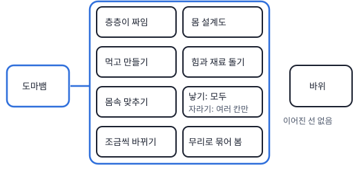
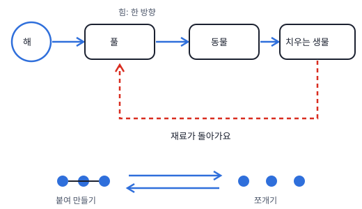
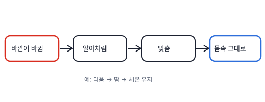
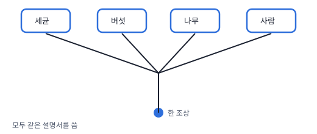
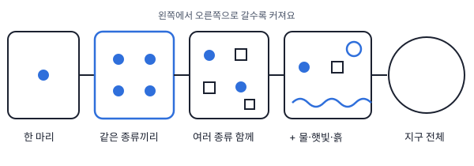
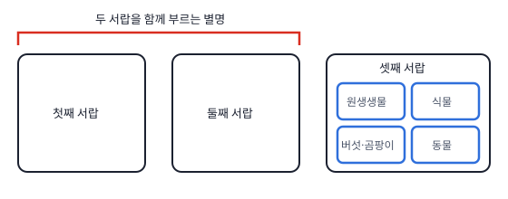

# 생물은 무엇이 다를까 — 5살도 이해하는 정리노트

이영만 교수님 생명과학 · 0901 수업 (1장 생물분자와 세포) · 녹음 없는 결석 회차

> `정리노트_0901_Biomolecules_and_Cells.html`를 마크다운으로 옮겼어요. 그림은 `figures_0901/` 폴더의 SVG, 위젯은 대표 설정의 정적 그림으로 바꿨어요. 수식은 `$…$` / `$$…$$`라서 GitHub, Obsidian, Typora에서 보여요.

**목차**

- [1. 생물의 특징](#s1)
  - [무엇이 생물인가 — 여덟 가지 특징](#s1-traits)
  - [물질대사와 에너지 흐름](#s1-metabolism)
  - [항상성](#s1-homeostasis)
  - [진화와 공통조상](#s1-evolution)
- [2. 생명의 계층구조와 분류](#s2)
  - [세포에서 생물권까지 — 계층구조](#s2-hierarchy)
  - [3영역과 4계](#s2-domains)
- [3. 요약 · 예고](#s3)
  - [30초 요약](#s3-cheatsheet)
  - [다음 시간 예고](#s3-next)
  - [함께 보면 좋은 자료](#s3-links)

## 1. 생물의 특징

### 무엇이 생물인가 — 여덟 가지 특징

*0901 수업 · 1장 p1*

**쉽게 말하면**

생물은 바위에 없는 여러 표시를 갖고 있어요.

*도마뱀 같은 생물에게는 이런 표시가 있고 바위에는 없지만, 자라기처럼 몸이 여러 칸으로 된 생물에게만 해당하는 표시도 있어요.*

**정확히 말하면**

생명은 한 문장으로 정의하기 어려워요. 그래도 생물에는 무생물과 구분되는 특성이 있어요. 강의노트는 생물의 특성을 여덟 가지로 들어요. (강의노트 1장 p1 §1.1.1)

1. 생물계의 계층구조: 세포, 개체군, 군집, 생태계, 생물권으로 층층이 짜여 있어요. 자세한 단계는 [세포에서 생물권까지 — 계층구조](#s2-hierarchy)에서 봐요.
2. 화학적 지령(chemical instruction): DNA, RNA, 단백질이에요. [진화와 공통조상](#s1-evolution)에서 이어서 봐요.
3. 물질대사 활동: 광합성, 세포호흡이 예예요. [물질대사와 에너지 흐름](#s1-metabolism)에서 봐요.
4. 에너지의 이동과 물질 순환: 태양에너지가 1차 생산자에서 소비자로 가고, 분해자가 분해한 물질이 1차 생산자에게 재순환돼요.
5. 항상성: [항상성](#s1-homeostasis)에서 봐요.
6. 생식과 발생: 생식과 유전은 모든 생물의 특징이에요. 발생은 다세포 생물의 특징이에요.
7. 생물학적 진화: 공통조상의 후손인 현재 생물은 극적인 다양성을 보여요.
8. 3 영역과 계로 분류: 생물 전체를 원핵생물(진정세균 영역, 고세균 영역)과 진핵생물(진핵생물 영역)로 나눠요. 개체 하나가 가진 성질이 아니라 생물 전체를 묶어 보는 틀이에요. 자세한 분류는 [3영역과 4계](#s2-domains)에서 봐요.

다음 수업 도입에서 교수님은 "모든 생물은 세포로 구성됩니다."라고 복습했어요.

생식과 발생을 나눠 적은 까닭이 있어요. 세균처럼 세포 하나로 사는 생물도 생식과 유전은 해요. 하지만 여러 세포가 모여 몸을 이루며 자라는 발생은 다세포 생물에만 해당해요. 그래서 "단세포 세균에 해당하지 않는 특징"을 물으면 발생을 골라야 해요.

**꼭 기억해요**

- "생식과 발생"을 한 묶음으로 모든 생물의 특징이라고 착각하기 쉬워요. 생식·유전은 모든 생물, 발생은 다세포 생물의 특징이에요. (강의노트 1장 p1)
- "모든 생물은 세포로 되어 있다"를 "모든 생물에 세포소기관이 있다"로 넓혀 읽기 쉬워요. 세포로 되어 있다는 것은 모든 생물의 공통점이지만, 막으로 둘러싸인 세포소기관은 모든 생물의 공통점이 아니에요. (자세한 내용은 보충)

**보충 · 수업에서 다루지 않았어요**

세포소기관(organelle)은 세포 안에서 막으로 둘러싸인 작은 구조예요. 진핵세포는 막으로 둘러싸인 핵과 세포소기관을 세포질 안에 가져요. 원핵세포는 막으로 둘러싸인 구조가 거의 없거나 아예 없어요. 원핵생물은 핵막이 없어 핵이 없고, DNA는 핵양체로 있어요. 그래서 세포소기관의 존재는 진핵생물에만 해당하고, 생물 전체의 특징 목록에는 들어가지 않아요.

교재는 도마뱀과 바위를 원자와 분자 수준에서 보면 둘 다 똑같은 물리법칙을 따르는 원자와 분자로 되어 있다고 설명해요. 복잡한 생물분자도 그 자체는 살아 있지 않아요. 세포는 막으로 둘러싸인 조직화된 화학계이고, 세포의 체제를 유지하고 있을 때에만 살아 있어요. 바이러스는 DNA를 가지지만, 감염시킨 생명체와 떨어져서는 번식할 수 없어서 생물학자들은 살아 있다고 보지 않아요.

출처: 강의노트 1장 p5 §1.3.2–1.3.3(원핵세포·진핵세포), 교재 1장 1.3, 교재 1장 p.2–3

**페이지 요약**

강의노트는 생물의 특성을 여덟 가지로 들고, 발생은 다세포 생물에만 해당하며 세포소기관은 모든 생물의 공통점이 아니에요.

*용어*

- **생식과 발생** — 생식·유전은 모든 생물, 발생은 다세포 생물
- **세포소기관** — 막으로 둘러싸인 구조, 원핵생물에는 없음

- **(보충) 생물의 공통점과 세포** — 막성 세포소기관은 모든 생물의 공통점이 아니며, 원핵세포 DNA는 핵양체에 있어요. 생물분자 자체는 살아 있지 않고 세포의 조직화된 체제가 생명을 유지해요. 바이러스는 숙주 없이 독립적으로 번식하지 못해요.

---

### 물질대사와 에너지 흐름

*0901 수업 · 1장 p1*

**쉽게 말하면**

생물은 작은 조각을 붙여 큰 것을 만들기도 하고, 큰 것을 쪼개기도 해요.

햇빛의 힘은 풀에서 동물로 한 방향으로 흘러가요.

*풀과 동물이 남긴 것을 치우는 생물이 잘게 부수면, 그 재료는 다시 풀에게 돌아가요.*

**정확히 말하면**

강의노트는 생물의 특성으로 "물질대사 활동"을 들고, 그 예로 광합성(photosynthesis)과 세포호흡(cellular respiration)을 적어요. (강의노트 1장 p1) 물질대사(metabolism)는 생물이 몸 안에서 물질을 만들고 쪼개는 화학반응 활동이에요.

이어서 "에너지의 이동과 물질 순환"을 따로 들어요. (강의노트 1장 p1)

1. 태양에너지가 1차 생산자(primary producer)로 들어가요.
2. 1차 생산자에서 소비자(consumer)로 에너지가 옮겨 가요.
3. 분해자(decomposer)가 생물의 잔해를 분해해요.
4. 분해로 생긴 물질은 1차 생산자에게 재순환돼요.

노트의 말 그대로, 에너지는 "이동"하고 물질은 "순환"해요. 분해자를 거쳐 1차 생산자에게 되돌아가는 것은 물질이지 에너지가 아니에요.

에너지는 한 방향으로 흐르고 물질은 다시 돌아오는 차이를 [에너지 흐름과 물질 순환 모형](../%EC%9D%B8%ED%84%B0%EB%A0%89%ED%8B%B0%EB%B8%8C_02_%EC%97%90%EB%84%88%EC%A7%80_%ED%9D%90%EB%A6%84%EA%B3%BC_%EB%AC%BC%EC%A7%88_%EC%88%9C%ED%99%98.html)에서 재생해 보세요.

**꼭 기억해요**

- 에너지도 물질처럼 돌고 돈다고 착각하기 쉬워요. 에너지는 태양에서 생산자, 소비자로 한 방향으로 흐르고 옮겨 갈 때마다 일부가 열로 빠져나가요. 분해자를 거쳐 재순환되는 것은 단순한 원료물질이에요. (강의노트 1장 p1, 교재 1장 p.3)
- 물질대사를 분해만 하는 활동으로 착각하기 쉬워요. 물질대사는 분자를 조립하는 합성과 분해를 모두 포함해요. 광합성은 당을 만드는 쪽, 세포호흡은 생물분자를 분해하는 쪽이에요. (교재 1장 p.3)

**보충 · 수업에서 다루지 않았어요**

교재는 물질대사를 생명체가 주위 환경에서 에너지를 얻어 자신을 유지하고 생장하고 번식하는 데 쓰는 능력이라고 정의해요. 그 일부로 세포는 분자를 조립하고, 변경하고, 분해하는 화학반응을 해요. 그래서 고분자를 합성하는 것도, 에너지를 가진 물질을 분해하는 것도 모두 물질대사예요.

- 광합성: 햇빛의 전자기에너지를 흡수해 화학에너지로 바꿔요. 이산화탄소와 물로 당을 만들고 부산물로 산소를 내놓아요.
- 세포호흡: 산소를 이용해 복잡한 생물분자(당)를 분해하고, 그 에너지의 일부를 방출해 세포 활동에 써요. 이때 이산화탄소와 물이 나와요.
- 세포호흡에서 나온 이산화탄소처럼 쓰고 남은 물질(노폐물)을 내보내는 일도 물질대사에 딸린 과정이에요.
- 광합성 생물은 1차 생산자, 동물은 소비자, 어떤 박테리아와 균류는 분해자예요. 분해자는 죽은 생명체의 잔해에서 복잡한 생물분자를 단순한 원료물질로 분해해 먹고 살고, 이 원료물질은 생산자가 다시 재순환해요.
- 한 생명체에서 다른 생명체로 에너지가 전달될 때 효율은 100%가 아니고, 일부는 열로 손실돼요.

생물 몸속의 화학반응은 물속에서 일어나요. 반응할 분자들이 물에 녹아 있어야 서로 만나 반응할 수 있기 때문이에요. 강의노트도 물이 좋은 용매라고 적어요. 그래서 "물 없이 작용하는 능력"은 물질대사의 설명으로 맞지 않아요.

출처: 교재 1장 p.3(그림 1.3 포함), 강의노트 1장 p2 §1.1.4(물은 좋은 용매). 노폐물을 내보내는 일이 물질대사에 딸린 과정이라는 것은 일반 생물학 교재(외부 참고)이고, 교재 그림 1.3에서 세포호흡이 이산화탄소와 물을 내놓는 것과 이어져요.

**페이지 요약**

물질대사는 합성과 분해를 모두 포함하고, 에너지는 한 방향으로 흐르며 물질은 분해자를 거쳐 재순환돼요.

*용어*

- **물질대사(metabolism)** — 물질을 만들고 쪼개는 화학반응 활동, 예: 광합성, 세포호흡
- **1차 생산자(primary producer)** — 햇빛 에너지를 처음 받아들이는 광합성 생물
- **분해자(decomposer)** — 잔해를 분해해 원료물질을 재순환시키는 생물

- **(보충) 물질대사와 물질·에너지 흐름** — 물질대사는 분자의 합성·변경·분해를 포함해요. 광합성은 빛을 화학에너지로 바꾸고, 세포호흡은 당을 분해해 에너지를 얻어요. 물질은 분해자를 거쳐 재순환하지만 에너지 전달 중 일부는 열로 손실돼요. 물은 반응물이 만나 반응하는 용매이며 노폐물 배출도 대사와 연결돼요.

---

### 항상성

*0901 수업 · 1장 p1*

**쉽게 말하면**

더우면 땀을 흘리고 추우면 몸을 떨어서, 몸속을 비슷하게 지켜요.

*바깥이 바뀌면 먼저 알아차리고, 그다음 맞춰서 몸속을 지켜요.*

**정확히 말하면**

항상성(homeostasis)은 강의노트가 드는 생물의 특성 가운데 하나예요. 강의노트에는 이름만 있고 정의는 적혀 있지 않아요. (강의노트 1장 p1)

물질대사와 구분해요. 강의노트는 광합성과 세포호흡을 "물질대사 활동"의 예로 적고, 항상성은 그와 다른 특성으로 따로 적어요. 세포호흡과 광합성은 물질을 만들고 쪼개는 활동의 예이지, 항상성의 이름이 아니에요. 자세한 내용은 [물질대사와 에너지 흐름](#s1-metabolism)에서 봐요.

**보충 · 수업에서 다루지 않았어요**

항상성은 생물이 환경 변화를 감지하고, 조절 반응을 통해 내부 환경을 일정한 범위로 유지하는 능력이에요.

1. 감지: 바깥 또는 몸 안의 환경 변화를 알아차려요.
2. 조절: 그 변화를 되돌리는 방향으로 반응해요. 예를 들어 체온이 오르면 땀을 흘려 열을 내보내요.
3. 유지: 그 결과 체온 같은 내부 환경이 일정한 범위 안에 머물러요.

그래서 "환경 변화를 탐지해 조절 반응으로 내부 환경을 유지하는 능력"을 물으면 답은 항상성이에요. 세포호흡·광합성은 물질대사의 예이고, 물질대사는 그런 화학반응 활동 전체의 이름이에요.

출처: 일반 생물학 교재의 항상성 정의(외부 참고; 이 교재의 해당 쪽은 스캔본에 없음). 기출 1강 39번 발문도 같은 정의를 써요.

**페이지 요약**

항상성은 환경 변화를 감지하고 조절 반응으로 내부 환경을 유지하는 능력이에요.

*용어*

- **항상성(homeostasis)** — 감지 → 조절 → 내부 환경 유지

- **(보충) 항상성** — 항상성은 환경 변화를 감지하고 조절 반응으로 내부 환경을 일정 범위에 유지하는 능력이에요. 체온 상승 때 땀을 흘리는 것이 예예요.

---

### 진화와 공통조상

*0901 수업 · 1장 p1*

**쉽게 말하면**

지금의 모든 생물은 아주 먼 옛날 한 조상에게서 갈라져 나왔어요.

*그래서 세균도 나무도 사람도 몸을 만드는 설명서를 같은 방식으로 써요.*

**정확히 말하면**

생물학적 진화는 생물의 특성 가운데 하나예요. 공통조상의 후손인 현재 생물은 극적인 다양성을 보여요. (강의노트 1장 p1)

모든 생물은 화학적 지령으로 DNA, RNA, 단백질을 가져요. (강의노트 1장 p1) 겉모습과 사는 방식이 이렇게 다양한데도 모든 생물이 같은 분자로 된 같은 지령 체계, 즉 공통적인 유기 화학을 공유한다는 점이 모든 생물이 하나의 공통조상에서 생겨났다는 생각을 지지해요.

반대로 생물마다 서로 다른 점은 공통조상의 근거가 되지 못해요. 공통조상의 근거는 "모든 생물에 똑같이 있는 것"이어야 해요.

**꼭 기억해요**

- "핵 속 DNA", "같은 세포벽", "같은 생식 방법"을 모든 생물의 공통점으로 착각하기 쉬워요. 셋 다 모든 생물의 공통점이 아니어서 공통조상의 근거가 되지 못해요. (자세한 내용은 보충)
- 공통조상의 근거는 모든 생물이 공유하는 DNA·RNA·단백질이라는 같은 화학적 지령이에요. (강의노트 1장 p1, 교재 1장 p.3)

**보충 · 수업에서 다루지 않았어요**

교재는 비생명 물질과 생물계를 구별하는 가장 근본적인 분자가 DNA라고 해요. DNA는 모든 생명체에서 유사하게 작용해요.

1. DNA의 정보가 다른 핵산인 RNA 분자에 복사돼요.
2. RNA는 여러 단백질 분자의 제조를 명령해요.
3. 단백질은 생물분자의 합성을 포함한 대부분의 생명 활동을 수행해요.

박테리아, 나무, 물고기, 인간의 DNA에는 차이가 있어서 분자 구성이 다르게 배열되고 모양과 기능이 달라져요. 그래도 DNA가 정보를 담고 RNA와 단백질로 이어지는 방식은 같아요.

- 핵: 진핵생물은 핵막으로 핵이 세포질과 분리돼 있어요. 원핵생물은 핵막이 없어 핵이 없고 DNA는 핵양체로 있어요. 그래서 "핵 속에 DNA"는 모든 생물의 공통점이 아니에요.
- 세포벽: 원핵세포에는 세포벽이 있고, 식물세포의 세포벽은 섬유소(cellulose)로 되어 있어요. 동물세포에는 세포벽이 없어요. 그래서 "같은 세포벽"은 모든 생물의 공통점이 아니에요.
- 생식 방법: 세균처럼 몸이 나뉘어 늘어나는 무성생식을 하는 생물도 있고, 암수의 생식세포가 만나는 유성생식을 하는 생물도 있어요.

출처: 교재 1장 p.3(DNA·RNA·단백질), 강의노트 1장 p5–6(원핵세포의 핵양체와 세포벽, 진핵세포의 핵, 식물세포의 섬유소 세포벽). 동물세포에 세포벽이 없다는 것과 생식 방법이 생물마다 다르다는 것은 일반 생물학 교재(외부 참고)예요.

**페이지 요약**

모든 생물이 DNA·RNA·단백질이라는 같은 화학적 지령을 공유하는 것이 공통조상의 근거예요.

*용어*

- **생물학적 진화** — 공통조상의 후손인 현재 생물이 극적인 다양성을 보임
- **공통적인 유기 화학** — 모든 생물이 DNA·RNA·단백질을 같은 방식으로 씀

- **(보충) 생물이 공유하는 정보 전달** — 생물은 DNA의 정보를 RNA에 복사하고 단백질로 이어 쓰는 방식을 공유해요. 핵 속 DNA, 같은 세포벽, 같은 생식 방법은 모든 생물의 공통점이 아니에요. 원핵세포에는 핵막이 없고 동물세포에는 세포벽이 없어요.

---

## 2. 생명의 계층구조와 분류

### 세포에서 생물권까지 — 계층구조

*0901 수업 · 1장 p1*

**쉽게 말하면**

작은 것이 모여 조금 더 큰 모둠이 되고, 모둠이 모여 더 큰 모둠이 돼요.

*색칠된 점은 한 종류 생물, 테두리 네모는 다른 종류 생물이고, 물결선과 해 모양 선은 살아 있지 않은 물과 햇빛이에요.*

같은 종류만 모였는지, 여러 종류가 섞였는지, 물과 햇빛까지 넣었는지로 이름이 바뀌어요.

**정확히 말하면**

생물은 무생물과 구분되는 특징을 가지며, 그 첫째가 계층구조예요. 모든 생물은 세포(cell)로 이루어져 있고, 세포에서 지구 전체까지 아래 단계가 차례로 쌓이는 수직적 계층구조를 가져요. 각 단계는 바로 아래 단계를 포함해요.

1. 세포(cell): 생명의 가장 작은 단위예요. 복잡한 생물분자 자체는 살아 있지 않고, 막으로 둘러싸인 세포가 체제를 유지할 때에만 살아 있어요. 박테리아처럼 세포 하나가 생물 하나인 것은 단세포 생물, 식물·동물처럼 서로 의존하는 세포들로 된 개체는 다세포 생물이에요. (교재 1장 p.2–3)
2. 개체군(population): 같은 지역에 사는 같은 종의 개체 모임이에요. 종은 하나뿐이에요. 교재 예: 타히티 섬에 사는 사람들, 남극의 펭귄 군체, 실험실 플라스크 속 박테리아 집단. (교재 1장 p.2–3)
3. 군집(community): 같은 지역에 사는 여러 종의 개체군 모임이에요. 종이 여럿이고, 생물만 들어가요. 교재 예: 남극 해안을 따라 사는 박테리아, 펭귄, 물고기, 바다표범, 고래 등이 모인 하나의 군집. (교재 1장 p.2–3)
4. 생태계(ecosystem): 군집에 무생물 환경요인을 합친 것이에요. 교재 예: 삼림생태계는 생물 군집뿐 아니라 토양, 공기, 물, 무기염, 햇빛에너지의 유입까지 포함해요. (교재 1장 p.2–3)
5. 생물권(biosphere): 가장 높은 단계로, 지구의 수계(바다·물), 지각, 대기에 있는 모든 생태계를 합친 것이에요. (교재 1장 p.2–3)

단계를 가르는 기준은 세 가지예요.

| 단계 | 들어가는 것 | 빠지는 것 |
|---|---|---|
| 개체군(population) | 한 지역의 같은 종 개체들 | 다른 종, 무생물 |
| 군집(community) | 한 지역의 모든 종의 개체군 | 무생물(물·햇빛·흙) |
| 생태계(ecosystem) | 한 지역의 군집 + 무생물 환경 | 다른 지역 |
| 생물권(biosphere) | 지구 전체의 모든 생태계 | 없음(가장 높은 단계) |

거꾸로 판별해 보면 이래요. 연못의 붕어만 모으면 개체군이에요. 연못의 모든 생물을 모으면 군집이에요. 연못의 모든 생물에 물·햇빛·흙까지 합치면 생태계예요. 지구의 모든 생태계를 합치면 생물권이에요.

세포에서 생물권까지 범위가 넓어지는 모습을 [생명의 계층구조 모형](../%EC%9D%B8%ED%84%B0%EB%A0%89%ED%8B%B0%EB%B8%8C_01_%EC%83%9D%EB%AA%85%EC%9D%98_%EA%B3%84%EC%B8%B5%EA%B5%AC%EC%A1%B0.html)에서 단계별로 살펴보세요.

**교수님 말씀**

0901은 녹음이 없어요. 아래 인용은 다음 수업(0903) 도입부에서 교수님이 0901 내용을 복습한 말이에요.

> "모든 생물은 세포로 구성됩니다."

> "수직적 계층 구조를 가집니다."

> "같은 지역에 사는 같은 종들의 개체 모임을 개체군이라고 했습니다."

> "개체군들의 모임을 군집이라고 했습니다."

> "거기에 무생물을 합치면은 생태계라고 했어요."

정리 노트의 해설: 복습 발언은 개체군, 군집, 생태계 순으로 한 단계씩 올라가요. 단계마다 무엇이 더해지는지(다른 종, 무생물)를 보면 다음 단계가 보여요.

**꼭 기억해요**

- 개체군과 군집을 섞기 쉬워요. 개체군은 같은 종 하나, 군집은 여러 종의 개체군 모임이에요. "같은 지역"은 둘 다 해당하니 종의 수로 갈라요.
- 군집과 생태계를 섞기 쉬워요. 군집은 생물만이고, 무생물(물·햇빛·흙 등)을 합치면 생태계예요. "모든 생물 + 물·햇빛"은 군집이 아니라 생태계예요.
- 생태계와 생물권을 섞기 쉬워요. 생태계는 한 지역 단위이고, 생물권은 지구 전체의 모든 생태계예요. (교재 1장 p.2–3)

**페이지 요약**

같은 종이면 개체군, 여러 종이면 군집, 무생물까지 합치면 생태계, 지구 전체면 생물권이에요.

*용어*

- **개체군(population)** — 같은 지역, 같은 종의 개체 모임
- **군집(community)** — 같은 지역, 여러 종의 개체군 모임
- **생태계(ecosystem)** — 군집 + 무생물 환경

---

### 3영역과 4계

*0901 수업 · 1장 p1*

**쉽게 말하면**

모든 생물을 큰 서랍 세 개에 나눠 담고, 셋째 서랍 안에만 작은 칸 네 개를 만들었어요.

*왼쪽 두 서랍을 한꺼번에 부르는 별명은 있지만, 그 별명이 넷째 서랍은 아니에요. 원생생물 칸은 셋째 서랍 안에만 있어서, 첫째·둘째 서랍의 생물과 섞이지 않아요.*

**정확히 말하면**

지구상의 생물은 가장 큰 단위인 영역(domain) 세 개로 나누고, 그중 진핵생물 영역을 다시 계(kingdom) 네 개로 나눠요. (강의노트 1장 p1)

| 묶어 부르는 말 | 영역(domain) | 계(kingdom) |
|---|---|---|
| 원핵생물 | 진정세균 영역 | (강의노트에서 계로 나누지 않음) |
| 고세균 영역 | (강의노트에서 계로 나누지 않음) |  |
| 진핵생물 | 진핵생물 영역 | 원생생물계, 식물계, 균계, 동물계 |

- 영역은 진정세균, 고세균, 진핵생물의 세 개예요. 고세균은 진정세균의 한 종류가 아니라 따로 선 하나의 영역이에요.
- 원핵생물은 영역이 아니에요. 진정세균 영역과 고세균 영역, 두 영역을 함께 부르는 말이에요.
- 원생생물계·식물계·균계·동물계의 네 계는 모두 진핵생물 영역 안에 들어가요. 계는 영역보다 작은 단위라서, 네 계 중 어느 것도 영역이 아니에요.
- 균계의 "균"은 버섯·곰팡이 같은 균류를 말해요. 교재도 분해자를 "어떤 박테리아와 균류"로 따로 적어요. 세균(진정세균)은 균계가 아니라 진정세균 영역에 속해요. (교재 1장 p.3)

정리하면 영역은 셋, 계는 넷이에요. 들어가는 것과 빠지는 것을 나란히 보면, 진핵생물 영역에는 네 계가 모두 들어가고 진정세균·고세균은 빠져요. 원핵생물이라는 이름에는 진정세균·고세균이 들어가고 네 계는 모두 빠져요.

**교수님 말씀**

0901은 녹음이 없어요. 아래는 다음 수업(0903) 도입부에서 교수님이 0901 내용을 복습한 말이에요.

> "지구상의 많은 생물들을 세 개의 영역, 네 개의 계로 나눴었습니다."

정리 노트의 해설: 이 발언의 숫자만 뽑으면 영역은 셋, 계는 넷이에요.

**꼭 기억해요**

- 원핵생물을 하나의 영역으로 착각하기 쉬워요. 원핵생물은 진정세균 영역과 고세균 영역을 함께 부르는 말이고, 영역이 아니에요. (강의노트 1장 p1)
- 영역과 계의 개수를 바꿔 쓰기 쉬워요. 영역은 셋, 계는 넷이에요.
- 네 계를 진핵생물과 나란한 영역으로 착각하기 쉬워요. 원생생물계·식물계·균계·동물계는 모두 진핵생물 영역 안의 계예요.
- 고세균을 진정세균에 딸린 무리로 착각하기 쉬워요. 고세균은 독립된 영역이에요.

**페이지 요약**

영역은 진정세균·고세균·진핵생물 셋이고, 네 계는 모두 진핵생물 영역 안에 있어요.

*용어*

- **영역(domain)** — 진정세균, 고세균, 진핵생물
- **계(kingdom)** — 원생생물계, 식물계, 균계, 동물계(모두 진핵생물 영역)
- **원핵생물** — 진정세균·고세균 두 영역을 함께 부르는 말(영역 아님)

---

## 3. 요약 · 예고

### 30초 요약

*0901 수업 · 1장 p1*

| 주제 | 시험 직전 한 줄 |
|---|---|
| 생물의 특징 | 강의노트의 여덟 가지: 계층구조, 화학적 지령, 물질대사, 에너지 이동과 물질 순환, 항상성, 생식과 발생, 생물학적 진화, 3영역과 계로 분류. |
| 세포와 세포소기관 | 모든 생물은 세포로 되어 있음. 막으로 둘러싸인 세포소기관은 원핵생물에 없어서 모든 생물의 특징이 아님. |
| 생식과 발생 | 생식·유전은 모든 생물의 특징, 발생은 다세포 생물의 특징. 단세포 생물에는 발생을 붙이지 않음. |
| 물질대사 | 분자를 합성하는 반응과 분해하는 반응을 모두 포함(분해만이 아님). 세포 안 물속에서 일어남(보충). 예: 광합성(빛에너지를 화학에너지로), 세포호흡(산소로 분해해 에너지 방출). |
| 에너지와 물질 | 에너지는 태양 → 1차 생산자 → 소비자 방향으로 흐르고, 전달될 때마다 일부가 열로 손실되어 순환하지 않음. 물질은 분해자가 분해한 뒤 1차 생산자가 다시 써서 재순환됨. |
| 항상성 | 환경 변화를 감지 → 조절 반응 → 내부 환경을 일정한 범위로 유지하는 순서. 바깥 환경이 변하지 않는다는 뜻이 아님. |
| 진화와 공통조상 | 모든 생물이 DNA·RNA·단백질이라는 같은 화학적 지령(같은 유기 화학)을 공유 = 공통조상의 근거. 생식 방법이나 세포벽은 생물마다 달라서 근거가 아님. |
| 계층구조 순서 | 세포 → 개체 → 개체군 → 군집 → 생태계 → 생물권. 아래 단계가 모여 위 단계를 이룸. |
| 개체군과 군집 | 개체군 = 같은 지역에 사는 같은 종의 개체 모임(한 종). 군집 = 같은 지역 여러 종의 개체군 모임. |
| 생태계와 생물권 | 생태계 = 군집 + 무생물 환경(토양·공기·물·햇빛). 무생물이 빠지면 군집까지만. 생물권 = 지구의 모든 생태계. |
| 3영역 | 진정세균 영역, 고세균 영역, 진핵생물 영역. 원핵생물은 앞의 두 영역을 함께 부르는 말이지 영역 이름이 아님. |
| 4계 | 원생생물계·식물계·균계·동물계는 모두 진핵생물 영역 안에 있음. 진정세균·고세균은 이 넷 중 어디에도 들지 않음. |

---

### 다음 시간 예고

*0901 수업 · 1장 p1–2*

0901 수업은 녹음이 없어서 교수님의 마지막 발언과 정확히 끊긴 지점을 확인할 수 없어요. 다음 수업(0903)은 생물의 특징을 짧게 복습한 뒤 이렇게 시작했어요.

> "오늘은 세포의 구성 성분들에 대해서 이야기를 하겠습니다."

0903에 나온 항목(이름만):

- 1.1.2 원소와 원자: 다량원소와 미량원소
- 1.1.3 화학결합: 이온결합, 공유결합, 수소결합
- 1.1.4 물의 특성
- 1.2 생물분자

---

### 함께 보면 좋은 자료

*0901 수업*

다음 수업(0903) 정리노트는 도입부에서 이번 수업의 계층구조와 3영역·4계를 다시 복습해요.

- [복습문제 9선 — 0901 수업 범위](복습문제_0901_Biomolecules_and_Cells.md)
- [0903 정리노트 — 지난 수업 복습](../../0903/정리노트_0903_Biomolecules_and_Cells.html#s0-recap)
- [무엇이 생물인가 — 여덟 가지 특징](#s1-traits)
- [세포에서 생물권까지 — 계층구조](#s2-hierarchy)
- [3영역과 4계](#s2-domains)

---

출처: 이영만 교수님 강의노트(1장 p1) · 0903 수업 녹음 전사 도입부(0901 복습) · 『생명과학: 기초와 응용』 2판 1장. 0901 수업은 녹음이 없어 강의노트와 교재, 다음 수업의 복습 발언으로 재구성했어요.
