# 원자에서 단백질까지 — 5살도 이해하는 정리노트

이영만 교수님 생명과학 · 0903 수업 (1장 생물분자와 세포)

> `정리노트_0903_Biomolecules_and_Cells.html`를 마크다운으로 옮겼어요. 그림은 `figures_0903/` 폴더의 SVG, 위젯은 대표 설정의 정적 그림으로 바꿨어요. 수식은 `$…$` / `$$…$$`라서 GitHub, Obsidian, Typora에서 보여요.

**목차**

- [0. 지난 수업 복습](#s0)
  - [지난 수업(0901) 복습 — 생명의 계층과 3영역](#s0-recap)
- [1. 원자와 화학결합](#s1)
  - [생물을 이루는 원소](#s1-elements)
  - [원자의 구조와 옥텟 규칙](#s1-atom)
  - [이온결합과 공유결합](#s1-bonds)
  - [전기음성도와 극성, 친수성과 소수성](#s1-polarity)
  - [수소결합](#s1-hbond)
- [2. 물의 특성](#s2)
  - [얼음이 물에 뜬다](#s2-ice)
  - [극성 용매로서의 물](#s2-solvent)
  - [높은 비열과 기화열](#s2-heat)
  - [응집력과 식물의 물 운반](#s2-cohesion)
- [3. 탄수화물](#s3)
  - [단당류와 이당류](#s3-sugars)
  - [다당류 — 녹말과 글리코겐](#s3-storage)
  - [셀룰로오스와 α·β 결합](#s3-alpha-beta)
- [4. 지질](#s4)
  - [지질의 세 종류와 중성지질](#s4-neutral)
  - [포화지방산과 불포화지방산](#s4-saturation)
  - [인지질과 인지질 이중층](#s4-phospholipid)
  - [스테로이드와 콜레스테롤](#s4-steroid)
- [5. 단백질](#s5)
  - [아미노산과 펩타이드 결합](#s5-amino-acid)
  - [구조와 기능 — 1·2·3차 구조](#s5-structure)
  - [변성](#s5-denature)
- [6. 요약 · 예고](#s6)
  - [30초 요약](#s6-cheatsheet)
  - [다음 시간 예고](#s6-next)
  - [함께 보면 좋은 자료](#s6-links)

## 0. 지난 수업 복습

### 지난 수업(0901) 복습 — 생명의 계층과 3영역

*0903 수업 · 1장 p1*

**정확히 말하면**

- 모든 생물은 세포로 이루어져 있고, 세포에서 지구 전체까지 수직적 계층 구조를 가져요.
- 같은 지역에 사는 같은 종의 개체 모임은 개체군(population)이에요. 그 지역의 여러 개체군(여러 종)이 모이면 군집(community)이에요. 개체군과 군집은 종이 하나냐 여럿이냐로 갈려요.
- 군집에 빛·물·토양 같은 무생물 환경까지 합치면 생태계(ecosystem)예요. 한 지역의 모든 종과 무생물 구성요소를 합친 것은 군집이 아니라 생태계예요. 지구의 생태계 전체는 생물권이에요. (강의노트 1장 p1)
- 지구의 생물은 3영역, 4계로 나눠요. 3영역은 진정세균, 고세균, 진핵생물이에요. 원생생물계·식물계·균계·동물계의 4계는 모두 진핵생물 영역 안의 계라서 영역이 아니에요. "원핵생물"은 진정세균 영역과 고세균 영역을 함께 부르는 말일 뿐 하나의 영역이 아니에요. (강의노트 1장 p1 "3 영역과 계로 분류")

이전 팩: [0901 복습문제](../../0901/복습문제_0901_Biomolecules_and_Cells.html) · [0901 정리노트](../../0901/정리노트_0901_Biomolecules_and_Cells.html)

**페이지 요약**

개체군, 군집, 생태계, 생물권 순으로 커지고, 생물은 진정세균·고세균·진핵생물의 3영역으로 나눠요.

*용어*

- **생태계(ecosystem)** — 군집 + 무생물 환경
- **3영역** — 진정세균, 고세균, 진핵생물
- **개체군과 군집** — 같은 지역의 한 종이면 개체군, 여러 종이면 군집이에요.
- **생물권** — 지구 전체 생태계의 합이에요.
- **계와 원핵생물** — 네 계는 모두 진핵생물 영역에 속해요. 원핵생물은 진정세균·고세균 두 영역을 함께 부르는 말이에요.

---

## 1. 원자와 화학결합

### 생물을 이루는 원소

*0903 수업 · 1장 p1–2*

**쉽게 말하면**

우리 몸은 거의 네 가지 재료로 만든 레고예요.

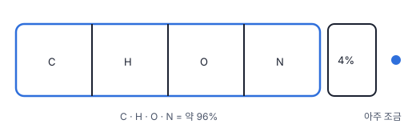

*큰 네 칸이 거의 다이고, 옆의 작은 칸과 점도 없으면 안 돼요.*

**정확히 말하면**

생물은 세포 → 분자 → 원자 순서로 쪼개 볼 수 있어요. 생물을 이루는 원소 가운데 탄소(C)·수소(H)·산소(O)·질소(N) 네 가지가 약 96%를 차지해요. 이 넷이 다량원소의 중심이에요.

- 탄소(C): 탄소가 들어 있는 물질을 유기물이라고 해요. 단, 일산화탄소(CO)와 이산화탄소(CO₂)처럼 탄소가 있어도 유기물로 치지 않는 것이 있어요. 지구 생명체의 큰 분자(고분자)는 모두 탄소를 뼈대로 삼기 때문에 "탄소 기반 생명체"라고 불러요.
- 수소(H)·산소(O): 몸의 약 70%가 물(H₂O)이라서 많아요. 수소와 산소는 고분자에도 들어 있지만, 사슬과 고리의 뼈대를 만드는 원소는 탄소예요.
- 질소(N): 단백질과 DNA를 만들 때 필요해요.
- 나머지 약 4%는 칼슘(Ca), 인(P), 칼륨(K), 황(S), 나트륨(Na), 염소(Cl), 마그네슘(Mg)이에요.

미량원소는 셀레늄, 철, 아이오딘처럼 아주 적게(강의노트 기준 0.01% 미만) 필요하지만 없으면 안 되는 원소예요. 예를 들어 철이 부족하면 빈혈이 생겨요.

**교수님 말씀**

> "미량 원소라고 해서 필요 없는 것이 아닙니다. 적은 양이지만 꼭 필요합니다."

교수님은 탄소가 들어간 물질이 유기물이고, 그래서 우리가 "탄소 기반 생명체"라고 설명했어요.

**꼭 기억해요**

- "양이 적다"를 "필요 없다"로 착각하기 쉬워요. 미량원소는 적게 필요할 뿐 반드시 필요해요.
- "탄소가 있으면 모두 유기물"로 외우기 쉬워요. 일산화탄소·이산화탄소는 탄소가 있어도 유기물에서 빼요.
- "몸에 가장 많은 원소"와 "고분자의 뼈대 원소"를 같은 것으로 착각하기 쉬워요. 물 때문에 수소·산소가 많지만, 고분자의 기초(뼈대) 원소는 탄소예요.

**페이지 요약**

C·H·O·N이 약 96%이고, 생명체의 뼈대는 탄소예요.

*용어*

- **다량원소** — C·H·O·N(96%)과 Ca·P·K·S·Na·Cl·Mg(4%)
- **미량원소** — 셀레늄·철·아이오딘처럼 아주 적지만 필수인 원소
- **유기물** — 탄소가 들어 있는 물질(CO, CO₂ 제외)
- **탄소 뼈대와 물** — 몸에 수소·산소가 많은 것은 물 때문이고, 고분자의 사슬·고리 뼈대는 탄소예요.
- **질소** — 단백질과 DNA를 만들 때 필요해요.

---

### 원자의 구조와 옥텟 규칙

*0903 수업 · 1장 p1*

**쉽게 말하면**

원자는 가운데 무거운 씨앗과 그 둘레를 도는 가벼운 알갱이로 되어 있어요.

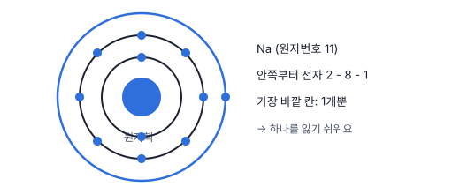

*바깥 칸이 꽉 차면 조용하고, 덜 차면 짝을 찾아 붙어요.*

**정확히 말하면**

원자는 원자핵과 전자(electron)로 이루어져요. 원자핵에는 양(+)전하를 띤 양성자(proton)와 전하가 없는 중성자(neutron)가 들어 있어요. 음(−)전하를 띤 전자는 핵 안에 있지 않고 핵 바깥 궤도를 돌아요. 전자는 매우 가벼워서 원자의 질량은 거의 핵의 질량이에요. (강의노트 1장 p1 "원자 = 핵(양성자, 중성자) + 전자")

전자는 정해진 궤도만 돌고, 안쪽부터 2개, 8개, 8개씩 채워져요. 가장 바깥 궤도를 8개(첫 궤도만 있으면 2개)로 채우려는 경향이 옥텟 규칙(octet rule)이에요. 가장 바깥 궤도를 최외각 궤도(원자가 궤도)라고 하고, 거기에 있는 전자를 최외각 전자(원자가 전자)라고 해요. 최외각 전자의 수가 원자의 화학적 성질을 정해요.

- 최외각 전자가 1개뿐이면(예: Na, 2-8-1) 그 하나를 잃기 쉬워요.
- 최외각 전자가 7개면(예: Cl, 2-8-7) 1개를 얻기 쉬워요.
- 최외각 궤도가 덜 차 있는 원자는 전자를 잃거나, 얻거나, 공유하면서 다른 원자와 화학결합을 해요.
- 최외각 궤도에 전자 수가 이미 최대치(꽉 참)인 원자는 안정해서 다른 원자와 결합하지 않아요.

결합할지 말지를 가르는 기준은 최외각 궤도가 얼마나 찼느냐예요. 양성자 수와 중성자 수가 같은지, 양성자 수와 전자 수가 같은지는 결합 여부의 기준이 아니에요.

**교수님 말씀**

교수님은 나트륨과 염소를 예로 들어, 7개를 더 채우는 것보다 1개를 잃는 쪽이 쉽고, 1개를 얻는 쪽이 쉽다고 설명했어요.

전자는 매우 가벼워서 원자의 질량은 핵의 질량과 같다고 보면 된다고 했어요.

**보충 · 수업에서 다루지 않았어요**

원자번호는 그 원소의 원자핵 속 양성자 수예요. 원자번호는 "양성자 수 + 전자 수"도, "중성자 수"도, "전자 수"만을 뜻하지도 않아요. 전하를 띠지 않은 원자에서는 전자 수가 양성자 수와 같아서, 원자번호 11인 나트륨은 전자도 11개(2-8-1)예요. 즉 양성자는 양(+)전하를 띠고, 양성자의 수가 곧 원소의 원자번호예요.

출처: 일반화학 표준 정의(강의노트 1장에는 원자번호 정의가 없고, 교재 1장의 1.1.2 쪽(인쇄 p.4–5)은 스캔본에 빠져 있어 확인하지 못했어요).

**페이지 요약**

핵에는 양성자와 중성자, 바깥에는 전자가 돌고, 최외각이 꽉 차면 결합하지 않아요.

*용어*

- **원자핵** — 양성자 + 중성자
- **옥텟 규칙(octet rule)** — 최외각 궤도를 8개로 채우려는 경향
- **최외각 전자** — 최외각 전자 수가 화학적 성질과 결합 여부를 좌우해요. 최외각이 꽉 차면 안정해 결합하지 않아요.
- **전자 배치와 결합** — 안쪽부터 2·8·8개를 채워요. 첫 궤도는 2개, 나머지 최외각은 8개를 채우려 해요. 덜 차면 전자를 잃거나 얻거나 공유해요.
- **원자의 질량** — 전자는 매우 가벼워 원자 질량은 거의 원자핵에서 와요.

- **(보충) 원자번호와 전자 수** — 원자번호는 원자핵의 양성자 수예요. 전기적으로 중성인 원자는 전자 수도 같아 원자번호 11인 나트륨의 전자는 11개예요. 수업 노트에 정의가 없고 이 교재의 해당 쪽은 스캔본에서 확인하지 못한 일반화학 보충이에요.

---

### 이온결합과 공유결합

*0903 수업 · 1장 p1–2*

**쉽게 말하면**

원자끼리 작은 알갱이를 하나 건네주고 붙기도 하고, 둘이 나눠 쓰며 붙기도 해요.

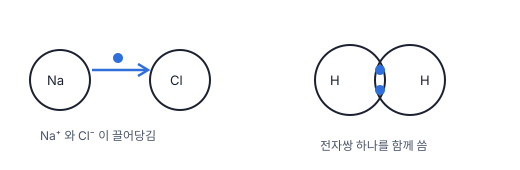

*왼쪽은 하나를 건네주고 서로 끌리고, 오른쪽은 둘이 같이 써요.*

**정확히 말하면**

생물 분자에서 중요한 결합은 이온결합, 공유결합, 수소결합이에요(반데르발스 힘은 수업에서 생략했어요).

1. 이온결합(ionic bond): 나트륨(Na, 원자번호 11, 2-8-1)은 전자 1개를 잃어 양이온 Na⁺가 되고, 염소(Cl, 원자번호 17, 2-8-7)는 전자 1개를 얻어 음이온 Cl⁻가 돼요. 양이온과 음이온 사이의 정전기적 인력이 이온결합이에요.
2. 공유결합(covalent bond): 두 원자가 전자를 내놓아 함께 쓰는 결합이에요. H–H는 각자 전자를 1개씩 내놓아 2개를 채우고, 이 공유된 전자쌍 하나를 막대 하나(단일결합)로 그려요. 전자쌍 두 개를 공유하면 막대 두 개(이중결합)예요.

물(H₂O) 분자: 산소(8번)는 최외각 전자가 6개예요. 산소는 수소 2개와 각각 전자쌍을 공유하고, 공유하지 않는 전자쌍 두 개를 가져요. 공유하지 않는 전자쌍끼리(둘 다 음전하) 밀어내서 물 분자는 180°로 펴지지 않고 굽은 모양이에요.

세기는 이온결합과 공유결합이 수소결합보다 강해요. 수소결합은 [수소결합](#s1-hbond) 토픽에서 다뤄요.

**교수님 말씀**

교수님은 나트륨은 7개를 채우는 것보다 1개를 잃는 게 쉽고, 염소는 1개를 얻는 게 쉽다는 말로 이온이 생기는 까닭을 설명했어요.

물 분자가 굽은 이유를 공유하지 않는 전자쌍끼리 밀어내기 때문이라고 짚었어요.

**페이지 요약**

이온결합은 양이온과 음이온의 끌어당김, 공유결합은 전자쌍을 함께 쓰는 결합이에요.

*용어*

- **이온결합(ionic bond)** — Na⁺와 Cl⁻ 같은 양이온·음이온 사이 인력
- **공유결합(covalent bond)** — 전자쌍을 공유하는 결합
- **전자 이동과 공유** — Na는 전자 하나를 잃어 Na⁺, Cl은 얻어 Cl⁻가 돼 끌어당겨요. 공유결합은 두 원자가 전자쌍을 함께 써요.
- **물 분자의 굽은 모양** — O는 H 두 개와 전자쌍을 공유하고, 공유하지 않는 전자쌍 둘의 반발로 H₂O는 굽어요.
- **결합의 세기** — 이온결합·공유결합이 수소결합보다 강해요.

---

### 전기음성도와 극성, 친수성과 소수성

*0903 수업 · 1장 p2*

**쉽게 말하면**

산소는 함께 쓰는 알갱이를 자기 쪽으로 세게 끌어당기는 욕심쟁이예요.

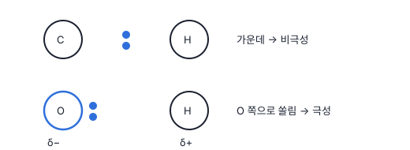

*알갱이가 가운데 있으면 공평하고, 한쪽으로 쏠리면 그쪽이 살짝 더 무거운 편이 돼요.*

**정확히 말하면**

전기음성도(electronegativity)는 결합한 원자가 공유 전자를 끌어당기는 힘이에요. 두 원자의 전기음성도 차이가 결합의 극성을 정해요.

- H–H, C–H: 전기음성도 차이가 거의 없어 전자가 가운데 있어요. 전자를 고르게 공유하는 비극성 공유결합이에요.
- O–H: 산소가 전자를 매우 강하게 끌어당겨 전자가 불균등하게 배분돼요. 그래서 O는 부분 음전하(δ−), H는 부분 양전하(δ+)를 띠어요. 이것이 극성 공유결합이에요.

"산소가 전기적으로 강한 음성을 띤다"는 말은 산소가 전자를 더 강하게 끌어당긴다는 뜻이에요. 전자를 밀어내거나 날려 보낸다는 뜻이 아니에요.

물 분자는 O–H 극성 공유결합 두 개가 굽은 모양으로 붙어 있어서, 분자 전체로 한쪽은 +, 한쪽은 −를 띠는 극성 분자예요. 물은 비극성·이온성·소수성 분자가 아니에요.

극성을 띠는 분자는 극성 분자, 부분 전하가 없는 분자는 비극성(무극성) 분자예요. 극성끼리, 비극성끼리 친해요.

- 친수성(hydrophilic): hydro는 물, philic은 좋아한다는 뜻이에요. 극성 분자와 전하를 띤 이온. 예: 소금이 녹아 생긴 Na⁺·Cl⁻, 음전하를 띤 인산기, OH가 있는 곁사슬(세린의 CH₂OH).
- 소수성(hydrophobic): phobic은 싫어한다는 뜻이에요. 비극성 분자. 예: 기름.

기름은 CH₂가 십몇 개 이어진 사슬이에요. 이렇게 탄소와 수소로만 이루어진 분자(사슬)를 탄화수소라고 불러요. C–H가 비극성이라 탄화수소는 전체가 비극성이고 물과 섞이지 않아요. 폴리펩타이드(아미노산 사슬), 탄수화물, 다당류는 산소 같은 다른 원소도 들어 있어서 탄화수소가 아니에요. (탄화수소라는 이름은 교재 1장 p.10 "지방산은 한 가닥으로 된 탄화수소 사슬")

비극성 분자는 부분적 전하가 없는 분자예요. 음이온과 양이온은 전하를 띠므로 비극성이 아니에요. 이온은 전하를 띤 입자라는 뜻이라서, "중성 이온"이라는 말로 비극성을 판단하지 않아요.

**교수님 말씀**

교수님은 이준기가 나온 "미녀는 석류를 좋아해" 광고를 틀어 준 뒤 빈칸을 "산소는 전자를 좋아한다"로 채웠어요. 산소의 전기음성도가 크다는 것을 외우게 하려는 장치예요.

> "산소는 전자를 좋아한다. 죽을 때까지 안 잊어먹겠죠."

> "그냥 좋아하는 게 아니고 엄청 좋아합니다."

산소 분자도 전자를 좋아하며, 전자를 빼앗기는 것을 산화라고 한다는 이야기는 물질대사에서 다시 나온다고 했어요.

**꼭 기억해요**

- 결합의 극성과 분자의 극성을 같은 말로 착각하기 쉬워요. O–H 결합이 극성인 것에 굽은 모양이 더해져 물 분자 전체가 극성이 돼요. 교수님도 "극성 공유결합. 아니…"라며 다시 설명했어요.
- C–H와 O–H는 둘 다 공유결합이라 같은 성질로 보기 쉬워요. 전기음성도 차이 때문에 C–H는 비극성, O–H는 극성이에요.
- 전기음성도와 전자 친화도를 같은 말로 착각하기 쉬워요. 결합한 원자가 공유 전자를 끄는 힘은 전기음성도예요.
- 친수성은 극성 분자만이라고 착각하기 쉬워요. 전하를 띤 이온도 친수성이고, 비극성 분자가 소수성이에요.
- 산화를 "산소가 붙는 것"이나 "전자를 얻는 것"으로 헷갈리기 쉬워요. 산화는 전자를 잃는 것이고, 산소는 전자를 빼앗아 가는 쪽이에요.

**페이지 요약**

산소는 전자를 세게 끌어서 O–H는 극성, C–H는 비극성이에요. 극성·이온은 친수성, 비극성은 소수성이에요.

*용어*

- **전기음성도(electronegativity)** — 공유 전자를 끌어당기는 힘
- **극성 공유결합** — 전자를 불균등하게 공유(O–H)
- **탄화수소** — 탄소와 수소로만 된 분자, 비극성
- **결합 극성과 물 분자** — O가 공유 전자를 더 세게 당겨 O–H는 O가 δ−, H가 δ+예요. O–H 결합 둘이 굽어 물 분자 전체가 극성이 돼요.
- **친수성과 소수성** — 극성 분자와 전하를 띤 이온은 친수성이고, C–H 위주의 비극성 탄화수소는 소수성이에요.
- **산화** — 전자를 잃는 것이 산화예요. 산소는 전자를 끌어당기는 쪽이에요.

---

### 수소결합

*0903 수업 · 1장 p2*

**쉽게 말하면**

물 분자들은 옆 친구의 손을 살짝 잡고 있어요.

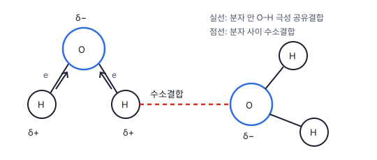

*한 물 분자의 H와 옆 물 분자의 O가 점선처럼 약하게 끌어당겨요.*

**정확히 말하면**

수소결합(hydrogen bond)은 전기음성도가 큰 원자(O 또는 N)에 공유결합한 수소 원자와, 근처의 전기음성도가 큰 원자 사이에 생기는 약한 전기적 인력이에요.

1. 성립 조건: 수소가 O나 N에 공유결합해 있어야 해요. C에 붙은 수소(예: 메테인 CH₄, 기름의 C–H)는 전자를 거의 빼앗기지 않아 수소결합을 하지 않아요.
2. 원리: O나 N에 붙은 H는 전자를 빼앗겨 δ+를 띠고, 옆에 있는 O나 N은 δ−를 띠어요. 이 δ+와 δ−가 서로 당기는 힘이 수소결합이에요.
3. 그래서 수소결합은 O·N에 공유결합한 H를 가진 극성 분자와, O·N을 가진 극성 분자 사이(또는 큰 분자 안의 그런 두 부분 사이)에서 생겨요. 극성 분자라도 O·N에 붙은 H와 상대 O·N이 없으면 수소결합을 하지 않아요. 두 이온 사이의 인력은 이온결합이고, 두 비극성 분자 사이나 극성 분자와 비극성 분자 사이에는 수소결합이 생기지 않아요.

물 분자 2개 이상이 가까이 있으면, 한 분자의 수소원자(δ+)와 다른 분자의 산소원자(δ−) 사이에 수소결합이 생겨요. 두 산소 원자 사이의 공유결합도, 두 수소 원자 사이의 결합도, 수소이온과 산소이온의 이온결합도 아니에요. 한 분자 안에서 O와 H를 잇는 결합은 극성 공유결합 그 자체이고 수소결합이 아니에요.

수소결합이 생기는 자리

- 분자 사이: 물처럼 작은 분자는 분자와 분자 사이에서 수소결합을 해요.
- 단백질: 한 사슬 안의 먼 부분끼리 수소결합을 해요. 펴져 있던 사슬이 수소결합으로 접히면서 3차 구조가 만들어지고 유지돼요.
- DNA: 두 가닥(사슬) 사이에서 수소결합을 해서 이중나선을 이뤄요. 두 가닥을 잇는 것은 극성 공유결합·이온결합·비극성 공유결합이 아니라 수소결합이에요.

수소결합은 열에 약하다: 온도가 오르면 전자가 에너지를 받아 돌아다녀 쏠림이 풀리고 수소결합이 깨져요. 물은 분자 사이가 멀어져 상태가 바뀌고(액체 → 기체), 단백질은 접힌 구조가 풀려요.

세기는 이온결합·공유결합이 수소결합보다 강해요. 수소결합은 약하지만 생물 분자의 구조를 유지하는 매우 중요한 힘이에요.

분자 안의 공유결합과 분자 사이의 수소결합을 [물의 수소결합과 얼음 모형](../%EC%9D%B8%ED%84%B0%EB%A0%89%ED%8B%B0%EB%B8%8C_03_%EB%AC%BC%EC%9D%98_%EC%88%98%EC%86%8C%EA%B2%B0%ED%95%A9%EA%B3%BC_%EC%96%BC%EC%9D%8C.html)에서 실선과 점선으로 구별해 보세요.

**교수님 말씀**

팔 비유: 팔을 펴고 있다가 어깨와 손가락 사이에 당기는 힘이 생기면 팔이 탁 접혀요. 단백질 사슬이 수소결합으로 접히는 모습이에요.

달걀 프라이: 투명하던 흰자가 열을 받으면 하얗게 변해요. 열에 수소결합이 깨져 단백질 구조가 바뀐 거예요.

> "요놈이 생물 분자들의 구조에서 상당히 중요한 역할을 하기 때문입니다."

> "그것보다는 약하지만 생물 분자의 구조를 유지시켜 주는 매우 중요한 힘입니다."

**꼭 기억해요**

- 물 분자 안의 O–H 결합을 수소결합으로 착각하기 쉬워요. "이거 자체가 수소결합이 아닙니다." 분자 안 O–H는 극성 공유결합이고, 수소결합은 다른 분자(또는 먼 부분)의 O와의 인력이에요.
- 분자 사이와 분자 안을 헷갈리기 쉬워요. 교수님은 "물은 분자 사이, DNA·단백질 같은 큰 분자는 분자 안"으로 묶어 설명했어요. 정확히는 단백질은 한 사슬 안, DNA는 두 가닥 사이의 수소결합이에요.
- 수소만 있으면 수소결합을 한다고 착각하기 쉬워요. C에 붙은 H는 하지 않고, O나 N에 붙은 H만 해요.
- "중요하다"와 "약하다"가 모순처럼 보여요. 둘 다 맞아요. 세기는 약하지만 구조 유지에 중요해요.

**페이지 요약**

O·N에 붙은 H(δ+)와 이웃 O·N(δ−) 사이의 약한 인력이 수소결합이에요.

*용어*

- **수소결합(hydrogen bond)** — δ+ 수소와 δ− 산소·질소 사이 인력
- **이중나선** — DNA 두 가닥이 수소결합으로 이어진 모양
- **성립 조건** — O·N에 공유결합한 H의 δ+와 가까운 O·N의 δ− 사이에 생겨요. C–H의 H나 조건이 없는 극성 분자는 수소결합하지 않아요.
- **결합 위치** — 물은 분자 사이, 단백질은 한 사슬의 먼 부분 사이, DNA는 두 가닥 사이에서 수소결합해요. 한 물 분자 안의 O–H는 극성 공유결합이에요.
- **세기와 열** — 수소결합은 공유·이온결합보다 약하지만 구조 유지에 중요하고 열에 깨져 단백질 접힘이 풀릴 수 있어요.

---

## 2. 물의 특성

### 얼음이 물에 뜬다

*0903 수업 · 1장 p2*

**쉽게 말하면**

물은 얼면 양은 그대로인데 몸집만 커져서, 같은 크기로 보면 더 가벼워 물 위에 떠요.

*얼음이 뚜껑처럼 위를 덮어 줘서 아래 물고기가 살 수 있어요.*

**정확히 말하면**

물은 생화학 반응이 일어나는 곳이고, 형태를 유지해 주며, 세포와 조직의 구성 성분이에요. 물의 특별한 성질은 물이 극성이고 물 분자끼리 수소결합을 하기 때문에 생겨요. (교재 1장 p.7)

1. 대부분의 물질은 고체가 되면 부피가 줄지만, 물은 얼면 부피가 늘어나요. 그 까닭은 얼음에서 물 분자들이 수소결합으로 서로 멀리 떨어진 격자(얼음 격자)를 만들기 때문이에요. 이 까닭은 교수님이 말로 연결하지 않았고 강의노트에 있는 내용이에요. (강의노트 1장 p2, 교재 1장 p.7)
2. 밀도 = 질량 / 부피예요. 질량은 같은데 부피가 커지니 얼음의 밀도가 물보다 낮아져요. 그래서 얼음이 물에 떠요.
3. 그 결과 호수는 위에서부터 얼고, 얼음 아래의 물에서 생물이 살 수 있어요. 얼음이 가라앉는다면 호수 전체가 얼어 생물이 모두 죽을 거예요.

물이 얼 때 분자 사이에 빈 공간이 생기는 모습을 [물의 수소결합과 얼음 모형](../%EC%9D%B8%ED%84%B0%EB%A0%89%ED%8B%B0%EB%B8%8C_03_%EB%AC%BC%EC%9D%98_%EC%88%98%EC%86%8C%EA%B2%B0%ED%95%A9%EA%B3%BC_%EC%96%BC%EC%9D%8C.html)의 ‘온도’에서 재생해 보세요.

**교수님 말씀**

아이스 아메리카노의 얼음이 뜨는 것, 얼음낚시를 예로 들었고, 페트병을 얼리면 깨질 수 있다고 했어요.

> "그게 중요한 게 아니고, 호수 생태계가 살 수가 있다는 거죠."

**꼭 기억해요**

- "고체는 보통 부피가 작아진다"는 일반 원칙을 물에도 적용하기 쉬워요. 물은 반대로 얼면 부피가 커져 밀도가 낮아져요. "같은 질량인데 부피가 커지니까 밀도가 낮아지죠."
- 얼음이 뜨는 까닭(밀도가 낮음)과 그 결과(호수가 위에서부터 얼어 생물이 삶)를 구분해요.

**페이지 요약**

얼음은 부피가 커져 밀도가 낮아지고, 그래서 호수가 위에서부터 얼어요.

*용어*

- **밀도** — 질량 / 부피
- **얼음 격자** — 수소결합으로 분자 사이가 벌어진 얼음 구조
- **얼음이 뜨는 원인과 결과** — 수소결합 격자가 분자 사이를 벌려 같은 질량의 부피를 키우므로 밀도가 낮아져요. 그래서 호수 표면부터 얼고 아래 물에서 생물이 살아요.

---

### 극성 용매로서의 물

*0903 수업 · 1장 p2*

**쉽게 말하면**

물은 한쪽은 살짝 플러스, 한쪽은 살짝 마이너스라서 자기와 닮은 가루를 잘 녹여요.

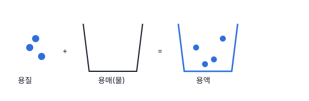

*커피 가루가 물에 녹으면 커피가 되는 것과 같아요.*

**정확히 말하면**

녹이는 것을 용매(solvent), 녹는 것을 용질(solute), 둘을 합친 것을 용액(solution)이라고 해요. 원두커피 가루는 용질, 물은 용매, 커피는 용액이에요.

물은 극성 용매예요. 물은 작고 극성이라서 극성(친수성) 물질과 이온을 잘 녹여요. 단백질, DNA, 이온, 작은 분자처럼 생명 현상을 일으키는 분자는 대부분 극성이라, 이들을 녹일 용매인 물이 있어야 생명 현상이 일어나요. 물은 우리 몸에서 극성 물질을 녹이는 일반적인 용매이지, 녹는 쪽(용질)이 아니에요. (교재 1장 p.7)

물 분자끼리는 강한 공유결합이 아니라 약한 수소결합으로 이어져 있어요([수소결합](#s1-hbond)). 또 효소로 작용하는 것은 단백질이지 물이 아니에요([구조와 기능 — 1·2·3차 구조](#s5-structure)).

**교수님 말씀**

원두커피로 용매·용질·용액을 설명했어요. 가루는 용질, 물은 용매, 커피는 용액이에요.

생명 현상을 일으키는 분자가 대부분 극성이라 이들을 녹이는 물이 있어야 생명 현상이 일어난다고 강조했어요.

**꼭 기억해요**

- 용매와 용질을 뒤바꾸기 쉬워요. 녹이는 쪽이 용매(물), 녹는 쪽이 용질(커피 가루)이에요.
- 물이 무엇이든 다 녹인다고 착각하기 쉬워요. 물은 극성·이온 물질을 녹이고, 기름 같은 비극성 물질은 녹이지 못해요.

**보충 · 수업에서 다루지 않았어요**

물 분자는 아주 일부가 수소 이온(H⁺)과 수산화 이온(OH⁻)으로 해리돼요(나뉘어요). 순수한 물처럼 H⁺와 OH⁻의 농도가 같은 중성 수용액의 pH는 pH 7(25 °C 기준)이에요. 그래서 순수한 물은 산성이 아니라 중성이에요. pH가 7보다 작으면 산성(H⁺가 더 많음), 7보다 크면 염기성(OH⁻가 더 많음)이에요.

출처: 일반화학 표준 내용(강의노트 1장에는 pH가 없고, 교재 1장 1.1.4(p.7–8)에도 pH 설명이 없어요. 교재 1장 p.14에는 "pH의 급격한 변화"가 단백질을 변성시킨다는 언급만 있어요).

**페이지 요약**

물은 극성 용매라 극성 물질과 이온을 녹여요.

*용어*

- **용매(solvent)** — 녹이는 물질(물)
- **용질(solute)** — 녹는 물질
- **용액(solution)** — 용매가 용질을 녹인 것이에요. 물은 극성·이온 물질을 녹이지만 기름 같은 비극성 물질은 녹이지 못해요.
- **물과 생명 반응** — 생명 현상에 참여하는 극성 분자를 물이 녹여야 반응이 일어나요.

- **(보충) 물의 해리와 pH** — 물은 일부가 H⁺와 OH⁻로 해리돼요. 25 °C에서 순수한 물은 두 농도가 같아 pH 7인 중성이에요. 이 기준에서 pH 7 미만은 산성, 7 초과는 염기성이에요.

---

### 높은 비열과 기화열

*0903 수업 · 1장 p2*

**쉽게 말하면**

물은 데우기도 식히기도 오래 걸리고, 날아갈 때 열을 많이 가져가요.

*땀방울이 날아가면서 몸의 열을 들고 가서 시원해져요.*

**정확히 말하면**

물은 비열과 기화열이 모두 커요. 둘 다 물 분자 사이의 수소결합 때문이에요. (교재 1장 p.7–8)

- 비열(specific heat): 물질 1 g의 온도를 1 °C 올리는 데 필요한 열량이에요. 물은 비열이 커서 천천히 데워지고 천천히 식어요. 열이 들어오면 먼저 수소결합을 끊는 데 쓰이기 때문이에요.
- 기화열(heat of vaporization): 액체가 기체가 되는 데 필요한 열량이에요. 기체가 되려면 분자 사이가 멀어져야 하고, 그러려면 수소결합을 끊어야 해서 에너지가 많이 들어요. 물은 기화열이 커요. "기화열이 작다"는 물의 특성과 반대예요.

효과: 땀이 증발하면서 큰 기화열을 몸에서 가져가 몸을 식혀요. 그래서 땀을 흘려도 체온이 크게 오르지 않아요. 시원해지는 까닭은 땀을 흘리는 것 자체가 아니라 땀이 증발하는 것이에요. 습한 날에는 땀이 잘 증발하지 않아 열을 덜 가져가서 더 덥고 불쾌해요.

**교수님 말씀**

부산이 대구보다 남쪽인데도 여름에 더 시원한 것은 바다(물)의 큰 비열 때문이라고 했어요.

땀을 흘리는 것만으로는 시원하지 않고, 땀이 식어야(증발해야) 시원하다고 했어요.

**꼭 기억해요**

- 땀을 흘리는 것과 땀이 증발하는 것을 헷갈리기 쉬워요. 몸을 식히는 것은 증발할 때 가져가는 기화열이에요.
- 비열과 기화열을 같은 말로 착각하기 쉬워요. 둘 다 크고 수소결합 때문인 점은 같지만, 비열은 온도를 올리는 열량, 기화열은 기체로 바꾸는 열량이에요.
- 교수님은 비열을 "물 온도를 1도 올리는 데 필요한 열량"이라고 말했지만, 정확히는 1 g 기준이에요.

**페이지 요약**

물은 비열과 기화열이 커서 온도가 잘 안 변하고, 땀이 증발할 때 열을 많이 가져가요.

*용어*

- **비열(specific heat)** — 1 g을 1 °C 올리는 열량
- **기화열(heat of vaporization)** — 액체를 기체로 바꾸는 열량
- **수소결합과 열** — 비열과 기화열이 큰 까닭은 열이 물 분자 사이 수소결합을 끊는 데 쓰이기 때문이에요.
- **증발과 냉각** — 땀이 실제로 증발할 때 몸에서 기화열을 가져가요. 습하면 증발이 덜 돼 덜 식어요.

---

### 응집력과 식물의 물 운반

*0903 수업 · 1장 p2*

**쉽게 말하면**

물 분자들은 손을 꼭 잡고 줄지어 나무 꼭대기까지 올라가요.

*꼭대기에서 하나가 날아가면 아래 친구들이 줄줄이 끌려 올라가요.*

**정확히 말하면**

응집력(cohesion)은 같은 것끼리 당기는 힘이에요. 물 분자는 극성이고 서로 수소결합을 해서 응집력이 커요. 물은 표면장력도 커요(교수님은 이름만 말하고 넘어갔어요).

1. 뿌리에서 흡수한 물이 물관을 따라 잎까지 올라가요. 이때 식물은 에너지를 쓰지 않아요.
2. 잎의 기공에서 물이 증발해요(증산작용(transpiration)). 그 자리의 압력이 낮아져 아래 물을 끌어올리는 장력이 생겨요.
3. 물 분자끼리 응집력으로 이어져 있어서 물줄기가 끊기지 않고 끌려 올라가요. (교재 1장 p.8)

CO₂는 잎의 기공으로, 물은 뿌리로 들어와요.

**교수님 말씀**

학과 체육대회 비유: 같은 과 학생끼리 응집력이 좋은 것처럼, 같은 것끼리 당기는 힘이 응집력이에요.

물 분자끼리 "손을 잡고" 쭉 올라간다고 설명했어요.

> "그래서 물은 꼭 필요하다."

교수님은 "물은 생명체의 생존에 매우 중요합니다"라며, 다른 행성에서 물을 찾는 것도 물이 생명이 존재할 기본 조건이기 때문이라고 했어요("화성 삼다수" 농담).

**꼭 기억해요**

- 물을 끌어올리는 힘과 물줄기를 잇는 힘을 헷갈리기 쉬워요. 증산작용이 만든 장력이 끌어올리고, 응집력은 물줄기가 끊기지 않게 해요.
- 식물이 에너지를 써서 물을 퍼 올린다고 착각하기 쉬워요. 이 과정에 식물의 에너지는 들지 않아요.

**페이지 요약**

물은 응집력과 표면장력이 크고, 증산작용의 장력과 응집력으로 물관을 타고 올라가요.

*용어*

- **응집력(cohesion)** — 같은 분자끼리 당기는 힘
- **증산작용(transpiration)** — 잎의 기공에서 물이 증발하는 것
- **증산 장력과 응집력** — 잎 기공의 증산이 위쪽 장력을 만들고, 수소결합에 따른 응집력은 물줄기가 끊기지 않게 해요. 식물은 이 과정에 에너지를 쓰지 않아요.

---

## 3. 탄수화물

### 단당류와 이당류

*0903 수업 · 1장 p2*

**쉽게 말하면**

단맛 구슬 하나, 구슬 두 개를 이은 것, 아주 많이 이은 것이 있어요.

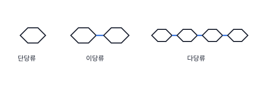

*하나, 둘, 아주 많이 이어진 사탕 목걸이라고 생각해요.*

**정확히 말하면**

동물·식물·세균 등 모든 생물의 세포에는 비슷한 큰 분자가 있고, 이를 네 그룹으로 나눠요: 탄수화물, 단백질, 지질, 핵산. (핵산은 이번 수업에서 이름만 나왔어요)

탄수화물(carbohydrate)은 탄소·수소·산소가 대략 C : H : O = 1 : 2 : 1인 분자예요. 예: 포도당 C₆H₁₂O₆. 탄수화물에는 단당류·이당류·다당류가 있어요. (교재 1장 p.8)

- 단당류(monosaccharide): 한 분자로 된 당. 포도당·과당·갈락토스. 탄소 수가 3~7개이고, 6개면 6탄당, 5개면 5탄당이에요.
- 과당도 C₆H₁₂O₆이지만 구조가 달라요. 분자식은 같고 구조가 다른 것을 구조 이성질체라고 해요. 포도당은 알데하이드기, 과당은 케톤기를 가져요.
- 이당류(disaccharide): 단당류 두 개가 붙은 것. 엿당 = 포도당 + 포도당, 설탕 = 포도당 + 과당, 젖당 = 포도당 + 갈락토스.

설탕은 식물이 광합성으로 만든 포도당을 체관으로 운반하는 형태이고, 젖당은 모유에 들어 있어요. 포도당은 물속에서 저절로 고리 모양이 되며, 사슬형과 고리형을 오가요.

단당류는 탄수화물이에요. 중성지방(트라이글리세라이드)·지방·스테로이드·인지질처럼 지질에 속하는 것과 나란히 놓이면 혼자 다른 그룹이에요([지질의 세 종류와 중성지질](#s4-neutral)).

**교수님 말씀**

이당류 암기법: "엿 포 포", "설 포 과"(설탕은 과자에 많으니까), "젖 포 갈".

> "상식적으로라도 알아야 되는 게 설탕, 엿당, 젖당이 이당류다."

태어나서 밥부터 먹은 사람은 없고, 누구나 젖당(모유)을 먹고 자랐다고 했어요.

> "밤에 시험공부할 때는 고기 먹는 것보다는 빵을 먹는 게 낫습니다. 뇌는 탄수화물만 소비하기 때문에."

바로잡기: 뇌는 주로 포도당(탄수화물)을 쓰지만, 오래 굶으면 케톤체도 에너지로 써요. "탄수화물만"은 단순화한 말이에요.

**꼭 기억해요**

- 포도당과 과당을 같은 분자로 착각하기 쉬워요. 분자식은 같지만 구조가 다른 구조 이성질체예요(알데하이드기 대 케톤기).
- 이당류의 짝을 뒤섞기 쉬워요. 엿당은 포도당+포도당, 설탕은 포도당+과당, 젖당은 포도당+갈락토스예요.
- 포도당을 사슬형과 고리형 중 하나로만 그려야 한다고 생각하기 쉬워요. 포도당은 둘 사이를 오가서 둘 다 맞아요.
- 교수님이 "단당류… 아 이당류나 다당류"로 고쳐 말했어요. 포도당이 두 개 이어지면 이당류, 여러 개면 다당류예요.

**페이지 요약**

탄수화물은 C : H : O = 1 : 2 : 1이고, 단당류 하나, 둘(이당류), 여럿(다당류)으로 나눠요.

*용어*

- **단당류(monosaccharide)** — 포도당·과당·갈락토스
- **이당류(disaccharide)** — 엿당·설탕·젖당
- **구조 이성질체** — 분자식은 같고 구조가 다른 분자
- **이당류의 짝** — 엿당은 포도당+포도당, 설탕은 포도당+과당, 젖당은 포도당+갈락토스예요.
- **포도당과 과당** — 분자식 C₆H₁₂O₆은 같지만 구조가 달라요. 포도당은 사슬형과 고리형을 오가요.
- **탄수화물과 지질** — 단당류는 탄수화물이고 중성지방·인지질·스테로이드는 지질이에요.

---

### 다당류 — 녹말과 글리코겐

*0903 수업 · 1장 p3*

**쉽게 말하면**

포도당 동전을 실에 줄줄이 꿰어 모아 두면 녹말이에요.

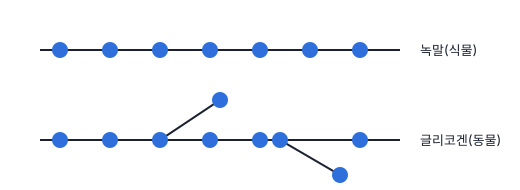

*식물은 한 줄로, 동물은 가지를 많이 쳐서 모아 둬요.*

**정확히 말하면**

다당류(polysaccharide)는 단당류(당)가 길게 이어진 것이에요. 녹말·글리코겐·셀룰로오스는 모두 당(포도당)으로 이루어져요. 아미노산·뉴클레오티드·지방산이 이어진 것이 아니에요. (교재 1장 p.9)

- 녹말(starch): 포도당이 한 줄로 이어진 것. 식물이 포도당을 저장하는 형태예요. 아밀로오스가 녹말의 한 종류이고, 감자·쌀·바나나에 있어요. 아이오딘으로 염색하면 보라색 알갱이로 보여요.
- 글리코겐(glycogen): 포도당이 이어진 것이지만 가지가 더 많아요. 동물이 포도당을 저장하는 형태예요.

1. 소화: 녹말은 너무 커서 세포막을 통과하지 못하므로 잘라야 해요. 아밀라아제(아밀레이스)가 녹말을 포도당 2개 단위, 즉 엿당으로 잘라요.
2. 엿당 분해 효소가 엿당을 포도당으로 잘라요.
3. 포도당은 소장에서 흡수되어 온몸의 세포로 가요.
4. 저장: 쓰고 남은 포도당은 가지가 있는 글리코겐으로 만들어 간과 근육에 저장해요. 저장을 지시하는 호르몬은 인슐린이에요.

녹말과 글리코겐의 기능은 연료(포도당 저장)예요.

**교수님 말씀**

500원 동전 비유: 아빠가 매일 주는 500원을 실로 줄줄이 엮어 두는 것이 녹말이에요. 포도당을 하나씩 이어 저장한다는 뜻이에요.

"클라우드에 저장할 거냐 SSD에 저장할 거냐"라고 물으며 글리코겐의 저장 장소를 간과 근육으로 답했고, 닭다리(근육)를 먹으면 글리코겐도 먹는 셈이라고 했어요.

> "다당류는 또 조금 알아야 되는데, 녹말, 글리코겐 우리 생활하고 다 밀접하게 관련이 있기 때문에."

**꼭 기억해요**

- 녹말과 글리코겐을 뒤바꾸기 쉬워요. 둘 다 포도당 저장 형태지만 녹말은 식물, 글리코겐은 동물이고 글리코겐은 가지가 더 많아요.
- 아밀라아제가 포도당 하나씩 자른다고 착각하기 쉬워요. 아밀라아제는 포도당 2개(엿당) 단위로 자르고, 엿당은 다른 효소가 잘라요.

**페이지 요약**

다당류는 당이 길게 이어진 것이고, 녹말은 식물, 글리코겐은 동물의 포도당 저장 형태예요.

*용어*

- **녹말(starch)** — 식물의 포도당 저장 형태
- **글리코겐(glycogen)** — 동물의 포도당 저장 형태, 가지가 많음, 간과 근육
- **아밀라아제** — 녹말을 엿당 단위로 자르는 효소
- **소화와 저장** — 아밀라아제가 녹말을 엿당으로 자르고 다른 효소가 포도당으로 잘라요. 남은 포도당은 인슐린 지시에 따라 간·근육의 글리코겐으로 저장돼요.

---

### 셀룰로오스와 α·β 결합

*0903 수업 · 1장 p2–3*

**쉽게 말하면**

녹말과 셀룰로오스는 같은 구슬로 만들었는데, 셀룰로오스는 구슬을 하나씩 뒤집어 꿰었어요.

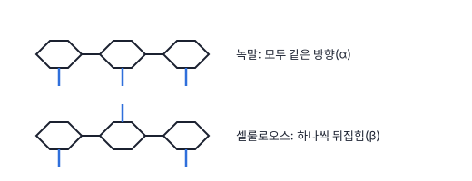

*이어 붙이는 방향이 달라서, 사람 몸은 아래 줄을 자르지 못해요.*

**정확히 말하면**

셀룰로오스(섬유소)는 포도당이 이어진 다당류, 즉 탄수화물이에요. 사람은 연료로 쓰지 못하고, 식물 세포벽의 구조 성분이에요. 섬유소는 지질이 아니에요. (교재 1장 p.8)

녹말과 셀룰로오스는 둘 다 포도당이 한 줄로 이어진 중합체지만, 연결 방식이 달라요.

1. 포도당이 고리를 만들 때 OH가 아래로 가면 α 포도당, 위로 가면 β 포도당이에요.
2. α 포도당끼리 결합하면 α 결합(녹말·글리코겐), β 포도당끼리 결합하면 β 결합(셀룰로오스)이에요. 셀룰로오스는 한 단위씩 뒤집혀 있어요.
3. "1, 4"는 결합한 탄소 번호(1번과 4번)예요.
4. 아밀라아제는 α 결합만 끊어요. 사람에게는 β 결합을 끊는 효소가 없어서 셀룰로오스를 소화하지 못해요.

소화되지 않는 다당류가 식이섬유예요. 대장 벽을 긁어 노폐물을 없애 장 건강과 배변에 도움이 돼요(고구마, 옥수수).

반추동물(소, 염소)은 셀룰로오스를 소화해요. 소 자신이 효소를 가진 것이 아니라, 장 안에 사는 공생 미생물이 β 결합을 끊어 줘요. 소는 미생물이 분해한 산물을 흡수하거나 미생물 자체를 먹어요. 반추는 되새김질이에요. (교재 1장 p.10)

α·β 결합에 따른 사슬 모양과 분해 결과의 차이를 [녹말과 셀룰로오스 모형](../%EC%9D%B8%ED%84%B0%EB%A0%89%ED%8B%B0%EB%B8%8C_04_%EB%85%B9%EB%A7%90%EA%B3%BC_%EC%85%80%EB%A3%B0%EB%A1%9C%EC%98%A4%EC%8A%A4_%CE%B1_%CE%B2_%EA%B2%B0%ED%95%A9.html)에서 비교해 보세요.

**교수님 말씀**

틀린 그림 찾기: 아밀로오스와 셀룰로오스 그림을 비교하게 한 뒤 "연결 방식이죠"라고 답했어요.

> "얘는 밑으로 간 게 아닙니다. 이게 뒤집힌 거예요."

**꼭 기억해요**

- 녹말과 셀룰로오스는 재료가 달라서 다르다고 착각하기 쉬워요. 재료는 똑같이 포도당이고, α 결합과 β 결합이라는 연결 방식이 달라요.
- β 결합 그림에서 OH가 "아래로 간" 것이 아니라 포도당이 "뒤집힌" 거예요.
- α와 β의 기준: 고리를 만들 때 OH가 아래면 α, 위면 β예요.
- 소가 셀룰로오스를 스스로 소화한다고 착각하기 쉬워요. 공생 미생물 덕분이에요.
- 탄수화물의 기능을 모두 연료로 착각하기 쉬워요. 녹말·글리코겐은 연료, 셀룰로오스는 구조예요.

**페이지 요약**

셀룰로오스는 포도당이 β 결합으로 이어진 세포벽 성분이고, 사람의 아밀라아제는 α 결합만 끊어요.

*용어*

- **셀룰로오스(섬유소)** — β 결합 포도당 중합체, 식물 세포벽
- **α 결합** — 녹말·글리코겐의 연결
- **반추동물** — 공생 미생물로 셀룰로오스를 소화하는 동물
- **연결 방식과 기능** — 녹말·글리코겐은 α 결합의 연료 저장 다당류, 셀룰로오스는 β 결합의 식물 세포벽 구조 다당류예요.
- **소화 가능성** — 사람의 아밀라아제는 α 결합만 끊어 셀룰로오스를 소화하지 못해요. 반추동물은 공생 미생물이 β 결합을 끊어 줘요.

---

## 4. 지질

### 지질의 세 종류와 중성지질

*0903 수업 · 1장 p3*

**쉽게 말하면**

뱃살 기름은 빗 하나에 빗살 세 개가 달린 모양이에요.

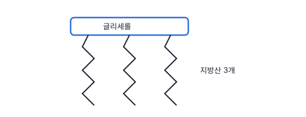

*윗부분 하나에 긴 꼬리 세 개, 이게 몸에 쌓이는 기름이에요.*

**정확히 말하면**

지질은 지방질이고, 세 종류가 있어요: 중성지질, 인지질, 스테로이드(콜레스테롤은 스테로이드의 한 종류). 지질의 기능은 연료 저장, 세포막 구성, 호르몬이에요.

지질에 속하는 것과 속하지 않는 것을 나란히 봐요.

- 지질: 중성지방(트라이글리세라이드), 지방, 기름, 인지질, 스테로이드, 콜레스테롤.
- 지질이 아님: 섬유소(셀룰로오스)와 단당류는 탄수화물이에요([셀룰로오스와 α·β 결합](#s3-alpha-beta), [단당류와 이당류](#s3-sugars)).

중성지질의 구조 (교재 1장 p.10–11)

1. 위쪽의 탄소 3개짜리 뼈대가 글리세롤(glycerol)이에요.
2. 아래 꼬리처럼 달린 탄소 사슬은 끝에 COOH(카복실기, 산)가 붙어 있어서 지방산(fatty acid)이라고 불러요. R은 이 탄소 사슬 전체를 가리켜요.
3. 글리세롤 1분자 + 지방산 3분자 = 중성지방이에요. 지방산이 3개(tri)라서 트라이글리세라이드(트리글리세라이드)라고도 해요. 거의 모든 중성지방은 이렇게 글리세롤과 지방산으로 구성돼요(탄수화물과 단백질로 구성되지 않아요).

중성지방은 주된 에너지 저장 물질이고(뱃살), C–H가 많은 비극성이라 소수성이에요. 상온에서 고체면 지방(fat), 액체면 기름(oil)이라고 불러요. 같은 종류의 물질이고 상태만 달라요(이유는 [포화지방산과 불포화지방산](#s4-saturation)).

글리코겐과 중성지방은 둘 다 에너지 저장 물질이지만, 글리코겐은 금방 쓰는 단기 저장이고 중성지방은 장기 저장이에요. 그 이유는 2장 물질대사에서 다룬다고 했어요.

**교수님 말씀**

"지질"과 "찌질"을 엮은 말장난으로 시작했고, 뱃살이 바로 중성지방이라고 했어요.

지갑과 주식·금 비유: 지갑의 돈은 글리코겐(금방 쓰는 돈), 주식이나 금은 중성지방(오래 두는 재산)이에요. 둘 다 재산이에요.

> "중성지질의 기본 구조를 알아야 인지질을 또 이해할 수가 있습니다."

**꼭 기억해요**

- 글리세롤과 지방산 가운데 어느 쪽이 "산"인지 헷갈리기 쉬워요. COOH가 붙은 긴 사슬이 지방산이고, 글리세롤은 탄소 3개 뼈대예요.
- R이 무엇을 가리키는지 헷갈려요. 지방산에서 R은 탄소 사슬 전체예요. 아미노산의 R(곁사슬)과 기호만 같아요.
- 지방과 기름을 다른 물질로 착각하기 쉬워요. 상온에서의 상태만 달라요.
- "동물은 글리코겐이 연료 물질이라면서?" 둘 다 저장 물질이고, 글리코겐은 단기(지갑), 중성지방은 장기(주식·금)예요.

**페이지 요약**

지질은 중성지질·인지질·스테로이드이고, 중성지방은 글리세롤 1 + 지방산 3이에요.

*용어*

- **트라이글리세라이드** — 글리세롤 + 지방산 3개, 중성지방
- **지방산(fatty acid)** — 끝에 COOH가 붙은 탄소 사슬
- **지질의 기능과 범위** — 중성지질은 장기 연료 저장, 인지질은 막 구성, 스테로이드는 호르몬과 관련돼요. 섬유소·단당류는 탄수화물이에요.
- **지방산과 상태** — 글리세롤은 탄소 3개 뼈대, 지방산은 끝에 COOH가 있는 사슬이에요. 지방과 기름은 상온 상태만 달라요.
- **저장 시간** — 글리코겐은 단기, 중성지방은 장기 에너지 저장이에요.

---

### 포화지방산과 불포화지방산

*0903 수업 · 1장 p3*

**쉽게 말하면**

곧은 막대는 촘촘히 쌓이고, 꺾인 막대는 사이가 벌어져 흘러내려요.

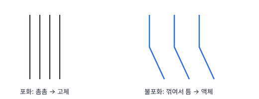

*꺾인 꼬리들은 서로 딱 붙지 못해서 잘 굳지 않아요.*

**정확히 말하면**

공유 전자쌍 하나는 막대 하나(단일결합), 두 쌍이면 막대 두 개(이중결합)로 표시해요. 이중결합이 있으면 수소를 더 넣을 여지가 있어요.

- 포화지방산: 탄소 사이가 모두 단일결합이라 수소로 꽉 찬(포화된) 지방산.
- 불포화지방산: 이중결합이 하나 이상 있는 지방산. (교재 1장 p.10)

1. 불포화지방산은 이중결합 자리에서 꺾여요.
2. 꺾이면 분자 사이에 틈이 생겨요.
3. 틈이 생기면 유동성이 커져요.
4. 유동성이 크면 고체가 되기 어려워 상온에서 액체예요.

식물성 기름(올리브유)은 대개 불포화지방이라 액체이고, 동물성 지방(버터)은 대개 포화지방이라 고체예요.

인지질에도 똑같이 적용돼요. 인지질 꼬리에는 포화지방산도, 이중결합으로 꺾인 불포화지방산도 올 수 있어요(늘 포화지방산인 것이 아니에요). 꼬리에 이중결합이 있으면 꺾여 막이 굳지 않아요. 그래서 추운 곳에 사는 생물일수록 불포화지방산 비율이 높아 막이 얼지 않아요. (교재 1장 p.12 그림 1.12)

**교수님 말씀**

지하철 쩍벌남 비유: 모두 다리를 모으고 앉으면 촘촘히 앉을 수 있지만, 누군가 다리를 벌리면 틈이 생겨요. 불포화지방산이 꺾여서 분자 사이에 틈이 생기는 모습이에요.

교수님은 "틈이 생기면 유동성이 커지나요, 작아지나요?", "고체가 되기 쉬워지겠냐, 어려워지겠냐?"를 차례로 되물었어요.

**꼭 기억해요**

- "포화"의 뜻을 헷갈리기 쉬워요. 수소로 꽉 찼다는 뜻이고, 이중결합이 없으면 포화, 있으면 불포화예요.
- 인과 사슬의 방향을 뒤집기 쉬워요. 이중결합 → 꺾임 → 틈 → 유동성 증가 → 액체예요.
- 식물성과 동물성을 뒤바꾸기 쉬워요. 식물성은 불포화라 액체, 동물성은 포화라 고체예요. 교수님도 "동물성 지방은 아 동물성 지질은"이라고 고쳐 말했어요.
- 추운 곳 생물은 막을 단단하게 하려고 포화지방산이 많다고 거꾸로 외우기 쉬워요. 추운 곳 생물은 불포화지방산 비율이 높아요.

**페이지 요약**

이중결합이 있으면 불포화지방산이고, 꺾여서 틈이 생겨 유동성이 커지고 액체가 돼요.

*용어*

- **포화지방산** — 이중결합 없음, 곧음, 상온 고체(버터)
- **불포화지방산** — 이중결합 있음, 꺾임, 상온 액체(올리브유)
- **막 유동성** — 인지질 꼬리에도 불포화지방산이 올 수 있어요. 추운 곳 생물은 불포화 비율을 높여 막이 굳지 않게 해요.

---

### 인지질과 인지질 이중층

*0903 수업 · 1장 p3*

**쉽게 말하면**

인지질은 물을 좋아하는 머리와 물을 싫어하는 꼬리 두 개를 가진 성냥개비예요.

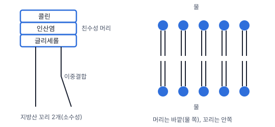

*머리는 물 쪽으로, 꼬리는 물을 피해 안쪽에서 서로 마주 봐요.*

**정확히 말하면**

인지질(phospholipid)은 중성지질에서 지방산 하나를 빼고, 그 자리에 인산기(PO₄)를 포함한 기를 붙인 분자예요. 글리세롤의 탄소 3개 가운데 2개에는 지방산, 1개에는 인산기가 붙어요. 즉 인지질 = 글리세롤 1개 + 지방산 2개 + 인산기 1개예요("인산기 3개 + 글리세롤 1개"가 아니에요). (교재 1장 p.10)

지방산 두 개(꼬리)는 비극성·소수성이고, 인산기(머리)는 음전하를 띠어 극성·친수성이에요. 한 분자 안에 둘 다 있어요. 인산기 쪽을 극성 머리, 지방산 쪽을 비극성 꼬리라고 해요. 그래서 인지질은 트라이글리세라이드(중성지질)보다 인산기와 극성 단위를 더 가지고 있어요.

1. 인지질을 물에 넣으면 머리는 물을 향하고, 꼬리는 물을 피해 서로 마주 봐요.
2. 그래서 저절로 두 겹의 층, 인지질 이중층이 생겨요. 세포막에서 소수성 꼬리는 안쪽, 친수성 머리는 물(세포 안팎) 쪽에 놓여요.
3. 이 인지질 이중층이 세균·식물·동물·버섯·곰팡이 등 모든 생물의 세포막(생체막)의 기본 구조예요. (교재 1장 p.11)

살아 있는 모든 세포의 경계를 이루는 생체막에서 2중층을 만드는 분자는 인지질이에요. 단백질·탄수화물·지방(중성지방)은 2중층을 만들지 않고, 콜레스테롤은 동물 세포막의 인지질 사이사이에 끼어 막을 안정화할 뿐 2중층의 기본 분자가 아니에요([스테로이드와 콜레스테롤](#s4-steroid)).

인지질 꼬리는 늘 포화지방산인 것이 아니에요. 한쪽 꼬리가 이중결합에서 꺾인 불포화지방산인 경우가 흔해요([포화지방산과 불포화지방산](#s4-saturation)).

물을 향하는 머리와 안쪽에서 마주 보는 꼬리의 배치를 [인지질 이중층 모형](../%EC%9D%B8%ED%84%B0%EB%A0%89%ED%8B%B0%EB%B8%8C_02_%EC%9D%B8%EC%A7%80%EC%A7%88_%EC%9D%B4%EC%A4%91%EC%B8%B5%EA%B3%BC_%EB%A7%89_%EC%9C%A0%EB%8F%99%EC%84%B1.html)에서 돌려 보며 확인해 보세요.

**교수님 말씀**

"나는 지방산이 싫어. 서울 산이 좋아." 지방산 하나를 없애고 인산기로 바꾸는 장면을 기억하게 하는 말장난이에요.

> "모든 생물의 세포막은 인지질 이중층으로 구성이 됩니다."

**꼭 기억해요**

- 중성지질과 인지질을 헷갈리기 쉬워요. 지방산은 3개 대 2개, 인산기는 없음 대 있음(1개)이에요.
- 머리와 꼬리의 극성을 뒤바꾸기 쉬워요. 머리(인산기)는 극성·친수성, 꼬리(지방산)는 비극성·소수성이라 꼬리끼리 안쪽에서 마주 봐요.

**보충 · 수업에서 다루지 않았어요**

인지질의 인산기에는 다시 다른 종류의 극성 단위(예: 콜린, 에탄올아민)가 붙어 머리를 이뤄요. 그래서 머리 부분은 "콜린·인산염·글리세롤"처럼 그려지기도 해요.

세포막에는 막을 관통하는 단백질도 박혀 있어요. 막 단백질도 친수성 부분과 소수성 부분을 함께 가져서, 막을 관통하는 부분은 인지질의 소수성 꼬리와 닿는 소수성 부분이고, 물에 드러난 부분은 친수성이에요.

출처: 교재 1장 p.10–12(인지질 구조, 그림 1.12), p.22(1.4.1 세포막의 구조 "막 단백질 또한 친수성과 소수성을 동시에 갖고 있어").

**페이지 요약**

인지질은 글리세롤 + 지방산 2개 + 인산기 1개이고, 머리는 물 쪽, 꼬리는 안쪽으로 모여 이중층을 만들어요.

*용어*

- **인지질(phospholipid)** — 극성 머리(인산기) + 비극성 꼬리(지방산 2개)
- **인지질 이중층** — 모든 생물의 세포막 기본 구조
- **세포막의 공통 구조** — 인지질 이중층이 모든 생물 세포막의 기본이고, 중성지방·단백질·콜레스테롤은 이중층의 기본 분자가 아니에요.
- **꼬리의 포화 여부** — 인지질 꼬리는 항상 포화지방산인 것이 아니고 불포화 꼬리도 올 수 있어요.

- **(보충) 인지질과 막단백질** — 인지질 머리에는 인산기 외에 콜린·에탄올아민 같은 극성 단위가 붙을 수 있어요. 막단백질도 친수성과 소수성을 함께 가져요. 막을 관통하는 부분은 소수성, 물에 노출된 부분은 친수성이에요.

---

### 스테로이드와 콜레스테롤

*0903 수업 · 1장 p3*

**쉽게 말하면**

콜레스테롤은 고리 네 개를 붙여 만든 기름 친구예요.

*긴 꼬리가 없고, 고리 네 개가 뼈대예요.*

**정확히 말하면**

스테로이드(steroid)는 중성지질·인지질과 완전히 다른 구조로, 탄소 고리 4개로 이루어져요. 스테로이드에 특정 곁가지가 붙은 것이 콜레스테롤(cholesterol)이에요. 즉 콜레스테롤은 스테로이드의 한 종류예요.

콜레스테롤(스테로이드)은 지방산을 갖지 않아요. 지방산을 가진 지질은 중성지질(지방산 3개)과 인지질(지방산 2개)이에요.

콜레스테롤의 두 얼굴

- 혈중 농도가 높으면 혈관이 막혀요.
- 없어서는 안 돼요. 호르몬은 단백질 호르몬과 지질 호르몬으로 나뉘는데, 지질 호르몬(성호르몬 등)은 콜레스테롤로 만들어요.
- 동물 세포막은 인지질 이중층만으로 되어 있지 않고, 사이사이에 콜레스테롤이 끼어 막을 안정화해요(강의노트 "스테로이드는 생체막 구조를 튼튼히").

콜레스테롤은 간에서 만들어져 혈액을 타고 온몸으로 가요. 소수성이라 혈액에 녹지 않아서, 물에 잘 녹는 단백질이 둘러싸 덩어리를 만드는데 이것이 LDL(저밀도 지질단백질)이에요. LDL이 너무 많으면 혈중 콜레스테롤 농도가 높아져요.

**교수님 말씀**

> "콜레스테롤은 상식적으로도 반드시 알아야 됩니다, 건강을 위해서."

> "콜레스테롤은 우리 몸에 꼭 필요하고 그러다 보니까 간에서 만들어 줍니다."

종합검진 때 LDL, HDL, 총 콜레스테롤 검사를 꼭 받고 가족에게도 권하라고 했어요. 유전적으로 수치가 높은 사람이 있다고 했어요.

**꼭 기억해요**

- 스테로이드와 콜레스테롤을 다른 무리로 착각하기 쉬워요. "이게 스테로이드의 한 종류입니다."
- 콜레스테롤이 해롭기만 하다고 착각하기 쉬워요. 농도가 높으면 해롭지만, 호르몬 원료와 막 안정화에 꼭 필요해요.
- 세포막이 인지질 이중층만으로 되어 있다고 생각하기 쉬워요. 동물 세포막에는 콜레스테롤도 끼어 있어요. 그래도 2중층을 만드는 기본 분자는 인지질이에요.
- 모든 호르몬을 콜레스테롤로 만든다고 착각하기 쉬워요. 지질 호르몬만 콜레스테롤로 만들어요.

**보충 · 수업에서 다루지 않았어요**

콜레스테롤이 지방산이 없는데도 지질로 분류되는 까닭은, 지질이 "대부분 극성을 띠지 않는 탄화수소로 이루어진 생물분자"이기 때문이에요. 콜레스테롤은 탄소 고리에 탄소와 수소로 된 곁사슬(탄화수소)이 붙은 구조라 비극성·소수성이에요. 탄수화물, 지방산, 글리세롤을 가져서 지질인 것이 아니에요(탄화수소는 [전기음성도와 극성, 친수성과 소수성](#s1-polarity)).

출처: 교재 1장 p.10(1.2.3 지질 첫 문단), p.12 그림 1.13(콜레스테롤: 탄소 고리 구조에 연결된 탄화수소 곁사슬 하나와 수산기 하나).

**페이지 요약**

콜레스테롤은 탄소 고리 4개의 스테로이드이고 막 안정성과 호르몬 합성에 관련돼요.

*용어*

- **스테로이드(steroid)** — 탄소 고리 4개로 된 지질
- **콜레스테롤(cholesterol)** — 스테로이드의 한 종류, 지질 호르몬 원료, 막 안정화
- **콜레스테롤의 조건과 역할** — 지방산이 없는 스테로이드예요. 혈중 농도가 높으면 해롭지만 동물 세포막을 안정화하고 지질 호르몬의 원료가 돼요.
- **운반과 호르몬** — 소수성 콜레스테롤은 단백질에 싸여 LDL로 혈액을 이동해요. 모든 호르몬이 아니라 지질 호르몬만 콜레스테롤로 만들어요.

- **(보충) 콜레스테롤의 지질 분류** — 콜레스테롤은 지방산이 없어도 비극성 탄화수소 부분이 큰 소수성 분자이므로 지질로 분류돼요. 탄수화물·글리세롤이 있어서 지질인 것은 아니에요.

---

## 5. 단백질

### 아미노산과 펩타이드 결합

*0903 수업 · 1장 p3*

**쉽게 말하면**

아미노산은 몸통은 모두 같고 모자만 다른 인형이에요.

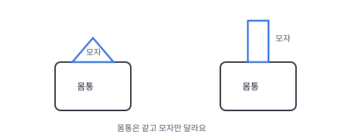

*몸통은 모두 같고, 위의 모자만 달라서 20가지 종류가 생겨요.*

**정확히 말하면**

단백질(protein)은 아미노산의 중합체예요. 녹말이 포도당이 이어진 것이듯, 단백질은 아미노산이 이어진 것이에요. 지방산·당·뉴클레오티드가 이어진 것이 아니에요.

아미노산(amino acid)의 구조: 가운데 탄소(C)에 네 가지가 붙어 있어요. (교재 1장 p.13)

- 아미노기(−NH₂)
- 카복실기(−COOH)
- 수소(H)
- R기(곁사슬): 아미노산마다 다른 부분. R 자리에 올 수 있는 곁사슬은 20가지라서 생물의 단백질은 20가지 아미노산으로 이루어져요. 예: R = CH₂OH이면 세린, R = CH₃이면 알라닌.

아미노산끼리의 결합이 펩타이드 결합(peptide bond)이고, 펩타이드 결합으로 길게 이어진 것이 단백질이에요.

R기에 따라 화학적 성질이 달라요. 세린·트레오닌·타이로신은 곁사슬에 OH(산소)가 있어 극성·친수성이고, 알라닌·류신은 극성이 없는 소수성 아미노산이에요.

아미노산과 다른 단위체를 구분해요. 단당류가 이어지면 다당류([다당류 — 녹말과 글리코겐](#s3-storage)), 뉴클레오타이드가 이어지면 핵산이에요(핵산은 이번 수업에서 이름만 나왔어요). 글리신은 아미노산의 한 종류이고, 효소는 단백질이 하는 일의 하나예요.

**교수님 말씀**

교수님은 세린(R = CH₂OH)과 알라닌(R = CH₃)을 나란히 보여 주며 R기가 무엇이냐에 따라 아미노산의 성질이 달라진다고 했어요.

수업에서 튼 영상은 아미노산 서열이 구조와 기능을 정하고, 그 서열은 유전자의 DNA에 적혀 있다고 설명했어요. 영상은 포유류에 가장 많은 단백질인 콜라겐이 세 가닥 나선 구조라는 예도 들었어요.

**꼭 기억해요**

- 아미노산마다 뼈대가 다르다고 착각하기 쉬워요. 가운데 C·아미노기·카복실기·H는 같고, R기만 달라서 종류와 성질이 갈려요.
- 극성 아미노산과 소수성 아미노산의 판별: 곁사슬에 OH가 있으면 극성(세린), 탄소와 수소뿐이면 소수성(알라닌)이에요.
- 아미노산의 R(곁사슬)과 지방산의 R(탄소 사슬 전체)은 기호만 같고 가리키는 것이 달라요.

**보충 · 수업에서 다루지 않았어요**

세포 안처럼 물이 있는 환경에서는 아미노기가 H⁺를 받아 H₃N⁺로, 카복실기가 H⁺를 내놓아 COO⁻로 그려지기도 해요. 그래서 가운데 C에 H₃N⁺, COO⁻, H, R이 붙은 그림도 아미노산이에요. R이 CH₃이면 알라닌, CH₂–CH₂–S–CH₃이면 메싸이오닌(메티오닌)이에요.

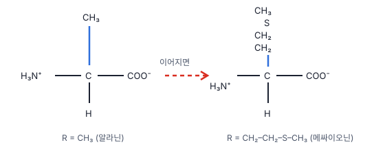

*물속에서 흔히 그리는 모양: 가운데 C에 H₃N⁺, COO⁻, H, R이 붙어 있어요.*

아미노산이 펩타이드 결합으로 길게 이어진 사슬을 폴리펩타이드(polypeptide)라고 하고, 이것이 접혀 단백질이 돼요.

출처: 강의노트 1장 p3(1.2.4 "폴리펩타이드"), 교재 1장 p.13(아미노산 기본 구조, 폴리펩타이드). 이온화된 표기(H₃N⁺, COO⁻)는 일반화학·생화학 표준 표기예요(교재 1장 본문에는 NH₂·COOH 형태만 있어요).

**페이지 요약**

단백질은 20가지 아미노산이 펩타이드 결합으로 이어진 중합체이고, R기가 아미노산의 성질을 정해요.

*용어*

- **아미노산(amino acid)** — 가운데 C + 아미노기 + 카복실기 + H + R기
- **펩타이드 결합(peptide bond)** — 아미노산끼리의 결합
- **R기와 극성** — 공통 뼈대는 같고 R기가 아미노산의 종류·성질을 가려요. OH가 있는 세린은 극성, CH₃의 알라닌은 소수성이에요.
- **단위체 구분** — 단백질은 아미노산 중합체예요. 단당류는 다당류, 뉴클레오타이드는 핵산의 단위체예요.

- **(보충) 아미노산과 폴리펩타이드** — 물속에서는 아미노기를 H₃N⁺, 카복실기를 COO⁻로 그리기도 해요. R=CH₃는 알라닌, R=CH₂–CH₂–S–CH₃는 메싸이오닌이에요. 아미노산이 펩타이드 결합으로 이어진 사슬이 폴리펩타이드이고, 이것이 접혀 단백질이 돼요.

---

### 구조와 기능 — 1·2·3차 구조

*0903 수업 · 1장 p4*

**쉽게 말하면**

구슬을 꿴 순서가 정해지면, 목걸이는 저절로 제 모양으로 접혀요.

*줄 세우기, 부분 꼬기, 전체 접기 순서로 모양이 생겨요.*

**정확히 말하면**

구조와 기능은 밀접하게 관련되어 있어요. 분자 수준에서도 같아요. 예를 들어 설탕 분해 효소는 먼저 설탕과 결합해야 하므로 설탕을 알아보는 구조를 가져야 해요. 이처럼 단백질은 효소로 작용해요(효소는 단백질이 하는 가장 중요한 일 가운데 하나예요). (교재 1장 p.11 "효소(enzyme)로 작용하여 세포의 반응속도를 촉진")

- 1차 구조: 아미노산의 순서(서열)예요. 서로 다른 단백질은 아미노산의 서로 다른 서열로 구성돼요. 지방·당·글리세롤의 서열이 아니에요. 1차 구조는 DNA(유전 정보)가 정해요.
- 2차 구조: 3차 구조 안에서 부분적으로 되풀이되는 패턴이에요. 꼬인 알파 나선(α-helix)과 병풍처럼 접힌 베타 병풍(β-pleated sheet)이 있어요. 위아래 아미노산 사이의 수소결합이 2차 구조를 안정시켜요.
- 3차 구조: 단백질 전체의 입체(3차원) 구조예요. 순서가 정해지면 수소결합·이온결합 등이 저절로 생겨 저절로 접혀요.

인과 사슬: DNA → 1차 구조 → 3차 구조 → 기능.

2차와 3차 구조를 모두 안정시키는 결합은 수소결합이에요. 이온결합은 3차 구조를 유지하는 데는 함께 기여하지만, 2차 구조(알파 나선·베타 병풍)를 붙잡는 결합은 아니에요. 그래서 "2차 및 3차 구조"를 함께 안정시키는 결합을 하나 고르면 수소결합이에요. 공유결합(펩타이드 결합)은 아미노산을 한 줄로 잇는 결합이지 접힌 모양을 붙잡는 결합으로 배우지 않았고, 비극성 공유결합은 전자를 고르게 나누는 공유결합일 뿐이에요. 반데르발스 힘은 수업에서 생략했어요([수소결합](#s1-hbond)).

한 줄의 아미노산 사슬이 입체 구조로 접히는 과정을 [단백질 구조와 변성 모형](../%EC%9D%B8%ED%84%B0%EB%A0%89%ED%8B%B0%EB%B8%8C_01_%EB%8B%A8%EB%B0%B1%EC%A7%88_%EA%B5%AC%EC%A1%B0%EC%99%80_%EB%B3%80%EC%84%B1.html)의 ‘접힘’에서 살펴보세요.

**교수님 말씀**

휴대폰, 의자, 시계, 마이크의 모양은 기능 때문에 정해졌다는 비유로 구조와 기능의 관계를 설명했어요.

> "기능하고 구조는 밀접한 관련이 있습니다. 이게 분자 수준에서도 마찬가지라는 얘기다."

"그러면 이 1차 구조는 누가 정하니?"라고 되묻고 DNA라고 답했어요.

**꼭 기억해요**

- 설명 순서가 3차 → 1차 → 2차여서 번호를 뒤섞기 쉬워요. 1차는 서열, 2차는 부분 패턴(알파 나선, 베타 병풍), 3차는 전체 입체 구조예요.
- 1차 구조를 누가 정하는지 헷갈려요. DNA예요.
- 2차 구조와 3차 구조를 안정시키는 힘을 헷갈리기 쉬워요. 2차 구조는 아미노산 사이의 수소결합, 3차 구조는 수소결합·이온결합 등이에요.

**보충 · 수업에서 다루지 않았어요**

물속에서 단백질이 접힐 때, 소수성(비극성) 곁사슬을 가진 아미노산은 물과 멀어지는 쪽, 즉 접힌 단백질의 안쪽에 모이고, 친수성 곁사슬은 물에 닿는 바깥쪽에 놓이는 경우가 많아요. 극성 분자(물)가 끼리끼리 모이면서 비극성 부분을 몰아내기 때문이에요. 사슬의 한쪽 끝이냐, 펩타이드 결합 자리냐가 위치를 정하는 기준이 아니에요.

출처: 강의노트 1장 p2("극성 분자는 끼리끼리 모이는 경향이 있으며, 비극성 분자를 몰아낸다"), 교재 1장 p.14(곁사슬의 극성 또는 비극성 결합들도 3차 구조를 결정).

**페이지 요약**

1차는 아미노산의 순서, 2차는 수소결합으로 생긴 부분 모양, 3차는 전체 입체 구조이고, 구조가 기능을 정해요.

*용어*

- **1차 구조** — 아미노산 서열(DNA가 정함)
- **2차 구조** — 알파 나선·베타 병풍, 수소결합이 안정화
- **3차 구조** — 전체 입체 구조
- **서열에서 기능까지** — DNA가 아미노산 서열(1차)을 정하고, 서열이 접힌 입체 구조(3차)를 정해 기능과 연결돼요.
- **2차와 3차의 결합** — 알파 나선·베타 병풍의 2차는 수소결합, 전체 3차는 수소결합·이온결합 등이 안정화해요. 두 단계 모두에 해당하는 것은 수소결합이에요.

- **(보충) 단백질 접힘과 곁사슬** — 물속에서 접히는 단백질은 소수성 곁사슬이 안쪽, 친수성 곁사슬이 바깥쪽에 놓이는 경우가 많아요. 위치를 가르는 기준은 사슬의 끝이나 펩타이드 결합 자리가 아니라 곁사슬의 성질이에요.

---

### 변성

*0903 수업 · 1장 p4*

**쉽게 말하면**

접힌 모양이 풀리면 단백질은 제 할 일을 못 해요.

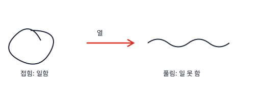

*달걀을 부치면 투명한 흰자가 하얗게 바뀌는 것과 같아요.*

**정확히 말하면**

변성(denaturation): 3차 구조를 유지하던 이온결합·수소결합이 열 등으로 깨지면 접혀 있던 사슬이 펼쳐지며 구조가 무너지는 것이에요. 구조가 무너지면 단백질은 대개 기능을 잃어요. 아미노산의 순서(1차 구조)가 그대로여도 접힌 모양이 풀리면 기능을 잃어요. (교재 1장 p.14)

수소결합은 열에 약하다는 사실([수소결합](#s1-hbond))과 이어져요. 달걀 프라이의 흰자가 투명했다가 하얗게 변하는 것이 변성의 예예요.

열을 받으면 입체 구조와 아미노산 순서 중 무엇이 바뀌는지 [단백질 구조와 변성 모형](../%EC%9D%B8%ED%84%B0%EB%A0%89%ED%8B%B0%EB%B8%8C_01_%EB%8B%A8%EB%B0%B1%EC%A7%88_%EA%B5%AC%EC%A1%B0%EC%99%80_%EB%B3%80%EC%84%B1.html)의 ‘변성’에서 비교해 보세요.

**교수님 말씀**

의자 비유: ㄱ자 모양 의자가 부러져 뒤로 넘어가면 앉을 수 없어요. 구조가 무너지면 기능을 잃는다는 뜻이에요.

> "구조가 깨지면은 기능이 사라지죠."

달걀 프라이 비유를 수소결합 설명 때에 이어 다시 썼어요.

**꼭 기억해요**

- 아미노산 순서만 그대로면 기능도 그대로라고 착각하기 쉬워요. 접힌 구조가 무너지면(변성) 기능을 잃어요.
- 변성은 수소결합이 열에 약하다는 사실과 이어져요. 펩타이드 결합이 끊기는 것이 아니라 접힘을 붙잡던 약한 결합이 깨지는 거예요.

**페이지 요약**

열 등으로 수소결합·이온결합이 깨져 접힌 구조가 풀리면 단백질은 기능을 잃어요.

*용어*

- **변성(denaturation)** — 입체 구조가 무너져 기능을 잃는 것
- **1차 구조와 변성** — 아미노산 순서가 남아도 접힘을 붙잡던 약한 결합이 깨지면 기능을 잃어요. 펩타이드 결합이 끊긴다는 뜻은 아니에요.

---

## 6. 요약 · 예고

### 30초 요약

*0903 수업 · 1장 p1–4*

| 주제 | 시험 직전 한 줄 |
|---|---|
| 원소 | C·H·O·N이 약 96%. 고분자의 뼈대 원소는 탄소. 미량원소는 적지만 필수. |
| 원자 | 핵 = 양성자(+) + 중성자, 전자는 핵 밖. 원자번호 = 양성자 수. 최외각이 꽉 차면 결합하지 않음. |
| 이온·공유결합 | 이온결합은 양이온·음이온의 인력(Na⁺, Cl⁻), 공유결합은 전자쌍을 함께 씀. |
| 극성 | 산소가 전자를 세게 끌어 O–H는 극성 공유결합, C–H는 비극성. 물 분자는 굽어서 극성 분자. |
| 친수·소수 | 극성 분자와 이온은 친수성, 탄화수소(C와 H만) 같은 비극성은 소수성. |
| 수소결합 | O·N에 붙은 H(δ+)와 이웃 O·N(δ−) 사이 약한 인력. 분자 안 O–H 자체는 극성 공유결합. C에 붙은 H는 하지 않음. |
| 수소결합의 자리 | 물은 분자 사이, 단백질 3차 구조는 한 사슬 안, DNA는 두 가닥 사이(이중나선). 열에 약함. |
| 얼음 | 얼면 부피가 커져 밀도가 낮아 뜸 → 호수가 위에서부터 얼음. |
| 용매 | 물은 극성 용매(녹이는 쪽). 극성·이온 물질을 녹이고 비극성은 못 녹임. |
| pH(보충) | 물은 일부가 H⁺와 OH⁻로 해리. 중성 = pH 7(25 °C 기준), 7 미만 산성, 7 초과 염기성. |
| 비열·기화열 | 둘 다 크다(수소결합 때문). 땀은 흘릴 때가 아니라 증발할 때 열을 가져감. |
| 응집력 | 증산작용의 장력이 끌어올리고, 응집력이 물줄기를 잇는다. 표면장력도 큼. |
| 단당·이당 | 탄수화물 C : H : O = 1 : 2 : 1. 엿당 = 포+포, 설탕 = 포+과, 젖당 = 포+갈. |
| 녹말·글리코겐 | 둘 다 포도당 저장. 녹말은 식물, 글리코겐은 동물(가지 많음, 간과 근육). 아밀라아제는 엿당 단위로 자름. |
| 셀룰로오스 | 포도당이 β 결합(하나씩 뒤집힘)으로 이어진 세포벽 성분. 아밀라아제는 α 결합만 끊음. 소는 공생 미생물 덕에 소화. |
| 지질 분류 | 중성지질·인지질·스테로이드. 섬유소·단당류는 탄수화물이라 지질이 아님. |
| 중성지방 | 글리세롤 1 + 지방산 3(트라이글리세라이드). 장기 에너지 저장, 소수성. |
| 포화·불포화 | 이중결합이 있으면 불포화 → 꺾임 → 틈 → 유동성 증가 → 액체. 추운 곳 생물은 불포화 비율이 높음. |
| 인지질 | 글리세롤 + 지방산 2 + 인산기 1. 극성 머리는 물 쪽, 비극성 꼬리는 안쪽 → 인지질 이중층이 모든 생물의 세포막. |
| 콜레스테롤 | 탄소 고리 4개의 스테로이드, 지방산 없음. 탄화수소라 소수성이어서 지질. 지질 호르몬 원료, 동물 세포막 안정화. |
| 아미노산 | 가운데 C + 아미노기 + 카복실기 + H + R기(20가지). 펩타이드 결합으로 이어진 중합체가 단백질. |
| 단백질 구조 | 1차 구조 = 아미노산의 순서(DNA가 정함), 2차 = 알파 나선·베타 병풍(수소결합), 3차 = 전체 입체. 효소로 작용하는 단백질이 많음. |
| 변성 | 열 등으로 수소결합·이온결합이 깨져 입체 구조가 풀리면 기능을 잃음. 1차 구조가 그대로여도 마찬가지. |

---

### 다음 시간 예고

*0903 수업 · 1장 p4–6*

끊긴 지점: 단백질의 1·2·3차 구조와 변성까지 설명하고 수업이 끝났어요.

> "자, 요 정도 하고 나머지는 다음 시간에 해야 되겠습니다."

다음에 나올 항목(이름만):

- 1.2.4 단백질의 4차 구조(헤모글로빈 예)
- 1.2.5 뉴클레오타이드와 핵산
- 1.3 세포: 원핵세포와 진핵세포, 세포 속 구조들
- 1.4 세포막과 수송
- 수업 중 미룬 것: 2장 물질대사(글리코겐은 단기, 지방은 장기 저장인 이유; 산소 분자가 전자를 좋아한다는 것)

---

### 함께 보면 좋은 자료

*0903 수업*

- [복습문제 40선 — 0903 수업 범위](복습문제_0903_Biomolecules_and_Cells.md)
- [수소결합](#s1-hbond)
- [인지질과 인지질 이중층](#s4-phospholipid)
- [구조와 기능 — 1·2·3차 구조](#s5-structure)

---

출처: 이영만 교수님 강의노트(1장) · 수업 녹음 전사(0903) · 『생명과학: 기초와 응용』 2판 1장.
