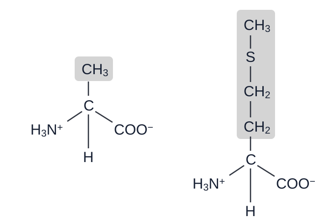
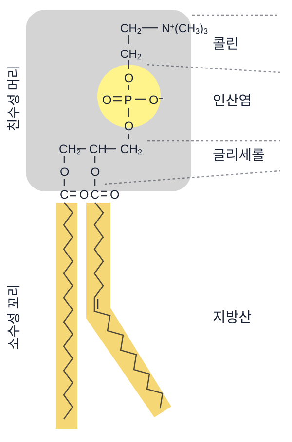

# 생명과학 복습 0903 문제설명

왼쪽 목차로 문항을 고르고, 오른쪽 문제를 보며 해설을 따라가요.

문제의 첫 줄부터 검산까지 설명해요.

**목차**

- [문항별 설명](#problems)
  - [P1. 원자핵을 이루는 입자](#p1)
  - [P2. 물의 특성과 먼 설명](#p2)
  - [P3. 소수성 아미노산의 자리](#p3)
  - [P4. 그림 속 분자와 그 중합체](#p4)
  - [P5. 생물분류의 3영역](#p5)
  - [P6. 유기분자와 단위체의 연결](#p6)
  - [P7. 2차·3차 구조를 붙잡는 결합](#p7)
  - [P8. 그림 속 분자(인지질) 설명](#p8)
  - [P9. 한 지역의 모든 종 + 무생물](#p9)
  - [P10. 원자번호가 가리키는 것](#p10)
  - [P11. 전자를 불균등하게 나누는 물 분자](#p11)
  - [P12. 수소결합으로 이어지는 짝](#p12)
  - [P13. 수소와 탄소만으로 된 분자](#p13)
  - [P14. 생체막 2중층을 만드는 분자 (1)](#p14)
  - [P15. 양성자의 전하와 원자번호](#p15)
  - [P16. 중성 수용액의 pH](#p16)
  - [P17. 원자가 결합하지 않는 조건](#p17)
  - [P18. 산소가 강한 음성을 띤다는 뜻](#p18)
  - [P19. 비극성인 것](#p19)
  - [P20. 원자핵의 구성](#p20)
  - [P21. 단백질이 하는 일(빈칸)](#p21)
  - [P22. 단백질을 서로 다르게 만드는 것](#p22)
  - [P23. 지질이 아닌 것](#p23)
  - [P24. 중성지방의 구성](#p24)
  - [P25. 물 분자끼리의 결합](#p25)
  - [P26. 고분자의 기초 원소](#p26)
  - [P27. 다당류를 이루는 단위](#p27)
  - [P28. 단백질은 무엇의 중합체인가](#p28)
  - [P29. DNA 두 가닥을 잇는 결합](#p29)
  - [P30. 물에 대한 옳은 설명](#p30)
  - [P31. 혼자 다른 그룹](#p31)
  - [P32. 생체막 2중층을 만드는 분자 (2)](#p32)
  - [P33. 콜레스테롤이 지질인 까닭](#p33)
  - [P34. [변형] 수소결합이 생기는 자리](#p34)
  - [P35. [변형] 물을 싫어하는 것 고르기](#p35)
  - [P36. [변형] 습한 날 땀이 덜 시원한 까닭](#p36)
  - [P37. [변형] 소가 풀에서 에너지를 얻는 방법](#p37)
  - [P38. [변형] 차가운 바다 물고기의 세포막](#p38)
  - [P39. [변형] 지방산이 없는 지질](#p39)
  - [P40. [변형] 단백질 구조의 단계](#p40)
  - [P41. [변형] 지질과 세포막에 관한 설명](#p41)

## 문항별 설명

### P1. 원자핵을 이루는 입자

웹과제 1장 q01 · [원 문제 보기](%EB%B3%B5%EC%8A%B5%EB%AC%B8%EC%A0%9C_0903_Biomolecules_and_Cells.html#p1)

다음 중 원자핵을 구성하는 것은?

- A. 중성자와 양성자
- B. 양성자
- C. 중성자
- D. 전자와 양성자
- E. 전자

기출 원문 보기

웹과제 1장 q01 (스크린샷 s01)

#### 문제를 내 말로 읽어요

주어진 것: 원자(atom)를 이루는 세 입자, 양성자(proton)·중성자(neutron)·전자(electron)가 보기에 여러 조합으로 나와요.

구할 것: 원자의 한가운데 있는 **원자핵(nucleus)을 이루는 입자 조합**을 하나 골라요.

쉽게 말하면, 원자를 작은 태양계로 그려 보면 가운데 무거운 덩어리(핵)와 그 바깥을 도는 가벼운 입자(전자)가 있어요. 가운데 덩어리 안에 무엇이 들어 있는지 묻는 문제예요.

**문항 결함:** 보통 수소(¹H)의 원자핵은 양성자 하나뿐이라서, B ‘양성자’도 그 원자에 한해서는 원자핵의 구성이라고 말할 수 있어요. 문제는 모든 원자에 공통인 일반적 구성을 묻는 뜻으로 읽어야 A 하나로 정해져요.

#### 이 문제를 봤을 때 떠올릴 개념과 공식

‘원자핵을 구성하는 것’이라는 표현에서 원자의 구조를 떠올려요. 강의노트 1장 1쪽은 “원자 = 핵(양성자, 중성자) + 전자”라고 정리해요.

양성자는 (+) 전하를 띠고 그 수가 원소의 종류를 정해요. 중성자는 전하가 없고 양성자와 함께 핵의 질량을 이뤄요. 전자는 (−) 전하를 띠고 매우 가벼우며 핵 **바깥**의 전자껍질(오비탈, orbital)에 있어요.

그래서 ‘핵 안에 있는가, 바깥에 있는가’라는 기준 하나로 세 입자를 나누면 보기를 모두 판정할 수 있어요.

관련 정리노트: [원자의 구조와 옥텟 규칙](%EC%A0%95%EB%A6%AC%EB%85%B8%ED%8A%B8_0903_Biomolecules_and_Cells.html#s1-atom)

#### 종이에 쓸 첫 줄

먼저 두 칸짜리 표를 그려요: **핵 안 = 양성자, 중성자 | 핵 바깥 = 전자**.

그다음 보기마다 ① 전자가 들어 있으면 바로 지우고, ② 남은 보기 중 핵 안의 두 입자를 모두 담은 것을 찾아요.

#### 왜 이렇게 푸는지 함께 따라가요

A 맞아요. 원자핵은 양성자와 중성자로 이루어져요. 핵 안 칸에 적은 두 입자를 빠짐없이 담은 유일한 보기예요.

B 틀려요(엄밀히는 맞을 수도 있어요). 보통 수소의 핵은 양성자 하나뿐이라 그 원자에 한해서는 맞는 말이에요. 하지만 원자핵의 일반적 구성으로 보면 중성자를 빠뜨려서 A보다 불완전한 답이에요.

C 틀려요. 중성자는 핵의 구성원이지만 양성자가 빠졌어요. 양성자가 없는 원자핵은 원소가 될 수 없어요.

D 틀려요. 양성자는 핵 안에 있지만 전자는 핵 바깥 전자껍질에 있어요.

E 틀려요. 전자는 핵 바깥에 있으므로 핵의 구성원이 아니에요.

따라서 문제의 의도인 ‘일반적인 원자핵의 구성’에 가장 완전하게 맞는 답은 A예요.

#### 완성 답과 검산

답 A. 중성자와 양성자.

소거로 확인해요: 전자가 들어간 D·E를 먼저 지우면 A·B·C가 남아요. B와 C는 각각 A의 일부만 담고 있으므로, 두 입자를 모두 담은 A가 가장 완전한 보기예요.

교과서 대조: 교과서 1장 p.24 복습의 ‘원자의 구조’ 항목도 원자가 양성자와 중성자를 포함하는 원자핵과 그 주위의 전자로 이루어진다고 정리해요. 웹과제 1장 q01의 분석 정답도 A예요.

#### 이 문항에서 하기 쉬운 실수

‘전자도 원자의 일부’라는 사실 때문에 D를 고르기 쉬워요. 원자와 원자핵을 구별해요. 전자는 원자의 구성원이지만 원자핵의 구성원은 아니에요.

수소 예외를 떠올려 B로 바꾸고 싶어질 수 있어요. 시험에서 이런 보기가 나오면 특정 원자의 예외보다 **일반적 정의**를 묻는다고 보고, 정의를 가장 빠짐없이 담은 보기를 고르세요. 이의 제기를 할 상황이라면 예외(¹H 핵 = 양성자 하나)를 근거로 적어 두면 돼요.

#### 설명을 닫고 다시 해 봐요

- 양성자·중성자·전자의 전하와 위치(핵 안/바깥)를 표로 써 보기
- 원자와 원자핵의 구성을 각각 한 문장으로 구별해 말해 보기
- 중성자가 없는 원자핵의 예(보통 수소)를 들고, 그래도 일반적 답이 A인 이유를 설명해 보기

**페이지 요약**

#### 떠올릴 개념·공식

원자 = 핵(양성자 + 중성자) + 핵 바깥의 전자.

#### 첫 줄

핵 안/핵 바깥 두 칸 표를 그리고 전자가 든 보기부터 지워요.

#### 핵심 판단

두 입자를 모두 담은 A가 일반적 구성이에요. B는 수소 핵에 한해 맞지만 불완전해요(문항 결함).

#### 검산

소거로 A·B·C 중 A가 가장 완전하고, 교과서 p.24 복습과 웹과제 분석 정답이 A예요. 답 A.

---

### P2. 물의 특성과 먼 설명

웹과제 1장 q03 · [원 문제 보기](%EB%B3%B5%EC%8A%B5%EB%AC%B8%EC%A0%9C_0903_Biomolecules_and_Cells.html#p2)

물이 생명을 유지하는데 중요하다. 물의 특성과 관계가 먼 설명은?

- A. 얼음이 물 위에 뜨는 것은 고체인 얼음이 물보다 밀도가 낮기 때문이다.
- B. 물은 작은 기화열로 인해 땀을 흘려도 체온이 거의 변하지 않게 한다
- C. 물은 높은 응집력과 표면장력을 가진다.
- D. 물은 우리 몸에서 극성 물질을 녹이는 일반적인 용매이다.
- E. 물 분자끼리의 결합력이 커서 비열이 크다.

기출 원문 보기

웹과제 1장 q03 (스크린샷 s03)

#### 문제를 내 말로 읽어요

주어진 것: 물의 여러 성질(얼음의 밀도, 기화열, 응집력, 용매, 비열)에 대한 설명 다섯 개예요.

구할 것: 물의 특성과 **관계가 먼 설명, 즉 틀린 설명**을 하나 골라요.

쉽게 말하면, 물이 생명에 좋은 이유를 말하는 다섯 문장 중에서 사실과 다른 한 문장을 찾는 문제예요.

#### 이 문제를 봤을 때 떠올릴 개념과 공식

‘얼음, 기화열, 응집력, 용매, 비열’이 한꺼번에 나오면 **물 분자 사이의 수소결합(hydrogen bond)**이 만든 물의 특성을 떠올려요. 물 분자는 극성(polar)이라 이웃 분자의 O와 H가 서로 끌어당겨요.

수소결합이 많다는 것은 물 분자를 서로 떼어 놓거나 빨리 움직이게 하려면 그 결합을 끊을 **에너지가 많이 든다**는 뜻이에요. 그래서 비열(specific heat, 1 g의 온도를 1℃ 올리는 데 드는 열)도 크고, 기화열(heat of vaporization, 액체를 기체로 바꾸는 데 드는 열)도 커요.

각 보기의 크기 표현(크다/작다)이 이 원리와 같은 방향인지 확인하면 돼요.

관련 정리노트: [얼음이 물에 뜬다](%EC%A0%95%EB%A6%AC%EB%85%B8%ED%8A%B8_0903_Biomolecules_and_Cells.html#s2-ice), [높은 비열과 기화열](%EC%A0%95%EB%A6%AC%EB%85%B8%ED%8A%B8_0903_Biomolecules_and_Cells.html#s2-heat), [응집력과 식물의 물 운반](%EC%A0%95%EB%A6%AC%EB%85%B8%ED%8A%B8_0903_Biomolecules_and_Cells.html#s2-cohesion)

#### 종이에 쓸 첫 줄

첫 줄에 원리를 써요: **극성 → 수소결합 많음 → 끊는 데 에너지 많이 듦 → 비열·기화열 큼, 응집력 큼**.

그다음 보기마다 ‘크다/작다/낮다’ 같은 크기 표현에 밑줄을 긋고, 첫 줄의 방향과 같은지 비교해요.

#### 왜 이렇게 푸는지 함께 따라가요

A 맞아요(맞는 설명이라 답이 아니에요). 얼음에서는 수소결합이 규칙적인 격자를 만들어 분자 간격이 넓어지므로 밀도가 액체 물보다 낮아 떠요.

B 틀려요(답이에요). 물의 기화열은 작은 것이 아니라 커요. 땀이 증발할 때 큰 열을 몸에서 가져가서 체온이 크게 오르지 않는 거예요. ‘작은 기화열’이 원리와 반대 방향이에요.

C 맞아요. 수소결합 때문에 물 분자끼리 붙으려는 응집력(cohesion)이 크고, 표면장력도 커요.

D 맞아요. 극성인 물은 이온과 극성 물질을 둘러싸 녹이는 좋은 용매(solvent)예요.

E 맞아요. 분자끼리의 수소결합을 끊는 데 에너지가 쓰여서 온도가 천천히 올라가므로 비열이 커요.

질문은 ‘관계가 먼(틀린) 설명’을 찾으므로, 틀려요로 판정된 B가 답이에요.

#### 완성 답과 검산

답 B.

교과서 대조: 교과서 1장 p.7은 얼음 격자 때문에 얼음이 물보다 밀도가 낮다는 것, 물이 좋은 용매라는 것, 비열이 높다는 것을 설명하고, p.8은 물을 기체로 바꾸려면 큰 열량, 즉 기화열이 필요하며 땀이 증발할 때 몸을 식힌다고 설명해요. 강의노트 1장 2쪽도 ‘높은 기화열 – 체온 냉각’이라고 적어요.

반대 경우로 확인해요: 만약 기화열이 작다면 땀이 조금만 열을 가져가도 다 증발해 버려서 냉각 효과가 작아요. 그러면 ‘체온이 거의 변하지 않는다’는 결과와 맞지 않으므로 B의 원인 설명이 틀렸다는 것이 다시 확인돼요.

#### 이 문항에서 하기 쉬운 실수

B의 뒷부분 ‘땀을 흘려도 체온이 거의 변하지 않는다’는 맞는 현상이라서 문장 전체를 맞다고 읽기 쉬워요. 현상이 맞아도 **원인(작은 기화열)**이 틀리면 틀린 설명이에요.

‘관계가 먼’은 부정형 질문이에요. 맞는 보기 넷을 확인한 뒤 남는 틀린 보기를 고르세요.

#### 설명을 닫고 다시 해 봐요

- 수소결합에서 비열·기화열·응집력·얼음 밀도로 이어지는 화살표를 그려 보기
- 땀이 체온을 낮추는 원리를 ‘기화열이 크다’로 한 문장 설명해 보기
- 보기 문장을 현상과 원인으로 나눠 각각 판정해 보기

**페이지 요약**

#### 떠올릴 개념·공식

극성 → 수소결합 → 비열·기화열·응집력 큼, 얼음 밀도 낮음, 좋은 용매.

#### 첫 줄

원리 한 줄을 쓰고 보기의 크고 작음 표현을 대조해요.

#### 핵심 판단

B는 기화열이 ‘작다’고 해서 원인이 반대예요. 부정형이라 B가 답.

#### 검산

교과서 p.7–8, 강의노트 2쪽의 ‘높은 기화열’과 대조해요. 답 B.

---

### P3. 소수성 아미노산의 자리

웹과제 1장 q08 · [원 문제 보기](%EB%B3%B5%EC%8A%B5%EB%AC%B8%EC%A0%9C_0903_Biomolecules_and_Cells.html#p3)

단백질의 3차 구조에서 소수성(비극성) 아미노산들은 어디에서 발견될 가능성이 가장 높을까?

- A. 물에서 접힌 단백질의 바깥쪽
- B. 단백질의 한쪽 끝 부분에
- C. 다른 곁사슬들과 수소결합을 형성하는 곳
- D. 접힌 단백질의 안쪽으로 물과 멀어지는 방향
- E. 다음 아미노산과 펩티드 결합을 형성하는 곳

기출 원문 보기

웹과제 1장 q08 (스크린샷 s08)

#### 문제를 내 말로 읽어요

주어진 것: 단백질이 3차 구조(tertiary structure)로 접혀 있고, 그 안에 소수성(hydrophobic, 비극성) 곁사슬을 가진 아미노산이 있어요.

구할 것: 그런 아미노산이 **어디에 놓일 가능성이 가장 높은지** 골라요.

쉽게 말하면, 물을 싫어하는 아이들이 물속에 던져진 끈 뭉치 안에서 어디로 숨으려 할지 묻는 문제예요.

#### 이 문제를 봤을 때 떠올릴 개념과 공식

‘소수성(비극성)’과 ‘3차 구조’가 함께 나오면 **비극성 회합(nonpolar association)**을 떠올려요. 교과서 1장 p.6은 극성 분자인 물이 끼리끼리 모이면서 비극성 분자를 밀어내고, 그래서 비극성 분자들이 서로 모인다고 설명해요.

단백질의 3차 구조는 폴리펩타이드 사슬이 접힌 입체 모양이에요. 교과서 1장 p.13–14는 곁사슬(R기)의 극성·비극성 결합이 3차 구조를 결정하는 데 역할을 한다고 해요.

이 두 원리를 합치면, 물속에서 접히는 단백질은 비극성 곁사슬이 물과 덜 닿도록 서로 모여 안쪽으로 들어가요. 이 ‘안쪽에 모인다’는 결론은 수업 밖 보충이며, 교과서는 원리(비극성 회합, 곁사슬이 3차 구조를 결정)까지만 적어요.

관련 정리노트: [전기음성도와 극성, 친수성과 소수성](%EC%A0%95%EB%A6%AC%EB%85%B8%ED%8A%B8_0903_Biomolecules_and_Cells.html#s1-polarity), [구조와 기능 — 1·2·3차 구조](%EC%A0%95%EB%A6%AC%EB%85%B8%ED%8A%B8_0903_Biomolecules_and_Cells.html#s5-structure)

#### 종이에 쓸 첫 줄

첫 줄에 기준을 써요: **곁사슬이 비극성 → 물을 피함 → 물에서 먼 곳(접힌 단백질 안쪽)**.

그다음 보기마다 ‘물과 가까운 곳인가, 먼 곳인가’ 또는 ‘곁사슬의 성질과 상관없는 이야기인가’를 옆에 표시해요.

#### 왜 이렇게 푸는지 함께 따라가요

A 틀려요. 물에서 접힌 단백질의 바깥쪽은 물과 직접 닿는 곳이라 물을 피하는 비극성 곁사슬이 놓이기 어려워요.

B 틀려요. 사슬의 끝인지 가운데인지는 곁사슬의 성질과 상관없어요. 기준은 주변이 물인지예요.

C 틀려요. 수소결합은 극성 원자(O, N에 붙은 H 등) 사이에서 생겨요. 비극성 곁사슬은 수소결합을 잘 만들지 않으므로 그 위치를 설명하지 못해요.

D 맞아요. 비극성 곁사슬은 물과 닿는 면적을 줄이도록 서로 모여 접힌 단백질의 안쪽에 자리해요.

E 틀려요. 펩타이드 결합(peptide bond)은 모든 아미노산이 주사슬에서 이웃과 맺는 결합이라 곁사슬이 소수성인지와 무관해요.

따라서 답은 D예요.

#### 완성 답과 검산

답 D.

비슷한 사례로 확인해요: 교과서 1장 p.11은 물속의 인지질이 극성 말단만 물에 노출하고 비극성 말단은 한쪽으로 모아 물을 몰아낸다고 설명해요. 비극성 부분이 물에서 먼 쪽으로 모이는 같은 원리가 단백질 곁사슬에도 적용되면, 비극성 곁사슬은 물과 먼 안쪽에 가요.

소거로도 확인해요: B·E는 곁사슬 성질과 무관한 위치, A는 물과 닿는 위치, C는 극성 곁사슬의 특징이라서 남는 보기는 D 하나예요. 웹과제 1장 q08의 분석 정답도 D예요.

#### 이 문항에서 하기 쉬운 실수

‘수소결합이 3차 구조를 안정시킨다’는 사실을 떠올려 C를 고르기 쉬워요. 수소결합은 극성 부분의 이야기이고, 이 문제는 **비극성** 곁사슬의 위치를 물어요.

세포막을 관통하는 단백질처럼 지질과 닿는 부분은 예외예요. 이 문제는 ‘물에서 접힌 단백질’을 전제로 하므로 안쪽이 답이에요.

#### 설명을 닫고 다시 해 봐요

- 물속에서 비극성 물질이 모이는 이유를 한 문장으로 말해 보기
- 극성 곁사슬과 비극성 곁사슬이 각각 접힌 단백질의 어디에 놓이는지 그림으로 그려 보기
- 펩타이드 결합과 곁사슬 사이 결합의 차이를 구별해 보기

**페이지 요약**

#### 떠올릴 개념·공식

비극성 회합: 물이 비극성 물질을 밀어내 비극성끼리 모여요. 곁사슬 성질이 3차 구조를 결정.

#### 첫 줄

비극성 곁사슬 → 물을 피함 → 물에서 먼 안쪽.

#### 핵심 판단

바깥(A)은 물과 닿고, B·E는 곁사슬과 무관, C는 극성 이야기라 D가 답.

#### 검산

인지질 이중층(교과서 p.11)과 같은 원리, 소거로 D만 남아요. 답 D.

---

### P4. 그림 속 분자와 그 중합체

웹과제 1장 q09 · [원 문제 보기](%EB%B3%B5%EC%8A%B5%EB%AC%B8%EC%A0%9C_0903_Biomolecules_and_Cells.html#p4)

아래와 같은 분자들을 무엇이라 하는가? 또한 이 분자들이 중합체를 이룰 때 형성되는 물질은 무엇인가? 순서대로 옳은 것은?

- A. 단당류, 다당류
- B. 글리신, 효소
- C. 아미노산, 단백질
- D. 뉴클레오타이드, 핵산
- E. 지질, 폴리펩티드

기출 원문 보기

웹과제 1장 q09 (스크린샷 s09, s10)

#### 문제를 내 말로 읽어요

주어진 것: 두 분자의 구조식이에요. 둘 다 가운데 탄소(C)에 H₃N⁺, COO⁻, H가 붙어 있고, 위쪽 회색 부분만 CH₃와 CH₂–CH₂–S–CH₃로 달라요.

구할 것: ① 이런 분자들의 **이름**과 ② 이 분자들이 이어져 만드는 **중합체(polymer)**를 순서대로 골라요.

쉽게 말하면, 똑같은 몸통에 모자만 다른 블록 두 개를 보고, 블록의 이름과 블록을 이어 만든 완성품의 이름을 맞히는 문제예요.

#### 이 문제를 봤을 때 떠올릴 개념과 공식

‘가운데 C에 질소가 있는 기와 COO가 붙어 있다’는 단서에서 **아미노산(amino acid)의 기본 구조**를 떠올려요. 교과서 1장 p.13은 가운데 탄소에 아미노기(−NH₂), 카복실기(−COOH), 수소 원자, 그리고 R로 표시된 곁사슬(측기)이 붙는다고 설명해요.

그림의 H₃N⁺와 COO⁻는 물속에서 아미노기가 H⁺를 받고 카복실기가 H⁺를 내놓은 이온 형태예요. 교과서 본문은 NH₂·COOH로 쓰지만 같은 작용기예요.

회색으로 칠한 부분이 R기이고, R기가 달라서 두 분자는 서로 다른 아미노산이에요. 아미노산은 펩타이드 결합(peptide bond)으로 이어져 폴리펩타이드가 되고, 이것이 접혀 단백질(protein)이 돼요(교과서 1장 p.12–13).

관련 정리노트: [아미노산과 펩타이드 결합](%EC%A0%95%EB%A6%AC%EB%85%B8%ED%8A%B8_0903_Biomolecules_and_Cells.html#s5-amino-acid)

#### 종이에 쓸 첫 줄

그림 위에 네 개의 표지를 직접 달아요: **H₃N⁺ = 아미노기, COO⁻ = 카복실기, H, 회색 = R기**.

그다음 한 줄을 써요: 아미노산 —(펩타이드 결합)→ 폴리펩타이드 → 단백질. 이제 보기의 (이름, 중합체) 짝을 이 줄과 비교해요.

#### 왜 이렇게 푸는지 함께 따라가요

A 틀려요. 단당류가 모여 다당류가 되는 관계 자체는 맞지만, 단당류에는 아미노기(질소)가 없고 그림 같은 구조가 아니에요.

B 틀려요. 글리신(glycine)은 R기가 H인 아미노산인데, 그림의 R기는 CH₃와 CH₂–CH₂–S–CH₃예요. 또 두 분자의 공통 이름을 묻는데 특정 아미노산 하나의 이름을 댔고, 효소는 단백질이 하는 기능의 하나라 중합체의 일반 이름이 아니에요.

C 맞아요. 가운데 C에 아미노기·카복실기·H·R기가 붙은 아미노산이고, 펩타이드 결합으로 이어지면 단백질이 돼요.

D 틀려요. 뉴클레오타이드와 핵산의 관계는 맞지만, 뉴클레오타이드는 인산기·5탄당·질소 염기로 이루어져 그림 구조와 달라요.

E 틀려요. 그림은 극성 작용기를 가진 아미노산이라 지질이 아니고, 지질은 폴리펩티드를 만들지 않아요. 폴리펩티드는 아미노산 사슬이에요.

따라서 답은 C예요.

#### 완성 답과 검산

답 C. 아미노산, 단백질.

교과서 대조: 교과서 1장 p.13의 아미노산 기본 구조(가운데 C에 H₂N−, −COOH, H, R)와 그림의 네 표지가 하나씩 대응해요. 강의노트 1장 3쪽도 ‘아미노산 단위체가 중합된 중합체’가 단백질이라고 적어요.

구체적 이름으로 다시 확인해요: 왼쪽은 R = CH₃인 알라닌(alanine), 오른쪽은 R = CH₂–CH₂–S–CH₃인 메싸이오닌(methionine)이에요(메싸이오닌 이름은 수업 밖 보충). 둘 다 아미노산이므로 공통 이름은 아미노산이 맞아요.

#### 이 문항에서 하기 쉬운 실수

그림의 H₃N⁺, COO⁻가 교과서의 NH₂, COOH와 모양이 달라서 다른 분자로 착각하기 쉬워요. 물속에서의 이온 형태일 뿐 같은 아미노기·카복실기예요.

D처럼 (단위체, 중합체) 짝 자체는 맞는 보기가 섞여 있어요. 짝이 맞는지가 아니라 **그림의 분자와 맞는 짝인지**를 확인하세요.

#### 설명을 닫고 다시 해 봐요

- 아미노산의 가운데 C에 붙는 네 가지를 그림 없이 써 보기
- 단당류–다당류, 아미노산–단백질, 뉴클레오타이드–핵산 짝을 구조 특징과 함께 말해 보기
- R기가 H, CH₃인 아미노산의 이름을 각각 말해 보기

**페이지 요약**

#### 떠올릴 개념·공식

아미노산 = 가운데 C + 아미노기 + 카복실기 + H + R기. 펩타이드 결합 → 단백질.

#### 첫 줄

그림에 아미노기·카복실기·H·R기 표지를 달아요.

#### 핵심 판단

R기만 다른 두 분자 = 아미노산. 중합체 = 단백질. 짝만 맞는 A·D는 그림과 불일치.

#### 검산

교과서 p.13 기본 구조와 대응, 알라닌·메싸이오닌으로 확인해요. 답 C.

---

### P5. 생물분류의 3영역

웹과제 1장 q10 · [원 문제 보기](%EB%B3%B5%EC%8A%B5%EB%AC%B8%EC%A0%9C_0903_Biomolecules_and_Cells.html#p5)

생물분류의 3영역(domain)을 바르게 나타내는 것은?

- A. 고세균 / 원핵생물 / 식물
- B. 진정세균 / 원생생물 / 고세균
- C. 고세균 / 진정세균 / 식물
- D. 진정세균 / 원생생물 / 균
- E. 고세균 / 진정세균 / 진핵생물

기출 원문 보기

웹과제 1장 q10 (스크린샷 s11)

#### 문제를 내 말로 읽어요

주어진 것: 생물 분류 이름 세 개씩을 묶은 다섯 조합이에요.

구할 것: 생물 분류의 가장 큰 단위인 **3영역(domain)을 바르게 모은 조합**을 골라요.

쉽게 말하면, 모든 생물을 세 개의 큰 서랍에 나눠 담을 때 그 세 서랍의 이름표를 맞히는 문제예요. 서랍 안의 작은 칸(계) 이름이 섞여 있으면 틀린 조합이에요.

#### 이 문제를 봤을 때 떠올릴 개념과 공식

‘3영역(domain)’이라는 단어에서 생물 분류의 **영역–계 계층**을 떠올려요. 강의노트 1장 1쪽은 3영역과 계를 이렇게 정리해요: 원핵생물 – 진정세균 영역, 고세균 영역 / 진핵생물 – 진핵생물 영역(원생생물계, 식물계, 균계, 동물계).

핵심은 **분류 수준**이에요. 영역은 가장 큰 단위이고, 원생생물·식물·균·동물은 진핵생물 영역 안의 ‘계(kingdom)’예요. ‘원핵생물’은 핵막이 없는 진정세균과 고세균을 함께 부르는 말이라서 하나의 영역 이름이 아니에요.

그래서 보기의 세 이름이 모두 같은 수준(영역)인지 먼저 확인해요.

관련 정리노트: [지난 수업(0901) 복습 — 생명의 계층과 3영역](%EC%A0%95%EB%A6%AC%EB%85%B8%ED%8A%B8_0903_Biomolecules_and_Cells.html#s0-recap)

#### 종이에 쓸 첫 줄

첫 줄에 영역 세 개를 먼저 써요: **진정세균 | 고세균 | 진핵생물**. 진핵생물 칸 아래에 원생생물·식물·균·동물(계)을 작게 적어요.

그다음 보기의 이름마다 ‘영역’인지 ‘계 또는 묶음 이름’인지 표시해요.

#### 왜 이렇게 푸는지 함께 따라가요

A 틀려요. 고세균은 영역이지만, 원핵생물은 진정세균과 고세균을 묶는 말이고 식물은 진핵생물 영역 안의 계예요.

B 틀려요. 진정세균과 고세균은 영역이지만 원생생물은 진핵생물 영역 안의 계예요.

C 틀려요. 고세균·진정세균은 영역이지만 식물은 계라서 수준이 달라요. 진핵생물 영역 전체를 대표하지 못해요.

D 틀려요. 원생생물과 균은 둘 다 계이고, 고세균과 진핵생물 영역이 빠졌어요.

E 맞아요. 고세균·진정세균·진핵생물이 3영역이에요.

따라서 답은 E예요.

#### 완성 답과 검산

답 E.

포함 관계로 확인해요: 지구의 모든 생물이 세 서랍 중 하나에 빠짐없이 들어가야 해요. E에서는 세균 → 진정세균, 고세균 → 고세균, 식물·동물·균·원생생물 → 진핵생물로 모두 들어가요. 다른 보기는 예를 들어 C에서 동물·균이 들어갈 서랍이 없어 3영역이 될 수 없어요.

강의노트 대조: 강의노트 1장 1쪽의 ‘3 영역과 계로 분류’ 목록과 E가 일치해요. 웹과제 1장 q10의 분석 정답도 E예요.

#### 이 문항에서 하기 쉬운 실수

‘원핵생물’과 ‘진핵생물’을 짝으로 기억해서 원핵생물도 영역이라고 착각하기 쉬워요. 원핵생물은 진정세균과 고세균 **두 영역**으로 나뉘어요.

식물·동물처럼 익숙한 이름이 보이면 영역으로 착각하기 쉬워요. 이들은 진핵생물 영역 안의 계라는 수준 차이를 확인하세요.

#### 설명을 닫고 다시 해 봐요

- 3영역과 진핵생물 영역 안의 4계를 계층 그림으로 그려 보기
- ‘원핵생물’이 영역 이름이 아닌 이유를 한 문장으로 말해 보기
- 대장균, 버섯, 아메바가 각각 어느 영역·계에 들어가는지 분류해 보기

**페이지 요약**

#### 떠올릴 개념·공식

3영역 = 진정세균, 고세균, 진핵생물. 원생생물·식물·균·동물은 진핵생물 영역 안의 계.

#### 첫 줄

영역 세 칸을 쓰고 보기 이름마다 영역/계를 표시해요.

#### 핵심 판단

세 이름이 모두 영역 수준인 보기는 E뿐이에요.

#### 검산

모든 생물이 세 서랍에 빠짐없이 들어가는지 확인하고 강의노트 1쪽과 대조해요. 답 E.

---

### P6. 유기분자와 단위체의 연결

웹과제 1장 q11 · [원 문제 보기](%EB%B3%B5%EC%8A%B5%EB%AC%B8%EC%A0%9C_0903_Biomolecules_and_Cells.html#p6)

다음 유기분자와 그 단위체의 연결이 올바르지 않은 것은?

- A. 탄수화물 - 단당류, 이당류, 다당류가 있다
- B. 트라이글리세라이드 - 지방산과 글리세롤로 구성된다
- C. 단백질 - 아미노산들이 펩티드 결합을 형성한다
- D. 핵산 - 뉴클레오타이드의 중합체다
- E. 인지질 - 3개의 인산기와 1개의 글리세롤이 결합한다

기출 원문 보기

웹과제 1장 q11 (스크린샷 s12)

#### 문제를 내 말로 읽어요

주어진 것: 탄수화물·트라이글리세라이드·단백질·핵산·인지질과 그 구성 단위를 짝지은 다섯 문장이에요.

구할 것: 유기분자와 구성 단위의 연결이 **올바르지 않은 것**을 하나 골라요.

쉽게 말하면, 레고 완성품과 그 완성품에 쓰인 블록 목록 다섯 개 중에서 블록 개수나 종류를 잘못 적은 목록을 찾는 문제예요.

#### 이 문제를 봤을 때 떠올릴 개념과 공식

‘유기분자와 그 단위체’라는 표현에서 **네 가지 생물분자와 구성 단위 표**를 떠올려요. 강의노트 1장 2–4쪽 기준으로 정리하면 이래요.

탄수화물(carbohydrate): 단당류 → 이당류 → 다당류. 단백질(protein): 아미노산이 펩타이드 결합으로 연결. 핵산(nucleic acid): 뉴클레오타이드의 중합체.

지질(lipid)은 중합체가 아니라서 ‘몇 개가 붙는가’로 기억해요. 트라이글리세라이드(triglyceride, 중성지질) = 글리세롤 1 + 지방산 3. 인지질(phospholipid) = 글리세롤 1 + 지방산 2 + 인산기 1(+ 극성 단위)이에요.

숫자가 들어간 보기는 이 개수와 정확히 맞는지 확인해야 해요.

관련 정리노트: [지질의 세 종류와 중성지질](%EC%A0%95%EB%A6%AC%EB%85%B8%ED%8A%B8_0903_Biomolecules_and_Cells.html#s4-neutral), [인지질과 인지질 이중층](%EC%A0%95%EB%A6%AC%EB%85%B8%ED%8A%B8_0903_Biomolecules_and_Cells.html#s4-phospholipid)

#### 종이에 쓸 첫 줄

다섯 행짜리 표의 첫 행을 써요: **분자 | 구성 단위 | 개수**. 이어서 트라이글리세라이드 | 글리세롤 + 지방산 | 1 + 3, 인지질 | 글리세롤 + 지방산 + 인산기 | 1 + 2 + 1을 채워요.

그다음 보기 문장의 단위와 숫자를 표의 같은 행과 비교해요.

#### 왜 이렇게 푸는지 함께 따라가요

A 맞아요. 탄수화물에는 단당류, 단당류 둘이 이어진 이당류, 여러 개가 이어진 다당류가 있어요.

B 맞아요. 트라이글리세라이드는 글리세롤과 지방산(3개)으로 구성돼요. 개수를 쓰지 않았지만 구성 성분은 맞아요.

C 맞아요. 아미노산들이 펩타이드 결합으로 이어져 폴리펩타이드를 거쳐 단백질이 돼요.

D 맞아요. 핵산은 단위체인 뉴클레오타이드가 이어진 중합체예요.

E 틀려요. 인지질은 글리세롤 1개에 지방산 2개와 인산기 **1개**가 붙어요. 인산기 3개라는 개수가 틀렸고, 지방산도 빠졌어요.

질문은 ‘올바르지 않은 것’을 찾으므로, 틀려요로 판정된 E가 답이에요.

#### 완성 답과 검산

답 E.

교과서 대조: 교과서 1장 p.10은 중성지질을 글리세롤과 3개의 지방산으로 설명하고, 같은 쪽 끝과 p.11은 인지질에서 글리세롤의 두 결합 부위에만 지방산이 붙고 세 번째 결합 부위에는 극성의 인산기가 붙는다고 설명해요. p.12 그림 1.12(a)도 극성 단위–인산기–글리세롤–지방산 사슬 2개로 그려져 있어요.

관계로 다시 확인해요: 인지질은 트라이글리세라이드의 지방산 하나를 인산기(와 극성 단위)로 바꾼 모양이라, 인산기는 1개일 수밖에 없어요.

#### 이 문항에서 하기 쉬운 실수

트라이글리세라이드의 ‘3’(지방산 3개)과 인지질을 섞어서 ‘인지질도 무언가가 3개’라고 기억하기 쉬워요. 숫자 3은 트라이글리세라이드의 지방산 개수예요.

뉴클레오타이드에 인산기가 1~3개 붙을 수 있다는 내용(ATP 등)과도 헷갈리지 않아요. 부정형 질문이라 맞는 넷을 확인한 뒤 남는 틀린 보기를 고르세요.

#### 설명을 닫고 다시 해 봐요

- 트라이글리세라이드와 인지질의 구성 성분과 개수를 나란히 써 보기
- 네 가지 생물분자의 단위체와 연결 결합을 표로 정리해 보기
- 인지질에서 인산기 쪽이 극성, 지방산 쪽이 비극성인 이유를 말해 보기

**페이지 요약**

#### 떠올릴 개념·공식

트라이글리세라이드 = 글리세롤 1 + 지방산 3. 인지질 = 글리세롤 1 + 지방산 2 + 인산기 1.

#### 첫 줄

분자 | 구성 단위 | 개수 표를 그려 보기와 대조해요.

#### 핵심 판단

E의 ‘인산기 3개’가 개수 오류예요. 부정형이라 E가 답.

#### 검산

교과서 p.10–12와 그림 1.12(a)로 인산기 1개를 확인해요. 답 E.

---

### P7. 2차·3차 구조를 붙잡는 결합

웹과제 1장 q13 · [원 문제 보기](%EB%B3%B5%EC%8A%B5%EB%AC%B8%EC%A0%9C_0903_Biomolecules_and_Cells.html#p7)

화학결합 중, 단백질의 2차 및 3차 구조의 안정성을 더해주는 결합으로 맞는 것은?

- A. 공유결합
- B. 이온결합
- C. 반데르발스 힘
- D. 수소결합
- E. 비극성 공유결합

기출 원문 보기

웹과제 1장 q13 (스크린샷 s14)

#### 문제를 내 말로 읽어요

주어진 것: 여러 화학결합·인력의 이름이에요.

구할 것: 단백질의 **2차 구조와 3차 구조를 둘 다** 안정시키는 결합을 골라요.

쉽게 말하면, 길게 꼬인 끈(단백질 사슬)이 나선이나 주름 모양을 유지하고, 그 모양이 다시 덩어리로 접힌 상태도 유지하게 붙잡아 주는 ‘접착제’ 이름을 묻는 문제예요.

#### 이 문제를 봤을 때 떠올릴 개념과 공식

‘2차 및 3차 구조의 안정성’이라는 표현에서 **단백질 구조 수준과 각 수준을 유지하는 힘**을 떠올려요.

1차 구조(primary structure)는 아미노산 서열이고, 아미노산을 잇는 펩타이드 결합(공유결합)이 만들어요. 2차 구조(secondary structure)는 알파 나선(α-helix)과 베타 병풍(β-sheet)이고, 교과서 1장 p.13은 규칙적으로 만들어지는 **수소결합**이 두 구조를 안정시킨다고 해요. 3차 구조(tertiary structure)는 사슬 전체의 입체 모양이고, p.14는 곁사슬 사이의 양전하·음전하 끌림(이온결합), 극성·비극성 결합이 함께 결정한다고 해요.

문제는 2차와 3차에 **공통으로** 작용하는 결합을 묻는 것이므로, 두 수준 모두에 등장하는 결합을 찾아요.

관련 정리노트: [수소결합](%EC%A0%95%EB%A6%AC%EB%85%B8%ED%8A%B8_0903_Biomolecules_and_Cells.html#s1-hbond), [구조와 기능 — 1·2·3차 구조](%EC%A0%95%EB%A6%AC%EB%85%B8%ED%8A%B8_0903_Biomolecules_and_Cells.html#s5-structure)

#### 종이에 쓸 첫 줄

세 칸 표의 첫 행을 써요: **1차 = 펩타이드 결합(공유) | 2차 = 수소결합 | 3차 = 수소결합·이온결합·극성/비극성 상호작용**.

그다음 보기마다 2차 칸과 3차 칸에 모두 들어가는지 체크해요.

#### 왜 이렇게 푸는지 함께 따라가요

A 틀려요. 공유결합(펩타이드 결합)은 아미노산 서열, 즉 1차 구조의 사슬을 잇는 결합이에요. 2차 구조의 나선·병풍을 붙잡는 결합이 아니에요.

B 틀려요. 곁사슬 사이의 이온결합은 3차 구조에 기여하지만, 2차 구조를 붙잡는 결합은 아니에요.

C 틀려요. 반데르발스 힘은 교과서 p.7에서 단백질처럼 큰 분자의 모양 안정에 쓰일 수 있다고 언급되지만, 수업에서는 다루지 않았고 2차 구조를 규칙적으로 붙잡는 대표 힘이 아니에요.

D 맞아요. 수소결합은 알파 나선·베타 병풍(2차 구조)을 안정시키고, 곁사슬 사이에서 3차 구조 유지에도 기여해요. 두 칸 모두에 들어가는 결합이에요.

E 틀려요. 비극성 공유결합은 전자를 고르게 나누는 공유결합의 한 종류일 뿐, 2차 구조를 붙잡는 수소결합을 대신하지 못해요.

따라서 답은 D예요.

#### 완성 답과 검산

답 D. 수소결합.

교과서 대조: 교과서 1장 p.6은 수소결합이 단백질처럼 3차 구조를 가진 분자의 안정성을 더해 준다고 설명하고, 그림 1.6(b)에서 다수의 수소결합이 알파 나선을 안정화하는 모습을 보여 줘요. p.13은 수소결합이 2차 구조(알파 나선, 베타 가닥)를 안정시킨다고 적어요. 두 쪽을 합치면 2차·3차 모두에 해당하는 결합은 수소결합이에요.

소거로도 확인해요: 2차 칸에 들어가는 보기는 D 하나뿐이므로 ‘2차 및 3차’ 조건을 만족하는 것도 D뿐이에요.

#### 이 문항에서 하기 쉬운 실수

‘가장 강한 결합이 구조를 지킨다’고 생각해 공유결합(A)을 고르기 쉬워요. 공유결합은 사슬을 잇는 1차 구조의 결합이고, 접힌 모양은 약한 결합 여러 개가 함께 붙잡아요.

수소결합이 3차 구조를 유지하는 **유일한** 힘이라는 뜻은 아니에요. 3차 구조에는 이온결합, 비극성 상호작용, 이황화 결합(수업 밖 보충, 공유결합의 일종)도 기여해요. 이 문제는 2차와 3차의 공통 결합을 묻기 때문에 수소결합이 답이에요.

#### 설명을 닫고 다시 해 봐요

- 단백질 1·2·3·4차 구조의 정의와 유지하는 결합을 표로 써 보기
- 알파 나선과 베타 병풍에서 수소결합이 어디에 생기는지 그려 보기
- 3차 구조에 기여하는 결합을 수소결합 외에 두 가지 더 말해 보기

**페이지 요약**

#### 떠올릴 개념·공식

1차 = 펩타이드 결합, 2차 = 수소결합, 3차 = 수소결합·이온결합·극성/비극성 상호작용.

#### 첫 줄

구조 수준별 결합 표를 그리고 2차·3차 칸에 모두 들어가는 보기를 찾아요.

#### 핵심 판단

2차 칸에 들어가는 결합은 수소결합 하나뿐이고, 3차에도 기여해요.

#### 검산

교과서 p.6 그림 1.6, p.13과 대조하고 소거로 D만 남아요. 답 D.

---

### P8. 그림 속 분자(인지질) 설명

웹과제 1장 q14 · [원 문제 보기](%EB%B3%B5%EC%8A%B5%EB%AC%B8%EC%A0%9C_0903_Biomolecules_and_Cells.html#p8)

아래 그림의 분자에 대한 설명으로 바르지 않은 것은?

- A. 소수성 꼬리 부분은 세포막에서 안쪽으로 배치되고, 친수성 머리 부분은 물에 노출된다
- B. 소수성 꼬리부분은 늘 포화지방산으로 구성된다
- C. 중성지질인 트라이글리세라이드에 비해 인산기와 극성단위를 더 가지고 있다
- D. 이 분자는 세포막에서 발견된다
- E. 막관통단백질의 막 관통 부분은 소수성 꼬리와 접촉하는 소수성 부분이다

기출 원문 보기

웹과제 1장 q14 (스크린샷 s15, s16)

#### 문제를 내 말로 읽어요

주어진 것: 친수성 머리(콜린·인산염·글리세롤)와 소수성 꼬리(지방산 두 사슬)가 표시된 분자 그림이에요. 오른쪽 꼬리는 이중결합 근처에서 꺾여 있어요.

구할 것: 이 분자에 대한 설명 중 **바르지 않은 것**을 하나 골라요.

쉽게 말하면, 머리는 물을 좋아하고 다리 두 개는 물을 싫어하는 막대 인형을 보고, 그 인형에 대한 다섯 문장 중 틀린 문장을 찾는 문제예요.

#### 이 문제를 봤을 때 떠올릴 개념과 공식

‘친수성 머리 + 소수성 꼬리 두 개 + 인산염’이라는 그림 단서에서 **인지질(phospholipid)**을 떠올려요. 교과서 1장 p.10–11은 인지질을 글리세롤의 두 결합 부위에 지방산, 세 번째 부위에 극성 인산기(와 또 다른 극성 단위)가 붙은 지질이라고 설명해요.

물속에서는 극성 머리만 물에 노출되고 비극성 꼬리는 서로 모여 물을 피하므로, 2중층(bilayer)이 생겨 세포막의 기본 구조가 돼요(p.11).

꼬리의 지방산은 단일결합만 있는 포화지방산(saturated fatty acid)일 수도, 이중결합이 있어 꺾이는 불포화지방산(unsaturated fatty acid)일 수도 있어요(p.10). 그래서 ‘늘’, ‘항상’ 같은 절대 표현은 그림과 정의로 확인해요.

관련 정리노트: [인지질과 인지질 이중층](%EC%A0%95%EB%A6%AC%EB%85%B8%ED%8A%B8_0903_Biomolecules_and_Cells.html#s4-phospholipid), [포화지방산과 불포화지방산](%EC%A0%95%EB%A6%AC%EB%85%B8%ED%8A%B8_0903_Biomolecules_and_Cells.html#s4-saturation)

#### 종이에 쓸 첫 줄

그림 옆에 두 줄을 써요: **머리 = 극성(콜린 + 인산 + 글리세롤) → 물 쪽 | 꼬리 = 비극성 지방산 2개 → 막 안쪽**.

그다음 그림의 두 꼬리를 비교해 ‘곧은 꼬리 = 포화, 꺾인 꼬리 = 이중결합 있음(불포화)’이라고 표시해요.

#### 왜 이렇게 푸는지 함께 따라가요

A 맞아요. 인지질 이중층에서 소수성 꼬리는 막 안쪽을 향해 모이고, 친수성 머리는 세포 안팎의 물을 향해요.

B 틀려요. 꼬리가 늘 포화지방산인 것은 아니에요. 바로 이 그림의 오른쪽 꼬리가 이중결합에서 꺾인 불포화지방산이에요.

C 맞아요. 트라이글리세라이드는 글리세롤에 지방산 3개가 붙지만, 인지질은 지방산 하나 자리에 인산기와 극성 단위(그림의 콜린)를 가져요.

D 맞아요. 인지질은 세포막(생체막)의 기본 구성 성분이에요.

E 맞아요. 막을 관통하는 단백질 부분은 막 안쪽의 소수성 꼬리와 닿기 때문에 소수성이어야 안정해요. 막 밖 물에 드러난 부분까지 소수성이라는 뜻은 아니에요(막 관통 부분의 소수성은 수업 밖 보충).

질문은 ‘바르지 않은 것’을 찾으므로, 틀려요로 판정된 B가 답이에요.

#### 완성 답과 검산

답 B.

그림으로 반례를 확인해요: ‘늘 포화’라는 절대 진술은 반례 하나로 깨져요. 문제 그림의 오른쪽 꼬리가 이중결합에서 꺾여 있으므로 그 자체가 반례예요. 교과서 1장 p.12 그림 1.12(b)의 포스파티딜 에탄올아민도 한쪽 꼬리에 HC=CH 이중결합이 있어요.

나머지 보기 대조: 교과서 p.11의 2중층 설명(A, D), p.10–11의 인지질 구성(C), p.23 그림 1.25에서 이중층을 관통하는 내재성 단백질(E)이 각각 맞는 설명과 일치해요. 웹과제 1장 q14의 분석 정답도 B예요.

#### 이 문항에서 하기 쉬운 실수

E의 ‘막관통단백질’이 수업에서 자세히 다루지 않은 낯선 표현이라 틀렸다고 고르기 쉬워요. 낯선 보기보다 ‘늘’ 같은 **절대 표현**이 있는 보기를 먼저 반례로 점검하세요.

그림의 꺾인 꼬리를 그냥 그림 모양으로 넘기지 않아요. 꺾임은 이중결합, 즉 불포화지방산의 표시예요.

#### 설명을 닫고 다시 해 봐요

- 인지질의 구성(글리세롤, 지방산 2, 인산기, 극성 단위)을 그림 없이 그려 보기
- 포화지방산과 불포화지방산의 차이를 이중결합과 꺾임으로 설명해 보기
- 물속에서 인지질이 이중층을 만드는 이유를 극성/비극성으로 말해 보기

**페이지 요약**

#### 떠올릴 개념·공식

인지질 = 극성 머리(인산 + 극성 단위 + 글리세롤) + 비극성 꼬리(지방산 2). 꼬리는 포화 또는 불포화.

#### 첫 줄

머리/꼬리의 극성과 두 꼬리의 꺾임 여부를 그림 옆에 표시해요.

#### 핵심 판단

꺾인 꼬리가 불포화라서 ‘늘 포화’인 B가 틀려요. 부정형이라 B가 답.

#### 검산

그림 자체와 교과서 p.12 그림 1.12(b)가 반례예요. 답 B.

---

### P9. 한 지역의 모든 종 + 무생물

웹과제 1장 q15 · [원 문제 보기](%EB%B3%B5%EC%8A%B5%EB%AC%B8%EC%A0%9C_0903_Biomolecules_and_Cells.html#p9)

생명의 계층구조 중, 한 지역의 모든 종들과 무생물적인 구성요소를 합친 것은 무엇인가?

- A. 개체군
- B. 생물권
- C. 생태계
- D. 군집

기출 원문 보기

웹과제 1장 q15 (스크린샷 s17)

#### 문제를 내 말로 읽어요

주어진 것: 생명의 계층구조(hierarchy) 이름 네 개(개체군, 생물권, 생태계, 군집)예요.

구할 것: **한 지역의 모든 종 + 무생물적 구성요소**를 합친 수준의 이름을 골라요.

쉽게 말하면, 한 동네에 사는 모든 생물에 그 동네의 흙·물·공기·햇빛까지 더한 묶음을 무엇이라 부르는지 묻는 문제예요.

#### 이 문제를 봤을 때 떠올릴 개념과 공식

‘한 지역’, ‘모든 종’, ‘무생물’이라는 세 단서에서 **생명의 계층구조**의 위쪽 단계를 떠올려요. 교과서 1장 p.2–3과 그림 1.2는 이렇게 쌓아요.

개체군(population): 같은 지역에 사는 **같은 종**의 개체 집단. 군집(community): 같은 지역에 사는 **모든 종**의 개체군. 생태계(ecosystem): 군집 + 군집과 상호작용하는 **무생물 환경 요인**(토양, 공기, 물, 햇빛 등). 생물권(biosphere): 지구의 모든 생태계.

문제의 세 단서를 이 정의의 ‘같은 종/모든 종’, ‘무생물 포함 여부’, ‘한 지역/지구 전체’ 기준에 하나씩 대입해요.

관련 정리노트: [지난 수업(0901) 복습 — 생명의 계층과 3영역](%EC%A0%95%EB%A6%AC%EB%85%B8%ED%8A%B8_0903_Biomolecules_and_Cells.html#s0-recap)

#### 종이에 쓸 첫 줄

세 기준으로 표의 첫 행을 써요: **수준 | 종 범위 | 무생물 포함? | 공간 범위**.

이어서 개체군 | 한 종 | X | 한 지역, 군집 | 모든 종 | X | 한 지역, 생태계 | 모든 종 | O | 한 지역, 생물권 | 모든 종 | O | 지구 전체를 채워요.

#### 왜 이렇게 푸는지 함께 따라가요

A 틀려요. 개체군은 같은 지역의 같은 종만 묶어요. ‘모든 종’도, ‘무생물’도 포함하지 않아요.

B 틀려요. 생물권은 무생물을 포함하지만 지구의 모든 생태계를 합친 것이라 ‘한 지역’보다 넓어요.

C 맞아요. 생태계는 한 지역의 군집(모든 종)에 무생물 환경 요인을 더한 것이에요. 세 기준이 모두 맞아요.

D 틀려요. 군집은 한 지역의 모든 종을 포함하지만 무생물 요인은 넣지 않아요.

따라서 답은 C예요.

#### 완성 답과 검산

답 C. 생태계.

교과서 대조: 교과서 1장 p.3은 생태계를 군집과 군집과 서로 상호작용하는 무생물의 환경 요인을 포함한다고 설명하고, 그 예로 토양, 공기, 물, 무기염, 햇빛에너지를 들어요. 이어서 생물권은 지구의 수계, 지각, 대기의 모든 생태계를 포함한다고 적어 범위 차이도 확인돼요.

표로 다시 확인해요: ‘모든 종 = O, 무생물 = O, 한 지역 = O’ 세 조건을 모두 만족하는 행은 생태계 하나뿐이에요. 웹과제 1장 q15의 분석 정답도 C예요.

#### 이 문항에서 하기 쉬운 실수

‘모든 종’이라는 말만 보고 군집(D)을 고르기 쉬워요. 무생물 요인이 들어가는 순간 군집이 아니라 생태계가 돼요.

‘무생물까지 포함’이라는 말에 가장 큰 단계인 생물권(B)을 고르기도 쉬워요. ‘한 지역’이라는 공간 범위를 꼭 함께 확인하세요.

#### 설명을 닫고 다시 해 봐요

- 세포부터 생물권까지 계층구조를 순서대로 써 보기
- 개체군·군집·생태계를 ‘종 범위’와 ‘무생물 포함’ 두 기준으로 구별해 보기
- 학교 연못을 예로 개체군·군집·생태계를 각각 한 문장씩 만들어 보기

**페이지 요약**

#### 떠올릴 개념·공식

개체군(한 종) → 군집(모든 종) → 생태계(군집 + 무생물) → 생물권(지구 전체).

#### 첫 줄

종 범위 | 무생물 포함 | 공간 범위 표를 채워요.

#### 핵심 판단

모든 종 + 무생물 + 한 지역을 모두 만족하는 것은 생태계예요.

#### 검산

교과서 p.3의 생태계·생물권 정의와 대조해요. 답 C.

---

### P10. 원자번호가 가리키는 것

기출 1강 1 · [원 문제 보기](%EB%B3%B5%EC%8A%B5%EB%AC%B8%EC%A0%9C_0903_Biomolecules_and_Cells.html#p10)

1. 원소의 원자번호가 가리키는 것은?

- (1) 양성자 수
- (2) 양성자 수 + 전자 수
- (3) 양성자 수 + 전자 수 + 중성자 수
- (4) 중성자 수
- (5) 전자 수

기출 원문 보기

기출 1강 합본 1번 (PDF 1쪽)

#### 문제를 내 말로 읽어요

“원자번호(atomic number)라는 번호표는 원자 속 무엇을 센 숫자인가?”를 묻는 문제예요.

원자 안에는 양성자, 중성자, 전자 세 가지 알갱이가 있어요. 보기는 이 셋을 여러 방식으로 더한 조합이라서, 원자번호가 **딱 한 가지 알갱이의 수**인지, 여러 개를 더한 수인지 가려내면 돼요.

#### 이 문제를 봤을 때 떠올릴 개념과 공식

‘원자번호가 가리키는 것’이라는 표현에서 원자의 구조(원자핵 + 전자)와 원자번호의 정의를 떠올려요.

원자는 가운데 원자핵(nucleus)과 그 바깥을 도는 전자(electron, −전하)로 되어 있어요. 원자핵에는 양(+)전하를 띤 양성자(proton)와 전하가 없는 중성자(neutron)가 들어 있어요(강의노트 1장 p1 “원자 = 핵(양성자, 중성자) + 전자”).

원자번호 = 원자핵 속 양성자 수예요. 양성자 수가 원소의 종류를 정하기 때문에, 원소에 번호를 붙일 때 양성자 수를 써요. 예를 들어 교재 1장 p.6은 산소의 핵에 “8개의 양성자”가 있다고 적는데, 산소의 원자번호가 바로 8이에요.

헷갈리기 쉬운 짝도 같이 정리해요. 양성자 수 + 중성자 수는 질량수(mass number)이고, 전자 수는 이온이 되면 바뀌어요. 그래서 원자번호는 “바뀌지 않는 양성자 수 하나”로만 정해요. (원자번호 정의는 강의노트에 없어서 정리노트의 [원자의 구조와 옥텟 규칙](%EC%A0%95%EB%A6%AC%EB%85%B8%ED%8A%B8_0903_Biomolecules_and_Cells.html#s1-atom) 보충으로 확인해요.)

#### 처음 한 줄은 이렇게 써요

종이에 먼저 “원자번호 = 양성자 수 (질량수 = 양성자 + 중성자, 전자 수는 이온이면 변함)”라고 한 줄 적어요.

그다음 보기마다 “양성자 수 하나만인가?”를 체크해요. 다른 알갱이가 더해져 있거나 양성자가 빠져 있으면 지워요.

#### 왜 이렇게 푸는지 함께 따라가요

(1) 맞아요. 원자번호는 원자핵 속 양성자의 수 그 자체예요.

(2) 틀려요. 전자 수를 더하지 않아요. 전하를 띠지 않은 원자에서는 전자 수가 양성자 수와 같을 뿐이고, 둘을 더하면 원자번호의 두 배가 돼요.

(3) 틀려요. 세 알갱이를 모두 더한 값은 원자번호가 아니에요. 원자번호에는 중성자도 전자도 들어가지 않아요.

(4) 틀려요. 중성자 수는 같은 원소라도 달라질 수 있어서(동위원소, 수업 밖 보충) 원소의 번호가 되지 못해요.

(5) 틀려요. 전자 수는 원자가 전자를 잃거나 얻어 이온이 되면 바뀌어요. Na가 Na⁺가 되어도 원자번호는 11 그대로예요.

따라서 답은 (1)이에요.

#### 완성 답과 검산

답 (1) 양성자 수.

실제 원자로 거꾸로 확인해요. 0903 수업의 나트륨(Na)은 원자번호 11, 전자 배치 2-8-1이에요. 전자를 하나 잃어 Na⁺(전자 10개)가 되어도 여전히 나트륨이고 번호도 11이에요. 변하지 않은 것은 양성자 11개뿐이니, 원자번호를 정하는 것은 양성자 수예요.

교재 1장 p.6의 “산소의 핵과 함께 존재하는 8개의 양성자”도 산소 원자번호 8과 맞아떨어져요.

#### 이 문제에서 하기 쉬운 실수

- 중성 원자에서 전자 수 = 양성자 수라서 (5) 전자 수를 고르기 쉬워요. 숫자가 같을 뿐, 정의는 양성자 수예요. 이온을 떠올리면 바로 갈려요.
- 질량수(양성자 + 중성자)와 원자번호를 섞어 (3)처럼 “다 더한 값”을 고르기 쉬워요.

#### 설명을 닫고 다시 풀어 봐요

- 원자번호와 질량수의 정의를 각각 한 줄로 적어 보기
- Na와 Na⁺에서 양성자·전자 수를 써 보고 무엇이 그대로인지 확인하기

**페이지 요약**

#### 떠올릴 개념·공식

원자 = 핵(양성자 + 중성자) + 전자. 원자번호 = 양성자 수.

#### 첫 줄

“원자번호 = 양성자 수, 질량수 = 양성자 + 중성자”를 적고 보기를 대조해요.

#### 핵심 판단

전자 수는 이온이 되면 변하고, 중성자는 번호와 무관해요. 답 (1).

#### 검산

Na → Na⁺에서도 번호 11은 그대로, 양성자 11개만 불변이에요.

---

### P11. 전자를 불균등하게 나누는 물 분자

기출 1강 3 · [원 문제 보기](%EB%B3%B5%EC%8A%B5%EB%AC%B8%EC%A0%9C_0903_Biomolecules_and_Cells.html#p11)

3. 물 분자를 구성하는 수소와 산소 사이에 공유하는 전자는 불균등하게 배분되어 있다. 이 때문에 물 분자는 ( )이다.

- (1) 극성
- (2) 비공유성
- (3) 이온성
- (4) 비극성
- (5) 소수성

기출 원문 보기

기출 1강 합본 3번 (PDF 1쪽)

#### 문제를 내 말로 읽어요

물 분자에서 수소(H)와 산소(O)가 전자를 함께 쓰는데, 똑같이 나누지 않고 한쪽으로 쏠려 있어요. 이렇게 쏠린 결과 물 분자가 **어떤 성질의 분자**가 되는지 빈칸에 넣는 문제예요.

핵심 단서는 “공유하는 전자”와 “불균등하게 배분”이라는 두 표현이에요.

#### 이 문제를 봤을 때 떠올릴 개념과 공식

‘공유하는 전자가 불균등하게 배분’이라는 표현에서 전기음성도(electronegativity)와 극성 공유결합(polar covalent bond)을 떠올려요.

전기음성도는 결합한 원자가 공유 전자를 끌어당기는 힘이에요. 교재 1장 p.6은 전기음성도가 클수록 공유전자를 더 강하게 끌어당기고, 전기음성도 차이에 따라 공유결합이 비극성 공유결합(전자를 균등하게 공유)과 극성 공유결합(불균등하게 공유)으로 나뉜다고 설명해요.

O–H에서는 산소가 전자를 세게 끌어 O 쪽이 부분 음전하(δ−), H 쪽이 부분 양전하(δ+)를 띠어요. 물 분자는 이런 O–H 결합 두 개가 굽은 모양으로 붙어 있어서 분자 전체에 +쪽과 −쪽이 생겨요. 이런 분자를 극성 분자(polar molecule)라고 해요(교재 1장 p.6).

보기에 있는 비슷한 말도 구분해요. 이온성은 전자를 아예 주고받아 이온이 된 경우, 비극성은 전자를 고르게 나눈 경우, 소수성(hydrophobic)은 물을 피하는 성질이에요. 정리노트 [전기음성도와 극성, 친수성과 소수성](%EC%A0%95%EB%A6%AC%EB%85%B8%ED%8A%B8_0903_Biomolecules_and_Cells.html#s1-polarity)과 이어져요.

#### 처음 한 줄은 이렇게 써요

“공유 + 불균등 → 극성 공유결합 → O(δ−), H(δ+) → 굽은 물 분자는 극성 분자”라고 화살표로 한 줄 적어요.

그 뒤 보기마다 “공유인가, 쏠렸는가”를 확인해요.

#### 왜 이렇게 푸는지 함께 따라가요

(1) 맞아요. 전자가 산소 쪽으로 쏠려 O는 δ−, H는 δ+를 띠고, 굽은 모양 때문에 물 분자 전체가 극성이에요.

(2) 틀려요. 문제 자체가 “공유하는 전자”라고 했어요. 수소와 산소는 전자를 공유하는 공유결합을 하고 있으니 비공유성이 아니에요.

(3) 틀려요. 이온성은 전자를 완전히 주고받아 양이온·음이온이 된 경우예요(예: Na⁺와 Cl⁻). 물은 전자를 공유하면서 쏠린 것이지 이온이 된 게 아니에요.

(4) 틀려요. 비극성은 전자를 고르게 나눌 때예요(H–H, C–H). 불균등 배분과 정반대예요.

(5) 틀려요. 소수성은 물을 피하는 비극성 물질의 성질이에요. 극성인 물이 자기 자신을 싫어한다는 것은 말이 되지 않아요.

따라서 답은 (1)이에요.

#### 완성 답과 검산

답 (1) 극성.

반대 사례로 확인해요. 기름의 C–H처럼 전자를 고르게 나누면 비극성이 되고 물과 섞이지 않아요. 물은 그 반대로 쏠림이 있어서 극성이고, 그래서 소금이나 설탕 같은 극성·이온 물질을 잘 녹이는 용매가 돼요. 교재 1장 p.6도 물이 산소와 두 수소 사이에서 극성 공유결합을 형성하고 물 분자가 더욱 강한 극성을 가진다고 적어요.

#### 이 문제에서 하기 쉬운 실수

- “전하가 생긴다”는 생각에 (3) 이온성을 고르기 쉬워요. 부분 전하(δ)는 공유 전자가 쏠린 것이고, 이온은 전자를 통째로 주고받은 거예요.
- 결합의 극성과 분자의 극성을 같은 말로 섞기 쉬워요. O–H 결합이 극성인 데다 물이 굽은 모양이라서 분자 전체가 극성이 돼요.

#### 설명을 닫고 다시 풀어 봐요

- 극성 공유결합, 비극성 공유결합, 이온결합을 전자가 “쏠림 / 고르게 / 넘겨줌”으로 한 줄씩 정의하기
- 물 분자 그림에 δ+와 δ−를 표시해 보기

**페이지 요약**

#### 떠올릴 개념·공식

전기음성도 차이 → 공유 전자 쏠림 → 극성 공유결합 → 굽은 물 분자는 극성 분자.

#### 첫 줄

“공유 + 불균등 = 극성, O(δ−) H(δ+)”를 적어요.

#### 핵심 판단

공유 중이니 비공유·이온성 아님, 쏠렸으니 비극성 아님, 극성이니 소수성 아님. 답 (1).

#### 검산

C–H(고르게 공유)는 비극성인 것과 대조, 교재 1장 p.6.

---

### P12. 수소결합으로 이어지는 짝

기출 1강 4 · [원 문제 보기](%EB%B3%B5%EC%8A%B5%EB%AC%B8%EC%A0%9C_0903_Biomolecules_and_Cells.html#p12)

4. 다음 중 수소결합으로 서로 연결될 수 있는 것은 무엇인가?

- (1) 두 이온
- (2) 두 극성 분자
- (3) 두 비극성 분자
- (4) 극성분자와 비극성 분자

기출 원문 보기

기출 1강 합본 4번 (PDF 1쪽)

#### 문제를 내 말로 읽어요

수소결합(hydrogen bond)이라는 약한 끌림으로 **서로 붙을 수 있는 짝**을 고르는 문제예요.

보기는 “이온·극성 분자·비극성 분자” 중 둘을 짝지은 것이라서, 수소결합이 생기려면 두 쪽에 무엇이 있어야 하는지만 알면 풀려요.

#### 이 문제를 봤을 때 떠올릴 개념과 공식

‘수소결합으로 연결’이라는 표현에서 수소결합의 성립 조건을 떠올려요.

수소결합은 전기음성도가 큰 원자(O 또는 N)에 공유결합한 수소(δ+)와, 이웃한 O·N(δ−) 사이의 약한 전기적 인력이에요. 교재 1장 p.6은 “수소결합 역시 불균등한 전자 공유를 수반한다”며, 산소·질소와 전자를 불균등하게 공유해 부분적으로 양전하를 띤 수소가 다른 부분 음전하 원자에 끌리는 힘이라고 설명해요.

그래서 두 쪽 모두 부분 전하(δ+, δ−)가 있어야 해요. 부분 전하가 생기는 것은 극성 분자이므로, 수소결합은 극성 분자와 극성 분자 사이에서 생겨요. 물 분자끼리가 대표 예예요. 반면 전하를 통째로 띤 이온끼리의 인력은 이온결합이라는 다른 이름이에요. 정리노트 [수소결합](%EC%A0%95%EB%A6%AC%EB%85%B8%ED%8A%B8_0903_Biomolecules_and_Cells.html#s1-hbond)과 이어져요.

#### 처음 한 줄은 이렇게 써요

“수소결합 = O·N에 붙은 H(δ+) ⋯ 이웃 O·N(δ−) → 양쪽 다 부분 전하 필요”라고 적어요.

그다음 보기의 짝마다 “양쪽 모두 δ가 있는가?”에 ○/×를 붙여요.

#### 왜 이렇게 푸는지 함께 따라가요

(1) 틀려요. 양이온과 음이온이 끌어당기는 것은 완전한 전하 사이의 이온결합이에요. 수소결합은 부분 전하(δ) 사이의 인력이에요.

(2) 맞아요. 한 극성 분자의 O·N에 붙은 H(δ+)와 다른 극성 분자의 O·N(δ−) 사이에 수소결합이 생겨요. 물 분자 두 개가 대표 예예요.

(3) 틀려요. 비극성 분자에는 부분 전하가 없어서 끌어당길 δ+도 δ−도 없어요.

(4) 틀려요. 짝의 한쪽인 비극성 분자에 δ−나 δ+가 없어서 수소결합 상대가 되지 못해요. 오히려 극성 분자는 비극성 분자를 밀어내요(소수성).

따라서 답은 (2)예요.

#### 완성 답과 검산

답 (2) 두 극성 분자.

실제 예로 확인해요. 물 분자끼리 수소결합을 하기 때문에 물은 비열·기화열이 크고 응집력이 있어요(교재 1장 p.7–8). 반대로 물과 기름(비극성)은 수소결합을 못 해 섞이지 않고 층이 나뉘어요. 교재 1장 p.6 그림 1.6a도 –OH의 수소와 N 사이, 즉 극성 부분끼리 생기는 수소결합을 보여 줘요. 남는 보기는 (2) 하나예요.

#### 이 문제에서 하기 쉬운 실수

- “전기적 인력”이라는 말만 보고 (1) 두 이온을 고르기 쉬워요. 이온끼리는 이온결합이라는 다른 결합이에요.
- “수소만 있으면 수소결합”이라고 생각하기 쉬워요. C에 붙은 H(기름, 메테인)는 부분 전하가 거의 없어 수소결합을 하지 않아요.

#### 설명을 닫고 다시 풀어 봐요

- 수소결합의 정의를 “누구에게 붙은 H가, 누구와” 형태로 한 줄 쓰기
- 물-물, 물-기름, Na⁺-Cl⁻ 세 짝을 수소결합 / 이온결합 / 결합 없음으로 분류하기

**페이지 요약**

#### 떠올릴 개념·공식

수소결합 = O·N에 붙은 H(δ+)와 이웃 O·N(δ−) 사이의 약한 인력. 양쪽 모두 부분 전하 필요.

#### 첫 줄

짝마다 “양쪽 다 δ가 있나?”를 체크해요.

#### 핵심 판단

이온끼리는 이온결합, 비극성은 δ가 없음. 답 (2).

#### 검산

물-물은 수소결합, 물-기름은 섞이지 않음(교재 1장 p.6–8).

---

### P13. 수소와 탄소만으로 된 분자

기출 1강 5 · [원 문제 보기](%EB%B3%B5%EC%8A%B5%EB%AC%B8%EC%A0%9C_0903_Biomolecules_and_Cells.html#p13)

5. 다음 중 수소와 탄소의 사슬로만 이루어진 분자는?

- (1) 폴리펩티드
- (2) 탄수화물
- (3) 탄화수소
- (4) 다당류

기출 원문 보기

기출 1강 합본 5번 (PDF 1쪽)

#### 문제를 내 말로 읽어요

재료가 **탄소(C)와 수소(H) 두 가지뿐**인 분자를 고르는 문제예요. 핵심은 “~로만”이라는 말이에요. 산소(O)나 질소(N)가 하나라도 들어 있으면 탈락이에요.

#### 이 문제를 봤을 때 떠올릴 개념과 공식

‘수소와 탄소의 사슬로만’이라는 표현에서 탄화수소(hydrocarbon)라는 이름과, 각 생물분자를 이루는 원소를 떠올려요.

탄화수소는 이름 그대로 탄(소) + 수소, 즉 C와 H로만 이루어진 분자예요. 교재 1장 p.10은 지질이 “대부분 일차적으로 극성을 띠지 않는 탄화수소”로 이루어졌고, 지방산을 “한 가닥으로 된 탄화수소 사슬”이라고 불러요. 0903 수업에서 말한 기름의 CH₂ 사슬이 예예요.

나머지 보기는 원소 구성으로 걸러요.

- 탄수화물(carbohydrate): C : H : O = 1 : 2 : 1, 예: 포도당 C₆H₁₂O₆ (강의노트 1장 p2, 교재 1장 p.8 1.2.2). 산소가 있어요.
- 다당류(polysaccharide): 단당류가 길게 이어진 탄수화물이라 역시 산소가 있어요.
- 폴리펩티드(polypeptide): 아미노산 사슬이고, 아미노산에는 아미노기(–NH₂)와 카복실기(–COOH)가 있어 N과 O가 있어요(강의노트 1장 p3).

정리노트 [전기음성도와 극성, 친수성과 소수성](%EC%A0%95%EB%A6%AC%EB%85%B8%ED%8A%B8_0903_Biomolecules_and_Cells.html#s1-polarity)의 탄화수소 설명과 이어져요.

#### 처음 한 줄은 이렇게 써요

보기 옆에 원소 기호를 적어요. “폴리펩티드: C H O N / 탄수화물: C H O / 탄화수소: C H / 다당류: C H O”.

그다음 C와 H 말고 다른 글자가 있는 줄을 지워요.

#### 왜 이렇게 푸는지 함께 따라가요

(1) 틀려요. 폴리펩티드는 아미노산이 펩타이드 결합으로 이어진 사슬이라 아미노기의 질소(N)와 카복실기의 산소(O)가 들어 있어요.

(2) 틀려요. 탄수화물은 C : H : O = 1 : 2 : 1인 분자라 산소가 들어 있어요.

(3) 맞아요. 탄화수소는 탄소와 수소로만 이루어진 분자예요. 기름·지방산의 CH₂ 사슬이 예예요.

(4) 틀려요. 다당류는 포도당(C₆H₁₂O₆) 같은 단당류가 이어진 것이라 산소가 있어요.

따라서 답은 (3)이에요.

#### 완성 답과 검산

답 (3) 탄화수소.

성질로 다시 확인해요. C–H 결합은 전기음성도 차이가 거의 없어 비극성이므로, C와 H로만 된 분자는 물과 섞이지 않아야 해요. 실제로 기름(탄화수소 사슬)은 물과 섞이지 않고, 포도당·녹말·단백질처럼 O·N이 있는 분자는 물과 어울리는 극성 부분을 가져요. 성질로 걸러도 남는 것은 (3)이에요.

#### 이 문제에서 하기 쉬운 실수

- “탄수화물”의 ‘탄’과 ‘수’ 때문에 탄소+수소로 착각하기 쉬워요. 탄수화물은 탄소 + 물(H₂O)이라는 뜻이라 산소가 있어요.
- “사슬”이라는 말에 끌려 다당류나 폴리펩티드를 고르기 쉬워요. 사슬 모양인지가 아니라 원소가 C·H뿐인지가 기준이에요.

#### 설명을 닫고 다시 풀어 봐요

- 탄수화물, 단백질, 지질(지방산 꼬리)을 이루는 원소를 각각 적어 보기
- “탄수화물”과 “탄화수소”의 이름 뜻을 한 줄씩 풀어 쓰기

**페이지 요약**

#### 떠올릴 개념·공식

탄화수소 = C와 H로만 된 분자(지방산·기름 사슬). 탄수화물 C:H:O = 1:2:1, 단백질은 N·O 포함.

#### 첫 줄

보기마다 들어 있는 원소 기호를 적어요.

#### 핵심 판단

O·N이 있는 폴리펩티드·탄수화물·다당류 탈락. 답 (3).

#### 검산

C–H는 비극성 → 물과 안 섞이는 기름과 일치(교재 1장 p.10).

---

### P14. 생체막 2중층을 만드는 분자 (1)

기출 1강 6 · [원 문제 보기](%EB%B3%B5%EC%8A%B5%EB%AC%B8%EC%A0%9C_0903_Biomolecules_and_Cells.html#p14)

6. 살아있는 모든 세포의 경계를 이루는 생체막의 기본이 되는 2중층을 형성하는 분자는?

- (1) 단백질
- (2) 탄수화물
- (3) 콜레스테롤
- (4) 인지질
- (5) 지방

기출 원문 보기

기출 1강 합본 6번 (PDF 1쪽)

#### 문제를 내 말로 읽어요

모든 세포를 둘러싼 막(생체막)은 두 겹의 층으로 되어 있어요. 이 **두 겹(2중층)을 만드는 기본 분자**가 무엇인지 고르는 문제예요.

막에는 여러 분자가 들어 있지만, 문제는 “기본이 되는 2중층을 형성하는” 분자 하나를 물어요. 막에 들어 있기만 한 분자와 층 자체를 만드는 분자를 구분해야 해요.

#### 이 문제를 봤을 때 떠올릴 개념과 공식

‘생체막의 기본이 되는 2중층’이라는 표현에서 인지질(phospholipid)과 인지질 이중층(phospholipid bilayer)을 떠올려요.

인지질은 글리세롤에 지방산 2개와 인산기를 포함한 기가 붙은 지질이에요. 인산기 쪽 머리는 극성·친수성(hydrophilic), 지방산 쪽 두 꼬리는 비극성·소수성(hydrophobic)이에요(교재 1장 p.10–11, 강의노트 1장 p3).

한 분자 안에 물을 좋아하는 머리와 물을 피하는 꼬리가 같이 있으면, 물속에서 머리는 바깥(물 쪽)을 향하고 꼬리끼리는 안쪽에서 마주 보며 저절로 두 겹이 돼요. 교재 1장 p.11은 이 2중층이 “살아 있는 모든 세포의 경계를 이루는 생체막의 기본 구조”라고 적어요. 정리노트 [인지질과 인지질 이중층](%EC%A0%95%EB%A6%AC%EB%85%B8%ED%8A%B8_0903_Biomolecules_and_Cells.html#s4-phospholipid)과 이어져요.

#### 처음 한 줄은 이렇게 써요

“2중층을 스스로 만들려면 한 분자에 친수성 머리 + 소수성 꼬리가 둘 다 있어야 한다”라고 적어요.

그다음 보기마다 “머리와 꼬리를 둘 다 가졌나, 막에서 층 자체인가 끼어 있을 뿐인가”를 표시해요.

#### 왜 이렇게 푸는지 함께 따라가요

(1) 틀려요. 단백질은 막에 박혀 있거나 붙어 수송·신호 일을 하지만, 2중층의 바탕을 이루는 기본 분자는 아니에요.

(2) 틀려요. 탄수화물은 막 바깥에 단백질·지질에 붙어 있을 수 있지만 2중층을 만들지 않아요.

(3) 틀려요. 콜레스테롤은 동물 세포막의 인지질 사이에 끼어 막을 튼튼하게 할 뿐(교재 1장 p.11 스테로이드), 2중층의 기본 분자가 아니에요.

(4) 맞아요. 극성 머리와 비극성 꼬리를 가진 인지질이 물속에서 저절로 2중층을 만들고, 이것이 모든 세포막의 기본 구조예요.

(5) 틀려요. 지방(중성지방)은 글리세롤 + 지방산 3개로 전체가 소수성이라, 물 쪽을 향할 친수성 머리가 없어 2중층을 만들지 못해요.

따라서 답은 (4)예요.

#### 완성 답과 검산

답 (4) 인지질.

구조로 다시 확인해요. 중성지방에서 지방산 하나를 빼고 그 자리에 인산기를 붙인 것이 인지질이에요. 바로 이 인산기 하나 때문에 친수성 머리가 생기고, 머리-꼬리 구조가 있어야 두 겹으로 정렬할 수 있어요. 지방에는 이 머리가 없으니 2중층이 안 되고, 그래서 차이를 만드는 분자는 인지질뿐이에요. 강의노트 1장 p3도 “인지질은 생체막의 기본 구조를 형성한다, 생체막: 인지질 이중막”이라고 적어요.

#### 이 문제에서 하기 쉬운 실수

- “막에 있다”와 “막의 기본 2중층을 만든다”를 같게 보면 (1) 단백질이나 (3) 콜레스테롤을 고르기 쉬워요. 둘 다 막의 구성 요소일 뿐 층의 바탕은 인지질이에요.
- “지방”과 “인지질”을 같은 지질이라 섞기 쉬워요. 지방산이 3개면 지방, 2개 + 인산기면 인지질이에요.

#### 설명을 닫고 다시 풀어 봐요

- 인지질 하나를 그리고 머리(친수성)와 꼬리(소수성)를 표시하기
- 인지질 이중층에서 머리와 꼬리가 각각 어디를 향하는지 그림으로 그리기

**페이지 요약**

#### 떠올릴 개념·공식

인지질 = 글리세롤 + 지방산 2 + 인산기. 친수성 머리 + 소수성 꼬리 → 물속에서 저절로 2중층.

#### 첫 줄

“2중층 = 한 분자에 머리와 꼬리가 다 있어야”라고 적어요.

#### 핵심 판단

단백질·콜레스테롤은 막에 끼어 있을 뿐, 지방은 머리가 없음. 답 (4).

#### 검산

지방 → 지방산 하나를 인산기로 바꾼 것이 인지질(교재 1장 p.10–11).

---

### P15. 양성자의 전하와 원자번호

기출 1강 9 · [원 문제 보기](%EB%B3%B5%EC%8A%B5%EB%AC%B8%EC%A0%9C_0903_Biomolecules_and_Cells.html#p15)

9. 양성자는 ______전하를 갖고, 원소의 ____와/과 같다.

- (1) 음, 전기음성도
- (2) 양, 이온전하
- (3) 음, 극성
- (4) 양, 원자번호
- (5) 음, 원자번호

기출 원문 보기

기출 1강 합본 9번 (PDF 1쪽)

#### 문제를 내 말로 읽어요

빈칸이 두 개예요. 첫째 빈칸은 양성자가 띠는 **전하의 부호(양 또는 음)**, 둘째 빈칸은 양성자의 수가 원소의 **어떤 값과 같은지**예요.

두 빈칸이 모두 맞는 보기만 정답이에요. 하나만 맞는 보기가 섞여 있으니 빈칸을 따로따로 확인해요.

#### 이 문제를 봤을 때 떠올릴 개념과 공식

‘양성자, 전하, 원소의 ~와 같다’라는 표현에서 원자를 이루는 세 입자의 전하와 원자번호(atomic number)의 정의를 떠올려요.

- 양성자(proton): 원자핵 안, 양(+)전하
- 중성자(neutron): 원자핵 안, 전하 없음
- 전자(electron): 핵 바깥, 음(−)전하

(강의노트 1장 p1 “원자 = 핵(양성자, 중성자) + 전자”, 0903 수업의 “양성자 +, 중성자 0, 전자 −”)

원자번호는 원자핵 속 양성자 수예요. 교재 1장 p.6에서 산소의 핵에 “8개의 양성자”가 있다고 하는데, 산소의 원자번호가 8이에요. 정리노트 [원자의 구조와 옥텟 규칙](%EC%A0%95%EB%A6%AC%EB%85%B8%ED%8A%B8_0903_Biomolecules_and_Cells.html#s1-atom) 보충과 이어져요.

보기에 나오는 다른 용어도 뜻을 확인해요. 전기음성도는 공유 전자를 끌어당기는 힘, 이온전하는 이온이 띤 전하(전자를 잃거나 얻은 개수), 극성은 분자 안 전하의 치우침이에요. 셋 다 양성자 “수”와 같은 값이 아니에요.

#### 처음 한 줄은 이렇게 써요

“빈칸1 = 양(+), 빈칸2 = 원자번호”라고 먼저 내 답을 적어요.

그다음 보기 표를 만들어 빈칸1 맞음/틀림, 빈칸2 맞음/틀림을 칸마다 ○×로 채워요.

#### 왜 이렇게 푸는지 함께 따라가요

(1) 틀려요. 양성자는 음전하가 아니고(빈칸1 ×), 전기음성도는 공유 전자를 끄는 힘이지 양성자 수가 아니에요(빈칸2 ×).

(2) 틀려요. 양전하는 맞지만(빈칸1 ○), 양성자 수는 이온의 전하가 아니라 원자번호와 같아요(빈칸2 ×). 이온전하는 전자 수가 양성자 수와 얼마나 다른지로 정해져요.

(3) 틀려요. 양성자는 음전하가 아니고(빈칸1 ×), 극성은 분자의 전하 치우침이라 양성자 수와 관계없어요(빈칸2 ×).

(4) 맞아요. 양성자는 양(+)전하를 띠고(빈칸1 ○), 양성자의 수가 곧 원소의 원자번호예요(빈칸2 ○).

(5) 틀려요. 원자번호는 맞지만(빈칸2 ○) 양성자는 음전하가 아니라 양전하예요(빈칸1 ×). 음전하를 띠는 것은 전자예요.

따라서 두 빈칸이 모두 맞는 답은 (4)예요.

#### 완성 답과 검산

답 (4) 양, 원자번호.

소거로 확인해요. 빈칸1에서 “음”이 들어간 (1)(3)(5)가 먼저 빠지고, 남은 (2)(4) 중 빈칸2가 원자번호인 것은 (4)뿐이에요.

전하 균형으로도 확인해요. 전하를 띠지 않은 Na 원자는 전자(−)가 11개이니, 전체가 0이 되려면 양(+)전하 11개, 즉 양성자 11개가 있어야 해요. 그리고 Na의 원자번호가 11이에요.

#### 이 문제에서 하기 쉬운 실수

- (5)처럼 빈칸2만 맞고 빈칸1이 틀린 보기를 서둘러 고르기 쉬워요. 빈칸이 두 개면 반드시 둘 다 확인해요.
- “양성자 = 양이온 전하”로 연결해 (2)를 고르기 쉬워요. 이온의 전하는 전자를 잃거나 얻은 수로 정해지고, 양성자 수는 이온이 되어도 변하지 않아요.

#### 설명을 닫고 다시 풀어 봐요

- 양성자·중성자·전자의 위치와 전하를 표로 적기
- 보기 5개를 빈칸1/빈칸2 ○× 표로 다시 채워 보기

**페이지 요약**

#### 떠올릴 개념·공식

양성자 +, 중성자 0, 전자 −. 원자번호 = 양성자 수.

#### 첫 줄

“빈칸1 = 양, 빈칸2 = 원자번호”를 적고 보기마다 두 칸을 ○×로 대조해요.

#### 핵심 판단

(5)는 원자번호만 맞고 전하가 틀림, (2)는 전하만 맞음. 답 (4).

#### 검산

“음” 보기 소거 → (2)(4) 중 원자번호는 (4). Na: 전자 11 ↔ 양성자 11 ↔ 원자번호 11.

---

### P16. 중성 수용액의 pH

기출 1강 10 · [원 문제 보기](%EB%B3%B5%EC%8A%B5%EB%AC%B8%EC%A0%9C_0903_Biomolecules_and_Cells.html#p16)

10. 중성 수용액의 pH는?

- (1) 9
- (2) 1
- (3) 5
- (4) 14
- (5) 7

기출 원문 보기

기출 1강 합본 10번 (PDF 1쪽)

#### 문제를 내 말로 읽어요

산성도 염기성도 아닌 **중성** 수용액의 pH 값을 고르는 문제예요. pH는 용액이 얼마나 산성인지 나타내는 0~14 눈금이고, 이 눈금의 가운데 기준값을 묻고 있어요.

pH는 0903 수업과 강의노트에서 다루지 않은 내용이라 아래 설명은 **수업 밖 보충**(일반화학 표준 내용)이에요.

#### 이 문제를 봤을 때 떠올릴 개념과 공식

‘중성 수용액, pH’라는 표현에서 물의 해리와 pH 눈금을 떠올려요(수업 밖 보충).

물 분자는 아주 일부가 수소 이온(H⁺)과 수산화 이온(OH⁻)으로 나뉘어요(해리, dissociation). pH는 용액 속 H⁺ 농도를 나타내는 값으로 pH = −log[H⁺] 이에요. H⁺가 많을수록 pH 숫자는 작아져요.

순수한 물처럼 H⁺와 OH⁻ 농도가 같으면 중성이고, 25 °C에서 이때 [H⁺] = 10⁻⁷ M 이라서 pH 7이에요. 그래서 기준은 이렇게 정리돼요.

- pH &lt; 7: 산성(H⁺가 더 많음)
- pH = 7: 중성
- pH &gt; 7: 염기성(OH⁻가 더 많음)

정리노트 [극성 용매로서의 물](%EC%A0%95%EB%A6%AC%EB%85%B8%ED%8A%B8_0903_Biomolecules_and_Cells.html#s2-solvent)의 보충(물의 해리와 pH)과 이어져요.

#### 처음 한 줄은 이렇게 써요

“0 ← 산성 — 7 중성 — 염기성 → 14”라고 수직선을 하나 그려요.

그다음 보기 숫자 9, 1, 5, 14, 7을 이 수직선 위에 점으로 찍어 보고 가운데 7에 놓인 것을 찾아요.

#### 왜 이렇게 푸는지 함께 따라가요

(1) 틀려요. pH 9는 7보다 커서 OH⁻가 더 많은 염기성이에요.

(2) 틀려요. pH 1은 H⁺가 매우 많은 강한 산성이에요.

(3) 틀려요. pH 5는 7보다 작아 산성이에요.

(4) 틀려요. pH 14는 눈금 끝의 강한 염기성이에요.

(5) 맞아요. H⁺와 OH⁻의 농도가 같은 중성 수용액은 pH 7이에요.

따라서 답은 (5)예요.

#### 완성 답과 검산

답 (5) 7.

계산으로 확인해요. 25 °C의 물에서 [H⁺][OH⁻] = 10⁻¹⁴ 이고, 중성이면 두 농도가 같으므로 각각 10⁻⁷ M 이에요. 따라서 pH = −log 10⁻⁷ = 7 이에요. 0~14 눈금의 정확히 가운데라는 것과도 맞아요.

#### 이 문제에서 하기 쉬운 실수

- pH 숫자가 클수록 산성이 강하다고 거꾸로 기억하기 쉬워요. pH는 H⁺ 농도에 마이너스 로그를 씌운 값이라 H⁺가 많을수록 숫자가 작아요.
- “pH 7 = 중성”은 25 °C 기준이에요(수업 밖 보충). 이 시험 수준에서는 중성 = 7로 답하면 돼요.

#### 설명을 닫고 다시 풀어 봐요

- 0~14 수직선에 산성·중성·염기성 구간을 표시하기
- 중성에서 H⁺와 OH⁻ 농도의 관계를 한 줄로 쓰기

**페이지 요약**

#### 떠올릴 개념·공식

(수업 밖 보충) pH = −log[H⁺]. 중성: [H⁺] = [OH⁻], pH 7.

#### 첫 줄

0 ← 산성 — 7 — 염기성 → 14 수직선을 그려요.

#### 핵심 판단

1·5는 산성, 9·14는 염기성. 답 (5).

#### 검산

[H⁺] = 10⁻⁷ M 이면 pH 7.

---

### P17. 원자가 결합하지 않는 조건

기출 1강 12 · [원 문제 보기](%EB%B3%B5%EC%8A%B5%EB%AC%B8%EC%A0%9C_0903_Biomolecules_and_Cells.html#p17)

12. 다음 중 한 원자가 다른 원자와 화학적 결합을 형성하지 않는 것은?

- (1) 원자가 궤도에 전자가 하나만 있을 때
- (2) 양성자의 수가 중성자의 수와 같을 때
- (3) 양성자의 수가 전자의 수와 같을 때
- (4) 원자가 궤도에 전자의 수가 최대치일 때
- (5) 원자가 궤도에서 가질 수 있는 최대 전자 수보다 더 적게 갖고 있을 때

기출 원문 보기

기출 1강 합본 12번 (PDF 1쪽)

#### 문제를 내 말로 읽어요

원자가 다른 원자와 **결합하지 않는** 경우를 고르는 문제예요. 질문 방향이 “결합한다”가 아니라 “결합하지 않는다”라는 점에 주의해요.

보기는 원자가 궤도(가장 바깥 전자 껍질)의 전자 수, 양성자·중성자·전자 수의 관계를 말해요. 결합 여부를 정하는 진짜 기준이 무엇인지 찾으면 돼요.

#### 이 문제를 봤을 때 떠올릴 개념과 공식

‘원자가 궤도에 전자가 몇 개’라는 표현이 여러 보기에 반복되는 것에서 옥텟 규칙(octet rule)과 원자가 전자(valence electron)를 떠올려요.

전자는 안쪽 궤도부터 2개, 8개, 8개씩 채워져요. 가장 바깥 궤도를 원자가 궤도(최외각 궤도), 그 안의 전자를 원자가 전자라고 해요. 원자는 가장 바깥 궤도를 꽉 채워(첫 궤도뿐이면 2개, 그 밖에는 8개) 안정해지려는 경향이 있어요. 이것이 옥텟 규칙이에요.

그래서 결합 여부의 기준은 “원자가 궤도가 꽉 찼는가”예요.

- 덜 차 있으면: 전자를 잃거나(Na, 2-8-1), 얻거나(Cl, 2-8-7), 공유하면서 결합해요.
- 이미 꽉 차 있으면: 더 안정해질 필요가 없어 결합하지 않아요(예: 네온 같은 비활성 기체, 수업 밖 보충).

양성자 수와 중성자 수, 양성자 수와 전자 수가 같은지는 결합 여부와 관계없는 조건이에요. 정리노트 [원자의 구조와 옥텟 규칙](%EC%A0%95%EB%A6%AC%EB%85%B8%ED%8A%B8_0903_Biomolecules_and_Cells.html#s1-atom)과 이어져요.

#### 처음 한 줄은 이렇게 써요

“결합 기준 = 원자가 궤도가 꽉 찼나? 꽉 참 → 결합 안 함, 덜 참 → 결합함”이라고 적어요.

그다음 보기마다 “원자가 궤도 이야기인가, 아니면 기준과 무관한 이야기인가”를 먼저 나눠요.

#### 왜 이렇게 푸는지 함께 따라가요

질문이 “결합을 형성하지 않는 것”이므로, 각 보기를 “이 조건의 원자는 다른 원자와 결합을 형성한다”라는 진술로 바꿔 맞아요/틀려요를 판정해요.

(1) 맞아요. 원자가 궤도에 전자가 하나뿐이면(Na처럼) 그 하나를 잃어 안쪽 꽉 찬 궤도를 드러내기 쉬워서 결합을 형성해요(Na⁺ + Cl⁻ 이온결합).

(2) 맞아요. 양성자 수와 중성자 수가 같다는 것은 원자핵 안의 일이라 결합을 막지 않아요. 이런 원자도 원자가 궤도가 덜 차 있으면 결합을 형성해요(예: 산소는 양성자 8, 중성자 8이고 물을 만들어요).

(3) 맞아요. 양성자 수 = 전자 수는 전하를 띠지 않은 보통 원자라는 뜻일 뿐이에요. 결합하기 전의 원자는 모두 이 상태이고, 이런 원자들이 결합을 형성해요.

(4) 틀려요. 원자가 궤도가 이미 최대치로 꽉 차면 안정해서 전자를 잃거나 얻거나 공유할 이유가 없어 결합을 형성하지 않아요.

(5) 맞아요. 원자가 궤도가 덜 차 있으면 채우려고 전자를 잃거나, 얻거나, 공유하면서 결합을 형성해요. 대부분의 원자가 이 경우예요.

따라서 “결합을 형성한다”가 **틀려요**로 판정된 (4)가 답이에요.

#### 완성 답과 검산

답 (4).

실제 원자로 확인해요. 수소(1개)와 산소(2-6)는 원자가 궤도가 덜 차 있어 공유결합으로 물을 만들고, 나트륨(2-8-1)과 염소(2-8-7)는 전자를 주고받아 소금이 돼요. 반대로 네온(2-8)은 원자가 궤도가 꽉 차 있어 거의 결합하지 않아요(수업 밖 보충). 결합하지 않는 쪽에 맞는 조건은 “꽉 참”, 즉 (4) 하나예요.

(1)과 (5)는 “덜 참”의 두 경우, (2)와 (3)은 기준과 무관한 조건이라 소거돼요.

#### 이 문제에서 하기 쉬운 실수

- “양성자 수 = 전자 수면 전하가 0이라 안정하다”고 생각해 (3)을 고르기 쉬워요. 전하가 0인 것과 화학적으로 안정한 것(원자가 궤도가 꽉 참)은 다른 이야기예요.
- (1)의 “전자가 하나만”을 “전자가 적어 결합할 힘이 없다”로 읽기 쉬워요. 오히려 하나뿐이라 잃기 쉬워 잘 결합해요.
- 부정형 질문에서 “결합한다”가 맞는 보기를 답으로 고르기 쉬워요. 보기를 “결합을 형성한다”로 판정한 뒤 **틀려요**인 것을 골라요.

#### 설명을 닫고 다시 풀어 봐요

- Na, Cl, Ne의 전자 배치를 쓰고 결합하는지 예측하기
- 결합 여부를 정하는 기준을 한 문장으로 쓰고, 기준이 아닌 조건 두 개를 적기

**페이지 요약**

#### 떠올릴 개념·공식

옥텟 규칙: 원자가 궤도를 꽉 채워 안정해지려 함. 꽉 참 → 결합 안 함, 덜 참 → 잃기·얻기·공유로 결합.

#### 첫 줄

“결합 기준 = 원자가 궤도가 꽉 찼나?”를 적어요.

#### 핵심 판단

“결합을 형성한다”로 판정: (1)(2)(3)(5) 맞아요, (4)만 틀려요. 답은 틀려요인 (4).

#### 검산

H·O·Na·Cl은 결합, 꽉 찬 Ne는 결합 안 함.

---

### P18. 산소가 강한 음성을 띤다는 뜻

기출 1강 13 · [원 문제 보기](%EB%B3%B5%EC%8A%B5%EB%AC%B8%EC%A0%9C_0903_Biomolecules_and_Cells.html#p18)

13. 물 분자에서 산소가 전기적으로 강한 음성을 띈다는 것이 의미하는 바는?

- (1) 전자가 핵으로 접근하지 못하게 하고, 최외각으로 전자를 날려버린다.
- (2) 원자 밖으로 전자를 쉽게 날려버린다.
- (3) 비극성이다.
- (4) 더 강하게 전자를 끌어당긴다.

기출 원문 보기

기출 1강 합본 13번 (PDF 1쪽)

#### 문제를 내 말로 읽어요

“물 분자에서 산소가 전기적으로 강한 음성을 띤다”는 말이 **전자를 두고 산소가 무엇을 한다는 뜻인지** 고르는 문제예요.

“음성”이라는 말은 전자(−)와 관련이 있어요. 산소가 전자를 밀어내는지, 끌어당기는지를 가려내면 돼요.

#### 이 문제를 봤을 때 떠올릴 개념과 공식

‘산소가 전기적으로 강한 음성’이라는 표현에서 전기음성도(electronegativity)를 떠올려요. 이름 그대로 “전기적으로 음성인 정도”라는 뜻이에요.

전기음성도는 결합한 원자가 공유 전자를 끌어당기는 힘이에요. 교재 1장 p.6은 “원자의 전기음성도가 크면 클수록 원자는 더 강한 인력으로 공유전자를 끌어당긴다”고 적고, 물에서 산소가 양성자 8개를 가진 핵으로 전자를 수소보다 더 강하게 끌어당겨 극성 공유결합이 된다고 설명해요.

전자(−)를 자기 쪽으로 끌어오니 산소 쪽은 부분 음전하(δ−), 전자를 빼앗긴 수소 쪽은 부분 양전하(δ+)를 띠어요. 0903 수업의 “산소는 전자를 좋아한다”가 바로 이 뜻이에요. 정리노트 [전기음성도와 극성, 친수성과 소수성](%EC%A0%95%EB%A6%AC%EB%85%B8%ED%8A%B8_0903_Biomolecules_and_Cells.html#s1-polarity)과 이어져요.

#### 처음 한 줄은 이렇게 써요

“강한 음성 = 전기음성도 큼 = 공유 전자를 세게 끌어당김 → O는 δ−, H는 δ+”라고 적어요.

그다음 보기마다 전자의 방향이 “산소 쪽으로 온다”인지 “산소에서 나간다”인지 화살표로 표시해요.

#### 왜 이렇게 푸는지 함께 따라가요

(1) 틀려요. 전자를 핵에 못 오게 하고 바깥으로 날려 보낸다는 것은 전자를 밀어내는 방향이에요. 산소는 반대로 공유 전자를 자기 핵 쪽으로 끌어당겨요.

(2) 틀려요. 전자(−)를 밖으로 내보내면 오히려 양(+)을 띠게 돼요. 음성을 띤다는 말과 모순이에요.

(3) 틀려요. 산소가 전자를 끌어 O–H가 극성 공유결합이 되고, 굽은 모양의 물 분자는 극성이에요. 비극성이 아니에요.

(4) 맞아요. 전기음성도가 크다는 것은 공유 전자를 더 강하게 끌어당긴다는 뜻이고, 그래서 산소가 δ−를 띠어요.

따라서 답은 (4)예요.

#### 완성 답과 검산

답 (4).

전하의 부호로 거꾸로 확인해요. 어떤 원자가 음(−)을 띠려면 음전하인 전자가 그쪽에 더 많이 있어야 해요. 전자가 산소 쪽에 더 많으려면 산소가 전자를 끌어와야 하고, 이것이 (4)예요. 전자를 내보내는 (1)(2)는 결과가 양(+)이 되어 맞지 않고, (3)은 물이 극성이라는 사실과 어긋나요. 교재 1장 p.6의 전기음성도 정의와도 일치해요.

#### 이 문제에서 하기 쉬운 실수

- “음성 = 전자를 내보낸다”로 거꾸로 연결해 (2)를 고르기 쉬워요. 전자는 음전하라서, 전자를 얻거나 끌어온 쪽이 음성이 돼요.
- (1)처럼 어려운 말이 길게 붙은 보기를 그럴듯하게 여기기 쉬워요. 전자의 방향(들어오나, 나가나)만 확인하면 걸러져요.

#### 설명을 닫고 다시 풀어 봐요

- 전기음성도의 정의를 한 문장으로 쓰기
- O–H 결합에 공유 전자가 쏠리는 방향을 화살표로 그리고 δ+, δ−를 표시하기

**페이지 요약**

#### 떠올릴 개념·공식

전기음성도 = 공유 전자를 끌어당기는 힘. 산소는 전기음성도가 커서 O(δ−), H(δ+).

#### 첫 줄

“강한 음성 = 전자를 세게 끌어당김”을 적고 보기마다 전자 방향을 표시해요.

#### 핵심 판단

전자를 내보내면 +가 됨((1)(2) 탈락), 물은 극성((3) 탈락). 답 (4).

#### 검산

음전하를 띠려면 전자가 그쪽으로 와야 함, 교재 1장 p.6 정의와 일치.

---

### P19. 비극성인 것

기출 1강 15 · [원 문제 보기](%EB%B3%B5%EC%8A%B5%EB%AC%B8%EC%A0%9C_0903_Biomolecules_and_Cells.html#p19)

15. 다음 중 비극성인 것은?

- (1) 음이온
- (2) 중성 이온
- (3) 부분적 전하가 없는 분자
- (4) 양이온

기출 원문 보기

기출 1강 합본 15번 (PDF 1쪽)

#### 문제를 내 말로 읽어요

주어진 것: 음이온, 중성 이온, 부분적 전하가 없는 분자, 양이온 네 가지가 있어요.

구할 것: 이 가운데 **비극성(nonpolar)**인 것 하나를 골라요.

쉽게 말하면, 표면 어디에도 +나 − 표시가 붙지 않은 ‘전기적으로 밋밋한’ 것을 찾는 문제예요.

#### 이 문제를 봤을 때 떠올릴 개념과 공식

‘비극성’과 ‘부분적 전하’라는 단서에서 **전기음성도(electronegativity)와 극성(polarity)**을 떠올려요.

공유결합한 두 원자가 전자를 당기는 힘이 다르면 전자가 한쪽으로 치우쳐요. 전자를 더 당긴 쪽은 부분 음전하(δ−), 반대쪽은 부분 양전하(δ+)를 띠어요. 이렇게 분자 안에 δ+와 δ−가 생기면 극성 분자(polar molecule), 전자를 고르게 나눠 부분 전하가 없으면 비극성 분자(nonpolar molecule)예요. 교과서 1장 p.6은 전자를 균등하게 공유하면 비극성 공유결합, 불균등하게 공유하면 극성 공유결합이라고 설명해요.

이온(ion)은 전자를 아예 잃거나 얻어 온전한 전하(+ 또는 −)를 띤 입자예요. 전하를 띠므로 극성인 물과 잘 어울리는 친수성(hydrophilic)이에요. 그래서 ‘전하가 있는가, 없는가’를 판단 기준으로 써요.

관련 정리노트: [전기음성도와 극성, 친수성과 소수성](%EC%A0%95%EB%A6%AC%EB%85%B8%ED%8A%B8_0903_Biomolecules_and_Cells.html#s1-polarity)

#### 종이에 쓸 첫 줄

보기 옆에 ‘전하 있음 / 없음’ 칸을 만들어요: 음이온 → 전하 있음(−), 양이온 → 전하 있음(+), 중성 이온 → ?, 부분 전하 없는 분자 → 없음.

그다음 ‘비극성 = 부분 전하조차 없음’이라는 기준을 한 줄 적고 칸과 맞춰 봐요.

#### 왜 이렇게 푸는지 함께 따라가요

(1) 틀려요. 음이온은 전자를 얻어 음전하를 띤 입자예요. 전하가 있으므로 비극성이 아니고 물과 잘 어울리는 친수성이에요.

(2) 틀려요. 이온은 정의상 전하를 띤 입자라서 ‘중성 이온’은 비극성 물질의 예가 될 수 없어요. 이름 자체가 서로 맞지 않는 함정 보기예요.

(3) 맞아요. 분자 안에 δ+·δ− 같은 부분 전하가 없다는 것은 전자가 고르게 공유되었다는 뜻이고, 이것이 비극성 분자의 정의예요. 탄소와 수소로만 된 탄화수소(기름)가 대표 예예요.

(4) 틀려요. 양이온은 전자를 잃어 양전하를 띤 입자예요. 전하가 있으므로 비극성이 아니에요.

따라서 답은 (3)이에요.

#### 완성 답과 검산

답 (3) 부분적 전하가 없는 분자.

소거로 확인해요: (1)·(4)는 전하가 분명한 이온이고, (2)도 ‘이온’이라 전하를 전제로 해요. 전하가 전혀 없는 것은 (3) 하나만 남아요.

자료 대조: 강의노트 1장 p.2의 ‘비극성 공유결합 – 전자의 균등한 공유’, 교과서 1장 p.6의 비극성 공유결합 설명과 맞아요. 기출 1강 합본 15번(PDF 1쪽)의 인쇄 답도 ③이에요.

#### 이 문항에서 하기 쉬운 실수

‘중성’이라는 글자만 보고 (2)를 고르기 쉬워요. 이온은 전하를 띤다는 정의부터 떠올리면 ‘중성 이온’이 성립하지 않는다는 것을 알 수 있어요.

‘전체 전하가 0’인 것과 ‘비극성’을 같은 말로 보지 않아요. 물은 전체로는 전하가 0이지만 δ+·δ−가 있어 극성 분자예요.

#### 설명을 닫고 다시 해 봐요

- 극성 분자와 비극성 분자를 ‘부분 전하’라는 말로 한 문장씩 정의해 보기
- 물은 전체 전하가 0인데도 왜 극성인지 설명해 보기
- 이온, 극성 분자, 비극성 분자를 친수성/소수성으로 분류해 보기

**페이지 요약**

#### 떠올릴 개념·공식

전자를 고르게 나누면 부분 전하가 없는 비극성, 치우치면 δ+·δ−가 있는 극성. 이온은 전하를 띤 친수성 입자예요.

#### 첫 줄

보기마다 ‘전하 있음/없음’을 표시해요.

#### 핵심 판단

이온 세 보기는 전하가 있고, 부분 전하조차 없는 분자만 비극성이에요.

#### 검산

소거로 (3)만 남고 교과서 p.6·기출 인쇄 답 ③과 일치해요. 답 (3).

---

### P20. 원자핵의 구성

기출 1강 18 · [원 문제 보기](%EB%B3%B5%EC%8A%B5%EB%AC%B8%EC%A0%9C_0903_Biomolecules_and_Cells.html#p20)

18. 다음 중 원자핵을 구성하는 것은?

- (1) 전자
- (2) 전자와 양성자
- (3) 중성자와 양성자
- (4) 중성자
- (5) 양성자

기출 원문 보기

기출 1강 합본 18번 (PDF 2쪽)

#### 문제를 내 말로 읽어요

주어진 것: 원자를 이루는 입자인 전자, 양성자, 중성자의 여러 조합이 보기로 있어요.

구할 것: 원자의 한가운데 있는 **원자핵(atomic nucleus)을 이루는 입자 조합**을 골라요.

쉽게 말하면, 원자를 태양계에 빗댈 때 가운데 ‘태양’ 자리에 무엇이 모여 있는지를 묻는 문제예요.

#### 이 문제를 봤을 때 떠올릴 개념과 공식

‘원자핵을 구성하는 것’이라는 단서에서 **원자의 구조**를 떠올려요.

원자(atom)는 가운데의 원자핵과 그 둘레의 전자(electron)로 이루어져요. 원자핵에는 양전하를 띤 양성자(proton)와 전하가 없는 중성자(neutron)가 함께 들어 있어요. 전자는 음전하를 띠고 핵 바깥의 전자껍질(궤도)에 있어요. 강의노트 1장 p.1은 이것을 ‘원자 = 핵(양성자, 중성자) + 전자’로 정리해요.

보기가 ‘하나만’과 ‘둘 다’를 섞어 두었으므로, 핵에 들어 있는 입자를 **빠짐없이** 담은 보기를 고르는 것이 기준이에요.

관련 정리노트: [원자의 구조와 옥텟 규칙](%EC%A0%95%EB%A6%AC%EB%85%B8%ED%8A%B8_0903_Biomolecules_and_Cells.html#s1-atom)

#### 종이에 쓸 첫 줄

원자 그림을 간단히 그려요: 가운데 동그라미 안에 ‘p⁺, n’, 바깥 원 위에 ‘e⁻’.

그림 아래에 ‘핵 = 양성자 + 중성자 (둘 다)’라고 적고, 보기마다 이 두 입자를 모두 담았는지 확인해요.

#### 왜 이렇게 푸는지 함께 따라가요

(1) 틀려요. 전자는 핵 바깥의 전자껍질에 있어요. 핵의 구성 입자가 아니에요.

(2) 틀려요. 양성자는 핵에 있지만 전자는 핵 바깥에 있어요. 또 중성자가 빠졌어요.

(3) 맞아요. 원자핵은 양성자와 중성자로 이루어져요. 두 입자를 모두 담은 유일한 보기예요.

(4) 틀려요. 중성자는 핵에 있지만 양성자가 빠져서 핵을 다 설명하지 못해요.

(5) 틀려요. 양성자는 핵에 있지만 중성자가 빠져서 핵을 다 설명하지 못해요.

따라서 답은 (3)이에요.

#### 완성 답과 검산

답 (3) 중성자와 양성자.

소거로 확인해요: 전자가 들어간 (1)·(2)를 먼저 지우고, 한 가지만 적은 (4)·(5)를 지우면 (3)만 남아요.

자료 대조: 강의노트 1장 p.1 ‘원자핵은 양성자와 중성자를 가지고 있다’와 일치하고, 기출 1강 합본 18번(PDF 2쪽)의 인쇄 답도 ③이에요. 교과서 1장의 원자 구조 쪽(1.1.2, 인쇄 p.4–5)은 스캔본에 빠져 있어 강의노트로 확인했어요.

#### 이 문항에서 하기 쉬운 실수

원자번호가 양성자 수라는 것만 떠올리고 (5) 양성자를 고르기 쉬워요. 원자번호는 양성자 수로 정하지만, 핵에는 중성자도 함께 있어요.

‘원자’와 ‘원자핵’을 섞어 읽지 않아요. 전자까지 넣으면 원자 전체이고, 핵은 그 가운데 부분만이에요.

#### 설명을 닫고 다시 해 봐요

- 원자 그림을 그리고 양성자·중성자·전자의 위치와 전하를 표시해 보기
- 원자번호와 원자핵 구성의 차이를 한 문장으로 말해 보기

**페이지 요약**

#### 떠올릴 개념·공식

원자 = 핵(양성자 p⁺ + 중성자 n) + 핵 바깥의 전자 e⁻.

#### 첫 줄

원자 그림에 핵 안 p⁺·n, 바깥 e⁻를 표시해요.

#### 핵심 판단

전자가 든 보기와 한 가지만 적은 보기는 빠지고, 둘 다 담은 (3)이 남아요.

#### 검산

강의노트 p.1과 기출 인쇄 답 ③이 일치해요. 답 (3).

---

### P21. 단백질이 하는 일(빈칸)

기출 1강 20 · [원 문제 보기](%EB%B3%B5%EC%8A%B5%EB%AC%B8%EC%A0%9C_0903_Biomolecules_and_Cells.html#p21)

20. 단백질은 ______(으)로 작용을 한다.

기출 원문 보기

기출 1강 합본 20번 (PDF 2쪽). 원문은 답 낱말이 밑줄로 인쇄된 보기 없는 빈칸 문항이라, 여기서는 그 낱말을 빈칸으로 바꿨어요.

#### 문제를 내 말로 읽어요

주어진 것: ‘단백질은 ___(으)로 작용을 한다’는 빈칸 문장이에요. 보기는 없어요.

구할 것: 단백질이 세포에서 맡는 **대표적인 역할 이름 한 낱말**을 써요.

쉽게 말하면, 세포 안의 화학 반응을 빠르게 돌려 주는 ‘일꾼’을 무엇이라고 부르는지 묻는 문제예요.

#### 이 문제를 봤을 때 떠올릴 개념과 공식

‘단백질’과 ‘작용한다’라는 단서에서 **단백질의 기능, 특히 효소(enzyme)**를 떠올려요.

효소는 세포 안의 화학 반응 속도를 높여 주는 생체 촉매(biological catalyst)예요. 교과서 1장 p.11은 단백질이 구조를 유지하고, 가장 중요한 형태로 효소로 작용하여 세포의 반응속도를 촉진한다고 설명해요.

효소가 일하려면 먼저 반응할 물질(기질, substrate)과 결합해야 해요. 그래서 효소는 그 물질을 알아보는 모양을 가져야 하고, 이 모양은 아미노산 서열이 접혀 만든 입체 구조에서 나와요. ‘구조가 기능을 정한다’는 원리가 여기서 쓰여요.

관련 정리노트: [구조와 기능 — 1·2·3차 구조](%EC%A0%95%EB%A6%AC%EB%85%B8%ED%8A%B8_0903_Biomolecules_and_Cells.html#s5-structure)

#### 종이에 쓸 첫 줄

단백질이 하는 일을 짧게 나열해요: 구조 유지, **반응 속도 촉진**, 물질 수송, 신호 인지.

그다음 ‘반응 속도를 촉진하는 단백질 = ?’이라고 적고 그 이름을 빈칸 후보로 둬요.

#### 왜 이렇게 푸는지 함께 따라가요

빈칸 문장은 단백질의 한 가지 ‘작용 방식’을 묻고 있어요. 단백질이 하는 일 가운데 수업과 교과서가 가장 중요하다고 꼽은 것은 세포의 화학 반응을 빠르게 하는 일이에요.

그 일을 하는 단백질을 효소라고 불러요. 예를 들어 설탕 분해 효소는 설탕을 알아보는 구조로 설탕과 결합한 뒤 설탕을 분해해요. 지질 분해 효소, 단백질 분해 효소도 같은 방식이에요.

따라서 빈칸의 답은 ‘효소’예요.

#### 완성 답과 검산

답: 효소.

문장에 넣어 읽어 봐요: ‘단백질은 효소로 작용을 한다.’ 교과서 1장 p.11의 ‘효소(enzyme)로 작용하여 세포의 반응속도를 촉진’과 같은 내용이에요.

반대 방향으로도 확인해요: 탄수화물·지질·핵산 가운데 반응을 촉진하는 일꾼으로 설명된 것은 없어요. 원래 기출 1강 합본 20번(PDF 2쪽)도 이 자리에 ‘효소’가 밑줄로 인쇄되어 있어요.

#### 이 문항에서 하기 쉬운 실수

‘호르몬’이나 ‘에너지원’을 쓰기 쉬워요. 일부 단백질이 호르몬이기도 하지만, 이 수업과 교과서가 단백질의 가장 중요한 작용으로 꼽은 것은 효소예요. 저장 에너지원은 지질·탄수화물 쪽이에요.

‘효소는 단백질’이라는 방향과 ‘단백질은 모두 효소’라는 방향을 섞지 않아요. 단백질은 효소 말고도 구조·수송 같은 여러 일을 해요.

#### 설명을 닫고 다시 해 봐요

- 단백질이 하는 일을 세 가지 이상 말해 보기
- 설탕 분해 효소를 예로 ‘구조가 기능을 정한다’를 한 문장으로 설명해 보기

**페이지 요약**

#### 떠올릴 개념·공식

효소 = 반응 속도를 높이는 단백질(생체 촉매). 기질을 알아보는 구조가 있어야 일해요.

#### 첫 줄

단백질의 일을 나열하고 ‘반응 촉진 단백질 = ?’을 적어요.

#### 핵심 판단

단백질의 대표 작용은 효소예요.

#### 검산

교과서 p.11과 기출 원문 밑줄 낱말이 일치해요. 답: 효소.

---

### P22. 단백질을 서로 다르게 만드는 것

기출 1강 23 · [원 문제 보기](%EB%B3%B5%EC%8A%B5%EB%AC%B8%EC%A0%9C_0903_Biomolecules_and_Cells.html#p22)

23. 서로 다른 단백질들은 _______의 서로 다른 서열로 구성되어 있다.

- (1) 아미노산
- (2) 지방
- (3) 당
- (4) 글리세롤

기출 원문 보기

기출 1강 합본 23번 (PDF 2쪽)

#### 문제를 내 말로 읽어요

주어진 것: ‘서로 다른 단백질들은 ___의 서로 다른 서열로 구성되어 있다’는 문장과 네 개의 분자 이름이 있어요.

구할 것: 단백질이 서로 달라지는 까닭이 되는 **‘순서대로 이어진 단위체’**가 무엇인지 골라요.

쉽게 말하면, 같은 알파벳으로 다른 단어를 만들듯 단백질을 다르게 만드는 ‘글자’가 무엇인지 묻는 문제예요.

#### 이 문제를 봤을 때 떠올릴 개념과 공식

‘서열(sequence)’과 ‘서로 다른 단백질’이라는 단서에서 **단백질의 단위체와 1차 구조(primary structure)**를 떠올려요.

단백질은 아미노산(amino acid) 단위체가 펩타이드 결합(peptide bond)으로 길게 이어진 폴리펩타이드(polypeptide)예요. 아미노산은 20종류이고 곁사슬(R기)에 따라 종류가 갈려요. 이 아미노산이 어떤 순서로 이어졌는지가 1차 구조예요.

교과서 1장 p.13은 1차 구조를 ‘독특하고 고유한 아미노산의 서열’이라 하고, 단백질의 형태와 기능은 근본적으로 1차 구조로 결정된다고 설명해요. 그래서 서열이 다르면 접힌 모양과 기능이 달라져 서로 다른 단백질이 돼요.

관련 정리노트: [아미노산과 펩타이드 결합](%EC%A0%95%EB%A6%AC%EB%85%B8%ED%8A%B8_0903_Biomolecules_and_Cells.html#s5-amino-acid), [구조와 기능 — 1·2·3차 구조](%EC%A0%95%EB%A6%AC%EB%85%B8%ED%8A%B8_0903_Biomolecules_and_Cells.html#s5-structure)

#### 종이에 쓸 첫 줄

생체 고분자와 단위체 짝을 표로 적어요: 단백질 ← 아미노산, 다당류 ← 단당류(당), 중성지방 ← 글리세롤 + 지방산, 핵산 ← 뉴클레오타이드.

그다음 ‘단백질’ 행의 단위체가 보기에 있는지 찾아요.

#### 왜 이렇게 푸는지 함께 따라가요

(1) 맞아요. 단백질의 단위체는 아미노산이고, 아미노산의 순서인 1차 구조가 다르면 다른 단백질이 돼요.

(2) 틀려요. 지방은 글리세롤과 지방산으로 된 지질이에요. 단백질을 이루는 단위체가 아니에요.

(3) 틀려요. 당(단당류)이 이어지면 녹말·글리코젠·섬유소 같은 다당류가 돼요. 단백질이 아니에요.

(4) 틀려요. 글리세롤은 중성지방과 인지질의 뼈대가 되는 분자예요. 단백질과 관계없어요.

따라서 답은 (1)이에요.

#### 완성 답과 검산

답 (1) 아미노산.

단위체 표로 다시 확인해요: (2)·(4)는 지질 행, (3)은 탄수화물 행에 들어가고, 단백질 행에 들어가는 보기는 (1)뿐이에요.

자료 대조: 교과서 1장 p.13 그림 1.14a의 1차 구조는 Met–Leu–Gly–Pro… 같은 아미노산의 순서로 그려져 있어요. 강의노트 1장 p.4 ‘1차 구조: 아미노산의 서열’과 기출 1강 합본 23번(PDF 2쪽)의 인쇄 답 ①도 같아요.

#### 이 문항에서 하기 쉬운 실수

‘서열’이라는 말에서 DNA를 떠올려 단위체를 헷갈리기 쉬워요. DNA의 염기 서열이 아미노산 서열을 정하지만, 단백질 자체를 이루는 서열은 아미노산의 서열이에요.

지방·글리세롤처럼 서로 다른 고분자의 재료를 섞지 않도록 단위체 표를 먼저 써요.

#### 설명을 닫고 다시 해 봐요

- 네 가지 생체 고분자와 단위체를 짝지어 써 보기
- 1차 구조가 바뀌면 왜 기능이 바뀌는지 한 문장으로 설명해 보기

**페이지 요약**

#### 떠올릴 개념·공식

단백질 = 아미노산의 중합체. 1차 구조 = 아미노산 서열이 모양과 기능을 정해요.

#### 첫 줄

고분자–단위체 짝 표를 써요.

#### 핵심 판단

단백질 행의 단위체는 아미노산뿐이고, 나머지는 지질·탄수화물 재료예요.

#### 검산

교과서 p.13 그림 1.14a와 기출 인쇄 답 ①이 일치해요. 답 (1).

---

### P23. 지질이 아닌 것

기출 1강 24 · [원 문제 보기](%EB%B3%B5%EC%8A%B5%EB%AC%B8%EC%A0%9C_0903_Biomolecules_and_Cells.html#p23)

24. 다음 중 지질에 속하지 않는 것은?

- (1) 섬유소
- (2) 스테로이드
- (3) 지방
- (4) 인지질
- (5) 콜레스테롤

기출 원문 보기

기출 1강 합본 24번 (PDF 2쪽)

#### 문제를 내 말로 읽어요

주어진 것: 섬유소, 스테로이드, 지방, 인지질, 콜레스테롤 다섯 가지 물질이 있어요.

구할 것: 이 가운데 **지질(lipid)에 속하지 않는 것** 하나를 골라요. 부정형 질문이라 ‘지질이 아닌 것’을 찾아야 해요.

쉽게 말하면, 기름 무리에 섞여 든 ‘다른 집안’ 물질 하나를 찾는 문제예요.

#### 이 문제를 봤을 때 떠올릴 개념과 공식

‘지질에 속하지 않는’이라는 단서에서 **지질의 세 종류**와 **생체 고분자의 분류**를 떠올려요.

지질은 물에 잘 녹지 않고 대부분 극성을 띠지 않는 탄화수소로 이루어진 분자 무리예요. 교과서 1장 p.10은 중성지질(neutral lipid, 지방과 기름), 인지질(phospholipid), 스테로이드(steroid)를 살아 있는 생명체에서 가장 흔한 세 가지 지질로 꼽아요. 콜레스테롤(cholesterol)은 탄소 고리 4개의 기본 구조를 가진 스테로이드의 한 종류예요(교과서 1장 p.11).

섬유소(cellulose, 셀룰로오스)는 이름이 낯설어 헷갈리지만, 교과서 1장 p.8–10은 섬유소를 식물 세포벽을 이루는 탄수화물, 곧 포도당이 β-연결로 이어진 다당류로 설명해요. 그래서 ‘이 물질의 단위체가 무엇인가’를 판단 기준으로 써요.

관련 정리노트: [지질의 세 종류와 중성지질](%EC%A0%95%EB%A6%AC%EB%85%B8%ED%8A%B8_0903_Biomolecules_and_Cells.html#s4-neutral), [셀룰로오스와 α·β 결합](%EC%A0%95%EB%A6%AC%EB%85%B8%ED%8A%B8_0903_Biomolecules_and_Cells.html#s3-alpha-beta)

#### 종이에 쓸 첫 줄

‘지질 = 중성지질(지방·기름) / 인지질 / 스테로이드(콜레스테롤 포함)’라고 세 칸을 적어요.

보기를 하나씩 이 세 칸에 넣어 보고, 어느 칸에도 들어가지 않는 보기에 표시해요.

#### 왜 이렇게 푸는지 함께 따라가요

(1) 틀려요. ‘섬유소는 지질이다’가 성립하지 않아요. 섬유소는 포도당이 β 결합으로 이어진 다당류, 곧 탄수화물이에요. 지질 세 칸 어디에도 들어가지 않아요.

(2) 맞아요. 스테로이드는 탄소 고리 4개 구조를 가진 지질의 한 종류예요.

(3) 맞아요. 지방은 글리세롤과 지방산 3개로 된 중성지질이에요.

(4) 맞아요. 인지질은 글리세롤에 지방산 2개와 인산기가 붙은 지질로, 세포막의 기본 구조를 만들어요.

(5) 맞아요. 콜레스테롤은 스테로이드의 한 종류라서 지질이에요.

질문은 지질에 **속하지 않는** 것이므로, ‘지질이다’가 **틀려요**로 판정된 (1)이 답이에요.

#### 완성 답과 검산

답 (1) 섬유소.

단위체로 다시 확인해요: 섬유소를 분해하면 포도당(단당류)이 나오고, 나머지 네 보기는 지방산·글리세롤이나 탄소 고리 4개 구조를 가진 지질이에요. 다른 단위체를 가진 것은 (1)뿐이에요.

자료 대조: 교과서 1장 p.9 그림 1.9c는 섬유소를 β(1→4) 연결로 이어진 포도당 다당류로 그리고, p.10–11은 중성지질·인지질·스테로이드를 지질로 설명해요. 강의노트 1장 p.3에서도 섬유소는 다당류, 지질은 ‘중성지질, 인지질, 스테로이드’로 나뉘어요. 기출 1강 합본 24번(PDF 2쪽)의 인쇄 답도 ①이에요.

#### 이 문항에서 하기 쉬운 실수

‘섬유소’를 ‘지방 섬유’ 같은 느낌으로 읽거나, 콜레스테롤을 스테로이드와 별개의 물질로 보고 (5)를 고르기 쉬워요. 콜레스테롤은 스테로이드 안에 들어가는 예이고, 섬유소는 셀룰로오스라는 다당류예요.

부정형이므로 ‘지질인 것’에 맞아요 표시를 하고 남은 하나를 답으로 골라요.

#### 설명을 닫고 다시 해 봐요

- 지질의 세 종류와 각각의 예를 써 보기
- 섬유소·녹말·글리코젠의 공통 단위체와 결합 차이를 말해 보기
- 콜레스테롤이 어느 지질 무리에 속하는지와 그 근거 구조를 말해 보기

**페이지 요약**

#### 떠올릴 개념·공식

지질 = 중성지질 / 인지질 / 스테로이드(콜레스테롤 포함). 섬유소는 포도당 다당류예요.

#### 첫 줄

지질 세 칸을 적고 보기를 넣어 봐요.

#### 핵심 판단

어느 칸에도 안 들어가는 것은 탄수화물인 섬유소예요. 부정형이라 이것이 답이에요.

#### 검산

교과서 p.9 그림 1.9c·p.10–11과 기출 인쇄 답 ①이 일치해요. 답 (1).

---

### P24. 중성지방의 구성

기출 1강 25 · [원 문제 보기](%EB%B3%B5%EC%8A%B5%EB%AC%B8%EC%A0%9C_0903_Biomolecules_and_Cells.html#p24)

25. 거의 모든 중성지방은 _______(으)로 구성되어 있다.

- (1) 탄수화물과 단백질
- (2) 글리세롤과 지방산
- (3) 포화 산소 원자
- (4) 복합탄수화물

기출 원문 보기

기출 1강 합본 25번 (PDF 2쪽)

#### 문제를 내 말로 읽어요

주어진 것: ‘거의 모든 중성지방은 ___(으)로 구성되어 있다’는 문장과 네 개의 보기가 있어요.

구할 것: 중성지방(트라이글리세라이드, triglyceride)을 이루는 **재료 분자 조합**을 골라요.

쉽게 말하면, 빗 모양의 지방 분자에서 ‘빗의 등’과 ‘빗살’이 각각 무엇인지 묻는 문제예요.

#### 이 문제를 봤을 때 떠올릴 개념과 공식

‘중성지방’과 ‘구성되어 있다’는 단서에서 **중성지질의 구조**를 떠올려요.

중성지질(neutral lipid)은 탄소 3개로 된 알코올인 글리세롤(glycerol)이 뼈대가 되고, 글리세롤의 세 탄소에 지방산(fatty acid)이 하나씩 붙은 분자예요. 지방산은 한쪽 끝에 카복실기(−COOH)가 있는 긴 탄화수소 사슬이에요. 글리세롤의 수산기와 지방산이 탈수합성반응으로 결합하면서 물 3분자가 빠지고 트라이글리세라이드가 돼요.

교과서 1장 p.10은 ‘거의 모든 중성지질은 3개의 탄소로 이루어진 글리세롤의 뼈대 사슬과 각각의 탄소에 연결된 지방산’으로 구성된다고 설명해요. 문제 문장이 이 설명과 거의 같은 구조라서 이 개념을 그대로 적용해요.

관련 정리노트: [지질의 세 종류와 중성지질](%EC%A0%95%EB%A6%AC%EB%85%B8%ED%8A%B8_0903_Biomolecules_and_Cells.html#s4-neutral)

#### 종이에 쓸 첫 줄

빗 모양을 그려요: 세로 막대(글리세롤, 탄소 3개)에 가로 사슬 3개(지방산)를 붙이고 ‘글리세롤 1 + 지방산 3 → 중성지방 + 물 3’이라고 적어요.

그다음 보기에서 이 두 재료 이름이 함께 있는 것을 찾아요.

#### 왜 이렇게 푸는지 함께 따라가요

(1) 틀려요. 탄수화물과 단백질은 지질과 다른 생체 고분자 무리예요. 중성지방의 재료가 아니에요.

(2) 맞아요. 중성지방은 글리세롤 1분자에 지방산 3분자가 붙은 트라이글리세라이드예요.

(3) 틀려요. ‘포화’는 지방산의 탄소 사슬이 단일결합만으로 이어져 수소로 꽉 찼다는 뜻이에요. 산소 원자로 구성된다는 말이 아니에요.

(4) 틀려요. 복합탄수화물은 녹말·섬유소 같은 다당류로, 탄수화물이에요.

따라서 답은 (2)예요.

#### 완성 답과 검산

답 (2) 글리세롤과 지방산.

그림으로 확인해요: 교과서 1장 p.11 그림 1.11a는 글리세롤 1분자와 지방산 3분자가 탈수합성으로 트라이글리세라이드를 만들고 물 3분자가 빠지는 과정을 보여 줘요. 그림 속 재료는 글리세롤과 지방산 두 가지뿐이에요.

강의노트 1장 p.3 ‘중성지질(트라이글리세라이드): 글리세롤 + 3개의 지방산’과 기출 1강 합본 25번(PDF 2쪽)의 인쇄 답 ②도 같아요.

#### 이 문항에서 하기 쉬운 실수

‘포화지방’이라는 익숙한 말 때문에 (3)에 끌리기 쉬워요. 포화는 수소가 꽉 찬 상태를 말하는 지방산의 성질이지 구성 재료가 아니에요.

인지질(글리세롤 + 지방산 2개 + 인산기)과 중성지방(글리세롤 + 지방산 3개)의 개수를 섞지 않아요.

#### 설명을 닫고 다시 해 봐요

- 중성지방 형성 반응식을 재료·생성물·빠지는 물의 수까지 써 보기
- 포화지방산과 불포화지방산의 차이를 ‘수소’와 ‘이중결합’으로 말해 보기
- 중성지방과 인지질의 구성 차이를 한 줄로 비교해 보기

**페이지 요약**

#### 떠올릴 개념·공식

글리세롤 1 + 지방산 3 → 트라이글리세라이드 + H₂O 3 (탈수합성).

#### 첫 줄

빗 모양(글리세롤 등 + 지방산 빗살 3개)을 그려요.

#### 핵심 판단

재료는 글리세롤과 지방산뿐이고, ‘포화’는 재료가 아니라 성질이에요.

#### 검산

교과서 p.10·그림 1.11a와 기출 인쇄 답 ②가 일치해요. 답 (2).

---

### P25. 물 분자끼리의 결합

기출 1강 26 · [원 문제 보기](%EB%B3%B5%EC%8A%B5%EB%AC%B8%EC%A0%9C_0903_Biomolecules_and_Cells.html#p25)

26. 위 그림을 보고 답하시오.

만약 이 분자 2개 이상이 서로 근처에 있으면 어떻게 상호 결합하는가?

- (1) 두 산소 원자 사이의 공유결합
- (2) 두 개의 수소 원자 사이의 수소결합
- (3) 수소원자와 산소원자 사이의 수소결합
- (4) 수소이온이 산소이온과 이온결합

기출 원문 보기

기출 1강 합본 26번 (PDF 2쪽). "위 그림"은 같은 쪽 22번 옆에 인쇄된 물 분자 그림이에요.

#### 문제를 내 말로 읽어요

주어진 것: 그림의 물 분자(H₂O)는 가운데 산소(O)에 δ−, 양쪽 수소(H)에 δ+가 표시되어 있고, 전자가 산소 쪽으로 끌려 있어요.

구할 것: 이런 물 분자 2개 이상이 가까이 있을 때 **분자와 분자 사이**에서 어떤 원자끼리 어떤 결합을 하는지 골라요.

쉽게 말하면, 한쪽 끝이 +, 다른 쪽 끝이 −인 작은 자석들이 모이면 어느 끝끼리 붙는지 묻는 문제예요.

#### 이 문제를 봤을 때 떠올릴 개념과 공식

그림의 δ+, δ− 표시와 ‘이 분자 2개 이상이 서로 근처에 있으면’이라는 단서에서 **극성 분자 사이의 수소결합(hydrogen bond)**을 떠올려요.

산소는 수소보다 전기음성도가 커서 공유전자를 더 세게 당겨요. 그래서 물 분자 안의 O–H 결합은 극성 공유결합이 되고, 산소는 δ−, 수소는 δ+를 띠어요(교과서 1장 p.6 그림 1.5).

수소결합은 산소·질소처럼 전자를 강하게 당기는 원자에 붙어 δ+를 띤 수소가, 이웃한 다른 분자의 δ− 원자에 끌리는 약한 전기적 인력이에요(교과서 1장 p.6). 반대 부호끼리만 끌리므로 ‘어느 원자와 어느 원자 사이인가’를 부호로 판단해요. 물 분자 안의 O–H는 공유결합, 물 분자 사이의 H···O는 수소결합이라는 구별도 함께 써요.

관련 정리노트: [수소결합](%EC%A0%95%EB%A6%AC%EB%85%B8%ED%8A%B8_0903_Biomolecules_and_Cells.html#s1-hbond), [전기음성도와 극성, 친수성과 소수성](%EC%A0%95%EB%A6%AC%EB%85%B8%ED%8A%B8_0903_Biomolecules_and_Cells.html#s1-polarity)

#### 종이에 쓸 첫 줄

물 분자 두 개를 나란히 그리고 각 원자에 부호를 적어요: 분자 1의 H(δ+), 분자 2의 O(δ−).

그다음 ‘+는 −에 끌린다’는 규칙으로 분자 1의 H와 분자 2의 O 사이에 점선을 그어요. 이 점선이 무엇인지와 어느 원자 사이인지를 보기와 맞춰요.

#### 왜 이렇게 푸는지 함께 따라가요

(1) 틀려요. 이웃한 물 분자의 두 산소는 모두 δ−라서 서로 밀어내고, 전자를 공유하는 공유결합도 만들지 않아요. 공유결합은 한 분자 안의 O–H 결합이에요.

(2) 틀려요. 두 수소는 모두 δ+라서 서로 끌어당기지 않아요. 같은 부호끼리는 수소결합이 생기지 않아요.

(3) 맞아요. 한 분자의 수소원자(δ+)와 이웃 분자의 산소원자(δ−)가 끌어당기는 것이 바로 수소결합이에요.

(4) 틀려요. 물 분자는 전자를 주고받아 이온이 된 것이 아니라 부분 전하만 띤 극성 분자예요. 이온결합은 양이온과 음이온 사이의 결합이라 여기에 맞지 않아요.

따라서 답은 (3)이에요.

#### 완성 답과 검산

답 (3) 수소원자와 산소원자 사이의 수소결합.

부호로 다시 확인해요: O–O는 (−)(−), H–H는 (+)(+)로 반발하고, 이온결합은 온전한 전하가 필요해요. 끌림이 생기는 조합은 (+)(−)인 H–O 하나뿐이에요.

자료 대조: 강의노트 1장 p.2 ‘부분 양전하와 부분 음전하를 띠는 원자 사이의 약한 전기적 결합’, 교과서 1장 p.6의 수소결합 설명과 일치해요. 기출 1강 합본 26번(PDF 2쪽)의 인쇄 답도 ③이에요.

#### 이 문항에서 하기 쉬운 실수

‘수소결합’이라는 이름만 보고 (2) ‘두 수소 원자 사이’를 고르기 쉬워요. 수소결합은 수소끼리의 결합이 아니라 δ+ 수소와 이웃 분자의 δ− 원자 사이의 끌림이에요.

분자 **안**의 O–H 공유결합과 분자 **사이**의 H···O 수소결합을 섞지 않아요. 질문은 분자 사이를 묻고 있어요.

#### 설명을 닫고 다시 해 봐요

- 물 분자 두 개를 그려 δ+, δ−를 표시하고 수소결합 위치를 점선으로 그어 보기
- 물 분자 안의 결합과 분자 사이의 결합 이름을 각각 말해 보기
- 이온결합과 수소결합의 차이를 ‘온전한 전하’와 ‘부분 전하’로 설명해 보기

**페이지 요약**

#### 떠올릴 개념·공식

O가 전자를 더 당겨 O는 δ−, H는 δ+. 이웃 분자의 δ+ H와 δ− O가 끌리는 것이 수소결합이에요.

#### 첫 줄

물 분자 두 개에 부호를 적고 H(δ+)···O(δ−)를 점선으로 이어요.

#### 핵심 판단

같은 부호(O–O, H–H)는 끌리지 않고, 물은 이온이 아니에요.

#### 검산

부호 조합으로 H–O만 남고 교과서 p.6·기출 인쇄 답 ③과 일치해요. 답 (3).

---

### P26. 고분자의 기초 원소

기출 1강 27 · [원 문제 보기](%EB%B3%B5%EC%8A%B5%EB%AC%B8%EC%A0%9C_0903_Biomolecules_and_Cells.html#p26)

27. 화성의 생명체가 지구의 생명체와 기본적으로 비슷하다면, 고분자는 어떤 원소를 기초로 하고 있을 것인가?

- (1) 탄소
- (2) 수소
- (3) 인
- (4) 질소
- (5) 산소

기출 원문 보기

기출 1강 합본 27번 (PDF 2쪽)

#### 문제를 내 말로 읽어요

주어진 것: 화성의 생명체가 지구 생명체와 기본적으로 비슷하다는 가정이 있어요.

구할 것: 그렇다면 그 생명체의 고분자(macromolecule)가 **뼈대로 삼는 원소** 하나를 골라요.

쉽게 말하면, 화성 이야기는 겉포장이고 ‘지구 생명체의 큰 분자는 어떤 원소로 골격을 짜는가’를 묻는 문제예요.

#### 이 문제를 봤을 때 떠올릴 개념과 공식

‘지구의 생명체와 비슷하다면’과 ‘고분자는 어떤 원소를 기초로’라는 단서에서 **탄소 결합과 유기분자(organic molecule)**를 떠올려요.

탄소(C)는 바깥 껍질 전자가 4개라서 쉽게 4개의 공유결합을 만들어요. 그래서 다른 탄소와 이어져 긴 사슬, 가지, 고리 같은 다양한 뼈대를 만들 수 있어요. 교과서 1장 p.8은 ‘탄소는 모든 생물분자의 근간’이고 탄소를 기초로 하는 분자를 유기분자라 부른다고 설명해요.

수소·산소·질소·인도 생물에 많거나 꼭 필요하지만, 뼈대에 붙어 기능을 더하는 원소예요(교과서 1장 p.8 ‘다른 원소들은 유기분자들에게 기능적 특성을 부여’). 그래서 판단 기준은 ‘많은가’가 아니라 ‘사슬과 고리의 골격을 이루는가’예요.

관련 정리노트: [생물을 이루는 원소](%EC%A0%95%EB%A6%AC%EB%85%B8%ED%8A%B8_0903_Biomolecules_and_Cells.html#s1-elements)

#### 종이에 쓸 첫 줄

‘가정: 화성 생명체 ≈ 지구 생명체 → 지구 생명체의 고분자 뼈대 원소 = ?’라고 적어 문제를 지구 문제로 바꿔요.

그다음 탄수화물·지질·단백질·핵산의 구조식을 떠올려 네 고분자에 **모두** 들어 있으며 사슬을 이루는 원소를 찾아요.

#### 왜 이렇게 푸는지 함께 따라가요

(1) 맞아요. 탄소는 4개의 공유결합으로 사슬과 고리를 만들어 모든 생체 고분자의 뼈대가 돼요. 지구 생명체는 탄소 기반 생명체예요.

(2) 틀려요. 수소는 고분자에 많이 들어 있지만 공유결합을 하나만 만들어 사슬을 이어 갈 수 없어요. 뼈대 끝에 붙는 원소예요.

(3) 틀려요. 인은 핵산·인지질의 인산기에 들어가는 원소로, 생물 구성 원소 가운데 C·H·O·N(약 96%)을 뺀 나머지 4%에 속해요. 모든 고분자의 기초 뼈대가 아니에요.

(4) 틀려요. 질소는 단백질의 아미노기와 핵산의 염기에 필요하지만, 탄수화물과 대부분의 지질에는 없어요. 기초 뼈대 원소가 아니에요.

(5) 틀려요. 산소는 물과 여러 작용기에 많지만, 고분자의 사슬과 고리를 짜는 중심 원소는 탄소예요.

따라서 답은 (1)이에요.

#### 완성 답과 검산

답 (1) 탄소.

다른 경로로 확인해요: 네 가지 생체 고분자를 떠올리면 포도당 고리, 지방산 사슬, 아미노산의 가운데 탄소, 뉴클레오타이드의 5탄당 모두 탄소가 골격이에요. 네 고분자에 공통으로 골격을 이루는 원소는 탄소 하나예요.

자료 대조: 교과서 1장 p.8(1.2.1 탄소결합)과 강의노트 1장 p.2 ‘유기분자 – 탄소를 기초로 하는 분자’, ‘탄소 – 4개의 공유결합’과 일치해요. 기출 1강 합본 27번(PDF 2쪽)의 인쇄 답도 ①이에요.

#### 이 문항에서 하기 쉬운 실수

‘화성’이라는 낯선 배경 때문에 다른 원소를 상상하기 쉬워요. 문제는 ‘지구 생명체와 비슷하다면’이라고 가정했으므로 지구 생명체의 원리를 그대로 적용해요.

원자 개수가 가장 많은 수소나 질량이 큰 산소를 ‘기초’로 착각하지 않아요. 기초 원소는 골격을 짜는 원소라는 뜻이에요.

#### 설명을 닫고 다시 해 봐요

- 탄소가 생체 고분자의 뼈대가 되는 이유를 ‘공유결합 수’로 설명해 보기
- 생물의 다량원소 4가지와 나머지 원소의 예를 말해 보기

**페이지 요약**

#### 떠올릴 개념·공식

탄소는 공유결합 4개로 사슬·고리를 만들어 모든 유기분자의 뼈대가 돼요.

#### 첫 줄

화성 가정을 ‘지구 고분자의 뼈대 원소 = ?’로 바꿔 써요.

#### 핵심 판단

H·O·N·P는 뼈대에 붙거나 일부 고분자에만 있고, 네 고분자 공통의 골격은 탄소예요.

#### 검산

교과서 p.8·강의노트 p.2와 기출 인쇄 답 ①이 일치해요. 답 (1).

---

### P27. 다당류를 이루는 단위

기출 1강 28 · [원 문제 보기](%EB%B3%B5%EC%8A%B5%EB%AC%B8%EC%A0%9C_0903_Biomolecules_and_Cells.html#p27)

28. 다음 중 다당류를 구성하는 것은?

- (1) 아미노산
- (2) 당
- (3) 뉴클레오티드
- (4) 지방산

기출 원문 보기

기출 1강 합본 28번 (PDF 2쪽)

#### 문제를 내 말로 읽어요

주어진 것: 다당류(polysaccharide)라는 큰 분자가 있어요.

구할 것: 다당류를 **이루는 작은 단위**가 네 보기 중 무엇인지 하나를 골라요.

쉽게 말하면, 긴 구슬 목걸이(다당류)를 풀었을 때 나오는 구슬 한 알이 무엇인지 묻는 문제예요.

#### 이 문제를 봤을 때 떠올릴 개념과 공식

‘다당류를 구성하는 것’이라는 표현에서 **단위체(monomer)와 중합체(polymer)**의 짝을 떠올려요. 생물의 큰 분자(거대분자)는 작은 단위체가 탈수합성반응(dehydration synthesis)으로 여러 개 이어진 중합체예요.

생물분자 네 묶음의 짝은 이렇게 외워요: 당(단당류, monosaccharide) → 다당류, 아미노산(amino acid) → 단백질, 뉴클레오티드(nucleotide) → 핵산, 그리고 지질은 글리세롤·지방산 같은 부품으로 만들지만 긴 반복 사슬(중합체)은 아니에요.

이름도 단서예요. ‘다(多)당(糖)류’는 ‘당이 많이 이어진 것’이라는 뜻이라, 이름 안에 이미 단위체가 들어 있어요. 이 문제는 그 짝 중 다당류 줄을 찾으면 돼요.

관련 정리노트: [단당류와 이당류](%EC%A0%95%EB%A6%AC%EB%85%B8%ED%8A%B8_0903_Biomolecules_and_Cells.html#s3-sugars), [다당류 — 녹말과 글리코겐](%EC%A0%95%EB%A6%AC%EB%85%B8%ED%8A%B8_0903_Biomolecules_and_Cells.html#s3-storage)

#### 종이에 쓸 첫 줄

단위체 → 중합체 짝표의 첫 행을 먼저 써요: **단당류(당) → 다당류**.

이어서 아미노산 → 단백질, 뉴클레오티드 → 핵산, 지방산 → (지질의 부품) 세 줄을 채운 뒤, 보기 네 개를 표의 왼쪽 칸과 하나씩 맞춰 봐요.

#### 왜 이렇게 푸는지 함께 따라가요

(1) 틀려요. 아미노산이 펩타이드 결합으로 이어진 중합체는 단백질이에요. 다당류가 아니에요.

(2) 맞아요. 다당류는 단당류(포도당 같은 당)가 탈수합성반응으로 길게 이어진 사슬이에요. 녹말·글리코겐·섬유소는 모두 포도당이 이어진 것이에요.

(3) 틀려요. 뉴클레오티드가 이어진 중합체는 핵산(DNA·RNA)이에요.

(4) 틀려요. 지방산은 중성지질(트라이글리세리드)과 인지질의 구성 성분이에요. 다당류에는 들어 있지 않아요.

따라서 답은 (2)예요.

#### 완성 답과 검산

답 (2) 당.

교과서 대조: 교과서 1장 p.9의 소제목 ‘단당류는 긴 사슬을 만들어 다당류를 형성한다’에서 다당류를 ‘탈수합성반응을 거친 단당류들이 꼬리와 꼬리를 연결하여 만들어지는 기다란 사슬’이라고 설명해요. 그림 1.9의 아밀로스·글리코겐·섬유소도 모두 포도당 단위로 그려져 있어요.

소거로도 확인해요: 아미노산은 단백질(교과서 p.12), 뉴클레오티드는 핵산(p.14)의 단위체로 이미 짝이 정해져 있고, 지방산은 지질 쪽(p.10)이라 남는 보기는 (2) 하나예요. 기출 1강 합본 28번(PDF 2쪽)의 인쇄 답도 ②예요.

#### 이 문항에서 하기 쉬운 실수

‘다당류’와 ‘단당류’를 글자만 보고 같은 말로 읽기 쉬워요. 단당류는 구슬 한 알, 다당류는 구슬이 여러 개 이어진 목걸이예요.

지방산을 ‘지질의 단위체’로 외워서 다당류와 헷갈리는 경우도 있어요. 지질은 반복 사슬인 중합체가 아니라는 점과 지방산은 탄수화물과 무관하다는 점을 함께 기억해요.

#### 설명을 닫고 다시 해 봐요

- 단위체 → 중합체 짝표(당·아미노산·뉴클레오티드)를 보지 않고 세 줄로 써 보기
- 녹말·글리코겐·섬유소의 단위체가 무엇인지 한 단어로 말해 보기
- 지방산이 들어 있는 분자 두 가지를 말해 보기

**페이지 요약**

#### 떠올릴 개념·공식

단위체 → 중합체: 당 → 다당류, 아미노산 → 단백질, 뉴클레오티드 → 핵산.

#### 첫 줄

짝표 첫 행 ‘단당류(당) → 다당류’를 써요.

#### 핵심 판단

다당류는 당이 길게 이어진 사슬이므로 구성 단위는 당이에요.

#### 검산

교과서 1장 p.9와 기출 인쇄 답 ②가 일치해요. 답 (2).

---

### P28. 단백질은 무엇의 중합체인가

기출 1강 29 · [원 문제 보기](%EB%B3%B5%EC%8A%B5%EB%AC%B8%EC%A0%9C_0903_Biomolecules_and_Cells.html#p28)

29. 단백질은 ( )의 중합체이다.

- (1) 지방산
- (2) 당
- (3) 아미노산
- (4) 뉴클레오티드

기출 원문 보기

기출 1강 합본 29번 (PDF 2쪽)

#### 문제를 내 말로 읽어요

주어진 것: 단백질(protein)은 어떤 것이 여러 개 이어진 중합체(polymer)라는 빈칸 문장이 있어요.

구할 것: 빈칸에 들어갈 **단백질의 단위체**를 네 보기 중에서 골라요.

쉽게 말하면, 단백질이라는 긴 기차를 이루는 칸 하나가 무엇인지 묻는 문제예요.

#### 이 문제를 봤을 때 떠올릴 개념과 공식

‘( )의 중합체’라는 표현에서 **단위체(monomer) → 중합체(polymer)** 짝을 떠올려요. 중합체는 같은 종류의 작은 단위체가 공유결합으로 반복해서 이어진 큰 분자예요.

생물분자의 짝은 당 → 다당류, 아미노산(amino acid) → 단백질, 뉴클레오티드(nucleotide) → 핵산이에요. 단백질에서 아미노산과 아미노산을 잇는 결합을 펩타이드 결합(peptide bond)이라고 불러요. 생물은 20가지 아미노산을 조합해 단백질을 만들어요.

이 문제는 짝표에서 ‘단백질’ 줄의 왼쪽 칸을 찾으면 돼요.

관련 정리노트: [아미노산과 펩타이드 결합](%EC%A0%95%EB%A6%AC%EB%85%B8%ED%8A%B8_0903_Biomolecules_and_Cells.html#s5-amino-acid)

#### 종이에 쓸 첫 줄

빈칸 문장을 짝표 한 행으로 바꿔 써요: **( ? ) —펩타이드 결합→ 단백질**.

옆에 나머지 짝(당 → 다당류, 뉴클레오티드 → 핵산, 지방산 → 지질의 부품)을 적어 두고, 보기 네 개가 각각 어느 줄에 속하는지 표시해요.

#### 왜 이렇게 푸는지 함께 따라가요

(1) 틀려요. 지방산은 중성지질·인지질의 구성 성분이에요. 지방산이 반복해서 이어져 단백질이 되지 않아요.

(2) 틀려요. 당이 이어진 중합체는 다당류(녹말·글리코겐·섬유소)예요.

(3) 맞아요. 단백질은 20가지 아미노산이 펩타이드 결합으로 이어진 중합체예요.

(4) 틀려요. 뉴클레오티드가 이어진 중합체는 핵산(DNA·RNA)이에요.

따라서 답은 (3)이에요.

#### 완성 답과 검산

답 (3) 아미노산.

교과서 대조: 교과서 1장 p.12에서 단백질 분자는 모두 ‘아미노산이라고 하는 단위체를 기본으로 하여 만들어지는’ 중합체라고 하고, 바로 아래 소제목에서 ‘세포는 20종류의 아미노산을 펩타이드 결합으로 연결하여 단백질을 만든다’고 해요. 강의노트 1장 3쪽에도 단백질이 ‘아미노산 단위체가 중합된 중합체’로 적혀 있어요.

소거로도 확인해요: 당은 다당류(교과서 p.9), 뉴클레오티드는 핵산(p.14)의 단위체이고, 지방산은 지질(p.10)의 부품이라 남는 것은 (3) 하나예요. 기출 1강 합본 29번(PDF 2쪽)의 인쇄 답도 ③이에요.

#### 이 문항에서 하기 쉬운 실수

뉴클레오티드와 아미노산을 바꿔 외우기 쉬워요. ‘핵산의 핵’과 ‘뉴클레오(nucleo-, 핵)’를 연결하면 뉴클레오티드는 핵산 쪽이라는 것을 떠올릴 수 있어요.

단백질이 탄소·수소·산소로 이루어졌다는 이유로 당을 고르지 않아요. 단백질의 단위체인 아미노산에는 아미노기(질소)가 꼭 들어 있어요.

#### 설명을 닫고 다시 해 봐요

- 단백질·다당류·핵산의 단위체를 각각 한 단어로 써 보기
- 아미노산과 아미노산을 잇는 결합의 이름을 말해 보기

**페이지 요약**

#### 떠올릴 개념·공식

아미노산 —펩타이드 결합→ 단백질. 당 → 다당류, 뉴클레오티드 → 핵산.

#### 첫 줄

빈칸을 ‘( ? ) → 단백질’ 짝표 한 행으로 바꿔 써요.

#### 핵심 판단

단백질의 단위체는 20가지 아미노산이에요.

#### 검산

교과서 1장 p.12, 강의노트 1장 3쪽, 기출 인쇄 답 ③이 일치해요. 답 (3).

---

### P29. DNA 두 가닥을 잇는 결합

기출 1강 31 · [원 문제 보기](%EB%B3%B5%EC%8A%B5%EB%AC%B8%EC%A0%9C_0903_Biomolecules_and_Cells.html#p29)

31. 이중 나선 DNA의 상보적인 단일 뉴클레오타이드 사슬들이 서로 결합하는 데 작용하는 화학결합은?

- (1) 극성 공유결합
- (2) 이온결합
- (3) 수소결합
- (4) 비극성 공유결합

기출 원문 보기

기출 1강 합본 31번 (PDF 2쪽)

#### 문제를 내 말로 읽어요

주어진 것: DNA는 두 가닥(사슬)이 꼬인 이중나선(double helix)이고, 두 가닥은 서로 상보적(짝이 맞는)이에요.

구할 것: 한 가닥 안이 아니라 **두 가닥 사이를 붙잡아 주는** 화학결합이 무엇인지 골라요.

쉽게 말하면, 사다리의 두 기둥(가닥)을 이어 주는 가로대 가운데에서 두 반쪽을 맞붙이는 힘이 무엇인지 묻는 문제예요.

#### 이 문제를 봤을 때 떠올릴 개념과 공식

‘상보적인 사슬들이 서로 결합’이라는 단서에서 **염기쌍(base pair) 사이의 수소결합(hydrogen bond)**을 떠올려요.

수소결합은 산소(O)·질소(N)처럼 전자를 세게 끄는 원자에 붙은 수소(부분 양전하 δ+)가 이웃한 O·N(부분 음전하 δ−)에 끌리는 약한 인력이에요. DNA 염기의 N–H와 C=O, N이 마주 보며 A–T는 수소결합 2개, G–C는 3개로 짝을 지어요.

한 가닥 **안**에서 당과 인산을 잇는 결합(포스포다이에스터 결합)은 강한 공유결합이에요. 가닥 **사이**는 약한 수소결합이라, 복제·전사 때 두 가닥을 쉽게 벌릴 수 있어요. 이 문제는 ‘사이’를 묻기 때문에 수소결합을 적용해요.

관련 정리노트: [수소결합](%EC%A0%95%EB%A6%AC%EB%85%B8%ED%8A%B8_0903_Biomolecules_and_Cells.html#s1-hbond)

#### 종이에 쓸 첫 줄

DNA 사다리를 간단히 그리고 결합 위치를 두 곳으로 나눠 적어요: **가닥 안(당–인산 뼈대) = 공유결합 / 가닥 사이(A··T, G···C) = 수소결합**.

그다음 문제의 ‘서로 결합하는’이 그림의 어느 위치인지(가닥 사이) 동그라미 쳐요.

#### 왜 이렇게 푸는지 함께 따라가요

(1) 틀려요. 극성 공유결합은 한 분자 안에서 원자끼리 전자를 불균등하게 공유하는 결합이에요(예: 염기 안의 N–H). 두 가닥을 서로 붙이는 결합이 아니에요.

(2) 틀려요. 이온결합은 양이온과 음이온이 완전히 전자를 주고받아 생기는 결합이에요. 염기쌍은 이온끼리 붙는 것이 아니라 부분 전하(δ+, δ−)끼리 끌리는 것이에요.

(3) 맞아요. 상보적인 염기 A–T, G–C 사이의 수소결합이 두 가닥을 이어 이중나선을 유지해요.

(4) 틀려요. 비극성 공유결합은 C–H처럼 전자를 고르게 공유하는 공유결합이에요. 가닥 사이를 잇는 힘이 아니에요.

따라서 답은 (3)이에요.

#### 완성 답과 검산

답 (3) 수소결합.

교과서 대조: 교과서 1장 p.15에서 ‘DNA의 2중나선을 이루는 2개의 뉴클레오타이드 사슬은 일차적으로 염기쌍 사이에 존재하는 수소결합에 의하여 구조를 유지’한다고 해요. 그림 1.17(a)에서도 A·T, G·C 사이를 점선(수소결합)으로, 가닥 안을 포스포다이에스터 결합으로 구분해 그려요. 강의노트 1장 4쪽도 A–T는 수소결합 2개, G–C는 3개라고 적어요.

성질로도 확인해요: 두 가닥이 공유결합으로 묶여 있다면 복제 때 가닥을 벌리기 어려워요. 쉽게 열리고 닫히는 약한 결합이어야 하므로 수소결합이 맞아요. 기출 1강 합본 31번(PDF 2쪽)의 인쇄 답도 ③이에요.

#### 이 문항에서 하기 쉬운 실수

‘DNA는 단단하니까 강한 공유결합’이라고 생각해 (1)이나 (4)를 고르기 쉬워요. 공유결합은 가닥 **안**, 수소결합은 가닥 **사이**로 위치를 나눠서 판단해요.

염기 안의 N–H가 극성 공유결합이라는 사실과, 그 H가 다른 가닥의 O·N과 맺는 수소결합을 같은 결합으로 섞지 않아요.

#### 설명을 닫고 다시 해 봐요

- DNA 사다리를 그리고 공유결합 자리와 수소결합 자리를 표시해 보기
- A–T와 G–C의 수소결합 개수를 말해 보기
- 두 가닥 사이 결합이 약해야 하는 이유를 한 문장으로 써 보기

**페이지 요약**

#### 떠올릴 개념·공식

가닥 안 = 공유결합(당–인산), 가닥 사이 = 염기쌍 수소결합(A–T 2개, G–C 3개).

#### 첫 줄

사다리 그림에 결합 위치를 ‘안/사이’로 나눠 적어요.

#### 핵심 판단

상보적 두 가닥을 잇는 것은 염기쌍 사이 수소결합이에요.

#### 검산

교과서 1장 p.15, 강의노트 1장 4쪽, 기출 인쇄 답 ③이 일치해요. 답 (3).

---

### P30. 물에 대한 옳은 설명

기출 1강 34 · [원 문제 보기](%EB%B3%B5%EC%8A%B5%EB%AC%B8%EC%A0%9C_0903_Biomolecules_and_Cells.html#p30)

34. 다음 물에 대한 설명 중 옳은 것을 고르시오.

- (1) H⁺ 와 OH⁺ 이온으로 해리된다.
- (2) 산성 pH를 가진다
- (3) 다른 분자들과 강한 공유결합을 형성한다.
- (4) 효소로 작용한다.
- (5) 좋은 용질이다.

기출 원문 보기

기출 1강 합본 34번 (PDF 2–3쪽). 보기 (1)은 원문 PDF에서 수식 변환이 깨진 채 인쇄되어 있어 글자를 살려 옮겼어요.

#### 문제를 내 말로 읽어요

주어진 것: 물(water)에 대한 다섯 문장이 있어요.

구할 것: 물에 대해 **옳은** 설명 하나를 골라요.

쉽게 말하면, 물이 스스로 조금 쪼개지는지, 산성인지, 무엇과 어떤 결합을 하는지, 녹이는 쪽인지 녹는 쪽인지를 하나씩 확인하는 문제예요.

**문항 결함:** 보기 (1)의 ‘OH⁺’는 원문 PDF에서 수식 변환이 깨진 인쇄 오타예요. 수산화 이온은 음이온 OH⁻이고, 기출 인쇄 답 ①은 ‘H⁺와 OH⁻로 해리된다’는 뜻으로 출제된 것이에요. 글자 그대로 ‘OH⁺’를 읽으면 (1)도 틀린 문장이 되어 정답이 없어 보일 수 있어요.

#### 이 문제를 봤을 때 떠올릴 개념과 공식

‘해리’, ‘pH’, ‘공유결합’, ‘용질’이라는 단어에서 물의 네 가지 성질을 떠올려요.

해리(dissociation): 물 분자 가운데 아주 일부는 H₂O ⇌ H⁺ + OH⁻처럼 수소 이온(H⁺)과 수산화 이온(OH⁻)으로 나뉘어요. 순수한 물에서는 두 이온의 농도가 같아서 중성, 25 °C에서 pH 7이에요. pH가 7보다 작으면 산성(H⁺가 더 많음)이에요. (수업 밖 보충: 교과서 1장과 강의노트 1장에는 해리·pH 설명이 없고, 정리노트 ‘극성 용매로서의 물’의 보충에 일반화학 내용으로 실려 있어요.)

수소결합(hydrogen bond): 물 분자는 O–H가 극성 공유결합이라 H는 δ+, O는 δ−를 띠고, 이웃 분자와 약한 수소결합을 해요. 물이 다른 분자와 새로 강한 공유결합을 만드는 것이 아니에요.

용매(solvent)와 용질(solute): 녹이는 쪽이 용매, 녹는 쪽이 용질이에요. 물은 작고 극성이라 극성 물질과 이온을 잘 녹이는 좋은 용매예요. 효소(enzyme)는 대부분 단백질이에요.

관련 정리노트: [극성 용매로서의 물](%EC%A0%95%EB%A6%AC%EB%85%B8%ED%8A%B8_0903_Biomolecules_and_Cells.html#s2-solvent), [수소결합](%EC%A0%95%EB%A6%AC%EB%85%B8%ED%8A%B8_0903_Biomolecules_and_Cells.html#s1-hbond)

#### 종이에 쓸 첫 줄

물의 성질 네 칸을 먼저 써요: **해리: H₂O ⇌ H⁺ + OH⁻ / pH: 순수한 물 = 7(중성) / 결합: 이웃과 수소결합 / 역할: 용매**.

그다음 보기 (1)의 ‘OH⁺’ 옆에 ‘OH⁻의 오타?’라고 표시해 두고, 다섯 보기를 네 칸과 하나씩 대조해요.

#### 왜 이렇게 푸는지 함께 따라가요

(1) 출제 의도로는 맞아요. 물 분자 일부는 H⁺와 OH⁻로 해리돼요. 다만 인쇄된 ‘OH⁺’를 글자 그대로 읽으면 수산화 이온의 전하가 틀려서 엄밀히는 틀린 문장이에요. 물이 해리되면 H⁺ 하나와 짝을 이루는 이온은 반드시 음이온 OH⁻여야 전하가 0으로 맞기 때문에, ‘OH⁺’는 오타로 보는 것이 자연스러워요.

(2) 틀려요. 순수한 물은 H⁺와 OH⁻의 농도가 같아 중성(pH 7)이에요. 산성이 아니에요.

(3) 틀려요. 물 분자는 이웃 분자와 약한 수소결합을 해요. 다른 분자와 강한 공유결합을 새로 형성하는 것이 물의 일반적 성질이 아니에요.

(4) 틀려요. 효소로 작용하는 것은 주로 단백질이에요. 물은 반응이 일어나는 환경(용매)이에요.

(5) 틀려요. 물은 녹이는 쪽, 즉 좋은 용매예요. 녹는 쪽인 용질이 아니에요.

(2)~(5)는 오타와 관계없이 분명히 틀리고, 오타를 바로잡으면 옳은 문장은 (1) 하나예요. 따라서 출제 의도의 답은 (1)이에요.

#### 완성 답과 검산

답 (1) (H⁺와 OH⁻로 해리된다는 뜻).

전하로 확인해요: 중성 분자 H₂O가 두 이온으로 나뉘면 전하의 합이 0이어야 해요. H⁺(+1)와 짝이 되는 이온은 −1인 OH⁻뿐이므로, (1)이 의도한 문장은 ‘H⁺와 OH⁻’예요.

교과서 대조: 교과서 1장 p.7에서 물은 ‘좋은 용매’이고 물에 녹은 물질의 분자들을 ‘용질’이라고 불러 (5)가 틀렸음을 확인해요. p.6–7은 물 분자 사이의 결합을 수소결합으로 설명해 (3)도 틀려요. 기출 1강 합본 34번(PDF 2쪽)의 인쇄 답도 빨간색 ①이에요.

#### 이 문항에서 하기 쉬운 실수

‘좋은 용질’과 ‘좋은 용매’를 빨리 읽다가 같은 말로 넘기기 쉬워요. 물은 녹이는 쪽(용매)이에요.

시험에서 이런 인쇄 오타(OH⁺)를 만나면, 먼저 다른 보기들이 확실히 틀렸는지 확인하고 오타를 바로잡았을 때 맞는 보기를 골라요. 감독관에게 질문할 수 있다면 오타 여부를 확인해요.

#### 설명을 닫고 다시 해 봐요

- 물의 해리식을 쓰고 두 이온의 전하를 표시해 보기
- 순수한 물의 pH와 그 이유를 한 문장으로 말해 보기
- 용매·용질·용액을 커피 예시로 구별해 보기

**페이지 요약**

#### 떠올릴 개념·공식

H₂O ⇌ H⁺ + OH⁻, 순수한 물 pH 7(중성), 물끼리 수소결합, 물 = 용매.

#### 첫 줄

물의 성질 네 칸(해리·pH·결합·역할)을 쓰고 보기와 대조해요.

#### 핵심 판단

(2)~(5)는 확실히 틀려요. (1)의 OH⁺는 OH⁻의 오타로 보면 옳아요.

#### 검산

전하 합 0 확인, 교과서 1장 p.7, 기출 인쇄 답 ①. 답 (1). 문항 결함: OH⁺ 오타.

---

### P31. 혼자 다른 그룹

기출 1강 36 · [원 문제 보기](%EB%B3%B5%EC%8A%B5%EB%AC%B8%EC%A0%9C_0903_Biomolecules_and_Cells.html#p31)

36. 다음 용어들 중 다른 보기들과 가장 공통점이 없는 것은 무엇인가?

- (1) 단당류
- (2) 트라이글리세리드
- (3) 지방
- (4) 스테로이드
- (5) 인지질

기출 원문 보기

기출 1강 합본 36번 (PDF 3쪽)

#### 문제를 내 말로 읽어요

주어진 것: 생물분자 용어 다섯 개(단당류, 트라이글리세리드, 지방, 스테로이드, 인지질)가 있어요.

구할 것: 나머지 넷과 **가장 공통점이 없는 하나**, 즉 혼자 다른 묶음에 속하는 용어를 골라요. 공통점이 **없는** 것을 고르는 부정형 질문이에요.

쉽게 말하면, 다섯 명 중 네 명은 같은 반이고 한 명만 다른 반일 때 그 한 명을 찾는 문제예요.

#### 이 문제를 봤을 때 떠올릴 개념과 공식

‘다른 보기들과 공통점이 없는 것’이라는 표현에서 **생물분자의 네 묶음 분류**(탄수화물, 지질, 단백질, 핵산)를 떠올려요. 각 용어를 어느 묶음에 넣을지 정하면 혼자 다른 것이 드러나요.

탄수화물(carbohydrate): 단당류(monosaccharide), 이당류, 다당류. 탄소·수소·산소가 대개 1:2:1 비율이고 물에 잘 녹아요.

지질(lipid): 물에 녹지 않고 대부분 비극성 탄화수소로 된 분자들이에요. 세 종류가 있어요 — 중성지질(트라이글리세리드 triglyceride; 상온 고체면 지방 fat, 액체면 기름 oil), 인지질(phospholipid), 스테로이드(steroid).

이 분류를 적용하면 지질 쪽에 몇 개가 모이는지, 탄수화물 쪽에 몇 개가 남는지 세어 볼 수 있어요.

관련 정리노트: [지질의 세 종류와 중성지질](%EC%A0%95%EB%A6%AC%EB%85%B8%ED%8A%B8_0903_Biomolecules_and_Cells.html#s4-neutral), [단당류와 이당류](%EC%A0%95%EB%A6%AC%EB%85%B8%ED%8A%B8_0903_Biomolecules_and_Cells.html#s3-sugars)

#### 종이에 쓸 첫 줄

두 칸짜리 분류표를 그려요: **탄수화물 | 지질(중성지질·인지질·스테로이드)**.

보기 다섯 개를 하나씩 두 칸 중 한쪽에 써 넣고, 혼자 떨어진 칸에 있는 용어를 찾아요.

#### 왜 이렇게 푸는지 함께 따라가요

보기마다 ‘이 용어는 나머지 보기들과 같은 지질 묶음이다’라는 문장으로 바꿔 맞아요/틀려요를 판정해요.

(1) 틀려요. 단당류는 탄수화물의 기본 단위라 지질 묶음이 아니에요. 다섯 용어 중 유일하게 탄수화물 칸에 들어가요.

(2) 맞아요. 트라이글리세리드는 글리세롤 하나에 지방산 세 개가 붙은 중성지질, 즉 지질이에요.

(3) 맞아요. 지방은 상온에서 고체인 중성지질이라 트라이글리세리드와 같은 지질이에요.

(4) 맞아요. 스테로이드는 탄소 고리 4개로 된 지질의 한 종류예요.

(5) 맞아요. 인지질은 글리세롤·지방산 두 개·인산기로 된 지질이에요.

이 문제는 ‘가장 공통점이 없는 것’을 묻는 부정형이라, 답은 **틀려요**로 판정된 보기예요. (2)~(5)는 모두 지질 묶음이고 (1)만 틀려요로 판정되므로 답은 (1)이에요.

#### 완성 답과 검산

답 (1) 단당류.

교과서 대조: 교과서 1장 p.10의 ‘1.2.3 지질’에서 ‘중성지질, 인지질 그리고 스테로이드’를 지질의 세 가지 형태로 들고, 중성지질은 지방과 기름 두 형태이며 트라이글리세리드라고 불러요. 단당류는 p.9 ‘단당류는 탄수화물을 구성하는 기본 단위이다’에서 탄수화물로 분류돼요.

개수로도 확인해요: 지질 칸 4개(트라이글리세리드·지방·스테로이드·인지질), 탄수화물 칸 1개(단당류)라 한 칸에 하나만 남는 것은 (1)이에요. 기출 1강 합본 36번(PDF 3쪽)의 인쇄 답도 ①이에요.

#### 이 문항에서 하기 쉬운 실수

스테로이드는 지방산·글리세롤이 없고 모양이 다른 지질과 전혀 달라서 ‘혼자 다르다’고 고르기 쉬워요. 하지만 구조가 달라도 지질 묶음 안에 있어요. 묶음(분류)이 다른 단당류가 더 공통점이 없어요.

트라이글리세리드와 지방이 같은 말이라는 것을 모르면 둘을 다른 묶음으로 나누는 실수를 해요.

부정형 질문이라 ‘같은 묶음이다’에 **맞아요**로 판정된 보기를 답으로 고르지 않아요. 답은 틀려요로 판정된 하나예요.

#### 설명을 닫고 다시 해 봐요

- 지질의 세 종류를 보지 않고 써 보기
- 지방·기름·트라이글리세리드의 관계를 한 문장으로 말해 보기
- 스테로이드가 구조가 다른데도 지질에 들어가는 까닭을 말해 보기

**페이지 요약**

#### 떠올릴 개념·공식

탄수화물: 단당류·이당류·다당류. 지질: 중성지질(트라이글리세리드=지방·기름)·인지질·스테로이드.

#### 첫 줄

‘탄수화물 | 지질’ 두 칸 표에 다섯 용어를 나눠 넣어요.

#### 핵심 판단

‘같은 지질 묶음이다’ 판정: (2)~(5) 맞아요, (1) 틀려요. 부정형이라 틀려요인 (1)이 답이에요.

#### 검산

교과서 1장 p.9–10, 기출 인쇄 답 ①이 일치해요. 답 (1).

---

### P32. 생체막 2중층을 만드는 분자 (2)

기출 1강 37 · [원 문제 보기](%EB%B3%B5%EC%8A%B5%EB%AC%B8%EC%A0%9C_0903_Biomolecules_and_Cells.html#p32)

37. 살아 있는 모든 세포의 경계를 이루는 생체막의 기본이 되는 2중층을 형성하는 분자는?

- (1) 콜레스테롤
- (2) 탄수화물
- (3) 인지질
- (4) 지방
- (5) 단백질

기출 원문 보기

기출 1강 합본 37번 (PDF 3쪽)

#### 문제를 내 말로 읽어요

주어진 것: 살아 있는 모든 세포는 생체막(biological membrane)으로 경계를 이루고, 그 기본은 2중층(bilayer)이에요.

구할 것: 그 **2중층을 형성하는 기본 분자**를 골라요. 막에 ‘들어 있는’ 분자가 아니라 층 자체를 ‘만드는’ 분자를 묻고 있어요.

쉽게 말하면, 세포를 감싼 두 겹짜리 비닐의 재료가 무엇인지 묻는 문제예요.

#### 이 문제를 봤을 때 떠올릴 개념과 공식

‘2중층’과 ‘모든 세포의 경계’라는 단서에서 **인지질 이중층(phospholipid bilayer)**을 떠올려요.

인지질(phospholipid)은 글리세롤에 지방산 두 개와 인산기가 붙은 분자예요. 인산기 쪽 머리는 극성이라 친수성(hydrophilic), 지방산 꼬리는 비극성이라 소수성(hydrophobic)이에요. 이렇게 한 분자 안에 두 성질이 함께 있어야 물속에서 머리는 바깥(물 쪽), 꼬리는 안쪽으로 모여 저절로 두 겹 층을 만들어요.

그래서 보기마다 ‘한쪽은 친수성, 한쪽은 소수성인가?’라는 기준을 적용해요. 막에 끼어 있는 콜레스테롤·단백질·탄수화물은 막의 구성원일 수는 있어도 2중층의 기본 뼈대는 아니에요.

관련 정리노트: [인지질과 인지질 이중층](%EC%A0%95%EB%A6%AC%EB%85%B8%ED%8A%B8_0903_Biomolecules_and_Cells.html#s4-phospholipid), [스테로이드와 콜레스테롤](%EC%A0%95%EB%A6%AC%EB%85%B8%ED%8A%B8_0903_Biomolecules_and_Cells.html#s4-steroid)

#### 종이에 쓸 첫 줄

인지질 한 분자를 머리(●)와 꼬리 두 개(〰)로 그리고 적어요: **머리 = 인산기, 친수성 / 꼬리 = 지방산 2개, 소수성**.

그 그림을 꼬리끼리 마주 보게 두 줄로 겹쳐 그린 뒤, 이런 두 겹을 만들 수 있는 보기가 무엇인지 하나씩 대조해요.

#### 왜 이렇게 푸는지 함께 따라가요

(1) 틀려요. 콜레스테롤은 동물 세포막의 중요한 구성 성분으로 인지질 사이에 끼어 막을 튼튼하게 하지만, 2중층을 형성하는 기본 분자는 아니에요. 교과서도 콜레스테롤을 ‘동물세포’ 세포막의 구성성분으로 소개해서, ‘모든 세포’의 기본이라는 조건과도 맞지 않아요.

(2) 틀려요. 탄수화물은 막 바깥쪽에서 단백질·지질에 붙어 있을 수 있지만, 친수성뿐이라 스스로 2중층을 만들지 못해요.

(3) 맞아요. 인지질은 친수성 머리와 소수성 꼬리를 함께 가져 물속에서 2중층을 이루고, 이것이 모든 세포 생체막의 기본 구조예요.

(4) 틀려요. 지방(중성지질)은 글리세롤에 지방산 세 개가 붙어 전체가 비극성·소수성이에요. 친수성 머리가 없어 2중층을 만들지 못하고 기름방울처럼 뭉쳐요.

(5) 틀려요. 단백질은 막에 박히거나 붙어 수송·신호 역할을 하지만 2중층의 기본 분자는 아니에요.

따라서 답은 (3)이에요.

#### 완성 답과 검산

답 (3) 인지질.

교과서 대조: 교과서 1장 p.10 소제목 ‘인지질은 생체막의 기본 구조를 형성한다’와 p.11 본문 ‘이러한 배열형식의 하나로서 2중층은 살아 있는 모든 세포의 경계를 이루는 생체막의 기본 구조를 이룬다’가 문제 문장과 거의 같아요. p.11은 콜레스테롤을 ‘동물세포를 둘러싸고 있는 세포막의 중요한 구성성분’으로만 소개해요. 강의노트 1장 3쪽도 ‘생체막: 인지질 이중막’이라고 적어요.

기준으로 다시 확인해요: ‘친수성 부분 + 소수성 부분을 한 분자에 모두 가짐’을 만족하는 보기는 인지질 하나뿐이에요. 기출 1강 합본 37번(PDF 3쪽)의 인쇄 답도 ③이에요.

#### 이 문항에서 하기 쉬운 실수

‘세포막에 콜레스테롤이 있다’는 사실만 떠올려 (1)을 고르기 쉬워요. 막에 ‘있는’ 분자와 2중층을 ‘만드는’ 분자를 구별해요.

지방과 인지질은 둘 다 글리세롤과 지방산을 가져 비슷해 보여요. 지방산 하나 대신 인산기(친수성 머리)가 붙었는지가 막을 만들 수 있는지를 갈라요.

#### 설명을 닫고 다시 해 봐요

- 인지질 한 분자를 그리고 친수성·소수성 부분을 표시해 보기
- 지방이 2중층을 만들지 못하는 까닭을 한 문장으로 써 보기
- 막에 있는 콜레스테롤·단백질의 역할을 각각 말해 보기

**페이지 요약**

#### 떠올릴 개념·공식

인지질 = 친수성 머리(인산기) + 소수성 꼬리(지방산 2개) → 물속에서 2중층.

#### 첫 줄

인지질 머리·꼬리를 그리고 두 겹으로 겹쳐 그려요.

#### 핵심 판단

한 분자에 친수·소수 부분을 함께 가진 것은 인지질뿐이에요.

#### 검산

교과서 1장 p.10–11, 강의노트 1장 3쪽, 기출 인쇄 답 ③이 일치해요. 답 (3).

---

### P33. 콜레스테롤이 지질인 까닭

기출 1강 38 · [원 문제 보기](%EB%B3%B5%EC%8A%B5%EB%AC%B8%EC%A0%9C_0903_Biomolecules_and_Cells.html#p33)

38. 스테로이드의 일종인 콜레스테롤은 지질로 구분되는데, 무엇을 갖고 있기 때문인가?

- (1) 탄수화물
- (2) 지방산
- (3) 탄화수소
- (4) 글리세롤

기출 원문 보기

기출 1강 합본 38번 (PDF 3쪽)

#### 문제를 내 말로 읽어요

주어진 것: 콜레스테롤은 스테로이드의 한 종류이고, 지질로 분류돼요.

구할 것: 콜레스테롤이 **무엇을 가지고 있어서** 지질로 묶이는지, 즉 지질이라는 무리의 공통 조건이에요.

쉽게 말하면, 기름·인지질·콜레스테롤이 한 반으로 묶인 ‘반 배정 기준’을 찾는 문제예요. 한 학생만 가진 특징이 아니라 반 전체가 공유하는 특징을 골라야 해요.

**인쇄 정답 오류:** 기출 인쇄 정답은 ②(지방산)이지만 교과서 p.10, p.12 그림 1.13 근거로 정답은 (3) 탄화수소예요.

#### 이 문제를 봤을 때 떠올릴 개념과 공식

‘지질로 구분되는 까닭’이라는 단서에서 지질(lipid)의 정의를 떠올려요. 교과서 1장 p.10은 지질을 물에 녹지 않고 대부분 극성을 띠지 않는 탄화수소(hydrocarbon)로 이루어진 분자라고 정의하고, 강의노트 1장 p.3도 ‘극성을 띠지 않는 탄화수소 분자’라고 적어요.

탄화수소는 탄소(C)와 수소(H)만 이어진 부분이에요. C–H 결합은 전기음성도 차이가 작아 극성이 거의 없어서, 탄화수소가 많은 분자는 물과 섞이지 않는 소수성(hydrophobic)을 띠어요. 지질은 단위체 모양이 아니라 이 ‘탄화수소가 많아 소수성’이라는 성질로 묶인 무리예요.

지질의 세 형태는 중성지질(글리세롤 + 지방산 3개), 인지질(인산기 + 글리세롤 + 지방산 2개), 스테로이드(탄소 고리 4개)예요. 지방산(fatty acid)과 글리세롤은 앞의 두 형태에만 있고, 스테로이드는 전혀 다른 고리 구조예요.

그래서 보기마다 ‘콜레스테롤 구조에 실제로 있는가’와 ‘모든 지질이 공유하는가’ 두 가지를 확인해요.

관련 정리노트: [스테로이드와 콜레스테롤](%EC%A0%95%EB%A6%AC%EB%85%B8%ED%8A%B8_0903_Biomolecules_and_Cells.html#s4-steroid), [중성지질](%EC%A0%95%EB%A6%AC%EB%85%B8%ED%8A%B8_0903_Biomolecules_and_Cells.html#s4-neutral)

#### 종이에 쓸 첫 줄

먼저 지질의 정의를 한 줄 적어요: **지질 = 극성이 없는 탄화수소가 많은 분자(물에 안 녹음)**.

그 아래 보기 네 개를 세로로 적고 ‘콜레스테롤에 있음?’ 칸을 달아요. 첫 행은 (1) 탄수화물: 탄수화물은 당이고 지질과 다른 무리 → ×예요.

#### 왜 이렇게 푸는지 함께 따라가요

(1) 틀려요. 탄수화물은 당으로 된 별개의 생체분자 무리이고, 콜레스테롤 구조에 탄수화물이 들어 있지도 않아요.

(2) 틀려요. 기출 인쇄 정답이 고른 보기이지만, 콜레스테롤에는 지방산이 없어요. 교과서 1장 p.12 그림 1.13은 스테로이드를 4개의 탄소 고리로 이루어진 구조로, 콜레스테롤을 그 고리에 탄화수소 곁사슬 하나와 수산기(–OH) 하나가 붙은 분자로 그려요. 지방산(카복실기 –COOH가 끝에 붙은 긴 사슬)은 어디에도 없어요. 지방산을 가진 지질은 p.10의 중성지질과 p.12 그림 1.12의 인지질이에요.

(3) 맞아요. 콜레스테롤의 고리와 곁사슬은 거의 탄소와 수소로만 된 탄화수소 뼈대라 비극성·소수성이에요. 교과서 p.10의 지질 정의(극성을 띠지 않는 탄화수소)에 그대로 들어맞아요.

(4) 틀려요. 글리세롤은 중성지질과 인지질의 뼈대이고, 그림 1.13의 스테로이드 구조에는 없어요.

따라서 답은 (3) 탄화수소예요. 인쇄 정답 ② 지방산은 콜레스테롤 구조와 맞지 않아요.

#### 완성 답과 검산

답 (3) 탄화수소.

반대 사례로 확인해요: 만약 ‘지방산을 가져서 지질’이라면 지방산이 없는 스테로이드는 지질이 될 수 없어요. 그런데 교과서 p.10과 강의노트 1장 p.3은 스테로이드를 지질의 세 형태 중 하나로 꼽아요. 그러니 지질을 묶는 기준은 지방산이 아니라 세 형태가 모두 공유하는 탄화수소(소수성)여야 해요.

교과서 쪽 대조: p.12 그림 1.13 설명은 스테롤이 탄소 고리 구조에 연결된 탄화수소 곁사슬 하나와 수산기 하나를 가진다고 적어요. 정답을 보지 않은 독립 재풀이도 같은 근거로 (3)을 골랐어요.

#### 이 문항에서 하기 쉬운 실수

‘지질 = 지방 = 지방산’으로 연결해 (2)를 고르기 쉬워요. 지방산은 중성지질·인지질의 재료일 뿐, 스테로이드에는 없어요.

‘무엇을 갖고 있기 때문인가’를 ‘콜레스테롤과 관련 있는 것’으로 읽으면 안 돼요. 지질 전체를 묶는 공통 기준을 묻는 질문이에요.

인쇄 정답이 교과서와 어긋날 때는 정답표를 외우지 말고 구조 그림(여기서는 p.12 그림 1.13)에서 그 성분이 실제로 있는지 확인해요. 시험장에서는 교과서 정의 기준 답(탄화수소)을 고르고, 같은 문제가 그대로 나오면 p.10 정의와 그림 1.13을 이의 신청 근거로 기억해 두어요.

#### 설명을 닫고 다시 해 봐요

- 지질의 정의를 한 줄로 쓰고, 세 형태(중성지질·인지질·스테로이드)의 구성 성분을 적어 보기
- 지방산과 글리세롤이 있는 형태와 없는 형태를 표로 나눠 보기
- 인쇄 정답 ②가 왜 틀렸는지 교과서 쪽과 함께 한 문장으로 말해 보기

**페이지 요약**

#### 떠올릴 개념·공식

지질 = 극성 없는 탄화수소 분자(소수성). 스테로이드 = 탄소 고리 4개, 지방산·글리세롤 없음.

#### 첫 줄

지질 정의 한 줄 → 보기마다 ‘콜레스테롤에 있음?’ 표.

#### 핵심 판단

콜레스테롤에 지방산·글리세롤 없음, 탄화수소 뼈대 있음 → 답 (3). 인쇄 정답 ② 지방산은 오류예요.

#### 검산

지방산이 기준이면 스테로이드가 지질에서 빠져 모순. 교과서 p.10 정의, p.12 그림 1.13, 독립 재풀이 모두 (3).

---

### P34. [변형] 수소결합이 생기는 자리

생성 변형 s1-hbond · [원 문제 보기](%EB%B3%B5%EC%8A%B5%EB%AC%B8%EC%A0%9C_0903_Biomolecules_and_Cells.html#p34)

다음 중 수소결합이 생기는 경우는?

- (1) 메테인(CH₄)의 수소와 옆에 있는 물 분자의 산소 사이
- (2) 한 물 분자 안에서 산소와 수소를 잇는 결합
- (3) 한 물 분자의 수소와 이웃 물 분자의 산소 사이
- (4) 나란히 놓인 두 기름 사슬의 C–H와 C–H 사이

기출 원문 보기

원문 기출이 아닌 생성 변형이에요. 다루는 혼동: 분자 안 극성 공유결합과 분자 사이 수소결합의 구분, 수소결합의 성립 조건(O·N에 붙은 H). 근거 토픽: 수소결합

#### 문제를 내 말로 읽어요

주어진 것: 원자나 분자가 만나는 네 가지 상황이 있어요(메테인과 물, 물 분자 하나의 안쪽, 물 분자 두 개 사이, 기름 사슬 두 개 사이).

구할 것: 이 가운데 **수소결합(hydrogen bond)이 생기는 경우** 하나를 골라요.

쉽게 말하면, ‘수소가 있다’는 것만으로 충분한지, 아니면 수소가 누구에게 붙어 있고 어디를 향하는지가 중요한지를 묻는 문제예요.

#### 이 문제를 봤을 때 떠올릴 개념과 공식

‘수소결합이 생기는 경우’라는 질문에서 **수소결합의 성립 조건 두 가지**를 떠올려요.

조건 ① 수소가 전기음성도(electronegativity)가 큰 원자, 곧 산소(O)나 질소(N)에 공유결합해 있어야 해요. 그래야 O나 N이 전자를 세게 끌어가 H가 부분 양전하(δ+)를 띠어요. 탄소(C)와 수소는 전기음성도 차이가 거의 없어 C–H는 비극성 공유결합(nonpolar covalent bond)이고, C에 붙은 H는 δ+가 거의 없어요.

조건 ② 그 δ+ 수소가 **다른 분자(또는 같은 큰 분자의 떨어진 부분)**의 O·N(δ−)과 끌어당겨야 해요. 한 분자 안에서 O와 H를 직접 잇는 결합은 전자를 나눠 갖는 극성 공유결합(polar covalent bond)이지, 수소결합이 아니에요.

네 보기에 이 두 조건을 차례로 적용하면 돼요.

관련 정리노트: [수소결합](%EC%A0%95%EB%A6%AC%EB%85%B8%ED%8A%B8_0903_Biomolecules_and_Cells.html#s1-hbond), [전기음성도와 극성, 친수성과 소수성](%EC%A0%95%EB%A6%AC%EB%85%B8%ED%8A%B8_0903_Biomolecules_and_Cells.html#s1-polarity)

#### 종이에 쓸 첫 줄

판정표의 머리줄을 먼저 써요: **보기 | H가 붙은 원자(O·N인가?) | 상대가 다른 분자의 O·N인가? | 수소결합?**

첫 행에 (1)을 넣어 ‘H가 붙은 원자 = C’라고 적는 것부터 시작해요.

#### 왜 이렇게 푸는지 함께 따라가요

(1) 틀려요. 메테인(CH₄)의 수소는 탄소에 붙어 있어요. C–H는 비극성이라 수소에 δ+가 거의 없어서, 옆 물 분자의 산소가 있어도 수소결합을 하지 않아요(조건 ① 불만족).

(2) 틀려요. 한 물 분자 안에서 산소와 수소를 잇는 결합은 극성 공유결합 그 자체예요. 수소결합은 분자와 분자 사이의 약한 인력이에요(조건 ② 불만족).

(3) 맞아요. 물 분자의 수소는 산소에 붙어 δ+를 띠고, 이웃 물 분자의 산소는 δ−를 띠어요. 이 둘이 끌어당기는 것이 수소결합이에요(조건 ①·② 모두 만족).

(4) 틀려요. 기름 사슬의 C–H는 비극성이라 두 사슬 사이에는 수소결합이 생기지 않아요. 기름 사슬끼리는 약한 반데르발스 힘(van der Waals force)으로 모여요.

따라서 답은 (3)이에요.

#### 완성 답과 검산

답 (3) 한 물 분자의 수소와 이웃 물 분자의 산소 사이.

교과서 대조: 교과서 1장 p.6 ‘수소결합 역시 불균등한 전자 공유를 수반한다’에서 수소가 산소·질소 같은 원자와 불균등하게 전자를 공유해 부분 양전하를 띨 때, 다른 공유결합에서 부분 음전하를 띠는 산소·질소에 끌리는 인력을 수소결합이라고 해요. 같은 쪽에서 물의 O–H는 극성 공유결합으로 따로 소개되고, p.7은 반데르발스 힘을 비극성 분자 사이의 약한 인력으로 설명해요.

표로 다시 세어 봐요: 조건 ①을 만족하는 보기는 (2)·(3)(O에 붙은 H)뿐이고, 그중 조건 ②(다른 분자의 O)까지 만족하는 것은 (3) 하나예요. 변형 설계(variants.md)의 의도한 정답도 (3)이에요.

#### 이 문항에서 하기 쉬운 실수

‘수소가 있으니 수소결합’이라고 생각해 (1)이나 (4)를 고르기 쉬워요. 수소가 **무엇에** 붙어 있는지(O·N인지 C인지)부터 확인해요.

물 분자 그림에서 O–H 막대 자체를 수소결합으로 착각하기 쉬워요. 막대(분자 안)는 극성 공유결합, 분자와 분자 사이의 점선이 수소결합이에요.

#### 설명을 닫고 다시 해 봐요

- 수소결합의 두 조건을 보지 않고 써 보기
- 물 분자 두 개를 그려 극성 공유결합과 수소결합 위치를 구분해 표시해 보기
- C에 붙은 H가 수소결합을 하지 않는 이유를 전기음성도로 말해 보기

**페이지 요약**

#### 떠올릴 개념·공식

수소결합 = O·N에 붙은 H(δ+) ↔ 다른 분자의 O·N(δ−). C–H는 비극성이라 해당 없음.

#### 첫 줄

‘H가 붙은 원자 | 상대 | 수소결합?’ 판정표를 그려요.

#### 핵심 판단

(1)(4)는 C–H, (2)는 분자 안 극성 공유결합. 두 조건을 다 만족하는 것은 (3)이에요.

#### 검산

교과서 1장 p.6–7과 변형 설계의 의도한 정답 (3)이 일치해요. 답 (3).

---

### P35. [변형] 물을 싫어하는 것 고르기

생성 변형 s1-polarity · [원 문제 보기](%EB%B3%B5%EC%8A%B5%EB%AC%B8%EC%A0%9C_0903_Biomolecules_and_Cells.html#p35)

다음 중 소수성인 것은?

- (1) 소금이 물에 녹아 생긴 Na⁺
- (2) CH₂가 길게 이어진 기름의 탄소 사슬
- (3) 인지질의 인산기 머리
- (4) 곁사슬이 CH₂OH인 세린

기출 원문 보기

원문 기출이 아닌 생성 변형이에요. 다루는 혼동: 친수성(극성 분자·이온)과 소수성(비극성) 판별. 근거 토픽: 전기음성도와 극성, 친수성과 소수성

#### 문제를 내 말로 읽어요

네 가지 물질(또는 분자의 한 부분) 가운데 **물을 싫어하는 것, 즉 소수성(hydrophobic)인 것 하나**를 고르는 문제예요.

보기에는 이온, 탄소 사슬, 인산기, 아미노산 곁사슬이 섞여 있어요. 각각이 전하를 띠는지, 극성인지, 비극성인지만 가려내면 물과 친한지 아닌지가 정해져요.

#### 이 문제를 봤을 때 떠올릴 개념과 공식

‘소수성인 것은?’이라는 질문에서 전기음성도(electronegativity)와 극성, 그리고 “극성끼리, 비극성끼리 친하다”는 규칙을 떠올려요.

전기음성도는 결합한 원자가 공유 전자를 끌어당기는 힘이에요. O–H처럼 차이가 크면 전자가 한쪽(O)으로 쏠려 부분 전하(δ−, δ+)가 생기는 극성 공유결합이 되고, C–H처럼 차이가 거의 없으면 전자가 가운데에 있는 비극성 공유결합이 돼요(강의노트 1장 p2, 정리노트 [전기음성도와 극성, 친수성과 소수성](%EC%A0%95%EB%A6%AC%EB%85%B8%ED%8A%B8_0903_Biomolecules_and_Cells.html#s1-polarity)).

물은 극성 분자라서 극성 분자와 전하를 띤 이온은 물과 잘 어울리는 친수성(hydrophilic)이고, 부분 전하가 없는 비극성 분자는 물을 피하는 소수성이에요. 교재 1장 p.7도 물이 강한 극성이라 “극성과 전하를 띤” 분자나 이온을 쉽게 둘러싼다고 적어요.

그래서 판단 기준은 하나예요. “전하나 O–H 같은 극성 부분이 있나?” 있으면 친수성, C와 H뿐이면 소수성이에요.

#### 처음 한 줄은 이렇게 써요

종이에 “이온·극성 → 친수성 / C–H뿐(비극성) → 소수성”이라고 먼저 적어요.

그다음 보기마다 옆에 “전하 있음 / O–H 있음 / C–H뿐” 중 하나를 표시해요. “C–H뿐”이 붙는 보기가 답 후보예요.

#### 왜 이렇게 푸는지 함께 따라가요

(1) 틀려요. Na⁺는 전자를 하나 잃어 + 전하를 띤 이온이에요. 전하를 띤 입자는 물 분자의 δ− 쪽(O)에 둘러싸여 잘 녹는 친수성이에요.

(2) 맞아요. CH₂가 길게 이어진 기름 사슬은 탄소와 수소로만 된 탄화수소예요. C–H는 전기음성도 차이가 거의 없어 비극성이고, 비극성 사슬은 물을 피하는 소수성이에요.

(3) 틀려요. 인산기는 음전하를 띠어 극성·친수성이에요. 인지질에서 물 쪽을 향하는 “머리”가 바로 이 부분이에요.

(4) 틀려요. 세린의 곁사슬 CH₂OH에는 극성인 O–H가 있어서 세린은 극성·친수성 아미노산이에요. C–H만 있는 알라닌(CH₃)과 구별해요.

따라서 소수성인 것은 (2)예요.

#### 완성 답과 검산

답 (2) 기름의 탄소 사슬.

인지질 한 분자로 거꾸로 확인해요. 인지질은 인산기 머리(보기 (3))와 지방산 탄소 사슬 꼬리(보기 (2)와 같은 CH₂ 사슬)를 함께 가져요. 물속에서 머리는 물 쪽, 꼬리는 물을 피해 안쪽으로 모여 이중층을 만들어요(교재 1장 p.11). 물을 피해 숨는 쪽이 탄소 사슬이니 소수성은 (2)뿐이에요.

소거로도 확인돼요. (1) 이온, (3) 음전하, (4) O–H 극성은 모두 친수성 이유가 있어 지워지고 (2) 하나만 남아요.

#### 이 문제에서 하기 쉬운 실수

- “친수성 = 극성 분자”로만 외우면 Na⁺처럼 극성 ‘분자’가 아닌 이온을 소수성으로 고르기 쉬워요. 전하를 띤 이온도 친수성이에요.
- 세린도 탄소와 수소를 가지니 비극성이라고 보기 쉬워요. 곁사슬에 OH가 하나라도 있으면 극성이에요.

#### 설명을 닫고 다시 풀어 봐요

- C–H와 O–H의 극성 차이를 전기음성도로 한 줄씩 설명해 보기
- Na⁺, 인산기, 세린 곁사슬, 알라닌 곁사슬, 기름 사슬을 친수성/소수성으로 나눠 보기

**페이지 요약**

#### 떠올릴 개념·공식

이온·극성(O–H) → 친수성, C–H뿐인 비극성 → 소수성.

#### 첫 줄

보기마다 “전하 / O–H / C–H뿐”을 표시해요.

#### 핵심 판단

Na⁺·인산기·세린은 친수성, CH₂ 탄소 사슬만 소수성이에요. 답 (2).

#### 검산

인지질 이중층에서 물을 피해 안쪽에 숨는 것이 탄소 사슬 꼬리예요.

---

### P36. [변형] 습한 날 땀이 덜 시원한 까닭

생성 변형 s2-heat · [원 문제 보기](%EB%B3%B5%EC%8A%B5%EB%AC%B8%EC%A0%9C_0903_Biomolecules_and_Cells.html#p36)

습도가 매우 높은 날에는 땀을 많이 흘려도 몸이 잘 식지 않는다. 그 까닭으로 가장 알맞은 것은?

- (1) 습한 날에는 물의 비열이 작아지기 때문이다.
- (2) 땀이 잘 증발하지 않아 기화열로 몸의 열을 가져가지 못하기 때문이다.
- (3) 땀을 흘리는 것만으로 체온이 내려가는데, 흘린 땀의 양이 부족하기 때문이다.
- (4) 습한 날에는 물 분자 사이의 수소결합이 모두 사라지기 때문이다.

기출 원문 보기

원문 기출이 아닌 생성 변형이에요. 다루는 혼동: 땀을 흘리는 것과 땀이 증발하는 것, 비열과 기화열의 구분. 근거 토픽: 높은 비열과 기화열

#### 문제를 내 말로 읽어요

습한 날에는 땀을 많이 흘려도 몸이 잘 안 식어요. **그 까닭으로 가장 알맞은 설명 하나**를 고르는 문제예요.

핵심은 “땀이 몸을 식히는 방법이 무엇인가”예요. 땀을 흘리는 것 자체인지, 땀이 날아가는(증발하는) 것인지를 먼저 정하면 보기가 갈려요.

#### 이 문제를 봤을 때 떠올릴 개념과 공식

‘땀’과 ‘몸이 식는다’는 단서에서 물의 높은 기화열(heat of vaporization)을 떠올려요. 함께 나오는 비열(specific heat)과 헷갈리지 않게 둘을 나란히 정리해요.

비열은 물질 1 g의 온도를 1 °C 올리는 데 필요한 열량이에요. 기화열은 액체가 기체가 되는 데 필요한 열량이에요. 물은 둘 다 큰데, 열이 들어오면 먼저 물 분자 사이의 수소결합을 끊는 데 쓰이기 때문이에요(교재 1장 p.7–8, 강의노트 1장 p2 “높은 기화열 – 체온 냉각”).

땀이 증발해 기체가 되려면 기화열이 필요하고, 그 열을 몸에서 가져가요. 그래서 몸을 식히는 것은 땀이 **증발**하는 과정이에요. 교재 1장 p.8도 기화열이 더운 상태에서 몸을 식혀 준다고 적어요.

습도가 높으면 공기에 이미 수증기가 많아 땀이 잘 증발하지 않아요. 이 조건이 바로 문제의 “습한 날”이에요.

#### 처음 한 줄은 이렇게 써요

종이에 “몸을 식히는 것 = 땀이 증발하며 가져가는 기화열 (흘리는 것 X)”이라고 먼저 적어요.

그다음 보기마다 “기화열·증발을 말하나?”, “물의 성질(비열·수소결합)이 습도로 바뀐다고 하나?”를 체크해요.

#### 왜 이렇게 푸는지 함께 따라가요

(1) 틀려요. 비열은 물이라는 물질이 가진 성질이라 습도에 따라 작아지지 않아요. 게다가 몸을 식히는 데 직접 쓰이는 것은 비열이 아니라 기화열이에요.

(2) 맞아요. 땀은 증발하면서 큰 기화열을 몸에서 가져가요. 습한 날에는 증발이 잘 안 되어 기화열로 가져가는 열이 줄어드니 몸이 덜 식어요.

(3) 틀려요. 땀을 흘리는 것 자체로는 시원해지지 않아요. 땀이 증발해야 시원해져요. 습한 날에는 땀을 많이 흘려도 증발이 안 되는 것이 문제예요.

(4) 틀려요. 습도 때문에 물 분자 사이의 수소결합이 모두 사라지지 않아요. 오히려 증발할 때 이 수소결합을 끊느라 열이 드는 것이 기화열이 큰 까닭이에요.

따라서 답은 (2)예요.

#### 완성 답과 검산

답 (2) 땀이 잘 증발하지 않아 기화열로 열을 가져가지 못해서.

반대 상황으로 확인해요. 건조하고 바람 부는 날에는 땀이 금방 마르고(증발) 몸이 빨리 식어요. 흘린 땀의 양이 같아도 증발 정도에 따라 시원함이 달라지니, 식히는 원인은 증발에 쓰이는 기화열이에요.

0903 수업에서도 땀을 흘리는 것 자체가 아니라 땀이 식어야(증발해야) 시원하고, 습한 날에는 기화열을 못 가져가서 더 짜증 난다고 했어요(STT 0903, 수업 내용 확인용).

#### 이 문제에서 하기 쉬운 실수

- “물의 비열이 크다”가 먼저 떠올라 (1)을 고르기 쉬워요. 땀이 체온을 낮추는 것은 기화열이고, 물질의 비열은 날씨로 바뀌지 않아요.
- “땀을 흘리면 시원하다”는 일상 표현 때문에 (3)에 끌려요. 흘리는 것과 증발하는 것을 구별해요.

#### 설명을 닫고 다시 풀어 봐요

- 비열과 기화열의 정의를 각각 한 줄로 적어 보기
- 습한 날과 건조한 날에 땀이 몸을 식히는 정도를 증발로 비교해 말해 보기

**페이지 요약**

#### 떠올릴 개념·공식

기화열 = 액체 → 기체에 필요한 열량. 물은 수소결합 때문에 기화열이 커요.

#### 첫 줄

“몸을 식히는 것 = 땀의 증발(기화열)”을 적어요.

#### 핵심 판단

습하면 증발이 안 돼 기화열로 열을 못 가져가요. 답 (2).

#### 검산

건조한 날엔 땀이 잘 말라 빨리 식는 반대 상황과 맞아요.

---

### P37. [변형] 소가 풀에서 에너지를 얻는 방법

생성 변형 s3-alpha-beta · [원 문제 보기](%EB%B3%B5%EC%8A%B5%EB%AC%B8%EC%A0%9C_0903_Biomolecules_and_Cells.html#p37)

소가 풀의 셀룰로오스에서 에너지를 얻을 수 있는 까닭으로 옳은 것은?

- (1) 소의 장 속에 사는 공생 미생물이 β 결합을 끊어 주기 때문이다.
- (2) 소의 아밀라아제가 α 결합과 β 결합을 모두 끊기 때문이다.
- (3) 셀룰로오스는 α 포도당이 이어진 것이라서 쉽게 끊기기 때문이다.
- (4) 소는 셀룰로오스를 그대로 글리코겐으로 바꿔 저장하기 때문이다.

기출 원문 보기

원문 기출이 아닌 생성 변형이에요. 다루는 혼동: 녹말과 셀룰로오스(α·β 결합)의 차이, 반추동물이 셀룰로오스를 소화하는 방법. 근거 토픽: 셀룰로오스와 α·β 결합

#### 문제를 내 말로 읽어요

사람은 풀(셀룰로오스)을 먹어도 에너지로 못 쓰는데, 소는 쓸 수 있어요. **소가 그럴 수 있는 까닭으로 옳은 설명 하나**를 고르는 문제예요.

셀룰로오스가 어떤 결합(α 또는 β)으로 이어져 있는지, 그 결합을 누가 끊는지(소 자신인지, 다른 생물인지)를 정하면 답이 나와요.

#### 이 문제를 봤을 때 떠올릴 개념과 공식

‘소’, ‘풀의 셀룰로오스’라는 단서에서 녹말과 셀룰로오스의 연결 방식 차이(α·β 결합)와 반추동물(ruminant)의 공생 미생물을 떠올려요.

녹말과 셀룰로오스(cellulose)는 재료가 똑같이 포도당이에요. 포도당이 고리를 만들 때 1번 탄소의 OH가 아래면 α 포도당, 위면 β 포도당이에요(교재 1장 p.8 그림 1.8). α 포도당끼리 이으면 녹말·글리코겐의 α 결합, β 포도당끼리 이으면 셀룰로오스의 β 결합이고, 셀룰로오스는 한 단위씩 뒤집혀 이어져요(강의노트 1장 p2 “알파-포도당(녹말), 베타-포도당(섬유소)”).

소화 효소 아밀라아제(amylase)는 α 결합만 끊어요. β 결합을 끊는 효소가 없으면 셀룰로오스를 분해하지 못해요. 교재 1장 p.10은 소 같은 반추동물의 소화기관 안에 사는 미생물이 섬유소를 분해한다고 적어요.

그래서 “β 결합을 끊는 주체가 누구인가”를 기준으로 보기를 판정해요(정리노트 [셀룰로오스와 α·β 결합](%EC%A0%95%EB%A6%AC%EB%85%B8%ED%8A%B8_0903_Biomolecules_and_Cells.html#s3-alpha-beta)).

#### 처음 한 줄은 이렇게 써요

종이에 “녹말 = α 결합(아밀라아제로 끊음), 셀룰로오스 = β 결합(소 자신은 못 끊음 → 장내 공생 미생물이 끊음)”이라고 먼저 적어요.

그다음 보기마다 “결합 종류를 맞게 말했나?”, “끊는 주체를 맞게 말했나?” 두 가지를 체크해요.

#### 왜 이렇게 푸는지 함께 따라가요

(1) 맞아요. 소 자신은 β 결합을 끊는 효소가 없지만, 장 속에 사는 공생 미생물이 β 결합을 끊어 줘요. 소는 그 분해 산물을 흡수하거나 미생물 자체를 소화해 에너지를 얻어요(수업 밖 보충).

(2) 틀려요. 아밀라아제는 α 결합만 끊어요. β 결합까지 끊는다면 사람도 셀룰로오스를 소화할 수 있어야 해요.

(3) 틀려요. 셀룰로오스는 α가 아니라 β 포도당이 한 단위씩 뒤집혀 이어진 것이에요. 그래서 오히려 쉽게 끊기지 않아요.

(4) 틀려요. 소는 스스로 β 결합을 끊지 못하므로 셀룰로오스를 그대로 글리코겐으로 바꿀 수 없어요. 글리코겐은 α 결합으로 이어진 저장 다당류이고, 셀룰로오스를 먼저 분해해야 그 재료를 쓸 수 있어요.

따라서 답은 (1)이에요.

#### 완성 답과 검산

답 (1) 장 속 공생 미생물이 β 결합을 끊어 줘서.

사람과 비교해 확인해요. 사람도 아밀라아제를 가지고 있지만 셀룰로오스를 소화하지 못하고 식이섬유로 그대로 내보내요. 아밀라아제만으로는 β 결합을 못 끊는다는 뜻이고, 사람과 소의 차이는 소화관 안 미생물에 있어요.

교재 1장 p.10의 “소와 같은 반추동물들은 소화기관 내에 존재하는 미생물들이 이 섬유소를 분해한다”는 문장과도 일치해요.

#### 이 문제에서 하기 쉬운 실수

- “소는 풀을 소화한다”만 기억하고 소 자신이 효소를 가진다고 착각하기 쉬워요. β 결합을 끊는 것은 공생 미생물이에요.
- 녹말과 셀룰로오스가 재료(포도당)가 다르다고 착각하면 (3)에 끌려요. 재료는 같고 α·β 연결 방식만 달라요.

#### 설명을 닫고 다시 풀어 봐요

- 녹말·글리코겐·셀룰로오스를 α 결합/β 결합으로 나눠 적어 보기
- 사람은 셀룰로오스를 못 쓰고 소는 쓸 수 있는 까닭을 한 문장으로 말해 보기

**페이지 요약**

#### 떠올릴 개념·공식

녹말 = α 결합(아밀라아제로 끊음), 셀룰로오스 = β 결합.

#### 첫 줄

“β 결합을 끊는 주체 = 소가 아니라 장내 공생 미생물”을 적어요.

#### 핵심 판단

아밀라아제는 α만, 셀룰로오스는 β 결합이에요. 답 (1).

#### 검산

아밀라아제가 있는 사람도 셀룰로오스를 못 쓰니 차이는 미생물이에요(교재 1장 p.10).

---

### P38. [변형] 차가운 바다 물고기의 세포막

생성 변형 s4-saturation · [원 문제 보기](%EB%B3%B5%EC%8A%B5%EB%AC%B8%EC%A0%9C_0903_Biomolecules_and_Cells.html#p38)

아주 차가운 바다에 사는 물고기의 세포막 인지질 꼬리에 대한 설명으로 옳은 것은?

- (1) 포화지방산 비율이 높아 꼬리가 촘촘히 붙어 막이 단단해진다.
- (2) 불포화지방산은 이중결합이 없어서 곧게 뻗는다.
- (3) 이중결합이 많을수록 분자 사이 틈이 줄어 막이 액체처럼 된다.
- (4) 이중결합으로 꺾인 불포화지방산의 비율이 높아, 막이 굳지 않고 유동성을 유지한다.

기출 원문 보기

원문 기출이 아닌 생성 변형이에요. 다루는 혼동: 추운 곳 생물의 막 지방산 방향, 이중결합 → 꺾임 → 틈 → 유동성의 인과. 근거 토픽: 포화지방산과 불포화지방산

#### 문제를 내 말로 읽어요

아주 차가운 바다에 사는 물고기는 세포막이 얼어 굳으면 안 돼요. 이 물고기의 세포막 인지질 꼬리(지방산)에 대해 **옳은 설명 하나**를 고르는 문제예요.

꼬리가 포화지방산이 많은지 불포화지방산이 많은지, 그리고 “이중결합 → 꺾임 → 틈 → 유동성”의 방향을 맞게 따라가면 돼요.

#### 이 문제를 봤을 때 떠올릴 개념과 공식

‘차가운 곳’, ‘세포막 인지질 꼬리’라는 단서에서 포화지방산(saturated fatty acid)과 불포화지방산(unsaturated fatty acid), 그리고 막의 유동성(fluidity)을 떠올려요.

포화지방산은 탄소 사이가 모두 단일결합이라 수소로 꽉 찬 지방산이고, 곧게 뻗어 촘촘히 쌓여요. 불포화지방산은 이중결합이 하나 이상 있고, 그 자리에서 사슬이 꺾여요(교재 1장 p.10 그림 1.10, 강의노트 1장 p3 “이중결합자리에서 꺽임”).

인과 사슬은 한 방향이에요. 이중결합 → 꺾임 → 분자 사이 틈 → 유동성 증가 → 잘 굳지 않음. 교재 1장 p.10도 꺾임이 사슬을 무질서하게 만들어 상온에서 액체가 되게 한다고 적어요.

인지질 꼬리에도 같은 원리가 적용돼요. 추운 곳에서 막이 굳지 않으려면 꺾인 꼬리가 많아야 하므로 불포화지방산 비율이 높아요(정리노트 [포화지방산과 불포화지방산](%EC%A0%95%EB%A6%AC%EB%85%B8%ED%8A%B8_0903_Biomolecules_and_Cells.html#s4-saturation)).

#### 처음 한 줄은 이렇게 써요

종이에 “이중결합 → 꺾임 → 틈↑ → 유동성↑ → 안 굳음. 추운 곳 = 불포화 많음”이라고 먼저 적어요.

그다음 보기마다 화살표의 방향(틈이 늘어나는지 줄어드는지, 포화인지 불포화인지)이 이 줄과 같은지 대조해요.

#### 왜 이렇게 푸는지 함께 따라가요

(1) 틀려요. 방향이 반대예요. 포화지방산이 많으면 곧은 꼬리가 촘촘히 붙어 추위에 막이 굳어요. 추운 곳 생물에게는 불리해요.

(2) 틀려요. 불포화지방산은 이중결합이 **있는** 지방산이고, 그 자리에서 꺾여요. 이중결합이 없어 곧게 뻗는 것은 포화지방산이에요.

(3) 틀려요. 이중결합이 많으면 꺾임이 많아져 분자 사이 틈이 늘어나요. 틈이 “줄어”든다는 중간 고리가 틀렸어요. 결론(액체처럼 됨)만 보고 맞다고 하면 안 돼요.

(4) 맞아요. 이중결합으로 꺾인 불포화지방산 꼬리가 많으면 틈이 생겨 유동성이 커지고, 차가운 물에서도 막이 굳지 않아요.

따라서 답은 (4)예요.

#### 완성 답과 검산

답 (4) 꺾인 불포화지방산 비율이 높아 유동성을 유지해요.

일상 예로 다시 확인해요. 불포화지방이 많은 올리브유는 상온에서 액체이고, 포화지방이 많은 버터는 고체예요(교재 1장 p.10). 같은 원리로, 차가운 곳에서 막을 “액체처럼” 유지하려면 올리브유 쪽, 즉 불포화지방산이 많아야 해요.

0903 수업에서도 추운 지방에 사는 생물일수록 불포화지방산 비율이 높아 막이 얼지 않는다고 했어요(STT 0903, 수업 내용 확인용).

#### 이 문제에서 하기 쉬운 실수

- “추우니까 막을 단단하게 해야 한다”고 생각해 (1)을 고르기 쉬워요. 추위에 필요한 것은 단단함이 아니라 굳지 않는 유동성이에요.
- (3)처럼 결론은 맞고 중간 고리(틈이 줄어듦)가 틀린 보기를 놓치기 쉬워요. 인과 사슬의 각 단계를 하나씩 확인해요.

#### 설명을 닫고 다시 풀어 봐요

- “이중결합 → ? → ? → ?” 인과 사슬을 빈칸 없이 채워 보기
- 버터와 올리브유, 추운 곳과 따뜻한 곳의 막을 포화/불포화로 짝지어 보기

**페이지 요약**

#### 떠올릴 개념·공식

이중결합 → 꺾임 → 틈↑ → 유동성↑. 포화는 곧고 촘촘, 불포화는 꺾임.

#### 첫 줄

“추운 곳 = 불포화지방산 많음”을 적고 화살표 방향을 대조해요.

#### 핵심 판단

(1) 방향 반대, (2) 정의 반대, (3) 틈이 줄어든다는 고리 오류. 답 (4).

#### 검산

올리브유(불포화)는 액체, 버터(포화)는 고체예요(교재 1장 p.10).

---

### P39. [변형] 지방산이 없는 지질

생성 변형 s4-steroid · [원 문제 보기](%EB%B3%B5%EC%8A%B5%EB%AC%B8%EC%A0%9C_0903_Biomolecules_and_Cells.html#p39)

다음 지질 가운데 지방산을 갖지 않는 것은?

- (1) 중성지방(트라이글리세라이드)
- (2) 인지질
- (3) 콜레스테롤
- (4) 버터 속의 지방

기출 원문 보기

원문 기출이 아닌 생성 변형이에요. 다루는 혼동: 지질 세 종류의 구조 구분(지방산 유무), 콜레스테롤은 스테로이드. 근거 토픽: 스테로이드와 콜레스테롤

#### 문제를 내 말로 읽어요

지질 네 가지 가운데 **지방산(fatty acid)을 갖지 않는 것 하나**를 고르는 문제예요.

지질은 중성지질, 인지질, 스테로이드 세 종류로 나뉘어요. 보기 하나하나가 이 셋 중 어디에 속하는지 정하면, 그 종류의 기본 구조에 지방산이 있는지로 바로 판정할 수 있어요.

#### 이 문제를 봤을 때 떠올릴 개념과 공식

‘지질’, ‘지방산을 갖지 않는’이라는 단서에서 지질의 세 종류와 각각의 뼈대 구조를 떠올려요.

중성지질(neutral lipid, 트라이글리세라이드)은 글리세롤 1개 + 지방산 3개예요. 상온에서 고체면 지방(fat), 액체면 기름(oil)이라고 불러요(교재 1장 p.10). 인지질(phospholipid)은 글리세롤 1개 + 지방산 2개 + 인산기 1개예요(강의노트 1장 p3).

스테로이드(steroid)는 이 둘과 완전히 다른 구조로, 탄소 고리 4개가 기본 뼈대예요. 콜레스테롤(cholesterol)은 스테로이드의 한 종류예요(교재 1장 p.11, p.12 그림 1.13). 그래서 스테로이드에는 지방산이 없어요.

지방산이 없는데도 지질인 까닭은, 지질이 극성을 띠지 않는 탄화수소 위주의 분자라는 공통점으로 묶이기 때문이에요(교재 1장 p.10, 정리노트 [스테로이드와 콜레스테롤](%EC%A0%95%EB%A6%AC%EB%85%B8%ED%8A%B8_0903_Biomolecules_and_Cells.html#s4-steroid)).

#### 처음 한 줄은 이렇게 써요

종이에 표 첫 행을 “중성지질: 지방산 3 / 인지질: 지방산 2 + 인산기 / 스테로이드: 고리 4개, 지방산 0”이라고 적어요.

그다음 보기마다 이 세 칸 중 어디에 들어가는지 화살표로 연결해요. “버터 속 지방”처럼 이름이 다른 보기도 칸을 정해 줘요.

#### 왜 이렇게 푸는지 함께 따라가요

보기마다 “이 지질은 지방산을 가진다”라는 문장으로 바꿔 맞아요/틀려요를 판정해요.

(1) 맞아요. 중성지방(트라이글리세라이드)은 글리세롤에 지방산 3개가 붙은 분자라 지방산을 가져요.

(2) 맞아요. 인지질은 지방산 2개를 꼬리로 가져요. 중성지질에서 지방산 하나가 인산기로 바뀐 것뿐이에요.

(3) 틀려요. 콜레스테롤은 탄소 고리 4개로 된 스테로이드라 지방산을 갖지 않아요.

(4) 맞아요. 버터 속 지방은 포화지방산이 많은 중성지방이에요. 상온에서 고체라 “지방”이라고 부를 뿐 구조는 (1)과 같아서 지방산을 가져요.

이 문제는 지방산을 갖지 **않는** 것을 고르므로, 답은 유일하게 **틀려요**로 판정된 (3)이에요.

#### 완성 답과 검산

답 (3) 콜레스테롤.

교과서 그림으로 확인해요. 교재 1장 p.11 그림 1.11의 트라이글리세라이드와 p.12 그림 1.12의 인지질에는 모두 긴 CH₂ 사슬(지방산)이 아래로 달려 있어요. 반면 p.12 그림 1.13의 콜레스테롤은 탄소 고리 4개에 짧은 탄화수소 곁사슬 하나와 OH 하나뿐이고 COOH 끝을 가진 긴 지방산 사슬이 없어요.

소거로도 (1)과 (4)는 같은 중성지방, (2)는 지방산 2개라 모두 지워지고 (3)만 남아요.

#### 이 문제에서 하기 쉬운 실수

- “지질 = 지방산으로 만든 것”으로 외우면 콜레스테롤도 지방산이 있다고 착각해요. 스테로이드는 고리 4개 뼈대예요.
- “갖지 않는 것”을 묻는데 “지방산을 가진다”가 맞는 보기를 고르는 실수를 하기 쉬워요. 판정 뒤 “틀려요”가 붙은 보기를 고르는지 다시 확인해요.
- “버터 속 지방”을 낯선 물질로 보고 고민하기 쉬워요. 지방은 상온에서 고체인 중성지방이라는 점만 떠올리면 (1)과 같은 칸이에요.

#### 설명을 닫고 다시 풀어 봐요

- 중성지질·인지질·스테로이드의 구조를 각각 한 줄로 적어 보기
- 지방산이 없는 스테로이드가 왜 지질로 분류되는지 말해 보기

**페이지 요약**

#### 떠올릴 개념·공식

중성지질 = 글리세롤 + 지방산 3, 인지질 = 지방산 2 + 인산기, 스테로이드 = 탄소 고리 4개.

#### 첫 줄

세 종류 표를 적고 보기를 칸에 넣어요.

#### 핵심 판단

“지방산을 가진다”로 판정하면 (1)(2)(4) 맞아요, (3)만 틀려요. 답 (3).

#### 검산

교재 그림 1.11·1.12에는 지방산 사슬, 그림 1.13 콜레스테롤에는 고리만 있어요.

---

### P40. [변형] 단백질 구조의 단계

생성 변형 s5-structure · [원 문제 보기](%EB%B3%B5%EC%8A%B5%EB%AC%B8%EC%A0%9C_0903_Biomolecules_and_Cells.html#p40)

단백질 구조에 대한 설명으로 옳은 것은?

- (1) 1차 구조는 단백질 전체의 입체 모양이다.
- (2) 알파 나선과 베타 병풍처럼 부분적으로 되풀이되는 모양이 2차 구조이고, 아미노산 사이의 수소결합이 이를 안정시킨다.
- (3) 3차 구조는 아미노산이 이어진 순서다.
- (4) 열로 수소결합이 깨져도 아미노산 순서만 그대로면 기능은 유지된다.

기출 원문 보기

원문 기출이 아닌 생성 변형이에요. 다루는 혼동: 1·2·3차 구조의 정의, 2차 구조를 안정시키는 결합, 변성과 기능. 근거 토픽: 구조와 기능 — 1·2·3차 구조

#### 문제를 내 말로 읽어요

단백질 구조의 단계(1차·2차·3차)와 구조가 깨졌을 때의 결과에 대해 **옳은 설명 하나**를 고르는 문제예요.

각 단계가 무엇을 가리키는지(순서인지, 부분 모양인지, 전체 모양인지)와 어떤 결합이 그 모양을 붙잡는지를 정확히 짝지으면 돼요.

#### 이 문제를 봤을 때 떠올릴 개념과 공식

‘1차 구조’, ‘알파 나선과 베타 병풍’, ‘3차 구조’, ‘열로 수소결합이 깨져도’라는 단서에서 단백질 구조의 단계와 변성(denaturation)을 떠올려요.

1차 구조(primary structure)는 폴리펩타이드를 이루는 아미노산의 서열(순서)이에요. 2차 구조(secondary structure)는 사슬이 부분적으로 되풀이해 만드는 알파 나선(α-helix)과 베타 병풍(β-pleated sheet)이고, 규칙적으로 만들어지는 수소결합이 두 구조를 안정시켜요. 3차 구조(tertiary structure)는 단백질 전체의 3차원 입체 구조예요(교재 1장 p.13 그림 1.14, 강의노트 1장 p4).

변성은 열·pH 변화 등으로 입체 구조를 붙잡던 수소결합·이온결합이 깨져 3차 구조가 풀리는 것이고, 그러면 원래의 구조와 기능을 잃어요(교재 1장 p.14). 펩타이드 결합(서열)은 그대로여도 기능을 잃는다는 점이 핵심이에요.

판정 기준은 “단계의 정의가 맞나, 결합이 맞나, 구조와 기능의 관계가 맞나” 세 가지예요(정리노트 [구조와 기능 — 1·2·3차 구조](%EC%A0%95%EB%A6%AC%EB%85%B8%ED%8A%B8_0903_Biomolecules_and_Cells.html#s5-structure)).

#### 처음 한 줄은 이렇게 써요

종이에 “1차 = 서열, 2차 = 알파 나선·베타 병풍(수소결합), 3차 = 전체 입체, 구조 깨짐 → 기능 잃음”이라고 먼저 적어요.

그다음 보기마다 단계 번호와 설명을 이 줄과 짝지어 보고, 짝이 엇갈리면 지워요.

#### 왜 이렇게 푸는지 함께 따라가요

(1) 틀려요. 1차 구조는 아미노산의 순서예요. 단백질 전체의 입체 모양은 3차 구조예요.

(2) 맞아요. 알파 나선·베타 병풍처럼 부분적으로 되풀이되는 모양이 2차 구조이고, 사슬의 아미노산 사이 수소결합이 이 모양을 안정시켜요.

(3) 틀려요. 아미노산이 이어진 순서는 1차 구조예요. (1)과 정의가 서로 뒤바뀐 보기예요.

(4) 틀려요. 열로 수소결합이 깨지면 접힌 구조가 풀리는 변성이 일어나고, 순서가 그대로여도 단백질은 기능을 잃어요.

따라서 답은 (2)예요.

#### 완성 답과 검산

답 (2).

교과서 문장으로 대조해요. 교재 1장 p.13은 1차 구조를 “고유한 아미노산의 서열”, 3차 구조를 “삼차원적 모양 또는 입체 구조”라고 정의하고, 알파 나선·베타 가닥에 대해 “규칙적으로 만들어지는 수소결합이 두 구조를 안정시킨다”고 적어요. (2)만 이 문장과 그대로 맞아요.

(4)는 달걀 프라이로 반례를 들 수 있어요. 흰자를 익혀도 아미노산 순서는 그대로지만, 접힌 구조가 풀려 투명하던 흰자가 하얗게 굳고 원래 성질을 잃어요(교재 1장 p.14 변성).

#### 이 문제에서 하기 쉬운 실수

- 수업에서 3차 → 1차 → 2차 순서로 설명해서 번호와 정의를 뒤섞기 쉬워요. (1)·(3)이 바로 이 혼동을 노린 보기예요.
- “정보(서열)가 그대로면 기능도 그대로”라고 생각하면 (4)에 끌려요. 기능은 서열이 아니라 접힌 모양에서 나와요.

#### 설명을 닫고 다시 풀어 봐요

- 1·2·3차 구조의 정의를 한 줄씩 적어 보기
- 2차 구조를 안정시키는 결합과 변성 때 깨지는 결합을 말해 보기

**페이지 요약**

#### 떠올릴 개념·공식

1차 = 서열, 2차 = 알파 나선·베타 병풍(수소결합), 3차 = 전체 입체. 변성 → 기능 잃음.

#### 첫 줄

단계별 정의를 적고 보기의 짝을 대조해요.

#### 핵심 판단

(1)(3)은 정의가 뒤바뀌고, (4)는 변성을 부정해요. 답 (2).

#### 검산

교재 1장 p.13 “수소결합이 두 구조를 안정시킨다”와 일치해요.

---

### P41. [변형] 지질과 세포막에 관한 설명

생성 변형 s4-phospholipid · [원 문제 보기](%EB%B3%B5%EC%8A%B5%EB%AC%B8%EC%A0%9C_0903_Biomolecules_and_Cells.html#p41)

생물을 이루는 분자와 세포막에 대한 설명으로 옳지 않은 것은?

- (1) 단세포 생물인 세균에서 다세포 생물인 동물까지 모든 생물은 세포로 이루어져 있고, 그 세포막의 기본 구조는 인지질 이중층이다.
- (2) 중성지방 한 분자는 글리세롤 1개에 지방산 3개가 결합한 구조다.
- (3) 인지질의 두 꼬리 가운데에는 이중결합으로 꺾인 불포화지방산이 있는 경우가 있다.
- (4) 동맥의 안쪽에 콜레스테롤이 쌓이는 것을 동맥경화라고 부른다.
- (5) 인지질은 글리세롤 1개에 지방산 3개와 인산기 1개가 결합한 분자다.

기출 원문 보기

원문 기출이 아닌 생성 변형이에요. 다루는 혼동: 중성지질(지방산 3개)과 인지질(지방산 2개와 인산기 1개)의 구성 혼동, 인지질 이중층과 지질 종류. 근거 토픽: 인지질과 인지질 이중층

#### 문제를 내 말로 읽어요

생물을 이루는 분자와 세포막에 대한 다섯 문장 가운데 **옳지 않은(틀린) 것 하나**를 고르는 부정형 문제예요.

보기에는 0901 수업의 “모든 생물은 세포로 이루어진다”, 0903 수업의 지질 구조, 수업에서 다루지 않은 동맥경화가 섞여 있어요. 낯선 보기에서 멈추지 말고, 확실히 아는 구조(지방산 개수)부터 맞춰 보면 돼요.

#### 이 문제를 봤을 때 떠올릴 개념과 공식

‘중성지방’, ‘인지질’, ‘세포막’이라는 단서에서 중성지질과 인지질의 구성 차이, 그리고 인지질 이중층(phospholipid bilayer)을 떠올려요.

중성지방(트라이글리세라이드, triglyceride)은 글리세롤 1개에 지방산 3개가 결합한 분자예요(교재 1장 p.10–11 그림 1.11). 인지질(phospholipid)은 중성지질에서 지방산 하나를 빼고 그 자리에 인산기를 붙인 분자로, 글리세롤 1개 + 지방산 2개 + 인산기 1개예요(강의노트 1장 p3 “인산기(극성) + 글리세롤 + 2개의 지방산(비극성)”, 교재 1장 p.10).

인지질은 물속에서 극성 머리는 물 쪽, 비극성 꼬리는 안쪽으로 모여 2중층을 만들고, 이것이 살아 있는 모든 세포의 경계를 이루는 생체막의 기본 구조예요(교재 1장 p.11). 꼬리에는 포화지방산도, 이중결합으로 꺾인 불포화지방산도 올 수 있어요(교재 1장 p.12 그림 1.12).

모든 생물이 세포로 이루어진다는 것은 0901 수업 내용이에요([0901 정리노트의 계층구조](../0901/%EC%A0%95%EB%A6%AC%EB%85%B8%ED%8A%B8_0901_Biomolecules_and_Cells.html#s2-hierarchy)). 0903 내용은 정리노트 [인지질과 인지질 이중층](%EC%A0%95%EB%A6%AC%EB%85%B8%ED%8A%B8_0903_Biomolecules_and_Cells.html#s4-phospholipid)에서 다시 볼 수 있어요.

#### 처음 한 줄은 이렇게 써요

종이에 “중성지방 = 글리세롤 1 + 지방산 3 / 인지질 = 글리세롤 1 + 지방산 2 + 인산기 1”이라고 먼저 적어요.

그다음 숫자가 들어간 보기 (2)와 (5)부터 이 줄과 대조해요. 숫자가 어긋나는 보기가 가장 확실한 “틀린 문장” 후보예요.

#### 왜 이렇게 푸는지 함께 따라가요

(1) 맞아요. 세균부터 동물까지 모든 생물은 세포로 이루어지고(0901), 살아 있는 모든 세포의 막은 인지질 이중층이 기본 구조예요(교재 1장 p.11).

(2) 맞아요. 글리세롤 1개에 지방산 3개가 붙은 것이 중성지방(트라이글리세라이드)이에요.

(3) 맞아요. 인지질의 꼬리에는 이중결합으로 꺾인 불포화지방산이 있는 경우가 있어요. 교재 그림 1.12의 인지질도 한쪽 꼬리가 꺾여 있어요. “있는 경우가 있다”는 표현이라 일부 사례만으로도 참이에요.

(4) 맞아요. 수업에서 다루지 않았지만 교재 1장 p.11에 “동맥의 내부에 콜레스테롤이 축적되는 것을 동맥경화라고 부른다”고 그대로 나와요(수업 밖 보충).

(5) 틀려요. 인지질은 글리세롤 1개에 지방산 **2개**와 인산기 1개가 붙어요. 지방산 3개는 중성지방이고, 인지질은 그중 하나를 인산기로 바꾼 것이에요.

이 문제는 옳지 않은 것을 고르므로, 답은 유일하게 **틀려요**로 판정된 (5)예요.

#### 완성 답과 검산

답 (5).

원자 수 세기로 다시 확인해요. 글리세롤의 탄소는 3개라 무언가가 붙을 자리도 3곳뿐이에요. 인지질은 그 3곳 가운데 2곳에 지방산, 1곳에 인산기가 붙어요(교재 1장 p.10 “두 곳의 결합부위에서만 지방산과 연결”, 세 번째에는 인산기). 지방산 3개와 인산기 1개를 모두 붙이려면 자리가 4곳 필요하므로 (5)는 구조상 불가능해요.

(2)와 (5)를 나란히 보면 둘 다 “지방산 3개”라고 쓰고 있어요. 그 숫자가 맞는 분자는 중성지방(2)뿐이에요.

#### 이 문제에서 하기 쉬운 실수

- 수업에서 듣지 못한 (4) 동맥경화를 보고 “배운 적 없으니 틀렸다”고 고르기 쉬워요. 낯설다는 것은 틀렸다는 근거가 아니에요. 확실히 틀린 보기를 먼저 찾아요.
- “옳지 않은 것”을 묻는데 맞는 문장을 고르는 실수를 하기 쉬워요. 판정을 다 한 뒤 “틀려요”가 붙은 보기를 고르는지 다시 확인해요.
- 중성지방과 인지질의 지방산 개수(3개 대 2개)를 뒤섞으면 (2)와 (5)를 함께 맞다고 보게 돼요.

#### 설명을 닫고 다시 풀어 봐요

- 중성지방과 인지질의 구성(글리세롤·지방산·인산기 개수)을 표로 적어 보기
- 글리세롤의 결합 자리가 몇 곳인지로 (5)가 불가능한 까닭을 말해 보기
- 부정형 문제에서 답이 “틀려요” 보기라는 점을 확인하고 표시하기

**페이지 요약**

#### 떠올릴 개념·공식

중성지방 = 글리세롤 1 + 지방산 3, 인지질 = 글리세롤 1 + 지방산 2 + 인산기 1. 모든 세포막 = 인지질 이중층.

#### 첫 줄

두 분자의 구성을 적고 숫자가 든 보기 (2)·(5)부터 대조해요.

#### 핵심 판단

(1)~(4)는 참, (4)는 수업 밖이지만 교재 1장 p.11의 참. (5)만 지방산 개수가 틀려요. 답 (5).

#### 검산

글리세롤 자리는 3곳뿐이라 지방산 3 + 인산기 1은 붙을 수 없어요.

---

원 문제·정리노트·PDF는 보존해요.
