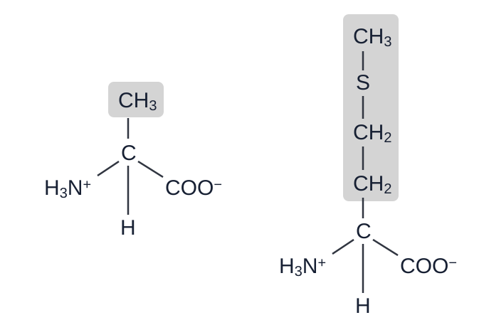
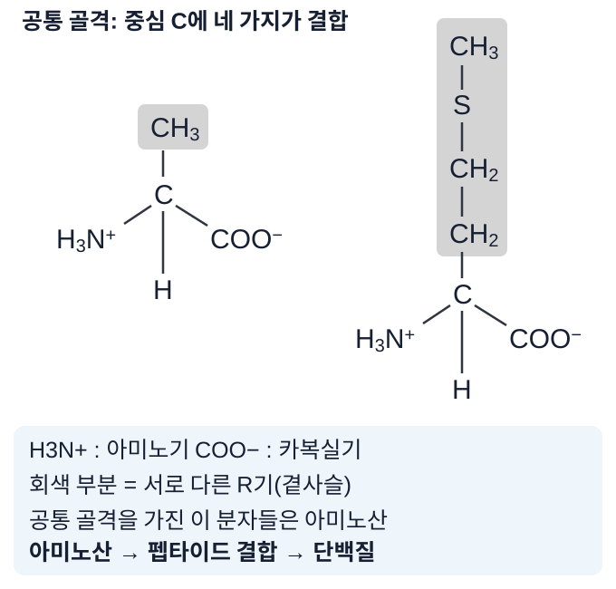
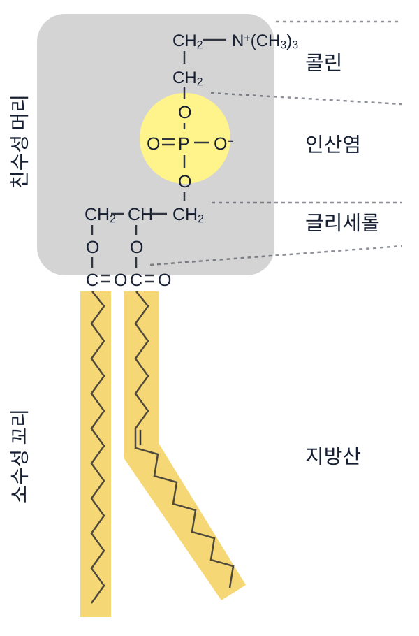
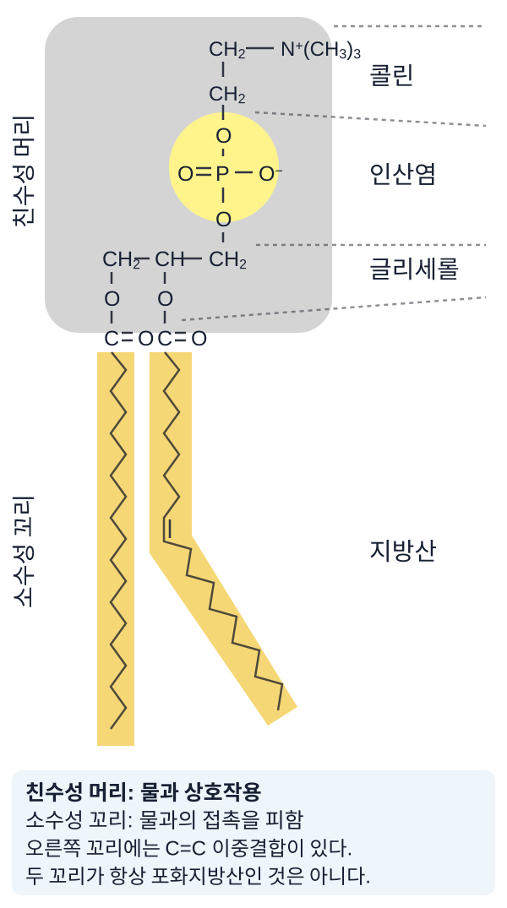
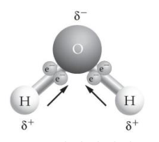

# 복습문제 41선 — 0903 수업 범위

웹과제 **9개**, 기출 **24개**, 변형 연습 **8개**로 구성했어요. 먼저 풀어 보고, 막히면 힌트를 열어 보세요.

> `복습문제_0903_Biomolecules_and_Cells.html`를 마크다운으로 옮겼어요. 원문, 힌트, 풀이는 접혀 있어요. 먼저 풀어 보고 펼쳐 보세요.

**목차**

- [A. 웹과제](#partA)
  - [P1. 원자핵을 이루는 입자](#p1)
  - [P2. 물의 특성과 먼 설명](#p2)
  - [P3. 소수성 아미노산의 자리](#p3)
  - [P4. 그림 속 분자와 그 중합체](#p4)
  - [P5. 생물분류의 3영역](#p5)
  - [P6. 유기분자와 단위체의 연결](#p6)
  - [P7. 2차·3차 구조를 붙잡는 결합](#p7)
  - [P8. 그림 속 분자(인지질) 설명](#p8)
  - [P9. 한 지역의 모든 종 + 무생물](#p9)
- [B. 기출](#partB)
  - [P10. 원자번호가 가리키는 것](#p10)
  - [P11. 전자를 불균등하게 나누는 물 분자](#p11)
  - [P12. 수소결합으로 이어지는 짝](#p12)
  - [P13. 수소와 탄소만으로 된 분자](#p13)
  - [P14. 생체막 2중층을 만드는 분자 (1)](#p14)
  - [P15. 양성자의 전하와 원자번호](#p15)
  - [P16. 중성 수용액의 pH](#p16)
  - [P17. 원자가 결합하지 않는 조건](#p17)
  - [P18. 산소가 강한 음성을 띤다는 뜻](#p18)
  - [P19. 비극성인 것](#p19)
  - [P20. 원자핵의 구성](#p20)
  - [P21. 단백질이 하는 일(빈칸)](#p21)
  - [P22. 단백질을 서로 다르게 만드는 것](#p22)
  - [P23. 지질이 아닌 것](#p23)
  - [P24. 중성지방의 구성](#p24)
  - [P25. 물 분자끼리의 결합](#p25)
  - [P26. 고분자의 기초 원소](#p26)
  - [P27. 다당류를 이루는 단위](#p27)
  - [P28. 단백질은 무엇의 중합체인가](#p28)
  - [P29. DNA 두 가닥을 잇는 결합](#p29)
  - [P30. 물에 대한 옳은 설명](#p30)
  - [P31. 혼자 다른 그룹](#p31)
  - [P32. 생체막 2중층을 만드는 분자 (2)](#p32)
  - [P33. 콜레스테롤이 지질인 까닭](#p33)
- [C. 변형 연습](#partC)
  - [P34. [변형] 수소결합이 생기는 자리](#p34)
  - [P35. [변형] 물을 싫어하는 것 고르기](#p35)
  - [P36. [변형] 습한 날 땀이 덜 시원한 까닭](#p36)
  - [P37. [변형] 소가 풀에서 에너지를 얻는 방법](#p37)
  - [P38. [변형] 차가운 바다 물고기의 세포막](#p38)
  - [P39. [변형] 지방산이 없는 지질](#p39)
  - [P40. [변형] 단백질 구조의 단계](#p40)
  - [P41. [변형] 지질과 세포막에 관한 설명](#p41)

## A. 웹과제

### P1. 원자핵을 이루는 입자

다음 중 원자핵을 구성하는 것은?

- A. 중성자와 양성자
- B. 양성자
- C. 중성자
- D. 전자와 양성자
- E. 전자

원문 정보 보기

웹과제 1장 q01 (스크린샷 s01)

힌트 보기

전자가 어디에 있는지, 핵 안에는 무엇이 있는지 떠올려 보세요.

풀이 보기

1. A. 맞아요. 원자핵은 양성자와 중성자로 이루어져요. 보통 수소의 핵처럼 양성자 하나뿐인 예외도 있지만, 일반적인 원자핵의 구성은 중성자와 양성자예요.
2. B. 틀려요. 양성자는 핵의 구성원이지만 중성자를 빠뜨렸어요.
3. C. 틀려요. 중성자는 핵의 구성원이지만 양성자를 빠뜨렸어요.
4. D. 틀려요. 전자는 핵 바깥 궤도를 돌아서 핵의 구성원이 아니에요.
5. E. 틀려요. 전자는 핵 바깥에 있어요.
6. 수업과의 연결: 0903 수업에서 원자는 원자핵(양성자, 중성자)과 전자로 이루어지고, 전자는 매우 가볍다고 했어요. 정리노트 '원자의 구조와 옥텟 규칙'과 이어져요.

**정답:** A

---

### P2. 물의 특성과 먼 설명

물이 생명을 유지하는데 중요하다. 물의 특성과 관계가 먼 설명은?

- A. 얼음이 물 위에 뜨는 것은 고체인 얼음이 물보다 밀도가 낮기 때문이다.
- B. 물은 작은 기화열로 인해 땀을 흘려도 체온이 거의 변하지 않게 한다
- C. 물은 높은 응집력과 표면장력을 가진다.
- D. 물은 우리 몸에서 극성 물질을 녹이는 일반적인 용매이다.
- E. 물 분자끼리의 결합력이 커서 비열이 크다.

원문 정보 보기

웹과제 1장 q03 (스크린샷 s03)

힌트 보기

땀이 증발할 때 열을 많이 가져가는지, 적게 가져가는지 생각해 보세요.

풀이 보기

1. A. 맞는 설명이에요. 얼음은 부피가 커져 밀도가 물보다 낮아서 떠요. 그래서 답이 아니에요.
2. B. 틀린 설명이라 답이에요. 물은 기화열이 작은 것이 아니라 커요. 땀이 증발하면서 큰 기화열을 몸에서 가져가기 때문에 체온이 크게 오르지 않아요.
3. C. 맞는 설명이에요. 물 분자 사이 수소결합 때문에 응집력이 크고, 표면장력도 커요.
4. D. 맞는 설명이에요. 극성인 물은 몸속 극성 물질을 녹이는 용매예요.
5. E. 맞는 설명이에요. 물 분자 사이 수소결합을 끊는 데 에너지가 들어서 비열이 커요.
6. 수업과의 연결: 0903 수업에서 비열과 기화열은 둘 다 크고, 땀은 증발할 때 시원하다고 했어요. 정리노트 '높은 비열과 기화열'과 이어져요.

**정답:** B

---

### P3. 소수성 아미노산의 자리

단백질의 3차 구조에서 소수성(비극성) 아미노산들은 어디에서 발견될 가능성이 가장 높을까?

- A. 물에서 접힌 단백질의 바깥쪽
- B. 단백질의 한쪽 끝 부분에
- C. 다른 곁사슬들과 수소결합을 형성하는 곳
- D. 접힌 단백질의 안쪽으로 물과 멀어지는 방향
- E. 다음 아미노산과 펩티드 결합을 형성하는 곳

원문 정보 보기

웹과제 1장 q08 (스크린샷 s08)

힌트 보기

물과 기름이 섞이지 않는다는 사실을, 물속에서 접히는 단백질에 적용해 보세요.

풀이 보기

1. A. 틀려요. 물에 드러나는 바깥쪽은 물을 피하는 소수성 곁사슬이 놓이기 어려운 곳이에요.
2. B. 틀려요. 사슬의 끝인지보다 주변이 물인지, 곁사슬이 극성인지가 기준이에요.
3. C. 틀려요. 수소결합은 구조에 기여하지만, 소수성 곁사슬이 물을 피해 모이는 까닭을 설명하지 못해요. 소수성 곁사슬은 수소결합을 잘 하지 않아요.
4. D. 맞아요. 물속에서 접힌 단백질에서는 비극성 곁사슬이 물과 닿지 않도록 안쪽에 모여요.
5. E. 틀려요. 펩타이드 결합은 모든 아미노산이 주사슬에서 이웃과 맺는 결합이라, 소수성 곁사슬의 위치를 가르지 못해요.
6. 수업과의 연결: 0903 수업에서 극성끼리, 비극성끼리 친하고 알라닌·류신은 소수성 아미노산이라고 했어요. 안쪽에 모인다는 사실은 정리노트 '구조와 기능 — 1·2·3차 구조'의 보충에 있어요.

**정답:** D

---

### P4. 그림 속 분자와 그 중합체

아래와 같은 분자들을 무엇이라 하는가? 또한 이 분자들이 중합체를 이룰 때 형성되는 물질은 무엇인가? 순서대로 옳은 것은?

- A. 단당류, 다당류
- B. 글리신, 효소
- C. 아미노산, 단백질
- D. 뉴클레오타이드, 핵산
- E. 지질, 폴리펩티드

원문 정보 보기

웹과제 1장 q09 (스크린샷 s09, s10)

힌트 보기

가운데 C에 무엇이 붙어 있는지 보세요. 두 분자에서 같은 부분과 다른 부분을 나눠 보세요.

풀이 보기

1. A. 틀려요. 단당류가 모여 다당류가 되는 관계는 맞지만, 그림에는 아미노기·카복실기가 붙은 가운데 탄소가 있어요.
2. B. 틀려요. 왼쪽 분자의 곁사슬은 CH₃라서 알라닌이고, 두 분자의 공통 이름과 중합체를 묻는 질문에도 맞지 않아요. 효소는 단백질이 하는 일의 하나예요.
3. C. 맞아요. 가운데 C에 H₃N⁺(아미노기), COO⁻(카복실기), H, 서로 다른 R기가 붙은 아미노산이고, 펩타이드 결합으로 이어지면 단백질이 돼요.
4. D. 틀려요. 뉴클레오타이드와 핵산의 관계는 맞지만 그림 속 분자는 그 구조가 아니에요.
5. E. 틀려요. 그림은 지질이 아니고, 폴리펩티드는 아미노산이 이어진 사슬이에요.
6. 수업과의 연결: 0903 수업에서 아미노산은 가운데 C에 아미노기, 카복실기, H, R기가 붙고 R = CH₃이면 알라닌이라고 했어요. 정리노트 '아미노산과 펩타이드 결합'과 이어져요.

**정답:** C

---

### P5. 생물분류의 3영역

생물분류의 3영역(domain)을 바르게 나타내는 것은?

- A. 고세균 / 원핵생물 / 식물
- B. 진정세균 / 원생생물 / 고세균
- C. 고세균 / 진정세균 / 식물
- D. 진정세균 / 원생생물 / 균
- E. 고세균 / 진정세균 / 진핵생물

원문 정보 보기

웹과제 1장 q10 (스크린샷 s11)

힌트 보기

영역과 계는 분류 단계가 달라요. 식물·원생생물·균은 어느 단계인가요?

풀이 보기

1. A. 틀려요. 원핵생물은 진정세균과 고세균을 묶는 말이고, 식물은 계예요. 단계가 다른 것을 섞었어요.
2. B. 틀려요. 원생생물은 진핵생물 영역 안의 계라서 영역이 아니에요.
3. C. 틀려요. 고세균·진정세균은 영역이지만 식물은 진핵생물 영역 안의 계예요.
4. D. 틀려요. 원생생물과 균은 계이고, 고세균과 진핵생물 영역이 빠졌어요.
5. E. 맞아요. 3영역은 고세균, 진정세균, 진핵생물이에요.
6. 수업과의 연결: 0903 수업 도입부에서 지구의 생물을 3개 영역, 4개 계로 나눈다고 복습했어요. 정리노트 '지난 수업(0901) 복습 — 생명의 계층과 3영역'과 이어져요.

**정답:** E

---

### P6. 유기분자와 단위체의 연결

다음 유기분자와 그 단위체의 연결이 올바르지 않은 것은?

- A. 탄수화물 - 단당류, 이당류, 다당류가 있다
- B. 트라이글리세라이드 - 지방산과 글리세롤로 구성된다
- C. 단백질 - 아미노산들이 펩티드 결합을 형성한다
- D. 핵산 - 뉴클레오타이드의 중합체다
- E. 인지질 - 3개의 인산기와 1개의 글리세롤이 결합한다

원문 정보 보기

웹과제 1장 q11 (스크린샷 s12)

힌트 보기

인지질에는 지방산이 몇 개, 인산기가 몇 개 붙는지 세어 보세요.

풀이 보기

1. A. 맞는 연결이에요. 탄수화물에는 단당류, 이당류, 다당류가 있어요.
2. B. 맞는 연결이에요. 트라이글리세라이드는 글리세롤 하나와 지방산 셋으로 구성돼요.
3. C. 맞는 연결이에요. 아미노산들이 펩타이드 결합으로 이어져 단백질이 돼요.
4. D. 맞는 연결이에요. 핵산은 뉴클레오타이드가 이어진 중합체예요.
5. E. 틀린 연결이라 답이에요. 인지질은 글리세롤에 지방산 2개와 인산기 1개가 붙어요. 인산기가 3개인 것이 아니에요.
6. 수업과의 연결: 0903 수업에서 인지질은 중성지질의 지방산 하나를 인산기로 바꾼 것이라고 했어요. 정리노트 '인지질과 인지질 이중층'과 이어져요.

**정답:** E

---

### P7. 2차·3차 구조를 붙잡는 결합

화학결합 중, 단백질의 2차 및 3차 구조의 안정성을 더해주는 결합으로 맞는 것은?

- A. 공유결합
- B. 이온결합
- C. 반데르발스 힘
- D. 수소결합
- E. 비극성 공유결합

원문 정보 보기

웹과제 1장 q13 (스크린샷 s14)

힌트 보기

알파 나선과 베타 병풍을 붙잡는 결합이 무엇이었는지 떠올려 보세요.

풀이 보기

1. A. 틀려요. 공유결합은 주사슬을 잇는 데 중요하지만, 2차와 3차 구조를 함께 안정시키는 대표 결합은 아니에요.
2. B. 틀려요. 이온결합은 3차 구조에 기여할 수 있지만, 2차 구조(알파 나선·베타 병풍)를 붙잡는 대표 결합은 수소결합이에요.
3. C. 틀려요. 반데르발스 힘은 수업에서 생략했고, 2차 구조를 규칙적으로 붙잡는 힘이 아니에요.
4. D. 맞아요. 수소결합은 2차 구조를 안정시키고 3차 구조 유지에도 기여해요. 3차 구조를 유지하는 유일한 힘이라는 뜻은 아니에요.
5. E. 틀려요. 비극성 공유결합은 전자를 고르게 나누는 공유결합일 뿐, 2차 구조를 붙잡는 수소결합을 대신하지 못해요.
6. 수업과의 연결: 0903 수업에서 수소결합이 단백질 3차 구조 유지에 중요하고, 위아래 아미노산 사이 수소결합이 2차 구조를 안정시킨다고 했어요. 정리노트 '구조와 기능 — 1·2·3차 구조'와 이어져요.

**정답:** D

---

### P8. 그림 속 분자(인지질) 설명

아래 그림의 분자에 대한 설명으로 바르지 않은 것은?

- A. 소수성 꼬리 부분은 세포막에서 안쪽으로 배치되고, 친수성 머리 부분은 물에 노출된다
- B. 소수성 꼬리부분은 늘 포화지방산으로 구성된다
- C. 중성지질인 트라이글리세라이드에 비해 인산기와 극성단위를 더 가지고 있다
- D. 이 분자는 세포막에서 발견된다
- E. 막관통단백질의 막 관통 부분은 소수성 꼬리와 접촉하는 소수성 부분이다

원문 정보 보기

웹과제 1장 q14 (스크린샷 s15, s16)

힌트 보기

그림의 오른쪽 꼬리 모양을 자세히 보세요. 곧은가요, 꺾였나요?

풀이 보기

1. A. 맞는 설명이에요. 소수성 꼬리는 이중층 안쪽을 향하고 친수성 머리는 물을 향해요.
2. B. 틀린 설명이라 답이에요. 꼬리가 늘 포화지방산인 것은 아니에요. 그림 오른쪽 꼬리처럼 이중결합에서 꺾인 불포화지방산 꼬리도 있어요.
3. C. 맞는 설명이에요. 인지질은 트라이글리세라이드의 지방산 하나 대신 인산기와 극성 단위(콜린)를 가져요.
4. D. 맞는 설명이에요. 인지질은 세포막의 기본 성분이에요.
5. E. 맞는 설명이에요. 막을 관통하는 단백질 부분은 인지질의 소수성 꼬리와 닿으므로 소수성이에요. 물에 드러난 부분까지 소수성이라는 뜻은 아니에요.
6. 수업과의 연결: 0903 수업에서 인지질 꼬리에 이중결합이 있으면 꺾이고, 추운 곳 생물은 불포화지방산이 많다고 했어요. 정리노트 '인지질과 인지질 이중층', '포화지방산과 불포화지방산'과 이어져요.

**정답:** B

---

### P9. 한 지역의 모든 종 + 무생물

생명의 계층구조 중, 한 지역의 모든 종들과 무생물적인 구성요소를 합친 것은 무엇인가?

- A. 개체군
- B. 생물권
- C. 생태계
- D. 군집

원문 정보 보기

웹과제 1장 q15 (스크린샷 s17)

힌트 보기

종이 하나인지 여럿인지, 무생물까지 넣는지로 나눠 보세요.

풀이 보기

1. A. 틀려요. 개체군은 같은 지역에 사는 같은 종만 묶어요.
2. B. 틀려요. 생물권은 지구의 생태계 전체라 한 지역보다 넓어요.
3. C. 맞아요. 군집에 무생물 환경을 더한 것이 생태계예요.
4. D. 틀려요. 군집은 여러 종을 포함하지만 무생물 환경은 넣지 않아요.
5. 수업과의 연결: 0903 수업 도입부에서 개체군들의 모임이 군집, 군집에 무생물까지 합치면 생태계라고 복습했어요. 정리노트 '지난 수업(0901) 복습 — 생명의 계층과 3영역'과 이어져요.

**정답:** C

---

## B. 기출

### P10. 원자번호가 가리키는 것

1. 원소의 원자번호가 가리키는 것은?

- (1) 양성자 수
- (2) 양성자 수 + 전자 수
- (3) 양성자 수 + 전자 수 + 중성자 수
- (4) 중성자 수
- (5) 전자 수

원문 정보 보기

기출 1강 합본 1번 (PDF 1쪽)

힌트 보기

원자번호는 원자핵 속 입자 중 하나의 개수예요. 전하를 띠는 입자는 어느 쪽일까요?

풀이 보기

1. (1) 맞아요. 원자번호는 원자핵 속 양성자의 수예요.
2. (2) 틀려요. 전자 수를 더하지 않아요. 전하가 없는 원자에서 전자 수는 양성자 수와 같을 뿐이에요.
3. (3) 틀려요. 세 입자를 모두 더한 값은 원자번호가 아니에요.
4. (4) 틀려요. 중성자 수는 원자번호와 관계없어요.
5. (5) 틀려요. 전자 수는 이온이 되면 바뀌지만 원자번호는 바뀌지 않아요. 원자번호는 양성자 수로 정해요.
6. 수업과의 연결: 0903 수업에서 Na는 원자번호 11, 전자 배치 2-8-1이라고 했어요. 원자번호 = 양성자 수라는 정의는 정리노트 '원자의 구조와 옥텟 규칙'의 보충에 있어요.

**정답:** (1)

---

### P11. 전자를 불균등하게 나누는 물 분자

3. 물 분자를 구성하는 수소와 산소 사이에 공유하는 전자는 불균등하게 배분되어 있다. 이 때문에 물 분자는 ( )이다.

- (1) 극성
- (2) 비공유성
- (3) 이온성
- (4) 비극성
- (5) 소수성

원문 정보 보기

기출 1강 합본 3번 (PDF 1쪽)

힌트 보기

전자가 한쪽으로 쏠리면 한쪽은 살짝 +, 한쪽은 살짝 −가 돼요.

풀이 보기

1. (1) 맞아요. 전자가 산소 쪽으로 쏠려 O는 δ−, H는 δ+를 띠고, 굽은 모양 때문에 물 분자 전체가 극성이에요.
2. (2) 틀려요. 수소와 산소는 전자를 공유하고 있어요(공유결합).
3. (3) 틀려요. 전자를 완전히 주고받아 이온이 된 것이 아니라 공유하면서 쏠린 거예요.
4. (4) 틀려요. 비극성은 전자를 고르게 나눌 때예요(C–H, H–H).
5. (5) 틀려요. 극성인 물은 물을 싫어하는 성질(소수성)이 아니에요.
6. 수업과의 연결: 0903 수업에서 "산소는 전자를 좋아한다"며 O–H는 극성 공유결합이라고 했어요. 정리노트 '전기음성도와 극성, 친수성과 소수성'과 이어져요.

**정답:** (1)

---

### P12. 수소결합으로 이어지는 짝

4. 다음 중 수소결합으로 서로 연결될 수 있는 것은 무엇인가?

- (1) 두 이온
- (2) 두 극성 분자
- (3) 두 비극성 분자
- (4) 극성분자와 비극성 분자

원문 정보 보기

기출 1강 합본 4번 (PDF 1쪽)

힌트 보기

수소결합은 부분 전하 δ+와 δ− 사이의 인력이에요. 부분 전하를 가진 것은 무엇인가요?

풀이 보기

1. (1) 틀려요. 이온끼리 끌어당기는 것은 이온결합이에요.
2. (2) 맞아요. O·N에 붙은 H(δ+)와 다른 분자의 O·N(δ−) 사이에 수소결합이 생겨요. 물 분자끼리가 대표 예예요.
3. (3) 틀려요. 비극성 분자에는 부분 전하가 없어 수소결합을 하지 않아요.
4. (4) 틀려요. 비극성 분자에는 δ−나 δ+가 없어서 수소결합 상대가 되지 못해요.
5. 수업과의 연결: 0903 수업에서 수소결합은 전기음성도가 큰 원자에 붙은 수소와 전기음성도가 큰 원자 사이의 인력이라고 정의했어요. 정리노트 '수소결합'과 이어져요.

**정답:** (2)

---

### P13. 수소와 탄소만으로 된 분자

5. 다음 중 수소와 탄소의 사슬로만 이루어진 분자는?

- (1) 폴리펩티드
- (2) 탄수화물
- (3) 탄화수소
- (4) 다당류

원문 정보 보기

기출 1강 합본 5번 (PDF 1쪽)

힌트 보기

이름에 두 원소가 그대로 들어 있어요. 나머지는 산소가 들어 있지 않은지 떠올려 보세요.

풀이 보기

1. (1) 틀려요. 폴리펩티드는 아미노산 사슬이라 질소와 산소도 들어 있어요.
2. (2) 틀려요. 탄수화물은 C : H : O = 1 : 2 : 1로 산소가 들어 있어요.
3. (3) 맞아요. 탄화수소는 탄소와 수소로만 이루어진 분자예요. 기름의 CH₂ 사슬이 예예요.
4. (4) 틀려요. 다당류는 포도당(C₆H₁₂O₆)이 이어진 것이라 산소가 있어요.
5. 수업과의 연결: 0903 수업에서 기름은 CH₂가 십몇 개 이어진 탄소 사슬이라 비극성이라고 했어요. 정리노트 '전기음성도와 극성, 친수성과 소수성'과 이어져요.

**정답:** (3)

---

### P14. 생체막 2중층을 만드는 분자 (1)

6. 살아있는 모든 세포의 경계를 이루는 생체막의 기본이 되는 2중층을 형성하는 분자는?

- (1) 단백질
- (2) 탄수화물
- (3) 콜레스테롤
- (4) 인지질
- (5) 지방

원문 정보 보기

기출 1강 합본 6번 (PDF 1쪽)

힌트 보기

물을 좋아하는 머리와 물을 싫어하는 꼬리를 함께 가진 분자를 떠올려 보세요.

풀이 보기

1. (1) 틀려요. 단백질은 막에 박혀 있을 수 있지만 2중층의 기본 분자는 아니에요.
2. (2) 틀려요. 탄수화물은 2중층을 만들지 않아요.
3. (3) 틀려요. 콜레스테롤은 동물 세포막의 인지질 사이에 끼어 막을 안정화할 뿐이에요.
4. (4) 맞아요. 극성 머리와 비극성 꼬리를 가진 인지질이 물속에서 저절로 이중층을 만들어요.
5. (5) 틀려요. 지방(중성지방)은 전체가 소수성이라 이중층을 만들지 못해요.
6. 수업과의 연결: 0903 수업에서 "모든 생물의 세포막은 인지질 이중층으로 구성이 됩니다"라고 했어요. 정리노트 '인지질과 인지질 이중층'과 이어져요.

**정답:** (4)

---

### P15. 양성자의 전하와 원자번호

9. 양성자는 ______전하를 갖고, 원소의 ____와/과 같다.

- (1) 음, 전기음성도
- (2) 양, 이온전하
- (3) 음, 극성
- (4) 양, 원자번호
- (5) 음, 원자번호

원문 정보 보기

기출 1강 합본 9번 (PDF 1쪽)

힌트 보기

양성자(proton)는 +예요. 양성자의 수는 무엇과 같을까요?

풀이 보기

1. (1) 틀려요. 양성자는 음전하가 아니고, 전기음성도는 전자를 끄는 힘이에요.
2. (2) 틀려요. 양전하는 맞지만, 양성자 수는 이온의 전하가 아니라 원자번호와 같아요.
3. (3) 틀려요. 양성자는 음전하가 아니에요.
4. (4) 맞아요. 양성자는 양(+)전하를 띠고, 양성자의 수가 원소의 원자번호예요.
5. (5) 틀려요. 원자번호는 맞지만 양성자는 음전하가 아니라 양전하예요.
6. 수업과의 연결: 0903 수업에서 원자핵은 양성자(+)와 중성자(0), 전자는 −라고 했어요. 원자번호 정의는 정리노트 '원자의 구조와 옥텟 규칙'의 보충에 있어요.

**정답:** (4)

---

### P16. 중성 수용액의 pH

10. 중성 수용액의 pH는?

- (1) 9
- (2) 1
- (3) 5
- (4) 14
- (5) 7

원문 정보 보기

기출 1강 합본 10번 (PDF 1쪽)

힌트 보기

pH는 7을 기준으로 산성과 염기성을 나눠요.

풀이 보기

1. (1) 틀려요. pH 9는 7보다 커서 염기성이에요.
2. (2) 틀려요. pH 1은 강한 산성이에요.
3. (3) 틀려요. pH 5는 7보다 작아 산성이에요.
4. (4) 틀려요. pH 14는 강한 염기성이에요.
5. (5) 맞아요. H⁺와 OH⁻의 농도가 같은 중성 수용액은 pH 7이에요.
6. 수업과의 연결: pH는 수업과 강의노트에서 다루지 않았어요. 정리노트 '극성 용매로서의 물'의 보충(물의 해리와 pH)에 있어요.

**정답:** (5)

---

### P17. 원자가 결합하지 않는 조건

12. 다음 중 한 원자가 다른 원자와 화학적 결합을 형성하지 않는 것은?

- (1) 원자가 궤도에 전자가 하나만 있을 때
- (2) 양성자의 수가 중성자의 수와 같을 때
- (3) 양성자의 수가 전자의 수와 같을 때
- (4) 원자가 궤도에 전자의 수가 최대치일 때
- (5) 원자가 궤도에서 가질 수 있는 최대 전자 수보다 더 적게 갖고 있을 때

원문 정보 보기

기출 1강 합본 12번 (PDF 1쪽)

힌트 보기

원자가 궤도는 가장 바깥 궤도예요. 옥텟 규칙을 떠올려 보세요.

풀이 보기

1. (1) 틀려요. 최외각 전자가 하나뿐이면(Na처럼) 그 하나를 잃기 쉬워 결합해요.
2. (2) 틀려요. 양성자 수와 중성자 수는 결합 여부의 기준이 아니에요.
3. (3) 틀려요. 양성자 수 = 전자 수는 전하를 띠지 않은 원자일 뿐, 결합 여부를 정하지 않아요.
4. (4) 맞아요. 원자가(최외각) 궤도가 꽉 차면 안정해서 다른 원자와 결합하지 않아요.
5. (5) 틀려요. 최외각이 덜 차 있으면 전자를 잃거나 얻거나 공유하며 결합해요.
6. 수업과의 연결: 0903 수업에서 전자는 2, 8, 8개씩 채워지고(옥텟 규칙) 최외각 전자 수가 화학적 특징을 정한다고 했어요. 정리노트 '원자의 구조와 옥텟 규칙'과 이어져요.

**정답:** (4)

---

### P18. 산소가 강한 음성을 띤다는 뜻

13. 물 분자에서 산소가 전기적으로 강한 음성을 띈다는 것이 의미하는 바는?

- (1) 전자가 핵으로 접근하지 못하게 하고, 최외각으로 전자를 날려버린다.
- (2) 원자 밖으로 전자를 쉽게 날려버린다.
- (3) 비극성이다.
- (4) 더 강하게 전자를 끌어당긴다.

원문 정보 보기

기출 1강 합본 13번 (PDF 1쪽)

힌트 보기

"산소는 전자를 좋아한다"를 떠올려 보세요.

풀이 보기

1. (1) 틀려요. 산소는 전자를 밀어내는 것이 아니라 자기 쪽으로 끌어당겨요.
2. (2) 틀려요. 전자를 날려버리면 오히려 양(+)을 띠게 돼요.
3. (3) 틀려요. 산소가 전자를 끌어 O–H가 극성 공유결합이 되고, 물 분자는 극성이에요.
4. (4) 맞아요. 전기음성도가 크다는 것은 공유 전자를 더 강하게 끌어당긴다는 뜻이에요. 그래서 산소가 δ−를 띠어요.
5. 수업과의 연결: 0903 수업에서 "산소는 전자를 좋아한다. 산소는 전자를 당겨간다. 전기음성도가 크다"고 했어요. 정리노트 '전기음성도와 극성, 친수성과 소수성'과 이어져요.

**정답:** (4)

---

### P19. 비극성인 것

15. 다음 중 비극성인 것은?

- (1) 음이온
- (2) 중성 이온
- (3) 부분적 전하가 없는 분자
- (4) 양이온

원문 정보 보기

기출 1강 합본 15번 (PDF 1쪽)

힌트 보기

비극성은 전하가 한쪽으로 치우치지 않은 상태예요. 이온은 전하를 띠나요?

풀이 보기

1. (1) 틀려요. 음이온은 음전하를 띠어 친수성이에요.
2. (2) 틀려요. 이온은 전하를 띤 입자라서 "중성 이온"은 비극성의 예로 볼 수 없어요.
3. (3) 맞아요. 부분 전하(δ+, δ−)가 없는 분자가 비극성 분자예요. 기름 같은 탄화수소가 예예요.
4. (4) 틀려요. 양이온은 양전하를 띠어 친수성이에요.
5. 수업과의 연결: 0903 수업에서 극성을 띠지 않는 분자를 비극성(무극성) 분자라 하고, 전하를 띤 소금은 물에 녹는다고 했어요. 정리노트 '전기음성도와 극성, 친수성과 소수성'과 이어져요.

**정답:** (3)

---

### P20. 원자핵의 구성

18. 다음 중 원자핵을 구성하는 것은?

- (1) 전자
- (2) 전자와 양성자
- (3) 중성자와 양성자
- (4) 중성자
- (5) 양성자

원문 정보 보기

기출 1강 합본 18번 (PDF 2쪽)

힌트 보기

전자는 핵 안에 있나요, 핵 바깥에 있나요?

풀이 보기

1. (1) 틀려요. 전자는 핵 바깥 궤도를 돌아요.
2. (2) 틀려요. 양성자는 맞지만 전자는 핵 바깥에 있어요.
3. (3) 맞아요. 원자핵은 양성자와 중성자로 이루어져요.
4. (4) 틀려요. 중성자만으로는 부족하고 양성자가 빠졌어요.
5. (5) 틀려요. 양성자만으로는 부족하고 중성자가 빠졌어요.
6. 수업과의 연결: 0903 수업에서 원자는 원자핵(양성자, 중성자)과 전자로 이루어진다고 했어요. 정리노트 '원자의 구조와 옥텟 규칙'과 이어져요.

**정답:** (3)

---

### P21. 단백질이 하는 일(빈칸)

20. 단백질은 ______(으)로 작용을 한다.

원문 정보 보기

기출 1강 합본 20번 (PDF 2쪽). 원문은 답 낱말이 밑줄로 인쇄된 보기 없는 빈칸 문항이라, 여기서는 그 낱말을 빈칸으로 바꿨어요.

힌트 보기

설탕을 알아보고 결합해서 잘라 주는 단백질을 무엇이라고 불렀나요?

풀이 보기

1. 빈칸에는 "효소"가 들어가요. 단백질은 세포의 화학 반응을 빠르게 하는 효소로 작용해요.
2. 설탕 분해 효소는 설탕을 알아보는 구조를 가져야 설탕과 결합할 수 있어요. 구조가 기능을 정한다는 예예요.
3. 수업과의 연결: 0903 수업에서 설탕 분해 효소, 지질 분해 효소, 단백질 분해 효소를 예로 구조와 기능의 관계를 설명했어요. 정리노트 '구조와 기능 — 1·2·3차 구조'와 이어져요.

**정답:** 효소

---

### P22. 단백질을 서로 다르게 만드는 것

23. 서로 다른 단백질들은 _______의 서로 다른 서열로 구성되어 있다.

- (1) 아미노산
- (2) 지방
- (3) 당
- (4) 글리세롤

원문 정보 보기

기출 1강 합본 23번 (PDF 2쪽)

힌트 보기

단백질의 1차 구조는 무엇의 순서였나요?

풀이 보기

1. (1) 맞아요. 단백질의 1차 구조는 아미노산의 순서(서열)이고, 서열이 다르면 다른 단백질이에요.
2. (2) 틀려요. 지방은 글리세롤과 지방산으로 된 지질이에요.
3. (3) 틀려요. 당이 이어진 것은 다당류예요.
4. (4) 틀려요. 글리세롤은 중성지방·인지질의 뼈대예요.
5. 수업과의 연결: 0903 수업에서 1차 구조는 아미노산의 순서이고, 순서가 정해지면 저절로 접힌다고 했어요. 정리노트 '구조와 기능 — 1·2·3차 구조'와 이어져요.

**정답:** (1)

---

### P23. 지질이 아닌 것

24. 다음 중 지질에 속하지 않는 것은?

- (1) 섬유소
- (2) 스테로이드
- (3) 지방
- (4) 인지질
- (5) 콜레스테롤

원문 정보 보기

기출 1강 합본 24번 (PDF 2쪽)

힌트 보기

지질의 세 종류와, 식물 세포벽을 만드는 물질을 떠올려 보세요.

풀이 보기

1. (1) 맞아요. 섬유소(셀룰로오스)는 포도당이 β 결합으로 이어진 탄수화물이라 지질이 아니에요.
2. (2) 틀려요. 스테로이드는 지질의 한 종류예요.
3. (3) 틀려요. 지방(중성지방)은 지질이에요.
4. (4) 틀려요. 인지질은 지질이에요.
5. (5) 틀려요. 콜레스테롤은 스테로이드의 한 종류라 지질이에요.
6. 수업과의 연결: 0903 수업에서 지질은 중성지질, 인지질, 스테로이드 세 종류이고, 셀룰로오스는 식물 세포벽의 구조 성분이라고 했어요. 정리노트 '지질의 세 종류와 중성지질'과 이어져요.

**정답:** (1)

---

### P24. 중성지방의 구성

25. 거의 모든 중성지방은 _______(으)로 구성되어 있다.

- (1) 탄수화물과 단백질
- (2) 글리세롤과 지방산
- (3) 포화 산소 원자
- (4) 복합탄수화물

원문 정보 보기

기출 1강 합본 25번 (PDF 2쪽)

힌트 보기

빗 하나에 빗살 세 개, 빗과 빗살의 이름을 떠올려 보세요.

풀이 보기

1. (1) 틀려요. 탄수화물과 단백질은 다른 생체 고분자예요.
2. (2) 맞아요. 중성지방은 글리세롤 1분자에 지방산 3분자가 붙은 트라이글리세라이드예요.
3. (3) 틀려요. "포화"는 지방산 사슬이 수소로 꽉 찼다는 뜻이지 산소 원자로 구성된다는 뜻이 아니에요.
4. (4) 틀려요. 복합탄수화물(다당류)은 탄수화물이에요.
5. 수업과의 연결: 0903 수업에서 글리세롤 1분자 + 지방산 3분자 = 중성지방이라고 했어요. 정리노트 '지질의 세 종류와 중성지질'과 이어져요.

**정답:** (2)

---

### P25. 물 분자끼리의 결합

26. 위 그림을 보고 답하시오.

만약 이 분자 2개 이상이 서로 근처에 있으면 어떻게 상호 결합하는가?

- (1) 두 산소 원자 사이의 공유결합
- (2) 두 개의 수소 원자 사이의 수소결합
- (3) 수소원자와 산소원자 사이의 수소결합
- (4) 수소이온이 산소이온과 이온결합

원문 정보 보기

기출 1강 합본 26번 (PDF 2쪽). "위 그림"은 같은 쪽 22번 옆에 인쇄된 물 분자 그림이에요.

힌트 보기

그림에서 δ+인 원자와 δ−인 원자를 찾아보세요. 반대 부호끼리 끌어당겨요.

풀이 보기

1. (1) 틀려요. 이웃한 물 분자의 두 산소는 전자를 공유하지 않아요.
2. (2) 틀려요. 두 수소는 모두 δ+라서 서로 끌어당기지 않아요.
3. (3) 맞아요. 한 분자의 수소원자(δ+)와 이웃 분자의 산소원자(δ−) 사이에 수소결합이 생겨요.
4. (4) 틀려요. 물 분자는 이온이 아니라 부분 전하를 띤 극성 분자라서 이온결합이 아니에요.
5. 수업과의 연결: 0903 수업에서 물 같은 작은 분자는 분자와 분자 사이에서 수소결합이 생긴다고 했어요. 정리노트 '수소결합'의 물 분자 그림과 이어져요.

**정답:** (3)

---

### P26. 고분자의 기초 원소

27. 화성의 생명체가 지구의 생명체와 기본적으로 비슷하다면, 고분자는 어떤 원소를 기초로 하고 있을 것인가?

- (1) 탄소
- (2) 수소
- (3) 인
- (4) 질소
- (5) 산소

원문 정보 보기

기출 1강 합본 27번 (PDF 2쪽)

힌트 보기

지구 생명체를 무슨 "기반 생명체"라고 불렀나요?

풀이 보기

1. (1) 맞아요. 지구 생명체의 고분자는 탄소를 뼈대로 하는 탄소 기반 생명체예요.
2. (2) 틀려요. 수소는 많지만 사슬과 고리의 뼈대를 만드는 원소는 아니에요.
3. (3) 틀려요. 인은 나머지 4%에 드는 원소예요.
4. (4) 틀려요. 질소는 단백질과 DNA에 필요하지만 기초 뼈대는 아니에요.
5. (5) 틀려요. 산소는 물에 많지만 고분자의 뼈대는 탄소예요.
6. 수업과의 연결: 0903 수업에서 탄소가 들어간 물질이 유기물이고 지구 생명체는 "탄소 기반 생명체"라고 했어요. 정리노트 '생물을 이루는 원소'와 이어져요.

**정답:** (1)

---

### P27. 다당류를 이루는 단위

28. 다음 중 다당류를 구성하는 것은?

- (1) 아미노산
- (2) 당
- (3) 뉴클레오티드
- (4) 지방산

원문 정보 보기

기출 1강 합본 28번 (PDF 2쪽)

힌트 보기

이름에 이미 답이 숨어 있어요. 녹말은 무엇이 줄줄이 이어진 것이었나요?

풀이 보기

1. (1) 틀려요. 아미노산이 이어지면 단백질이에요.
2. (2) 맞아요. 다당류는 당(포도당 같은 단당류)이 길게 이어진 것이에요.
3. (3) 틀려요. 뉴클레오티드가 이어지면 핵산이에요.
4. (4) 틀려요. 지방산은 중성지방·인지질의 구성 성분이에요.
5. 수업과의 연결: 0903 수업에서 포도당이 여러 개 길게 연결되면 다당류이고, 녹말은 포도당이 쭉 연결된 것이라고 했어요. 정리노트 '다당류 — 녹말과 글리코겐'과 이어져요.

**정답:** (2)

---

### P28. 단백질은 무엇의 중합체인가

29. 단백질은 ( )의 중합체이다.

- (1) 지방산
- (2) 당
- (3) 아미노산
- (4) 뉴클레오티드

원문 정보 보기

기출 1강 합본 29번 (PDF 2쪽)

힌트 보기

녹말이 포도당의 중합체라면, 단백질은 무엇의 중합체일까요?

풀이 보기

1. (1) 틀려요. 지방산은 지질의 구성 성분이에요.
2. (2) 틀려요. 당의 중합체는 다당류예요.
3. (3) 맞아요. 단백질은 20가지 아미노산이 펩타이드 결합으로 이어진 중합체예요.
4. (4) 틀려요. 뉴클레오티드의 중합체는 핵산이에요.
5. 수업과의 연결: 0903 수업에서 단백질은 아미노산의 중합체라고 했어요. 정리노트 '아미노산과 펩타이드 결합'과 이어져요.

**정답:** (3)

---

### P29. DNA 두 가닥을 잇는 결합

31. 이중 나선 DNA의 상보적인 단일 뉴클레오타이드 사슬들이 서로 결합하는 데 작용하는 화학결합은?

- (1) 극성 공유결합
- (2) 이온결합
- (3) 수소결합
- (4) 비극성 공유결합

원문 정보 보기

기출 1강 합본 31번 (PDF 2쪽)

힌트 보기

DNA의 두 가닥이 이중나선을 이루게 하는 힘은 무엇이라고 했나요?

풀이 보기

1. (1) 틀려요. 극성 공유결합은 한 분자 안에서 전자를 공유하는 결합이지, 두 가닥을 잇는 힘이 아니에요.
2. (2) 틀려요. 두 가닥은 이온결합으로 이어지지 않아요.
3. (3) 맞아요. DNA의 두 가닥은 수소결합으로 이어져 이중나선을 이뤄요.
4. (4) 틀려요. 비극성 공유결합은 전자를 고르게 나누는 공유결합이라 두 가닥을 잇는 힘이 아니에요.
5. 수업과의 연결: 0903 수업에서 "DNA에서도 마찬가지"라며 두 가닥이 수소결합으로 이중나선을 이룬다고 했어요. 정리노트 '수소결합'과 이어져요.

**정답:** (3)

---

### P30. 물에 대한 옳은 설명

34. 다음 물에 대한 설명 중 옳은 것을 고르시오.

- (1) H⁺ 와 OH⁺ 이온으로 해리된다.
- (2) 산성 pH를 가진다
- (3) 다른 분자들과 강한 공유결합을 형성한다.
- (4) 효소로 작용한다.
- (5) 좋은 용질이다.

원문 정보 보기

기출 1강 합본 34번 (PDF 2–3쪽). 보기 (1)은 원문 PDF에서 수식 변환이 깨진 채 인쇄되어 있어 글자를 살려 옮겼어요.

힌트 보기

물은 녹이는 쪽인가요, 녹는 쪽인가요? 순수한 물은 산성인가요, 중성인가요?

풀이 보기

1. (1) 출제 의도로는 맞아요(OH⁺는 OH⁻의 인쇄 오타). 물 분자는 아주 일부가 수소 이온(H⁺)과 수산화 이온(OH⁻)으로 해리돼요.
2. (2) 틀려요. 순수한 물은 H⁺와 OH⁻의 농도가 같은 중성(pH 7)이에요.
3. (3) 틀려요. 물 분자는 다른 분자와 약한 수소결합을 해요. 강한 공유결합을 새로 만드는 것이 아니에요.
4. (4) 틀려요. 효소로 작용하는 것은 단백질이에요.
5. (5) 틀려요. 물은 녹이는 쪽, 즉 좋은 용매예요.
6. 수업과의 연결: 0903 수업에서 물은 극성 용매이고 물 분자끼리 수소결합을 한다고 했어요. 해리와 pH는 수업에서 다루지 않았고 정리노트 '극성 용매로서의 물'의 보충에 있어요.

**정답:** (1)

보기 (1)의 "OH⁺"는 인쇄 오타로 판단해요. 물이 해리해서 생기는 이온은 수산화 이온 OH⁻예요. 출제 의도대로 (1)을 정답으로 두었어요.

---

### P31. 혼자 다른 그룹

36. 다음 용어들 중 다른 보기들과 가장 공통점이 없는 것은 무엇인가?

- (1) 단당류
- (2) 트라이글리세리드
- (3) 지방
- (4) 스테로이드
- (5) 인지질

원문 정보 보기

기출 1강 합본 36번 (PDF 3쪽)

힌트 보기

넷은 같은 그룹이고 하나만 다른 그룹이에요. 탄수화물과 지질로 나눠 보세요.

풀이 보기

1. (1) 맞아요. 단당류는 탄수화물이고, 나머지 넷은 모두 지질이에요.
2. (2) 틀려요. 트라이글리세리드(중성지방)는 지질이에요.
3. (3) 틀려요. 지방은 상온에서 고체인 중성지방, 즉 지질이에요.
4. (4) 틀려요. 스테로이드는 지질이에요.
5. (5) 틀려요. 인지질은 지질이에요.
6. 수업과의 연결: 0903 수업에서 탄수화물(단당류·이당류·다당류)과 지질(중성지질·인지질·스테로이드)을 따로 다뤘어요. 정리노트 '지질의 세 종류와 중성지질'과 이어져요.

**정답:** (1)

---

### P32. 생체막 2중층을 만드는 분자 (2)

37. 살아 있는 모든 세포의 경계를 이루는 생체막의 기본이 되는 2중층을 형성하는 분자는?

- (1) 콜레스테롤
- (2) 탄수화물
- (3) 인지질
- (4) 지방
- (5) 단백질

원문 정보 보기

기출 1강 합본 37번 (PDF 3쪽)

힌트 보기

머리는 물 쪽, 꼬리는 안쪽으로 모여 두 겹을 만드는 분자예요.

풀이 보기

1. (1) 틀려요. 콜레스테롤은 동물 세포막에 끼어 막을 안정화할 뿐 2중층의 기본 분자가 아니에요.
2. (2) 틀려요. 탄수화물은 2중층을 만들지 않아요.
3. (3) 맞아요. 인지질이 물속에서 저절로 인지질 이중층을 만들어요.
4. (4) 틀려요. 지방은 전체가 소수성이라 이중층을 만들지 못해요.
5. (5) 틀려요. 단백질은 막에 박혀 있을 수 있지만 2중층의 기본 분자는 아니에요.
6. 수업과의 연결: 0903 수업에서 인지질 이중층이 모든 생물의 세포막 성분이라고 했어요. 정리노트 '인지질과 인지질 이중층'과 이어져요.

**정답:** (3)

---

### P33. 콜레스테롤이 지질인 까닭

38. 스테로이드의 일종인 콜레스테롤은 지질로 구분되는데, 무엇을 갖고 있기 때문인가?

- (1) 탄수화물
- (2) 지방산
- (3) 탄화수소
- (4) 글리세롤

원문 정보 보기

기출 1강 합본 38번 (PDF 3쪽)

힌트 보기

스테로이드는 탄소 고리 4개예요. 지방산 꼬리가 있었나요? 지질이 공통으로 가진 성질을 떠올려 보세요.

풀이 보기

1. (1) 틀려요. 탄수화물을 가져서 지질이 되는 것은 아니에요.
2. (2) 틀려요. 콜레스테롤(스테로이드)은 탄소 고리 4개로 된 구조라 지방산이 없어요. 지방산을 가진 지질은 중성지질과 인지질이에요.
3. (3) 맞아요. 콜레스테롤은 탄소와 수소로 된 탄화수소 뼈대라 비극성·소수성이어서 지질로 분류돼요.
4. (4) 틀려요. 글리세롤은 중성지방과 인지질의 뼈대이고, 스테로이드에는 없어요.
5. 수업과의 연결: 0903 수업에서 스테로이드는 중성지질·인지질과 완전히 다른 구조로 탄소 고리 4개라고 했어요. 지질이 탄화수소라는 사실은 정리노트 '스테로이드와 콜레스테롤'의 보충에 있어요.

**정답:** (3)

인쇄된 답안지에는 (2)로 표시되어 있지만 오류로 판단해요. 콜레스테롤은 지방산을 갖지 않고(강의노트 1장 p3 "스테로이드 – 고리 4개"), 지질로 묶이는 까닭은 지질이 "극성을 띠지 않는 탄화수소 분자"이기 때문이에요(강의노트 1장 p3 1.2.3, 교재 1장 p.10).

---

## C. 변형 연습

### P34. [변형] 수소결합이 생기는 자리

다음 중 수소결합이 생기는 경우는?

- (1) 메테인(CH₄)의 수소와 옆에 있는 물 분자의 산소 사이
- (2) 한 물 분자 안에서 산소와 수소를 잇는 결합
- (3) 한 물 분자의 수소와 이웃 물 분자의 산소 사이
- (4) 나란히 놓인 두 기름 사슬의 C–H와 C–H 사이

원문 정보 보기

원문 기출이 아닌 생성 변형이에요. 다루는 혼동: 분자 안 극성 공유결합과 분자 사이 수소결합의 구분, 수소결합의 성립 조건(O·N에 붙은 H). 근거 토픽: 수소결합

힌트 보기

수소가 무엇에 붙어 있어야 δ+를 띠는지, 그리고 결합이 분자 안인지 분자 사이인지 보세요.

풀이 보기

1. (1) 틀려요. 탄소에 붙은 수소는 전자를 거의 빼앗기지 않아 δ+가 거의 없어서 수소결합을 하지 않아요.
2. (2) 틀려요. 한 분자 안에서 O와 H를 잇는 결합은 극성 공유결합 그 자체이고, 수소결합이 아니에요.
3. (3) 맞아요. 산소에 붙은 수소(δ+)와 이웃 분자의 산소(δ−)가 끌어당기는 것이 수소결합이에요.
4. (4) 틀려요. C–H는 비극성이라 두 기름 사슬 사이에는 수소결합이 생기지 않아요.
5. 수업과의 연결: 0903 수업에서 "이거 자체가 수소결합이 아닙니다", C에 붙은 수소는 해당하지 않는다고 했어요.

**정답:** (3)

---

### P35. [변형] 물을 싫어하는 것 고르기

다음 중 소수성인 것은?

- (1) 소금이 물에 녹아 생긴 Na⁺
- (2) CH₂가 길게 이어진 기름의 탄소 사슬
- (3) 인지질의 인산기 머리
- (4) 곁사슬이 CH₂OH인 세린

원문 정보 보기

원문 기출이 아닌 생성 변형이에요. 다루는 혼동: 친수성(극성 분자·이온)과 소수성(비극성) 판별. 근거 토픽: 전기음성도와 극성, 친수성과 소수성

힌트 보기

전하를 띠었는지, OH가 있는지, 탄소와 수소뿐인지 차례로 보세요.

풀이 보기

1. (1) 틀려요. Na⁺는 전하를 띤 이온이라 물에 잘 녹는 친수성이에요.
2. (2) 맞아요. C–H는 전기음성도 차이가 거의 없어 비극성이고, 비극성 탄소 사슬은 물을 피하는 소수성이에요.
3. (3) 틀려요. 인산기는 음전하를 띠어 극성·친수성이에요.
4. (4) 틀려요. 곁사슬에 OH가 있는 세린은 극성·친수성 아미노산이에요.
5. 수업과의 연결: 0903 수업에서 기름은 C–H가 비극성이라 물과 섞이지 않는 소수성이고, 소금은 친수성이라고 했어요.

**정답:** (2)

---

### P36. [변형] 습한 날 땀이 덜 시원한 까닭

습도가 매우 높은 날에는 땀을 많이 흘려도 몸이 잘 식지 않는다. 그 까닭으로 가장 알맞은 것은?

- (1) 습한 날에는 물의 비열이 작아지기 때문이다.
- (2) 땀이 잘 증발하지 않아 기화열로 몸의 열을 가져가지 못하기 때문이다.
- (3) 땀을 흘리는 것만으로 체온이 내려가는데, 흘린 땀의 양이 부족하기 때문이다.
- (4) 습한 날에는 물 분자 사이의 수소결합이 모두 사라지기 때문이다.

원문 정보 보기

원문 기출이 아닌 생성 변형이에요. 다루는 혼동: 땀을 흘리는 것과 땀이 증발하는 것, 비열과 기화열의 구분. 근거 토픽: 높은 비열과 기화열

힌트 보기

몸을 식히는 것은 땀이 피부에 있을 때인가요, 날아갈 때인가요?

풀이 보기

1. (1) 틀려요. 비열은 물질의 성질이라 습도에 따라 작아지지 않아요. 몸을 식히는 것은 기화열이에요.
2. (2) 맞아요. 땀은 증발하면서 큰 기화열을 몸에서 가져가요. 습하면 증발이 잘 안 되어 열을 덜 가져가요.
3. (3) 틀려요. 땀을 흘리는 것 자체로 시원해지는 것이 아니라, 땀이 증발해야 시원해져요.
4. (4) 틀려요. 습도 때문에 물 분자 사이 수소결합이 사라지지 않아요. 증발할 때 수소결합을 끊느라 열이 드는 거예요.
5. 수업과의 연결: 0903 수업에서 땀이 식어야 시원하고, 습한 날에는 땀이 잘 증발하지 않아 불쾌하다고 했어요.

**정답:** (2)

---

### P37. [변형] 소가 풀에서 에너지를 얻는 방법

소가 풀의 셀룰로오스에서 에너지를 얻을 수 있는 까닭으로 옳은 것은?

- (1) 소의 장 속에 사는 공생 미생물이 β 결합을 끊어 주기 때문이다.
- (2) 소의 아밀라아제가 α 결합과 β 결합을 모두 끊기 때문이다.
- (3) 셀룰로오스는 α 포도당이 이어진 것이라서 쉽게 끊기기 때문이다.
- (4) 소는 셀룰로오스를 그대로 글리코겐으로 바꿔 저장하기 때문이다.

원문 정보 보기

원문 기출이 아닌 생성 변형이에요. 다루는 혼동: 녹말과 셀룰로오스(α·β 결합)의 차이, 반추동물이 셀룰로오스를 소화하는 방법. 근거 토픽: 셀룰로오스와 α·β 결합

힌트 보기

셀룰로오스는 어떤 결합이고, 그 결합을 끊는 것은 소 자신인가요?

풀이 보기

1. (1) 맞아요. 소는 β 결합을 끊는 효소가 없지만, 장 속 공생 미생물이 끊어 줘서 그 산물을 흡수해요.
2. (2) 틀려요. 아밀라아제는 α 결합만 끊어요.
3. (3) 틀려요. 셀룰로오스는 β 포도당이 한 단위씩 뒤집혀 이어진 것이에요.
4. (4) 틀려요. 소는 스스로 β 결합을 끊지 못해 셀룰로오스를 그대로 쓸 수 없어요. 공생 미생물이 분해한 산물을 흡수하거나 미생물 자체를 먹어서 에너지를 얻어요.
5. 수업과의 연결: 0903 수업에서 소가 효소를 가진 것이 아니라 β 결합을 끊는 장내 공생 미생물 덕분이라고 했어요.

**정답:** (1)

---

### P38. [변형] 차가운 바다 물고기의 세포막

아주 차가운 바다에 사는 물고기의 세포막 인지질 꼬리에 대한 설명으로 옳은 것은?

- (1) 포화지방산 비율이 높아 꼬리가 촘촘히 붙어 막이 단단해진다.
- (2) 불포화지방산은 이중결합이 없어서 곧게 뻗는다.
- (3) 이중결합이 많을수록 분자 사이 틈이 줄어 막이 액체처럼 된다.
- (4) 이중결합으로 꺾인 불포화지방산의 비율이 높아, 막이 굳지 않고 유동성을 유지한다.

원문 정보 보기

원문 기출이 아닌 생성 변형이에요. 다루는 혼동: 추운 곳 생물의 막 지방산 방향, 이중결합 → 꺾임 → 틈 → 유동성의 인과. 근거 토픽: 포화지방산과 불포화지방산

힌트 보기

추우면 막이 굳기 쉬워요. 굳지 않으려면 꼬리가 촘촘해야 할까요, 틈이 있어야 할까요?

풀이 보기

1. (1) 틀려요. 방향이 반대예요. 포화지방산이 많으면 촘촘해져 추위에 막이 굳어요.
2. (2) 틀려요. 불포화지방산은 이중결합이 있어서 꺾여요.
3. (3) 틀려요. 이중결합이 많으면 꺾여서 틈이 늘어나요. 틈이 줄어드는 것이 아니에요.
4. (4) 맞아요. 꺾인 불포화지방산 꼬리가 많으면 틈이 생겨 유동성이 커지고 막이 얼지 않아요.
5. 수업과의 연결: 0903 수업에서 추운 곳에 사는 생물일수록 불포화지방산 비율이 높아서 막이 얼지 않는다고 했어요.

**정답:** (4)

---

### P39. [변형] 지방산이 없는 지질

다음 지질 가운데 지방산을 갖지 않는 것은?

- (1) 중성지방(트라이글리세라이드)
- (2) 인지질
- (3) 콜레스테롤
- (4) 버터 속의 지방

원문 정보 보기

원문 기출이 아닌 생성 변형이에요. 다루는 혼동: 지질 세 종류의 구조 구분(지방산 유무), 콜레스테롤은 스테로이드. 근거 토픽: 스테로이드와 콜레스테롤

힌트 보기

지질 셋 가운데 꼬리 없이 고리로만 된 것이 무엇이었나요?

풀이 보기

1. (1) 틀려요. 중성지방은 글리세롤에 지방산 3개가 붙어 있어요.
2. (2) 틀려요. 인지질은 지방산 2개를 가져요.
3. (3) 맞아요. 콜레스테롤은 탄소 고리 4개로 된 스테로이드라 지방산이 없어요.
4. (4) 틀려요. 버터의 지방은 포화지방산이 많은 중성지방이라 지방산을 가져요.
5. 수업과의 연결: 0903 수업에서 스테로이드는 중성지질·인지질과 완전히 다른 구조로 탄소 고리 4개이고, 콜레스테롤은 그 한 종류라고 했어요.

**정답:** (3)

---

### P40. [변형] 단백질 구조의 단계

단백질 구조에 대한 설명으로 옳은 것은?

- (1) 1차 구조는 단백질 전체의 입체 모양이다.
- (2) 알파 나선과 베타 병풍처럼 부분적으로 되풀이되는 모양이 2차 구조이고, 아미노산 사이의 수소결합이 이를 안정시킨다.
- (3) 3차 구조는 아미노산이 이어진 순서다.
- (4) 열로 수소결합이 깨져도 아미노산 순서만 그대로면 기능은 유지된다.

원문 정보 보기

원문 기출이 아닌 생성 변형이에요. 다루는 혼동: 1·2·3차 구조의 정의, 2차 구조를 안정시키는 결합, 변성과 기능. 근거 토픽: 구조와 기능 — 1·2·3차 구조

힌트 보기

1차는 순서, 2차는 부분 모양, 3차는 전체 모양이었어요.

풀이 보기

1. (1) 틀려요. 1차 구조는 아미노산의 순서예요. 전체 입체 모양은 3차 구조예요.
2. (2) 맞아요. 2차 구조는 알파 나선·베타 병풍 같은 부분 패턴이고, 위아래 아미노산 사이 수소결합이 안정시켜요.
3. (3) 틀려요. 아미노산 순서는 1차 구조예요.
4. (4) 틀려요. 수소결합이 깨져 접힌 구조가 풀리면(변성) 순서가 그대로여도 기능을 잃어요.
5. 수업과의 연결: 0903 수업에서 3차 → 1차 → 2차 순으로 설명했고, 구조가 깨지면 기능이 사라진다고 했어요.

**정답:** (2)

---

### P41. [변형] 지질과 세포막에 관한 설명

생물을 이루는 분자와 세포막에 대한 설명으로 옳지 않은 것은?

- (1) 단세포 생물인 세균에서 다세포 생물인 동물까지 모든 생물은 세포로 이루어져 있고, 그 세포막의 기본 구조는 인지질 이중층이다.
- (2) 중성지방 한 분자는 글리세롤 1개에 지방산 3개가 결합한 구조다.
- (3) 인지질의 두 꼬리 가운데에는 이중결합으로 꺾인 불포화지방산이 있는 경우가 있다.
- (4) 동맥의 안쪽에 콜레스테롤이 쌓이는 것을 동맥경화라고 부른다.
- (5) 인지질은 글리세롤 1개에 지방산 3개와 인산기 1개가 결합한 분자다.

원문 정보 보기

원문 기출이 아닌 생성 변형이에요. 다루는 혼동: 중성지질(지방산 3개)과 인지질(지방산 2개와 인산기 1개)의 구성 혼동, 인지질 이중층과 지질 종류. 근거 토픽: 인지질과 인지질 이중층

힌트 보기

인지질은 중성지질에서 지방산 하나를 빼고 그 자리에 인산기를 붙인 분자였어요. 낯선 진술은 확실히 틀린 보기를 먼저 찾은 뒤에 따져 봐요.

풀이 보기

1. (1) 맞아요. 모든 생물은 세포로 이루어져 있고, 모든 생물의 세포막은 인지질 이중층이 기본 구조예요.
2. (2) 맞아요. 글리세롤 1개에 지방산 3개가 붙은 것이 중성지방(트라이글리세라이드)이에요.
3. (3) 맞아요. 인지질의 꼬리에는 포화지방산도, 이중결합으로 꺾인 불포화지방산도 올 수 있어요.
4. (4) 맞아요. 수업 밖이지만 맞는 진술이에요(출처: 교재 1장 p.11). 확실히 틀린 보기를 먼저 찾아요.
5. (5) 틀려요. 인지질은 글리세롤 1개에 지방산 2개와 인산기 1개가 붙어요. 지방산이 3개 붙은 것은 중성지질이에요.
6. 수업과의 연결: 0903 수업에서 중성지질에서 지방산 하나를 인산기로 바꾼 것이 인지질이고 모든 생물의 세포막이 인지질 이중층이라고 했어요. 모든 생물이 세포로 이루어져 있다는 것은 지난 수업(0901)에서 배웠어요. 자세한 내용은 [0901 정리노트의 세포에서 생물권까지 — 계층구조](../0901/정리노트_0901_Biomolecules_and_Cells.html#s2-hierarchy)에서 봐요.

**정답:** (5)

---

출처: 2023·2024 생명과학 기출(1강 합본) · 웹과제(1장). 정답은 인쇄된 답안지와 독립 판단을 대조했고, 어긋난 곳은 풀이에 밝혔습니다. 변형 연습은 수업 내용으로 만든 생성 문제입니다.
