# 핵산과 세포의 구조 — 5살도 이해하는 정리노트

이영만 교수님 생명과학 · 0908 수업 (1장 생명분자와 세포)

> `정리노트_0908_Biomolecules_and_Cells.html`를 마크다운으로 옮겼어요. 그림은 `figures_0908/` 폴더의 SVG, 위젯은 대표 설정의 정적 그림으로 바꿨어요. 수식은 `$…$` / `$$…$$`라서 GitHub, Obsidian, Typora에서 보여요.

**목차**

- [0. 지난 수업 복습 · 단백질의 4차 구조](#s0)
  - [지난 수업 복습](#s0-recap)
  - [단백질의 4차 구조](#s0-quaternary)
- [1. 뉴클레오타이드와 핵산](#s1)
  - [뉴클레오타이드의 세 부분](#s1-nucleotide)
  - [DNA와 RNA는 무엇이 다를까](#s1-dna-rna)
  - [사슬의 뼈대와 이중 나선](#s1-double-helix)
- [2. 세포의 크기와 원핵·진핵세포](#s2)
  - [세포는 왜 작을까](#s2-cell-size)
  - [원핵세포와 진핵세포](#s2-prokaryote)
- [3. 진핵세포의 핵과 내막계](#s3)
  - [핵: 이중막·핵공·염색질·인](#s3-nucleus)
  - [소포체·골지체와 단백질이 가는 길](#s3-er-golgi)
  - [내막계와 리소좀](#s3-endomembrane)
- [4. 미토콘드리아와 세포 내 공생설](#s4)
  - [미토콘드리아와 세포 내 공생설](#s4-mito)
- [5. 요약 · 예고](#s5)
  - [30초 요약](#s5-cheatsheet)
  - [다음 시간 예고](#s5-next)
  - [함께 보면 좋은 자료](#s5-links)

## 0. 지난 수업 복습 · 단백질의 4차 구조

### 지난 수업 복습

*0908 수업 · 1장 p3*

**정확히 말하면**

- 다당류: 녹말은 식물이 에너지를 저장하는 다당류(열량 물질)예요. 셀룰로오스(cellulose)는 식물 세포벽의 성분이에요. 둘 다 포도당이 이어진 것이지만 쓰임이 달라요.
- 이당류(0903 수업): 설탕은 포도당과 과당이 결합한 이당류예요.
- 지질: 중성지질은 에너지 저장, 인지질(phospholipid)은 세포막의 성분이에요. 스테로이드는 호르몬의 재료이고, 그중 콜레스테롤은 세포막 성분이에요.
- 단백질 구조: 아미노산의 연결 순서가 1차 구조(primary structure), 알파 나선·베타 병풍 같은 부분 패턴이 2차 구조, 전체 입체 모양이 3차 구조예요. 1차 구조가 정해지면 멀리 떨어진 아미노산끼리 수소 결합·이온 결합·소수성 상호작용으로 당겨 3차 구조가 저절로 만들어져요.
- 변성(denaturation): 열이 수소 결합을 끊으면 접힌 구조가 풀려요. 계란프라이처럼 되돌릴 수 없고, 모양이 깨지면 기능도 잃어요. 단백질이 파괴되는 것이 아니라 구조가 깨지는 거예요.

이전 노트: [0903 정리노트](../../0903/정리노트_0903_Biomolecules_and_Cells.html) · [0903 복습문제](../../0903/복습문제_0903_Biomolecules_and_Cells.html)

**페이지 요약**

녹말은 저장용 다당류, 셀룰로오스는 세포벽 성분, 설탕은 포도당과 과당의 이당류예요.

*용어*

- **1차 구조(primary structure)** — 아미노산의 연결 순서
- **변성(denaturation)** — 구조가 풀려 기능을 잃는 것, 되돌릴 수 없음

---

### 단백질의 4차 구조

*0908 수업 · 1장 p4*

**쉽게 말하면**

김밥 한 줄로 끝나는 도시락도 있고, 네 줄을 모아야 완성되는 모둠 도시락도 있어요.

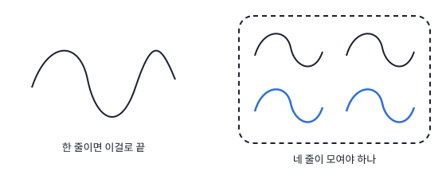

*줄마다 먼저 제 모양으로 접힌 뒤, 여러 줄이 모여 하나가 되기도 해요.*

**정확히 말하면**

아미노산끼리의 결합이 펩타이드 결합(peptide bond)이고, 펩타이드 결합으로 길게 이어진 한 줄 사슬이 폴리펩티드(polypeptide)예요.

단백질은 한 개 또는 두 개 이상의 폴리펩티드로 이루어져요. 그래서 폴리펩티드와 단백질은 같은 말이 아니에요.

1. 폴리펩티드가 1개인 단백질: 1차 구조에서 3차 구조까지 접히면 완성이에요. 3차 구조가 가장 높은 수준이고, 4차 구조는 없어요.
2. 폴리펩티드가 2개 이상인 단백질: 각 폴리펩티드가 먼저 저마다 3차 구조를 이뤄요. 그다음 여러 개가 모여 이룬 구조가 4차 구조(quaternary structure)예요.

대표 예는 산소를 운반하는 헤모글로빈(hemoglobin)이에요. 폴리펩티드 4개(α 사슬 2개, β 사슬 2개)가 각자 3차 구조를 이룬 뒤 모여서 하나의 단백질이 돼요.

따라서 4차 구조는 폴리펩티드가 두 개 이상일 때만 생기는 구조이고, 모든 단백질이 가지는 구조가 아니에요.

**교수님 말씀**

폴리펩티드 한 줄은 김밥 한 줄(야채김밥, 참치김밥)과 같아요. 헤모글로빈은 야채김밥 두 줄과 참치김밥 두 줄을 모은 모둠김밥 단백질이에요.

> 헤모글로빈은 얘네들 네 개가 합체해야만 하나의 단백질이 되는 거예요.

> 단백질은 한 개 혹은 두 개 이상의 폴리펩티드로 이루어진 게 단백질이다.

**꼭 기억해요**

- 폴리펩티드 = 단백질로 착각하기 쉬워요. 한 줄이 곧 단백질 하나일 수도 있고, 여러 줄이 모여야 단백질 하나가 될 수도 있어요. 교수님이 세 번 반복한 구분이에요.
- 모든 단백질이 4차 구조를 가진다고 착각하기 쉬워요. 폴리펩티드가 한 줄인 단백질은 3차 구조가 최고 수준이고 4차 구조가 없어요. "모든", "항상" 같은 말이 보이면 반례(폴리펩티드 한 줄짜리 단백질)가 있는지 확인해요.
- 폴리펩티드의 개수와 접히는 단계를 섞어 생각하기 쉬워요. 폴리펩티드 수는 가닥 수를 말해요. 여러 가닥으로 된 단백질은 가닥마다 먼저 3차 구조를 이룬 다음 모여요. 이렇게 모인 구조가 4차 구조이고, 가닥이 2개 이상일 때만 생겨요.
- 변성을 단백질이 파괴되는 것으로 착각하기 쉬워요. 교수님이 바로 고쳐 말했어요: "파괴가 아니라 구조가 깨지는 거죠". 아미노산 사슬은 남아 있고 접힌 모양이 풀려 기능을 잃는 거예요.

**페이지 요약**

폴리펩티드가 두 개 이상 모인 단백질만 4차 구조를 가지고, 한 줄짜리는 3차 구조에서 끝나요.

*용어*

- **폴리펩티드(polypeptide)** — 펩타이드 결합으로 이어진 아미노산 한 줄 사슬
- **4차 구조(quaternary structure)** — 3차 구조를 이룬 폴리펩티드 여러 개가 모인 구조
- **헤모글로빈(hemoglobin)** — α 2개·β 2개, 폴리펩티드 4개로 된 산소 운반 단백질

---

## 1. 뉴클레오타이드와 핵산

### 뉴클레오타이드의 세 부분

*0908 수업 · 1장 p4*

**쉽게 말하면**

긴 사슬은 똑같이 생긴 작은 블록을 줄줄이 이어 만든 거예요.

블록 하나는 동그라미, 오각형, 글자 조각 세 부분이 붙어 있어요.

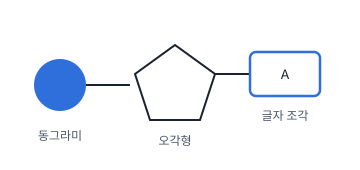

*색칠된 동그라미, 테두리만 있는 오각형, 글자 조각이 붙어 블록 하나가 돼요.*

**정확히 말하면**

핵산은 DNA와 RNA를 말해요. 핵산은 단위체인 뉴클레오타이드(nucleotide)가 줄줄이 이어진 중합체예요. 핵산의 단위체이자 구성 성분은 뉴클레오타이드이고, 뉴클레오티드라고도 적어요.

뉴클레오타이드 하나는 세 부분이 공유결합으로 이어져 있어요.

- **인산기**: 인(P)과 산소로 이루어져 있고 음전하를 띠어요. 뉴클레오타이드 하나에 1개 이상 붙어 있어요.
- **5탄당**: 탄소가 5개인 당이에요. 당이므로 탄수화물에 속해요. 인산기는 이 당의 5′ 탄소에 붙어요.
- **염기**: 질소를 가진 고리 구조(질소함유 염기)예요. 뉴클레오타이드마다 하나씩 붙고, 모두 5가지(A, G, C, T, U)가 있어요.

염기와 5탄당만 붙은 것은 뉴클레오사이드라고 불러요. 뉴클레오타이드 = 뉴클레오사이드(염기 + 5탄당) + 인산기예요.

염기는 고리 개수로 두 무리로 나뉘어요.

| 무리 | 고리 | 속하는 염기 |
|---|---|---|
| 퓨린(purine) | 2개(큰 고리) | 아데닌(A), 구아닌(G) |
| 피리미딘(pyrimidine) | 1개(작은 고리) | 시토신(C), 티민(T), 유라실(U) |

A와 G가 퓨린이라는 이름을 얻은 것은 퓨린이라는 화합물과 닮았기 때문이에요. 퓨린에 속하지 않는 C, T, U는 모두 피리미딘이에요.

DNA와 RNA가 어떤 당과 어떤 염기를 쓰는지는 [DNA와 RNA는 무엇이 다를까](#s1-dna-rna)에서, 블록이 사슬로 이어지는 방법은 [사슬의 뼈대와 이중 나선](#s1-double-helix)에서 다뤄요.

**교수님 말씀**

퓨린에 속하는 두 염기를 외우는 법을 알려 주셨어요. A·G는 "아기", 아기는 순수(pure)하니까 퓨린이에요.

> 아기들은 순수합니다. 아기들 아데닌, 구아닌.

> 굳이 외울 필요는 없지만 아리송하니 좀 찝찝하다 그러면 이런 식으로 외우면

정리할 때 붙잡을 것으로는 뉴클레오타이드의 기본 구조를 꼽으셨어요.

> 일단은 염기쌍 AT, GC 쌍, 그다음에 뉴클레오타이드의 기본 구조

**꼭 기억해요**

**퓨린과 피리미딘을 이름 길이로 착각하기 쉬워요.** 이름이 짧은 퓨린이 고리 2개로 크고, 이름이 긴 피리미딘이 고리 1개로 작아요. 퓨린은 A·G 둘뿐이고, C·T·U는 피리미딘이에요.

**핵산과 뉴클레오타이드를 같은 것으로 착각하기 쉬워요.** 뉴클레오타이드는 블록 하나(단위체)이고, 핵산은 그 블록이 이어진 긴 사슬(중합체)이에요.

**뉴클레오타이드의 세 부분에서 당을 빼먹기 쉬워요.** 염기, 5탄당, 인산기 세 가지가 모두 있어야 뉴클레오타이드예요. 인산기가 없으면 뉴클레오사이드예요.

**페이지 요약**

핵산은 뉴클레오타이드가 이어진 중합체이고, 뉴클레오타이드는 염기·5탄당·인산기 세 부분이에요.

*용어*

- **뉴클레오타이드(nucleotide)** — 핵산의 단위체, 염기 + 5탄당 + 인산기
- **퓨린(purine)** — 고리 2개 염기, A·G
- **피리미딘(pyrimidine)** — 고리 1개 염기, C·T·U

---

### DNA와 RNA는 무엇이 다를까

*0908 수업 · 1장 p4*

**쉽게 말하면**

두 블록은 쌍둥이처럼 닮았는데, 한쪽은 오각형 모서리에 작은 방울이 달려 있고 다른 쪽은 그 방울이 빠져 있어요.

글자 조각도 하나만 달라서, 방울이 빠진 쪽은 T를 쓰고 방울이 달린 쪽은 U를 써요.

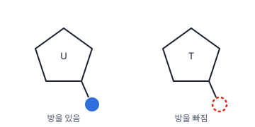

*왼쪽 블록에는 색칠된 방울이 있고, 오른쪽 블록에는 점선 테두리만 남아 방울이 빠졌어요.*

**정확히 말하면**

**프라임(′) 번호.** 염기 안의 원자에도 번호를 매기기 때문에, 헷갈리지 않도록 5탄당의 탄소 번호에만 프라임(′)을 붙여요. 염기와 결합한 당 탄소가 1′ 탄소이고, 그 옆이 2′ 탄소, 이어서 3′, 4′ 탄소이며, 인산기가 붙는 탄소가 5′ 탄소예요.

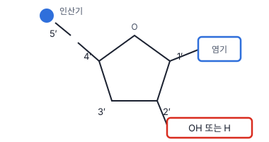

*2′ 탄소 옆 테두리 칸에 무엇이 붙었는지가 두 당을 가르는 기준이에요.*

**두 가지 5탄당.**

- 리보스(ribose): 2′ 탄소에 OH가 붙어 있어요. 원래 형태의 당이고, RNA의 당이에요.
- 디옥시리보스(deoxyribose): 2′ 탄소에서 산소가 빠져 H만 붙어 있어요. 디-(de-)는 "떨어지다", 옥시(oxy)는 산소라서 "산소가 빠진 리보스"라는 뜻이에요. DNA의 당이에요.

그래서 DNA는 디옥시리보핵산(deoxyribonucleic acid), RNA는 리보핵산(ribonucleic acid)이에요. 강의노트의 "데옥시리보오스", 웹과제의 "디옥시리보오스"는 디옥시리보스와 같은 것이고, "리보오스"는 리보스와 같은 것이에요.

**두 가지 염기 세트.** DNA는 A, G, C, 티민(T)을 쓰고, RNA는 티민 대신 유라실(U)을 써서 A, G, C, U를 써요. A, G, C는 둘 다 써요.

| 구분 | DNA | RNA |
|---|---|---|
| 5탄당 | 디옥시리보스(2′ 탄소에 H) | 리보스(2′ 탄소에 OH) |
| 염기 | A, G, C, T | A, G, C, U |
| 가닥 | 두 가닥 | 대개 한 가닥 |

**구조를 보고 분류하기.** 순서대로 따져요.

1. 2′ 탄소를 봐요. OH면 리보스이고 RNA, H면 디옥시리보스이고 DNA예요.
2. 염기를 봐요. 유라실(U)이면 RNA, 티민(T)이면 DNA예요. A·G·C는 둘 다 있으니 이것만으로는 가를 수 없어요.
3. 염기가 어느 무리인지 물으면 고리 수로 가려요. 유라실·티민·시토신은 피리미딘이고, 퓨린은 A·G뿐이에요.

**교수님 말씀**

당 탄소 번호까지 알아야 하는 이유를 미리 짚으셨어요.

> 이거는 DNA 복제할 때 알아야 됩니다. 그래서 지금 알아야 됩니다.

디옥시리보스의 이름은 "2′ 탄소에서 산소가 떨어져 나갔다"는 뜻이라고 풀어 주셨어요. DNA와 RNA의 당과 염기 차이는 수업에서 두 번 정리하셨어요.

**꼭 기억해요**

**프라임을 염기 원자 번호에 붙인다고 착각하기 쉬워요.** 프라임(′)은 5탄당의 탄소 번호에만 붙여요. 염기 원자 번호와 구분하려고 붙이는 표시예요.

> 염기의 원자들하고 헷갈리면 안 되기 때문에

**리보스와 디옥시리보스를 뒤바꾸기 쉬워요.** 리보스는 2′ 탄소에 OH, 디옥시리보스는 2′ 탄소에 H예요. 산소가 "빠진" 쪽이 디옥시리보스이고, 그것이 DNA의 당이에요.

**DNA 염기와 RNA 염기를 섞기 쉬워요.** DNA는 ATGC, RNA는 AUGC예요. 티민(T)과 유라실(U)만 서로 바뀌어요.

**유라실을 퓨린으로 착각하기 쉬워요.** 퓨린은 A·G뿐이고, 유라실은 티민·시토신과 같은 피리미딘이에요.

**페이지 요약**

DNA는 디옥시리보스(2′ 탄소에 H)와 ATGC를, RNA는 리보스(2′ 탄소에 OH)와 AUGC를 써요.

*용어*

- **리보스(ribose)** — 2′ 탄소에 OH, RNA의 당
- **디옥시리보스(deoxyribose)** — 2′ 탄소에서 산소가 빠진 당, DNA의 당
- **프라임(′)** — 당의 탄소 번호에만 붙이는 표시

---

### 사슬의 뼈대와 이중 나선

*0908 수업 · 1장 p4*

**쉽게 말하면**

두 기둥 사이를 짝꿍 글자들이 가로대처럼 잇는 사다리 모양이에요.

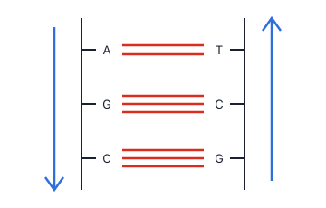

*양쪽 기둥은 서로 반대 방향으로 달리고, 가로대마다 짝이 정해진 글자 둘이 A–T는 선 2개, G–C는 선 3개로 손을 잡아요.*

**정확히 말하면**

**당-인산 뼈대.** 뉴클레오타이드가 사슬로 이어지는 과정은 이래요.

1. 한 뉴클레오타이드의 당(3′ 탄소)이 다음 뉴클레오타이드의 인산기와 공유결합해요. 그 인산기는 다음 당의 5′ 탄소에 붙어 있어요.
2. 이것이 되풀이되어 "인산-당-인산-당…"이 번갈아 이어진 당-인산 뼈대가 생겨요.
3. 염기는 뼈대에 들어가지 않고 옆으로 삐져나와요. RNA도 똑같은 방식으로 이어져요.

연속된 당-인산 사슬은 핵산만의 특징이에요. 다른 고분자와 나란히 놓으면 이렇게 갈려요.

| 고분자 | 무엇이 이어졌나 | 당-인산 뼈대 |
|---|---|---|
| 핵산(DNA, RNA) | 뉴클레오타이드의 당과 인산기가 번갈아 | 있음 |
| 단백질 | 아미노산이 펩타이드 결합으로 | 없음 |
| 다당류(녹말, 셀룰로오스 등) | 당끼리만, 인산 없이 | 없음 |
| 지질(중성지질, 인지질 등) | 당-인산이 반복되는 사슬이 아님 | 없음 |

인지질에 인산이 들어 있고 다당류에 당이 들어 있어도, 당과 인산이 번갈아 길게 반복되는 사슬은 핵산에만 있어요.

**가닥 수.** RNA는 대개 한 가닥이고, DNA는 두 가닥이 마주 봐요.

**역평행(antiparallel).** 사슬의 한쪽 끝은 5′ 탄소에 인산기가 달린 5′ 끝이고, 반대쪽은 3′ 끝이에요. 사슬은 5′에서 3′ 방향으로 이어져요. DNA에서 한 가닥이 위에서 아래로 5′→3′이면, 맞은편 가닥은 아래에서 위로 5′→3′이에요. 두 가닥 모두 5′→3′이지만 방향이 서로 거꾸로이고, 이것을 역평행 구조라고 해요.

**상보적 염기쌍.** 삐져나온 염기는 맞은편 가닥의 염기와 수소결합해요. 짝은 정해져 있어요.

- G는 C하고만 짝을 지어 수소결합 3개를 만들어요.
- A는 T하고 짝을 지어 수소결합 2개를 만들어요.

짝이 정해져 있다는 뜻에서 상보적(complementary)이라고 해요. 한쪽 가닥 서열이 정해지면 맞은편 가닥은 저절로 정해져요. 예를 들어 한 가닥에 CAGT가 있으면 맞은편 자리에는 차례로 GTCA가 놓여요.

**이중 나선(double helix).** 두 가닥은 곧은 사다리처럼 나란하지 않고 꼬여서 나선을 이뤄요. 한 바퀴에 염기쌍이 약 10쌍 들어가고, 이웃한 염기쌍 사이 거리는 0.34 nm예요.

**샤가프의 법칙(Chargaff's rule).** 이중 가닥 DNA에서는 A 맞은편에 반드시 T가, G 맞은편에 반드시 C가 있어요. 그래서 A의 수와 T의 수가 같고, G의 수와 C의 수가 같아요. 두 가닥이 짝을 이룬 DNA에서 성립해요. RNA는 대개 한 가닥이라 두 가닥 사이의 짝이 기본 구조가 아니에요.

$$
A = T,\quad G = C,\quad A + T + G + C = 100\%
$$

비율 계산은 짝부터 채우고 남은 것을 반으로 나눠요. 이중 가닥 DNA에서 G가 전체 염기의 15%라면:

1. G = C이므로 C도 15%예요. G + C = 30%예요.
2. 나머지 A + T = 100% − 30% = 70%예요.
3. A = T이므로 둘로 나눠 A = 35%, T = 35%예요.

흔한 실수는 합계(G + C)를 한 염기의 비율로 쓰거나, 짝이 아닌 A와 G를 같다고 놓는 거예요.

**교수님 말씀**

샤가프의 법칙을 질문으로 던지고 스스로 답하셨어요.

> G 개수랑 C 개수는 무조건 같다, 다르다?... 무조건 같겠죠?

> 일단 DNA 구조를 아는 것이 중요합니다.

오늘은 간단히만 보고, DNA 구조는 5장에서 다시 자세히 배운다고 하셨어요.

> DNA의 구조는 나중에 5장에서 다시 또 봐야겠어요.

세포 하나에 든 DNA 전체 길이 계산은 시간이 없어 나중으로 미루셨고, "사람 키보다 크다"는 결론만 말씀하셨어요.

**꼭 기억해요**

**두 가닥이 같은 방향으로 달린다고 착각하기 쉬워요.** 두 가닥 모두 5′→3′으로 읽지만 서로 거꾸로 놓여 있어요. 이것이 역평행이에요.

**수소결합 수를 뒤바꾸기 쉬워요.** G–C는 수소결합 3개, A–T는 수소결합 2개예요.

**샤가프의 법칙을 "A = G"로 착각하기 쉬워요.** 같아지는 것은 짝끼리(A = T, G = C)예요. A와 G가 같다는 보장은 없어요. 이 법칙은 이중 가닥 DNA에서 성립해요.

**인산이나 당이 들어 있으면 당-인산 뼈대라고 착각하기 쉬워요.** 인지질에는 인산이, 다당류에는 당이 있지만, 당과 인산이 번갈아 반복되는 사슬은 핵산만 가져요. 단백질의 뼈대는 아미노산 사이의 펩타이드 결합이에요.

**페이지 요약**

핵산은 당-인산 뼈대를 가지고, DNA는 역평행인 두 가닥이 상보적 염기쌍으로 이어진 이중 나선이에요.

*핵심 식*

- 샤가프의 법칙

  $$
  A = T,\quad G = C
  $$

*용어*

- **역평행(antiparallel)** — 두 가닥이 모두 5′→3′이지만 서로 거꾸로 놓임
- **상보적(complementary)** — G–C는 수소결합 3개, A–T는 수소결합 2개로 짝이 정해짐
- **이중 나선(double helix)** — 두 가닥이 꼬인 나선, 한 바퀴 약 10쌍

---

## 2. 세포의 크기와 원핵·진핵세포

### 세포는 왜 작을까

*0908 수업 · 1장 p4*

**쉽게 말하면**

큰 덩어리를 잘게 나누면 바깥에 닿는 면이 늘어나요.

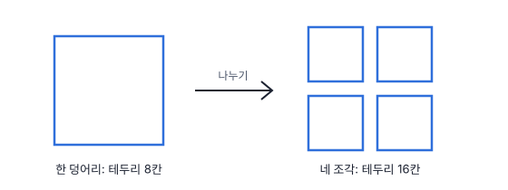

*양은 같아도 네 조각으로 나누면 바깥 테두리가 8칸에서 16칸으로 두 배가 돼요.*

그래서 세포는 크게 자라지 않고 작은 채로 수를 늘려요.

**정확히 말하면**

세포는 모든 생명체의 구조와 기능의 기본 단위이고, 스스로 복제할 수 있는 가장 작은 단위예요. 대부분 너무 작아서 현미경으로만 관찰돼요.

몸이 큰 생물은 세포가 큰 것이 아니라 세포 수가 많아요. 코끼리는 쥐보다 세포가 큰 게 아니라 세포가 더 많고, 사람이 자랄 때도 세포 하나가 커지는 게 아니라 세포 수가 늘어나요.

#### 현미경과 해상도

- 광학현미경(light microscope)은 가시광선을 쬐어 시료를 봐요.
- 해상도(resolution)는 두 점을 두 점으로 구분할 수 있는 **최소 거리**예요. 이 거리가 짧을수록, 곧 해상도 숫자가 작을수록 더 잘 구분하는 좋은 현미경이에요.
- 이 최소 거리는 쬐는 빛의 파장(wavelength)에 비례해요. 파장이 짧을수록 최소 거리가 줄어 더 잘 보여요. 그래서 파란빛을 쬐는 편이 빨간빛보다 해상도가 좋아요.
- 가시광선은 보라색보다 파장이 짧아질 수 없어요. 그래서 광학현미경에는 한계가 있어요.
- 전자현미경(electron microscope)은 빛 대신 전자빔을 쬐어 파장을 획기적으로 짧게 만들어요. 최소 거리가 훨씬 작아지니 세포소기관은 물론 고분자까지 볼 수 있어요.

#### 표면적/부피 비

세포는 끊임없이 물질을 수송해야 해요. 포도당과 산소는 들어오고, 이산화 탄소(CO₂)와 노폐물은 나가요. 이 출입은 모두 세포의 표면을 통해 일어나요. 강의노트는 세포가 작은 이유를 "표면적 대 부피 비를 높게 유지하기 위해"라고 정리해요.

한 변이 a인 정육면체 세포라면 표면적은 6a², 부피는 a³이에요. 둘을 나누면 표면적/부피 비는 이렇게 돼요.

$$
\frac{6a^2}{a^3} = \frac{6}{a}
$$

비는 한 변 길이에 반비례해요. 수업에서 든 예로 한 변이 2배가 될 때를 계산해 볼게요.

1. 한 변 1 μm: 표면적 6 × 1² = 6 μm², 부피 1³ = 1 μm³, 비 6 ÷ 1 = 6이에요.
2. 한 변 2 μm: 표면적 6 × 2² = 24 μm², 부피 2³ = 8 μm³, 비 24 ÷ 8 = 3이에요.
3. 비교: 면적은 4배, 부피는 8배가 되어 비는 6에서 3으로 절반이 됐어요. 늘어난 부피를 표면적이 감당하지 못하는 거예요.

일반적으로 비는 6/a이므로, 한 변이 k배가 되면 비는 1/k배가 돼요.

비가 줄면 부피에 비해 물질이 드나드는 표면이 모자라 수송이 느려져요. 그러면 생리적으로 불리해지므로 세포는 작아야 해요.

#### 직접 해 보기: 세포가 커지면 표면적/부피 비는? *(정적 스냅샷 — 직접 조작은 HTML 버전)*

정육면체 세포의 한 변 길이를 움직이면 표면적, 부피, 표면적/부피 비가 바뀌고, 곡선 위의 점이 따라 움직여요.

표면적 6a² = **24** μm², 부피 a³ = **8** μm³, 표면적/부피 비 6/a = **3**

범례: 표면적/부피 비 곡선(6/a) · 지금 고른 한 변 길이

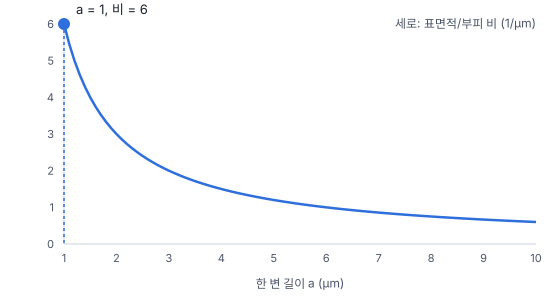

*한 변 1 μm: 표면적 6 μm², 부피 1 μm³, 비 6*

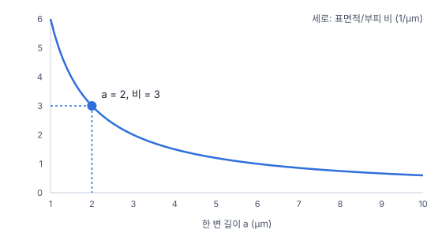

*한 변 2 μm: 표면적 24 μm², 부피 8 μm³, 비 3*

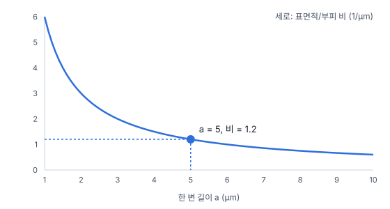

*한 변 5 μm: 표면적 150 μm², 부피 125 μm³, 비 1.2*

| 한 변 a | 표면적 6a² | 부피 a³ | 표면적/부피 비 6/a |
|---|---|---|---|
| 1 μm | 6 μm² | 1 μm³ | 6 |
| 2 μm | 24 μm² | 8 μm³ | 3 |
| 5 μm | 150 μm² | 125 μm³ | 1.2 |

세포가 커질 때 표면적과 부피가 서로 다른 속도로 늘어나는 모습을 [세포 크기 모형](../%EC%9D%B8%ED%84%B0%EB%A0%89%ED%8B%B0%EB%B8%8C_01_%EC%84%B8%ED%8F%AC_%ED%81%AC%EA%B8%B0%EC%99%80_%ED%91%9C%EB%A9%B4%EC%A0%81_%EB%B6%80%ED%94%BC_%EB%B9%84.html)에서 수치와 함께 확인해 보세요.

**교수님 말씀**

세포를 도시에 빗댔어요. 도시에 발전소와 공장이 있어야 하듯, 세포에서 에너지를 대는 발전소는 미토콘드리아, 단백질을 만드는 공장은 리보솜이에요. 미토콘드리아는 [미토콘드리아와 세포 내 공생설](#s4-mito)에서 이어져요.

해상도는 모니터에 빗댔어요.

> "해상도 숫자가 낮을수록 모니터가 비싸죠."

표면적/부피 비는 영화 〈터미네이터 2〉의 액체금속 로봇 장면으로 보여 줬어요. 총에 맞아 로봇이 산산조각 나자 부피는 그대로인데 바깥과 닿는 표면적이 넓어졌어요. 그래서 열을 빨리 받아 금방 녹았고, 주인공들은 그 틈에 도망쳤어요.

> "표면적 비율을 모르는 터미네이터 때문이죠."

교실 비유도 들었어요. 교실이 커져 학생이 더 많이 들어가도 학생 한 명당 창문 면적은 오히려 줄어요. 그러면 환기가 안 되어 숨이 차고 더 졸려요.

> "그래서 세포의 크기는 작아야 된다."

**꼭 기억해요**

**해상도의 숫자와 성능을 거꾸로 읽기 쉬워요.** 해상도는 구분할 수 있는 최소 거리라서 숫자가 **작을수록** 성능이 좋아요. 교수님은 이 점을 세 번 되풀이했어요.

> "숫자가 작을수록 좋은 거기 때문에."

전자현미경 설명에서 "해상도가 엄청 커지게 되고"라고 들렸지만, 바르게는 해상도 수치(최소 거리)가 작아져 훨씬 잘 보인다는 뜻이에요.

**표면적 자체와 표면적/부피 비를 섞기 쉬워요.** 세포가 커지면 표면적 자체는 커지지만, 비는 작아져요.

> "표면적은 커지지만 … 단위 부피당 표면적의 비율은 오히려 작아집니다."

비는 표면적이 몇 배 늘었는지로 짐작하지 말고 6/a로 따로 계산해요. 한 변이 2배면 표면적은 4배로 커지지만 비는 절반이 돼요.

**몸이 커지는 것을 세포가 커지는 것으로 착각하기 쉬워요.** 몸이 커지는 것은 세포 수가 늘어나는 거예요.

> "세포가 커지는 게 아니죠. 세포 숫자가 많아지는 겁니다."

**페이지 요약**

세포는 표면적/부피 비를 높게 유지하려고 작은 채로 수를 늘려요.

*핵심 식*

- 정육면체 세포의 표면적/부피 비

  $$
  \frac{6a^2}{a^3} = \frac{6}{a}
  $$

*용어*

- **해상도(resolution)** — 두 점을 두 점으로 구분할 수 있는 최소 거리, 작을수록 좋아요
- **전자현미경(electron microscope)** — 전자빔으로 파장을 줄여 세포소기관과 고분자까지 봐요
- **표면적/부피 비** — 세포가 커질수록 줄어들어 수송이 느려져요

---

### 원핵세포와 진핵세포

*0908 수업 · 1장 p4–p5*

**쉽게 말하면**

세균의 세포는 방이 없는 텐트이고, 우리 몸의 세포는 방이 나뉜 아파트예요.

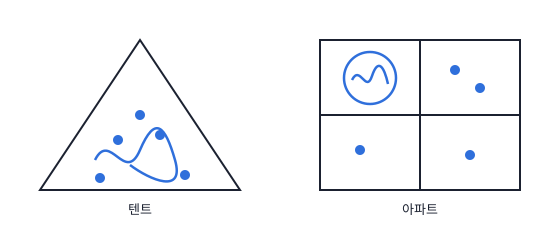

*텐트 안에는 설계도(구불구불한 선)와 살림살이(색칠된 점)가 한데 섞여 있어요. 아파트는 벽으로 방을 나누고, 설계도는 동그란 방 안에 따로 넣어 둬요.*

**정확히 말하면**

#### 둘을 가르는 기준: 핵(핵막)

세포는 원핵세포(prokaryotic cell)와 진핵세포(eukaryotic cell) 두 가지로 나뉘어요. 가르는 기준은 **핵막으로 둘러싸인 핵이 있느냐**예요.

- 원핵생물(prokaryote, "핵 이전"): 핵막이 없어 핵이 없어요. DNA는 핵양체(nucleoid)로 존재해요.
- 진핵생물(eukaryote, "진짜 핵"): 핵막이 핵을 세포질과 분리하고, 그 핵 안에 DNA가 들어 있어요.

초기 지구의 생명은 아마 단순하고 작은 원핵생물이었고, 원핵세포가 나타나고 약 10억 년이 지나서야 진핵세포가 나타났어요.

진핵세포에는 막으로 둘러싸인 구획, 곧 막성 세포소기관(membrane-bound organelle)이 있어요. 핵, 미토콘드리아, 골지체(골지복합체), 조면·활면 소포체, 리소좀이 그 예예요. 원핵세포에는 핵도 없고 막성 세포소기관도 없어요.

#### 어떤 생물이 어느 쪽일까

0901 수업의 3영역 분류와 그대로 이어져요.

| 구분 | 속하는 영역과 계 |
|---|---|
| 원핵생물 | 진정세균 영역, 고세균 영역(예: 세균, 대장균) |
| 진핵생물 | 진핵생물 영역 = 원생생물계, 식물계, 균계, 동물계(사람 포함) |

#### 원핵세포의 구조

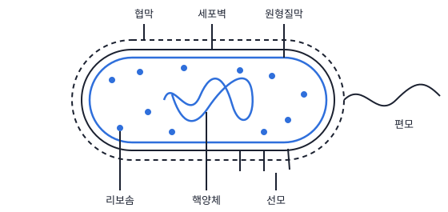

*원핵세포(교재 그림 1.19의 대장균을 단순하게 그림). 점선 테두리가 협막, 그 안의 테두리가 세포벽, 가장 안쪽 테두리가 원형질막이에요. 가운데 구불구불한 선이 핵양체이고, 흩어진 색칠된 점이 리보솜이에요.*

원핵세포는 세포 안에 막으로 둘러싸인 구조가 거의 없거나 아예 없어요. 그래도 살아가는 데 꼭 필요한 것은 모두 갖고 있어요. 안쪽부터 바깥쪽 순서로 볼게요.

- 핵양체(nucleoid): 핵은 아니지만 DNA가 덩어리로 뭉쳐 있는 부분이에요("마치 핵인 것 같은"). 핵막으로 둘러싸여 있지 않아요.
- 리보솜: 단백질을 만드는 공장이에요. 원핵세포라도 단백질을 만들지 않고는 살 수 없으므로 리보솜이 있어요. 리보솜은 막으로 둘러싸인 구조가 아니에요.
- 원형질막(plasma membrane, 세포막): 인지질 이중층으로 된 경계예요.
- 세포벽(cell wall): 막만으로는 불안해서 그 바깥을 감싸는 더 단단한 벽이에요.
- 협막(capsule): 세포벽 바깥의 끈적한 다당류 층이에요. 있는 세균도 있고 없는 세균도 있으며, 있으면 한 번 더 보호받아요.
- 편모: 꼬리처럼 긴 구조로, 있으면 헤엄쳐 이동할 수 있어요. 표면의 짧은 털은 선모예요.

#### 어디에 있는 구조일까

| 구조 | 있는 곳 |
|---|---|
| DNA, 원형질막, 리보솜 | 모든 세포(원핵·진핵) |
| 세포벽 | 세균(원핵)과 식물세포(진핵), 동물세포에는 없음 |
| 핵(핵막) | 진핵세포만 |
| 막성 세포소기관(소포체, 골지체, 미토콘드리아, 리소좀) | 진핵세포만 |
| 핵양체 | 원핵세포만(원핵의 표지) |

식물 세포벽의 성분은 셀룰로오스예요(0903 수업, 0908 복습).

#### 모든 세포에 공통인 것과 원핵에 없는 것

원핵세포까지 포함해 모든 세포에 공통인 것은 이것들이에요.

- 막으로 둘러싸인 경계(원형질막)
- 유전 물질(DNA)과 이를 복제해 증식하는 능력. 세포는 스스로 복제할 수 있는 가장 작은 단위이고, 생식과 유전은 모든 생물의 특징이에요(0901 수업).
- 물질대사. 이것도 모든 생물의 특징이에요(0901 수업).
- 단백질을 만드는 리보솜

핵막과 막성 세포소기관은 원핵세포에 없어요. 그래서 이것들은 진핵세포의 특징이지 모든 세포의 특징이 아니에요. "모든 세포", "반드시" 같은 말이 붙은 설명은 원핵세포에도 성립하는지부터 확인해요.

진핵세포는 훨씬 복잡해요. 핵은 [핵: 이중막·핵공·염색질·인](#s3-nucleus), 소포체와 골지체는 [소포체·골지체와 단백질이 가는 길](#s3-er-golgi), 리소좀은 [내막계와 리소좀](#s3-endomembrane), 미토콘드리아는 [미토콘드리아와 세포 내 공생설](#s4-mito)에서 이어져요.

**교수님 말씀**

> "원핵세포는 텐트고 진핵세포는 30평대 아파트입니다."

원핵세포는 텐트나 컨테이너 박스예요. 거실과 침실 구분 없이 DNA와 살림살이가 한곳에 엉켜 있어요. 구조는 단순하지만 짐 싸서 이동하거나 번식하기에는 빠르고 효율적이에요.

진핵세포는 방 두 개, 거실, 화장실 두 개가 벽으로 나뉜 30평대 아파트예요. 유전자는 안방인 핵에, 에너지는 주방인 미토콘드리아에 둬요. 독립된 방(소기관)이 있어 복잡한 일을 동시에 할 수 있어요. 이렇게 방을 나누는 구획화(compartmentalization) 덕분에 복잡한 생명체로 진화할 수 있었어요.

> "화장실도 없고 … 방이 없어요."

텐트든 컨테이너든 둘러싸는 경계는 있어야 하고, 그 경계가 원형질막이에요. 세균은 단세포라 막만으로는 불안해서 바깥에 세포벽이 있고, 그걸로도 모자라 협막을 한 겹 더 두기도 해요.

> "원핵세포라 할지라도 유전 물질이 없을 수는 없죠."

> "원핵세포라 할지라도 단백질을 안 만들고 살 수는 없습니다."

**꼭 기억해요**

**원핵세포에 없는 것과 있는 것을 섞기 쉬워요.** "원핵세포는 단순하니 DNA나 리보솜도 없다"거나 "핵양체가 곧 핵이다"라고 착각하기 쉬워요. 원핵세포에 **없는** 것은 핵(핵막)과 막성 세포소기관(소포체, 골지체, 미토콘드리아, 리소좀)이에요. **있는** 것은 DNA(핵양체에), 리보솜, 원형질막, 세포벽이에요.

> "DNA가 없을 수는 없어요."

**세포 내 공생설은 미토콘드리아가 어디서 왔는지에 대한 이야기일 뿐이에요.** 원핵세포에는 미토콘드리아 같은 막성 세포소기관이 없어요. 자세한 것은 [미토콘드리아와 세포 내 공생설](#s4-mito)에서 봐요.

**세포벽과 협막을 섞기 쉬워요.** 세포벽은 원형질막 바로 바깥의 단단한 벽이에요. 협막은 세포벽 **바깥**의 다당류 층이고, 모든 세균에 있는 것이 아니에요.

> "없는 애들도 있고 있는 애들도 있고."

**세포벽을 "원핵세포에만 있는 것"으로 착각하기 쉬워요.** 식물세포도 셀룰로오스로 된 세포벽을 가져요. 세포벽은 원핵세포와 진핵세포(식물세포) 양쪽에서 발견돼요.

원핵세포 표면의 털을 수업에서 "섬모"라고 불렀지만, 원핵세포의 짧은 털은 보통 선모(pili)라고 불러요(교재 그림 1.19). 섬모(cilia)는 진핵세포의 구조예요.

**보충 · 수업에서 다루지 않았어요**

중심체(centrosome)는 진핵세포, 주로 동물세포에 있는 구조이고 원핵세포에는 없어요. 교재 그림 1.20(a) 동물세포에는 세포 중심에 한 쌍의 중심립(centriole)이 그려져 있지만, 그림 1.19 원핵세포(대장균)에는 없어요. 그래서 중심체는 원핵·진핵 공통 구조가 아니에요.

교재 그림 1.20 설명은 세포벽을 동물세포에는 없고 식물세포에 있는 구조로 소개해요. 식물 세포벽 자체는 다음 시간 범위(p6)예요.

출처: 교재 1장 p.17 그림 1.19, p.18 그림 1.20

**페이지 요약**

원핵세포와 진핵세포를 가르는 기준은 핵막으로 둘러싸인 핵이 있느냐예요.

*용어*

- **핵양체(nucleoid)** — 원핵세포에서 DNA가 뭉쳐 있는 부분, 핵막이 없어요
- **막성 세포소기관** — 막으로 둘러싸인 구획(핵, 소포체, 골지체, 미토콘드리아, 리소좀), 진핵세포에만 있어요
- **협막(capsule)** — 세포벽 바깥의 다당류 층, 있는 세균만 있어요

**보충 · 수업에서 다루지 않았어요**

- 중심체는 진핵세포, 주로 동물세포의 구조이며 원핵세포에는 없어요.
- 동물세포에는 세포벽이 없고 식물세포에는 있어요. 식물 세포벽 자체는 다음 수업 범위예요.

[본문 보충 보기](#s2-prokaryote-supp-1)

---

## 3. 진핵세포의 핵과 내막계

### 핵: 이중막·핵공·염색질·인

*0908 수업 · 1장 p5*

**쉽게 말하면**

세포 한가운데에는 벽이 두 겹인 방이 있고, 소중한 설계도 책은 그 방 밖으로 나가지 않아요.

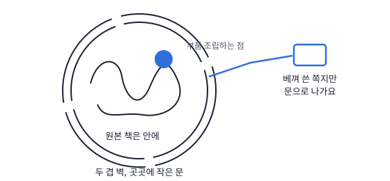

*책 대신 베껴 쓴 쪽지만 벽에 난 작은 문으로 나가요.*

**정확히 말하면**

핵은 핵막으로 둘러싸여 세포질과 나뉜 구획이에요. 핵막은 이중막(double membrane)이에요.

| 구분 | 뜻과 예 |
|---|---|
| 이중층(bilayer) | 인지질 두 겹으로 된 막 하나(2겹). 예: 세포막(원형질막) |
| 이중막(double membrane) | 이중층 막이 두 개(4겹). 예: 핵막, 미토콘드리아 |

세포막은 이중층 하나로 된 막이고, 이중막이 아니에요. 핵막은 그런 막이 두 개예요.

**핵공(nuclear pore)이 필요한 이유**

1. 단백질을 만드는 정보인 DNA는 핵 안에 있고, 단백질을 만드는 리보솜은 핵 밖에 있어요.
2. DNA는 소중해서 핵 밖으로 내보내지 않아요. 대신 DNA를 베낀 RNA가 핵 밖으로 나가 리보솜과 만나요.
3. RNA는 전하를 띠고 극성이 크며 크기도 커요. 그래서 소수성인 인지질 막을 그냥 뚫고 지나가지 못해요.
4. 그래서 두 막을 꿰뚫는 구멍인 핵공으로 RNA 같은 큰 분자가 드나들어요.

핵공은 RNA 같은 큰 분자의 통로예요. DNA는 핵 밖으로 나가지 않으므로, DNA가 뭉친 염색체(chromosome)도 핵공으로 드나들지 않고 핵 안에 머물러요.

**DNA를 핵에 넣는 방법**

세포 하나의 DNA를 모두 이으면 사람 키보다 길고, 폭은 약 2 nm로 아주 가늘어요. 작은 핵에 넣으려면 감아야 해요. DNA는 히스톤이라는 농구공 모양의 단백질을 감고 있어요.

| 상태 | 언제, 어떤 모양 |
|---|---|
| 염색질(chromatin) | 평상시. DNA 정보를 써야 하므로 풀려 있어요. |
| 염색체(chromosome) | 세포 분열 때. 강하게 응축되어 염색하면 현미경으로 보여요. |

세포 분열 전에는 먼저 DNA 복제가 일어나요. 복제한 뒤 두 세포가 하나씩 나눠 가져요.

**인(nucleolus)**

핵 속의 새까만 동그라미예요. 막으로 싸인 따로 된 구조물이 아니라, rRNA(리보솜을 이루는 RNA)가 많이 뭉쳐서 까맣게 보이는 곳이에요. 리보솜은 rRNA와 단백질이 합쳐진 것이고, 이 조립이 인에서 일어나요(강의노트: "인: 리보솜 단위체 형성"). 조립된 리보솜은 핵 밖으로 나가 단백질을 만들어요.

함께 알아 둘 소기관: 활면 소포체의 지질 합성은 [소포체·골지체와 단백질이 가는 길](#s3-er-golgi), 미토콘드리아의 ATP 생산은 [미토콘드리아와 세포 내 공생설](#s4-mito)에서 확인해요.

**교수님 말씀**

> "이중층하고 이중막하고 다른 거냐? … 다릅니다."

DNA는 핵 밖으로 내보내지 않아요. "DNA는 소중하니까요… 함부로 흘려서 안 됩니다."

RNA가 막을 못 뚫으니 "드릴로 구멍을 뚫어놨는데, 그 구멍을 … 핵공"이라고 해요.

아주 긴 실뭉치를 가방에 넣으려면 감는 수밖에 없듯, DNA도 히스톤에 감겨 들어가요.

세포 분열은 "이사 가는 날"이에요. 자취하던 두 친구가 헤어질 때 짐을 복사해서 하나씩 가져가요. 그래서 "세포 분열하기 전에는 항상 DNA 복제가 먼저 일어납니다." 이삿날에는 TV를 보지 않고 짐을 싸요. "DNA를 꼭꼭 싸야 돼요, 포장을 해야 돼." 이것이 응축된 염색체예요. 평상시에는 TV도 보고 책도 보려고 짐을 다 풀어 놓고 살아요. 이것이 염색질이에요.

> "평상시에는 … 염색질 형태로, 세포 분열할 때는 염색체 형태로 응축된다."

**꼭 기억해요**

- 이중층(bilayer)과 이중막(double membrane)을 같은 말로 착각하기 쉬워요. 이중층은 인지질 두 겹으로 된 막 하나(세포막), 이중막은 그런 막이 두 개(핵막, 인지질 층으로 세면 4겹)예요. 교수님이 네 번 되풀이했어요.
- 핵공으로 염색체(DNA)가 드나든다고 착각하기 쉬워요. 핵공으로 드나드는 것은 RNA, 단백질 같은 큰 분자이고, DNA는 핵 밖으로 나가지 않아요.
- 염색질과 염색체를 서로 다른 물질로 착각하기 쉬워요. 둘 다 히스톤에 감긴 DNA이고, 평상시 풀린 상태가 염색질, 분열 때 응축되어 보이는 상태가 염색체예요.
- 인을 리보솜이 단백질을 만드는 곳으로 착각하기 쉬워요. 인은 rRNA가 뭉친 곳이자 리보솜이 조립되는 곳(핵 안)이고, 리보솜이 일하는 곳은 핵 밖이에요. 인은 막으로 싸인 따로 된 구조물도 아니에요.
- 핵 속의 인(nucleolus)과 인산기의 인(원소 P)을 같은 것으로 착각하기 쉬워요. 이름만 같고 전혀 다른 것이에요.
- "항상"이 붙은 말은 반례가 있는지 확인하는 신호예요. "분열 전에는 항상 DNA 복제가 먼저"는 교수님이 강조한 바른 진술이에요.

**보충 · 수업에서 다루지 않았어요**

핵공은 핵에서 나가는 RNA만의 통로가 아니에요. RNA와 단백질 같은 큰 분자가 핵과 세포질 사이를 오가는 길이에요. 시토졸의 자유 리보솜이 만든 단백질 중 핵에서 일하는 것(예: DNA를 감는 히스톤)은 핵공을 지나 핵으로 들어가요.

출처: 교재 1장 p.17(핵공), p.19(자유 리보솜이 만든 단백질)

**페이지 요약**

핵막은 이중막이고, 핵공으로는 RNA 같은 큰 분자가 드나들 뿐 DNA는 핵 밖으로 나가지 않아요.

*용어*

- **이중막(double membrane)** — 이중층 막이 두 개, 인지질 4겹(핵막)
- **핵공(nuclear pore)** — 핵막을 꿰뚫는 구멍, RNA·단백질 같은 큰 분자의 통로
- **인(nucleolus)** — rRNA가 뭉친 곳, 리보솜 조립 장소

**보충 · 수업에서 다루지 않았어요**

- 핵공은 RNA가 나가는 길이면서 단백질이 들어오는 길이기도 해요. 자유 리보솜이 만든 히스톤 같은 핵 단백질도 핵공을 지나 들어가요.

[본문 보충 보기](#s3-nucleus-supp-1)

---

### 소포체·골지체와 단백질이 가는 길

*0908 수업 · 1장 p5*

**쉽게 말하면**

세포 속 공장에서 만든 물건은 작은 봉투에 담겨 우체국에 들렀다가 제자리로 배달돼요.

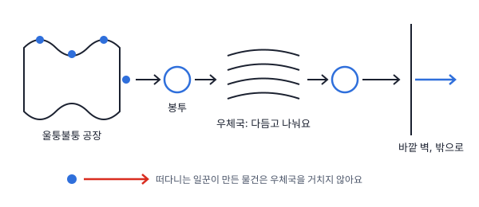

*공장 벽에 붙어 일하는 일꾼이 만든 물건만 이 길을 타요.*

**정확히 말하면**

핵 바깥이 세포질이고, 여기에 소포체, 골지체, 리소좀 같은 세포소기관이 있어요. 먼저 모양으로 구분할 줄 알아야 해요.

| 소기관 | 모양 | 하는 일 |
|---|---|---|
| 조면 소포체(rough ER) | 핵막이 밖으로 이어진 막. 안쪽 공간이 미로처럼 이어져 있고, 겉에 리보솜이 붙어 울퉁불퉁("거친 면") | 붙은 리보솜이 만든 단백질이 안쪽 공간으로 들어가 3차원 구조를 갖추고 조금 변형돼요(잘리거나 무언가가 붙어요) |
| 활면 소포체(smooth ER) | 리보솜이 없어 막이 매끄러움("매끈 면") | 지질 합성, 독성 물질 해독 |
| 골지체(Golgi apparatus) | 서로 이어지지 않은 닫힌 납작 주머니들이 나란히 포개진 모양 | 받은 단백질을 화학적으로 한 번 더 변형하고, 최종 목적지별로 분류해요 |

단백질은 만들어지자마자 일하지 않아요. 구조를 갖추고 잘리거나 무언가가 붙는 변형을 거쳐야 기능해요. 그리고 기능에 따라 가는 곳이 달라요: 히스톤은 핵, ATP를 만드는 단백질은 미토콘드리아, 포도당 수송 단백질은 세포막, 인슐린 같은 호르몬은 세포 밖(혈액)으로 가요.

**소낭을 타는 경로**

1. 조면 소포체에 붙은 리보솜이 단백질을 만들어요.
2. 단백질이 조면 소포체 안쪽 공간으로 들어가 접히고 조금 변형돼요(1차 가공).
3. 조면 소포체 막이 단백질을 담은 채 떨어져 나와 소낭(vesicle, 강의노트 표기 "소포")이 돼요.
4. 소낭이 골지체 막과 합쳐지면 단백질이 골지체 안으로 들어가요.
5. 골지체가 화학적으로 한 번 더 변형하고 목적지별로 분류해요(2차 가공).
6. 분류된 단백질이 다시 소낭에 담겨 나가요. 분비 단백질은 세포막과 합쳐져 세포 밖으로 나가고(가장 멀리 가요, 예: 인슐린), 막 단백질은 세포막에 박히고, 골지체 단백질은 골지체에 남아요. 수업 영상에서는 리소좀과 합쳐지는 길도 소개했어요.

**부착 리보솜과 자유 리보솜**

리보솜은 두 종류예요. 조면 소포체 막에 붙은 부착 리보솜(bound ribosome)과, 시토졸에 떠다니는 자유 리보솜(free ribosome)이에요. 시토졸(cytosol)은 세포질(cytoplasm)에서 세포소기관을 뺀 액체 부분이에요.

| 어디서 만드나 | 어떤 단백질 | 예 |
|---|---|---|
| 부착 리보솜 | 위 경로(소포체 → 골지체 → 소낭)를 타는 단백질: 조면 소포체·골지체·세포막에 있거나 세포 밖으로 분비되는 것 | 인슐린(분비), 세포막의 포도당 수송 단백질, 골지체에 머무는 단백질 |
| 자유 리보솜 | 그 밖의 단백질 전부: 핵으로 가는 것, 세포질에 떠 있는 것, 미토콘드리아로 가는 것 | 핵에서 DNA를 감는 히스톤, 미토콘드리아의 ATP 생산 단백질, 시토졸에서 일하는 단백질 |

기준: 단백질이 일할 곳이 내막계([내막계와 리소좀](#s3-endomembrane))나 세포 밖이면 부착 리보솜, 그 밖이면 자유 리보솜에서 만들어져요.

소포체에서 골지체를 거쳐 세포 밖으로 나가는 단백질의 경로를 [단백질이 가는 길 모형](../%EC%9D%B8%ED%84%B0%EB%A0%89%ED%8B%B0%EB%B8%8C_02_%EB%8B%A8%EB%B0%B1%EC%A7%88%EC%9D%B4_%EA%B0%80%EB%8A%94_%EA%B8%B8%EA%B3%BC_%EB%A6%AC%EC%86%8C%EC%A2%80.html)의 ‘경로’에서 따라가 보세요.

**교수님 말씀**

> "자 일단 얘네들이 생긴 모양을 구분을 할 줄 알아야 되는데"

> "단백질 만들어져서 바로 일을 하는 게 아닙니다. … 변형이 돼야만 어떤 기능을 하게 돼요."

소낭은 막이 단백질을 "주머니 속에 담는 것처럼, 가방 속에 담는 것처럼" 담아 떨어져 나온 것이에요.

골지체는 우체국이에요. 우체국에서 파주로 보낼 우편물과 고양시로 보낼 우편물을 나누듯, 골지체가 단백질을 목적지별로 분류해요.

부착 리보솜은 책상에 딱 붙어 앉아 있는 학생, 자유 리보솜은 서서 돌아다니는 학생이에요.

> "세포 단원에서는 이게 좀 어렵고 … 요기만 조금 어려워요." (부착/자유 리보솜 구분)

**꼭 기억해요**

- 조면 소포체와 활면 소포체의 기능을 바꿔 알기 쉬워요. 조면은 리보솜이 붙어 단백질을 받아 가공하고, 활면은 리보솜이 없고 지질 합성과 해독을 해요.
- 소포체와 골지체를 모양으로 헷갈리기 쉬워요. 소포체는 안쪽 공간이 미로처럼 이어져 있고 핵막과도 이어져요. 골지체는 서로 떨어진 닫힌 납작 주머니가 나란히 포개져 있어요.
- 변형이 한 곳에서만 일어난다고 착각하기 쉬워요. 조면 소포체 안에서 접히고 조금 변형(1차)된 뒤, 골지체에서 화학적으로 한 번 더 변형되고 분류(2차)돼요.
- 모든 단백질이 조면 소포체의 리보솜에서 만들어진다고 착각하기 쉬워요. 부착 리보솜은 분비·세포막·골지체처럼 내막계 경로를 타는 단백질을, 자유 리보솜은 핵·세포질·미토콘드리아 단백질을 만들어요..
- 강의노트와 교수님 설명이 달라 보이는 곳이 있어요. 강의노트는 골지체가 수송 장소를 "분비 vs 막 vs 세포질"로 정한다고 적었어요. 교수님은 세포질(시토졸) 단백질은 골지체를 거치지 않고 자유 리보솜에서 만들어진다고 설명했어요. 골지체가 나누는 것은 경로를 탄 단백질의 목적지(분비, 세포막, 골지체 등)예요.
- 세포질과 시토졸을 같은 말로 쓰기 쉬워요. 세포질(cytoplasm)은 핵 바깥 전체이고, 시토졸(cytosol)은 거기서 세포소기관을 뺀 "국물"이에요. 교수님도 "시토졸은 세... 세포질"이라고 하다가 "세포소기관이 아닌 그 국물"로 고쳐 말했어요.

**보충 · 수업에서 다루지 않았어요**

활면 소포체가 합성하는 지질에는 세포막(원형질막)을 이루는 지질이 들어가요. 수업에서는 "지질 합성"까지만 말했고, 무엇의 재료가 되는지는 교재에 있어요.

출처: 교재 1장 p.19(활면소포체)

**페이지 요약**

부착 리보솜이 만든 단백질만 소포체, 소낭, 골지체(우체국)를 거쳐 분비되거나 세포막·골지체로 가요.

*용어*

- **활면 소포체(smooth ER)** — 리보솜 없음, 지질 합성·해독
- **골지체(Golgi apparatus)** — 단백질을 화학적으로 한 번 더 변형하고 목적지별로 분류
- **자유 리보솜(free ribosome)** — 시토졸에 떠서 핵·세포질·미토콘드리아 단백질을 만듦

**보충 · 수업에서 다루지 않았어요**

- 활면소포체가 만드는 지질에는 세포막의 재료가 되는 지질이 포함돼요.

[본문 보충 보기](#s3-er-golgi-supp-1)

---

### 내막계와 리소좀

*0908 수업 · 1장 p5*

**쉽게 말하면**

세포 속 여러 막은 떨어졌다 붙었다 하는 한 가족이고, 그중 청소 주머니는 낡은 것과 삼킨 나쁜 균을 잘게 잘라 다시 써요.

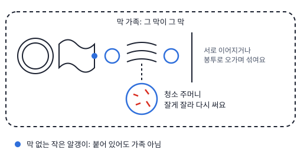

*벽에 붙어 있는 작은 알갱이도 막이 없어서 이 가족이 아니에요.*

**정확히 말하면**

**내막계(endomembrane system)**

진핵세포 속 막들은 고정된 구조가 아니라 유동적이에요. 막이 서로 직접 이어져 있거나 소낭으로 떨어졌다 합쳐지며 계속 섞여요.

1. 핵막은 조면 소포체 막과 이어져 있어요.
2. 조면 소포체 막이 소낭으로 떨어져 나와 골지체와 합쳐져요.
3. 골지체 막이 소낭으로 떨어져 나와 세포막과 합쳐져요.
4. 반대로 세포막이 안으로 들어올 수도 있어요.

이렇게 한 막이 다른 막이 되므로 이 막들을 하나로 묶어 내막계라고 해요.

수업에서 든 내막계 구성원은 핵막, 소포체, 골지체, 세포막, 소낭이고, 골지체에서 떨어져 나온 리소좀도 여기에 들어가요.

내막계에 있는 단백질은 부착 리보솜이, 내막계가 아닌 곳의 단백질은 자유 리보솜이 만들어요([소포체·골지체와 단백질이 가는 길](#s3-er-golgi)).

**리소좀(lysosome)**

골지체 막이 떨어져 나와 리소좀이 되므로 리소좀도 내막계에 속해요. 이름의 lysis는 "분해"라는 뜻이에요. 리소좀은 단백질, 지질 등 무엇이든 잘라 버리는 분해 장소이자 재활용 장소예요. 이 분해는 리소좀 안의 가수분해효소가 맡아요(강의노트 1장 p5: "리소좀: 가수분해효소를 이용하여 세포내 소화, 식균작용").

| 작용 | 무엇을 분해하나 | 예 |
|---|---|---|
| 자가소화작용(autophagy) | 자기 세포 안의 것 | 망가진 미토콘드리아를 분해해 재료를 재활용 |
| 식균작용(phagocytosis) | 세포 밖의 것 | 백혈구가 세균을, 아메바가 먹이를 감싸 안으로 들인 뒤 리소좀과 합쳐 효소로 녹임 |

둘 다 리소좀이 맡아요. 리보솜은 단백질을 합성하는 곳이고, 식균작용과는 관계가 없어요. 이름이 비슷한 리보솜과 리소좀을 기능으로 구분해요.

**역방향 확인: 분해를 많이 하는 세포일수록 리소좀이 많이 필요해요**

- 식균작용을 많이 하는 세포일수록 삼킨 것을 녹일 리소좀이 많이 필요해요. 세균을 삼키는 백혈구가 대표 예예요.
- 세균은 원핵세포라 리소좀 같은 막으로 싸인 소기관이 없어요([원핵세포와 진핵세포](#s2-prokaryote)).

밖에서 들어온 세균과 자기 세포의 낡은 소기관을 분해하는 차이를 [단백질이 가는 길 모형](../%EC%9D%B8%ED%84%B0%EB%A0%89%ED%8B%B0%EB%B8%8C_02_%EB%8B%A8%EB%B0%B1%EC%A7%88%EC%9D%B4_%EA%B0%80%EB%8A%94_%EA%B8%B8%EA%B3%BC_%EB%A6%AC%EC%86%8C%EC%A2%80.html)의 ‘리소좀’에서 비교해 보세요.

**교수님 말씀**

핵막이 조면 소포체 막이 됐다가 골지체 막, 세포막이 됐다가 다시 들어오니 "그 막이 그 막이에요."

> "핵막부터 해 가지고 소포체, 골지체, 세포막, 소낭까지 다 포함이 됩니다. 그 막이 그 막이야."

리소좀은 무엇이든 잘라 버리는 재활용("리사이클") 장소예요.

> "자기 걸 먹으면 자가소화작용, 밖에 있는 걸 먹으면 식균 작용. 요 두 개를 하는 게 리소좀이다."

2016년 노벨 생리의학상은 효모로 자가포식(autophagy), 곧 리소좀의 자기 분해를 연구한 일본 학자가(수상자: 오스미 요시노리) 받았어요. 왜 그 주제를 골랐느냐는 물음에 "남들이 안 하니까"라고 답했다고 해요.

**꼭 기억해요**

- 내막계의 범위를 좁게 착각하기 쉬워요. 핵막과 세포막(원형질막)도 내막계에 포함되고, 골지체에서 떨어져 나온 리소좀도 포함돼요.
- 조면 소포체에 붙은 리보솜을 내막계 구성원으로 착각하기 쉬워요. 리보솜은 조면 소포체에 붙어 있어도, 그 경로의 단백질을 만들어도 내막계 구성원이 아니에요. 미토콘드리아도 내막계가 아니에요([미토콘드리아와 세포 내 공생설](#s4-mito)).
- 리보솜과 리소좀을 이름 때문에 헷갈리기 쉬워요. 리보솜은 단백질 합성, 리소좀은 가수분해효소로 분해(자가소화작용, 식균작용)예요.
- 자가소화작용과 식균작용을 바꿔 알기 쉬워요. 자기 것(망가진 미토콘드리아 등)을 분해하면 자가소화작용, 밖의 것(세균 등)을 감싸 들여 분해하면 식균작용이고, 둘 다 리소좀이 해요.
- 식균작용에서 누가 누구를 감싸는지 뒤집기 쉬워요. 백혈구가 세균을 감싸요. 교수님도 "백혈구를 둘러싸서... 아니, 세균을 둘러싸서"라고 바로 고쳐 말했어요.

**보충 · 수업에서 다루지 않았어요**

| 내막계에 속해요 | 내막계에 속하지 않아요 |
|---|---|
| 핵막, 소포체(조면·활면), 골지체(골지복합체), 소낭(소포), 세포막(원형질막), 리소좀 | 리보솜, 미토콘드리아 |

판단 기준은 "막이 있고, 그 막이 다른 내막계 막과 직접 이어지거나 소낭으로 오가는가"예요. 리보솜은 rRNA와 단백질로 된 알갱이라 막이 없어요. 그래서 조면 소포체에 붙어 있어도, 내막계 경로의 단백질을 만들어도 내막계 구성원이 아니에요. 어떤 경로에 참여하거나 막에 붙어 있다는 것만으로 계의 구성원이 되지는 않아요.

미토콘드리아는 막이 있지만 소낭으로 다른 막과 섞이지 않고, 교재의 내막계 목록에도 없어요([미토콘드리아와 세포 내 공생설](#s4-mito)).

리소좀에는 단백질, 지질, 핵산, 다당류 같은 큰 분자를 가수분해하는 효소가 30가지가 넘게 들어 있어요. 한 종류가 아니라 여러 종류라서 무엇이든 분해할 수 있어요.

세포마다 주된 일이 달라요. 근육세포는 수축, 식물의 잎세포는 광합성이 주된 일이고, 세균을 삼켜 분해하는 일은 백혈구 같은 세포가 맡아요(추론: 교재 내용을 이어 붙인 것이에요).

출처: 교재 1장 p.19(내막계 구성, 리소좀의 가수분해효소), p.20(식균작용과 백혈구, 근육세포 수축), p.18 그림 1.20(엽록체: 광합성)

**페이지 요약**

핵막·소포체·골지체·소낭·세포막·리소좀은 "그 막이 그 막"인 내막계이고, 막 없는 리보솜은 여기에 들지 않아요.

*용어*

- **내막계(endomembrane system)** — 서로 이어지거나 소낭으로 오가며 섞이는 막들의 묶음
- **리소좀(lysosome)** — 가수분해효소로 분해·재활용하는 주머니
- **식균작용(phagocytosis)** — 백혈구가 세균 같은 밖의 것을 감싸 들여 리소좀으로 분해

**보충 · 수업에서 다루지 않았어요**

- 내막계에는 핵막·소포체·골지체·소낭·세포막·리소좀이 속해요. 막 없는 리보솜과 소낭 교환에 끼지 않는 미토콘드리아는 제외돼요.
- 막에 붙거나 경로에 참여한다는 것과 내막계 구성원이라는 것은 달라요. 리소좀은 여러 가수분해효소로 큰 분자를 분해하고, 세균을 삼키는 일은 백혈구 같은 세포가 맡아요.

[본문 보충 보기](#s3-endomembrane-supp-1)

---

## 4. 미토콘드리아와 세포 내 공생설

### 미토콘드리아와 세포 내 공생설

*0908 수업 · 1장 p5*

**쉽게 말하면**

세포 안의 발전소는 안쪽 벽을 지그재그로 접어서, 에너지를 만드는 기계를 더 많이 붙여 놔요.

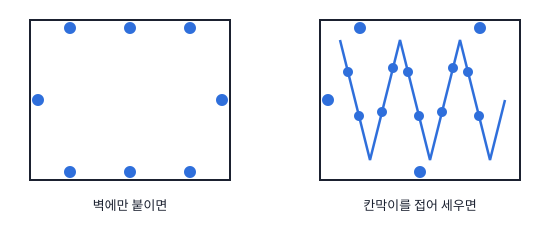

*같은 방이라도 칸막이를 접어 세우면 기계(색칠된 점)를 붙일 자리가 훨씬 많아져요.*

**정확히 말하면**

**미토콘드리아(mitochondria)**는 세포의 발전소예요. ATP를 많이 만드는 곳이기 때문이에요.

ATP는 **에너지 화폐**예요. 생물은 태양, 유기물, 무기물에서 얻은 에너지를 ATP 형태로 저장해 두었다가 필요한 곳에서 꺼내 써요. ATP 자체는 2장에서 배워요.

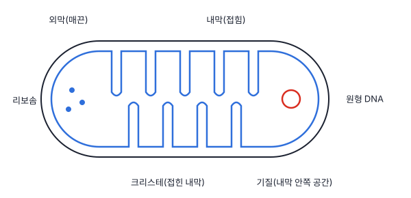

*바깥 테두리 선이 외막, 여러 번 접힌 안쪽 선이 내막이에요. 동그란 테두리 선은 원형 DNA, 색칠된 작은 점은 리보솜이에요.*

구조는 이렇게 정리해요.

- 이중막: 미토콘드리아는 2개의 막(외막과 내막)으로 둘러싸여 있어요. 외막은 매끈하고, 내막은 여러 번 접혀 있어요.
- **크리스테(cristae)**: 여러 번 접힌 내막 구조예요.
- **기질(matrix)**: 내막이 둘러싼 안쪽 공간이에요. 크리스테는 "구조(접힌 막)"이고 기질은 "공간"이에요.

내막이 접힌 이유는 인과 순서로 이어져요.

1. ATP를 만드는 데 필요한 단백질들이 내막에 박혀 있어요.
2. 내막을 접으면 같은 부피 안에서 막의 표면적이 넓어져요.
3. 표면적이 넓을수록 단백질이 더 많이 박히고, ATP를 더 빨리 만들어요. 좁은 공간에서 효율을 높이도록 진화한 결과예요. 표면적을 늘려 효율을 높인다는 생각은 [세포는 왜 작을까](#s2-cell-size)에서 본 표면적 대 부피 비와 같은 원리예요.

ATP가 어디서 만들어지는지 정확히 짚어요. ATP의 대부분은 내막에 박힌 단백질이 만들어요. 기질에서는 ATP를 만드는 반응의 앞 단계 일부가 일어나요. 그래서 "ATP는 기질에서 만들어진다"만 기억하면 틀려요. 자세한 과정은 2장에서 배워요.

미토콘드리아에는 자체 DNA와 리보솜이 있어요. 그래서 스스로 단백질을 만들 수 있어요. 다만 미토콘드리아에서 일하는 단백질이 모두 여기서 만들어지는 것은 아니에요. 세포질의 자유 리보솜이 만들어 미토콘드리아로 보내는 단백질도 있어요([소포체·골지체와 단백질이 가는 길](#s3-er-golgi)).

**세포 내 공생설(endosymbiotic theory)**은 미토콘드리아가 원래 독립된 세균이었다는 설이에요. 린 마굴리스(Lynn Margulis)가 제안했어요.

1. 산소로 호흡하는 세균(호기성 세균)이 커다란 세포에 잡아먹혀요.
2. 소화되지 않고 그 세포 안에서 함께 살아가요(공생).
3. 오랜 시간이 지나 이 세균이 미토콘드리아가 되었어요.
4. 같은 방식으로 광합성 세균이 잡아먹혀 **엽록체**가 되었어요.

수업에서 든 근거는 미토콘드리아가 진핵세포 쪽이 아니라 세균 쪽을 닮았다는 관찰이에요.

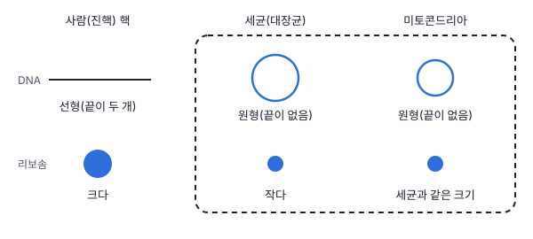

*점선 테두리로 묶인 세균과 미토콘드리아는 DNA가 끝이 없는 동그라미 선이고, 리보솜(색칠된 원)도 똑같이 작아요.*

| 비교 항목 | 진핵세포(사람) 핵 | 세균 | 미토콘드리아 |
|---|---|---|---|
| DNA 모양 | 선형 DNA(끝이 있는 직선) | 원형 DNA(고무밴드처럼 끝이 이어짐) | 원형 DNA |
| 리보솜 크기 | 크다 | 진핵 리보솜보다 작다 | 세균 리보솜과 같은 크기 |
| 자기 DNA·리보솜으로 단백질 합성(관찰의 출발점) | (비교 대상 아님) | 자기 DNA·리보솜으로 단백질을 만든다 | 자체 DNA·리보솜으로 스스로 단백질을 만든다 |

수업에서 든 공생설의 근거는 두 가지예요. (1) 미토콘드리아 DNA가 세균 DNA처럼 원형 DNA라는 것, (2) 미토콘드리아 리보솜이 세균 리보솜과 같은 크기라는 것이에요. 미토콘드리아가 자체 DNA와 리보솜으로 스스로 단백질을 만든다는 사실은 이 비교를 시작하게 한 관찰이에요. 그 DNA와 리보솜을 들여다보니 세균 것을 닮았다는 것이 근거가 되었어요.

접힌 내막의 구조와 세균이 공생하는 과정을 [미토콘드리아와 공생설 모형](../%EC%9D%B8%ED%84%B0%EB%A0%89%ED%8B%B0%EB%B8%8C_03_%EB%AF%B8%ED%86%A0%EC%BD%98%EB%93%9C%EB%A6%AC%EC%95%84%EC%99%80_%EC%84%B8%ED%8F%AC_%EB%82%B4_%EA%B3%B5%EC%83%9D%EC%84%A4.html)의 ‘구조’와 ‘공생설’에서 살펴보세요.

**교수님 말씀**

미토콘드리아는 세포의 발전소예요.

ATP는 돈과 같아요. 사람이 일해서 돈을 받고 그 돈으로 필요한 것을 사듯, 생물은 얻은 에너지를 ATP에 저장해 두었다가 필요할 때 써요. 그래서 에너지 화폐라고 불러요.

전시회 파티션 비유: 교실 벽에만 그림을 붙이면 네 면뿐이지만, 파티션을 지그재그로 세우면 붙일 면적이 훨씬 늘어나요. 이 파티션이 곧 접힌 내막, 크리스테예요.

> 크리스테는 몰라도 기질은 알아둬야 … 내막의 안쪽 공간을 기질이라고 부른다.

DNA를 핀셋으로 뽑아 본다고 상상해 보래요. 사람 DNA는 직선 한 줄로 나오고, 대장균 DNA는 고무밴드처럼 동그랗게 나와요.

> 그게 세포 내 공생설입니다. 세포 내 공생설.

**꼭 기억해요**

- 핵막의 이중막과 미토콘드리아의 이중막을 서로 관계없는 것으로 여기기 쉬워요. 교수님은 둘을 공통점으로 두 번 비교했어요. 둘 다 이중막(인지질 이중층이 두 겹)이고, 둘 다 안에 DNA가 있어요. 차이도 함께 기억해요. 핵 DNA는 선형, 미토콘드리아 DNA는 원형이에요. 핵막 자체는 [핵: 이중막·핵공·염색질·인](#s3-nucleus)에서 다뤄요.
- 크리스테와 기질을 바꿔 쓰기 쉬워요. 크리스테는 접힌 내막 "구조"이고, 기질은 내막 안쪽 "공간"이에요.
- 모든 DNA가 같은 모양이라고 착각하기 쉬워요. 진핵생물 핵의 염색체 DNA는 선형이고, 세균과 미토콘드리아의 DNA는 원형이에요. "사람은 직선인데 세균은 … 동그란 형태".
- "기질에서 ATP가 만들어진다"를 그대로 외우기 쉬워요. 교수님은 "여기서 ATP가 만들어지기 때문에" 라고 했지만, 바로 앞에서 "ATP를 만드는 데 필요한 단백질들이 이 내막에 박혀 있어요" 라고 했어요. ATP 대부분은 내막의 단백질이 만들고, 기질에서는 그 앞 단계 반응 일부가 일어나요.
- 세균이 미토콘드리아의 조상이라는 말을 "세균에도 미토콘드리아가 있다"로 착각하기 쉬워요. 세균(원핵세포)에는 미토콘드리아가 없어요. 세균이 통째로 삼켜져 미토콘드리아가 된 것이에요([원핵세포와 진핵세포](#s2-prokaryote)).
- 미토콘드리아가 스스로 단백질을 만든다는 말을 "미토콘드리아 단백질은 전부 스스로 만든다"로 넓히기 쉬워요. 자유 리보솜이 만들어 보내는 미토콘드리아 단백질도 있어요.

**보충 · 수업에서 다루지 않았어요**

수업에서 엽록체는 "광합성 세균이 잡아먹혀 엽록체가 되었다"는 한 줄만 나왔어요. 엽록체 자체는 다음 수업에서 다뤄요. 미토콘드리아와 엽록체를 함께 묻는 문제를 풀려면 아래 사실이 필요해요.

- 엽록체도 이중막(외막 + 내막)으로 둘러싸여 있어요. 그리고 광합성 세균처럼 자체 DNA와 리보솜을 가져요. 이 DNA도 세균처럼 원형 DNA예요. 이런 유사성 때문에 엽록체도 고대 원핵생물에서 유래해 진핵세포 안에 자리 잡았다고 봐요.
- 미토콘드리아와 엽록체는 세포 안에서 스스로 자라고 분열해 수를 늘려요. 세포가 새로 만들어 주는 것이 아니라, 원래 세균이었을 때처럼 제 몸을 나눠 늘어나요. 이 점도 공생설과 잘 맞아요.
- 미토콘드리아와 엽록체는 내막계에 속하지 않아요. 내막계는 막이 소낭으로 서로 오가며 섞이는 구조들의 모임이에요.

  | 내막계에 속함 | 내막계에 속하지 않음 |
  |---|---|
  | 핵막, 소포체(조면·활면), 골지체, 소낭, 세포막(원형질막), 리소좀 | 미토콘드리아, 엽록체(막이 있어도 소낭 교환에 끼지 않음) |

  "막이 있는 소기관이면 모두 내막계"가 아니에요. 막이 있다는 것과 내막계 구성원이라는 것은 다른 조건이에요. 교재도 핵막·소포체는 세포막이 안으로 접혀 들어가 생겼고, 세포 내 공생설과는 따로라고 설명해요. 핵막은 내막계에 속하지만 미토콘드리아는 속하지 않아요. 둘 다 이중막이어도 소속은 달라요([내막계와 리소좀](#s3-endomembrane)).
- 내막에 박혀 ATP 만들기를 돕는 단백질들의 사슬을 전자전달사슬(electron transport chain, 교재 표기 전자전달계)이라고 불러요. 2장에서 배워요. 실제로 ATP를 붙여 만드는 단백질은 역시 내막에 있는 ATP 합성효소(ATP synthase)예요.
- 교재 그림 1.22는 미토콘드리아를 외막, 내막, 크리스테, 기질, 그리고 두 막 사이 공간(내외막사이공간)으로 표시해요.

출처: 강의노트 1장 p6("엽록체: 이중막(외막 + 내막)"), 교재 1장 p.19(내막계 구성: 소포체, 골지복합체, 핵막, 리소좀, 소포, 원형질막), 교재 1장 p.20(미토콘드리아 이중막, 그림 1.22, 세균과 비슷한 DNA·리보솜), 교재 1장 p.21–22(엽록체 이중막, 광합성 세균처럼 DNA·리보솜을 가짐), 교재 9장 p.181(세포내공생설, 그림 9.4), 교재 2장 p.39(전자전달계는 미토콘드리아 내막, ATP 합성효소). 원형 DNA와 스스로 분열해 늘어난다는 점은 교재 해당 쪽에 명시되어 있지 않아 외부 자료로 보충: 캠벨 생명과학 6.5절(미토콘드리아와 엽록체는 내막계가 아니며, 원형 DNA를 가지고 세포 안에서 반자율적으로 자라고 증식한다).

**페이지 요약**

미토콘드리아는 접힌 내막(크리스테)으로 ATP를 많이 만드는 이중막 발전소이고, 원형 DNA와 작은 리보솜을 가져 옛날 세균이었다고 봐요.

*용어*

- **크리스테(cristae)** — 여러 번 접힌 내막 구조
- **기질(matrix)** — 내막이 둘러싼 안쪽 공간
- **세포 내 공생설(endosymbiotic theory)** — 삼켜진 세균이 미토콘드리아·엽록체가 되었다는 설

**보충 · 수업에서 다루지 않았어요**

- 엽록체도 이중막·원형 DNA·리보솜을 가지며, 미토콘드리아와 함께 스스로 자라고 분열한다는 점이 세포 내 공생설과 맞아요.
- 두 소기관은 막이 있어도 내막계가 아니에요. 핵막은 내막계이므로 이중막 여부만으로 소속을 판단하지 않아요.
- 미토콘드리아 내막에는 전자전달계와 ATP 합성효소가 있어요. 크리스테는 접힌 내막, 기질은 그 안쪽, 막 사이 공간은 외막과 내막 사이예요.

[본문 보충 보기](#s4-mito-supp-1)

---

## 5. 요약 · 예고

### 30초 요약

*0908 수업 · 1장 p4–5*

| 주제 | 시험 직전 한 줄 |
|---|---|
| 4차 구조 | 4차 구조는 폴리펩티드가 2개 이상 모인 단백질에만 있어요(예: 헤모글로빈, 폴리펩티드 4개). 한 줄짜리 단백질은 3차 구조에서 끝나요. |
| 폴리펩티드 vs 단백질 | 같은 말이 아니에요. 단백질은 폴리펩티드 1개로도, 2개 이상이 모여서도 될 수 있어요. |
| 뉴클레오타이드 | 염기 + 5탄당 + 인산기예요. 퓨린은 A·G(고리 2개), 피리미딘은 C·T·U(고리 1개)예요. 프라임(′)은 당의 탄소 번호에만 붙여요. |
| DNA vs RNA | DNA는 디옥시리보스(2′ 탄소에 H)와 A·T·G·C, 두 가닥이에요. RNA는 리보스(2′ 탄소에 OH)와 A·U·G·C, 대개 한 가닥이에요. |
| 이중 나선 | 뼈대는 당-인산이고 염기는 안쪽으로 삐져나와요. 두 가닥은 역평행(둘 다 5′→3′이지만 방향이 반대)으로 꼬여 이중 나선을 이뤄요. |
| 상보결합 · 샤가프 | G–C는 수소결합 3개, A–T는 2개로 짝이 정해져 있어요. 그래서 두 가닥 DNA에서는 A 수 = T 수, G 수 = C 수예요(샤가프의 법칙). |
| 세포 크기 | 세포가 커지면 표면적 자체는 늘지만 표면적/부피 비는 줄어 물질 수송이 불리해요. 그래서 세포는 작고, 몸이 커질 때는 세포 수가 늘어요. |
| 현미경 해상도 | 해상도는 두 점을 구분하는 최소 거리라서 숫자가 작을수록 좋아요. 파장이 짧을수록 좋아져서 전자현미경이 광학현미경보다 잘 보여요. |
| 원핵 vs 진핵 | 원핵세포에 없는 것은 핵과 막성 세포소기관이에요. 원핵세포에도 있는 것은 DNA(핵양체에 뭉침), 리보솜, 세포막, 세포벽이고, 협막은 있는 세균에만 있어요. 세포벽은 원핵세포만의 특징이 아니라 진핵세포 중 식물세포에도 있어요. |
| 핵막 | 핵막은 이중막(인지질 이중층이 두 개)이에요. 일반 세포막은 이중층 하나예요. RNA처럼 크고 극성인 분자는 막 대신 핵공으로 드나들어요. |
| 염색질 · 염색체 · 인 | DNA는 평상시 풀린 염색질이고, 세포 분열 때만 응축돼 염색체로 보여요. 인은 rRNA가 뭉친 리보솜 조립 장소이고, 리보솜이 일하는 곳은 핵 밖이에요. |
| 조면 vs 활면 소포체 | 조면 소포체는 리보솜이 붙어 단백질을 접고 가공해요. 활면 소포체는 리보솜이 없고 지질 합성과 해독을 해요. |
| 골지체 | 서로 떨어진 납작한 주머니들이에요(소포체는 이어진 미로). 단백질을 한 번 더 변형하고 목적지별로 분류해요(우체국). |
| 단백질이 가는 길 | 부착 리보솜에서 만든 단백질의 경로는 조면 소포체 → 소낭 → 골지체 → 소낭 → 세포막(막 단백질) 또는 세포 밖(분비 단백질) 순서예요. 골지체 단백질은 도중에 골지체에 남아요. |
| 부착 vs 자유 리보솜 | 부착 리보솜(조면 소포체 막)은 내막계에 머물거나 분비될 단백질을, 자유 리보솜(시토졸)은 핵·시토졸·미토콘드리아로 갈 단백질을 만들어요. |
| 내막계 범위 | 내막계는 소낭으로 막이 이어지는 핵막·소포체·골지체·소낭·리소좀·세포막이에요. 리보솜은 단백질 경로에 참여해도 막이 없어 내막계가 아니고, 미토콘드리아도 내막계가 아니에요(보충: 수업에서 직접 말하지 않았어요). |
| 리소좀 | 골지체 막에서 떨어져 나와 내막계에 속해요. 자기 것(망가진 미토콘드리아)을 분해하면 자가소화작용, 밖의 것(백혈구가 감싼 세균)을 분해하면 식균작용이에요. |
| 미토콘드리아 | ATP(에너지 화폐)를 많이 만드는 발전소예요. 이중막이고 접힌 내막이 크리스테, 내막 안쪽 공간이 기질이에요. 자체 DNA와 리보솜이 있어요. |
| 세포 내 공생설 | 잡아먹힌 호기성 세균이 미토콘드리아, 광합성 세균이 엽록체가 됐다는 설이에요. 근거는 원형 DNA(진핵 핵 DNA는 선형)와 세균과 같은 크기의 리보솜이에요. |

---

### 다음 시간 예고

*0908 수업 · 1장 p5–6*

- 세포골격: 미세소관 · 중간섬유 · 미세섬유
- 엽록체 (1.3.4 식물세포의 특화된 구조)
- 중심 액포 · 식물 세포벽
- 진핵세포의 편모 · 섬모
- 1.4 세포막과 수송: 유동 모자이크 모형, 확산 · 삼투 · 촉진확산 · 능동수송

이번 수업은 세포 내 공생설까지 마치고 끝났어요. 교수님은 엽록체와 세포골격만 하면 1장이 끝난다고 하셨어요.

> "자, 엽록체하고 이제 세포골격만 하면은 1장이 끝나는데"

> "자, 여기까지."

---

### 함께 보면 좋은 자료

*0908 수업*

- [복습문제 24선 — 0908 수업 범위](복습문제_0908_Biomolecules_and_Cells.md): 웹과제·기출·변형 연습으로 오늘 배운 내용을 직접 풀어 봐요.
- [0903 정리노트](../../0903/정리노트_0903_Biomolecules_and_Cells.html): 지난 수업(0903) 내용을 다시 볼 수 있어요. 오늘 첫머리 복습과 이어져요.

---

출처: 이영만 교수님 강의노트(1장) · 수업 녹음 전사(0908) · 『생명과학: 기초와 응용』 2판 1장.
