# 세포 구조 마무리와 세포호흡 — 5살도 이해하는 정리노트

이영만 교수님 생명과학 · 0910 수업 (1장 생명분자와 세포 마무리 · 2장 세포호흡)

> `정리노트_0910_Cells_and_Cellular_Respiration.html`를 마크다운으로 옮겼어요. 그림은 `figures_0910/` 폴더의 SVG, 위젯은 대표 설정의 정적 그림으로 바꿨어요. 수식은 `$…$` / `$$…$$`라서 GitHub, Obsidian, Typora에서 보여요.

**목차**

- [0. [1장] 지난 수업 복습과 식물세포의 소기관](#s0)
  - [지난 수업 복습: 미토콘드리아](#s0-recap)
  - [엽록체: 이중막 안의 틸라코이드](#s0-chloroplast)
  - [액포와 세포벽: 식물세포만의 창고와 벽](#s0-vacuole-wall)
- [1. [1장] 세포골격과 세포막](#s1)
  - [세포골격: 물풍선이 아니라 텐트](#s1-cytoskeleton)
  - [유동 모자이크 모형](#s1-membrane)
  - [1장 마무리 보충: 구조가 기능을 정한다](#s1-protein-info)
- [2. [2장] 에너지와 ATP](#s2)
  - [화학 에너지는 전자의 위치에너지](#s2-energy)
  - [ATP: 저금해 두었다 꺼내 쓰는 에너지](#s2-atp)
  - [ATP를 쓰는 곳](#s2-atp-use)
- [3. [2장] 효소](#s3)
  - [효소는 언덕을 낮춘다](#s3-enzyme)
  - [보조인자: 비타민은 거들 뿐](#s3-cofactor)
  - [온도와 pH: 구조가 깨지면 기능이 깨진다](#s3-temp-ph)
- [4. [2장] 산화·환원과 세포호흡 전반부](#s4)
  - [산화·환원: 전자는 끌어당기는 쪽으로 떨어진다](#s4-redox)
  - [NAD⁺와 세포호흡 3단계](#s4-nad)
  - [해당과정: 세포질에서 포도당을 반으로](#s4-glycolysis)
  - [피루브산 산화와 시트르산 회로](#s4-krebs)
- [5. [2장] 산화적 인산화](#s5)
  - [기질 수준 인산화와 산화적 인산화](#s5-phosphorylation)
  - [전자전달계: 전자가 산소까지 층층이](#s5-etc)
  - [H⁺ 기울기와 ATP 합성효소](#s5-atp-synthase)
- [6. 요약 · 예고](#s6)
  - [30초 요약](#s6-cheatsheet)
  - [다음 시간 예고](#s6-next)
  - [함께 보면 좋은 자료](#s6-links)

## 0. [1장] 지난 수업 복습과 식물세포의 소기관

### 지난 수업 복습: 미토콘드리아

*0910 수업 · 1장 p5*

**정확히 말하면**

- 지난 시간에는 세포의 구조와 기능, 진핵세포의 핵, 내막계, 리소좀, 미토콘드리아까지 배웠어요.
- 미토콘드리아는 이중막이에요. 외막은 매끈하고, 내막은 여러 번 접혀 크리스테(cristae)를 이뤄요.
- 내막에 ATP를 만드는 단백질이 박혀 있어서, 접혀 표면적이 넓을수록 ATP를 더 많이, 더 빨리 만들어요.
- 내막 안쪽 공간인 기질(matrix)에 자체 DNA와 리보솜이 있어 스스로 단백질을 만들고, 이분법으로 스스로 나뉘어 수를 늘려요. 그래서 원래 하나의 세균이었다고 봐요(세포내공생설).

지난 팩: [0908 정리노트](../../0908/정리노트_0908_Biomolecules_and_Cells.html) · [0908 복습문제](../../0908/복습문제_0908_Biomolecules_and_Cells.html)

**페이지 요약**

미토콘드리아는 접힌 내막(크리스테)과 DNA·리보솜이 있는 기질을 가진 이중막 소기관이에요.

*용어*

- **크리스테(cristae)** — 여러 번 접힌 미토콘드리아 내막
- **기질(matrix)** — 내막 안쪽 공간, DNA·리보솜이 있음
- **이분법** — 스스로 둘로 나뉘어 수를 늘리는 방식

---

### 엽록체: 이중막 안의 틸라코이드

*0910 수업 · 1장 p6*

**쉽게 말하면**

잎 속 초록 알갱이 안에는 납작한 주머니가 과자처럼 차곡차곡 쌓여 있어요.

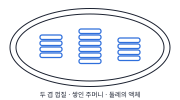

*테두리만 그린 주머니 더미 둘레를 물 같은 액체가 채우고 있어요.*

**정확히 말하면**

엽록체(chloroplast)는 광합성을 하는 진핵생물의 세포에 있는 소기관이에요. 동물세포에는 없어요.

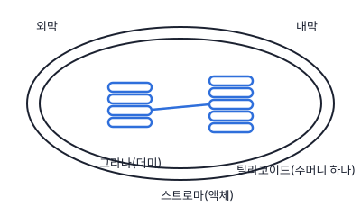

*외막·내막은 둘 다 매끈한 선이고, 틸라코이드는 내막과 따로 떨어진 안쪽 막 주머니예요.*

- **이중막**: 외막과 내막 두 겹이 둘러싸요. 미토콘드리아와 달리 **내막도 매끈해요**. 크리스테 같은 주름이 없어요.
- **틸라코이드(thylakoid)**: 내막과 별개로 안쪽에 따로 있는 납작한 주머니 모양의 막이에요. 내막이 접힌 것이 아니에요.
- **그라나(grana)**: 틸라코이드가 여러 개 쌓인 더미예요.
- **스트로마(stroma)**: 틸라코이드 막 바깥, 내막 안쪽을 채우는 유동액(액체 공간)이에요. 미토콘드리아의 기질에 해당하는 곳으로, DNA와 리보솜이 있고 ATP가 합성돼요.
- **엽록소(chlorophyll)**: 틸라코이드 막에 박힌 색소예요. 빨간빛과 파란빛을 흡수해 광합성에 쓰고, 녹색빛은 흡수하지 않고 반사하거나 투과시켜요. 그래서 엽록소, 틸라코이드, 엽록체, 잎이 모두 녹색으로 보여요.

**미토콘드리아와 엽록체의 공통점**

1. 둘 다 이중막으로 싸여 있어요.
2. 둘 다 자체 DNA와 리보솜이 있어 스스로 단백질을 만들어요.
3. 둘 다 고대 원핵생물(세균)이 더 큰 세포에 잡아먹힌 뒤 공생하다가 소기관이 되었다고 여겨요(세포내공생설). 미토콘드리아는 산소 호흡을 하는 세균에서, 엽록체는 광합성 세균인 남세균에서 왔다고 봐요.
4. 교수님은 미토콘드리아가 이분법으로 스스로 분열한다고 했고, 엽록체도 같은 세균 유래 소기관으로 설명했어요. 두 소기관의 DNA가 세균과 비슷하다는 교재 설명은 보충에 적었어요.

**내막계에 속하나?** 내막계는 막으로 직접 이어지거나 소포(소낭)로 간접적으로 이어져 물질을 주고받는 막 주머니 묶음이에요(교재 1장 p.19).

| 내막계에 속함 | 내막계에 속하지 않음 |
|---|---|
| 소포체, 골지복합체, 핵막, 리소좀, 소포(소낭), 원형질막(세포막) (교재 1장 p.19) | 미토콘드리아, 엽록체 (막이 있어도 스스로 늘어나는 독립 소기관) |

**식물세포와 동물세포의 대사**

| 구분 | 미토콘드리아 | 엽록체 | 하는 일 |
|---|---|---|---|
| 식물세포 | 있음 | 있음 | 광합성과 세포호흡을 모두 해요 |
| 동물세포 | 있음 | 없음 | 세포호흡만 해요 |

미토콘드리아는 동물과 식물 모두에 있지만 엽록체는 식물에만 있어요. 식물도 미토콘드리아가 있으므로 세포호흡을 해요. "식물은 광합성만 한다"는 틀린 말이에요.

**교수님 말씀**

틸라코이드가 쌓인 모양을 녹차 초코파이를 쌓아 둔 것에 비유했어요. 초코파이 한 개가 틸라코이드, 쌓은 줄이 그라나예요.

> "녹차 초코파이 쌓아 둔 것"

> "뭐라고? 그라나. 그라나라고 부른다."

외막, 내막에 틸라코이드 막까지 있어서 "3중막 구조라고 봐도 되는" 셈이라고 했어요. 다만 엽록체를 싸는 막은 이중막이고, 틸라코이드는 그 안의 별도 막이에요.

엽록체는 남세균(광합성 세균)이 잡아먹힌 뒤 공생하다 된 것으로 본다고 했어요.

> "곧 2장에서 다시 미토콘드리아와 엽록체 이야기가 나올 겁니다."

**꼭 기억해요**

- **미토콘드리아 내막 vs 엽록체 내막**: 엽록체 내막도 크리스테처럼 접혀 있다고 착각하기 쉬워요. 미토콘드리아 내막은 크리스테로 접혀 있지만, 엽록체 내막은 매끈하고 대신 틸라코이드 막이 따로 있어요.
- **기질 ↔ 스트로마**: 스트로마를 미토콘드리아의 막이나 크리스테에 짝짓기 쉬워요. 미토콘드리아의 기질과 엽록체의 스트로마가 서로 대응하는 액체 공간이고, 둘 다 DNA·리보솜이 있고 ATP가 합성되는 곳이에요.
- **틸라코이드 vs 그라나**: 둘을 같은 말로 쓰기 쉬워요. 틸라코이드는 주머니 모양의 막 하나, 그라나는 틸라코이드가 쌓인 더미예요. 둘 다 막 구조라 "내부를 채우는 액체"는 아니에요.
- **엽록소 vs 엽록체**: 엽록소는 틸라코이드 막에 박힌 색소 분자이고, 엽록체는 그 색소를 담은 소기관이에요.
- **이중막 vs 내막계**: 막이 있으면 내막계라고 착각하기 쉬워요. 미토콘드리아와 엽록체는 이중막이 있어도 내막계에 속하지 않아요.
- **"3중막"이라는 말**: 교수님 비유일 뿐이에요. 엽록체는 이중막이고, 틸라코이드는 내막과 별개인 안쪽 막계예요.

**보충 · 수업에서 다루지 않았어요**

미토콘드리아 기질에는 세균에 있는 것과 비슷한 구조의 DNA와 리보솜이 있어요(교재 1장 p.20). 엽록체의 스트로마에도 광합성 세균과 마찬가지로 DNA와 리보솜이 있어요. 교재는 이런 유사성 때문에 엽록체도 고대 원핵생물에서 유래했다고 여겨진다고 써요(교재 1장 p.22). 두 소기관 모두 세균과 비슷한 DNA를 가진다는 점이 세포내공생설의 근거예요.

출처: 교재 1장 p.20(미토콘드리아 기질의 DNA·리보솜), 교재 1장 p.22(엽록체 스트로마의 DNA·리보솜, 고대 원핵생물 유래)

교재는 스트로마를 "액체 내부"라고 표시하고, 엽록체의 두 막이 스트로마라는 안쪽 공간을 완벽히 감싼다고 설명해요.

출처: 교재 1장 p.21 그림 1.24(스트로마)

기공(stoma)은 엽록체의 구조가 아니라 잎에 있는 구멍이에요. CO₂가 들어오고 O₂가 밖으로 나가는 곳이에요.

출처: 강의노트 2장 p4("기공(Stoma) - CO2가 들어오고 O2가 밖으로 나가는 장소")

**페이지 요약**

엽록체는 매끈한 이중막 안에 틸라코이드가 쌓인 그라나와 이를 둘러싼 스트로마가 있고, 미토콘드리아처럼 내막계에 속하지 않아요.

*용어*

- **틸라코이드(thylakoid)** — 엽록소가 박힌 납작한 주머니 막
- **그라나(grana)** — 틸라코이드가 쌓인 더미
- **스트로마(stroma)** — 엽록체 내부를 채우는 유동액, 기질에 대응

---

### 액포와 세포벽: 식물세포만의 창고와 벽

*0910 수업 · 1장 p6*

**쉽게 말하면**

식물 세포 안에는 이것저것 넣어 두는 커다란 창고 주머니가 있어요.

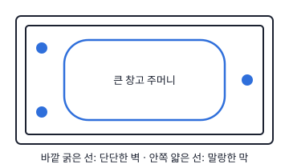

*바깥에는 단단한 벽이 한 겹 더 있어서 식물은 꼿꼿하게 설 수 있어요.*

**정확히 말하면**

**액포(vacuole)**

- 교수님은 식물에는 리소좀(lysosome)이 없고 액포가 리소좀 역할을 한다고 정리했어요. 리소좀은 가수분해효소로 세포 안에서 물질을 분해하는 소기관이에요(1장 p5).
- 액포는 염분, 유기산, 당분 같은 영양소, 폐기물, 색소 등을 쌓아 두는 창고예요.
- 이것저것 계속 쌓이면서 점점 커져, 세포 부피의 90% 이상을 차지하기도 해요.

**세포벽(cell wall)**

- 세포막 바깥을 한 겹 더 둘러싼 벽이에요(1장 p6).
- 성분은 셀룰로스(cellulose, 섬유소)라는 다당류예요.
- 인지질 이중층으로 된 세포막은 말랑하고, 셀룰로스로 된 세포벽은 단단해서 세포를 지지해요.

| 구조 | 동물세포 | 식물세포 |
|---|---|---|
| 미토콘드리아 | 있음 | 있음 |
| 엽록체 | 없음 | 있음 |
| 큰 액포 | 없음 | 있음(리소좀 역할) |
| 세포벽 | 없음 | 있음(셀룰로스) |
| 세포막 | 있음 | 있음(세포벽 안쪽) |

**교수님 말씀**

액포는 온갖 것을 쌓아 두는 창고라고 비유했어요.

> "창고에 처박, 집어넣듯이"

세포벽 성분을 스스로 묻고 바로 답했어요.

> "셀룰로오스 다당류였죠"

> "세포벽, 액포, 엽록체는 식물만 가지고 있다."

**꼭 기억해요**

- **리소좀 vs 액포**: 식물세포에도 동물처럼 리소좀이 따로 있다고 착각하기 쉬워요. 교수님 정리로는 식물에는 리소좀이 없고 액포가 그 역할을 대신해요. 액포는 분해만 하는 곳이 아니라 저장 창고이기도 해요.
- **세포막 vs 세포벽**: 둘을 같은 경계로 착각하기 쉬워요. 세포막은 인지질 이중층이고 말랑하며 모든 세포에 있어요. 세포벽은 셀룰로스로 된 단단한 벽이고 세포막 바깥에 있어요. 식물세포는 둘 다 가져요.
- **"식물만"의 범위**: 동물세포와 식물세포를 비교할 때의 말이에요. 세균 같은 원핵세포에도 세포벽이 있어요(1장 p5). 절대 표현을 보면 다른 생물에서 반례가 없는지 확인해요.

**페이지 요약**

식물세포는 리소좀 역할을 하는 큰 창고인 액포와, 세포막 바깥의 단단한 셀룰로스 세포벽을 가져요.

*용어*

- **액포(vacuole)** — 염분·당분·폐기물·색소를 쌓는 창고, 식물에서 리소좀 역할
- **세포벽(cell wall)** — 셀룰로스로 된 단단한 벽, 세포막 바깥

---

## 1. [1장] 세포골격과 세포막

### 세포골격: 물풍선이 아니라 텐트

*0910 수업 · 1장 p5 · 1장 p6*

**쉽게 말하면**

세포는 누르면 푹 꺼지는 물풍선이 아니라, 안에서 기둥이 받쳐 주는 텐트에 가까워요.

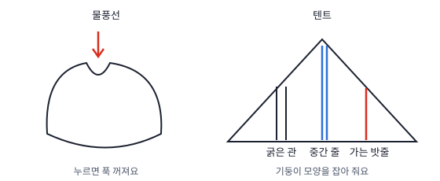

*텐트 기둥은 굵은 관, 중간 굵기 줄, 가는 밧줄 세 가지이고, 길이 되거나 세포를 움직이는 일도 해요.*

**정확히 말하면**

세포 안에는 건물의 기둥 같은 단백질 섬유와 관이 퍼져 있어서 세포의 모양과 내부 조직을 유지하고, 소기관이나 세포 전체를 움직이게 해요. 이것을 통틀어 **세포골격(cytoskeleton)**이라고 해요. 세포골격에는 세 가지가 있어요.

굵기는 이름으로 짐작해요. 관(tube)이 섬유보다 굵고, 중간섬유는 이름대로 중간이에요. 그래서 **미세소관 &gt; 중간섬유 &gt; 미세섬유** 순으로 굵어요.

| 구분 | 굵기 | 재료 | 모양 | 하는 일 |
|---|---|---|---|---|
| **미세소관(microtubule)** | 가장 굵음 | **튜불린(tubulin)**이라는 작은 땅콩 모양 단백질 | 속이 빈 관 | (1) 세포분열 때 염색체에 붙는 **방추사**(방추체) (2) 소기관·소낭을 옮기는 트랙(길) |
| **중간섬유(intermediate filament)** | 중간 | 중간섬유단백질. 교수님은 단위체가 없는 원래부터 큰 단백질이라고 설명했어요. 교재 1장 p.21 그림 1.23(b)는 중간섬유단백질 사슬이 꼬여 소단위체를 이룬다고 써요. | 섬유 | 손톱·발톱의 케라틴(keratin)이 중간섬유에 해당해요 |
| **미세섬유(microfilament)** | 가장 가늚 | 구슬 모양 단백질 **액틴(actin)** | 구슬이 이어진 밧줄 | (1) 아메바 운동 (2) 근육 수축 (3) 세포질 운동(세포질 흐름). (3)은 강의노트 1장 p6과 교재 1장 p.20에 적힌 기능이에요. |

**생겼다 흩어지는 두 가지.** 미세소관과 미세섬유는 평소에는 보이지 않아요. 필요할 때 구슬 모양 단위체(튜불린, 액틴)가 모여 만들어지고, 기능이 끝나면 다시 흩어져요. 예를 들어 방추사는 세포분열 때 생겼다가 분열이 끝나면 흩어져 없어져요. 세 가지를 가르는 기준은 "구슬 모양 단위체(튜불린·액틴)가 필요할 때 모였다 흩어지느냐"예요. 중간섬유는 이 방식으로 설명하지 않았어요.

**미세소관의 소낭 수송.** 신경전달물질이나 단백질을 담은 소낭은 세 부분의 협업으로 옮겨져요.

1. **길(트랙)**: 미세소관이 도로처럼 깔려 있어요.
2. **걸어가는 것**: 운동단백질 **키네신(kinesin)**이 ATP 에너지를 쓰며 미세소관 위를 한 걸음씩 걸어가요.
3. **실려 가는 것**: 키네신이 짊어진 소낭(또는 소기관)이 목적지로 옮겨져요.

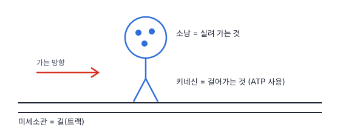

*미세소관(두 줄 선)은 길, 키네신(다리 선)은 걷는 것, 소낭(동그란 테두리, 안의 색칠된 점은 담긴 물질)은 짐이에요.*

**미세섬유의 기능.** 아메바는 모양이 정해져 있지 않고 자유롭게 바뀌며 움직여요. 세포막 바로 밑의 미세섬유가 막을 잡아 주기 때문이에요. 근육세포에서는 액틴과 미오신(myosin)이 결합해 서로 잡아당기면서 근육이 수축해요. 강의노트 1장 p6은 미세섬유 기능으로 세포질 운동도 적어 두었어요. 교재 1장 p.20은 이것을 세포질의 활발한 흐름이라고 설명해요.

**기능에서 구조로 거꾸로 찾기.** 어떤 섬유가 망가졌을 때 무엇이 멈추는지로 되짚을 수 있어요.

- 아메바 운동, 근육 수축, 세포질 흐름이 막혔다 → 미세섬유, 단위체는 액틴이에요.
- 방추사가 생기지 않거나 소낭이 제자리로 옮겨지지 않는다 → 미세소관, 단위체는 튜불린이에요.
- 튜불린·액틴 구슬이 아니라 케라틴 같은 중간섬유단백질로 된 섬유 → 중간섬유예요.

**교수님 말씀**

세포골격을 시작하며 세포가 물풍선에 가까운지 텐트에 가까운지 물었고, 스스로 답했어요.

> 세포는 물풍선 같은 게 아닙니다. 오히려 텐트에 가까워요.

굵기는 이름만 보면 된다고 했어요.

> 미세소관이 크냐 미세섬유가 크냐? 관이 크잖아, 관이.

미세섬유는 액틴 구슬이 쭉 이어진 "밧줄"이라고 했어요. 미세소관은 이미 아는 것이라며 방추사를 떠올리게 했어요.

> 이미 우리는 미세소관이 뭔지 알고 있어요. 방추사.

소낭 수송은 도로 위를 걷는 모습으로 설명하고 키네신 영상을 보여 주었어요.

> ATP 에너지를 써서 터벅터벅 걸어가요. 도로, 고속도로, 길.

**꼭 기억해요**

- **미세소관과 미세섬유를 뒤바꾸기 쉬워요.** 미세소관은 튜불린으로 된 속이 빈 관이고 가장 굵어요. 미세섬유는 액틴으로 된 밧줄이고 가장 가늘어요. 교수님도 설명하다 "미세소.. 미세섬유가"라고 바로잡았어요.
- **방추사와 소기관·소낭 수송 트랙을 미세섬유 기능으로 착각하기 쉬워요.** 둘 다 미세소관의 기능이에요. 미세섬유는 아메바 운동과 근육 수축이에요.
- **"이동"이라는 낱말 하나로 가르면 헷갈려요.** 미세섬유도 아메바처럼 세포를 움직이게 하고, 세포 안의 세포질을 흐르게 하는 세포질 운동에도 관여해요(강의노트 1장 p6, 교재 1장 p.20). 그래서 "세포 안에서 무언가 움직인다"만으로는 미세소관이라고 할 수 없어요. 소낭·소기관이 트랙을 따라 운반되거나 방추사가 염색체를 끌면 미세소관이에요. 아메바 운동, 근육 수축, 세포질 흐름은 미세섬유예요.
- **세 가지가 모두 같은 방식으로 만들어진다고 착각하기 쉬워요.** 구슬 모양 단위체가 필요할 때 모였다 흩어지는 것은 미세소관(튜불린)과 미세섬유(액틴)예요. 중간섬유는 교수님이 "단위체가 없어요, 원래부터 큰 단백질"이라고 설명했어요. 다만 교재 1장 p.21 그림 1.23(b)는 중간섬유단백질 사슬이 꼬여 소단위체를 이룬다고 써요. 그러니 "중간섬유는 단위체가 전혀 없다"보다 "튜불린·액틴 같은 구슬 단위체가 모였다 흩어지는 섬유가 아니다"로 기억해요. "미세소관 — 액틴"처럼 구조와 단위체를 엇갈려 짝지은 보기에 주의해요.
- **수송에서 길과 운반자를 뒤바꾸기 쉬워요.** 길(트랙)은 미세소관, 걸어가는 것은 운동단백질 키네신(ATP 사용), 실려 가는 것은 소낭이에요. 키네신은 세포골격이 아니라 그 위를 걷는 단백질이에요.
- **중간섬유의 "중간"은 굵기예요.** 미세소관보다 가늘고 미세섬유보다 굵다는 뜻이에요.

**페이지 요약**

세포골격은 굵은 순으로 미세소관(튜불린, 방추사·수송 트랙), 중간섬유(중간섬유단백질, 케라틴), 미세섬유(액틴, 아메바 운동·근육 수축)예요.

*용어*

- **미세소관(microtubule)** — 튜불린으로 된 속 빈 관. 방추사, 소낭이 지나는 트랙
- **미세섬유(microfilament)** — 액틴으로 된 밧줄. 아메바 운동, 근육 수축, 세포질 운동
- **키네신(kinesin)** — ATP를 쓰며 미세소관 위를 걸어 소낭을 나르는 운동단백질

---

### 유동 모자이크 모형

*0910 수업 · 1장 p6*

**쉽게 말하면**

세포를 감싼 막은 굳은 벽이 아니라 살짝 출렁이는 층이라, 거기 꽂힌 덩어리들도 둥둥 떠다녀요.

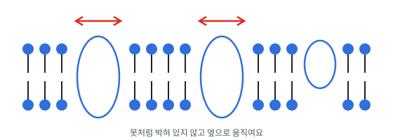

*색칠된 작은 알갱이 두 줄이 옆으로 움직이니, 사이에 박힌 큰 덩어리(테두리 도형)도 함께 떠다녀요.*

**정확히 말하면**

세포막은 세포 안과 바깥을 나누는 경계예요. 인지질 이중층이 바깥의 물로부터 세포의 내용물과 내부 환경을 격리해 지켜요(강의노트 1장 p2 "세포막의 인지질 이중막 구조는 외부의 물로부터 내부환경과 구조를 보존").

**유동 모자이크 모형(fluid mosaic model)**은 세포막의 구조를 설명하는 모형이에요. 모든 생물의 세포막은 **인지질 이중층**이고, 그 사이사이에 단백질이 모자이크처럼 점점이 박혀 있어요.

- **모자이크**: 인지질 이중층 곳곳에 여러 가지 막단백질이 점점이 박혀 있는 모습을 가리켜요.
- **유동**: 인지질 이중층은 완전한 고체도, 액체도 아니에요. 인지질 분자가 옆으로 움직일 수 있어서, 사이에 박힌 단백질도 고정되지 않고 떠다닐 수 있어요.
- **콜레스테롤**: 동물세포 막에는 콜레스테롤이 끼어 있어요. 콜레스테롤은 막의 유동성을 조절하고 막을 더 안정적으로 만들어요.

이번 수업에서는 세포막의 구조만 다뤘어요. 1.4의 막 수송은 건너뛰었어요. ATP가 쓰이는 수송은 [ATP를 쓰는 곳](#s2-atp-use)에서 이어져요.

**교수님 말씀**

막단백질이 떠다닌다는 점을 못에 빗대 설명했어요.

> 벽에 못을 박은 것처럼 딱 고정된 게 아니고

세포막은 구조만 간단히 보고 수송은 넘어간다고 했어요.

> 뒷부분은 엄청 생략하고 세포막 구조 자체만 간단하게. 수송은 생략을 하고

콜레스테롤까지 설명한 뒤 세포막 구조는 이 정도면 된다고 정리했어요.

> 요 정도만 알면 되고

다만 삼투는 알아야 한다고 짚고 넘어갔어요.

> 삼투 같은 건 알아야 되긴 한데 일단은 넘어갑니다.

**꼭 기억해요**

- **"유동"과 "모자이크"가 가리키는 것을 뒤바꾸기 쉬워요.** 유동은 인지질(과 그 사이의 단백질)이 옆으로 움직인다는 뜻이고, 모자이크는 단백질이 인지질 이중층에 점점이 박혀 있다는 뜻이에요.
- **막단백질이 제자리에 고정돼 있다고 착각하기 쉬워요.** 벽에 못을 박은 것처럼 고정된 게 아니라 떠다녀요.
- **콜레스테롤의 역할.** 동물세포 막의 콜레스테롤은 유동성을 조절하고 막을 안정시켜요.
- **수업에서 생략했다는 것과 몰라도 된다는 것은 달라요.** 막 수송은 이번 수업에서 생략했지만, 교수님은 "삼투 같은 건 알아야 되긴 한데"라고 했어요.

**페이지 요약**

세포막은 인지질 이중층에 단백질이 모자이크처럼 박혀 있고, 인지질이 옆으로 움직여 단백질도 떠다녀요.

*용어*

- **유동 모자이크 모형(fluid mosaic model)** — 유동 = 인지질이 옆으로 움직임, 모자이크 = 단백질이 점점이 박힘
- **콜레스테롤** — 동물세포 막에 끼어 유동성을 조절하고 막을 안정시킴

---

### 1장 마무리 보충: 구조가 기능을 정한다

*0910 수업 · 1장 p4*

**쉽게 말하면**

구슬을 꿴 순서가 정해지면 줄이 저절로 접혀 모양이 생기고, 그 모양이 하는 일을 정해요.

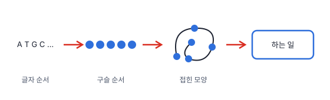

*글자 순서가 구슬 순서를, 구슬 순서가 접힌 모양을, 접힌 모양이 하는 일을 정해요.*

**정확히 말하면**

**단백질 구조와 기능.** 단백질에는 1차~4차 구조가 있어요. 이 가운데 **1차 구조**(아미노산의 순서)가 **3차 구조**(3차원 입체 구조)를 결정해요. 아미노산 순서가 정해지면 3차원 구조는 저절로 만들어지고, 그 구조가 기능과 밀접하게 관련돼요.

- 구조를 알면 그 단백질의 역할이나 어떤 단백질과 상호작용할지를 추측할 수 있어요.
- 예전에는 단백질을 결정으로 만든 뒤 X선을 쬐는 복잡한 방법으로 구조를 알아냈어요.
- 요즘은 딥마인드의 AI인 **알파폴드(AlphaFold)**가 아미노산 서열만으로 3차원 구조를 예측해요.

**DNA가 담은 정보.** 정보는 아래 순서로 흘러가요.

1. DNA의 염기(A, T, G, C) 순서가 아미노산 순서를 정해요.
2. 아미노산 순서(1차 구조)가 3차원 구조를 정해요.
3. 3차원 구조가 기능을 정해요.

그래서 DNA는 결국 아미노산 서열에 대한 정보를 담고 있어요.

**염기 1개는 몇 비트일까.** 컴퓨터는 0과 1 두 가지로 정보를 적고, 그 한 자리가 1비트예요. DNA 염기는 네 가지이고, 네 가지를 구별하려면 2진수 두 자리가 필요해요. 그래서 염기 1개는 **2비트**에 해당해요.

$$
2^2 = 4
$$

**DNA 저장장치.** DNA에 디지털 데이터를 적어 두는 기술이에요.

- 장점 (1) 데이터 밀도가 높아요. DNA 1 g에 고화질 영화 약 2,440만 편을 저장할 수 있어요.
- 장점 (2) 수명이 길어요. 보관만 잘하면 수만 년 가요. USB의 수명은 약 10년이에요.
- 단점: 데이터를 쓰고 읽는 과정이 복잡하고 오래 걸려요.

**교수님 말씀**

1장을 마치며, 시간이 없어 못 했던 단백질 구조 이야기를 보충했어요. 구조를 밝히는 일이 얼마나 중요한지 강조했어요.

> 단백질 구조만 잘 밝혀도 그냥 교수가 되는 겁니다

AI 이름을 떠올리다 "알파고가 아니고" 하며 잠시 막혔는데, 그 이름이 알파폴드예요. 이 내용은 "나중에 수업에 약간 써먹으면" 된다고 했어요.

염기당 비트 수 계산은 교재의 응용 이슈에 있다며 "심심할 때 한번 읽어보세요"라고 했어요. 영상에서는 하버드 연구팀이 달리는 말 애니메이션을 DNA 코드로 합성해 대장균에 저장했다가 다시 읽어 낸 사례를 보여 주었어요. 몇만 년 된 화석에서도 DNA를 뽑아낼 수 있다는 점을 USB 수명과 견주었어요.

**페이지 요약**

DNA 염기 순서가 아미노산 순서(1차 구조)를, 1차 구조가 3차 구조를, 3차 구조가 기능을 정해요.

*용어*

- **알파폴드(AlphaFold)** — 아미노산 서열만으로 3차원 구조를 예측하는 딥마인드의 AI
- **2비트** — 염기 4종류를 구별하는 데 드는 정보량(염기 1개)

---

## 2. [2장] 에너지와 ATP

### 화학 에너지는 전자의 위치에너지

*0910 수업 · 2장 p1*

**쉽게 말하면**

높은 곳에 올려 둔 돌은 떨어질 힘을 몰래 품고 있어요.

밥 속에도 이렇게 떨어질 준비를 한 아주 작은 알갱이가 숨어 있어요.

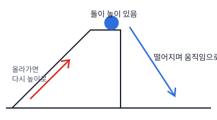

*돌이 떨어지면 품고 있던 힘이 움직임으로 바뀌어요.*

**정확히 말하면**

에너지는 크게 두 가지로 나뉘어요.

- **운동에너지(kinetic energy)**: 움직임의 에너지예요. 열에너지(thermal energy)도 운동에너지예요.
- **위치에너지(potential energy)**: 어떤 위치에 있기 때문에 생기는 저장된 에너지예요. 강의노트는 화학에너지, 핵에너지, 중력 에너지를 여기에 넣어요(2장 p1).

두 에너지는 서로 바뀌어요. 돌을 떨어뜨리면 위치에너지가 운동에너지로 바뀌고, 산을 오르면 운동에너지가 위치에너지로 바뀌어요.

우리가 밥을 먹는 이유는 포도당(glucose)에 든 **화학 에너지**를 쓰기 위해서예요. 화학 에너지는 운동에너지가 아니라 위치에너지예요.

더 정확히는, 포도당 속 C–H 공유결합에 있는 **전자의 위치에너지**예요. 탄소(C)와 수소(H) 사이에서 공유된 전자가 이 에너지를 가지고 있어요.

생물은 이 위치에너지를 곧바로 쓰지 않고 먼저 ATP를 만드는 데 써요. 이어지는 이야기는 [ATP: 저금해 두었다 꺼내 쓰는 에너지](#s2-atp)에서, 전자가 왜 "떨어지는지"는 [산화·환원: 전자는 끌어당기는 쪽으로 떨어진다](#s4-redox)에서 다뤄요.

**교수님 말씀**

> "2장이 진심이에요. 2장에서 포기할 수도 있어."

> "복잡한 대사 과정 외울 필요 없습니다. 원리가 중요합니다, 원리."

"왜 아침밥을 먹어야 되느냐"라는 질문으로 2장을 열었어요. 답은 포도당의 화학 에너지를 쓰기 위해서예요.

> "화학 에너지는 위치 에너지입니다."

> "C하고 H 사이에 전자가 있죠. 그 전자의 위치 에너지예요."

**꼭 기억해요**

- **화학 에너지: 운동에너지 vs 위치에너지**: 몸을 움직이게 하니까 화학 에너지를 운동에너지로 착각하기 쉬워요. 화학 에너지는 위치에너지, 곧 C–H 결합 전자의 위치에너지예요. 움직임과 열이 운동에너지예요.
- **에너지가 있는 곳**: 포도당 분자 전체나 탄소 원자 자체가 아니라, C와 H 사이에 공유된 전자의 위치가 에너지를 품고 있어요.

**페이지 요약**

화학 에너지는 위치에너지이고, 정확히는 포도당 C–H 결합에 있는 전자의 위치에너지예요.

*용어*

- **운동에너지(kinetic energy)** — 움직임의 에너지, 열도 여기에 속함
- **위치에너지(potential energy)** — 위치 때문에 생기는 저장된 에너지
- **화학 에너지** — C–H 결합 전자의 위치에너지

---

### ATP: 저금해 두었다 꺼내 쓰는 에너지

*0910 수업 · 2장 p1*

**쉽게 말하면**

밥에서 얻은 힘은 바로 쓰지 않고 작은 충전지에 채워 두었다가 필요할 때 꺼내 써요.

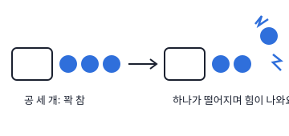

*공 하나가 떨어져 나갈 때 힘이 나오고, 다시 붙이면 충전돼요.*

**정확히 말하면**

**에너지는 어디로 가나**: 세포호흡에서 포도당이 분해되며 나온 화학 에너지(전자의 위치에너지)는 곧바로 쓰이지 않고 **ATP(adenosine triphosphate)**를 만드는 데 쓰여요. 그 에너지의 일부가 ATP에 저장돼요. 수업에서는 ATP에 저장되는 쪽만 다뤘어요. 세포는 필요할 때 ATP를 분해해서 그 에너지를 써요.

**구조**: ATP는 아데노신 삼인산이에요. tri는 3, phosphate는 인산이에요.

- **아데노신** = 아데닌 염기 + **리보스** 당
- 아데노신에 **인산기**(phosphate group) 3개가 이어 붙어 있어요.
- 디옥시리보스가 아니라 리보스이므로, ATP는 **RNA**를 구성하는 뉴클레오타이드에 인산기 3개가 붙은 것이에요. DNA 쪽이 아니에요.

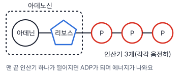

*ATP 구조: 아데노신(아데닌 + 리보스)에 인산기 3개가 이어져 있어요.*

**왜 에너지를 품나**: 인산기는 음전하를 띠어요. 인산기 3개가 붙은 ATP에는 음전하가 4개 가까이 모여 서로 밀어내요(반발). 인산기 하나가 떨어지면 음전하가 3개로 줄어 더 안정해지고, 그만큼 에너지가 나와요. 교수님은 이것이 "여러 가지 이유" 중 하나라고 했어요.

**에너지를 내는 방향**: ATP는 인산기 하나를 **잃고** **ADP**(adenosine diphosphate, 인산기 2개, di는 2)가 될 때 에너지를 방출해요.

$$
\mathrm{ATP} \rightarrow \mathrm{ADP} + \text{인산기} + \text{에너지}
$$

- 거꾸로 ADP에 인산기를 다시 붙이는 쪽은 에너지를 넣어 채우는 **충전** 방향이에요. 포도당의 에너지가 여기에 쓰여요.
- 에너지는 인산기가 떨어질 때 나와요. 전자나 양성자(H⁺)를 내놓아서 나오는 것이 아니에요.

**직접 원천**: 세포가 일(동화 반응, 수송, 근육 수축, 발광)을 할 때 바로 꺼내 쓰는 화학에너지의 직접 원천은 ATP예요. ADP는 인산기를 잃고 에너지를 이미 내준 뒤의 모습이에요.

**교수님 말씀**

**아르바이트** 비유: 아르바이트로 번 돈을 저금해 두었다가 나중에 밥 사 먹을 때 쓰는 것처럼, 에너지를 ATP에 저장해 두었다가 필요한 곳에 써요.

핸드폰 **충전** 비유: 충전했다가 쓰고, 또 충전했다가 쓰는 것처럼 ATP를 만들고 쓰기를 되풀이해요.

> "네 놈이서 막 맨날 싸우는 거야. 좀 땡길래? 비킬래?"

음전하 4개가 서로 밀어내는 모습을 이렇게 표현했어요.

> "리보스 당이니까 RNA예요, DNA예요?"

스스로 "RNA를 구성하는 뉴클레오타이드"라고 답했어요.

> "결론적으로 ATP가 ADP가 될 때 에너지가 방출된다."

**꼭 기억해요**

- **아데노신 vs 아데닌**: 둘을 같은 것으로 착각하기 쉬워요. 아데닌은 염기 하나이고, 아데노신은 아데닌 + 리보스를 합친 것이에요.
- **리보스 vs 디옥시리보스**: ATP를 DNA 뉴클레오타이드와 연결하기 쉬워요. ATP의 당은 리보스이므로 RNA 쪽 뉴클레오타이드예요. 디옥시리보스는 DNA의 당이에요.
- **ATP vs ADP, tri vs di**: 이름을 뒤바꾸기 쉬워요. ATP는 인산기 3개(tri), ADP는 인산기 2개(di)예요.
- **인산기를 잃을 때 vs 얻을 때**: 인산기를 얻어서 에너지를 낸다고 착각하기 쉬워요. 에너지는 인산기를 잃고 ATP가 ADP가 될 때 나와요. 인산기를 얻는 쪽(ADP에서 ATP로)은 충전이에요.
- **ATP vs ADP, 무엇이 직접 원천인가**: 세포가 일에 바로 쓰는 에너지의 직접 원천은 ATP예요. ADP는 에너지를 내준 뒤의 모습이에요.
- **인산기가 떨어짐 vs 전자·양성자를 내놓음**: ATP는 전자나 양성자를 내놓아서 에너지를 주는 것이 아니에요. 음전하 인산기 하나가 떨어져 반발이 줄어들며 에너지가 나와요.

**보충 · 수업에서 다루지 않았어요**

교재는 세포가 일에 쓸 수 있는 이 에너지를 자유에너지(free energy)라고 부르며, "ATP는 생물학적 작용을 하는 자유에너지를 공급한다"고 써요(교재 2장 p.32).

출처: 교재 2장 p.32

세포호흡이 포도당의 화학 에너지를 ATP로 바꾸는 일은 100% 효율적이지 않아요. ATP 형태로 붙잡히지 않은 나머지 화학 에너지는 열로 나가고, 포유류와 조류에서는 이 열이 체온을 일정하게 유지하는 데 쓰여요. 교재 1장 p.20은 "방출된 대부분의 에너지는 ATP로 저장된다"고 짧게 쓰지만, 2장은 ATP로 보존되는 몫이 전체가 아니라 일부라고 설명해요.

출처: 교재 2장 p.43, 강의노트 2장 p3("ATP 형태로 포획되지 않은 화학 에너지는 열로 방출")

**페이지 요약**

포도당 에너지의 일부는 ATP에 저장되고, ATP는 인산기 하나를 잃고 ADP가 될 때 에너지를 내놓아요.

*핵심 식*

- ATP 분해

  $$
  \mathrm{ATP} \rightarrow \mathrm{ADP} + \text{인산기} + \text{에너지}
  $$

*용어*

- **ATP(adenosine triphosphate)** — 아데노신 + 인산기 3개, 리보스를 가진 RNA 쪽 뉴클레오타이드
- **ADP** — 인산기 2개, ATP가 에너지를 내준 뒤의 모습
- **아데노신** — 아데닌 염기 + 리보스 당

---

### ATP를 쓰는 곳

*0910 수업 · 2장 p1 · 1장 p6*

**쉽게 말하면**

연기는 저절로 넓게 퍼지지만, 다시 한쪽으로 모으려면 부채질처럼 힘을 써야 해요.

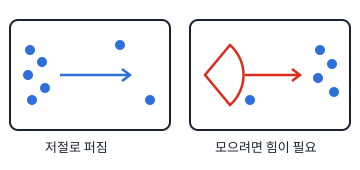

*퍼지는 쪽은 공짜이고, 모으는 쪽은 힘이 들어요.*

**정확히 말하면**

세포는 ATP를 분해해서 나온 에너지를 다음 네 곳에 써요.

1. **동화 반응**(anabolic reaction): 작은 분자들이 모여 큰 분자가 되는 반응이에요. 커질 때는 에너지가 필요하고, ATP가 그 화학 에너지를 줘요. 예: 글루탐산 + 암모니아 → 글루타민. 이산화탄소 6개가 모여 포도당이 되는 광합성도 동화 작용에 속해요(광합성은 빛에너지를 써요).
2. **용질 수송**(solute transport): 물질을 막 너머로 옮기는 일이에요. 방향에 따라 에너지 필요 여부가 갈려요.

   - 고농도에서 저농도로: **확산**(diffusion)으로 저절로 일어나요. 에너지가 필요 없어요.
   - 저농도에서 고농도로(농도기울기를 거슬러): 반드시 에너지가 필요하고, 이때 ATP를 써요. 이것이 **능동수송(active transport)**이에요.
3. 기계적인 일: **근육 수축**에 ATP가 있어야 해요.
4. **발광**(bioluminescence): 반딧불이는 ATP 에너지로 빛을 내요.

강의노트의 "단백질 활성"은 에너지와 관련이 없어 이번에는 빼고 넘어갔어요.

세포 하나에서도 1분에 엄청나게 많은 ATP가 만들어지고 쓰여요. 그래서 ATP를 계속 만들려면 끊임없이 먹어야 해요. 지구의 모든 생물은 ATP 형태로 에너지를 저장해요.

**교수님 말씀**

담배 연기나 잉크 한 방울은 저절로 퍼져요. 그 연기를 담배 피우는 사람 쪽으로 다시 보내려면 **부채질**을 하든지 에너지를 써야 해요.

> "저농도에서 고농도 방향으로 갈 때는 반드시 에너지를 써야 됩니다."

동화의 "동"은 같을 동(同) 자로, 작은 것들을 모아 하나로 합친다는 뜻이라고 설명했어요.

> "죽으면은 ATP를 못 만드는 거고, ATP를 못 만들면 죽는 거고."

"A○○ 없이는 살 수 있어도 ATP 없이는 살 수 없다" 퀴즈를 냈어요. 교수님이 생각한 답은 APT(아파트)였어요. ATP가 꼭 필요하다는 점을 기억하게 하려는 장치예요.

**꼭 기억해요**

- **확산 vs 능동수송**: 물질이 옮겨 가면 늘 에너지가 든다고 착각하기 쉬워요. 고농도에서 저농도로 가는 확산은 에너지가 필요 없어요. 저농도에서 고농도로, 곧 농도기울기와 반대로 옮기는 능동수송만 ATP가 필요해요.
- **방향 확인**: 보기에 "에너지가 필요하다"가 나오면 먼저 방향을 봐요. "농도기울기를 따라"면 에너지가 필요 없고, "농도기울기와 반대로"면 에너지가 필요해요. "반드시", "항상" 같은 말은 반대 방향의 예가 없는지 확인하라는 신호예요.
- **동화 반응의 방향**: 큰 것을 쪼개는 반응으로 착각하기 쉬워요. 동화는 작은 것들이 모여 큰 것이 되는 반응이고, 에너지를 흡수해요.

**보충 · 수업에서 다루지 않았어요**

강의노트 1장 p6의 "1.4 세포막과 수송"은 교수님이 "수송은 생략을 하고"라며 건너뛴 부분이에요. "삼투 같은 건 알아야 되긴 한데 일단은 넘어갑니다"라고도 했어요. 막수송 보기를 가를 때 쓰는 기준만 교재에서 옮겨 둬요.

| 방식 | 어디로 지나가나 | 방향과 에너지 | 판별 포인트 |
|---|---|---|---|
| 단순확산 | 수송 단백질 없이 막의 지질 부분을 직접 통과(산소, 이산화탄소, 스테로이드처럼 작고 비극성인 물질) | 농도기울기를 따라, 에너지 불필요 | 특정 분자만 고르지 않아요(비특이적). 농도가 높아져도 포화되어 멈추지 않아요. |
| 촉진확산 | 특정 분자만 통과시키는 수송 단백질(채널 단백질, 운반체 단백질)을 통해 통과 | 농도기울기를 따라, 에너지 불필요 | 모든 분자에 되는 것이 아니라 특이적이에요. 지질막을 직접 통과하는 것이 아니에요. 농도가 높으면 포화돼요. |
| 삼투(osmosis) | 물 분자가 선택적 투과막을 지나감 | 용질 농도가 낮은 쪽에서 높은 쪽으로 물이 이동, 에너지 불필요 | 물의 수동적 수송이에요. 능동수송의 예가 아니에요. |
| 능동수송 | 수송 단백질(펌프)을 통해 통과 | 농도기울기와 반대로, 에너지 필요(ATP 가수분해) | 특이적이고 포화돼요. 교재 표에는 다른 물질의 농도기울기를 에너지원으로 쓰는 경우도 함께 적혀 있어요. |

출처: 교재 1장 p.22–23(1.4.2 세포막의 수송, 표 1.1 수송메커니즘의 특성들), 강의노트 1장 p6 "1.4 세포막과 수송"

**페이지 요약**

ATP는 동화 반응, 용질 수송, 근육 수축, 발광에 쓰이고, 수송 중에는 저농도에서 고농도로 옮기는 능동수송에만 필요해요.

*용어*

- **동화 반응** — 작은 것들이 모여 큰 것이 되는 반응, 에너지 필요
- **확산** — 고농도에서 저농도로 저절로 퍼짐, 에너지 불필요
- **능동수송(active transport)** — 농도기울기와 반대로 옮김, ATP 필요

---

## 3. [2장] 효소

### 효소는 언덕을 낮춘다

*0910 수업 · 2장 p1*

**쉽게 말하면**

몸속 도우미는 바위가 굴러가기 전에 넘어야 하는 작은 턱을 낮춰 줘요.

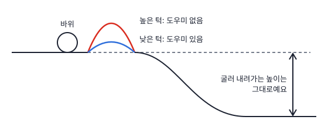

*턱이 낮아지면 바위가 금방 넘어가요. 굴러 내려가는 높이는 도우미가 있어도 똑같아요.*

**정확히 말하면**

**효소(enzyme)**는 단백질로 된 촉매예요. 생명이 유지되려면 몸속 반응이 빨라야 하는데, 효소는 반응 속도를 10⁶–10¹²배(백만 배에서 조 배)까지 높여요.

**이름 짓기.** 효소 이름은 대부분 **-ase**로 끝나고, 앞에는 그 효소가 바꾸는 물질 이름이 와요.

| 바꾸는 물질 | 효소 이름 | 하는 일 |
|---|---|---|
| 아밀로스(amylose, 녹말) | 아밀레이스(amylase) | 녹말 분해 |
| 프로틴(protein, 단백질) | 프로테이스(protease) | 단백질 분해 |
| 수크로스(sucrose, 설탕) | 수크레이스(sucrase) | 설탕 분해 |

**빨라지는 이유: 활성화 에너지를 낮춘다.** **활성화 에너지(activation energy)**는 반응을 시작하는 데 필요한 초기 에너지예요. 반응물(reactant)의 에너지가 생성물(product)보다 높으면 반응은 저절로(자발적으로) 일어날 수 있어요. 그래도 처음에 넘어야 하는 에너지의 "턱"이 있어요. 효소는 이 턱만 낮춰서 반응이 빨리 일어나게 해요.

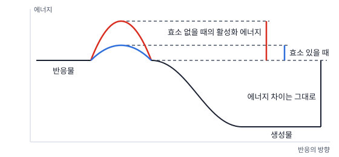

*효소는 봉우리(활성화 에너지)만 낮춰요. 반응물과 생성물의 높이, 곧 반응 전후의 에너지 차이는 효소가 있어도 똑같아요.*

**산 위 바위 비유와 짝짓기.** 산 위의 바위는 아래로 굴러떨어질 수 있지만, 바로 앞의 턱을 넘지 못하면 그대로 있어요.

| 비유 | 화학반응 | 효소가 있으면 |
|---|---|---|
| 바위를 턱 위로 밀어 올리는 데 드는 노력 | 활성화 에너지 | **줄어요** |
| 언덕 아래까지 떨어지는 높이, 언덕의 경사 | 반응물과 생성물의 에너지 차이 | **그대로예요** |
| 바위가 굴러가는 방향(위에서 아래로) | 반응의 방향 | **그대로예요** |

**효소가 하는 일과 하지 않는 일.** 효소가 하는 일은 활성화 에너지를 낮춰 반응 속도를 높이는 것 하나예요. 아래 일은 하지 않아요.

- 기질에 에너지(ATP)를 공급하지 않아요. 턱을 낮출 뿐, 바위를 밀어 주지 않아요.
- 세포를 가열하지 않아요. 오히려 효소 덕분에 몸이 견딜 수 있는 온도에서 반응이 일어나요.
- 세포의 형태를 바꿔서 반응을 빠르게 하지 않아요.
- 반응물과 생성물의 에너지 차이(언덕 전체 높이)나 반응의 방향을 바꾸지 않아요. 그래서 한쪽으로만 일어나는 반응(비가역 반응)을 양쪽으로 일어나는 반응(가역 반응)으로 만들지 않아요.

**기질, 활성 부위, 특이성.** 효소가 바꾸는 반응물을 **기질(substrate)**이라고 해요. 기질은 효소 전체가 아니라 효소의 일부에만 결합하고, 그 자리에서 반응이 일어나요. 이 자리가 **활성 부위(active site)**예요. 기질과 활성 부위의 구조가 딱 맞아야 반응이 일어나요. 그래서 한 효소는 한 가지 기질(또는 아주 닮은 기질)의 반응만 빠르게 해요. 이 성질이 **특이성**(specificity)이에요. 설탕 분해 효소는 설탕만, 젖당 분해 효소는 **젖당**만 분해해요.

| 야구 글러브 비유 | 효소 용어 |
|---|---|
| 야구 글러브 | 효소 |
| 야구공(글러브에 딱 맞는 공) | 기질 |
| 공이 닿는 글러브의 한 부분 | 활성 부위 |
| 농구공이나 럭비공은 받기 어려움 | 특이성: 구조가 안 맞는 물질은 반응시키지 못함 |

**젖당 분해 효소 그림 읽기.** 교재 그림 2.4는 젖당(lactose)을 포도당(glucose)과 갈락토오스(galactose)로 자르는 효소, β-갈락토오스가수분해효소(β-galactosidase)를 보여 줘요. 교재 본문은 갈락토스라고도 써요. 같은 물질이에요.

*육각형 테두리는 당 한 개, 효소 윗면의 홈은 활성부위예요. 젖당이 홈에 맞게 들어가야 잘려요.*

1. **결합**: 기질인 젖당이 β-갈락토오스가수분해효소의 활성부위에 들어가 효소-기질 복합체를 만들어요.
2. **반응과 방출**: 효소가 물(H₂O)을 써서 두 당 사이의 결합을 자르고, 생성물인 포도당과 갈락토오스가 떨어져 나가요.
3. **재사용**: 효소는 반응 전과 똑같은 모양으로 남아요. 소모되지 않으므로 다른 젖당과 다시 반응해요.

**효소는 변하지 않는다.** 촉매는 원래 자기 자신은 변하지 않아요. 효소도 반응이 끝나면 **변하지 않**은 채 기질에서 떨어져 나와 여러 번 다시 쓰여요.

**교수님 말씀**

효소가 없으면 오늘 아침밥이 한두 달 뒤에야 소화된다고 했어요.

활성화 에너지는 산 위 바위가 굴러떨어지기 전에 넘어야 하는 턱이에요. 담배에 처음 붙이는 불도 활성화 에너지에 비유했어요. 한번 불이 붙으면 계속 타지만, 처음 불은 붙여 줘야 해요.

> 한 놈만 팹니다, 한 놈만.

특이성을 영화 대사로 설명했어요. 설탕 분해 효소는 설탕만 분해해요.

효소는 야구 글러브, 기질은 야구공이에요. 글러브로 농구공이나 럭비공은 받기 힘들고, 공은 글러브의 일부에만 닿아요.

> 효소는 변하지 않습니다. 원래 촉매는 자신은 안 변합니다.

**꼭 기억해요**

- **효소, 기질, 활성 부위를 서로 바꿔 부르기 쉬워요.** 바른 구분: 글러브가 효소, 공이 기질, 공이 닿는 글러브의 한 부분이 활성 부위예요. 활성 부위는 효소의 일부이지 기질의 일부가 아니에요.
- **설탕 분해 효소와 젖당 분해 효소를 섞기 쉬워요.** 교수님이 "설탕 분해... 젖당 분해 효소"라고 고쳐 말했어요. 젖당을 포도당과 갈락토오스로 자르는 것은 젖당 분해 효소예요. 설탕 분해 효소(수크레이스)는 설탕만 분해해요.
- **효소가 반응에 에너지를 준다고 착각하기 쉬워요.** 바른 구분: 효소는 활성화 에너지(턱)를 낮출 뿐이에요. 기질에 ATP를 공급하거나 세포를 데우거나 세포 모양을 바꾸지 않아요.
- **효소가 반응 전체를 바꾼다고 착각하기 쉬워요.** 바른 구분: 반응물과 생성물의 에너지 차이, 반응의 방향은 그대로예요. 비가역 반응을 가역 반응으로 만들지 못해요. 바위 비유에서 줄어드는 것은 턱을 넘는 노력뿐이에요.
- **"효소는 모든 반응을 빠르게 한다"처럼 "모든"이 붙으면 반례를 떠올려요.** 한 효소는 구조가 맞는 기질의 반응만 빠르게 해요(특이성).
- **"효소는 변하지 않는다"를 너무 넓게 읽기 쉬워요.** 반응 전후로 소모되지 않는다는 뜻이에요. 열이나 pH에도 끄떡없다는 뜻은 아니에요. [온도와 pH: 구조가 깨지면 기능이 깨진다](#s3-temp-ph)를 함께 봐요.

**보충 · 수업에서 다루지 않았어요**

**활성 부위를 막는 약물.** 효소의 활성 부위는 기질 분자를 알아보고 결합하는 자리예요. 그래서 활성 부위에 대신 들어가 효소를 막는 약물은 그 자리에 맞아야 하고, **기질과 구조가 닮아야** 해요. 젖당 분해 효소의 활성 부위를 막으려면 젖당과 모양이 닮은 물질이어야 해요. 교재에 약물 이야기가 직접 나오지는 않아요. 교재의 활성부위와 특이성 정의, 그림 2.4에서 바로 따라 나오는 결론이에요.

**활성화 에너지 장벽이 있는 이유.** 교재는 에너지가 내려가는(자발적인) 반응이라도 처음에 약간의 에너지가 더해지지 않으면 일어나지 않을 수 있다고 설명해요. 바위가 턱에 걸려 있는 것과 같아요. 이 장벽 덕분에 몸속 반응은 제멋대로 일어나지 않고, 효소가 있는 반응만 필요할 때 빨라져요. 장벽이 없다면 필요 여부와 관계없이 모든 화학반응이 저절로 진행될 거예요. "기질이 효소에 결합하지 못한다", "반응이 아예 일어나지 않는다"는 장벽이 없을 때의 결과가 아니에요. 장벽이 없으면 반응은 오히려 더 쉽게 일어나요.

출처: 교재 2장 p.33–34(그림 2.3 활성화 에너지, 그림 2.4 효소의 촉매 순환), 강의노트 2장 p1

**페이지 요약**

효소는 활성화 에너지(턱)만 낮춰 반응을 빠르게 하고, 반응 뒤에도 변하지 않아 다시 쓰여요.

*용어*

- **활성화 에너지(activation energy)** — 반응을 시작하는 데 필요한 초기 에너지. 효소가 낮춤
- **기질(substrate)** — 효소가 바꾸는 반응물. 야구공
- **활성 부위(active site)** — 기질이 결합해 반응이 일어나는 효소의 일부

---

### 보조인자: 비타민은 거들 뿐

*0910 수업 · 2장 p1*

**쉽게 말하면**

몸속 도우미는 혼자서 모든 일을 할 수 없어서, 작은 조수들이 곁에서 도와줘요.

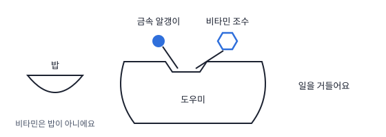

*작은 조수들은 도우미의 일을 거들 뿐, 먹어서 힘을 내는 밥이 아니에요.*

**정확히 말하면**

**왜 도움이 필요한가.** 효소는 단백질이고, 반응을 실제로 일으키는 것은 아미노산의 R기(R group)예요. 그런데 단백질을 이루는 아미노산은 **20가지**뿐이에요. 20가지 재료만으로는 몸속의 수많은 반응을 모두 해낼 수 없어요. 그래서 많은 효소는 반응에 꼭 필요한 도우미 물질과 함께 일해요.

**보조인자(cofactor)**는 효소가 촉매 반응을 하는 데 필요한, 단백질이 아닌 물질이에요. 두 종류가 있어요.

| 종류 | 예 | 설명 |
|---|---|---|
| 무기 보조인자 | **금속 이온**(metal ion): 마그네슘(Mg), 아연(Zn), 망가니즈(Mn), 칼륨(K), 구리(Cu), 철(Fe) 등 | 강의노트에 적힌 금속성 이온들이에요. |
| 유기 보조인자 | **비타민**(vitamin) 같은 유기물 | 탄소를 뼈대로 한 작은 분자예요. |

**비타민은 에너지원이 아니다.** 비타민은 스스로 에너지를 내는 물질이 아니에요. 효소가 반응을 잘하도록 돕는 물질이에요. 몸에 에너지를 주는 것은 포도당 같은 연료 분자예요.

**포함과 제외.** 보조인자에 들어가는 것은 금속 이온(무기)과 비타민 같은 유기물이에요. 효소를 이루는 단백질 부분 자체는 보조인자가 아니에요. 보조인자는 "단백질이 아닌" 도우미이기 때문이에요.

**교수님 말씀**

반응은 결국 아미노산의 R기가 일으키는데, 아미노산이 20종뿐이라 혼자서 다 할 수 없다고 했어요. 그래서 금속 이온이나 비타민 같은 유기물이 도와요.

> 비타민은 거들 뿐입니다.

만화 슬램덩크의 "왼손은 거들 뿐"을 빌린 말이에요. 비타민은 주인공이 아니라 효소를 거드는 역할이라는 뜻이에요.

**꼭 기억해요**

- **보조인자와 효소 자체를 같은 것으로 보기 쉬워요.** 바른 구분: 효소는 단백질이고, 보조인자는 효소를 돕는 단백질이 아닌 물질(금속 이온, 비타민 같은 유기물)이에요.
- **비타민을 에너지원으로 착각하기 쉬워요.** 바른 구분: 비타민은 스스로 에너지를 내지 않고 효소를 돕기만 해요. "비타민은 거들 뿐".
- **보조인자가 필요한 이유를 "효소가 약해서"로 기억하기 쉬워요.** 바른 구분: 단백질의 재료인 아미노산이 20가지뿐이라 할 수 있는 화학반응의 종류에 한계가 있기 때문이에요.

**보충 · 수업에서 다루지 않았어요**

**조효소(coenzyme).** 유기 보조인자를 **조효소(coenzyme)**라고 불러요. 교재는 고등동물의 많은 조효소가 **비타민에서 온 것**이라고 설명해요. 그래서 "많은 조효소는 무엇에서 유래하나"를 물으면 답은 비타민이에요. 교재가 조효소의 출처로 꼽는 것은 비타민뿐이고, 단백질·지방·탄수화물·뉴클레오타이드를 출처로 꼽지 않아요. 단백질은 효소 본체의 재료이고, 지방과 탄수화물은 에너지를 내는 연료예요.

출처: 강의노트 2장 p1("비타민 등의 유기보조 인자들: 조효소(coenzyme)"), 교재 2장 p.34–35

**페이지 요약**

아미노산이 20가지뿐이라, 많은 효소는 금속 이온이나 비타민 같은 보조인자의 도움을 받아요.

*용어*

- **보조인자(cofactor)** — 효소를 돕는 단백질이 아닌 물질. 금속 이온 또는 비타민 같은 유기물
- **조효소(coenzyme)** — 유기 보조인자. 많은 조효소가 비타민에서 옴

---

### 온도와 pH: 구조가 깨지면 기능이 깨진다

*0910 수업 · 2장 p1*

**쉽게 말하면**

몸속 도우미는 따뜻해지면 더 부지런해지지만, 너무 뜨거우면 모양이 풀려서 일을 못 해요.

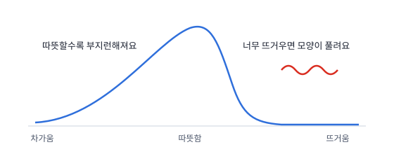

*꼬불꼬불한 선은 모양이 풀려 버린 도우미예요. 너무 신 곳에서도 이렇게 모양이 풀려요.*

**정확히 말하면**

**구조가 깨지면 기능이 깨진다.** 효소도 단백질이라 3차원 구조가 기능을 정해요. 단백질의 구조는 사슬 안의 **수소결합**과 **이온결합** 같은 약한 결합이 붙잡고 있어요. 온도와 pH는 이 결합에 영향을 줘요. 결합이 깨져 구조가 풀리는 것을 **변성(denaturation)**이라고 해요. 변성된 효소는 활성 부위 모양도 무너져 기질과 맞지 않게 되고, 기능을 잃어요.

**온도: 두 구간.**

1. **최적 온도까지**: 온도가 오르면 분자 운동이 늘어 반응 속도 자체가 빨라져요. 대략 10℃ 오를 때마다 약 2배씩 빨라져요.
2. **최적 온도**: 분자 운동은 활발하지만 효소가 아직 풀리지 않은 온도라서 반응이 가장 빨라요.
3. **최적 온도를 넘으면**: 수소결합과 이온결합이 깨지며 효소가 변성돼요. 활성이 급격히 떨어져요.

**최적 온도는 효소마다 달라요.** 교수님은 사람 효소의 **최적 온도**가 체온인 37℃ 근처라고 했어요. 강의노트 2장 p1은 "일반적으로 최적온도는 40℃~50℃"라고 적어서 수치가 달라요. 추운 곳에 사는 생물은 낮은 온도에서, 온천에 사는 세균은 높은 온도에서 잘 작동하는 효소를 가져요. 유전자를 늘리는 PCR(polymerase chain reaction)에는 높은 온도를 거치는 단계가 있어서, 온천 세균의 DNA 중합효소(DNA polymerase)를 써요.

#### 직접 해 보기: 온도에 따른 효소 반응 속도 *(정적 스냅샷 — 직접 조작은 HTML 버전)*

온도 슬라이더를 움직이면 점이 곡선을 따라 이동해, 최적 온도까지는 빨라지다가 넘으면 변성으로 급격히 떨어지는 두 구간이 보여요. 효소를 바꾸면 최적 온도가 다른 곡선이 나와요. 곡선은 모양만 보여 주는 정성적 모형이고, 각 효소의 가장 빠른 속도를 100%로 맞춘 상대값이라 퍼센트나 온천 세균 효소의 최적 온도 같은 숫자는 외울 대상이 아니에요.

상대 속도 **약 53%** · 효소 모양: **거의 모두 제 모양** · 최적 온도 아래: 분자 운동이 늘어 빨라지는 구간

범례: 고른 효소 · 다른 효소 · 현재 온도

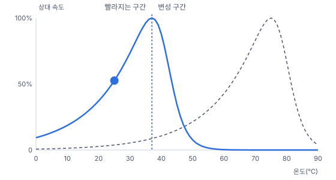

*사람 효소, 25℃: 상대 속도 약 53%*

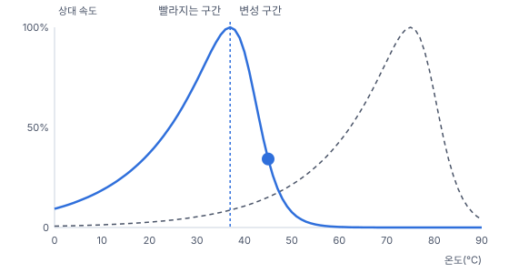

*사람 효소, 45℃: 상대 속도 약 34%*

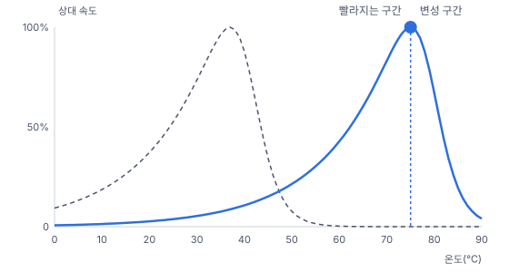

*온천 세균 효소, 75℃: 상대 속도 약 100%*

| 설정 | 상대 속도 | 효소 모양 | 구간 |
|---|---|---|---|
| 사람 효소, 10℃ | 약 19% | 거의 모두 제 모양 | 최적 온도 아래: 분자 운동이 늘어 빨라지는 구간 |
| 사람 효소, 25℃ | 약 53% | 거의 모두 제 모양 | 최적 온도 아래: 분자 운동이 늘어 빨라지는 구간 |
| 사람 효소, 37℃ | 약 100% | 일부가 풀리기 시작 | 최적 온도 근처: 가장 빠름 |
| 사람 효소, 45℃ | 약 34% | 절반 넘게 풀림 | 최적 온도 위: 변성으로 급격히 느려지는 구간 |
| 사람 효소, 60℃ | 약 0% | 거의 모두 풀림 | 최적 온도 위: 변성으로 급격히 느려지는 구간 |
| 온천 세균 효소, 37℃ | 약 9% | 거의 모두 제 모양 | 최적 온도 아래: 분자 운동이 늘어 빨라지는 구간 |
| 온천 세균 효소, 60℃ | 약 43% | 거의 모두 제 모양 | 최적 온도 아래: 분자 운동이 늘어 빨라지는 구간 |
| 온천 세균 효소, 75℃ | 약 100% | 일부가 풀리기 시작 | 최적 온도 근처: 가장 빠름 |
| 온천 세균 효소, 85℃ | 약 19% | 거의 모두 풀림 | 최적 온도 위: 변성으로 급격히 느려지는 구간 |

**pH: 카복실기의 전하가 바뀐다.** 단백질 사슬의 카복실기(carboxyl group)는 중성 근처에서 H⁺를 내놓은 COO⁻ 상태예요. 이 음전하가 사슬의 다른 곳에 있는 양전하 부분과 이온결합을 해서 구조를 잡아 줘요. pH가 낮아지면(산성) H⁺가 많아져 COO⁻에 H⁺가 다시 붙어요. 이렇게 COO⁻가 COOH가 되는 것을 양성자화라고 해요. 전하가 사라지니 이온결합이 깨지고 구조가 풀려요.

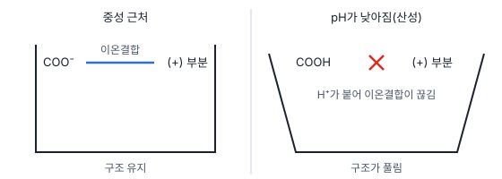

*COO⁻에 H⁺가 붙어 COOH가 되면 이온결합이 끊기고, 사슬이 벌어져 구조가 풀려요.*

**최적 pH도 효소마다 달라요.** 효소가 가장 활발한 pH를 **최적 pH**라고 해요. 대부분의 효소는 중성에서 가장 활성이 높아요(강의노트: 대부분 pH 6~8). 일하는 장소에 맞춘 예외가 있어요.

| 효소 | 일하는 곳 | 최적 pH |
|---|---|---|
| **펩신(pepsin)** | 위 | 산성 |
| **트립신(trypsin)** | 소장 | 약알칼리성 |
| 대부분의 효소 | 세포 안 등 | 중성 근처 |

**교수님 말씀**

> 구조가 깨지면은 기능이 깨집니다.

효소도 단백질이라 구조를 잡아 주는 수소결합과 이온결합이 온도와 pH에 영향을 받는다고 했어요.

온도가 오르면 반응 속도가 빨라지다가, 어느 온도를 넘으면 변성되어 떨어진다고 했어요. 사람 효소는 체온인 37℃ 근처에서 가장 잘 작동해요.

온천에 사는 세균은 뜨거운 곳에서 잘 작동하는 효소를 가져요. 그래서 PCR에서 온천 세균의 DNA 중합효소를 쓴다고 소개했어요.

pH가 낮아지면 카복실기에 H⁺가 붙어 이온결합이 깨진다고 설명했어요. 펩신은 위, 트립신은 소장에서 일한다고 했어요.

**꼭 기억해요**

- **온도가 오르면 효소 활성이 계속 오른다(또는 계속 떨어진다)고 착각하기 쉬워요.** 바른 구분: 두 구간이에요. 최적 온도까지는 분자 운동이 늘어 빨라지고, 넘으면 변성으로 급격히 떨어져요.
- **최적 온도 수치가 자료마다 달라요.** 교수님은 "사람은 37℃ 근처", 강의노트 2장 p1은 "일반적으로 40℃~50℃"예요. 문제에 어느 기준인지 적혀 있는지 확인해요. 최적 온도는 효소가 사는 환경에 따라 다르다는 점이 핵심이에요.
- **pH가 낮아질 때 카복실기가 "이온화된다"고 기억하기 쉬워요.** 교수님이 "이온화되면 COOH가"라고 말했지만 말실수예요. 바른 구분: COO⁻에 H⁺가 붙는 양성자화이고, 이온 상태가 풀리는 쪽이에요.
- **"효소는 반응 후 변하지 않는다"를 "열에도 변하지 않는다"로 넓히기 쉬워요.** 바른 구분: 반응에서 소모되지 않는다는 뜻일 뿐이에요. 효소도 단백질이라 높은 온도나 맞지 않는 pH에서는 변성돼요.
- **펩신과 트립신의 장소와 pH를 바꿔 쓰기 쉬워요.** 바른 구분: 펩신은 위(산성), 트립신은 소장(약알칼리성)이에요.
- **변성을 "효소가 분해되어 없어지는 것"으로 착각하기 쉬워요.** 바른 구분: 수소결합과 이온결합이 깨져 접힌 구조가 풀리는 것이에요. 구조가 풀리니 기능을 잃어요.

**페이지 요약**

효소는 최적 온도까지 빨라지다가 넘으면 변성돼 급격히 느려지고, pH가 맞지 않아도 이온결합이 깨져 구조가 풀려요.

*용어*

- **변성(denaturation)** — 수소결합·이온결합이 깨져 구조가 풀리고 기능을 잃는 것
- **최적 온도** — 효소 활성이 가장 높은 온도. 사람 효소는 37℃ 근처(교수님)
- **최적 pH** — 펩신(pepsin)은 산성, 트립신(trypsin)은 약알칼리성

---

## 4. [2장] 산화·환원과 세포호흡 전반부

### 산화·환원: 전자는 끌어당기는 쪽으로 떨어진다

*0910 수업 · 2장 p2*

**쉽게 말하면**

손에 든 돌을 놓으면 땅으로 떨어지며 힘이 나오듯, 음식 속 작은 알갱이도 자기를 끌어당기는 산소 쪽으로 떨어지며 힘을 내요.

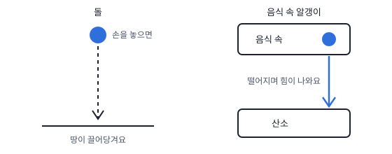

*색칠된 동그라미가 떨어지는 것이고, 떨어질 알갱이를 많이 가진 음식일수록 힘이 많아요.*

**정확히 말하면**

**에너지는 전자가 "떨어지면서" 나와요.** 교수님은 메탄(천연가스)이 공기 중에서 타는 반응으로 설명했어요.

$$
\mathrm{CH_4 + 2O_2 \rightarrow CO_2 + 2H_2O}
$$

1. **메탄의 C–H 결합**: C와 H는 **전기음성도(electronegativity)**, 곧 전자를 끌어당기는 힘의 차이가 거의 없어요. 그래서 비극성 공유결합이고, 공유 전자는 C와 H 사이 **가운데**에 있어요.
2. **산소와 결합**: C가 O와 결합하면 전기음성도가 큰 산소가 전자를 끌어당겨요. 가운데 있던 전자가 산소 쪽으로 쏠려요. 교수님은 이것을 전자가 산소 쪽으로 "떨어진다"고 표현했어요.
3. **에너지 방출**: 전자가 끌어당기는 쪽으로 떨어지면서 **전자의 위치에너지**가 방출돼요. 생물학에서는 여기까지만 설명해요.

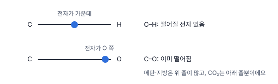

*색칠된 점이 공유 전자예요. C–H의 전자는 가운데 떠 있고, C–O의 전자는 이미 산소 쪽으로 떨어져 있어요.*

**산화와 환원의 정의**

| 구분 | 뜻 | 메탄 연소에서 | 세포호흡에서 |
|---|---|---|---|
| **산화(oxidation)** | 전자를 **잃는** 것(전자가 제거됨). 전자가 멀어지는 쪽 | 메탄(C)이 산화돼요 | 포도당(연료)이 산화돼요 |
| **환원(reduction)** | 전자를 **얻는** 것(전자가 첨가됨). 전자가 가까워지는 쪽 | 산소가 환원돼요 | 산소가 환원돼요 |

산화와 환원은 **동시에** 일어나요. 하나가 전자를 주면 다른 하나가 그 전자를 받기 때문이에요. 이 짝지어진 산화·환원 반응에서 에너지가 방출돼요. 세포호흡에서도 마찬가지로 포도당이 전자를 잃어 산화되는 그 순간에 산소가 전자를 얻어 환원돼요.

$$
\mathrm{C_6H_{12}O_6 + 6O_2 \rightarrow 6CO_2 + 6H_2O}
$$

**어떤 물질에 에너지가 많은가.** 떨어질 전자(C–H의 전자)를 많이 가질수록, 곧 **환원된** 정도가 클수록 에너지가 많아요.

| 물질 | 결합 모습 | 떨어질 전자 | 같은 1 g의 에너지 |
|---|---|---|---|
| **지방**(지질) | CH₂–CH₂–CH₂… 몸 전체가 C–H | 거의 전부 | 가장 많음 |
| 포도당(탄수화물) | C–H도 있지만 C–O(산소를 이미 가짐)가 많음 | 절반가량 | 중간 |
| 이산화탄소(CO₂) | C–O뿐. 전자가 이미 산소 쪽으로 떨어짐 | 없음 | 없음(더 뽑아낼 수 없음) |

그래서 같은 1 g이면 **지방 &gt; 포도당 &gt; 이산화탄소** 순으로 에너지가 많아요. 거꾸로 말하면, 산화가 많이 된(전자를 이미 잃은) 물질일수록 에너지가 적어요.

**동물이 지방으로 저장하는 이유.** 동물은 종속영양생물이라 먹이를 찾아 움직여야 해요. 움직이려면 가벼운 편이 유리해요. 지방은 같은 무게에 에너지가 더 많아서 적게 저장해도 같은 에너지를 주므로, 탄수화물 대신 지방으로 저장해요.

**교수님 말씀**

2장의 본론을 시작하며 집중하라고 했어요.

> 지금부터는 진짜 재미가 없어. 집중을 잘해야 돼.

전자가 산소로 떨어지는 것을 공중의 돌이 땅으로 떨어지는 것에 빗댔어요. 지구가 돌을 좋아해서 잡아당기듯, 산소가 전자를 좋아해서 끌어당긴다는 비유예요.

> 지구가 돌을 좋아하니까. 지구가 돌을 잡아당기잖아.

> 그 이상은 몰라. 생물학에서는 딱 여기까지 설명해. 전자의 위치에너지.

지난 수업에서 던진 질문 "왜 에너지 저장 물질이 탄수화물이 아니고 지방질이냐"에 이 원리로 답했어요.

> 환원이 많이 되어 있을수록 에너지를 많이 가지고 있다

"포도당에서 떨어질 전자는 어디 있냐?"고 묻고는 "C하고 H"라고 스스로 답했어요. 그리고 "자 이게 기본 원리입니다"라고 두 번 강조했어요.

**꼭 기억해요**

- **"산소가 산화된다"고 착각하기 쉬워요.** 이름이 비슷해도 산소는 전자를 **얻어** 환원돼요. 전자가 멀어지는 쪽(메탄, 포도당 같은 연료)이 산화되고, 전자가 가까워지는 쪽(산소)이 환원돼요. 교수님 말로는 "산소는 환원되는 거고 메탄은 산화되는 거고"예요.
- **산화와 환원이 따로 일어난다고 착각하기 쉬워요.** 하나가 전자를 주면 하나가 받으므로 둘은 **동시에** 일어나요.
- **산화된 물질에 에너지가 많다고 뒤집기 쉬워요.** 에너지가 많은 것은 **환원된** 물질, 곧 떨어질 전자를 가진 물질이에요. CO₂는 전자가 이미 떨어져서 에너지를 더 얻을 수 없어요.
- **C–H와 C–O를 구별해요.** C–H의 전자는 아직 떨어질 전자이고, C–O의 전자는 이미 산소 쪽으로 떨어진 전자예요.
- **포도당이 대표 연료라서 에너지가 가장 많다고 착각하기 쉬워요.** 같은 1 g이면 지방 &gt; 포도당 &gt; 이산화탄소예요. 포도당은 산소를 이미 가지고 있어 절반가량은 떨어질 전자가 없어요.

**페이지 요약**

전자를 잃으면 산화, 얻으면 환원이고 둘은 동시에 일어나요. 세포호흡에서 포도당은 산화되고 산소는 환원되며, 환원된 물질일수록(지방 &gt; 포도당 &gt; CO₂) 에너지가 많아요.

*핵심 식*

- 메탄의 연소

  $$
  \mathrm{CH_4 + 2O_2 \rightarrow CO_2 + 2H_2O}
  $$

*용어*

- **산화(oxidation)** — 전자를 잃는 것. 연료(메탄, 포도당)가 산화됨
- **환원(reduction)** — 전자를 얻는 것. 산소가 환원됨
- **전기음성도(electronegativity)** — 전자를 끌어당기는 힘. 산소가 큼

---

### NAD⁺와 세포호흡 3단계

*0910 수업 · 2장 p2*

**쉽게 말하면**

옥상에서 1층으로 한 번에 떨어지면 크게 부서지니까, 3층에서 한 번 받아 주는 친구가 있어요.

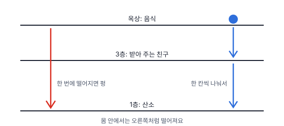

*몸 안에서는 색칠된 알갱이가 오른쪽처럼 나눠 떨어져서, 몸이 타 버리지 않아요.*

**정확히 말하면**

**최종 전자수용체는 산소예요.** 포도당의 C–H 전자는 결국 산소(O₂)까지 떨어져요. 산소가 전자를 마지막으로 받아 주는 **최종 전자수용체**이고, 그래서 우리는 숨을 쉬어 산소를 들여와야 해요.

**몸 안에서는 단계적으로 산화돼요.** 포도당을 공기 중에서 태우면 폭발적으로 확 타 버려요. 몸 안에서 포도당의 전자가 산소까지 한 번에 떨어지면 몸이 타서 폭발해 버리므로, 전자는 중간에 다른 분자가 잠깐 받았다가 건네주는 식으로 층층이 떨어져요.

**NAD⁺는 전자를 잠깐 받아 주는 전자 운반체(electron carrier)예요.** NAD⁺(nicotinamide adenine dinucleotide)가 전자와 수소 이온(H⁺)을 **받으면** NADH가 되고, 전자를 **내주면** 다시 NAD⁺로 돌아와요. 받았다가 줬다가를 되풀이해요.

$$
\mathrm{NAD^+ + 2e^- + H^+ \rightarrow NADH}
$$

| 형태 | 상태 | 하는 일 |
|---|---|---|
| **NAD⁺** | 전자를 받기 전, **산화된 형태** | 해당과정(과 피루브산 산화, 시트르산 회로)에서 포도당의 전자를 **받는** 쪽 |
| **NADH** | 전자를 받은 뒤, **환원된 형태** | 받은 전자를 싣고 있다가 나중에 미토콘드리아에서 **내주는** 쪽 |

**무엇이 전자 운반체이고 무엇이 아닌가.** 물질대사에서 전자를 실어 나르는 것은 NADH(와 시트르산 회로에서 나오는 FADH₂, [피루브산 산화와 시트르산 회로](#s4-krebs))예요. 전자전달계 안에서 복합체 사이를 오가는 유비퀴논(CoQ)도 전자 운반체예요([전자전달계](#s5-etc) 보충). 다음은 전자 운반체가 아니에요.

- **산소(O₂)**: 전자를 옮기지 않고 맨 끝에서 마지막으로 받는 최종 전자수용체예요. 해당과정에서 전자를 받는 것은 산소가 아니라 NAD⁺예요.
- **CO₂**: 전자가 이미 산소 쪽으로 떨어져 버린, 탄소가 빠져나가는 형태예요([산화·환원](#s4-redox)).
- **ATP, ADP**: 에너지를 저장했다 꺼내 쓰는 분자예요. ADP는 전자가 아니라 **인산기**를 받아 ATP가 돼요.

**세포호흡(cellular respiration)**: 포도당이 이산화탄소(CO₂)로 **완전히 산화되면서 ATP를 얻는** 전체 과정이에요. 이때 산소(O₂)가 최종 전자수용체로 전자를 받아요. 세포호흡은 세 단계로 나뉘어요.

| 단계 | 장소 |
|---|---|
| (1) [해당과정](#s4-glycolysis) | **미토콘드리아 밖**, 세포질(세포액) |
| (2) [피루브산 산화와 시트르산 회로](#s4-krebs) | 미토콘드리아 안 |
| (3) 전자전달계와 산화적 인산화([전자전달계](#s5-etc)) | 미토콘드리아 안 |

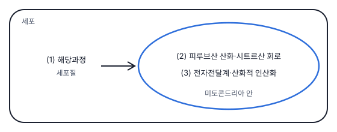

*세 단계 가운데 해당과정만 미토콘드리아 밖(세포질)에서 일어나고, 나머지 둘은 미토콘드리아 안에서 일어나요.*

**교수님 말씀**

포도당의 전자가 산소로 한 번에 떨어지면 안 되는 이유를 이렇게 말했어요.

> 우리 몸에서 포도당의 전자가 산소까지 직접 떨어지면은 우리 몸이 폭발합니다

NAD⁺가 중간에서 하는 일을 NAD⁺의 입장에서 말했어요.

> 잠깐 내가 받았다가 건네줄게.

> 전자랑 수소 이온을 같이 받으면은 NADH가 된다 요게 중요한 겁니다.

NAD라는 이름이 무엇으로 이루어졌는지는 "구체적으로 몰라도 되고"라고 했어요. 층 비유로는 포도당이 **옥상**, NAD⁺가 3층, 산소가 1층(땅바닥)이에요.

**꼭 기억해요**

- **NAD⁺와 NADH의 방향을 뒤바꾸기 쉬워요.** NAD⁺는 전자를 받기 전(산화된 형태), NADH는 받은 뒤(환원된 형태)예요. NAD⁺가 전자(와 H⁺)를 **받아서** NADH가 되고, NADH가 전자를 **내주면** NAD⁺가 돼요.
- **해당과정에서 전자를 받는 산화된 전달체를 산소나 ADP로 착각하기 쉬워요.** 해당과정에서 포도당의 전자를 받는 것은 NAD⁺예요. 산소는 맨 끝의 최종 전자수용체이고, ADP는 전자가 아니라 인산기를 받아요.
- **전자 운반체를 고를 때 CO₂, ATP, ADP에 속기 쉬워요.** 물질대사의 전자 운반체는 NADH(와 FADH₂)예요. CO₂는 전자가 이미 떨어진 분자이고, ATP·ADP는 에너지를 주고받는 분자예요.
- **세 단계의 장소를 헷갈리기 쉬워요.** 해당과정만 미토콘드리아 밖(세포질)이고, 나머지 두 단계는 미토콘드리아 안이에요.

**페이지 요약**

NAD⁺가 포도당의 전자(와 H⁺)를 받아 NADH가 되어 전자가 층층이 떨어지게 하고, 산소가 최종 전자수용체예요. 세포호흡 세 단계 중 해당과정만 미토콘드리아 밖(세포질)이에요.

*핵심 식*

- NAD⁺의 환원

  $$
  \mathrm{NAD^+ + 2e^- + H^+ \rightarrow NADH}
  $$

*용어*

- **전자 운반체(electron carrier)** — 전자를 잠깐 받아 옮기는 분자. NADH, FADH₂
- **최종 전자수용체** — 전자를 마지막으로 받는 산소(O₂)
- **세포호흡(cellular respiration)** — 포도당이 CO₂로 완전히 산화되며 ATP를 얻는 과정

---

### 해당과정: 세포질에서 포도당을 반으로

*0910 수업 · 2장 p2*

**쉽게 말하면**

여섯 칸짜리 막대 과자를 반으로 똑 부러뜨려 세 칸짜리 두 개로 만드는 거예요.

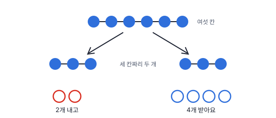

*부러뜨릴 때 처음에 동전 2개를 내고 나중에 4개를 받아서, 손에 2개가 남아요.*

**정확히 말하면**

**해당과정(glycolysis)**은 탄소 6개인 포도당(C6) 1분자가 반으로 쪼개져 탄소 3개짜리 **피루브산(pyruvate)**(C3) 2분자가 되는 과정이에요. glycolysis의 -lysis는 "분해"라는 뜻이에요.

- **장소**: **세포질**(세포액). 미토콘드리아 밖에서, 미토콘드리아와 관계없이 일어나요.
- **그냥 쪼개지는 것이 아니에요**: 포도당의 전자 일부가 NAD⁺로 떨어져요(포도당이 산화돼요). 그래서 NADH 2개가 생기고, 떨어지는 에너지로 ATP를 만들어요.

**ATP 수지**

1. **에너지 요구 단계**: 처음에 ATP 2개를 써서 포도당에 인산기를 붙여요.
2. **에너지 방출 단계**: 뒤에서 ATP 4개를 만들어요.
3. **결과**: 4 − 2 = **순 2 ATP**예요.

**전체 반응**(강의노트 2장 p2): 포도당 + 2 ADP + 2 Pᵢ + 2 NAD⁺ → 2 피루브산 + 2 NADH + 2 H⁺ + 2 ATP

| 산물(포도당 1분자당) | 그다음 |
|---|---|
| ATP 2개(순) | 바로 필요한 곳에 써요 |
| NADH 2개 | 전자를 잠깐 보관해요. 나중에 미토콘드리아에서 전자를 내줄 때 에너지가 더 많이 나와요 |
| 피루브산 2개 | C–H, 곧 떨어질 전자가 아직 많이 남아 있어요. 미토콘드리아 안으로 들어가 [피루브산 산화와 시트르산 회로](#s4-krebs)에 쓰여요 |

해당과정에서는 CO₂가 생기지 않아요. 포도당의 탄소 6개는 피루브산 두 개에 그대로 남아 있어요. 해당과정의 ATP를 만드는 방식(기질 수준 인산화)은 [기질 수준 인산화와 산화적 인산화](#s5-phosphorylation)에서 다뤄요.

**교수님 말씀**

아침에 먹은 녹말이 해당과정까지 오는 길을 한 줄로 이었어요. 녹말 → 포도당 → 상피세포 흡수 → 혈액 → 세포 → 해당과정이에요.

"6탄당이 반으로 쪼개지면 몇 탄당이 되나요? 아주 유치원, 어린이…" 하고 묻고는 "3탄당 두 개"라고 스스로 답했어요.

층 비유로 해당과정의 에너지를 설명했어요. 포도당이 옥상, NAD⁺가 3층이에요.

> 옥상에서 돌을 떨어뜨려요. NAD+가 이를 받아 주고.

NADH에 대해서는 목적을 오해하지 말라고 했어요.

> 지금 NADH를 만드는 게 목적이 아닙니다. 잠깐 전자를 보관하는 용도예요.

ATP 수지는 투자에 빗댔어요.

> 처음에는 200만 원 투자하는 거예요. 투자해 가지고 400만 원 버는 거예요.

> 그래서 결론적으로 두 개가 생긴다고요, 두 개가.

**꼭 기억해요**

- **해당과정의 ATP를 4개로 착각하기 쉬워요.** 2개를 쓰고 4개를 얻으므로 순수하게 남는 것은 **2개**예요. 최종 산물은 2 NADH, 2 ATP, 2 피루브산이에요.
- **해당과정의 목적이 NADH 생산이라고 착각하기 쉬워요.** NADH는 전자를 잠시 보관할 뿐이고, 목적은 ATP예요.
- **해당과정이 미토콘드리아에서 일어난다고 착각하기 쉬워요.** 해당과정은 미토콘드리아 밖, 세포질에서 일어나요.
- **해당과정에서 포도당의 에너지를 다 뽑았다고 착각하기 쉬워요.** 피루브산과 NADH에 떨어질 전자가 아직 남아 있어서 둘 다 미토콘드리아로 가요.
- **피루브산을 당으로 부르면 안 돼요.** 교수님이 "3탄당"이라고 비유했지만, 피루브산은 탄소 3개짜리 화합물(C3)이에요.

**페이지 요약**

해당과정은 세포질에서 포도당(C6)을 피루브산(C3) 2분자로 쪼개며 2 NADH와 순 2 ATP(2개 쓰고 4개 얻음)를 만들어요. 피루브산과 NADH에는 전자가 아직 남아 있어요.

*용어*

- **해당과정(glycolysis)** — 세포질에서 포도당을 피루브산 2분자로 쪼개는 과정
- **피루브산(pyruvate)** — 탄소 3개짜리 산물. 떨어질 전자가 아직 많음
- **에너지 요구 단계 / 에너지 방출 단계** — ATP 2개를 쓰는 앞부분 / ATP 4개를 만드는 뒷부분

---

### 피루브산 산화와 시트르산 회로

*0910 수업 · 2장 p2*

**쉽게 말하면**

네 칸짜리 바퀴가 두 칸을 받아 여섯 칸이 됐다가, 두 칸을 숨으로 내보내고 다시 네 칸으로 돌아와요.

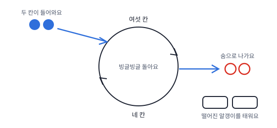

*숨으로 나간 칸은 우리가 내쉬는 숨이 되고, 떨어져 나온 알갱이는 두 종류의 택시가 나눠 태워 가요.*

**정확히 말하면**

해당과정에서 생긴 피루브산은 세포질에서 **미토콘드리아 기질**로 들어가고, 해당과정 NADH가 싣고 있는 전자도 미토콘드리아로 전해져요. 교수님은 이것을 "NADH가 이동한다"고 단순화했어요.

**(1) 피루브산 산화**(미토콘드리아 안, 피루브산 1개당)

- 피루브산(C3)에서 **이산화탄소(CO₂) 1개**가 떨어져요. 세포호흡에서 **CO₂가 처음 생기는 곳**이 여기이고, 이 CO₂가 우리가 숨 쉴 때 내뱉는 이산화탄소예요.
- 피루브산의 전자는 NAD⁺로 가서 **NADH 1개**가 생겨요.
- 남은 탄소 2개(아세틸기)는 코엔자임 A(CoA)가 받아 **아세틸-CoA**가 돼요.

**(2) 시트르산 회로(citric acid cycle)**(미토콘드리아 안). 크렙스 회로, TCA 회로라고도 해요.

1. 탄소 4개인 **옥살아세트산**(C4)이 아세틸-CoA의 아세틸기(C2)를 받아 탄소 6개인 **시트르산**(C6)이 돼요. CoA는 탄소만 넘겨주고 떨어져 나가요.
2. 시트르산이 여러 번 바뀌면서 탄소 2개가 **CO₂ 2개**로 떨어져 나가요.
3. 그동안 전자는 **NADH 3개**와 **FADH₂ 1개**로 옮겨 가고, **ATP 1개**가 생겨요.
4. 탄소 2개를 잃은 시트르산(C6)은 다시 옥살아세트산(C4)이 되어, 새 아세틸기를 받으며 회로가 계속 돌아요.

$$
\mathrm{acetyl\text{-}CoA + 3NAD^+ + FAD + ADP + P_i + 2H_2O \rightarrow 2CO_2 + 3NADH + FADH_2 + ATP + 3H^+ + CoA}
$$

**FADH₂**는 NADH의 "친척"인 전자 운반체예요. 둘 다 포도당에서 떨어진 전자를 싣고 있어요.

**산물 세기.** 포도당 1분자는 피루브산 2개, 곧 아세틸-CoA 2개가 되므로 포도당 기준으로는 ×2 해요.

| 과정 | 기준 | CO₂ | NADH | FADH₂ | ATP |
|---|---|---|---|---|---|
| 피루브산 산화 | 피루브산 1개 | 1 | 1 | 0 | 0 |
| 피루브산 산화 | 포도당 1분자(×2) | 2 | 2 | 0 | 0 |
| 시트르산 회로 | 아세틸-CoA 1개 | 2 | 3 | 1 | 1 |
| 시트르산 회로 | 포도당 1분자(×2) | 4 | 6 | 2 | 2 |

**생성물 짝을 가르는 기준.** 시트르산 회로에서 생기는 기체는 **이산화탄소**예요. 산소는 시트르산 회로에서 생기지 않아요. 산소는 오히려 맨 끝 전자전달계에서 전자를 받는 데 **쓰이는** 쪽이에요([전자전달계](#s5-etc)). 시트르산 회로의 산물은 CO₂, NADH, FADH₂, ATP이고, 피루브산은 해당과정의 산물이에요.

**탄소와 전자의 행방.** 포도당의 탄소 6개는 피루브산 산화(2개)와 시트르산 회로(4개)에서 모두 CO₂로 빠져나가 날숨으로 나가요. 포도당의 C–H 전자는 NADH와 FADH₂가 가지고 있어요. 여기까지 얻은 ATP는 해당과정 2개와 시트르산 회로 2개, 총 **4개**뿐이에요. 이제 NADH와 FADH₂의 전자를 쓸 차례예요.

#### 직접 해 보기: 포도당 1분자에서 무엇이 쌓이나 *(정적 스냅샷 — 직접 조작은 HTML 버전)*

단계를 0(포도당)에서 3(시트르산 회로)까지 옮기면 포도당 1분자 기준 누계 막대가 쌓이는데, 숫자까지 외울 필요는 없고 탄소는 CO₂로 빠져나가고 전자는 NADH·FADH₂에 모이며 ATP는 여기까지 4개뿐이라는 흐름만 보면 돼요.

결과: **포도당 탄소 6개 중 6개가 CO₂로 나갔고, 전자는 NADH 10개·FADH₂ 2개에 모였어요. 여기까지 ATP는 4개예요.**

범례: 색칠된 칸: 이번 단계에서 새로 생긴 것 · 테두리만 있는 칸: 앞 단계까지 생긴 것

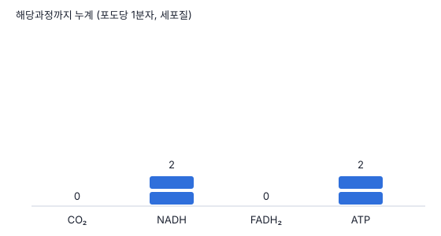

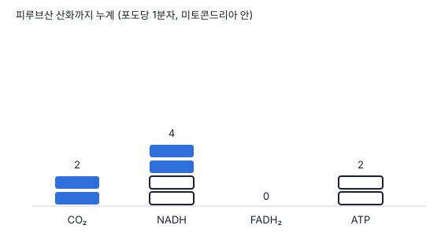

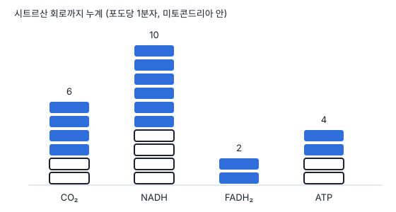

| 설정(단계) | CO₂ | NADH | FADH₂ | ATP | 결과 |
|---|---|---|---|---|---|
| 0 포도당 | 0 | 0 | 0 | 0 | 아직 아무것도 생기지 않았어요. 탄소 6개와 떨어질 전자가 모두 포도당 안에 있어요. |
| 1 해당과정 | 0 | 2 | 0 | 2 | 포도당 탄소 6개 중 0개가 CO₂로 나갔고, 전자는 NADH 2개·FADH₂ 0개에 모였어요. 여기까지 ATP는 2개예요(2개 쓰고 4개 얻어 순 2개). |
| 2 피루브산 산화 | 2 | 4 | 0 | 2 | 포도당 탄소 6개 중 2개가 CO₂로 나갔고, 전자는 NADH 4개·FADH₂ 0개에 모였어요. 여기까지 ATP는 2개예요. |
| 3 시트르산 회로 | 6 | 10 | 2 | 4 | 포도당 탄소 6개 중 6개가 CO₂로 나갔고, 전자는 NADH 10개·FADH₂ 2개에 모였어요. 여기까지 ATP는 4개예요. |

**교수님 말씀**

시트르산 회로의 세부 반응은 외우지 말라고 했어요.

> 뭐가 어떻게 바뀌니 이런 건 전혀 알 필요가 없고, 원리만 알면 됩니다

"몇 개의 탄소가 되나요, 유치원생 여러분?" 하고 묻고는 "6탄당이 되겠죠"라고 스스로 답했어요.

> 이산화 탄소가 발생하는 첫 과정이 여기예요.

FADH₂는 택시 비유로 소개했어요. 전자를 손님이라 하면 NADH는 그랜저 택시, FADH₂는 **쏘나타** 택시예요. 둘 다 전자를 운반하는 운반체라는 뜻이에요.

> 숫자까지 정확하게 외울 필요는 없습니다. 없습니다.

마무리로 탄소는 "숨쉬기를 통해서 밖으로 다 날아가 버려요", 전자는 "NADH나 FADH2가 가지고 있다"고 정리했어요.

**꼭 기억해요**

- **아세틸-CoA 1개 기준과 포도당 1분자 기준을 섞기 쉬워요.** 시트르산 회로 한 바퀴(아세틸-CoA 1개)는 CO₂ 2, NADH 3, FADH₂ 1, ATP 1이고, 포도당 1분자는 ×2 해서 CO₂ 4, NADH 6, FADH₂ 2, ATP 2예요.
- **피루브산 산화와 시트르산 회로의 산물을 섞기 쉬워요.** 피루브산 산화는 피루브산 1개당 CO₂ 1, NADH 1(그리고 아세틸-CoA)이고, 시트르산 회로는 아세틸-CoA 1개당 CO₂ 2, NADH 3, FADH₂ 1, ATP 1이에요. 교수님도 "아세틸-CoA… 피루브산이 아니죠"라고 고쳐 말했어요.
- **시트르산 회로에서 산소가 생긴다고 착각하기 쉬워요.** 시트르산 회로에서 나오는 기체는 이산화탄소예요. 산소는 전자전달계 끝에서 쓰이는 쪽이에요.
- **CO₂가 해당과정에서 처음 생긴다고 착각하기 쉬워요.** CO₂가 처음 생기는 곳은 피루브산 산화예요.
- **탄소의 행방과 전자의 행방을 섞기 쉬워요.** 탄소는 CO₂가 되어 날숨으로 나가고, 전자는 NADH와 FADH₂에 실려 있어요.
- **FADH₂를 NADH와 다른 종류로 여기기 쉬워요.** 둘 다 전자 운반체예요.
- **회로의 탄소 수 흐름을 기억해요.** 옥살아세트산(C4) + 아세틸기(C2) → 시트르산(C6) → CO₂로 C2를 잃고 → 다시 옥살아세트산(C4)이에요. 교수님이 "4탄당", "6탄당"이라고 불렀지만 둘 다 당이 아니라 C4, C6 유기산이에요.

**페이지 요약**

미토콘드리아 안에서 피루브산은 CO₂ 1개를 잃고(CO₂가 처음 생기는 곳) 아세틸-CoA가 되고, 시트르산 회로는 아세틸-CoA 1개당 CO₂ 2, NADH 3, FADH₂ 1, ATP 1을 내요. 탄소는 CO₂로 나가고 전자는 NADH·FADH₂에 모여요.

*용어*

- **아세틸-CoA** — 피루브산 산화 뒤 남은 탄소 2개(아세틸기)를 CoA가 받은 것
- **시트르산 회로(citric acid cycle)** — 옥살아세트산(C4) + 아세틸기(C2) → 시트르산(C6)으로 시작해 도는 회로
- **FADH₂** — NADH의 친척인 전자 운반체

---

## 5. [2장] 산화적 인산화

### 기질 수준 인산화와 산화적 인산화

*0910 수업 · 2장 p2 · 2장 p3*

**쉽게 말하면**

몸속 에너지 건전지를 채우는 방법은 두 가지인데, 조각이 꼬마 공을 손으로 바로 건네는 방법과 떨어지는 힘으로 바퀴를 돌리는 방법이에요.

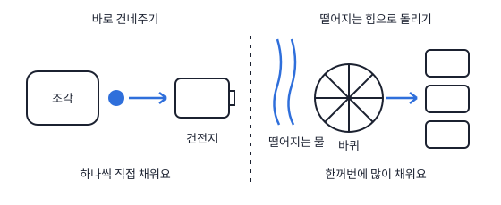

*왼쪽은 조각이 색칠된 꼬마 공을 건전지에 바로 건네고, 오른쪽은 떨어지는 물줄기(선)가 바퀴를 돌려 건전지를 훨씬 많이 채워요.*

**정확히 말하면**

ATP는 **ADP**(아데노신 이인산)에 **인산기**(phosphate group)가 하나 더 붙어서 만들어져요. 이렇게 인산기를 붙이는 것을 인산화라고 해요. 세포호흡에서 ADP에 인산기를 붙이는 방식은 두 가지예요.

- **기질 수준 인산화(substrate-level phosphorylation)**: 포도당이 분해되며 생긴 물질(기질, substrate)이 자기 인산기를 효소의 도움으로 **ADP에 직접 넘겨** ATP를 만들어요. 해당과정(세포질)과 시트르산 회로(미토콘드리아 기질)에서 ATP가 이 방식으로 생겨요.
- **산화적 인산화(oxidative phosphorylation)**: NADH와 FADH₂가 들고 온 전자를 쓰는 방식이에요. 전자가 전자전달계를 따라 산소까지 떨어지며 나온 에너지로 H⁺ 농도 기울기를 만들고, H⁺가 ATP 합성효소를 지나 돌아오면서 ADP에 인산을 붙여요. **미토콘드리아 내막**에서 일어나요.

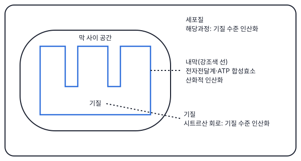

*해당과정은 세포질, 시트르산 회로는 미토콘드리아 기질, 산화적 인산화는 접힌 내막(강조색 선) 위에서 일어나요.*

장소로 가르면 이렇게 돼요.

| 과정 | 장소 | ATP 만드는 방식 |
|---|---|---|
| 해당과정 | 세포질(미토콘드리아 밖) | 기질 수준 인산화 |
| 시트르산 회로 | 미토콘드리아 기질 | 기질 수준 인산화 |
| 전자전달계와 산화적 인산화 | 미토콘드리아 내막 | 산화적 인산화 |

그래서 "미토콘드리아 내막에서 일어나는 작용"은 산화적 인산화뿐이에요. 해당과정은 세포질, 시트르산 회로는 기질에서 일어나므로 내막 작용이 아니고, 기질 수준 인산화도 내막 작용이 아니에요.

ATP를 가장 많이 만드는 과정도 산화적 인산화예요.

1. 포도당 한 분자가 해당과정과 시트르산 회로를 거쳐도 기질 수준 인산화로 얻는 ATP는 합쳐서 4개뿐이에요(해당과정 순 2개, 시트르산 회로 2개).
2. 대신 포도당의 전자는 대부분 NADH와 FADH₂에 담겨 있어요. NADH는 전자를 잠시 보관할 뿐이고, 미토콘드리아에서 그 전자를 내줄 때 에너지가 더 많이 나와요.
3. 이 전자를 전자전달계로 흘려보내 ATP를 만드는 산화적 인산화가 포도당 한 분자당 가장 많은 ATP를 만들어요.

"산화적"이라는 이름은 전자를 주고받는 산화·환원 반응의 에너지를 이용하기 때문에 붙었어요.

**교수님 말씀**

해당과정 때 건너뛴 기질 수준 인산화를 시트르산 회로 뒤에 한꺼번에 설명하셨어요. "아까 얘기를 안 하고 넘어간 것 같지만"이라고 하시며, 분해 산물이 인산기를 ADP에 건네준다고 하셨어요.

그다음 NADH와 FADH₂의 전자를 쓰는 방식은 전혀 다르다고 세 번이나 강조하셨어요.

> NADH하고 FADH2의 전자를 이용할 때는 방식이 완전히 다릅니다. … 산화적 인산화.

해당과정을 설명하실 때도 NADH를 만드는 것 자체가 목적은 아니라고 하셨어요. NADH는 전자를 잠시 보관하고, 나중에 미토콘드리아에서 전자를 내줄 때 에너지가 더 많이 나온다고 하셨어요.

이름의 뜻은 "전자를 주고받는 게 산화 환원"이라서 그 에너지를 쓰는 인산화를 산화적 인산화라 부른다고 설명하셨어요.

**꼭 기억해요**

- **두 인산화를 섞기 쉬워요.** 기질 수준 인산화는 해당과정·시트르산 회로에서 기질이 인산기를 ADP에 **직접** 넘기는 방식이에요. 산화적 인산화는 전자전달계가 만든 H⁺ 기울기로 ATP 합성효소가 ATP를 만드는 방식이에요. 교수님은 "산화적 인산화"를 세 번 반복하셨어요.
- **"미토콘드리아 안"과 "미토콘드리아 내막"은 달라요.** 시트르산 회로는 미토콘드리아 안이지만 내막이 아니라 기질에서 일어나요. 내막에서 일어나는 것은 산화적 인산화예요. 해당과정만 미토콘드리아 밖(세포질)이에요.
- **"기질"이라는 말이 두 가지 뜻이에요.** 기질 수준 인산화의 기질은 반응하는 물질(substrate)이고, 미토콘드리아 기질은 내막 안쪽 공간(matrix)이에요. 이름에 "기질"이 있다고 미토콘드리아 기질에서만 일어나는 것이 아니에요. 해당과정의 기질 수준 인산화는 세포질에서 일어나요.
- **건네는 것은 인산기예요.** 교수님이 "어떤 기질이 ATP를 건네줍니다"라고 말씀하셨지만, 기질이 ADP에 건네는 것은 ATP가 아니라 인산기예요.
- **가장 많은 ATP는 산화적 인산화에서 나와요.** 해당과정과 시트르산 회로의 기질 수준 인산화는 합쳐 ATP 4개뿐이에요. NADH는 전자를 잠시 보관할 뿐, NADH를 만드는 것이 목적이 아니에요.

**페이지 요약**

기질이 인산기를 ADP에 직접 넘기는 기질 수준 인산화와 달리, 산화적 인산화는 미토콘드리아 내막에서 전자의 에너지로 ATP를 가장 많이 만들어요.

*용어*

- **기질 수준 인산화(substrate-level phosphorylation)** — 기질이 인산기를 ADP에 직접 넘겨 ATP를 만드는 방식(해당과정·시트르산 회로)
- **산화적 인산화(oxidative phosphorylation)** — NADH·FADH₂의 전자로 만든 H⁺ 기울기로 ATP를 만드는 방식(미토콘드리아 내막)

---

### 전자전달계: 전자가 산소까지 층층이

*0910 수업 · 2장 p3*

**쉽게 말하면**

음식 속 작은 공은 옥상에서 한 번에 뚝 떨어지지 않고, 계단을 한 칸씩 내려와 맨 바닥의 산소 품에 안겨요.

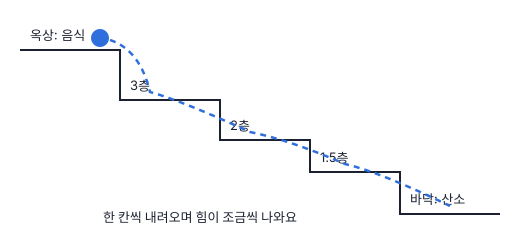

*색칠된 공이 선으로 그린 계단을 층층이 내려오고, 칸마다 나온 힘을 조금씩 모아 써요.*

**정확히 말하면**

**전자전달계(electron transport chain)**는 **미토콘드리아 내막**에 박혀 있는 일련의 단백질 **복합체**(complex)예요. 복합체는 단백질과 큰 분자들이 합쳐진 덩어리이고, 복합체 Ⅰ–Ⅳ가 있어요. 호흡 사슬(respiratory chain)이라고도 해요.

- 장소: 기질이나 막 사이 공간에 떠 있는 것이 아니라, 내막에 박혀 있어요. 내막이 크리스테(cristae)로 접혀 표면적이 넓을수록 복합체가 많이 박혀 ATP를 많이 만들어요.
- 정체: 단백질 복합체예요. 뉴클레오타이드가 아니에요.
- 일: 전자를 단백질에서 단백질로 넘기고, 그때 나온 에너지로 H⁺를 기질에서 막 사이 공간(막간 공간)으로 퍼내요.

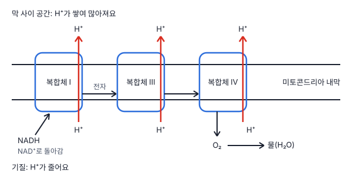

*선 화살표는 전자 경로(NADH, 복합체 Ⅰ, Ⅲ, Ⅳ, O₂), 경고색 화살표는 기질에서 막 사이 공간으로 퍼 올려지는 H⁺예요.*

전자가 흐르는 순서는 이래요.

1. NADH가 복합체 Ⅰ에 전자를 넘기고 NAD⁺로 돌아가요.
2. 복합체 Ⅰ은 복합체 Ⅲ에, 복합체 Ⅲ은 복합체 Ⅳ에 전자를 넘겨요.
3. 복합체 Ⅳ는 마지막으로 산소(O₂)에 전자를 넘겨요.
4. 산소는 전자와 H⁺를 함께 받아 물(H₂O)이 돼요. 우리가 들이마신 산소는 이렇게 물로 바뀌어요.

복합체는 **전자를 더 강하게 끌어당기는 순서**로 배열돼 있어요. 뒤쪽 복합체일수록 전자를 더 세게 당기고, 그 누구보다 산소가 가장 세게 당겨요(전기음성도가 커요). 그래서 전자가 한 방향으로만 떨어지고, 산소가 **최종 전자수용체**(final electron acceptor)가 돼요. 최종 전자수용체는 이산화탄소가 아니에요. 이산화탄소는 피루브산 산화와 시트르산 회로에서 탄소가 떨어져 나와 생긴 것이에요.

전자전달계의 **가장 주된 기능**은 전자가 떨어지는 에너지로 H⁺를 퍼내 **미토콘드리아 내막을 가로지르는 H⁺ 농도 기울기를 만드는 것**이에요. H⁺를 저농도(기질)에서 고농도(막 사이 공간)로 옮기므로 에너지가 필요하고, 그 에너지를 전자가 대 줘요. 다른 일과는 이렇게 구분해요.

- 포도당을 피루브산으로 쪼개는 것: 해당과정의 일(세포질)
- ADP에 인산기를 붙여 ATP를 만드는 것: ATP 합성효소의 일
- ATP 합성효소를 통해 H⁺가 기질로 돌아오는 것: ATP 합성효소 쪽의 일([H⁺ 기울기와 ATP 합성효소](#s5-atp-synthase))

또 하나의 중요한 역할은 NAD⁺를 되살리는 것이에요. 전자를 내준 NADH는 NAD⁺로 돌아가 해당과정과 시트르산 회로에서 다시 전자를 받아요. **택시**가 손님을 태웠다 내렸다 하듯 같은 NAD⁺를 계속 다시 써요.

**교수님 말씀**

복합체를 소개하시며 무엇보다 배열 순서를 강조하셨어요.

> 얘네들이 박혀 있는 순서가 중요하다. 순서.

앞 시간의 층 비유를 이어 가셨어요. 포도당은 옥상, NADH는 3층, 복합체는 2층과 1.5층, 산소는 1층(바닥)이에요. 오른쪽 복합체일수록 전자를 더 좋아하니 "더 바닥"이고, 산소가 제일 좋아한다고 하셨어요.

경로는 "1은 3으로, 3은 4로, 4는 산소로"라고 세 번 되풀이하셨어요. 수업 중 영상에서도 호흡 사슬이 NAD⁺를 재생한다는 점을 짚었어요.

산소가 전자를 받으면 무엇이 되는지 물으시고 "물이 됩니다"라고 답하셨어요. 마지막은 택시 비유였어요.

> 손님 태울 때마다 택시를 새로 만드는 건 아니잖아.

**꼭 기억해요**

- **수업에서 말한 경로는 복합체 Ⅰ, Ⅲ, Ⅳ, O₂예요.** NADH는 복합체 Ⅰ로 들어가고, "1은 3으로, 3은 4로, 4는 산소로"를 세 번 반복하셨어요. 복합체 Ⅱ는 수업에서 건너뛰었어요. FADH₂가 전자를 넣는 곳(복합체 Ⅱ)은 보충에 있어요.
- **층수를 고쳐 말씀하셨어요.** "1층이에요. 아니 1층 말, 1.5층. 산소가 1층이니까". 가장 아래(1층)는 산소이고, 복합체는 그 위(2층, 1.5층)예요.
- **산소와 이산화탄소를 헷갈리기 쉬워요.** 산소는 전자전달계 끝에서 전자를 받는 최종 전자수용체이고, 받은 뒤 물이 돼요. 이산화탄소는 피루브산 산화와 시트르산 회로에서 나온 것으로, 전자를 받는 쪽이 아니에요. 전기음성도가 큰 것도 산소예요.
- **전자전달계는 내막에 박힌 단백질 복합체예요.** 기질에 있다거나, 막 사이 공간에 있는 효소들이라거나, 뉴클레오타이드라고 하면 틀려요. 하는 일은 단백질에서 단백질로 전자를 넘기며 H⁺를 기질에서 막 사이 공간으로 옮기는 것이에요.
- **가장 주된 기능은 H⁺ 농도 기울기 만들기예요.** 포도당을 피루브산으로 쪼개는 것은 해당과정이고, ADP에 인산기를 붙이는 것과 ATP 합성효소를 통한 H⁺ 이동은 ATP 합성효소의 일이에요.
- **전자의 에너지는 곧바로 ATP가 되지 않아요.** 먼저 H⁺를 퍼내는 데 쓰이고, 그 기울기가 ATP 합성효소를 돌려요.

**보충 · 수업에서 다루지 않았어요**

수업 중 영상에는 나왔지만 설명하지 않은 전자운반체들이에요. 교재는 이들도 전자전달계에 포함시켜요.

- **유비퀴논(CoQ)**(ubiquinone, coenzyme Q): 내막 안을 움직이며 복합체 사이에서 전자를 나르는 작은 전자운반체예요. 복합체 Ⅰ(과 복합체 Ⅱ)에서 전자를 받아 복합체 Ⅲ에 넘겨요. 영상은 복합체 Ⅰ(NADH-Q 환원효소)이 전자를 "움직이는 분자" 유비퀴논에 넘긴다고 했어요.
- **복합체 Ⅱ**: FADH₂의 전자가 들어오는 곳이에요. 기질 쪽 내막에 붙어 있는 작은 복합체이고, 여기서 유비퀴논으로 전자를 넘겨요. H⁺를 퍼내는 것은 유비퀴논과 복합체 Ⅰ·Ⅲ·Ⅳ 쪽이에요.
- **사이토크롬 c**(cytochrome c): 복합체 Ⅲ에서 복합체 Ⅳ로 전자를 나르는 또 하나의 움직이는 작은 운반체예요.

출처: 강의노트 2장 p3 "유비퀴논과 복합체 I, 복합체Ⅲ, 복합체Ⅳ", 교재 2장 p.41–42(그림 2.13), 0910 수업 영상

**페이지 요약**

전자전달계는 미토콘드리아 내막에 박힌 복합체들로, 전자를 NADH에서 복합체 Ⅰ, Ⅲ, Ⅳ를 거쳐 최종 전자수용체인 산소까지 넘기며 H⁺ 농도 기울기를 만들어요.

*용어*

- **전자전달계(electron transport chain)** — 미토콘드리아 내막에 박힌 일련의 단백질 복합체
- **최종 전자수용체(final electron acceptor)** — 전자를 마지막으로 받는 산소, 받은 뒤 물이 됨
- **유비퀴논(CoQ)** — 복합체 사이를 움직이며 전자를 나르는 작은 운반체

---

### H⁺ 기울기와 ATP 합성효소

*0910 수업 · 2장 p3*

**쉽게 말하면**

떨어지는 물은 떡을 직접 치지 않아요.

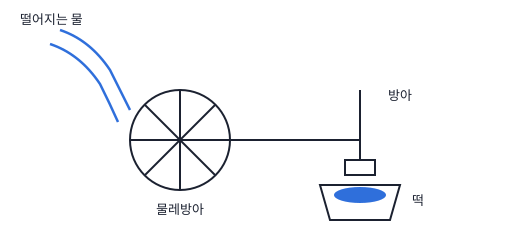

*물줄기(선)가 물레방아를 돌리면, 그 힘으로 방아가 색칠된 떡을 쳐요.*

몸속에서도 떨어지는 힘은 먼저 바퀴를 돌리는 데 쓰이고, 그 바퀴가 에너지 건전지를 만들어요.

**정확히 말하면**

전자전달계가 H⁺를 기질에서 **막 사이 공간**(intermembrane space)으로 계속 퍼내면, 기질은 H⁺가 적어지고 막 사이 공간은 H⁺가 많아져요. 이렇게 내막을 사이에 두고 H⁺의 **농도 기울기**(concentration gradient)와 전기적 기울기가 함께 생겨요. 그래서 H⁺는 다시 기질로 들어오려는 힘을 갖게 돼요.

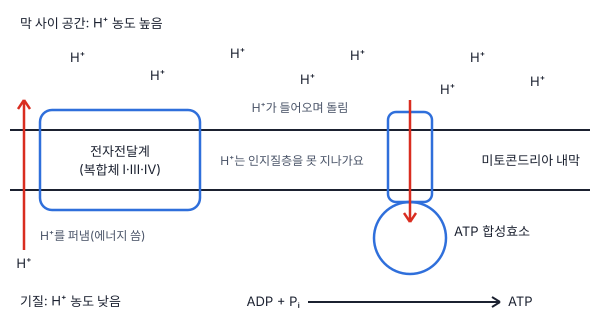

*왼쪽 경고색 화살표는 전자전달계가 H⁺를 막 사이 공간으로 퍼내는 방향, 오른쪽 경고색 화살표는 H⁺가 ATP 합성효소를 지나 기질로 돌아오는 방향이에요.*

1. H⁺는 양이온이라 인지질층을 그냥 지나가지 못해요. 그래서 막 사이 공간에 쌓여요.
2. H⁺는 내막에 박힌 **ATP 합성효소(ATP synthase)**를 통해서만 기질로 돌아올 수 있어요. 이때는 고농도에서 저농도로, 기울기를 따라 이동해요.
3. H⁺가 지나가며 ATP 합성효소를 돌리고, 이 효소가 **ADP에 인산(Pᵢ)을 붙여** ATP를 만들어요. ATP를 ADP로 쪼개는 것이 아니에요.

$$
\mathrm{ADP + P_i \rightarrow ATP}
$$

이 전체가 산화적 인산화예요. H⁺의 방향은 두 번 바뀌어요.

| 단계 | H⁺ 방향 | 농도 | 에너지 |
|---|---|---|---|
| 전자전달계가 퍼냄 | 기질에서 막 사이 공간으로 | 저농도에서 고농도로 | 필요함(전자가 떨어지는 에너지) |
| ATP 합성효소로 돌아옴 | 막 사이 공간에서 기질로 | 고농도에서 저농도로 | 나옴(ATP 합성에 쓰임) |

세포호흡의 주된 기능은 이렇게 H⁺가 ATP 합성효소를 지나며 이루어지는 **ATP 합성**이에요. 포도당의 전자에 담긴 에너지를 세포가 쓸 수 있는 ATP로 바꾸는 것이 세포호흡의 목적이에요.

**교수님 말씀**

전자가 떨어진 에너지로 ATP를 바로 만들지 않는다며 먼저 한숨을 쉬셨어요.

> 또 바로 안 만들어요. 더럽게 복잡합니다.

그리고 **물레방아**로 설명하셨어요. 물이 떨어지면서 떡을 바로 치는 게 아니라 물레방아를 돌리고, 그 방아가 떡을 친다고 하셨어요. 전자가 떨어지는 에너지(물)로 H⁺를 쌓고(물레방아를 돌리고), 그 기울기가 ATP 합성효소를 돌려 ATP(떡)를 만든다는 뜻이에요.

H⁺가 돌아오는 길은 하나뿐이라고 못박으셨어요.

> 이 수소 이온은 ATP 합성 효소만을 통해서만 들어갈 수 있어요.

이유는 H⁺가 양이온이라 인지질층을 통과하지 못하기 때문이라고 하셨어요.

**꼭 기억해요**

- **전자의 에너지가 곧바로 ATP가 되는 것이 아니에요.** 먼저 H⁺를 막 사이 공간으로 퍼내는 데 쓰이고, 그렇게 생긴 기울기가 ATP 합성효소를 돌려 ATP를 만들어요. 물이 떡을 직접 치지 않는 물레방아와 같아요.
- **H⁺의 방향을 거꾸로 쓰기 쉬워요.** 퍼낼 때는 기질에서 막 사이 공간으로(저농도에서 고농도, 에너지 필요), 돌아올 때는 막 사이 공간에서 기질로(ATP 합성효소 통과, ATP 생성)예요.
- **ATP 합성효소는 ADP에 인산을 첨가해요.** "ATP에서 ADP를 만든다"나 "ATP에 인산을 첨가한다"는 틀린 말이에요.
- **H⁺는 인지질층을 못 지나가요.** 양이온이라서 ATP 합성효소를 통해서만 기질로 돌아와요.

**보충 · 수업에서 다루지 않았어요**

전자전달계가 만든 H⁺ 농도 기울기로 ATP 합성효소가 ATP를 만드는 방식을 **화학삼투**(chemiosmosis)라고 불러요. 이 방식의 인산화를 화학삼투적 인산화라고도 하고, 이 설명을 화학삼투설(chemiosmotic hypothesis)이라고 해요. 막 사이 공간에 쌓인 H⁺가 되돌아가려는 힘이 ATP 합성의 에너지가 된다는 뜻이에요.

화학삼투로 ATP를 만들려면 다음이 모두 필요해요.

- 전자전달계: H⁺를 퍼내 기울기를 만들어요.
- H⁺(양성자)의 농도 기울기: ATP 합성효소를 돌리는 에너지예요.
- ADP(와 인산): ATP의 재료예요.
- 손상되지 않은 막: H⁺가 새지 않아야 기울기가 유지돼요. 미토콘드리아에서는 내막이에요. 같은 원리가 엽록체의 막에도 있어요.

출처: 강의노트 2장 p3 "화학삼투설 (Chemiosmotic hypothesis)", 교재 2장 p.41–42(그림 2.13)

**보충 · 노트에 빠졌던 수업 내용**

H⁺는 ATP 합성효소를 통해서만 기질로 돌아올 수 있어요. 그래서 ATP 합성효소가 막히면 전자전달계가 퍼낸 H⁺가 쌓여 막 사이 공간과 기질의 H⁺ 농도 차(pH 차이)가 커져요.

출처: 0910 수업, 강의노트 2장

**페이지 요약**

막 사이 공간에 쌓인 H⁺가 농도 기울기를 따라 ATP 합성효소로만 돌아오며 효소를 돌리고, 그 힘으로 ADP에 인산을 붙여 ATP를 만들어요.

*핵심 식*

- ATP 합성효소의 일

  $$
  \mathrm{ADP + P_i \rightarrow ATP}
  $$

*용어*

- **ATP 합성효소(ATP synthase)** — H⁺가 지나가며 돌리는 내막의 효소, ADP에 인산을 붙임
- **막 사이 공간(intermembrane space)** — 외막과 내막 사이, H⁺가 쌓이는 곳
- **화학삼투(chemiosmosis)** — H⁺ 농도 기울기로 ATP 합성효소가 ATP를 만드는 방식

---

## 6. 요약 · 예고

### 30초 요약

*0910 수업 · 1장 p5–p6 · 2장 p1–p3*

| 주제 | 시험 직전 한 줄 |
|---|---|
| [엽록체](#s0-chloroplast) | 엽록체는 이중막이지만 내막이 매끈하고(미토콘드리아 내막은 크리스테로 접힘) 대신 틸라코이드 막이 따로 있어요. 틸라코이드가 쌓인 더미가 그라나, 틸라코이드 바깥 공간이 스트로마(미토콘드리아의 기질에 대응, DNA·리보솜 있음)이고, 엽록소는 틸라코이드 막에 박혀 빨간빛·파란빛은 흡수하고 녹색빛은 반사·투과해요. 자기 DNA·리보솜을 가지고 남세균이 공생해 생겼다고 보며, 내막계에는 속하지 않아요. |
| [액포·세포벽](#s0-vacuole-wall) | 식물세포에는 리소좀이 없고 액포가 그 역할과 창고(염분·유기산·당·폐기물·색소 저장, 부피 90% 이상까지)를 맡아요. 세포벽은 셀룰로스(다당류)라 단단하고, 인지질 이중층인 세포막(말랑함)과 다른 구조예요. 수업 정리로는 세포벽·액포·엽록체가 식물에만 있고(동물세포와 비교할 때. 원핵세포에도 세포벽이 있음), 미토콘드리아는 동물·식물 모두에 있어요. |
| [세포골격의 종류](#s1-cytoskeleton) | 세포골격은 굵은 순서로 미세소관(튜불린이 모인 속 빈 관) &gt; 중간섬유(중간섬유단백질, 예: 케라틴) &gt; 미세섬유(액틴이 모인 밧줄)예요. 구슬 모양 단위체(튜불린·액틴)가 필요할 때 모였다가 끝나면 흩어지는 것은 미세소관·미세섬유예요. 중간섬유는 교수님이 단위체 없는 원래 큰 단백질이라고 설명했지만, 교재 1장 p.21 그림 1.23(b)는 중간섬유단백질 사슬이 꼬여 소단위체를 이룬다고 써요. |
| [세포골격의 기능](#s1-cytoskeleton) | 미세소관은 방추사가 되고, 키네신(운동단백질)이 ATP를 써서 소낭을 싣고 걸어가는 트랙이에요(트랙은 미세소관, 걷는 것은 키네신, 실려 가는 것은 소낭). 미세섬유는 아메바 운동과 근육 수축(액틴과 미오신)을 맡고, 강의노트·교재에 따르면 세포질 운동(세포질 흐름)에도 관여해요. 그래서 "움직임"만으로 가르지 말고, 소낭·소기관이 트랙을 따라 운반되거나 방추사면 미세소관이에요. |
| [유동 모자이크](#s1-membrane) | 세포막은 인지질 이중층에 단백질이 점점이 박힌 것이 "모자이크"이고, 인지질과 단백질이 옆으로 움직일 수 있는 것이 "유동"이에요(못 박은 듯 고정된 것이 아님). 동물세포 막의 콜레스테롤은 유동성을 조절하고 막을 안정시켜요. |
| [구조와 기능](#s1-protein-info) | DNA 염기 순서가 아미노산 순서(1차 구조)를 정하고, 1차 구조가 3차 구조를, 3차 구조가 기능을 정해요. |
| [화학 에너지](#s2-energy) | 화학 에너지는 운동에너지가 아니라 위치에너지, 정확히는 포도당 C–H 결합에 있는 전자의 위치에너지예요. 이 에너지를 바로 쓰지 않고 먼저 ATP를 만들어 둬요. |
| [ATP](#s2-atp) | ATP는 아데노신(아데닌 + 리보스) + 인산기 3개이고, 인산기 하나가 떨어져 ADP(인산기 2개)가 될 때 음전하끼리의 반발이 줄어(교수님: 여러 이유 중 하나) 에너지가 나와요. 리보스이므로 RNA 뉴클레오타이드에 인산기가 3개 붙은 모양이에요. |
| [ATP의 쓰임](#s2-atp-use) | 동화 반응(작은 것 → 큰 것), 용질 수송, 근육 수축, 발광에 ATP가 쓰여요. 고농도 → 저농도인 확산은 저절로 일어나 에너지가 필요 없고, 용질을 저농도 → 고농도로 옮기는 능동수송에는 반드시 에너지(대개 ATP)가 필요해요. |
| [효소](#s3-enzyme) | 효소는 단백질 촉매로, 활성화 에너지를 낮춰 반응을 10⁶–10¹²배 빠르게 해요. 기질은 효소 전체가 아니라 활성 부위에만 결합하고, 구조가 맞는 기질만 받는 특이성이 있으며, 반응이 끝나도 효소는 변하지 않고 다시 쓰여요. |
| [보조인자](#s3-cofactor) | 아미노산 R기는 20가지뿐이라 모든 반응을 효소 혼자 못 해서 금속 이온이나 비타민 같은 유기물(조효소)이 보조인자로 도와요. 비타민은 에너지원이 아니라 효소를 거들 뿐이에요. |
| [온도·pH](#s3-temp-ph) | 효소도 단백질이라 구조(수소결합·이온결합)가 깨지면(변성) 기능을 잃어요. 온도가 오르면 반응이 빨라지다가 최적 온도를 넘으면 변성으로 활성이 떨어지고(사람 효소는 37℃ 근처라고 수업에서 말했지만 강의노트는 일반적으로 40~50℃), 최적 pH는 펩신이 위의 산성, 트립신이 소장의 약알칼리성, 대부분의 효소는 중성이에요. |
| [산화·환원](#s4-redox) | 산화는 전자를 잃는 것, 환원은 전자를 얻는 것이고 둘은 동시에 일어나요(메탄 연소에서 메탄은 산화, 산소는 환원). 전자가 전기음성도 큰 쪽으로 떨어질 때 에너지가 나오므로 C–H가 많은(환원이 많이 된) 물질일수록 에너지가 많아, 같은 1g이면 지방이 탄수화물보다 많고 CO₂에는 떨어질 전자가 없어요. |
| [NAD⁺와 3단계](#s4-nad) | NAD⁺는 전자와 H⁺를 받으면 NADH, 내주면 다시 NAD⁺가 되는 전자 운반체라, 몸 안에서는 포도당이 폭발하지 않고 단계적으로 산화돼요. 세포호흡은 (1) 해당과정(세포질, 미토콘드리아 밖) (2) 피루브산 산화와 시트르산 회로(미토콘드리아 안) (3) 전자전달계와 산화적 인산화(미토콘드리아 내막) 순이고, O₂가 최종 전자수용체예요. |
| [해당과정](#s4-glycolysis) | 세포질에서 미토콘드리아와 관계없이 포도당(C6)이 피루브산(C3) 2분자로 쪼개져요. 처음에 ATP 2개를 쓰고 4개를 얻어 순 2 ATP이며, 2 NADH가 생기고 CO₂는 아직 나오지 않아요. |
| [피루브산 산화·시트르산 회로](#s4-krebs) | 미토콘드리아 안에서 피루브산 1개가 CO₂ 1개와 NADH 1개를 내고 아세틸-CoA가 되며, CO₂가 처음 생기는 곳이 여기예요. 시트르산 회로에서는 옥살아세트산(C4)이 아세틸기(C2)를 받아 시트르산(C6)이 되었다가 다시 옥살아세트산이 되고, 아세틸-CoA 1개당 CO₂ 2, NADH 3, FADH₂ 1, ATP 1(포도당 1분자면 ×2)이 나와요. 탄소는 CO₂로 빠져나가고 전자는 NADH·FADH₂가 가져가요. |
| [인산화 두 방식](#s5-phosphorylation) | 기질 수준 인산화는 해당과정·시트르산 회로에서 기질이 자기 인산기를 ADP에 직접 넘겨 ATP를 만드는 것이고(여기까지 포도당 1분자당 ATP 4개), 산화적 인산화는 NADH·FADH₂의 전자가 전자전달계를 지나며 만든 H⁺ 기울기로 ATP 합성효소가 ATP를 만드는 것이에요. 산화·환원의 에너지를 쓰므로 "산화적"이라 불러요. |
| [전자전달계](#s5-etc) | 미토콘드리아 내막(크리스테)에 복합체들이 순서대로 박혀 뒤쪽일수록 전자를 강하게 끌어당기므로, 전자는 NADH → 복합체 Ⅰ → 복합체 Ⅲ → 복합체 Ⅳ → O₂로 떨어지고(영상에서는 Ⅰ 다음에 유비퀴논을 거침), 그 에너지로 H⁺를 기질에서 막 사이 공간으로 퍼내요(저농도 → 고농도라 에너지 필요). O₂는 전자전달계의 복합체가 아니라 최종 전자수용체로 전자와 H⁺를 받아 물이 되고, 전자를 내준 NADH는 NAD⁺로 재생되어 해당과정으로 돌아가요. |
| [ATP 합성효소](#s5-atp-synthase) | H⁺는 양이온이라 인지질층을 못 지나 막 사이 공간에 쌓이고, 이 농도·전기 기울기 때문에 막 사이 공간 → 기질 방향으로 ATP 합성효소를 통해서만 들어오며 그 효소를 돌려 ATP를 만들어요. 전자가 떨어진 에너지가 곧바로 ATP가 되는 것이 아니라 H⁺ 기울기(물레방아)를 거쳐요. |

---

### 다음 시간 예고

*0910 수업 · 2장 p3–p5*

끊긴 지점: 전자를 내준 NADH가 NAD⁺로 돌아가 해당과정에서 다시 쓰인다는 "택시" 비유까지 하고 멈췄어요. "자, 일단 여기까지 하고, 오늘은 마칩시다." 전자전달계와 ATP 합성효소의 원리는 한 바퀴 설명을 마쳤으므로 개념 중간에 끊긴 것은 아니에요. 다음 시간에 무엇을 할지 명시적인 예고는 없었고, 아래는 강의노트 2장 p3 뒷부분부터 p5까지 이어지는 항목이에요.

- 포도당 1분자당 ATP 32개
- 세포호흡의 에너지 효율
- 화학삼투설
- 발효: 젖산 발효, 알코올 발효
- 광합성의 개관
- 광의존 반응
- 캘빈회로
- 광호흡과 C4 회로

1장은 이번 수업에서 끝났어요. 1장 전체 점검은 아래 장마감 파일에 있어요.

---

### 함께 보면 좋은 자료

*0910 수업*

- [복습문제 풀러 가기 (0910 수업 범위)](복습문제_0910_Cells_and_Cellular_Respiration.md)
- [1장 장마감 점검](장마감_0910_1장.md)
- [0908 정리노트 (직전 수업: 핵·내막계·미토콘드리아)](../../0908/정리노트_0908_Biomolecules_and_Cells.html)
- [0903 정리노트 (1장 앞부분)](../../0903/정리노트_0903_Biomolecules_and_Cells.html)
- [0901 정리노트 (1장 앞부분)](../../0901/정리노트_0901_Biomolecules_and_Cells.html)

---

출처: 이영만 교수님 강의노트(1장·2장) · 수업 녹음 전사(0910) · 『생명과학: 기초와 응용』 2판 1장·2장.
