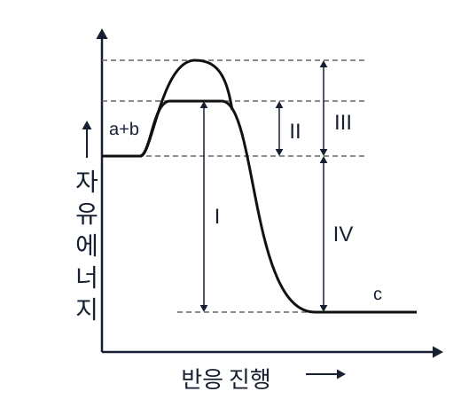
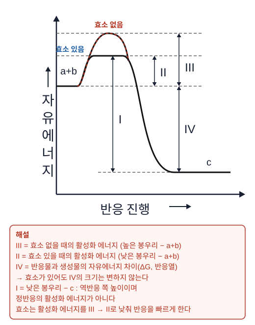
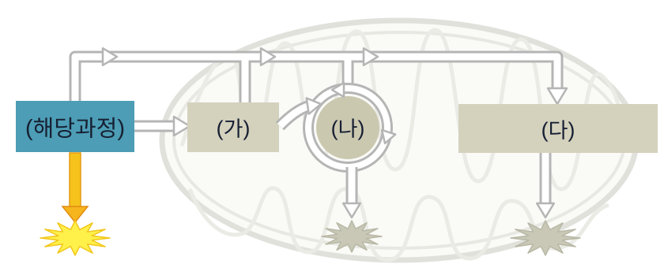
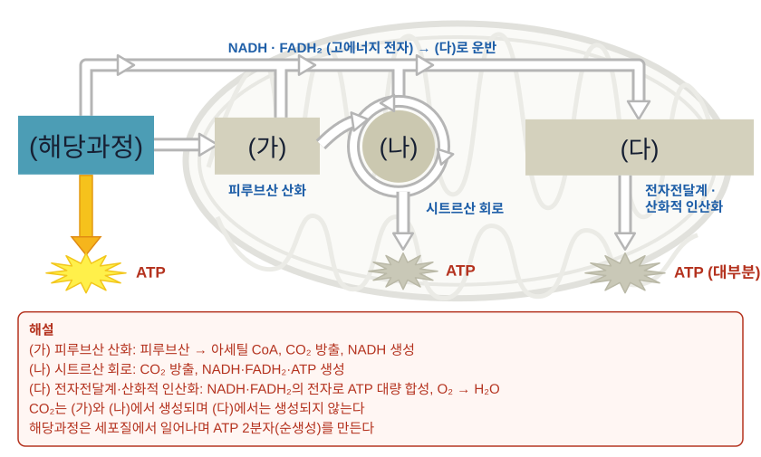
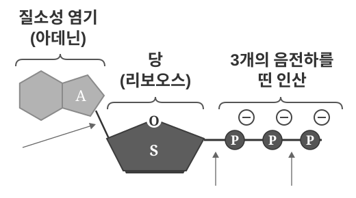
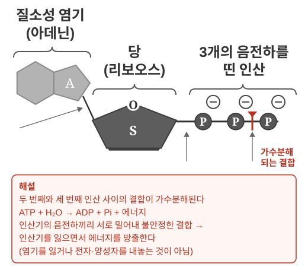
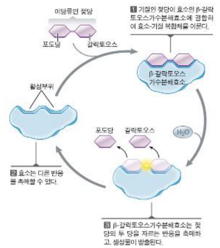
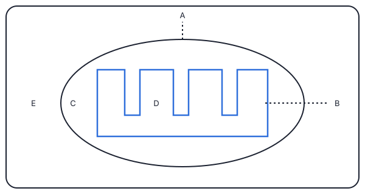
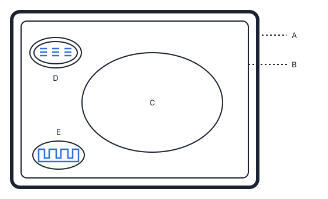

# 복습문제 53선 — 0910 수업 범위

웹과제 9문항, 기출 29문항, 생성 변형 15문항이에요. 먼저 풀어 보고, 막히면 힌트를 열어 보세요.

> `복습문제_0910_Cells_and_Cellular_Respiration.html`를 마크다운으로 옮겼어요. 원문, 힌트, 풀이는 접혀 있어요. 먼저 풀어 보고 펼쳐 보세요.

**목차**

- [A. 웹과제](#partA)
  - [P2. 세포 구성요소와 구조·기능의 짝](#p2)
  - [P41. 지방이 1g당 ATP를 더 많이 내는 이유](#p41)
  - [P42. 효소 유무에 따른 자유에너지 그래프 읽기](#p42)
  - [P43. 전자전달계에서 일어나는 일](#p43)
  - [P44. 효소에 대한 진술 판단](#p44)
  - [P45. 세포호흡 개요 모식도의 단계](#p45)
  - [P46. 해당과정이 만드는 것](#p46)
  - [P47. 그림 속 분자가 에너지를 주는 방법](#p47)
  - [P48. ATP 합성효소만 막았을 때](#p48)
- [B. 기출](#partB)
  - [P3. 막 수송 방식에 대한 옳은 설명](#p3)
  - [P4. 포도당에서 나온 에너지가 가는 곳](#p4)
  - [P5. 세포호흡 과정과 그 생성물의 짝](#p5)
  - [P6. 효소에 대한 틀린 설명](#p6)
  - [P7. 많은 조효소의 재료가 되는 유기물 보조인자](#p7)
  - [P8. ATP가 에너지를 내놓는 방식](#p8)
  - [P9. 엽록체 내부를 채운 액체](#p9)
  - [P10. 생물이 일할 때 쓰는 화학에너지의 원천](#p10)
  - [P11. 활성 부위를 막는 약물의 구조](#p11)
  - [P12. H⁺ 기울기를 쓰는 단백질의 이름과 기능](#p12)
  - [P13. 효소에 대한 잘못된 서술](#p13)
  - [P14. 식물세포와 동물세포의 대사](#p14)
  - [P15. 효소가 반응을 촉진하는 방법](#p15)
  - [P16. 전자전달계의 주된 기능](#p16)
  - [P17. 활성화 에너지 장벽이 없다면](#p17)
  - [P18. 물질대사의 전자운반체](#p18)
  - [P19. 전자전달계의 최종 전자 수용체](#p19)
  - [P20. 해당과정의 산화형 전자 전달체](#p20)
  - [P21. 세포호흡의 주된 기능](#p21)
  - [P22. 효소의 다양성을 만드는 아미노산의 수](#p22)
  - [P23. 미토콘드리아 내막에서 일어나는 작용](#p23)
  - [P24. ATP가 에너지를 내놓는 방법](#p24)
  - [P25. 화학삼투적 인산화에 필요한 것](#p25)
  - [P26. ATP를 가장 많이 만드는 과정](#p26)
  - [P27. 효소에 대한 맞는 진술](#p27)
  - [P28. 언덕 위 바위와 효소](#p28)
  - [P29. 전자전달계가 하는 일](#p29)
  - [P30. 활성화 에너지 장벽이 없다면](#p30)
  - [P40. 광합성 진핵생물의 세포막이 하지 않는 일](#p40)
- [C. 변형 연습](#partC)
  - [P31. [변형] 미토콘드리아와 엽록체에서 서로 대응하는 부분](#p31)
  - [P32. [변형] 아메바 운동과 근육 수축을 멈춘 세포골격](#p32)
  - [P33. [변형] 소낭 수송의 길, 운반자, 짐](#p33)
  - [P34. [변형] ATP의 구조와 에너지 방출 방향](#p34)
  - [P35. [변형] 온도를 계속 올릴 때 효소 반응 속도](#p35)
  - [P36. [변형] 같은 1 g에서 꺼낼 수 있는 에너지의 순서](#p36)
  - [P37. [변형] 세포호흡에서 산화되는 쪽과 환원되는 쪽](#p37)
  - [P38. [변형] ATP를 만드는 방식이 다른 하나](#p38)
  - [P39. [변형] 미토콘드리아에서 H⁺가 오가는 방향](#p39)
  - [P49. [변형] 효소 설명 중 틀린 것 다시 고르기](#p49)
  - [P50. [변형] NADH 말고 또 하나의 전자운반체](#p50)
  - [P51. [변형] 미토콘드리아 단면에서 일이 일어나는 자리](#p51)
  - [P52. [변형] 식물 세포 그림에서 벽과 막 가려내기](#p52)
  - [P53. [변형] 에너지를 들이지 않아도 일어나는 일](#p53)
  - [P54. [변형] 포도당의 전자가 옮겨 가는 길](#p54)

## A. 웹과제

### P2. 세포 구성요소와 구조·기능의 짝

다음 세포 구성요소와 그 구조 및 기능이 바르게 짝지워진 것이 아닌 것은?

- A. 중간섬유 - 중간 정도의 굵기
- B. 액포 - 영양소, 노폐물 등 저장
- C. 미세섬유 - 세포소기관을 이동시킴, 방추사 형성
- D. 틸라코이드 - 여러 층이 쌓여 그라나 형성, 엽록소 분포

원문 정보 보기

웹과제 1장 q12 (스크린샷 s13)

힌트 보기

세포분열 때 염색체에 붙는 방추사가 세 가지 세포골격 가운데 어느 것이었는지 떠올려 보세요.

풀이 보기

1. A. 맞아요. 굵기는 미세소관 &gt; 중간섬유 &gt; 미세섬유 순이라서 중간섬유는 이름대로 중간 굵기예요.
2. B. 맞아요. 식물의 액포는 염분, 유기산, 당, 폐기물, 색소 같은 것을 넣어 두는 창고예요.
3. C. 틀려요. 방추사가 되고 소기관과 소낭이 오가는 트랙이 되는 것은 미세소관이에요. 미세섬유(액틴)는 아메바 운동과 근육 수축을 맡아요. '이동'이라는 말 하나로 가르는 것이 아니라, 특히 방추사 형성이 미세소관의 일이라는 점이 결정적이에요. 미세섬유에 미세소관의 기능을 붙였으므로 답이에요.
4. D. 맞아요. 틸라코이드가 여러 장 쌓인 더미가 그라나이고, 엽록소는 틸라코이드 막에 박혀 있어요.

**정답:** C

수업과의 연결: 수업에서 교수님이 "이미 우리는 미세소관이 뭔지 알고 있어요. 방추사."라고 했고, 이어 아메바 운동은 미세섬유라고 구분했어요(정리노트 "세포골격: 물풍선이 아니라 텐트").

---

### P41. 지방이 1g당 ATP를 더 많이 내는 이유

동일한 질량(1g)의 호흡 기질을 세포 호흡을 통해 완전 연소 및 산화 시킬 때, 지방(트라이글리세라이드)이 탄수화물(포도당 또는 글리코젠)보다 더 많은 ATP를 생산할 수 있는 화학적 이유로 가장 타당한 것은?

- A. 지방 분자 내 탄소 원자들의 평균 산화 상태가 탄수화물보다 훨씬 낮아(환원도가 높아) 산화 과정에서 더 많은 전자를 방출하기 때문이다
- B. 지방은 시트르산 회로를 거치지 않고 산소와 직접 결합하여 에너지를 방출하기 때문이다
- C. 지방산은 해당작용을 거치지 않고 직접 미토콘드리아 내막의 ATP 합성효소를 활성화하기 때문이다
- D. 탄수화물은 지방에 비해 분자 내 수소(H) 원자의 결합 비율이 훨씬 높기 때문이다
- E. 지방은 물에 녹지 않아 삼투압을 유발하지 않으므로 세포 내 산소 소비를 억제하기 때문이다

원문 정보 보기

웹과제 2장 q02 (스크린샷 s02)

힌트 보기

탄소에 수소가 많이 붙어 있을수록, 곧 환원이 많이 되어 있을수록 산화될 때 떨어질 전자가 어떻게 되는지 떠올려 보세요.

풀이 보기

1. A. 맞아요. 지방은 탄수화물보다 환원이 많이 되어 있어서 산화될 때 내줄 전자가 많고, 그 전자가 전자전달계로 가서 ATP를 더 많이 만들어요.
2. B. 틀려요. 지방도 아세틸-CoA로 바뀌어 시트르산 회로와 전자전달계를 거쳐요. 산소와 직접 결합하지 않아요.
3. C. 틀려요. 지방산이 ATP 합성효소를 직접 활성화하지는 않아요. 전자를 NADH·FADH₂로 넘겨 전자전달계를 거쳐요.
4. D. 틀려요. 수소(H) 비율이 높은 쪽은 탄수화물이 아니라 지방이에요. 관계가 거꾸로예요.
5. E. 틀려요. 산소 소비 억제는 ATP 생산량 차이를 설명하는 화학적 이유가 아니에요.
6. 수업과의 연결: 교수님은 "왜 에너지 저장 물질이 탄수화물이 아니고 지방질이냐"는 질문에 "환원이 많이 되어 있을수록 에너지를 많이 가지고 있다"는 원리로 답하셨어요(정리노트 "산화·환원: 전자는 끌어당기는 쪽으로 떨어진다").

**정답:** A

---

### P42. 효소 유무에 따른 자유에너지 그래프 읽기

그림은 효소가 있을 때와 없을 때 반응물(a+b)과 생성물(c)의 자유에너지 변화이다.

이에 대한 설명으로 옳은 것은?

- A. 효소에 의해 IV 의 크기는 작아진다.
- B. II의 크기가 클수록 반응 속도는 빨라진다.
- C. 위 반응은 활성화 에너지가 없어도 진행된다.
- D. 효소에 의해 활성화 에너지가 I 에서 IV 로 변한다.
- E. 효소가 없는 경우 활성화 에너지는 III 이다.

원문 정보 보기

웹과제 2장 q04 (스크린샷 s04)

힌트 보기

활성화 에너지는 반응물 높이에서 봉우리 꼭대기까지의 높이예요. 두 봉우리 가운데 효소가 없을 때는 어느 쪽인지 먼저 정해 보세요.

풀이 보기

1. A. 틀려요. IV는 a+b 수준과 c 수준의 차이, 곧 반응 전후 자유에너지 차이예요. 효소는 봉우리 높이만 바꾸고 IV는 바꾸지 않아요.
2. B. 틀려요. II는 효소가 있을 때의 활성화 에너지예요. 클수록 넘어야 할 턱이 높아져 반응은 느려져요.
3. C. 틀려요. 생성물이 반응물보다 낮은 반응이라도 처음에 봉우리를 넘을 활성화 에너지가 필요해요.
4. D. 틀려요. 효소는 활성화 에너지를 III에서 II로 낮춰요. I과 IV는 활성화 에너지가 아니에요.
5. E. 맞아요. III은 a+b 수준에서 효소가 없을 때의 높은 봉우리 꼭대기까지의 높이라서 효소가 없을 때의 활성화 에너지예요.
6. 수업과의 연결: 교수님은 활성화 에너지를 산 위 바위가 굴러떨어지기 전에 넘어야 하는 턱, 담배에 처음 붙이는 불에 비유하셨고, 효소는 그 턱을 낮출 뿐 "효소는 변하지 않습니다"라고 하셨어요(정리노트 "효소는 언덕을 낮춘다").

**정답:** E

---

### P43. 전자전달계에서 일어나는 일

세포 호흡의 마지막 관계인 '전자전달계'에서 일어나는 현상에 대한 설명으로 옳지 않은 것은?

- A. 전달을 마친 전자를 최종적으로 받아 물을 만드는 물질은 산소이다
- B. 수소 이온이 ATP 합성효소를 통해 막간 공간에서 기질로 들어갈 때, 수소 이온을 수송시키는 추가적인 ATP 소모가 일어난다
- C. 전자가 이동하면서 방출하는 에너지를 이용해 수소 이온을 막 바깥(막간공간)으로 퍼 올린다
- D. 밖으로 나갔던 수소 ATP 합성효소를 통과해 다시 들어오면서 ATP가 합성된다
- E. 영양소에서 떨어져 나온 전자가 여러 단백질 복합체를 차례대로 거치며 이동한다

원문 정보 보기

웹과제 2장 q05 (스크린샷 s05)

힌트 보기

H⁺는 막간 공간에 많이 쌓여 있어요. 높은 농도에서 낮은 농도로 내려올 때도 에너지를 따로 써야 할지 생각해 보세요.

풀이 보기

1. A. 맞아요. 산소가 최종 전자수용체로 전자를 받아 물이 돼요.
2. B. 틀려요. H⁺는 농도기울기를 따라 내려오므로 ATP를 추가로 쓰지 않고, 오히려 그 흐름의 에너지로 ATP를 만들어요. 옳지 않은 설명이라 답이에요.
3. C. 맞아요. 전자가 이동하며 내놓는 에너지로 H⁺를 막간 공간으로 퍼 올려요.
4. D. 맞아요. 막간 공간의 H⁺가 ATP 합성효소를 지나 기질로 돌아오면서 ATP가 합성돼요.
5. E. 맞아요. NADH·FADH₂에서 온 전자가 내막의 여러 단백질 복합체를 차례로 거쳐요.
6. 수업과의 연결: 교수님은 물레방아 비유로 전자가 떨어지는 에너지로 H⁺를 쌓고 그 기울기가 ATP 합성효소를 돌린다고 하셨고, "이 수소 이온은 ATP 합성 효소만을 통해서만 들어갈 수 있어요"라고 못박으셨어요(정리노트 "H⁺ 기울기와 ATP 합성효소").

**정답:** B

원문 발문의 "마지막 관계"는 "마지막 단계", 보기 D의 "수소"는 "수소 이온"의 뜻으로 보여요. 정답 판단에는 영향이 없어요.

---

### P44. 효소에 대한 진술 판단

효소에 대한 다음 진술 중 맞는 것은?

- A. 결합 특이성이 매우 낮다
- B. 효소에 의한 최종 반응 생성물을 기질이라고 한다
- C. 다른 단백질처럼 pH의 영향을 받지 않는다
- D. 고온에서는 일반적으로 단백질 변성에 의해 활성이 사라진다
- E. 반응이 끝나면 효소 자신도 분해되어 소모된다

원문 정보 보기

웹과제 2장 q08 (스크린샷 s08)

힌트 보기

효소가 무엇으로 이루어졌는지, 그리고 그 재료가 높은 온도를 만나면 어떻게 되는지 떠올려 보세요.

풀이 보기

1. A. 틀려요. 효소는 특정 반응만 촉진하는 높은 특이성을 가져요.
2. B. 틀려요. 기질은 효소가 작용하는 반응물이에요. 최종 생성물을 기질이라고 하지 않아요.
3. C. 틀려요. 효소도 단백질이라 최적 pH가 있고 pH의 영향을 받아요.
4. D. 맞아요. 단백질인 효소는 최적온도를 넘는 고온에서 구조가 풀려(변성) 활성을 잃어요. 온천 세균의 효소처럼 높은 온도에서 잘 작동하는 예외가 있어서 "일반적으로"라는 단서가 붙어요.
5. E. 틀려요. 효소는 촉매라서 반응 뒤에도 변하지 않고 다시 쓰여요.
6. 수업과의 연결: 교수님은 "구조가 깨지면은 기능이 깨집니다"라며 효소의 구조를 잡아 주는 수소결합과 이온결합이 온도와 pH에 영향을 받는다고 하셨어요(정리노트 "온도와 pH: 구조가 깨지면 기능이 깨진다").

**정답:** D

---

### P45. 세포호흡 개요 모식도의 단계

세포호흡 전체 과정의 개요 모식도이다. 아래 과정에서 옳지 않은 설명은?

- A. 이산화탄소는 (다) 과정에서 생성된다
- B. NADH는 (가)와 (나)에서 모두 생성된다
- C. (가) ~ (다) 중 산화적 인산화는 (다) 과정에서 일어난다
- D. (나)에서 NADH와 FADH2가 생성된다
- E. 해당과정 결과 2개의 ATP가 생성된다

원문 정보 보기

웹과제 2장 q09 (스크린샷 s09)

힌트 보기

(가)~(다)가 각각 어느 단계인지 먼저 이름을 붙이고, 탄소가 CO₂로 떨어져 나가는 단계가 어디였는지 떠올려 보세요.

풀이 보기

1. A. 틀려요. 이산화탄소는 피루브산 산화인 (가)와 시트르산 회로인 (나)에서 생겨요. 전자전달계인 (다)에서는 생기지 않아요. 옳지 않은 설명이라 답이에요.
2. B. 맞아요. 피루브산 산화와 시트르산 회로 모두 NADH를 만들어요.
3. C. 맞아요. 산화적 인산화는 전자전달계와 ATP 합성효소가 일하는 (다) 단계에서 일어나요.
4. D. 맞아요. 시트르산 회로에서 NADH와 FADH₂가 생겨요.
5. E. 맞아요. 해당과정은 ATP 4개를 만들고 2개를 투자해 순 2개를 남겨요.
6. 수업과의 연결: 교수님은 피루브산 산화를 "이산화 탄소가 발생하는 첫 과정"이라고 하셨고, 탄소는 숨쉬기로 날아가고 전자는 NADH나 FADH₂가 가지고 있다고 정리하셨어요(정리노트 "피루브산 산화와 시트르산 회로").

**정답:** A

---

### P46. 해당과정이 만드는 것

해당과정의 산물은?

- A. 피루브산, NADH, ATP
- B. 젖산과 피루브산
- C. ATP, NADPH
- D. ADP와 NAD+
- E. 피루브산과 ADP

원문 정보 보기

웹과제 2장 q12 (스크린샷 s13)

힌트 보기

포도당이 반으로 쪼개질 때 무엇이 남고, 떨어진 전자는 누가 받아 가며, ATP는 투자와 수입을 따지면 몇 개가 남는지 떠올려 보세요.

풀이 보기

1. A. 맞아요. 해당과정은 포도당을 피루브산 2분자로 나누며 NADH 2분자와 순 ATP 2분자를 만들어요.
2. B. 틀려요. 젖산은 해당과정 뒤, 산소가 없을 때 발효에서 생겨요. 해당과정 자체의 산물이 아니에요.
3. C. 틀려요. 해당과정에서 전자를 받는 운반체는 NAD⁺이고 그래서 생기는 것은 NADH예요. NADPH는 광합성에서 쓰는 다른 운반체예요.
4. D. 틀려요. ADP와 NAD⁺는 해당과정에 들어가는 반응물이에요.
5. E. 틀려요. 피루브산은 산물이지만 ADP는 반응물이에요.
6. 수업과의 연결: 교수님은 6탄당이 반으로 쪼개져 3탄당 두 개가 된다고 하셨고, ATP는 200만 원을 투자해 400만 원을 버는 셈이라 "결론적으로 두 개가 생긴다"고 하셨어요(정리노트 "해당과정: 세포질에서 포도당을 반으로").

**정답:** A

---

### P47. 그림 속 분자가 에너지를 주는 방법

아래 분자는 어떻게 세포에 에너지를 제공하는가?

- A. 미토콘드리아에서 에너지를 생성하는 데 사용되는 양성자를 방출한다
- B. 위치에너지를 생성하기 위해 미토콘드리아 막을 통과하는 전자를 운반한다
- C. 인산기를 잃으면서 에너지를 방출한다
- D. 염기를 잃으면서 에너지를 방출한다
- E. 에너지 원천인 전자를 방출한다

원문 정보 보기

웹과제 2장 q15 (스크린샷 s16)

힌트 보기

그림 오른쪽의 음전하를 띤 인산들은 서로 밀어내고 있어요. 그 사이 결합이 끊어지면 무엇이 일어나는지 떠올려 보세요.

풀이 보기

1. A. 틀려요. 양성자(H⁺)를 내놓는 것은 이 분자가 에너지를 주는 방식이 아니에요. H⁺ 기울기는 전자전달계가 만들어요.
2. B. 틀려요. 미토콘드리아 막을 지나는 전자를 나르는 것은 NADH·FADH₂와 전자전달계의 일이에요.
3. C. 맞아요. 그림은 ATP예요. 끝의 인산기가 떨어져 ADP와 Pi가 될 때(가수분해) 에너지가 나와요.
4. D. 틀려요. 떨어지는 것은 염기(아데닌)가 아니라 끝의 인산기예요.
5. E. 틀려요. ATP는 전자를 내주어 에너지를 주지 않아요. 전자를 내주는 것은 포도당이나 NADH 같은 연료와 운반체 쪽이에요.
6. 수업과의 연결: 교수님은 ATP를 아르바이트로 번 돈을 저금했다가 꺼내 쓰는 것에 비유하셨고, 음전하끼리 밀어내는 인산기 이야기 끝에 "결론적으로 ATP가 ADP가 될 때 에너지가 방출된다"고 하셨어요(정리노트 "ATP: 저금해 두었다 꺼내 쓰는 에너지").

**정답:** C

---

### P48. ATP 합성효소만 막았을 때

미토콘드리아 내막에서 전자전달은 방해하지 않고, 수소이온이 ATP 합성효소를 통과하지 못하도록 방해한다면 어떤 결과가 발생할까?

- A. ATP 합성량 증가
- B. 산소 소모의 증가
- C. 발효과정의 감소
- D. 내막을 가로질러 형성되는 pH 차이의 감소
- E. 내막을 가로질러 형성되는 pH 차이의 증가

원문 정보 보기

웹과제 2장 q16 (스크린샷 s17)

힌트 보기

전자전달은 계속되니 H⁺를 퍼내는 일은 멈추지 않아요. 그런데 돌아오는 길이 막히면 막 양쪽의 H⁺ 농도는 어떻게 될까요?

풀이 보기

1. A. 틀려요. H⁺가 ATP 합성효소를 지나지 못하면 ATP 합성은 오히려 줄어요.
2. B. 틀려요. 전자전달은 방해받지 않을 뿐 더 빨라지는 조건이 아니에요. 산소 소모가 늘어날 근거가 없어요.
3. C. 틀려요. ATP가 모자라면 발효에 더 기댈 수는 있어도 발효가 줄어들 이유는 없어요.
4. D. 틀려요. H⁺가 기질로 되돌아오지 못하니 기울기는 줄지 않고 커져요.
5. E. 맞아요. 퍼내기는 계속되고 되돌아오는 길은 막혀서 내막 양쪽의 H⁺ 농도 차, 곧 pH 차이가 커져요.
6. 수업과의 연결: 교수님은 H⁺가 양이온이라 인지질층을 지나지 못해 "ATP 합성 효소만을 통해서만" 들어갈 수 있다고 하셨어요. 그 길이 막히면 H⁺는 막간 공간에 쌓이기만 해요(정리노트 "H⁺ 기울기와 ATP 합성효소").

**정답:** E

---

## B. 기출

### P3. 막 수송 방식에 대한 옳은 설명

세포막의 수송 과정에서 사용되는 수송매커니즘에 대한 설명 중 옳은 것은?

- (1) 촉진확산은 특정 분자를 가리지 않고 모든 분자에서 가능하다.
- (2) 촉진확산은 지질막을 통해 수송된다
- (3) 삼투현상은 능동수송의 대표적인 예라고 할 수 있다.
- (4) 단순확산은 수송되는 분자가 고농도가 되면 포화되어 멈추게 된다.
- (5) 능동수송의 경우 수송되는 물질의 농도기울기와 반대 방향으로 작용한다.

원문 정보 보기

기출 1강 합본 40번 (PDF 3쪽)

힌트 보기

연기가 저절로 퍼지게 두는 것과 부채질로 다시 모으는 것을 떠올려 보세요. 에너지(ATP)가 드는 쪽은 물질을 어느 방향으로 옮길 때일까요?

풀이 보기

1. (1) 틀려요. 촉진확산은 막에 박힌 수송 단백질(통로나 운반체)을 거쳐 일어나고, 이 단백질은 자기 모양에 맞는 특정 분자만 통과시켜요. 그래서 아무 분자나 되는 것이 아니에요.
2. (2) 틀려요. 인지질 이중층을 그대로 뚫고 지나가는 것은 산소나 이산화탄소 같은 작은 분자의 단순확산이에요. 촉진확산은 지질막 대신 막단백질을 통로로 삼아요.
3. (3) 틀려요. 삼투는 물이 막을 가로질러 저절로 퍼지는 확산의 한 가지라서 ATP가 들지 않아요. 그래서 능동수송의 예가 될 수 없어요.
4. (4) 틀려요. 포화는 수송 단백질의 수가 한정된 촉진확산이나 능동수송에서 나타나요. 단순확산은 단백질을 쓰지 않으므로 농도 차이가 클수록 계속 빨라지고, 양쪽 농도가 같아졌을 때에야 알짜 이동이 멈춰요.
5. (5) 맞아요. 능동수송은 물질을 저농도에서 고농도 쪽으로, 곧 농도기울기를 거슬러 옮기므로 ATP가 필요해요.

**정답:** (5)

수업과의 연결: 수업에서 교수님이 확산은 저절로 일어나지만 저농도에서 고농도로 옮기려면 부채질처럼 에너지(ATP)가 든다고 했어요. 촉진확산, 단순확산, 삼투는 수업에서 생략한 막 수송 내용이라 정리노트 "ATP를 쓰는 곳"의 보충 설명과 함께 보세요.

---

### P4. 포도당에서 나온 에너지가 가는 곳

세포호흡에서 포도당이 이산화탄소와 물로 분해되면서 방출된 에너지는 어디로 가는가?

- (1) ATP
- (2) 열로 방출
- (3) 젖산
- (4) 세포막

원문 정보 보기

기출 2강 합본 1번 (PDF 1쪽)

힌트 보기

몸은 포도당의 에너지를 바로 쓰지 않았어요. 먼저 무엇의 형태로 바꿔 저금해 두었는지 떠올려 보세요.

풀이 보기

1. (1) 맞아요. 세포는 포도당 속 전자의 위치에너지를 바로 쓰지 않고, 먼저 ATP를 만들어 담아 둔 뒤 필요할 때 꺼내 써요. 출제 의도의 답이에요.
2. (2) 출제 의도로는 답이 아니지만, ATP에 담기지 못한 나머지 에너지가 열로 나가는 것은 사실이에요. 다만 세포호흡이 에너지를 거두어 담는 곳은 ATP이므로 이 문제는 (1)을 묻고 있어요.
3. (3) 틀려요. 문제는 포도당이 이산화탄소와 물로 끝까지 분해되는 경우를 말하므로 젖산은 이 과정의 산물이 아니고, 에너지를 담아 두는 곳도 아니에요.
4. (4) 틀려요. 세포막은 세포의 경계를 이루는 막이지, 방출된 에너지를 저장하는 곳이 아니에요.

**정답:** (1)

이 문항은 답이 하나로 딱 떨어지지 않아요. 인쇄된 답안지는 (1)이고 수업도 "포도당 에너지 → ATP로 저장"만 다뤘으므로 (1)을 정답으로 두었어요. 하지만 강의노트 2장 3쪽은 ATP 형태로 붙잡히지 않은 화학 에너지가 열로 방출된다고 적고 있어서, (2)도 부분적으로는 맞는 말이에요. "어디로 가는가"를 세포가 쓰려고 담아 두는 곳으로 읽으면 (1), 실제로 흩어지는 곳까지 모두 따지면 (2)도 성립해요.

수업과의 연결: 수업에서 교수님이 포도당의 에너지를 직접 쓰지 않고 먼저 ATP를 만든 뒤, 필요할 때 ATP를 분해해서 쓴다고 했어요(정리노트 "ATP: 저금해 두었다 꺼내 쓰는 에너지").

---

### P5. 세포호흡 과정과 그 생성물의 짝

세포호흡에서 일어나는 과정과 그 과정에서 생성되는 물질이 올바르게 짝 지어진 것은 무엇인가?

- (1) 시트르산 회로, 산소
- (2) 광의존반응, 산소
- (3) 광의존반응, 이산화탄소
- (4) 시트르산 회로, 이산화탄소

원문 정보 보기

기출 2강 합본 2번 (PDF 1쪽)

힌트 보기

먼저 세포호흡에 속하는 과정이 어느 것인지 고르고, 그 과정에서 포도당의 탄소가 어떤 모습으로 빠져나갔는지 떠올려 보세요.

풀이 보기

1. (1) 틀려요. 시트르산 회로는 세포호흡 과정이 맞지만 산소를 만들지 않아요. 세포호흡에서 산소는 전자전달계 끝에서 전자를 받아 물이 되는, 쓰이는 쪽이에요.
2. (2) 틀려요. 이 보기의 과정은 광합성에서 일어나는 과정이라 세포호흡 과정이 아니에요.
3. (3) 틀려요. (2)와 같은 과정이라 세포호흡 과정이 아니에요. 세포호흡에서 이산화탄소는 피루브산 산화와 시트르산 회로에서 나와요.
4. (4) 맞아요. 시트르산 회로에서 시트르산이 여러 번 바뀌며 탄소 2개가 이산화탄소로 떨어져 나가요. 아세틸-CoA 1개당 CO₂ 2개예요.

**정답:** (4)

수업과의 연결: 수업에서 교수님이 시트르산 회로에서 탄소 2개가 CO₂로 떨어져 나간다고 했고, 이어 이것이 우리가 내쉬는 이산화탄소라고 했어요(정리노트 "피루브산 산화와 시트르산 회로").

---

### P6. 효소에 대한 틀린 설명

다음 효소에 대한 설명 중 틀린 것은?

- (1) 효소작용은 비가역적반응을 가역적으로 만든다.
- (2) 효소는 반응에 필요한 에너지를 낮추어 반응이 빨리 일어나게 한다.
- (3) 효소는 촉매할 기질과 구조적 입체성이 맞아야 한다.
- (4) 효소는 반응의 활성화에너지를 낮춘다.
- (5) 효소는 촉매하는 기질에 따라 명명하며 대다수는 -ase로 끝난다.

원문 정보 보기

기출 2강 합본 6번 (PDF 1쪽)

힌트 보기

효소가 낮추는 것은 언덕 가운데의 '턱'뿐이에요. 출발점과 도착점의 높이, 곧 반응이 가는 방향까지 바꿀 수 있을지 생각해 보세요.

풀이 보기

1. (1) 틀려요. 효소는 활성화 에너지라는 턱만 낮춰 반응을 빠르게 할 뿐, 반응물과 생성물의 에너지 차이(출발점과 도착점의 높이)는 그대로 둬요. 그래서 반응의 방향이나 가역 여부를 바꾸지 못하고, 이 설명이 틀렸으므로 답이에요.
2. (2) 맞아요. 여기서 "반응에 필요한 에너지"는 활성화 에너지를 말하고, 이것이 낮아지면 반응이 빨라져요.
3. (3) 맞아요. 효소는 기질과 입체 구조가 맞아야 활성 부위에 결합해요. 야구 글러브가 야구공은 잘 받아도 럭비공은 받기 힘든 것과 같아요.
4. (4) 맞아요. 효소가 반응을 빠르게 하는 까닭이 바로 활성화 에너지를 낮추기 때문이에요.
5. (5) 맞아요. 아밀로스를 분해하는 아밀레이스, 수크로스를 분해하는 수크레이스처럼 기질 이름에 -ase를 붙여 불러요.

**정답:** (1)

수업과의 연결: 수업에서 교수님이 효소는 반응이 넘어야 하는 턱(활성화 에너지)을 낮춘다고 했고, 이어 효소 이름은 -ase로 끝난다고 했어요(정리노트 "효소는 언덕을 낮춘다").

---

### P7. 많은 조효소의 재료가 되는 유기물 보조인자

다음 중 우리 몸에서 분해되지 않으며, 고등동물의 많은 조효소의 유래가 되는 유기물 보조인자는?

- (1) 단백질
- (2) 지방
- (3) 탄수화물
- (4) 비타민
- (5) 뉴클레오타이드

원문 정보 보기

기출 2강 합본 7번 (PDF 1쪽)

힌트 보기

교수님이 슬램덩크 대사를 빌려 "○○○은 거들 뿐"이라고 한 물질을 떠올려 보세요.

풀이 보기

1. (1) 틀려요. 단백질은 효소 자체를 이루는 재료이고, 몸에서 아미노산으로 분해되기도 해서 효소를 돕는 보조인자라고 할 수 없어요.
2. (2) 틀려요. 지방은 분해되어 에너지를 내는 영양소(같은 1g당 에너지가 더 많음)이지, 조효소의 재료가 되는 보조인자가 아니에요.
3. (3) 틀려요. 탄수화물은 포도당으로 분해되어 세포호흡의 연료로 쓰이므로 "분해되지 않는" 보조인자가 아니에요.
4. (4) 맞아요. 비타민은 에너지를 얻으려고 분해하는 연료가 아니라 효소를 곁에서 돕는 유기물 보조인자이고, 많은 조효소가 비타민에서 만들어져요. 문제의 "분해되지 않으며"는 에너지원으로 쓰이지 않는다는 뜻으로 읽으면 돼요.
5. (5) 틀려요. 뉴클레오타이드는 DNA·RNA와 ATP의 재료로, 세포 안에서 만들어지고 분해되기도 해요. NAD⁺처럼 조효소 가운데 뉴클레오타이드 모양인 것도 있지만, 몸이 스스로 만들지 못해 먹어서 얻어야 하는 부분은 비타민이라서 조효소의 '유래'로는 비타민을 꼽아요. 문제가 가리키는 "많은 조효소의 유래"가 되는 유기물 보조인자는 비타민이에요.

**정답:** (4)

수업과의 연결: 수업에서 교수님이 아미노산은 20종뿐이라 금속 이온이나 비타민 같은 유기물이 효소를 돕는다고 했고, 이어 "비타민은 거들 뿐입니다."라고 했어요(정리노트 "보조인자: 비타민은 거들 뿐").

---

### P8. ATP가 에너지를 내놓는 방식

세포에서 ATP는 어떻게 에너지를 생성하는가?

- (1) 에너지를 생산하는 미토콘드리아에서 사용되는 양성자를 방출한다
- (2) 인산기를 잃고, 에너지를 방출한다
- (3) 에너지의 원천이 되는 전자를 방출한다
- (4) 인산기를 얻고, 에너지를 방출한다.
- (5) 위치에너지를 생산하는 미토콘드리아 막을 통해 전자를 왕복시킨다.

원문 정보 보기

기출 2강 합본 8번 (PDF 1쪽)

힌트 보기

ATP에는 음전하를 띤 인산기가 3개 붙어 서로 밀어내요. 이 긴장이 풀리려면 인산기가 하나 늘어야 할까요, 줄어야 할까요?

풀이 보기

1. (1) 틀려요. 미토콘드리아에서 쓰이는 H⁺(양성자)는 전자전달계가 전자의 에너지로 기질에서 막 사이 공간으로 퍼낸 것이지, ATP가 내놓는 것이 아니에요.
2. (2) 맞아요. ATP에서 인산기 하나가 떨어져 ADP가 되면 서로 밀어내던 음전하가 줄어 더 안정해지고, 그 차이만큼 에너지가 나와요.
3. (3) 틀려요. 에너지의 원천이 되는 전자는 포도당의 C–H 결합에 있는 전자이고, ATP는 전자를 내놓아서 에너지를 주지 않아요.
4. (4) 틀려요. 인산기를 얻는 것(ADP → ATP)은 에너지를 넣어 충전하는 방향이라 에너지가 나오지 않아요.
5. (5) 틀려요. 미토콘드리아 내막을 사이에 두고 오가는 것은 전자가 아니라 H⁺이고, 그 일도 ATP가 하는 것이 아니에요. ATP는 인산기를 떼어 내며 에너지를 줄 뿐이에요.

**정답:** (2)

수업과의 연결: 수업에서 교수님이 인산기의 음전하들이 "맨날 싸우는" 상태라서 인산기 하나가 떨어지면 안정해지고, ATP가 ADP로 될 때 에너지가 나온다고 했어요(정리노트 "ATP: 저금해 두었다 꺼내 쓰는 에너지").

---

### P9. 엽록체 내부를 채운 액체

엽록체 내부를 채우고 있는 유동액은 무엇인가?

- (1) 스트로마
- (2) 틸라코이드
- (3) 기공
- (4) 그라나
- (5) 엽록소

원문 정보 보기

기출 2강 합본 10번 (PDF 1쪽)

힌트 보기

엽록체 안에서 '막'인 것, '막이 쌓인 더미'인 것, 그 바깥의 '액체 공간'인 것을 나눠 보세요.

풀이 보기

1. (1) 맞아요. 틸라코이드 막 바깥, 엽록체 내막 안쪽을 채운 액체 공간이 스트로마이고, 미토콘드리아의 기질에 해당해요.
2. (2) 틀려요. 틸라코이드는 엽록소가 박힌 납작한 주머니 모양의 막이지 액체가 아니에요.
3. (3) 틀려요. 기공은 잎 표면에서 기체가 드나드는 구멍이라 엽록체 안에 있는 것이 아니에요.
4. (4) 틀려요. 그라나는 틸라코이드가 녹차 초코파이처럼 여러 장 쌓인 더미라 액체가 아니에요.
5. (5) 틀려요. 엽록소는 틸라코이드 막에 박혀 빛을 흡수하는 색소 분자예요.

**정답:** (1)

수업과의 연결: 수업에서 교수님이 틸라코이드 막 바깥 공간이 스트로마이고, 미토콘드리아의 기질처럼 ATP 합성과 DNA, 리보솜이 있는 곳이라고 했어요(정리노트 "엽록체: 이중막 안의 틸라코이드").

---

### P10. 생물이 일할 때 쓰는 화학에너지의 원천

생물학적 작용을 하는 자유에너지를 공급하는 화학에너지의 원천은 무엇인가?

- (1) NADP
- (2) RuBP
- (3) ADP
- (4) ATP

원문 정보 보기

기출 2강 합본 11번 (PDF 1쪽)

힌트 보기

교수님이 지구의 모든 생물이 이 형태로 에너지를 저장한다고 한 분자를 떠올려 보세요.

풀이 보기

1. (1) 틀려요. NADP는 NAD⁺와 이름이 닮은 전자운반체 계열 분자라 전자를 나르는 일을 하고, 세포가 일할 때 바로 꺼내 쓰는 에너지 화폐가 아니에요.
2. (2) 틀려요. RuBP는 광합성에서 이산화탄소를 붙잡는 데 쓰이는 당 분자라서, 세포의 여러 일에 에너지를 공급하는 분자가 아니에요.
3. (3) 틀려요. ADP는 ATP가 인산기 하나를 내주고 에너지를 이미 쓴 뒤의 모습이라, 다시 인산기를 얻어 ATP로 충전되어야 에너지를 줄 수 있어요.
4. (4) 맞아요. 세포는 동화 반응, 용질 수송, 근육 수축, 발광 같은 일에 ATP가 ADP로 될 때 나오는 에너지를 써요.

**정답:** (4)

수업과의 연결: 수업에서 교수님이 ATP를 쓰는 곳(동화 반응, 용질 수송, 근육 수축, 발광)을 짚었고, 이어 지구의 모든 생물은 ATP 형태로 에너지를 저장한다고 했어요(정리노트 "ATP: 저금해 두었다 꺼내 쓰는 에너지").

---

### P11. 활성 부위를 막는 약물의 구조

새로이 개발된 약물이 위 그림에 보이는 효소의 활성부위를 차단한다고 가정하자. 이 약물의 구조는 ( )의 구조와 유사할 것이다.

- (1) 갈락토오스
- (2) 포도당
- (3) 젖당
- (4) 설탕
- (5) 엿당

원문 정보 보기

기출 2강 합본 14번 (PDF 2쪽 왼쪽). 문제가 가리키는 "위 그림"은 합본에서 제자리에 인쇄되지 않고 PDF 2쪽 오른쪽 아래(24번 옆)로 밀려 인쇄되어 있어요. 그 그림을 잘라 문제 위에 넣었어요.

힌트 보기

활성부위에 딱 맞게 들어가는 분자는 원래 무엇이었나요? 그림에서 효소에 결합하는 기질과 반응이 끝난 뒤 나오는 생성물을 구별해 보세요.

풀이 보기

1. 먼저 그림을 읽어요. 이 효소(β-갈락토오스가수분해효소)의 기질은 젖당이고, 젖당이 활성부위에 결합한 뒤 포도당과 갈락토오스로 잘려 나와요. 활성부위를 막으려면 약물이 기질처럼 그 자리에 딱 맞아 들어가야 하므로 기질인 젖당과 구조가 비슷해야 해요.
2. (1) 틀려요. 갈락토오스는 젖당이 잘린 뒤 나오는 생성물의 절반일 뿐이라, 젖당 전체에 맞춰진 활성부위 모양과 같지 않아요.
3. (2) 틀려요. 포도당도 반응이 끝난 뒤 나오는 생성물의 절반이지, 활성부위에 결합하는 기질이 아니에요.
4. (3) 맞아요. 젖당이 이 효소의 기질이어서 활성부위가 젖당 모양에 맞춰져 있으므로, 젖당을 닮은 약물이 그 자리를 차지해 막을 수 있어요.
5. (4) 틀려요. 설탕은 포도당과 과당으로 된 다른 이당류라서 젖당에 맞춰진 활성부위에 맞지 않아요. 특이성 때문에 젖당 분해 효소는 젖당만 자르고 설탕은 자르지 않아요.
6. (5) 틀려요. 엿당은 포도당 두 개로 된 다른 이당류라서 역시 이 효소의 기질이 아니에요.
7. 수업과의 연결: 교수님이 젖당 분해 효소는 젖당과 딱 맞는 구조를 가져서 젖당만 자르고, 기질은 효소의 일부인 활성 부위에 결합한다고 한 대목(정리노트 "효소는 언덕을 낮춘다")과 이어져요.

**정답:** (3)

---

### P12. H⁺ 기울기를 쓰는 단백질의 이름과 기능

미토콘드리아의 내막에서 H⁺ 이온의 농도기울기를 이용하는 단백질 채널의 이름과 기능은 무엇인가?

- (1) 루비스코; ATP에서 ADP를 만든다.
- (2) ATP 합성효소; ATP에 인산을 첨가시킨다.
- (3) 그라나; ATP의 결합을 끊는다.
- (4) 루비스코; ADP에서 ATP를 만든다
- (5) ATP 합성효소; ADP에 인산을 첨가시킨다.

원문 정보 보기

기출 2강 합본 15번 (PDF 2쪽 왼쪽). 원문의 "H^〖+〗"는 첨자가 깨진 조판 오류라서 의도한 글자인 H⁺로 옮겼어요.

힌트 보기

이름과 기능을 따로 따져 보세요. 막 사이 공간에 쌓인 H⁺가 기질로 돌아오는 유일한 통로는 무엇이었고, 그 통로가 돌면서 무엇을 무엇으로 바꾸나요?

풀이 보기

1. (1) 틀려요. 루비스코는 미토콘드리아 내막의 H⁺ 통로가 아니고, ATP에서 ADP를 만드는 것은 ATP를 쓰는 쪽이지 만드는 쪽이 아니에요.
2. (2) 틀려요. 이름은 맞지만, ATP는 이미 인산기가 3개라서 인산이 붙는 쪽은 인산기가 2개인 ADP예요.
3. (3) 틀려요. 그라나는 엽록체 안에서 틸라코이드가 쌓인 더미이지 미토콘드리아 내막의 단백질 채널이 아니고, ATP의 결합을 끊는 것도 반대 방향이에요.
4. (4) 틀려요. ADP에서 ATP를 만든다는 기능은 맞지만, 그 일을 하는 단백질의 이름은 루비스코가 아니라 ATP 합성효소예요.
5. (5) 맞아요. 막 사이 공간에 쌓인 H⁺는 ATP 합성효소를 통해서만 기질로 돌아올 수 있고, 들어오면서 효소를 돌려 ADP에 인산을 붙여 ATP를 만들어요.
6. 수업과의 연결: 교수님이 H⁺는 ATP 합성효소를 통해서만 들어오고 들어오면서 효소를 돌려 ATP를 만든다고 하며 물레방아 비유를 든 대목(정리노트 "H⁺ 기울기와 ATP 합성효소")과 이어져요.

**정답:** (5)

---

### P13. 효소에 대한 잘못된 서술

효소에 대한 잘못된 서술은?

- (1) 반복해서 사용될 수 있다.
- (2) 물질대사 반응을 촉진하는 단백질이다.
- (3) 기질에 ATP를 제공한다.
- (4) 효소가 촉매하는 특정한 기질을 갖는다

원문 정보 보기

기출 2강 합본 16번 (PDF 2쪽 왼쪽)

힌트 보기

효소가 반응을 빠르게 하는 방법은 에너지를 보태 주는 것일까요, 넘어야 할 턱을 낮추는 것일까요?

풀이 보기

1. (1) 맞아요. 효소는 촉매라서 반응이 끝나도 변하지 않고 다른 기질과 다시 반응하므로 여러 번 쓰여요. 옳은 서술이라 답이 아니에요.
2. (2) 맞아요. 효소는 물질대사 반응의 속도를 높이는 단백질 촉매예요. 옳은 서술이라 답이 아니에요.
3. (3) 틀려요. 효소는 기질에 ATP나 에너지를 넣어 주지 않고, 반응을 시작하는 데 필요한 활성화 에너지를 낮춰서 반응을 빠르게 해요. 잘못된 서술이므로 이것이 답이에요.
4. (4) 맞아요. 효소는 활성 부위 모양에 맞는 특정한 기질하고만 반응하는 특이성이 있어요. 옳은 서술이라 답이 아니에요.
5. 수업과의 연결: 교수님이 효소는 단백질로 된 촉매이고 활성화 에너지라는 턱을 낮추며, "효소는 변하지 않습니다"라고 두 번 강조한 대목(정리노트 "효소는 언덕을 낮춘다")과 이어져요.

**정답:** (3)

---

### P14. 식물세포와 동물세포의 대사

식물과 동물세포의 대사에 관한 옳은 설명은?

- (1) 식물세포는 세포호흡만을 수행하며, 동물세포는 광합성만을 수행한다.
- (2) 동물세포는 세포호흡만을 수행하며, 식물세포는 광합성만을 수행한다.
- (3) 식물과 동물 세포 모두 광합성과 세포호흡을 수행한다.
- (4) 식물세포는 세포호흡과 광합성을 수행하며, 동물세포는 세포호흡만을 수행한다.

원문 정보 보기

기출 2강 합본 18번 (PDF 2쪽). 문제와 보기 (1)~(3)은 2쪽 왼쪽 아래에 있고, 보기 (3)의 끝("한다.")과 보기 (4)는 2쪽 오른쪽 위로 넘어가 있어요.

힌트 보기

광합성은 엽록체, 세포호흡은 미토콘드리아에서 일어나요. 두 소기관이 각각 동물세포와 식물세포 중 어디에 있는지 떠올려 보세요.

풀이 보기

1. (1) 틀려요. 동물세포에는 엽록체가 없어 광합성을 할 수 없고, 식물세포도 광합성을 해요.
2. (2) 틀려요. 식물세포에도 미토콘드리아가 있어서 세포호흡을 하므로 광합성"만" 하는 것이 아니에요.
3. (3) 틀려요. 엽록체는 광합성을 하는 진핵생물에만 있고 동물세포에는 없어서, 동물세포는 광합성을 하지 못해요.
4. (4) 맞아요. 미토콘드리아는 동물과 식물 모두에 있어 둘 다 세포호흡을 하고, 엽록체는 식물에만 있어 광합성은 식물세포만 해요.
5. 수업과의 연결: 교수님이 엽록체는 동물에는 없고 광합성 진핵생물에만 있으며, 미토콘드리아는 동물과 식물 모두에 있지만 엽록체는 식물에만 있다고 짚은 대목(정리노트 "엽록체: 이중막 안의 틸라코이드")과 이어져요.

**정답:** (4)

---

### P15. 효소가 반응을 촉진하는 방법

효소는 ( )에 의해 화학반응을 촉진한다.

- (1) 세포의 형태를 바꾸어
- (2) 세포를 가열하여
- (3) 기질에 에너지를 공급하여
- (4) 반응의 활성화 에너지를 감소시켜

원문 정보 보기

기출 2강 합본 19번 (PDF 2쪽 오른쪽)

힌트 보기

산 위의 바위가 굴러떨어지려면 먼저 넘어야 하는 턱이 있었어요. 효소는 그 턱에 무엇을 하나요?

풀이 보기

1. (1) 틀려요. 효소는 기질과 결합해 반응을 돕는 분자이지, 세포 전체의 형태를 바꿔서 반응을 빠르게 하지 않아요.
2. (2) 틀려요. 효소는 열을 내서 반응을 빠르게 하지 않아요. 오히려 효소도 단백질이라 온도가 너무 높아지면 변성되어 기능을 잃어요.
3. (3) 틀려요. 효소는 기질에 에너지를 보태 주지 않아요. 반응 전후의 에너지는 그대로 두고, 반응을 시작하는 데 필요한 턱만 낮춰요.
4. (4) 맞아요. 효소는 반응을 시작하는 데 필요한 초기 에너지인 활성화 에너지를 낮춰서, 같은 온도에서도 반응이 훨씬 빨리 일어나게 해요.
5. 수업과의 연결: 교수님이 활성화 에너지를 산 위 바위가 넘어야 하는 턱과 담배에 처음 붙이는 불에 비유하고, 효소가 있으면 턱이 낮아져 반응이 빨라진다고 한 대목(정리노트 "효소는 언덕을 낮춘다")과 이어져요.

**정답:** (4)

---

### P16. 전자전달계의 주된 기능

전자전달계의 가장 주된 생화학적 기능은?

- (1) 포도당을 피루브산으로 쪼개는 것
- (2) 미토콘드리아 내막을 가로질러 H⁺ 농도기울기를 형성하는 것
- (3) ATP에 인산기를 첨가하는 것
- (4) ATP 합성효소를 통한 수소이온의 이동

원문 정보 보기

기출 2강 합본 22번 (PDF 2쪽 오른쪽). 원문 보기 (2)의 "H〖〗^〖+〗"는 첨자가 깨진 조판 오류라서 의도한 글자인 H⁺로 옮겼어요.

힌트 보기

전자가 복합체를 따라 떨어지며 나온 에너지는 곧바로 ATP가 되지 않았어요. 그 에너지로 전자전달계가 직접 하는 일은 무엇이었나요? 물레방아 비유에서 전자전달계가 맡은 부분을 떠올려 보세요.

풀이 보기

1. (1) 틀려요. 포도당을 피루브산으로 쪼개는 것은 미토콘드리아 밖 세포질에서 일어나는 해당과정이에요.
2. (2) 맞아요. 전자가 복합체를 따라 산소 쪽으로 떨어지며 나온 에너지로 H⁺를 기질에서 막 사이 공간으로 퍼내서, 내막을 사이에 두고 H⁺ 농도 기울기를 만들어요.
3. (3) 틀려요. ATP는 이미 인산기가 3개이고, 인산기를 붙여 ATP를 만드는 일(ADP에 인산 첨가)은 전자전달계가 아니라 ATP 합성효소가 해요.
4. (4) 틀려요. H⁺가 ATP 합성효소를 통해 기질로 돌아오는 것은 전자전달계가 만들어 둔 기울기를 ATP 합성효소가 쓰는 다음 단계예요.
5. 수업과의 연결: 교수님이 전자가 떨어진 에너지로 ATP를 바로 만들지 않고 먼저 H⁺를 막 사이 공간으로 퍼내며, 그 기울기가 ATP 합성효소를 돌린다고 물레방아에 비유한 대목(정리노트 "전자전달계: 전자가 산소까지 층층이")과 이어져요.

**정답:** (2)

---

### P17. 활성화 에너지 장벽이 없다면

활성화 에너지 장벽이 없다면 어떤 일이 일어나겠는가?

원문 정보 보기

기출 2강 합본 23번 (PDF 2쪽 오른쪽). 원문에는 보기가 없는 서술형 문항이에요.

힌트 보기

산 위의 바위는 굴러떨어질 수 있는데도 턱 때문에 가만히 있어요. 그 턱이 모든 반응에서 사라지면, 세포가 원할 때만 반응을 일으키는 일이 가능할까요?

풀이 보기

1. 먼저 턱의 역할을 봐요. 생성물의 에너지가 반응물보다 낮은 반응은 저절로 일어날 수 있지만, 활성화 에너지라는 턱이 있어서 평소에는 아주 느리게만 일어나요. 세포는 필요한 반응에만 효소를 써서 그 턱을 낮추는 방식으로 어떤 반응을 언제 빠르게 할지 고를 수 있어요.
2. 그다음 턱을 없애 봐요. 턱이 전혀 없다면 저절로 일어날 수 있는 반응들이 세포가 필요로 하든 말든 한꺼번에 곧바로 진행돼 버려요. 효소로 골라서 반응을 빠르게 하는 조절이 의미를 잃으므로, 답은 반응이 필요 여부와 관계없이 진행된다는 것이에요.
3. 수업과의 연결: 교수님이 생성물의 에너지가 더 낮아 자발적인 반응이라도 활성화 에너지라는 "턱"은 넘어야 하고, 효소가 그 턱을 낮춘다고 한 대목(정리노트 "효소는 언덕을 낮춘다")과 이어져요.

**정답:** 필요 여부와 관계없이 진행

원문에는 문제 바로 아래에 답 문장 "신체에서 일어나는 모든 화학반응은 필요로 하는지 여부와 관계없이 진행될 것이다."가 인쇄되어 있어요. 정답 줄은 이 문장을 줄여 쓴 것이에요. 여기서 "모든 화학반응"은 생성물의 에너지가 더 낮아 저절로 일어날 수 있는 반응을 가리킨다고 읽으면 돼요.

---

### P18. 물질대사의 전자운반체

물질대사에 관여하는 전자운반체는 무엇인가?

- (1) CO₂
- (2) CoQ
- (3) ATP
- (4) ADP
- (5) NADH

원문 정보 보기

기출 2강 합본 25번 (PDF 3쪽 왼쪽). 원문 보기 (1)의 "CO〖〗_〖2〗"는 첨자가 깨진 조판 오류라서 의도한 글자인 CO₂로 옮겼어요.

힌트 보기

포도당의 전자를 잠깐 받아 두었다가 미토콘드리아에서 내주는 "택시"는 무엇이었나요? 에너지를 담는 분자와 전자를 나르는 분자를 구별해 보세요.

풀이 보기

1. (1) 틀려요. CO₂는 탄소의 전자가 이미 산소 쪽으로 떨어진 최종 산물이라 에너지가 없고, 날숨으로 나갈 뿐 전자를 나르지 않아요.
2. (2) 출제 의도로는 답이 아니지만, 성립할 여지가 있어요. CoQ(유비퀴논)는 전자전달계 안에서 복합체 Ⅰ에서 다음 복합체로 전자를 옮겨 주는 운반체이기 때문이에요. 다만 이 문항은 수업이 강조한 전자 운반체를 묻고 있어요.
3. (3) 틀려요. ATP는 인산기 사이에 에너지를 담아 두었다가 꺼내 쓰는 에너지 저장 분자이지, 전자를 나르는 운반체가 아니에요.
4. (4) 틀려요. ADP는 ATP가 인산기 하나를 내준 뒤의 모습으로, 인산기를 다시 받아 ATP가 되는 분자이지 전자 운반체가 아니에요.
5. (5) 맞아요. NAD⁺가 포도당에서 나온 전자와 H⁺를 받으면 NADH가 되고, NADH는 이 전자를 미토콘드리아의 전자전달계에 넘겨주는 대표적인 전자 운반체예요.
6. 수업과의 연결: 교수님이 NAD⁺가 전자를 "잠깐 내가 받았다가 건네줄게" 하며 받아 NADH가 되고, NADH와 FADH₂를 전자를 태우는 택시에 비유한 대목(정리노트 "NAD⁺와 세포호흡 3단계")과 이어져요.

**정답:** (5)

이 문항은 모호한 데가 있어요. 보기 (2) CoQ(유비퀴논)도 전자전달계에서 복합체 사이로 전자를 나르는 이동성 전자운반체라서 정답으로 볼 수 있어요(수업 영상에서 복합체 Ⅰ 다음에 유비퀴논을 거친다고 나왔어요). 수업에서 전자 운반체로 강조한 것은 NAD⁺/NADH와 FADH₂였으므로 출제 의도는 (5)로 보고 인쇄된 답 (5)를 정답으로 두었어요.

---

### P19. 전자전달계의 최종 전자 수용체

세포호흡 과정에서 전자전달계의 최종 전자 수용체는?

- (1) 탄소
- (2) 물
- (3) 수소
- (4) 산소
- (5) 이산화탄소

원문 정보 보기

기출 2강 합본 27번 (PDF 3쪽 왼쪽)

힌트 보기

층 비유에서 전자가 마지막으로 떨어지는 1층(바닥)은 무엇이었나요? 우리가 숨을 쉬어야 하는 이유와 이어서 생각해 보세요.

풀이 보기

1. (1) 틀려요. 탄소는 포도당에서 전자를 내주는 쪽(산화되는 쪽)이고, 결국 CO₂가 되어 빠져나가요.
2. (2) 틀려요. 물은 산소가 전자와 H⁺를 받은 뒤에 생기는 결과물이지, 전자를 받는 수용체가 아니에요.
3. (3) 틀려요. 수소 이온(H⁺)은 산소가 전자를 받을 때 함께 붙어 물이 되지만, 전자를 끌어당겨 받는 최종 수용체는 산소예요.
4. (4) 맞아요. 전자전달계에서 뒤쪽일수록 전자를 강하게 끌어당기고 산소가 가장 강해서, 전자는 마지막에 산소로 떨어지고 산소는 전자와 H⁺를 받아 물이 돼요.
5. (5) 틀려요. 이산화탄소는 피루브산 산화와 시트르산 회로에서 탄소가 떨어져 나온 것으로, 전자전달계와는 다른 단계의 산물이에요.
6. 수업과의 연결: 교수님이 전자는 산소까지 떨어지고 O₂가 최종 전자수용체라서 숨을 쉬어야 하며, "최종적으로 산소가 이제 전자를 받으면서 뭐가 된다?" 묻고 "물이 됩니다"라고 답한 대목(정리노트 "전자전달계: 전자가 산소까지 층층이")과 이어져요.

**정답:** (4)

---

### P20. 해당과정의 산화형 전자 전달체

다음 중 해당과정에서 산화된 형태의 전자 전달체로 작용하는 것은 무엇인가?

- (1) NAD+
- (2) 산소
- (3) NADP+
- (4) 무한대
- (5) ADP

원문 정보 보기

기출 2강 합본 28번 (PDF 3쪽 왼쪽)

힌트 보기

"산화된 형태"는 아직 전자를 받지 않은 빈 택시예요. 해당과정에서 포도당의 전자를 받아 NADH가 되는 분자는 무엇이었나요?

풀이 보기

1. (1) 맞아요. NAD⁺는 전자를 받기 전의 산화형이고, 해당과정에서 포도당의 전자와 H⁺를 받아 환원형인 NADH가 돼요.
2. (2) 틀려요. 산소는 해당과정이 아니라 전자전달계의 끝에서 전자를 받는 최종 전자수용체이고, 전자를 받아 물이 될 뿐 다시 전자를 나르지 않아요.
3. (3) 틀려요. NADP+는 NAD+와 이름이 비슷하지만 세포호흡의 해당과정에서 전자를 받는 운반체가 아니라 광합성 쪽에서 쓰이는 운반체예요.
4. (4) 틀려요. 무한대는 분자가 아니어서 전자 전달체가 될 수 없어요.
5. (5) 틀려요. ADP는 해당과정에서 인산기를 받아 ATP가 되는 분자이지, 전자를 받는 전달체가 아니에요.
6. 수업과의 연결: 교수님이 해당과정은 포도당의 전자 일부가 NAD⁺로 떨어지는 과정이고, 옥상(포도당)에서 떨어뜨린 돌을 3층(NAD⁺)이 받는다고 비유한 대목(정리노트 "NAD⁺와 세포호흡 3단계")과 이어져요.

**정답:** (1)

---

### P21. 세포호흡의 주된 기능

세포호흡의 주된 기능은?

원문 정보 보기

기출 2강 합본 29번 (PDF 3쪽). 원문에도 보기가 없는 서술형 문항이에요.

힌트 보기

우리가 밥을 먹는 이유를 떠올려 보세요. 포도당의 에너지를 바로 쓰지 않고, 먼저 무엇의 형태로 바꿔 두었나요?

풀이 보기

1. 세포호흡은 포도당을 CO₂까지 단계적으로 산화시키면서, 포도당 속 전자의 위치에너지를 세포가 꺼내 쓸 수 있는 ATP로 바꿔 두는 과정이에요. 그래서 주된 기능은 ATP를 만드는 것, 곧 ATP 합성이에요.
2. 그 ATP의 대부분은 전자전달계가 퍼낸 H⁺가 막 사이 공간에서 기질 쪽으로 ATP 합성효소를 통과해 들어올 때 만들어져요. 해당과정과 시트르산 회로에서도 기질 수준 인산화로 ATP가 조금 생기지만, 어느 쪽이든 결과물은 ATP예요.

**정답:** ATP 합성

원문에는 문제 바로 아래에 답 문장 "양성자가 ATP 합성효소를 통과하면서 이루어지는 ATP의 합성"이 인쇄되어 있어요. 이 문장은 ATP를 가장 많이 만드는 산화적 인산화의 방식까지 적은 것이고, 핵심은 "ATP 합성"이에요.

수업과의 연결: 수업에서 교수님이 밥을 먹는 이유는 포도당의 화학 에너지를 쓰기 위해서이고, 그 에너지를 먼저 ATP로 만든 뒤 필요할 때 꺼내 쓴다고 했고, 이어 H⁺가 ATP 합성효소를 통해서만 들어오며 ATP를 만든다고 했어요(정리노트 "H⁺ 기울기와 ATP 합성효소").

---

### P22. 효소의 다양성을 만드는 아미노산의 수

신체에서 효소와 기질의 무제한적 다양성은 ____개의 아미노산으로부터 만들어질 수 있다.

- (1) 수백만개
- (2) 10
- (3) 4
- (4) 무한대
- (5) 20

원문 정보 보기

기출 2강 합본 30번 (PDF 3쪽)

힌트 보기

빈칸은 만들어지는 단백질의 종류가 아니라 재료인 아미노산의 종류를 묻고 있어요. 보조인자가 왜 필요한지 설명할 때 나온 숫자를 떠올려 보세요.

풀이 보기

1. (1) 틀려요. 수백만 가지로 늘어나는 것은 아미노산을 이어 붙여 만든 단백질의 종류이지, 재료인 아미노산의 종류가 아니에요.
2. (2) 틀려요. 단백질을 이루는 아미노산이 10가지라는 근거는 없어요.
3. (3) 틀려요. 4는 DNA 염기(A, T, G, C)의 종류 수예요. 염기 4가지의 순서가 아미노산의 순서를 정하지만, 아미노산 자체는 4가지가 아니에요.
4. (4) 틀려요. 다양성이 사실상 끝이 없는 것은 조합 때문이고, 재료인 아미노산의 종류는 정해져 있어요.
5. (5) 맞아요. 단백질은 20가지 아미노산으로 만들어지고, 이 20가지를 어떤 순서로 몇 개나 잇느냐에 따라 효소의 종류가 끝없이 다양해져요. 문장에 기질도 함께 들어 있지만, 요점은 단백질인 효소의 다양성이 아미노산 20가지의 조합에서 나온다는 것이에요.

**정답:** (5)

수업과의 연결: 수업에서 교수님이 효소 반응은 결국 아미노산 R기가 일으키는데 아미노산이 20종뿐이라 금속 이온이나 비타민 같은 보조인자가 돕는다고 했고, 아미노산 20가지는 0903 수업에서도 배웠어요(정리노트 "보조인자: 비타민은 거들 뿐").

---

### P23. 미토콘드리아 내막에서 일어나는 작용

다음 중 미토콘드리아 내막에서 일어나는 작용은?

- (1) 시트르산 회로
- (2) 해당과정
- (3) 산화적 인산화
- (4) 발효
- (5) 기질 수준 인산화

원문 정보 보기

기출 2강 합본 33번 (PDF 3쪽)

힌트 보기

세포호흡 세 단계가 각각 어디서 일어나는지 나눠 보세요. 세포질, 미토콘드리아 기질, 미토콘드리아 내막 가운데 내막에 박혀 있는 것이 무엇이었나요?

풀이 보기

1. (1) 틀려요. 시트르산 회로는 미토콘드리아 안쪽 액체 공간인 기질(matrix)에서 일어나요.
2. (2) 틀려요. 해당과정은 미토콘드리아 밖 세포질에서 미토콘드리아와 관계없이 일어나요.
3. (3) 맞아요. 산화적 인산화는 내막에 박힌 전자전달계가 H⁺를 막 사이 공간으로 퍼내고, 역시 내막에 박힌 ATP 합성효소로 H⁺가 돌아오며 ATP를 만드는 과정이라 내막에서 일어나요.
4. (4) 틀려요. 발효는 이번 수업에서 다루지 않았지만 미토콘드리아 내막에서 일어나는 작용이 아니에요.
5. (5) 틀려요. 기질 수준 인산화는 해당과정(세포질)과 시트르산 회로(미토콘드리아 기질)에서 일어나요. 여기서 "기질"은 미토콘드리아의 기질(matrix)이 아니라 인산기를 넘겨주는 반응물(substrate)이라는 뜻이에요.

**정답:** (3)

수업과의 연결: 수업에서 교수님이 해당과정만 미토콘드리아 밖에서 일어난다고 했고, 이어 산화적 인산화는 미토콘드리아 내막에서 일어나며 크리스테로 표면적을 넓힐수록 ATP를 많이 만든다고 했어요(정리노트 "기질 수준 인산화와 산화적 인산화").

---

### P24. ATP가 에너지를 내놓는 방법

ATP는 어떻게 세포에 에너지를 제공하는가?

- (1) 에너지를 생산하는 미토콘드리아에서 사용되는 양성자를 방출한다.
- (2) 에너지의 원천이 되는 전자를 방출한다.
- (3) 인산기를 얻고, 에너지를 방출한다.
- (4) 인산기를 잃고, 에너지를 방출한다.
- (5) 위치에너지를 생산하는 미토콘드리아 막을 통해 전자를 왕복시킨다.

원문 정보 보기

기출 2강 합본 35번 (PDF 3쪽)

힌트 보기

ATP의 "T"와 ADP의 "D"가 무엇의 개수를 뜻하는지 떠올려 보세요. 에너지를 꺼내 쓸 때 ATP는 어느 쪽으로 바뀌나요?

풀이 보기

1. (1) 틀려요. 막 사이 공간으로 H⁺(양성자)를 퍼내는 것은 전자전달계이고, ATP는 양성자를 내놓지 않아요. H⁺ 기울기는 ATP를 쓰는 쪽이 아니라 만드는 쪽의 이야기예요.
2. (2) 틀려요. 전자를 운반해 전자전달계에 넘기는 것은 NADH와 FADH₂예요. ATP는 전자가 아니라 인산기를 떼어 내며 에너지를 내놓아요.
3. (3) 틀려요. 인산기를 얻는 것은 ADP가 ATP로 바뀌는 방향이라, 에너지를 방출하는 것이 아니라 저장하는 쪽이에요.
4. (4) 맞아요. ATP는 음전하를 띤 인산기 3개가 서로 밀어내는 불안정한 상태여서, 인산기 하나를 잃고 ADP가 되면 더 안정해지고 그 차이만큼 에너지가 나와요.
5. (5) 틀려요. 미토콘드리아 내막을 따라 전자를 넘기는 것은 전자전달계의 복합체들이고, ATP가 전자를 막 사이로 왕복시키지는 않아요.

**정답:** (4)

수업과의 연결: 수업에서 교수님이 인산기의 음전하끼리 서로 밀어내다가 인산기 하나가 떨어지면 더 안정해진다며, ATP가 ADP로 될 때 에너지가 방출된다고 했어요(정리노트 "ATP: 저금해 두었다 꺼내 쓰는 에너지").

---

### P25. 화학삼투적 인산화에 필요한 것

화학삼투적 인산화를 통한 ATP 합성에 있어서 필요한 것은?

- (1) 전자전달계
- (2) 손상되지 않은 미토콘드리아나 엽록체
- (3) 모두 필요하다.
- (4) 양성자의 농도기울기
- (5) ADP

원문 정보 보기

기출 2강 합본 37번 (PDF 3쪽)

힌트 보기

물레방아로 떡을 치려면 무엇이 있어야 하는지 하나씩 꼽아 보세요. 물을 퍼 올리는 장치, 물이 새지 않는 둑, 물이 쌓인 높이 차이, 그리고 찧을 재료가 있어야 해요.

풀이 보기

1. (1) 필요한 것은 맞지만 이것만으로는 답이 아니에요. 전자전달계는 전자가 떨어지는 에너지로 H⁺를 기질에서 막 사이 공간으로 퍼내 기울기를 만들어요.
2. (2) 필요한 것은 맞지만 이것만으로는 답이 아니에요. H⁺는 양이온이라 인지질층을 통과하지 못하므로 막이 온전해야 막 사이 공간에 쌓이는데, 막이 손상되면 H⁺가 ATP 합성효소를 거치지 않고 새어 나가 기울기가 사라져요. 엽록체도 같은 원리로 막을 이용해 ATP를 만든다는 것만 알아 두면 돼요.
3. (3) 맞아요. 나머지 네 가지가 모두 있어야 하므로 "모두 필요하다"가 답이에요. 이 보기가 가운데 자리에 놓여 있지만 나머지 보기 전체를 가리키는 보기예요.
4. (4) 필요한 것은 맞지만 이것만으로는 답이 아니에요. 막 사이 공간에 쌓인 H⁺의 농도 기울기가 H⁺를 기질 쪽으로 밀어 넣어 ATP 합성효소를 돌리는 힘이 돼요.
5. (5) 필요한 것은 맞지만 이것만으로는 답이 아니에요. ATP 합성효소는 ADP에 인산기를 붙여 ATP를 만들기 때문에 재료인 ADP가 있어야 해요.

**정답:** (3)

수업과의 연결: 수업에서 교수님이 떨어지는 물이 물레방아를 돌리고 그 방아가 떡을 치듯, 전자가 떨어진 에너지로 H⁺ 기울기를 만들고 H⁺가 ATP 합성효소를 통해서만 들어오며 ATP를 만든다고 했어요. "화학삼투적 인산화"의 화학삼투는 정리노트 "H⁺ 기울기와 ATP 합성효소"의 보충 레이어에 나오는 화학삼투와 같은 이름이에요.

---

### P26. ATP를 가장 많이 만드는 과정

다음 과정 중 포도당 한 분자당 가장 많은 수의 ATP를 생성하는 대사 과정은?

원문 정보 보기

기출 2강 합본 38번 (PDF 3쪽). 원문에도 보기가 없는 서술형 문항이에요.

힌트 보기

해당과정과 시트르산 회로에서 직접 생기는 ATP를 먼저 세어 보세요. 그 두 단계가 만든 NADH와 FADH₂의 전자는 그다음 어디로 가나요?

풀이 보기

1. 포도당 한 분자당 해당과정은 순 2 ATP, 시트르산 회로는 2 ATP를 기질 수준 인산화로 만들어서, 여기까지 합쳐도 ATP는 4개뿐이에요. 대신 이 단계들은 전자를 NADH와 FADH₂에 많이 실어 보내요.
2. 그 NADH와 FADH₂의 전자가 미토콘드리아 내막의 전자전달계를 지나며 H⁺ 기울기를 만들고, 그 기울기로 ATP 합성효소가 나머지 대부분의 ATP를 만들어요. 그래서 ATP를 가장 많이 만드는 단계는 전자전달계가 있는 마지막 단계예요.

**정답:** 전자전달계

원문에는 문제 아래에 답 "전자전달계"가 인쇄되어 있어요. 정확한 과정 이름은 산화적 인산화예요. 전자전달계 자체는 H⁺를 퍼낼 뿐 ATP를 직접 만들지 않고, 전자전달계와 ATP 합성효소가 함께 일하는 산화적 인산화 전체가 ATP를 만들어요.

수업과의 연결: 수업에서 교수님이 시트르산 회로까지 ATP는 총 4개라고 누계했고, 이어 NADH와 FADH₂의 전자를 쓸 때는 방식이 완전히 다른 산화적 인산화라고 했어요(정리노트 "기질 수준 인산화와 산화적 인산화").

---

### P27. 효소에 대한 맞는 진술

효소에 대한 다음 진술 중 맞는 것은?

- (1) 효소는 결합 특이성이 매우 낮다.
- (2) 효소는 여러 번 재사용된다.
- (3) 효소는 다른 단백질처럼 고열에 영향을 받지 않는다.
- (4) 효소는 화학 반응에서 소모된다.

원문 정보 보기

기출 2강 합본 39번 (PDF 3쪽)

힌트 보기

효소는 촉매예요. 촉매는 반응이 끝난 뒤 자기 자신이 어떻게 되는지 떠올려 보세요.

풀이 보기

1. (1) 틀려요. 효소는 활성 부위에 구조가 딱 맞는 기질만 받아들여서 특이성이 매우 높아요. 젖당 분해 효소는 젖당만 잘라요.
2. (2) 맞아요. 효소는 반응이 끝나도 변하지 않고 떨어져 나와 다른 기질과 다시 반응하므로 여러 번 재사용돼요.
3. (3) 틀려요. 효소도 단백질이라 다른 단백질처럼 고열에서 구조를 붙잡던 수소결합과 이온결합이 깨져 변성되고 기능을 잃어요. 온천에 사는 세균의 효소처럼 높은 온도에서 잘 버티는 효소도 있지만, 그것도 자기 최적 온도를 넘으면 마찬가지로 영향을 받아요.
4. (4) 틀려요. 반응에서 바뀌는 것은 기질이고, 효소는 소모되지 않아요.

**정답:** (2)

수업과의 연결: 수업에서 교수님이 "효소는 변하지 않습니다"를 두 번 반복하며 원래 촉매는 자신은 안 변한다고 했어요(정리노트 "효소는 언덕을 낮춘다").

---

### P28. 언덕 위 바위와 효소

효소의 활성화에너지는 마치 바위를 언덕을 따라 아래로 굴리기 위에 언덕 위에서 서 있는 바위를 ‘미는 것’과 유사하다. 효소는 어떻게 이 일을 하는가?

- (1) 효소는 바위를 움직이기 위해 필요한 노력을 감소시킨다.
- (2) 효소는 바위를 움직이기 위해 필요한 노력을 증가시킨다.
- (3) 효소는 바위가 굴러 내려가는 언덕의 경사를 증가시킨다.
- (4) 효소는 언덕 아래에 도달하는데 걸리는 높이를 감소시킨다.

원문 정보 보기

기출 2강 합본 42번 (PDF 4쪽)

힌트 보기

비유에서 "바위를 미는 것"이 활성화 에너지예요. 효소가 바꾸는 것은 처음에 밀어 주는 힘인지, 아니면 출발점과 도착점의 높이인지 나눠 보세요.

풀이 보기

1. (1) 맞아요. 바위가 굴러떨어지려면 먼저 작은 턱을 넘도록 밀어 줘야 하는데, 이 미는 노력이 활성화 에너지예요. 효소는 이 턱을 낮춰 적은 노력으로도 반응이 시작되게 해요.
2. (2) 틀려요. 노력을 늘리면 반응이 더 느려지므로, 반응을 빠르게 하는 효소의 역할과 정반대예요.
3. (3) 틀려요. 효소는 넘어야 할 턱만 낮출 뿐, 바위가 출발하는 높이와 도착하는 높이를 바꿔 언덕을 더 가파르게 만들지 않아요.
4. (4) 틀려요. 언덕 위에서 아래까지의 높이는 반응 전과 후의 에너지 차이예요. 효소가 있든 없든 반응물과 생성물은 같으므로 이 높이는 그대로이고, 효소가 낮추는 것은 중간의 턱이에요.

**정답:** (1)

합본에는 이 문항의 정답 표시가 인쇄되어 있지 않아요. 보기를 하나씩 따져 (1)로 판단했어요. 효소는 활성화 에너지(바위를 턱 위로 밀어 올리는 노력)를 낮추고, 반응 전후의 에너지 차이(언덕 전체의 높이)는 바꾸지 않으므로 (4)는 답이 아니에요. (4)의 '높이'를 넘어야 할 턱의 높이로 읽으면 (1)과 같은 뜻이 되지만, 원문 표현은 언덕 아래까지 도달하는 높이(반응 전후 에너지 차이)로 읽는 것이 자연스러워 (1)로 판단했어요.

수업과의 연결: 수업에서 교수님이 산 위의 바위가 굴러떨어지려면 넘어야 하는 턱이 활성화 에너지이고, 효소가 있으면 그 턱이 낮아져 반응이 빨라진다고 했어요(정리노트 "효소는 언덕을 낮춘다").

---

### P29. 전자전달계가 하는 일

전자전달계란?

- (1) 미토콘드리아의 기질에 위치하고 있다.
- (2) 막간공간에 존재하는 일련의 효소들이다.
- (3) 미토콘드리아의 내막에 존재하는 일련의 뉴클레오티드이다.
- (4) 단백질에서 단백질로 전자를 운반하며 기질로부터 양성자를 막간 공간으로 이동시킨다.
- (5) 그 마지막 단계에 전기음성도가 큰 이산화탄소를 가지고 있다.

원문 정보 보기

기출 2강 합본 43번 (PDF 4쪽)

힌트 보기

전자전달계가 어디에 박혀 있는지, 무엇으로 이루어져 있는지, 전자가 떨어질 때 나온 에너지로 무엇을 어느 쪽으로 옮기는지 세 가지로 나눠 확인해 보세요.

풀이 보기

1. (1) 틀려요. 전자전달계는 기질이 아니라 미토콘드리아 내막(크리스테)에 박혀 있어요.
2. (2) 틀려요. 막간공간(막 사이 공간)은 전자전달계가 H⁺를 퍼내 쌓는 곳이고, 전자전달계 자체는 내막에 박혀 있어요.
3. (3) 틀려요. 내막에 있다는 것은 맞지만, 전자전달계는 뉴클레오티드가 아니라 단백질로 된 복합체들(복합체 Ⅰ, Ⅲ, Ⅳ 등)이에요.
4. (4) 맞아요. 전자는 뒤쪽 복합체일수록 강하게 끌어당기는 순서를 따라 단백질에서 단백질로 넘어가고, 그때 나온 에너지로 H⁺(양성자)를 기질에서 막간 공간으로 퍼내요.
5. (5) 틀려요. 마지막에 전자를 받는 최종 전자수용체는 전기음성도가 큰 산소(O₂)이고, 산소는 전자와 H⁺를 받아 물이 돼요. 이산화탄소는 세포호흡에서 빠져나가는 산물이에요.

**정답:** (4)

수업과의 연결: 수업에서 교수님이 전자전달계는 미토콘드리아 내막에 박힌 복합체들이라고 했고, 이어 전자가 떨어진 에너지로 H⁺를 기질에서 막 사이 공간으로 퍼낸다고 했어요(정리노트 "전자전달계: 전자가 산소까지 층층이").

---

### P30. 활성화 에너지 장벽이 없다면

활성화 에너지 장벽이 없다면 어떤 일이 일어나겠는가??

- (1) 기질이 적절히 효소에 결합하지 않을 것이다
- (2) 조효소가 기능을 하지 않지만, 이로 인한 효소 기능에 영향이 있지는 않을 것이다.
- (3) 체내에서 화학반응이 일어나지 않을 것이다
- (4) 신체에서 일어나는 모든 화학반응은 필요로 하는지 여부와 관계없이 진행될 것이다.
- (5) 식품 분자가 분해될 수 없는 지점에서 신체의 대사작용이 감소할 것이다.

원문 정보 보기

기출 2강 합본 44번 (PDF 4쪽)

힌트 보기

활성화 에너지는 반응을 막는 "턱"이에요. 턱이 사라지면 반응이 더 쉬워질지 더 어려워질지, 그리고 세포가 반응을 골라서 일으킬 수 있을지 생각해 보세요.

풀이 보기

1. (1) 틀려요. 기질이 효소에 결합하는지는 활성 부위와 기질의 구조가 맞는지(특이성)에 달린 문제이고, 활성화 에너지 장벽의 유무와는 관계가 없어요.
2. (2) 틀려요. 활성화 에너지 장벽이 없어진다고 조효소가 기능을 잃는다는 근거가 없고, 장벽 자체가 없다면 효소와 조효소가 반응을 조절할 여지도 사라져요.
3. (3) 틀려요. 장벽이 없으면 반응이 일어나지 않는 것이 아니라 반대로 턱이 없어 훨씬 쉽게 일어나요.
4. (4) 맞아요. 세포는 효소로 필요한 반응의 턱만 골라 낮추는데, 턱이 아예 없으면 저절로 일어날 수 있는 반응들이 필요한 때인지와 관계없이 마구 진행돼요. 다만 "모든"은 생성물의 에너지가 반응물보다 낮아 저절로 일어날 수 있는 반응에 한해 성립해요. 작은 분자를 큰 분자로 만드는 동화 반응처럼 에너지가 필요한 반응은 장벽이 없어도 ATP 없이 저절로 진행되지 않아요.
5. (5) 틀려요. 장벽이 없으면 식품 분자의 분해도 더 쉬워지므로, 분해가 막혀 대사가 줄어든다는 것은 방향이 반대예요.

**정답:** (4)

수업과의 연결: 수업에서 교수님이 생성물의 에너지가 반응물보다 낮으면 자발적으로 일어나지만 그래도 활성화 에너지라는 "턱"은 넘어야 하고, 효소가 있으면 그 턱이 낮아진다고 했어요(정리노트 "효소는 언덕을 낮춘다").

---

### P40. 광합성 진핵생물의 세포막이 하지 않는 일

광합성 진핵생물의 원형질막(세포막)에 대한 설명 중 옳지 않은 것은?

- (1) 세포 모양을 결정한다.
- (2) 이산화탄소와 물을 당으로 바꾼다.
- (3) 외부 환경으로부터 세포의 내용물을 격리시킨다.
- (4) 세포내로 특정 영양소가 들어올 수 있게 한다.
- (5) 세포 외부에서 특정 분자가 들어올 수 있게 한다.

원문 정보 보기

기출 1강 합본 22번 (PDF 2쪽). 원문에서 문항 옆에 붙은 물 분자 그림은 26번 문항("위 그림을 보고")의 그림이라 옮기지 않았어요.

힌트 보기

광합성 진핵생물에서 이산화탄소와 물로 당을 만드는 일은 세포 안의 어느 소기관이 맡는지 떠올려 보세요.

풀이 보기

1. (1) 출제 의도로는 답이 아니지만 조건이 붙어요. 세포막은 세포의 가장자리를 이루어 세포의 겉모양을 만들고, 그 밑의 세포골격이 모양을 잡아 줘요. 다만 식물세포에서는 바깥의 단단한 세포벽이 모양을 지지하는 역할이 커요.
2. (2) 틀려요. 이산화탄소와 물로 당을 만드는 광합성은 세포막이 아니라 엽록체(틸라코이드 막의 엽록소와 스트로마)에서 일어나요. 세포막은 광합성 장소가 아니에요.
3. (3) 맞아요. 인지질 이중층으로 된 세포막은 세포 안과 바깥을 나누는 경계예요.
4. (4) 맞아요. 세포막에 박힌 수송 단백질이 특정 영양소를 골라 들여보내요.
5. (5) 맞아요. 특정 분자만 통과시키는 수송 단백질(촉진확산·능동수송)이 세포막에 있어요.

**정답:** (2)

보기 (1)의 "세포 모양을 결정한다"는 식물세포에서는 세포벽의 몫이 크다는 점에서 완전히 옳다고 보기 어려워요. 하지만 광합성을 세포막의 일로 쓴 (2)가 분명히 틀린 설명이라서 출제 의도는 (2)로 판단했어요.

수업과의 연결: 수업에서 교수님이 엽록체는 광합성 진핵생물에만 있는 소기관이라고 했고, 틸라코이드 막의 엽록소가 빛을 흡수해 광합성에 쓴다고 했어요(정리노트 "엽록체: 이중막 안의 틸라코이드"). 막을 통한 선택적 출입은 정리노트 "ATP를 쓰는 곳" 보충에 있어요.

---

## C. 변형 연습

### P31. [변형] 미토콘드리아와 엽록체에서 서로 대응하는 부분

미토콘드리아와 엽록체는 모두 이중막으로 싸여 있고, 자기만의 DNA와 리보솜을 가진다. 미토콘드리아의 한 부분과 그에 대응하는 엽록체의 부분을 바르게 짝지은 것은?

- (1) 미토콘드리아의 기질 — 엽록체의 스트로마
- (2) 미토콘드리아의 크리스테 — 엽록체 내막이 안쪽으로 접힌 주름
- (3) 미토콘드리아의 외막 — 틸라코이드 막
- (4) 미토콘드리아의 기질 — 그라나

원문 정보 보기

원문 기출이 아닌 생성 변형이에요. 다루는 혼동: 미토콘드리아 내막(크리스테로 접힘)과 엽록체 내막(매끈하고 틸라코이드가 따로 있음), 미토콘드리아 기질과 엽록체 스트로마의 대응. 근거 토픽: s0-chloroplast(엽록체: 이중막 안의 틸라코이드)

힌트 보기

각 부분이 '막'인지 '액체로 찬 공간'인지 먼저 나눠 보세요. 그다음 DNA와 리보솜이 들어 있는 곳이 어디였는지 떠올려 보세요.

풀이 보기

1. (1) 맞아요. 기질과 스트로마는 둘 다 가장 안쪽의 액체 공간이고, DNA와 리보솜이 있으며 ATP가 합성되는 곳이라서 서로 대응해요.
2. (2) 틀려요. 엽록체의 내막은 미토콘드리아 내막과 달리 매끈해서 크리스테 같은 주름이 없어요. 대신 틸라코이드라는 막이 내막 안쪽에 따로 있어요.
3. (3) 틀려요. 틸라코이드 막은 내막 안쪽에 따로 떠 있는 막이지 가장 바깥 막이 아니에요. 미토콘드리아 외막에 대응하는 것은 엽록체의 외막이에요.
4. (4) 틀려요. 그라나는 틸라코이드가 녹차 초코파이처럼 쌓인 막 더미여서, 액체 공간인 기질과 대응하지 않아요.

**정답:** (1)

수업과의 연결: 수업에서 교수님이 스트로마는 미토콘드리아의 기질에 해당하고 둘 다 ATP 합성, DNA, 리보솜이 있는 곳이라고 짚었고, 이어 엽록체 내막은 매끈하다고 대비했어요(정리노트 "엽록체: 이중막 안의 틸라코이드").

---

### P32. [변형] 아메바 운동과 근육 수축을 멈춘 세포골격

어떤 약물은 세포골격 가운데 한 종류만 흩어 놓는다. 이 약물을 처리하자 아메바는 모양을 바꾸며 기어가지 못했고, 근육세포는 수축하지 못했다. 이 약물이 흩어 놓은 세포골격과 그것을 이루는 단백질을 바르게 짝지은 것은?

- (1) 미세소관 — 튜불린
- (2) 미세섬유 — 액틴
- (3) 중간섬유 — 케라틴
- (4) 미세소관 — 액틴

원문 정보 보기

원문 기출이 아닌 생성 변형이에요. 다루는 혼동: 세포골격 세 종류(미세소관, 중간섬유, 미세섬유)의 기능과 단위체 구분. 근거 토픽: s1-cytoskeleton(세포골격: 물풍선이 아니라 텐트)

힌트 보기

아메바 운동과 근육 수축에 함께 쓰이는 '밧줄' 같은 섬유가 무엇이었는지 떠올려 보세요. 근육에서는 그 섬유가 미오신과 짝을 이뤄요.

풀이 보기

1. (1) 틀려요. 미세소관(튜불린)은 세포분열 때의 방추사와 소낭을 나르는 트랙 역할을 하고, 아메바 운동이나 근육 수축을 맡지 않아요.
2. (2) 맞아요. 구슬 모양 액틴이 모인 미세섬유가 세포막 밑에서 막을 잡아 주어 아메바 운동을 일으키고, 근육에서는 액틴이 미오신과 함께 수축을 일으켜요.
3. (3) 틀려요. 중간섬유는 세포의 모양과 강도를 유지하는 쪽이에요(교수님은 구슬 모양 단위체가 모였다 흩어지는 미세소관·미세섬유와 달리 원래 큰 단백질이라고 설명했고, 교재는 중간섬유단백질 사슬이 꼬여 이룬다고 써요). 손톱의 케라틴이 예이고, 아메바 운동이나 근육 수축과는 관계가 없어요.
4. (4) 틀려요. 액틴은 미세섬유의 단위체이고 미세소관의 단위체는 튜불린이라서 구조와 단백질의 짝이 틀렸어요.

**정답:** (2)

수업과의 연결: 수업에서 교수님이 미세섬유의 기능으로 아메바 운동과 근육 수축(액틴이 미오신을 잡아당김)을 들었고, 이어 "미세소.. 미세섬유"라고 스스로 바로잡았어요(정리노트 "세포골격: 물풍선이 아니라 텐트").

---

### P33. [변형] 소낭 수송의 길, 운반자, 짐

신경세포 안에서 신경전달물질이 든 소낭이 세포 끝 쪽으로 옮겨진다. 이 수송에 참여하는 것을 '길', '길 위를 걸어가는 것', '실려 가는 것'으로 나눌 때, 순서대로 바르게 짝지은 것은?

- (1) 미세소관, 키네신, 소낭
- (2) 키네신, 미세소관, 소낭
- (3) 중간섬유, 키네신, 소낭
- (4) 미세소관, 소낭, 키네신

원문 정보 보기

원문 기출이 아닌 생성 변형이에요. 다루는 혼동: 소낭 수송에서 트랙(미세소관), 운동단백질(키네신), 화물(소낭)의 역할 구분. 근거 토픽: s1-cytoskeleton(세포골격: 물풍선이 아니라 텐트)

힌트 보기

교수님이 '도로'에 비유한 것과 '터벅터벅 걸어가는' 것에 비유한 것을 떠올려 보세요. ATP를 써서 움직이는 쪽은 둘 중 어느 것일까요?

풀이 보기

1. (1) 맞아요. 미세소관이 도로 역할을 하고, 운동단백질 키네신이 ATP 에너지를 써서 그 위를 걸어가며, 신경전달물질이 든 소낭이 키네신에 실려 가요.
2. (2) 틀려요. 길과 걸어가는 것을 뒤바꿨어요. 키네신은 단백질 한 분자라서 길이 될 수 없고, 길은 긴 관인 미세소관이에요.
3. (3) 틀려요. 중간섬유는 세포의 모양과 강도를 유지하는 쪽이고, 소낭이 오가는 트랙은 미세소관이에요.
4. (4) 틀려요. 걸어가는 것과 짐을 뒤바꿨어요. 소낭은 스스로 움직이지 못하고 키네신에 실려 가요.

**정답:** (1)

수업과의 연결: 수업에서 교수님이 미세소관을 "도로, 고속도로, 길"에, 키네신을 소낭을 짊어지고 "터벅터벅 걸어가는" 운동단백질에 비유하고 키네신 영상을 보여 주었어요(정리노트 "세포골격: 물풍선이 아니라 텐트").

---

### P34. [변형] ATP의 구조와 에너지 방출 방향

ATP에 대한 설명으로 옳은 것만을 있는 대로 고른 것은?

- ㄱ. ATP를 이루는 당은 디옥시리보스이다.
- ㄴ. ATP가 인산기 하나를 잃고 ADP가 될 때 에너지가 방출된다.
- ㄷ. 아데노신은 염기인 아데닌과 당인 리보스가 결합한 것이다.

- (1) ㄱ
- (2) ㄴ
- (3) ㄱ, ㄴ
- (4) ㄴ, ㄷ
- (5) ㄱ, ㄴ, ㄷ

원문 정보 보기

원문 기출이 아닌 생성 변형이에요. 다루는 혼동: 리보스(RNA)와 디옥시리보스(DNA), 아데노신(아데닌 + 리보스)과 아데닌, ATP → ADP에서 에너지가 나오는 방향. 근거 토픽: s2-atp(ATP: 저금해 두었다 꺼내 쓰는 에너지)

힌트 보기

ATP를 RNA와 DNA 중 어느 쪽 뉴클레오타이드에 인산기가 더 붙은 것으로 보았는지 떠올려 보세요. '아데노신'과 '아데닌'은 글자 하나 차이지만 가리키는 것이 달라요.

풀이 보기

- ㄱ. 틀려요. ATP의 당은 리보스예요. 그래서 ATP는 RNA를 이루는 뉴클레오타이드에 인산기가 3개 붙은 모양이고, 디옥시리보스는 DNA의 당이에요.
- ㄴ. 맞아요. 음전하를 띤 인산기끼리 서로 밀어내다가 하나가 떨어지면 더 안정해지므로, ATP가 ADP로 될 때 에너지가 나와요.
- ㄷ. 맞아요. 아데노신은 염기 아데닌에 당 리보스가 붙은 것이고, 여기에 인산기 3개가 붙으면 ATP(아데노신 삼인산)가 돼요.

1. (1) 틀려요. 틀린 진술 ㄱ만 골랐고 옳은 ㄴ, ㄷ을 빠뜨렸어요.
2. (2) 틀려요. ㄴ은 옳지만, 아데노신 = 아데닌 + 리보스라는 옳은 진술 ㄷ을 빠뜨렸어요.
3. (3) 틀려요. ATP의 당을 디옥시리보스로 착각한 ㄱ이 들어 있어요.
4. (4) 맞아요. 옳은 진술은 ㄴ과 ㄷ뿐이에요.
5. (5) 틀려요. 틀린 진술 ㄱ까지 넣었어요.

**정답:** (4)

수업과의 연결: 수업에서 교수님이 ATP = 아데노신(아데닌 + 리보스) + 인산기 3개라고 하며 "리보스 당이니까 RNA예요, DNA예요?"라고 물었고, 이어 ATP가 ADP로 될 때 에너지가 나온다고 정리했어요(정리노트 "ATP: 저금해 두었다 꺼내 쓰는 에너지").

---

### P35. [변형] 온도를 계속 올릴 때 효소 반응 속도

사람 몸에서 작용하는 어떤 효소의 반응 속도를 재면서 반응 온도를 20℃에서 70℃까지 천천히 올렸다. 온도에 따른 반응 속도의 변화로 가장 알맞은 것은?

- (1) 온도가 오를수록 분자 운동이 빨라지므로 70℃까지 반응 속도가 계속 빨라진다.
- (2) 20℃부터 온도를 올리는 내내 반응 속도가 계속 느려진다.
- (3) 처음에는 반응 속도가 빨라지다가, 최적 온도를 넘으면 효소의 구조가 풀려(변성) 급격히 느려진다.
- (4) 효소는 반응 전후에 변하지 않는 촉매이므로 온도와 관계없이 반응 속도가 일정하다.

원문 정보 보기

원문 기출이 아닌 생성 변형이에요. 다루는 혼동: 온도가 오르면 활성이 오르다가 변성으로 떨어지는 두 구간, 그리고 "효소는 변하지 않는다"가 적용되는 범위. 근거 토픽: s3-temp-ph(온도와 pH: 구조가 깨지면 기능이 깨진다)

힌트 보기

온도가 오를 때 '반응 자체가 빨라지는 효과'와 '효소 단백질의 구조가 깨지는 효과'가 각각 어느 구간에서 더 크게 작용할지 나눠 생각해 보세요.

풀이 보기

1. (1) 틀려요. 온도가 오르면 반응 속도 자체는 빨라지지만(10℃마다 약 2배), 효소도 단백질이라서 어느 온도를 넘으면 구조를 잡아 주던 수소결합과 이온결합이 깨져 변성돼요. 그 뒤로는 빨라지지 않고 떨어져요.
2. (2) 틀려요. 20℃는 사람 효소의 최적 온도보다 낮으므로, 올리기 시작한 처음 구간에서는 반응 속도가 빨라져요.
3. (3) 맞아요. 최적 온도까지는 온도가 오를수록 빨라지고, 그 온도를 넘으면 변성으로 활성 부위의 모양이 망가져 급격히 느려져요.
4. (4) 틀려요. "효소는 변하지 않는다"는 반응을 촉매한 뒤에도 효소가 소모되지 않고 다시 쓰인다는 뜻이지, 열을 받아도 구조가 깨지지 않는다는 뜻이 아니에요.

**정답:** (3)

사람 효소의 최적 온도를 교수님은 체온인 37℃ 근처라고 했고, 강의노트 2장 p1은 일반적으로 40℃~50℃라고 적어서 수치가 달라요. 어느 쪽을 따라도 최적 온도가 20℃와 70℃ 사이에 있으므로 정답은 (3)으로 같아요.

수업과의 연결: 수업에서 교수님이 "구조가 깨지면은 기능이 깨집니다"라며, 온도가 오르면 반응이 빨라지다가 어느 온도를 넘으면 변성되어 활성이 떨어진다고 설명했어요(정리노트 "온도와 pH: 구조가 깨지면 기능이 깨진다").

---

### P36. [변형] 같은 1 g에서 꺼낼 수 있는 에너지의 순서

지방, 포도당, 이산화탄소를 각각 1 g씩 준비했다. 각 물질이 가진 전자가 산소 쪽으로 모두 떨어질 때까지 산화시킨다면, 꺼낼 수 있는 에너지가 많은 것부터 순서대로 바르게 나열한 것은?

- (1) 지방 &gt; 포도당 &gt; 이산화탄소
- (2) 포도당 &gt; 지방 &gt; 이산화탄소
- (3) 이산화탄소 &gt; 포도당 &gt; 지방
- (4) 지방 = 포도당 &gt; 이산화탄소

원문 정보 보기

원문 기출이 아닌 생성 변형이에요. 다루는 혼동: 환원된(떨어질 전자, 곧 C–H를 많이 가진) 물질일수록 에너지가 많다는 원리. 근거 토픽: s4-redox(산화·환원: 전자는 끌어당기는 쪽으로 떨어진다)

힌트 보기

C–H 결합과 C–O 결합 가운데 아직 '떨어질 전자'가 남아 있는 쪽은 어디인지 생각해 보세요. 그다음 세 물질이 각각 어떤 결합을 많이 가졌는지 비교해 보세요.

풀이 보기

1. (1) 맞아요. 지방은 CH₂–CH₂…로 이어져 거의 전부가 떨어질 전자(C–H)이고, 포도당은 C–O 결합이 많아 절반가량만 떨어질 전자예요. 이산화탄소는 전자가 이미 산소 쪽으로 떨어져 있어서 더 꺼낼 에너지가 없어요.
2. (2) 틀려요. 포도당이 세포호흡의 대표 연료이긴 하지만, 같은 1 g에 든 떨어질 전자는 지방이 더 많아서 지방이 에너지를 더 많이 내요.
3. (3) 틀려요. 순서를 거꾸로 뒤집었어요. 산화가 많이 된 물질일수록 에너지가 적고, 환원이 많이 된 물질일수록 에너지가 많아요.
4. (4) 틀려요. 둘 다 탄소 화합물이지만 포도당에는 이미 전자가 산소 쪽으로 쏠린 C–O 결합이 많아서, 지방과 같은 양의 에너지를 내지 못해요.

**정답:** (1)

수업과의 연결: 수업에서 교수님이 CO₂에는 에너지가 없고 떨어질 전자(C–H)를 많이 가질수록, 곧 환원이 많이 될수록 에너지가 많아서 같은 1 g당 지방이 포도당보다 에너지를 더 낸다고 설명했어요(정리노트 "산화·환원: 전자는 끌어당기는 쪽으로 떨어진다").

---

### P37. [변형] 세포호흡에서 산화되는 쪽과 환원되는 쪽

몸 안에서 포도당이 세포호흡으로 분해될 때 일어나는 산화와 환원에 대한 설명으로 옳은 것은?

- (1) 산소는 전자를 잃어 산화된다.
- (2) 포도당은 전자를 잃어 산화되고, 산소는 전자를 얻어 환원된다.
- (3) 한 물질이 전자를 잃는 산화는, 그 전자를 받는 다른 물질의 환원 없이 혼자 일어날 수 있다.
- (4) NAD⁺는 전자를 내주고 NADH가 된다.

원문 정보 보기

원문 기출이 아닌 생성 변형이에요. 다루는 혼동: 누가 산화되고 누가 환원되는지, 산화와 환원이 동시에 일어난다는 점, NAD⁺ → NADH의 방향. 근거 토픽: s4-redox(산화·환원: 전자는 끌어당기는 쪽으로 떨어진다)

힌트 보기

'산소'라는 이름과 '산화'라는 말이 비슷하다고 끌리지 마세요. 전자가 어느 물질에서 멀어지고 어느 물질로 가까워지는지만 따라가 보세요.

풀이 보기

1. (1) 틀려요. 산소는 전자를 좋아해서 전자를 끌어당겨 얻는 쪽이에요. 전자를 얻으면 산화가 아니라 환원이에요.
2. (2) 맞아요. 포도당의 C–H 전자는 NAD⁺와 전자전달계를 거쳐 결국 최종 전자수용체인 산소까지 떨어져요. 그래서 포도당은 전자를 잃어 산화되고, 산소는 전자를 얻어 환원돼요.
3. (3) 틀려요. 한쪽이 잃은 전자는 반드시 다른 쪽이 받으므로, 산화와 환원은 늘 짝을 이뤄 동시에 일어나요. 포도당이 NAD⁺에 전자를 넘기는 단계에서도 포도당 쪽의 산화와 NAD⁺의 환원이 함께 일어나요.
4. (4) 틀려요. NAD⁺는 전자와 H⁺를 받아서 NADH가 되고, NADH가 전자를 내주면 다시 NAD⁺로 돌아가요.

**정답:** (2)

수업과의 연결: 수업에서 교수님이 전자를 잃는 쪽은 산화, 얻는 쪽은 환원이고 둘은 동시에 일어난다고 했고, 이어 NAD⁺가 전자와 수소 이온을 받으면 NADH가 된다고 강조했어요(정리노트 "산화·환원: 전자는 끌어당기는 쪽으로 떨어진다").

---

### P38. [변형] ATP를 만드는 방식이 다른 하나

세포호흡에서 ATP가 만들어지는 경우 네 가지를 골랐다. 이 가운데 ATP를 만드는 방식이 나머지 셋과 다른 하나는?

- (1) 해당과정의 에너지 방출 단계에서 만들어지는 ATP
- (2) 시트르산 회로가 한 바퀴 돌 때 만들어지는 ATP
- (3) 미토콘드리아 내막의 ATP 합성효소가 H⁺의 흐름으로 만드는 ATP
- (4) 포도당이 분해되면서 생긴 물질이 자기 인산기를 ADP에 직접 넘겨 만드는 ATP

원문 정보 보기

원문 기출이 아닌 생성 변형이에요. 다루는 혼동: 기질 수준 인산화(기질이 인산기를 ADP에 직접 넘김)와 산화적 인산화(전자전달계, H⁺ 기울기, ATP 합성효소). 근거 토픽: s5-phosphorylation(기질 수준 인산화와 산화적 인산화)

힌트 보기

일어나는 장소보다 '인산기가 어떤 방법으로 ADP에 붙는가'를 기준으로 나눠 보세요.

풀이 보기

1. (1) 틀려요. 해당과정에서 ATP 4개가 생기는 방식은 기질 수준 인산화라서 (2), (4)와 같은 방식이에요.
2. (2) 틀려요. 시트르산 회로의 ATP도 기질 수준 인산화예요. 해당과정(세포질)과 장소는 달라도 방식은 같아요.
3. (3) 맞아요. 전자전달계가 퍼낸 H⁺가 ATP 합성효소를 지나 들어오면서 효소를 돌려 ATP를 만드는 것은 산화적 인산화로, 나머지 셋과 방식이 달라요.
4. (4) 틀려요. 이것이 바로 기질 수준 인산화의 정의예요. 여기서 '기질'은 효소가 바꾸는 반응물(substrate)이지, 미토콘드리아 안의 공간인 기질(matrix)을 뜻하지 않아요.

**정답:** (3)

수업과의 연결: 수업에서 교수님이 해당과정과 시트르산 회로의 ATP는 기질이 인산기를 직접 넘기는 기질 수준 인산화이고, NADH와 FADH₂의 전자를 쓸 때는 방식이 완전히 달라 산화적 인산화라고 부른다고 세 번 강조했어요(정리노트 "기질 수준 인산화와 산화적 인산화").

---

### P39. [변형] 미토콘드리아에서 H⁺가 오가는 방향

미토콘드리아 내막의 전자전달계와 ATP 합성효소에서 일어나는 H⁺(수소 이온)의 이동을 바르게 설명한 것은?

- (1) 전자전달계는 전자가 떨어질 때 나온 에너지로 H⁺를 막 사이 공간에서 기질로 퍼낸다.
- (2) 막 사이 공간에 쌓인 H⁺는 인지질 이중층을 자유롭게 통과해 기질로 돌아온다.
- (3) 전자전달계는 H⁺를 기질에서 막 사이 공간으로 퍼내고, H⁺는 ATP 합성효소를 통해서만 기질로 돌아오며 이때 ATP가 만들어진다.
- (4) 전자가 떨어질 때 나온 에너지로 H⁺의 이동을 거치지 않고 곧바로 ADP에 인산기가 붙는다.

원문 정보 보기

원문 기출이 아닌 생성 변형이에요. 다루는 혼동: H⁺의 방향(퍼낼 때는 기질 → 막 사이 공간, 돌아올 때는 ATP 합성효소 통과), 전자의 에너지가 바로 ATP가 되지 않는다는 점. 근거 토픽: s5-atp-synthase(H⁺ 기울기와 ATP 합성효소)

힌트 보기

에너지를 써서 '퍼내는' 방향은 H⁺가 적은 곳에서 많은 곳으로 가는 방향이에요. 떨어지는 물이 떡을 바로 치지 않는다는 물레방아 비유도 떠올려 보세요.

풀이 보기

1. (1) 틀려요. 방향이 거꾸로예요. 전자전달계는 H⁺를 기질에서 막 사이 공간으로 퍼내요. 저농도에서 고농도로 옮기는 일이라서 전자가 떨어질 때 나온 에너지가 필요해요.
2. (2) 틀려요. H⁺는 양이온이라서 인지질 이중층을 통과하지 못해요. 그래서 막 사이 공간에 쌓이며 농도 기울기와 전기적 기울기가 생겨요.
3. (3) 맞아요. 막 사이 공간에 쌓인 H⁺는 ATP 합성효소라는 통로로만 기질로 돌아올 수 있고, 들어오면서 효소를 돌려 ATP를 만들어요. 이것이 산화적 인산화예요.
4. (4) 틀려요. 전자가 떨어진 에너지는 ATP를 바로 만들지 않고 먼저 H⁺를 퍼내는 데 쓰여요. 그렇게 생긴 H⁺ 기울기가 ATP 합성효소를 돌려야 ATP가 생겨요.

**정답:** (3)

수업과의 연결: 수업에서 교수님이 물레방아 비유로 전자의 에너지가 곧바로 ATP가 되지 않고 H⁺를 기질에서 막 사이 공간으로 퍼내는 데 쓰이며, "이 수소 이온은 ATP 합성 효소만을 통해서만" 들어온다고 설명했어요(정리노트 "H⁺ 기울기와 ATP 합성효소").

---

### P49. [변형] 효소 설명 중 틀린 것 다시 고르기

다음 효소에 대한 설명 중 틀린 것은?

- (1) 효소는 반응물과 생성물의 에너지 차이를 그대로 두며, 반응이 일어나는 방향도 바꾸지 않는다.
- (2) 녹말(아밀로스)을 분해하는 효소의 이름은 아밀레이스이다.
- (3) 활성 부위는 기질 분자의 일부로, 효소가 기질의 이 부분을 붙잡아 반응을 일으킨다.
- (4) 금속 이온이나 비타민 같은 보조인자의 도움을 받아야 반응을 촉매할 수 있는 효소가 많다.
- (5) 효소는 단백질로 된 촉매이며, 아미노산 순서가 정한 입체 구조가 그 기능을 정한다.

원문 정보 보기

기출 2강 6번 발문에 정답을 바꾼 생성 변형이에요. 다루는 혼동: 활성 부위가 효소의 일부인지 기질의 일부인지, 효소가 바꾸는 것(활성화 에너지)과 바꾸지 않는 것(에너지 차이, 반응 방향). 근거 토픽: s3-enzyme(효소는 언덕을 낮춘다)

힌트 보기

야구 글러브 비유를 떠올려 보세요. 글러브, 공, 공이 닿는 글러브의 한 부분이 각각 무엇에 해당했는지 짝지어 보면 틀린 보기가 보여요.

풀이 보기

1. (1) 맞아요. 효소는 바위가 넘어야 하는 턱(활성화 에너지)만 낮춰요. 언덕 전체 높이(반응물과 생성물의 에너지 차이)와 굴러가는 방향은 그대로라서, 비가역 반응을 가역 반응으로 만들지도 못해요.
2. (2) 맞아요. 효소 이름은 대부분 바꾸는 물질 이름 뒤에 -ase를 붙여요. 아밀로스(녹말)를 분해하니 아밀레이스예요.
3. (3) 틀려요. 옳지 않은 설명이라 답이에요. 활성 부위는 기질이 아니라 효소의 일부예요. 기질이 효소 전체가 아니라 효소의 한 부분(활성 부위)에 결합하고, 그 자리에서 반응이 일어나요. 글러브 비유로는 공이 닿는 글러브의 한 부분이에요.
4. (4) 맞아요. 아미노산이 20가지뿐이라 효소 혼자서는 모든 반응을 해낼 수 없어서, 많은 효소가 금속 이온(무기)이나 비타민 같은 유기물(보조인자)의 도움을 받아요.
5. (5) 맞아요. 효소는 단백질 촉매예요. 1차 구조(아미노산 순서)가 3차 구조를 정하고, 그 구조가 기능을 정하므로, 활성 부위의 모양도 이 구조에서 나와요.
6. 원문 정답과 달라진 점: 원문에서는 "비가역 반응을 가역으로 만든다"는 진술이 틀린 답이었는데, 여기서는 그 개념을 맞는 진술(1)로 바꾸고 활성 부위를 기질의 일부로 착각한 (3)이 틀린 답이 되었어요.
7. 수업과의 연결: 수업에서 교수님이 효소를 야구 글러브, 기질을 야구공에 비유하며 공은 글러브의 일부에만 닿는다고 했고, 효소의 활성 부위에서 기질이 결합해 반응이 일어난다고 정리했어요(정리노트 "효소는 언덕을 낮춘다").

**정답:** (3)

---

### P50. [변형] NADH 말고 또 하나의 전자운반체

물질대사에 관여하는 전자운반체는 무엇인가?

- (1) 시트르산 회로에서 탄소가 떨어져 나와 생긴 CO₂
- (2) 전자전달계 맨 끝에서 전자를 받는 O₂
- (3) 해당과정의 에너지 요구 단계에서 쓰이는 ATP
- (4) 크렙스 회로에서 만들어지는 FADH₂
- (5) 인산기를 받아 ATP가 되는 ADP

원문 정보 보기

기출 2강 25번 발문에 정답을 바꾼 생성 변형이에요. 다루는 혼동: FADH₂도 NADH와 같은 전자 운반체라는 점, 전자를 마지막으로 받는 산소(최종 전자수용체)와 전자를 실어 나르는 운반체의 구분, 전자가 아닌 인산기를 주고받는 ATP·ADP. 근거 토픽: s4-krebs(피루브산 산화와 시트르산 회로)

힌트 보기

교수님의 택시 비유를 떠올려 보세요. 전자를 손님이라고 하면 그랜저 택시와 쏘나타 택시가 있었어요. 크렙스 회로가 어느 회로의 다른 이름인지도 생각해 보세요.

풀이 보기

1. (1) 틀려요. CO₂는 전자가 이미 산소 쪽으로 떨어져 버린 분자예요. 포도당의 탄소가 빠져나가는 형태일 뿐, 전자를 실어 나르지 않아요.
2. (2) 틀려요. O₂는 전자를 옮기는 것이 아니라 맨 끝에서 전자를 마지막으로 받는 최종 전자수용체예요.
3. (3) 틀려요. ATP는 인산기를 잃으며 에너지를 내주는 분자예요. 전자 운반체가 아니에요.
4. (4) 맞아요. 크렙스 회로는 시트르산 회로의 다른 이름(TCA 회로라고도 해요)으로 같은 말이에요. 이 회로에서 생기는 FADH₂는 NADH의 친척으로, 포도당에서 떨어진 전자를 싣고 전자전달계로 가는 전자 운반체예요.
5. (5) 틀려요. ADP는 전자가 아니라 인산기를 받아 ATP가 돼요.
6. 원문 정답과 달라진 점: 원문 정답이던 NADH를 보기에서 빼고, 같은 전자 운반체인 FADH₂를 시트르산 회로의 다른 이름(크렙스 회로)과 함께 정답으로 넣었어요.
7. 수업과의 연결: 수업에서 교수님이 시트르산 회로를 크렙스 회로, TCA 회로라고도 한다고 소개했고, NADH는 그랜저 택시, FADH₂는 쏘나타 택시라며 둘 다 전자를 운반하는 운반체라고 했어요(정리노트 "피루브산 산화와 시트르산 회로").

**정답:** (4)

---

### P51. [변형] 미토콘드리아 단면에서 일이 일어나는 자리

그림은 세포 안의 미토콘드리아를 단면으로 나타낸 것이다. A~E는 각각 외막, 내막, 막 사이 공간, 기질, 세포질 중 하나이다. 이에 대한 설명으로 옳지 않은 것은?

- (1) 포도당이 피루브산 2분자로 쪼개지는 과정은 E에서 일어난다.
- (2) 시트르산 회로에서 탄소가 CO₂로 떨어져 나가는 곳은 D이다.
- (3) 전자전달계 복합체와 ATP 합성효소는 B에 박혀 있고, 전자전달계가 퍼낸 H⁺는 C에 쌓인다.
- (4) A는 매끈하고 B는 여러 번 접혀 있어, B의 넓어진 표면에 ATP를 만드는 단백질이 많이 박힌다.
- (5) 기질 수준 인산화는 이름 그대로 D에서만 일어나므로, E에서는 ATP가 만들어지지 않는다.

원문 정보 보기

원문 기출이 아닌 생성 변형이에요. 다루는 혼동: "기질 수준 인산화"의 기질(반응물, substrate)과 미토콘드리아 기질(공간, matrix), 세포호흡 단계별 장소(세포질, 기질, 내막). 근거 토픽: s5-phosphorylation(기질 수준 인산화와 산화적 인산화)

힌트 보기

먼저 그림에서 매끈한 막과 접힌 막, 그리고 두 막 사이와 안쪽, 미토콘드리아 바깥을 나눠 보세요. 그다음 해당과정이 일어나는 곳에서도 ATP가 생기는지 떠올려 보세요.

풀이 보기

먼저 그림을 읽어요. A는 매끈한 바깥 타원이니 외막, B는 안으로 접혀 들어간 선이니 크리스테를 이루는 내막, C는 두 막 사이의 좁은 틈이니 막 사이 공간, D는 내막 안쪽 공간이니 기질, E는 미토콘드리아 바깥의 세포 안 공간이니 세포질이에요.

1. (1) 맞아요. 해당과정은 미토콘드리아 밖, 세포질(E)에서 일어나요.
2. (2) 맞아요. 시트르산 회로는 미토콘드리아 기질(D)에서 돌며, 아세틸기의 탄소 2개가 CO₂로 떨어져 나가요.
3. (3) 맞아요. 전자전달계와 ATP 합성효소는 내막(B)에 박혀 있고, 전자전달계는 H⁺를 기질에서 막 사이 공간(C)으로 퍼내요.
4. (4) 맞아요. 외막(A)은 매끈하고 내막(B)은 크리스테로 접혀 표면적이 넓어요. 그래서 ATP를 만드는 단백질이 더 많이 박혀요.
5. (5) 틀려요. 옳지 않은 설명이라 답이에요. 기질 수준 인산화의 "기질"은 반응하는 물질(substrate)이지 미토콘드리아 기질(D)이라는 장소가 아니에요. 해당과정의 기질 수준 인산화는 세포질(E)에서 일어나 ATP를 만들고, 시트르산 회로의 기질 수준 인산화는 기질(D)에서 일어나요.

**정답:** (5)

수업과의 연결: 수업에서 교수님이 해당과정과 시트르산 회로에서는 기질 수준의 인산화로 ATP가 생기고, NADH와 FADH₂의 전자를 쓸 때는 방식이 완전히 다른 산화적 인산화라고 했으며, 내막은 표면적을 넓히려 접혀 있다고 설명했어요(정리노트 "기질 수준 인산화와 산화적 인산화").

---

### P52. [변형] 식물 세포 그림에서 벽과 막 가려내기

그림은 어떤 식물 세포의 구조를 나타낸 것이다. A~E는 각각 세포벽, 세포막, 액포, 엽록체, 미토콘드리아 중 하나이다. 이에 대한 설명으로 옳지 않은 것은?

- (1) C는 염분, 당분, 폐기물, 색소 등을 쌓아 두는 창고로, 이 세포에서 리소좀 역할을 대신한다.
- (2) 섬유소로 된 단단한 구조는 B이고, 인지질 이중층으로 된 말랑한 막은 A이다.
- (3) D는 매끈한 이중막 안에 납작한 주머니 막이 쌓여 있는 소기관으로, 동물세포에는 없다.
- (4) E는 내막이 여러 번 접힌 소기관으로, 동물세포에도 있다.
- (5) 이 세포는 D가 있어 광합성을 하고, E가 있어 세포호흡도 한다.

원문 정보 보기

원문 기출이 아닌 생성 변형이에요. 다루는 혼동: 세포막(인지질 이중층, 말랑함, 안쪽)과 세포벽(셀룰로스, 단단함, 바깥쪽)의 위치와 성분, 액포의 리소좀 역할, 식물세포도 미토콘드리아로 세포호흡을 한다는 점. 근거 토픽: s0-vacuole-wall(액포와 세포벽: 식물세포만의 창고와 벽), 함께 쓰는 토픽: s0-chloroplast

힌트 보기

세포벽은 세포막의 바깥을 한 겹 더 둘러싼 벽이었어요. 그림에서 어느 선이 가장 바깥인지 먼저 확인해 보세요.

풀이 보기

먼저 그림을 읽어요. 가장 바깥의 굵은 선 A가 세포벽, 그 바로 안쪽의 얇은 선 B가 세포막, 가장 큰 타원 C가 액포예요. D는 매끈한 이중막 안에 주머니 막(틸라코이드)이 쌓인 그라나가 있으니 엽록체, E는 안쪽 막이 접혀(크리스테) 있으니 미토콘드리아예요.

1. (1) 맞아요. 식물에는 리소좀이 없고, 액포(C)가 염분, 유기산, 당분, 폐기물, 색소 등을 쌓아 두는 창고이면서 리소좀 역할을 해요. 쌓이면서 커져 세포 부피의 90% 이상을 차지하기도 해요.
2. (2) 틀려요. 옳지 않은 설명이라 답이에요. A와 B를 뒤바꿨어요. 섬유소는 셀룰로스(셀룰로오스)와 같은 말이고, 셀룰로스로 된 단단한 세포벽은 가장 바깥의 A예요. 인지질 이중층으로 된 말랑한 세포막은 그 안쪽의 B예요.
3. (3) 맞아요. 엽록체(D)는 외막과 내막이 모두 매끈한 이중막이고, 그 안에 틸라코이드가 쌓인 그라나가 있어요. 엽록체는 동물세포에 없어요.
4. (4) 맞아요. 미토콘드리아(E)는 내막이 접혀 크리스테를 이루고, 동물세포와 식물세포 모두에 있어요.
5. (5) 맞아요. 식물세포는 엽록체(D)로 광합성을 하고, 미토콘드리아(E)도 있으므로 세포호흡도 해요. "식물은 광합성만 한다"는 틀린 말이에요.

**정답:** (2)

수업과의 연결: 수업에서 교수님이 세포벽 성분을 "셀룰로오스 다당류였죠. 셀룰로오스, 섬유소"라고 묻고 답했고, 세포막은 인지질 이중층이라 말랑하고 세포벽은 셀룰로오스라 단단하다고 대비했어요(정리노트 "액포와 세포벽: 식물세포만의 창고와 벽").

---

### P53. [변형] 에너지를 들이지 않아도 일어나는 일

다음 중 세포가 에너지를 들여야 일어나는 일이 아닌 것은?

- (1) 산소 농도가 높은 혈액 쪽에서 산소 농도가 낮은 세포 안쪽으로 산소가 들어오는 것
- (2) 팔을 굽힐 때 위팔 근육세포가 수축하는 것
- (3) 아미노산 같은 작은 분자 여러 개가 이어져 단백질 같은 큰 분자가 만들어지는 것
- (4) 세포 안 농도가 이미 바깥보다 높은 이온을 바깥에서 세포 안으로 계속 더 들여오는 것
- (5) 반딧불이의 몸에서 빛이 나는 것

원문 정보 보기

원문 기출이 아닌 생성 변형이에요. 다루는 혼동: 물질이 옮겨 가면 늘 에너지가 든다는 착각, 확산(농도기울기를 따라, 에너지 불필요)과 능동수송(농도기울기와 반대로, 에너지 필요)의 방향 구분. 근거 토픽: s2-atp-use(ATP를 쓰는 곳)

힌트 보기

물질이 옮겨 가는 보기는 방향부터 보세요. 높은 농도에서 낮은 농도로 가는지, 낮은 농도에서 높은 농도로 가는지에 따라 에너지 필요 여부가 갈려요.

풀이 보기

1. (1) 에너지가 필요 없는 일이라 답이에요. 산소가 농도가 높은 곳에서 낮은 곳으로 옮겨 가는 것은 확산이에요. 담배 연기가 저절로 퍼지듯 농도기울기를 따라 일어나므로 에너지가 필요 없어요.
2. (2) 에너지가 필요한 일이에요. 근육 수축은 ATP가 꼭 있어야 하는 기계적인 일이에요.
3. (3) 에너지가 필요한 일이에요. 작은 분자들이 모여 큰 분자가 되는 것은 동화 반응이고, 커질 때는 에너지가 필요해서 ATP가 그 에너지를 줘요.
4. (4) 에너지가 필요한 일이에요. 이미 안쪽 농도가 높은데 더 들여오는 것은 저농도에서 고농도로, 농도기울기와 반대로 옮기는 능동수송이에요. 이때는 반드시 에너지가 필요해요.
5. (5) 에너지가 필요한 일이에요. 반딧불이는 ATP 에너지로 빛을 내요(발광).

**정답:** (1)

수업과의 연결: 수업에서 교수님이 담배 연기는 저절로 퍼지지만 다시 한쪽으로 모으려면 부채질을 해야 한다며 "저농도에서 고농도 방향으로 갈 때는 반드시 에너지를 써야 됩니다"라고 했고, ATP를 쓰는 곳으로 동화 반응, 용질 수송, 근육 수축, 발광을 꼽았어요(정리노트 "ATP를 쓰는 곳").

---

### P54. [변형] 포도당의 전자가 옮겨 가는 길

세포 안에서 포도당이 분해될 때 전자가 옮겨 가는 과정에 대한 설명으로 옳지 않은 것은?

- (1) 해당과정에서 포도당의 C–H 전자 일부가 NAD⁺로 옮겨 가 NADH가 생긴다.
- (2) 포도당의 전자는 산소까지 한 번에 떨어지지 않고 운반체를 거쳐 층층이 떨어지므로, 몸 안에서 포도당이 한꺼번에 타 버리지 않는다.
- (3) 포도당의 탄소는 CO₂가 되어 빠져나가고, 포도당의 전자는 NADH와 FADH₂에 실려 미토콘드리아 내막의 전자전달계로 간다.
- (4) NAD⁺는 전자와 H⁺를 받아 NADH가 되며, 이때 NAD⁺는 전자를 받았으므로 산화된다.
- (5) 전자전달계에 전자를 내준 NADH는 NAD⁺로 돌아가 다시 전자를 받는 데 쓰인다.

원문 정보 보기

원문 기출이 아닌 생성 변형이에요. 다루는 혼동: NAD⁺가 "산화된 형태"라는 이름과, 전자를 받을 때 일어나는 일(환원)의 구분, 탄소의 행방(CO₂)과 전자의 행방(NADH·FADH₂), 운반체가 재생되어 다시 쓰인다는 점. 근거 토픽: s4-nad(NAD⁺와 세포호흡 3단계)

힌트 보기

전자를 잃는 것과 얻는 것 가운데 어느 쪽이 산화였는지 먼저 떠올려 보세요. "산화된 형태"는 전자를 받기 전의 상태를 부르는 이름이에요.

풀이 보기

1. (1) 맞아요. 해당과정은 포도당을 그냥 쪼개는 것이 아니라 포도당의 전자 일부를 NAD⁺로 떨어뜨려요. 그래서 NADH 2개가 생겨요.
2. (2) 맞아요. 전자가 산소까지 한 번에 떨어지면 몸이 타 버리므로, NAD⁺ 같은 운반체가 잠깐 받았다가 건네주는 식으로 층층이 떨어져요.
3. (3) 맞아요. 포도당의 탄소 6개는 피루브산 산화와 시트르산 회로에서 모두 CO₂로 빠져나가고, C–H 전자는 NADH와 FADH₂에 실려 내막의 전자전달계로 가요.
4. (4) 틀려요. 옳지 않은 설명이라 답이에요. 전자를 얻는 것은 환원이에요. NAD⁺는 전자를 받기 전의 산화된 형태이고, 전자와 H⁺를 받아 NADH가 될 때 NAD⁺는 환원돼요. NADH가 환원된 형태예요.
5. (5) 맞아요. 전자전달계에 전자를 넘긴 NADH는 NAD⁺로 돌아가 해당과정과 시트르산 회로에서 다시 전자를 받아요. 교수님이 "손님 태울 때마다 택시를 새로 만드는 건 아니잖아"라고 한 수업 비유 그대로예요.

**정답:** (4)

수업과의 연결: 수업에서 교수님이 NAD⁺의 입장에서 "잠깐 내가 받았다가 건네줄게"라고 하며 전자와 수소 이온을 함께 받으면 NADH가 된다는 점이 중요하다고 했고, 산화는 전자를 잃는 것, 환원은 얻는 것이라고 정리했어요(정리노트 "NAD⁺와 세포호흡 3단계").

---

출처: 2023·2024 생명과학 기출(1강·2강 합본) · 웹과제(1장·2장). 정답은 인쇄된 답안지와 독립 판단을 대조했고, 어긋난 곳은 풀이에 밝혔습니다. 변형 연습은 수업 내용으로 만든 생성 문제입니다.
