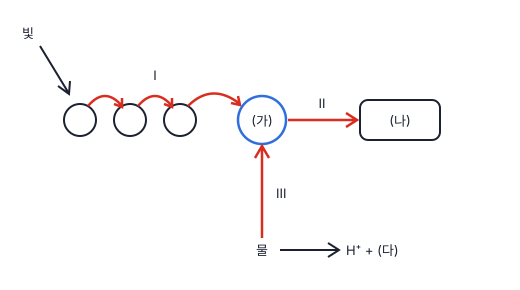
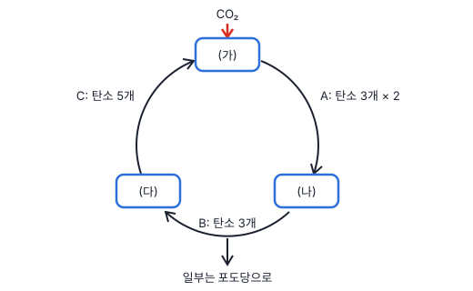

# 복습문제 40선 — 0915 수업 범위

웹과제 8문항, 기출 17문항, 생성 변형 15문항이에요. 먼저 풀어 보고, 막히면 힌트를 열어 보세요.

> `복습문제_0915_Cellular_Respiration_and_Photosynthesis.html`를 마크다운으로 옮겼어요. 원문, 힌트, 풀이는 접혀 있어요. 먼저 풀어 보고 펼쳐 보세요.

**목차**

- [A. 웹과제](#partA)
  - [P26. 명반응에서 일어나지 않는 일](#p26)
  - [P27. 발효할 때 포도당 한 분자의 ATP](#p27)
  - [P28. H⁺ 농도 차로 ATP를 만드는 막](#p28)
  - [P29. 시금치 잎을 씹을 때 사실인 것](#p29)
  - [P30. 광합성에 대한 잘못된 설명](#p30)
  - [P31. 포도당 한 분자에 필요한 캘빈 회로 회전 수](#p31)
  - [P32. 광합성에서 NADP⁺가 맡은 일](#p32)
  - [P33. 산소가 부족할 때 NAD⁺가 다시 채워지는 까닭](#p33)
- [B. 기출](#partB)
  - [P1. C3·C4 식물 이름의 기준](#p1)
  - [P2. 광의존반응의 핵심 화학 과정](#p2)
  - [P3. 발효의 결과로 생기는 분자](#p3)
  - [P4. 광의존반응 중에 일어나지 않는 일](#p4)
  - [P5. 광호흡에서 일어나는 일](#p5)
  - [P6. 광합성 전체 반응식](#p6)
  - [P7. 광합성 산소의 기원](#p7)
  - [P8. 캘빈 회로 환원 단계의 산물](#p8)
  - [P9. 캘빈 회로 한 바퀴의 산물](#p9)
  - [P10. NADP⁺의 역할](#p10)
  - [P11. 두 반응을 잇는 분자](#p11)
  - [P12. 광합성에 대한 틀린 설명](#p12)
  - [P13. 요구르트의 신맛](#p13)
  - [P14. 사막에 적응한 식물](#p14)
  - [P15. 캘빈 회로의 투입물이 아닌 것](#p15)
  - [P24. 포도당 한 분자의 ATP 수](#p24)
  - [P25. 산소가 없을 때 근육세포의 ATP](#p25)
- [C. 변형 연습](#partC)
  - [P16. [변형] 32개 중 산화적 인산화의 몫](#p16)
  - [P17. [변형] 전자는 흐르는데 H⁺가 샌다면](#p17)
  - [P18. [변형] 해당과정까지 멈추는 이유](#p18)
  - [P19. [변형] 알코올 발효에서 전자를 받는 분자](#p19)
  - [P20. [변형] 산소 양으로 그린 그래프](#p20)
  - [P21. [변형] 명반응 전자의 순서](#p21)
  - [P22. [변형] H⁺가 쌓이는 곳과 ATP가 생기는 곳](#p22)
  - [P23. [변형] 기공이 닫힌 더운 날](#p23)
  - [P34. [변형] 캘빈 회로에 꼭 넣어야 하는 것](#p34)
  - [P35. [변형] 거꾸로 돌아가는 연결 분자](#p35)
  - [P36. [변형] 광계 그림에서 옮겨 가는 것](#p36)
  - [P37. [변형] 회로 그림의 A, B, C](#p37)
  - [P38. [변형] 포도당이 두 배면 효율도 두 배일까](#p38)
  - [P39. [변형] 광계 2 다음 길이 막히면](#p39)
  - [P40. [변형] 빛이 없는 바닷속 세균](#p40)

## A. 웹과제

### P26. 명반응에서 일어나지 않는 일

다음 중 관합성 명반응(광의존반응)에서 일어나지 않는 것은?

- A. ATP와 NADPH가 생성된다
- B. 이산화탄소가 고정된다
- C. 물 분자가 빛에 의해 쪼개진다
- D. 엽록소에 의해 빛에너지가 흡수된다
- E. 산소가 방출된다

원문 정보 보기

웹과제 2장 q01 (스크린샷 s01)

힌트 보기

명반응은 빛으로 물의 전자를 떼어 ATP와 NADPH를 만드는 단계예요. 탄소를 다루는 단계는 어디였는지 떠올려 보세요.

풀이 보기

1. A. 맞아요. 명반응에서 일어나요. ATP와 NADPH는 명반응이 만들어 캘빈 회로로 보내는 산물이에요.
2. B. 틀려요. 이산화탄소 고정은 스트로마의 광독립반응(캘빈 회로)에서 일어나요. 명반응에서 일어나지 않으므로 답이에요.
3. C. 맞아요. 명반응에서 일어나요. 광계 2에서 물이 빛에 의해 쪼개져(광분해) 전자를 공급해요.
4. D. 맞아요. 명반응에서 일어나요. 엽록소가 빛에너지를 흡수하는 것이 명반응의 첫 단계예요.
5. E. 맞아요. 명반응에서 일어나요. 물이 전자를 내주고 산소가 되므로 산소는 명반응에서 나와요.
6. 수업과의 연결: 교수님은 광합성을 세포호흡을 거꾸로 돌린 흐름(물 → NADPH → 포도당)으로 정리하셨고, 명반응과 암반응을 잇는 분자가 ATP와 NADPH라고 확인하셨어요(정리노트 "광합성은 세포호흡을 거꾸로 돌린 것").

**정답:** B

원문 발문의 "관합성"은 "광합성"의 오타로 보여요. 문항 의도에는 영향이 없어요.

---

### P27. 발효할 때 포도당 한 분자의 ATP

근육세포에 산소가 고갈되어 발효가 일어난다면 한 분자의 포도당에서 ATP는 얼마나 생성되는가?

- A. 4 분자
- B. 없음
- C. 26 분자
- D. 8 분자
- E. 2 분자

원문 정보 보기

웹과제 2장 q03 (스크린샷 s03)

힌트 보기

산소가 없으면 전자전달계가 멈춰요. 그러면 ATP를 만드는 단계 가운데 무엇이 남는지 떠올려 보세요.

풀이 보기

1. A. 틀려요. 4분자는 해당과정이 만드는 총량이에요. 투자한 2 ATP를 빼면 순 2분자예요.
2. B. 틀려요. 발효에서도 해당과정의 기질 수준 인산화로 ATP가 생겨요. 발효가 NAD⁺를 되살려 해당과정을 계속 돌리게 해 줘요.
3. C. 틀려요. 26분자 수준은 산소가 있어 산화적 인산화가 일어날 때의 몫과 관련된 값이에요. 수업 정리로는 산소가 있을 때 산화적 인산화가 28개, 기질 수준 인산화 4개를 더한 완전 산화가 32개예요.
4. D. 틀려요. 8분자는 어느 단계의 수율에도 근거가 없는 값이에요. 산소가 없으면 해당과정 뒤의 단계가 돌지 않아 해당과정만 돌고, 그때 얻는 ATP는 2개예요.
5. E. 맞아요. 발효할 때는 해당과정의 순 2 ATP만 얻어요.
6. 수업과의 연결: 교수님은 NAD⁺를 택시에 비유해 발효는 손님(전자)을 억지로 내리게 하는 것이라고 하셨고, ATP 2개라도 얻는 것이 0보다 낫다는 점을 로또에 빗대셨어요(정리노트 "산소가 없으면 해당과정도 멈춘다").

**정답:** E

---

### P28. H⁺ 농도 차로 ATP를 만드는 막

아래의 (가)는 무엇인가?

전자가 전자 전달계를 거쳐 전달되면서 방출되는 에너지를 이용해 ( 가 )막을 경계로 이 능동 수송된다. 그 결과 H+의 농도 차가 형성되고 이러한 농도 차에 의해 ATP를 생성하는 인산화 반응을 일으킨다.

- A. 동물과 식물에서 미토콘드리아 외막과 내막 모두 해당된다.
- B. 동물에서는 미토콘드리아 외막만 해당된다.
- C. 동물과 식물에서 모두 미토콘드리아 내막만 해당된다.
- D. 식물에서는 엽록체의 틸라코이드만 해당된다.
- E. 식물에서는 엽록체의 틸라코이드막과 미토콘드리아 내막 모두 해당된다.

원문 정보 보기

웹과제 2장 q06 (스크린샷 s06)

힌트 보기

전자전달계가 박혀 있는 막을 세포호흡과 광합성에서 하나씩 떠올리고, 식물은 어느 소기관을 모두 가지는지 생각해 보세요.

풀이 보기

1. A. 틀려요. 미토콘드리아 외막에는 전자전달계가 없어요.
2. B. 틀려요. 동물에서 해당하는 막은 외막이 아니라 내막이에요.
3. C. 틀려요. 식물에서는 엽록체의 틸라코이드막도 해당하므로 "내막만"은 틀려요.
4. D. 틀려요. 식물도 미토콘드리아를 가져서 내막에서 같은 과정이 일어나요. "틸라코이드만"은 틀려요.
5. E. 맞아요. 식물은 틸라코이드막(광합성의 ATP 합성)과 미토콘드리아 내막(산화적 인산화)을 모두 가져요.
6. 수업과의 연결: 교수님은 명반응의 H⁺ 흐름을 미토콘드리아와 비교하며 "방향만 반대입니다"라고 하셨어요. 미토콘드리아는 기질에서 막 바깥쪽으로, 틸라코이드는 스트로마에서 안쪽으로 H⁺를 퍼내요(정리노트 "명반응의 전자 흐름과 ATP 합성").

**정답:** E

원문 제시문의 "막을 경계로 이 능동 수송된다"에는 주어(H+)가 빠져 있어요. 문맥상 H+가 능동 수송된다고 읽어요.

---

### P29. 시금치 잎을 씹을 때 사실인 것

여러분이 시금치 잎을 씹는다. 다음 중 어느 것이 사실인가?

- A. 잎에 있는 당분은 식물의 세포호흡을 통해 직접 생성된 것이다
- B. 여러분이 섭취하는 잎 단백질에 관계의 구성 단백질이 포함되어 있다
- C. 여러분이 섭취하는 가장 주된 색소는 카로티노이드이다
- D. 잎에서 얻은 에너지 중, 여러분이 사용할 수 있는 에너지는 주로 셀룰로오스 형태다
- E. 여러분이 소화시키고 있는 주요 색소는 녹색광을 가장 많이 흡수한다

원문 정보 보기

웹과제 2장 q07 (스크린샷 s07)

힌트 보기

잎이 왜 초록으로 보이는지, 그리고 빛을 모으는 장치가 무엇으로 이루어졌는지 떠올려 보세요.

풀이 보기

1. A. 틀려요. 잎의 당은 광합성으로 만들어져요. 세포호흡은 당을 분해하는 과정이에요.
2. B. 맞아요. "관계"를 "광계"로 읽으면, 광계는 색소와 단백질이 뭉친 집합체라서 잎 단백질에 그 구성 단백질이 들어 있어요.
3. C. 틀려요. 잎의 주 색소는 엽록소예요. 카로티노이드는 보조 색소로, 엽록소가 빠진 가을 잎에서 드러나요.
4. D. 틀려요. 셀룰로오스는 사람이 연료로 쓰지 못해요.
5. E. 틀려요. 엽록소는 녹색광을 흡수하지 않고 반사해서 잎이 초록으로 보여요.
6. 수업과의 연결: 교수님은 광계를 빛을 받는 안테나에 비유하셨고, 수업에서 광계와 안테나 복합체를 엽록소와 여러 단백질이 뭉친 집합체로 정리했어요(정리노트 "광계와 물의 광분해").

**정답:** B

원문 보기 B의 "관계"는 "광계"의 오타로 보여요. 광계로 읽어야 참인 진술이 되므로 그렇게 읽고 정답을 정했어요.

---

### P30. 광합성에 대한 잘못된 설명

다음 중 광합성에 대하여 잘못 설명하고 있는 것은?

- A. 햇빛은 엽록소에 있는 전자들을 더 높은 에너지 수준으로 올림으로써 광합성을 가동시킨다
- B. 캘빈회로의 효소들은 엽록체의 스트로마에 존재한다
- C. 광독립반응(암반응) 부산물로 산소가 생성된다
- D. 햇빛이 엽록소에 부딪쳤을 때 방출된 전자들은 물에서부터 온 전자들에 의해서 대체된다
- E. 캘빈회로에서는 광의존반응으로부터 온 전자들과 ATP, 그리고 대기의 이산화탄소를 이용하여 당을 생산한다

원문 정보 보기

웹과제 2장 q10 (스크린샷 s10, s11)

힌트 보기

산소는 물이 전자를 내줄 때 생겨요. 물을 쪼개는 일이 어느 단계에서 일어났는지 떠올려 보세요.

풀이 보기

1. A. 맞아요. 빛에너지가 엽록소의 전자를 들뜨게 해 광합성을 시작해요.
2. B. 맞아요. 캘빈 회로는 엽록체의 스트로마에서 일어나요.
3. C. 틀려요. 산소는 명반응에서 물이 분해되며 생겨요. 광독립반응(암반응)의 부산물이 아니므로 잘못된 설명이라 답이에요.
4. D. 맞아요. 엽록소가 잃은 전자는 물에서 온 전자로 채워져요.
5. E. 맞아요. 캘빈 회로는 명반응에서 온 전자(NADPH)와 ATP, 대기의 CO₂로 당을 만들어요.
6. 수업과의 연결: 수업에서 전자를 잃은 광계 2가 물에서 전자를 빼 와 채우고, 그때 물이 갈라져 산소가 나오므로 광합성의 산소는 명반응에서 생긴다고 정리했어요(정리노트 "광계와 물의 광분해").

**정답:** C

---

### P31. 포도당 한 분자에 필요한 캘빈 회로 회전 수

하나의 이산화탄소는 캘빈회로의 한 회전에서 반응한다. 얼마나 많은 순환이 하나의 포도당을 합성하는데 필요한가?

- A. 3
- B. 2
- C. 6
- D. 1
- E. 12

원문 정보 보기

웹과제 2장 q11 (스크린샷 s12)

힌트 보기

포도당의 탄소 수와 한 바퀴에 들어오는 CO₂ 수를 비교해 보세요.

풀이 보기

1. A. 틀려요. 3바퀴는 3탄당인 G3P 1분자에 해당해요.
2. B. 틀려요. 2바퀴로는 탄소 6개를 채우기에 부족해요.
3. C. 맞아요. 포도당은 탄소가 6개라서 CO₂ 6개, 곧 6바퀴가 필요해요.
4. D. 틀려요. 1바퀴에는 CO₂ 1개만 고정돼요.
5. E. 틀려요. 12바퀴는 포도당 2분자에 해당해요.
6. 수업과의 연결: 교수님은 탄소 고정을 "5탄당이 탄소 하나를 만났으니 몇 탄당?"이라고 물으며 설명하셨어요. 한 바퀴에 탄소 하나씩 들어오니 포도당 하나에는 6바퀴가 필요해요(정리노트 "캘빈 회로의 세 단계").

**정답:** C

---

### P32. 광합성에서 NADP⁺가 맡은 일

광합성 과정에서 NADP⁺의 역할은 무엇인가?

- A. 이산화탄소를 루비스코로 전환
- B. 물을 산소와 수소로 분해
- C. 빛에너지 흡수
- D. 전자수용체
- E. ADP를 ATP로 인산화

원문 정보 보기

웹과제 2장 q13 (스크린샷 s14)

힌트 보기

세포호흡에서 NAD⁺가 무엇을 받아 NADH가 되었는지 떠올리고, 광합성에서 같은 자리를 찾아보세요.

풀이 보기

1. A. 틀려요. 루비스코는 CO₂를 고정하는 효소예요. CO₂가 바뀌어 생기는 물질이 아니에요.
2. B. 틀려요. 물의 분해는 광계 2에서 일어나요. NADP⁺의 역할이 아니에요.
3. C. 틀려요. 빛 흡수는 엽록소 같은 색소가 해요.
4. D. 맞아요. NADP⁺는 명반응 전자 흐름의 마지막 전자수용체로, 전자를 받아 NADPH가 돼요.
5. E. 틀려요. ADP를 ATP로 인산화하는 것은 ATP 합성효소예요.
6. 수업과의 연결: 교수님은 "전자가 어디서 뭘 거쳐서 어디로 흐르는지 그것만 파악하면" 광합성은 큰 문제가 없다고 하셨어요. 그 흐름의 끝에서 전자를 받는 것이 NADP⁺예요(정리노트 "명반응의 전자 흐름과 ATP 합성").

**정답:** D

---

### P33. 산소가 부족할 때 NAD⁺가 다시 채워지는 까닭

골격근에서 산소가 부족한 상태에서도 NAD+가 계속 제공되어 해당과정을 지속시킬 수 있는 이유는?

- A. 피루브산이 산화되어 포도당이 되므로
- B. NADH와 상관없이 NAD+가 끊임없이 처음부터 새로 합성되므로
- C. 산소 대신 젖산이 NADH의 전자를 받아주므로
- D. NADH가 피루브산을 환원시키고 자신은 산화되므로
- E. NADH가 NADPH로부터 전자를 받기 때문

원문 정보 보기

웹과제 2장 q14 (스크린샷 s15)

힌트 보기

젖산 발효에서 NADH의 전자를 받는 분자가 무엇이고, 그 분자가 전자를 받은 뒤 무엇이 되는지 떠올려 보세요.

풀이 보기

1. A. 틀려요. 피루브산은 포도당으로 되돌아가지 않아요. NADH의 전자를 받아 젖산으로 환원돼요.
2. B. 틀려요. NAD⁺는 새로 합성되는 것이 아니라 NADH가 산화되며 되살아나요.
3. C. 출제 의도로는 답일 여지가 있지만 화학적으로는 부정확해요. 전자를 받는 것은 피루브산이고, 젖산은 전자를 받은 결과물이에요.
4. D. 맞아요. NADH가 피루브산을 환원시키고 자신은 NAD⁺로 산화되어 해당과정에 다시 쓰여요.
5. E. 틀려요. NADPH는 광합성의 전자 운반체라 발효와 관계없어요.
6. 수업과의 연결: 교수님은 발효를 택시 손님에게 "야, 여기서 내려라" 하고 억지로 내리게 하는 것에 비유하셨고, 수업에서 젖산 발효는 피루브산이 NADH의 전자를 받아 젖산이 되는 과정으로 정리했어요(정리노트 "젖산 발효와 알코올 발효").

**정답:** D

보기 C는 "피루브산이 전자를 받아 젖산이 된다"를 "젖산이 전자를 받는다"로 줄인 표현이라, 출제 의도가 C였을 여지도 있어요. 화학적으로 정확한 진술은 D라서 정답을 D로 두었어요.

---

## B. 기출

### P1. C3·C4 식물 이름의 기준

C3와 C4식물은 어떻게 이름 붙여졌는가?

- (1) 대사과정에서 이산화탄소가 고정될 때, 생성된 첫 번째로 안정한 분자의 탄소 수
- (2) 탄소를 포함하는 분자가 발견된 순서
- (3) 식물이나 동물의 물질대사에 가장 먼저 참여하는 탄소 수
- (4) 식물이 위치하는 지리적 좌표와 연관

원문 정보 보기

기출 2강 합본 3번 (PDF 1쪽)

힌트 보기

캘빈 회로에서 CO₂가 RuBP에 붙으면 곧바로 몇 탄소짜리 분자가 두 개 생기는지 떠올려 보세요.

풀이 보기

1. (1) 맞아요. 보통 식물은 CO₂가 RuBP에 붙자마자 쪼개져 3탄소 PGA가 첫 안정한 분자가 되므로 C3예요. C4 식물은 CO₂를 먼저 4탄소 화합물로 고정하므로 C4예요.
2. (2) 틀려요. 이름은 발견 순서가 아니라 CO₂ 고정의 첫 산물의 탄소 수에서 왔어요.
3. (3) 틀려요. 동물은 CO₂를 고정하지 않고, 기준은 '먼저 참여하는 탄소 수'가 아니라 고정 후 생긴 첫 안정한 분자의 탄소 수예요.
4. (4) 틀려요. 지리적 좌표와는 관계없어요. C4 식물이 더운 곳에 많을 뿐, 이름은 화학적 기준이에요.
5. 수업과의 연결: 0915 캘빈 회로 설명에서 "6탄당이 없어. 3탄당 두 개가 있어"라고 하신 첫 산물 PGA가 C3라는 이름의 근거예요. C4의 4탄소 산물은 교수님이 "몰라도 된다"고 하신 부분이라 정리노트 보충에서 다뤘어요.

**정답:** (1)

---

### P2. 광의존반응의 핵심 화학 과정

광합성의 광의존반응에서 주요한 화학적 과정에는 ( )의 분해와 ( )의 방출이 포함된다.

- (1) 물 - 전자
- (2) ATP - 산소
- (3) ATP - 전자
- (4) 물 - 질소

원문 정보 보기

기출 2강 합본 4번 (PDF 1쪽)

힌트 보기

광계 2의 반응 중심이 잃은 전자를 어디에서 채우는지 생각해 보세요.

풀이 보기

1. (1) 맞아요. 광계 2가 잃은 전자를 물에서 빼 오면서 물이 분해되고(물의 광분해), 전자가 방출되어 전자전달계로 흘러가요.
2. (2) 틀려요. 광의존반응에서 ATP는 분해되는 것이 아니라 만들어져요. 산소가 방출되는 것은 맞지만 분해되는 것은 물이에요.
3. (3) 틀려요. ATP는 이 단계의 산물이지 분해 대상이 아니에요.
4. (4) 틀려요. 물의 분해에서 나오는 것은 전자, H⁺, 산소이고 질소는 관계없어요.
5. 수업과의 연결: 수업에서 "전자를 잃은 P680은 물에서 전자를 채우고, 전자를 뺏긴 물은 산소가 된다"고 설명하신 물의 광분해 그대로예요.

**정답:** (1)

---

### P3. 발효의 결과로 생기는 분자

다음 중 발효과정의 결과로 생산되는 분자는 어떤 것인가?

- (1) ATP
- (2) NAD⁺
- (3) NADPH
- (4) NADH

원문 정보 보기

기출 2강 합본 5번 (PDF 1쪽). 원문의 NAD 위첨자 표기 깨짐을 NAD⁺로 바로잡았어요.

힌트 보기

산소가 없을 때 세포가 왜 발효를 하는지, 무엇을 되살리려는지 떠올려 보세요.

풀이 보기

1. (1) 출제 의도로는 답이 아니지만, 발효하는 세포도 ATP 2개를 얻기는 해요. 다만 그 ATP는 앞선 해당과정에서 만들어지고, 발효 단계(피루브산 → 젖산 등) 자체가 만드는 것은 아니에요.
2. (2) 맞아요. 발효 단계에서 NADH가 전자를 피루브산(또는 아세트알데하이드)에 넘기며 NAD⁺로 되돌아가요. 이 NAD⁺ 재생 덕분에 해당과정이 계속 돌아요.
3. (3) 틀려요. NADPH는 광합성에서 쓰는 전자 운반체라 발효와 관계없어요.
4. (4) 틀려요. NADH는 발효에서 전자를 내주고 소모되는 쪽이에요.
5. 수업과의 연결: 수업에서 "NAD⁺만 되살리면 해당과정은 돌릴 수 있다"며 NADH가 피루브산에 전자를 억지로 주는 것이 발효라고 설명하셨어요.

**정답:** (2)

이 문항은 해석에 따라 보기 (1)도 성립할 수 있어요. '발효 전체'를 해당과정까지 포함해 넓게 보면 ATP 2개가 생기기 때문이에요. 인쇄된 답 (2)는 '발효 단계가 하는 일 = NAD⁺ 재생'을 묻는 출제 의도로 보고 그대로 두었어요.

---

### P4. 광의존반응 중에 일어나지 않는 일

다음 중 광합성의 광의존반응 동안에 일어나지 않는 것은?

- (1) 전자전달계가 캘빈회로에 사용될 ATP합성을 가동시킨다.
- (2) 엽록소로부터 나온 전자가 전자전달계에 첨가된다.
- (3) 물이 분해되면서 산소가 생산된다.
- (4) 산소가 분해되어서 물을 방출한다.
- (5) NADPH가 생산되며, 캘빈회로에 전자를 운반한다.

원문 정보 보기

기출 2강 합본 9번 (PDF 1쪽)

힌트 보기

광합성에서 물과 산소 중 어느 쪽이 어느 쪽으로 바뀌는지 방향을 확인해 보세요.

풀이 보기

1. (1) 일어나요. 전자전달계가 H⁺를 틸라코이드 안쪽에 쌓고, 이 기울기로 ATP 합성효소가 캘빈 회로에서 쓸 ATP를 만들어요.
2. (2) 일어나요. 반응 중심 엽록소가 내보낸 전자가 최초 수용체를 거쳐 전자전달계로 들어가요.
3. (3) 일어나요. 광계 2에서 물이 분해되며 산소가 나와요.
4. (4) 일어나지 않아요. 산소가 전자를 받아 물이 되는 것은 세포호흡의 전자전달계예요. 광합성은 반대로 물이 분해되어 산소가 나와요.
5. (5) 일어나요. NADP⁺가 광계 1에서 온 전자를 받아 NADPH가 되고, 이 전자를 캘빈 회로로 날라요.
6. 수업과의 연결: 수업에서 "호흡은 산소 → 물, 광합성은 물 → 산소"라고 방향을 대비하셨어요.

**정답:** (4)

---

### P5. 광호흡에서 일어나는 일

광호흡 과정에서 일어나는 일은?

- (1) 이산화탄소가 루비스코와 결합하여 RuBP를 생성한다.
- (2) 루비스코가 기질로 산소를 이용한다.
- (3) 산소가 루비스코와 결합하여 RuBP를 생성한다.
- (4) 효소인 루비스코가 기질로 이산화탄소를 사용한다.
- (5) 이산화탄소가 3-탄소 분자와 결합하여 4-탄소 분자를 생산한다.

원문 정보 보기

기출 2강 합본 12번 (PDF 1쪽)

힌트 보기

기공이 닫혀 CO₂가 줄고 O₂가 쌓이면 루비스코가 무엇을 '착각'해서 붙이는지 떠올려 보세요.

풀이 보기

1. (1) 틀려요. RuBP는 CO₂가 붙는 5탄소 받개이고, CO₂와 루비스코가 결합해 RuBP가 생기는 것이 아니에요.
2. (2) 맞아요. 광호흡은 루비스코가 CO₂ 대신 O₂를 기질로 붙이는 과정이에요. 그 결과 독성 물질이 생기고 이를 없애는 데 에너지를 써요.
3. (3) 틀려요. O₂가 붙는 대상도 RuBP이고, RuBP가 생성되는 것이 아니에요.
4. (4) 틀려요. 루비스코가 CO₂를 붙이는 것은 캘빈 회로의 정상적인 탄소 고정이지 광호흡이 아니에요.
5. (5) 틀려요. CO₂를 먼저 4탄소 화합물로 고정하는 것은 광호흡을 피하는 C4 식물의 방식이에요.
6. 수업과의 연결: 수업에서 루비스코가 "착각"해 CO₂ 대신 O₂를 붙인다고 설명하셨어요.

**정답:** (2)

---

### P6. 광합성 전체 반응식

다음의 화학 반응 중 광합성을 가장 적절히 나타낸 것은?

- (1) 6H₂O + 6CO₂ + 태양에너지 → C₆H₁₂O₆ + 6O₂
- (2) C₆H₁₂O₆ + 6H₂O + 태양에너지 → 6CO₂ + 6O₂
- (3) 6CO₂ + 6O₂ + 태양에너지 → C₆H₁₂O₆ + 6H₂O
- (4) O₂ + H₂O + 태양에너지 → C₆H₁₂O₆ + CO₂
- (5) C₆H₁₂O₆ + 6O₂ + 태양에너지 → 6CO₂ + 6H₂O

원문 정보 보기

기출 2강 합본 13번 (PDF 1쪽). 합본에서 이 문항의 질문과 보기는 11번 옆에 이미지로 밀려 인쇄되어 있고, 13번 자리에는 답만 남아 있어요(PDF 2쪽 위).

힌트 보기

광합성은 세포호흡을 거꾸로 돌린 것이에요. 반응물과 산물을 한 번 뒤집어 보세요.

풀이 보기

1. (1) 맞아요. 물과 CO₂가 빛에너지로 포도당과 산소가 돼요. 산소는 물에서, 포도당의 탄소는 CO₂에서 와요.
2. (2) 틀려요. 포도당이 반응물 쪽에 있어 광합성이 아니고, 산소와 CO₂가 함께 나오는 반응도 성립하지 않아요.
3. (3) 틀려요. 산소가 반응물이고 물이 산물이라 방향이 뒤집혔어요. 광합성에서는 물이 들어가 산소가 나와요.
4. (4) 틀려요. 산소가 반응물 쪽에 있고, CO₂가 산물로 나와 탄소의 방향도 반대예요. 계수도 맞지 않아요.
5. (5) 틀려요. 포도당과 산소가 CO₂와 물이 되는 것은 세포호흡이에요.
6. 수업과의 연결: 수업에서 호흡은 "포도당 → NADH → 산소", 광합성은 "물 → NADPH → 포도당"이라고 정리하셨어요.

**정답:** (1)

---

### P7. 광합성 산소의 기원

광합성 광의존반응에서 발생하는 산소의 기원은?

- (1) 물
- (2) 포도당
- (3) NADPH
- (4) NADH
- (5) 이산화탄소

원문 정보 보기

기출 2강 합본 17번 (PDF 2쪽)

힌트 보기

광계 2가 잃은 전자를 채우려고 무엇을 쪼개는지 생각해 보세요.

풀이 보기

1. (1) 맞아요. 광계 2가 물에서 전자를 빼 오며 물이 분해되고, 그 결과 산소가 나와요.
2. (2) 틀려요. 포도당은 광합성의 산물이지 산소의 출처가 아니에요.
3. (3) 틀려요. NADPH는 전자를 캘빈 회로로 나르는 운반체예요.
4. (4) 틀려요. NADH는 세포호흡의 전자 운반체예요.
5. (5) 틀려요. CO₂의 탄소는 캘빈 회로에서 포도당으로 들어가고, 방출되는 산소는 물에서 와요.
6. 수업과의 연결: 수업에서 "산소는 명반응에서 생긴다"고, 이어 물이 전자를 뺏기고 산소가 된다고 하셨어요.

**정답:** (1)

---

### P8. 캘빈 회로 환원 단계의 산물

캘빈회로의 2단계 반응 중 NADPH에 의한 환원반응의 결과 생산되는 것은?

답: ( )

원문 정보 보기

기출 2강 합본 21번 (PDF 2쪽). 합본에 보기 번호만 있고 보기 글이 인쇄되지 않아, 보기 없이 답을 쓰는 문항으로 실었어요.

힌트 보기

PGA(3-인산글리세르산)가 ATP의 인산기와 NADPH의 전자를 받으면 산이 무엇으로 바뀌는지 떠올려 보세요.

풀이 보기

1. 캘빈 회로 1단계(탄소 고정)에서 CO₂가 RuBP에 붙어 3-인산글리세르산(PGA) 2분자가 생겨요.
2. 2단계(환원)에서 PGA가 ATP에서 인산기, NADPH에서 전자를 받아 산(글리세르산)이 알데하이드가 돼요. 이 산물이 G3P(글리세르알데하이드 3-인산)예요.
3. G3P 일부는 포도당 합성에, 나머지는 3단계 RuBP 재생에 쓰여요.
4. 수업과의 연결: 수업에서 PGA가 NADPH에서 전자를 받아 알데하이드인 G3P가 된다고 설명하셨어요.

**정답:** G3P

---

### P9. 캘빈 회로 한 바퀴의 산물

캘빈회로의 한 회전에서 CO₂ 분자는 무엇을 생산하는가?

- (1) 포도당 한 분자
- (2) ATP
- (3) ATP 6개 NADPH 6개
- (4) 탄수화물 한 단위
- (5) 6 NADPH

원문 정보 보기

기출 2강 합본 24번 (PDF 2쪽). 원문 CO₂ 표기 깨짐을 바로잡았어요. 문항 옆에 인쇄된 효소 그림은 14번 그림이라 싣지 않았어요.

힌트 보기

한 바퀴에 들어오는 CO₂는 몇 개이고, 포도당 한 분자에는 몇 바퀴가 필요했는지 떠올려 보세요.

풀이 보기

1. (1) 틀려요. 포도당(탄소 6개) 한 분자에는 CO₂가 6번, 곧 6바퀴가 필요해요.
2. (2) 틀려요. 캘빈 회로는 ATP를 쓰는 쪽이지 만드는 쪽이 아니에요.
3. (3) 틀려요. ATP와 NADPH는 캘빈 회로에서 소모돼요. 만드는 곳은 명반응이에요.
4. (4) 맞아요. 한 바퀴에 CO₂ 1개가 고정되어 탄소 하나만큼, 곧 탄수화물 한 단위(CH₂O)가 생겨요.
5. (5) 틀려요. NADPH는 캘빈 회로에서 전자를 내주고 NADP⁺로 돌아가요.
6. 수업과의 연결: 수업에서 "6바퀴 돌아야 포도당 1분자"라고 하셨어요. 한 바퀴 = 탄소 하나라는 뜻이에요.

**정답:** (4)

---

### P10. NADP⁺의 역할

광합성 과정에서 NADP⁺ 의 역할은 무엇인가?

- (1) ADP를 ATP로 인산화
- (2) 빛에너지 흡수
- (3) 물을 산소와 수소로 분해
- (4) 전자수용체
- (5) 이산화탄소를 루비스코로 전환

원문 정보 보기

기출 2강 합본 26번 (PDF 3쪽). 원문 NADP 위첨자 표기 깨짐을 바로잡았어요.

힌트 보기

광계 1에서 나간 전자가 마지막으로 어디에 도착하는지 생각해 보세요.

풀이 보기

1. (1) 틀려요. ADP를 ATP로 인산화하는 것은 H⁺ 기울기로 돌아가는 ATP 합성효소예요.
2. (2) 틀려요. 빛에너지는 안테나 복합체의 색소(엽록소, 카로티노이드)가 흡수해요.
3. (3) 틀려요. 물을 분해하는 것은 광계 2예요.
4. (4) 맞아요. NADP⁺는 광계 1에서 온 전자와 H⁺를 받아 NADPH가 되는 마지막 전자수용체예요.
5. (5) 틀려요. 루비스코는 효소이고, CO₂가 루비스코로 바뀌는 일은 없어요.
6. 수업과의 연결: 수업에서 광계 1의 전자가 NADP⁺까지 가서 전자와 H⁺를 받아 NADPH가 된다고 하셨어요.

**정답:** (4)

---

### P11. 두 반응을 잇는 분자

광의존반응과 광독립반응을 연결시키는 분자는?

- (1) G3P와 RuBP
- (2) ADP와 H₂O
- (3) RuBP와 CO₂
- (4) ATP와 NADPH
- (5) 사이토크롬과 물

원문 정보 보기

기출 2강 합본 31번 (PDF 3쪽). 원문 H₂O, CO₂ 표기 깨짐을 바로잡았어요.

힌트 보기

명반응이 만들어 암반응에 넘겨 주는 두 가지가 무엇이었는지 떠올려 보세요.

풀이 보기

1. (1) 틀려요. G3P와 RuBP는 캘빈 회로(광독립반응) 안에서만 도는 물질이에요.
2. (2) 틀려요. 물은 광의존반응의 재료일 뿐 두 반응을 잇지 않아요. ADP는 캘빈 회로에서 명반응으로 돌아가는 쪽이지만 짝이 틀렸어요.
3. (3) 틀려요. RuBP와 CO₂는 캘빈 회로의 탄소 고정 단계에서 만나는 물질이에요.
4. (4) 맞아요. 명반응이 만든 ATP와 NADPH를 캘빈 회로가 받아 CO₂를 포도당으로 바꿔요.
5. (5) 틀려요. 사이토크롬은 전자전달계 안의 운반체이고, 물은 명반응의 재료예요.
6. 수업과의 연결: 0915 수업 끝 문제 풀이에서 똑같이 "광의존반응과 광독립반응을 연결하는 분자는 ATP와 NADPH"라고 푸셨어요.

**정답:** (4)

---

### P12. 광합성에 대한 틀린 설명

다음 중 광합성에 대하여 잘못 설명하고 있는 것은?

- (1) 햇빛이 엽록소에 부딪쳤을 때 방출된 전자들은 물에서부터 온 전자들에 의해서 대체된다.
- (2) 캘빈회로의 효소들은 엽록체의 스트로마에 존재한다.
- (3) 캘빈회로에서 생산된 산소는 대기로 방출한다.
- (4) 캘빈회로에서는 광의존반응으로부터 온 전자들과 ATP가 대기의 이산회탄소와 결합하여 당을 생성한다.
- (5) 햇빛은 엽록소에 있는 전자들을 더 높은 에너지 수준으로 올림으로써 광합성을 가동시킨다.

원문 정보 보기

기출 2강 합본 32번 (PDF 3쪽). 보기 (4)의 '이산회탄소'는 원문 표기 그대로예요(이산화탄소의 오타).

힌트 보기

광합성에서 산소가 어느 반응, 어느 물질에서 나오는지 확인해 보세요.

풀이 보기

1. (1) 맞는 설명이에요. 반응 중심 엽록소가 내보낸 전자는 물에서 빼 온 전자로 채워져요.
2. (2) 맞는 설명이에요. 캘빈 회로의 세 단계는 모두 스트로마에서 일어나요.
3. (3) 잘못된 설명이에요. 산소는 캘빈 회로가 아니라 광의존반응에서 물이 분해될 때 나와요. 캘빈 회로는 산소를 만들지 않아요.
4. (4) 맞는 설명이에요. 광의존반응에서 온 전자(NADPH가 실어 옴)와 ATP를 써서 CO₂로 당을 만들어요.
5. (5) 맞는 설명이에요. 빛에너지를 받은 엽록소의 전자가 들뜬 상태(더 높은 에너지 수준)가 되며 광합성이 시작돼요.
6. 수업과의 연결: 수업에서 "산소는 명반응에서 생긴다"고, 이어 캘빈 회로의 모든 단계가 스트로마에서 일어난다고 하셨어요.

**정답:** (3)

---

### P13. 요구르트의 신맛

요구르트의 신맛의 원인은 무엇인가?

- (1) 시트르산 회로에서 미생물에 의해 방출된 시트르산
- (2) 해당과정 동안에 미생물에 의해 생성된 ADP
- (3) 미생물에 의해 무기호흡과정 동안 생성된 젖산
- (4) 미생물에 의해 지방이 분해되어 나온 지방산

원문 정보 보기

기출 2강 합본 36번 (PDF 3쪽)

힌트 보기

김치가 시어지는 까닭을 교수님이 무엇 때문이라고 하셨는지 떠올려 보세요.

풀이 보기

1. (1) 틀려요. 시트르산 회로는 산소가 있을 때 미토콘드리아에서 도는 과정이고, 신맛의 원인이 아니에요.
2. (2) 틀려요. ADP는 신맛을 내지 않고, 해당과정에서는 ADP가 ATP로 바뀌는 쪽이에요.
3. (3) 맞아요. 유산균(젖산균)이 산소가 적은 곳에서 젖산 발효를 해 젖산을 만들고, 이 젖산이 신맛을 내요.
4. (4) 틀려요. 요구르트의 신맛은 지방 분해가 아니라 젖산 때문이에요.
5. 수업과의 연결: 수업에서 젖산 발효를 설명하며 김치의 신맛이 젖산 때문이라고 하셨어요.

**정답:** (3)

보기 (3)의 '무기호흡과정'은 엄밀히는 '발효(젖산 발효)'라고 불러야 해요. 무산소 호흡은 산소 대신 질산염·황산염 같은 다른 물질을 최종 전자수용체로 쓰는 전자전달계 과정이라 발효와 달라요. 그래도 네 보기 가운데 신맛의 원인(젖산)을 바르게 짚은 것은 (3)뿐이라 정답은 (3)이에요.

---

### P14. 사막에 적응한 식물

다음 중 사막과 같이 낮에 고온 건조한 환경에서 가장 잘 적응하는 식물은?

답: ( )

원문 정보 보기

기출 2강 합본 40번 (PDF 3쪽). 합본에 보기가 인쇄되지 않고 답만 있어, 보기 없이 답을 쓰는 문항으로 실었어요.

힌트 보기

낮에 기공을 닫아도 광합성을 할 수 있게 CO₂를 저장해 두는 식물을 떠올려 보세요. 낮에는 기공을 닫고 밤에 여는 식물이에요.

풀이 보기

1. 낮에 뜨겁고 건조하면 식물은 물을 아끼려고 기공을 닫아요. 그러면 잎 안의 CO₂가 줄고 O₂가 쌓여 광호흡이 늘어요.
2. CAM 식물(선인장 등)은 서늘한 밤에만 기공을 열어 CO₂를 받아 저장하고, 낮에는 기공을 닫은 채 저장한 CO₂로 캘빈 회로를 돌려요. 그래서 낮에 고온 건조한 사막에 가장 잘 적응해요.
3. C4 식물(옥수수, 사탕수수)도 CO₂를 저장해 더운 곳에 강하지만, 낮에 고온 건조한 사막의 대표는 CAM 식물이에요. 수업에서 선인장을 C4와 한데 말씀하신 부분은 부정확해요. 선인장은 CAM 식물이에요.
4. 수업과의 연결: 수업에서 건조 지역 식물은 "이산화탄소를 저장했다가 빼는 시스템"이 있어 기공을 닫아도 걱정이 없다고 하셨어요.

**정답:** CAM 식물

---

### P15. 캘빈 회로의 투입물이 아닌 것

광독립반응의 진행을 위해 캘빈회로에서 반드시 요구되는 투입물질이 아닌 것은?

- (1) ATP
- (2) FAD
- (3) CO₂
- (4) NADPH

원문 정보 보기

기출 2강 합본 41번 (PDF 4쪽). 원문 CO₂ 표기 깨짐을 바로잡았어요.

힌트 보기

캘빈 회로에 전자와 에너지와 탄소를 대는 것이 각각 무엇이었는지 떠올려 보세요.

풀이 보기

1. (1) 필요해요. ATP는 PGA에 인산기를 주고 RuBP 재생에도 쓰이는 에너지예요.
2. (2) 필요하지 않아요. FAD(FADH₂)는 세포호흡의 시트르산 회로에서 전자를 나르는 운반체이고 캘빈 회로에는 들어가지 않아요.
3. (3) 필요해요. CO₂는 RuBP에 고정되는 탄소 재료예요.
4. (4) 필요해요. NADPH는 PGA를 G3P로 환원하는 전자를 줘요.
5. 수업과의 연결: 수업에서 캘빈 회로의 전자는 NADPH가, 에너지는 ATP가 댄다고 하셨고, FADH₂는 같은 날 세포호흡 ATP 수지에서만 나왔어요.

**정답:** (2)

---

### P24. 포도당 한 분자의 ATP 수

포도당 한 분자가 이산화탄소와 물로 완전히 산화될 때 생산되는 ATP 분자는 몇 개인가?

- (1) 94
- (2) 5
- (3) 20
- (4) 2
- (5) 32

원문 정보 보기

기출 2강 합본 20번 (PDF 2쪽)

힌트 보기

기질 수준 인산화로 바로 얻는 몫과, NADH·FADH2의 전자가 전자전달계에서 떨어지며 만드는 몫을 더해 보세요.

풀이 보기

1. (1) 틀려요. 94는 어떤 셈에서도 나오지 않는 값이에요.
2. (2) 틀려요. 5는 NADH 2개(약 2.5 ATP씩)가 만드는 정도의 양밖에 안 돼요.
3. (3) 틀려요. 20은 산화적 인산화 몫(28)에도 못 미쳐요.
4. (4) 틀려요. 2는 해당과정만 돌 때(산소가 없어 발효할 때) 얻는 양이에요.
5. (5) 맞아요. 기질 수준 인산화 4개(해당과정 2 + 시트르산 회로 2)와 산화적 인산화 28개(NADH 10 × 2.5 + FADH2 2 × 1.5)를 더하면 32개예요.
6. 수업과의 연결: 수업에서 단계별로 세어 "32 ATP, 1몰 기준 32몰"이라고 정리하셨어요.

**정답:** (5)

---

### P25. 산소가 없을 때 근육세포의 ATP

근육세포에 산소가 사용될 수 없다면 한 분자의 포도당에서 ATP는 얼마나 생성되는가?

- (1) 없음
- (2) 8분자
- (3) 26분자
- (4) 2분자

원문 정보 보기

기출 2강 합본 34번 (PDF 3쪽)

힌트 보기

산소가 없을 때 근육세포는 NAD+를 어떻게 되살려 해당과정을 계속 돌리는지 떠올려 보세요.

풀이 보기

1. (1) 틀려요. 발효를 못 한다면 NAD+가 고갈되어 ATP가 0이 되지만, 근육세포는 젖산 발효로 NAD+를 되살려 해당과정을 계속 돌려요.
2. (2) 틀려요. 8분자는 해당과정의 순생산량(2개)보다 많아요. 산소가 없으면 그 뒤 단계가 돌지 않아요.
3. (3) 틀려요. 26분자는 산소가 있어야 돌아가는 전자전달계의 몫에 가까운 값이에요.
4. (4) 맞아요. 산소가 없으면 전자전달계가 멈추고, 근육세포는 젖산 발효로 NAD+를 재생해 해당과정의 순 ATP 2분자만 얻어요.
5. 수업과의 연결: 수업에서 "NAD+만 되살리면 해당과정은 돌릴 수 있고 ATP 2개를 얻는다", 32개 대신 2개라 효율은 1/16이지만 0보다 낫다고 하셨어요(근육의 젖산 발효는).

**정답:** (4)

---

## C. 변형 연습

### P16. [변형] 32개 중 산화적 인산화의 몫

포도당 1분자가 완전히 산화될 때 생기는 ATP 32개 가운데, H⁺ 농도 기울기와 ATP 합성효소로 만들어지는 것은 몇 개인가요?

- (1) 2개
- (2) 4개
- (3) 28개
- (4) 30개
- (5) 32개

원문 정보 보기

원문 기출이 아닌 생성 변형이에요. 다루는 혼동: 기질 수준 인산화와 산화적 인산화의 개수. 근거 토픽: 포도당 한 분자에서 ATP 32개(s0-atp-yield)

힌트 보기

H⁺ 기울기와 ATP 합성효소로 ATP를 만드는 방식의 이름부터 떠올리고, NADH와 FADH2의 개수를 세어 보세요.

풀이 보기

1. (1) 틀려요. 2개는 해당과정에서 기질 수준 인산화로 얻는 몫(또는 발효 때 얻는 전부)이에요.
2. (2) 틀려요. 4개는 인산기를 직접 건네는 기질 수준 인산화의 전체 몫이에요. 두 방식의 개수를 뒤바꾼 거예요.
3. (3) 맞아요. 산화적 인산화로 NADH 10개 × 2.5 + FADH2 2개 × 1.5 = 28개가 만들어져요.
4. (4) 틀려요. 30개는 32개에서 해당과정의 2개를 뺀 값으로, 발효할 때 모자라는 양이에요.
5. (5) 틀려요. 32개는 두 방식을 합친 전체예요.
6. 수업과의 연결: 수업에서 교수님도 28개와 4개를 한 번 뒤바꿔 말했다가 "아 다시 다시"라며 28개가 산화적 인산화라고 바로잡으셨어요.

**정답:** (3)

---

### P17. [변형] 전자는 흐르는데 H⁺가 샌다면

어떤 약물 때문에 미토콘드리아 전자전달계의 전자 흐름은 정상인데, H⁺가 ATP 합성효소를 거치지 않고 내막을 그냥 새어 기질로 돌아간다고 해요. 옳은 설명은 무엇인가요?

- (1) 전자가 정상으로 흐르므로 ATP 합성량은 변하지 않는다.
- (2) H⁺ 농도 기울기가 유지되지 않아 ATP 합성효소가 ATP를 거의 만들지 못한다.
- (3) 산소 대신 H⁺가 최종 전자수용체가 된다.
- (4) ATP 합성효소를 직접 돌리는 에너지는 포도당이므로 영향이 없다.
- (5) 이 현상을 설명하는 이론의 이름이 산화적 인산화이고, ATP가 생기는 과정의 이름이 화학삼투설이다.

원문 정보 보기

원문 기출이 아닌 생성 변형이에요. 다루는 혼동: 전자 흐름과 H⁺ 농도 기울기의 짝, 직접 에너지원과 궁극 에너지원, 이론과 과정의 이름. 근거 토픽: 화학삼투설과 최종 전자수용체(s0-chemiosmosis)

힌트 보기

ATP 합성효소를 '직접' 돌리는 것이 무엇인지, 그리고 그것이 사라지면 어떻게 되는지 생각해 보세요.

풀이 보기

1. (1) 틀려요. 전자 흐름은 H⁺ 기울기를 만드는 데까지만 해요. 기울기가 새어 없어지면 ATP는 거의 안 생겨요.
2. (2) 맞아요. 전자 흐름, H⁺ 농도 기울기, ATP 합성은 짝을 이뤄요. H⁺가 새면 기울기가 깨져 ATP 합성효소가 돌지 못해요.
3. (3) 틀려요. 전자는 여전히 산소까지 가요. 최종 전자수용체는 산소 그대로예요.
4. (4) 틀려요. 포도당은 궁극적인 에너지원이고, ATP 합성효소를 직접 돌리는 것은 H⁺ 농도 기울기예요.
5. (5) 틀려요. 이름이 뒤바뀌었어요. 이론이 화학삼투설, 과정이 산화적 인산화예요.
6. 수업과의 연결: 수업에서 H⁺가 막을 그냥 통과해 기울기가 깨지면 "ATP 생성이 된다, 안 된다?"라고 되물으셨고, 수업에서는 직접 에너지원이 H⁺ 농도 기울기라고 푸셨어요.

**정답:** (2)

---

### P18. [변형] 해당과정까지 멈추는 이유

산소가 없고 발효도 할 수 없는 세포가 있다고 가정해요. 포도당이 충분한데도 해당과정까지 멈추는 직접적인 이유는 무엇인가요?

- (1) 포도당이 미토콘드리아로 들어가지 못해서
- (2) 모든 NAD⁺가 전자를 받은 NADH 상태로 남아, 해당과정에서 전자를 받을 NAD⁺가 없어서
- (3) 해당과정은 산소를 직접 사용하는 반응이라서
- (4) ATP 합성효소가 해당과정의 효소라서
- (5) 산소가 없으면 포도당이 세포 안으로 들어오지 못해서

원문 정보 보기

원문 기출이 아닌 생성 변형이에요. 다루는 혼동: 산소가 없으면 전자전달계만 멈춘다는 착각(NAD⁺ 고갈). 근거 토픽: 산소가 없으면 해당과정도 멈춘다(s1-no-oxygen)

힌트 보기

해당과정에서 포도당의 전자를 누가 받아 가야 하는지, 그 운반체가 모두 꽉 차면 어떻게 되는지 생각해 보세요.

풀이 보기

1. (1) 틀려요. 해당과정은 원래 미토콘드리아 밖, 세포질에서 일어나요.
2. (2) 맞아요. 산소가 없으면 전자전달계가 막혀 NADH가 NAD⁺로 돌아가지 못해요. NAD⁺가 고갈되면 해당과정이 전자를 넘길 곳이 없어 멈춰요.
3. (3) 틀려요. 해당과정은 산소를 쓰지 않아요. 멈추는 까닭은 NAD⁺가 없어서예요.
4. (4) 틀려요. ATP 합성효소는 미토콘드리아 내막의 효소이고, 해당과정의 ATP는 기질 수준 인산화로 만들어요.
5. (5) 틀려요. 문제에서 포도당은 충분하다고 했어요. 해당과정이 멈추는 까닭은 포도당이 아니라 전자를 받을 NAD⁺가 없어서예요.
6. 수업과의 연결: 수업에서 복합체 4부터 차례로 막혀 NAD⁺가 고갈되고 해당과정이 멈춘다고 여러 번 반복하셨어요(택시와 손님 비유).

**정답:** (2)

---

### P19. [변형] 알코올 발효에서 전자를 받는 분자

효모의 알코올 발효에서 NADH의 전자를 받아 NAD⁺를 되살리는 분자는 무엇인가요?

- (1) 산소
- (2) 피루브산
- (3) 아세트알데하이드
- (4) 젖산
- (5) 이산화탄소

원문 정보 보기

원문 기출이 아닌 생성 변형이에요. 다루는 혼동: 젖산 발효와 알코올 발효의 전자수용체, 발효와 세포호흡의 최종 전자수용체. 근거 토픽: 젖산 발효와 알코올 발효(s1-fermentation)

힌트 보기

알코올 발효에서는 피루브산에서 무엇이 먼저 빠진 뒤 전자를 받는지 떠올려 보세요.

풀이 보기

1. (1) 틀려요. 산소는 세포호흡의 최종 전자수용체예요. 발효는 산소가 없을 때 일어나요.
2. (2) 틀려요. 피루브산이 직접 전자를 받는 것은 젖산 발효예요.
3. (3) 맞아요. 피루브산에서 CO₂가 하나 빠져 아세트알데하이드가 되고, 아세트알데하이드가 NADH의 전자를 받아 에탄올이 돼요.
4. (4) 틀려요. 젖산은 젖산 발효의 산물이에요.
5. (5) 틀려요. 이산화탄소는 알코올 발효에서 떨어져 나가는 분자이고, 빵을 부풀려요.
6. 수업과의 연결: 수업에서 효모가 피루브산에서 CO₂를 떼어 아세트알데하이드를 만들고, 그것이 전자를 받아 에탄올이 된다고 하셨어요.

**정답:** (3)

---

### P20. [변형] 산소 양으로 그린 그래프

여러 파장의 빛을 차례로 비추며 파장마다 실제로 발생한 산소의 양을 재어 그래프를 그렸어요. 이 그래프의 이름과, 이 그래프가 흡수 스펙트럼과 비슷한 까닭을 바르게 짝지은 것은 무엇인가요?

- (1) 흡수 스펙트럼 — 색소가 녹색 빛을 가장 많이 흡수하기 때문
- (2) 작용 스펙트럼 — 색소가 빛을 흡수해야 광합성이 일어나기 때문
- (3) 작용 스펙트럼 — 광합성이 빛과 상관없이 일어나기 때문
- (4) 흡수 스펙트럼 — 분광광도계로 산소를 재기 때문
- (5) 작용 스펙트럼 — 카로티노이드만 광합성에 쓰이기 때문

원문 정보 보기

원문 기출이 아닌 생성 변형이에요. 다루는 혼동: 흡수 스펙트럼과 작용 스펙트럼. 근거 토픽: 엽록체와 광합성 색소(s3-pigments)

힌트 보기

무엇을 재는지(흡광도냐, 실제 광합성량이냐)로 두 그래프를 가르세요.

풀이 보기

1. (1) 틀려요. 산소 양을 잰 그래프는 흡수 스펙트럼이 아니에요. 게다가 녹색 빛은 흡수하지 않고 반사해요.
2. (2) 맞아요. 파장별 실제 광합성량(산소나 포도당의 양)을 잰 것이 작용 스펙트럼이고, 흡수해야 광합성이 되므로 흡수 스펙트럼과 거의 일치해요.
3. (3) 틀려요. 이름은 맞지만 이유가 틀렸어요. 광합성은 색소가 빛을 흡수해야 일어나요.
4. (4) 틀려요. 흡수 스펙트럼은 분광광도계로 파장별 흡광도를 재는 것이지 산소를 재는 것이 아니에요.
5. (5) 틀려요. 이름은 맞지만 이유가 틀렸어요. 카로티노이드도 빛을 흡수하지만 광합성의 주된 색소는 엽록소이고, 흡수해야 광합성이 일어나기 때문에 두 그래프가 비슷해요.
6. 수업과의 연결: 수업에서 흡수 스펙트럼과 작용 스펙트럼을 두 번 반복해 대비하셨어요.

**정답:** (2)

---

### P21. [변형] 명반응 전자의 순서

명반응에서 물의 전자가 흐르는 순서로 옳은 것은 무엇인가요?

- (1) 물 → 광계 1 → 전자전달계 → 광계 2 → NADP⁺
- (2) 물 → 광계 2 → 전자전달계 → 광계 1 → NADP⁺
- (3) NADP⁺ → 광계 1 → 전자전달계 → 광계 2 → 물
- (4) 물 → 광계 2 → 전자전달계 → 광계 1 → 산소
- (5) 물 → 전자전달계 → 광계 2 → 광계 1 → NADP⁺

원문 정보 보기

원문 기출이 아닌 생성 변형이에요. 다루는 혼동: 광계 1·2의 번호와 전자 흐름 순서, 물의 광분해 위치. 근거 토픽: 명반응의 전자 흐름과 ATP 합성(s3-electron-flow)

힌트 보기

물의 광분해가 어느 광계에서 일어나는지부터 떠올려 보세요. 번호 순서와 흐름 순서는 달라요.

풀이 보기

1. (1) 틀려요. 번호 순서대로 흐른다고 착각한 순서예요. 물의 전자는 광계 2로 먼저 가요.
2. (2) 맞아요. 물의 광분해는 광계 2에서 일어나고, 전자는 광계 2 → 전자전달계 → 광계 1을 지나 NADP⁺에 도착해 NADPH가 돼요.
3. (3) 틀려요. 방향이 완전히 거꾸로예요. 전자는 물에서 출발해 NADP⁺에서 끝나요.
4. (4) 틀려요. 명반응의 마지막 전자수용체는 NADP⁺예요. 산소가 전자를 받는 것은 세포호흡이에요.
5. (5) 틀려요. 물의 전자는 광계 2에 먼저 들어가고, 전자전달계는 광계 2와 광계 1 사이에 있어요.
6. 수업과의 연결: 수업에서 "물의 광분해가 일어나는 곳은 광계 2"라고 네 번 반복하셨고, 광계 1이 먼저 발견되어 번호가 거꾸로라고 하셨어요.

**정답:** (2)

---

### P22. [변형] H⁺가 쌓이는 곳과 ATP가 생기는 곳

엽록체의 명반응에서 H⁺가 쌓이는 곳과 ATP가 만들어지는 곳을 바르게 짝지은 것은 무엇인가요?

- (1) 스트로마 — 틸라코이드 안쪽
- (2) 틸라코이드 안쪽 — 스트로마
- (3) 틸라코이드 안쪽 — 틸라코이드 안쪽
- (4) 막간 공간(내막과 외막 사이) — 기질
- (5) 스트로마 — 스트로마

원문 정보 보기

원문 기출이 아닌 생성 변형이에요. 다루는 혼동: 미토콘드리아와 엽록체의 H⁺ 이동 방향, ATP 생성 장소. 근거 토픽: 명반응의 전자 흐름과 ATP 합성(s3-electron-flow)

힌트 보기

엽록체는 미토콘드리아와 '방향만 반대'라고 하셨어요. H⁺를 어디로 퍼내고, 어디로 빠져나올 때 ATP가 생기는지 생각해 보세요.

풀이 보기

1. (1) 틀려요. 방향이 거꾸로예요. H⁺는 틸라코이드 안쪽에 쌓이고, ATP는 스트로마에서 생겨요.
2. (2) 맞아요. 전자전달계가 H⁺를 틸라코이드 안쪽으로 퍼내고, H⁺가 ATP 합성효소를 지나 스트로마로 나올 때 ATP가 만들어져요.
3. (3) 틀려요. H⁺가 쌓이는 곳과 ATP가 생기는 곳은 막을 사이에 둔 반대쪽이에요.
4. (4) 틀려요. 이것은 미토콘드리아의 경우예요(바깥에 쌓였다가 기질로 들어올 때 ATP).
5. (5) 틀려요. H⁺는 전자전달계가 틸라코이드 안쪽으로 퍼내 그곳에 쌓여요. 스트로마는 H⁺가 ATP 합성효소를 지나 나오며 ATP가 만들어지는 곳이에요.
6. 수업과의 연결: 수업에서 "방향만 반대입니다, 방향만", 이어 ATP는 틸라코이드 막의 바깥쪽에서 생긴다고 두 번 반복하셨어요.

**정답:** (2)

---

### P23. [변형] 기공이 닫힌 더운 날

덥고 건조한 날 잎의 기공이 닫힌 온대 식물에 대한 설명으로 옳은 것은 무엇인가요?

- (1) 잎 안의 CO₂가 늘어 캘빈 회로가 빨라진다.
- (2) 루비스코가 CO₂ 대신 O₂를 붙이는 일이 늘어, 에너지를 소모하는 광호흡이 늘어난다.
- (3) 광호흡은 세포호흡처럼 ATP를 만들어 성장을 돕는다.
- (4) 루비스코는 원래 O₂를 붙이도록 진화한 효소다.
- (5) 기공이 닫혀도 잎 안의 CO₂ 농도는 그대로라서 광합성에 영향이 없다.

원문 정보 보기

원문 기출이 아닌 생성 변형이에요. 다루는 혼동: 광호흡과 세포호흡, 루비스코의 두 기능. 근거 토픽: 광호흡과 C4·CAM 식물(s4-photorespiration)

힌트 보기

기공이 닫히면 잎 안의 CO₂와 O₂가 각각 어떻게 변하는지부터 따져 보세요.

풀이 보기

1. (1) 틀려요. 기공이 닫히면 CO₂가 들어오지 못해 잎 안의 CO₂는 줄어요.
2. (2) 맞아요. CO₂는 줄고 O₂는 쌓이니 루비스코가 O₂를 붙이는 광호흡이 늘고, 독성 물질을 없애느라 에너지를 써요.
3. (3) 틀려요. 광호흡은 이름만 호흡이고 ATP를 만들지 않아요. 오히려 에너지를 소모해 성장을 떨어뜨려요.
4. (4) 틀려요. 루비스코는 산소가 없던 시절에 CO₂를 붙이는 효소로 생겼고, 산소가 많아지며 O₂를 '착각'해 붙이게 되었어요.
5. (5) 틀려요. 기공이 닫히면 CO₂가 들어오지 못해 잎 안의 CO₂는 줄고 O₂는 쌓여요. 그래서 광호흡이 늘어 광합성 효율이 떨어져요.
6. 수업과의 연결: 수업에서 기공이 닫히면 CO₂가 줄고 O₂가 쌓여 루비스코가 착각한다고, 이어 광호흡은 에너지를 소모하는 호흡이라고 하셨어요.

**정답:** (2)

---

### P34. [변형] 캘빈 회로에 꼭 넣어야 하는 것

광독립반응의 진행을 위해 캘빈회로에서 반드시 요구되는 투입물질이 아닌 것은?

- (1) CO₂
- (2) NADPH
- (3) 빛에너지
- (4) ATP

원문 정보 보기

기출 2강 41번 발문에 정답을 바꾼 생성 변형이에요. 다루는 혼동: 광독립반응(암반응)에서 '빛이 직접 필요 없다'는 뜻, 캘빈 회로의 세 가지 투입물. 근거 토픽: 캘빈 회로의 세 단계(s4-calvin). 캘빈 회로에 꼭 들어가는 재료가 세 가지뿐이라 보기를 4개로 두었어요. 보기 CO₂·NADPH·ATP는 투입물이 셋뿐이라 원문 보기와 같은 낱말을 쓸 수밖에 없었어요.

힌트 보기

캘빈 회로에서 전자를 대는 것, 에너지를 대는 것, 탄소를 대는 것을 하나씩 짝지어 보세요. 남는 하나가 답이에요.

풀이 보기

1. (1) 필요해요. CO₂는 탄소 고정 단계에서 RuBP에 붙는 탄소 재료예요.
2. (2) 필요해요. NADPH는 환원 단계에서 PGA에 전자를 줘 G3P로 만들어요.
3. (3) 필요하지 않아요. 광독립반응은 ATP와 NADPH, CO₂만 있으면 돌아가고, 빛이 직접 필요하지는 않아요. 빛은 명반응에서 ATP와 NADPH를 만들 때 쓰여요. 투입 '물질'이라는 말만으로도 빛에너지를 고를 수 있지만, 핵심은 캘빈 회로에 빛이 직접 필요하지 않다는 점이에요.
4. (4) 필요해요. ATP는 PGA를 G3P로 바꿀 때 인산기와 에너지를 대요.
5. 광독립반응은 노트의 암반응과 같은 말이에요. 옛 이름 '암반응'이 어두울 때만 일어난다는 뜻이 아니라는 점을 새 이름이 더 잘 보여 줘요.
6. 원문 정답과 달라진 점: 원문은 세포호흡의 운반체 FAD가 정답이었고, 여기서는 FAD를 빼고 '빛에너지'를 정답으로 두었어요.
7. 수업과의 연결: 수업에서 광독립반응은 "빛하고는 독립적인 반응"이고 빛이 직접 필요한 게 아니라고 하셨고, 캘빈 회로가 돌려면 ATP와 NADPH가 필요하다고 하셨어요.

**정답:** (3)

---

### P35. [변형] 거꾸로 돌아가는 연결 분자

광의존반응과 광독립반응을 연결시키는 분자는?

- (1) ATP와 NADH
- (2) ADP와 NADP⁺
- (3) 산소와 포도당
- (4) PGA와 G3P
- (5) 물과 CO₂

원문 정보 보기

기출 2강 31번 발문에 정답을 바꾼 생성 변형이에요. 다루는 혼동: 두 반응을 잇는 분자(ATP·NADPH와 그 빈 형태 ADP·NADP⁺), 호흡의 운반체 NADH와 광합성의 운반체 NADPH, 회로 안에서만 도는 물질. 근거 토픽: 광합성은 세포호흡을 거꾸로 돌린 것(s2-reverse).

힌트 보기

명반응이 만든 것을 캘빈 회로가 다 쓰고 나면 무엇이 남는지, 그것이 어디로 가는지 생각해 보세요. 연결은 한 방향만이 아니에요.

풀이 보기

1. (1) 틀려요. NADH는 세포호흡의 전자 운반체예요. 광합성은 인산기가 하나 더 붙은 NADPH를 써요.
2. (2) 맞아요. 명반응이 만든 ATP와 NADPH를 암반응이 쓰고 나면 ADP와 NADP⁺가 남고, 이것이 다시 명반응으로 돌아가 채워져요. 두 반응을 오가며 잇는 분자예요.
3. (3) 틀려요. 산소는 명반응에서 물이 갈라질 때 나오는 부산물이고, 포도당은 캘빈 회로가 만드는 최종 산물이라 두 반응을 오가지 않아요.
4. (4) 틀려요. PGA와 G3P는 캘빈 회로 안에서만 도는 물질이에요.
5. (5) 틀려요. 물은 명반응의 재료, CO₂는 캘빈 회로의 재료일 뿐이고, 한쪽이 만들어 다른 쪽에 넘기는 분자가 아니에요.
6. 광의존반응은 명반응, 광독립반응은 암반응과 같은 말이에요.
7. 원문 정답과 달라진 점: 원문은 명반응에서 암반응으로 가는 'ATP와 NADPH'가 정답이었고, 여기서는 그 보기를 빼고 암반응에서 명반응으로 되돌아가는 'ADP와 NADP⁺'를 정답으로 두었어요. ADP·NADP⁺는 ATP·NADPH가 쓰이고 남은 형태이고, 실제 시험에서 ATP와 NADPH 보기가 있으면 그것이 답이에요.
8. 수업과의 연결: 수업 끝 문제 풀이에서 같은 발문을 내시고 ATP와 NADPH로 푸셨어요. 수업에서 광합성의 전자 운반체는 NADH가 아니라 NADPH이고, 전자를 받기 전에는 NADP⁺라고 하셨어요.

**정답:** (2)

---

### P36. [변형] 광계 그림에서 옮겨 가는 것

그림은 틸라코이드 막에 있는 어떤 광계가 빛을 받은 뒤 일어나는 일을 나타낸 것이에요. 작은 원 세 개와 (가)는 색소이고, I~III은 에너지나 전자가 옮겨 가는 길이에요. (다)는 물이 갈라질 때 H⁺와 함께 생기는 물질이에요. 이에 대한 설명으로 옳지 않은 것은?

*작은 원 세 개와 (가)는 색소, (나)는 (가)에서 무언가를 받는 분자예요. 빨간 화살표 I~III이 무언가가 옮겨 가는 길이에요.*

- (1) (가)는 반응 중심의 엽록소이고, 작은 원들은 빛을 모으는 안테나 복합체의 색소이다.
- (2) II를 따라 (가)에서 (나)로 넘어가는 것은 들뜬 전자 자체이다.
- (3) III을 따라 물의 전자가 (가)의 빈자리를 채우므로, 이 광계는 광계 2이고 (가)는 P680이다.
- (4) (다)는 산소이며, 광합성에서 나오는 산소는 이렇게 물에서 온다.
- (5) I을 따라 작은 원의 들뜬 전자가 옆 색소로 차례로 옮겨 가 (가)까지 운반된다.

원문 정보 보기

원문 기출이 아닌 생성 변형이에요. 다루는 혼동: 안테나 색소가 넘기는 것(에너지)과 반응 중심이 내주는 것(전자 자체), 물의 전자를 받는 광계의 번호. 근거 토픽: 광계와 물의 광분해(s3-photosystem)

힌트 보기

파도타기 응원에서 옆으로 전해지는 것은 사람이 아니라 움직임이에요. 안테나 색소 사이에서 옆으로 가는 것이 무엇인지 떠올려 보세요.

풀이 보기

1. (1) 맞는 설명이에요. 빛을 받아 옆으로 넘기는 작은 원들은 안테나 복합체의 색소이고, 에너지가 모이는 (가)가 반응 중심의 엽록소예요. 둘을 합친 것이 광계예요.
2. (2) 맞는 설명이에요. 반응 중심 엽록소의 들뜬 전자는 바닥 상태로 떨어지지 않고 전자 자체가 최초 수용체 (나)에게 넘어가요.
3. (3) 맞는 설명이에요. 전자를 잃은 반응 중심을 물의 전자로 채우는 광계는 광계 2이고, 광계 2의 반응 중심 엽록소가 P680이에요.
4. (4) 맞는 설명이에요. 물이 전자를 내주고 갈라지면 H⁺와 산소가 생겨요. 광합성에서 나오는 산소의 기원은 물이에요.
5. (5) 틀린 설명이라 답이에요. 안테나 색소의 들뜬 전자는 바닥 상태로 돌아오며 에너지만 옆 색소에 넘기고, 전자는 제자리로 돌아와요. 전자 자체를 내보내는 것은 반응 중심 (가)뿐이에요.
6. 수업과의 연결: 수업에서 엽록소끼리 에너지를 넘기는 모습을 파도타기 응원에 비유하셨고, 반응 중심 엽록소는 에너지를 넘기는 대신 전자 자체를 다른 분자에게 넘겨준다고 구분하셨어요.

**정답:** (5)

---

### P37. [변형] 회로 그림의 A, B, C

그림은 광독립반응에서 CO₂가 들어와 도는 회로를 나타낸 것이에요. (가)~(다)는 회로의 세 단계이고, A~C는 단계 사이의 물질이에요. 이에 대한 설명으로 옳지 않은 것은?

*회로는 화살표 방향(시계 방향)으로 돌아요. A~C 옆의 숫자는 그 물질 한 분자의 탄소 수예요.*

- (1) (가)에서 CO₂ 하나가 C에 붙어 생긴 탄소 6개 화합물은 곧바로 쪼개져 A 2분자가 된다.
- (2) (나)에서 A는 NADPH에게서 전자를 받아 B가 된다.
- (3) B의 일부는 포도당을 만드는 데 쓰이고, 나머지는 (다)를 거쳐 C로 다시 만들어진다.
- (4) C는 CO₂를 붙이는 효소인 루비스코이다.
- (5) (가)~(다) 세 단계는 모두 미토콘드리아 기질과 짝이 되는 엽록체의 안쪽 액체 공간에서 일어난다.

원문 정보 보기

원문 기출이 아닌 생성 변형이에요. 다루는 혼동: 효소 루비스코와 CO₂를 받는 5탄소 분자 RuBP, 캘빈 회로 세 단계의 물질 순서. 근거 토픽: 캘빈 회로의 세 단계(s4-calvin)

힌트 보기

CO₂가 들어오는 (가)의 바로 앞에 있는 탄소 5개짜리 물질이 무엇인지, 그것이 효소인지 아니면 CO₂를 받는 분자인지 가려 보세요.

풀이 보기

1. (1) 맞는 설명이에요. (가)는 탄소 고정 단계예요. CO₂가 탄소 5개짜리 C(RuBP)에 붙어 탄소 6개가 되지만, 생기자마자 쪼개져 탄소 3개짜리 A(PGA) 2분자가 돼요.
2. (2) 맞는 설명이에요. (나)는 환원 단계예요. A(PGA)가 NADPH의 전자를 받아 산에서 알데하이드인 B(G3P)가 돼요.
3. (3) 맞는 설명이에요. G3P를 모두 포도당으로 쓰면 회로가 끝나므로, 일부는 (다) RuBP 재생 단계에서 C를 다시 만드는 데 써요.
4. (4) 틀린 설명이라 답이에요. C는 CO₂가 붙는 탄소 5개짜리 받개인 RuBP예요. 루비스코는 RuBP에 CO₂를 붙이는 효소이고, 회로를 도는 물질이 아니에요.
5. (5) 맞는 설명이에요. 엽록체에서 미토콘드리아의 기질에 대응하는 액체 공간은 스트로마예요. 캘빈 회로의 효소들(루비스코 등)이 스트로마에 있어서 세 단계 모두 스트로마에서 일어나요.
6. 광독립반응은 노트의 암반응과 같은 말이고, 그 회로가 캘빈 회로예요.
7. 수업과의 연결: 수업에서 "5탄당이 탄소 하나를 만났으니 몇 탄당?"이라고 물으신 뒤 곧바로 3탄소 두 개로 쪼개진다고 하셨고, 루비스코를 캘빈 회로의 첫 번째 효소라고 소개하셨어요. 0910 수업에서 배운 [엽록체의 스트로마가 미토콘드리아의 기질에 대응한다는 내용](../../0910/정리노트_0910_Cells_and_Cellular_Respiration.html#s0-chloroplast)과 합쳐서 생각하는 문제예요.

**정답:** (4)

---

### P38. [변형] 포도당이 두 배면 효율도 두 배일까

사람의 근육세포가 포도당 2몰을 산소를 써서 CO₂와 물로 완전히 산화했어요. 포도당 1몰의 에너지는 686 kcal이고, 포도당 1몰에서 생기는 ATP 32몰에 저장되는 에너지는 233.6 kcal이라고 할 때, 이에 대한 설명으로 옳지 않은 것은?

- (1) 만들어지는 ATP는 약 64몰이다.
- (2) ATP에 저장되는 에너지는 약 467 kcal이다.
- (3) 포도당의 양이 2배가 되었으므로 에너지 효율도 약 68%로 2배가 된다.
- (4) ATP에 담기지 못한 약 905 kcal는 열로 방출된다.
- (5) 사람에서는 이 열의 일부가 체온을 유지하는 데 쓰인다.

원문 정보 보기

원문 기출이 아닌 생성 변형이에요. 다루는 혼동: 에너지의 양과 에너지 효율(비율), ATP에 담기는 몫과 열로 나가는 몫. 근거 토픽: 세포호흡의 에너지 효율 34%(s1-efficiency)

힌트 보기

효율은 '넣은 에너지 가운데 ATP에 담긴 비율'이에요. 분자와 분모가 함께 2배가 되면 비율이 어떻게 되는지 따져 보세요.

풀이 보기

1. (1) 맞는 설명이에요. 포도당 1몰에서 ATP 32몰이 생기므로 2몰이면 64몰이에요.
2. (2) 맞는 설명이에요. 233.6 kcal × 2 = 467.2 kcal, 약 467 kcal이에요.
3. (3) 틀린 설명이라 답이에요. 포도당이 가진 에너지도 686 × 2 = 1372 kcal로 2배가 되므로 효율은 467.2 ÷ 1372 ≈ 0.34, 그대로 약 34%예요. 양이 늘어도 비율은 변하지 않아요.
4. (4) 맞는 설명이에요. 1372 − 467.2 = 904.8 kcal, 약 905 kcal가 ATP에 담기지 못하고 열로 나가요. 전체의 약 66%예요.
5. (5) 맞는 설명이에요. 에너지를 바꿀 때 열로 새는 몫은 엔트로피 증가 때문이고, 사람에서는 이 열이 체온을 유지하는 데 쓰여요.
6. 수업과의 연결: 수업에서 686 kcal 가운데 233.6 kcal만 ATP에 저장되어 효율이 약 34%이고, 나머지는 열로 나가 체온 조절에 쓰인다고 하셨어요.

**정답:** (3)

---

### P39. [변형] 광계 2 다음 길이 막히면

어떤 약물이 엽록체의 광의존반응에서 광계 2의 전자가 플라스토퀴논으로 넘어가지 못하게 막는다고 해요. 빛은 계속 비추고 있을 때, 이 약물을 처리한 잎에 대한 설명으로 옳지 않은 것은?

- (1) 물에서 나온 전자가 광계 2에서 광계 1로 가는 길이 중간에서 끊긴다.
- (2) 전자가 NADP⁺까지 가지 못해 NADPH가 거의 만들어지지 않는다.
- (3) 전자전달계로 전자가 흐르지 않아 H⁺가 틸라코이드 안쪽으로 퍼내지지 않으므로 ATP 합성이 줄어든다.
- (4) 광독립반응은 빛이 직접 필요 없으므로, 이 약물이 있어도 캘빈 회로는 전과 같은 속도로 CO₂를 포도당으로 바꾼다.
- (5) 이 잎에서 줄어드는 ATP 합성은 빛으로 들뜬 전자의 흐름과 짝을 이루고 있어 광인산화라고 부르며, 미토콘드리아의 산화적 인산화와 비슷한 원리이다.

원문 정보 보기

원문 기출이 아닌 생성 변형이에요. 다루는 혼동: '빛이 직접 필요 없다'와 '명반응 없이도 돈다'의 차이, 명반응 전자 흐름 순서와 ATP·NADPH 생성의 짝. 근거 토픽: 명반응의 전자 흐름과 ATP 합성(s3-electron-flow)

힌트 보기

광계 2에서 플라스토퀴논으로 넘어가는 곳이 끊겼어요. 그 뒤에서 만들어지던 것이 무엇이고, 그것을 누가 받아 쓰는지 따라가 보세요.

풀이 보기

1. (1) 맞는 설명이에요. 물의 전자는 광계 2 → 플라스토퀴논 → 전자전달계 → 광계 1 순서로 가는데, 광계 2 바로 다음이 막혔으니 광계 1까지 가지 못해요.
2. (2) 맞는 설명이에요. 광계 1이 잃은 전자는 광계 2에서 온 물의 전자로 채워야 하는데 그 공급이 끊겨, 마지막 전자수용체 NADP⁺가 NADPH로 바뀌지 못해요.
3. (3) 맞는 설명이에요. 전자가 전자전달계를 따라 떨어질 때 나온 에너지로 H⁺를 틸라코이드 안쪽으로 퍼내요. 전자 흐름이 끊기면 H⁺ 농도 기울기가 생기지 않아 ATP 합성효소가 ATP를 거의 만들지 못해요.
4. (4) 틀린 설명이라 답이에요. 광독립반응은 빛이 직접 필요 없을 뿐, 명반응이 만든 ATP와 NADPH가 있어야 돌아가요. ATP와 NADPH 공급이 끊기면 캘빈 회로도 느려져요.
5. (5) 맞아요. 수업 밖이지만 맞는 진술이에요(출처: 교재 2장 p.47). 확실히 틀린 보기를 먼저 찾아요. 교재는 빛으로 에너지를 받은 전자 흐름과 짝을 이룬 ATP 합성을 광인산화라 부르고, 막 사이에 양성자 기울기를 만드는 에너지를 빛이 준다는 점만 빼면 산화적 인산화와 비슷하다고 설명해요.
6. 광의존반응은 명반응, 광독립반응은 암반응과 같은 말이에요.
7. 수업과의 연결: 수업에서 명반응의 목적이 ATP와 NADPH 두 개를 만드는 것이고 이 둘이 암반응에 쓰인다고 하셨어요. 세포호흡에서 전자 흐름, H⁺ 농도 기울기, ATP 생성이 "다 짝을 이루고 있다"고 하신 원리가 엽록체에도 그대로 적용돼요.

**정답:** (4)

---

### P40. [변형] 빛이 없는 바닷속 세균

빛이 전혀 닿지 않는 깊은 바닷속에 사는 세균 X는 무기물에서 전자를 떼어 얻은 에너지로 CO₂로부터 유기물을 만들어요. X에 대한 설명으로 옳은 것만을 있는 대로 고른 것은?

- ㄱ. X는 유기물을 스스로 만드는 독립영양생물이며, 생태계에서 생산자 역할을 한다.
- ㄴ. X는 식물이나 광합성 조류와 같은 광독립영양생물에 속한다.
- ㄷ. X가 CO₂로 유기물을 만드는 과정은 작은 분자를 붙여 큰 분자를 만드는, 에너지가 필요한 동화 과정이다.

- (1) ㄱ
- (2) ㄴ
- (3) ㄱ, ㄴ
- (4) ㄱ, ㄷ
- (5) ㄴ, ㄷ

원문 정보 보기

원문 기출이 아닌 생성 변형이에요. 다루는 혼동: 독립영양 안의 광독립영양과 화학독립영양, 이화 과정과 동화 과정. 근거 토픽: 이화와 동화, 독립영양과 종속영양(s2-autotroph)

힌트 보기

독립영양생물은 에너지를 어디서 얻느냐에 따라 두 갈래로 나뉘어요. X가 쓰는 에너지가 빛인지 무기물인지부터 보세요.

풀이 보기

1. ㄱ. 맞아요. CO₂ 같은 무기물로 유기물을 스스로 만드는 생물이 독립영양생물이고, 생태계에서 생산자예요.
2. ㄴ. 틀려요. X는 빛 대신 무기물의 전자에서 에너지를 얻으므로 화학독립영양생물이에요. 빛을 쓰는 식물·광합성 조류가 광독립영양생물이에요.
3. ㄷ. 맞아요. 작은 CO₂를 붙여 큰 유기물을 만드는 것은 에너지가 필요한 동화 과정이에요. 큰 분자를 쪼개 에너지를 내놓는 이화 과정과 반대예요.
4. (1) 틀려요. ㄷ도 옳은데 빠졌어요.
5. (2) 틀려요. ㄴ은 화학독립영양을 광독립영양으로 바꾼 틀린 진술이에요.
6. (3) 틀려요. ㄴ이 틀렸고 ㄷ이 빠졌어요.
7. (4) 맞아요. 옳은 진술 ㄱ과 ㄷ만 골랐어요.
8. (5) 틀려요. 옳은 ㄱ이 빠졌고 틀린 ㄴ이 들어 있어요.
9. 수업과의 연결: 수업에서 에너지를 빛에서 얻으면 광독립, 무기물에서 얻으면 화학독립이라고 나누시고, 빛 없이 무기물의 전자를 직접 떼는 예로 깊은 바닷속 황산화세균을 드셨어요.

**정답:** (4)

---

출처: 2023·2024 생명과학 기출(2강 합본) · 웹과제(2장). 정답은 인쇄된 답안지와 독립 판단을 대조했고, 어긋난 곳은 풀이에 밝혔습니다. 변형 연습은 수업 내용으로 만든 생성 문제입니다.
