# 세포호흡 마무리와 광합성 — 5살도 이해하는 정리노트

이영만 교수님 생명과학 · 0915 수업 (2장 세포호흡과 광합성)

> `정리노트_0915_Cellular_Respiration_and_Photosynthesis.html`를 마크다운으로 옮겼어요. 그림은 `figures_0915/` 폴더의 SVG, 위젯은 대표 설정의 정적 그림으로 바꿨어요. 수식은 `$…$` / `$$…$$`라서 GitHub, Obsidian, Typora에서 보여요.

**목차**

- [0. 지난 수업 복습 · 세포호흡 마무리](#s0)
  - [지난 수업 복습](#s0-recap)
  - [포도당 한 분자에서 ATP 32개](#s0-atp-yield)
  - [화학삼투설과 최종 전자수용체](#s0-chemiosmosis)
- [1. 발효와 세포호흡의 효율](#s1)
  - [산소가 없으면 해당과정도 멈춘다](#s1-no-oxygen)
  - [젖산 발효와 알코올 발효](#s1-fermentation)
  - [세포호흡의 에너지 효율 34%](#s1-efficiency)
- [2. 광합성 개관](#s2)
  - [이화와 동화, 독립영양과 종속영양](#s2-autotroph)
  - [광합성은 세포호흡을 거꾸로 돌린 것](#s2-reverse)
- [3. 광의존반응(명반응)](#s3)
  - [엽록체와 광합성 색소](#s3-pigments)
  - [광계와 물의 광분해](#s3-photosystem)
  - [명반응의 전자 흐름과 ATP 합성](#s3-electron-flow)
- [4. 광독립반응(캘빈 회로)과 광호흡](#s4)
  - [캘빈 회로의 세 단계](#s4-calvin)
  - [광호흡과 C4·CAM 식물](#s4-photorespiration)
- [5. 요약 · 예고](#s5)
  - [30초 요약](#s5-cheatsheet)
  - [다음 시간 예고](#s5-next)
  - [함께 보면 좋은 자료](#s5-links)

## 0. 지난 수업 복습 · 세포호흡 마무리

### 지난 수업 복습

*0915 수업 · 2장 p3*

**정확히 말하면**

수업 첫 2분 동안 0910에 배운 전자전달계를 다시 짚었어요.

- 포도당의 전자는 NAD+로 옮겨 가 NADH가 되고, NADH는 그 전자를 미토콘드리아 내막의 전자전달계에 넘겨요.
- 전자전달계의 복합체는 전자를 더 좋아하는 순서로 놓여 있어서, 전자가 차례로 떨어지며 에너지를 내요. 그 에너지로 H+를 막 바깥쪽으로 능동수송해요.
- 바깥에 쌓인 H+가 다시 들어오려는 힘이 양성자 구동력(proton-motive force, PMF)이에요. 농도 차이(화학적 기울기)와 전하 차이(전기적 기울기)가 함께 들어 있어요.
- H+는 인지질 막을 직접 통과하지 못하고 ATP 합성효소를 지나서만 돌아와요. 이때 ATP가 만들어지는 과정이 산화적 인산화예요.
- 해당과정과 시트르산 회로에서 인산기를 가진 물질이 ADP에 인산기를 직접 건네 ATP를 만드는 방식은 기질 수준 인산화라고 불러요.

0910 수업 정리: [0910 정리노트](../0910/정리노트_0910_Cells_and_Cellular_Respiration.html) · [0910 복습문제](../0910/복습문제_0910_Cells_and_Cellular_Respiration.html)

**페이지 요약**

전자가 떨어지며 H+를 퍼내고, H+가 ATP 합성효소로 돌아올 때 ATP가 생겨요.

*용어*

- **양성자 구동력(PMF)** — 바깥에 쌓인 H+가 다시 들어오려는 힘
- **산화적 인산화** — H+ 흐름으로 ATP 합성효소가 ATP를 만드는 과정

---

### 포도당 한 분자에서 ATP 32개

*0915 수업 · 2장 p2–3*

**쉽게 말하면**

포도당 한 알에서 바로 받는 돈은 4개뿐이고, 나머지 28개는 짐을 폭포 아래로 떨어뜨리며 번 돈이에요.

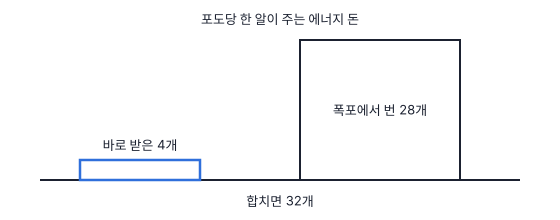

*짧은 테두리 막대가 바로 받은 4개, 긴 테두리 막대가 나중에 번 28개예요.*

**정확히 말하면**

포도당 1분자가 CO2와 물로 완전히 산화될 때 얻는 ATP를 단계별로 셈해요.

| 단계 | NADH | FADH2 | ATP(기질 수준 인산화) |
|---|---|---|---|
| 해당과정(세포질) | 2 | 0 | 2 |
| 피루브산 산화 | 2 | 0 | 0 |
| 시트르산 회로(포도당 1분자 = 2바퀴) | 6 | 2 | 2 |
| 합계 | NADH 10개 | FADH2 2개 | 4 |

1. 기질 수준 인산화(substrate-level phosphorylation): 인산기를 가진 물질이 ADP에 인산기를 직접 넘겨요. 해당과정 2개 + 시트르산 회로 2개 = 4개예요.
2. 포도당의 탄소 6개는 피루브산 산화와 시트르산 회로에서 모두 CO2 6개로 빠져나가요. 우리가 내쉬는 CO2가 이것이에요.
3. C–H 결합의 전자는 아직 NADH 10개와 FADH2 2개에 실려 있어요. 이 전자가 전자전달계에서 떨어져야 나머지 에너지를 쓸 수 있어요.
4. NADH는 복합체 1로, FADH2는 복합체 2로 전자를 넣어요. 두 길 모두 복합체 3으로 이어져요. NADH가 더 높은 곳에서 떨어뜨리므로 에너지를 더 많이 내요.
5. 산화적 인산화(oxidative phosphorylation): NADH 1개는 약 2.5 ATP, FADH2 1개는 약 1.5 ATP를 만들어요. 10 × 2.5 + 2 × 1.5 = 28개예요.
6. 따라서 전체는 28 + 4 = 32 ATP예요. 1몰 기준으로는 ATP 32몰이에요.

정리하면 32개 가운데 H+ 농도 기울기와 ATP 합성효소로 만드는 것(산화적 인산화)이 28개, 인산기를 직접 건네 만드는 것(기질 수준 인산화)이 4개예요.

**교수님 말씀**

NADH와 FADH2가 전자를 넣는 입구를 건물 높이로 비유하셨어요. NADH는 3층, FADH2는 2.5층에서 전자를 떨어뜨리니 NADH 쪽이 더 많이 낸다는 뜻이에요.

> 포도당 형님이 ATP 4개 만들 정도의 에너지만 가진 건 아니죠.

> 숫자를 꼼꼼하게 외울 필요는 없고, 대략 이렇게 되는구나 정도는 흐름을 이해를 하면 되고

> 전체 기질 수준에서 4개가 형성된다 정도는 살짝 알면 좋죠.

**꼭 기억해요**

- **착각:** 28개가 기질 수준 인산화, 4개가 산화적 인산화다. **바른 구분:** 28개가 산화적 인산화, 4개가 기질 수준 인산화예요. 교수님도 "총 28개가 기질 수준의 인산화"라고 했다가 "아 다시 다시"라며 바로잡으셨어요.
- **착각:** NADH는 8개다. **바른 구분:** 해당과정 2 + 피루브산 산화 2 + 시트르산 회로 6 = NADH 10개예요(정정).
- **착각:** "3층", "2.5층"은 진짜 층수다. **바른 구분:** 전자가 들어가는 입구가 복합체 1(NADH)이냐 복합체 2(FADH2)이냐의 차이를 높이로 비유한 말이에요.

**페이지 요약**

포도당 1분자에서 산화적 인산화 28개와 기질 수준 인산화 4개, 합쳐서 ATP 32개가 나와요.

*용어*

- **기질 수준 인산화** — 인산기를 ADP에 직접 건네는 방식, 4개
- **산화적 인산화** — H+ 기울기와 ATP 합성효소로 만드는 방식, 28개

---

### 화학삼투설과 최종 전자수용체

*0915 수업 · 2장 p3*

**쉽게 말하면**

물이 댐 뒤에 쌓였다가 물레방아를 돌리듯, 막 바깥에 쌓인 작은 알갱이가 돌아오는 힘으로 에너지 돈을 찍어요.

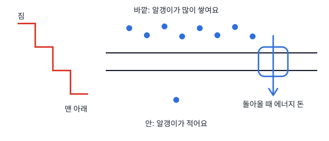

*빨간 계단선처럼 짐이 떨어지며 알갱이를 바깥으로 퍼내고, 알갱이가 테두리 통로로 돌아올 때 돈이 생겨요.*

**정확히 말하면**

**화학삼투설(chemiosmotic hypothesis)**은 1961년 영국의 미첼(Peter Mitchell)이 제안했고, 이 업적으로 노벨상을 받았어요. "전자전달계가 H+ 농도 기울기를 만들고, 이 기울기가 ATP 합성효소가 ATP를 만드는 에너지를 준다"는 이론이에요. 물이 막을 지나는 것이 삼투라면, 여기서는 H+가 막을 지나므로 화학삼투라고 불러요.

이론과 과정의 이름을 구분해요. ATP가 만들어지는 **과정**의 이름은 산화적 인산화이고, 그 원리를 설명하는 **이론**의 이름은 화학삼투설이에요.

1. 전자 흐름: NADH·FADH2의 전자가 전자전달계를 따라 떨어져요. 유비퀴논과 사이토크롬 c는 막에 박힌 큰 복합체 사이를 오가며 전자를 나르는 작은 운반체예요.
2. 기울기 형성: 떨어지는 전자의 에너지로 H+를 기질에서 내막 바깥으로 퍼내요. 그 결과 H+ 농도 기울기가 생겨요.
3. ATP 합성: H+가 ATP 합성효소를 지나 기질로 돌아올 때 ADP에 인산(Pi)이 붙어 ATP가 돼요.

세 가지는 짝을 이뤄요. 그래서 어느 하나만 망가져도 ATP가 거의 만들어지지 않아요.

- **전자 흐름이 막힌 경우**: 일산화탄소(담배 연기, 연탄가스)나 사이아나이드(청산가리) 계열이 전자전달을 방해하면 H+ 기울기가 생기지 않아 ATP를 만들 수 없고, 생명이 위험해져요.
- **전자는 흐르는데 기울기가 깨진 경우**: H+가 ATP 합성효소를 거치지 않고 막을 그냥 새어 돌아가면 기울기가 유지되지 않아요. 이때도 ATP 합성효소는 ATP를 거의 만들지 못해요. 전자가 흐른다고 ATP가 저절로 생기는 것이 아니에요.

ATP 합성효소(수업에서는 "ATP 생성효소"라고도 불렀어요)를 **직접** 돌리는 에너지원은 H+ 농도 기울기예요. 그 기울기를 만드는 전자는 호흡에서는 NADH, 곧 원래 포도당의 전자에서 오므로 포도당은 **궁극적인** 에너지원이에요.

전자의 종착점은 **산소**예요. 산소는 전자와 H+를 받아 물이 되며, 전자 4개가 들어가면 물 2분자가 생겨요. 산소가 최종 전자수용체(final electron acceptor)이기 때문에 우리 몸에 산소가 필요해요. 산소 없이 사는 세균 중에는 질산염이나 황산염을 전자수용체로 쓰거나, 발효로 살아가는 것도 있어요.

$$
\mathrm{O_2 + 4e^- + 4H^+ \rightarrow 2H_2O}
$$

**교수님 말씀**

유비퀴논과 사이토크롬 c를 덩어리진 복합체 사이를 오가는 "일종의 택배 시스템"이라고 부르셨어요.

전자가 흘러도 H+가 그냥 새면 어떻게 되는지 학생들에게 "ATP 생성이 된다, 안 된다?"라고 되물으셨어요. 수업 끝 문제 풀이에서는 ATP 합성효소를 직접 작동시키는 에너지원을 물으며, 궁극이 아니라 직접을 묻는 문제라고 짚으셨어요.

**꼭 기억해요**

- **착각:** 화학삼투설이 ATP가 생기는 과정의 이름이다. **바른 구분:** 화학삼투설은 이론, 산화적 인산화는 과정이에요.
- **착각:** 전자만 흐르면 ATP는 만들어진다. **바른 구분:** 전자전달이 막혀도, 전자가 흘러도 H+ 기울기가 깨지면 ATP가 거의 안 생겨요. 원인은 달라도 결과는 같아요.
- **착각:** ATP 합성효소를 직접 돌리는 에너지원은 포도당(또는 빛)이다. **바른 구분:** 직접은 H+ 농도 기울기, 궁극은 포도당이나 빛이 준 전자예요.
- **착각:** ATP 합성효소와 ATP 생성효소는 다른 효소다. **바른 구분:** 같은 효소의 두 이름이에요.

**보충 · 노트에 빠졌던 수업 내용**

식물 세포도 엽록체와 함께 미토콘드리아를 가지고 있어서, 동물처럼 세포호흡으로 ATP를 만들어요.

출처: 0910 수업

**페이지 요약**

전자 흐름이 H+ 기울기를 만들고, 그 기울기가 ATP 합성효소를 직접 돌려요. 전자의 종착점은 산소예요.

*핵심 식*

- 최종 전자수용체

  $$
  \mathrm{O_2 + 4e^- + 4H^+ \rightarrow 2H_2O}
  $$

*용어*

- **화학삼투설** — H+ 기울기가 ATP 합성 에너지를 준다는 미첼의 이론
- **최종 전자수용체** — 전자전달계 끝에서 전자를 받는 산소

---

## 1. 발효와 세포호흡의 효율

### 산소가 없으면 해당과정도 멈춘다

*0915 수업 · 2장 p3*

**쉽게 말하면**

손님을 내려 줄 정류장이 막히면 택시가 모두 손님을 태운 채 서 있어서, 새 손님을 한 명도 못 태워요.

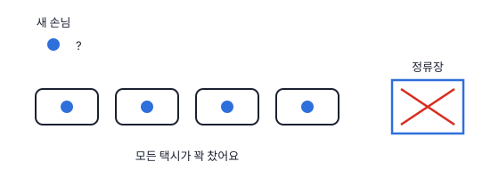

*정류장에 빨간 가위표가 쳐지면 택시마다 색칠된 점 손님이 내리지 못해 새 손님이 탈 자리가 없어요.*

**정확히 말하면**

교수님의 원칙은 "물질대사는 무조건 전자 흐름", 곧 전자가 어디로 가는지만 보면 된다는 것이에요. 산소가 없을 때 전자가 어디서 막히는지 차례로 따라가요.

1. 산소가 없으면 전자전달계의 마지막 복합체 4가 전자를 넘길 곳이 없어 전자를 든 환원된 상태로 남아요.
2. 그러면 복합체 3이 복합체 4에 전자를 못 넘기고, 이어서 복합체 1까지 차례로 막혀요.
3. NADH가 전자를 줄 곳이 없으니 NAD+로 돌아가지 못해요. 세포 안의 NAD+가 모두 NADH로 바뀐 채 남는 NAD+ 고갈이 일어나요.
4. 해당과정은 세포질에서 포도당의 전자를 NAD+에 실어야 진행되는데, 받을 NAD+가 없으니 해당과정이 멈춰요. 포도당이 넘쳐도 ATP를 하나도 만들 수 없게 돼요.

해당과정 자체는 산소를 직접 쓰지 않고, 미토콘드리아가 아닌 세포질에서 일어나요. 그런데도 멈추는 까닭은 산소가 아니라 NAD+가 없어서예요.

**해결책**: NAD+만 되살리면 적어도 해당과정은 다시 돌아가 ATP 2개를 얻어요. 그래서 NADH가 가까이 있는 피루브산에 전자를 "억지로" 주고 NAD+로 돌아가요. 이것이 [젖산 발효와 알코올 발효](#s1-fermentation)의 핵심이에요.

대가도 있어요. 피루브산이 미토콘드리아로 들어가지 못해 포도당 대사가 거기서 끝나요. ATP는 32개 대신 2개만 얻으니 효율이 1/16이지만, 0보다는 나아요.

**교수님 말씀**

NAD+를 택시, 전자를 손님으로 비유하셨어요. 모든 택시에 손님이 타 있으면 해당과정에서 새 손님을 태울 수 없어요. 광교역에서 셔틀버스를 타려는데 빈자리가 없는 상황과 같다고 하셨어요. 발효는 손님에게 "야, 여기서 내려라" 하고 억지로 내리게 하는 것이에요.

ATP 2개라도 얻는 것이 0보다 나은 이유는 로또로 설명하셨어요. 사지 않으면 당첨 확률이 0이지만 한 장이라도 사면 약 800만분의 1은 확보한다는 말이에요.

> 물질대사는 무조건 전자 흐름입니다, 전자 흐름.

> 전자가 어디로 가는지만 보면 돼요

**꼭 기억해요**

- **착각:** 산소가 없으면 전자전달계만 멈추고 해당과정은 그대로 돈다. **바른 구분:** NADH가 NAD+로 돌아가지 못해 NAD+가 고갈되므로 해당과정까지 멈춰요. 교수님이 여러 번 반복한 부분이에요.
- **착각:** 해당과정이 멈추는 건 해당과정이 산소를 직접 쓰기 때문이다. **바른 구분:** 해당과정은 산소를 쓰지 않아요. 전자를 받을 NAD+가 없어서 멈춰요.
- **착각:** 발효를 하면 부족한 ATP가 28개다. **바른 구분:** 32 − 2 = 30개가 모자라요. 교수님도 "28개를 더 만들어야 되는데, 30개를"이라며 고치셨어요.

**페이지 요약**

산소가 없으면 NAD+가 고갈되어 해당과정까지 멈추고, 발효는 NAD+를 되살려 ATP 2개라도 얻게 해요.

*용어*

- **NAD+ 고갈** — 모든 NAD+가 NADH로 남아 전자를 받을 운반체가 없는 상태

---

### 젖산 발효와 알코올 발효

*0915 수업 · 2장 p3*

**쉽게 말하면**

김치를 꾹꾹 눌러 공기를 빼면, 작은 생물이 짐을 가까운 곳에 내려놓고 다시 일하면서 새콤한 맛을 만들어요.

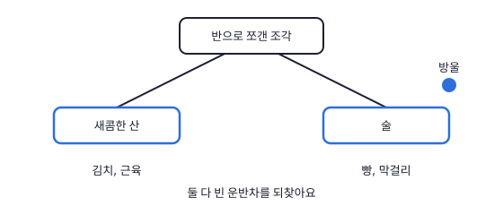

*왼쪽은 조각이 짐을 받아 새콤한 산이 되고, 오른쪽은 색칠된 방울이 먼저 빠진 뒤 술이 돼요.*

**정확히 말하면**

**발효(fermentation)**는 산소가 없을 때 해당과정에서 생긴 NADH가 전자를 전자전달계로 보내지 않고, 포도당이 분해되며 생긴 **중간 대사산물**(피루브산이나 아세트알데하이드)에 넘겨 NAD+를 되살리는 과정이에요. 세포호흡에서는 산소가 최종적으로 전자를 받고, 발효에서는 중간 대사산물이 받아요.

| 구분 | 전자를 받는 분자 | 산물 | 어디서 |
|---|---|---|---|
| 젖산 발효(lactic acid fermentation) | 피루브산 | 젖산, NAD+ | 유산균, 산소가 부족한 사람 근육 |
| 알코올 발효(alcohol fermentation) | 아세트알데하이드(피루브산에서 CO2가 먼저 빠진 것) | 에탄올, CO2, NAD+ | 효모 |
| 세포호흡(비교) | 산소(최종 전자수용체) | 물, ATP 32개 | 미토콘드리아 내막 |

1. 젖산 발효: 피루브산이 NADH의 전자를 받아 젖산이 되고, NADH는 NAD+로 돌아가요. 근육 피로의 원인 중 하나가 젖산 축적이고, 김치의 신맛도 젖산 때문이에요.
2. 알코올 발효: 효모는 가장 단순한 단세포 진핵생물이에요. 피루브산에서 CO2가 하나 떨어져 아세트알데하이드가 되고, 아세트알데하이드가 전자를 받아 에탄올(에틸 알코올)이 돼요. 원리(NAD+ 재생)는 젖산 발효와 같고 CO2가 빠지는 단계가 하나 더 있을 뿐이에요.
3. 빵을 부풀리는 것은 이 CO2이고, 에탄올은 발효주를 만드는 데 쓰여요.

**발효의 결과로 무엇이 생기나**: 발효 단계(피루브산 → 젖산, 아세트알데하이드 → 에탄올)가 직접 만드는 것은 되살아난 NAD+예요. NADH는 발효에서 만들어지는 쪽이 아니라 소모되는 쪽이에요. 발효하는 세포가 얻는 ATP 2개는 앞선 해당과정에서 만들어진 것이에요. NADPH는 광합성에서 쓰는 운반체라 발효와 관계없어요.

인간에게 유용하면 발효, 해로우면 부패라고 부르기도 하지만 이 구분은 중요하지 않아요. 중요한 것은 발효로 산소 없이도 살 수 있는 까닭, 곧 NAD+ 재생이에요. 김치를 담글 때 꾹꾹 눌러 공기를 빼는 것도 발효가 무산소 상태에서 일어나기 때문이에요.

**교수님 말씀**

김치를 담글 때 "꾹꾹 눌러줘야 돼요, 아니면 틈을 많이 줘야 돼요?"라고 물으신 뒤, 산소를 "없애야 되죠"로 정리하셨어요.

> 왜 발효를 해서 산소가 없이도 살 수가 있느냐? 그게 중요한 거죠.

막걸리 한 방울을 현미경으로 보면 동글동글한 효모가 보인다고 하셨어요.

**꼭 기억해요**

- **착각:** 젖산 발효와 알코올 발효 모두 피루브산이 전자를 받는다. **바른 구분:** 젖산 발효는 피루브산, 알코올 발효는 CO2가 먼저 빠진 아세트알데하이드가 전자를 받아요.
- **착각:** 발효에서도 산소가 최종 전자수용체다. **바른 구분:** 발효에서는 중간 대사산물이 전자를 받아요. 산소가 받는 것은 세포호흡이에요.
- **착각:** 발효의 목적은 ATP를 많이 만드는 것이다, 또는 발효가 NADH를 만든다. **바른 구분:** 발효 단계가 하는 일은 NADH를 NAD+로 되돌리는 것이에요. ATP 2개는 해당과정 몫이에요.
- **착각:** 유용하면 발효, 해로우면 부패라는 구분이 핵심이다. **바른 구분:** 그 구분은 중요하지 않다고 하셨어요.

**보충 · 수업에서 다루지 않았어요**

요구르트도 김치처럼 젖산균(유산균)이 산소가 적은 곳에서 젖산 발효를 해서 만들어요. 요구르트의 신맛은 이 젖산 때문이에요.

시험 보기에서는 젖산이 생기는 과정을 "무기호흡(무산소 호흡) 과정"이라고 적기도 해요. 엄밀히 말하면 이것은 발효예요. 무산소 호흡(anaerobic respiration)은 산소 대신 질산염·황산염 같은 다른 물질을 최종 전자수용체로 쓰며 전자전달계를 돌리는 과정이라 발효와 달라요(수업에서 질산염·황산염을 쓰는 세균을 언급). 그래도 "산소 없이 미생물이 젖산을 만든다"는 뜻으로 읽으면 신맛의 원인을 맞게 가리켜요.

출처: 강의노트 2장 p3("젖산균"), 교재 2장 p.43(젖산 발효·알코올 발효)

**페이지 요약**

발효는 NADH의 전자를 중간 대사산물에 넘겨 NAD+를 되살려요. 젖산 발효는 피루브산, 알코올 발효는 아세트알데하이드가 받아요.

*용어*

- **젖산 발효** — 피루브산 → 젖산, 김치의 신맛
- **알코올 발효** — 피루브산 → CO2 + 아세트알데하이드 → 에탄올

---

### 세포호흡의 에너지 효율 34%

*0915 수업 · 2장 p3*

**쉽게 말하면**

포도당 에너지의 3분의 1쯤만 쓸 수 있는 돈으로 바뀌고, 나머지는 따뜻한 열이 되어 몸을 데워요.

*색칠된 왼쪽 부분이 돈으로 바뀐 몫이고, 테두리만 있는 나머지는 열이에요.*

**정확히 말하면**

포도당 1몰은 686 kcal의 에너지를 가지고, ATP 32몰에 저장되는 에너지는 233.6 kcal이에요. 233.6 ÷ 686 ≈ 0.34이므로 약 34%, 곧 3분의 1쯤만 ATP에 담겨요.

- 나머지 약 66%는 열로 방출돼요. 에너지를 바꿀 때마다 일부가 열로 새는 것은 엔트로피 증가 법칙 때문이에요. 이 열은 체온을 유지하는 데 쓰여요.
- 기계와 비교하면, 강의노트의 가솔린 자동차 효율 25%는 옛날 값이고 요즘 하이브리드 등은 40% 가까이 나와요. 세포호흡의 효율은 요즘 자동차와 거의 비슷한 수준이에요.

여기까지가 세포호흡이에요.

**교수님 말씀**

"나머지는 다 어디로 갔냐?"고 물으시고 열로 방출된다고 받으셨어요. 강의노트의 자동차 효율 수치는 직접 고치셨어요.

> 3판을 내면은 고쳐야 돼. 자동차 효율 25%라고 쓰면 안 돼요

**꼭 기억해요**

- **착각:** 34%를 빼면 나머지는 60%다. **바른 구분:** 나머지는 약 66%예요. 수업에서 "나머지 60%"라고 한 것은 말실수예요. 강의노트의 "30% 이상"과 "34%"는 같은 사실을 다르게 쓴 거예요.
- **착각:** 자동차 효율은 25%라 세포가 훨씬 효율적이다. **바른 구분:** 교수님은 요즘 자동차가 약 40%라며 세포호흡과 거의 비슷하다고 고치셨어요.

**페이지 요약**

포도당 에너지의 약 34%만 ATP에 담기고, 나머지는 열이 되어 체온을 지켜요.

*용어*

- **효율 34%** — 686 kcal 중 233.6 kcal이 ATP 32몰에 저장

---

## 2. 광합성 개관

### 이화와 동화, 독립영양과 종속영양

*0915 수업 · 2장 p3–4*

**쉽게 말하면**

식물은 햇빛으로 자기 밥을 직접 짓고, 우리는 식물이 지은 밥을 얻어먹어요.

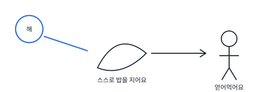

*테두리 해의 빛으로 잎이 밥을 짓고, 화살표처럼 사람은 그 밥을 얻어먹어요.*

**정확히 말하면**

- **이화 과정**(catabolism): 큰 분자를 쪼개며 에너지를 내놓아요. 세포호흡에서 포도당이 산화되는 것이 예예요.
- **동화 과정**(anabolism): 작은 분자를 붙여 큰 분자를 만들며 에너지가 필요해요. 광합성에서 작은 CO2를 붙여 포도당을 만드는 것이 예예요.

| 구분 | 뜻 | 예 |
|---|---|---|
| 독립영양생물(autotroph) | 필요한 유기분자를 CO2 같은 무기물로 스스로 만드는 생물 | 아래 두 종류 |
| 광독립영양생물(photoautotroph) | 독립영양 가운데 에너지를 빛에서 얻는 생물 | 식물, 광합성 조류 |
| 화학독립영양 | 독립영양 가운데 에너지를 무기물에서 얻는 생물. 빛 없이 무기물의 전자를 직접 떼어 써요 | 심해의 황산화세균 |
| 종속영양생물(heterotroph) | 유기분자를 스스로 만들지 못해 다른 생물이 만든 것에 기대는 생물 | 사람 |

독립영양생물은 생태계에서 **생산자**이고, 우리 같은 종속영양생물은 생산자에 의존해요. 광합성은 독립영양의 한 방식이므로, "독립영양 = 광합성"이라고 거꾸로 말할 수는 없어요. 화학독립영양은 빛을 쓰지 않아요.

**교수님 말씀**

세포호흡(이화)과 광합성(동화)을 먼저 맞세운 뒤, 빛 대신 무기물에서 전자를 떼어 사는 예로 심해의 황산화세균을 드셨어요. 그리고 우리는 종속영양생물로서 생산자에 기대 산다고 정리하셨어요.

**페이지 요약**

스스로 유기물을 만드는 독립영양생물이 생산자이고, 빛을 쓰면 광독립영양, 무기물을 쓰면 화학독립영양이에요.

*용어*

- **동화 과정** — 작은 분자를 붙여 큰 분자를 만듦, 에너지 필요
- **종속영양생물** — 다른 생물이 만든 유기물에 기대는 생물

---

### 광합성은 세포호흡을 거꾸로 돌린 것

*0915 수업 · 2장 p4*

**쉽게 말하면**

몸속 세포가 밥을 태울 때(세포호흡)는 밥에서 짐을 꺼내 공기에 내려놓고, 광합성은 거꾸로 물에서 짐을 꺼내 밥에 실어요.

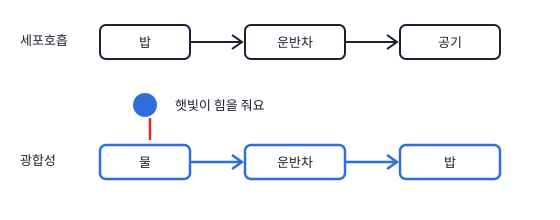

*위 줄은 밥에서 공기로, 아래 줄은 물에서 밥으로 짐이 가요. 아래 줄만 색칠된 해가 힘을 줘요.*

**정확히 말하면**

교수님은 "전체적인 흐름이 중요하다"며 두 과정의 전자 흐름을 나란히 놓으셨어요.

| 구분 | 세포호흡 | 광합성 |
|---|---|---|
| 전자 흐름 | 포도당 → NADH → 전자전달계 → 산소(→ 물) | 물 → NADPH → 포도당 |
| 전자 운반체 | NADH(받기 전 NAD+) | NADPH(받기 전 NADP+). NADH에 인산기가 하나 더 붙은 것 |
| 탄소 | 포도당의 탄소가 CO2로 나감 | CO2의 탄소가 포도당으로 들어감 |
| ATP | 만들어짐 | 포도당을 만드는 쪽에서는 소모됨 |
| 물과 산소 | 산소가 전자를 받아 물이 됨 | 물이 전자를 내주고 산소가 됨 |

CO2 6개가 포도당이 되려면 전자가 **들어가야** 하고 ATP도 **소모되어야** 해요. 그 전자는 물에서 나오고, NADP+가 받아 NADPH가 되어 CO2까지 실어 가요. 한 줄로 쓰면 호흡은 "포도당 → NADH → 산소", 광합성은 "물 → NADPH → 포도당"이에요.

광합성은 두 단계로 나뉘어요.

1. **광의존반응(light-dependent reaction)**, 옛 이름 **명반응**: 햇빛 에너지로 물의 전자를 떼어 ATP와 NADPH를 만들어요. 이때 물에서 산소가 나와요. 자세한 과정은 [광계와 물의 광분해](#s3-photosystem)에서 봐요.
2. **광독립반응(light-independent reaction)**, 옛 이름 **암반응**: ATP와 NADPH, CO2만 있으면 포도당이 만들어져요. 빛이 **직접** 필요하지는 않아요. 자세한 과정은 [캘빈 회로의 세 단계](#s4-calvin)에서 봐요.

두 단계를 잇는 분자는 **ATP와 NADPH**예요. 명반응이 만든 ATP와 NADPH를 암반응이 받아 CO2를 포도당으로 바꾸고, 다 쓰고 남은 ADP와 NADP+는 다시 명반응으로 돌아가요. 수업 끝 문제 풀이에서도 두 반응을 연결하는 분자가 ATP와 NADPH라고 확인하셨어요. 반면 G3P와 RuBP는 암반응(캘빈 회로) 안에서 도는 물질이라 두 반응을 잇지 않아요.

**교수님 말씀**

> 자, 전체적인 흐름이 중요하다 그랬죠, 흐름.

> 이것만 알면은 일단 한 절반 정도는 한 겁니다.

호흡을 거꾸로 돌리는 그림 하나만 이해하면 "요 골격"에 살만 붙이면 된다고 하셨어요.

**꼭 기억해요**

- **착각:** 광합성에서는 ATP가 만들어지기만 한다. **바른 구분:** 명반응에서는 ATP가 만들어지고, CO2로 포도당을 만드는 쪽(암반응)에서는 ATP가 소모돼요. 교수님도 "ATP가 생성이 되는 것이 아니고 ATP가 역시 들어가야 돼요"라고 고치셨어요.
- **착각:** 광합성도 NADH를 쓴다. **바른 구분:** 호흡은 NADH, 광합성은 NADPH예요(정정).
- **착각:** 암반응은 어두울 때만 일어난다. **바른 구분:** 빛이 직접 필요 없다는 뜻이에요. 그래서 지금은 광독립반응이라고 불러요.
- **착각:** 광합성에서 나오는 산소는 CO2에서 온다. **바른 구분:** 산소는 전자를 내준 물에서 나와요. CO2의 탄소는 포도당으로 들어가요.

**보충 · 수업에서 다루지 않았어요**

수업은 전체 반응식을 말로("호흡을 거꾸로")만 설명했어요. 계수까지 쓴 전체 반응식은 다음과 같아요.

광합성:

$$
\mathrm{6CO_2 + 6H_2O + \text{빛에너지} \rightarrow C_6H_{12}O_6 + 6O_2}
$$

세포호흡(비교):

$$
\mathrm{C_6H_{12}O_6 + 6O_2 \rightarrow 6CO_2 + 6H_2O + \text{에너지(ATP)}}
$$

두 식은 화살표 방향만 바꾼 모양이에요. 광합성식에서 반응물은 CO2·물·빛, 산물은 포도당·산소예요. 산소가 반응물 쪽에 있거나 포도당이 반응물 쪽에 있는 식은 광합성이 아니에요. 또 광합성에서 물 6개와 CO2 6개가 들어가 포도당 1개와 산소 6개가 나오므로, 계수가 맞지 않는 식(예: 산소 1개와 물 1개로 포도당과 CO2를 만드는 식)도 광합성이 아니에요.

출처: 교재 2장 p.37(세포호흡 전체 반응식), p.44 그림 2.16(광합성의 반응물 H2O·CO2와 생성물 O2·당)

**페이지 요약**

광합성은 물 → NADPH → 포도당으로 전자를 흘려 호흡을 거꾸로 돌려요. 명반응의 ATP와 NADPH가 암반응을 움직여요.

*핵심 식*

- 광합성 전체

  $$
  \mathrm{6CO_2 + 6H_2O + \text{빛에너지} \rightarrow C_6H_{12}O_6 + 6O_2}
  $$

*용어*

- **광의존반응(명반응)** — 빛으로 ATP와 NADPH를 만듦, 산소 발생
- **광독립반응(암반응)** — ATP와 NADPH로 CO2를 포도당으로

---

## 3. 광의존반응(명반응)

### 엽록체와 광합성 색소

*0915 수업 · 2장 p4*

**쉽게 말하면**

잎이 초록으로 보이는 건 잎의 색소가 빨강과 파랑 빛은 먹고 초록 빛만 튕겨 내기 때문이에요.

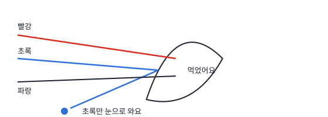

*빨강, 파랑이라고 적힌 두 선은 잎 안에서 끝나고, 초록이라고 적힌 선만 꺾여 나와 색칠된 점의 눈에 닿아요.*

**정확히 말하면**

**엽록체의 구조**: 엽록체는 외막과 내막, 그리고 그 안에 따로 있는 세 번째 막인 **틸라코이드 막**으로 이루어져요. 광합성 색소인 엽록소는 틸라코이드 막에 박혀 있어요. 틸라코이드 바깥, 내막 안쪽을 채운 액체 부분이 **스트로마**예요(0910에 배운 구조).

**광합성 색소**: 엽록소 a와 엽록소 b 말고도 카로티노이드, 크산토필 같은 색소가 있어요. 식물이 초록으로 보이는 까닭은 엽록소가 초록 빛을 광합성에 쓰지 않고 반사하기 때문이에요. 카로티노이드는 노랑·주황을 띠어서, 가을에 엽록소가 빠지고 카로티노이드만 남으면 잎이 주황색으로 보여요.

| 그래프 | 무엇을 재나 | 어떻게 |
|---|---|---|
| 흡수 스펙트럼(absorption spectrum) | 파장마다 색소가 빛을 얼마나 흡수하는지(흡광도) | 색소를 분리해 분광광도계(스펙트로포토미터)로 측정 |
| 작용 스펙트럼(action spectrum) | 파장마다 실제로 광합성이 얼마나 일어나는지 | 파장별 빛을 비추고 만들어진 포도당이나 산소의 양을 측정 |

- 흡수 스펙트럼에서 엽록소 b는 파란색과 약간의 주황색 빛을, 엽록소 a는 더 빨간 쪽과 보라에 가까운 파란색 빛을 잘 흡수해요. 초록 빛은 거의 흡수하지 않아요.
- 작용 스펙트럼은 흡수 스펙트럼과 거의 일치해요. 색소가 빛을 흡수해야 광합성이 일어나기 때문이에요.

**교수님 말씀**

0910에 이어 틸라코이드를 녹차 초코파이에 비유하셨어요. 초코파이가 녹차색인 까닭은 엽록소가 박혀 있어서라고 하셨어요.

**꼭 기억해요**

- **착각:** 흡수 스펙트럼과 작용 스펙트럼은 같은 것을 잰다. **바른 구분:** 흡수 스펙트럼은 "어떤 파장을 흡수하느냐"(흡광도), 작용 스펙트럼은 "실제 광합성이 어떤 파장에서 많으냐"(산소·포도당 양)예요. 모양이 비슷한 까닭은 흡수해야 광합성이 되기 때문이에요. 교수님이 두 번 반복해 대비하셨어요.
- **착각:** 잎이 초록인 건 초록 빛을 가장 많이 흡수해서다. **바른 구분:** 초록 빛은 흡수하지 않고 반사해서 초록으로 보여요.
- **착각:** 카로티노이드는 주황색 빛을 흡수한다. **바른 구분:** 주황은 카로티노이드가 반사해서 보이는 색이에요. 수업에서 "주황색… 흡수"처럼 들린 부분은 말실수로 보여요.

**보충 · 노트에 빠졌던 수업 내용**

잎이 녹색으로 보이는 주된 색소는 엽록소예요. 엽록소 말고도 카로티노이드 같은 색소가 함께 있어요.

출처: 0915 수업

사람은 셀룰로오스를 분해하지 못해서 연료로 쓰지 못해요. 잎을 먹어도 셀룰로오스에서는 에너지를 얻지 못해요.

출처: 0903 수업

**페이지 요약**

엽록소는 틸라코이드 막에 박혀 빨강·파랑 빛을 흡수하고 초록을 반사해요. 흡수 스펙트럼과 작용 스펙트럼은 거의 일치해요.

*용어*

- **흡수 스펙트럼** — 파장별 흡광도
- **작용 스펙트럼** — 파장별 실제 광합성량(산소·포도당)

---

### 광계와 물의 광분해

*0915 수업 · 2장 p4*

**쉽게 말하면**

여러 색소가 파도타기 응원처럼 빛 힘을 옆으로 넘겨 한가운데로 모으면, 한가운데가 짐을 던져 주고 모자란 짐은 물에서 빼 와요.

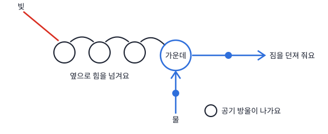

*테두리 원들이 곡선을 따라 힘을 가운데로 넘기고, 가운데는 색칠된 짐을 던져 준 뒤 물에서 짐을 채워요.*

**정확히 말하면**

교수님은 생물 2를 배우지 않았다면 처음 듣는 네 용어로 광계, 안테나 복합체, 반응 중심, 틸라코이드 막을 꼽으셨어요.

- **광계(photosystem)**: 안테나 복합체와 반응 중심을 합친 것이에요. 둘 다 엽록소와 여러 단백질이 뭉친 집합체이고 틸라코이드 막에 박혀 있어요. 광계 1과 광계 2 두 종류가 있어요.
- **안테나 복합체(antenna complex)**: 카로티노이드, 엽록소 같은 색소가 잔뜩 모여 빛을 흡수하고 그 에너지를 반응 중심으로 모아요.
- **반응 중심(reaction center)**: 모인 에너지를 받는 특별한 엽록소가 있어요. 광계 2의 반응 중심 엽록소는 P680, 광계 1은 P700이에요. 숫자는 빛을 가장 잘 흡수하는 파장(nm)이에요.

1. **에너지 전달**: 색소가 빛에너지를 받으면 전자가 한 단계 높은 에너지 궤도로 올라가 **들뜬 상태**가 돼요. 그 전자가 바닥 상태로 떨어지며 내놓은 에너지를 옆 엽록소에 넘기고, 옆 엽록소의 전자가 다시 들떠요. 이것이 반복되어 에너지가 반응 중심까지 가요(유도공명). 이때 옆으로 가는 것은 에너지뿐이고 전자는 제자리로 돌아와요.
2. **전자 내보내기**: 반응 중심 엽록소도 전자가 들뜨지만, 바닥 상태로 떨어지지 않고 전자 자체를 최초 수용체에게 아예 줘 버려요.
3. **물의 광분해**: 전자를 잃은 P680(광계 2)은 물에서 전자를 빼 와 채워요. 전자를 빼앗긴 물은 갈라져 H+와 산소가 돼요. 영상 해설로는 물 1분자가 전자 2개를 내고 H+ 2개와 산소 1/2분자로 갈라져요.

$$
\mathrm{H_2O \rightarrow 2H^+ + 2e^- + \tfrac{1}{2}O_2}
$$

그래서 광의존반응의 핵심 화학 과정은 **물의 분해와 전자의 방출**이에요. ATP는 이 단계에서 분해되는 것이 아니라 만들어지는 쪽이에요. 광합성에서 나오는 산소의 기원은 물이고, CO2나 포도당, NADPH가 아니에요. 산소는 명반응에서 생겨요.

호흡과 방향이 반대예요. 호흡에서는 산소가 전자를 받아 물이 되고, 광합성에서는 물이 전자를 잃고 산소가 돼요. 지구의 산소는 광합성 생물이 만들었고, 광합성이 생기기 전 지구에는 산소가 없었어요.

**교수님 말씀**

안테나가 전파를 받듯 안테나 복합체는 빛을 받는다고 하셨어요. 엽록소끼리 에너지를 넘기는 모습은 파도타기 응원에 비유하셨어요. 한 사람이 앉았다 일어나면 뒷사람이 이어서 앉았다 일어나는 식이에요.

최초 수용체가 정확히 무엇인지는 "그 이름까지는 몰라도 되고"라며 넘어가셨어요. 에너지가 옆으로 넘어가는 유도공명의 원리도 "뭐 잘 모르겠고, 하여튼"이라며 자세히 설명하지 않으셨어요.

**꼭 기억해요**

- **착각:** 모든 색소가 들뜬 전자를 옆으로 넘긴다. **바른 구분:** 안테나의 색소는 전자가 바닥 상태로 돌아오며 **에너지만** 옆으로 넘겨요. 반응 중심 엽록소만 **전자 자체**를 최초 수용체에 줘요.
- **착각:** 광합성에서도 산소가 분해되어 물이 된다. **바른 구분:** 호흡은 산소 → 물, 광합성은 물 → 산소예요.
- **착각:** 반응 중심은 엽록체다. **바른 구분:** 반응 중심에 있는 것은 엽록소(P680, P700)예요. 수업의 "반응 중심의 엽록체"는 말실수예요.

**페이지 요약**

안테나가 모은 빛에너지로 반응 중심이 전자를 내보내고, 광계 2는 잃은 전자를 물에서 채워 산소를 내요.

*핵심 식*

- 물의 광분해

  $$
  \mathrm{H_2O \rightarrow 2H^+ + 2e^- + \tfrac{1}{2}O_2}
  $$

*용어*

- **광계** — 안테나 복합체 + 반응 중심
- **P680·P700** — 광계 2·광계 1의 반응 중심 엽록소

---

### 명반응의 전자 흐름과 ATP 합성

*0915 수업 · 2장 p4–5*

**쉽게 말하면**

물에서 나온 짐은 2번 정거장, 1번 정거장 순서로 달려 마지막 짐차에 실리고, 가는 길에 퍼 올린 알갱이가 빠져나올 때 에너지 돈이 생겨요.

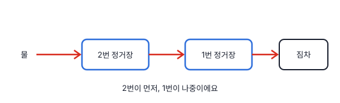

*빨간 화살표를 따라 물의 짐이 2번 정거장에 먼저 들르고 1번 정거장을 지나 짐차에 실려요.*

**정확히 말하면**

틸라코이드 막에는 광계, 전자전달계, ATP 합성효소가 모두 박혀 있어요. 물의 전자가 흐르는 길은 다음과 같아요.

1. **물 → 광계 2**: 물의 광분해는 광계 2에서 일어나요. 햇빛이 반응 중심 엽록소의 전자를 더 높은 에너지 수준으로 올리면(들뜬 상태) 그 전자가 최초 수용체로 나가고, 빈자리는 물의 전자로 채워져요. 물에서는 산소와 H+가 생겨요.
2. **광계 2 → 전자전달계**: 전자는 플라스토퀴논을 거쳐 전자전달계로 가요. 미토콘드리아처럼 전자를 더 좋아하는 순서로 넘기고, 전자가 떨어지며 나온 에너지로 H+를 틸라코이드 **안쪽**으로 퍼내요.
3. **전자전달계 → 광계 1**: 광계 1도 안테나가 모은 에너지로 반응 중심이 전자를 내보내요. 광계 1이 잃은 전자는 광계 2에서 온 전자(원래 물의 전자)로 채워요.
4. **광계 1 → NADP+**: 광계 1에서 나간 전자는 마지막 전자수용체인 NADP+까지 가요. NADP+는 전자와 H+를 함께 받아 NADPH가 돼요. NADPH는 이 전자를 캘빈 회로로 실어 가요.
5. **ATP 합성**: 틸라코이드 안쪽에 쌓인 H+가 ATP 합성효소를 지나 바깥, 곧 스트로마로 빠져나올 때 ADP와 인산이 ATP가 돼요. 그래서 ATP는 틸라코이드 막의 바깥쪽인 **스트로마**에서 생겨요. 이 ATP는 스트로마의 캘빈 회로에서 쓰여요.

*빨간 선이 전자의 길(물 → 광계 2 → PQ(플라스토퀴논) → 전자전달계 → 광계 1 → NADP+)이에요. 색칠된 점(H+)이 틸라코이드 안쪽에 쌓였다가 오른쪽 ATP 합성효소를 지나 스트로마로 나올 때 ATP가 생겨요.*

명반응의 목적은 NADPH와 ATP를 만드는 것이에요. 전자의 출처는 물이고, 물에서 전자를 떼는 에너지는 빛이에요. 전자의 최종 전자수용체는 호흡에서는 산소, 명반응에서는 NADP+예요.

| 구분 | 미토콘드리아(세포호흡) | 엽록체(명반응) |
|---|---|---|
| H+를 퍼내는 곳 | 기질 → 막 바깥쪽(내막과 외막 사이) | 스트로마 → 틸라코이드 안쪽 |
| ATP가 생기는 곳 | H+가 기질(안)로 돌아올 때, 기질 쪽 | H+가 스트로마(밖)로 나갈 때, 스트로마 쪽 |
| 전자의 출발과 끝 | NADH → 산소 | 물 → NADP+ |

역할을 나눠 보면: 빛에너지를 흡수하는 것은 색소(안테나), 물을 분해하는 것은 광계 2, ADP를 ATP로 인산화하는 것은 ATP 합성효소, 전자를 받아 두는 것은 NADP+예요. NADP+가 빛을 흡수하거나 물을 쪼개지는 않아요.

**교수님 말씀**

> 방향만 반대입니다, 방향만.

> 애초에 물의 광분해가 일어나는 곳은 광계 2입니다, 2.

광계 1이 먼저 발견되어 번호가 붙었기 때문에 이름이 거꾸로라고 설명하셨어요. 영상 그림을 보면서는 "지금 위쪽이 안쪽이에요"라고 방향을 짚으셨어요.

> 이게 명반응입니다, 명반응. 별 거 없죠?

> 전자가 어디서 뭘 거쳐서 어디로 흐르는지 그것만 파악하면은 세포, 광합성은 큰 문제가 없습니다.

**꼭 기억해요**

- **착각:** 번호 순서대로 전자가 광계 1 → 광계 2로 흐른다. **바른 구분:** 전자는 광계 2 → 광계 1로 흘러요. 물의 광분해도 광계 2에서 일어나요. 교수님이 네 번 반복하셨어요.
- **착각:** 엽록체도 미토콘드리아처럼 H+를 바깥으로 퍼내고 안으로 들어올 때 ATP를 만든다. **바른 구분:** 엽록체는 틸라코이드 안쪽으로 퍼냈다가 밖(스트로마)으로 나갈 때 ATP를 만들어요.
- **착각:** ATP는 H+가 쌓인 틸라코이드 안쪽에서 생긴다. **바른 구분:** ATP는 틸라코이드 막의 바깥쪽인 스트로마에서 생겨요. 교수님이 두 번 반복하셨어요.
- **착각:** 명반응의 산물은 산소와 포도당이다. **바른 구분:** 명반응이 암반응에 넘기는 두 산물은 ATP와 NADPH예요. 교수님이 "아까 명반응에서 만들어진 두 가지가 뭐였지?"라고 되물으셨어요. 산소는 물에서 나오는 부산물이고, 포도당은 캘빈 회로에서 만들어요.

**페이지 요약**

물의 전자는 광계 2 → 전자전달계 → 광계 1 → NADP+로 흘러 NADPH가 되고, 틸라코이드 안쪽에 쌓인 H+가 스트로마로 나가며 ATP를 만들어요.

*용어*

- **NADP+** — 명반응의 마지막 전자수용체, 전자와 H+를 받아 NADPH
- **플라스토퀴논** — 광계 2 다음에 전자를 받는 운반체

---

## 4. 광독립반응(캘빈 회로)과 광호흡

### 캘빈 회로의 세 단계

*0915 수업 · 2장 p5*

**쉽게 말하면**

회전목마가 한 바퀴 돌 때마다 공기에서 탄소 조각을 하나씩 태우고, 여섯 바퀴를 돌면 설탕 한 알이 완성돼요.

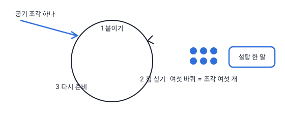

*테두리 원이 한 바퀴 돌 때마다 공기 조각 하나가 타고, 색칠된 조각 여섯 개가 모이면 설탕 한 알이 돼요.*

**정확히 말하면**

명반응의 ATP가 스트로마에서 생기므로 포도당 합성도 **스트로마**에서 일어나요. 포도당을 직접 만드는 이 경로가 **캘빈 회로(Calvin cycle)**예요. 회로에서 전자는 NADPH가, 에너지는 ATP가 대요. 그래서 캘빈 회로에 반드시 들어가는 재료는 CO2, ATP, NADPH 세 가지예요. FAD(FADH2)는 세포호흡의 시트르산 회로에서 쓰는 전자운반체라 캘빈 회로의 투입물이 아니에요.

1. **탄소 고정**(carbon fixation): 잎의 기공으로 들어온 CO2가 탄소 5개와 인산기 2개를 가진 RuBP(리불로스 1,5-이인산)에 붙어요. 떠돌던 CO2가 유기물에 합류하는 단계예요. 붙으면 탄소 6개짜리가 되지만 생기자마자 반으로 쪼개져 3-인산글리세르산(PGA) 2분자가 돼요. 이 첫 안정한 산물의 탄소 수가 3개예요.
2. **환원**(reduction): PGA가 ATP에서 인산기를 받고 NADPH에서 전자를 받아, 산(글리세르산)에서 알데하이드인 G3P(글리세르알데하이드 3-인산)가 돼요. NADPH에 의한 환원의 결과물이 G3P예요. G3P 2분자가 모이면 포도당 1분자가 돼요.
3. **RuBP 재생**(regeneration): G3P를 모두 포도당으로 쓰면 회로가 끝나 더 이상 CO2를 받을 수 없어요. 그래서 G3P 일부로 RuBP를 다시 만들어요.

세 단계 모두 스트로마에서 일어나요. 한 바퀴에 CO2는 1개만 들어와요. 포도당에는 탄소 6개가 필요하므로 CO2가 6번 들어가야, 곧 **6바퀴**를 돌아야 포도당 1분자가 생겨요. 거꾸로 말하면 한 바퀴가 만드는 것은 포도당 한 분자가 아니라 탄소 하나만큼, 곧 탄수화물 한 단위예요. 캘빈 회로는 ATP와 NADPH를 **쓰는** 쪽이지 만드는 쪽이 아니에요.

**교수님 말씀**

3-인산글리세르산의 약자 PGA를 프로 골프 협회(PGA)로 외우게 하셨어요. "5탄당이 탄소 하나를 만났으니 몇 탄당?" 하고 물은 뒤 "6이 되겠지요"로 받으셨어요.

> 자, 외우지는 못해도 그래도 대략 어떻게 되는지는 봐야겠죠?

ATP와 NADPH가 회로의 어느 단계에서 정확히 들어가는지는 "몰라도 됩니다. 나도 몰라"라며 넘어가셨어요.

**꼭 기억해요**

- **착각:** CO2가 RuBP에 붙으면 6탄소 화합물이 남는다. **바른 구분:** 생기자마자 반으로 쪼개져 3탄소 PGA 2개가 돼요. "6탄당이 없어. 3탄당 두 개가 있어". 엄밀히 PGA는 당이 아니라 산이에요.
- **착각:** 한 바퀴 돌면 포도당 한 분자가 생긴다. **바른 구분:** 한 바퀴에 CO2 1개, 곧 탄소 하나만큼이에요. 포도당 1분자는 6바퀴예요.
- **착각:** 환원 단계에서 글리세르알데하이드가 글리세르산이 된다. **바른 구분:** 방향이 반대예요. NADPH의 전자를 받아 산(글리세르산)이 알데하이드(글리세르알데하이드)가 돼요.
- **착각:** 캘빈 회로에서 ATP와 NADPH가 만들어진다. **바른 구분:** 만드는 곳은 명반응이고, 캘빈 회로는 쓰는 곳이에요.

**보충 · 수업에서 다루지 않았어요**

강의노트와 교재는 캘빈 회로의 산물을 "(CH2O)n의 탄수화물"로 적어요. CH2O가 탄수화물 한 단위(탄소 1개)이고, 한 바퀴에서 CO2 1개가 고정되어 이 한 단위만큼 생겨요. 교재는 한 바퀴를 다음처럼 요약해요.

$$
\mathrm{CO_2 + 2NADPH + 3ATP \rightarrow (CH_2O) + 2NADP^+ + 3ADP + 3P_i}
$$

그래서 한 바퀴에 ATP 3개와 NADPH 2개가 쓰여요. G3P는 탄소 3개라 3바퀴를 돌아야 G3P 1개를 회로 밖으로 내보낼 수 있고, 포도당 1분자(탄소 6개)에는 6바퀴가 필요해요.

출처: 강의노트 2장 p4("(CH2O)n의 탄수화물이 생성"), 교재 2장 p.49–50

#### 직접 해 보기: 캘빈 회로 바퀴 세기 *(정적 스냅샷 — 직접 조작은 HTML 버전)*

바퀴 수를 움직이면 고정된 CO2, 회로 밖으로 내보낸 G3P, 완성된 포도당 수가 막대로 보여요. 한 바퀴에 ATP 3개·NADPH 2개를 쓰는 값은 보충의 교재 식(교재 2장 p.50) 기준이에요.

고정된 CO2(탄수화물 한 단위): **3개** · 내보낸 G3P: **1개** · 포도당: **0개** · 쓴 ATP **9개**, 쓴 NADPH **6개**

범례: 막대 길이는 탄소 개수에 비례해요(한 칸 = 탄소 1개)

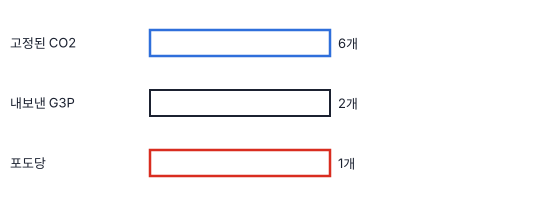

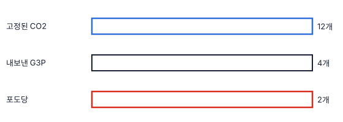

| 바퀴 수 | 고정된 CO2(탄수화물 단위) | 내보낸 G3P | 포도당 | 쓴 ATP | 쓴 NADPH |
|---|---|---|---|---|---|
| 3 | 3 | 1 | 0 | 9 | 6 |
| 6 | 6 | 2 | 1 | 18 | 12 |
| 12 | 12 | 4 | 2 | 36 | 24 |

**페이지 요약**

캘빈 회로는 스트로마에서 탄소 고정 → 환원 → RuBP 재생을 돌며, 한 바퀴에 CO2 1개를 고정하고 6바퀴에 포도당 1분자를 만들어요.

*용어*

- **RuBP** — CO2가 붙는 5탄소 받개
- **G3P** — PGA가 NADPH로 환원되어 생긴 3탄소 알데하이드

---

### 광호흡과 C4·CAM 식물

*0915 수업 · 2장 p5*

**쉽게 말하면**

더운 날 잎이 물을 아끼려고 입을 꼭 다물면 안에 공기 조각이 모자라서, 일꾼이 엉뚱한 조각을 집어 헛수고를 해요.

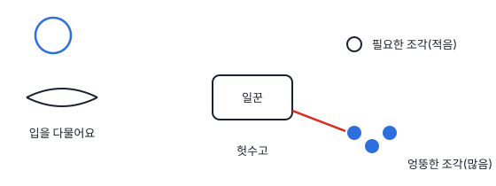

*테두리 원 조각이 모자라니 일꾼이 빨간 선처럼 색칠된 엉뚱한 조각을 집어 헛수고를 해요.*

**정확히 말하면**

**기공**은 주로 잎 뒷면에 있는 작은 구멍이에요. CO2가 들어오고 O2가 나가며, 물도 수증기로 빠져나가요. 물이 수증기로 나가는 것이 **증산 작용**이에요. 식물은 물을 아껴야 하므로 덥고 건조한 날이나 밤에는 기공을 닫아요.

1. 기공을 닫은 채 광합성(명반응)을 계속하면 잎 안에 CO2는 줄고, 물에서 나온 O2는 쌓여요.
2. 캘빈 회로의 첫 효소인 **루비스코(Rubisco)**(RuBP carboxylase/oxygenase)는 원래 기질 RuBP에 CO2를 붙이는 효소예요. 그런데 CO2가 적고 O2가 많으면 "착각"해 CO2 대신 O2를 기질로 붙여요.
3. 그 결과 독성 물질이 생기고, 이를 없애는 데 에너지를 또 써요. 이 과정이 **광호흡(photorespiration)**이에요.

루비스코는 효소이고, RuBP는 CO2(또는 O2)가 붙는 5탄소 받개예요. 광호흡에서 루비스코가 RuBP를 만드는 것이 아니에요. 광합성이 처음 생겼을 때 지구에는 산소가 없었어요. 루비스코가 산소와 결합하도록 진화한 것이 아니라, 산소가 많아지면서 어쩌다 그렇게 된 것이에요.

산소와 반응하므로 "호흡"이라는 이름이 붙었지만, 에너지(ATP)를 내는 세포호흡과 달리 에너지를 **소모**해요. 온대 식물은 덥고 건조한 날 광호흡이 늘어 성장이 떨어져요.

건조한 곳의 식물은 이를 막는 특별한 회로가 있어요. **C4 식물**(사탕수수, 옥수수)과 **CAM 식물**(선인장)은 CO2를 저장했다가 꺼내 쓰는 시스템이 있어 기공을 닫아도 크게 걱정이 없어요. 수업에서는 사탕수수·옥수수·선인장을 한데 말했지만, 사탕수수와 옥수수는 C4 식물, 선인장은 CAM 식물이에요.

**교수님 말씀**

숲이 시원한 이유 중 하나가 증산 작용이라고 하셨어요. 땀이 식으며 체온을 빼앗듯, 식물도 물이 증발하며 기화열을 빼앗아요.

범위도 정해 주셨어요. "광호흡 개념까지만 얘기를 하고 나머지는 안 봐도 됩니다", "C4 회로니 이런 거는 몰라도 되고".

> 이산화탄소를 저장했다가 빼는 시스템이 있기 때문에 별로 걱정을 안 해도 된다. 그 정도만 알면 됩니다.

**꼭 기억해요**

- **착각:** 광호흡도 세포호흡처럼 ATP를 만들어 성장을 돕는다. **바른 구분:** 광호흡은 이름만 호흡이고 에너지를 소모해요.
- **착각:** 루비스코는 원래 O2를 붙이는 효소다. **바른 구분:** 원래는 CO2를 붙이는 효소예요. CO2가 적고 O2가 많을수록 O2를 붙이는 일이 늘어요.
- **착각:** 기공을 닫으면 잎 안에 CO2가 늘어 캘빈 회로가 빨라진다. **바른 구분:** CO2는 줄고 O2가 쌓여 광호흡이 늘어요.
- **착각:** 선인장은 C4 식물이다. **바른 구분:** 선인장은 CAM 식물이에요. 사탕수수·옥수수가 C4 식물이에요.

**보충 · 수업에서 다루지 않았어요**

교수님은 C4 회로를 "몰라도 된다"고 하셨지만, 이름의 뜻과 CAM의 방식은 기출에 나와서 짧게 보충해요. 수업에서 생략했다는 것이 시험에 안 나온다는 뜻은 아니에요.

- **C3와 C4라는 이름**: CO2가 처음 고정되어 생긴 첫 번째 안정한 분자의 탄소 수로 붙인 이름이에요. 보통 식물(C3 식물)은 캘빈 회로에서 CO2가 RuBP에 붙어 곧바로 3탄소 PGA가 되므로 C3예요. C4 식물은 CO2를 먼저 3탄소 분자(PEP)에 붙여 4탄소 화합물(옥살아세트산)로 고정해 저장했다가 캘빈 회로에 넘기므로 C4예요.
- **CAM 식물**: 선인장처럼 낮에는 뜨겁고 건조하며 밤에는 서늘한 사막 환경에 잘 적응한 식물이에요. 밤에만 기공을 열어 CO2를 받아 저장해 두고, 낮에는 기공을 닫아 물을 아끼면서 저장한 CO2로 캘빈 회로를 돌려요. C4 식물도 더운 곳에 강하지만, 낮에 고온 건조한 사막의 대표는 CAM 식물이에요.
- 루비스코의 두 기능을 교재는 카복실화효소(CO2를 붙임)와 산소화효소(O2를 붙임) 활성이라고 불러요.

출처: 교재 2장 p.50–51(C4 회로, CAM 식물), 강의노트 2장 p5

**페이지 요약**

기공이 닫혀 CO2가 줄고 O2가 쌓이면 루비스코가 O2를 붙여 에너지를 낭비하는 광호흡이 늘어요. C4·CAM 식물은 CO2를 저장해 이를 피해요.

*용어*

- **광호흡** — 루비스코가 O2를 붙여 에너지를 소모하는 과정
- **CAM 식물** — 밤에 기공을 열어 CO2를 저장하는 사막 식물(선인장)

---

## 5. 요약 · 예고

### 30초 요약

| 주제 | 시험 직전 한 줄 |
|---|---|
| [ATP 32개](#s0-atp-yield) | 포도당 1분자 완전 산화 = 산화적 인산화 28개(NADH 10×2.5 + FADH2 2×1.5) + 기질 수준 인산화 4개(해당과정 2 + 시트르산 회로 2) |
| [화학삼투설](#s0-chemiosmosis) | 이론 이름(미첼). 과정 이름은 산화적 인산화. ATP 합성효소를 직접 돌리는 것은 H+ 농도 기울기이고, 전자전달이 막히거나 기울기가 깨지면 ATP가 거의 안 생김. 최종 전자수용체는 산소(→ 물) |
| [산소가 없을 때](#s1-no-oxygen) | 전자전달계가 막혀 NADH가 NAD+로 못 돌아가 NAD+ 고갈 → 산소를 쓰지 않는 해당과정까지 멈춤 |
| [발효](#s1-fermentation) | NADH의 전자를 중간 대사산물에 줘 NAD+ 재생, ATP는 해당과정의 2개뿐. 젖산 발효: 피루브산이 받아 젖산. 알코올 발효: CO2가 빠진 아세트알데하이드가 받아 에탄올 |
| [효율](#s1-efficiency) | 686 kcal 중 233.6 kcal(약 34%)만 ATP에 저장, 나머지는 열(체온 유지) |
| [영양 방식](#s2-autotroph) | 무기물로 유기물을 만들면 독립영양(생산자): 빛을 쓰면 광독립영양, 무기물의 전자를 쓰면 화학독립영양. 만들지 못하면 종속영양 |
| [광합성 큰 흐름](#s2-reverse) | 호흡을 거꾸로: 물 → NADPH → 포도당. 명반응(광의존반응)이 ATP와 NADPH를 만들고, 암반응(광독립반응, 빛이 직접 필요 없을 뿐)이 이를 써서 CO2를 포도당으로 |
| [색소와 스펙트럼](#s3-pigments) | 엽록소는 틸라코이드 막에 있고 초록 빛은 반사. 흡수 스펙트럼 = 파장별 흡광도, 작용 스펙트럼 = 파장별 실제 광합성량. 흡수해야 광합성이 되므로 두 그래프가 거의 일치 |
| [광계](#s3-photosystem) | 광계 = 안테나 복합체(에너지만 전달) + 반응 중심(전자 자체를 내보냄, P680·P700). 광계 2가 잃은 전자를 물에서 채워 물 → 산소(물의 광분해) |
| [명반응 전자 흐름](#s3-electron-flow) | 물 → 광계 2 → 전자전달계 → 광계 1 → NADP+(마지막 전자수용체) → NADPH. H+는 틸라코이드 안쪽에 쌓였다가 스트로마로 나가며 ATP 합성(미토콘드리아와 방향만 반대) |
| [캘빈 회로](#s4-calvin) | 스트로마에서 탄소 고정(CO2 + RuBP → PGA 2개) → 환원(NADPH·ATP로 G3P) → RuBP 재생. 한 바퀴에 CO2 1개, 6바퀴에 포도당 1분자. 투입물은 CO2·ATP·NADPH |
| [광호흡](#s4-photorespiration) | 기공이 닫혀 CO2가 줄고 O2가 쌓일수록 루비스코가 O2를 붙이는 일이 늘어남 → 에너지 소모. C4(옥수수·사탕수수)와 CAM(선인장, 밤에 기공 염)은 CO2를 저장해 피함 |

---

### 다음 시간 예고

교수님은 광호흡과 문제 풀이까지 마친 뒤 이렇게 말씀하셨어요.

> 자, 이렇게 우리는 2장을 끝냈습니다.

수업은 "되게 유명한 얘기인데," 다음 "자세한 얘기는 다음 시간에 합시다." 로 끝났어요. 구체적인 예고 항목은 말씀하지 않으셨어요. 강의노트 순서상 다음은 아래 장이에요.

- 3장 세포분열
- 세포주기
- 유사분열
- 감수분열

시험 공지: 중간고사는 10월 20일 화요일 5시 10분이에요. 장소는 나중에 알려 주신다고 하셨어요.

---

### 함께 보면 좋은 자료

- [0915 복습문제](복습문제_0915_Cellular_Respiration_and_Photosynthesis.md)
- [0910 정리노트(세포호흡 앞부분)](../0910/정리노트_0910_Cells_and_Cellular_Respiration.html)

---

출처: 이영만 교수님 강의노트(2장) · 수업 녹음 전사(0915) · 『생명과학: 기초와 응용』 2판 2장.
