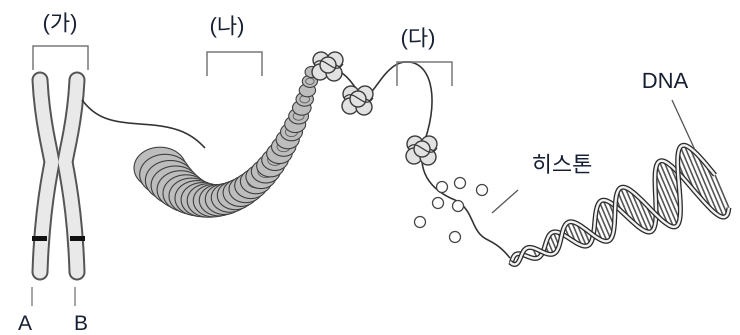
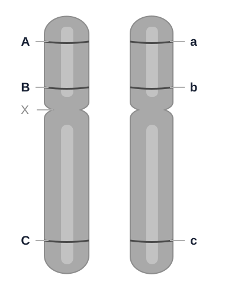
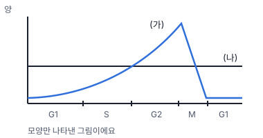
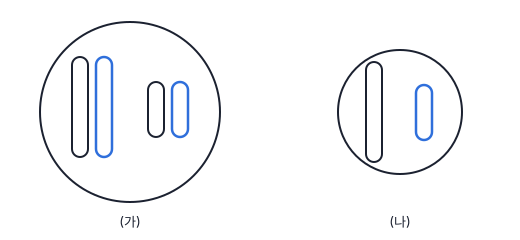

# 생명과학 복습 0917 문제설명

왼쪽 목차로 문항을 고르고, 오른쪽 문제를 보며 해설을 따라가요.

문제의 첫 줄부터 검산까지 설명해요.

**목차**

- [문항별 설명](#problems)
  - [P30. G1기에 해당하는 특성](#p30)
  - [P31. DNA가 염색체로 응축되는 과정](#p31)
  - [P32. 두 염색체와 유전자 표지](#p32)
  - [P33. 종양 억제 유전자에 대한 설명](#p33)
  - [P34. 암세포의 특징이 아닌 것](#p34)
  - [P35. 세포 주기와 DNA 복제 진술 고르기](#p35)
  - [P1. 세포가 성장하고 DNA를 복제하는 시기](#p1)
  - [P2. 확인점에서 검사하는 일](#p2)
  - [P3. 상동염색체가 분리되는 시기](#p3)
  - [P4. 46개 염색체 세포의 유사분열 결과](#p4)
  - [P5. 동원체의 뜻](#p5)
  - [P6. 사람의 정자와 난자](#p6)
  - [P7. 유사분열에 대한 옳은 설명](#p7)
  - [P8. 농도가 변하는 세포주기 조절 단백질](#p8)
  - [P9. 유사분열기가 아닌 시기](#p9)
  - [P10. 자매염색분체가 분리되는 시기](#p10)
  - [P11. 암세포가 다른 곳으로 퍼지는 과정](#p11)
  - [P12. 염색체 그림 판독](#p12)
  - [P13. 자매염색분체가 붙어 있는 부위](#p13)
  - [P14. 자매염색분체의 뜻](#p14)
  - [P15. 암이 생기는 때](#p15)
  - [P16. 암세포의 특성이 아닌 것](#p16)
  - [P17. 세포주기 그림 설명](#p17)
  - [P18. 세포주기의 순서](#p18)
  - [P19. 상동염색체가 분리되는 시기](#p19)
  - [P20. 염색체 쌍의 구성원](#p20)
  - [P21. 복제된 염색체의 두 복사본](#p21)
  - [P22. 자매염색분체에 대한 옳은 설명](#p22)
  - [P23. DNA 중합효소가 가장 활발한 시기](#p23)
  - [P24. [변형] 두 막대의 관계 가리기](#p24)
  - [P25. [변형] 무엇이 나뉘는가 짝짓기](#p25)
  - [P26. [변형] 고장 난 유전자의 이름](#p26)
  - [P27. [변형] 암에 대한 옳은 설명](#p27)
  - [P28. [변형] 분열하지 않는 신경세포](#p28)
  - [P29. [변형] 상처가 났을 때 분열이 시작되는 경로](#p29)
  - [P36. [변형] 유사분열에 대한 맞는 설명(정답 바꾼 쌍둥이)](#p36)
  - [P37. [변형] 암은 언제 발생하는가(정답 바꾼 쌍둥이)](#p37)
  - [P38. [변형] 두 조절 단백질의 양 그래프](#p38)
  - [P39. [변형] 두 세포의 염색체 세기](#p39)
  - [P40. [변형] 성장 인자를 없앤 배양액의 두 세포](#p40)
  - [P41. [변형] 복제가 덜 끝난 세포의 체크포인트](#p41)
  - [P42. [변형] 분열에 관여하는 유전자 진술 고르기](#p42)
  - [P43. [변형] 헬라 세포와 정상 세포](#p43)
  - [P44. [변형] 외적 조절자로 볼 수 없는 것](#p44)

## 문항별 설명

### P30. G1기에 해당하는 특성

웹과제 3장 q04 · [원 문제 보기](../%EB%B3%B5%EC%8A%B5%EB%AC%B8%EC%A0%9C_0917_Cell_Division.html#p30)

다음 중 세포주기(G1, S, G2, M)에서 G1 기에 해당하는 특성은?

- A. 방추사가 형성된다
- B. DNA 복제가 일어난다
- C. 세포질분열이 일어난다
- D. 염색체가 응축된다
- E. 세포 크기가 증가하고 세포소기관이 복제된다

기출 원문 보기

웹과제 3장 q04 (스크린샷 s04). 원래 화면은 체크박스 형식이었지만 정답은 하나예요.

#### 문제를 내 말로 읽어요

세포주기의 네 단계(G1, S, G2, M) 가운데 **G1기**에 일어나는 일을 하나 고르는 문제예요. 원래 웹과제 화면은 체크박스였지만 정답은 하나예요.

보기 다섯 개는 각각 세포주기의 어느 한 단계에서 일어나는 일이에요. 보기마다 "이건 몇 기의 일인가"를 붙여 보면 G1기 하나만 남아요.

#### 이 문제를 봤을 때 떠올릴 개념과 공식

"G1, S, G2, M"이라는 단계 이름이 나오면 세포주기(cell cycle)의 단계별 할 일을 짝지어 떠올려요.

G1기(G = Gap, 틈)는 분열이 막 끝나 크기가 절반인 세포가 **자라는** 시기로, 단백질 같은 분자를 합성해요. S기(Synthesis)는 DNA를 복제하는 시기예요. G2기는 분열에 필요한 단백질을 만들며 분열을 준비하는 시기예요. M기(Mitosis)는 분열 자체로, 전기에 염색체가 응축되고 방추사(spindle)가 만들어지며, 마지막에 세포질 분열(cytokinesis)로 두 세포가 돼요.

그래서 보기의 사건을 "성장 / 복제 / 준비 / 분열" 네 칸 중 어디에 넣을지 정하면 G1기의 특성을 고를 수 있어요.

관련 개념: [3-1. G1–S–G2–M과 G0](../%EC%A0%95%EB%A6%AC%EB%85%B8%ED%8A%B8_0917_Cell_Division.html#s3-phases)

#### 종이에 쓰는 첫 줄

첫 줄에 네 칸 표를 써요. "G1: 성장·분자 합성 | S: DNA 복제 | G2: 분열 준비 | M: 응축·방추사·세포질 분열."

그다음 보기 A~E 옆에 해당하는 칸 이름(G1/S/G2/M)을 적어요.

#### 왜 이렇게 푸는지 함께 따라가요

A 틀려요. 방추사가 형성되는 것은 M기(전기~전중기)의 일이에요.

B 틀려요. DNA 복제는 S기의 일이에요.

C 틀려요. 세포질 분열은 M기 끝에 일어나 세포 분열을 완성하는 일이에요.

D 틀려요. 염색체 응축은 M기 전기에 일어나요.

E 맞아요. G1기는 분열 직후 작아진 세포가 자라며 단백질 등 분자를 합성하는 성장 단계예요. "세포소기관이 복제된다"도 세포가 자라며 구성 성분을 늘리는 일이라 성장 단계 설명과 맞아요.

따라서 G1기에 해당하는 특성은 E예요.

#### 완성 답과 검산

답 E. 교과서 대조: 교재 3장 p.57은 G1기를 세포질 성장의 초기 단계로, 세포가 DNA를 제외한 단백질과 다른 분자들을 만드는 시기라고 적고, 전기에 염색체가 응축된다고 적어요. 같은 쪽 그림 3.2도 G1을 "DNA 복제 전의 세포성장기"로 표시해요. 교재 3장 p.58은 방추체가 전기에 형성되기 시작한다고 적어요.

소거 확인: A·C·D는 M기, B는 S기로 분류되어 G1기 칸에 들어가는 보기는 E 하나뿐이에요.

#### 이 문항에서 하기 쉬운 실수

"세포소기관이 **복제**된다"의 "복제"라는 말 때문에 DNA 복제(S기)와 헷갈리기 쉬워요. DNA 복제는 S기이고, 세포가 크기와 구성 성분을 늘리는 성장은 G1기예요.

G의 뜻을 Growth(성장)로 외우면 G2기와도 헷갈려요. G는 Gap(틈)이고, 성장 단계로 대표되는 것은 G1기예요.

#### 설명을 닫고 다시 풀어요

- G1·S·G2·M 네 칸 표를 기억에서 다시 채워요.
- 방추사 형성, 염색체 응축, 세포질 분열이 각각 몇 기의 일인지 말해요.

**페이지 요약**

#### 떠올릴 개념·공식

G1 성장·분자 합성, S DNA 복제, G2 분열 준비, M 응축·방추사·세포질 분열.

#### 첫 줄

네 칸 표를 쓰고 보기마다 단계 이름을 붙여요.

#### 핵심 판단

A·C·D는 M기, B는 S기. G1기는 E.

#### 검산

교재 3장 p.57 본문·그림 3.2, p.58과 일치해요.

---

### P31. DNA가 염색체로 응축되는 과정

웹과제 3장 q05 · [원 문제 보기](../%EB%B3%B5%EC%8A%B5%EB%AC%B8%EC%A0%9C_0917_Cell_Division.html#p31)

다음은 동물세포에서 DNA가 염색체로 응축되는 과정을 나타낸 모식도이다. 이에 대한 설명으로 옳지 않은 것은?

- A. A와 B의 유전정보는 동일하다
- B. (다)에서 DNA가 히스톤 단백질을 감고 있다
- C. A와 B는 자매염색분체이다.
- D. 세포분열 중기에 (다)에서 (나) 구조로 변한다.
- E. 히스톤 단백질에는 양전하를 띤 아미노산이 많이 존재한다.

기출 원문 보기

웹과제 3장 q05 (스크린샷 s05)

#### 문제를 내 말로 읽어요

그림은 DNA가 히스톤에 감기고(다), 더 굵게 꼬이고(나), 마지막에 X자 염색체(가)가 되는 응축 과정을 오른쪽에서 왼쪽으로 보여 줘요. (가)의 두 가닥에는 A와 B가 표시되어 있어요.

보기 중 **옳지 않은 것** 하나를 고르는 부정형 문제예요. 맞는 설명 네 개를 지우고 남는 틀린 설명이 답이에요.

#### 이 문제를 봤을 때 떠올릴 개념과 공식

"DNA가 염색체로 응축되는 과정"이라는 단서에서 **염색질(chromatin)과 염색체(chromosome)**의 관계를 떠올려요. 평소에는 DNA가 히스톤(histone) 단백질에 감긴 채 풀린 염색질로 있고, 분열할 때 꽁꽁 응축돼 막대 모양 염색체가 돼요.

히스톤은 양전하(+)를 띤 작은 단백질이라서 음전하(−)를 띤 DNA와 붙어요. DNA가 히스톤을 감은 "구슬 꿴 실" 모양이 (다)이고, 이것이 더 감겨 굵은 섬유 (나)가 돼요.

X자 염색체의 두 가닥이 동원체로 붙어 있으면 **자매염색분체(sister chromatid)**예요. S기에 DNA를 복제해 생긴 똑같은 두 사본이라 유전정보가 같아요.

응축이 **언제** 일어나는지도 기준이에요. 응축은 M기 **전기(prophase)**에 시작되고, 중기(metaphase)에는 이미 응축된 염색체가 세포 가운데에 늘어서요.

관련 개념: [2-1. 염색질과 염색체](../%EC%A0%95%EB%A6%AC%EB%85%B8%ED%8A%B8_0917_Cell_Division.html#s2-chromatin), [2-2. 자매염색분체·상동염색체·대립유전자](../%EC%A0%95%EB%A6%AC%EB%85%B8%ED%8A%B8_0917_Cell_Division.html#s2-sister-homolog)

#### 종이에 쓰는 첫 줄

그림 아래에 이름을 붙여요. "DNA → (다) 히스톤에 감긴 실 → (나) 굵은 섬유 → (가) 염색체, A·B = 동원체로 붙은 두 가닥 = 자매염색분체."

옆에 "응축 시작 = 전기, 중기 = 이미 응축된 채 정렬"을 적고, 질문이 **옳지 않은 것**이라는 표시를 해 둬요.

#### 왜 이렇게 푸는지 함께 따라가요

A 맞아요. A와 B는 DNA 복제로 생긴 두 사본(자매염색분체)이라 유전정보가 같아요.

B 맞아요. (다)는 DNA가 히스톤 단백질을 감은 구슬 꿴 실 모양 구조예요.

C 맞아요. 동원체로 붙어 있는 A와 B는 한 염색체가 복제된 자매염색분체예요.

D 틀려요. (다)에서 (나)로 감기기 시작하는 응축은 분열 전기에 일어나요. 중기에는 이미 응축된 염색체가 세포 가운데(중기판)에 늘어서는 단계라서 "중기에 (다)에서 (나)로 변한다"는 시기가 틀렸어요.

E 맞아요. 히스톤은 양전하를 띠는 아미노산이 많은 작은 단백질이라 음전하를 띤 DNA와 결합해요.

질문은 옳지 않은 것을 고르는 문제이므로, 답은 **틀려요**로 판정된 D예요.

#### 완성 답과 검산

답 D. 교과서 대조: 교재 3장 p.57은 전기 동안 핵 내 복제된 염색체가 풀어진 모습에서 막대 모양으로 응축되고, 이때 각 염색체가 2개의 자매염색분체로 구성된다고 적어요. 강의노트 3장 p2도 "전기: 염색체 응축", "중기: 염색체가 중간지점 배열"로 나눠 적어요. 교재 부록 용어풀이 G-12는 히스톤을 "작고 양전하 단백질로 진핵세포 염색체에서 DNA와 복합체를 이룸"이라고 적어 E를 뒷받침해요.

소거 확인: A·B·C·E는 모두 맞는 설명이라 지워지고, 틀린 보기는 D 하나만 남아요.

#### 이 문항에서 하기 쉬운 실수

교재 3장 p.58에 "염색체는 이 단계(중기)에서 응축을 완결한다"는 문장이 있어서 D를 맞다고 읽기 쉬워요. 하지만 "완결"은 이미 진행된 응축이 끝난다는 뜻이고, 히스톤에 감긴 실 (다)가 굵은 섬유 (나)로 감기기 시작하는 것은 전기의 일이에요. 응축이 **시작**되는 시기는 전기라고 기억해요.

A와 B가 서로 다른 글자라서 유전정보도 다르다고 착각하기 쉬워요. 여기서 A·B는 가닥 이름표일 뿐이고, 동원체로 붙은 두 가닥은 같은 정보를 가진 자매염색분체예요.

#### 설명을 닫고 다시 풀어요

- DNA → (다) → (나) → (가)의 이름과 구조를 다시 적어요.
- 응축이 시작되는 시기와 염색체가 가운데에 늘어서는 시기를 구분해 말해요.
- 히스톤이 DNA와 붙는 이유를 전하로 설명해요.

**페이지 요약**

#### 떠올릴 개념·공식

염색질 → 염색체 응축(전기 시작), 히스톤(+)과 DNA(−), 동원체로 붙은 두 가닥 = 자매염색분체.

#### 첫 줄

그림에 (다) 감긴 실 → (나) 섬유 → (가) 염색체 이름 붙이기. 질문은 옳지 않은 것.

#### 핵심 판단

A·B·C·E 맞아요. 응축 시기를 중기로 쓴 D가 틀려서 답이에요.

#### 검산

교재 3장 p.57(전기 응축), 강의노트 3장 p2, 용어풀이 G-12(히스톤)와 일치해요.

---

### P32. 두 염색체와 유전자 표지

웹과제 3장 q06 · [원 문제 보기](../%EB%B3%B5%EC%8A%B5%EB%AC%B8%EC%A0%9C_0917_Cell_Division.html#p32)

다음 그림은 염색체를 나타낸 것이다. 이에 대한 설명으로 옳지 않은 것은?

- A. A와 a는 대립유전자 관계이다
- B. A, B, C는 각각 별개의 유전자들이다
- C. 두 염색체는 복제되어 생긴 자매염색분체이다
- D. X는 미세소관(방추사)이 부착되는 부위이다
- E. 두 염색체는 상동염색체 관계이다

기출 원문 보기

웹과제 3장 q06 (스크린샷 s06)

#### 문제를 내 말로 읽어요

그림에는 따로 떨어진 막대 모양 염색체 두 개가 있어요. 왼쪽에는 위에서부터 A, B, 잘록한 부위 X, C가 있고, 오른쪽 같은 높이에는 a, b, c가 있어요.

보기 중 **옳지 않은 것** 하나를 고르는 부정형 문제예요. 핵심은 두 염색체가 "복제로 생긴 쌍둥이(자매염색분체)"인지 "엄마·아빠에게서 온 짝(상동염색체)"인지 가리는 것이에요.

#### 이 문제를 봤을 때 떠올릴 개념과 공식

"같은 높이에 A와 a"처럼 같은 자리에 대문자·소문자가 있는 그림을 보면 **상동염색체(homologous chromosome)와 대립유전자(allele)**를 떠올려요.

상동염색체는 한 쌍 중 하나는 아버지, 하나는 어머니에게서 온 염색체예요. 같은 자리에 같은 유전자가 있지만, 그 유전자의 서로 다른 형태(대립유전자, 예: A와 a)가 있을 수 있어요.

자매염색분체(sister chromatid)는 한 염색체가 DNA 복제로 만든 **똑같은** 두 사본이라 같은 자리에 같은 대립유전자(A와 A)를 가져요. 그리고 동원체(centromere)로 붙어 있어요.

그래서 판단 기준은 "같은 자리의 글자가 같은가(A·A → 자매), 다른가(A·a → 상동)"예요. 한 염색체 위의 서로 다른 자리(A, B, C)는 서로 다른 유전자이고, 잘록한 부위는 방추사가 붙는 동원체예요.

관련 개념: [2-2. 자매염색분체·상동염색체·대립유전자](../%EC%A0%95%EB%A6%AC%EB%85%B8%ED%8A%B8_0917_Cell_Division.html#s2-sister-homolog)

#### 종이에 쓰는 첫 줄

첫 줄에 같은 높이끼리 짝을 써요. "A–a, B–b, C–c: 같은 자리, 다른 글자 → 대립유전자 → 두 염색체는 상동염색체."

그 아래 "자매염색분체라면 A–A처럼 같은 글자"를 적고, 질문이 **옳지 않은 것**임을 표시해요.

#### 왜 이렇게 푸는지 함께 따라가요

A 맞아요. A와 a는 두 염색체의 같은 위치에 있는 한 유전자의 서로 다른 형태, 즉 대립유전자예요.

B 맞아요. A, B, C는 한 염색체의 서로 다른 위치에 있으므로 각각 별개의 유전자예요.

C 틀려요. 같은 위치에 A와 a처럼 서로 다른 대립유전자가 있으니 복제로 생긴 자매염색분체가 아니에요. 자매염색분체라면 같은 자리에 같은 대립유전자가 있고, 동원체로 붙어 있어야 해요.

D 맞아요. X는 잘록한 동원체로, 방추사(미세소관)가 부착되는 부위예요.

E 맞아요. 같은 위치에 대립유전자를 가진 한 쌍이므로 상동염색체예요.

질문은 옳지 않은 것을 고르는 문제이므로, 답은 **틀려요**로 판정된 C예요.

#### 완성 답과 검산

답 C. 교과서 대조: 교재 3장 p.63은 상동염색체 쌍이 부계·모계 염색체로 이루어지고, 같은 순서로 배열된 같은 유전자를 갖지만 대립유전자라는 다른 형태가 두 염색체에 있을 수 있다고 적어요. 교재 3장 p.56은 자매염색분체를 DNA 복제로 생긴 2개의 복사본이라고 적어요. 교재 3장 p.58은 방추체 미세소관이 중심절의 동원체에 부착한다고 적어 D를 뒷받침해요. 강의노트 3장 p3의 상동염색체·대립유전자 설명도 같아요.

반대 경우 확인: 두 염색체가 자매염색분체였다면 a, b, c 자리에 A, B, C가 그대로 있어야 해요. 그림은 그렇지 않으므로 C만 틀리고 E는 맞아요.

#### 이 문항에서 하기 쉬운 실수

두 염색체가 모양과 크기가 똑같아 보여서 "복제된 쌍둥이"라고 단정하기 쉬워요. 모양이 같은 것은 상동염색체도 마찬가지이고, 구별은 같은 자리의 대립유전자가 같은지로 해요.

A와 a를 "서로 다른 유전자"로 읽는 실수도 조심해요. 같은 자리의 A와 a는 한 유전자의 다른 형태(대립유전자)이고, 다른 자리의 A와 B가 서로 다른 유전자예요.

#### 설명을 닫고 다시 풀어요

- 자매염색분체와 상동염색체를 같은 자리의 글자로 구별하는 기준을 말해요.
- "같은 자리 다른 글자"와 "다른 자리 다른 글자"가 각각 무엇인지 써요.

**페이지 요약**

#### 떠올릴 개념·공식

같은 자리 A–a = 대립유전자 → 상동염색체. 자매염색분체는 같은 자리에 같은 글자.

#### 첫 줄

A–a, B–b, C–c 짝을 쓰고 상동염색체로 판정. 질문은 옳지 않은 것.

#### 핵심 판단

A·B·D·E 맞아요. 자매염색분체라고 한 C가 틀려서 답이에요.

#### 검산

교재 3장 p.56·p.58·p.63, 강의노트 3장 p3과 일치해요.

---

### P33. 종양 억제 유전자에 대한 설명

웹과제 3장 q08 · [원 문제 보기](../%EB%B3%B5%EC%8A%B5%EB%AC%B8%EC%A0%9C_0917_Cell_Division.html#p33)

종양 억제 유전자(Tumor Suppressor Gene)에 대한 설명으로 옳은 것은?

- A. 원발암유전자(Proto-oncogene)가 돌연변이를 일으킨 형태를 말한다
- B. 이 유전자가 활성화되면 암 발생 확률이 높아진다
- C. 세포 분열을 촉진하는 신호 전달 경로에서 주로 작동한다
- D. p53 단백질은 DNA 손상을 감지하여 세포 주기를 멈추거나 사멸을 유도한다
- E. 한쪽 염색체의 유전자에만 이상이 생겨도 즉시 암세포가 된다

기출 원문 보기

웹과제 3장 q08 (스크린샷 s08)

#### 문제를 내 말로 읽어요

종양 억제 유전자(tumor suppressor gene)에 대한 **옳은** 설명 하나를 고르는 문제예요.

보기에는 원발암 유전자·발암 유전자 이야기가 섞여 있어요. 종양 억제 유전자가 분열을 "미는 쪽"인지 "막는 쪽"인지, 그리고 고장 나면 바로 암이 되는지를 확인하면 돼요.

#### 이 문제를 봤을 때 떠올릴 개념과 공식

"종양 억제"라는 이름에서 세포 분열을 **억제하는** 정상 유전자를 떠올려요. 종양 억제 유전자는 세포분열을 억제하는 단백질을 암호화하고, 확인점(checkpoint)에서 문제를 찾으면 "잠깐 멈춰, 고치자" 하고 주기를 세워요. 대표 예가 p53이에요.

반대쪽에는 분열을 **미는** 정상 유전자인 원발암 유전자(proto-oncogene)가 있고, 이것이 돌연변이로 바뀐 것이 발암 유전자(oncogene)예요.

종양 억제 유전자는 **기능을 잃을 때** 암 위험이 커져요. 그리고 암은 여러 유전자의 변화가 차례로 쌓여야 생기므로, 하나가 고장 났다고 곧바로 암세포가 되지는 않아요.

관련 개념: [5-2. 종양 억제 유전자: p53과 BRCA1](../%EC%A0%95%EB%A6%AC%EB%85%B8%ED%8A%B8_0917_Cell_Division.html#s5-suppressor), [5-1. 원발암 유전자와 발암 유전자](../%EC%A0%95%EB%A6%AC%EB%85%B8%ED%8A%B8_0917_Cell_Division.html#s5-oncogene)

#### 종이에 쓰는 첫 줄

첫 줄에 세 칸 표를 써요. "원발암(정상, 분열 촉진) → 돌연변이 → 발암 | 종양 억제(정상, 분열 억제·수선, 예: p53) → 기능 상실 시 암 위험 ↑."

보기마다 주어가 어느 칸 이야기인지, 방향(촉진/억제, 활성화/기능 상실)이 맞는지 표시해요.

#### 왜 이렇게 푸는지 함께 따라가요

A 틀려요. 원발암 유전자가 돌연변이를 일으킨 형태는 발암 유전자(oncogene)예요. 종양 억제 유전자는 그와 다른 별개의 정상 유전자예요.

B 틀려요. 종양 억제 유전자는 분열을 억제하므로, 활성화되면 분열이 더 억제돼요. 암 위험은 이 유전자가 기능을 잃을 때 높아져요.

C 틀려요. 분열을 촉진하는 신호 경로에서 일하는 것은 원발암 유전자 쪽이에요. 종양 억제 유전자는 분열을 멈추는 쪽에서 일해요.

D 맞아요. p53은 대표적인 종양 억제 유전자로, DNA 손상을 감지하면 확인점에서 세포주기를 멈춰 고칠 시간을 줘요. 고치지 못할 때 세포 사멸(apoptosis)을 유도하는 것도 p53의 기능이에요(사멸 유도는 수업 밖 보충). 세포주기를 멈춘다는 부분만으로도 수업 내용과 일치해요.

E 틀려요. 암은 여러 유전자의 변화가 차례로 쌓여서 생기므로, 한쪽 염색체의 유전자 하나에 이상이 생겼다고 즉시 암세포가 되지는 않아요.

따라서 옳은 설명은 D예요.

#### 완성 답과 검산

답 D. 교과서 대조: 교재 3장 p.63은 종양억제유전자를 정상 세포에서 세포분열을 억제하는 단백질을 만드는 유전자로, 원발암유전자를 세포분열을 촉진하는 단백질을 암호화하고 유전적 변이로 발암유전자가 되는 유전자로 구분해요. 같은 쪽은 하나의 종양억제유전자가 비활성화되어서는 암이 거의 발생하지 않고 여러 유전자의 순차적 변화가 누적되어야 한다고 적어 E를 지워요. 강의노트 3장 p3도 "종양억제유전자: 세포분열을 억제하는 단백질을 암호화하는 유전자"라고 적어요.

소거 확인: A·C는 원발암/발암 쪽 설명, B는 방향 반대, E는 누적 원리 위반이라 지워지고 D만 남아요.

#### 이 문항에서 하기 쉬운 실수

이름에 "종양"이 들어가서 암을 일으키는 유전자로 착각하기 쉬워요. 종양 억제 유전자는 암을 **막는** 정상 유전자이고, 문제가 되는 것은 이 유전자가 고장 날 때예요.

D의 "사멸을 유도한다"가 수업에서 직접 나오지 않았다고 D를 지우지 않아요. 보기의 핵심인 "DNA 손상 감지 → 주기 정지"가 수업 내용과 맞고, 사멸 유도도 p53의 실제 기능이에요.

#### 설명을 닫고 다시 풀어요

- 원발암·발암·종양 억제 유전자의 세 칸 표를 다시 채워요.
- 종양 억제 유전자가 "활성화될 때"와 "기능을 잃을 때" 각각 무슨 일이 생기는지 말해요.
- 유전자 하나의 고장으로 곧바로 암이 되지 않는 이유를 한 줄로 써요.

**페이지 요약**

#### 떠올릴 개념·공식

종양 억제 유전자 = 분열 억제·수선 쪽 정상 유전자(p53). 기능 상실 시 암 위험 ↑, 암은 여러 변화의 누적.

#### 첫 줄

원발암→발암 / 종양 억제 세 칸 표로 보기의 주어와 방향을 분류.

#### 핵심 판단

A·C는 발암 쪽, B는 방향 반대, E는 누적 원리 위반. 답 D.

#### 검산

교재 3장 p.63, 강의노트 3장 p3과 일치해요.

---

### P34. 암세포의 특징이 아닌 것

웹과제 3장 q10 · [원 문제 보기](../%EB%B3%B5%EC%8A%B5%EB%AC%B8%EC%A0%9C_0917_Cell_Division.html#p34)

암세포의 일반적인 측징이 아닌 것은?

- A. 성장 신호 없이도 지속적으로 분열할 수 있다
- B. 암세포는 분열 횟수에 제한이 없다
- C. 악성종양은 전이(metastasis) 능력이 있다
- D. 세포주기의 조절을 받지 않는다
- E. 강한 접촉 저해를 보인다

기출 원문 보기

웹과제 3장 q10 (스크린샷 s10)

#### 문제를 내 말로 읽어요

암세포의 일반적인 특징이 **아닌 것** 하나를 고르는 부정형 문제예요. 암세포에 맞는 특징 네 개를 지우고, 정상 세포에만 있는 성질을 찾으면 돼요.

**문항 결함:** 발문의 "측징"은 "특징"의 오타예요. 뜻은 "암세포의 일반적인 특징이 아닌 것은?"으로 읽어요. 오타가 답을 바꾸지는 않아요.

#### 이 문제를 봤을 때 떠올릴 개념과 공식

"암세포의 특징"이라는 단서에서 **세포주기 조절이 깨진 세포**라는 암의 정의를 떠올려요. 정상 세포는 분열해야 할 때만 분열하고 멈출 때는 멈추지만, 암세포는 이 조절에 반응하지 않아요.

그 결과 암세포는 성장 신호 없이도 분열하고(고장 난 수용체), 영양분만 있으면 횟수 제한 없이 증식하며, 악성 종양은 떨어져 나와 다른 곳으로 퍼지는 전이(metastasis)를 해요.

**접촉 저해(contact inhibition)**는 정상 세포가 이웃 세포와 닿으면 분열을 멈추는 성질이에요. 상처의 새살이 빈 곳을 다 메우면 멈추는 것이 예예요. 암세포는 접촉 저해를 받지 않아 겹겹이 쌓여요. 그래서 "정상 세포의 성질인가, 암세포의 성질인가"가 판단 기준이에요.

관련 개념: [5-3. 양성·악성 종양, 전이, 접촉 저해](../%EC%A0%95%EB%A6%AC%EB%85%B8%ED%8A%B8_0917_Cell_Division.html#s5-tumor), [0. 헬라 세포와 이번 장의 질문](../%EC%A0%95%EB%A6%AC%EB%85%B8%ED%8A%B8_0917_Cell_Division.html#s0-hela)

#### 종이에 쓰는 첫 줄

첫 줄에 두 칸 비교표를 써요. "정상 세포: 신호 있어야 분열, 횟수 한계, 접촉 저해 있음, 제자리 | 암세포: 신호 없이 분열, 무한 증식, 접촉 저해 없음, 전이."

보기마다 어느 칸의 성질인지 적고, 질문이 **아닌 것**이므로 정상 세포 칸에 들어가는 보기를 찾아요.

#### 왜 이렇게 푸는지 함께 따라가요

A 맞아요(암세포의 특징). 발암 유전자가 만든 고장 난 수용체는 신호 분자 없이도 켜져 있어 분열을 계속 일으켜요.

B 맞아요(암세포의 특징). 정상 세포는 분열 횟수에 한계가 있지만, 헬라 세포처럼 암세포는 영양분만 있으면 계속 분열해요.

C 맞아요(암세포의 특징). 악성 종양은 주변 조직에 침투하고 떨어져 나와 몸의 다른 곳으로 전이해요.

D 맞아요(암세포의 특징). 암은 세포주기 조절을 잃은 세포예요.

E 틀려요(암세포의 특징이 아님). 접촉 저해는 정상 세포의 성질이에요. 암세포는 접촉 저해를 받지 않아 이웃과 닿아도 계속 자라 층을 이뤄요.

질문은 특징이 아닌 것을 고르는 문제이므로, 답은 **틀려요**로 판정된 E예요.

#### 완성 답과 검산

답 E. 교과서 대조: 교재 3장 p.62는 접촉저해를 서로 접촉한 세포들이 G0기로 옮겨가 더 이상 분열하지 않는 반응으로 설명하고, 같은 쪽 아래에서 암은 세포가 분열 시기를 정하는 정상적인 조절을 잃어버릴 때 생기며 악성 종양이 퍼지는 것을 전이라 한다고 적어요. 교재 3장 p.63은 고장 난 수용체가 신호분자와 결합하지 않아도 늘 활성을 갖는 발암유전자 예를 들어 A를 뒷받침해요. 강의노트 3장 p2도 접촉저해를 정상 조직세포의 성질로, "세포주기 조절은 암의 경우 소실된다"고 적어요.

소거 확인: A~D는 모두 암세포 칸에 들어가고, 정상 세포 칸에 들어가는 보기는 E 하나뿐이에요.

#### 이 문항에서 하기 쉬운 실수

"강한 접촉 저해"를 "강하게 퍼진다"처럼 암의 공격성으로 읽기 쉬워요. 접촉 저해는 분열을 **멈추게 하는** 정상 세포의 브레이크예요.

발문의 오타(측징)처럼 글자가 어색한 문항을 만나면 당황하지 말고, 문맥상 의도한 단어(특징)로 읽은 뒤 부정형("아닌 것")인지부터 확인해요.

#### 설명을 닫고 다시 풀어요

- 정상 세포와 암세포의 비교표를 네 줄로 다시 써요.
- 접촉 저해의 뜻을 상처가 아무는 예로 설명해요.

**페이지 요약**

#### 떠올릴 개념·공식

암세포 = 조절이 깨진 세포: 신호 없이 분열, 무한 증식, 전이, 접촉 저해 없음.

#### 첫 줄

정상/암세포 비교표를 쓰고 정상 세포 칸의 보기를 찾아요. 발문 "측징"은 "특징"의 오타.

#### 핵심 판단

A~D는 암세포 특징. 접촉 저해는 정상 세포 성질이라 E가 답.

#### 검산

교재 3장 p.62–63, 강의노트 3장 p2와 일치해요.

---

### P35. 세포 주기와 DNA 복제 진술 고르기

웹과제 3장 q12 · [원 문제 보기](../%EB%B3%B5%EC%8A%B5%EB%AC%B8%EC%A0%9C_0917_Cell_Division.html#p35)

다음 중 세포 주기와 DNA 복제에 대한 설명으로 옳은 것만을 모두 고른 것은?

- ㄱ. G1기에는 세포의 생장이 일어나며 단백질 합성이 활발하다.
- ㄴ. S기에는 DNA가 복제되어 세포당 DNA 상대량이 2배가 된다.
- ㄷ. M기에는 방추사를 구성하는 단백질 등이 합성되며 분열을 준비한다.

- A. ㄱ, ㄴ, ㄷ
- B. ㄴ, ㄷ
- C. ㄴ
- D. ㄱ, ㄴ
- E. ㄱ

기출 원문 보기

웹과제 3장 q12 (스크린샷 s12, s13). s12와 s13은 같은 문항을 캡처한 것이에요.

#### 문제를 내 말로 읽어요

세포주기의 세 단계(G1기, S기, M기)에 대한 진술 ㄱ, ㄴ, ㄷ 가운데 **옳은 것만 모두** 고른 조합을 찾는 ㄱㄴㄷ형 문제예요.

먼저 진술 세 개를 하나씩 맞아요/틀려요로 판정하고, 그 결과와 똑같은 조합을 보기 A~E에서 골라요.

#### 이 문제를 봤을 때 떠올릴 개념과 공식

"G1기, S기, M기"와 "DNA 상대량"이라는 단서에서 세포주기(cell cycle) 단계별 할 일을 떠올려요.

G1기는 세포가 자라며 단백질 같은 분자를 합성하는 성장 단계예요. S기(Synthesis)는 DNA를 복제하는 시기라서, S기가 끝나면 세포 하나에 든 DNA 양이 복제 전의 2배가 돼요. G2기는 유사분열에 필요한 단백질(방추사 재료 등)을 합성하며 분열을 **준비**하는 시기이고, M기는 분열 **자체**가 일어나는 시기예요.

그래서 "분열을 준비한다"는 말이 나오면 G2기, "분열한다"는 말이 나오면 M기로 짝을 확인해요.

관련 개념: [3-1. G1–S–G2–M과 G0](../%EC%A0%95%EB%A6%AC%EB%85%B8%ED%8A%B8_0917_Cell_Division.html#s3-phases)

#### 종이에 쓰는 첫 줄

첫 줄에 네 칸 표를 써요. "G1: 성장·단백질 합성 | S: DNA 복제(양 2배) | G2: 분열 준비·방추사 단백질 합성 | M: 분열."

그 아래 "ㄱ ○/× , ㄴ ○/× , ㄷ ○/×" 칸을 만들어 진술마다 표를 대조해 채워요.

#### 왜 이렇게 푸는지 함께 따라가요

ㄱ 맞아요. G1기는 세포가 자라며 단백질 같은 분자를 활발히 합성하는 성장 단계예요.

ㄴ 맞아요. S기에 DNA가 복제되어 세포당 DNA 상대량이 2배가 돼요.

ㄷ 틀려요. 방추사 단백질 등을 합성하며 분열을 준비하는 시기는 G2기예요. M기는 분열 자체가 일어나는 시기예요.

옳은 진술은 ㄱ, ㄴ이에요. 이제 보기를 대조해요.

A 틀려요. 틀린 진술 ㄷ이 들어 있어요.

B 틀려요. 옳은 ㄱ이 빠졌고 틀린 ㄷ이 들어 있어요.

C 틀려요. 옳은 ㄱ이 빠졌어요.

D 맞아요. 옳은 진술 ㄱ, ㄴ과 정확히 일치해요.

E 틀려요. 옳은 ㄴ이 빠졌어요.

따라서 답은 D예요.

#### 완성 답과 검산

답 D. 교과서 대조: 교재 3장 p.57은 G1기에 세포가 DNA를 제외한 단백질과 다른 분자들을 만들고, S기에 DNA가 복제되며, G2기에 유사분열에 필요한 단백질을 포함해 단백질 합성을 계속한다고 적어요. 강의노트 3장 p1도 "G2 기: 유사분열에 필요한 단백질 등을 합성하여 세포 분열을 준비하는 기간"이라고 적어 ㄷ의 내용이 G2기 설명임을 보여 줘요.

반대 경우 확인: ㄷ의 "M기"를 "G2기"로 바꾸면 옳은 진술이 되므로, ㄷ의 오류는 단계 이름 하나뿐이에요. 옳은 것이 ㄱ, ㄴ 두 개인 조합은 D 하나뿐이에요.

#### 이 문항에서 하기 쉬운 실수

ㄷ의 "방추사", "분열"이라는 단어가 M기와 잘 어울려 보여서 맞다고 고르기 쉬워요(웹과제 화면에서도 처음에 A를 고른 기록이 있어요). 방추사의 **재료를 만드는** 준비는 G2기이고, 방추사가 실제로 **만들어져 일하는** 것이 M기예요.

ㄱㄴㄷ형에서 조합 보기를 먼저 훑으면 판단이 흔들려요. 진술 세 개를 먼저 판정한 뒤 조합을 맞춰요.

#### 설명을 닫고 다시 풀어요

- G1·S·G2·M의 할 일을 한 줄씩 다시 써요.
- ㄷ을 옳은 진술로 고쳐 써요.

**페이지 요약**

#### 떠올릴 개념·공식

G1 성장·합성, S DNA 복제(양 2배), G2 분열 준비, M 분열.

#### 첫 줄

네 칸 표를 쓰고 ㄱ·ㄴ·ㄷ을 먼저 ○/×로 판정.

#### 핵심 판단

ㄱ ○, ㄴ ○, ㄷ ×(준비는 G2기). 조합 ㄱ, ㄴ = D.

#### 검산

교재 3장 p.57, 강의노트 3장 p1과 일치해요.

---

### P1. 세포가 성장하고 DNA를 복제하는 시기

기출 3강 1 · [원 문제 보기](../%EB%B3%B5%EC%8A%B5%EB%AC%B8%EC%A0%9C_0917_Cell_Division.html#p1)

다음 세포들이 대부분의 시간을 보내는 시기로서, 세포가 성장하고 DNA를 복제하는 시기는?

- (1) 후기
- (2) 간기
- (3) 전기
- (4) 중기

기출 원문 보기

기출 3강 합본 1번 (PDF 1쪽)

#### 문제를 내 말로 읽어요

주어진 것: 세포가 **대부분의 시간**을 보내고, 그동안 **자라고(성장) DNA를 복제하는** 시기가 있어요.

구할 것: 그 시기의 이름을 네 보기(후기·간기·전기·중기) 중에서 하나 골라요.

쉽게 말하면, 이사하기 전 짐을 늘리고 복사해 두는 긴 준비 기간과, 실제로 짐을 나누는 짧은 이삿날 중에서 ‘준비 기간’의 이름을 묻는 문제예요.

#### 이 문제를 봤을 때 떠올릴 개념과 공식

‘성장’, ‘DNA 복제’, ‘대부분의 시간’이라는 세 단서에서 세포주기(cell cycle)를 **간기(interphase)**와 **유사분열기(M기, mitotic phase)** 두 덩어리로 나누는 그림을 떠올려요.

간기는 G1기(세포 성장), S기(DNA 복제, synthesis), G2기(분열 준비)를 합친 이름이에요. M기는 실제로 나누는 시기이고 전기(prophase)·중기(metaphase)·후기(anaphase)·말기(telophase)로 나뉘어요.

교과서 그림 3.2는 원그래프에서 간기가 대부분을 차지하고 M기는 좁은 조각으로 그려요. 그래서 ‘무엇을 하는 시기인가’(성장·복제 = 간기, 나누기 = M기)와 ‘얼마나 긴가’를 함께 기준으로 써요.

관련 정리노트: [3-1. G1–S–G2–M과 G0](../%EC%A0%95%EB%A6%AC%EB%85%B8%ED%8A%B8_0917_Cell_Division.html#s3-phases)

#### 종이에 쓸 첫 줄

세포주기를 한 줄로 써요: **[간기: G1(성장) → S(DNA 복제) → G2(준비)] → [M기: 전기 → 중기 → 후기 → 말기]**.

그다음 문제의 두 일 ‘성장’, ‘DNA 복제’에 밑줄을 긋고, 두 일이 모두 왼쪽 괄호(간기) 안에 있는지 확인해요.

#### 왜 이렇게 푸는지 함께 따라가요

(1) 틀려요. 후기는 M기 안의 단계로, 이미 복제된 자매염색분체를 양극으로 끌어가는 때예요. 성장이나 DNA 복제를 하는 시기가 아니에요.

(2) 맞아요. 간기는 G1기(성장)·S기(DNA 복제)·G2기(분열 준비)를 합친 시기이고, 세포주기의 대부분이 여기에 해당해요. 문제의 세 단서가 모두 들어맞아요.

(3) 틀려요. 전기는 M기의 첫 단계로, 이미 복제된 염색체를 응축해 분열을 시작하는 때예요.

(4) 틀려요. 중기도 M기 안의 단계로, 복제된 염색체가 세포 가운데(중기판)에 늘어서는 때예요.

따라서 답은 (2)예요.

#### 완성 답과 검산

답 (2) 간기.

소거로 확인해요: 후기·전기·중기는 모두 M기의 하위 단계라 ‘성장·복제’라는 일과 맞지 않아요. 네 보기 중 M기 밖에 있는 것은 간기 하나뿐이에요.

교과서 대조: 교과서 3장 p.57 그림 3.2는 간기(G1·S·G2)가 원의 대부분을 차지하고, 본문은 간기 동안 세포가 성장하고 DNA를 복제한다고 적어요. 기출 3강 합본 1번의 표시 답도 ②예요.

#### 이 문항에서 하기 쉬운 실수

‘간기’를 분열과 분열 사이에 잠깐 쉬는 시간으로 오해하기 쉬워요. 간기는 쉬는 때가 아니라 성장·DNA 복제·분열 준비가 모두 일어나는 가장 긴 시기예요.

전기·중기·후기·말기는 이름에 ‘기’가 붙어 간기와 같은 층위처럼 보이지만, 모두 M기 안의 하위 단계예요.

#### 설명을 닫고 다시 해 봐요

- 간기의 세 단계(G1·S·G2)와 각 단계에서 하는 일을 한 줄씩 써 보기
- M기의 네 단계를 순서대로 쓰고 각 단계의 대표 사건을 하나씩 붙여 보기

**페이지 요약**

#### 떠올릴 개념·공식

세포주기 = 간기(G1 성장, S 복제, G2 준비) + M기(전·중·후·말기).

#### 첫 줄

[간기: G1→S→G2] → [M기: 전→중→후→말]을 쓰고 ‘성장·복제’ 위치를 찾아요.

#### 핵심 판단

성장·DNA 복제·가장 긴 시간은 모두 간기의 특징이에요. 나머지는 M기 하위 단계예요.

#### 검산

소거로 간기만 남고, 교과서 p.57 그림 3.2와 기출 표시 답 ②가 일치해요. 답 (2).

---

### P2. 확인점에서 검사하는 일

기출 3강 2 · [원 문제 보기](../%EB%B3%B5%EC%8A%B5%EB%AC%B8%EC%A0%9C_0917_Cell_Division.html#p2)

세포주기 확인점에서 검사할 수 있는 일로 가능한 것은?

- (1) DNA가 두 부분으로 잘려진 곳이 있는지 검사한다.
- (2) 세포의 크기가 충분히 커서 3개의 딸세포로 분리 가능한지 검사한다.
- (3) 세포를 반으로 나눌 세포벽이 만들어졌는지 검사한다.
- (4) S기에 모든 DNA가 복제되었는지 검사한다.

기출 원문 보기

기출 3강 합본 2번 (PDF 1쪽)

#### 문제를 내 말로 읽어요

주어진 것: 세포주기 중간중간에는 ‘다음 단계로 가도 되는지’ 확인하는 지점, 확인점(checkpoint)이 있어요.

구할 것: 확인점이 **검사할 수 있는 일**로 가능한 것을 하나 골라요.

쉽게 말하면, 보고서를 내기 전에 학번·이름이 맞는지 확인하고 틀리면 “멈춰!” 하고 고친 뒤 내는 것처럼, 세포가 무엇을 확인하고 멈추는지 묻는 문제예요.

**문항 결함:** 출제 의도의 답은 (4)이지만, (1) ‘DNA가 두 부분으로 잘려진 곳이 있는지 검사’도 DNA 손상 점검이라 엄밀히는 확인점이 하는 일에 들어갈 수 있어요. 아래 풀이에서 이 점을 밝히고, 왜 (4)가 의도한 답인지 설명해요.

#### 이 문제를 봤을 때 떠올릴 개념과 공식

‘확인점에서 검사’라는 단서에서 확인점의 정의를 떠올려요. 확인점은 **이전 단계의 작용이 완결되지 않으면 다음 단계로 넘어가지 못하게 세포주기를 멈추는 지점**이에요.

수업에서 든 확인 대상은 세 가지예요: DNA 복제가 제대로 끝났는지, 방추사가 염색체에 제대로 붙었는지, 지금 분열할 때인지. 교과서 3장 p.62도 S기에 DNA가 다 복제되지 않으면 G2기 진행을 늦춰 복제가 끝나도록 시간을 준다고 적어요.

같은 쪽에 하나가 더 있어요. 방사선이나 화학물질이 DNA를 손상시키면 확인점이 세포주기를 늦춰 DNA를 수선할 시간을 줘요. DNA가 끊어진 것도 이런 손상에 들어가므로 (1)을 판정할 때 이 기준을 함께 써요.

관련 정리노트: [3-2. 확인점](../%EC%A0%95%EB%A6%AC%EB%85%B8%ED%8A%B8_0917_Cell_Division.html#s3-checkpoint)

#### 종이에 쓸 첫 줄

확인점이 보는 것 목록을 먼저 써요: **① DNA 복제 완료·정상? ② 방추사가 염색체에 붙었나? ③ 지금 분열할 때인가? (+ 교재: DNA 손상 있으면 멈추고 수선 시간)**.

그다음 각 보기를 이 목록의 어느 줄과 맞는지 옆에 표시하고, 어느 줄과도 맞지 않는 보기에 ×를 쳐요.

#### 왜 이렇게 푸는지 함께 따라가요

(1) 엄밀히는 맞을 수도 있어요. DNA가 두 부분으로 끊어진 것은 DNA 손상이고, 교과서 p.62와 강의노트 3장 p2는 DNA가 손상되면 확인점이 주기를 늦춰 수선할 시간을 준다고 적어요. 다만 이 문항은 이 보기를 ‘답이 아닌 보기’로 두었고, 수업에서 정리한 확인 대상 목록에는 ‘DNA 복제 완료’가 직접 들어 있어요.

(2) 틀려요. 한 번 분열하면 딸세포는 두 개예요. 세 개로 나눌 수 있는지를 검사하는 일은 없어요.

(3) 틀려요. 확인 대상에 세포벽은 없어요. 게다가 사람 같은 동물세포에는 세포벽이 없고, 동물세포는 분열홈으로 세포질을 나눠요.

(4) 맞아요. S기에 모든 DNA가 복제되었는지는 수업과 교과서가 공통으로 드는 확인점의 대표 검사 항목이에요. 복제가 덜 끝났으면 G2기 진행을 늦춰 복제가 끝나도록 해요.

(1)도 생물학적으로는 방어할 수 있지만, 수업 목록과 교과서 문장에 그대로 일치하는 보기는 (4)이고 기출 표시 답도 ④예요. 따라서 출제 의도의 답은 (4)예요.

#### 완성 답과 검산

답 (4) S기에 모든 DNA가 복제되었는지 검사한다.

소거로 확인해요: (2)는 딸세포 수가 틀렸고, (3)은 확인 대상도 아니고 동물세포에 없는 구조예요. 남는 것은 (1)과 (4)인데, (4)는 교과서 3장 p.62의 “S기에 모든 DNA가 복제되지 않으면 G2기 동안 그 진행을 늦추어” 문장과 그대로 대응해요.

기출 3강 합본 2번의 표시 답도 ④예요. 시험에서는 ④를 고르되, (1)이 완전히 틀린 생물학은 아니라는 점을 알아 두면 돼요.

#### 이 문항에서 하기 쉬운 실수

‘DNA’라는 단어가 들어간 (1)과 (4) 사이에서 흔들리기 쉬워요. 이런 문항에서는 **수업·교과서가 확인점의 예로 직접 든 문장과 가장 가까운 보기**를 골라요. 여기서는 ‘S기 DNA 복제 완료’가 그 문장이에요.

확인점을 ‘고치는 장치’로 착각하지 않아요. 확인점은 멈추는 지점이고, 고치는 일은 수선 효소와 종양 억제 유전자 산물이 해요.

시험에서 의도한 답이 분명한데 다른 보기도 엄밀히는 맞아 보이면, 의도한 답을 고르고 필요하면 이의 제기 근거(DNA 손상 문장)를 메모해 둬요.

#### 설명을 닫고 다시 해 봐요

- 수업에서 든 확인점의 확인 대상 세 가지를 써 보기
- (1)이 엄밀히는 맞을 수 있는 이유와 그래도 (4)를 고르는 이유를 한 문장씩 말해 보기

**페이지 요약**

#### 떠올릴 개념·공식

확인점: 앞 단계가 안 끝나면 멈춤. 대상은 DNA 복제 완료, 방추사 부착, 분열할 때인지(+DNA 손상 수선 시간).

#### 첫 줄

확인 대상 목록을 쓰고 보기마다 대응되는 줄을 표시해요.

#### 핵심 판단

(2)(3)은 틀려요. (1)은 DNA 손상 점검이라 엄밀히는 맞을 수 있는 문항 결함이고, 의도한 답은 교과서 문장과 일치하는 (4)예요.

#### 검산

교과서 p.62 문장과 기출 표시 답 ④가 일치해요. 답 (4).

---

### P3. 상동염색체가 분리되는 시기

기출 3강 3 · [원 문제 보기](../%EB%B3%B5%EC%8A%B5%EB%AC%B8%EC%A0%9C_0917_Cell_Division.html#p3)

상동염색체는 어느 시기에 분리되는가?

- (1) 제1감수분열
- (2) 유사분열
- (3) 모두 옳다
- (4) 제2감수분열

기출 원문 보기

기출 3강 합본 3번 (PDF 1쪽)

#### 문제를 내 말로 읽어요

주어진 것: 2배체 세포에는 엄마 쪽·아빠 쪽에서 온 같은 종류 염색체 한 쌍, 곧 상동염색체(homologous chromosomes)가 있어요.

구할 것: 이 상동염색체 쌍이 **서로 갈라지는 시기**를 골라요.

쉽게 말하면, 엄마 신발과 아빠 신발이 한 켤레로 있는데 이 둘을 서로 다른 방으로 떼어 놓는 때가 언제인지 묻는 문제예요. 신발 한 짝을 복사한 똑같은 두 짝(자매염색분체)을 떼는 때와 구별해야 해요.

#### 이 문제를 봤을 때 떠올릴 개념과 공식

‘상동염색체가 분리’라는 단서에서 **무엇이 나뉘는가**로 분열을 구별하는 표를 떠올려요.

상동염색체는 쌍을 이루는 두 염색체(하나는 아버지, 하나는 어머니에게서 옴)이고, 자매염색분체(sister chromatids)는 한 염색체가 S기에 복제되어 생긴 똑같은 두 사본이에요.

규칙은 이래요: 유사분열 = 자매염색분체 분리(2n → 2n), 제1감수분열 = 상동염색체 분리(2n → n), 제2감수분열 = 자매염색분체 분리(n → n). 교과서 3장 p.64는 “제1감수분열은 상동염색체를 분리”한다고 적어요.

관련 정리노트: [2-3. 2배체·반수체와 무엇이 나뉘는가](../%EC%A0%95%EB%A6%AC%EB%85%B8%ED%8A%B8_0917_Cell_Division.html#s2-ploidy)

#### 종이에 쓸 첫 줄

세 칸짜리 표를 써요: **유사분열 | 자매염색분체 / 감수 I | 상동염색체 / 감수 II | 자매염색분체**.

그다음 ‘상동염색체’ 칸에 동그라미를 치고, 그 칸의 분열 이름을 보기에서 찾아요.

#### 왜 이렇게 푸는지 함께 따라가요

(1) 맞아요. 제1감수분열에서 상동염색체 쌍이 갈라져 각 딸세포가 쌍마다 하나만 받으므로 염색체 수가 반(n)이 돼요.

(2) 틀려요. 유사분열에서 나뉘는 것은 자매염색분체예요. 상동염색체는 서로 갈라지지 않고 두 딸세포 모두 쌍을 그대로 가져 2n이 유지돼요.

(3) 틀려요. ‘모두 옳다’가 맞으려면 유사분열과 제2감수분열에서도 상동염색체가 나뉘어야 하는데, 둘 다 자매염색분체를 나눠요.

(4) 틀려요. 제2감수분열에서 갈라지는 것은 자매염색분체예요. 상동염색체는 이미 제1감수분열에서 갈라졌어요.

따라서 답은 (1)이에요.

#### 완성 답과 검산

답 (1) 제1감수분열.

염색체 수로 다시 확인해요: 상동염색체 쌍이 갈라지면 염색체 수가 반으로 줄어야 해요. 수가 2n → n으로 줄어드는 분열은 제1감수분열뿐이고, 유사분열(2n → 2n)과 제2감수분열(n → n)은 수가 그대로예요.

교과서 3장 p.64 그림 3.8 설명도 “제1감수분열은 상동염색체를 분리”, “제2감수분열은 자매염색분체를 분리”라고 적어요. 기출 3강 합본 3번의 표시 답도 ①이에요.

#### 이 문항에서 하기 쉬운 실수

상동염색체와 자매염색분체를 섞으면 제2감수분열(4)이나 ‘모두 옳다’(3)를 고르기 쉬워요. ‘쌍(엄마·아빠)’이 갈라지는지, ‘복사본’이 갈라지는지를 먼저 정해요.

보기 순서가 바뀐 같은 문항(기출 34번)도 있으니 번호가 아니라 내용으로 기억해요.

#### 설명을 닫고 다시 해 봐요

- 유사분열·제1감수분열·제2감수분열에서 각각 무엇이 나뉘고 염색체 수가 어떻게 되는지 표로 써 보기
- 상동염색체와 자매염색분체의 차이를 한 문장으로 말해 보기

**페이지 요약**

#### 떠올릴 개념·공식

유사분열·감수 II = 자매염색분체 분리, 감수 I = 상동염색체 분리(2n → n).

#### 첫 줄

‘무엇이 나뉘는가’ 세 칸 표를 쓰고 상동염색체 칸을 찾아요.

#### 핵심 판단

상동염색체가 갈라지는 것은 제1감수분열뿐이라 ‘모두 옳다’도 틀려요.

#### 검산

염색체 수가 반이 되는 분열도 감수 I뿐이고, 교과서 p.64와 기출 표시 답 ①이 일치해요. 답 (1).

---

### P4. 46개 염색체 세포의 유사분열 결과

기출 3강 5 · [원 문제 보기](../%EB%B3%B5%EC%8A%B5%EB%AC%B8%EC%A0%9C_0917_Cell_Division.html#p4)

46개의 염색체를 가지고 유사분열을 시작한 세포는 ( ) 가진 딸세포를 만든다.

- (1) 23개의 염색체들
- (2) 34개의 염색체들
- (3) 46개의 염색체들
- (4) 92개의 염색체들
- (5) 12개의 염색체들

기출 원문 보기

기출 3강 합본 5번 (PDF 1쪽)

#### 문제를 내 말로 읽어요

주어진 것: 염색체 46개를 가진 세포가 **유사분열(mitosis)**을 시작해요.

구할 것: 분열이 끝난 뒤 딸세포 하나가 가진 염색체 수를 골라요.

쉽게 말하면, 책 46권을 모두 한 권씩 복사해 92권으로 만든 뒤, 원본·복사본을 한 권씩 두 방에 나눠 넣으면 방마다 몇 권이 되는지 묻는 문제예요.

#### 이 문제를 봤을 때 떠올릴 개념과 공식

‘유사분열’과 ‘딸세포의 염색체 수’라는 단서에서 **유사분열은 염색체 수를 유지한다(2n → 2n)**는 규칙을 떠올려요.

원리는 이래요. S기에 각 염색체가 복제되어 두 자매염색분체(sister chromatids)가 동원체에서 붙은 상태가 돼요. 이때도 염색체 수는 46개로 세요(한 염색체 = 붙어 있는 두 분체). 후기에 자매염색분체가 갈라져 양극으로 가면, 각 딸세포는 46개 염색체를 하나씩 모두 받아요.

감수분열(meiosis)은 상동염색체 쌍을 나눠 수를 반(2n → n, 사람 46 → 23)으로 줄이는 분열이에요. 이 문제는 ‘유사분열’이라고 명시했으므로 수 유지 규칙을 적용해요.

관련 정리노트: [2-3. 2배체·반수체와 무엇이 나뉘는가](../%EC%A0%95%EB%A6%AC%EB%85%B8%ED%8A%B8_0917_Cell_Division.html#s2-ploidy)

#### 종이에 쓸 첫 줄

수의 흐름을 한 줄로 써요: **46개(복제 전) → S기 복제 → 46개(각각 자매염색분체 2개, 분체 수 92) → 후기에 분체 분리 → 딸세포마다 46개**.

이 줄에서 ‘염색체 수’와 ‘염색분체 수’를 서로 다른 칸으로 적어 두면 92를 고르는 실수를 막을 수 있어요.

#### 왜 이렇게 푸는지 함께 따라가요

(1) 틀려요. 23개는 상동염색체 쌍마다 하나씩만 가진 반수체(n)의 수로, 감수분열의 결과예요.

(2) 틀려요. 46에서 34가 되는 분열 과정은 없어요. 유사분열은 수를 그대로, 감수분열은 정확히 반으로 만들어요.

(3) 맞아요. 유사분열은 복제된 자매염색분체를 하나씩 나눠 가지므로 딸세포도 부모와 같은 46개(2n = 46)를 가져요.

(4) 틀려요. 92는 복제 직후 자매염색분체를 하나씩 따로 센 수예요. 이 분체들이 두 딸세포로 나뉘므로 딸세포 하나에는 46개가 들어가요.

(5) 틀려요. 12개는 46에서 반으로 줄이거나 유지해서 나올 수 없는 수예요.

따라서 답은 (3)이에요.

#### 완성 답과 검산

답 (3) 46개의 염색체들.

분체 수로 다시 세어요: 복제 후 자매염색분체는 46 × 2 = 92개예요. 이것을 두 딸세포가 똑같이 나눠 가지면 92 ÷ 2 = 46개이고, 딸세포에서는 각 분체가 하나의 염색체가 되므로 염색체 46개예요.

교과서 3장 p.56은 유사분열이 부모의 핵과 동일한 유전적 복제품인 딸세포 핵을 만든다고 적고, 사람 체세포를 46개(23쌍)의 2배체로 소개해요. 기출 3강 합본 5번의 표시 답도 ③이에요.

#### 이 문항에서 하기 쉬운 실수

‘46’과 ‘23’을 보자마자 감수분열 규칙(반으로)을 적용해 (1)을 고르기 쉬워요. 문제가 유사분열인지 감수분열인지 먼저 확인해요.

복제 후 분체 수 92를 염색체 수로 착각해 (4)를 고르기도 해요. 동원체로 붙어 있는 두 분체는 염색체 하나로 세요.

#### 설명을 닫고 다시 해 봐요

- 2n = 46인 세포가 유사분열할 때 G1·G2·딸세포의 염색체 수와 염색분체 수를 표로 써 보기
- 같은 세포가 감수분열을 마치면 염색체 수가 몇 개인지 말해 보기

**페이지 요약**

#### 떠올릴 개념·공식

유사분열: 2n → 2n(수 유지). 감수분열: 2n → n.

#### 첫 줄

46 → 복제(분체 92, 염색체 46) → 분체 분리 → 딸세포 46.

#### 핵심 판단

23은 감수분열, 92는 분체 수라 오답이에요. 유사분열 딸세포는 46개예요.

#### 검산

92 ÷ 2 = 46으로 재계산되고 기출 표시 답 ③과 일치해요. 답 (3).

---

### P5. 동원체의 뜻

기출 3강 7 · [원 문제 보기](../%EB%B3%B5%EC%8A%B5%EB%AC%B8%EC%A0%9C_0917_Cell_Division.html#p5)

동원체는 ( ) 지역이다.

- (1) 핵이 위치하는
- (2) 자매염색분체가 서로 부착되어 있는
- (3) 중기 염색체가 정렬되는
- (4) 염색체의 끝이 발견되는

기출 원문 보기

기출 3강 합본 7번 (PDF 1쪽)

#### 문제를 내 말로 읽어요

주어진 것: ‘동원체는 ( ) 지역이다’라는 빈칸 문장이에요.

구할 것: 빈칸에 들어갈 동원체의 위치·뜻을 골라요.

쉽게 말하면, 복사해서 생긴 똑같은 두 가닥을 가운데에서 묶어 둔 매듭이 어디인지 묻는 문제예요. X 모양 염색체의 잘록한 가운데를 떠올리면 돼요.

**문항 결함(용어):** 시험과 수업은 자매염색분체가 붙은 부위를 ‘동원체’라고 부르지만, 교과서 3장 p.58은 그 부위를 **중심절(centromere)**, 그 위에 만들어지는 단백질 복합체를 **동원체(kinetochore)**라고 구별해요. 두 구조가 같은 자리에 있어서 답은 (2)로 같지만, 교과서 용어로는 엄밀하지 않은 문장이에요.

#### 이 문제를 봤을 때 떠올릴 개념과 공식

‘동원체’라는 용어에서 복제된 염색체의 모양을 떠올려요. S기에 복제된 염색체는 똑같은 두 자매염색분체(sister chromatids)가 한 곳에서 붙은 X 모양이고, 그 잘록하게 붙은 부위를 수업에서는 동원체라고 불러요.

교과서의 용어는 더 세분돼요. 붙은 부위 자체는 중심절(centromere), 그 중심절에 만들어져 방추사(spindle microtubule)가 붙는 단백질 복합체가 동원체(kinetochore)예요(전중기). 그래서 두 용어 모두 ‘자매염색분체가 붙은 잘록한 자리’에 있어요.

판정 기준은 ‘염색체 위의 부위인가, 세포 안의 장소인가’예요. 동원체는 염색체의 한 부분이므로 세포 안의 위치(핵, 중기판)를 가리키는 보기는 맞지 않아요.

관련 정리노트: [2-2. 자매염색분체·상동염색체·대립유전자](../%EC%A0%95%EB%A6%AC%EB%85%B8%ED%8A%B8_0917_Cell_Division.html#s2-sister-homolog)

#### 종이에 쓸 첫 줄

X 모양 염색체를 하나 그리고 가운데 잘록한 곳에 점을 찍어 ‘동원체(중심절 자리)’라고 적어요. 양 끝에는 ‘끝’, 세포 가운데 선에는 ‘중기판’이라고 따로 적어요.

그다음 보기마다 그림의 어느 표시와 대응되는지 연결해요.

#### 왜 이렇게 푸는지 함께 따라가요

(1) 틀려요. 핵은 세포 안의 구조이고 염색체는 그 핵 안에 들어 있어요. 동원체는 염색체의 한 부분이라 핵의 위치를 가리키지 않아요.

(2) 맞아요. 복제로 생긴 두 자매염색분체가 붙어 있는 잘록한 부분이 동원체예요. 교과서 용어로는 이 자리가 중심절이고 동원체(kinetochore)는 그 위의 단백질 복합체지만, 두 구조가 같은 자리에 있으므로 보기 중 이 설명만 맞아요.

(3) 틀려요. 중기에 염색체가 늘어서는 곳은 세포 가운데의 중기판(metaphase plate)이에요(‘중기: 염색체가 중간지점 배열’). 이것은 세포 안의 장소이지 염색체 위의 부위가 아니에요.

(4) 틀려요. 염색체의 끝은 동원체가 아니라 염색체 양 끝부분이에요. 동원체는 두 분체를 이어 주는 가운데 부위예요.

따라서 답은 (2)예요.

#### 완성 답과 검산

답 (2) 자매염색분체가 서로 부착되어 있는.

소거로 확인해요: (1)·(3)은 세포 안의 장소, (4)는 염색체의 다른 부위(끝)라서 ‘두 분체를 잇는 자리’라는 뜻과 맞지 않아요. 남는 보기는 (2) 하나예요.

같은 합본의 26번(“자매염색분체가 서로 붙어 있는 부위의 명칭은?” → ①동원체)도 동원체를 같은 뜻으로 써요. 기출 3강 합본 7번의 표시 답도 ②예요.

#### 이 문항에서 하기 쉬운 실수

‘중기에 염색체가 정렬된다’는 말이 동원체 근처에서 자주 나와서 (3)을 고르기 쉬워요. 정렬되는 **장소**(중기판)와 염색체의 **부위**(동원체)를 구별해요.

동원체를 ‘상동염색체끼리 붙은 곳’으로 기억하면 안 돼요. 붙어 있는 것은 자매염색분체예요. 중심립(centriole)도 이름이 비슷하지만 세포질의 중심체 안 구조라 전혀 달라요.

교과서처럼 중심절과 동원체를 구별하는 문항이 나오면, ‘붙은 부위 = 중심절, 방추사가 붙는 단백질 = 동원체’로 답해요. 이 시험처럼 하나로 묻는 문항은 ‘자매염색분체가 붙은 부위’를 골라요.

#### 설명을 닫고 다시 해 봐요

- X 모양 염색체를 그리고 동원체·자매염색분체·염색체 끝을 표시해 보기
- 교과서의 중심절(centromere)과 동원체(kinetochore)의 차이를 한 문장으로 말해 보기

**페이지 요약**

#### 떠올릴 개념·공식

동원체 = 자매염색분체가 붙은 잘록한 부위(교과서: 그 자리가 중심절, 위의 단백질이 동원체).

#### 첫 줄

X 염색체를 그리고 가운데·끝·중기판을 따로 표시해요.

#### 핵심 판단

(1)(3)은 세포 안 장소, (4)는 끝이라 오답이에요. 용어 결함은 있지만 답은 (2)예요.

#### 검산

소거로 (2)만 남고, 기출 26번 용법과 7번 표시 답 ②가 일치해요. 답 (2).

---

### P6. 사람의 정자와 난자

기출 3강 11 · [원 문제 보기](../%EB%B3%B5%EC%8A%B5%EB%AC%B8%EC%A0%9C_0917_Cell_Division.html#p6)

다음 중 사람의 일반적인 정자와 난자에 대한 설명 중 옳은 것은?

- (1) 모두 우성이거나 모두 열성인 유전자를 갖는다.
- (2) 각각 염색체를 두 종류를 갖는다.
- (3) 한 사람에 의해서 만들어진 정자나 난자는 모두 유전적으로 동일하다.
- (4) 유사분열로 만들어진다.
- (5) 각각 염색체를 한 종류만 갖는다.

기출 원문 보기

기출 3강 합본 11번 (PDF 1쪽)

#### 문제를 내 말로 읽어요

주어진 것: 사람의 일반적인 정자와 난자(배우자, gamete)에 대한 다섯 설명이에요.

구할 것: 그중 **옳은 것** 하나를 골라요.

쉽게 말하면, 엄마 쪽·아빠 쪽 신발이 한 켤레씩 23켤레 있는 사람이, 켤레마다 한 짝씩만 골라 23짝을 담은 가방(정자·난자)을 만들 때 그 가방이 어떤 모습인지 묻는 문제예요.

**문항 결함:** (5) ‘각각 염색체를 한 종류만 갖는다’는 글자 그대로 읽으면 ‘염색체가 한 가지뿐’이라는 뜻처럼 보여 틀린 말이 돼요. 정자·난자는 서로 다른 23종류의 염색체를 가지니까요. 출제 의도는 ‘**각 종류(각 상동염색체 쌍)마다 하나씩만** 갖는다’, 즉 반수체라는 뜻이에요. 이 뜻으로 읽고 풀어요.

#### 이 문제를 봤을 때 떠올릴 개념과 공식

‘정자와 난자’라는 단서에서 **감수분열(meiosis)과 반수체(haploid, n)**를 떠올려요.

체세포는 상동염색체를 쌍으로 가진 2배체(diploid, 2n = 46, 23쌍)예요. 감수분열은 상동염색체 쌍을 갈라 놓아 각 생식세포가 쌍마다 하나만 받게 해요. 그래서 정자·난자는 n = 23인 반수체예요.

또 하나의 기준은 유전적 다양성이에요. 쌍마다 엄마 쪽·아빠 쪽 중 어느 것이 들어갈지는 쌍마다 따로(무작위로) 정해지고, 전기 I의 재조합도 일어나요. 그래서 한 사람이 만든 배우자도 서로 유전적으로 달라요.

관련 정리노트: [2-3. 2배체·반수체와 무엇이 나뉘는가](../%EC%A0%95%EB%A6%AC%EB%85%B8%ED%8A%B8_0917_Cell_Division.html#s2-ploidy)

#### 종이에 쓸 첫 줄

체세포와 배우자를 비교하는 두 줄을 써요: **체세포 2n = 46 (23쌍, 쌍마다 2개) / 정자·난자 n = 23 (쌍마다 1개, 감수분열로 생성)**.

예시 유전자형도 하나 적어요: 체세포 Cc, Dd → 배우자는 CD, Cd, cD, cd 네 가지가 가능. 이 예시로 (1)·(3)을 판정해요.

#### 왜 이렇게 푸는지 함께 따라가요

(1) 틀려요. 배우자가 어느 대립유전자를 받을지는 유전자마다 따로 정해져요. Cc, Dd인 사람은 Cd처럼 우성과 열성이 섞인 배우자도 만들어요.

(2) 틀려요. 상동염색체를 쌍으로(두 개씩) 가진 것은 2배체인 체세포예요. 배우자는 쌍마다 하나만 가져요.

(3) 틀려요. 쌍마다 엄마 쪽·아빠 쪽 염색체 중 무엇이 들어갈지가 배우자마다 달라지고 재조합도 일어나므로, 한 사람이 만든 정자나 난자라도 유전적으로 모두 같지 않아요. Cc인 사람은 C 정자와 c 정자를 모두 만들어요.

(4) 틀려요. 정자와 난자는 염색체 수를 반으로 줄이는 감수분열로 만들어져요. 유사분열은 수를 유지해요.

(5) 맞아요(의도한 뜻으로 읽을 때). 정자·난자는 반수체라서 각 상동염색체 쌍 중 하나씩만, 즉 각 종류의 염색체를 한 개씩만 가져요(사람은 23개). 글자 그대로 ‘염색체가 한 종류뿐’으로 읽으면 틀린 문장이 되는 결함이 있지만, 나머지 네 보기는 어떻게 읽어도 틀리므로 의도한 답은 분명해요.

따라서 답은 (5)예요.

#### 완성 답과 검산

답 (5) 각각 염색체를 (각 종류마다) 한 개만 갖는다.

(2)와 짝지어 확인해요: (2) ‘두 종류(쌍)’는 체세포의 설명이고, 그 반대 짝인 (5)가 배우자의 설명이에요. 두 보기가 2n과 n을 대비하도록 만든 보기 쌍이라는 점에서 출제 의도가 ‘쌍마다 하나’임을 확인할 수 있어요.

교과서 3장 p.64는 “감수분열에 의해 생긴 각 생식세포는 각 상동염색체 쌍 중 어느 한 염색체만을 받는다”고 적어요. 기출 3강 합본 11번의 표시 답도 ⑤예요.

#### 이 문항에서 하기 쉬운 실수

(5)를 글자 그대로 읽고 ‘정자에도 염색체가 23종류인데?’ 하며 버리면 답이 없어져요. 한국어 번역 기출은 ‘한 종류만’을 ‘각 종류마다 하나만’의 뜻으로 쓰는 경우가 있으니, 다른 보기를 모두 소거한 뒤 의도한 뜻으로 다시 읽어요.

‘같은 사람에게서 나왔으니 정자도 다 같다’(3)는 직관이 틀렸다는 것도 기억해요. 무작위 분배와 재조합으로 배우자는 서로 달라요.

#### 설명을 닫고 다시 해 봐요

- 2n = 46인 사람의 체세포와 정자의 염색체 수·쌍 여부를 한 줄씩 써 보기
- Cc, Dd인 사람이 만들 수 있는 정자의 유전자형을 모두 써 보기
- (5)의 결함과 의도한 뜻을 한 문장으로 말해 보기

**페이지 요약**

#### 떠올릴 개념·공식

배우자 = 감수분열 산물, 반수체 n(쌍마다 1개). 무작위 분배·재조합으로 서로 다름.

#### 첫 줄

체세포 2n = 46(23쌍) / 배우자 n = 23(쌍마다 1개)를 쓰고 Cc·Dd 예시를 적어요.

#### 핵심 판단

(1)~(4)는 모두 틀려요. (5)는 ‘한 종류만’이 어색한 문항 결함이지만 ‘쌍마다 하나’의 뜻이라 맞아요.

#### 검산

교과서 p.64 문장과 기출 표시 답 ⑤가 일치해요. 답 (5).

---

### P7. 유사분열에 대한 옳은 설명

기출 3강 14 · [원 문제 보기](../%EB%B3%B5%EC%8A%B5%EB%AC%B8%EC%A0%9C_0917_Cell_Division.html#p7)

다음 중 유사분열에 대한 설명으로 맞는 것은?

- (1) 2배체의 세포로부터 반수체의 세포를 만든다.
- (2) 배우자를 생산하는 세포에서 일어난다.
- (3) 제1유사분열과 제2유사분열의 두 가지 분리된 분열로 이루어져 있다.
- (4) 부모세포와 정확히 동일한 유전적 복제를 가진 딸세포를 만든다.

기출 원문 보기

기출 3강 합본 14번 (PDF 2쪽)

#### 문제를 내 말로 읽어요

주어진 것: 유사분열(mitosis)에 대한 네 가지 설명이에요.

구할 것: 유사분열에 대한 설명으로 **맞는 것** 하나를 골라요.

쉽게 말하면, 짐을 모두 복사해 두 벌로 만든 뒤 한 벌씩 나눠 갖는 ‘이사’(유사분열)와, 짐을 반으로 줄여 나눠 갖는 ‘정리’(감수분열)를 섞어 둔 보기 중에서 이사의 설명을 찾는 문제예요.

#### 이 문제를 봤을 때 떠올릴 개념과 공식

‘유사분열에 대한 설명’이라는 단서에서 **유사분열 vs 감수분열 비교표**를 떠올려요. 보기 대부분이 감수분열의 특징을 유사분열에 붙여 둔 함정이기 때문이에요.

유사분열: 체세포에서 일어나고, 한 번 나누며, 2n → 2n, 딸세포가 부모세포와 유전적으로 같아요. 감수분열: 배우자를 만드는 세포에서 일어나고, 두 번(제1·제2감수분열) 나누며, 2n → n, 딸세포가 서로 유전적으로 달라요.

유사분열의 딸세포가 같은 이유는 S기에 DNA를 복제해 똑같은 자매염색분체를 만들고, 그 분체를 하나씩 나눠 주기 때문이에요.

관련 정리노트: [1. 세포주기, 유사분열과 감수분열](../%EC%A0%95%EB%A6%AC%EB%85%B8%ED%8A%B8_0917_Cell_Division.html#s1-cycle-division), [2-3. 2배체·반수체와 무엇이 나뉘는가](../%EC%A0%95%EB%A6%AC%EB%85%B8%ED%8A%B8_0917_Cell_Division.html#s2-ploidy)

#### 종이에 쓸 첫 줄

두 열 표의 첫 행부터 써요: **| 유사분열 | 감수분열 | → 염색체 수: 2n → 2n | 2n → n**. 이어서 ‘일어나는 세포’, ‘분열 횟수’, ‘딸세포 유전 정보’ 행을 채워요.

그다음 각 보기가 표의 어느 열 내용인지 표시해요. 감수분열 열에 속하는 보기는 바로 ×예요.

#### 왜 이렇게 푸는지 함께 따라가요

(1) 틀려요. 2배체에서 반수체를 만드는 것은 감수분열이에요. 유사분열은 2n → 2n으로 수를 유지해요.

(2) 틀려요. 배우자(정자·난자)를 만드는 분열은 감수분열이에요. 유사분열은 몸을 이루는 체세포가 늘어날 때 일어나요.

(3) 틀려요. 두 번의 분리된 분열로 이루어진 것은 감수분열(제1·제2감수분열)이에요. ‘제1·제2유사분열’이라는 단계는 없어요.

(4) 맞아요. 유사분열은 복제된 똑같은 자매염색분체를 하나씩 나눠 주므로, 딸세포는 부모세포와 같은 유전 정보를 가져요. 강의노트 3장 p2는 ‘우연한 돌연변이를 제외하고 유전적으로 동일’하다고 적는데, 이 예외는 드문 복제 오류일 뿐이라 일반적인 설명으로는 맞아요.

따라서 답은 (4)예요.

#### 완성 답과 검산

답 (4) 부모세포와 정확히 동일한 유전적 복제를 가진 딸세포를 만든다.

소거로 확인해요: (1)·(2)·(3)을 ‘감수분열’로 바꿔 읽으면 모두 맞는 문장이 돼요. 즉 세 보기는 감수분열의 특징이고, 유사분열의 특징으로 남는 것은 (4) 하나예요.

교과서 3장 p.56은 유사분열이 “부모의 핵과 동일한 유전적 복제품인 딸세포 핵을 생산”한다고 적어요. 기출 3강 합본 14번의 표시 답도 ④예요.

#### 이 문항에서 하기 쉬운 실수

(3)의 ‘제1·제2’라는 표현이 익숙해서 고르기 쉬워요. 두 번 나누는 것은 감수분열뿐이라는 것을 기억해요.

(4)의 ‘정확히’ 때문에 돌연변이 예외를 떠올리고 버리면 안 돼요. 다른 세 보기가 분명히 틀렸으므로, 드문 예외는 일반 설명을 뒤집지 않아요.

#### 설명을 닫고 다시 해 봐요

- 유사분열과 감수분열을 염색체 수·분열 횟수·일어나는 세포·딸세포 유전 정보로 비교하는 표를 써 보기
- 보기 (1)~(3)을 감수분열의 설명으로 바꿔 읽어 보기

**페이지 요약**

#### 떠올릴 개념·공식

유사분열: 체세포, 1회, 2n → 2n, 부모와 동일. 감수분열: 배우자, 2회, 2n → n, 서로 다름.

#### 첫 줄

유사분열 | 감수분열 비교표를 쓰고 보기를 열에 배정해요.

#### 핵심 판단

(1)~(3)은 감수분열의 특징이에요. 유사분열은 부모와 같은 딸세포를 만들어요.

#### 검산

소거로 (4)만 남고 교과서 p.56과 기출 표시 답 ④가 일치해요. 답 (4).

---

### P8. 농도가 변하는 세포주기 조절 단백질

기출 3강 18 · [원 문제 보기](../%EB%B3%B5%EC%8A%B5%EB%AC%B8%EC%A0%9C_0917_Cell_Division.html#p8)

진핵생물의 세포주기 조절에 관련되고 농도가 계속 변동하는 단백질들은?

- (1) 양자펌프
- (2) 동원체
- (3) 조절효소들
- (4) 사이클린
- (5) 인산화효소

기출 원문 보기

기출 3강 합본 18번 (PDF 2쪽)

#### 문제를 내 말로 읽어요

주어진 것: 진핵생물의 세포주기 조절에 관여하는 단백질이 있어요.

구할 것: 그중 **농도가 계속 오르내리는(변동하는)** 단백질을 골라요.

쉽게 말하면, 자동차의 엔진(늘 차 안에 있음)과, 필요할 때만 넣었다가 다 쓰면 없어지는 연료 중에서 ‘양이 오르내리는 쪽’을 고르는 문제예요.

#### 이 문제를 봤을 때 떠올릴 개념과 공식

‘세포주기 조절’과 ‘농도가 변동’이라는 두 단서에서 내적 조절자인 **사이클린(cyclin)과 사이클린 의존성 인산화효소(CDK, cyclin-dependent kinase)**를 떠올려요.

CDK는 표적 단백질에 인산기를 붙이는 단백질 인산화효소(protein kinase)인데, 사이클린이 붙어야만 활성을 가져요. 교과서 3장 p.61은 “CDK의 농도는 세포주기 전반에 걸쳐 일정하지만 사이클린의 농도는 … 변동된다”고 적고, 이름도 농도가 주기적(cycle)으로 변하는 데서 왔다고 해요.

그래서 판단 기준은 ‘주기 조절 단백질인가’와 ‘농도가 변하는가’ 두 가지예요. 둘 다 만족하는 것은 사이클린이에요.

관련 정리노트: [4-1. 내적 조절: 사이클린과 CDK](../%EC%A0%95%EB%A6%AC%EB%85%B8%ED%8A%B8_0917_Cell_Division.html#s4-cyclin-cdk)

#### 종이에 쓸 첫 줄

두 기준으로 표를 만들어요: **| 보기 | 주기 조절 단백질? | 농도 변동? |**. 첫 행에 ‘사이클린 | O | O’, 둘째 행에 ‘CDK(인산화효소) | O | ×(일정)’를 먼저 적어요.

나머지 보기를 이 표에 넣어 두 칸 모두 O인 것만 남겨요.

#### 왜 이렇게 푸는지 함께 따라가요

(1) 틀려요. 양자펌프(proton pump)는 막을 사이에 두고 H⁺를 퍼내는 단백질로, 세포호흡·광합성에서 다룬 것이에요. 세포주기 조절과 관계없어요.

(2) 틀려요. 동원체는 자매염색분체가 붙은 염색체 부위(또는 그 위의 단백질 복합체)로, 주기에 따라 농도가 오르내리는 조절 단백질이 아니에요.

(3) 틀려요. ‘조절효소들’은 너무 넓은 이름이에요. 주기를 직접 돌리는 효소인 CDK는 농도가 일정하고, 농도가 변하는 사이클린은 효소가 아니라 효소를 켜는 조절 단백질이에요.

(4) 맞아요. 사이클린은 필요한 단계에서 농도가 올라가 CDK를 켜고, 그 단계를 넘기면 분해되어 농도가 떨어져요. 두 기준을 모두 만족해요.

(5) 틀려요. 인산화효소(CDK)는 주기 조절에 관여하지만 세포 안에 늘 비슷한 양이 있고 사이클린이 붙을 때만 켜져요. 농도가 변동하는 단백질이 아니에요.

따라서 답은 (4)예요.

#### 완성 답과 검산

답 (4) 사이클린.

교과서 그림으로 다시 확인해요: 교과서 3장 p.62 그림 3.6에서 사이클린 E는 CDK2와 결합해 G1→S 전이를 일으킨 뒤 분해되고, 사이클린 B는 CDK1과 결합해 G2→M 전이를 일으킨 뒤 분해돼요. 반면 CDK1·CDK2는 고리 위에 계속 남아 있어요. 사라졌다 나타나는(농도가 변하는) 쪽은 사이클린이에요.

기출 3강 합본 18번의 표시 답도 ④예요.

#### 이 문항에서 하기 쉬운 실수

CDK의 정식 이름에 ‘인산화효소’가 들어가서 (5)를 고르기 쉬워요. CDK는 주기 조절자이지만 농도는 일정해요. ‘농도 변동’이라는 조건까지 확인해야 해요.

‘조절효소’(3)도 그럴듯해 보이지만 사이클린은 효소가 아니에요. 사이클린 = 농도 변동하는 스위치, CDK = 양이 일정한 효소로 짝지어 기억해요.

#### 설명을 닫고 다시 해 봐요

- 사이클린과 CDK의 관계(누가 효소이고 누가 농도가 변하는지)를 한 문장으로 써 보기
- 사이클린 E·B가 각각 어느 확인점 전이를 돕는지 말해 보기

**페이지 요약**

#### 떠올릴 개념·공식

CDK = 농도 일정한 인산화효소, 사이클린이 붙어야 활성. 사이클린 = 주기마다 농도가 오르내림.

#### 첫 줄

‘주기 조절? / 농도 변동?’ 두 칸 표를 만들어 보기를 넣어요.

#### 핵심 판단

두 칸 모두 O인 것은 사이클린뿐이에요. 인산화효소(CDK)는 농도가 일정해요.

#### 검산

교과서 p.61 문장, p.62 그림 3.6, 기출 표시 답 ④가 일치해요. 답 (4).

---

### P9. 유사분열기가 아닌 시기

기출 3강 20 · [원 문제 보기](../%EB%B3%B5%EC%8A%B5%EB%AC%B8%EC%A0%9C_0917_Cell_Division.html#p9)

다음 세포주기 중 유사분열기가 아닌 것은?

- (1) 간기
- (2) 후기
- (3) 전기
- (4) 말기
- (5) 중기

기출 원문 보기

기출 3강 합본 20번 (PDF 2쪽)

#### 문제를 내 말로 읽어요

주어진 것: 세포주기의 다섯 시기 이름(간기·후기·전기·말기·중기)이에요.

구할 것: 이 중 유사분열기(M기)에 **속하지 않는 것**을 골라요.

쉽게 말하면, 다섯 이름 중 ‘이삿날’(실제로 나누는 날)의 단계가 아닌, ‘준비 기간’의 이름 하나를 찾는 문제예요.

#### 이 문제를 봤을 때 떠올릴 개념과 공식

‘유사분열기가 아닌 것’이라는 단서에서 세포주기를 **간기(interphase)**와 **유사분열기(M기)**로 나누는 구조를 떠올려요.

간기 = G1(성장) + S(DNA 복제) + G2(분열 준비)로, 분열과 분열 사이의 시기예요. M기 = 전기(prophase) → (전중기) → 중기(metaphase) → 후기(anaphase) → 말기(telophase)로, 핵이 실제로 나뉘는 시기예요.

그래서 판정 기준은 ‘이 이름이 M기의 하위 단계 목록에 있는가’예요. 목록에 없는 이름이 답이에요.

관련 정리노트: [3-1. G1–S–G2–M과 G0](../%EC%A0%95%EB%A6%AC%EB%85%B8%ED%8A%B8_0917_Cell_Division.html#s3-phases)

#### 종이에 쓸 첫 줄

M기의 하위 단계를 순서대로 써요: **M기 = 전기 → 중기 → 후기 → 말기**. 그 옆에 따로 **간기 = G1 + S + G2 (M기 밖)**를 적어요.

그다음 보기 이름마다 어느 줄에 있는지 체크해요.

#### 왜 이렇게 푸는지 함께 따라가요

각 보기를 ‘X는 유사분열기(M기)이다’라는 문장으로 읽고 판정해요.

(1) 틀려요. 간기(G1·S·G2)는 M기 밖이에요. 세포가 자라고 DNA를 복제하며 분열을 준비할 뿐 핵을 나누지 않아요.

(2) 맞아요. 후기는 M기의 단계로, 자매염색분체가 갈라져 양극으로 이동하는 때예요.

(3) 맞아요. 전기는 M기의 첫 단계로, 염색체가 응축되기 시작하는 때예요.

(4) 맞아요. 말기는 M기의 마지막 단계로, 염색체가 다시 풀리고 핵막이 생기는 때예요.

(5) 맞아요. 중기는 M기의 단계로, 염색체가 세포 가운데(중기판)에 늘어서는 때예요.

질문이 ‘아닌 것’이므로 답은 틀려요로 판정된 (1)이에요.

#### 완성 답과 검산

답 (1) 간기.

개수로 확인해요: M기의 하위 단계는 전기·중기·후기·말기 네 개이고, 보기에 이 넷이 모두 들어 있어요. 다섯 보기에서 이 넷을 빼면 남는 것은 간기 하나예요.

교과서 3장 p.57 그림 3.2는 간기(G1·S·G2)와 유사분열(M기)을 원의 서로 다른 구역으로 나누고, M기 안에 전기·중기·후기·말기를 적어요. 기출 3강 합본 20번의 표시 답도 ①이에요.

#### 이 문항에서 하기 쉬운 실수

부정형 질문(‘아닌 것’)인데 ‘유사분열기인 것’을 찾다가 첫 번째로 맞아 보이는 후기·전기를 고르는 실수를 조심해요. 판정 후 질문 방향을 다시 확인해요.

‘간기’도 이름에 ‘기’가 붙어 다른 넷과 같은 층위처럼 보여요. 간기는 M기와 나란한 큰 덩어리이고, 나머지 넷은 M기 안의 작은 단계예요.

#### 설명을 닫고 다시 해 봐요

- 세포주기를 간기(G1·S·G2)와 M기(전·중·후·말기)로 나눈 원을 그려 보기
- M기 네 단계의 대표 사건을 하나씩 말해 보기

**페이지 요약**

#### 떠올릴 개념·공식

세포주기 = 간기(G1·S·G2) + M기(전·중·후·말기).

#### 첫 줄

M기 = 전 → 중 → 후 → 말, 간기는 M기 밖이라고 따로 적어요.

#### 핵심 판단

‘X는 유사분열기이다’로 판정하면 간기만 틀려요. 부정형이라 틀려요로 판정된 (1)이 답이에요.

#### 검산

다섯에서 M기 넷을 빼면 간기만 남고, 교과서 p.57 그림 3.2와 기출 표시 답 ①이 일치해요. 답 (1).

---

### P10. 자매염색분체가 분리되는 시기

기출 3강 22 · [원 문제 보기](../%EB%B3%B5%EC%8A%B5%EB%AC%B8%EC%A0%9C_0917_Cell_Division.html#p10)

자매염색분체는 어느 시기에 분리되는가?

- (1) 제1감수분열 & 제2감수분열
- (2) 유사분열
- (3) 제2감수분열
- (4) 제1감수분열
- (5) 제2감수분열 & 유사분열

기출 원문 보기

기출 3강 합본 22번 (PDF 2쪽)

#### 문제를 내 말로 읽어요

주어진 것: 세포가 나뉘는 방법 세 가지, 즉 유사분열(mitosis), 제1감수분열(meiosis I), 제2감수분열(meiosis II)이 보기에 하나 또는 둘씩 묶여 있어요.

구할 것: 자매염색분체(sister chromatids)가 서로 떨어지는 분열을 **빠짐없이 모두** 담은 보기를 골라요.

쉽게 말하면, 복사기로 뽑아 스테이플러로 붙여 둔 똑같은 종이 두 장을 떼어 내는 일이 어느 분열에서 일어나는지 전부 찾는 문제예요. 하나만 맞혀서는 부족하고, 해당하는 분열을 다 넣은 보기가 답이에요.

#### 이 문제를 봤을 때 떠올릴 개념과 공식

‘자매염색분체가 분리된다’와 ‘제1·제2감수분열’이라는 단서에서 **분열마다 무엇을 나누는가**의 표를 떠올려요.

자매염색분체는 S기에 DNA가 복제되어 생긴, 정보가 똑같은 두 가닥이에요. 상동염색체(homologous chromosomes)는 아버지와 어머니에게서 하나씩 받은 짝이라 대립유전자가 다를 수 있어요.

유사분열은 복제된 염색체의 자매염색분체를 갈라 두 딸세포에 나눠 줘요. 그래서 2n 세포가 2n 딸세포가 돼요(후기).

감수분열은 두 번 나뉘어요. 제1감수분열은 상동염색체 쌍을 갈라 염색체 수를 반으로 줄이고, 이때 각 염색체는 여전히 두 염색분체로 붙어 있어요. 제2감수분열이 그 자매염색분체를 갈라요.

이 문제는 ‘언제 갈라지나’를 묻기 때문에, 세 분열 각각에 대해 ‘자매염색분체를 나누나?’를 따로 확인해서 해당하는 것을 모두 모아야 해요.

관련 정리노트: [2배체·반수체와 감수분열](../%EC%A0%95%EB%A6%AC%EB%85%B8%ED%8A%B8_0917_Cell_Division.html#s2-ploidy), [자매염색분체·상동염색체](../%EC%A0%95%EB%A6%AC%EB%85%B8%ED%8A%B8_0917_Cell_Division.html#s2-sister-homolog)

#### 종이에 쓸 첫 줄

세 칸짜리 표를 먼저 그려요.

첫 행: **유사분열 → 자매 / 제1감수분열 → 상동 / 제2감수분열 → 자매**.

그다음 ‘자매’라고 쓴 칸에 동그라미를 쳐요. 동그라미 친 두 칸(유사분열, 제2감수분열)을 모두, 그리고 그것만 담은 보기를 찾으면 돼요.

#### 왜 이렇게 푸는지 함께 따라가요

(1) 틀려요. 제1감수분열에서 갈라지는 것은 상동염색체예요. 이때 자매염색분체는 아직 붙은 채로 한 세포로 가요. 또 유사분열이 빠졌어요.

(2) 틀려요. 유사분열에서 자매염색분체가 갈라지는 것은 맞지만, 제2감수분열에서도 갈라지므로 하나만 적은 보기는 빠진 것이 있어요.

(3) 틀려요. 제2감수분열에서 자매염색분체가 갈라지는 것은 맞지만, 유사분열이 빠졌어요.

(4) 틀려요. 제1감수분열은 상동염색체를 나누는 분열이라 자매염색분체 분리 시기가 아니에요.

(5) 맞아요. 유사분열은 자매염색분체를 나눠 2n → 2n을 만들고, 감수분열에서는 제2감수분열이 자매염색분체를 나눠요. 해당하는 두 분열을 모두, 그리고 그것만 담았어요.

따라서 답은 (5)예요.

#### 완성 답과 검산

답 (5) 제2감수분열 & 유사분열.

교과서 대조: 교재 3장 p.64 그림 3.8 옆 설명은 ‘제1감수분열은 상동염색체를 분리’, ‘제2감수분열은 자매염색분체를 분리’라고 적고, p.58의 유사분열 후기 설명은 ‘방추체는 자매염색분체를 분리하여 양극으로 끌어간다’고 적어요. 두 쪽을 합치면 자매염색분체가 갈라지는 분열은 유사분열과 제2감수분열이에요.

소거: 제1감수분열이 들어간 (1)·(4)는 지우고, 둘 중 하나만 적은 (2)·(3)도 지우면 (5)만 남아요. 기출 3강 합본 22번의 인쇄 답도 ⑤예요.

#### 이 문항에서 하기 쉬운 실수

‘유사분열에서 자매염색분체가 갈라진다’만 기억하고 (2)를 고르기 쉬워요. 질문은 갈라지는 시기를 **모두** 묻는 것이라, 해당하는 분열이 하나 빠진 보기는 오답이에요.

‘감수분열에서는 상동염색체가 갈라진다’를 감수분열 전체로 넓혀서 제2감수분열까지 상동염색체로 착각하지 않아요. 상동은 제1, 자매는 제2예요.

#### 설명을 닫고 다시 해 봐요

- 유사분열·제1감수분열·제2감수분열 표를 그리고 각 칸에 ‘상동’ 또는 ‘자매’를 채워 보기
- 상동염색체가 갈라지는 시기를 묻는 문제라면 답이 무엇인지 말해 보기
- 제1감수분열이 끝난 세포의 염색체가 왜 아직 두 염색분체로 되어 있는지 한 문장으로 설명하기

**페이지 요약**

#### 떠올릴 개념·공식

유사분열 → 자매, 제1감수분열 → 상동, 제2감수분열 → 자매.

#### 첫 줄

세 분열 표를 그리고 ‘자매’ 칸에 동그라미를 쳐요.

#### 핵심 판단

자매염색분체가 갈라지는 분열은 유사분열과 제2감수분열 둘 다예요. 하나만 고르면 빠진 것이 있어요.

#### 검산

교재 3장 p.58, p.64 그림 3.8과 기출 인쇄 답 ⑤가 일치해요. 답 (5).

---

### P11. 암세포가 다른 곳으로 퍼지는 과정

기출 3강 24 · [원 문제 보기](../%EB%B3%B5%EC%8A%B5%EB%AC%B8%EC%A0%9C_0917_Cell_Division.html#p11)

다음 중 암세포가 주위를 벗어나 신체의 다른 곳으로 퍼지는 과정을 무엇이라고 하는가?

- (1) 발암
- (2) 돌연변이 유발
- (3) 전이
- (4) 유사분열
- (5) 혈관신생

기출 원문 보기

기출 3강 합본 24번 (PDF 2쪽)

#### 문제를 내 말로 읽어요

주어진 것: 암세포가 원래 있던 자리를 벗어나 몸의 다른 곳으로 퍼지는 과정이 있어요.

구할 것: 그 과정의 **이름**을 보기에서 골라요.

쉽게 말하면, 한 동네에 생긴 불량 세포 무리가 길(혈관)을 타고 다른 동네로 이사 가서 거기서 또 무리를 만드는 일을 뭐라고 부르는지 묻는 용어 문제예요.

#### 이 문제를 봤을 때 떠올릴 개념과 공식

‘주위를 벗어나’, ‘신체의 다른 곳으로 퍼지는’이라는 단서에서 **양성 종양과 악성 종양을 가르는 기준**을 떠올려요.

세포주기 조절을 잃은 세포는 계속 분열해 종양(tumor)이라는 덩어리를 만들어요. 덩어리가 제자리에 머물면 양성(benign), 주변 조직에 침투해 파괴하면 악성(malignant), 즉 암(cancer)이에요.

악성 종양의 세포가 떨어져 나와 혈류나 림프를 타고 이동해 다른 부위에서 새 종양을 만드는 것을 **전이(metastasis)**라고 해요. 이 문제의 설명은 ‘퍼지는 과정’ 자체를 가리키므로 이 용어를 고르는 기준을 적용해요.

비슷하게 들리는 말들은 무엇을 가리키는지로 구별해요. 발암(carcinogenesis)은 암이 생기는 것, 돌연변이 유발(mutagenesis)은 유전자 변화가 생기게 하는 것, 혈관신생(angiogenesis)은 새 혈관이 생기는 것이에요.

관련 정리노트: [양성·악성 종양, 전이, 접촉 저해](../%EC%A0%95%EB%A6%AC%EB%85%B8%ED%8A%B8_0917_Cell_Division.html#s5-tumor)

#### 종이에 쓸 첫 줄

지문의 핵심 동사를 밑줄 긋고 한 줄로 바꿔 써요: **“암세포가 이동해서 다른 곳에 새 종양을 만든다 = ?”**

그다음 보기마다 ‘이 말이 가리키는 대상은 이동인가, 다른 사건인가’를 옆에 적어요.

#### 왜 이렇게 푸는지 함께 따라가요

(1) 틀려요. 발암은 정상 세포가 암세포로 바뀌어 암이 생기는 것 자체를 말해요. 생긴 뒤 퍼지는 과정의 이름은 아니에요.

(2) 틀려요. 돌연변이 유발은 DNA 염기서열에 변화가 생기게 하는 것이에요. 세포가 이동하는 과정이 아니에요.

(3) 맞아요. 암세포가 원래 종양에서 떨어져 나와 혈류나 림프를 타고 몸의 다른 곳으로 퍼져 새 종양을 만드는 과정이 전이(metastasis)예요. 전이할 수 있는 종양이 악성 종양이에요.

(4) 틀려요. 유사분열은 세포 하나가 유전적으로 같은 딸세포 둘로 나뉘는 분열이에요. 암세포도 분열은 하지만, 분열이라는 이름이 ‘다른 곳으로 퍼짐’을 뜻하지는 않아요.

(5) 틀려요. 혈관신생은 새 혈관이 만들어지는 현상이에요. 종양이 자라는 데 도움이 될 수는 있지만, 암세포가 다른 곳으로 옮겨 가는 과정 자체의 이름은 아니에요(수업과 교재 3장에서 다루지 않은 수업 밖 보충).

따라서 답은 (3)이에요.

#### 완성 답과 검산

답 (3) 전이.

교과서 대조: 교재 3장 p.62 마지막 문단은 악성 종양의 세포가 떨어져 나가 혈류나 림프샘을 통해 이동하여 다른 부위에 새 종양을 만드는 것을 설명한 뒤 ‘악성 종양이 퍼지는 것을 전이(metastasis)라고 한다’고 적어요. 강의노트 3장 p3도 같은 정의를 적어요.

기출 3강 합본 24번의 인쇄 답도 ③이에요.

#### 이 문항에서 하기 쉬운 실수

‘발암’과 ‘전이’를 둘 다 ‘암에 관한 말’로 뭉뚱그리기 쉬워요. 발암은 암이 **생기는** 것, 전이는 생긴 암이 **퍼지는** 것이에요.

‘혈관’이라는 말에 끌려 혈관신생을 고르지 않아요. 암세포가 혈관을 타고 가는 것은 전이의 경로이고, 혈관이 새로 생기는 것은 다른 현상이에요.

#### 설명을 닫고 다시 해 봐요

- 양성 종양과 악성 종양을 가르는 기준을 한 문장으로 말해 보기
- 발암, 돌연변이 유발, 전이, 혈관신생이 각각 무엇을 가리키는지 한 단어씩 붙여 보기

**페이지 요약**

#### 떠올릴 개념·공식

제자리 덩어리 = 양성, 침투·이동 = 악성(암), 퍼지는 과정 = 전이(metastasis).

#### 첫 줄

“이동해서 다른 곳에 새 종양 = ?”로 바꿔 써요.

#### 핵심 판단

보기 중 ‘퍼지는 과정’을 가리키는 이름은 전이뿐이에요.

#### 검산

교재 3장 p.62, 강의노트 3장 p3과 기출 인쇄 답 ③이 일치해요. 답 (3).

---

### P12. 염색체 그림 판독

기출 3강 25 · [원 문제 보기](../%EB%B3%B5%EC%8A%B5%EB%AC%B8%EC%A0%9C_0917_Cell_Division.html#p12)

다음 그림은 염색체를 나타낸 것이다. 이에 대한 설명으로 옳지 않은 것은?

- (1) 두 염색체는 상동염색체 관계이다.
- (2) X는 미세소관(방추사)이 부착되는 부위이다.
- (3) A, B, C는 각각 별개의 유전자들이다.
- (4) 두 염색체는 복제되어 생긴 자매염색분체이다.
- (5) A와 a는 대립유전자 관계이다.

기출 원문 보기

기출 3강 합본 25번 (PDF 2쪽)

#### 문제를 내 말로 읽어요

주어진 것: 길이와 모양이 같은 막대 모양 염색체 두 개가 있어요. 왼쪽에는 A, B, C, 오른쪽의 같은 높이에는 a, b, c가 표시되어 있고, 왼쪽 막대의 잘록한 부위를 X가 가리켜요.

구할 것: 이 그림에 대한 설명 중 **옳지 않은 것**을 골라요.

쉽게 말하면, 같은 자리에 ‘같은 항목의 다른 버전’(A와 a)이 적힌 두 막대가 복사본 관계인지, 엄마·아빠 짝 관계인지를 알아보는 문제예요.

#### 이 문제를 봤을 때 떠올릴 개념과 공식

‘같은 높이에 A와 a’라는 단서에서 **자매염색분체와 상동염색체를 가르는 기준**을 떠올려요.

자매염색분체(sister chromatids)는 S기에 DNA가 복제되어 생긴 두 복사본이라 모든 유전 정보가 똑같아야 해요. 상동염색체(homologous chromosomes)는 아버지와 어머니에게서 하나씩 받은 짝이라 같은 순서로 같은 유전자를 갖지만, 그 유전자의 다른 버전인 대립유전자(allele)를 가질 수 있어요.

유전자(gene)는 염색체의 한 자리에 있는 정보 단위예요. 같은 염색체의 서로 다른 자리(A, B, C)는 서로 다른 유전자이고, 두 염색체의 같은 자리(A와 a)는 같은 유전자의 다른 버전이에요.

동원체는 염색체의 잘록한 부위로, 분열 때 방추사(미세소관, microtubule)가 붙는 곳이에요(‘방추제가 염색체 동원체에 부착’).

판정 기준: 두 막대에 서로 다른 대립유전자가 하나라도 있으면 복제 사본(자매)일 수 없고 상동염색체예요.

관련 정리노트: [자매염색분체·상동염색체·대립유전자](../%EC%A0%95%EB%A6%AC%EB%85%B8%ED%8A%B8_0917_Cell_Division.html#s2-sister-homolog)

#### 종이에 쓸 첫 줄

그림의 표지를 같은 높이끼리 짝지어 적어요: **A–a, B–b, C–c → 같은 자리, 다른 버전**.

이 한 줄 옆에 ‘복제 사본이면 A–A여야 함 → 아님 → 상동염색체’라고 결론을 먼저 써 두고 보기를 판정해요.

#### 왜 이렇게 푸는지 함께 따라가요

(1) 맞아요. 크기와 모양이 같고 같은 자리에 같은 유전자(A와 a, B와 b, C와 c)를 가진 두 염색체이니 상동염색체 관계예요.

(2) 맞아요. X는 막대 가운데의 잘록한 부위, 즉 동원체 자리예요. 분열 때 방추사(미세소관)가 이곳에 붙어요.

(3) 맞아요. A, B, C는 한 염색체의 서로 다른 자리에 있으니 서로 다른 유전자예요.

(4) 틀려요. 자매염색분체는 DNA 복제로 생긴 사본이라 모든 정보가 같아야 해요. 그런데 같은 자리에 한쪽은 A, 다른 쪽은 a처럼 다른 버전이 있으니 복제 사본이 아니라 상동염색체예요.

(5) 맞아요. A와 a는 두 염색체의 같은 자리에 있는 같은 유전자의 다른 버전이므로 대립유전자 관계예요.

이 문제는 옳지 **않은** 것을 고르므로, 답은 틀려요로 판정된 (4)예요.

#### 완성 답과 검산

답 (4).

반대 경우로 확인해요: 만약 두 막대가 자매염색분체라면 (1) ‘상동염색체 관계’와 (5) ‘A와 a는 대립유전자’는 함께 성립할 수 없어요. 그림에 a가 있다는 사실이 (1)·(5)를 참으로, (4)를 거짓으로 동시에 정해 주므로, 거짓은 (4) 하나뿐이에요.

교과서 대조: 교재 3장 p.63은 상동염색체의 두 염색체가 동일한 순서로 배열된 동일한 유전자를 갖지만 대립유전자라는 다른 이형이 존재할 수 있다고 적고, p.56은 자매염색분체를 복제로 생긴 두 복사본이라고 적어요. 기출 3강 합본 25번의 인쇄 답도 ④예요.

#### 이 문항에서 하기 쉬운 실수

두 막대가 나란히 붙어 있고 모양이 같다는 것만 보고 ‘복제된 쌍둥이 = 자매염색분체’로 판단하기 쉬워요. 모양이 아니라 **같은 자리의 유전자가 같은지**로 판단해요.

부정형 발문이라 ‘맞는 설명’을 찾다가 (1)을 답으로 고르는 실수도 조심해요. 판정을 다 한 뒤 틀려요로 나온 보기를 고르세요.

#### 설명을 닫고 다시 해 봐요

- 자매염색분체와 상동염색체를 ‘정보가 같은가’ 기준으로 한 문장씩 구별해 보기
- 그림의 오른쪽 막대가 A, B, C를 가졌다면 (4)의 판정이 어떻게 바뀌는지 말해 보기

**페이지 요약**

#### 떠올릴 개념·공식

자매염색분체 = 정보가 똑같은 복제 사본, 상동염색체 = 같은 유전자·다른 대립유전자 가능.

#### 첫 줄

A–a, B–b, C–c를 같은 높이끼리 짝지어 적어요.

#### 핵심 판단

같은 자리에 A와 a가 있으니 복제 사본이 아니라 상동염색체예요. 그래서 (4)가 틀린 설명이에요.

#### 검산

교재 3장 p.56, p.63과 기출 인쇄 답 ④가 일치해요. 답 (4).

---

### P13. 자매염색분체가 붙어 있는 부위

기출 3강 26 · [원 문제 보기](../%EB%B3%B5%EC%8A%B5%EB%AC%B8%EC%A0%9C_0917_Cell_Division.html#p13)

복제된 염색체의 자매염색분체가 서로 붙어 있는 부위의 명칭은?

- (1) 동원체
- (2) 대립유전자
- (3) 염색분체
- (4) 중심립
- (5) 핵형

기출 원문 보기

기출 3강 합본 26번 (PDF 3쪽)

#### 문제를 내 말로 읽어요

주어진 것: DNA가 복제되어 염색체 하나가 똑같은 두 가닥(자매염색분체)이 되었고, 두 가닥은 한 곳에서 서로 붙어 있어요.

구할 것: 두 가닥이 **붙어 있는 그 부위의 이름**을 골라요.

쉽게 말하면, 알파벳 X 모양 염색체에서 가운데 잘록하게 묶인 매듭을 뭐라고 부르는지 묻는 용어 문제예요.

**문항 결함:** 교재 3장 p.58은 자매염색분체가 붙은 잘록한 부위를 중심절(centromere)이라 부르고, 동원체(kinetochore)는 그 중심절 위에 만들어지는 단백질 복합체라고 구별해요. 이 문항은 수업·강의노트처럼 이 부위를 ‘동원체’라고 부르는 관례를 따랐어요. 보기에 중심절이 없으므로 의도한 답은 (1)이에요.

#### 이 문제를 봤을 때 떠올릴 개념과 공식

‘복제된 염색체’, ‘자매염색분체가 붙어 있는 부위’라는 단서에서 **복제된 염색체의 구조 그림**을 떠올려요.

S기에 DNA가 복제되면 염색체 하나는 정보가 똑같은 두 가닥, 즉 자매염색분체(sister chromatids)가 돼요. 각 가닥 하나하나를 염색분체(chromatid)라고 불러요.

두 가닥이 가운데에서 잘록하게 붙어 있는 부위를 수업과 시험에서는 동원체라고 불러요. 분열 때 방추사(미세소관)가 이곳에 붙어 두 가닥을 반대쪽 극으로 끌어가요(‘방추제가 염색체 동원체에 부착’, 후기).

교재는 이 부위를 중심절(centromere), 그 위에 생기는 단백질 복합체를 동원체(kinetochore)라고 나눠 써요. 이 문제의 보기에는 중심절이 없으니, 수업 용어로 ‘붙은 부위 = 동원체’를 적용해요.

나머지 보기 용어도 무엇을 가리키는지로 구별해요: 대립유전자(allele)는 같은 유전자의 다른 버전, 중심립(centriole)은 중심체 안의 구조, 핵형(karyotype)은 한 생물의 염색체 전체 모습이에요.

관련 정리노트: [자매염색분체·상동염색체·대립유전자](../%EC%A0%95%EB%A6%AC%EB%85%B8%ED%8A%B8_0917_Cell_Division.html#s2-sister-homolog)

#### 종이에 쓸 첫 줄

X 모양 염색체를 하나 그리고 세 군데에 이름을 붙여요: **왼쪽 가닥 = 염색분체, 오른쪽 가닥 = 염색분체, 가운데 잘록한 곳 = ?**

보기마다 이 그림의 어느 곳을 가리키는지, 아니면 그림 밖의 다른 것을 가리키는지 적어요.

#### 왜 이렇게 푸는지 함께 따라가요

(1) 맞아요. 복제된 두 자매염색분체가 가운데에서 붙어 있는 잘록한 부위를 수업과 강의노트에서 동원체라고 불러요. 방추사가 붙는 곳도 이 부위예요. 엄밀히 교재 용어로는 붙은 부위는 중심절이고 동원체는 그 위의 단백질 복합체이지만, 둘은 같은 자리에 있어서 보기 중 이 부위를 가리키는 것은 (1)뿐이에요.

(2) 틀려요. 대립유전자는 상동염색체의 같은 자리에 있는 같은 유전자의 다른 버전(예: A와 a)이에요. 염색체의 구조 부위 이름이 아니에요.

(3) 틀려요. 염색분체는 붙어 있는 두 가닥 각각을 부르는 말이에요. 가닥 자체이지, 가닥끼리 붙은 부위가 아니에요.

(4) 틀려요. 중심립은 중심체(centrosome) 안에 쌍으로 있는 구조로, 염색체 밖 세포질에 있어요. 염색체의 한 부위가 아니에요.

(5) 틀려요. 핵형은 한 생물의 염색체 전체를 수와 모양으로 정리한 모습이에요. 한 염색체의 부위 이름이 아니에요.

따라서 답은 (1)이에요.

#### 완성 답과 검산

답 (1) 동원체.

소거로 확인해요: (2)는 유전자, (3)은 가닥 자체, (4)는 세포질의 다른 구조, (5)는 염색체 전체 모습이라 ‘한 염색체에서 두 가닥이 붙은 부위’라는 조건을 만족하지 못해요. 남는 보기는 (1) 하나예요.

자료 대조: 강의노트 3장 p2는 방추사가 ‘염색체 동원체’에 붙는다고 적고, 교재 3장 p.58은 동원체가 염색분체의 중심절에서 형성된다고 적어요. 둘 다 같은 잘록한 부위를 가리켜요. 기출 3강 합본 26번의 인쇄 답도 ①이에요.

#### 이 문항에서 하기 쉬운 실수

‘중심립’과 ‘중심절’, ‘동원체’를 이름이 비슷해서 섞기 쉬워요. 중심립은 염색체 밖 중심체의 구조이고, 중심절·동원체는 염색체 위의 잘록한 부위예요.

‘염색분체’를 고르는 실수도 많아요. 염색분체는 가닥 자체이고, 묻는 것은 가닥끼리 **붙은 곳**이에요.

용어 결함 대처: 시험에서 보기에 ‘동원체’만 있고 ‘중심절’이 없으면, 수업 관례대로 붙은 부위 = 동원체로 골라요. 둘이 함께 나오면 교재 구분(붙은 부위 = 중심절, 방추사가 붙는 단백질 복합체 = 동원체)을 따라요.

#### 설명을 닫고 다시 해 봐요

- X 모양 염색체를 그리고 염색분체, 동원체(중심절)를 표시해 보기
- 중심립·중심절·동원체가 각각 어디에 있는 무엇인지 한 줄씩 적어 보기

**페이지 요약**

#### 떠올릴 개념·공식

복제된 염색체 = 자매염색분체 두 가닥 + 가운데 붙은 부위(수업 용어 동원체, 교재 용어 중심절).

#### 첫 줄

X 모양 염색체에 가닥 둘과 가운데 매듭을 표시해요.

#### 핵심 판단

붙은 부위를 가리키는 보기는 동원체뿐이에요. 교재와 용어가 조금 다른 문항 결함은 있지만 의도한 답은 (1)이에요.

#### 검산

소거로 (1)만 남고, 강의노트 3장 p2·교재 3장 p.58과 기출 인쇄 답 ①이 일치해요. 답 (1).

---

### P14. 자매염색분체의 뜻

기출 3강 27 · [원 문제 보기](../%EB%B3%B5%EC%8A%B5%EB%AC%B8%EC%A0%9C_0917_Cell_Division.html#p14)

자매염색분체란?

- (1) 세포주기의 S기 동안 만들어진 한 염색체의 동일한 2개의 복제품
- (2) 상동염색체의 또 다른 명칭
- (3) 방추체 미세소관들이 만나는 복제된 염색체의 두 지점
- (4) 말기 동안에 각 딸세포에 분배되는 복제된 염색체들
- (5) 2배체 생물의 핵형 분석 시 짝이 일치되는 염색체 쌍

기출 원문 보기

기출 3강 합본 27번 (PDF 3쪽)

#### 문제를 내 말로 읽어요

주어진 것: 자매염색분체(sister chromatids)라는 용어 하나와, 그 뜻처럼 보이는 설명 다섯 개가 있어요.

구할 것: 자매염색분체의 **정의**에 맞는 설명을 골라요.

쉽게 말하면, 복사기로 똑같이 뽑아 한 곳을 스테이플러로 묶어 둔 두 장의 종이를 정확히 설명한 문장을 찾는 문제예요. 엄마·아빠에게서 따로 받은 비슷한 두 장과 헷갈리지 않는 것이 핵심이에요.

#### 이 문제를 봤을 때 떠올릴 개념과 공식

‘자매염색분체란?’이라는 정의 질문에서 **언제, 어떻게 생기고, 얼마나 같은가** 세 가지를 떠올려요.

언제·어떻게: 간기의 S기에 DNA가 복제되면 각 염색체는 자매염색분체라 부르는 2개의 복사본이 돼요(‘DNA가 2개의 복사본으로 복제된 것’).

얼마나 같은가: 복사본이므로 정보가 완전히 같아요. 반면 상동염색체(homologous chromosomes)는 아버지·어머니에게서 하나씩 받은 짝이라 대립유전자가 다를 수 있어요.

부위와 구별: 두 가닥이 붙은 잘록한 곳은 동원체(교재 용어로 중심절)이고, 자매염색분체는 그 부위가 아니라 가닥 자체예요.

그래서 보기마다 ‘S기 복제로 생긴, 한 염색체의 똑같은 두 가닥’이라는 정의와 맞는지를 기준으로 판정해요.

관련 정리노트: [자매염색분체·상동염색체·대립유전자](../%EC%A0%95%EB%A6%AC%EB%85%B8%ED%8A%B8_0917_Cell_Division.html#s2-sister-homolog)

#### 종이에 쓸 첫 줄

정의 한 줄을 먼저 써요: **자매염색분체 = S기 복제 → 한 염색체의 똑같은 사본 2개(붙어 있음)**.

그 아래에 ‘상동염색체 = 부·모에게서 하나씩, 대립유전자가 다를 수 있음’을 대비해 적고 보기를 대조해요.

#### 왜 이렇게 푸는지 함께 따라가요

(1) 맞아요. S기에 DNA가 복제되면 한 염색체가 정보가 완전히 같은 두 가닥이 되고, 이 두 가닥이 자매염색분체예요. 생기는 시기(S기)와 성질(동일한 2개의 복제품)이 정의와 모두 맞아요.

(2) 틀려요. 상동염색체는 아버지·어머니에게서 하나씩 받은 짝이라 대립유전자가 다를 수 있어요. 복제 사본인 자매염색분체와 다른 개념이에요.

(3) 틀려요. 방추사가 붙는 곳은 동원체라는 부위예요. 자매염색분체는 염색체 가닥 자체를 가리켜요.

(4) 틀려요. 분열 때 자매염색분체가 갈라지면 각각이 딸염색체가 되어 딸세포로 가요. 이 보기는 분열 결과 나뉘어 가는 것을 묘사할 뿐, ‘S기에 복제된 동일한 두 가닥’이라는 정의를 담지 않아요.

(5) 틀려요. 2배체 생물의 핵형에서 크기·모양이 맞아 짝을 이루는 염색체 쌍은 상동염색체예요.

따라서 답은 (1)이에요.

#### 완성 답과 검산

답 (1).

교과서 대조: 교재 3장 p.56은 ‘DNA 복제 동안 각 염색체는 자매염색분체라 부르는 2개의 복사본으로 복제된다’고 적고, p.57은 DNA 복제가 S기에 일어난다고 적어요. 두 문장을 합치면 (1)과 같아요.

소거: (2)·(5)는 상동염색체, (3)은 동원체를 설명하므로 다른 개념이에요. (4)는 정의가 아니라 분열 결과 설명이에요. 남는 것은 (1)이고, 기출 3강 합본 27번의 인쇄 답도 ①이에요.

#### 이 문항에서 하기 쉬운 실수

‘짝’, ‘쌍’이라는 말에 끌려 (2)나 (5)를 고르기 쉬워요. 짝을 이루는 염색체 쌍은 상동염색체이고, 자매염색분체는 한 염색체가 복제되어 생긴 **똑같은** 두 가닥이에요.

(4)처럼 분열 과정과 연결된 그럴듯한 문장은 ‘정의를 말하는가, 결과를 말하는가’로 걸러요.

#### 설명을 닫고 다시 해 봐요

- 자매염색분체와 상동염색체를 생기는 방식과 정보의 같음으로 한 문장씩 정의해 보기
- 자매염색분체가 생기는 세포주기 단계와 갈라지는 유사분열 단계를 말해 보기

**페이지 요약**

#### 떠올릴 개념·공식

자매염색분체 = S기 복제로 생긴 한 염색체의 동일한 두 가닥. 상동염색체 = 부·모 유래 짝.

#### 첫 줄

정의 한 줄과 상동염색체 정의를 나란히 적어요.

#### 핵심 판단

‘S기’와 ‘동일한 2개의 복제품’을 모두 담은 보기는 (1)뿐이에요.

#### 검산

교재 3장 p.56–57과 기출 인쇄 답 ①이 일치해요. 답 (1).

---

### P15. 암이 생기는 때

기출 3강 28 · [원 문제 보기](../%EB%B3%B5%EC%8A%B5%EB%AC%B8%EC%A0%9C_0917_Cell_Division.html#p15)

암은 언제 발생하는가?

- (1) 세포가 노화될 때
- (2) 세포들이 세포주기를 조절하는 매커니즘에 매우 민감해질 때
- (3) 발암 억제 요소 p53이 세포 내에 과다하게 만들어질 때
- (4) 세포들이 언제 얼마나 자주 분열할 것인지 조절하는 매커니즘에 대해 반응하기를 중단할 때
- (5) 세포들이 다른 세포들에 부착하지 못하고 움직일 때

기출 원문 보기

기출 3강 합본 28번 (PDF 3쪽)

#### 문제를 내 말로 읽어요

주어진 것: 암이 생기는 때를 설명하는 문장 다섯 개가 있어요.

구할 것: 암이 **발생하는** 조건을 바르게 말한 것을 골라요.

쉽게 말하면, 신호등(세포주기 조절)을 잘 지키던 차(세포)가 언제 사고(암)를 내는지 묻는 문제예요. 신호를 더 잘 지킬 때인지, 신호를 무시하기 시작할 때인지를 가려요.

#### 이 문제를 봤을 때 떠올릴 개념과 공식

‘암은 언제 발생하는가’라는 원인 질문에서 **세포주기 조절과 그 상실**을 떠올려요.

정상 세포는 확인점(checkpoint), 사이클린/CDK 같은 내부 조절자와 성장인자 같은 외부 신호에 따라 분열해야 할 때만 분열해요. 교재는 암이 ‘세포가 언제 그리고 얼마나 자주 분열할 것인지를 결정하는 정상적인 조절을 잃어버릴 때 생긴다’고 적어요(‘세포주기 조절은 암의 경우 소실된다’).

종양 억제 유전자(tumor-suppressor gene)는 분열을 억제하는 단백질을 만들어요. p53은 수업에서 다룬 대표적 종양 억제 유전자로, DNA 손상이 있으면 주기를 멈추게 하는 쪽이에요. 그래서 이 억제 장치가 **망가질** 때 암 위험이 커져요.

이 문제는 ‘발생’을 묻기 때문에, 이미 생긴 암세포의 행동(이동·전이)과 암이 생기는 원인을 구별하는 기준을 적용해요.

관련 정리노트: [암과 종양](../%EC%A0%95%EB%A6%AC%EB%85%B8%ED%8A%B8_0917_Cell_Division.html#s5-tumor), [종양 억제 유전자: p53과 BRCA1](../%EC%A0%95%EB%A6%AC%EB%85%B8%ED%8A%B8_0917_Cell_Division.html#s5-suppressor)

#### 종이에 쓸 첫 줄

한 줄 공식을 먼저 써요: **정상 = 조절 신호에 따라 분열 / 암 = 조절 신호에 반응하지 않고 계속 분열**.

보기마다 ‘조절을 더 따른다 / 조절을 무시한다 / 원인이 아니라 결과다’ 중 하나로 표시해요.

#### 왜 이렇게 푸는지 함께 따라가요

(1) 틀려요. 나이가 들수록 암이 많은 것은 늙는 것 자체 때문이 아니라, 여러 유전자에 돌연변이가 쌓일 시간이 길어지기 때문이에요(‘순차적인 변화가 누적’). 노화 자체가 암의 정의적 조건은 아니에요.

(2) 틀려요. 조절 신호에 더 민감해지면 오히려 조절을 더 잘 따르게 돼요. 암은 조절에 반응하지 않게 되는 쪽이에요.

(3) 틀려요. p53은 종양 억제 유전자의 산물이라 많아지면 확인점에서 분열을 멈추고 수선하는 쪽으로 작용해요. 암은 p53 같은 억제 장치가 망가질 때 생기기 쉬워요.

(4) 맞아요. 세포가 언제, 얼마나 자주 분열할지 정하는 조절에 더 이상 반응하지 않고 계속 분열하면 암이 돼요. 교재의 암 정의와 그대로 맞아요.

(5) 틀려요. 다른 세포에 붙지 않고 움직이는 것은 이미 생긴 악성 종양 세포가 전이할 때의 성질이에요. 암이 생기는 원인 설명이 아니에요.

따라서 답은 (4)예요.

#### 완성 답과 검산

답 (4).

교과서 대조: 교재 3장 p.62 ‘세포주기 조절은 암의 경우 소실된다’ 문단은 암이 세포가 언제 그리고 얼마나 자주 분열할 것인지를 결정하는 정상적인 조절을 잃어버릴 때 생긴다고 적어요. (4)의 표현과 거의 같아요.

방향 확인: (2)와 (3)은 조절이 **강해지는** 방향, (4)는 조절이 **사라지는** 방향이에요. 암은 조절 상실이므로 방향이 맞는 보기는 (4)뿐이에요. 기출 3강 합본 28번의 인쇄 답도 ④예요.

#### 이 문항에서 하기 쉬운 실수

‘p53’, ‘민감’ 같은 단어만 보고 암과 관련 있다고 고르기 쉬워요. 그 단어가 조절을 **강화**하는 방향인지 **상실**하는 방향인지 확인해요.

(5)처럼 암세포의 실제 성질을 적은 문장은 그럴듯하지만, ‘언제 발생하는가’라는 원인 질문에는 맞지 않아요.

#### 설명을 닫고 다시 해 봐요

- 암의 정의를 ‘조절’이라는 단어를 넣어 한 문장으로 말해 보기
- p53이 많아질 때와 망가질 때 세포주기가 각각 어떻게 되는지 말해 보기

**페이지 요약**

#### 떠올릴 개념·공식

암 = 언제·얼마나 자주 분열할지 정하는 세포주기 조절을 잃은 상태.

#### 첫 줄

정상 = 조절에 따라 분열, 암 = 조절 무시하고 계속 분열.

#### 핵심 판단

(2)(3)은 조절 강화, (5)는 생긴 뒤의 성질이에요. 조절 상실을 말한 것은 (4)예요.

#### 검산

교재 3장 p.62와 기출 인쇄 답 ④가 일치해요. 답 (4).

---

### P16. 암세포의 특성이 아닌 것

기출 3강 29 · [원 문제 보기](../%EB%B3%B5%EC%8A%B5%EB%AC%B8%EC%A0%9C_0917_Cell_Division.html#p16)

다음 중 암세포의 특성이 아닌 것은?

- (1) 접촉저해
- (2) 활발한 이동성
- (3) 전이
- (4) 조절 불능 세포분열

기출 원문 보기

기출 3강 합본 29번 (PDF 3쪽)

#### 문제를 내 말로 읽어요

주어진 것: 세포의 성질 네 가지(접촉저해, 활발한 이동성, 전이, 조절 불능 세포분열)가 있어요.

구할 것: 암세포의 특성이 **아닌 것**을 골라요.

쉽게 말하면, 네 가지 중에서 ‘말 잘 듣는 정상 세포’의 성질이 하나 섞여 있으니 그것을 찾아내는 문제예요.

#### 이 문제를 봤을 때 떠올릴 개념과 공식

‘암세포의 특성’이라는 단서에서 **정상 세포가 가진 분열 브레이크와 암세포가 잃은 것**을 떠올려요.

접촉저해(contact inhibition)는 정상 세포가 이웃 세포나 세포외기질과 닿으면 G0기로 옮겨가 더 이상 분열하지 않는 성질이에요. 상처 난 자리를 다 메우면 분열을 멈추는 것이 이 예예요.

암세포는 세포주기 조절을 잃어 멈추지 않고 분열하고(조절 불능 세포분열), 악성이면 원래 자리에서 떨어져 나와 혈류나 림프를 타고 이동해 다른 곳에 새 종양을 만들어요(전이, metastasis).

판정 기준: 각 성질이 ‘분열을 멈추게 하는 정상 세포의 브레이크’인지, ‘브레이크를 잃은 암세포의 행동’인지로 나눠요.

관련 정리노트: [양성·악성 종양, 전이, 접촉 저해](../%EC%A0%95%EB%A6%AC%EB%85%B8%ED%8A%B8_0917_Cell_Division.html#s5-tumor)

#### 종이에 쓸 첫 줄

두 칸 표를 그려요: **정상 세포의 성질 | 암세포의 성질**.

첫 행에 접촉저해를 어느 칸에 넣을지부터 정해요. ‘닿으면 멈춘다’는 브레이크이므로 정상 세포 칸이에요. 나머지 세 보기도 같은 표에 넣어요.

#### 왜 이렇게 푸는지 함께 따라가요

(1) 틀려요(암세포의 특성이라는 말이 틀려요). 접촉저해는 정상 세포가 이웃 세포와 닿으면 분열을 멈추는 성질이에요. 암세포는 이 성질을 잃어서 계속 겹겹이 자라요.

(2) 맞아요(암세포의 특성이에요). 악성 암세포는 원래 자리를 떠나 활발히 움직일 수 있어요.

(3) 맞아요(암세포의 특성이에요). 혈류나 림프를 타고 다른 곳으로 퍼지는 전이는 악성 종양의 특징이에요.

(4) 맞아요(암세포의 특성이에요). 세포주기 조절이 깨져 멈추지 않고 분열하는 것이 암세포의 기본 성질이에요.

이 문제는 암세포의 특성이 **아닌** 것을 고르므로, 답은 ‘암세포의 특성이다’라는 판정이 틀려요로 나온 (1)이에요.

#### 완성 답과 검산

답 (1) 접촉저해.

교과서 대조: 교재 3장 p.62는 접촉저해를 ‘완전히 발달한 기관과 조직에서 세포성장을 안정화시키는 반응’으로 설명해요. 같은 쪽의 암 문단은 암을 이런 정상 조절을 잃어버린 상태로, 전이를 악성 종양이 퍼지는 것으로 적어요. 접촉저해는 정상 조직의 성질, 나머지 셋은 암의 성질로 갈려요.

기출 3강 합본 29번의 인쇄 답도 ①이에요.

#### 이 문항에서 하기 쉬운 실수

‘접촉저해’라는 말이 암 단원에 나오니 암세포의 성질로 착각하기 쉬워요. 정확히는 **정상 세포는 접촉저해를 받고, 암세포는 접촉저해를 잃어요**. ‘접촉저해 상실’이 암세포의 특성이에요.

부정형 발문이라 판정 방향이 뒤집히지 않게, 각 보기에 ‘암세포 특성이다/아니다’를 먼저 적고 마지막에 ‘아니다’를 골라요.

#### 설명을 닫고 다시 해 봐요

- 접촉저해를 상처가 아무는 예로 한 문장 설명해 보기
- 정상 세포와 암세포의 성질 표를 다시 그려 네 보기를 분류해 보기

**페이지 요약**

#### 떠올릴 개념·공식

접촉저해 = 닿으면 멈추는 정상 세포의 브레이크. 암세포는 이를 잃고 계속 분열·이동·전이해요.

#### 첫 줄

정상 세포 | 암세포 두 칸 표에 네 보기를 나눠 넣어요.

#### 핵심 판단

접촉저해만 정상 세포 칸에 들어가요. 답은 (1)이에요.

#### 검산

교재 3장 p.62와 기출 인쇄 답 ①이 일치해요. 답 (1).

---

### P17. 세포주기 그림 설명

기출 3강 30 · [원 문제 보기](../%EB%B3%B5%EC%8A%B5%EB%AC%B8%EC%A0%9C_0917_Cell_Division.html#p17)

다음은 유사분열의 세포주기를 나타낸 것이다. 이에 대한 설명으로 옳지 않은 것은?

- (1) 간기는 G1 ~ G2기이다
- (2) M기에서 자매염색분체가 서로 분리된다
- (3) G1기에 세포가 성장한다.
- (4) S기 동안에 DNA복제가 일어난다
- (5) S기 동안에 세포확인점이 존재한다

기출 원문 보기

기출 3강 합본 30번 (PDF 3쪽)

#### 문제를 내 말로 읽어요

주어진 것: 원 위에 G1 → S → G2 → M 순서로 이어지는 세포주기 그림이 있고, M 구간이 상자로 강조되어 있어요.

구할 것: 이 세포주기에 대한 설명 중 **옳지 않은 것**을 골라요.

쉽게 말하면, ‘자라고(G1) → 복사하고(S) → 준비하고(G2) → 나누는(M)’ 한 바퀴의 각 칸에 맞는 일이 적혀 있는지, 그리고 ‘검사하는 곳(확인점)’이 어디 있는지를 따지는 문제예요.

**문항 결함:** 교재와 수업 모형에서 확인점은 G1→S, G2→M처럼 단계와 단계 사이에 있어서 (5)가 의도한 오답이에요. 그런데 현대 세포생물학에는 S기가 진행되는 도중에 복제 이상을 점검하는 S기 내 확인점(intra-S checkpoint)도 소개되므로(수업 밖 보충), 엄밀히는 (5)를 참으로 볼 여지가 있어요. 이 해설은 교재·수업 기준으로 (5)를 답으로 설명해요.

#### 이 문제를 봤을 때 떠올릴 개념과 공식

그림의 G1, S, G2, M 표지와 ‘간기’, ‘확인점’이라는 단어에서 **세포주기 네 단계의 할 일과 확인점의 위치**를 떠올려요.

간기(interphase)는 한 유사분열의 끝에서 다음 유사분열의 시작까지로, G1기·S기·G2기를 합친 것이에요.

G1기(G = gap, 틈)에는 세포가 단백질 등을 합성하며 성장하고, S기(S = synthesis)에는 DNA를 복제하고, G2기에는 분열을 준비해요. M기(mitosis)에서는 복제된 염색체의 자매염색분체가 갈라져 두 딸세포로 가요.

확인점(checkpoint)은 ‘이전 단계의 작용이 완결되지 않으면 다음 단계로 진행하지 못하게 하는 지점’이에요. 교재 그림 3.6은 G1→S 확인점과 G2→M 확인점을 표시하고, ‘S기에 모든 DNA가 복제되지 않으면 G2기 동안 진행을 늦춘다’고 설명해요.

그래서 ‘S기 동안에’ 확인점이 있다는 (5)는 확인점을 단계 사이·단계 뒤에 두는 이 수업 모형과 맞지 않는지를 기준으로 판정해요.

관련 정리노트: [G1–S–G2–M과 G0](../%EC%A0%95%EB%A6%AC%EB%85%B8%ED%8A%B8_0917_Cell_Division.html#s3-phases), [확인점](../%EC%A0%95%EB%A6%AC%EB%85%B8%ED%8A%B8_0917_Cell_Division.html#s3-checkpoint)

#### 종이에 쓸 첫 줄

원을 따라 한 줄을 써요: **G1(성장) → S(DNA 복제) → G2(분열 준비) → M(자매염색분체 분리)**, 그리고 G1~G2를 괄호로 묶어 ‘간기’라고 적어요.

그다음 확인점을 화살표 사이에 표시해요: **G1|S 사이, G2|M 사이**. 이 그림을 보며 보기를 하나씩 대조해요.

#### 왜 이렇게 푸는지 함께 따라가요

(1) 맞아요. 간기는 G1기, S기, G2기를 합친 것으로, M기와 M기 사이예요.

(2) 맞아요. M기(유사분열)의 후기에 복제된 염색체의 자매염색분체가 갈라져 양극으로 가요.

(3) 맞아요. 분열 직후 절반 크기가 된 세포가 G1기에 단백질 등을 합성하며 자라요.

(4) 맞아요. S기는 DNA를 합성(복제)하는 시기예요.

(5) 틀려요(교재·수업 기준). 확인점은 한 단계가 끝난 뒤 다음 단계로 넘어가기 전에 있어요. DNA 복제가 제대로 됐는지는 S기가 끝난 뒤 G2기에서 M기로 넘어가기 전에 확인한다고 교재 그림 3.6과 수업에서 배웠어요. 엄밀히는 연구 수준의 S기 내 확인점 때문에 참으로 볼 여지가 있지만, 나머지 네 보기는 어떤 기준으로도 확실히 참이라 출제 의도의 오답은 (5)예요.

이 문제는 옳지 **않은** 것을 고르므로, 답은 틀려요로 판정된 (5)예요.

#### 완성 답과 검산

답 (5).

교과서 대조: 교재 3장 p.62 그림 3.6에 표시된 확인점은 ‘G1-에서-S 확인점’과 ‘G2-에서-M 확인점’ 둘이고, S기 구간 안에는 확인점 표시가 없어요. 같은 쪽 본문도 복제가 덜 끝나면 ‘G2기 동안’ 진행을 늦춘다고 적어요.

소거: (1)~(4)는 교재 3장 p.57의 간기·G1·S 설명과 p.58의 후기 설명에 그대로 있어요. 확실히 참인 네 개를 지우면 (5)만 남고, 기출 3강 합본 30번의 인쇄 답도 ⑤예요.

#### 이 문항에서 하기 쉬운 실수

‘간기는 G1~G2기’라는 짧은 표현이 낯설어 (1)을 고르기 쉬워요. G1부터 G2까지, 즉 G1·S·G2 전체를 말한 것이라 맞는 설명이에요.

‘DNA 복제를 확인한다’와 ‘S기에 DNA를 복제한다’를 이어 붙여 확인점도 S기 안에 있다고 착각하기 쉬워요. 수업 모형에서 확인은 단계가 **끝난 뒤**, 다음 단계 **앞**에서 해요.

결함 대처: 시험에서 이런 문장을 만나면 먼저 다른 보기가 모두 확실히 참인지 확인하세요. 다른 보기가 모두 참이면, 교재 그림의 확인점 위치(G1→S, G2→M)와 다른 보기를 출제 의도의 오답으로 골라요.

#### 설명을 닫고 다시 해 봐요

- 세포주기 원을 그리고 네 단계의 할 일과 ‘간기’ 범위를 표시해 보기
- 교재 그림 3.6의 확인점 두 곳을 원 위에 표시하고 각각 무엇을 확인하는지 말해 보기

**페이지 요약**

#### 떠올릴 개념·공식

간기 = G1+S+G2. G1 성장, S DNA 복제, G2 준비, M 자매염색분체 분리. 확인점은 단계 사이(G1→S, G2→M).

#### 첫 줄

G1 → S → G2 → M 한 줄에 확인점을 화살표 사이에 표시해요.

#### 핵심 판단

(1)~(4)는 확실히 참이고, ‘S기 동안 확인점’만 교재 모형과 달라요. S기 내 확인점이라는 수업 밖 개념 때문에 생긴 문항 결함은 있지만 의도한 답은 (5)예요.

#### 검산

교재 3장 p.62 그림 3.6과 기출 인쇄 답 ⑤가 일치해요. 답 (5).

---

### P18. 세포주기의 순서

기출 3강 31 · [원 문제 보기](../%EB%B3%B5%EC%8A%B5%EB%AC%B8%EC%A0%9C_0917_Cell_Division.html#p18)

세포주기의 순서로 올바른 것은?

- (1) S, G1, G2, 핵분열, 세포질분열
- (2) G1, G2, S, 핵분열, 세포질분열
- (3) G1, S, G2, 핵분열, 세포질분열
- (4) S, G1, G2, 세포질분열, 핵분열

기출 원문 보기

기출 3강 합본 31번 (PDF 3쪽)

#### 문제를 내 말로 읽어요

주어진 것: 세포주기의 다섯 구성 요소 G1, S, G2, 핵분열, 세포질분열이 보기마다 다른 순서로 놓여 있어요.

구할 것: 실제로 일어나는 **올바른 순서**를 고른 보기를 골라요.

쉽게 말하면, ‘자라고 → 복사하고 → 준비하고 → 핵을 나누고 → 몸통을 나누는’ 순서를 바르게 늘어놓은 줄을 찾는 문제예요.

#### 이 문제를 봤을 때 떠올릴 개념과 공식

‘세포주기의 순서’라는 단서에서 **G1 → S → G2 → M과, M 안의 핵분열 → 세포질분열**을 떠올려요.

분열로 막 생긴 딸세포는 G1기에 성장해요. 분열 신호가 오면 S기에 DNA를 복제하고, S기가 끝나면 G2기에 분열에 필요한 단백질을 만들며 준비해요. G는 gap(틈)이라 G1은 M과 S 사이, G2는 S와 M 사이의 틈이에요.

M기에서는 먼저 핵이 나뉘고(핵분열, 유사분열), 이어서 세포질분열(cytokinesis)이 딸세포의 세포질을 나눠 분열을 완성해요. 교재 그림 3.2 설명은 세포질분열이 대개 유사분열이 진행 중인 가운데 시작하여 유사분열이 끝날 때 완결된다고 적어요. 강의노트도 세포질 분열이 ‘세포분열을 완성시킨다’고 적어요.

그래서 보기마다 ‘G 두 개 사이에 S가 끼어 있는가’와 ‘핵분열이 세포질분열보다 앞인가’ 두 가지를 확인하는 기준을 적용해요.

관련 정리노트: [G1–S–G2–M과 G0](../%EC%A0%95%EB%A6%AC%EB%85%B8%ED%8A%B8_0917_Cell_Division.html#s3-phases)

#### 종이에 쓸 첫 줄

정답 줄을 먼저 직접 써요: **G1(성장) → S(복제) → G2(준비) → 핵분열 → 세포질분열**.

그다음 보기마다 이 줄과 첫 칸부터 한 칸씩 비교해서, 처음 어긋나는 칸에 표시해요.

#### 왜 이렇게 푸는지 함께 따라가요

(1) 틀려요. 첫 칸부터 어긋나요. 분열 직후에는 먼저 G1기에 세포가 자라고, 그다음에 S기에 DNA를 복제해요.

(2) 틀려요. 둘째 칸이 어긋나요. G2기는 DNA 복제(S기)가 끝난 뒤 분열을 준비하는 시기라서 S기보다 뒤에 와요.

(3) 맞아요. G1(성장) → S(DNA 복제) → G2(분열 준비) → 핵분열 → 세포질분열 순서로, 정답 줄과 다섯 칸이 모두 같아요.

(4) 틀려요. S기가 맨 앞이 아니고, 분열에서도 핵이 먼저 나뉜 뒤 세포질이 나뉘어 분열이 완성돼요. 두 곳이 어긋나요.

따라서 답은 (3)이에요.

#### 완성 답과 검산

답 (3).

이름의 뜻으로 다시 확인해요: G2는 ‘두 번째 틈’이라 S 뒤에 와야 하고, G1은 ‘첫 번째 틈’이라 S 앞에 와야 해요. 이 조건만으로 G1-S-G2 순서를 지킨 것은 (3) 하나예요.

교과서 대조: 교재 3장 p.57 그림 3.2는 원을 따라 G1 → S → G2 → 유사분열(M기)을 배치하고, 세포질분열이 유사분열 끝 무렵에 완결되는 것으로 그려요. 기출 3강 합본 31번의 인쇄 답도 ③이에요.

#### 이 문항에서 하기 쉬운 실수

‘G1, G2’를 숫자 순서대로 붙여 쓰고 S를 뒤로 미는 (2)를 고르기 쉬워요. 숫자는 몇 번째 틈인지를 말할 뿐, S가 두 틈 사이에 끼어 있어요.

‘세포질분열’과 ‘핵분열’의 순서를 헷갈리지 않아요. 핵 안의 염색체를 먼저 나눈 다음 세포 몸통을 나눠요.

#### 설명을 닫고 다시 해 봐요

- G1, S, G2, M의 글자 뜻과 각 단계의 할 일을 순서대로 적어 보기
- M기 안에서 핵분열과 세포질분열 중 무엇이 먼저 시작하고 무엇이 분열을 완성하는지 말해 보기

**페이지 요약**

#### 떠올릴 개념·공식

G1(성장) → S(복제) → G2(준비) → 핵분열 → 세포질분열.

#### 첫 줄

정답 줄을 직접 쓰고 보기와 한 칸씩 비교해요.

#### 핵심 판단

S가 G1과 G2 사이에 있고 핵분열이 세포질분열보다 앞인 보기는 (3)뿐이에요.

#### 검산

G1·G2의 이름 뜻과 교재 3장 p.57 그림 3.2, 기출 인쇄 답 ③이 일치해요. 답 (3).

---

### P19. 상동염색체가 분리되는 시기

기출 3강 34 · [원 문제 보기](../%EB%B3%B5%EC%8A%B5%EB%AC%B8%EC%A0%9C_0917_Cell_Division.html#p19)

상동염색체는 어느 시기에 분리되는가?

- (1) 제2감수분열
- (2) 모두 옳다
- (3) 제1감수분열
- (4) 유사분열

기출 원문 보기

기출 3강 합본 34번 (PDF 3쪽)

#### 문제를 내 말로 읽어요

주어진 것: 분열의 이름 세 가지(제2감수분열, 제1감수분열, 유사분열)와 ‘모두 옳다’라는 보기예요.

구할 것: **상동염색체(엄마 것·아빠 것 짝)가 서로 떨어지는 시기**가 어느 분열인지예요.

쉽게 말하면, 엄마가 준 짝과 아빠가 준 짝이 처음으로 다른 세포로 갈라지는 순간을 찾는 문제예요.

#### 이 문제를 봤을 때 떠올릴 개념과 공식

‘상동염색체가 분리’라는 단서에서 **분열마다 무엇이 나뉘는가**를 떠올려요.

상동염색체(homologous chromosome)는 크기·모양이 같고 하나는 엄마, 하나는 아빠에게서 받은 염색체 쌍이에요. 자매염색분체(sister chromatid)는 한 염색체가 S기에 복제되어 생긴 똑같은 두 사본이에요.

규칙: 유사분열(mitosis)은 자매염색분체를 나눠 $2n \to 2n$을 유지해요. 감수분열(meiosis)은 두 번 나뉘는데, 제1감수분열(감수분열 I)에서 상동염색체가 갈라져 $2n \to n$이 되고, 제2감수분열(감수분열 II)에서 자매염색분체가 갈라져요.

그래서 ‘상동염색체 분리’ = 염색체 수가 반으로 줄어드는 단계 = 제1감수분열로 연결해요.

관련 정리노트: [2-3. 2배체·반수체와 무엇이 나뉘는가](../%EC%A0%95%EB%A6%AC%EB%85%B8%ED%8A%B8_0917_Cell_Division.html#s2-ploidy)

#### 종이에 쓸 첫 줄

첫 줄: “유사분열 → 자매 / 감수 I → 상동 / 감수 II → 자매”라고 세 칸 표를 적어요.

다음 줄: 표에서 ‘상동’이 들어간 칸이 몇 개인지 세어요. 한 칸뿐이라면 ‘모두 옳다’는 바로 지울 수 있어요.

#### 왜 이렇게 푸는지 함께 따라가요

(1) 틀려요. 제2감수분열에서 나뉘는 것은 자매염색분체예요. 상동염색체는 이미 제1감수분열에서 갈라져서, 제2감수분열 직전 세포에는 쌍마다 하나씩만 남아 있어요.

(2) 틀려요. ‘모두 옳다’가 맞으려면 (1), (3), (4)가 모두 맞아야 하는데, (1)과 (4)는 자매염색분체가 나뉘는 분열이라 틀려요.

(3) 맞아요. 제1감수분열에서 상동염색체 쌍이 갈라져 각 딸세포가 쌍마다 하나씩 받으므로 $2n \to n$이 돼요.

(4) 틀려요. 유사분열(체세포 분열)에서는 자매염색분체가 나뉘고, 상동염색체는 짝지어 따라가요. 그래서 딸세포도 $2n$이에요.

따라서 답은 (3)이에요.

#### 완성 답과 검산

답 (3) 제1감수분열.

염색체 수로 다시 확인해요: 상동염색체 쌍이 갈라지면 쌍마다 하나만 남으니 염색체 수가 반이 돼야 해요. 수가 반($2n \to n$)이 되는 분열은 제1감수분열뿐이고, 유사분열($2n \to 2n$)과 제2감수분열($n \to n$)은 수가 그대로예요.

교과서 대조: 교과서 3장 p.64 본문과 그림 3.8에 “제1감수분열은 상동염색체를 분리”, “제2감수분열은 자매염색분체를 분리”라고 적혀 있어요. 기출 3강 합본 34번의 인쇄 답도 ③이에요.

#### 이 문항에서 하기 쉬운 실수

“분열하면 염색체가 나뉜다”는 막연한 기억으로 유사분열에서도 상동염색체가 나뉜다고 고르기 쉬워요. 유사분열은 자매염색분체만 나눠요.

감수분열의 두 단계 순서를 뒤집어 제2감수분열을 고르는 실수도 흔해요. 수가 반으로 줄어드는 단계가 먼저(제1) 온다고 기억해요.

#### 설명을 닫고 다시 해 봐요

- 유사분열·제1감수분열·제2감수분열에서 나뉘는 것을 표로 적어 보기
- 각 분열 전후의 염색체 수를 $2n$, $n$으로 적어 보기

**페이지 요약**

#### 떠올릴 개념·공식

유사분열 → 자매염색분체, 감수 I → 상동염색체($2n \to n$), 감수 II → 자매염색분체.

#### 첫 줄

세 분열과 나뉘는 것을 표로 적어요.

#### 핵심 판단

‘상동’ 칸은 감수 I 하나뿐이라 (3). (1)(4)가 틀려 ‘모두 옳다’도 틀려요.

#### 검산

수가 반이 되는 분열 = 감수 I. 교과서 p.64 그림 3.8, 기출 인쇄 답 ③과 일치.

---

### P20. 염색체 쌍의 구성원

기출 3강 36 · [원 문제 보기](../%EB%B3%B5%EC%8A%B5%EB%AC%B8%EC%A0%9C_0917_Cell_Division.html#p20)

염색체 쌍의 구성원을 무엇이라고 하는가?

- (1) 대립유전자
- (2) 자매염색분체
- (3) 배우자
- (4) 2배체
- (5) 상동염색체

기출 원문 보기

기출 3강 합본 36번 (PDF 3쪽)

#### 문제를 내 말로 읽어요

주어진 것: 세포 안의 염색체는 쌍(짝)으로 들어 있어요.

구할 것: 그 **쌍을 이루는 두 염색체 각각**을 부르는 이름이에요.

쉽게 말하면, 엄마가 준 1번 염색체와 아빠가 준 1번 염색체처럼 짝을 이룬 두 개를 뭐라고 부르는지 묻는 용어 문제예요.

#### 이 문제를 봤을 때 떠올릴 개념과 공식

‘염색체 쌍’이라는 단서에서 2배체 세포의 상동염색체(homologous chromosome)를 떠올려요.

2배체(diploid, $2n$) 세포는 같은 종류의 염색체를 두 개씩 가져요. 이 두 개는 크기·모양이 같고 같은 자리에 같은 유전자가 있지만, 하나는 아버지(부계염색체), 하나는 어머니(모계염색체)에게서 왔어요. 이 쌍의 두 구성원이 상동염색체예요.

헷갈리는 이웃 용어도 함께 정리해요: 자매염색분체는 한 염색체의 복제 사본, 대립유전자(allele)는 같은 자리 유전자의 다른 버전, 배우자(gamete)는 정자·난자, 2배체는 상동염색체를 쌍으로 가진 ‘상태’의 이름이에요.

관련 정리노트: [2-2. 자매염색분체·상동염색체·대립유전자](../%EC%A0%95%EB%A6%AC%EB%85%B8%ED%8A%B8_0917_Cell_Division.html#s2-sister-homolog)

#### 종이에 쓸 첫 줄

첫 줄: “묻는 대상 = 염색체 1개(쌍의 한쪽)”라고 적어요.

다음 줄: 각 보기 옆에 그것이 염색체인지, 유전자인지, 세포인지, 상태인지 종류를 써요. 종류가 ‘염색체’인 보기만 후보로 남겨요.

#### 왜 이렇게 푸는지 함께 따라가요

(1) 틀려요. 대립유전자는 염색체가 아니라 같은 자리에 있는 같은 유전자의 다른 버전(예: C와 c)이에요.

(2) 틀려요. 자매염색분체도 염색체 가닥이지만, 한 염색체가 복제되어 생긴 똑같은 두 사본이에요. 부모에게서 하나씩 받은 짝이 아니에요.

(3) 틀려요. 배우자는 정자·난자 같은 생식세포, 즉 세포예요.

(4) 틀려요. 2배체($2n$)는 상동염색체를 쌍으로 가진 세포의 상태를 가리키는 말이지, 쌍의 구성원 하나의 이름이 아니에요.

(5) 맞아요. 크기·모양이 같고 부모에게서 하나씩 받은 염색체 쌍의 두 구성원을 상동염색체라고 해요.

따라서 답은 (5)예요.

#### 완성 답과 검산

답 (5) 상동염색체.

소거로 확인해요: ‘염색체’ 종류인 보기는 (2)와 (5)뿐이에요. (2)는 같은 부모에게서 온 한 염색체의 복사본이라 ‘쌍’의 정의(부모에게서 하나씩)와 맞지 않아요. 남는 것은 (5) 하나예요.

교과서 대조: 교과서 3장 p.63에 “2배체 세포에서 각 염색체 쌍은 상동염색체 쌍”이고 한쪽은 부계, 다른 쪽은 모계염색체라고 적혀 있어요. 기출 3강 합본 36번의 인쇄 답도 ⑤예요.

#### 이 문항에서 하기 쉬운 실수

‘쌍’이라는 말에 끌려 붙어 있는 두 가닥인 자매염색분체를 고르기 쉬워요. 자매염색분체는 복제로 생긴 복사본이고, 쌍(엄마 것+아빠 것)의 구성원은 상동염색체예요.

‘2배체’는 쌍이 있다는 상태를 말할 뿐, 쌍의 한쪽을 부르는 이름이 아니에요.

#### 설명을 닫고 다시 해 봐요

- 상동염색체와 자매염색분체를 ‘어떻게 생기나’ 기준으로 한 줄씩 구분해 보기
- 다섯 보기를 염색체·유전자·세포·상태로 분류해 보기

**페이지 요약**

#### 떠올릴 개념·공식

상동염색체 = 부모에게서 하나씩 받은 같은 크기·모양의 염색체 쌍의 구성원.

#### 첫 줄

보기마다 염색체·유전자·세포·상태 중 무엇인지 적어요.

#### 핵심 판단

염색체 후보는 (2)(5). 복제 사본인 (2)를 지우면 (5).

#### 검산

교과서 p.63 상동염색체 쌍 정의, 기출 인쇄 답 ⑤와 일치.

---

### P21. 복제된 염색체의 두 복사본

기출 3강 37 · [원 문제 보기](../%EB%B3%B5%EC%8A%B5%EB%AC%B8%EC%A0%9C_0917_Cell_Division.html#p21)

다음 중 복제된 염색체의 2개의 복사본 각각을 무엇이라고 하는가?

- (1) 중심립
- (2) 대립유전자
- (3) 상동염색체
- (4) 자매염색분체
- (5) 동원체

기출 원문 보기

기출 3강 합본 37번 (PDF 3쪽)

#### 문제를 내 말로 읽어요

주어진 것: 염색체 하나가 복제되어 똑같은 사본이 2개 생겼어요.

구할 것: 그 **두 사본 각각**의 이름이에요.

쉽게 말하면, 짐을 한 벌 더 똑같이 만들었을 때 원래 것과 새 것 하나하나를 뭐라고 부르는지 묻는 문제예요.

#### 이 문제를 봤을 때 떠올릴 개념과 공식

‘복제된 염색체의 2개의 복사본’이라는 단서에서 S기 DNA 복제와 자매염색분체(sister chromatid)를 떠올려요.

S기(S phase)에 DNA가 복제되면 한 염색체는 똑같은 두 가닥이 되고, 이 두 가닥은 동원체(centromere) 부위에서 붙어 있어요. 이 두 가닥 각각이 자매염색분체예요.

이름 구분: 동원체는 두 가닥이 붙은 ‘부위’, 중심립(centriole)은 세포질의 중심체 안에 있는 다른 구조, 상동염색체는 부모에게서 하나씩 받은 ‘짝’, 대립유전자는 같은 유전자의 다른 ‘버전’이에요.

관련 정리노트: [2-2. 자매염색분체·상동염색체·대립유전자](../%EC%A0%95%EB%A6%AC%EB%85%B8%ED%8A%B8_0917_Cell_Division.html#s2-sister-homolog)

#### 종이에 쓸 첫 줄

첫 줄: X 모양 염색체를 하나 그리고 “왼쪽 가닥 = 오른쪽 가닥(복사본)”이라고 적어요.

다음 줄: 가운데 붙은 점에 ‘부위’, 각 가닥에 ‘가닥 이름?’이라고 표시해, 묻는 것이 부위가 아니라 가닥이라는 점을 확인해요.

#### 왜 이렇게 푸는지 함께 따라가요

(1) 틀려요. 중심립은 염색체가 아니라 세포질의 중심체 안에 한 쌍으로 있는 구조예요.

(2) 틀려요. 대립유전자는 같은 자리에 있는 같은 유전자의 다른 버전(예: C와 c)이지 염색체 가닥이 아니에요.

(3) 틀려요. 상동염색체는 엄마·아빠에게서 하나씩 받은 짝이라, 한 염색체를 복제한 사본이 아니에요.

(4) 맞아요. DNA 복제로 생긴 한 염색체의 두 사본 각각을 자매염색분체라고 해요.

(5) 틀려요. 동원체는 두 자매염색분체가 붙어 있는 부위의 이름이지, 사본 하나의 이름이 아니에요.

따라서 답은 (4)예요.

#### 완성 답과 검산

답 (4) 자매염색분체.

반대 경우로 확인해요: 두 가닥이 ‘복사본’이므로 같은 자리의 정보가 완전히 같아야 해요. 정보가 다를 수 있는 짝(상동염색체)이나 버전(대립유전자)은 조건에 맞지 않고, 부위(동원체)나 세포 구조(중심립)는 ‘가닥’이 아니므로 소거돼요.

교과서 대조: 교과서 3장 p.56에 “DNA 복제 동안 각 염색체는 자매염색분체라 부르는 2개의 복사본으로 복제된다”고 적혀 있어요. 기출 3강 합본 37번의 인쇄 답도 ④예요.

#### 이 문항에서 하기 쉬운 실수

그림 속 붙은 두 가닥을 보고 ‘짝’이니까 상동염색체라고 고르기 쉬워요. 복제로 생긴 사본은 자매염색분체예요.

동원체(붙은 부위)와 자매염색분체(가닥)를 바꿔 기억하는 실수도 흔해요. 묻는 것이 ‘부위’인지 ‘각각의 가닥’인지 먼저 확인해요.

#### 설명을 닫고 다시 해 봐요

- 복제된 염색체를 그리고 자매염색분체·동원체를 표시해 보기
- 중심립·동원체·자매염색분체·상동염색체를 한 줄씩 정의해 보기

**페이지 요약**

#### 떠올릴 개념·공식

S기 복제 → 한 염색체의 똑같은 두 사본 = 자매염색분체, 붙은 부위 = 동원체.

#### 첫 줄

X 모양을 그리고 가닥과 부위를 나눠 표시해요.

#### 핵심 판단

묻는 것은 ‘가닥 각각’이고 복사본이므로 (4).

#### 검산

교과서 p.56 정의, 기출 인쇄 답 ④와 일치.

---

### P22. 자매염색분체에 대한 옳은 설명

기출 3강 38 · [원 문제 보기](../%EB%B3%B5%EC%8A%B5%EB%AC%B8%EC%A0%9C_0917_Cell_Division.html#p22)

다음 중 자매염색분체에 대한 설명으로 옳은 것은?

- (1) 택솔에 의해 붕괴된다
- (2) 함께 붙어 있는 한 염색체의 정확히 똑같은 사본이다
- (3) 함께 붙어 있는 서로 다른 2개의 염색체이다
- (4) 서로 다른 유전자를 가지고 있는 염색체이다
- (5) 중심립에서 만들어진다

기출 원문 보기

기출 3강 합본 38번 (PDF 3쪽)

#### 문제를 내 말로 읽어요

주어진 것: 자매염색분체에 대한 설명 다섯 개예요.

구할 것: 자매염색분체를 **옳게** 설명한 것 하나예요.

쉽게 말하면, ‘복사해서 붙어 있는 두 가닥’이라는 정의와 딱 맞는 문장을 찾고, 다른 구조나 상동염색체 이야기가 섞인 문장을 걸러내는 문제예요.

#### 이 문제를 봤을 때 떠올릴 개념과 공식

‘자매염색분체’라는 용어 자체가 단서예요. 정의 세 가지를 떠올려요.

① 어떻게 생기나: S기의 DNA 복제로 한 염색체에서 생겨요. ② 붙어 있나: 동원체(centromere)에서 서로 붙어 있어요. ③ 정보: 복사본이라 같은 자리의 유전 정보가 완전히 같아요(드문 복제 오류 제외).

이 세 기준으로 보기를 하나씩 대조하고, ‘서로 다른 두 염색체’나 ‘서로 다른 유전자’처럼 상동염색체의 특징이 섞여 있으면 지워요.

관련 정리노트: [2-2. 자매염색분체·상동염색체·대립유전자](../%EC%A0%95%EB%A6%AC%EB%85%B8%ED%8A%B8_0917_Cell_Division.html#s2-sister-homolog)

#### 종이에 쓸 첫 줄

첫 줄: “자매염색분체 = S기 복제로 생김 + 동원체로 붙음 + 정보 같음”이라고 세 기준을 적어요.

다음 줄: 보기마다 세 기준 중 어느 것과 부딪히는지 옆에 적어요.

#### 왜 이렇게 푸는지 함께 따라가요

(1) 틀려요. 택솔(Taxol)은 방추사를 이루는 미세소관(microtubule)에 작용하는 항암제예요. 자매염색분체 자체를 무너뜨리는 물질이 아니에요. (택솔의 작용은 수업·교재 3장에서 다루지 않은 수업 밖 보충이에요.)

(2) 맞아요. 기준 ①②③을 모두 만족해요. 한 염색체가 복제되어 동원체에서 함께 붙어 있는, 정확히 똑같은 사본이에요.

(3) 틀려요. 기준 ①과 부딪혀요. 서로 다른 두 염색체가 아니라 한 염색체가 복제된 것이에요. 서로 다른 두 염색체의 짝은 상동염색체예요.

(4) 틀려요. 기준 ③과 부딪혀요. 자매염색분체는 정보가 똑같아요. 같은 자리의 대립유전자가 다를 수 있는 것은 상동염색체예요.

(5) 틀려요. 기준 ①과 부딪혀요. 자매염색분체는 S기의 DNA 복제로 만들어져요. 중심립은 세포질의 중심체 안에 있는 구조로, 염색체를 만들지 않아요.

따라서 답은 (2)예요.

#### 완성 답과 검산

답 (2).

교과서 대조: 교과서 3장 p.56은 DNA 복제로 각 염색체가 자매염색분체라는 2개의 복사본이 된다고 하고, p.57은 전기의 염색체가 “2개의 동일한 자매염색분체로 구성된” 구조라고 적어요. p.58 그림 3.3은 G2기에 각 염색체가 복제되어 2개의 자매염색분체로 구성되고, 중심립 쌍은 세포질의 중심체 안에 따로 있다고 보여 줘요. 그래서 (2)는 맞고 (5)는 틀려요.

기출 3강 합본 38번의 인쇄 답도 ②예요.

#### 이 문항에서 하기 쉬운 실수

‘함께 붙어 있다’는 말이 (2)와 (3)에 모두 있어서 둘 중 고민하기 쉬워요. 갈림 지점은 ‘한 염색체의 사본’인지 ‘서로 다른 2개의 염색체’인지예요.

택솔처럼 처음 보는 이름이 나오면 그 보기가 정답일 거라고 짐작하기 쉬워요. 모르는 보기는 남겨 두고, 아는 정의로 맞는 보기를 먼저 확정해요.

#### 설명을 닫고 다시 해 봐요

- 자매염색분체의 세 기준(생기는 방법·붙는 부위·정보)을 적어 보기
- (3)(4)를 상동염색체에 대한 옳은 문장으로 고쳐 써 보기

**페이지 요약**

#### 떠올릴 개념·공식

자매염색분체 = S기 복제로 생김, 동원체로 붙음, 정보 같음.

#### 첫 줄

세 기준을 적고 보기마다 부딪히는 기준을 표시해요.

#### 핵심 판단

(3)(4)는 상동염색체 특징, (5)는 생기는 방법 오류, (1)은 미세소관 약물. 답 (2).

#### 검산

교과서 p.56–58 정의, 기출 인쇄 답 ②와 일치.

---

### P23. DNA 중합효소가 가장 활발한 시기

기출 3강 40 · [원 문제 보기](../%EB%B3%B5%EC%8A%B5%EB%AC%B8%EC%A0%9C_0917_Cell_Division.html#p23)

다음 세포주기 중, 어느 시기에 DNA 중합효소가 가장 활동적인가?

- (1) S
- (2) 세포질분열기
- (3) G2
- (4) G1
- (5) 핵분열기

기출 원문 보기

기출 3강 합본 40번 (PDF 3–4쪽)

#### 문제를 내 말로 읽어요

주어진 것: 세포주기의 시기 다섯 개(S, 세포질분열기, G2, G1, 핵분열기)예요.

구할 것: **DNA 중합효소가 가장 바쁘게 일하는 시기**예요.

쉽게 말하면, ‘DNA를 새로 만드는 일꾼’이 가장 바쁜 때는 DNA를 복사하는 때라는 것을 시기 이름과 짝짓는 문제예요.

#### 이 문제를 봤을 때 떠올릴 개념과 공식

‘DNA 중합효소’라는 단서에서 효소가 하는 일을 먼저 떠올려요. DNA 중합효소(DNA polymerase)는 DNA 가닥을 새로 합성하는, 즉 DNA를 복제하는 효소예요.

그다음 세포주기에서 DNA 복제가 일어나는 시기를 찾아요. 세포주기는 G1기 → S기 → G2기 → M기(핵분열 → 세포질분열) 순서로 돌아요. S는 Synthesis(합성)의 약자로, 이때 DNA가 복제돼요. G는 Gap(틈)으로 DNA 합성이 없는 시기예요.

그래서 ‘DNA를 만드는 효소’ → ‘DNA를 만드는 시기’ = S기로 연결해요.

관련 정리노트: [3-1. G1–S–G2–M과 G0](../%EC%A0%95%EB%A6%AC%EB%85%B8%ED%8A%B8_0917_Cell_Division.html#s3-phases)

#### 종이에 쓸 첫 줄

첫 줄: “DNA 중합효소 = DNA 복제 효소”라고 적어요.

다음 줄: “G1 성장 / S DNA 복제 / G2 분열 준비 / M 핵분열·세포질분열”이라고 시기별 할 일을 한 줄로 써요.

#### 왜 이렇게 푸는지 함께 따라가요

(1) 맞아요. S기(Synthesis)는 DNA를 합성해 복제하는 시기라서 DNA를 만드는 효소인 DNA 중합효소가 가장 바빠요.

(2) 틀려요. 세포질분열기는 세포질을 둘로 나누는 때라 DNA를 새로 만들지 않아요.

(3) 틀려요. G2기는 DNA 복제가 끝난 뒤 분열에 필요한 단백질을 만들며 준비하는 시기로, DNA 합성은 없어요.

(4) 틀려요. G1기는 분열 직후 작아진 세포가 성장하는 시기로, 아직 DNA를 복제하기 전이에요.

(5) 틀려요. 핵분열기(유사분열)에는 이미 복제된 염색체(자매염색분체)를 나눌 뿐 DNA를 새로 합성하지 않아요.

따라서 답은 (1)이에요.

#### 완성 답과 검산

답 (1) S기.

순서로 다시 확인해요: 핵분열기에 자매염색분체가 나뉘려면 그 전에 DNA가 두 배가 되어 있어야 해요. G1기에는 아직 복제 전, G2기에는 이미 복제 후이므로 DNA가 두 배로 늘어나는 구간은 그 사이인 S기 하나예요.

교과서 대조: 교과서 3장 p.57에 DNA 복제가 시작되면서 S기가 시작되고(S는 DNA 합성 synthesis), G1·G2 이름의 G는 DNA 합성이 없다는 뜻의 gap이라고 적혀 있어요. 기출 3강 합본 40번의 인쇄 답도 ①이에요.

#### 이 문항에서 하기 쉬운 실수

G를 ‘성장(Growth)’으로 기억해 G2기에 무언가 많이 합성되니 DNA도 만든다고 생각하기 쉬워요. G는 Gap(틈)이고, G2기는 단백질을 만들어도 DNA는 합성하지 않아요.

‘분열’과 ‘복제’를 같은 일로 보고 핵분열기를 고르기 쉬워요. 복제(S기)가 먼저 끝나야 분열(M기)이 일어나요.

#### 설명을 닫고 다시 해 봐요

- G1·S·G2·M의 글자 뜻과 할 일을 한 줄씩 적어 보기
- DNA 양이 두 배가 되는 구간을 세포주기 원에 표시해 보기

**페이지 요약**

#### 떠올릴 개념·공식

DNA 중합효소 = DNA 복제 효소, DNA 복제 = S기(Synthesis).

#### 첫 줄

효소의 일과 시기별 할 일을 나란히 적어요.

#### 핵심 판단

G1 복제 전, G2 복제 후, M은 나누기만. DNA를 새로 만드는 시기는 S뿐. 답 (1).

#### 검산

교과서 p.57(S=DNA 합성, G=gap), 기출 인쇄 답 ①과 일치.

---

### P24. [변형] 두 막대의 관계 가리기

생성 변형 s2-sister-homolog · [원 문제 보기](../%EB%B3%B5%EC%8A%B5%EB%AC%B8%EC%A0%9C_0917_Cell_Division.html#p24)

분열 중인 세포에서 염색체 X와 Y를 관찰했다. X는 동원체에서 붙어 있는 두 가닥으로 되어 있고, 두 가닥 모두 같은 자리에 C를 가지고 있다. Y는 X와 크기·모양이 같고, X의 C와 같은 자리에 c를 가지고 있다. 옳은 설명은?

- (1) X와 Y는 복제로 생긴 자매염색분체이다.
- (2) X의 두 가닥은 엄마와 아빠에게서 하나씩 받은 상동염색체이다.
- (3) X의 두 가닥은 자매염색분체이고, X와 Y는 상동염색체이다.
- (4) C와 c는 서로 다른 자리에 있는 별개의 유전자이다.
- (5) X의 두 가닥은 상동염색체이고, X와 Y는 자매염색분체이다.

기출 원문 보기

원문 기출이 아닌 생성 변형이에요. 다루는 혼동: 자매염색분체와 상동염색체, 유전자와 대립유전자. 근거 토픽: 2-2. 자매염색분체·상동염색체·대립유전자

#### 문제를 내 말로 읽어요

주어진 것: 염색체 X는 동원체로 붙은 두 가닥이고, 두 가닥 모두 같은 자리에 C가 있어요. 염색체 Y는 X와 크기·모양이 같고, 그 자리에 c가 있어요.

구할 것: X의 두 가닥 사이의 관계, X와 Y 사이의 관계, C와 c의 관계를 **옳게** 설명한 보기예요.

쉽게 말하면, ‘붙어 있고 내용이 같은 두 가닥’과 ‘모양은 같은데 같은 자리 내용이 다른 두 염색체’에 각각 이름표를 붙이는 문제예요.

#### 이 문제를 봤을 때 떠올릴 개념과 공식

‘동원체에서 붙어 있는 두 가닥’과 ‘크기·모양이 같은 염색체’라는 두 단서에서 자매염색분체(sister chromatid)와 상동염색체(homologous chromosome)를 함께 떠올려요.

판단 기준은 두 가지예요. ① 붙어 있나: 자매염색분체는 동원체로 붙어 있고, 상동염색체끼리는 따로 떨어진 두 염색체예요. ② 같은 자리의 정보: 자매염색분체는 복제 사본이라 반드시 같고(C와 C), 상동염색체는 같은 유전자를 가지지만 버전이 다를 수 있어요(C와 c).

C와 c처럼 같은 자리에 있는 같은 유전자의 다른 버전을 대립유전자(allele)라고 해요. 서로 다른 자리에 있는 유전자(예: A와 B)와 구분해요.

관련 정리노트: [2-2. 자매염색분체·상동염색체·대립유전자](../%EC%A0%95%EB%A6%AC%EB%85%B8%ED%8A%B8_0917_Cell_Division.html#s2-sister-homolog)

#### 종이에 쓸 첫 줄

첫 줄에 두 행짜리 표를 만들어요.

“X 가닥1–X 가닥2: 붙음 O, 같은 자리 C–C(같음) → 자매염색분체”

“X–Y: 붙음 X, 크기·모양 같음, 같은 자리 C–c(다름) → 상동염색체, C·c는 대립유전자”

#### 왜 이렇게 푸는지 함께 따라가요

(1) 틀려요. 자매염색분체는 복제 사본이라 정보가 완전히 같아야 하는데, X는 C이고 Y는 c라서 복제 관계가 아니에요.

(2) 틀려요. X의 두 가닥은 동원체에서 붙어 있고 같은 자리에 둘 다 C를 가진 복제 사본이에요. 부모에게서 하나씩 받은 짝이 아니에요.

(3) 맞아요. 붙어 있으면서 정보가 같은 X의 두 가닥은 자매염색분체이고, 크기·모양이 같고 같은 자리에 다른 버전(C와 c)을 가진 X와 Y는 상동염색체예요.

(4) 틀려요. C와 c는 같은 자리에 있는 같은 유전자의 다른 버전, 즉 대립유전자예요. 서로 다른 자리의 별개 유전자가 아니에요.

(5) 틀려요. 관계를 뒤바꿨어요. X의 두 가닥이 자매염색분체이고, X와 Y가 상동염색체예요.

따라서 답은 (3)이에요.

#### 완성 답과 검산

답 (3).

반대 경우로 확인해요: 만약 X와 Y가 자매염색분체라면 Y의 그 자리에도 C가 있어야 해요. c가 있으므로 불가능하고, 따라서 (1)과 (5)가 동시에 지워져요. X의 두 가닥이 상동염색체라면 서로 떨어진 두 염색체여야 하는데 동원체로 붙어 있으므로 (2)도 지워져요. 남은 관계 설명은 (3)뿐이에요.

교과서 대조: 교과서 3장 p.56은 DNA 복제로 각 염색체가 자매염색분체라는 2개의 복사본이 된다고 하고, p.63은 상동염색체의 두 염색체가 같은 순서의 같은 유전자를 가지지만 대립유전자(allele)라는 다른 이형이 존재할 수 있다고 적어요. 팩 설계 기록(variants.md)의 의도한 정답도 (3)이에요.

#### 이 문항에서 하기 쉬운 실수

‘짝’이라는 느낌 때문에 붙어 있는 두 가닥을 상동염색체로, 떨어진 X와 Y를 자매로 뒤바꾸기 쉬워요. 붙어 있고 정보가 같으면 자매, 따로 있고 같은 자리 버전이 다를 수 있으면 상동이에요.

C와 c는 글자가 달라 보여서 다른 유전자로 착각하기 쉬워요. 같은 자리에 있으면 같은 유전자의 다른 버전(대립유전자)이에요.

#### 설명을 닫고 다시 해 봐요

- X(C, C)와 Y(c, c)를 X 모양 두 개로 그리고 자매·상동 관계를 괄호로 묶어 보기
- ‘붙어 있나’와 ‘같은 자리 정보’ 두 기준으로 자매염색분체와 상동염색체를 표로 구분해 보기

**페이지 요약**

#### 떠올릴 개념·공식

붙음 + 정보 같음 = 자매염색분체. 따로 + 크기·모양 같음 + 버전 다를 수 있음 = 상동염색체. C·c = 대립유전자.

#### 첫 줄

X 가닥끼리, X–Y를 두 행 표로 비교해요.

#### 핵심 판단

X 두 가닥 C–C 붙음 → 자매, X–Y C–c → 상동. 답 (3).

#### 검산

Y에 c가 있어 자매일 수 없음. 교과서 p.56·p.63, variants.md 의도 정답 (3)과 일치.

---

### P25. [변형] 무엇이 나뉘는가 짝짓기

생성 변형 s2-ploidy · [원 문제 보기](../%EB%B3%B5%EC%8A%B5%EB%AC%B8%EC%A0%9C_0917_Cell_Division.html#p25)

다음은 세 가지 분열에서 나뉘는 것을 순서대로 짝지은 것이다. [체세포 분열 / 감수분열 1단계 / 감수분열 2단계] 순서로 옳게 짝지은 것은?

- (1) 상동염색체 / 상동염색체 / 자매염색분체
- (2) 자매염색분체 / 상동염색체 / 자매염색분체
- (3) 자매염색분체 / 자매염색분체 / 상동염색체
- (4) 상동염색체 / 상동염색체 / 상동염색체
- (5) 자매염색분체 / 자매염색분체 / 자매염색분체

기출 원문 보기

원문 기출이 아닌 생성 변형이에요. 다루는 혼동: 체세포 분열과 감수분열 각 단계의 분리 대상. 근거 토픽: 2-3. 2배체·반수체와 무엇이 나뉘는가

#### 문제를 내 말로 읽어요

주어진 것: 체세포 분열, 감수분열 1단계, 감수분열 2단계라는 세 분열이 이 순서로 놓여 있어요.

구할 것: 각 분열에서 **나뉘는 것**(상동염색체인지 자매염색분체인지)을 순서대로 옳게 짝지은 보기예요.

쉽게 말하면, 세 칸짜리 빈칸에 ‘엄마·아빠 짝’과 ‘복사본 두 가닥’ 중 무엇이 갈라지는지 채우는 문제예요.

#### 이 문제를 봤을 때 떠올릴 개념과 공식

‘무엇이 나뉘는가’를 분열별로 묻는 형식에서 염색체 수 변화와 분리 대상을 떠올려요.

체세포 분열(유사분열, mitosis)은 자매염색분체를 나눠 딸세포가 부모세포와 같은 $2n$을 유지해요. 상동염색체는 나뉘지 않고 따라가요.

감수분열(meiosis)은 두 번 나뉘어요. 1단계(제1감수분열)에서 상동염색체가 갈라져 $2n \to n$이 되고, 2단계(제2감수분열)에서 각 염색체의 자매염색분체가 갈라져요.

수로 확인하는 규칙: 상동염색체가 나뉘면 염색체 수가 반이 되고, 자매염색분체가 나뉘면 수가 그대로예요.

관련 정리노트: [2-3. 2배체·반수체와 무엇이 나뉘는가](../%EC%A0%95%EB%A6%AC%EB%85%B8%ED%8A%B8_0917_Cell_Division.html#s2-ploidy)

#### 종이에 쓸 첫 줄

첫 줄: “체세포 분열 $2n \to 2n$ / 감수 1 $2n \to n$ / 감수 2 $n \to n$”이라고 수 변화를 적어요.

다음 줄: 수가 반이 되는 칸에만 ‘상동’, 나머지 칸에 ‘자매’를 써서 “자매 / 상동 / 자매”를 만든 뒤 보기와 맞춰요.

#### 왜 이렇게 푸는지 함께 따라가요

(1) 틀려요. 체세포 분열에서는 상동염색체가 아니라 자매염색분체가 나뉘어요. 상동염색체가 나뉘면 수가 반이 되어 $2n$을 유지할 수 없어요.

(2) 맞아요. 체세포 분열은 자매염색분체를 나눠 $2n \to 2n$을 유지하고, 감수분열은 1단계에서 상동염색체, 2단계에서 자매염색분체를 나눠요.

(3) 틀려요. 감수분열의 두 단계 순서를 뒤집었어요. 염색체 수가 반으로 줄어드는 첫 단계에서 상동염색체가 나뉘어요.

(4) 틀려요. 상동염색체는 감수분열 1단계에서 한 번만 나뉘어요. 체세포 분열과 감수분열 2단계에서는 자매염색분체가 나뉘어요.

(5) 틀려요. 감수분열 1단계에서는 자매염색분체가 아니라 상동염색체가 나뉘어 염색체 수가 반으로 줄어요. 모두 자매라면 수가 줄어드는 단계가 없어 반수체가 생기지 않아요.

따라서 답은 (2)예요.

#### 완성 답과 검산

답 (2) 자매염색분체 / 상동염색체 / 자매염색분체.

수로 다시 확인해요: 사람 체세포 $2n = 46$에서 체세포 분열 뒤에도 46개여야 하므로 첫 칸은 수가 그대로인 ‘자매’예요. 정자·난자는 23개($n$)여야 하므로 감수분열 중 한 번은 수가 반이 되는 ‘상동’이고, 그것이 첫 단계예요. 남은 2단계는 ‘자매’예요.

교과서 대조: 교과서 3장 p.64 그림 3.8에 “제1감수분열은 상동염색체를 분리”, “제2감수분열은 자매염색분체를 분리”라고 적혀 있고, p.57은 유사분열이 자매염색분체를 두 딸세포 핵에 나눠 똑같은 수의 염색체를 갖게 한다고 적어요. 팩 설계 기록(variants.md)의 의도한 정답도 (2)예요.

#### 이 문항에서 하기 쉬운 실수

보기 다섯 개가 모두 ‘상동/자매’ 조합이라 눈으로 비교하다 순서를 놓치기 쉬워요. 먼저 내 답 “자매 / 상동 / 자매”를 종이에 쓴 뒤 똑같은 보기를 찾아요.

감수분열의 1·2단계를 뒤집는 (3)이 가장 흔한 함정이에요. ‘수가 반이 되는 단계가 먼저’로 기억해요.

#### 설명을 닫고 다시 해 봐요

- 세 분열의 염색체 수 변화($2n$, $n$)를 적고 나뉘는 것을 채워 보기
- 사람($2n = 46$)으로 각 분열 뒤 염색체 수를 계산해 보기

**페이지 요약**

#### 떠올릴 개념·공식

상동 분리 → 수 반, 자매 분리 → 수 그대로. 체세포 분열 자매, 감수 1 상동, 감수 2 자매.

#### 첫 줄

$2n \to 2n$ / $2n \to n$ / $n \to n$을 먼저 적어요.

#### 핵심 판단

수가 반이 되는 감수 1만 상동. 답 (2).

#### 검산

46 → 46, 46 → 23 계산과 교과서 p.64 그림 3.8, variants.md 의도 정답 (2)가 일치.

---

### P26. [변형] 고장 난 유전자의 이름

생성 변형 s5-oncogene · [원 문제 보기](../%EB%B3%B5%EC%8A%B5%EB%AC%B8%EC%A0%9C_0917_Cell_Division.html#p26)

다음 두 사례에서 (가) 돌연변이가 생긴 유전자와 (나) 기능을 잃은 유전자의 이름을 옳게 짝지은 것은? (가) 수용체를 만드는 유전자에 돌연변이가 생겨, 신호 분자가 붙지 않아도 수용체가 늘 켜져 있다. (나) DNA가 잘못 복제되면 확인점에서 분열을 멈추고 고치게 하는 유전자가 기능을 잃었다.

- (1) (가) 발암 유전자 / (나) 종양 억제 유전자
- (2) (가) 원발암 유전자 / (나) 종양 억제 유전자
- (3) (가) 종양 억제 유전자 / (나) 발암 유전자
- (4) (가) 발암 유전자 / (나) 원발암 유전자
- (5) (가) 원발암 유전자 / (나) 발암 유전자

기출 원문 보기

원문 기출이 아닌 생성 변형이에요. 다루는 혼동: 원발암 유전자, 발암 유전자, 종양 억제 유전자의 구분. 근거 토픽: 5-1. 원발암 유전자와 발암 유전자, 5-2. 종양 억제 유전자: p53과 BRCA1

#### 문제를 내 말로 읽어요

주어진 것: (가) 수용체 유전자에 돌연변이가 생겨 신호 분자 없이도 수용체가 늘 켜져 있어요. (나) 잘못된 DNA 복제를 확인점에서 멈추고 고치게 하던 유전자가 기능을 잃었어요.

구할 것: (가)와 (나) 유전자의 이름을 옳게 짝지은 보기예요.

쉽게 말하면, ‘가속 페달이 눌린 채 고장 난 유전자’와 ‘브레이크·수리 담당이 고장 난 유전자’에 이름을 붙이는 문제예요.

**문항 결함:** (가)의 “돌연변이가 생긴 유전자”는 두 가지로 읽혀요. 돌연변이로 *바뀐 뒤*의 유전자로 읽으면 발암 유전자이고, 돌연변이가 *일어난 원래* 유전자로 읽으면 원발암 유전자예요. 출제 의도(variants.md)는 바뀐 뒤의 이름, 곧 발암 유전자예요.

#### 이 문제를 봤을 때 떠올릴 개념과 공식

‘신호 분자가 붙지 않아도 늘 켜져 있다’는 단서에서 원발암 유전자(proto-oncogene)가 돌연변이로 발암 유전자(oncogene)가 되는 과정을 떠올려요.

원발암 유전자는 신호 분자가 수용체에 붙을 때만 세포 분열을 촉진하는 정상 유전자예요. 돌연변이로 수용체가 활성 모양으로 굳으면 신호 없이도 분열을 계속 촉진하는데, 이렇게 바뀐 유전자가 발암 유전자(= 종양 유전자, 온코진)예요.

‘확인점에서 멈추고 고치게 한다’는 단서에서는 종양 억제 유전자(tumor suppressor gene)를 떠올려요. 세포 분열을 억제하는 단백질을 만들고, 대표 예가 p53과 BRCA1이에요.

방향으로 정리하면 원발암·발암 유전자는 분열을 미는 쪽, 종양 억제 유전자는 분열을 막는 쪽이에요.

관련 정리노트: [5-1. 원발암 유전자와 발암 유전자](../%EC%A0%95%EB%A6%AC%EB%85%B8%ED%8A%B8_0917_Cell_Division.html#s5-oncogene), [5-2. 종양 억제 유전자](../%EC%A0%95%EB%A6%AC%EB%85%B8%ED%8A%B8_0917_Cell_Division.html#s5-suppressor)

#### 종이에 쓸 첫 줄

첫 줄: “(가) 미는 쪽, 돌연변이 후 신호 없이 켜짐 → 발암 유전자(돌연변이 전 이름은 원발암 유전자)”라고 적어요.

다음 줄: “(나) 막는 쪽(멈춤·수선) → 종양 억제 유전자”라고 적어요.

#### 왜 이렇게 푸는지 함께 따라가요

(1) 맞아요. 신호 분자 없이도 늘 켜져 분열을 계속 촉진하는 돌연변이 유전자는 발암 유전자이고, 확인점에서 멈추고 고치게 하는 유전자는 종양 억제 유전자예요.

(2) 엄밀히는 맞을 수도 있어요. 돌연변이가 ‘일어난’ 유전자는 원래 정상 수용체 유전자, 곧 원발암 유전자였기 때문이에요. 하지만 (가)는 이미 “수용체가 늘 켜져 있는” 바뀐 상태를 묘사하고 있고, 원발암 유전자는 신호가 있을 때만 분열을 촉진하는 정상 유전자의 이름이에요. 늘 켜진 상태의 유전자를 부르는 이름은 발암 유전자이므로 출제 의도상 (2)는 틀려요.

(3) 틀려요. 두 이름을 뒤집었어요. 촉진 쪽 고장이 발암 유전자, 멈춤·수선 쪽이 종양 억제 유전자예요.

(4) 틀려요. 원발암 유전자는 분열을 촉진하는 쪽의 정상 유전자이지, 확인점에서 멈추고 고치는 유전자가 아니에요.

(5) 틀려요. (나)를 발암 유전자라고 했어요. 멈추고 고치는 일을 하던 (나)는 종양 억제 유전자예요.

따라서 (나)가 종양 억제 유전자인 보기는 (1)과 (2)이고, (가)를 ‘늘 켜진 상태의 유전자’ 이름으로 부른 (1)이 의도한 답이에요. 답은 (1)이에요.

#### 완성 답과 검산

답 (1) (가) 발암 유전자 / (나) 종양 억제 유전자.

소거로 확인해요: (나)는 분열을 막는 쪽이므로 종양 억제 유전자여야 하고, 이것만으로 (3)(4)(5)가 지워져요. 남은 (1)(2) 중 ‘신호 없이 늘 켜진 수용체를 만드는 유전자’를 교과서가 부르는 이름이 (1)의 발암 유전자예요.

교과서 대조: 교과서 3장 p.63은 원발암유전자가 유전적 변이로 발암유전자로 변할 수 있다고 하고, 예로 “한 발암유전자는 고장 난 표면 수용체를 만드는데 이 수용체는 세포 외 신호분자와 결합하지 않아도 항상 활성”이라고 적어요. 같은 쪽에서 세포분열을 억제하는 단백질을 만드는 유전자를 종양억제유전자라고 해요. 강의노트 3장 3쪽도 “어떤 발암 유전자는 고장난 수용체를 만들어 신호분자 없이도 계속적으로 활성화”라고 적어요. variants.md의 의도한 정답도 (1)이에요.

#### 이 문항에서 하기 쉬운 실수

이름에 ‘발암’이 들어 있다는 이유로 원발암 유전자를 암을 일으키는 유전자로 착각하기 쉬워요. 원발암 유전자는 정상 유전자이고, 고장 나서 늘 켜진 상태가 발암 유전자예요.

시험에서 “돌연변이가 생긴 유전자”처럼 전·후가 모호한 표현을 만나면, 지문이 묘사하는 상태(늘 켜져 있다)를 기준으로 그 상태의 이름(발암 유전자)을 고르고, 다른 칸(나)으로 먼저 보기를 줄여요. 시간이 허락하면 감독에게 표현의 모호함을 질문해요.

#### 설명을 닫고 다시 해 봐요

- 원발암·발암·종양 억제 유전자를 ‘정상/고장’, ‘미는 쪽/막는 쪽’으로 표에 채워 보기
- R → R′ 돌연변이에서 각각의 이름을 말해 보기

**페이지 요약**

#### 떠올릴 개념·공식

원발암(정상, 신호 있을 때만 촉진) → 돌연변이 → 발암(신호 없이 늘 촉진). 종양 억제 = 멈춤·수선.

#### 첫 줄

(가) 미는 쪽·늘 켜짐, (나) 막는 쪽으로 분류해요.

#### 핵심 판단

(나)로 (1)(2)만 남고, 늘 켜진 상태의 이름은 발암 유전자라 (1). (2)는 ‘돌연변이 전’으로 읽으면 엄밀히는 가능한 문항 결함.

#### 검산

교과서 p.63 고장 난 수용체 예, 강의노트 3장 3쪽, variants.md 의도 정답 (1)과 일치.

---

### P27. [변형] 암에 대한 옳은 설명

생성 변형 s5-tumor · [원 문제 보기](../%EB%B3%B5%EC%8A%B5%EB%AC%B8%EC%A0%9C_0917_Cell_Division.html#p27)

암에 대한 설명으로 옳은 것은?

- (1) 종양 억제 유전자 하나에 돌연변이가 생기면 곧바로 악성 종양이 된다.
- (2) 접촉 저해는 암세포가 가진 대표적인 특징이다.
- (3) 유전자 하나만 망가지면 바로 암이 되므로 암의 발생은 나이와 관계가 없다.
- (4) 제자리에 머물며 덩어리만 만든 종양은 양성 종양이고, 암세포가 혈액을 타고 다른 곳으로 퍼지는 것을 전이라고 한다.
- (5) 양성 종양은 혈액을 타고 다른 조직으로 퍼지는 종양이다.

기출 원문 보기

원문 기출이 아닌 생성 변형이에요. 다루는 혼동: 종양 억제 유전자 돌연변이와 암 발생, 양성·악성 종양, 접촉 저해. 근거 토픽: 5-3. 양성·악성 종양, 전이, 접촉 저해

#### 문제를 내 말로 읽어요

주어진 것: 암의 발생, 접촉 저해, 양성·악성 종양, 전이에 대한 설명 다섯 개예요.

구할 것: 암에 대해 **옳은** 설명 하나예요.

쉽게 말하면, ‘곧바로’, ‘하나만’, ‘퍼진다’ 같은 말이 어느 종양·어느 세포에 붙었는지 따져서 맞는 문장을 고르는 문제예요.

#### 이 문제를 봤을 때 떠올릴 개념과 공식

‘곧바로’, ‘유전자 하나만’이라는 표현에서 암은 여러 돌연변이가 순차적으로 쌓여야 생긴다는 원리를 떠올려요. 종양 억제 유전자(tumor suppressor gene) 하나가 망가지면 돌연변이를 고치지 못해 위험이 커질 뿐이고, 나이가 들수록 돌연변이가 쌓일 시간이 길어져 암이 많아져요.

‘접촉 저해’라는 표현에서는 정상 세포의 성질을 떠올려요. 접촉 저해(contact inhibition)는 이웃 세포와 닿으면 분열을 멈추는 성질이고, 암세포는 이를 잃어요.

‘양성’, ‘퍼진다’는 표현에서는 종양의 구분을 떠올려요. 양성 종양(benign tumor)은 제자리에 덩어리로 머물고, 악성 종양(malignant tumor)은 주변 조직에 침투하고 떨어져 나와 혈액(혈류·림프)을 타고 다른 곳으로 퍼져요. 이 퍼지는 과정이 전이(metastasis)예요.

관련 정리노트: [5-3. 양성·악성 종양, 전이, 접촉 저해](../%EC%A0%95%EB%A6%AC%EB%85%B8%ED%8A%B8_0917_Cell_Division.html#s5-tumor)

#### 종이에 쓸 첫 줄

첫 줄: “암 = 돌연변이 여러 개 누적 / 접촉 저해 = 정상 세포 성질 / 양성 = 제자리, 악성 = 퍼짐(전이)”라고 세 기준을 적어요.

다음 줄: 보기마다 ‘곧바로’, ‘하나만’, ‘퍼진다’ 같은 핵심어에 밑줄을 긋고 세 기준과 대조해요.

#### 왜 이렇게 푸는지 함께 따라가요

(1) 틀려요. 종양 억제 유전자가 망가지면 돌연변이를 고치지 못해 암이 될 확률이 커질 뿐, 곧바로 악성 종양이 되는 것은 아니에요.

(2) 틀려요. 접촉 저해는 이웃과 닿으면 분열을 멈추는 정상 세포의 성질이고, 암세포는 이 성질을 잃어요.

(3) 틀려요. 암은 여러 유전자의 돌연변이가 차례로 쌓여야 생기고, 나이가 들수록 돌연변이가 쌓일 시간이 길어지므로 나이와 관계가 있어요.

(4) 맞아요. 제자리에서 덩어리만 만든 것은 양성 종양이고, 암세포가 떨어져 나와 혈액을 타고 다른 곳으로 퍼지는 것이 전이예요.

(5) 틀려요. 다른 조직으로 퍼지는 것은 악성 종양의 특징이고, 양성 종양은 제자리에 머물며 덩어리만 만들어요.

따라서 답은 (4)예요.

#### 완성 답과 검산

답 (4).

짝을 이루는 보기로 확인해요: (4)와 (5)는 양성 종양에 대해 정반대를 말하므로 둘 중 하나만 맞을 수 있어요. (1)과 (3)은 모두 ‘한 번의 고장으로 바로 암’이라는 같은 주장이라 함께 틀려요. (2)는 정상 세포의 성질을 암세포에 붙였어요. 남는 것은 (4)뿐이에요.

교과서 대조: 교과서 3장 p.62에 비정상 세포가 한 덩어리로만 남아 있으면 양성, 주변 조직에 침투하면 악성(암)이고, 악성 종양에서 떨어져 나간 세포가 혈류나 림프샘을 통해 다른 부위에서 새 종양을 만드는 것을 전이라 하며, 접촉한 세포들은 G0기로 옮겨가 분열하지 않는다(접촉저해)고 적혀 있어요. p.63은 하나의 종양억제유전자가 비활성화되어서는 암이 거의 발생하지 않고, 대부분의 암은 많은 유전자의 순차적인 변화가 누적되어 생긴다고 적어요. variants.md의 의도한 정답도 (4)예요.

#### 이 문항에서 하기 쉬운 실수

‘저해’라는 말 때문에 접촉 저해를 암세포의 특징으로 착각하기 쉬워요. 접촉 저해가 ‘있는’ 것은 정상 세포이고, 암세포는 그것이 ‘없어요’.

‘곧바로’, ‘하나만’, ‘관계가 없다’ 같은 단정적인 말은 암의 누적 원리와 부딪히는지 꼭 확인해요.

#### 설명을 닫고 다시 해 봐요

- 양성·악성 종양과 전이를 한 줄씩 정의해 보기
- (1)(2)(3)(5)를 옳은 문장으로 고쳐 써 보기

**페이지 요약**

#### 떠올릴 개념·공식

암 = 돌연변이 누적(나이와 관계). 접촉 저해 = 정상 세포 성질. 양성 = 제자리, 악성 = 침투·전이.

#### 첫 줄

세 기준을 적고 보기의 단정어에 밑줄을 그어요.

#### 핵심 판단

(1)(3) 누적 원리 위반, (2) 정상 세포 성질, (5) 양성·악성 뒤집기. 답 (4).

#### 검산

교과서 p.62(양성·악성·전이·접촉저해), p.63(누적), variants.md 의도 정답 (4)와 일치.

---

### P28. [변형] 분열하지 않는 신경세포

생성 변형 s3-phases · [원 문제 보기](../%EB%B3%B5%EC%8A%B5%EB%AC%B8%EC%A0%9C_0917_Cell_Division.html#p28)

사람의 신경세포는 태어난 뒤 거의 분열하지 않는다. 이 상태를 가장 잘 설명한 것은?

- (1) S기에서 DNA 복제를 끝내지 못해 멈춘 상태이다.
- (2) 분열 능력이 없는 것이 아니라 G1기에서 멈춰 G0기에 머무는 상태이다.
- (3) 분열에 필요한 능력 자체가 완전히 없어진 상태이다.
- (4) M기에 들어간 뒤 그대로 계속 머무는 상태이다.
- (5) DNA 복제를 마치고 G2기에서 분열을 기다리며 멈춘 상태이다.

기출 원문 보기

원문 기출이 아닌 생성 변형이에요. 다루는 혼동: G0기의 뜻과 세포주기 단계. 근거 토픽: 3-1. G1–S–G2–M과 G0

#### 문제를 내 말로 읽어요

사람 신경세포는 태어난 뒤 거의 분열하지 않아요. 이 "분열하지 않는 상태"가 세포주기의 **어느 단계에서, 어떤 이유로** 멈춘 것인지 가장 잘 설명한 보기를 고르는 문제예요.

보기들은 멈춘 자리(S기, G1기, M기, G2기)와 멈춘 이유(능력이 없음 / 안 함)를 섞어 놓았어요. 그래서 "어디서 멈췄나"와 "능력이 있나"를 따로 확인하면 돼요.

**문항 결함:** 보기 (3)의 "분열 능력이 완전히 없어졌다"는 수업과 교재 기준으로는 틀리지만, 수업 밖 연구에서는 다 자란 신경세포를 "최종 분화(terminally differentiated)되어 세포주기로 돌아오지 않는 세포"로 보기도 해요. 그래서 엄밀한 생물학에서는 논쟁이 있는 진술이에요. 발문이 "가장 잘 설명한 것"이므로 수업과 교재가 쓰는 G0기 설명인 (2)를 답으로 잡아요.

#### 이 문제를 봤을 때 떠올릴 개념과 공식

"거의 분열하지 않는다"는 단서에서 세포주기의 **G0기(G0 phase)**를 떠올려요. 세포주기는 G1기(성장) → S기(DNA 복제) → G2기(분열 준비) → M기(분열) 순서로 돌아요.

G1기는 세포가 자라며 단백질 같은 분자를 만드는 시기이고, 여기서 S기로 넘어갈지 정하는 조절 지점이 있어요. 분열하지 않기로 한 세포는 DNA를 복제하기 **전에**, 즉 G1기에서 주기를 벗어나 머물러요. 이 분열 중지 상태를 G0기라고 해요.

수업에서는 신경세포를 예로 들어 분열 "능력이 없는 게 아니고 그냥 안 하는" 상태라고 설명했어요. 그래서 이 문제는 ① 멈춘 자리가 복제 전(G1기 쪽)인지, ② 능력 상실이 아니라 멈춤으로 설명하는지 두 가지를 기준으로 판단해요.

관련 개념: [3-1. G1–S–G2–M과 G0](../%EC%A0%95%EB%A6%AC%EB%85%B8%ED%8A%B8_0917_Cell_Division.html#s3-phases)

#### 종이에 쓰는 첫 줄

첫 줄에 주기 순서를 적어요. "G1(성장) → S(DNA 복제) → G2(준비) → M(분열), G0은 G1에서 옆으로 빠짐."

그 아래 두 칸을 만들어요. "멈춘 자리: G1(복제 전) / 이유: 능력 있음, 안 함." 그리고 보기마다 이 두 칸과 맞는지 표시해요.

#### 왜 이렇게 푸는지 함께 따라가요

(1) 틀려요. 분열하지 않는 세포는 DNA 복제 단계(S기)에 들어가기 전, G1기에서 멈춰요. S기에서 복제를 못 끝내 멈춘 것이 아니에요.

(2) 맞아요. G1기에서 주기를 벗어나 머무는 분열 중지 상태가 G0기이고, 수업은 신경세포를 "능력이 없는 게 아니라 안 하는" 예로 들었어요.

(3) 수업·교재 기준으로 틀려요. 수업은 능력 상실이 아니라고 했고, 교재도 신경세포가 "분열을 중지한다"고 G0기로 설명할 뿐 능력이 없어졌다고 쓰지 않아요. 다만 엄밀히는 맞을 수도 있어요 — 다 자란 신경세포는 실제로 세포주기에 거의 돌아오지 않아서, 수업 밖 연구에서는 분열 능력을 잃은 최종 분화 세포로 보기도 해요(수업 밖 보충). 그래도 "완전히"라는 단정은 수업 설명과 어긋나고, 단계 이름(G0기)으로 설명한 (2)가 더 정확해요.

(4) 틀려요. M기는 분열이 진행되는 시기예요. 분열하지 않는 상태와 정반대예요.

(5) 틀려요. G2기는 DNA 복제를 마친 뒤 분열을 준비하는 시기예요. 신경세포는 복제 전인 G1기에서 멈춰 G0기에 머물러요.

따라서 가장 잘 설명한 것은 (2)예요.

#### 완성 답과 검산

답 (2). 교과서 대조: 교재 3장 p.57 본문은 G1기가 많은 세포가 분열을 중지하는 단계이고 이를 G0기라 한다며, 사람 신경계의 대부분 세포가 완전히 성숙하면 분열을 중지한다고 적어요. 같은 쪽 그림 3.2 설명도 분열정지 세포가 G1기에서 분리된 경로(G0기)로 들어간다고 해요. 강의노트 3장 p1도 "Go 기는 세포분열의 중지 단계로서 G1 기 내에서 발생"이라고 적어요.

소거 확인: (1)·(4)·(5)는 멈춘 자리가 G1기가 아니라서 지워지고, (3)은 "능력 상실"이라 수업 설명과 어긋나요. 남는 것은 (2) 하나예요.

#### 이 문항에서 하기 쉬운 실수

"분열을 안 한다"를 "분열을 못 한다"로 바꿔 읽기 쉬워요. 수업의 G0기는 G1기에서 멈춘 상태이고, 능력 상실로 설명하지 않아요.

멈춘 자리를 "복제를 끝낸 뒤(G2기)"로 착각하기도 해요. G0기는 복제 **전** G1기에서 갈라져 나와요.

시험에서 (3)처럼 수업 밖에서는 논쟁이 있는 보기를 만나면, 발문이 "가장 잘 설명한 것"인지 확인하고 수업·교재가 쓰는 용어(G0기)로 설명한 보기를 골라요.

#### 설명을 닫고 다시 풀어요

- 세포주기 네 단계와 각 단계에서 하는 일을 한 줄씩 써요.
- G0기가 어느 단계에서 갈라져 나오는지 그림으로 그려요.
- "분열 능력이 없다"와 "분열을 안 한다"의 차이를 신경세포 예로 말해요.

**페이지 요약**

#### 떠올릴 개념·공식

G0기: G1기에서 주기를 벗어나 분열을 멈춘 상태(신경세포 예).

#### 첫 줄

G1→S→G2→M, G0은 G1에서 갈라짐. 멈춘 자리·이유 두 칸으로 판정.

#### 핵심 판단

(1)(4)(5)는 멈춘 자리가 틀리고 (3)은 능력 상실이라 수업과 어긋나요. 답 (2).

#### 검산

교재 3장 p.57 본문·그림 3.2, 강의노트 3장 p1과 일치. (3)은 수업 밖에서 논쟁 여지가 있음을 밝혀요.

---

### P29. [변형] 상처가 났을 때 분열이 시작되는 경로

생성 변형 s4-signal · [원 문제 보기](../%EB%B3%B5%EC%8A%B5%EB%AC%B8%EC%A0%9C_0917_Cell_Division.html#p29)

피부에 상처가 나서 주변 세포들이 분열을 시작했다. 이 과정에 대한 설명으로 옳은 것은?

- (1) 성장 인자는 수용체가 없어도 곧바로 DNA 복제를 일으킨다.
- (2) 사이클린과 CDK는 세포 밖에서 오는 외적 조절자이다.
- (3) 성장 인자는 세포 밖에서 오는 외적 조절자이며, 수용체에 결합해야 신호가 안으로 전달되어 결국 사이클린과 CDK가 세포주기를 진행시킨다.
- (4) 수용체만 있으면 신호 분자가 없어도 정상 세포는 늘 분열한다.
- (5) 상처가 나면 사이클린과 CDK가 세포 밖으로 나가 이웃 세포의 분열을 촉진한다.

기출 원문 보기

원문 기출이 아닌 생성 변형이에요. 다루는 혼동: 내적 조절(사이클린·CDK)과 외적 조절(성장 인자·수용체). 근거 토픽: 4-2. 외적 조절: 신호 분자와 수용체, 4-1. 내적 조절: 사이클린과 CDK

#### 문제를 내 말로 읽어요

상처가 나면 주변 세포가 분열을 시작해요. 이때 분열 신호가 **세포 밖에서 안으로** 어떤 순서로 전해지는지 옳게 설명한 보기 하나를 고르는 문제예요.

등장인물은 성장 인자, 수용체, 사이클린과 CDK예요. 각자가 세포 밖에 있는지 안에 있는지, 그리고 신호를 전하는 순서가 맞는지를 확인하면 돼요.

#### 이 문제를 봤을 때 떠올릴 개념과 공식

"상처가 나서 분열을 시작했다"는 단서에서 세포주기의 **외적 조절(external regulation)**을 떠올려요. 세포 밖에서 오는 성장 인자(growth factor)나 호르몬 같은 신호 분자(signal molecule)가 분열을 시작하게 하는 원인이에요.

신호 분자는 혼자서는 효과가 없고, 세포 표면의 **수용체(receptor)**에 결합해야 작동해요(수업의 "벤츠 차 키" 비유: 키만 있고 차가 없으면 쓸모없음). 수용체가 켜지면 세포 안의 단백질들이 차례로 켜지고, 마지막에 사이클린(cyclin)과 CDK(사이클린 의존성 인산화효소, cyclin-dependent kinase)가 DNA 복제와 분열을 진행시켜요.

사이클린·CDK는 세포 **안**에서 주기를 직접 돌리는 내적 조절자(internal regulator)예요. 그래서 "밖 → 수용체 → 안의 전달 단백질 → 사이클린·CDK" 순서를 기준으로 보기를 판정해요.

관련 개념: [4-2. 외적 조절: 신호 분자와 수용체](../%EC%A0%95%EB%A6%AC%EB%85%B8%ED%8A%B8_0917_Cell_Division.html#s4-signal), [4-1. 내적 조절: 사이클린과 CDK](../%EC%A0%95%EB%A6%AC%EB%85%B8%ED%8A%B8_0917_Cell_Division.html#s4-cyclin-cdk)

#### 종이에 쓰는 첫 줄

첫 줄에 화살표 한 줄을 써요. "성장 인자(밖, 외적) → 수용체(세포 표면) → A → B(안) → 사이클린·CDK(안, 내적) → DNA 복제 → 분열."

그 아래 "외적 = 성장 인자 / 내적 = 사이클린·CDK"를 적고, 보기마다 이 줄과 어긋나는 곳에 밑줄을 그어요.

#### 왜 이렇게 푸는지 함께 따라가요

(1) 틀려요. 신호 분자는 반드시 수용체에 결합해야 작동해요. 수용체를 건너뛰고 곧바로 DNA 복제를 일으키지 않아요.

(2) 틀려요. 사이클린과 CDK는 세포 안에서 주기를 직접 돌리는 내적 조절자예요. 밖에서 오는 것은 성장 인자예요.

(3) 맞아요. 성장 인자는 밖에서 오는 외적 조절자이고, 수용체에 결합해야 신호가 안으로 전해지며, 그 끝에 사이클린·CDK가 주기를 진행시켜요. 화살표 줄과 순서가 그대로 일치해요.

(4) 틀려요. 정상 세포의 수용체는 신호 분자가 붙을 때만 켜져요. 신호 없이 늘 켜진 수용체는 돌연변이로 생긴 발암 유전자(oncogene)의 경우예요.

(5) 틀려요. 사이클린과 CDK는 세포 안에서 일하는 내적 조절자라서 세포 밖으로 나가 이웃 세포에 신호를 주지 않아요. 이웃 세포에 분열 신호를 주는 것은 성장 인자예요.

따라서 답은 (3)이에요.

#### 완성 답과 검산

답 (3). 교과서 대조: 교재 3장 p.62는 동물의 외부 신호분자가 펩타이드 호르몬과 성장인자이고, 이들이 세포 표면 수용체에 결합해 세포 내부 반응을 촉발하며 그 반응이 사이클린/CDK 복합체에 영향을 준다고 적어요. 교재 3장 p.63은 고장 난 수용체가 신호분자와 결합하지 않아도 늘 활성을 갖는 경우를 발암유전자의 예로 들어, 정상 수용체는 신호가 있어야 켜진다는 (4)의 반대 사례를 보여 줘요. 강의노트 3장 p2도 사이클린·CDK를 "세포분열을 직접 조절하는 내적 조절자"로, 성장인자를 외부 조절자로 적어요.

소거 확인: (1)은 수용체 생략, (2)·(5)는 사이클린·CDK의 위치 오류, (4)는 정상/돌연변이 혼동이라 모두 지워지고 (3)만 남아요.

#### 이 문항에서 하기 쉬운 실수

사이클린·CDK가 분열을 "일으키는" 주인공이라서 밖에서 오는 신호라고 착각하기 쉬워요. 분열을 시작하라는 애초의 지시는 밖(성장 인자)에서 오고, 사이클린·CDK는 안에서 실행하는 엔진이에요.

(4)처럼 "수용체만 있으면"이라는 말은 발암 유전자가 만든 고장 난 수용체 이야기예요. 정상 세포인지 돌연변이 세포인지 먼저 확인해요.

#### 설명을 닫고 다시 풀어요

- 성장 인자에서 분열까지의 신호 경로를 화살표로 다시 써요.
- 외적 조절자와 내적 조절자의 예를 하나씩 말해요.
- 정상 수용체와 발암 유전자가 만든 수용체의 차이를 한 줄로 써요.

**페이지 요약**

#### 떠올릴 개념·공식

외적 조절자(성장 인자)는 수용체에 결합해야 작동하고, 신호 끝에 내적 조절자(사이클린·CDK)가 주기를 돌려요.

#### 첫 줄

성장 인자 → 수용체 → A → B → 사이클린·CDK → 복제 → 분열.

#### 핵심 판단

(1) 수용체 생략, (2)(5) 사이클린·CDK 위치 오류, (4) 정상/돌연변이 혼동. 답 (3).

#### 검산

교재 3장 p.62–63, 강의노트 3장 p2와 일치해요.

---

### P36. [변형] 유사분열에 대한 맞는 설명(정답 바꾼 쌍둥이)

생성 변형 s1-cycle-division · [원 문제 보기](../%EB%B3%B5%EC%8A%B5%EB%AC%B8%EC%A0%9C_0917_Cell_Division.html#p36)

다음 중 유사분열에 대한 설명으로 맞는 것은?

- (1) 분열로 생긴 딸세포의 핵은 부모 핵과 유전적으로 서로 다르다.
- (2) 몸을 이루는 체세포가 늘어날 때 일어나며, 분열 뒤 딸세포의 염색체 수는 부모세포와 같다.
- (3) 중학교 때 배운 체세포 분열과는 다른 종류의 분열이다.
- (4) 분열할 때 상동염색체가 갈라져 딸세포마다 쌍 중 하나씩만 들어간다.
- (5) 상동염색체가 먼저 나뉜 뒤 자매염색분체가 나뉘는 두 단계로 진행된다.

기출 원문 보기

기출 3강 14번 발문에 정답을 바꾼 생성 변형이에요. 다루는 혼동: 유사분열과 체세포 분열이 같은 것인지, 유사분열과 감수분열의 특징 구분. 근거 토픽: 1. 세포주기, 유사분열과 감수분열

#### 문제를 내 말로 읽어요

유사분열(mitosis)에 대한 **맞는** 설명 하나를 고르는 문제예요. 기출 3강 14번의 발문을 그대로 두고 정답을 바꾼 변형 문제예요.

보기에는 감수분열의 특징이 유사분열인 척 섞여 있어요. 각 보기가 유사분열 이야기인지 감수분열 이야기인지 가르면 답이 남아요.

#### 이 문제를 봤을 때 떠올릴 개념과 공식

"유사분열"이라는 이름이 나오면 짝이 되는 **감수분열(meiosis)**과의 비교표를 떠올려요. 유사분열은 중학교 때 체세포 분열이라고 부르던 바로 그 분열이에요.

유사분열은 분열 전에 DNA를 복제해 똑같은 사본(자매염색분체)을 하나씩 나눠 주므로, 딸세포 핵은 부모 핵과 유전적으로 같고 염색체 수도 그대로예요(2n → 2n). 정자·난자를 뺀 몸의 세포(체세포)가 늘어날 때 일어나요.

감수분열은 정자·난자를 만들 때만 일어나고, 두 번 나뉘어요. 첫 번째(제1감수분열)에 상동염색체가 갈라져 쌍마다 하나씩 들어가고, 두 번째(제2감수분열)에 자매염색분체가 나뉘어 염색체 수가 반(n)이 돼요.

그래서 "유전적으로 같은가, 염색체 수가 유지되나, 무엇이 나뉘나, 몇 번 나뉘나" 네 기준으로 보기를 판정해요.

관련 개념: [1. 세포주기, 유사분열과 감수분열](../%EC%A0%95%EB%A6%AC%EB%85%B8%ED%8A%B8_0917_Cell_Division.html#s1-cycle-division), [2-3. 2배체·반수체와 무엇이 나뉘는가](../%EC%A0%95%EB%A6%AC%EB%85%B8%ED%8A%B8_0917_Cell_Division.html#s2-ploidy)

#### 종이에 쓰는 첫 줄

첫 줄에 비교표를 써요. "유사분열(=체세포 분열): 체세포 증가, 2n→2n, 유전적으로 같음, 자매염색분체 분리, 1번 | 감수분열: 정자·난자, 2n→n, 유전적으로 다름, 상동→자매, 2번."

보기마다 어느 칸의 내용인지 적고, 유사분열 칸과 맞는 보기를 찾아요.

#### 왜 이렇게 푸는지 함께 따라가요

(1) 틀려요. 유사분열은 복제한 똑같은 사본을 하나씩 나눠 주므로 딸세포 핵은 부모 핵과 유전적으로 같은 복제품이에요. "서로 다르다"는 감수분열의 특징이에요.

(2) 맞아요. 몸을 이루는 체세포는 유사분열로 늘어나고, 유사분열에서는 염색체 수가 그대로 유지돼요(2n이 분열해도 2n).

(3) 틀려요. 체세포 분열은 유사분열을 중학교 때 부르던 이름일 뿐 같은 분열이에요. 두 종류로 나뉘는 짝은 유사분열(=체세포 분열)과 감수분열이에요.

(4) 틀려요. 유사분열에서 나뉘는 것은 자매염색분체예요. 상동염색체가 갈라져 쌍마다 하나씩 들어가는 것은 제1감수분열이에요.

(5) 틀려요. 상동염색체가 먼저, 자매염색분체가 나중에 나뉘는 두 단계 진행은 감수분열의 특징이에요. 유사분열은 한 번 나뉘어요.

따라서 유사분열에 대한 맞는 설명은 (2)예요.

#### 완성 답과 검산

답 (2). 교과서 대조: 교재 3장 p.56은 유사분열이 부모 핵과 동일한 유전적 복제품인 딸세포 핵을 만드는 과정이고, 감수분열은 염색체 수를 줄여 체세포(somatic cell) 염색체 수의 반을 지닌 배우자를 만든다고 적어요. 교재 3장 p.57 첫머리도 유사분열의 각 딸핵이 똑같은 수와 유형의 염색체를 받고 부모세포와 똑같은 유전정보를 포함한다고 적어요. 강의노트 3장 p1·p4도 유사분열의 딸핵은 부모와 같고, 감수분열은 두 번 분열해 유전적으로 다른 반수체 세포를 만든다고 적어요.

소거 확인: (1)·(4)·(5)는 감수분열 칸, (3)은 이름 착각이라 지워지고 (2)만 유사분열 칸에 남아요. 원문(기출 3강 14번)에서 정답이던 "부모와 유전적으로 같은 딸세포"를 이 변형은 (1)에서 뒤집어 오답으로 만들었어요.

#### 이 문항에서 하기 쉬운 실수

"유사분열"과 "체세포 분열"이 이름이 달라서 다른 분열로 착각하기 쉬워요. 둘은 같은 분열이고, 비교할 짝은 감수분열이에요.

원문 기출을 외운 학생은 "유전적 복제"라는 말만 보고 (1)을 고르기 쉬워요. 변형 문제에서는 보기의 방향(같다/다르다)까지 끝까지 읽어요.

#### 설명을 닫고 다시 풀어요

- 유사분열과 감수분열의 비교표를 다섯 기준으로 다시 채워요.
- 유사분열과 제1감수분열에서 각각 무엇이 나뉘는지 말해요.

**페이지 요약**

#### 떠올릴 개념·공식

유사분열 = 체세포 분열: 2n→2n, 유전적으로 같음, 자매염색분체 분리, 1번. 감수분열: 2n→n, 상동→자매, 2번.

#### 첫 줄

유사분열/감수분열 비교표를 쓰고 보기를 칸에 넣어요.

#### 핵심 판단

(1)(4)(5)는 감수분열 특징, (3)은 이름 착각. 답 (2).

#### 검산

교재 3장 p.56–57, 강의노트 3장 p1·p4와 일치해요.

---

### P37. [변형] 암은 언제 발생하는가(정답 바꾼 쌍둥이)

생성 변형 s5-tumor · [원 문제 보기](../%EB%B3%B5%EC%8A%B5%EB%AC%B8%EC%A0%9C_0917_Cell_Division.html#p37)

암은 언제 발생하는가?

- (1) 세포가 분열 시기를 정하는 조절 신호를 전보다 더 정확히 따르게 될 때
- (2) 원발암 유전자가 만든 수용체가 신호 분자가 붙었을 때만 분열을 촉진할 때
- (3) 신경세포가 G1기에서 멈춰 G0기에 머물러 있을 때
- (4) 종양 억제 유전자 하나에 돌연변이가 생기자마자
- (5) 분열을 조절하는 유전자들에 돌연변이가 차례로 여러 개 쌓였을 때

기출 원문 보기

기출 3강 28번 발문에 정답을 바꾼 생성 변형이에요. 다루는 혼동: 암의 원인이 돌연변이 누적인지, 노화·조절 민감·종양 억제 유전자 하나의 고장인지. 근거 토픽: 5-3. 양성·악성 종양, 전이, 접촉 저해

#### 문제를 내 말로 읽어요

주어진 것: 암이 생기는 때를 설명한 보기 다섯 개예요. 조절을 따르는 정도, 정상 수용체의 작동, G0기, 종양 억제 유전자 하나의 돌연변이, 여러 돌연변이의 누적이 섞여 있어요.

구할 것: 암이 생기는 때를 **바르게** 말한 보기 하나를 골라요.

쉽게 말하면, 세포의 "가속 페달"과 "브레이크·수선 장치"가 한 번에 하나씩 망가져 고장이 여러 개 쌓여야 멈출 수 없는 세포가 된다는 이야기를 고르는 문제예요. 정상 모습을 그린 보기와 "하나만 망가져도 곧바로"라고 말하는 보기를 걸러내야 해요.

#### 이 문제를 봤을 때 떠올릴 개념과 공식

‘암은 언제 발생하는가’라는 질문과 ‘돌연변이가 차례로 여러 개’라는 표현에서 **암은 여러 유전자 돌연변이가 순차적으로 축적되어 생긴다**는 원리를 떠올려요. 강의노트 3장 p3은 "대부분의 모든 암은 몇 개로부터 다수에 이르는 많은 유전자들의 순차적인 변화가 누적되어" 암세포가 된다고 적어요.

여기에 관여하는 유전자는 두 쪽이에요. **원발암 유전자(proto-oncogene)**는 신호 분자가 있을 때만 분열을 촉진하는 정상 유전자이고, 돌연변이로 신호 없이도 분열을 계속 촉진하게 되면 **발암 유전자(oncogene)**가 돼요. **종양 억제 유전자(tumor suppressor gene)**는 분열을 멈추고 돌연변이를 고치게 하는 정상 유전자예요.

판단 기준은 두 가지예요. 첫째, 보기가 묘사한 상태가 **정상 작동**인지 **조절이 깨진 상태**인지 봐요. 둘째, "하나만", "곧바로"처럼 돌연변이 하나로 암이 된다고 말하면 누적 원리와 어긋나요. 교재 3장 p.63도 원발암 유전자 하나가 바뀌거나 종양 억제 유전자 하나가 비활성화되어서는 암이 거의 생기지 않는다고 적어요.

관련 정리노트: [5-3. 양성·악성 종양, 전이, 접촉 저해](../%EC%A0%95%EB%A6%AC%EB%85%B8%ED%8A%B8_0917_Cell_Division.html#s5-tumor), [5-2. 종양 억제 유전자: p53과 BRCA1](../%EC%A0%95%EB%A6%AC%EB%85%B8%ED%8A%B8_0917_Cell_Division.html#s5-suppressor)

#### 종이에 쓸 첫 줄

첫 줄: **암 = 조절이 깨짐 + 돌연변이 여러 개가 차례로 쌓임**.

그 아래에 보기마다 "정상 상태 / 돌연변이 하나 / 돌연변이 여러 개" 중 어디에 해당하는지 표시해요. 정상 상태나 돌연변이 하나로 표시된 보기는 지워 나가요.

#### 왜 이렇게 푸는지 함께 따라가요

(1) 틀려요. 암은 세포가 언제, 얼마나 자주 분열할지 정하는 조절에 더 이상 반응하지 않을 때 생겨요. 조절 신호를 더 정확히 따르면 분열이 오히려 잘 조절되는 쪽이에요.

(2) 틀려요. 원발암 유전자가 만든 수용체가 신호 분자가 붙었을 때만 분열을 촉진하는 것은 정상 경로 그대로예요. 돌연변이로 신호 없이도 늘 켜진 수용체가 되어야 발암 유전자 쪽이에요.

(3) 틀려요. G0기는 신경세포처럼 G1기에서 멈춰 분열하지 않고 머무는 정상 상태예요. 분열이 멈추지 않는 암과 반대 방향이에요.

(4) 틀려요. 종양 억제 유전자가 망가지면 다른 돌연변이를 고치지 못하게 될 뿐, 곧바로 암이 되지는 않아요. 시간이 지나며 돌연변이가 쌓여 암이 될 확률이 높아지는 거예요. "생기자마자"가 틀린 부분이에요.

(5) 맞아요. 분열을 조절하는 유전자들(원발암 유전자, 종양 억제 유전자)에 돌연변이가 차례로 여러 개 쌓여야 암이 돼요. 그래서 돌연변이가 쌓일 시간이 긴 나이 든 사람에게 암이 많아요.

따라서 답은 (5)예요.

#### 완성 답과 검산

답 (5).

소거로 확인해요: (1)·(2)·(3)은 정상 세포의 모습(조절을 따름, 정상 수용체, G0기 정지)이라 암의 조건이 될 수 없고, (4)는 돌연변이 하나로 곧바로 암이 된다고 말해 누적 원리와 어긋나요. 남는 보기는 (5) 하나예요.

교재 대조: 교재 3장 p.63은 "하나의 원발암유전자가 발암유전자로 변하거나, 하나의 종양억제유전자가 비활성화되어서는 암이 거의 발생하지 않는다"고 하고, 대부분의 암은 많은 유전자의 순차적인 변화가 누적되어 생긴다고 적어요. (5)와 일치하고 (4)는 정면으로 어긋나요. 생성 변형 설계(variants.md)의 의도한 정답도 (5)예요.

#### 이 문항에서 하기 쉬운 실수

원문 기출(3강 28번)의 정답이 "조절에 더 이상 반응하지 않을 때"였다는 기억으로 비슷한 말이 들어간 (1)을 고르기 쉬워요. (1)은 "더 정확히 따르게 될 때"로 방향을 뒤집은 보기예요.

(4)의 "종양 억제 유전자"라는 이름만 보고 암과 직결된다고 판단하기 쉬워요. 하나가 망가지면 "확률이 높아진다"이지 "곧바로 암"이 아니에요. "하나", "곧바로", "생기자마자" 같은 말이 보이면 누적 원리와 맞는지 먼저 확인해요.

#### 설명을 닫고 다시 해 봐요

- 원발암 유전자, 발암 유전자, 종양 억제 유전자를 정상일 때와 고장 났을 때로 한 줄씩 말해 보기
- 나이 든 사람에게 암이 많은 까닭을 "돌연변이 누적"으로 한 문장 설명해 보기
- (1)~(4)가 각각 정상 상태인지, 돌연변이 하나인지 다시 분류해 보기

**페이지 요약**

#### 떠올릴 개념·공식

암 = 조절 상실 + 여러 유전자 돌연변이의 순차적 누적. 돌연변이 하나로는 거의 생기지 않아요.

#### 첫 줄

보기마다 정상 상태 / 돌연변이 하나 / 여러 개 누적 중 어디인지 표시해요.

#### 핵심 판단

(1)(2)(3)은 정상 모습, (4)는 "하나로 곧바로"라 틀려요. 누적을 말한 (5)가 맞아요.

#### 검산

교재 3장 p.63과 강의노트 3장 p3의 "순차적 변화 누적"과 일치해요. 답 (5).

---

### P38. [변형] 두 조절 단백질의 양 그래프

생성 변형 s4-cyclin-cdk · [원 문제 보기](../%EB%B3%B5%EC%8A%B5%EB%AC%B8%EC%A0%9C_0917_Cell_Division.html#p38)

그림은 세포주기 동안 세포 안에서 주기를 다음 단계로 넘기는 데 함께 작용하는 두 단백질 (가)와 (나)의 양 변화를 나타낸 것이다. (가)와 (나)는 사이클린과 CDK 중 하나씩이고, 사이클린은 한 단계를 넘기면 분해되어 양이 줄어든다. 이에 대한 설명으로 옳지 않은 것은?

- (1) (가)는 사이클린이다.
- (2) (나)는 사이클린 의존성 인산화 효소(CDK)이다.
- (3) (가)는 (나)와 결합하지 않아도 혼자 세포주기를 다음 단계로 넘긴다.
- (4) (가)는 단계마다 하는 일이 달라 한 종류가 아니라 여러 종류가 있다.
- (5) (가)와 (나)는 모두 세포 안에서 주기를 돌리는 내적 조절자이다.

기출 원문 보기

원문 기출이 아닌 생성 변형이에요. 다루는 혼동: 사이클린 혼자 주기를 돌린다는 착각, 사이클린과 CDK의 구분, 내적 조절자. 근거 토픽: 4-1. 내적 조절: 사이클린과 CDK

#### 문제를 내 말로 읽어요

주어진 것: 세포주기 동안 두 단백질 (가)와 (나)의 양 그래프예요. (가)는 G1기부터 G2기 끝까지 늘다가 M기에 뚝 떨어지고, (나)는 내내 평평해요. 둘은 사이클린과 CDK 중 하나씩이고, 발문은 "사이클린은 한 단계를 넘기면 분해되어 양이 줄어든다"는 조건을 줘요.

구할 것: (가)와 (나)에 대한 설명 중 **옳지 않은 것**을 골라요.

쉽게 말하면, 왔다 가는 부품(사이클린)과 늘 있는 부품(CDK)을 그래프로 먼저 가려낸 뒤, 엔진이 두 부품이 끼워져야만 돈다는 사실과 어긋나는 보기를 찾는 문제예요.

#### 이 문제를 봤을 때 떠올릴 개념과 공식

‘주기를 다음 단계로 넘기는 데 함께 작용하는 두 단백질’과 ‘사이클린과 CDK’라는 표현에서 **내적 조절(internal regulation)**, 곧 사이클린과 사이클린 의존성 인산화 효소(CDK, cyclin-dependent kinase)를 떠올려요.

두 단백질을 가르는 기준은 **양의 변화**예요. 교재 3장 p.61은 CDK의 농도는 세포주기 전반에 걸쳐 일정하지만 사이클린의 농도는 특정 시기에만 CDK를 활성화할 수 있는 양에 다다르도록 변동한다고 적어요. 사이클린(cyclin)이라는 이름도 농도가 주기적으로(cycle) 바뀐다는 데서 왔어요. 발문의 "단계를 넘기면 분해되어 줄어든다" 조건이 바로 이 기준이에요.

작동 원리는 **결합**이에요. CDK는 사이클린과 합쳐졌을 때만 활성을 가져요(그래서 "사이클린 의존성"). 사이클린도 혼자 일하지 않고 CDK와 합쳐져야 주기를 넘겨요. 단계마다 하는 일이 달라 사이클린도 여러 종류이고(사이클린 E, 사이클린 B), 둘 다 세포 안에서 주기를 직접 돌리는 내적 조절자예요.

관련 정리노트: [4-1. 내적 조절: 사이클린과 CDK](../%EC%A0%95%EB%A6%AC%EB%85%B8%ED%8A%B8_0917_Cell_Division.html#s4-cyclin-cdk)

#### 종이에 쓸 첫 줄

첫 줄: **M기에 뚝 떨어지는 선 = 분해되는 쪽 = 사이클린 → (가) 사이클린, (나) CDK**.

그 옆에 "사이클린 + CDK가 결합해야 주기를 넘김"을 적고, 보기의 (가)·(나)를 이 이름으로 바꿔 읽어요.

#### 왜 이렇게 푸는지 함께 따라가요

(1) 맞아요. 단계를 넘긴 뒤(M 구간) 양이 뚝 떨어지는 선이 (가)이므로, 발문 조건에 따라 (가)는 사이클린이에요.

(2) 맞아요. 두 단백질은 사이클린과 CDK 중 하나씩이고 (가)가 사이클린이므로 (나)는 CDK예요. 양이 내내 일정하다는 그래프 모양도 CDK의 특징과 맞아요.

(3) 틀려요. 사이클린은 혼자 주기를 넘기지 못해요. CDK와 결합해 사이클린·CDK 복합체가 되어야 표적 단백질을 인산화해 다음 단계로 넘겨요. "결합하지 않아도 혼자"가 틀린 부분이에요.

(4) 맞아요. G1, S, G2, M기는 단계마다 하는 일이 달라 사이클린도 여러 종류가 있어요. 교재 그림 3.6에는 G1기→S기 전환의 사이클린 E와 G2기→M기 전환의 사이클린 B가 나와요.

(5) 맞아요. 사이클린과 CDK는 세포 안에서 주기를 직접 돌리는 내적 조절자예요. 밖에서 오는 성장 인자·호르몬이 외적 조절자예요.

이 문항은 옳지 않은 것을 묻으므로, 답은 **틀려요**로 판정된 (3)이에요.

#### 완성 답과 검산

답 (3).

반대 경우로 확인해요: 만약 사이클린이 혼자 주기를 넘길 수 있다면, CDK에 "사이클린 의존성"이라는 이름을 붙일 까닭이 없고, 양이 일정한 CDK가 왜 필요한지도 설명되지 않아요. 교재 3장 p.61은 CDK가 사이클린과 합해졌을 때만 활성을 가지며 여러 사이클린/CDK 조합이 확인점에서 전이를 조절한다고 적어요. 두 단백질이 짝으로 일한다는 설명이므로 (3)만 이와 어긋나요.

그래프를 다시 봐요: 평평한 선을 사이클린으로 잡으면 "단계를 넘기면 분해된다"는 발문 조건과 모순이에요. 따라서 (1)·(2)의 이름 붙이기는 그대로 맞고, 남는 오답은 (3) 하나예요.

#### 이 문항에서 하기 쉬운 실수

그래프에서 위로 크게 솟은 선이 "더 중요한 효소"라고 보고 (가)를 CDK로 잡기 쉬워요. 이름은 높이가 아니라 **오르내리는지(분해되는지)**로 정해요.

수업에서 사이클린이 "G1, S, G2, M기를 돌린다"는 말만 기억하면 (3)을 맞는 말로 읽기 쉬워요. 교수님은 바로 이어 "얘 혼자서 하는 것이 아니고" CDK와 함께라고 했어요. 그래프의 (가)는 사이클린 하나의 양 변화를 대표로 그린 모양이고, (4)의 "여러 종류"는 단계마다 다른 사이클린이 있다는 뜻으로 읽어요.

#### 설명을 닫고 다시 해 봐요

- 그래프 두 선만 보고 사이클린과 CDK를 가려내는 기준을 한 문장으로 말해 보기
- CDK 이름의 "사이클린 의존성"이 무슨 뜻인지 설명해 보기
- 내적 조절자 두 개와 외적 조절자 두 개를 예로 들어 보기

**페이지 요약**

#### 떠올릴 개념·공식

사이클린: 양이 오르내리고 단계를 넘기면 분해. CDK: 양 일정, 사이클린과 결합해야 활성. 둘 다 내적 조절자.

#### 첫 줄

M기에 떨어지는 (가) = 사이클린, 평평한 (나) = CDK.

#### 핵심 판단

사이클린은 CDK와 결합해야 주기를 넘기므로 "혼자 넘긴다"는 (3)이 옳지 않아요.

#### 검산

교재 3장 p.61의 "CDK는 사이클린과 합해졌을 때만 활성"과 대조해 (3)만 어긋나요. 답 (3).

---

### P39. [변형] 두 세포의 염색체 세기

생성 변형 s2-ploidy · [원 문제 보기](../%EB%B3%B5%EC%8A%B5%EB%AC%B8%EC%A0%9C_0917_Cell_Division.html#p39)

그림은 어떤 동물의 두 세포 (가)와 (나)에 들어 있는 염색체를 나타낸 것이다. 길이와 모양이 같은 막대는 같은 종류의 염색체이고(막대의 색은 구분하지 않는다), 염색체는 복제되기 전 상태로 그렸다. 이에 대한 설명으로 옳지 않은 것은?

- (1) (가)는 상동염색체를 쌍으로 가진 2배체이며, 2n = 4로 적는다.
- (2) (나)는 상동염색체 쌍마다 하나씩만 가진 반수체이다.
- (3) 식물 중에는 상동염색체를 3벌이나 4벌씩 가진 3배체·4배체도 있다.
- (4) (가)가 유사분열하면 딸세포마다 염색체가 4개씩 들어간다.
- (5) (가)는 염색체를 4쌍 가지고 있다.

기출 원문 보기

원문 기출이 아닌 생성 변형이에요. 다루는 혼동: 2배체와 반수체, 염색체 '개수'와 '쌍'의 구분(사람 2n = 46은 23쌍). 근거 토픽: 2-3. 2배체·반수체와 무엇이 나뉘는가

#### 문제를 내 말로 읽어요

주어진 것: 같은 동물의 두 세포 그림이에요. (가)에는 긴 막대 2개와 짧은 막대 2개, (나)에는 긴 막대 1개와 짧은 막대 1개가 있어요. 길이와 모양이 같은 막대는 같은 종류의 염색체이고, 모두 복제되기 전 상태예요.

구할 것: 두 세포에 대한 설명 중 **옳지 않은 것**을 골라요.

쉽게 말하면, 신발장에 신발이 4짝 있으면 "4켤레"가 아니라 "2켤레"예요. 염색체도 "몇 개"와 "몇 쌍"을 섞지 않고 세는 문제예요.

#### 이 문제를 봤을 때 떠올릴 개념과 공식

‘길이와 모양이 같은 막대는 같은 종류’라는 조건에서 **상동염색체(homologous chromosomes)**를 떠올려요. 같은 종류 두 개가 함께 있으면 한 쌍의 상동염색체예요.

상동염색체를 쌍으로 가진 세포는 **2배체(diploid)**로 2n, 쌍마다 하나씩만 가진 세포는 **반수체(haploid)**로 n이라고 적어요. 2n 자리에는 세포의 염색체 **개수**를 넣고, 쌍의 수는 그 절반이에요. 사람은 2n = 46, 곧 46개 = 23쌍이에요.

유사분열(mitosis)에서는 자매염색분체가 나뉘고 상동염색체는 함께 따라가므로 2n 세포가 2n 딸세포를 만들어요. 교재 3장 p.56은 식물 중에 3배체, 4배체 또는 그 이상의 염색체를 지니는 경우도 있다고 적어요(수업에서는 다루지 않은 내용, 수업 밖 보충).

관련 정리노트: [2-3. 2배체·반수체와 무엇이 나뉘는가](../%EC%A0%95%EB%A6%AC%EB%85%B8%ED%8A%B8_0917_Cell_Division.html#s2-ploidy)

#### 종이에 쓸 첫 줄

그림을 세어 표로 적어요.

(가): 긴 것 2 + 짧은 것 2 = **4개, 2쌍 → 2n = 4** / (나): 긴 것 1 + 짧은 것 1 = **2개, 쌍마다 하나 → n = 2**.

이 줄을 보며 보기 속 숫자가 "개수"인지 "쌍"인지 밑줄을 그어 대조해요.

#### 왜 이렇게 푸는지 함께 따라가요

(1) 맞아요. (가)는 긴 것과 짧은 것을 각각 두 개씩, 곧 상동염색체를 쌍으로 가진 2배체이고, 염색체가 4개이므로 2n = 4로 적어요.

(2) 맞아요. (나)는 긴 것과 짧은 것을 하나씩만 가져 상동염색체 쌍마다 하나만 있으니 반수체(n = 2)예요.

(3) 맞아요. 그림과 상관없는 일반 진술이지만, 교재 3장 p.56에 식물에서 3배체, 4배체 또는 그 이상의 염색체를 지니는 경우가 있다고 나와 있어요. 수업 밖 내용이라 낯설어도 틀린 진술은 아니에요.

(4) 맞아요. 유사분열에서는 자매염색분체가 나뉘고 상동염색체는 함께 따라가 2n이 그대로 2n이 돼요. 그래서 (가)의 딸세포도 염색체를 4개씩 가져요.

(5) 틀려요. (가)의 염색체는 모두 4개이고, 2배체이므로 4 ÷ 2 = 2쌍이에요. "4쌍"은 개수를 쌍으로 잘못 읽은 것이에요.

이 문항은 옳지 않은 것을 묻으므로, 답은 **틀려요**로 판정된 (5)예요.

#### 완성 답과 검산

답 (5).

사람의 숫자로 다시 맞춰 봐요: 사람은 2n = 46이고 23쌍이에요("인간은 46개 염색체, 즉 23쌍"). 같은 규칙을 (가)에 적용하면 2n = 4이고 2쌍이에요. (5)가 말하는 4쌍이라면 염색체가 8개여야 하는데, 그림의 막대는 4개뿐이라 모순이에요.

낯선 (3)은 교재 3장 p.56에서 직접 확인했으므로 맞는 진술로 남고, 틀린 보기는 (5) 하나예요.

#### 이 문항에서 하기 쉬운 실수

"2n = 4"의 4를 쌍의 수로 읽어 (5)를 맞는 말로 넘기기 쉬워요. 2n 자리 숫자는 언제나 **개수**이고, 2배체의 쌍 수는 그 절반이에요.

수업에서 듣지 못한 (3)을 보고 "처음 보니 틀렸다"고 고르기 쉬워요. 부정형 문항에서는 확실히 틀린 보기를 먼저 찾고, 낯선 진술은 교재 근거가 있는지로 판단해요.

#### 설명을 닫고 다시 해 봐요

- 그림 (가)와 (나)의 염색체 개수, 쌍 수, 2n 또는 n 표기를 표로 다시 적어 보기
- 2n = 46인 사람의 정자 염색체 개수와 쌍 수를 말해 보기
- 유사분열과 감수분열 뒤 염색체 수가 어떻게 되는지 (가)를 예로 비교해 보기

**페이지 요약**

#### 떠올릴 개념·공식

같은 종류 두 개 = 상동염색체 한 쌍. 2배체 2n(개수), 쌍 수 = 개수의 절반. 반수체 n은 쌍마다 하나.

#### 첫 줄

(가) 4개·2쌍 → 2n = 4, (나) 2개·쌍마다 하나 → n = 2.

#### 핵심 판단

(가)는 4개 = 2쌍이므로 "4쌍"인 (5)가 옳지 않아요. (3)은 교재 p.56의 낯선 참이에요.

#### 검산

사람 2n = 46 = 23쌍과 같은 규칙으로 2n = 4 = 2쌍. 답 (5).

---

### P40. [변형] 성장 인자를 없앤 배양액의 두 세포

생성 변형 s5-oncogene · [원 문제 보기](../%EB%B3%B5%EC%8A%B5%EB%AC%B8%EC%A0%9C_0917_Cell_Division.html#p40)

세포 (가)는 정상 세포이고, 세포 (나)는 수용체를 암호화하는 유전자에 돌연변이가 생겨 수용체가 신호 분자 없이도 늘 활성화된 모양으로 바뀐 세포이다. 두 세포를 키우던 배양액에서 성장 인자를 모두 없앴다. 이에 대한 설명으로 옳지 않은 것은?

- (1) (가)에서는 수용체가 활성화되지 않아 분열하라는 신호가 세포 안으로 전해지지 않는다.
- (2) (나)에서는 성장 인자가 없어도 수용체 다음 단계인 세포 안 단백질들이 계속 활성화된다.
- (3) (나)의 바뀐 수용체 유전자는 온코진에 해당한다.
- (4) (가)의 수용체 유전자는 돌연변이 전의 정상 유전자인 원발암 유전자이다.
- (5) 성장 인자가 사라졌으므로 (가)와 (나) 모두 새로 분열을 시작하지 못한다.

기출 원문 보기

원문 기출이 아닌 생성 변형이에요. 다루는 혼동: 신호 분자가 있어야만 켜지는 정상 수용체와 신호 없이도 켜진 돌연변이 수용체, 원발암 유전자와 발암 유전자. 근거 토픽: 5-1. 원발암 유전자와 발암 유전자

#### 문제를 내 말로 읽어요

주어진 것: 정상 세포 (가)와, 수용체 유전자에 돌연변이가 생겨 수용체가 신호 분자 없이도 늘 활성화된 모양인 세포 (나)가 있어요. 두 세포의 배양액에서 성장 인자를 모두 없앴어요.

구할 것: 이 상황에 대한 설명 중 **옳지 않은 것**을 골라요.

쉽게 말하면, 초인종(성장 인자)을 아무도 누르지 않을 때, 정상 초인종은 조용하지만 고장 나서 계속 울리는 초인종은 여전히 울려요. 두 세포가 똑같이 반응한다고 말하는 보기를 찾는 문제예요.

#### 이 문제를 봤을 때 떠올릴 개념과 공식

‘성장 인자’, ‘수용체’라는 단서에서 **외적 조절(external regulation)의 신호 전달 경로**를 떠올려요. 정상 세포에서는 성장 인자 같은 신호 분자가 세포 표면의 수용체(receptor)에 결합해야만 수용체가 활성화되고, 세포 안의 A, B를 거쳐 사이클린·CDK, DNA 복제와 세포 분열까지 신호가 이어져요.

‘수용체가 신호 분자 없이도 늘 활성화된 모양’이라는 단서에서는 **원발암 유전자(proto-oncogene)와 발암 유전자(oncogene)**를 떠올려요. 신호가 있을 때만 분열을 촉진하는 정상 수용체 유전자가 원발암 유전자이고, 돌연변이로 신호 없이도 계속 촉진하게 된 유전자가 발암 유전자예요. 발암 유전자는 종양 유전자, 온코진이라고도 불러요.

적용 기준은 "신호 분자가 없을 때 수용체가 켜져 있는가"예요. 교재 3장 p.63은 어떤 발암 유전자가 세포 외 신호분자와 결합하지 않아도 항상 활성을 가지는 고장 난 표면 수용체를 만들어 세포분열을 유도하고 계속하게 한다고 적어요.

관련 정리노트: [5-1. 원발암 유전자와 발암 유전자](../%EC%A0%95%EB%A6%AC%EB%85%B8%ED%8A%B8_0917_Cell_Division.html#s5-oncogene), [4-2. 외적 조절: 신호 분자와 수용체](../%EC%A0%95%EB%A6%AC%EB%85%B8%ED%8A%B8_0917_Cell_Division.html#s4-signal)

#### 종이에 쓸 첫 줄

두 줄로 경로를 나란히 써요.

(가): 성장 인자 없음 → 수용체 꺼짐 → A, B 꺼짐 → **분열 시작 안 함**

(나): 성장 인자 없음 → 수용체 **늘 켜짐** → A, B 계속 켜짐 → **분열 계속**

#### 왜 이렇게 푸는지 함께 따라가요

(1) 맞아요. 정상 수용체는 신호 분자가 결합해야만 활성화되므로, 성장 인자가 없는 (가)에서는 분열하라는 신호가 세포 안으로 전해지지 않아요.

(2) 맞아요. (나)의 수용체는 활성화된 모양으로 바뀌어 신호 분자 없이도 늘 켜져 있어서, 수용체 다음 단계인 세포 안 단백질 A, B가 계속 활성화돼요.

(3) 맞아요. 돌연변이로 신호 없이도 분열을 계속 촉진하게 된 유전자는 발암 유전자이고, 온코진은 oncogene을 그대로 읽은 같은 이름이에요.

(4) 맞아요. 신호가 있을 때만 분열을 촉진하는 정상 수용체 유전자는 돌연변이 전의 정상 유전자인 원발암 유전자예요.

(5) 틀려요. (가)는 신호가 없어 분열을 시작하지 못하지만, (나)는 수용체가 늘 켜져 있어 성장 인자가 없어도 신호가 계속 전달되고 분열이 이어져요. 두 세포를 같은 결과로 묶은 것이 틀린 부분이에요.

이 문항은 옳지 않은 것을 묻으므로, 답은 **틀려요**로 판정된 (5)예요.

#### 완성 답과 검산

답 (5).

모순으로 확인해요: (5)가 맞다면 (나)도 성장 인자 없이는 분열을 못 하는데, 그러면 (2)의 "성장 인자가 없어도 세포 안 단백질들이 계속 활성화된다"와 충돌해요. (2)는 발문의 "신호 분자 없이도 늘 활성화된 모양"에서 바로 나오는 사실이므로, 충돌하는 쪽인 (5)가 틀린 보기예요.

교재 대조: 교재 3장 p.63은 고장 난 수용체가 신호분자와 결합하지 않아도 항상 활성을 가지며 그 결과 세포분열을 유도하고 계속하게 된다고 적어요. (나)가 바로 이 경우예요.

#### 이 문항에서 하기 쉬운 실수

"성장 인자가 사라졌다"는 말에 끌려 두 세포 모두 멈춘다고 판단하기 쉬워요. 신호 분자가 필요한 것은 **정상 수용체**일 때뿐이에요. 고장 난 수용체에는 이 조건이 적용되지 않아요.

원발암 유전자를 이름 때문에 "암을 일으키는 유전자"로 읽어 (4)를 틀렸다고 고르기 쉬워요. 원발암 유전자는 정상 유전자이고, 바뀐 뒤의 이름이 발암 유전자(온코진)예요.

#### 설명을 닫고 다시 해 봐요

- 정상 세포와 수용체 돌연변이 세포의 신호 전달 경로를 성장 인자가 없을 때로 나란히 써 보기
- 원발암 유전자, 발암 유전자, 온코진, 종양 유전자의 관계를 한 문장으로 정리해 보기

**페이지 요약**

#### 떠올릴 개념·공식

정상 수용체는 신호 분자가 붙어야 켜짐(원발암 유전자). 늘 켜진 수용체 = 발암 유전자(온코진).

#### 첫 줄

(가) 신호 없음 → 꺼짐 → 분열 안 함, (나) 신호 없음 → 늘 켜짐 → 분열 계속.

#### 핵심 판단

(나)는 성장 인자 없이도 분열이 이어지므로 "둘 다 못 한다"는 (5)가 옳지 않아요.

#### 검산

(5)는 맞는 진술 (2)와 모순이고, 교재 3장 p.63의 고장 난 수용체 설명과도 어긋나요. 답 (5).

---

### P41. [변형] 복제가 덜 끝난 세포의 체크포인트

생성 변형 s3-checkpoint · [원 문제 보기](../%EB%B3%B5%EC%8A%B5%EB%AC%B8%EC%A0%9C_0917_Cell_Division.html#p41)

어떤 사람 세포에서 S기가 끝날 무렵 DNA 사슬을 이루는 단위체인 뉴클레오타이드가 일부 구간에는 아직 새로 이어 붙지 않아, 그 구간이 복제되지 않았다. 이 세포의 체크포인트가 정상적으로 작동한다면 일어날 일로 옳은 것은?

- (1) 복제가 덜 된 DNA를 그대로 둔 채 곧바로 M기에 들어가 두 딸세포로 나뉜다.
- (2) 다음 단계로 넘어가지 못하게 멈추고, 복제를 마저 끝내고(고치고) 나서 진행한다.
- (3) 체크포인트는 지금 분열할 시기인지만 확인하므로 복제 상태와 상관없이 그대로 진행한다.
- (4) 일단 분열을 마친 뒤 두 딸세포가 남은 구간에 뉴클레오타이드를 마저 이어 붙여 복제를 각자 끝낸다.
- (5) 체크포인트가 스스로 DNA를 고쳐 쓰므로, 고치는 일에 종양 억제 유전자는 관여하지 않는다.

기출 원문 보기

원문 기출이 아닌 생성 변형이에요. 다루는 혼동: 확인점은 멈추는 곳이고 고치는 일은 종양 억제 유전자가 한다는 구분, 확인점이 확인하는 세 가지. 근거 토픽: 3-2. 확인점

#### 문제를 내 말로 읽어요

주어진 것: 사람 세포에서 S기가 끝날 무렵, DNA의 일부 구간에 뉴클레오타이드가 아직 이어 붙지 않아 그 구간이 복제되지 않았어요. 체크포인트(확인점)는 정상으로 작동해요.

구할 것: 이때 일어날 일로 **옳은 것** 하나를 골라요.

쉽게 말하면, 보고서 일부를 아직 안 썼는데 제출 직전에 검사하는 사람이 있다면 어떻게 될지 묻는 문제예요. 검사하는 사람은 "멈춰, 마저 쓰고 내"라고 해요.

#### 이 문제를 봤을 때 떠올릴 개념과 공식

‘체크포인트가 정상적으로 작동한다’와 ‘복제되지 않은 구간’이라는 단서에서 **확인점(checkpoint)**을 떠올려요. 수업에서 "체크포인트, 확인점"이라고 두 이름을 함께 썼어요. 확인점은 이전 단계의 작용이 완결되지 않으면 다음 단계로 진행하지 못하게 하는 지점이에요.

수업에서 확인점이 확인하는 것은 세 가지예요. DNA 복제가 제대로 됐는지(S기가 끝나면 확인), 방추사가 염색체에 붙었는지, 지금이 분열할 시기인지예요.

멈춘 뒤에는 고쳐요. 교재 3장 p.62는 S기에 모든 DNA가 복제되지 않으면 G2기 동안 진행을 늦추어 복제가 완결되도록 시간을 더 준다고 적어요. 다만 확인점 자체는 **멈추는 지점**이고, 멈춘 자리에서 고치는 데 중요한 유전자가 **종양 억제 유전자(tumor suppressor gene)**예요.

DNA 복제가 뉴클레오타이드(nucleotide)라는 단위체를 이어 붙이는 일이라는 점은 앞 수업 내용이에요([0908 정리노트 뉴클레오타이드](../../0908/%EC%A0%95%EB%A6%AC%EB%85%B8%ED%8A%B8_0908_Biomolecules_and_Cells.html#s1-nucleotide)). 관련 정리노트: [3-2. 확인점](../%EC%A0%95%EB%A6%AC%EB%85%B8%ED%8A%B8_0917_Cell_Division.html#s3-checkpoint)

#### 종이에 쓸 첫 줄

첫 줄: **S기 끝 → 확인점: "복제 다 됐나?" → 아니요 → 멈춤 → 마저 복제(고침) → 그다음 G2·M**.

이 흐름에서 "멈춤"을 빼먹거나, 고치는 주체를 바꾸거나, 순서를 뒤집은 보기를 하나씩 지워요.

#### 왜 이렇게 푸는지 함께 따라가요

(1) 틀려요. 확인점은 한 단계가 완성되기 전에는 다음 단계로 넘어가지 못하게 막아요. 복제가 덜 된 DNA를 그대로 두고 M기에 들어가는 것은 확인점이 작동하지 않을 때의 일이에요.

(2) 맞아요. S기가 끝나면 DNA 복제가 정상인지 확인하고, 덜 됐으면 멈춘 뒤 복제를 마저 끝내고(고치고) 나서 다음 단계로 가요. 교재가 말하는 "진행을 늦추어 복제가 완결되도록 시간을 더 부여"와 같은 내용이에요.

(3) 틀려요. 확인점이 보는 것은 분열할 시기만이 아니에요. DNA 복제 완료와 방추사 부착도 확인해요.

(4) 틀려요. DNA 복제는 분열 전 S기에 끝나 있어야 하고, 복제가 끝나지 않은 채 분열하는 일은 확인점이 막아요. 딸세포가 나중에 각자 복제를 마저 끝내는 일은 일어나지 않아요.

(5) 틀려요. 확인점은 진행을 멈추는 지점이고, 멈춘 자리에서 고치는 데 중요한 것은 종양 억제 유전자예요. "종양 억제 유전자는 관여하지 않는다"가 틀린 부분이에요.

따라서 답은 (2)예요.

#### 완성 답과 검산

답 (2).

반대 경우로 확인해요: 확인점이 없다면 (1)이나 (4)처럼 복제가 덜 된 채 분열이 일어나 딸세포가 불완전한 DNA를 받아요. 문제는 확인점이 **정상 작동**한다고 했으므로 그 반대, 곧 멈춘 뒤 완결하고 진행하는 (2)가 남아요.

교재 대조: 교재 3장 p.62 "만일 S기에 모든 DNA가 복제되지 않으면 G2기 동안 그 진행을 늦추어 복제가 완결되도록 시간을 더 부여한다"와 (2)가 일치해요. 생성 변형 설계(variants.md)의 의도한 정답도 (2)예요.

#### 이 문항에서 하기 쉬운 실수

(5)처럼 확인점을 "고치는 장치"로 생각하기 쉬워요. 확인점은 멈추는 곳, 고치는 일에 중요한 것은 종양 억제 유전자라고 역할을 나눠 기억해요.

(4)는 "결국 복제는 끝난다"는 결과만 맞춰 그럴듯해 보여요. 확인점 문항에서는 결과보다 **순서**(완결 → 그다음 단계)를 지켰는지로 판단해요.

#### 설명을 닫고 다시 해 봐요

- 수업에서 든 확인점이 확인하는 세 가지를 말해 보기
- 확인점과 종양 억제 유전자의 역할을 "멈춤"과 "고침"으로 나눠 한 문장씩 써 보기
- (1)과 (4)가 왜 같은 잘못(순서 무시)인지 설명해 보기

**페이지 요약**

#### 떠올릴 개념·공식

확인점(체크포인트): 앞 단계가 완결되지 않으면 다음 단계로 못 가게 멈춤. 고치는 데는 종양 억제 유전자.

#### 첫 줄

S기 끝 → 복제 확인 → 덜 됨 → 멈춤 → 마저 복제 → 진행.

#### 핵심 판단

멈춘 뒤 복제를 끝내고 진행하는 (2)가 맞고, 그대로 진행·분열 뒤 복제·고치는 주체 바꾸기는 틀려요.

#### 검산

교재 3장 p.62 "G2기 동안 진행을 늦추어 복제가 완결되도록"과 일치해요. 답 (2).

---

### P42. [변형] 분열에 관여하는 유전자 진술 고르기

생성 변형 s5-suppressor · [원 문제 보기](../%EB%B3%B5%EC%8A%B5%EB%AC%B8%EC%A0%9C_0917_Cell_Division.html#p42)

세포 분열에 관여하는 유전자에 대한 설명으로 옳은 것만을 모두 고른 것은?

- ㄱ. 원발암 유전자와 종양 억제 유전자는 모두 정상 세포가 가지고 있는 정상 유전자이다.
- ㄴ. 종양 억제 유전자가 기능을 잃으면 다른 돌연변이를 고치지 못해, 시간이 지나며 원발암 유전자가 발암 유전자로 바뀔 확률이 높아진다.
- ㄷ. BRCA1은 이름(breast cancer)대로 유방암을 일으키는 온코진이다.

- (1) ㄱ
- (2) ㄷ
- (3) ㄱ, ㄴ
- (4) ㄴ, ㄷ
- (5) ㄱ, ㄴ, ㄷ

기출 원문 보기

원문 기출이 아닌 생성 변형이에요. 다루는 혼동: 촉진 쪽(원발암 유전자)과 억제 쪽(종양 억제 유전자) 정상 유전자, 종양 억제 유전자가 망가졌을 때의 결과, BRCA1 이름 착각. 근거 토픽: 5-2. 종양 억제 유전자: p53과 BRCA1

#### 문제를 내 말로 읽어요

주어진 것: 세포 분열에 관여하는 유전자에 대한 진술 ㄱ, ㄴ, ㄷ이에요. ㄱ은 원발암 유전자와 종양 억제 유전자가 정상 유전자인지, ㄴ은 종양 억제 유전자가 망가졌을 때의 결과, ㄷ은 BRCA1이 어떤 유전자인지를 말해요.

구할 것: **옳은 진술만** 모두 고른 조합을 골라요.

쉽게 말하면, 자동차의 가속 페달(원발암 유전자)과 브레이크·수리 장치(종양 억제 유전자)는 둘 다 원래 달린 정상 부품이에요. 이름에 "유방암"이 들어간 부품이 사실은 브레이크 쪽이라는 점에 속지 않는 문제예요.

#### 이 문제를 봤을 때 떠올릴 개념과 공식

‘원발암 유전자’, ‘종양 억제 유전자’, ‘BRCA1’, ‘온코진’이라는 단어에서 **분열을 미는 쪽과 막는 쪽의 정상 유전자**를 떠올려요.

**원발암 유전자(proto-oncogene)**는 정상 세포에서 분열을 촉진하는 단백질을 암호화하는 정상 유전자이고, 돌연변이로 **발암 유전자(oncogene, 온코진)**가 될 수 있어요. **종양 억제 유전자(tumor suppressor gene)**는 정상 세포에서 분열을 억제하는 단백질을 만드는 정상 유전자로, 확인점에서 멈추고 돌연변이를 고치게 해요. 대표 예가 p53과 BRCA1이에요.

종양 억제 유전자가 기능을 잃으면 곧바로 암이 되는 것이 아니라, 고치지 못한 돌연변이가 쌓이면서 원발암 유전자가 발암 유전자로 바뀔 확률이 높아져요. 수업의 "백스페이스 없는 키보드" 비유예요.

BRCA1은 breast cancer의 줄임말이지만, 유방암을 **억제하는** 종양 억제 유전자예요. 이름은 이 유전자가 망가졌을 때 생기는 병에서 왔어요.

관련 정리노트: [5-2. 종양 억제 유전자: p53과 BRCA1](../%EC%A0%95%EB%A6%AC%EB%85%B8%ED%8A%B8_0917_Cell_Division.html#s5-suppressor), [5-1. 원발암 유전자와 발암 유전자](../%EC%A0%95%EB%A6%AC%EB%85%B8%ED%8A%B8_0917_Cell_Division.html#s5-oncogene)

#### 종이에 쓸 첫 줄

세 칸 표의 첫 행을 써요: **원발암 유전자 = 미는 쪽 정상 / 종양 억제 유전자 = 막는 쪽 정상 / 발암 유전자(온코진) = 원발암이 고장 난 것**.

그 아래에 ㄱ, ㄴ, ㄷ을 하나씩 ○/× 표시하고, 마지막에 ○인 것만 묶어 보기 번호와 맞춰요.

#### 왜 이렇게 푸는지 함께 따라가요

ㄱ. 맞아요. 원발암 유전자는 분열을 미는 쪽, 종양 억제 유전자는 분열을 막는 쪽으로, 둘 다 정상 세포가 가진 정상 유전자예요.

ㄴ. 맞아요. 종양 억제 유전자가 망가지면 다른 곳의 돌연변이를 고치지 못해, 돌연변이를 가진 채 분열이 일어나고 시간이 지나며 원발암 유전자가 발암 유전자로 바뀔 확률이 올라가요.

ㄷ. 틀려요. 온코진은 발암 유전자의 영어 이름이에요. BRCA1은 이름이 breast cancer이지만 유방암을 억제하는 종양 억제 유전자이고, 망가졌을 때 위험이 커져요. 반대쪽 유전자로 바꾼 진술이에요.

옳은 진술은 ㄱ, ㄴ이에요. 이제 보기를 대조해요.

(1) 틀려요. ㄱ만 골라 맞는 ㄴ이 빠졌어요.

(2) 틀려요. 틀린 진술 ㄷ만 골랐어요.

(3) 맞아요. ㄱ, ㄴ으로 옳은 진술 조합과 정확히 일치해요.

(4) 틀려요. 맞는 ㄱ이 빠졌고 틀린 ㄷ이 들어갔어요.

(5) 틀려요. 틀린 ㄷ이 들어갔어요.

따라서 답은 (3)이에요.

#### 완성 답과 검산

답 (3) ㄱ, ㄴ.

ㄷ부터 소거해요: ㄷ이 틀렸으므로 ㄷ이 들어간 (2), (4), (5)가 한꺼번에 빠져요. 남은 (1)과 (3) 가운데 ㄴ이 맞으므로 ㄴ을 포함한 (3)만 남아요.

교재 대조: 교재 3장 p.63은 원발암유전자를 "정상 세포 내에서 세포분열을 촉진시키는 단백질들을 암호화하는 유전자", 종양억제유전자를 "정상 세포에서는 세포분열을 억제하는 단백질을 만드는" 유전자로 적어 ㄱ을 뒷받침해요. 생성 변형 설계(variants.md)의 의도한 정답도 (3)이에요.

#### 이 문항에서 하기 쉬운 실수

BRCA1의 이름(breast cancer)을 보고 암을 일으키는 유전자로 판단해 ㄷ을 맞다고 하기 쉬워요. 유전자 이름은 그 유전자가 **망가졌을 때** 생기는 병에서 온 경우가 많아요.

이름에 "발암"이 들어간 원발암 유전자를 나쁜 유전자로 여겨 ㄱ을 틀렸다고 하기 쉬워요. "원(proto-)"이 붙으면 바뀌기 전의 정상형이에요. ㄱㄴㄷ형에서는 진술 판정을 먼저 끝낸 뒤 조합을 골라요.

#### 설명을 닫고 다시 해 봐요

- 원발암 유전자, 발암 유전자, 종양 억제 유전자를 정상일 때와 고장 났을 때로 표를 그려 보기
- BRCA1과 p53이 어느 쪽 유전자인지, 망가지면 어떻게 되는지 말해 보기
- ㄷ을 맞는 진술로 고쳐 써 보기

**페이지 요약**

#### 떠올릴 개념·공식

원발암 유전자(미는 쪽)와 종양 억제 유전자(막는 쪽)는 모두 정상 유전자. 온코진 = 발암 유전자. BRCA1은 종양 억제 유전자.

#### 첫 줄

세 유전자 표를 먼저 쓰고 ㄱ, ㄴ, ㄷ을 ○/×로 판정해요.

#### 핵심 판단

ㄱ ○, ㄴ ○, ㄷ ×(BRCA1은 온코진이 아님) → ㄱ, ㄴ.

#### 검산

ㄷ 포함 보기를 소거하면 (1)(3)이 남고 ㄴ이 맞으므로 (3). 교재 3장 p.63과 일치. 답 (3).

---

### P43. [변형] 헬라 세포와 정상 세포

생성 변형 s0-hela · [원 문제 보기](../%EB%B3%B5%EC%8A%B5%EB%AC%B8%EC%A0%9C_0917_Cell_Division.html#p43)

헬라 세포와 정상 세포에 대한 설명으로 옳지 않은 것은?

- (1) 헬라 세포는 헨리에타 랙스의 자궁경부암 세포에서 온 세포주이다.
- (2) 피에서 얻은 정상 면역세포는 배양해도 30~50번쯤 분열한 뒤 더 나뉘지 않는다.
- (3) 헬라 세포는 배양액만 갈아 주면 멈추지 않고 대를 이어 계속 분열한다.
- (4) 헬라 세포는 몸 밖에서 키우는 암세포주 전체를 함께 부르는 이름이다.
- (5) 대장균은 빠르면 20분마다 분열하므로, 한 바퀴에 하루쯤 걸리는 헬라 세포보다 세포주기가 짧다.

기출 원문 보기

원문 기출이 아닌 생성 변형이에요. 다루는 혼동: 헬라 세포를 암세포 전체의 이름으로 착각, 정상 세포의 분열 횟수 한계, 세포주기 길이. 근거 토픽: 0. 헬라 세포와 이번 장의 질문

#### 문제를 내 말로 읽어요

주어진 것: 헬라 세포와 정상 세포에 대한 보기 다섯 개예요. 헬라 세포의 출처, 정상 면역세포의 분열 횟수, 헬라 세포의 계속 분열, 헬라 세포라는 이름이 가리키는 범위, 대장균과 헬라 세포의 주기 길이를 말해요.

구할 것: **옳지 않은 것**을 골라요.

쉽게 말하면, "헬라"는 한 사람에게서 온 세포 가족 하나의 이름이에요. 그 가족 이름을 몸 밖에서 키우는 모든 암세포의 이름처럼 쓴 보기를 찾는 문제예요.

#### 이 문제를 봤을 때 떠올릴 개념과 공식

‘헬라 세포’, ‘세포주’라는 단어에서 수업 도입의 **헬라 세포(HeLa cell)** 이야기를 떠올려요. 헬라 세포는 헨리에타 랙스(Henrietta Lacks)의 자궁경부암 세포에서 온, 몸 밖에서 처음 배양에 성공한 세포이고 이름은 He + La에서 왔어요.

**세포주(cell line)**는 몸 밖에서 대를 이어 계속 키우며 실험에 쓰는 세포 무리예요. 수업에서는 자궁경부암 세포 말고도 간세포, 신경세포, 근육세포, 사람·원숭이·쥐 세포 등 "여러 가지 세포주들이 많이 있다"고 했어요(0917 수업 STT, 수업 내용).

정상 세포와 암세포를 가르는 기준은 **분열 횟수**예요. 피에서 얻은 면역세포 같은 정상 세포는 30~50번쯤 분열하면 멈추고, 암세포는 영양(배양액)만 있으면 계속 분열해요. 세포주기 길이는 생물마다 달라 헬라 세포는 한 바퀴에 하루쯤, 대장균은 빠르면 20분이에요.

관련 정리노트: [0. 헬라 세포와 이번 장의 질문](../%EC%A0%95%EB%A6%AC%EB%85%B8%ED%8A%B8_0917_Cell_Division.html#s0-hela)

#### 종이에 쓸 첫 줄

첫 줄: **헬라 세포 = 자궁경부암에서 온 세포주 "하나" / 세포주는 여러 가지**.

그 아래 비교 한 줄: 정상 세포 30~50번에서 멈춤, 암세포 계속, 헬라 하루 vs 대장균 20분. 보기마다 이 두 줄과 맞는지 대조해요.

#### 왜 이렇게 푸는지 함께 따라가요

(1) 맞아요. 헬라 세포는 헨리에타 랙스의 자궁경부암 세포에서 왔고, 몸 밖에서 대를 이어 키우는 세포주예요.

(2) 맞아요. 정상 세포는 분열 횟수가 정해져 있어, 피에서 얻은 면역세포를 키우면 30~50번쯤 분열한 뒤 더 나뉘지 않아요.

(3) 맞아요. 헬라 세포 같은 암세포는 분열 횟수가 정해져 있지 않아 배양액(영양)만 갈아 주면 계속 분열해요.

(4) 틀려요. 헬라 세포는 자궁경부암에서 온 세포주 하나의 이름이에요. 몸 밖에서 키우는 세포주에는 간세포·신경세포·근육세포 세포주처럼 여러 가지가 있어요. 한 세포주의 이름을 전체의 이름으로 넓힌 것이 틀린 부분이에요.

(5) 맞아요. 헬라 세포는 한 바퀴에 하루쯤 걸리고, 작고 단순한 대장균은 빠르면 20분마다 분열하므로 대장균의 세포주기가 훨씬 짧아요.

이 문항은 옳지 않은 것을 묻으므로, 답은 **틀려요**로 판정된 (4)예요.

#### 완성 답과 검산

답 (4).

반례로 확인해요: (4)가 맞다면 몸 밖에서 키우는 간세포 세포주나 쥐 세포주도 모두 "헬라 세포"여야 해요. 그런데 헬라라는 이름 자체가 한 사람(Henrietta Lacks)의 이름 앞 글자에서 왔으므로, 다른 사람이나 다른 동물에서 온 세포주에 붙을 수 없어요.

수업 기록 대조: 0917 수업에서 교수님은 자궁경부암 세포 말고도 간세포, 신경세포, 근육세포, 사람·원숭이·쥐 세포 등 "여러 가지 세포주들이 많이" 있다고 했고, 대장균 20분, 헬라 세포 하루, 정상 세포 30~50번 분열도 같은 수업에서 나왔어요. 나머지 넷은 이와 일치해요.

#### 이 문항에서 하기 쉬운 실수

헬라 세포가 "가장 유명한" 암세포주라서 암세포주 전체를 대표하는 이름처럼 느껴져 (4)를 넘기기 쉬워요. 대표 예와 전체 이름은 달라요.

(5)에서 사람 세포가 세균보다 복잡하니 더 빨리 분열한다고 거꾸로 생각하기 쉬워요. 숫자 비교 보기는 "20분 &lt; 하루"처럼 단위를 맞춰 직접 비교해요.

#### 설명을 닫고 다시 해 봐요

- 헬라 세포의 출처와 이름의 유래를 한 문장으로 말해 보기
- 정상 세포와 암세포의 분열 횟수 차이를 숫자를 넣어 설명해 보기
- 헬라 세포와 대장균의 세포주기 길이를 비교해 보기

**페이지 요약**

#### 떠올릴 개념·공식

헬라 세포 = 자궁경부암에서 온 세포주 하나. 정상 세포는 30~50번 분열 뒤 멈춤, 암세포는 계속.

#### 첫 줄

"세포주 하나 vs 세포주는 여러 가지"를 먼저 적어요.

#### 핵심 판단

한 세포주의 이름을 암세포주 전체의 이름으로 넓힌 (4)가 옳지 않아요.

#### 검산

헬라 이름이 한 사람에게서 왔으니 다른 세포주에 붙을 수 없어요. 답 (4).

---

### P44. [변형] 외적 조절자로 볼 수 없는 것

생성 변형 s4-signal · [원 문제 보기](../%EB%B3%B5%EC%8A%B5%EB%AC%B8%EC%A0%9C_0917_Cell_Division.html#p44)

외적 조절자로 볼 수 없는 것은?

- (1) 성장 인자
- (2) 성장 호르몬
- (3) 상처가 나면 분비되어 "분열해라"라는 신호를 주는 인자
- (4) R 유전자가 암호화하는 리셉터 단백질
- (5) 세포 밖에서 와서 수용체에 결합하는 신호 분자

기출 원문 보기

원문 기출이 아닌 생성 변형이에요. 다루는 혼동: 신호를 전달하는 세포 쪽 단백질(수용체)을 외적 조절자로 착각. 근거 토픽: 4-2. 외적 조절: 신호 분자와 수용체

#### 문제를 내 말로 읽어요

주어진 것: 세포 분열 조절에 관련된 것 다섯 개예요. 성장 인자, 성장 호르몬, 상처 때 분비되는 인자, R 유전자가 암호화하는 리셉터 단백질, 세포 밖에서 와서 수용체에 결합하는 신호 분자가 있어요.

구할 것: **외적 조절자로 볼 수 없는 것**을 골라요.

쉽게 말하면, 밖에서 날아오는 "나눠!" 쪽지와 그 쪽지를 받는 세포의 문을 구별하는 문제예요. 쪽지는 밖에서 오지만, 문은 세포 자신의 것이에요.

#### 이 문제를 봤을 때 떠올릴 개념과 공식

‘외적 조절자’라는 말에서 세포주기 조절의 **내적 조절과 외적 조절(external regulation)** 구분을 떠올려요. 강의노트 3장 p2는 외적인 조절은 호르몬, 성장인자 등의 조절자들이 세포분열을 촉진 또는 억제하는 것이라 적고, 동물의 외적 신호분자로 펩티드 호르몬과 성장인자(growth factor)를 들어요. 교재 3장 p.62도 같은 내용이에요.

판단 기준은 **세포 밖에서 오는가**예요. 외적 조절자는 밖에서 와서 수용체에 결합하는 신호 분자예요. **수용체(receptor)**는 신호 분자가 결합하는 세포 표면 단백질로, 세포 자신의 유전자(R 유전자, receptor의 R)가 만든 세포 쪽 단백질이에요. 수용체와 그 뒤의 A, B는 신호를 안으로 전달하는 단계일 뿐 외적 조절자가 아니고, 사이클린·CDK는 내적 조절자예요.

‘리셉터’라는 낯선 표기는 receptor를 그대로 읽은 말이므로 수용체로 바꿔 읽어요.

관련 정리노트: [4-2. 외적 조절: 신호 분자와 수용체](../%EC%A0%95%EB%A6%AC%EB%85%B8%ED%8A%B8_0917_Cell_Division.html#s4-signal)

#### 종이에 쓸 첫 줄

첫 줄: **밖에서 옴(신호 분자) → 외적 조절자 / 세포 자신이 만든 단백질(수용체, A, B) → 외적 조절자 아님**.

보기마다 옆에 "밖" 또는 "세포 것"을 적고, "세포 것"이 하나 남는지 확인해요.

#### 왜 이렇게 푸는지 함께 따라가요

(1) 맞아요. “성장 인자는 외적 조절자이다”는 맞는 진술이에요. 성장 인자는 세포 밖에서 와서 수용체에 결합해 분열을 시작시키는 신호 분자예요.

(2) 맞아요. 성장 호르몬도 밖에서 오는 신호 분자로, 수업에서 외적 조절자의 예로 들었고 강의노트도 호르몬을 외적 조절자로 적어요.

(3) 맞아요. 상처가 나면 분비되어 “분열해라”라고 신호를 주는 인자는 해당 세포 밖에서 오는 신호 분자예요.

(4) 틀려요. 리셉터는 수용체(receptor)이고, R 유전자는 수용체 단백질을 암호화하는 세포 자신의 유전자예요. 수용체는 세포 표면에 있는 세포 자신의 단백질로, 밖에서 온 신호를 받아 안으로 전달하는 단계일 뿐 외적 조절자가 아니에요.

(5) 맞아요. 세포 밖에서 와서 수용체에 결합하는 신호 분자가 바로 외적 조절자의 정의예요.

이 문항은 외적 조절자로 볼 수 **없는** 것을 묻으므로, 답은 **틀려요**로 판정된 (4)예요.

#### 완성 답과 검산

답 (4).

신호 전달 순서로 다시 확인해요: 신호 분자 → 수용체 → A → B → 사이클린·CDK → 분열. 세포막 바깥에 있는 것은 첫 칸인 신호 분자뿐이에요. (1)·(2)·(3)·(5)는 모두 이 첫 칸에 들어가고, (4)만 두 번째 칸(세포 쪽)에 들어가요.

교재 대조: 교재 3장 p.62는 동물의 신호분자를 펩타이드 호르몬과 성장인자로 들고, "많은 외부인자들이 세포 표면의 수용체에 결합한다"고 해 외부 인자와 수용체를 서로 다른 것으로 적어요.

#### 이 문항에서 하기 쉬운 실수

수용체가 세포 "표면"에 있다는 말에 끌려 바깥쪽 조절자로 착각하기 쉬워요. 위치가 바깥을 향해 있어도 세포 자신의 유전자가 만든 단백질이면 외적 조절자가 아니에요.

부정형 분류 문항에서는 먼저 각 보기를 “X는 외적 조절자이다”로 읽어 맞아요/틀려요를 판정한 뒤, 질문 방향(볼 수 **없는** 것)에 따라 틀려요로 판정된 보기를 골라요.

#### 설명을 닫고 다시 해 봐요

- 신호 분자에서 세포 분열까지의 신호 전달 순서를 써 보고 외적·내적 조절자에 표시해 보기
- 수용체, A, B가 외적 조절자가 아닌 까닭을 한 문장으로 말해 보기

**페이지 요약**

#### 떠올릴 개념·공식

외적 조절자 = 세포 밖에서 와서 수용체에 결합하는 신호 분자(성장 인자, 호르몬). 수용체는 세포 쪽 단백질.

#### 첫 줄

보기마다 "밖" 또는 "세포 것"을 표시해요.

#### 핵심 판단

R 유전자가 만든 리셉터(수용체) 단백질만 세포 것이라 외적 조절자가 아니에요.

#### 검산

신호 분자 → 수용체 → A → B 순서에서 (4)만 두 번째 칸. 교재 3장 p.62와 일치. 답 (4).

---

원 문제·정리노트·PDF는 보존해요.
