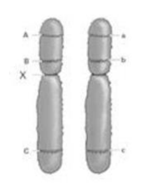
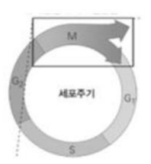

# 복습문제 29선 — 9/17 수업 범위

3장 기출 **23개**와 수업 내용으로 만든 변형 연습 **6개**예요. 먼저 풀어 보고, 막히면 힌트를 열어 보세요.

> `복습문제_0917_Cell_Division.html`를 마크다운으로 옮겼어요. 원문, 힌트, 풀이는 접혀 있어요. 먼저 풀어 보고 펼쳐 보세요.

**목차**

- [B. 기출](#partB)
  - [P1. 세포가 성장하고 DNA를 복제하는 시기](#p1)
  - [P2. 확인점에서 검사하는 일](#p2)
  - [P3. 상동염색체가 분리되는 시기](#p3)
  - [P4. 46개 염색체 세포의 유사분열 결과](#p4)
  - [P5. 동원체의 뜻](#p5)
  - [P6. 사람의 정자와 난자](#p6)
  - [P7. 유사분열에 대한 옳은 설명](#p7)
  - [P8. 농도가 변하는 세포주기 조절 단백질](#p8)
  - [P9. 유사분열기가 아닌 시기](#p9)
  - [P10. 자매염색분체가 분리되는 시기](#p10)
  - [P11. 암세포가 다른 곳으로 퍼지는 과정](#p11)
  - [P12. 염색체 그림 판독](#p12)
  - [P13. 자매염색분체가 붙어 있는 부위](#p13)
  - [P14. 자매염색분체의 뜻](#p14)
  - [P15. 암이 생기는 때](#p15)
  - [P16. 암세포의 특성이 아닌 것](#p16)
  - [P17. 세포주기 그림 설명](#p17)
  - [P18. 세포주기의 순서](#p18)
  - [P19. 상동염색체가 분리되는 시기](#p19)
  - [P20. 염색체 쌍의 구성원](#p20)
  - [P21. 복제된 염색체의 두 복사본](#p21)
  - [P22. 자매염색분체에 대한 옳은 설명](#p22)
  - [P23. DNA 중합효소가 가장 활발한 시기](#p23)
- [C. 변형 연습](#partC)
  - [P24. [변형] 두 막대의 관계 가리기](#p24)
  - [P25. [변형] 무엇이 나뉘는가 짝짓기](#p25)
  - [P26. [변형] 고장 난 유전자의 이름](#p26)
  - [P27. [변형] 암에 대한 옳은 설명](#p27)
  - [P28. [변형] 분열하지 않는 신경세포](#p28)
  - [P29. [변형] 상처가 났을 때 분열이 시작되는 경로](#p29)

## B. 기출

### P1. 세포가 성장하고 DNA를 복제하는 시기

다음 세포들이 대부분의 시간을 보내는 시기로서, 세포가 성장하고 DNA를 복제하는 시기는?

- (1) 후기
- (2) 간기
- (3) 전기
- (4) 중기

원문 정보 보기

기출 3강 합본 1번 (PDF 1쪽)

힌트 보기

세포주기를 G1–S–G2와 M기로 나눴을 때, 성장(G1)과 DNA 복제(S)가 함께 들어 있는 묶음의 이름을 떠올려 보세요.

풀이 보기

1. (1) 틀려요. 후기는 M기(분열기) 안의 한 단계예요. 이미 복제된 염색체를 나누는 때라 세포가 자라거나 DNA를 복제하지 않아요.
2. (2) 맞아요. 간기는 G1기(세포 성장), S기(DNA 복제), G2기(분열 준비)를 합친 시기이고, 세포주기의 대부분이 여기에 해당해요.
3. (3) 틀려요. 전기도 M기 안의 단계로, 이미 복제된 DNA를 응축해 분열을 시작하는 때예요.
4. (4) 틀려요. 중기 역시 M기 안의 단계로, 복제된 염색체가 세포 가운데에 늘어서는 때예요.
5. 수업과의 연결: 분열 직후 작아진 세포가 G1기에 자라고, 분열 신호가 오면 S기에 DNA를 복제한다는 설명과 이어져요. 간기라는 묶음 이름과 M기의 단계 이름(전기·중기·후기·말기)은 강의노트 3장 p1에 있어요.

**정답:** (2)

---

### P2. 확인점에서 검사하는 일

세포주기 확인점에서 검사할 수 있는 일로 가능한 것은?

- (1) DNA가 두 부분으로 잘려진 곳이 있는지 검사한다.
- (2) 세포의 크기가 충분히 커서 3개의 딸세포로 분리 가능한지 검사한다.
- (3) 세포를 반으로 나눌 세포벽이 만들어졌는지 검사한다.
- (4) S기에 모든 DNA가 복제되었는지 검사한다.

원문 정보 보기

기출 3강 합본 2번 (PDF 1쪽)

힌트 보기

수업에서 확인점이 무엇을 확인한다고 했는지 떠올려 보세요. 한 단계가 끝나지 않으면 다음 단계로 못 넘어가게 막는 곳이에요.

풀이 보기

1. (1) 출제 의도로는 답이 아니지만 완전히 틀린 말은 아니에요. 문항은 이 보기를 확인점과 무관한 일로 두었어요. 그런데 강의노트 3장 p2에는 방사선이나 화학물질이 DNA를 손상시키면 확인점이 수선할 시간을 준다고 되어 있고, DNA가 끊어진 것도 그런 손상에 들어가요.
2. (2) 틀려요. 세포는 한 번 분열할 때 둘로 나뉘므로 3개의 딸세포로 나뉘는지를 검사하는 일은 없어요.
3. (3) 틀려요. 수업에서 든 확인 대상(DNA 복제, 방추사 부착, 분열할 시기인지)에 세포벽은 없어요. 게다가 사람 같은 동물세포에는 세포벽이 아예 없어요.
4. (4) 맞아요. S기의 DNA 복제가 다 끝나고 정상인지 확인한 뒤에야 다음 단계로 넘어가요. 복제가 덜 끝났으면 멈추고 고쳐요.
5. 수업과의 연결: 보고서를 내기 전에 학번·이름을 확인하고 "멈춰! 내지 마!" 한 뒤 고쳐서 내는 비유와, 확인점이 DNA 복제가 정상인지·방추사가 제대로 붙었는지를 본다는 정리와 이어져요.

**정답:** (4)

인쇄된 답과 같지만, 보기 (1)도 넓게 읽으면 성립할 여지가 있어요. 확인점은 DNA 손상(끊어짐 포함)을 발견하면 세포주기를 멈추고 수선할 시간을 주기 때문이에요. 출제 의도는 수업에서 직접 든 'S기에 DNA가 다 복제되었는지'를 고르는 것이라 (4)를 답으로 두었어요.

---

### P3. 상동염색체가 분리되는 시기

상동염색체는 어느 시기에 분리되는가?

- (1) 제1감수분열
- (2) 유사분열
- (3) 모두 옳다
- (4) 제2감수분열

원문 정보 보기

기출 3강 합본 3번 (PDF 1쪽)

힌트 보기

엄마 쪽과 아빠 쪽 염색체가 짝을 이룬 것이 상동염색체예요. 이 짝이 갈라져야 염색체 수가 반으로 줄어요.

풀이 보기

1. (1) 맞아요. 감수분열은 두 단계로 진행되는데, 첫 단계인 제1감수분열에서 상동염색체가 갈라져 염색체 수가 반(n)이 돼요.
2. (2) 틀려요. 유사분열에서 나뉘는 것은 자매염색분체이고, 상동염색체는 갈라지지 않고 따라가서 2n이 그대로 유지돼요.
3. (3) 틀려요. 유사분열과 제2감수분열에서는 상동염색체가 아니라 자매염색분체가 갈라지므로 '모두'가 될 수 없어요.
4. (4) 틀려요. 제2감수분열에서 갈라지는 것은 자매염색분체예요. 상동염색체는 이미 제1감수분열에서 갈라졌어요.
5. 수업과의 연결: 감수분열은 처음에 상동염색체가 나뉘고 그다음에 자매염색분체가 나뉜다는 설명과 이어져요.

**정답:** (1)

---

### P4. 46개 염색체 세포의 유사분열 결과

46개의 염색체를 가지고 유사분열을 시작한 세포는 ( ) 가진 딸세포를 만든다.

- (1) 23개의 염색체들
- (2) 34개의 염색체들
- (3) 46개의 염색체들
- (4) 92개의 염색체들
- (5) 12개의 염색체들

원문 정보 보기

기출 3강 합본 5번 (PDF 1쪽)

힌트 보기

유사분열에서 나뉘는 것은 자매염색분체예요. 복제된 염색체가 반씩 나뉘면 딸세포의 염색체 수는 처음과 비교해 어떻게 될까요?

풀이 보기

1. (1) 틀려요. 23개는 상동염색체 쌍 중 하나씩만 가진 반수체의 수로, 감수분열의 결과예요.
2. (2) 틀려요. 46개에서 34개가 나오는 분열 과정은 없어요.
3. (3) 맞아요. 분열 전에 DNA를 복제해 두고 자매염색분체를 하나씩 나눠 가지므로 딸세포도 46개(2n = 46)를 가져요.
4. (4) 틀려요. 92는 복제 직후 자매염색분체를 하나씩 센 수예요. 이 분체들이 두 딸세포로 나뉘므로 딸세포 하나에는 46개가 들어가요.
5. (5) 틀려요. 12개는 46개에서 나올 수 있는 수가 아니에요.
6. 수업과의 연결: 사람은 염색체가 46개(23쌍)라는 문답과 체세포 분열에서는 자매염색분체가 나뉘어 2n → 2n이 된다는 설명과 이어져요.

**정답:** (3)

---

### P5. 동원체의 뜻

동원체는 ( ) 지역이다.

- (1) 핵이 위치하는
- (2) 자매염색분체가 서로 부착되어 있는
- (3) 중기 염색체가 정렬되는
- (4) 염색체의 끝이 발견되는

원문 정보 보기

기출 3강 합본 7번 (PDF 1쪽)

힌트 보기

분열 중에 보이는 염색체는 막대기 두 개가 가운데에서 붙어 있는 모양이에요. 그 붙은 자리의 이름이 동원체예요.

풀이 보기

1. (1) 틀려요. 핵은 세포 안의 구조이고, 염색체는 그 핵 안에 들어 있어요. 동원체는 염색체의 한 부분이라 핵의 위치와는 관계없어요.
2. (2) 맞아요. 복제로 생긴 두 자매염색분체가 붙어 있는 잘록한 부분이 동원체예요.
3. (3) 틀려요. 중기에 염색체가 늘어서는 곳은 세포의 가운데 지점이에요(강의노트 3장 p2 '중기: 염색체가 중간지점 배열'). 동원체는 세포 안의 장소가 아니라 염색체 위의 부위예요.
4. (4) 틀려요. 동원체는 두 자매염색분체를 이어 주는 부위이지 염색체의 끝이 아니에요.
5. 수업과의 연결: 교수님이 "가운데가 붙어 있는 부분을 동원체"라고 설명한 대목과 이어져요. 이때 '상동염색체끼리'라고 말했지만, 붙어 있는 것은 자매염색분체예요.

**정답:** (2)

---

### P6. 사람의 정자와 난자

다음 중 사람의 일반적인 정자와 난자에 대한 설명 중 옳은 것은?

- (1) 모두 우성이거나 모두 열성인 유전자를 갖는다.
- (2) 각각 염색체를 두 종류를 갖는다.
- (3) 한 사람에 의해서 만들어진 정자나 난자는 모두 유전적으로 동일하다.
- (4) 유사분열로 만들어진다.
- (5) 각각 염색체를 한 종류만 갖는다.

원문 정보 보기

기출 3강 합본 11번 (PDF 1쪽)

힌트 보기

정자와 난자는 반수체예요. 반수체는 상동염색체 쌍에서 몇 개를 갖는 세포인지 떠올려 보세요.

풀이 보기

1. (1) 틀려요. 정자·난자는 유전자마다 대립유전자를 하나씩 받는데, 어느 쪽을 받을지는 유전자마다 따로 정해져요. 예를 들어 Cc, Dd인 사람은 C와 d를 함께 가진 정자처럼 우성과 열성이 섞인 배우자도 만들어요.
2. (2) 틀려요. 상동염색체를 두 개씩(쌍으로) 가진 것은 2배체인 체세포예요.
3. (3) 틀려요. 상동염색체 쌍마다 엄마 쪽·아빠 쪽 중 어느 것이 들어갈지가 배우자마다 달라져요. 그래서 한 사람이 만든 정자나 난자라도 유전적으로 모두 같지 않아요. 예를 들어 Cc인 사람은 C를 가진 정자와 c를 가진 정자를 모두 만들어요.
4. (4) 틀려요. 정자와 난자는 염색체 수를 반으로 줄이는 감수분열로 만들어져요.
5. (5) 맞아요. 정자·난자는 반수체라서 상동염색체 쌍 중 하나씩만, 즉 각 염색체를 한 종류만 가져요(사람은 23개).
6. 수업과의 연결: 감수분열로 절반이 되면 상동염색체 중 하나만 갖고 이것을 반수체라 한다는 설명, 정자·난자는 반수체라는 정리와 이어져요.

**정답:** (5)

---

### P7. 유사분열에 대한 옳은 설명

다음 중 유사분열에 대한 설명으로 맞는 것은?

- (1) 2배체의 세포로부터 반수체의 세포를 만든다.
- (2) 배우자를 생산하는 세포에서 일어난다.
- (3) 제1유사분열과 제2유사분열의 두 가지 분리된 분열로 이루어져 있다.
- (4) 부모세포와 정확히 동일한 유전적 복제를 가진 딸세포를 만든다.

원문 정보 보기

기출 3강 합본 14번 (PDF 2쪽)

힌트 보기

보기 중 셋은 감수분열의 특징을 유사분열에 붙여 놓은 것이에요. 유사분열에서 나뉘는 것이 자매염색분체라는 점에서 출발해 보세요.

풀이 보기

1. (1) 틀려요. 2배체에서 반수체를 만드는 것은 감수분열이에요. 유사분열은 2n → 2n이에요.
2. (2) 틀려요. 배우자(정자·난자)를 만드는 분열은 감수분열이에요. 유사분열은 몸을 이루는 체세포가 늘어날 때 일어나요.
3. (3) 틀려요. 두 단계로 나뉘어 진행되는 것은 감수분열(제1·제2감수분열)이고, '제1유사분열·제2유사분열'이라는 단계는 없어요.
4. (4) 맞아요. DNA를 복제한 뒤 정보가 똑같은 자매염색분체를 하나씩 나눠 가지므로 딸세포는 부모세포와 같은 유전 정보를 가져요. '정확히'에는 단서가 있어요. 복제할 때 드물게 돌연변이가 생기면 달라질 수 있는데, 강의노트도 '우연한 돌연변이를 제외하고 유전적으로 동일'하다고 적어요.
5. 수업과의 연결: 짐을 복제해 두 개로 만든 뒤 하나씩 나눠 갖는 이사 비유와 체세포 분열은 자매염색분체가 나뉘어 2n → 2n이라는 설명, 감수분열은 정자·난자를 만들 때만 일어난다는 설명과 이어져요.

**정답:** (4)

---

### P8. 농도가 변하는 세포주기 조절 단백질

진핵생물의 세포주기 조절에 관련되고 농도가 계속 변동하는 단백질들은?

- (1) 양자펌프
- (2) 동원체
- (3) 조절효소들
- (4) 사이클린
- (5) 인산화효소

원문 정보 보기

기출 3강 합본 18번 (PDF 2쪽)

힌트 보기

세포 안에서 주기를 직접 돌리는 두 단백질은 사이클린과 CDK예요. 둘 중 농도가 단계마다 오르내리는 쪽과 늘 비슷하게 있는 쪽을 가려 보세요.

풀이 보기

1. (1) 틀려요. 양자펌프는 막을 사이에 두고 수소 이온(H+)을 퍼내는 단백질로, 세포호흡·광합성에서 다룬 것이에요. 세포주기 조절과는 관계없어요.
2. (2) 틀려요. 동원체는 자매염색분체가 붙어 있는 염색체의 부위이지, 주기에 따라 농도가 오르내리는 조절 단백질이 아니에요.
3. (3) 틀려요. 너무 넓은 이름이에요. 주기를 돌리는 효소인 CDK는 농도가 거의 일정하고, 농도가 오르내리는 쪽은 효소가 아닌 사이클린이에요.
4. (4) 맞아요. 사이클린은 단계마다 종류가 다르고, 필요한 단계에서 농도가 올라갔다가 그 단계가 끝나면 떨어져요. 이름도 주기(cycle)에 따라 오르내린다는 뜻에서 왔어요.
5. (5) 틀려요. 사이클린 의존성 인산화 효소(CDK)는 세포 안에 늘 비슷한 양이 있고, 사이클린이 붙을 때만 켜져요. 그래서 농도가 계속 변하는 단백질은 아니에요.
6. 수업과의 연결: 세포 안에서 분열을 일으키는 사이클린을 찾았고, 사이클린이 CDK와 둘이 합쳐 주기를 넘긴다는 설명과 이어져요.

**정답:** (4)

---

### P9. 유사분열기가 아닌 시기

다음 세포주기 중 유사분열기가 아닌 것은?

- (1) 간기
- (2) 후기
- (3) 전기
- (4) 말기
- (5) 중기

원문 정보 보기

기출 3강 합본 20번 (PDF 2쪽)

힌트 보기

세포주기는 간기(G1·S·G2)와 M기로 나뉘어요. 나머지 넷은 M기 안의 단계 이름이에요.

풀이 보기

1. (1) 맞아요. 간기는 G1기·S기·G2기를 합친 시기로, 세포가 자라고 DNA를 복제하며 분열을 준비할 뿐 분열하지는 않아요. 그래서 유사분열기가 아니에요.
2. (2) 틀려요. 후기는 유사분열기(M기) 안의 단계로, 자매염색분체가 갈라져 양쪽으로 이동하는 때예요.
3. (3) 틀려요. 전기는 유사분열기의 첫 단계로, 염색체가 응축되기 시작하는 때예요.
4. (4) 틀려요. 말기는 유사분열기의 마지막 단계로, 염색체가 다시 풀리고 핵막이 생기는 때예요.
5. (5) 틀려요. 중기는 유사분열기 안의 단계로, 염색체가 세포 가운데에 늘어서는 때예요.
6. 수업과의 연결: 세포주기를 G1 → S → G2 → M으로 정리하고 M이 유사분열(mitosis)이라는 설명과 이어져요. 전기·중기·후기·말기라는 단계 이름은 강의노트 3장 p1–p2에 있어요.

**정답:** (1)

---

### P10. 자매염색분체가 분리되는 시기

자매염색분체는 어느 시기에 분리되는가?

- (1) 제1감수분열 & 제2감수분열
- (2) 유사분열
- (3) 제2감수분열
- (4) 제1감수분열
- (5) 제2감수분열 & 유사분열

원문 정보 보기

기출 3강 합본 22번 (PDF 2쪽)

힌트 보기

자매염색분체는 복제로 생긴 똑같은 두 가닥이에요. 유사분열에서 무엇이 나뉘었는지, 감수분열의 두 단계에서 각각 무엇이 나뉘었는지 적어 보세요.

풀이 보기

1. (1) 틀려요. 제1감수분열에서 갈라지는 것은 상동염색체이고, 이때 자매염색분체는 아직 붙어 있어요.
2. (2) 틀려요. 유사분열에서 자매염색분체가 갈라지는 것은 맞지만, 제2감수분열에서도 갈라지므로 하나만 고르면 빠진 것이 있어요.
3. (3) 틀려요. 제2감수분열에서 자매염색분체가 갈라지는 것은 맞지만, 유사분열이 빠졌어요.
4. (4) 틀려요. 제1감수분열에서는 상동염색체가 갈라져요.
5. (5) 맞아요. 유사분열은 자매염색분체를 나눠 2n → 2n을 만들고, 감수분열은 제1감수분열에서 상동염색체를, 제2감수분열에서 자매염색분체를 나눠요.
6. 수업과의 연결: 체세포 분열에서 나뉘는 것은 자매염색분체이고, 감수분열은 처음에 상동염색체, 그다음에 자매염색분체가 나뉜다는 설명과 이어져요.

**정답:** (5)

---

### P11. 암세포가 다른 곳으로 퍼지는 과정

다음 중 암세포가 주위를 벗어나 신체의 다른 곳으로 퍼지는 과정을 무엇이라고 하는가?

- (1) 발암
- (2) 돌연변이 유발
- (3) 전이
- (4) 유사분열
- (5) 혈관신생

원문 정보 보기

기출 3강 합본 24번 (PDF 2쪽)

힌트 보기

제자리에 머무는 종양과 몸의 다른 곳으로 퍼지는 종양을 가르는 말이 무엇이었는지 떠올려 보세요.

풀이 보기

1. (1) 틀려요. 발암은 암이 생기는 것 자체를 말하고, 퍼져 나가는 과정의 이름은 아니에요.
2. (2) 틀려요. 돌연변이 유발은 유전자에 변화가 생기게 하는 것이고, 세포가 이동하는 과정이 아니에요.
3. (3) 맞아요. 암세포가 원래 자리에서 떨어져 나와 혈액 등을 타고 몸의 다른 곳으로 퍼지는 과정이 전이(metastasis)예요. 전이하는 종양이 악성 종양이에요.
4. (4) 틀려요. 유사분열은 세포 하나가 똑같은 딸세포 둘로 나뉘는 분열이에요.
5. (5) 틀려요. 혈관신생은 새 혈관이 만들어지는 현상으로, 암세포가 다른 곳으로 옮겨 가는 과정 자체는 아니에요.
6. 수업과의 연결: 일상에서 말하는 암은 전이하는 악성 종양이라고 짚은 대목과 이어져요.

**정답:** (3)

---

### P12. 염색체 그림 판독

다음 그림은 염색체를 나타낸 것이다. 이에 대한 설명으로 옳지 않은 것은?

- (1) 두 염색체는 상동염색체 관계이다.
- (2) X는 미세소관(방추사)이 부착되는 부위이다.
- (3) A, B, C는 각각 별개의 유전자들이다.
- (4) 두 염색체는 복제되어 생긴 자매염색분체이다.
- (5) A와 a는 대립유전자 관계이다.

원문 정보 보기

기출 3강 합본 25번 (PDF 2쪽)

힌트 보기

왼쪽 막대의 A 자리에 오른쪽 막대는 무엇을 가지고 있는지 보세요. 정보가 완전히 같은 짝인지, 다를 수 있는 짝인지가 열쇠예요.

풀이 보기

1. (1) 맞는 설명이에요. 크기와 모양이 같고 같은 자리에 같은 유전자(A와 a, B와 b, C와 c)를 가진 두 염색체이니 상동염색체예요.
2. (2) 맞는 설명이에요. X는 가운데 잘록한 부위인 동원체 자리이고, 동원체는 방추사(미세소관)가 붙는 곳이에요(강의노트 3장 p2).
3. (3) 맞는 설명이에요. A, B, C는 한 염색체의 서로 다른 자리에 있으니 서로 다른 유전자예요.
4. (4) 틀린 설명이에요. 자매염색분체는 DNA 복제로 생긴 사본이라 모든 정보가 완전히 같아야 해요. 그런데 한쪽은 A, 다른 쪽은 a처럼 다른 버전을 가지고 있으니 복제 사본이 아니라 엄마·아빠에게서 하나씩 받은 상동염색체예요.
5. (5) 맞는 설명이에요. A와 a는 같은 자리에 있는 같은 유전자의 다른 버전이므로 대립유전자예요.
6. 수업과의 연결: "자매 염색분체는 모든 정보가 똑같습니다. 그런데 상동 염색체는 다를 수가 있죠"와 C·c 대립유전자 예와 이어져요.

**정답:** (4)

---

### P13. 자매염색분체가 붙어 있는 부위

복제된 염색체의 자매염색분체가 서로 붙어 있는 부위의 명칭은?

- (1) 동원체
- (2) 대립유전자
- (3) 염색분체
- (4) 중심립
- (5) 핵형

원문 정보 보기

기출 3강 합본 26번 (PDF 3쪽)

힌트 보기

복제된 염색체를 X 모양으로 그렸을 때 가운데 잘록하게 묶인 곳의 이름이에요.

풀이 보기

1. (1) 맞아요. 복제된 두 자매염색분체가 가운데에서 붙어 있는 부위가 동원체(centromere)예요.
2. (2) 틀려요. 대립유전자는 같은 유전자의 다른 버전(예: C와 c)이고, 염색체의 부위 이름이 아니에요.
3. (3) 틀려요. 염색분체는 붙어 있는 두 가닥 각각을 부르는 말이지, 붙어 있는 부위가 아니에요.
4. (4) 틀려요. 중심립은 염색체의 한 부위가 아니라 세포 안의 다른 구조예요.
5. (5) 틀려요. 핵형은 한 생물의 염색체 전체 모습(수와 모양)을 말해요.
6. 수업과의 연결: 교수님이 가운데 붙은 부분을 동원체라고 설명한 대목과 이어져요. 이때 "상동 염색체끼리"라고 말씀하셨지만 붙어 있는 것은 자매염색분체예요.

**정답:** (1)

---

### P14. 자매염색분체의 뜻

자매염색분체란?

- (1) 세포주기의 S기 동안 만들어진 한 염색체의 동일한 2개의 복제품
- (2) 상동염색체의 또 다른 명칭
- (3) 방추체 미세소관들이 만나는 복제된 염색체의 두 지점
- (4) 말기 동안에 각 딸세포에 분배되는 복제된 염색체들
- (5) 2배체 생물의 핵형 분석 시 짝이 일치되는 염색체 쌍

원문 정보 보기

기출 3강 합본 27번 (PDF 3쪽)

힌트 보기

자매염색분체가 언제, 무엇에서 생기는지(복제)를 떠올리면 한 보기만 남아요.

풀이 보기

1. (1) 맞아요. S기에 DNA가 복제되면 한 염색체가 정보가 완전히 같은 두 가닥이 되고, 이 두 가닥이 자매염색분체예요.
2. (2) 틀려요. 상동염색체는 엄마·아빠에게서 하나씩 받은 짝이라 대립유전자가 다를 수 있어서, 복제 사본인 자매염색분체와 다른 개념이에요.
3. (3) 틀려요. 방추사가 붙는 곳은 동원체라는 한 부위이고, 자매염색분체는 염색체 가닥 자체를 가리켜요.
4. (4) 틀려요. 분열 때 딸세포로 나뉘어 가는 것은 자매염색분체가 갈라진 각각이지, 이 보기는 자매염색분체의 정의가 아니에요.
5. (5) 틀려요. 2배체 생물에서 짝을 이루는 염색체 쌍은 상동염색체예요.
6. 수업과의 연결: "DNA 복제가 끝나야 세포 분열이 일어납니다"와 복제한 막대 둘이 자매염색분체라는 설명과 이어져요.

**정답:** (1)

---

### P15. 암이 생기는 때

암은 언제 발생하는가?

- (1) 세포가 노화될 때
- (2) 세포들이 세포주기를 조절하는 매커니즘에 매우 민감해질 때
- (3) 발암 억제 요소 p53이 세포 내에 과다하게 만들어질 때
- (4) 세포들이 언제 얼마나 자주 분열할 것인지 조절하는 매커니즘에 대해 반응하기를 중단할 때
- (5) 세포들이 다른 세포들에 부착하지 못하고 움직일 때

원문 정보 보기

기출 3강 합본 28번 (PDF 3쪽)

힌트 보기

교수님은 세포 분열이 정교하게 조절된다고 하면서 "이 조절이 깨지면" 무엇이 된다고 했는지 떠올려 보세요.

풀이 보기

1. (1) 틀려요. 나이가 들수록 암이 많은 것은 늙는 것 자체 때문이 아니라 돌연변이가 쌓일 시간이 길어지기 때문이에요.
2. (2) 틀려요. 조절 신호에 더 민감해지면 오히려 조절을 더 잘 따르게 돼요. 암은 조절에 반응하지 않게 되는 쪽이에요.
3. (3) 틀려요. p53은 종양 억제 유전자라서, 많아지면 확인점에서 분열을 멈추고 고치는 쪽으로 작용해요. 암은 p53 같은 억제 장치가 망가질 때 생기기 쉬워요.
4. (4) 맞아요. 세포가 언제, 얼마나 자주 분열할지 정하는 세포주기 조절에 더 이상 따르지 않고 계속 분열하면 암이 돼요.
5. (5) 틀려요. 다른 세포에 붙지 않고 움직이는 것은 이미 생긴 암세포가 전이할 때의 성질이지, 암이 생기는 원인 설명이 아니에요.
6. 수업과의 연결: "이 조절이 깨지면은 암이에요"와 수업 마지막 정리와 이어져요.

**정답:** (4)

---

### P16. 암세포의 특성이 아닌 것

다음 중 암세포의 특성이 아닌 것은?

- (1) 접촉저해
- (2) 활발한 이동성
- (3) 전이
- (4) 조절 불능 세포분열

원문 정보 보기

기출 3강 합본 29번 (PDF 3쪽)

힌트 보기

상처가 다 메워지면 멈추는 성질은 정상 세포와 암세포 중 누구의 성질이었는지 생각해 보세요.

풀이 보기

1. (1) 맞아요(특성이 아닌 것). 접촉저해는 정상 세포가 이웃 세포와 닿으면 분열을 멈추는 성질이에요. 암세포는 이 성질을 잃어서 계속 겹겹이 자라요.
2. (2) 틀려요(암세포의 특성이에요). 악성 암세포는 원래 자리를 떠나 활발히 움직일 수 있어요.
3. (3) 틀려요(암세포의 특성이에요). 혈액을 타고 다른 곳으로 퍼지는 전이는 악성 종양의 특징이에요.
4. (4) 틀려요(암세포의 특성이에요). 세포주기 조절이 깨져 멈추지 않고 분열하는 것이 암세포의 기본 성질이에요.
5. 수업과의 연결: "정상 세포는 접촉 저해를 받아요 … 근데 암세포는 이거를 안 받는다"와 이어져요.

**정답:** (1)

---

### P17. 세포주기 그림 설명

다음은 유사분열의 세포주기를 나타낸 것이다. 이에 대한 설명으로 옳지 않은 것은?

- (1) 간기는 G1 ~ G2기이다
- (2) M기에서 자매염색분체가 서로 분리된다
- (3) G1기에 세포가 성장한다.
- (4) S기 동안에 DNA복제가 일어난다
- (5) S기 동안에 세포확인점이 존재한다

원문 정보 보기

기출 3강 합본 30번 (PDF 3쪽)

힌트 보기

확인점은 한 단계가 끝난 뒤, 다음 단계로 넘어가기 전에 검사하는 곳이라고 배웠어요. DNA 복제가 잘 끝났는지는 언제 확인할까요?

풀이 보기

1. (1) 맞는 설명이에요. 간기는 G1기, S기, G2기를 합친 것으로, 분열(M기)과 분열 사이예요.
2. (2) 맞는 설명이에요. 유사분열(M기)에서는 복제된 염색체의 자매염색분체가 갈라져 두 딸세포로 가요.
3. (3) 맞는 설명이에요. 분열 직후 절반 크기가 된 세포가 G1기에 자라요.
4. (4) 맞는 설명이에요. S기는 DNA를 합성(복제)하는 시기예요.
5. (5) 출제 의도로는 답이에요. 수업 모형에서 확인점은 한 단계가 끝난 뒤에 있고, DNA 복제가 제대로 됐는지는 S기가 끝난 뒤(G2 쪽)에서 확인한다고 배웠어요.
6. 수업과의 연결: 확인점이 "DNA 복제가 정상적으로 일어났는지"를 확인한다는 설명과 G1–S–G2–M 순서 설명과 이어져요.

**정답:** (5)

인쇄된 답안지의 답도 (5)예요. 다만 현대 세포생물학에서는 S기가 진행되는 도중에 DNA 손상을 점검하는 장치(S기 안의 점검)도 소개되기 때문에 (5)를 옳은 설명으로 볼 여지가 있어요. 나머지 (1)~(4)가 모두 확실히 옳으므로, 수업 모형에 따른 출제 의도상 답은 (5)예요.

---

### P18. 세포주기의 순서

세포주기의 순서로 올바른 것은?

- (1) S, G1, G2, 핵분열, 세포질분열
- (2) G1, G2, S, 핵분열, 세포질분열
- (3) G1, S, G2, 핵분열, 세포질분열
- (4) S, G1, G2, 세포질분열, 핵분열

원문 정보 보기

기출 3강 합본 31번 (PDF 3쪽)

힌트 보기

분열 직후 작아진 세포가 먼저 무엇을 하는지, 그리고 DNA 복제는 분열 준비보다 앞인지 뒤인지 생각해 보세요.

풀이 보기

1. (1) 틀려요. 분열 직후에는 먼저 G1기에 세포가 자라고, 그다음에 S기에 DNA를 복제해요.
2. (2) 틀려요. G2기는 DNA 복제(S기)가 끝난 뒤 분열을 준비하는 시기라서 S기보다 뒤에 와요.
3. (3) 맞아요. G1(성장) → S(DNA 복제) → G2(분열 준비) → 핵분열 → 세포질분열 순서예요.
4. (4) 틀려요. S기가 맨 앞이 아니고, 분열에서도 핵이 먼저 나뉜 뒤 세포질이 나뉘어요.
5. 수업과의 연결: 교수님이 "G1 → S → G2 → M"으로 정리한 대목과 이어져요.

**정답:** (3)

---

### P19. 상동염색체가 분리되는 시기

상동염색체는 어느 시기에 분리되는가?

- (1) 제2감수분열
- (2) 모두 옳다
- (3) 제1감수분열
- (4) 유사분열

원문 정보 보기

기출 3강 합본 34번 (PDF 3쪽)

힌트 보기

감수분열은 두 단계로 진행되는데, 처음에 나뉘는 것과 그다음에 나뉘는 것이 무엇이었는지 떠올려 보세요.

풀이 보기

1. (1) 틀려요. 제2감수분열에서 나뉘는 것은 자매염색분체예요.
2. (2) 틀려요. 유사분열과 제2감수분열에서는 상동염색체가 나뉘지 않으니 모두 옳을 수 없어요.
3. (3) 맞아요. 감수분열의 첫 단계인 제1감수분열에서 상동염색체가 나뉘어 염색체 수가 반(2n → n)이 돼요.
4. (4) 틀려요. 유사분열(체세포 분열)에서는 자매염색분체가 나뉘고, 상동염색체는 나뉘지 않고 따라가요.
5. 수업과의 연결: "감수 분열에서는 처음에 상동 염색체가 나눠지고, 그다음에 자매 염색분체가 나뉘죠"와 이어져요.

**정답:** (3)

---

### P20. 염색체 쌍의 구성원

염색체 쌍의 구성원을 무엇이라고 하는가?

- (1) 대립유전자
- (2) 자매염색분체
- (3) 배우자
- (4) 2배체
- (5) 상동염색체

원문 정보 보기

기출 3강 합본 36번 (PDF 3쪽)

힌트 보기

엄마에게서 하나, 아빠에게서 하나 받아 짝을 이루는 염색체의 이름이에요.

풀이 보기

1. (1) 틀려요. 대립유전자는 같은 자리에 있는 같은 유전자의 다른 버전이지, 염색체가 아니에요.
2. (2) 틀려요. 자매염색분체는 한 염색체가 복제되어 생긴 두 가닥으로, 부모에게서 하나씩 받은 짝이 아니에요.
3. (3) 틀려요. 배우자는 정자·난자 같은 생식세포예요.
4. (4) 틀려요. 2배체(2n)는 상동염색체를 쌍으로 가진 세포의 상태를 말해요.
5. (5) 맞아요. 크기와 모양이 같고 부모에게서 하나씩 받은 염색체 쌍의 구성원이 상동염색체예요.
6. 수업과의 연결: 하나는 엄마, 하나는 아빠가 준 비슷한 염색체를 상동 염색체라고 한 설명과 이어져요.

**정답:** (5)

---

### P21. 복제된 염색체의 두 복사본

다음 중 복제된 염색체의 2개의 복사본 각각을 무엇이라고 하는가?

- (1) 중심립
- (2) 대립유전자
- (3) 상동염색체
- (4) 자매염색분체
- (5) 동원체

원문 정보 보기

기출 3강 합본 37번 (PDF 3쪽)

힌트 보기

복제로 생겨 정보가 완전히 같은 두 가닥의 이름이에요.

풀이 보기

1. (1) 틀려요. 중심립은 염색체가 아닌 세포 안의 다른 구조예요.
2. (2) 틀려요. 대립유전자는 같은 유전자의 다른 버전(예: C와 c)이에요.
3. (3) 틀려요. 상동염색체는 엄마·아빠에게서 하나씩 받은 짝이라 복제 사본이 아니에요.
4. (4) 맞아요. DNA 복제로 생긴 한 염색체의 두 사본 각각이 자매염색분체예요.
5. (5) 틀려요. 동원체는 두 자매염색분체가 붙어 있는 부위의 이름이에요.
6. 수업과의 연결: 막대 하나와 그것을 복제한 옆 막대를 자매 염색분체라고 한 설명과 이어져요.

**정답:** (4)

---

### P22. 자매염색분체에 대한 옳은 설명

다음 중 자매염색분체에 대한 설명으로 옳은 것은?

- (1) 택솔에 의해 붕괴된다
- (2) 함께 붙어 있는 한 염색체의 정확히 똑같은 사본이다
- (3) 함께 붙어 있는 서로 다른 2개의 염색체이다
- (4) 서로 다른 유전자를 가지고 있는 염색체이다
- (5) 중심립에서 만들어진다

원문 정보 보기

기출 3강 합본 38번 (PDF 3쪽)

힌트 보기

자매염색분체는 무엇으로 만들어지고, 두 가닥의 정보가 같은지 다른지 떠올려 보세요.

풀이 보기

1. (1) 틀려요. 택솔은 방추사(미세소관)에 작용하는 항암제로, 자매염색분체를 무너뜨리는 물질이 아니에요.
2. (2) 맞아요. 자매염색분체는 DNA 복제로 생겨 동원체에서 함께 붙어 있는, 한 염색체의 정확히 똑같은 사본이에요.
3. (3) 틀려요. 서로 다른 두 염색체가 아니라 한 염색체가 복제된 것이에요. 서로 다른 두 염색체의 짝은 상동염색체예요.
4. (4) 틀려요. 자매염색분체는 모든 정보가 똑같아요. 같은 자리의 대립유전자가 다를 수 있는 것은 상동염색체예요.
5. (5) 틀려요. 자매염색분체는 S기의 DNA 복제로 만들어져요. 중심립에서 만들어지는 것이 아니에요.
6. 수업과의 연결: "자매 염색분체는 모든 정보가 똑같습니다"와 이어져요.

**정답:** (2)

---

### P23. DNA 중합효소가 가장 활발한 시기

다음 세포주기 중, 어느 시기에 DNA 중합효소가 가장 활동적인가?

- (1) S
- (2) 세포질분열기
- (3) G2
- (4) G1
- (5) 핵분열기

원문 정보 보기

기출 3강 합본 40번 (PDF 3–4쪽)

힌트 보기

DNA 중합효소는 DNA를 합성(복제)하는 효소예요. DNA를 합성하는 시기의 이름이 무엇의 약자였는지 떠올려 보세요.

풀이 보기

1. (1) 맞아요. S기(Synthesis)는 DNA를 합성해 복제하는 시기라서 DNA를 만드는 효소인 DNA 중합효소가 가장 바빠요.
2. (2) 틀려요. 세포질분열기는 세포질을 둘로 나누는 때라 DNA를 새로 만들지 않아요.
3. (3) 틀려요. G2기는 DNA 복제가 끝난 뒤 분열을 준비하는 시기예요.
4. (4) 틀려요. G1기는 분열 직후 작아진 세포가 성장하는 시기로, 아직 DNA를 복제하기 전이에요.
5. (5) 틀려요. 핵분열기에는 이미 복제된 염색체를 나눌 뿐 DNA를 새로 합성하지 않아요.
6. 수업과의 연결: 분열 신호가 오면 DNA를 복제하는 S기로 들어간다는 설명과 이어져요.

**정답:** (1)

---

## C. 변형 연습

### P24. [변형] 두 막대의 관계 가리기

분열 중인 세포에서 염색체 X와 Y를 관찰했다. X는 동원체에서 붙어 있는 두 가닥으로 되어 있고, 두 가닥 모두 같은 자리에 C를 가지고 있다. Y는 X와 크기·모양이 같고, X의 C와 같은 자리에 c를 가지고 있다. 옳은 설명은?

- (1) X와 Y는 복제로 생긴 자매염색분체이다.
- (2) X의 두 가닥은 엄마와 아빠에게서 하나씩 받은 상동염색체이다.
- (3) X의 두 가닥은 자매염색분체이고, X와 Y는 상동염색체이다.
- (4) C와 c는 서로 다른 자리에 있는 별개의 유전자이다.

원문 정보 보기

원문 기출이 아닌 생성 변형이에요. 다루는 혼동: 자매염색분체와 상동염색체, 유전자와 대립유전자. 근거 토픽: 2-2. 자매염색분체·상동염색체·대립유전자

힌트 보기

정보가 완전히 같은 짝과, 같은 자리의 버전이 다를 수 있는 짝을 나눠 보세요.

풀이 보기

1. (1) 틀려요. 자매염색분체는 복제 사본이라 정보가 완전히 같아야 하는데, X는 C이고 Y는 c라서 복제 관계가 아니에요.
2. (2) 틀려요. X의 두 가닥은 동원체에서 붙어 있고 같은 자리에 둘 다 C를 가진 복제 사본이에요. 부모에게서 하나씩 받은 짝이 아니에요.
3. (3) 맞아요. 붙어 있으면서 정보가 같은 두 가닥은 자매염색분체이고, 크기·모양이 같고 같은 자리에 다른 버전(C와 c)을 가진 X와 Y는 상동염색체예요.
4. (4) 틀려요. C와 c는 같은 자리에 있는 같은 유전자(예: 꽃 색깔)의 다른 버전, 즉 대립유전자예요.
5. 수업과의 연결: C는 빨강, c는 하양처럼 같은 유전자의 다른 버전이 대립유전자라는 설명과 이어져요.

**정답:** (3)

---

### P25. [변형] 무엇이 나뉘는가 짝짓기

다음은 세 가지 분열에서 나뉘는 것을 순서대로 짝지은 것이다. [체세포 분열 / 감수분열 1단계 / 감수분열 2단계] 순서로 옳게 짝지은 것은?

- (1) 상동염색체 / 상동염색체 / 자매염색분체
- (2) 자매염색분체 / 상동염색체 / 자매염색분체
- (3) 자매염색분체 / 자매염색분체 / 상동염색체
- (4) 상동염색체 / 상동염색체 / 상동염색체

원문 정보 보기

원문 기출이 아닌 생성 변형이에요. 다루는 혼동: 체세포 분열과 감수분열 각 단계의 분리 대상. 근거 토픽: 2-3. 2배체·반수체와 무엇이 나뉘는가

힌트 보기

체세포 분열에서는 상동염색체가 나뉘지 않고 "따라간다"고 했어요. 감수분열은 처음에 무엇이 나뉘었나요?

풀이 보기

1. (1) 틀려요. 체세포 분열에서는 상동염색체가 아니라 자매염색분체가 나뉘어요.
2. (2) 맞아요. 체세포 분열은 자매염색분체를 나눠 2n → 2n을 유지하고, 감수분열은 처음(1단계)에 상동염색체, 그다음(2단계)에 자매염색분체를 나눠요.
3. (3) 틀려요. 감수분열의 두 단계 순서를 뒤집었어요. 염색체 수가 반으로 줄어드는 첫 단계에서 상동염색체가 나뉘어요.
4. (4) 틀려요. 상동염색체는 감수분열 1단계에서 한 번만 나뉘어요.
5. 수업과의 연결: 체세포 분열은 자매 염색분체가, 감수 분열은 처음에 상동 염색체가 나뉜다는 대목과 이어져요.

**정답:** (2)

---

### P26. [변형] 고장 난 유전자의 이름

다음 두 사례에서 (가) 돌연변이가 생긴 유전자와 (나) 기능을 잃은 유전자의 이름을 옳게 짝지은 것은? (가) 수용체를 만드는 유전자에 돌연변이가 생겨, 신호 분자가 붙지 않아도 수용체가 늘 켜져 있다. (나) DNA가 잘못 복제되면 확인점에서 분열을 멈추고 고치게 하는 유전자가 기능을 잃었다.

- (1) (가) 발암 유전자 / (나) 종양 억제 유전자
- (2) (가) 원발암 유전자 / (나) 종양 억제 유전자
- (3) (가) 종양 억제 유전자 / (나) 발암 유전자
- (4) (가) 발암 유전자 / (나) 원발암 유전자

원문 정보 보기

원문 기출이 아닌 생성 변형이에요. 다루는 혼동: 원발암 유전자, 발암 유전자, 종양 억제 유전자의 구분. 근거 토픽: 5-1. 원발암 유전자와 발암 유전자, 5-2. 종양 억제 유전자: p53과 BRCA1

힌트 보기

돌연변이 전의 정상 유전자 이름과 돌연변이 뒤의 이름이 달랐어요. 멈추고 고치는 쪽은 촉진 쪽인가요, 억제 쪽인가요?

풀이 보기

1. (1) 맞아요. 신호 분자 없이도 늘 켜져 분열을 계속 촉진하는 돌연변이 유전자는 발암 유전자이고, 확인점에서 멈추고 고치게 하는 유전자는 종양 억제 유전자예요.
2. (2) 틀려요. 원발암 유전자는 돌연변이가 생기기 전, 신호가 있을 때만 분열을 촉진하는 정상 유전자의 이름이에요.
3. (3) 틀려요. 두 이름을 뒤집었어요. 촉진 쪽 고장이 발암 유전자, 멈춤·수선 쪽이 종양 억제 유전자예요.
4. (4) 틀려요. 원발암 유전자는 분열을 촉진하는 쪽의 정상 유전자이지, 멈추고 고치는 유전자가 아니에요.
5. 수업과의 연결: 과대표가 미친 비유와 고치는 유전자를 종양 억제 유전자라고 한 대목과 이어져요.

**정답:** (1)

---

### P27. [변형] 암에 대한 옳은 설명

암에 대한 설명으로 옳은 것은?

- (1) 종양 억제 유전자 하나에 돌연변이가 생기면 곧바로 악성 종양이 된다.
- (2) 접촉 저해는 암세포가 가진 대표적인 특징이다.
- (3) 유전자 하나만 망가지면 바로 암이 되므로 암의 발생은 나이와 관계가 없다.
- (4) 제자리에 머물며 덩어리만 만든 종양은 양성 종양이고, 암세포가 혈액을 타고 다른 곳으로 퍼지는 것을 전이라고 한다.

원문 정보 보기

원문 기출이 아닌 생성 변형이에요. 다루는 혼동: 종양 억제 유전자 돌연변이와 암 발생, 양성·악성 종양, 접촉 저해. 근거 토픽: 5-3. 양성·악성 종양, 전이, 접촉 저해

힌트 보기

"곧바로", "바로" 같은 말이 붙은 보기는 교수님이 설명한 과정과 맞는지 따져 보세요.

풀이 보기

1. (1) 틀려요. 종양 억제 유전자가 망가지면 돌연변이를 고치지 못해 암이 될 확률이 커질 뿐, 곧바로 암이 되는 것은 아니에요.
2. (2) 틀려요. 접촉 저해는 이웃과 닿으면 분열을 멈추는 정상 세포의 성질이고, 암세포는 이 성질을 잃어요.
3. (3) 틀려요. 암은 돌연변이가 대여섯 개쯤 차례로 쌓여야 생기고, 나이가 들수록 돌연변이가 많이 쌓이기 때문에 나이와 관계가 있어요.
4. (4) 맞아요. 제자리에서 덩어리만 만든 것은 양성 종양이고, 혈액을 통해 퍼지는 것이 전이이며 전이하는 것이 악성 종양이에요.
5. 수업과의 연결: 양성·악성 종양과 전이 설명, 돌연변이 누적과 나이 설명과 이어져요.

**정답:** (4)

---

### P28. [변형] 분열하지 않는 신경세포

사람의 신경세포는 태어난 뒤 거의 분열하지 않는다. 이 상태를 가장 잘 설명한 것은?

- (1) S기에서 DNA 복제를 끝내지 못해 멈춘 상태이다.
- (2) 분열 능력이 없는 것이 아니라 G1기에서 멈춰 G0기에 머무는 상태이다.
- (3) 분열에 필요한 능력 자체가 완전히 없어진 상태이다.
- (4) M기에 들어간 뒤 그대로 계속 머무는 상태이다.

원문 정보 보기

원문 기출이 아닌 생성 변형이에요. 다루는 혼동: G0기의 뜻과 세포주기 단계. 근거 토픽: 3-1. G1–S–G2–M과 G0

힌트 보기

교수님은 신경세포가 분열을 "못 하는" 것인지 "안 하는" 것인지 어떻게 말했나요?

풀이 보기

1. (1) 틀려요. 신경세포는 DNA 복제 단계로 들어가지 않고 그 전에 멈춰 있어요.
2. (2) 맞아요. 분열 능력이 없는 게 아니라 그냥 분열하지 않고 G1기에서 멈춰 머무는 상태를 G0기라고 해요.
3. (3) 틀려요. 교수님은 신경세포가 분열 능력이 없는 게 아니라 안 하는 것이라고 했어요.
4. (4) 틀려요. M기는 분열이 진행되는 시기라서, 분열하지 않는 상태와 반대예요.
5. 수업과의 연결: "능력이 없는 게 아니고 그냥 안 하는 겁니다"와 G0기 설명과 이어져요.

**정답:** (2)

---

### P29. [변형] 상처가 났을 때 분열이 시작되는 경로

피부에 상처가 나서 주변 세포들이 분열을 시작했다. 이 과정에 대한 설명으로 옳은 것은?

- (1) 성장 인자는 수용체가 없어도 곧바로 DNA 복제를 일으킨다.
- (2) 사이클린과 CDK는 세포 밖에서 오는 외적 조절자이다.
- (3) 성장 인자는 세포 밖에서 오는 외적 조절자이며, 수용체에 결합해야 신호가 안으로 전달되어 결국 사이클린과 CDK가 세포주기를 진행시킨다.
- (4) 수용체만 있으면 신호 분자가 없어도 정상 세포는 늘 분열한다.

원문 정보 보기

원문 기출이 아닌 생성 변형이에요. 다루는 혼동: 내적 조절(사이클린·CDK)과 외적 조절(성장 인자·수용체). 근거 토픽: 4-2. 외적 조절: 신호 분자와 수용체, 4-1. 내적 조절: 사이클린과 CDK

힌트 보기

차 키만 받고 차가 없으면 소용없다는 비유를 떠올려 보세요. 무엇이 밖에서 오고, 무엇이 안에서 주기를 돌리나요?

풀이 보기

1. (1) 틀려요. 신호 분자는 반드시 수용체에 결합해야만 작동해요. 수용체 없이 곧바로 DNA 복제를 일으키지 않아요.
2. (2) 틀려요. 사이클린과 CDK는 세포 안에서 주기를 직접 돌리는 내적 조절자예요.
3. (3) 맞아요. 성장 인자(외적 조절자)가 수용체에 붙으면 세포 안의 전달 단백질이 차례로 켜지고, 마지막에 사이클린과 CDK가 DNA 복제와 분열을 진행시켜요.
4. (4) 틀려요. 정상 세포의 수용체는 신호 분자가 붙을 때만 켜져요. 신호 없이 늘 켜져 있는 것은 돌연변이로 생긴 발암 유전자의 경우예요.
5. 수업과의 연결: "이 신호 분자는 반드시 수용체에 결합을 해야만 작동을 합니다"와 벤츠 차 키 비유와 이어져요.

**정답:** (3)

---

출처: 2023·2024 생명과학 기출(3강 합본). 정답은 인쇄된 답안지와 독립 판단을 대조했고, 어긋난 곳은 풀이에 밝혔습니다. 변형 연습은 수업 내용으로 만든 생성 문제입니다.
