# 세포주기 조절과 암 — 5살도 이해하는 정리노트

이영만 교수님 생명과학 · 0917 수업 (3장 세포분열)

> `정리노트_0917_Cell_Division.html`를 마크다운으로 옮겼어요. 그림은 `figures_0917/` 폴더의 SVG, 위젯은 대표 설정의 정적 그림으로 바꿨어요. 수식은 `$…$` / `$$…$$`라서 GitHub, Obsidian, Typora에서 보여요.

**목차**

- [0. 헬라 세포 — 멈추지 않는 세포](#s0)
  - [0. 헬라 세포와 이번 장의 질문](#s0-hela)
- [1. 세포주기와 두 가지 분열](#s1)
  - [1. 세포주기, 유사분열과 감수분열](#s1-cycle-division)
- [2. 염색체 — 자매염색분체와 상동염색체](#s2)
  - [2-1. 염색질과 염색체](#s2-chromatin)
  - [2-2. 자매염색분체·상동염색체·대립유전자](#s2-sister-homolog)
  - [2-3. 2배체·반수체와 무엇이 나뉘는가](#s2-ploidy)
- [3. 세포주기의 단계와 확인점](#s3)
  - [3-1. G1–S–G2–M과 G0](#s3-phases)
  - [3-2. 확인점](#s3-checkpoint)
- [4. 세포주기 조절 — 안의 엔진과 밖의 신호](#s4)
  - [4-1. 내적 조절: 사이클린과 CDK](#s4-cyclin-cdk)
  - [4-2. 외적 조절: 신호 분자와 수용체](#s4-signal)
- [5. 암 — 조절이 깨질 때](#s5)
  - [5-1. 원발암 유전자와 발암 유전자](#s5-oncogene)
  - [5-2. 종양 억제 유전자: p53과 BRCA1](#s5-suppressor)
  - [5-3. 양성·악성 종양, 전이, 접촉 저해](#s5-tumor)
- [6. 요약 · 예고](#s6)
  - [30초 요약](#s6-cheatsheet)
  - [다음 시간 예고](#s6-next)
  - [함께 보면 좋은 자료](#s6-links)

## 0. 헬라 세포 — 멈추지 않는 세포

### 0. 헬라 세포와 이번 장의 질문

*0917 수업 · 3장 도입*

**쉽게 말하면**

보통 세포는 몇십 번 나뉘고 나면 멈추는데, 어떤 아픈 세포는 먹이만 주면 멈추지 않고 계속 나뉘어요.

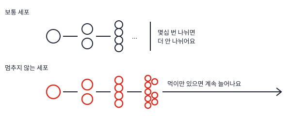

*위 줄 세포는 몇십 번 나뉜 뒤 막대 앞에서 멈추고, 아래 줄 테두리 세포는 화살표처럼 끝없이 늘어나요.*

**정확히 말하면**

**헬라 세포(HeLa cell)**는 헨리에타 랙스(Henrietta Lacks)라는 여성의 자궁경부암 세포에서 온 세포예요. 사람 몸을 떠나 몸 밖에서 배양에 성공한 첫 세포이고, 이름의 앞 두 글자씩(He + La)을 따서 붙였어요.

- 핵을 파랗게 염색해 보면 둥근 핵이 보이고, 자궁경부암 세포라서 배양 접시 바닥에 붙어서 자라요.
- 지금은 동물세포를 배양하는 실험실 거의 모두가 이 세포를 갖고 있어요.
- 유족의 허락은 세포가 이미 전 세계로 퍼진 뒤에야 받았어요.

**세포주(cell line)**는 몸 밖에서 대를 이어 계속 키우며 실험에 쓰는 세포 무리예요. 헬라 세포는 자궁경부암에서 온 세포주 하나일 뿐이고, 간세포·신경세포·근육세포 세포주, 사람·원숭이·쥐 세포주처럼 여러 가지가 있어요.

정상 세포와 암세포는 **분열 횟수**에서 갈려요.

| 구분 | 정상 세포 | 암세포(예: 헬라 세포) |
|---|---|---|
| 분열 횟수 | 정해져 있어요. 피에서 면역세포를 키우면 30~50번쯤 분열한 뒤 더 안 나뉘어요. | 정해져 있지 않아요. 배양액(영양)만 갈아 주면 계속 분열해요. |
| 실험에서 | 멈추면 피를 새로 뽑아 다시 키워야 해요. | 계속 키울 수 있어서 항암제 등을 처리해 보는 실험에 쓰기 좋아요. 이런 실험으로 생물학이 크게 발전했어요. |

한 번 분열해서 다음 분열까지 걸리는 시간도 생물마다 달라요. 헬라 세포는 오늘 배양액을 갈아 주면 다음 날 아침에 2배가 되어 있을 만큼, 한 바퀴에 **하루 정도** 걸려요. 대장균은 작고 단순해서 빠르면 **20분**마다 분열해요. 이 차이가 어디서 오는지는 [3-1. G1–S–G2–M과 G0](#s3-phases)에서 이어져요.

이 이야기에서 이번 장의 질문 세 가지가 나와요.

- 세포는 어떻게 분열하는가: [1. 세포주기, 유사분열과 감수분열](#s1-cycle-division)
- 암세포는 왜 분열을 멈추지 않는가: [5-1. 원발암 유전자와 발암 유전자](#s5-oncogene), [5-2. 종양 억제 유전자: p53과 BRCA1](#s5-suppressor)
- 암세포는 도대체 무엇인가: [5-3. 양성·악성 종양, 전이, 접촉 저해](#s5-tumor)

**교수님 말씀**

교수님은 수업을 퀴즈로 열었어요. 헨리에타 랙스는 암으로 세상을 떠났지만 무언가는 아직 살아 있다는 거예요.

> 그녀의 땡땡땡은 아직도 살아있다.

"손자, 손녀가 살아 있다"는 너무 평범한 답이라며 웃으셨고, 정답은 교수님이 직접 말했어요. 몸의 주인은 죽었어도 세포는 계속 분열한다는 뜻이에요.

> 암세포겠죠, 암세포.

정상 세포와 비교할 때는 이렇게 짚었어요.

> 분열 횟수가 정해져 있어요. / 암세포는 영원히 자랄 수 있는 능력이 있죠.

세포 주기 길이를 물을 때도 헬라 세포를 예로 들었어요. 오늘 배지를 갈아 넣으면 내일 아침에 딱 2배가 되어 있다는 거예요.

**꼭 기억해요**

- **착각:** 세포는 원래 끝없이 분열할 수 있다. **바른 구분:** 정상 세포는 분열 횟수가 정해져 있어 30~50번쯤 분열하면 멈춰요. 영양만 있으면 계속 분열하는 것은 암세포예요. "50번 분열하면은 그냥 더 이상 안 자라요"
- **착각:** "땡땡땡이 살아 있다"는 자손이 살아 있다는 뜻이다. **바른 구분:** 살아 있는 것은 그녀의 암세포예요. 사람이 죽은 것과 그 사람에게서 나온 세포가 살아 있는 것은 별개예요.
- **착각:** 헬라 세포는 암세포 전체를 부르는 이름이다. **바른 구분:** 헬라 세포는 헨리에타 랙스의 자궁경부암에서 온 세포주 하나예요. 세포주는 이 밖에도 간세포·신경세포·근육세포 등 여러 가지가 있어요.
- **착각:** 사람 세포가 세균보다 빨리 분열한다. **바른 구분:** 헬라 세포는 한 바퀴에 하루 정도, 대장균은 빠르면 20분이에요. 세균은 작고 단순해서 훨씬 빨라요.

**페이지 요약**

정상 세포는 분열 횟수가 정해져 있지만, 헬라 세포 같은 암세포는 영양만 있으면 계속 분열해요.

*용어*

- **헬라 세포(HeLa cell)** — 헨리에타 랙스의 자궁경부암 세포에서 온, 몸 밖에서 처음 배양된 세포
- **세포주(cell line)** — 몸 밖에서 대를 이어 계속 키우며 실험에 쓰는 세포 무리
- **분열 횟수** — 정상 세포는 30~50번쯤으로 정해져 있고, 암세포는 정해져 있지 않음

---

## 1. 세포주기와 두 가지 분열

### 1. 세포주기, 유사분열과 감수분열

*0917 수업 · 3장 p1*

**쉽게 말하면**

세포는 자라고 나뉘는 일을 계절처럼 되풀이해요.

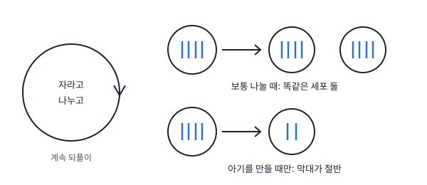

*보통은 막대 선 네 개를 그대로 가진 똑같은 세포 둘이 되지만, 아기를 만드는 세포를 만들 때만 막대 선이 절반인 세포가 돼요.*

**정확히 말하면**

**세포주기(cell cycle)**는 세포가 한 번 분열한 뒤 다음 분열을 할 때까지 도는 한 바퀴예요. 한 바퀴가 끝나면 다시 처음부터 반복돼요.

강의노트 3장 p1은 세포주기를 세 요소로 적어요. 수업에서 셋을 나열하지는 않았어요.

1. **세포의 성장**: 단백질, 지질, 탄수화물을 합성하고 DNA를 복제해요.
2. **핵분열**: 복제된 DNA가 든 핵이 둘로 나뉘어요.
3. **세포질 분열**: 세포질이 나뉘어 딸세포 두 개가 완성돼요.

수업에서는 이 한 바퀴를 G1기, S기, G2기, M기의 네 단계로 나눠 설명했어요. 각 단계가 하는 일은 [3-1. G1–S–G2–M과 G0](#s3-phases)에서 다뤄요.

세포분열은 두 종류예요.

| 구분 | 유사분열(mitosis) | 감수분열(meiosis) |
|---|---|---|
| 다른 이름 | 체세포 분열(중학교 때 배운 이름) | "감수(減數)" = 수가 줄어든다는 뜻 |
| 염색체 수 | 그대로 유지돼요(2n이 분열해도 2n) | 반으로 줄어요 |
| 딸세포 핵 | 부모 핵과 유전적으로 같은 복제품 | 부모 핵과 유전적으로 달라요(강의노트 p1) |
| 언제 일어나나 | 몸을 이루는 세포(체세포)가 분열할 때 | 유성생식에서 정자·난자를 만들 때만 |

유사분열의 딸세포 핵이 부모 핵과 같은 까닭은, 분열 전에 DNA를 먼저 복제해 똑같은 사본을 하나씩 나눠 주기 때문이에요. 복제된 두 사본(자매염색분체)의 뜻은 [2-2. 자매염색분체·상동염색체·대립유전자](#s2-sister-homolog)에서, 2n의 뜻은 [2-3. 2배체·반수체와 무엇이 나뉘는가](#s2-ploidy)에서 이어서 봐요.

정자와 난자처럼 감수분열로 만들어지는 세포를 뺀 나머지 몸의 세포는 체세포이고, 체세포는 유사분열로 늘어나요. 거꾸로 확인하면 이래요. 정자·난자를 만드는 분열은 감수분열이고, 피부나 간처럼 몸을 이루는 세포를 늘리는 분열은 유사분열이에요.

두 분열이 실제로 어떤 단계를 거치는지는 다음 수업에서 둘을 비교하며 배워요.

**교수님 말씀**

세포주기를 말장난으로 시작했어요.

> 선물 주기가 아니고, 세포 주기.

세포주기를 계절이 도는 것에 빗댔어요.

> 계절의 주기는 봄, 여름, 가을, 겨울 계속 반복이 되죠.

유사분열이 곧 중학교 때 배운 체세포 분열이라고 짚었어요.

> 중학교 때 체세포 분열이라고 부르는 게 유사분열입니다.

"감수"라는 이름을 감수성에 빗대 농담한 뒤 바로 뜻을 정리했어요.

> 감수성이 뛰어난 분열인가? 그게 아니고 숫자가 줄어드는 분열이죠.

> 유성생식 과정에서 정자, 난자 만들 때만 감수분열이 일어나게 됩니다.

분열 전 복제를 함께 자취하던 친구들의 이사에 빗댔어요. 짐을 복제해 둘로 만든 뒤 하나씩 나눠 가진다는 거예요.

> 각자 짐을 복제를 해서 두 개를 만들어요. 그래 하나씩 나눠 갖는 거.

두 분열의 과정은 비교하며 보는 편이 빠르다며 다음 시간으로 미뤘어요.

> 요거는 이제 두 개 비교하면서 하는 게 더 빠르기 때문에

**꼭 기억해요**

**"감수"는 감수성이 아니에요.** 감정을 잘 느끼는 감수성(感受性)으로 착각하기 쉬워요. 감수분열의 감수는 "수가 줄어든다(減數)"는 뜻이고, 염색체 수가 반으로 줄어드는 분열이에요.

> 염색체 숫자가 반으로 줄어드는 분열이 감수분열이고

**유사분열과 체세포 분열은 같은 것이에요.** 이름이 둘이라 서로 다른 분열로 착각하기 쉬워요. 유사분열(mitosis)을 중학교에서는 체세포 분열이라고 불렀을 뿐이에요. 두 종류로 나뉘는 짝은 "유사분열(=체세포 분열)과 감수분열"이에요.

> 우리가 중학교 때 체세포 분열이라고 부르는 게 유사분열입니다.

**"만"은 경계를 확인하라는 신호예요.** 감수분열이 몸의 어느 세포에서나 일어난다고 착각하기 쉬워요. 사람 몸에서 감수분열은 정자·난자를 만들 때만 일어나고, 나머지 체세포는 유사분열로 늘어나요. 그래서 체세포를 늘리는 분열은 딸세포 핵이 부모 핵과 유전적으로 같고 염색체 수도 그대로예요.

**페이지 요약**

세포주기는 분열에서 다음 분열까지의 한 바퀴이고, 분열은 유사분열(=체세포 분열)과 감수분열 두 종류예요.

*용어*

- **세포주기(cell cycle)** — 세포가 분열한 뒤 다음 분열할 때까지의 한 바퀴예요.
- **유사분열(mitosis)** — 체세포 분열이에요. 부모 핵과 유전적으로 같은 딸세포 핵을 만들어요.
- **감수분열(meiosis)** — 염색체 수가 반으로 줄어드는 분열로, 정자·난자를 만들 때만 일어나요.

---

## 2. 염색체 — 자매염색분체와 상동염색체

### 2-1. 염색질과 염색체

*0917 수업 · 3장 p1*

**쉽게 말하면**

날마다 쓰는 옷은 옷장에 걸어 두지만, 이사하는 날에는 짐을 꽁꽁 묶어 싸요.

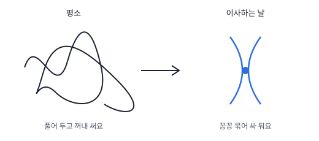

*평소에는 선이 느슨하게 풀려 있어 잘 안 보이고, 이사하는 날에만 짧게 꽁꽁 묶여서 현미경으로 보여요.*

**정확히 말하면**

세포 안의 DNA는 같은 것이지만, 세포가 무엇을 하느냐에 따라 두 가지 모습으로 있어요.

- **염색질(chromatin)**: 세포가 분열하지 않는 평소의 모습이에요. 평소에는 DNA의 정보(유전자)를 꺼내 써야 하므로 DNA가 풀어진 상태로 있어요. 그래서 아무리 좋은 현미경을 써도 막대 모양의 염색체가 보이지 않아요.
- **염색체(chromosome)**: 세포가 분열하는 동안의 모습이에요. 분열하는 동안에는 정보를 쓸 일이 없으므로, **히스톤** 단백질과 결합한 DNA가 꽁꽁 **응축**돼 막대 모양이 돼요. 염색질도 DNA와 히스톤으로 되어 있으니, 둘의 차이는 풀렸는지 응축됐는지예요.

| 구분 | 염색질(chromatin) | 염색체(chromosome) |
|---|---|---|
| 언제 | 평소(분열하지 않을 때) | 세포 분열 중 |
| DNA 상태 | DNA+히스톤 단백질, 풀어져 있음 | DNA+히스톤 단백질, 꽁꽁 응축됨 |
| 정보 사용 | 꺼내 씀 | 쓰지 않음(싸 둔 짐) |
| 현미경 관찰 | 막대 모양으로 보이지 않음 | 막대 모양으로 보임 |

그래서 염색체를 보려면 **분열 중인 세포**를 관찰해야 해요. 생물 실험에서 **양파 뿌리 끝**을 잘라 관찰하는 것도 분열 중인 세포에서 염색체를 보기 위해서예요.

유사분열과 감수분열을 이해하려면 염색체를 먼저 알아야 해요. 분열 중에 보이는 염색체의 구조는 [2-2. 자매염색분체·상동염색체·대립유전자](#s2-sister-homolog)에서 이어져요.

**교수님 말씀**

분열을 배우기 전에 염색체부터 짚고 가셨어요.

> 감수분열, 유사분열을 이해를 하려면 염색체에 대한 이해가 먼저입니다.

쓰는 DNA와 싸 둔 DNA를 옷에 비유하셨어요. 여름에는 반팔 티를 옷장에 걸어 두고 쓰고, 겨울옷은 꽁꽁 묶어 상자에 보관한다고 하셨어요.

> 세포 분열은 이사하는 날입니다… 꽁꽁 묶어서 응축시킨 형태가 염색체입니다.

> 생물 실험할 때 양파 뿌리 끝… 잘라서 관찰을 하지요.

**꼭 기억해요**

- **착각:** 염색체는 아무 때나 현미경으로 보인다. **바른 구분:** 평소에는 DNA가 풀린 염색질이라 보이지 않고, 분열 중에 응축된 염색체일 때만 막대 모양으로 보여요. "평상시에는 DNA가 염색질 형태로 풀어져 있기 때문".
- **착각:** 염색질과 염색체는 서로 다른 물질이다. **바른 구분:** 같은 DNA(히스톤과 결합한 상태)가 평소에는 풀려 있고(염색질), 분열할 때는 응축돼 있어요(염색체). 히스톤이 있느냐 없느냐가 아니라 풀림과 응축의 차이예요.

**보충 · 노트에 빠졌던 수업 내용**

염색체는 분열이 시작되는 전기에 응축되기 시작해서 막대 모양으로 보이게 돼요.

출처: 0922 수업, 강의노트 3장 p2

**보충 · 수업에서 다루지 않았어요**

히스톤은 양전하를 띠는 작은 단백질이에요. 그래서 음전하를 띤 DNA와 결합해 복합체를 이뤄요.

출처: 교재 부록 용어풀이 G-12 (histone)

**페이지 요약**

평소에는 DNA가 풀린 염색질로 있다가, 분열할 때 (히스톤과 함께) 응축돼 막대 모양 염색체로 보여요.

*용어*

- **염색질(chromatin)** — 평소 정보를 쓰려고 DNA가 풀어진 상태
- **염색체(chromosome)** — 분열 중 DNA와 히스톤이 응축된 막대

---

### 2-2. 자매염색분체·상동염색체·대립유전자

*0917 수업 · 3장 p1 · 3장 p3*

**쉽게 말하면**

이사 가기 전에 짐을 똑같이 한 벌 더 만들면, 그 두 벌은 완전히 같아요.

엄마가 준 짝과 아빠가 준 짝은 모양이 같아도, 같은 자리에 초코 맛과 딸기 맛처럼 다른 게 들어 있을 수 있어요.

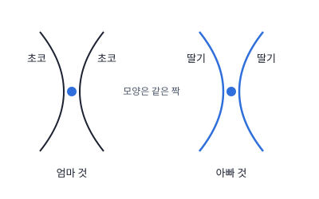

*가운데 색칠된 점으로 붙은 두 가닥은 똑같이 만든 한 벌이라 둘 다 초코이고, 옆의 아빠 것은 같은 자리에 딸기가 있어요.*

**정확히 말하면**

현미경으로 분열 중인 세포의 염색체를 보면 막대가 하나가 아니라 **두 개가 붙어 있고**, 그와 크기·모양이 같은 것이 옆에 또 있어요. 이 모습은 아래 네 가지로 풀어요.

1. **왜 두 개가 붙어 있나**: 세포주기에서는 분열(M기)에 들어가기 전에 S기에 **DNA 복제**가 끝나 있어요. 그래서 분열 중에 보이는 염색체는 이미 복제된 상태예요. 붙어 있는 두 막대는 복제 전의 서로 다른 두 염색체가 아니라, 한 염색체와 그 복사본이에요.
2. **자매염색분체(sister chromatid)**: 한 염색체가 DNA 복제로 만든 **똑같은 두 사본**이에요. 서로 붙어 있고, 정보가 완전히 같아요. 한쪽 어느 자리에 A가 있으면 다른 쪽 같은 자리에도 A가 있어요. 그래서 자매염색분체는 상동염색체의 다른 이름이 아니고, 서로 다른 두 염색체도 아니며, 서로 다른 유전자를 가진 염색체도 아니에요.
3. **동원체(centromere)**: 자매염색분체가 서로 붙어 있는 잘록한 부위예요. 핵이 있는 곳, 염색체의 끝, 염색체들이 세포 가운데에 늘어서는 자리를 가리키는 말이 아니에요. 대립유전자·염색분체·중심립·핵형과도 다른 말이에요.
4. **상동염색체(homologous chromosome)**: 옆에 있는 크기·모양이 같은 염색체와의 관계예요. 하나는 엄마가, 하나는 아빠가 준 것이에요. "염색체 쌍"의 두 구성원이 바로 상동염색체예요.

**유전자(gene)와 대립유전자(allele)**는 다른 개념이에요.

- 상동염색체는 **같은 자리에 같은 유전자**를 가져요. 예를 들어 모든 사람의 같은 자리에 혈액형 유전자가 있어요.
- 하지만 그 유전자의 버전은 다를 수 있어요. A 버전인지 B 버전인지, 이 A와 B가 **대립유전자**, 곧 "같은 유전자의 다른 버전"이에요.
- 꽃 색깔 유전자라면 C는 빨간색, c는 하얀색일 수 있어요. 버전은 달라도 둘 다 꽃 색깔에 관여하는 같은 유전자예요.
- 상동염색체의 같은 자리 대립유전자는 같을 수도(C와 C), 다를 수도(C와 c) 있어요. 자매염색분체는 복제로 생긴 복사본이라 (드문 복제 오류를 빼면) 같아요.

| 구분 | 자매염색분체 | 상동염색체 |
|---|---|---|
| 어떻게 생기나 | 한 염색체의 DNA 복제 | 엄마에게서 하나, 아빠에게서 하나 |
| 붙어 있나 | 동원체로 서로 붙어 있음 | 동원체로 서로 붙어 있지 않은 따로 된 두 염색체 |
| 같은 자리의 정보 | 완전히 같음(C와 C) | 같은 유전자, 대립유전자는 같을 수도 다를 수도(C와 c) |

**염색체 그림 읽기**: 시험에는 아래처럼 길이·모양이 같은 두 막대에 표지가 붙은 그림이 나와요.

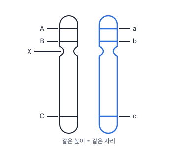

*테두리만 그린 두 막대가 서로 떨어져 있고, 왼쪽의 A·B·C와 같은 높이에 오른쪽의 a·b·c가 있으며, X는 잘록한 부위를 가리켜요.*

- **두 막대의 관계**: 길이·모양이 같고, 같은 자리에 A와 a처럼 다른 버전이 있어요. 복사본이라면 같은 자리에 같은 글자가 있어야 하므로, 이 두 막대는 **상동염색체**이고 자매염색분체가 아니에요.
- **X**: 잘록한 부위, 곧 **동원체**예요. 이 부위에 무엇이 붙는지는 아래 보충에서 다뤄요.
- **A, B, C**: 한 막대의 서로 다른 자리에 있으므로 서로 다른 유전자예요.
- **A와 a**: 같은 자리에 있는 같은 유전자의 다른 버전, 곧 **대립유전자**예요. B와 b, C와 c도 마찬가지예요.

**변형 그림 가르기**: 복제된 상동염색체 한 쌍을 그리면 아래와 같아요.

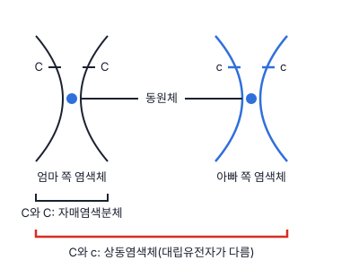

*선으로 그린 X마다 두 가닥이 가운데 색칠된 점(동원체)으로 붙어 있고, 한 X 안의 C와 C는 자매염색분체, 두 X 사이의 C와 c는 상동염색체의 대립유전자예요.*

- 동원체로 붙어 있고 같은 자리에 C와 C가 있는 두 가닥은 **자매염색분체**예요.
- 같은 자리에 C와 c가 있는 두 염색체는 복사본일 수 없으므로 **상동염색체**예요.
- 거꾸로, 같은 글자라고 해서 늘 자매염색분체인 것은 아니에요. 상동염색체도 대립유전자가 같을 수(C와 C) 있으므로, 한 염색체 안에서 동원체로 붙어 있는지를 함께 봐요.

**방추사**(spindle fiber)는 세포 분열 때 염색체에 붙는 실 같은 구조예요. 세포주기의 확인점에서는 방추사가 염색체에 제대로 붙었는지도 확인해요. 분열할 때 무엇이 나뉘는지는 [2-3. 2배체·반수체와 무엇이 나뉘는가](#s2-ploidy)에서 이어져요.

**교수님 말씀**

복제한 뒤에 나눈다는 것을 자취하던 친구들의 이사로 설명하셨어요. 짐을 싸서 가져가는 게 아니라 각자 짐을 복제해 두 개를 만든 뒤 하나씩 나눠 갖는다고 하셨어요.

> DNA 복제가 끝나야 세포 분열이 일어납니다.

> 여기 만약에 A 유전자가 있으면 요기도 그대로 A 유전자가 있습니다.

> 자매 염색분체는 모든 정보가 똑같습니다. 그런데 상동 염색체는 다를 수가 있죠.

> 유전자하고 대립유전자는 좀 다른 개념입니다.

엄마는 A형(AA), 아빠는 B형(BB)인 예로, 같은 자리의 혈액형 유전자가 A 버전인지 B 버전인지가 대립유전자라고 하셨어요. 이어서 먹는 것에 비유하셨어요.

> 아이스크림 유전자에 초코 아이스크림 대립유전자가 있고, 딸기 아이스크림 대립유전자가 있는 거야.

콜라에 코카콜라와 제로콜라가 있는 것도 같은 예라고 하셨어요. 대립유전자는 교재 3장에는 없고 4장 75쪽 오른쪽에 나온다고 알려 주셨어요. allele는 "얼릴"로 읽으면 되고, 예전에는 "알렐레"라고들 읽었다고 하셨어요.

꽃 색깔 유전자에서 C는 빨간색, c는 하얀색일 수 있지만 둘 다 꽃 색깔에 관여한다고 정리하셨어요. 그리고 이 구분이 모든 것의 바탕이라고 강조하셨어요.

> 자매 염색분체가 뭐다, 상동 염색체가 뭐다… 이걸 모르면은 아무것도 안 됩니다.

**꼭 기억해요**

- **착각:** 자매염색분체와 상동염색체는 같은 것이다. **바른 구분:** 자매염색분체는 복제로 생긴 복사본이라 정보가 완전히 같아요. 상동염색체는 엄마·아빠에게서 하나씩 온 쌍이라 같은 자리에 같은 유전자가 있어도 대립유전자는 다를 수 있어요. 수업에서도 두 번 반복하셨고, 수업에서는 "대립… 아, 상동 염색체"로 고쳐 말씀하셨어요.
- **착각:** 유전자와 대립유전자는 같은 말이다. **바른 구분:** 유전자는 자리와 기능(예: 혈액형 유전자), 대립유전자는 그 유전자의 버전(예: A, B)이에요. "같은 유전자의 다른 버전".
- **착각:** 분열 중에 붙어 보이는 막대 두 개는 복제 전의 서로 다른 염색체 두 개다. **바른 구분:** 분열 전에 DNA 복제가 끝나 있으므로, 붙은 두 막대는 한 염색체와 그 복사본(자매염색분체)이에요. "복제된 걸 본 거야".
- **착각:** 동원체는 상동염색체끼리 붙어 있는 부분이다. **바른 구분:** 동원체는 **자매염색분체**가 서로 붙어 있는 부분이에요. 상동염색체끼리는 동원체로 붙어 있지 않아요. 수업에서 가운데 붙은 부분을 동원체라고 소개하셨는데, 그 두 가닥은 자매염색분체예요.
- **착각:** 그림에서 나란히 선 두 막대는 모두 자매염색분체다. **바른 구분:** 같은 자리에 A와 a처럼 다른 버전이 있으면 복사본이 아니므로 상동염색체예요.

**보충 · 수업에서 다루지 않았어요**

수업에서는 확인점에서 "방추사가 염색체에 제대로 붙었는지" 확인한다고만 하셨어요. 방추사가 염색체의 어디에 붙는지는 강의노트에 있어요. 분열할 때 방추사가 염색체의 **동원체**에 붙어요. 방추사는 미세소관(microtubule)으로 된 실이라, 시험에서는 "미세소관(방추사)이 붙는 부위 = 동원체"처럼 나와요.

출처: 강의노트 3장 p2("방추제가 염색체 동원체에 부착"), 교재 3장 p.58(방추체 미세소관)

교재 3장 p.58은 자매염색분체가 붙은 부위를 "중심절(centromere)"이라고도 적어요. 수업과 시험에서는 이 부위를 동원체라고 불러요.

출처: 교재 3장 p.58

**중심립**(centriole)은 동원체와 전혀 다른 구조예요. 염색체의 한 부분이 아니라, 세포질의 중심체(centrosome) 안에 있는 한 쌍의 작은 구조예요.

출처: 강의노트 3장 p2(중심체), 교재 3장 p.58 그림 3.3(중심체 안의 중심립 쌍)

**핵형**(karyotype)은 한 생물의 염색체 전체를 쌍으로 배열해 보여 준 모습이에요. 염색체의 한 부위를 가리키는 말이 아니에요.

출처: 강의노트 3장 p2(핵형분석)

**페이지 요약**

자매염색분체는 DNA 복제로 생긴 똑같은 복사본이고, 상동염색체는 엄마·아빠에게서 하나씩 온 쌍이라 대립유전자가 다를 수 있어요.

*용어*

- **자매염색분체(sister chromatid)** — 한 염색체를 복제한 똑같은 두 사본, 동원체로 붙어 있음
- **상동염색체(homologous chromosome)** — 엄마·아빠에게서 하나씩 온, 크기·모양이 같은 염색체 쌍
- **대립유전자(allele)** — 같은 자리에 있는 같은 유전자의 다른 버전

---

### 2-3. 2배체·반수체와 무엇이 나뉘는가

*0917 수업 · 3장 p1 · 3장 p3*

**쉽게 말하면**

몸의 세포는 엄마 것과 아빠 것을 짝으로 모두 갖고, 아기 씨앗 세포는 짝마다 하나씩만 가져요.

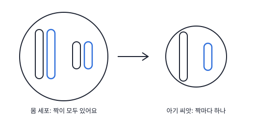

*왼쪽 몸 세포에는 긴 막대와 짧은 막대가 두 개씩 짝지어 있고, 오른쪽 아기 씨앗에는 짝마다 하나씩만 들어 있어요.*

**정확히 말하면**

- **2배체(diploid)**: 상동염색체를 쌍으로 가진 상태예요. **2n**으로 적어요. 정자·난자를 뺀 나머지 체세포는 2배체예요.
- **반수체(haploid)**: 상동염색체 쌍마다 하나만 가진 상태예요. **n**으로 적어요. 감수분열로 염색체 수가 절반이 되면 반수체가 돼요. 정자·난자는 반수체예요.
- n을 "1배체"라고 부르지 않고 반수체라고 불러요.
- 사람은 염색체 46개를 가져요. 엄마에게서 23개, 아빠에게서 23개를 받았어요. 이것을 **2n = 46**으로 적고, 2배체이므로 **23쌍**이라는 뜻이에요(46쌍이 아니에요).
- 그래서 사람의 정자·난자는 23쌍 각각에서 하나씩, 모두 23개의 염색체를 가져요. 각 염색체를 엄마 쪽과 아빠 쪽 두 종류씩 갖지 않고, 쌍마다 한 개(한 종류)만 가져요. 정자·난자는 유사분열이 아니라 **감수분열**로 만들어져요.

두 분열은 **무엇이 나뉘는가**가 달라요.

| 구분 | 체세포 분열(유사분열) | 감수분열 1단계(제1감수분열) | 감수분열 2단계(제2감수분열) |
|---|---|---|---|
| 나뉘는 것 | 자매염색분체 | 상동염색체 | 자매염색분체 |
| 상동염색체는 | 나뉘지 않고 함께 따라감 | 쌍이 갈라져 하나씩 감 | (이미 쌍마다 하나뿐) |

1. **유사분열(체세포 분열)**: 자매염색분체가 나뉘고 상동염색체는 따라가요. 그래서 2n이 분열해도 그대로 2n이에요. 염색체 46개인 세포가 유사분열하면 딸세포도 46개예요. 딸세포는 부모세포와 정확히 같은 유전 정보를 가진 복제품이에요.
2. **감수분열**: 유성생식에서 정자·난자를 만들 때만 일어나고, 염색체 수가 절반으로 줄어요(2n에서 n). **2단계**로 진행돼요. 처음에 **상동염색체**가 나뉘고, 그다음에 **자매염색분체**가 나뉘어요.
3. 교재는 이 첫 단계를 **제1감수분열**, 두 번째 단계를 **제2감수분열**이라고 불러요. 그러니 상동염색체는 제1감수분열에서 나뉘고, 제2감수분열이나 유사분열에서는 나뉘지 않아요. 자매염색분체는 유사분열과 제2감수분열에서 나뉘어요.

보기를 가를 때는 특징이 어느 분열의 것인지 따져요. "2배체에서 반수체를 만든다", "배우자를 만든다", "두 번 연속 분열한다"는 모두 감수분열의 특징이에요. 유사분열은 한 번의 분열로 부모세포와 똑같은 딸세포를 만들 뿐, "제1·제2 유사분열" 같은 단계 이름은 없어요.

**교수님 말씀**

> 1배체가 아니고 반수체라고 합니다, 반수체.

> 정자 난자는 반수체고 나머지 체세포는 2배체입니다.

사람이 가진 염색체 수를 물으시고, 엄마가 23개, 아빠가 23개를 준다고 하셨어요. "엄마가 23억을 물려줬으면 좋겠다"는 농담으로 23이라는 수를 기억하게 하셨어요.

> 총 46개인데 2배체이기 때문에 23쌍을 가지고 있다는 뜻이죠.

체세포 분열에서 상동염색체가 함께 간다는 것을 짝지어 움직이는 모습으로 말씀하셨어요.

> 얘가 가면은 얘도 가는 거예요… 그래야 2n이 2n이 되죠?

> 감수 분열에서는 처음에 상동 염색체가 나눠지고, 그다음에 자매 염색분체가 나뉘죠.

자세한 과정은 뒤에서 다룰 테니 지금은 이해가 안 돼도 넘어가라고 하셨어요.

**꼭 기억해요**

- **착각:** n은 1배체라고 부른다. **바른 구분:** n은 반수체(haploid)라고 불러요. "1배체가 아닙니다".
- **착각:** 2n = 46은 46쌍이라는 뜻이다. **바른 구분:** 모두 46개이고, 2배체라 23쌍이에요.
- **착각:** 체세포 분열에서도 상동염색체가 나뉜다. **바른 구분:** 체세포 분열에서 나뉘는 것은 자매염색분체이고 상동염색체는 따라가요. 상동염색체가 나뉘는 것은 감수분열 1단계(제1감수분열)예요. "체세포 분열할 때 나눠지는 거는 자매 염색분체예요", "처음에 상동 염색체가 나눠지고".
- **착각:** 정자·난자는 각 염색체를 엄마 쪽과 아빠 쪽 두 종류씩 갖는다. **바른 구분:** 반수체라 쌍마다 하나만 가져요.

**보충 · 수업에서 다루지 않았어요**

수업에서는 감수분열이 "처음에 상동염색체, 그다음에 자매염색분체"를 나누는 2단계라고만 하셨어요. 강의노트와 교재는 감수분열을 두 번의 세포분열로 설명하고, 첫 번째를 **제1감수분열**(감수분열 I), 두 번째를 **제2감수분열**(감수분열 II)이라고 불러요. 제1감수분열은 상동염색체를, 제2감수분열은 자매염색분체를 나눠요.

출처: 강의노트 3장 p4("감수분열은 두 번 세포분열이 일어난다"), 교재 3장 p.64 그림 3.8

한 사람이 만든 정자(또는 난자)가 모두 유전적으로 같지는 않아요. 배우자는 상동염색체 쌍마다 엄마 쪽과 아빠 쪽 가운데 하나만 받는데, 어느 쪽을 받는지가 배우자마다 다를 수 있어요. 그래서 감수분열로 생긴 세포들은 유전적으로 서로 달라요.

같은 이유로, 배우자가 가진 대립유전자는 "우성만" 또는 "열성만"처럼 한쪽으로 정해지지 않아요. 쌍마다 따로 정해지므로 섞일 수 있어요. 예를 들어 한 쌍에서는 C를, 다른 쌍에서는 d를 받을 수 있어요.

출처: 강의노트 3장 p3–p4(생식세포는 각 상동염색체 쌍 중 하나의 염색체만 받음, 유전적으로 서로 다른 4개의 세포), 교재 3장 p.64

**페이지 요약**

체세포는 상동염색체를 쌍으로 가진 2배체(사람 2n = 46, 23쌍)이고, 정자·난자는 쌍마다 하나만 가진 반수체예요.

*용어*

- **2배체(diploid)** — 상동염색체를 쌍으로 가진 상태, 2n
- **반수체(haploid)** — 쌍마다 하나만 가진 상태, n(1배체라 부르지 않음)
- **제1감수분열** — 감수분열 1단계, 상동염색체가 나뉨(제2감수분열에서는 자매염색분체)

---

## 3. 세포주기의 단계와 확인점

### 3-1. G1–S–G2–M과 G0

*0917 수업 · 3장 p1*

**쉽게 말하면**

세포는 자라고, 복사하고, 준비하고, 나누는 순서로 한 바퀴를 돌아요.

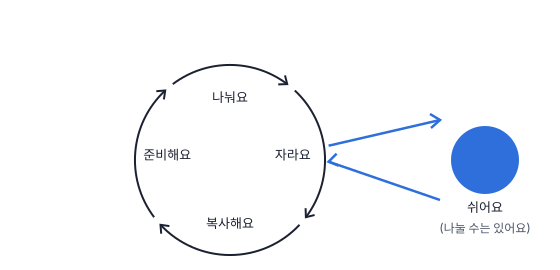

*자라는 자리에서 옆으로 빠져 쉬는 세포는 나눌 힘이 없는 게 아니라 그냥 안 나누고 있는 거예요.*

**정확히 말하면**

세포는 아무 때나 분열하지 않아요. 분열해야 할 때만 분열하고, 멈출 때는 멈추도록 정교하게 조절돼요.

세포주기는 **G1기 → S기 → G2기 → M기** 순서로 돌고, M기가 끝나면 다시 G1기로 돌아와요.

1. **G1기**(G = Gap, 틈): 분열이 막 끝난 세포는 크기가 절반이라 가장 작아요. 그래서 이때 세포가 성장해요.
2. **S기**(S = Synthesis, 합성): 적당히 커진 세포에 분열하라는 신호가 오면 DNA를 복제해요. DNA 합성기라고도 해요.
3. **G2기**(두 번째 Gap): 분열하기 전에 잠깐 쉬면서 분열을 준비해요.
4. **M기**(M = Mitosis): 유사분열(체세포 분열) 과정 자체예요. 복제된 자매염색분체가 나뉘어 두 딸세포로 가요([2-2. 자매염색분체·상동염색체·대립유전자](#s2-sister-homolog)).

G1기와 G2기는 분열(M)과 복제(S) 사이에 끼인 틈이에요. G1기는 M기와 S기 사이, G2기는 S기와 M기 사이예요.

G1기의 길이는 종마다 달라서 한 바퀴 전체의 길이를 좌우해요. 사람 세포(헬라 세포)는 한 바퀴에 하루쯤 걸리고, 작고 단순한 대장균은 빠르면 20분마다 분열해요.

**G0기**: 사람 신경세포는 태어나서 죽을 때까지 거의 분열하지 않아요. 분열 능력이 없는 게 아니라, G1기에서 멈춰 그대로 머무는 상태예요. 이 상태를 G0기라고 불러요.

**교수님 말씀**

학교는 수업 있는 날만 가고, 약속은 약속 있는 날만 가요. 세포도 분열해야 할 때만 분열해요.

> "멈출 때는 멈춰야 됩니다. 이 조절이 깨지면은 암이에요."

> "G는 갭(Gap)이라고 생각하면 돼요, 갭. 틈."

헬라 세포는 오늘 배지를 갈아 주면 내일 아침에 딱 2배가 돼 있어요. 세균은 훨씬 빨라서 대장균은 빠르면 20분에 한 번 분열해요.

> "능력이 없는 게 아니고 그냥 안 하는 겁니다." — 신경세포와 G0기

**꼭 기억해요**

- **글자의 뜻**: G는 Gap(틈)이지 성장(Growth)이 아니에요. S는 Synthesis(DNA 합성), M은 Mitosis(유사분열)예요. G1기는 M기와 S기 사이의 틈, G2기는 S기와 M기 사이의 틈이에요.
- **G0기 ≠ 분열 능력 없음**: G0기는 G1기에서 멈춰 분열을 안 하고 있는 상태예요. 신경세포는 "능력이 없는 게 아니고 그냥 안 하는" 세포예요.
- **순서와 할 일을 짝지어요**: 세포 성장은 G1기, DNA 복제는 S기, 분열 준비는 G2기, 분열은 M기예요. "S기에 성장", "G2기에 복제"처럼 짝을 바꾼 설명에 속지 마세요.

**보충 · 수업에서 다루지 않았어요**

**간기(interphase)**는 G1기, S기, G2기를 합친 이름이에요. 한 유사분열이 끝난 뒤부터 다음 유사분열이 시작될 때까지예요. 세포는 한 바퀴의 대부분을 간기로 보내며, 이때 성장하고 DNA를 복제해요.

그래서 세포주기는 크게 간기와 M기(유사분열기, 분열기) 둘로 나뉘어요. 간기는 분열기가 아니에요. 전기, 중기, 후기, 말기는 M기 안의 소단계 이름이에요. 각 소단계에서 일어나는 일은 다음 시간에 배워요.

M기는 핵분열로 시작해 세포질 분열로 끝나요. 따라서 한 바퀴를 순서대로 쓰면 G1기 → S기 → G2기 → 핵분열 → 세포질 분열이에요.

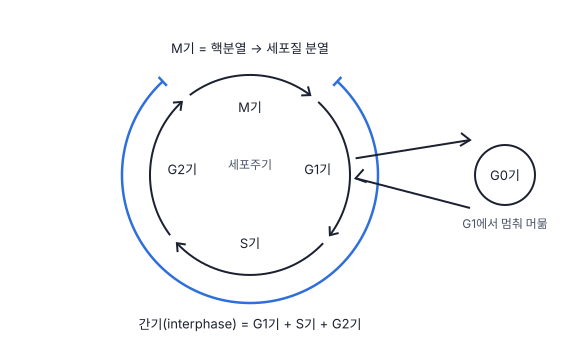

*시험지 그림과 같은 배치예요. 바깥 선으로 묶인 G1기·S기·G2기가 간기이고, 위쪽 M기만 분열기예요.*

**DNA 중합효소**(DNA polymerase)는 DNA를 복제(합성)하는 효소예요. DNA 복제는 S기에 일어나므로 DNA 중합효소는 S기에 가장 활발해요.

출처: 강의노트 3장 p1(간기, M기의 소단계 이름, 세포 성장·핵분열·세포질 분열), 교재 3장 p.56–57 그림 3.2(세포주기), 교재 5장 p.97(DNA 중합효소)

**페이지 요약**

세포주기는 G1기(성장) → S기(DNA 복제) → G2기(준비) → M기(분열) 순서로 돌고, G0기는 G1기에서 멈춰 쉬는 상태예요.

*용어*

- **간기(interphase)** — G1기 + S기 + G2기, 분열기가 아닌 시기
- **G0기** — 능력은 있지만 G1기에서 멈춰 분열을 안 하는 상태
- **DNA 중합효소** — DNA를 복제하는 효소, S기에 가장 활발

---

### 3-2. 확인점

*0917 수업 · 3장 p2*

**쉽게 말하면**

세포는 다음 단계로 가기 전에 잘됐는지 살펴보고, 잘못된 게 있으면 멈춰요.

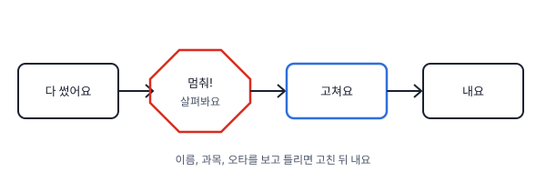

*보고서를 내기 전에 이름과 오타를 보고, 틀린 게 있으면 멈춰서 고친 뒤 내는 것과 같아요.*

**정확히 말하면**

**확인점(checkpoint)**은 세포주기 중간중간에서 앞 단계가 제대로 끝났는지 확인하는 지점이에요. 한 단계가 완성되기 전에는 다음 단계로 넘어가지 못하게 멈춰요.

수업에서 든 확인점이 확인하는 것은 세 가지예요.

1. **DNA 복제**가 정상적으로 일어났는지: S기가 끝나면 확인해요.
2. **방추사**가 염색체에 제대로 붙었는지.
3. 지금이 세포가 분열할 시기가 맞는지.

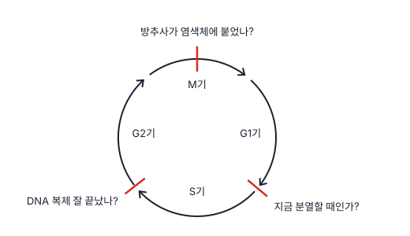

*원을 가로지르는 짧은 선이 확인점이에요. 교수님 설명에서 DNA 복제 확인은 S기가 끝난 뒤에 해요. 교재 그림 3.6은 이 확인을 G2기에서 M기로 넘어가는 확인점에 표시해요.*

DNA 복제에 문제가 있으면 확인점에서 멈춘 뒤 그 자리에서 고쳐요. 확인점 자체는 진행을 멈추는 일이고, 고치는 데 중요한 유전자가 **종양 억제 유전자**예요. 자세한 내용은 [5-2. 종양 억제 유전자: p53과 BRCA1](#s5-suppressor)에서 이어져요.

**교수님 말씀**

세포 분열을 보고서 제출에 빗댔어요. 보고서는 제출하라고 할 때만 내요. 내기 전에 학번과 이름, 생물 과목이 맞는지, 베낀 티가 나는지, AI에 한 질문까지 붙여 넣지 않았는지 확인해요.

> "잠깐 멈추잖아요… '멈춰! 내지 마!'" — 고친 다음에 내요.

> "한 단계가 완성될 때까지 그다음 단계를 진행시키지 않는 거야, 멈추는 거야."

보고서를 다 쓴 뒤 오타를 확인하고 고치듯, S기가 끝나면 DNA 복제가 제대로 됐는지 확인하고 잘못됐으면 그 자리에서 고쳐요.

> "고치는 데 중요한 유전자들을 종양 억제 유전자라고 합니다."

**꼭 기억해요**

- **멈추는 것과 고치는 것**: 확인점을 "고치는 장치"로 착각하기 쉬워요. 확인점은 다음 단계로 못 가게 멈추는 지점이고, 그 자리에서 고치는 일은 종양 억제 유전자가 해요.
- **S기 "동안"과 S기 "끝난 뒤"**: 이 수업 모형에서 DNA 복제 확인은 S기가 끝난 뒤, G2기로 넘어가기 전에 해요. "S기가 끝나면 DNA 복제가 정상적으로 일어났는지를 확인합니다." 확인점은 한 단계를 마친 뒤 다음 단계 앞에 있다고 기억해요.
- **확인점이 보는 것은 세 가지**: DNA 복제가 제대로 됐는지, 방추사가 염색체에 붙었는지, 지금 분열할 때인지예요. 이 셋에 없는 일(예: 딸세포를 세 개로 나눌 수 있는지)을 확인점의 일로 고른 설명은 의심하세요. 한 번 분열하면 딸세포는 두 개예요. DNA 손상 점검은 아래 보충을 참고하세요.

**보충 · 수업에서 다루지 않았어요**

강의노트는 확인점을 "이전 단계의 작용이 완결되지 않으면 다음 단계로 못 가게 하는 지점"으로 적어요. 또 이온 방사선이나 화학물질이 DNA를 손상시키면 확인점이 주기를 늦춰 DNA를 수선할 시간을 준다고 적어요.

교재도 S기에 모든 DNA가 복제되지 않으면 G2기 동안 진행을 늦춰 복제를 끝낼 시간을 준다고 설명해요. 교재 그림 3.6은 G1기에서 S기로 넘어가는 확인점과 G2기에서 M기로 넘어가는 확인점을 표시해요. 방추사가 염색체에 붙는 일은 M기 안에서 일어나요.

현대 세포생물학에는 S기가 진행되는 중에 복제 이상을 점검하는 S기 내 확인점(intra-S checkpoint)도 소개돼요. 하지만 이 수업 모형에서 확인점은 한 단계가 끝난 뒤 다음 단계로 넘어가기 전에 둬요.

출처: 강의노트 3장 p2, 교재 3장 p.62(그림 3.6과 본문), Alberts 외 『Molecular Biology of the Cell』 17장(DNA 복제 점검)

**페이지 요약**

확인점은 앞 단계가 제대로 끝났는지 보고 아니면 멈추는 지점이고, 고치는 일은 종양 억제 유전자가 해요.

*용어*

- **확인점(checkpoint)** — 한 단계가 완성되기 전에는 다음 단계로 못 가게 멈추는 지점
- **확인하는 것** — DNA 복제(S기 뒤), 방추사 부착, 분열할 시기
- **종양 억제 유전자** — 확인점에서 잘못된 것을 고치는 데 중요한 유전자

---

## 4. 세포주기 조절 — 안의 엔진과 밖의 신호

### 4-1. 내적 조절: 사이클린과 CDK

*0917 수업 · 3장 p2*

**쉽게 말하면**

세포 안에는 한 단계씩 다음으로 넘겨 주는 작은 엔진이 있어요.

늘 제자리에 있는 부품에 잠깐 왔다 가는 부품이 끼워져야 엔진이 돌아요.

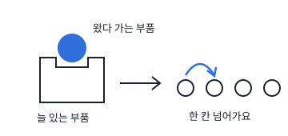

*선만 그린 네모는 늘 있는 부품이고, 색칠된 동그라미는 왔다 가는 부품이에요.*

**정확히 말하면**

세포 안에서 세포 분열을 일으키는 인자를 찾다가 발견한 단백질이 **사이클린(cyclin)**이에요. 사이클린이 G1기, S기, G2기, M기를 돌려요.

G1, S, G2, M기는 단계마다 하는 일이 달라요. 그래서 사이클린도 한 종류가 아니라 여러 종류가 있어요.

사이클린은 혼자 일하지 않아요. **사이클린 의존성 인산화 효소(CDK)**(cyclin-dependent kinase)와 둘이 합쳐져야 세포주기를 다음 단계로 넘겨요.

사이클린과 CDK는 세포 안에 있으면서 세포 분열을 직접 조절하는 **내적 조절자**예요. 세포 안의 이런 단백질이 주기를 돌리는 것을 **내적 조절**이라고 해요.

1. 세포 안에 사이클린과 CDK가 있어요.
2. 그 단계에 맞는 사이클린이 CDK와 합쳐져요.
3. 합쳐진 사이클린·CDK가 세포주기를 다음 단계로 넘겨요.

그러면 사이클린·CDK가 일하게 만드는 애초의 원인은 무엇일까요? 그 원인은 세포 밖에서 와요. 이어지는 내용은 [4-2. 외적 조절: 신호 분자와 수용체](#s4-signal)에 있어요.

한 단계가 끝나기 전에 다음 단계로 못 가게 멈추는 장치는 [3-2. 확인점](#s3-checkpoint)에서 다뤄요.

**교수님 말씀**

교수님은 교재 순서와 달리 세포 분열 과정보다 주기 조절을 먼저 가르쳤어요.

> "교재는 세포 분열 얘기가 먼저 나오지만 나는 뒤쪽을 먼저 이야기한다."

> "찾다가 찾다가 찾았어. 바로 사이클린이라고 하는 단백질이 G1, S, G2, M기를 돌리더라."

자세한 작동 방식은 수업에서 생략했어요. 세포 안의 단백질이 주기를 돌린다는 것까지 알면 된다고 했어요.

> "내부에 이런 단백질들이 세포 주기를 열심히 돌리고 있다, 그것만 알면 되고."

**꼭 기억해요**

**사이클린 혼자 주기를 돌린다고 착각하기 쉬워요.** 바른 구분: 사이클린은 CDK와 둘이 합쳐져야 주기를 넘겨요. "얘 혼자서 하는 것이 아니고" CDK가 있다고 했어요.

**사이클린이 한 종류라고 착각하기 쉬워요.** 바른 구분: 단계마다 하는 일이 달라서 사이클린도 여러 종류예요.

**세포 안의 조절자와 밖에서 오는 조절자를 섞기 쉬워요.** 바른 구분: 사이클린·CDK는 세포 안에서 주기를 직접 돌리는 내적 조절자예요. 성장 호르몬·성장 인자는 밖에서 와서 주기를 시작시키는 외적 조절자예요. 밖의 신호는 [4-2. 외적 조절: 신호 분자와 수용체](#s4-signal)에서 다뤄요.

**동원체도 주기를 조절하는 단백질이라고 헷갈리기 쉬워요.** 바른 구분: 동원체(centromere)는 자매염색분체가 붙어 있는 염색체의 부위예요. 주기를 넘기는 조절 단백질이 아니에요. 자세한 내용은 [2-2. 자매염색분체·상동염색체·대립유전자](#s2-sister-homolog)에 있어요.

**보충 · 수업에서 다루지 않았어요**

수업에서는 "사이클린과 CDK가 합쳐서 주기를 돌린다"까지만 말했어요. 시험에서 사이클린과 CDK를 가르는 기준은 교재에 있어요.

**CDK는 인산화 효소예요.** CDK는 표적 단백질에 인산기를 붙이는 단백질 인산화 효소(protein kinase)예요. CDK는 사이클린과 결합했을 때만 활성을 가져요. 그래서 "사이클린 의존성"이라는 이름이 붙었어요.

**양이 변하는 쪽은 사이클린이에요.** CDK의 농도는 세포주기 내내 거의 일정해요. 사이클린의 농도는 세포주기에 따라 오르내려요. 특정 시기에만 CDK를 켤 만큼 많아졌다가, 그 단계를 넘기면 분해되어 줄어들어요. 사이클린(cyclin)이라는 이름도 농도가 주기적으로(cycle) 바뀐다는 데서 왔어요.

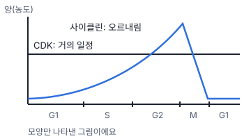

*평평한 선은 CDK, 오르내리는 선은 사이클린이에요. CDK는 늘 비슷한 양으로 있고, 사이클린은 쌓였다가 단계를 넘기면 분해돼요.*

**단계마다 짝이 달라요.** 교재 그림에서는 G1기에서 S기로 넘어갈 때 사이클린 E가 CDK2와 결합하고, S기로 넘어가면 사이클린 E는 분해돼요. G2기에서 M기로 넘어갈 때는 사이클린 B가 CDK1과 결합하고, 그 뒤 사이클린 B가 분해돼요.

**보기를 가르는 기준.** "세포주기 조절에 관련된다"와 "농도가 계속 변동한다"는 두 조건을 함께 봐요.

- 사이클린: 세포주기 조절에 관련되고, 농도가 오르내려요. 두 조건을 모두 채워요.
- CDK 같은 인산화 효소: 세포주기 조절에 관련되지만, 농도는 거의 일정해요.
- 양자펌프(proton pump): H⁺(양성자)를 막 너머로 퍼 나르는 막 수송 단백질이에요. 세포주기 조절 단백질이 아니에요.
- 동원체(centromere): 자매염색분체가 붙어 있는 염색체의 부위예요. 단백질 조절자가 아니에요.

출처: 교재 3장 p.60–62(3.1.3 세포주기 조절, 그림 3.6), 양자펌프는 교재 1장 p.23(능동수송 펌프)

**페이지 요약**

세포 안에서는 사이클린과 CDK가 둘이 합쳐져 세포주기를 한 단계씩 넘겨요.

*용어*

- **사이클린(cyclin)** — 단계마다 종류가 다르고 농도가 오르내리는 주기 조절 단백질
- **사이클린 의존성 인산화 효소(CDK)** — 사이클린과 결합해야 작동하며, 양은 거의 일정
- **내적 조절** — 세포 안의 사이클린·CDK가 주기를 직접 돌리는 조절

---

### 4-2. 외적 조절: 신호 분자와 수용체

*0917 수업 · 3장 p2*

**쉽게 말하면**

밖에서 온 "나눠!" 쪽지는 세포의 문에 딱 맞게 꽂혀야 안으로 전해져요.

그다음 안에서 차례차례 말을 전해서, 마지막에 세포가 둘로 나뉘어요.

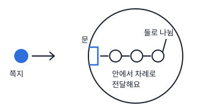

*색칠된 점이 밖에서 온 쪽지이고, 선만 그린 큰 동그라미가 세포예요.*

**정확히 말하면**

사이클린·CDK가 주기를 돌리게 만드는 애초의 원인은 세포 밖에서 와요. 이것을 **외적 조절**이라고 해요.

밖에서 오는 조절자의 예는 성장 호르몬(growth hormone)과 **성장 인자(growth factor)**예요. 예를 들어 상처가 나면 어떤 인자들이 분비되어 "빨리 상처를 메워라, 분열해라"라는 신호를 줘요.

이렇게 세포 밖에서 오는 신호를 전하는 물질이 **신호 분자**(signal molecule)예요.

**성립 조건:** 신호 분자는 반드시 **수용체(receptor)**에 결합해야만 작동해요. 신호 분자 혼자서는 아무 효과가 없어요. 수용체는 세포 표면에 있는 단백질이에요.

신호가 전달되는 경로는 다음과 같아요.

1. 성장하거나 상처가 나면 세포 밖에서 신호 분자가 와요.
2. 신호 분자가 수용체에 결합하면 쉬고 있던 수용체가 활성화돼요.
3. 활성화된 수용체가 세포 안의 A 단백질을 활성화하고, A가 B를 활성화해요. 중간에 C 같은 단계가 더 있을 수도 있어요.
4. 이런 여러 단계를 거쳐 마지막에 사이클린·CDK가 일해요.
5. 사이클린·CDK가 DNA 복제를 일으키고, 결국 세포 분열이 일어나요.

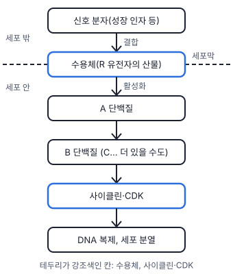

*신호 분자가 수용체에 결합해야 세포 안의 A, B를 거쳐 사이클린·CDK까지 신호가 전해지고, 그 끝에 DNA 복제와 세포 분열이 일어나요.*

**분류 경계:** 외적 조절자는 밖에서 오는 신호 분자(성장 호르몬, 성장 인자)예요. 수용체와 A, B는 세포 쪽 단백질로, 신호를 안으로 전달하는 단계에 참여할 뿐 외적 조절자가 아니에요. 사이클린·CDK는 내적 조절자예요([4-1. 내적 조절: 사이클린과 CDK](#s4-cyclin-cdk)).

수용체 단백질을 암호화하는 유전자를 receptor의 첫 글자를 따서 **R 유전자**라고 불렀어요. 수용체, A, B, 사이클린은 모두 세포 주기를 조절(촉진)하는 유전자에서 만들어져요. 이것들이 있어야 분열이 일어나요.

R 유전자에 돌연변이가 생기면 어떻게 되는지는 [5-1. 원발암 유전자와 발암 유전자](#s5-oncogene)로 이어져요.

강의노트 p2에서 외부 조절 아래에 함께 적힌 접촉 저해는 [5-3. 양성·악성 종양, 전이, 접촉 저해](#s5-tumor)에서 다뤄요.

**교수님 말씀**

**보고서를 쓰는 애초의 원인.** 보고서는 쓰라고 하니까 쓰는 것이고, 그 지시는 밖에서 와요. 세포 분열의 시작도 마찬가지로 외부에서 온다고 했어요.

**벤츠 차 키 비유.** 선물로 벤츠 차 키만 받고 차는 오지 않았다면 아무 쓸모가 없어요. 신호 분자(차 키)도 혼자서는 쓸모없고, 수용체(차)에 결합해야 신호가 안으로 전달돼요.

> "이 신호 분자는 반드시 수용체에 결합을 해야만 작동을 합니다."

> "키만 받았어, 키만. 차 키만. 차는 안 오고."

**잠에서 깨는 수용체.** 신호 분자가 붙으면 수용체가 "어, 놀고 있었는데 날 깨우네?" 하고 깨어나 A를 활성화해요.

**교수, 과대표, 총무, 학생, 보고서 비유.** 교수가 학생 모두에게 말하기 힘드니 과대표에게 시키고, 과대표가 총무에게, 총무가 학생들에게 알려서 마지막에 보고서가 나와요.

| 비유 | 세포에서 |
|---|---|
| 교수의 지시 | 신호 분자 |
| 과대표 | 수용체 |
| 총무, 학생 | A, B 등 신호 전달 단계 |
| 보고서 제출 | 세포 분열 |

> "교수의 지시가 있을 때 보고서가 나오게 되죠? 신호 물질이 있을 때 세포 분열을 일으키게 되는 겁니다."

**꼭 기억해요**

**내적 조절자와 외적 조절자를 섞기 쉬워요.** 바른 구분: 내적 조절자는 사이클린·CDK로, 세포 안에서 주기를 직접 돌려요. 외적 조절자는 성장 호르몬·성장 인자로, 밖에서 와서 주기를 시작시켜요.

**신호 분자만 있으면 분열이 일어난다고 착각하기 쉬워요.** 바른 구분: 신호 분자 혼자서는 효과가 없고, 수용체에 결합해야만 신호가 안으로 전달돼요. 차 키만 있고 차가 없는 것과 같아요.

**신호 전달에 참여하는 수용체, A, B를 외적 조절자로 착각하기 쉬워요.** 바른 구분: 이들은 세포 쪽 단백질로 신호를 전달하는 단계예요. 밖에서 오는 조절자는 신호 분자예요.

**"반드시"라는 말이 나오면 반례를 확인해요.** 정상 세포에서는 신호 분자가 수용체에 붙어야만 신호가 전달돼요. 그런데 R 유전자에 돌연변이가 생겨 수용체가 늘 켜진 모양이 되면 신호 분자 없이도 신호가 계속 전달돼요. 이 경우는 [5-1. 원발암 유전자와 발암 유전자](#s5-oncogene)에서 다뤄요.

**페이지 요약**

밖에서 온 신호 분자가 수용체에 결합해야만 세포 안으로 신호가 전달되어 사이클린·CDK와 세포 분열까지 이어져요.

*용어*

- **외적 조절** — 성장 호르몬·성장 인자처럼 세포 밖에서 와서 주기를 시작시키는 조절
- **신호 분자** — 밖에서 오는 신호 물질로, 수용체에 결합해야만 작동
- **수용체(receptor)** — 신호 분자가 결합하는 세포 표면 단백질, R 유전자의 산물

---

## 5. 암 — 조절이 깨질 때

### 5-1. 원발암 유전자와 발암 유전자

*0917 수업 · 3장 p2–p3*

**쉽게 말하면**

세포에게 "나뉘어라"라는 말을 전하는 전달자가 고장 나면, 아무도 시키지 않았는데도 계속 "나뉘어라"라고 외쳐요.

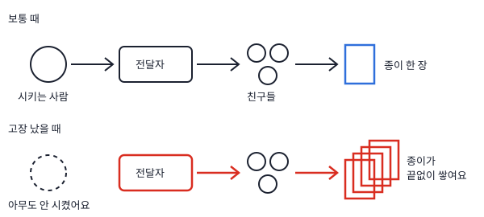

*위 줄은 시킬 때만 종이 한 장이 나오지만, 아래 줄은 빨간 테두리 전달자가 혼자 계속 말을 전해 종이가 끝없이 쌓여요.*

**정확히 말하면**

**암은 세포주기 조절이 깨질 때 생겨요.** 세포는 분열해야 할 때만 분열하고, 멈출 때는 멈추도록 정교하게 조절돼요. 세포가 "언제, 얼마나 자주 분열할지"를 정하는 이 조절에 더 이상 반응하지 않게 되면 암이 돼요(교재 3장 p.62: 이 정상적인 조절을 잃어버릴 때 생긴다). 강의노트도 "세포주기 조절은 암의 경우 소실된다"고 적어요.

조절은 안팎에서 와요. 세포 안에서는 사이클린과 CDK가 주기를 돌리고([4-1. 내적 조절: 사이클린과 CDK](#s4-cyclin-cdk)), 밖에서 온 신호 분자가 수용체에 붙어야 그 일이 시작돼요([4-2. 외적 조절: 신호 분자와 수용체](#s4-signal)). 수업에서는 이 외적 조절 경로가 고장 나는 예로 암을 설명했어요.

**정상 경로**: 신호 분자는 반드시 수용체에 결합해야만 작동해요.

1. 성장 인자 같은 신호 분자가 세포 표면의 수용체에 결합해요.
2. 놀고 있던 수용체가 활성화돼요.
3. 세포 안의 A가 활성화되고, 이어서 B가 활성화돼요.
4. 사이클린·CDK가 움직여 DNA 복제와 세포 분열이 일어나요.

수용체를 암호화하는 유전자를 R(receptor)이라고 해요. 수용체, A, B, 사이클린은 모두 세포 주기를 조절(촉진)하는 유전자의 산물이에요.

**돌연변이 경로**:

1. R 유전자 서열에 **돌연변이**가 생겨 R′ 유전자가 돼요.
2. R′가 만든 수용체는 단백질 구조가 바뀌어요.
3. 여러 돌연변이 가운데 하필 활성화된 상태의 모양과 똑같이 바뀌면, 이 수용체는 **신호 분자 없이**도 항상 활성화된 형태로 있어요.
4. A, B가 계속 활성화되고, 세포 분열이 멈추지 않고 계속 일어나요.

그래서 암은 유전자 돌연변이 때문에 생겨요. 두 유전자의 이름은 이렇게 갈려요.

| 구분 | 원발암 유전자(proto-oncogene) | 발암 유전자(oncogene) |
|---|---|---|
| 다른 이름 | 프로토온코진 | 종양 유전자, 온코진 |
| 상태 | 돌연변이 전의 정상 유전자(예: R) | 돌연변이로 바뀐 유전자(예: R′) |
| 하는 일 | 평소엔 놀다가 신호 분자가 붙을 때만 세포 분열을 촉진해요 | 신호가 없어도 세포 분열을 계속 촉진해 암을 일으켜요 |
| 관계 | 세포 주기를 조절하는 정상 유전자(원발암 유전자)가 돌연변이로 분열을 계속 촉진하게 되면 발암 유전자가 돼요. |  |

암을 막으려면 돌연변이가 일어나지 않게 하거나, 일어나도 고치면 돼요. 고치는 일을 맡은 유전자는 [5-2. 종양 억제 유전자: p53과 BRCA1](#s5-suppressor)에서 다뤄요.

**교수님 말씀**

세포가 필요할 때만 분열한다는 점을 수업 있는 날만 학교에 가는 것에 빗댄 뒤 이렇게 못 박았어요.

> 멈출 때는 멈춰야 됩니다. 이 조절이 깨지면은 암이에요.

정상 경로는 교수 → **과대표** → 총무 → 학생 → 보고서로 비유했어요. 교수의 지시(신호 분자)가 있을 때만 보고서(세포 분열)가 나와요. 수용체 유전자의 돌연변이는 "과대표가 미침"이에요.

> 보고서 한 장만 내라고 했는데 과대표가 미쳐 가지고

> 얘들아, 보고서 또 쓰래. 그다음 날 또 쓰래

> 신호 분자가 오지도 않았는데 얘가 계속 신호를 전달하는 거야.

과대표 한 명 때문에 학생 모두가 필요 없는 보고서를 쓰듯, 수용체 유전자 하나의 돌연변이로 세포 분열이 계속 일어나요.

> 결론적으로 암은 유전자 돌연변이 때문에 발생하게 된다.

"태어날 때부터 발암 유전자를 가진 사람이 있을까?"라고 물은 뒤 비유로 답했어요. 발암 유전자도 원래는 정상 유전자(원발암 유전자)였다는 뜻이에요.

> 태어날 때부터 과대표가 미친 건 아니지. 원래 착실한 아이였는데.

> 우리는 발암 유전자 때문에 암에 걸리는 거다.

> 돌연변이가 일어나도 고치면 돼요. 우리는 고치는 시스템을 다 가지고 있습니다.

**꼭 기억해요**

**원발암 유전자는 정상 유전자예요.** 이름에 "발암"이 들어 있어 암을 일으키는 유전자로 착각하기 쉬워요. 원발암 유전자는 신호가 있을 때만 분열을 촉진하는 정상 유전자이고, 돌연변이로 신호 없이도 계속 촉진하게 된 것이 발암 유전자예요.

> 세포 주기를 조절하는 유전자들을 원발암 유전자라고 하고

**발암 유전자, 종양 유전자, 온코진은 같은 것이에요.** 이름이 셋이라 서로 다른 유전자로 착각하기 쉬워요. 셋 다 oncogene을 부르는 이름이고, 돌연변이 전의 정상형인 원발암 유전자(proto-oncogene, 프로토온코진)와만 구분하면 돼요.

> 종양 유전자, 발암 유전자. 영어로는 온코진

**"항상"은 누구에게 붙었는지 확인해요.** 발암 유전자가 만든 수용체는 신호 분자 없이도 항상 켜져 있는 게 맞아요. 원발암 유전자가 만든 정상 수용체가 항상 켜져 있다고 하면 틀려요. 정상 수용체는 신호 분자가 붙을 때만 켜져요.

암이 언제 생기는지 묻는 설명은 이렇게 갈라요.

- **조절에 반응하지 않게 된다**와 **조절에 더 민감해진다**를 헷갈리기 쉬워요. 암은 언제, 얼마나 자주 분열할지 정하는 조절에 세포가 더 이상 반응하지 않을 때 생겨요. 조절에 더 민감해지면 오히려 조절을 더 잘 따르게 돼요.
- **세포가 늙는 것 자체**를 원인으로 착각하기 쉬워요. 나이 든 사람에게 암이 많은 까닭은 돌연변이가 쌓일 시간이 길어지기 때문이에요([5-3. 양성·악성 종양, 전이, 접촉 저해](#s5-tumor)).
- **p53이 많아지는 것**을 암의 원인으로 착각하기 쉬워요. p53은 종양 억제 유전자라서, 이쪽 힘이 세지면 분열을 더 억제하는 방향이에요([5-2. 종양 억제 유전자: p53과 BRCA1](#s5-suppressor)).
- **다른 세포에 붙지 못하고 돌아다니는 것**을 발생 원인으로 착각하기 쉬워요. 이것은 이미 생긴 암세포가 떨어져 나가 퍼질 때(전이) 보이는 성질이고, 암이 왜 생기는지에 대한 설명이 아니에요.

**페이지 요약**

세포 주기를 조절하는 정상 유전자(원발암 유전자)가 돌연변이로 신호 없이도 분열을 계속 촉진하게 되면 발암 유전자가 되고, 조절이 깨진 세포는 암이 돼요.

*용어*

- **원발암 유전자(proto-oncogene)** — 신호가 있을 때만 분열을 촉진하는 정상 유전자
- **발암 유전자(oncogene)** — 돌연변이로 신호 분자 없이도 분열을 계속 촉진하는 유전자(= 종양 유전자, 온코진)

---

### 5-2. 종양 억제 유전자: p53과 BRCA1

*0917 수업 · 3장 p3*

**쉽게 말하면**

세포 안에는 실수를 찾으면 "잠깐 멈춰, 고치자" 하는 지우개 같은 일꾼이 있어요.

이 일꾼이 없어도 바로 병이 되지는 않지만, 고치지 못한 실수가 쌓일 기회가 커져요.

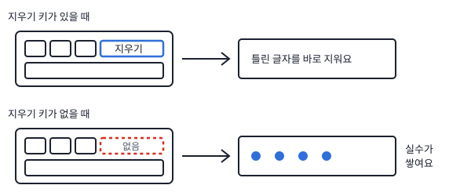

*위 키보드는 틀린 글자를 지우지만, 아래 키보드는 지우기 키 자리가 비어 있어 색칠된 점처럼 실수가 쌓여요.*

**정확히 말하면**

**종양 억제 유전자(tumor suppressor gene)**는 세포 분열을 억제하는 단백질을 암호화하는 유전자예요. 확인점에서 잘못된 것을 찾으면 "잠깐 멈춰, 고치자" 하고 분열을 세운 뒤 고치게 해요. 예를 들어 S기가 끝나면 DNA 복제가 정상인지 확인하고, 잘못됐으면 그 자리에서 고쳐요([3-2. 확인점](#s3-checkpoint)).

이 유전자들이 제대로 일하기 때문에 우리는 웬만해서는 암에 잘 걸리지 않아요.

**종양 억제 유전자가 망가지면**:

1. 종양 억제 유전자에 돌연변이가 생겨 기능을 잃어요.
2. 다른 곳에 돌연변이가 생겨도 고칠 수 없어요.
3. 돌연변이를 가진 채로 세포 분열이 일어나요.
4. 여기저기 돌연변이가 쌓이면서 원발암 유전자가 발암 유전자로 바뀔 확률이 올라가요.
5. 발암 유전자 같은 돌연변이가 여럿 쌓이면 암이 돼요([5-3. 양성·악성 종양, 전이, 접촉 저해](#s5-tumor)).

그래서 종양 억제 유전자에 돌연변이가 생겼다고 **곧바로 암이 되지는 않아요.** 고칠 수 없게 될 뿐이고, 시간이 지나며 암이 될 **확률이 높아져요.** 교재도 종양 억제 유전자 하나가 비활성화되어서는 암이 거의 생기지 않는다고 적어요(교재 3장 p.63).

대표적인 종양 억제 유전자는 둘이에요. 암 환자의 절반 정도가 종양 억제 유전자 돌연변이를 갖고 있어요.

- **p53**: 가장 대표적인 종양 억제 유전자예요.
- **BRCA1**(브라카): breast cancer의 줄임말이에요. 이름은 유방암이지만 유방암을 **억제하는** 유전자예요.

세포 분열에 관여하는 세 유전자를 나란히 보면 이래요.

| 유전자 | 정상일 때 하는 일 | 고장 났을 때 |
|---|---|---|
| 원발암 유전자(proto-oncogene) | 신호 분자가 있을 때만 세포 분열을 촉진해요(분열을 미는 쪽 정상 유전자) | 돌연변이로 발암 유전자가 돼요 |
| 발암 유전자(oncogene) | 정상형이 따로 없어요. 원발암 유전자가 돌연변이로 바뀐 것이에요 | 신호가 없어도 분열을 계속 촉진해요(가속 페달이 켜진 채) |
| 종양 억제 유전자(tumor suppressor gene) | 확인점에서 분열을 멈추고 고치게 해요(분열을 막는 쪽 정상 유전자) | 돌연변이를 고치지 못해 암이 될 확률이 높아져요(브레이크와 수선이 없음) |

**교수님 말씀**

> 고치는 데 중요한 유전자들을 종양 억제 유전자라고 합니다.

> 확인 지점에서 "잠깐 멈춰, 멈춰, 고치자."

> p53은 대표적인 종양 억제 유전자고

BRCA1이 망가진 것을 **백스페이스**가 없는 키보드에 빗댔어요. 오타는 반드시 생기는데 고칠 수가 없어서, 돌연변이가 있는 채로 분열이 일어나 발암 유전자가 생길 확률이 높아져요.

> 키보드에 백스페이스가 없는 거예요.

> 오타가 생겨도 고칠 수가 없는 거예요.

[강의노트 외] **안젤리나 졸리** 이야기로 BRCA1을 설명했어요. 어머니가 난소암으로, 외할머니도 암으로 세상을 떠나자 BRCA1 검사를 받았고 돌연변이가 발견됐어요. 곧바로 암이 된 것은 아니지만 위험이 크다고 보고 유방과 난소를 예방적으로 절제했어요. 이후 다른 여성들도 검사를 받게 된 것을 "안젤리나 이펙트"라고 해요.

> 종양 억제 유전자에 돌연변이가 생기면 바로 암에 걸리는 건 아니죠.

[강의노트 외] 졸리의 BRCA1 검사비는 400만 원 가까이였어요. 실험 자체는 10만 원, 인건비까지 쳐도 40만 원쯤이면 될 일인데, 검사를 고안한 회사 미리아드(Myriad)가 유전자에 **특허**를 걸어 두었기 때문이에요. 연구자에게까지 돈을 받으려 하자 시민단체가 소송을 냈어요.

- 1심은 시민단체, 항소심은 미리아드, 대법원은 시민단체가 이겼어요.
- 유전자 서열 자체는 모든 사람이 가진 자연 상태라서 특허 대상이 될 수 없어요.
- 다만 유전자 중간중간 끼워진 "쓸데없는 부위"(나중에 배운다고 하셨어요)를 실험으로 제거한 서열은 사람이 개입한 것이라 특허 대상이 될 수 있어요. 그래서 "절반은 지고 절반은 이긴" 셈이에요.
- 특허는 사람이 만든 것만 받을 수 있어요. 자연 상태의 것이나 AI로 만든 것은 안 돼요.

> 유전자 서열 자체는 특허 대상이 될 수가 없죠.

[강의노트 외] 염기 서열을 읽는 방법을 시퀀싱(sequencing)이라고 해요. 1990년대 게놈 프로젝트 때는 한 사람을 읽는 데 15년, 30억 달러가 들었어요. 지금은 하루, 1,000달러면 되고 100달러까지 떨어질 전망이에요. 비용이 싸지는 속도가 반도체의 무어의 법칙보다 빠르대요.

**꼭 기억해요**

**발암 유전자와 종양 억제 유전자는 방향이 반대예요.** 둘 다 "암 유전자"로 뭉뚱그리기 쉬워요. 발암 유전자는 분열을 너무 촉진해서 암을 일으키고(가속 페달이 켜진 채), 종양 억제 유전자는 분열을 멈추고 돌연변이를 고쳐 암을 억제해요. 종양 억제 유전자는 망가질 때(브레이크와 수선이 없어질 때) 암 위험이 커져요.

> 발암 유전자가 암을 일으킨다. 세포 분열을 너무 촉진시키기 때문에

**종양 억제 유전자 돌연변이는 곧바로 암이 아니에요.** 돌연변이가 곧 암이라고 착각하기 쉬워요. 고칠 수 없게 될 뿐이고, 시간이 지나며 발암 유전자가 생길 확률이 높아지는 거예요.

> 시간이 지나면 발암 유전자가 생길 확률이 증가하는 거죠.

**원발암 유전자와 종양 억제 유전자는 둘 다 정상 유전자예요.** 원발암 유전자를 "나쁜 유전자", 종양 억제 유전자를 "좋은 유전자"로 나누기 쉬워요. 둘 다 정상 세포가 갖고 있고, 원발암 유전자는 분열을 미는 쪽, 종양 억제 유전자는 분열을 막는 쪽이에요.

**종양 억제 쪽이 세지면 분열은 더 억제돼요.** p53 같은 종양 억제 유전자가 많이 일하면 암이 생긴다고 착각하기 쉬워요. 종양 억제 유전자는 분열을 억제하므로, 이쪽이 강해지면 분열을 더 막는 방향이에요. 암 위험은 이 유전자가 **기능을 잃을 때** 커져요.

**BRCA1의 이름에 속지 마세요.** breast cancer라는 이름 때문에 유방암을 일으키는 유전자로 착각하기 쉬워요. BRCA1은 유방암을 억제하는 종양 억제 유전자이고, 이것이 망가졌을 때 위험이 커져요.

**페이지 요약**

종양 억제 유전자는 확인점에서 분열을 멈추고 돌연변이를 고치게 하는 유전자이고, 망가지면 곧바로 암이 되는 게 아니라 암이 될 확률이 높아져요.

*용어*

- **종양 억제 유전자(tumor suppressor gene)** — 세포 분열을 억제하고 돌연변이를 고치게 하는 유전자
- **p53** — 가장 대표적인 종양 억제 유전자
- **BRCA1** — breast cancer의 줄임말, 유방암 억제 유전자

---

### 5-3. 양성·악성 종양, 전이, 접촉 저해

*0917 수업 · 3장 p2–p3*

**쉽게 말하면**

보통 세포는 옆 친구와 닿으면 자라기를 멈추는데, 고장 난 세포는 멈추지 않고 쌓여요.

한곳에 머무는 혹은 떼어 내면 되지만, 피를 타고 다른 곳으로 퍼지는 혹이 무서운 병이에요.

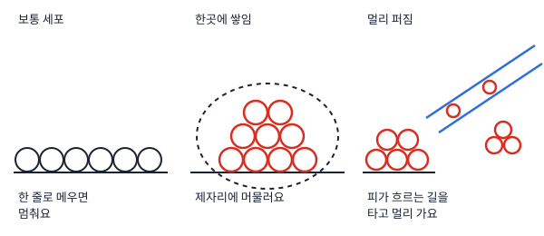

*왼쪽 세포는 한 줄로 자리를 메우면 멈추고, 가운데 빨간 테두리 세포는 한곳에 쌓이며, 오른쪽 세포는 두 줄 선으로 그린 길을 타고 멀리 가서 새 무더기를 만들어요.*

**정확히 말하면**

분열 조절이 깨진 세포는 계속 빠르게 분열해 **종양(tumor)**이라는 세포 덩어리를 만들어요. 종양은 둘로 나뉘어요.

| 구분 | 양성 종양(benign tumor) | 악성 종양(malignant tumor) |
|---|---|---|
| 어디에 | 제자리에서 분열만 해서 덩어리로 머물러요 | 주변 조직에 침투해 파괴하고, 떨어져 나와 몸의 다른 곳으로 퍼져요 |
| 처치 | 제거하면 문제없어요 | 퍼진 곳에서 새 종양으로 자라서 문제가 돼요 |
| 일상의 "암" | 아니에요 | 맞아요. 일상에서 "암"이라고 하는 것은 악성 종양이에요 |

**전이(metastasis)**는 암세포가 원래 자리의 종양에서 떨어져 나와 혈액을 타고(교재: 혈류나 림프) 몸의 다른 곳으로 퍼져 새로운 종양으로 자라는 과정이에요. 비슷한 말과 이렇게 달라요.

- 발암: 정상 세포가 암세포가 되는 것(암이 생기는 것)이에요. 퍼지는 과정이 아니에요.
- 돌연변이 유발: 유전자 서열을 바꾸는 것이에요. 암의 원인 쪽이지 퍼지는 과정이 아니에요.
- 유사분열: 체세포가 둘로 나뉘는 정상 분열이에요([1. 세포주기, 유사분열과 감수분열](#s1-cycle-division)).
- 혈관신생: 새 혈관이 생기는 것을 뜻하는 말이에요. 수업과 교재 3장 암 부분에서는 다루지 않았어요.

**암세포의 특징**:

- 눈으로 봐도 정상 조직과 밀도가 달라요. 교재 그림 3.7처럼 종양 세포는 더 치밀하게 모여 있어요.
- **접촉 저해가 없어요.** 옆에 세포가 있어도 계속 자라 층으로 쌓여요.
- 영양분만 충분하면 무한히 증식해요([0. 헬라 세포와 이번 장의 질문](#s0-hela)).
- 원래 자리에서 떨어져 나와 활발하게 이동하고, 다른 곳으로 전이돼요.

**접촉 저해(contact inhibition)**는 정상 세포가 이웃 세포와 닿으면 성장과 분열을 멈추는 성질이에요. 접촉하는 순간 성장이 저해된다는 뜻이에요. 교재는 서로 접촉한 세포들이 G0기로 옮겨가 더 이상 분열하지 않는다고 적어요(교재 3장 p.62, [3-1. G1–S–G2–M과 G0](#s3-phases)). 살이 파인 **상처**에서 새살이 자라다가 빈 곳을 다 메우면 멈추는 것이 접촉 저해예요.

| 성질 | 정상 세포 | 암세포 |
|---|---|---|
| 접촉 저해 | 있어요. 이웃과 닿으면 분열을 멈춰요 | 없어요. 닿아도 계속 자라 층을 이뤄요 |
| 분열 | 조절받고, 횟수에 한계가 있어요 | 조절이 안 되고, 영양분만 있으면 무한히 증식해요 |
| 이동 | 제자리에 있어요 | 떨어져 나와 이동하고 전이돼요 |

**암은 여러 돌연변이가 순차적으로 축적되어 생겨요.** 유전자 하나가 망가져서 바로 암이 되는 게 아니에요.

1. 유전자 A가 망가져요. 아직 암이 아니에요.
2. 시간이 지나며 B, C…가 차례로 망가져요. 이 단계에서는 양성 종양일 수 있어요(교수님 예: 네다섯 개까지).
3. 하나가 더 망가지면 악성 종양으로 바뀌어요(교수님 예: 대여섯 개쯤).

개수는 이해를 돕는 예시예요. 강의노트는 "몇 개로부터 다수에 이르는 많은 유전자들의 순차적인 변화가 누적"된다고 적어요. 나이가 들수록 돌연변이가 쌓일 시간이 길어지므로 나이 든 사람에게 암이 더 많아요. 같은 까닭으로 종양 억제 유전자 하나에 돌연변이가 생겼다고 곧바로 악성 종양이 되지는 않아요([5-2. 종양 억제 유전자: p53과 BRCA1](#s5-suppressor)).

**교수님 말씀**

> 암은 사실은 유전자 한두 개 가지고서는 암이 안 걸린답니다.

앞에서는 분열이 계속 촉진되는 것을 암이라고 불렀지만, 일상에서 말하는 암은 다르다고 짚었어요.

> 일상생활에서 이제 우리가 암이라고 하는 거는 이 악성 종양을 의미하는 겁니다.

> 근데 이게 이제 혈액을 통해서 퍼져 나가는 게 문제예요.

접촉 저해는 **상처**가 아무는 모습으로 설명했어요. 새살이 파인 곳을 메우면 멈추지만, 암세포는 메운 뒤에도 옆에 누가 있든 계속 자라 층을 이뤄요.

> 메꾸면은 끝. 메꾼 상태에서는 더 이상 안 자라죠

> 정상 세포는 접촉 저해를 받아요. 근데 암세포는 이거를 안 받는다는 얘기입니다.

나이 든 사람에게 암이 많은 까닭을 돌연변이 축적으로 설명했어요. A도 망가지고, B도 망가지고, C도 망가지며 단계별로 진행된다는 거예요.

> 한 네 개 다섯 개까지는 그냥 뭐 양성 종양이다가

> 하나가 더 망가지면 이제 악성 종양으로 바뀐다

**꼭 기억해요**

**수업 앞부분의 "암"과 일상의 "암"은 범위가 달라요.** 분열이 멈추지 않는 세포 덩어리면 모두 일상의 암이라고 착각하기 쉬워요. 앞부분에서는 분열이 계속 촉진되는 것을 암이라고 불렀지만, 일상에서 암이라고 하는 것은 전이되는 악성 종양만이에요.

> 지금은 그냥 세포 분열이 계속 촉진되는 걸 암이라고 했지만

**양성 종양과 악성 종양은 퍼지느냐로 갈려요.** 덩어리가 생기면 다 악성이라고 착각하기 쉬워요. 제자리에 머무는 덩어리는 양성 종양이고 제거하면 되며, 주변에 침투하고 전이되는 것이 악성 종양이에요.

**접촉 저해는 정상 세포의 성질이에요.** "저해"라는 말 때문에 암세포의 특징으로 착각하기 쉬워요. 접촉하면 성장이 저해되는 성질이 정상 세포에 있고, 암세포에서는 이것이 없어져요. 그래서 암세포의 특성을 고를 때 접촉 저해는 빠지고, 활발한 이동성·전이·조절되지 않는 분열이 들어가요.

**암은 돌연변이 하나로 생기지 않아요.** 유전자 하나만 망가지면 바로 암이 된다고 착각하기 쉬워요. 여러 돌연변이가 순차적으로 축적되어야 암이 되고, 그래서 나이와 관계가 있어요. 종양 억제 유전자 돌연변이 하나도 곧바로 악성 종양을 만들지 않아요.

> 유전자 한 개 망가져서 암이 바로 걸리는 게 아니기 때문에

**늙는 것 자체가 원인은 아니에요.** 나이가 들면 세포가 늙어서 암이 된다고 착각하기 쉬워요. 나이가 들수록 돌연변이가 쌓일 시간이 길어지는 것이 까닭이에요.

**전이는 "퍼지는 과정"의 이름이에요.** 암이 생기는 것(발암), 유전자를 바꾸는 것(돌연변이 유발), 세포가 둘로 나뉘는 것(유사분열)과 헷갈리기 쉬워요. 암세포가 원래 자리를 벗어나 몸의 다른 곳으로 퍼지는 과정만 전이예요.

**페이지 요약**

제자리 덩어리는 양성 종양, 주변에 침투하고 전이되는 것이 악성 종양(일상의 "암")이며, 암세포는 접촉 저해를 잃고 여러 돌연변이가 축적되어 생겨요.

*용어*

- **전이(metastasis)** — 암세포가 떨어져 나와 혈액을 타고 다른 곳으로 퍼지는 과정
- **접촉 저해(contact inhibition)** — 정상 세포가 이웃과 닿으면 분열을 멈추는 성질, 암세포에는 없음
- **악성 종양(malignant tumor)** — 주변에 침투하고 전이되는 종양, 일상의 "암"

---

## 6. 요약 · 예고

### 30초 요약

*0917 수업 · 3장 p1–3*

| 주제 | 시험 직전 한 줄 |
|---|---|
| [정상 세포 vs 암세포](#s0-hela) | 정상 세포는 분열 횟수가 정해져 있어요(배양한 면역세포는 30~50번쯤 뒤 멈춤). 암세포는 영양분만 있으면 멈추지 않고 분열해요. 헬라 세포(HeLa cell)는 헨리에타 랙스의 자궁경부암 세포로, 몸 밖에서 처음 배양된 세포주예요. |
| [유사분열 vs 감수분열](#s1-cycle-division) | 유사분열(mitosis)은 체세포 분열과 같은 것이에요. 감수분열(meiosis)의 "감수"는 감수성이 아니라 수가 줄어든다는 뜻이고, 염색체 수가 반으로 줄며 유성생식에서 정자·난자를 만들 때만 일어나요. |
| [염색질 vs 염색체](#s2-chromatin) | 평소(유전자를 써야 할 때)에는 DNA가 풀린 염색질이라 현미경으로 염색체가 안 보여요. 분열 중에만 (둘 다 DNA+히스톤이지만) 꽁꽁 응축한 막대 모양 염색체로 보이므로, 분열 중인 세포(양파 뿌리 끝)를 관찰해요. |
| [자매염색분체 vs 상동염색체](#s2-sister-homolog) | 자매염색분체는 DNA 복제로 생긴 쌍이라 정보가 완전히 같고, 동원체에서 붙어 있어요. 상동염색체는 엄마·아빠에게서 하나씩 받은 쌍으로, 크기·모양과 같은 자리의 유전자는 같지만 대립유전자는 다를 수 있어요. |
| [유전자 vs 대립유전자](#s2-sister-homolog) | 유전자는 자리와 기능(예: 혈액형 유전자)이고, 대립유전자(allele)는 그 유전자의 다른 버전(예: A와 B, C와 c)이에요. |
| [분열 중 붙은 막대 두 개](#s2-sister-homolog) | 세포주기에서 M기(분열)에 들어가기 전에는 S기에 DNA 복제가 끝나 있어요. 그래서 분열 중에 붙어 보이는 막대 두 개는 복제된 염색체 하나(자매염색분체 두 개)이지, 복제 전 염색체 두 개가 아니에요. |
| [2n과 n](#s2-ploidy) | 상동염색체를 쌍으로 가지면 2배체(2n), 쌍 중 하나씩만 가지면 반수체(n)예요. n은 "1배체"라고 부르지 않아요. 사람 체세포는 2n = 46, 즉 46개 = 23쌍(46쌍 아님)이고, 정자·난자는 반수체예요. |
| [무엇이 나뉘나](#s2-ploidy) | 체세포 분열에서는 자매염색분체가 나뉘고 상동염색체는 나뉘지 않고 따라가서 2n에서 2n이 돼요. 감수분열은 2단계로, 1단계에서 상동염색체가, 2단계에서 자매염색분체가 나뉘어요. |
| [세포주기 순서](#s3-phases) | G1(세포 성장, 분열 직후라 가장 작음) → S(DNA 합성·복제) → G2(분열 준비) → M(유사분열)이에요. G1·S·G2가 간기이고 G는 Gap(틈)이에요. 분열하라는 신호가 와야 G1에서 S로 넘어가요. |
| [G0기](#s3-phases) | G1에서 멈춰 분열하지 않고 머무는 상태예요(예: 신경세포). 분열 능력이 없는 게 아니라 안 하는 거예요. 주기 길이는 G1 길이가 좌우해요(사람 세포 약 하루, 대장균 빠르면 20분). |
| [확인점 vs 종양 억제 유전자](#s3-checkpoint) | 확인점은 한 단계가 완성되기 전에는 다음 단계로 못 넘어가게 멈추는 지점이에요(DNA 복제가 정상인지, 방추사가 염색체에 제대로 붙었는지, 분열할 시기인지 확인). 멈춘 자리에서 고치는 일은 종양 억제 유전자가 해요. |
| [내적 조절](#s4-cyclin-cdk) | 세포 안의 사이클린과 CDK(사이클린 의존성 인산화 효소)가 둘이 합쳐서 G1·S·G2·M을 넘겨요. 사이클린은 단계마다 하는 일이 달라 여러 종류예요. |
| [외적 조절](#s4-signal) | 성장 인자·성장 호르몬 같은 신호 분자가 세포 밖에서 와서 분열을 시작시켜요(예: 상처가 나면 분비). 신호 분자는 반드시 수용체에 결합해야만 작동해요(차 키만 있고 차가 없으면 못 씀). |
| [외적 신호가 전달되는 길](#s4-signal) | 신호 분자가 수용체에 결합 → 수용체 활성화 → 세포 안 A → B → … → 사이클린·CDK → DNA 복제 → 분열 순서예요. 신호 분자는 이 길을 켜는 바깥 신호이고, 길 안의 수용체·A·B·사이클린은 세포주기를 촉진하는 유전자가 만든 단백질이에요. |
| [원발암 유전자 vs 발암 유전자](#s5-oncogene) | 원발암 유전자(proto-oncogene)는 신호 분자가 있을 때만 분열을 촉진하는 정상 유전자예요. 돌연변이로 수용체가 활성 모양으로 바뀌어 신호 분자 없이도 계속 촉진하게 되면 발암 유전자(oncogene, 종양 유전자)예요. 태어날 때부터가 아니라 돌연변이로 바뀐 거예요. |
| [종양 억제 유전자](#s5-suppressor) | 분열을 억제하고 확인점에서 멈춰 돌연변이를 고치는 정상 유전자예요(p53, BRCA1). 망가지면 곧바로 암이 되는 게 아니라, 고치지 못한 돌연변이가 쌓여 원발암 유전자가 발암 유전자로 바뀔 확률이 올라가요. |
| [촉진 쪽 vs 억제 쪽](#s5-suppressor) | 원발암 유전자는 촉진 쪽 정상 유전자로, 돌연변이로 발암 유전자가 되면 분열을 너무 촉진해 암을 일으켜요. 종양 억제 유전자는 억제·수선 쪽 정상 유전자로, 제 기능을 못 하면 암 확률이 높아져요. |
| [양성 vs 악성, 전이](#s5-tumor) | 양성 종양은 제자리에서 분열만 해서 생긴 덩어리라 제거하면 돼요. 악성 종양은 혈액을 타고 퍼지는 전이(metastasis)가 일어나는 것이고, 일상에서 말하는 "암"은 악성 종양만 가리켜요. |
| [접촉 저해](#s5-tumor) | 접촉 저해는 정상 세포의 성질이에요: 옆 세포와 닿으면 성장을 멈춰요(상처를 메꾸면 멈춤). 암세포는 이것을 잃어서 층을 이루며 계속 자라요. |
| [암은 누적으로 생김](#s5-tumor) | 유전자 하나가 망가져서 바로 암이 되지 않아요. 돌연변이가 순차적으로 축적되어 여러 개(교수님 예시로 대여섯 개쯤)가 망가져야 악성이 되므로, 나이가 들수록 암이 많아요. |

---

### 다음 시간 예고

*0917 수업 · 3장 p1–5*

수업은 세포주기 조절과 암을 정리한 뒤 교수님이 스스로 마쳤어요.

- 끊긴 지점: "나머지는 이제 체세포 분열 과정, 감수분열 과정인데 … 두 개 비교하면서 하는 게 더 빠르기 때문에 일단 오늘은 여기까지만"
- 과제: "동영상 다음 주까지 복습하세요"

다음 시간에 둘을 비교하며 배울 내용이에요.

- 체세포 분열 과정: 유사분열 단계(전기·전중기·중기·후기·말기)
- 감수분열 과정: 감수분열 1·2의 단계

교수님이 따로 예고하지는 않았지만 아직 다루지 않은 강의노트 3장 p2–p5 내용이에요.

- 핵형분석과 콜히친
- 세포질 분열(분열홈·세포판)
- 영양생식·클론
- 4분체와 교차
- 비분리와 다운증후군
- 성염색체
- 유전적 다양성

---

### 함께 보면 좋은 자료

*0917 수업*

- [복습문제 44선 — 9/17 수업 범위](복습문제_0917_Cell_Division.md)
- [직전 수업 0915 정리노트: 2장 세포호흡과 광합성](../0915/정리노트_0915_Cellular_Respiration_and_Photosynthesis.html)
- [다음 수업 0922 복습팩: 유사분열·감수분열 과정과 멘델 유전](../0922/정리노트_0922_Cell_Division_and_Heredity.html)

---

출처: 이영만 교수님 강의노트(3장) · 수업 녹음 전사(0917) · 『생명과학: 기초와 응용』 2판 3장.
