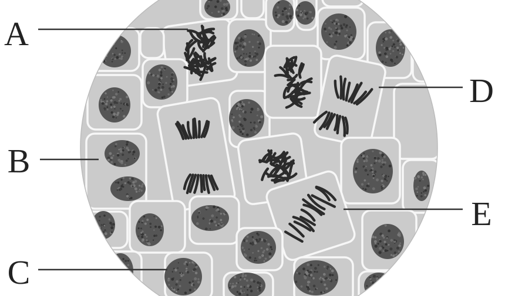
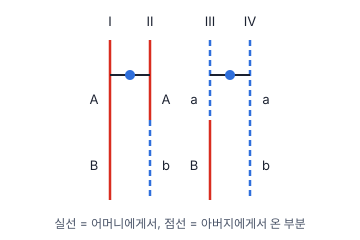

# 생명과학 복습 0922 문제설명

왼쪽 목차로 문항을 고르고, 오른쪽 문제를 보며 해설을 따라가요.

문제의 첫 줄부터 검산까지 설명해요.

**목차**

- [문항별 설명](#problems)
  - [P38. 양파 뿌리 끝 세포의 분열 순서](#p38)
  - [P39. 염색체 8개인 개체의 정자 종류](#p39)
  - [P40. 체세포 분열과 감수 분열의 차이](#p40)
  - [P41. 감수분열에 대한 설명으로 옳지 않은 것](#p41)
  - [P42. 유사분열 전기에 일어나지 않는 일](#p42)
  - [P43. 중기 II에 도달한 세포의 DNA 양](#p43)
  - [P1. 제1감수분열이 끝난 딸세포](#p1)
  - [P2. 감수분열에 대한 틀린 설명](#p2)
  - [P3. 중기 II에 도달한 세포의 DNA 양](#p3)
  - [P4. 재조합이 일어나는 시기](#p4)
  - [P5. 유사분열 중기의 모습](#p5)
  - [P6. 2n = 4일 때 생식세포 조합의 수](#p6)
  - [P7. 배우자의 유전적 차이를 만드는 요인](#p7)
  - [P8. 미세소관이 잇는 두 구조](#p8)
  - [P9. 핵막이 사라지는 시기](#p9)
  - [P10. 단백질과 세포소기관이 늘어나는 시기](#p10)
  - [P11. 자매염색분체가 양극으로 갈라지는 시기](#p11)
  - [P12. 세포질이 나뉘기 시작하는 시기](#p12)
  - [P13. 염색체가 세포 중앙에 늘어서는 시기](#p13)
  - [P14. 자손이 모두 보라색인 부모의 유전자형](#p14)
  - [P15. Ff 부부의 아이가 병을 가질 확률](#p15)
  - [P16. 유전자와 염색체의 관계](#p16)
  - [P17. 멘델 완두에서 우성인 쪽](#p17)
  - [P18. Ff끼리 교배한 자손의 유전자형 종류](#p18)
  - [P19. 대립유전자의 뜻](#p19)
  - [P20. 유전자형과 표현형에 관한 틀린 문장](#p20)
  - [P21. 밖으로 보이는 특성의 이름](#p21)
  - [P22. 한 유전자의 다른 형식](#p22)
  - [P23. 상동염색체 쌍의 성질](#p23)
  - [P24. 병이 나타나지 않는 유전자형](#p24)
  - [P25. TT 완두가 만드는 배우자](#p25)
  - [P26. 곱슬머리 부모의 생머리 아이](#p26)
  - [P27. 대립유전자가 갈라지는 때](#p27)
  - [P28. 멘델 연구에 대한 옳은 설명](#p28)
  - [P29. 우성 유전병이 나타나는 경우](#p29)
  - [P30. 유전자와 염색체의 관계](#p30)
  - [P31. 이형접합성의 뜻](#p31)
  - [P32. 생식세포가 합쳐지는 때](#p32)
  - [P33. 해로운 열성 대립유전자와 이형접합자](#p33)
  - [P34. 구부러진 엄지의 확률](#p34)
  - [P35. 이형접합성의 뜻](#p35)
  - [P36. 열성 유전병의 이형접합자를 부르는 말](#p36)
  - [P37. 감수분열 사진과 설명 짝짓기](#p37)
  - [P44. [변형] 유사분열 중기에 보이는 모습](#p44)
  - [P45. [변형] 유전자형과 표현형, 틀린 문장 찾기](#p45)
  - [P46. [변형] 가운데에 늘어선 세 세포 읽기](#p46)
  - [P47. [변형] 네 가닥 I~IV 그림에서 틀린 해석](#p47)
  - [P48. [변형] 2n = 10인 동물 부부의 자손 조합](#p48)
  - [P49. [변형] 생식모세포 하나의 감수분열 한 번](#p49)
  - [P50. [변형] F2 둥근 콩 300개 가운데 동형접합자](#p50)
  - [P51. [변형] 방추체·수축환·세포판 진술 고르기](#p51)
  - [P52. [변형] 체세포 분열로 생긴 세포, 틀린 설명](#p52)
  - [P53. [변형] 꺾꽂이로만 늘린 과일나무 품종](#p53)
  - [P54. [변형] 수술을 자르고 붓으로 옮긴 까닭](#p54)
  - [P55. [변형] 우열의 법칙으로 설명되는 관찰](#p55)
  - [P56. [변형] 자매염색분체에만 맞는 설명](#p56)

## 문항별 설명

### P38. 양파 뿌리 끝 세포의 분열 순서

웹과제 3장 q01 · [원 문제 보기](../%EB%B3%B5%EC%8A%B5%EB%AC%B8%EC%A0%9C_0922_Cell_Division_and_Heredity.html#p38)

성장 중인 양파 뿌리 끝부분의 세포를 현미경으로 관찰한 결과이다. B는 말기, C는 간기에 해당한다. 세포분열의 단계를 순서대로 옳게 나열한 것은?

- A. C-A-B-D-E
- B. C-A-D-E-B
- C. C-D-E-B-A
- D. C-A-E-D-B
- E. A-D-E-B-C

기출 원문 보기

웹과제 3장 q01 (스크린샷 s01). 실제 화면은 현미경 사진이에요. 여기 그림은 그 사진을 단순화해 다시 그린 도식이에요. 원래 화면은 "최대 4개의 옵션 선택" 체크박스 형식이었지만 정답은 하나예요.

#### 문제를 내 말로 읽어요

주어진 것: 자라고 있는 양파 뿌리 끝의 세포 사진에 A~E 표지가 붙어 있어요. B는 말기, C는 간기라고 미리 알려 줬어요.

구할 것: A~E를 세포분열이 진행되는 순서대로 바르게 늘어놓은 보기를 골라요.

쉽게 말하면, 남은 A·D·E 세 장면에 이름표(전기·중기·후기)를 붙이고, 간기 C에서 말기 B까지 줄을 세우는 문제예요.

#### 이 문제를 봤을 때 떠올릴 개념과 공식

‘성장 중인 뿌리 끝’이라는 단서에서 체세포가 계속 나뉘는 곳, 즉 유사분열(mitosis)을 떠올려요. 유사분열 세포주기는 간기(interphase) 뒤에 전기(prophase) → 중기(metaphase) → 후기(anaphase) → 말기(telophase) 순으로 진행해요.

사진에서 단계를 읽는 기준은 염색체 모양과 위치예요. 간기는 둥근 핵만 보이고 염색체가 풀려 있어요. 전기는 염색체가 실처럼 응축(condense)해 뭉쳐 보여요. 중기는 염색체가 세포 가운데(중기판, metaphase plate)에 한 줄로 늘어서요. 후기는 자매염색분체가 갈라져 두 무리가 양극으로 끌려가요. 말기는 양쪽에 두 딸핵이 생겨요.

이 문제는 B와 C가 주어졌으니 첫 자리는 C, 마지막 자리는 B로 고정하고, 가운데 세 자리를 위 기준으로 채우면 돼요.

관련 정리노트: [전기·중기·후기·말기](../%EC%A0%95%EB%A6%AC%EB%85%B8%ED%8A%B8_0922_Cell_Division_and_Heredity.html#s1-phases)

#### 종이에 쓸 첫 줄

빈칸 다섯 개를 그리고 양 끝부터 채워요: **C(간기) - □ - □ - □ - B(말기)**.

다음 줄에 A·D·E의 모습을 적어요: A 염색체가 뭉침, D 두 무리로 갈라짐, E 가운데 배열. 이것을 전기·후기·중기로 바꿔 빈칸에 넣어요.

#### 왜 이렇게 푸는지 함께 따라가요

먼저 이름표를 붙여요: A는 염색체가 응축해 뭉쳐 있으니 전기, E는 염색체가 가운데에 모여 있으니 중기, D는 두 무리로 갈라져 있으니 후기예요. 그래서 순서는 C(간기) → A(전기) → E(중기) → D(후기) → B(말기)예요.

A 틀려요. C-A-B-D-E는 말기 B가 중기 E·후기 D보다 앞에 와요. 말기는 분열의 마지막 단계예요.

B 틀려요. C-A-D-E-B는 후기 D가 중기 E보다 앞에 있어요. 염색체는 가운데에 먼저 늘어선 뒤에 갈라져요.

C 틀려요. C-D-E-B-A는 전기 A가 맨 뒤에 있어요. 염색체 응축은 분열의 시작이에요.

D 맞아요. C-A-E-D-B는 간기 → 전기 → 중기 → 후기 → 말기 순서와 정확히 같아요.

E 틀려요. A-D-E-B-C는 전기 A로 시작하고 간기 C가 맨 뒤에 와요. 문제에서 C를 간기로 주었고, 순서도 후기 D가 중기 E보다 앞서 있어요.

따라서 답은 D예요.

#### 완성 답과 검산

답 D. C-A-E-D-B.

소거로 확인해요: 주어진 정보만으로 ‘C가 맨 앞, B가 맨 뒤’인 보기는 B(C-A-D-E-B)와 D(C-A-E-D-B) 둘뿐이에요. 둘의 차이는 D와 E의 순서이고, 중기(가운데 배열)가 후기(두 무리)보다 먼저이므로 E가 앞인 D만 남아요.

교과서·강의노트 대조: 교과서 3장 p.57–58은 유사분열을 전기·전중기·중기·후기·말기로 설명하며, 중기에 염색체가 방추체 중간 지점(중기판)에 배열되고 후기에 자매염색분체가 양극으로 끌려간다고 적어요. 강의노트 3장 p2의 “중기 : 염색체가 중간지점 배열 / 후기: 자매염색분체 분리, 극으로 이동”과도 같아요. 웹과제 3장 q01의 분석 답도 D예요.

#### 이 문항에서 하기 쉬운 실수

D(두 무리)와 E(가운데 배열)의 순서를 바꿔 보기 B를 고르기 쉬워요. **먼저 한 줄로 서고(중기), 그다음 갈라져요(후기)**.

보기 문자 A~E와 그림 표지 A~E가 같은 글자라 헷갈려요. 종이에 ‘그림 A = 전기’처럼 그림 표지에만 이름표를 따로 적어 두고 보기와 섞지 않아요.

#### 설명을 닫고 다시 해 봐요

- 간기·전기·중기·후기·말기의 염색체 모습을 한 줄씩 그림 없이 말로 설명해 보기
- C - □ - □ - □ - B 빈칸에 A·D·E를 넣고 왜 그 자리인지 적어 보기

**페이지 요약**

#### 떠올릴 개념·공식

유사분열: 간기 → 전기(응축) → 중기(가운데 배열) → 후기(두 무리 분리) → 말기(두 딸핵).

#### 첫 줄

C - □ - □ - □ - B. A 뭉침=전기, E 가운데=중기, D 두 무리=후기.

#### 핵심 판단

중기 E가 후기 D보다 먼저 → C-A-E-D-B.

#### 검산

C 처음·B 끝인 보기 B·D 중 E가 D보다 앞인 것은 D. 교과서 3장 p.57–58. 답 D.

---

### P39. 염색체 8개인 개체의 정자 종류

웹과제 3장 q02 · [원 문제 보기](../%EB%B3%B5%EC%8A%B5%EB%AC%B8%EC%A0%9C_0922_Cell_Division_and_Heredity.html#p39)

어떤 이배체 체세포의 염색체가 8개라면 이 개체가 만들 수 있는 유전적으로 서로 다른 정자의 종류는 몇 가지인가?

(교차와 돌연변이는 일어나지 않는다고 가정한다)

- A. 8
- B. 16
- C. 128
- D. 64
- E. 32

기출 원문 보기

웹과제 3장 q02 (스크린샷 s02). 원래 화면은 체크박스 형식이었지만 정답은 하나예요.

#### 문제를 내 말로 읽어요

주어진 것: 이배체(2n) 체세포의 염색체가 8개예요. 교차와 돌연변이는 일어나지 않는다고 가정해요.

구할 것: 이 개체가 만들 수 있는 유전적으로 서로 다른 정자의 종류 수예요.

쉽게 말하면, 엄마 것·아빠 것 짝꿍이 몇 쌍인지 세고, 쌍마다 ‘엄마 것 또는 아빠 것’ 중 하나를 고르는 경우의 수를 곱하는 문제예요. 교차가 없다고 했으니 짝꿍 고르기만으로 생기는 다양성만 세요.

#### 이 문제를 봤을 때 떠올릴 개념과 공식

‘서로 다른 정자의 종류’와 ‘교차는 없다’는 단서에서 상동염색체의 무작위 분배(independent assortment)를 떠올려요. 중기 I에 상동염색체(homologous chromosomes) 쌍마다 모계 것과 부계 것이 어느 극으로 갈지 독립적으로 정해져요.

그래서 쌍마다 선택지가 2가지이고, 쌍이 $n$개면 곱셈 규칙으로 $2^{n}$가지 생식세포가 생겨요. 여기서 $n$은 **염색체 개수가 아니라 상동염색체 쌍의 수**(반수체 염색체 수)예요.

2배체는 염색체를 쌍으로 가지므로 염색체 수 $2n$을 2로 나누면 쌍의 수 $n$이 나와요. 교차가 없다고 했으니 재조합으로 늘어나는 종류는 세지 않아요.

관련 정리노트: [상동염색체의 무작위 분배](../%EC%A0%95%EB%A6%AC%EB%85%B8%ED%8A%B8_0922_Cell_Division_and_Heredity.html#s3-assortment)

#### 종이에 쓸 첫 줄

첫 줄: **$2n = 8 \Rightarrow n = 4$쌍**.

둘째 줄: **정자 종류 $= 2^{n} = 2^{4}$**. 이렇게 쌍의 수를 먼저 쓰고 나서 지수에 넣어요.

#### 왜 이렇게 푸는지 함께 따라가요

계산: $2n = 8$이므로 상동염색체는 4쌍이에요. 쌍마다 모계 또는 부계 염색체 중 하나가 정자로 들어가니 $2 \times 2 \times 2 \times 2 = 2^{4} = 16$가지예요.

A 틀려요. 8은 염색체 수를 그대로 쓴 값이에요. 종류 수는 2를 쌍의 수만큼 곱한 값이에요(8은 3쌍일 때의 $2^{3}$이기도 해요).

B 맞아요. 4쌍이므로 $2^{4} = 16$가지예요.

C 틀려요. 128은 $2^{7}$이라 7쌍일 때의 값이에요.

D 틀려요. 64는 $2^{6}$이라 6쌍일 때의 값이에요. 염색체 8개를 그대로 지수로 넣으면 $2^{8} = 256$이 되어 보기에 없어요.

E 틀려요. 32는 $2^{5}$라 5쌍일 때의 값이에요.

따라서 답은 B예요.

#### 완성 답과 검산

답 B. 16가지.

교과서 그림으로 확인해요: 교과서 3장 p.69 그림 3.11은 염색체 3쌍(A, B, C)이 중기 I에 무작위로 배열되는 4가지 연결 방식이 배우자에서 8가지 조합을 만든다고 보여 줘요. 3쌍 → $2^{3} = 8$이므로 쌍이 하나 늘어난 4쌍은 $8 \times 2 = 16$이에요.

사람 예로도 확인해요: 같은 쪽 본문과 강의노트 3장 p5는 사람 23쌍이면 $2^{23} = 8{,}388{,}608$가지라고 적어요. 지수가 염색체 수 46이 아니라 쌍의 수 23이라는 점이 이 문제의 규칙(지수 = 4)과 같아요. 웹과제 3장 q02의 분석 답도 B예요.

#### 이 문항에서 하기 쉬운 실수

염색체 수 8을 그대로 지수에 넣어 $2^{8}$을 계산하거나, 8을 답으로 고르기 쉬워요. **지수는 상동염색체 쌍의 수**예요. ‘이배체’라는 말이 보이면 먼저 2로 나눠요.

교차를 고려해 ‘무수히 많다’고 생각하지 않도록, 문제의 가정(교차·돌연변이 없음)을 첫 줄 옆에 적어 둬요.

#### 설명을 닫고 다시 해 봐요

- $2n = 8$, $2n = 6$, $2n = 46$일 때 쌍의 수와 생식세포 종류 수를 각각 계산해 보기
- 왜 쌍마다 선택지가 2가지인지 중기 I 배열로 설명해 보기

**페이지 요약**

#### 떠올릴 개념·공식

무작위 분배: 생식세포 종류 $= 2^{n}$, $n$ = 상동염색체 쌍의 수.

#### 첫 줄

$2n = 8 \Rightarrow n = 4$쌍.

#### 핵심 판단

$2^{4} = 16$. 지수에 염색체 수 8을 넣지 않아요.

#### 검산

교과서 3장 p.69 그림 3.11(3쌍 → 8가지), 사람 $2^{23}$. 답 B.

---

### P40. 체세포 분열과 감수 분열의 차이

웹과제 3장 q03 · [원 문제 보기](../%EB%B3%B5%EC%8A%B5%EB%AC%B8%EC%A0%9C_0922_Cell_Division_and_Heredity.html#p40)

체세포 분열과 감수 분열의 차이점으로 옳은 것은?

- A. 체세포 분열은 분열 후 염색체 수가 절반으로 줄어든다
- B. 감수 분열은 1회 분열로 2개의 딸세포를 만든다
- C. 두 분열 모두 분열 직후 DNA 복제가 즉시 일어난다
- D. 감수 분열은 생물 전체의 체세포 어디서나 일어난다
- E. 체세포 분열 후기에는 자매염색분체가, 감수 1분열 후기에는 상동 염색체가 분리된다

기출 원문 보기

웹과제 3장 q03 (스크린샷 s03)

#### 문제를 내 말로 읽어요

주어진 것: 체세포 분열(유사분열, mitosis)과 감수 분열(meiosis)을 비교하는 문장 다섯 개(A~E)예요.

구할 것: 두 분열의 차이를 **옳게** 말한 문장 하나를 골라요.

쉽게 말하면, 몸을 키우는 복사기(체세포 분열)와 정자·난자를 만드는 반 나누기 기계(감수 분열)의 사용 설명서를 비교하면서, 맞게 적힌 줄을 찾는 문제예요.

#### 이 문제를 봤을 때 떠올릴 개념과 공식

‘체세포 분열과 감수 분열의 차이’라는 말에서 두 분열을 **네 가지 기준**으로 비교하는 표를 떠올려요: 분열 횟수, 딸세포 수, 딸세포의 염색체 수, 그리고 후기에 무엇이 갈라지는지예요.

체세포 분열은 한 번 나뉘어 부모와 유전적으로 같은 딸세포 2개를 만들어요. 그래서 염색체 수(2n)가 그대로예요. 후기(anaphase)에는 자매염색분체(sister chromatids, 복제로 생긴 똑같은 두 가닥)가 갈라져요.

감수 분열은 생식세포를 만드는 분열로, 두 번(감수 1분열, 감수 2분열) 나뉘어 반수체(haploid, n) 딸세포 4개를 만들어요. 감수 1분열 후기에는 상동염색체(homologous chromosomes, 아버지·어머니에게서 하나씩 받은 짝)가 갈라지고, 감수 2분열 후기에 자매염색분체가 갈라져요.

DNA 복제는 분열 직후가 아니라 간기(interphase)의 S기에 한 번 일어나요. 이 기준들을 각 문장에 대 보면 판정할 수 있어요.

관련 정리노트: [무엇이 갈라지는가](../%EC%A0%95%EB%A6%AC%EB%85%B8%ED%8A%B8_0922_Cell_Division_and_Heredity.html#s0-target), [제1감수분열과 제2감수분열](../%EC%A0%95%EB%A6%AC%EB%85%B8%ED%8A%B8_0922_Cell_Division_and_Heredity.html#s2-two-divisions)

#### 종이에 쓸 첫 줄

비교표의 머리줄을 먼저 써요: **| 기준 | 체세포 분열 | 감수 분열 |**.

첫 행은 ‘분열 횟수·딸세포 수 | 1번·2개(2n) | 2번·4개(n)’, 둘째 행은 ‘후기에 갈라지는 것 | 자매염색분체 | 1분열: 상동염색체, 2분열: 자매염색분체’로 채워요. 이 두 행을 보며 A~E를 하나씩 대 봐요.

#### 왜 이렇게 푸는지 함께 따라가요

A 틀려요. 체세포 분열은 염색체 수를 그대로 유지해요. 염색체 수가 절반으로 줄어드는 것은 감수 분열의 특징이에요. 두 분열의 설명이 뒤바뀌었어요.

B 틀려요. 감수 분열은 두 번 연속 분열해 딸세포 4개를 만들어요. ‘1회 분열로 2개’는 체세포 분열의 결과예요.

C 틀려요. DNA 복제는 다음 간기의 S기에 일어나지, 분열 직후 즉시 일어나지 않아요. 특히 감수 분열은 1분열과 2분열 사이에도 복제가 없고, 만들어진 생식세포는 복제를 이어 가지 않아요.

D 틀려요. 감수 분열은 생식세포(정자·난자)를 만드는 생식 기관에서만 일어나요. 몸 전체의 체세포 어디서나 일어나는 것은 체세포 분열이에요.

E 맞아요. 체세포 분열 후기에는 자매염색분체가 갈라지고, 감수 1분열 후기에는 상동염색체가 갈라져요. 두 분열의 핵심 차이를 정확히 짚었어요.

따라서 답은 E예요.

#### 완성 답과 검산

답 E.

소거로 확인해요: A·B는 두 분열의 특징을 서로 바꿔 말했고, C는 복제 시기를, D는 일어나는 장소를 잘못 말했어요. 남는 보기는 E 하나예요.

교과서 대조: 교과서 3장 p.58 후기 설명에서 유사분열 후기에 방추체가 자매염색분체를 분리하고, p.64에서 감수분열은 상동염색체 쌍을 분리해 2n을 n으로 줄이며 반수체 세포 4개를 만든다고 적혀 있어요. 강의노트 3장 p.2(후기: 자매염색분체 분리)와 p.3(상동염색체 쌍을 분리)도 같아요.

#### 이 문항에서 하기 쉬운 실수

A와 B처럼 ‘두 분열의 특징을 바꿔 쓴’ 문장은 낯익은 단어(절반, 2개)가 들어 있어 맞는 것처럼 보여요. 문장 앞의 주어가 체세포 분열인지 감수 분열인지부터 확인해요.

감수 2분열 후기에도 자매염색분체가 갈라지므로, ‘감수 분열에서는 자매염색분체가 안 갈라진다’고 외우면 안 돼요. E는 **감수 1분열** 후기라고 정확히 지정했기 때문에 맞아요.

#### 설명을 닫고 다시 해 봐요

- 체세포 분열과 감수 분열의 분열 횟수·딸세포 수·염색체 수를 표로 써 보기
- 유사분열 후기, 감수 1분열 후기, 감수 2분열 후기에 각각 무엇이 갈라지는지 말해 보기
- DNA 복제가 언제 일어나고, 언제 일어나지 않는지 한 문장으로 정리해 보기

**페이지 요약**

#### 떠올릴 개념·공식

체세포 분열: 1번·2개·2n 유지·후기에 자매염색분체 분리. 감수 분열: 2번·4개·n·1분열 후기에 상동염색체 분리.

#### 첫 줄

| 기준 | 체세포 분열 | 감수 분열 | 비교표를 두 행 채워요.

#### 핵심 판단

A·B는 특징이 뒤바뀜, C는 복제 시기, D는 장소가 틀림. E만 맞아요.

#### 검산

소거로 E만 남고 교과서 3장 p.58·p.64와 일치해요. 답 E.

---

### P41. 감수분열에 대한 설명으로 옳지 않은 것

웹과제 3장 q09 · [원 문제 보기](../%EB%B3%B5%EC%8A%B5%EB%AC%B8%EC%A0%9C_0922_Cell_Division_and_Heredity.html#p41)

유사분열과 비교하여 감수분열에 대한 설명으로 옳지 않은 것은?

- A. 제1감수분열이 끝나면 염색체 수가 반으로 줄어든다
- B. 제1감수분열과 제2감수분열 사이에 DNA 복제가 일어난다
- C. 감수분열이 완료되면 염색체 수가 반으로 줄어든 4개의 딸세포가 생긴다
- D. M기에 핵분열이 2번 일어난다
- E. 제1감수분열에 의해 상동염색체가 분리된다

기출 원문 보기

웹과제 3장 q09 (스크린샷 s09)

#### 문제를 내 말로 읽어요

주어진 것: 유사분열과 비교해 감수분열(meiosis)을 설명한 문장 다섯 개(A~E)예요.

구할 것: 감수분열에 대한 설명으로 **옳지 않은 것(틀린 문장)** 하나를 골라요. 맞는 문장 넷 사이에 숨은 틀린 문장 하나를 찾는 문제예요.

쉽게 말하면, 감수분열이라는 두 번짜리 나누기 과정을 순서대로 떠올리면서, 순서표에 없는 일이 끼어든 문장을 찾아내는 거예요.

#### 이 문제를 봤을 때 떠올릴 개념과 공식

‘제1감수분열’, ‘제2감수분열’, ‘사이에’라는 표현이 보이면 감수분열의 **시간 순서**를 떠올려요: 간기(S기에 DNA 복제 1회) → 제1감수분열 → (짧은 분열간기, 복제 없음) → 제2감수분열.

제1감수분열(meiosis I)에서는 상동염색체(homologous chromosomes) 쌍이 갈라져요. 그래서 1분열이 끝나면 세포마다 염색체 수가 반(n)이 돼요. 제2감수분열(meiosis II)에서는 자매염색분체가 갈라지고, 염색체 수는 n 그대로예요.

핵심 규칙은 ‘복제 1번, 분열 2번’이에요. 복제를 한 번만 하고 두 번 나누기 때문에 결국 염색체 수가 반인 딸세포 4개가 생겨요. 이 규칙이 문장마다 지켜지는지 확인해요.

관련 정리노트: [제1감수분열과 제2감수분열](../%EC%A0%95%EB%A6%AC%EB%85%B8%ED%8A%B8_0922_Cell_Division_and_Heredity.html#s2-two-divisions)

#### 종이에 쓸 첫 줄

시간 순서 한 줄을 써요: **S기(복제) → 1분열(상동염색체 분리, 2n→n) → 복제 없음 → 2분열(자매염색분체 분리, n 유지) → 딸세포 4개**.

그 아래에 ‘묻는 것 = 틀린 문장’이라고 적어 두고, A~E를 이 줄 위의 어느 위치 이야기인지 표시해요.

#### 왜 이렇게 푸는지 함께 따라가요

A 맞아요. 제1감수분열에서 상동염색체 쌍이 갈라져 각 세포가 쌍마다 하나씩만 받으므로 염색체 수가 반으로 줄어요.

B 틀려요. 제1감수분열과 제2감수분열 사이에는 DNA 복제가 없어요. 1분열이 끝나면 복제 없이 곧바로 2분열로 넘어가요. 복제는 감수분열 전 간기의 S기에 한 번뿐이에요.

C 맞아요. 복제 1번, 분열 2번이므로 감수분열이 끝나면 염색체 수가 반인 딸세포 4개가 생겨요.

D 맞아요. 감수분열의 M기에는 핵분열이 1분열·2분열로 두 번 일어나요. 유사분열은 한 번이에요.

E 맞아요. 상동염색체가 분리되는 것은 제1감수분열이에요(제2감수분열에서는 자매염색분체가 분리돼요).

묻는 것은 옳지 않은 것이므로, **틀려요**로 판정된 B가 답이에요.

#### 완성 답과 검산

답 B.

반대 경우로 확인해요: 만약 B처럼 1분열과 2분열 사이에 복제가 한 번 더 일어난다면, 복제 2번·분열 2번이 되어 딸세포의 DNA 양은 줄지 않아요. 그러면 C의 ‘염색체 수가 반으로 줄어든 4개의 딸세포’가 성립하지 않아요. 맞는 문장 C와 충돌하므로 B가 틀린 문장이에요.

교과서 대조: 교과서 3장 p.67 그림 3.9의 초록 상자에 ‘분열간기: 제1감수분열과 제2감수분열 사이에는 DNA 복제가 없음’이라고 적혀 있어요. p.64에는 두 감수분열의 결과 반수의 염색체를 지닌 세포 4개가 생긴다고 나와요.

#### 이 문항에서 하기 쉬운 실수

유사분열에서는 ‘분열 → 간기(복제) → 분열’이 반복되니까, 감수분열의 두 분열 사이에도 복제가 있다고 착각하기 쉬워요. 감수분열의 1분열과 2분열 사이 간기에는 복제가 없어요.

부정형 문제라서 맞는 문장(A)을 보자마자 고르는 실수도 조심해요. 다섯 개를 모두 판정한 뒤 **틀려요**로 판정된 것을 골라요.

#### 설명을 닫고 다시 해 봐요

- 감수분열 전 간기부터 딸세포 4개까지 순서 한 줄을 쓰고, DNA 복제 위치를 표시해 보기
- ‘복제 1번, 분열 2번’이 왜 염색체 수를 반으로 만드는지 한 문장으로 말해 보기

**페이지 요약**

#### 떠올릴 개념·공식

감수분열 = 복제 1번(S기), 분열 2번. 1분열: 상동염색체 분리(2n→n), 2분열: 자매염색분체 분리.

#### 첫 줄

S기 → 1분열 → 복제 없음 → 2분열 → 딸세포 4개 순서를 써요.

#### 핵심 판단

1분열과 2분열 사이에 복제가 있다는 B만 틀려요. 부정형이므로 답 B.

#### 검산

복제가 있으면 C가 성립하지 않아요. 교과서 3장 p.67 그림 3.9 ‘DNA 복제가 없음’과 일치해요.

---

### P42. 유사분열 전기에 일어나지 않는 일

웹과제 3장 q11 · [원 문제 보기](../%EB%B3%B5%EC%8A%B5%EB%AC%B8%EC%A0%9C_0922_Cell_Division_and_Heredity.html#p42)

다음 중 유사분열의 전기 동안에 일어나는 일이 아닌 것은?

- A. 방추체가 형성된다.
- B. 염색체는 적도면의 중간 지점에 배열한다.
- C. 중심체는 세포의 양쪽 극으로 이동한다.
- D. 염색질이 염색체로 응축된다.
- E. 핵막이 소실된다.

기출 원문 보기

웹과제 3장 q11 (스크린샷 s11)

#### 문제를 내 말로 읽어요

주어진 것: 세포 안에서 일어나는 일 다섯 가지(A~E)예요.

구할 것: 유사분열의 전기(prophase) 동안 일어나는 일이 **아닌 것** 하나를 골라요. 다른 단계(중기·후기·말기)의 일이 섞여 들어간 보기를 찾는 문제예요.

쉽게 말하면, ‘이사 준비 단계(전기)’에 할 일 목록에 ‘짐을 가운데 줄 세우기(중기)’가 끼어 있는지 찾는 거예요.

**문항 결함:** 강의노트와 교과서는 전기와 중기 사이에 전중기(prometaphase)를 따로 두고, 핵막이 사라지는 일을 전기가 끝날 무렵·전중기로 적어요. 그래서 엄밀히 단계를 다섯 개로 나누면 E도 ‘전기의 일이 아니다’로 읽힐 수 있어요. 출제 의도는 수업처럼 중기 이전을 모두 전기로 보는 구분이고, 그 구분에서 확실히 전기가 아닌 보기는 B 하나예요.

#### 이 문제를 봤을 때 떠올릴 개념과 공식

‘전기 동안에 일어나는 일’이라는 말에서 유사분열 단계별 사건표를 떠올려요. 각 단계는 **염색체가 어떤 모양이고 어디에 있는지**로 구별해요.

전기(prophase): 염색질(chromatin)이 응축(condense)해 막대 모양 염색체가 되고, 중심체(centrosome)가 양극으로 이동하며 그 사이에 방추체(spindle)가 만들어지기 시작해요. 전중기(prometaphase): 핵막이 분해되고 방추사가 동원체(kinetochore)에 붙어요. 중기(metaphase): 염색체가 세포 가운데 중기판(metaphase plate, 적도면)에 늘어서요. 후기: 자매염색분체 분리. 말기: 핵막 재형성, 염색체 풀림.

0922 수업에서는 전중기를 따로 구분하지 않고 ‘중기 이전은 모두 전기’로 보며, 전기에 응축·핵막 소실·방추사 결합이 일어난다고 정리했어요. 이 문제는 그 구분을 쓰므로 ‘가운데 배열’만 중기로 떼어 내면 돼요.

관련 정리노트: [전기·중기·후기·말기](../%EC%A0%95%EB%A6%AC%EB%85%B8%ED%8A%B8_0922_Cell_Division_and_Heredity.html#s1-phases)

#### 종이에 쓸 첫 줄

단계별 한 줄 사건표를 써요: **전기 = 응축·중심체 이동·방추체 형성 (·핵막 소실: 전중기) | 중기 = 가운데 배열 | 후기 = 자매염색분체 분리 | 말기 = 핵막 재형성·풀림**.

그 아래에 ‘묻는 것 = 전기의 일이 아닌 것’이라고 적고, A~E를 표의 어느 칸에 넣을지 표시해요.

#### 왜 이렇게 푸는지 함께 따라가요

A 맞아요(전기의 일). 전기에 두 중심체 사이에서 방추체가 만들어지기 시작해요.

B 틀려요(전기의 일이 아님). 염색체가 적도면(중기판)의 중간 지점에 늘어서는 것은 중기의 일이에요. 어떤 구분법을 쓰더라도 전기가 아니에요.

C 맞아요(전기의 일). 중심체가 갈라져 세포의 양쪽 극으로 이동하는 것은 전기의 일이에요.

D 맞아요(전기의 일). 염색질이 응축해 염색체가 되는 것은 전기의 첫 사건이에요.

E 수업 구분으로는 맞아요(전기의 일). 다만 엄밀히는 틀릴 수도 있어요 — 강의노트 3장 p.2는 핵막 소실을 ‘(전중기:)’로 적고, 교과서 p.58은 ‘전기가 끝나갈 때 핵막이 분해되고 전중기가 시작된다’고 써서 전기와 전중기의 경계에 놓았어요. 전중기를 별도 단계로 세면 E도 ‘전기의 일이 아닌 것’이 될 수 있어요.

그래도 의도한 답은 B예요. B는 전중기를 나누든 안 나누든 전기가 아닌 중기의 일이고, E는 전기 끝과 이어져 있어 수업 구분(중기 이전은 모두 전기)에서는 전기에 들어가요. 묻는 것은 전기의 일이 **아닌** 것이므로, **틀려요**로 판정된 B가 답이에요.

#### 완성 답과 검산

답 B.

교과서 대조: 교과서 3장 p.57에 전기 동안 복제된 염색체가 응축된다(D), p.58에 방추체가 2개의 중심체 사이에서 형성되기 시작하고 중심체가 양극을 향해 이동한다(A, C)고 나와요. 같은 p.58의 중기 설명에 ‘방추체 미세소관은 염색체를 중기 판이라 부르는 방추체 중간 지점에 배열하도록 이동시킨다’고 되어 있어 B가 중기의 일임이 확인돼요.

다른 경로: 교과서의 다섯 단계 구분을 그대로 써도 B는 중기, E는 ‘전기가 끝나갈 때’라 전기와 이어진 일이에요. 두 구분 모두에서 전기 밖에 확실히 놓이는 보기는 B뿐이에요.

#### 이 문항에서 하기 쉬운 실수

‘방추체’라는 말만 보고 A를 중기로 옮기기 쉬워요. 방추체가 **만들어지기 시작**하는 것은 전기, 다 자란 방추체가 염색체를 **가운데에 세우는** 것은 중기예요.

이 문항처럼 핵막 소실이 전기·전중기 경계에 걸린 보기가 나오면, 먼저 어떤 구분법으로도 전기가 될 수 없는 보기(가운데 배열 = 중기)가 있는지 찾아요. 그런 보기가 있으면 그것이 의도한 답이고, 시험지에 ‘전중기를 따로 보면 E도 해당할 수 있음’을 질문하거나 메모로 남길 수 있어요.

#### 설명을 닫고 다시 해 봐요

- 전기·전중기·중기·후기·말기의 사건을 한 줄씩 써 보기
- 수업 구분(중기 이전은 모두 전기)과 교과서 구분(전중기 따로)에서 핵막 소실이 어디에 들어가는지 말해 보기
- ‘방추체 형성 시작’과 ‘가운데 배열’을 각각 어느 단계로 판정하는지 근거와 함께 말해 보기

**페이지 요약**

#### 떠올릴 개념·공식

전기: 응축·중심체 이동·방추체 형성 시작. 전중기: 핵막 소실·방추사 부착. 중기: 가운데 배열.

#### 첫 줄

단계별 사건표를 쓰고 A~E를 칸에 넣어요.

#### 핵심 판단

가운데 배열(B)은 어떤 구분으로도 중기라 답 B. E는 전중기를 따로 보면 엄밀히 해당할 수 있는 문항 결함이에요.

#### 검산

교과서 3장 p.57~58에서 A·C·D는 전기, B는 중기, 핵막 분해는 전기 끝·전중기 시작이에요. 답 B.

---

### P43. 중기 II에 도달한 세포의 DNA 양

웹과제 3장 q13 · [원 문제 보기](../%EB%B3%B5%EC%8A%B5%EB%AC%B8%EC%A0%9C_0922_Cell_Division_and_Heredity.html#p43)

G2기의 2배체 세포내의 DNA 양이 100이라고 하자. 만일 이 세포가 감수분열 단계인 ‘중기II’에 도달한다면 DNA 양은 어떻게 되겠는가?

- A. 100
- B. 200
- C. 10
- D. 400
- E. 50

기출 원문 보기

웹과제 3장 q13 (스크린샷 s14)

#### 문제를 내 말로 읽어요

주어진 것: 2배체(2n) 세포가 G2기에 있을 때 세포 안의 DNA 양이 100이에요. G2기는 S기에서 DNA 복제를 이미 마친 뒤예요.

구할 것: 이 세포가 감수분열을 시작해 **중기 II**(제2감수분열 중기)에 도달했을 때 세포 하나의 DNA 양이에요.

쉽게 말하면, 복사를 끝낸 서류 묶음 100장이 감수분열을 따라가면서 언제 반으로 나뉘는지 세어, 두 번째 나누기 직전에 한 세포가 몇 장을 들고 있는지 묻는 문제예요.

#### 이 문제를 봤을 때 떠올릴 개념과 공식

‘G2기 DNA 양’과 ‘중기 II’라는 단서에서 **감수분열 단계별 DNA 양 그래프**를 떠올려요. DNA 양은 복제 때 2배가 되고, 세포가 둘로 나뉠 때(세포질 분열) 반이 돼요.

규칙: S기 복제로 G1의 양이 2배가 돼요(G2 = 100이면 G1은 50). 제1감수분열이 끝나 세포가 둘로 나뉘면 세포당 양은 반(50)이 돼요. 1분열과 2분열 사이에는 복제가 없어요. 제2감수분열이 끝나면 다시 반(25)이 돼요.

중기(metaphase)는 세포가 아직 나뉘기 전이에요. 그래서 중기 II의 양은 ‘1분열은 끝났고 2분열의 나뉨은 아직’인 상태의 양, 곧 50이에요.

관련 정리노트: [제1감수분열과 제2감수분열](../%EC%A0%95%EB%A6%AC%EB%85%B8%ED%8A%B8_0922_Cell_Division_and_Heredity.html#s2-two-divisions)

#### 종이에 쓸 첫 줄

단계와 양을 화살표로 이어 써요: **G1 50 → (S기 복제) → G2 100 → 중기 I 100 → (1분열 끝, 세포 둘로) → 50 → 중기 II ? → (2분열 끝) → 25**.

‘중기 II’가 화살표 줄의 어느 칸에 있는지, 그 앞에 ‘나뉨’이 몇 번 있었는지를 세어요.

#### 왜 이렇게 푸는지 함께 따라가요

A 틀려요. 100은 G2기부터 중기 I까지, 즉 제1감수분열로 세포가 나뉘기 전의 양이에요. 중기 II는 이미 한 번 나뉜 뒤예요.

B 틀려요. 200이 되려면 복제가 한 번 더 있어야 해요. 1분열과 2분열 사이에는 DNA 복제가 없어서 양이 늘어날 수 없어요.

C 틀려요. 감수분열에서 DNA 양은 나뉠 때마다 반이 될 뿐, 1/10이 되는 과정은 없어요.

D 틀려요. 400은 복제가 두 번 더 일어나야 나오는 값이에요. 감수분열에는 그런 복제가 없어요.

E 맞아요. 제1감수분열에서 상동염색체가 두 세포로 나뉘어 세포당 100의 반인 50이 되고, 중기 II까지는 복제도 나뉨도 없으므로 그대로 50이에요.

따라서 답은 E예요.

#### 완성 답과 검산

답 E (50).

염색분체 수로 다시 세요: 2n 세포의 G2기에는 염색체 2n개가 각각 염색분체 2개라 염색분체 4n개(= 100)예요. 중기 II 세포에는 염색체 n개가 아직 각각 염색분체 2개를 갖고 있어 염색분체 2n개예요. 4n개의 절반이므로 50이에요.

교과서 대조: 교과서 3장 p.64는 감수분열 I이 완결되면 2개의 세포가 각각 반수의 염색체를 가지며 각 염색체는 여전히 2개의 염색분체로 구성된다고 하고, p.67 그림 3.9는 두 분열 사이에 DNA 복제가 없다고 적어요. 같은 장 p.71 문제 8도 G2기 2배체 세포의 DNA 양을 X로 두고 중기 II의 양을 묻는 같은 문제예요. 이 문제의 X = 100이므로 0.5X = 50이에요.

#### 이 문항에서 하기 쉬운 실수

기준 세포가 G1기인지 G2기인지 놓치기 쉬워요. 이 문제는 이미 복제를 마친 G2기가 100이에요. G1기가 100이었다면 중기 II는 100이 돼요.

‘중기 II’를 ‘감수분열이 다 끝난 뒤’로 착각해 25를 찾는 실수도 있어요. 중기는 그 분열에서 세포가 아직 나뉘기 전이라는 점을 기억해요.

#### 설명을 닫고 다시 해 봐요

- G1기 = 50에서 시작해 감수분열이 끝날 때까지 단계별 DNA 양 화살표를 써 보기
- 기준이 G1기 100이면 중기 II의 DNA 양이 얼마인지 다시 계산해 보기

**페이지 요약**

#### 떠올릴 개념·공식

DNA 양: 복제 때 ×2, 세포가 나뉠 때 ×1/2. 1분열과 2분열 사이 복제 없음.

#### 첫 줄

G2 100 → 중기 I 100 → 1분열 끝 50 → 중기 II ? → 25 화살표를 써요.

#### 핵심 판단

중기 II 전에는 나뉨이 한 번(1분열)뿐이고 복제는 없으므로 100의 반인 50. 답 E.

#### 검산

염색분체 수 4n → 2n으로 절반. 교과서 3장 p.64·p.67과 일치해요.

---

### P1. 제1감수분열이 끝난 딸세포

기출 3강 4 · [원 문제 보기](../%EB%B3%B5%EC%8A%B5%EB%AC%B8%EC%A0%9C_0922_Cell_Division_and_Heredity.html#p1)

제1감수분열의 말기Ⅰ뒤에 생성된 각 딸세포에 대한 설명으로 옳은 것은?

- (1) 2배체이며 염색체는 2개의 자매염색분체로 이루어진다.
- (2) 반수체이며 염색체는 2개의 자매염색분체로 이루어진다.
- (3) 2배체이며 염색체들은 1개의 이중나선 DNA 분자로 이루어진다.
- (4) 반수체이며 염색체는 1개의 이중나선 분자로 이루어진다.

기출 원문 보기

기출 3강 합본 4번 (PDF 1쪽)

#### 문제를 내 말로 읽어요

주어진 것: 감수분열(meiosis)의 첫 번째 분열, 즉 제1감수분열이 말기 I까지 끝나서 딸세포 두 개가 막 생긴 순간이에요.

구할 것: 그 딸세포 하나를 두고 **두 가지를 동시에** 맞힌 보기를 골라요. ① 세포가 2배체(2n)인지 반수체(n)인지, ② 염색체 하나가 자매염색분체 2가닥인지 1가닥(이중나선 DNA 1개)인지예요.

쉽게 말하면, 엄마 것·아빠 것 짝꿍이 이미 헤어졌는지, 그리고 복사해서 붙여 둔 쌍둥이 가닥이 아직 붙어 있는지를 각각 따로 확인하는 문제예요.

#### 이 문제를 봤을 때 떠올릴 개념과 공식

‘제1감수분열 말기 I 뒤’라는 단서에서 **제1감수분열과 제2감수분열이 각각 무엇을 가르는지**를 떠올려요. 제1감수분열은 상동염색체(homologous chromosomes) 쌍을 가르고, 제2감수분열은 자매염색분체(sister chromatids)를 갈라요.

2배체(diploid, 2n)는 상동염색체를 쌍으로 가진 상태, 반수체(haploid, n)는 쌍마다 하나씩만 가진 상태예요. 그래서 상동염색체가 갈라지는 제1감수분열이 끝나면 세포는 이미 반수체예요.

자매염색분체는 S기에 DNA가 복제되어 생긴 두 복사본이고, 한 가닥에 DNA 이중나선이 하나씩 들어 있어요. 두 가닥은 제2감수분열 후기 II에야 갈라지므로, 그 전에는 염색체 하나가 2가닥(이중나선 2개)이에요.

이 문제는 두 축(세포의 배수성, 염색체의 가닥 수)을 따로 판정해야 하므로, 두 분열이 가르는 대상을 구별하는 이 기준을 적용해요.

관련 정리노트: [제1감수분열과 제2감수분열](../%EC%A0%95%EB%A6%AC%EB%85%B8%ED%8A%B8_0922_Cell_Division_and_Heredity.html#s2-two-divisions)

#### 종이에 쓸 첫 줄

두 칸짜리 표의 첫 행을 써요: **시점 | 세포 배수성 | 염색체 하나의 가닥 수**.

그 아래 첫 칸에 ‘제1감수분열 끝(말기 I 뒤)’을 쓰고, 이 시점까지 무엇이 갈라졌는지(상동염색체만)부터 적어요. 그다음 각 보기를 두 칸에 대어 봐요.

#### 왜 이렇게 푸는지 함께 따라가요

(1) 틀려요. 자매염색분체 2가닥이라는 부분은 맞지만, 제1감수분열에서 상동염색체 쌍이 갈라져 각 딸세포는 쌍마다 하나씩만 받으므로 2배체가 아니에요.

(2) 맞아요. 상동염색체가 이미 갈라졌으니 반수체이고, 자매염색분체는 제2감수분열에서야 갈라지므로 염색체마다 아직 자매염색분체 2개가 붙어 있어요. 두 칸 모두 맞아요.

(3) 틀려요. 2배체라는 점이 틀리고, 자매염색분체가 아직 붙어 있어 염색체 하나에 이중나선 DNA가 1개가 아니라 2개예요. 두 칸 모두 틀려요.

(4) 틀려요. 반수체는 맞지만, 염색체가 이중나선 1개(1가닥)로 되는 것은 자매염색분체가 갈라진 제2감수분열 뒤예요.

따라서 답은 (2)예요.

#### 완성 답과 검산

답 (2) 반수체이며 염색체는 2개의 자매염색분체로 이루어진다.

교과서 대조: 교과서 3장 p.64는 감수분열 I이 완결되면 2개의 세포가 생기고, 각각 반수의 염색체를 가지며 각 염색체는 여전히 2개의 염색분체로 구성되어 있다고 적어요(에서도 제1감수분열 뒤 세포의 염색체가 X자 2가닥이에요).

소거로도 확인해요: ‘2배체’가 들어간 (1)·(3)이 빠지고, 남은 (2)·(4) 중 가닥 수가 2인 것은 (2)뿐이에요. 기출 3강 합본 4번의 인쇄 답도 ②예요.

#### 이 문항에서 하기 쉬운 실수

‘염색체가 2가닥이니 아직 2배체’라고 두 축을 섞기 쉬워요. 배수성은 **상동염색체 쌍이 있는지**로, 가닥 수는 **자매염색분체가 붙어 있는지**로 따로 판정해요.

반대로 ‘반수체가 됐으니 DNA도 1가닥’이라고 생각해 (4)를 고르기도 해요. 반수체가 되는 시점(제1감수분열)과 가닥이 하나가 되는 시점(제2감수분열)은 달라요.

#### 설명을 닫고 다시 해 봐요

- G2기, 제1감수분열 뒤, 제2감수분열 뒤의 세 시점에 대해 배수성과 염색체 가닥 수를 표로 채워 보기
- 제1감수분열과 제2감수분열이 각각 무엇을 가르는지 한 문장씩 말해 보기

**페이지 요약**

#### 떠올릴 개념·공식

제1감수분열은 상동염색체를, 제2감수분열은 자매염색분체를 갈라요.

#### 첫 줄

표: 시점 | 배수성 | 염색체 가닥 수. 말기 I 뒤까지 상동염색체만 갈라졌어요.

#### 핵심 판단

반수체(n)이지만 자매염색분체는 아직 붙어 있어 2가닥이에요.

#### 검산

교과서 3장 p.64와 기출 인쇄 답 ②가 일치해요. 답 (2).

---

### P2. 감수분열에 대한 틀린 설명

기출 3강 6 · [원 문제 보기](../%EB%B3%B5%EC%8A%B5%EB%AC%B8%EC%A0%9C_0922_Cell_Division_and_Heredity.html#p2)

유사분열과 비교하여 감수분열에 대한 설명으로 옳지 않은 것은?

- (1) M기에 핵분열이 2번 일어난다.
- (2) 제1감수분열이 끝나면 염색체 수가 반으로 줄어든다.
- (3) 감수분열이 완료되면 염색체 수가 반으로 줄어든 4개의 딸세포가 생긴다.
- (4) 제1감수분열에 의해 상동염색체가 분리된다.
- (5) 제1감수분열과 제2감수분열 사이에 DNA 복제가 일어난다.

기출 원문 보기

기출 3강 합본 6번 (PDF 1쪽)

#### 문제를 내 말로 읽어요

주어진 것: 유사분열(mitosis)과 비교한 감수분열(meiosis)에 대한 설명 다섯 개예요.

구할 것: 이 중 **옳지 않은 것(틀린 설명)** 하나를 골라요. 맞는 설명 네 개는 답이 아니에요.

쉽게 말하면, 감수분열의 ‘준비 → 1분열 → 2분열’ 흐름을 머릿속에 그려 두고, 그 흐름과 어긋나는 문장 하나를 찾는 문제예요.

#### 이 문제를 봤을 때 떠올릴 개념과 공식

‘유사분열과 비교하여 감수분열’이라는 단서에서 **복제 1번, 분열 2번**이라는 감수분열의 뼈대를 떠올려요.

DNA 복제는 분열 전 간기(interphase)의 S기(S phase)에 일어나요. 감수분열에서는 이 복제가 감수분열 전 간기에 한 번만 일어나고, 그 뒤 제1감수분열(상동염색체 분리)과 제2감수분열(자매염색분체 분리)이 이어져요.

제1감수분열이 끝난 뒤의 짧은 분열간기(interkinesis)에는 방추체를 해체하고 다시 만드는 일만 있고 DNA 복제는 없어요. 그래서 2n 세포 하나에서 n 세포 4개가 생겨요. 유사분열은 복제 1번, 분열 1번이라 2n 세포 2개가 생겨요.

보기들이 ‘몇 번 나뉘는지, 언제 반이 되는지, 언제 복제하는지’를 묻고 있으므로 이 흐름에 하나씩 대어 봐요.

관련 정리노트: [제1감수분열과 제2감수분열](../%EC%A0%95%EB%A6%AC%EB%85%B8%ED%8A%B8_0922_Cell_Division_and_Heredity.html#s2-two-divisions), [간기와 분열 준비](../%EC%A0%95%EB%A6%AC%EB%85%B8%ED%8A%B8_0922_Cell_Division_and_Heredity.html#s1-interphase)

#### 종이에 쓸 첫 줄

흐름 한 줄을 먼저 써요: **간기(S기: DNA 복제 1번) → 제1감수분열(상동염색체 분리, 2n → n) → [복제 없음] → 제2감수분열(자매염색분체 분리) → n 세포 4개**.

이 줄 위에 각 보기의 사건을 표시하고, 위치가 어긋나는 보기를 찾아요.

#### 왜 이렇게 푸는지 함께 따라가요

(1) 맞아요. 감수분열은 제1감수분열과 제2감수분열 두 번 나뉘므로 M기에 핵분열이 2번 일어나요.

(2) 맞아요. 제1감수분열에서 상동염색체가 갈라지므로 이 단계가 끝나면 이미 염색체 수가 반(n)이에요.

(3) 맞아요. 제2감수분열에서 자매염색분체까지 갈라지면 염색체 수가 반(n)인 딸세포 4개가 생겨요.

(4) 맞아요. 제1감수분열에서 갈라지는 대상이 바로 상동염색체예요.

(5) 틀려요. DNA 복제는 감수분열 전 간기의 S기에 한 번만 일어나요. 제1감수분열과 제2감수분열 사이에는 복제가 없어요.

질문이 **옳지 않은 것**을 물었으므로, 답은 틀려요로 판정된 (5)예요.

#### 완성 답과 검산

답 (5).

교과서 대조: 교과서 3장 p.64는 감수분열 전 간기에 DNA가 복제된다고 적고, p.65는 말기 I 다음 분열간기에는 감수분열 I의 방추체가 해체되고 감수분열 II를 위한 방추체가 조립된다고만 적어요. 사이에 복제는 없어요.

숫자로도 확인해요: 사이에 복제가 한 번 더 있다면 제2감수분열 뒤 세포의 DNA가 원래(G1기)와 같아져 생식세포의 DNA가 반으로 줄지 않아요. 이는 (3)의 ‘반으로 줄어든 4개의 딸세포’와 모순이에요. 기출 3강 합본 6번의 인쇄 답도 ⑤예요.

#### 이 문항에서 하기 쉬운 실수

‘옳지 않은 것’을 놓치고 맞는 문장 (1)~(4) 중 하나를 고르기 쉬워요. 판정을 다 쓴 뒤 **틀려요** 표시가 붙은 보기를 고르는지 다시 확인해요.

‘분열이 두 번이니 복제도 두 번’이라고 짝을 맞추려는 습관이 함정이에요. 감수분열은 복제 1번, 분열 2번이어서 DNA가 반으로 줄어요.

#### 설명을 닫고 다시 해 봐요

- 유사분열과 감수분열의 복제 횟수, 분열 횟수, 딸세포 수와 배수성을 표로 비교해 보기
- 분열간기에 일어나는 일과 일어나지 않는 일을 한 문장으로 말해 보기

**페이지 요약**

#### 떠올릴 개념·공식

감수분열은 복제 1번(전 간기 S기), 분열 2번이에요.

#### 첫 줄

S기 복제 → 1분열(상동 분리) → 복제 없음 → 2분열(자매 분리) 흐름을 써요.

#### 핵심 판단

두 분열 사이 DNA 복제는 없으므로 (5)가 옳지 않아요.

#### 검산

교과서 3장 p.64–65, 기출 인쇄 답 ⑤와 일치해요. 답 (5).

---

### P3. 중기 II에 도달한 세포의 DNA 양

기출 3강 8 · [원 문제 보기](../%EB%B3%B5%EC%8A%B5%EB%AC%B8%EC%A0%9C_0922_Cell_Division_and_Heredity.html#p3)

G2기의 2배체 세포내의 DNA 양은 X이다. 만일 이 세포가 감수분열 단계인 중기II에 도달한다면 DNA 양은 어떻게 되겠는가?

- (1) X
- (2) 0.1X
- (3) 2X
- (4) 0.5X
- (5) 4X

기출 원문 보기

기출 3강 합본 8번 (PDF 1쪽)

#### 문제를 내 말로 읽어요

주어진 것: G2기 2배체 세포 하나의 DNA 양을 X라고 해요. 이 세포가 감수분열을 진행해 중기 II(제2감수분열의 중기)에 도달해요.

구할 것: 중기 II에 있는 **세포 하나**의 DNA 양이 X의 몇 배인지 골라요.

쉽게 말하면, 이미 두 배로 복사해 둔 짐(X)을 상자 두 개에 나눠 담은 뒤, 한 상자에 든 짐의 양을 묻는 문제예요.

#### 이 문제를 봤을 때 떠올릴 개념과 공식

‘G2기의 DNA 양 X’와 ‘중기 II’라는 단서에서 **DNA 양은 복제 때 두 배, 세포가 나뉠 때 절반**이라는 규칙을 떠올려요.

G2기는 S기(S phase)에서 DNA 복제를 마친 뒤예요. 그래서 X는 이미 복제된 양이고, 염색체마다 자매염색분체 2가닥이 있어요. 감수분열에서 DNA 복제는 이 한 번뿐이에요.

제1감수분열에서 상동염색체가 두 딸세포로 갈라지면 세포 하나의 DNA는 절반이 돼요. 중기 II는 제2감수분열의 자매염색분체 분리(후기 II) 전이므로 아직 다시 나뉘지 않았어요.

DNA 양은 염색체 수가 아니라 **가닥 수**를 따라가요. 그래서 중기 II 세포는 염색체 n개 × 2가닥이고, 이것은 G2기(2n개 × 2가닥)의 절반이에요.

관련 정리노트: [제1감수분열과 제2감수분열(DNA 양 세기)](../%EC%A0%95%EB%A6%AC%EB%85%B8%ED%8A%B8_0922_Cell_Division_and_Heredity.html#s2-two-divisions)

#### 종이에 쓸 첫 줄

시점별 DNA 양 줄을 써요: **G1기 0.5X → (S기 복제) → G2기 X → (제1감수분열: 세포 둘로) → 0.5X → (복제 없음) → 중기 II ?**.

화살표마다 ‘두 배’인지 ‘절반’인지, 아니면 변화 없음인지 적어 가며 물음표를 채워요.

#### 왜 이렇게 푸는지 함께 따라가요

먼저 흐름을 따라가요. G2기의 X는 복제를 마친 양이에요. 제1감수분열에서 세포가 둘로 나뉘므로 각 세포는 $\tfrac{1}{2}X$를 받아요. 제2감수분열 전에는 복제가 없고, 중기 II에는 자매염색분체가 아직 붙어 있으므로 그대로 $0.5X$예요.

(1) 틀려요. X는 G2기부터 중기 I까지(세포가 아직 하나일 때)의 양이에요. 상동염색체가 두 세포로 갈라진 뒤에는 절반이에요.

(2) 틀려요. 분열 때 DNA는 둘로 나뉠 뿐이라 10분의 1이 되는 과정은 없어요.

(3) 틀려요. 2X가 되려면 DNA를 한 번 더 복제해야 하는데, 두 감수분열 사이에는 복제가 없어요.

(4) 맞아요. 제1감수분열 뒤 절반이 된 0.5X가 복제 없이 중기 II까지 이어져요.

(5) 틀려요. 4X는 복제가 두 번 더 있어야 나오는 값이라 감수분열 흐름과 맞지 않아요.

따라서 답은 (4)예요.

#### 완성 답과 검산

답 (4) 0.5X.

가닥 수로 다시 세요: 이배체 2n의 G2기 세포는 염색체 2n개 × 2가닥 = $4n$가닥이 X예요. 중기 II 세포는 염색체 n개 × 2가닥 = $2n$가닥이므로 $\tfrac{2n}{4n}X = 0.5X$예요.

교과서 대조: 교과서 3장 p.64는 감수분열 I이 끝난 세포가 반수의 염색체를 가지되 각 염색체가 여전히 2개의 염색분체로 되어 있다고 적어요. 이는 위의 ‘n개 × 2가닥’과 같아요. 기출 3강 합본 8번의 인쇄 답도 ④예요.

#### 이 문항에서 하기 쉬운 실수

‘중기 II에도 염색체가 2가닥이니 X 그대로’라고 생각해 (1)을 고르기 쉬워요. 가닥 수는 같아도 **염색체 개수가 반**이 되었으므로 DNA 양도 반이에요.

X를 G1기의 양으로 착각하면 답이 X로 나와요. 문제의 기준은 복제가 끝난 G2기라는 점을 첫 줄에 적어 두어요.

#### 설명을 닫고 다시 해 봐요

- G1기, G2기, 중기 I, 중기 II, 제2감수분열 뒤의 DNA 양을 X 기준으로 써 보기
- 같은 시점들의 세포당 염색체 수(2n 또는 n)를 따로 써서 DNA 양과 비교해 보기

**페이지 요약**

#### 떠올릴 개념·공식

DNA 양: 복제 때 ×2, 세포가 나뉠 때 ×½. 가닥 수를 따라가요.

#### 첫 줄

G2기 X → 1분열 뒤 0.5X → (복제 없음) → 중기 II ?

#### 핵심 판단

중기 II는 n개 × 2가닥이라 G2기(2n개 × 2가닥)의 절반이에요.

#### 검산

가닥 수 $2n/4n$로 재계산, 교과서 3장 p.64, 기출 인쇄 답 ④. 답 (4).

---

### P4. 재조합이 일어나는 시기

기출 3강 9 · [원 문제 보기](../%EB%B3%B5%EC%8A%B5%EB%AC%B8%EC%A0%9C_0922_Cell_Division_and_Heredity.html#p4)

재조합은 감수분열 단계 중에서 어느 시기에 일어나는가?

- (1) 제2감수분열의 전기(전기Ⅱ)
- (2) 제1감수분열의 초기(후기Ⅰ)
- (3) 제1감수분열의 전기(전기Ⅰ)
- (4) 제2감수분열의 후기(후기Ⅱ)

기출 원문 보기

기출 3강 합본 9번 (PDF 1쪽)

#### 문제를 내 말로 읽어요

주어진 것: 감수분열의 네 시기(전기 II, 후기 I, 전기 I, 후기 II)가 보기로 있어요.

구할 것: 재조합(recombination)이 일어나는 **시기 하나**를 골라요.

쉽게 말하면, 엄마 것과 아빠 것 짝꿍 염색체가 바짝 붙어 서로 조각을 바꿔 끼우는 순간이 언제인지 묻는 문제예요.

**문항 결함:** 보기 (2)는 ‘제1감수분열의 초기’라고 쓰고 괄호에 ‘후기 I’을 적었어요. 우리말 ‘초기’와 괄호의 ‘후기’가 서로 맞지 않는 오타예요. ‘초기’만 읽으면 제1감수분열의 앞부분, 즉 전기 I로 읽힐 여지가 있어요. 출제 의도와 기출 인쇄 답은 (3)이에요.

#### 이 문제를 봤을 때 떠올릴 개념과 공식

‘재조합’이라는 단서에서 **교차(crossing over)가 일어나려면 상동염색체가 짝을 지어 붙어 있어야 한다**는 조건을 떠올려요.

재조합은 상동염색체의 염색분체 사이에서 조각을 물리적으로 바꿔, 부모 염색체에 없던 대립유전자 조합을 만드는 일이에요. 그 모습이 X자로 꼬여 보여 교차, 그 지점을 교차점(키아스마, chiasma)이라고 해요.

상동염색체가 지퍼처럼 나란히 붙는 접합(synapsis)은 제1감수분열 전기(전기 I)에 일어나고, 이렇게 붙은 네 가닥을 4분염색체(tetrad)라고 해요. 상동염색체가 붙어 있는 때만 교차가 가능하므로 재조합의 시기는 전기 I이에요.

보기는 모두 ‘시기’이므로 각 시기에 상동염색체가 붙어 있는지를 기준으로 판정해요.

관련 정리노트: [교차와 재조합](../%EC%A0%95%EB%A6%AC%EB%85%B8%ED%8A%B8_0922_Cell_Division_and_Heredity.html#s3-crossover), [4분염색체와 중기 배열](../%EC%A0%95%EB%A6%AC%EB%85%B8%ED%8A%B8_0922_Cell_Division_and_Heredity.html#s2-tetrad)

#### 종이에 쓸 첫 줄

표의 첫 행을 써요: **시기 | 상동염색체가 짝지어 붙어 있나? | 교차 가능?**.

첫 칸에 전기 I을 쓰고 ‘접합 → 4분염색체 → 붙어 있음’이라고 적은 뒤, 나머지 시기도 같은 칸을 채워요.

#### 왜 이렇게 푸는지 함께 따라가요

(1) 틀려요. 전기 II에는 상동염색체가 이미 제1감수분열에서 갈라져 4분염색체가 없으므로 교차가 일어날 수 없어요.

(2) 틀려요(출제 의도 기준). 괄호의 후기 I은 짝지었던 상동염색체가 양극으로 갈라지는 단계라 교차는 그 전에 끝나 있어요. 엄밀히는 ‘제1감수분열의 초기’라는 우리말만 보면 전기 I을 뜻한다고 읽을 수도 있어요. 하지만 괄호가 시기를 ‘후기 I’로 못 박고 있고, 전기 I은 (3)에 따로 정확히 적혀 있으므로 (2)는 후기 I을 가리키는 보기로 판정해요.

(3) 맞아요. 제1감수분열 전기에 상동염색체가 접합해 4분염색체가 되고, 이때 상동염색체의 염색분체 사이에서 DNA 조각이 교환되어 새 조합이 생겨요.

(4) 틀려요. 후기 II에는 자매염색분체가 갈라질 뿐이고 짝지은 상동염색체가 없어요.

따라서 답은 (3)이에요.

#### 완성 답과 검산

답 (3) 제1감수분열의 전기(전기 I).

교과서 대조: 교과서 3장 p.65 ‘전기 I’ 항목은 상동염색체가 접합해 4분체를 이루고, 이때 염색분체가 일부분을 물리적으로 교환하는 것을 재조합이라 한다고 적어요. p.68도 재조합을 ‘전기 I의 핵심적인 유전적 사건’이라고 해요. 강의노트 3장 p4·p5도 ‘감수분열 전기 I에서의 재조합’이라고 적어요.

소거로도 확인해요: 상동염색체가 짝지어 붙어 있는 시기는 제1감수분열 중기 I 이전뿐이라 제2감수분열 보기 (1)·(4)가 빠지고, 갈라지는 단계인 후기 I도 빠져요. 기출 3강 합본 9번의 인쇄 답도 ③이에요.

#### 이 문항에서 하기 쉬운 실수

재조합으로 생긴 염색체가 실제로 갈라지는 때가 후기 I이라서 (2)를 고르기 쉬워요. **교환이 일어나는 때(전기 I)**와 **교환된 염색체가 나뉘는 때(후기 I)**를 구별해요.

시험에서 보기의 우리말과 괄호가 서로 어긋나면, 다른 보기에 더 정확한 표현이 있는지 먼저 봐요. 여기서는 (3)이 ‘전기(전기 I)’로 말과 괄호가 일치하므로 그것을 골라요. 감독관에게 오타를 질문할 수 있다면 그 자리에서 확인해요.

#### 설명을 닫고 다시 해 봐요

- 전기 I, 중기 I, 후기 I, 전기 II, 후기 II마다 상동염색체가 붙어 있는지 표로 채워 보기
- 재조합이 ‘일어나는 때’와 재조합된 염색체가 ‘갈라지는 때’를 한 문장으로 구별해 보기

**페이지 요약**

#### 떠올릴 개념·공식

교차는 상동염색체가 접합해 4분염색체일 때만 가능해요.

#### 첫 줄

표: 시기 | 상동염색체 접합? | 교차 가능?

#### 핵심 판단

접합은 전기 I에 일어나므로 재조합도 전기 I이에요. 보기 (2)는 ‘초기(후기 I)’ 오타가 있는 결함 보기예요.

#### 검산

교과서 3장 p.65·p.68, 강의노트 3장 p4, 기출 인쇄 답 ③. 답 (3).

---

### P5. 유사분열 중기의 모습

기출 3강 10 · [원 문제 보기](../%EB%B3%B5%EC%8A%B5%EB%AC%B8%EC%A0%9C_0922_Cell_Division_and_Heredity.html#p5)

다음 중 유사분열의 중기에서 일어나는 현상으로 옳은 것은?

- (1) 염색체는 하나의 자매염색분체로 구성되어 있다.
- (2) 염색체는 2개의 자매염색분체로 구성되어 있고 세포의 중기판에 정렬되어 있다.
- (3) 세포질분열이 시작된다.
- (4) 염색체는 응축되어 있고 양극 쪽에서 발견된다.

기출 원문 보기

기출 3강 합본 10번 (PDF 1쪽)

#### 문제를 내 말로 읽어요

주어진 것: 유사분열(mitosis)의 여러 장면을 설명한 보기 네 개예요.

구할 것: 이 중 **중기(metaphase)**의 모습으로 옳은 것 하나를 골라요.

쉽게 말하면, 염색체들이 세포 한가운데에 줄을 선 순간의 사진을 떠올리고, 그 사진과 맞는 설명을 찾는 문제예요.

#### 이 문제를 봤을 때 떠올릴 개념과 공식

‘유사분열의 중기’라는 단서에서 **전기 → 중기 → 후기 → 말기 네 단계의 순서와 각 단계를 가르는 기준**을 떠올려요.

기준은 이래요. 전기(prophase)는 염색체 응축과 핵막 소실, 중기는 염색체가 세포 가운데의 중기판(metaphase plate)에 한 줄로 배열, 후기(anaphase)는 자매염색분체(sister chromatids)가 갈라져 양극으로 이동, 말기(telophase)는 양극에서 핵막이 다시 생기고 세포질 분열(cytokinesis)이 시작되는 단계예요.

중기는 후기 직전이므로, 염색체마다 자매염색분체 2가닥이 동원체로 붙은 상태 그대로예요. 이 ‘배열 위치’와 ‘가닥 수’ 두 가지로 보기를 판정해요.

관련 정리노트: [전기·중기·후기·말기](../%EC%A0%95%EB%A6%AC%EB%85%B8%ED%8A%B8_0922_Cell_Division_and_Heredity.html#s1-phases)

#### 종이에 쓸 첫 줄

네 단계를 한 줄로 쓰고 각 단계에 한 단어씩 붙여요: **전기(응축·핵막 소실) → 중기(가운데 배열, 2가닥) → 후기(자매 분리·양극 이동) → 말기(핵막 재형성·세포질 분열 시작)**.

각 보기가 이 줄의 어느 칸 설명인지 표시하고, 중기 칸에 들어가는 보기를 찾아요.

#### 왜 이렇게 푸는지 함께 따라가요

(1) 틀려요. 자매염색분체는 후기에 갈라지므로, 중기의 염색체는 아직 자매염색분체 2개로 되어 있어요. 1가닥은 후기 이후의 모습이에요.

(2) 맞아요. 자매염색분체 2개로 된 염색체들이 방추사에 끌려 세포 가운데의 중기판에 늘어서요. 위치와 가닥 수가 모두 중기와 맞아요.

(3) 틀려요. 세포질 분열은 핵분열이 마무리되는 말기 무렵에 시작돼요.

(4) 틀려요. 염색체가 양극 쪽에 있는 것은 자매염색분체가 끌려간 뒤인 후기 끝과 말기의 모습이에요.

따라서 답은 (2)예요.

#### 완성 답과 검산

답 (2).

교과서 대조: 교과서 3장 p.58 ‘중기’ 항목은 방추체 미세소관이 염색체를 중기판에 배열하도록 이동시킨다고 적고, p.59 그림 3.3 설명은 중기에 ‘염색체는 방추체의 중간 지점에 배열한다’, 후기에 ‘두 자매염색분체를 분리’, 말기에 ‘분열홈을 만들어 세포질이 분열되기 시작한다’고 적어요.

단계 기준으로 다시 배치하면 (1)은 후기 이후, (3)은 말기, (4)는 후기 끝·말기에 해당해 중기 칸에 남는 것은 (2)뿐이에요. 기출 3강 합본 10번의 인쇄 답도 ②예요.

#### 이 문항에서 하기 쉬운 실수

‘중기’라는 이름을 ‘가운데 시간’으로만 읽고 단계의 모습을 떠올리지 않으면 헷갈려요. 수업처럼 **가운데 배열**로 외워요.

중기 염색체를 이미 반쪽(1가닥)으로 착각해 (1)을 고르기 쉬워요. 가닥이 갈라지는 것은 다음 단계인 후기예요.

#### 설명을 닫고 다시 해 봐요

- 유사분열 네 단계마다 핵막, 염색체 위치, 염색체 가닥 수를 표로 채워 보기
- 보기 (1), (3), (4)가 각각 어느 단계의 설명인지 말해 보기

**페이지 요약**

#### 떠올릴 개념·공식

중기 = 중기판에 가운데 배열, 염색체는 아직 자매염색분체 2가닥.

#### 첫 줄

전기 → 중기 → 후기 → 말기에 한 단어씩 기준을 붙여요.

#### 핵심 판단

1가닥·양극 위치는 후기 이후, 세포질 분열 시작은 말기예요.

#### 검산

교과서 3장 p.58–59 그림 3.3, 기출 인쇄 답 ②. 답 (2).

---

### P6. 2n = 4일 때 생식세포 조합의 수

기출 3강 13 · [원 문제 보기](../%EB%B3%B5%EC%8A%B5%EB%AC%B8%EC%A0%9C_0922_Cell_Division_and_Heredity.html#p6)

만일 2n이 4라면, 생식세포에서 일어날 수 있는 가능한 조합의 수는 얼마인가?

- (1) 1
- (2) 16
- (3) 2
- (4) 8
- (5) 4

기출 원문 보기

기출 3강 합본 13번 (PDF 1–2쪽)

#### 문제를 내 말로 읽어요

주어진 것: 어떤 생물의 체세포 염색체 수가 2n = 4예요.

구할 것: 이 생물이 감수분열로 만들 수 있는 생식세포의 **서로 다른 염색체 조합의 가짓수**를 골라요.

쉽게 말하면, 엄마 것·아빠 것 짝꿍이 몇 쌍 있는지 세고, 쌍마다 ‘엄마 것을 줄까, 아빠 것을 줄까’ 두 가지 선택을 곱하는 문제예요.

#### 이 문제를 봤을 때 떠올릴 개념과 공식

‘2n이 4’, ‘생식세포의 가능한 조합’이라는 단서에서 **상동염색체의 무작위 분배(random assortment)**와 공식 $2^n$을 떠올려요.

2n은 체세포의 염색체 수, n은 상동염색체 쌍의 수(생식세포의 염색체 수)예요. 중기 I에 상동염색체 쌍은 쌍마다 따로, 무작위로 방추체 극을 향해 배열되고 후기 I에 갈라져요. 그래서 쌍 하나마다 엄마 유래와 아빠 유래 중 어느 것이 생식세포에 들어갈지 2가지가 가능해요.

쌍마다의 선택이 서로 독립이므로 곱셈 규칙을 써서 가짓수를 구해요.

$$
\underbrace{2\times2\times\cdots\times2}_{n\text{쌍}} = 2^n
$$

지수는 염색체 개수가 아니라 **쌍의 수 n**이에요. 이 공식은 교차(재조합)를 따로 세지 않은 값이에요.

관련 정리노트: [상동염색체의 무작위 분배](../%EC%A0%95%EB%A6%AC%EB%85%B8%ED%8A%B8_0922_Cell_Division_and_Heredity.html#s3-assortment)

#### 종이에 쓸 첫 줄

첫 줄에 **2n = 4 → n = 2 (상동염색체 2쌍)**를 써요.

두 번째 줄에 쌍마다 선택지를 적어요: 1번 쌍 {엄마, 아빠} × 2번 쌍 {엄마, 아빠}. 그다음 곱하거나 직접 나열해 가짓수를 세요.

#### 왜 이렇게 푸는지 함께 따라가요

먼저 쌍의 수를 구해요. $2n = 4$이므로 $n = 2$, 상동염색체가 2쌍이에요. 가짓수는 $2^n = 2^2 = 4$예요.

(1) 틀려요. 1가지라면 분배가 정해져 있다는 뜻인데, 쌍마다 두 방향이 가능해요.

(2) 틀려요. 16은 $2^4$으로, 염색체 개수 4를 지수에 잘못 넣은 값이에요.

(3) 틀려요. 2는 상동염색체가 한 쌍뿐일 때($2^1$)의 값이에요.

(4) 틀려요. 8은 세 쌍일 때($2^3$)의 값이에요.

(5) 맞아요. $n = 2$이므로 $2^2 = 4$가지예요.

따라서 답은 (5)예요.

#### 완성 답과 검산

답 (5) 4.

직접 나열해 다시 세요: 1번 쌍을 $1_M, 1_P$, 2번 쌍을 $2_M, 2_P$(M은 엄마 유래, P는 아빠 유래)라고 하면 생식세포는 $\{1_M,2_M\}$, $\{1_M,2_P\}$, $\{1_P,2_M\}$, $\{1_P,2_P\}$의 4가지예요.

교과서 대조: 교과서 3장 p.69는 가능한 조합의 수가 상동염색체 쌍의 수에 따라 달라지며 사람 23쌍이면 $2^{23}$개라고 적고, 그림 3.11은 세 쌍(A, B, C)일 때 8가지를 보여 줘요. 같은 규칙으로 2쌍이면 4가지예요. 기출 3강 합본 13번의 인쇄 답도 ⑤예요.

#### 이 문항에서 하기 쉬운 실수

2n의 값 4를 그대로 지수에 넣어 $2^4 = 16$을 고르기 쉬워요. 지수는 항상 **쌍의 수 n**이에요. 사람도 46이 아니라 23쌍이라 $2^{23}$이에요.

교차까지 세면 조합이 더 많아질 수 있어요. 하지만 이 유형의 기출은 교재처럼 무작위 분배만 세어 $2^n$을 답으로 해요.

#### 설명을 닫고 다시 해 봐요

- 2n = 6, 2n = 8일 때 생식세포 조합의 수를 각각 구해 보기
- 2n = 4인 경우의 4가지 조합을 기호로 직접 나열해 보기

**페이지 요약**

#### 떠올릴 개념·공식

무작위 분배: 생식세포 조합 수 $= 2^n$ (n = 상동염색체 쌍의 수).

#### 첫 줄

2n = 4 → n = 2쌍.

#### 핵심 판단

$2^2 = 4$. 16은 지수에 염색체 수를 넣은 오답이에요.

#### 검산

직접 나열 4가지, 교과서 3장 p.69 그림 3.11, 기출 인쇄 답 ⑤. 답 (5).

---

### P7. 배우자의 유전적 차이를 만드는 요인

기출 3강 16 · [원 문제 보기](../%EB%B3%B5%EC%8A%B5%EB%AC%B8%EC%A0%9C_0922_Cell_Division_and_Heredity.html#p7)

다음 중 유전적인 차이를 가지는 배우자의 조합에 영향을 주는 것은?

- (1) 감수분열 동안 염색체의 무작위적 분배
- (2) 감수분열 동안 재조합
- (3) 서로 다른 대립유전자가 존재하는 유전자의 수
- (4) 모두 맞다
- (5) 염색체의 수

기출 원문 보기

기출 3강 합본 16번 (PDF 2쪽)

#### 문제를 내 말로 읽어요

주어진 것: 배우자(정자·난자)끼리 유전적으로 달라지게 만드는 요인 후보 네 가지와 ‘모두 맞다’ 보기가 있어요.

구할 것: 한 사람이 만드는 배우자들이 **서로 다른 유전자 조합**을 갖게 하는 데 영향을 주는 것을 골라요.

쉽게 말하면, 같은 부모 세포에서 나온 아기씨들이 왜 서로 다르게 되는지, 그 원인을 모두 찾는 문제예요.

**문항 결함:** ‘모두 맞다’가 (4)에 있고 그 뒤에 (5) ‘염색체의 수’가 따로 있어요. 그래서 ‘모두’가 (1)~(3)만 가리키는지 (5)까지 가리키는지 문장으로는 정해지지 않아요. 게다가 (5)도 조합의 가짓수($2^n$)를 정한다는 점에서 엄밀히는 영향을 준다고 볼 수 있어요. 출제 의도와 기출 인쇄 답은 (4)예요.

#### 이 문제를 봤을 때 떠올릴 개념과 공식

‘유전적인 차이를 가지는 배우자의 조합’이라는 단서에서 **감수분열이 유전적 다양성을 만드는 방법**을 떠올려요. 교재는 재조합, 후기 I의 모계·부계 염색체의 무작위 분배, 수정의 세 가지를 들어요. 이 중 배우자 하나하나를 다르게 만드는 것은 앞의 두 가지예요.

재조합(recombination)은 전기 I에 상동염색체의 염색분체가 조각을 바꾸는 교차(crossing over)로, 부모 염색체에 없던 대립유전자 조합(예: A·B와 a·b에서 A·b, a·B)을 만들어요. 무작위 분배(random assortment)는 상동염색체 쌍마다 어느 쪽이 어느 극으로 갈지 무작위로 정해져, n쌍이면 $2^n$가지 조합이 생기는 현상이에요.

두 과정이 실제 차이를 만들려면 엄마 쪽과 아빠 쪽 염색체가 **서로 다른 대립유전자(allele)**를 가져야 해요. 모든 유전자가 동형접합(AA처럼 두 대립유전자가 같음)이면 어떻게 나뉘어도 배우자가 같아요. 그래서 이형접합 유전자의 수도 배우자 차이에 영향을 줘요.

관련 정리노트: [교차와 재조합](../%EC%A0%95%EB%A6%AC%EB%85%B8%ED%8A%B8_0922_Cell_Division_and_Heredity.html#s3-crossover), [상동염색체의 무작위 분배](../%EC%A0%95%EB%A6%AC%EB%85%B8%ED%8A%B8_0922_Cell_Division_and_Heredity.html#s3-assortment)

#### 종이에 쓸 첫 줄

첫 줄에 판단 기준을 써요: **“이 요인이 바뀌면 배우자끼리의 유전자 조합이 달라지나?”**

(1), (2), (3), (5) 옆에 각각 예/아니오를 적고, ‘모두 맞다’가 (4) 자리에 있다는 것을 표시해 둬요.

#### 왜 이렇게 푸는지 함께 따라가요

(1) 맞아요. 상동염색체 쌍이 어느 극으로 갈지가 쌍마다 무작위라서, n쌍이면 $2^n$가지 서로 다른 배우자가 생겨요.

(2) 맞아요. 제1감수분열 전기의 교차(재조합)로 A·B와 a·b에서 A·b, a·B처럼 부모 염색체에 없던 조합이 생겨요.

(3) 맞아요. 한 유전자의 두 대립유전자가 A와 a처럼 달라야 어느 쪽이 가느냐에 따라 배우자가 달라져요. 이형접합 유전자가 많을수록 차이가 커져요.

(5) 엄밀히는 맞을 수도 있어요. 염색체 수(쌍의 수 n)가 $2^n$의 지수라서 가능한 조합의 가짓수를 정하기 때문이에요. 하지만 한 사람이 만드는 배우자는 모두 n개로 염색체 수가 같아서, 배우자끼리의 차이를 직접 만드는 요인은 아니에요. 출제자는 (5)를 ‘모두 맞다’ 뒤에 놓아 그 범위 밖의 오답으로 의도했어요.

(4) 맞아요. (1), (2), (3)이 모두 배우자의 조합을 바꾸므로 ‘모두 맞다’가 출제 의도의 정답이에요.

따라서 답은 (4)예요. (5)는 해석에 따라 맞다고 볼 여지가 있지만, (1)~(3)을 모두 포함하는 보기는 (4)뿐이라 (4)를 골라요.

#### 완성 답과 검산

답 (4) 모두 맞다.

교과서 대조: 교과서 3장 p.68은 감수분열과 수정에서 다양성이 재조합, 후기 I의 모계·부계 염색체의 다른 조합, 수정으로 생긴다고 적어요. p.69는 무작위 분배를 설명하기 전에 각 상동염색체 쌍의 모계·부계 염색체가 일반적으로 서로 다른 대립유전자를 지닌다고 전제해요. 이것이 (3)의 근거예요. 같은 p.69는 조합의 수가 상동염색체 쌍의 수에 따라 달라진다고도 적어 (5)가 엄밀히는 관련 있다는 점도 확인돼요.

소거로 확인해요: (1)·(2)·(3)이 각각 맞으므로 하나만 고르는 (1)·(2)·(3)은 답이 될 수 없고, 셋을 모두 담는 보기는 (4)뿐이에요. 기출 3강 합본 16번의 인쇄 답도 ④예요.

#### 이 문항에서 하기 쉬운 실수

(1)이나 (2) 하나만 보고 바로 고르기 쉬워요. 맞는 보기가 둘 이상이고 ‘모두 맞다’가 있으면, 나머지 보기도 끝까지 판정해요.

시험에서 ‘모두 맞다’ 뒤에 보기가 더 있으면, 그 보기는 보통 ‘모두’의 범위 밖 오답으로 의도된 거예요. 그 보기가 엄밀히 맞을 수도 있다고 느껴지면, ‘배우자끼리의 차이를 직접 만드는가’처럼 문제의 기준으로 다시 걸러요. 이의 제기가 가능한 시험이면 그 근거(쌍의 수와 조합 수)를 함께 적어 둬요.

#### 설명을 닫고 다시 해 봐요

- 무작위 분배와 재조합이 각각 언제 일어나고 어떤 새 조합을 만드는지 예로 들어 보기
- 모든 유전자가 동형접합인 사람의 배우자가 왜 모두 같은지 설명해 보기
- ‘염색체의 수’가 조합의 가짓수와 배우자끼리의 차이에 각각 어떻게 관련되는지 구별해 보기

**페이지 요약**

#### 떠올릴 개념·공식

배우자 차이의 원인: 무작위 분배($2^n$), 재조합(교차), 이형접합 대립유전자.

#### 첫 줄

기준: “이 요인이 배우자끼리의 조합을 바꾸나?”

#### 핵심 판단

(1)·(2)·(3) 모두 맞아 (4). 문항 결함: (5)도 조합 수를 정해 엄밀히는 관련 있어요.

#### 검산

교과서 3장 p.68–69, 기출 인쇄 답 ④. 답 (4).

---

### P8. 미세소관이 잇는 두 구조

기출 3강 17 · [원 문제 보기](../%EB%B3%B5%EC%8A%B5%EB%AC%B8%EC%A0%9C_0922_Cell_Division_and_Heredity.html#p8)

미세소관은 ( )에 ( )와(과) ( )을(를) 연결한다.

- (1) 유사분열; 동원체; 중심립
- (2) 간기의 S기; 염색체; 중심립
- (3) 유사분열; 동원체; 핵막
- (4) 간기의 G2기; 중심립; 동원체

기출 원문 보기

기출 3강 합본 17번 (PDF 2쪽)

#### 문제를 내 말로 읽어요

주어진 것: “미세소관은 (시기)에 (구조)와 (구조)를 연결한다”라는 빈칸 문장이에요.

구할 것: 빈칸 세 개를 **시기 하나와 구조 두 개**로 모두 옳게 채운 보기를 골라요.

쉽게 말하면, 세포가 염색체를 끌어당길 때 쓰는 밧줄(미세소관)이 언제, 어디와 어디를 잇는지 묻는 문제예요.

#### 이 문제를 봤을 때 떠올릴 개념과 공식

‘미세소관이 연결한다’는 단서에서 **방추사(spindle)**를 떠올려요. 방추사의 성분이 세포골격 가운데 미세소관(microtubule)이에요.

방추사는 중심체(centrosome)에서 뻗어 나와요. 중심체는 직각으로 놓인 중심립(centriole) 한 쌍으로 이루어져요. 방추사가 가서 붙는 곳은 염색체의 동원체(centromere 부위의 kinetochore)예요. 방향은 늘 ‘중심체(중심립)에서 나와 동원체에 붙는다’예요.

시기도 중요해요. 중심체는 간기의 S기에 복제되지만, 방추사가 발달해 동원체에 붙는 것은 유사분열(M기) 전기~전중기예요. 그래서 시기 빈칸은 ‘유사분열’, 구조 빈칸은 ‘동원체’와 ‘중심립’이 짝이에요.

관련 정리노트: [간기와 분열 준비(중심체·동원체)](../%EC%A0%95%EB%A6%AC%EB%85%B8%ED%8A%B8_0922_Cell_Division_and_Heredity.html#s1-interphase), [전기·중기·후기·말기](../%EC%A0%95%EB%A6%AC%EB%85%B8%ED%8A%B8_0922_Cell_Division_and_Heredity.html#s1-phases)

#### 종이에 쓸 첫 줄

먼저 연결 관계를 한 줄로 써요: **중심체(중심립 한 쌍) —미세소관(방추사)→ 동원체, 시기: 유사분열**.

그다음 보기마다 빈칸 세 개를 이 줄과 하나씩 대조해, 셋 다 맞는 보기를 찾아요.

#### 왜 이렇게 푸는지 함께 따라가요

(1) 맞아요. 유사분열 때 미세소관(방추사)이 중심립 한 쌍이 든 중심체에서 뻗어 나와 염색체의 동원체에 붙어요. 시기와 두 구조가 모두 맞아요.

(2) 틀려요. S기는 DNA와 중심체를 복제하는 간기 시기예요. 이때 DNA는 풀린 염색질 상태이고 방추사는 아직 염색체에 붙지 않아요.

(3) 틀려요. 핵막은 방추사가 연결하는 대상이 아니라 분열 초기에 사라지는 구조예요.

(4) 틀려요. 중심립과 동원체는 맞는 짝이지만, G2기는 분열을 준비하는 간기라 방추사가 동원체에 붙는 것은 그다음 유사분열 때예요.

따라서 답은 (1)이에요.

#### 완성 답과 검산

답 (1) 유사분열; 동원체; 중심립.

교과서 대조: 교과서 3장 p.58은 방추체가 2개의 중심체 사이에서 형성되고, 전중기에 방추체 미세소관 다발이 방추체 극의 중심체로부터 자라 동원체(kinetochore)에 부착한다고 적어요. 같은 쪽 그림 3.3은 중심체 안에 ‘중심립 쌍’을 표시하고, 간기의 G2 설명에서는 중심립이 복제되어 쌍을 이룬다고만 적어요(아직 연결 없음).

빈칸별 소거로도 확인해요: 시기 빈칸이 간기(S기, G2기)인 (2)·(4)가 빠지고, 구조에 핵막이 든 (3)이 빠지면 (1)만 남아요. 기출 3강 합본 17번의 인쇄 답도 ①이에요.

#### 이 문항에서 하기 쉬운 실수

(4)는 구조 짝(중심립·동원체)이 맞아서 고르기 쉬워요. 빈칸 문제는 **모든 빈칸**을 대조해야 해요. 시기가 간기이면 틀려요.

중심체와 동원체, 중심립과 중심체를 이름만 보고 섞기 쉬워요. 중심립 두 개가 모인 것이 중심체이고, 거기서 나온 방추사가 동원체에 붙어요.

#### 설명을 닫고 다시 해 봐요

- 중심립, 중심체, 동원체, 방추사(미세소관)의 관계를 그림 한 장으로 그려 보기
- S기와 유사분열 전기에 중심체와 방추사에 각각 무슨 일이 일어나는지 말해 보기

**페이지 요약**

#### 떠올릴 개념·공식

방추사 = 미세소관. 중심체(중심립 한 쌍)에서 나와 동원체에 붙어요.

#### 첫 줄

중심체(중심립) → 미세소관 → 동원체, 시기는 유사분열.

#### 핵심 판단

S기·G2기는 간기라 아직 연결 전이고, 핵막은 사라지는 구조예요.

#### 검산

빈칸별 소거, 교과서 3장 p.58 그림 3.3, 기출 인쇄 답 ①. 답 (1).

---

### P9. 핵막이 사라지는 시기

기출 3강 21 · [원 문제 보기](../%EB%B3%B5%EC%8A%B5%EB%AC%B8%EC%A0%9C_0922_Cell_Division_and_Heredity.html#p9)

유사분열 동안 핵막이 사라지는 세포주기의 시기는?

- (1) 말기
- (2) 전기
- (3) 후기
- (4) 중기

기출 원문 보기

기출 3강 합본 21번 (PDF 2쪽)

#### 문제를 내 말로 읽어요

주어진 것: 유사분열(mitosis)의 네 단계 말기, 전기, 후기, 중기가 보기로 있어요.

구할 것: 핵을 감싸던 막, 즉 **핵막이 사라지는 단계** 하나를 골라요.

쉽게 말하면, 염색체를 꺼내 나누기 전에 핵이라는 보관함 뚜껑을 여는 때가 언제인지 묻는 문제예요.

#### 이 문제를 봤을 때 떠올릴 개념과 공식

‘핵막이 사라지는’이라는 단서에서 **전기(prophase)의 세 사건**을 떠올려요. 수업은 전기에 (1) 염색체 응축, (2) 핵막(nuclear envelope) 소실, (3) 방추사가 동원체에 결합하는 일이 일어난다고 정리했어요.

핵막이 사라져야 방추사가 염색체에 닿을 수 있으므로, 핵막 소실은 염색체가 가운데로 배열되는 중기(metaphase)보다 앞서야 해요. 말기(telophase)는 전기의 반대라서 핵막이 다시 생겨요.

교재는 전기와 중기 사이에 전중기(prometaphase)를 따로 두고 핵막 붕괴를 전중기의 시작으로 적어요. 수업은 전중기를 구분하지 않고 전기에 포함했고, 이 문제의 보기에도 전중기가 없으므로 ‘전기’로 판정해요.

관련 정리노트: [전기·중기·후기·말기](../%EC%A0%95%EB%A6%AC%EB%85%B8%ED%8A%B8_0922_Cell_Division_and_Heredity.html#s1-phases)

#### 종이에 쓸 첫 줄

표의 첫 행을 써요: **단계 | 핵막 상태**. 그 아래에 전기(사라짐) → 중기(없음) → 후기(없음) → 말기(다시 생김)를 채워요.

‘사라짐’이 적힌 칸의 단계를 보기에서 찾아요.

#### 왜 이렇게 푸는지 함께 따라가요

(1) 틀려요. 말기는 전기의 반대라서 양극의 염색체 주위로 핵막이 오히려 다시 생겨요.

(2) 맞아요. 전기에 염색체가 응축되고, 핵막이 사라지고, 방추사가 동원체에 붙어요. 교재가 따로 부르는 전중기도 수업 기준으로는 전기에 포함돼요.

(3) 틀려요. 후기에는 자매염색분체가 갈라져 양쪽으로 가며, 핵막은 이미 없는 상태예요.

(4) 틀려요. 중기에는 핵막이 이미 사라진 뒤에 염색체가 가운데 배열돼요. 사라지는 순간이 아니에요.

따라서 답은 (2)예요.

#### 완성 답과 검산

답 (2) 전기.

교과서 대조: 교과서 3장 p.58은 ‘전기가 끝나갈 때 핵막이 분해되고 전중기가 시작된다’고 적고, p.59는 말기에 새로운 핵막이 형성된다고 적어요. 핵막이 없어지는 시점은 전기의 끝이고, 보기 중 그 자리에 해당하는 것은 전기예요. 강의노트 3장 p2도 ‘전기’ 항목 안에 전중기를 묶어 핵막 사라짐을 적었어요.

순서로도 확인해요: 중기에 방추사가 염색체를 끌어 배열하려면 그 전에 핵막이 없어야 하므로 중기·후기는 ‘이미 없는’ 단계이고, 말기는 ‘다시 생기는’ 단계예요. 기출 3강 합본 21번의 인쇄 답도 ②예요.

#### 이 문항에서 하기 쉬운 실수

‘핵막이 없는 단계’와 ‘핵막이 사라지는 단계’를 섞어 중기를 고르기 쉬워요. 질문은 **사라지는 순간**을 물어요.

보기에 전중기가 있으면 교재 기준으로 전중기를 골라야 할 수 있어요. 이 문제처럼 전중기가 없으면 수업 기준대로 전기를 골라요.

#### 설명을 닫고 다시 해 봐요

- 전기의 세 사건을 순서대로 말해 보기
- 네 단계마다 핵막의 상태(사라짐, 없음, 다시 생김)를 표로 채워 보기

**페이지 요약**

#### 떠올릴 개념·공식

전기의 세 사건: 염색체 응축, 핵막 소실, 방추사 동원체 결합.

#### 첫 줄

표: 단계 | 핵막 상태 (전기 사라짐, 중기·후기 없음, 말기 다시 생김).

#### 핵심 판단

사라지는 순간은 전기(교재의 전중기 포함). 말기는 오히려 다시 생겨요.

#### 검산

교과서 3장 p.58–59, 강의노트 3장 p2, 기출 인쇄 답 ②. 답 (2).

---

### P10. 단백질과 세포소기관이 늘어나는 시기

기출 3강 23 · [원 문제 보기](../%EB%B3%B5%EC%8A%B5%EB%AC%B8%EC%A0%9C_0922_Cell_Division_and_Heredity.html#p10)

핵 DNA를 제외한 대부분의 단백질과 세포소기관은 어느 시기에 복제되는가?

- (1) 유사분열 말기
- (2) 간기의 G1기
- (3) 간기의 S기
- (4) 유사분열 전기

기출 원문 보기

기출 3강 합본 23번 (PDF 2쪽)

#### 문제를 내 말로 읽어요

주어진 것: 핵 DNA를 **제외한** 대부분의 단백질과 세포소기관(organelle)이 늘어나는 일이 있어요.

구할 것: 그 일이 세포주기(cell cycle)의 어느 시기에 일어나는지 하나를 골라요.

쉽게 말하면, 세포가 설명서(DNA)를 복사하는 때가 아니라, 몸집을 키우며 재료와 부품을 늘리는 때가 언제인지 묻는 문제예요.

#### 이 문제를 봤을 때 떠올릴 개념과 공식

‘핵 DNA를 제외한’과 ‘단백질과 세포소기관’이라는 단서에서 **간기(interphase)의 세 시기가 각각 무엇을 하는지**를 떠올려요.

G1기(G1 phase)는 DNA 복제 전의 세포 성장기예요. 이때 세포는 핵 DNA를 제외한 단백질과 그 밖의 분자들을 만들며 커지고, 세포가 커지는 만큼 세포소기관도 늘어나요. S기(S phase)는 DNA와 염색체 단백질(과 중심체)을 복제하는 시기, G2기(G2 phase)는 분열을 준비하는 시기예요.

문제가 ‘핵 DNA를 제외한’이라고 일부러 DNA를 빼 두었으므로, DNA 복제가 이름인 S기가 아니라 성장 단계인 G1기를 기준으로 판정해요.

관련 정리노트: [간기와 분열 준비](../%EC%A0%95%EB%A6%AC%EB%85%B8%ED%8A%B8_0922_Cell_Division_and_Heredity.html#s1-interphase)

#### 종이에 쓸 첫 줄

세포주기 한 줄을 쓰고 시기마다 하는 일을 붙여요: **G1(성장: 단백질·세포소기관) → S(DNA 복제) → G2(분열 준비) → M(전기·중기·후기·말기)**.

문제의 대상 ‘핵 DNA 제외, 단백질·세포소기관’이 이 줄의 어느 칸과 맞는지 표시해요.

#### 왜 이렇게 푸는지 함께 따라가요

(1) 틀려요. 유사분열 말기는 핵막이 다시 생기고 염색체가 풀리며 분열이 마무리되는 단계예요. 세포가 자라는 시기가 아니에요.

(2) 맞아요. G1기는 세포가 성장하는 시기라, 이때 핵 DNA를 제외한 단백질을 많이 만들고 세포소기관 수도 늘려요.

(3) 틀려요. S기는 DNA(와 염색체 단백질, 중심체)를 복제하는 시기인데, 문제는 핵 DNA를 뺀 대부분의 단백질과 세포소기관을 물었어요.

(4) 틀려요. 전기는 염색체 응축, 핵막 소실, 방추사 결합이 일어나는 분열 단계예요.

따라서 답은 (2)예요.

#### 완성 답과 검산

답 (2) 간기의 G1기.

교과서 대조: 교과서 3장 p.57은 ‘G1기 성장단계 동안 세포는 핵 DNA를 제외한 단백질과 그 밖의 다른 분자들을 만든다’고 적어요. 문제의 ‘핵 DNA를 제외한’과 같은 표현이에요. 같은 쪽 그림 3.2도 G1을 ‘DNA 복제 전의 세포성장기’, S를 ‘DNA와 염색체 단백질이 복제되는 시기’로 구분해요. 강의노트 3장 p1도 G1기를 ‘단백질과 그 밖의 다른 분자들을 합성’하는 초기 성장단계로 적어요.

소거로도 확인해요: 분열 단계인 (1)·(4)는 성장기가 아니고, (3)은 대상이 DNA라 빠지므로 (2)만 남아요. 기출 3강 합본 23번의 인쇄 답도 ②예요.

#### 이 문항에서 하기 쉬운 실수

‘복제되는가’라는 낱말만 보고 S기를 고르기 쉬워요. 문제가 **핵 DNA를 제외**했다는 조건을 먼저 밑줄 쳐요.

교재는 G2기에도 단백질 합성과 성장이 이어진다고 적어요. 하지만 이 문제의 보기에는 G2기가 없고, DNA 복제 전 성장 단계로 이름 붙은 시기는 G1기예요.

#### 설명을 닫고 다시 해 봐요

- G1, S, G2, M 각 시기에 세포가 하는 일을 한 단어씩 써 보기
- S기에 DNA와 함께 복제되는 것 두 가지를 말해 보기

**페이지 요약**

#### 떠올릴 개념·공식

G1 성장(단백질·세포소기관), S DNA 복제, G2 분열 준비.

#### 첫 줄

G1 → S → G2 → M에 하는 일을 붙이고 문제의 대상을 표시해요.

#### 핵심 판단

‘핵 DNA 제외’ 조건 때문에 S기가 아니라 성장기인 G1기예요.

#### 검산

교과서 3장 p.57 그림 3.2, 강의노트 3장 p1, 기출 인쇄 답 ②. 답 (2).

---

### P11. 자매염색분체가 양극으로 갈라지는 시기

기출 3강 32 · [원 문제 보기](../%EB%B3%B5%EC%8A%B5%EB%AC%B8%EC%A0%9C_0922_Cell_Division_and_Heredity.html#p11)

유사분열에서 두 자매염색분체가 각각 서로 반대 극으로 분리되는 시기는?

- (1) 말기
- (2) 중기
- (3) 후기
- (4) 전기
- (5) 간기

기출 원문 보기

기출 3강 합본 32번 (PDF 3쪽)

#### 문제를 내 말로 읽어요

복제되어 붙어 있던 두 자매염색분체가 **떨어져서 서로 반대쪽 극으로 끌려가는 단계**가 유사분열의 어느 시기인지 고르는 문제예요.

보기에는 간기와 유사분열 네 단계(전기·중기·후기·말기)가 섞여 있어요. 단계마다 염색체가 어디에 있고 어떤 모양인지 떠올려서 “갈라져 양극으로 가는” 모습과 맞는 단계를 찾으면 돼요.

#### 이 문제를 봤을 때 떠올릴 개념과 공식

‘자매염색분체(sister chromatid)’와 ‘반대 극으로 분리’라는 두 단서가 함께 나오면 유사분열(mitosis) 단계의 순서와 각 단계의 염색체 모양을 떠올려요.

자매염색분체는 S기에 DNA가 복제되어 생긴, 동원체(centromere)에서 붙어 있는 똑같은 두 사본이에요. 방추사(spindle microtubule)가 각 염색분체의 동원체(kinetochore)에 붙어 있다가, 붙어 있던 자리가 갈라지면 두 염색분체가 각각 반대 극으로 끌려가요.

단계 판별 기준은 이래요. 전기(prophase): 응축·핵막 소실·방추사 형성. 중기(metaphase): 세포 가운데(중기판, metaphase plate)에 한 줄로 배열. 후기(anaphase): 자매염색분체 분리 → 양극 이동. 말기(telophase): 양극에서 염색체가 풀리고 핵막이 다시 생김. 이 기준 중 “분리하여 양극으로”에 해당하는 칸을 고르는 것이 이 문제예요.

관련 개념: [전기·중기·후기·말기](../%EC%A0%95%EB%A6%AC%EB%85%B8%ED%8A%B8_0922_Cell_Division_and_Heredity.html#s1-phases)

#### 종이에 쓰는 첫 줄

첫 줄에 단계 순서와 한 단어 표지를 적어요. “간기(복제) → 전기(응축) → 중기(가운데 줄) → 후기(갈라짐) → 말기(핵막 다시).”

그다음 문제의 동작 “자매염색분체가 반대 극으로 분리”에 밑줄을 긋고, 표지 중 같은 동작이 적힌 칸에 동그라미를 쳐요.

#### 왜 이렇게 푸는지 함께 따라가요

(1) 틀려요. 말기는 이미 극에 도착한 염색체가 풀리고 핵막이 다시 생기며 방추사가 사라지는 단계예요. 분리와 이동은 그 전에 끝나 있어요.

(2) 틀려요. 중기는 염색체가 세포 가운데에 한 줄로 늘어서는 단계예요. 이때 자매염색분체는 아직 동원체에서 붙어 있어요.

(3) 맞아요. 후기에 자매염색분체를 붙들던 부분이 갈라지고, 방추사가 각 염색분체를 반대 극으로 끌어가요.

(4) 틀려요. 전기는 염색체가 응축되고 핵막이 사라지며 방추사가 만들어지는 첫 단계예요. 아직 염색분체가 갈라지지 않아요.

(5) 틀려요. 간기는 분열에 들어가기 전 G1·S·G2 시기예요. 염색체가 풀린 염색질 상태이고 방추사도 없어요.

따라서 답은 (3) 후기예요.

#### 완성 답과 검산

답 (3). 교과서 대조: 교재 3장 p.58 본문은 후기에 방추체가 자매염색분체를 분리하여 방추체 양극으로 끌어간다고 쓰고, p.59 그림 3.3의 후기 설명도 같은 내용이에요. 기출 3강 합본 32번의 인쇄 답도 ③ 후기예요.

순서로 확인: 가운데 배열(중기) 다음, 핵막이 다시 생기기(말기) 전이어야 “갈라져 이동”이 가능하므로 그 사이에 있는 단계는 후기 하나뿐이에요.

#### 이 문항에서 하기 쉬운 실수

“분리”라는 말만 보고 상동염색체 분리(감수분열 후기 I)와 섞기 쉬워요. 이 문제는 유사분열이고, 갈라지는 것은 상동염색체가 아니라 **자매염색분체**예요.

염색체가 극 쪽에 있다는 이유로 말기를 고르는 실수도 있어요. 말기는 이미 도착한 뒤 핵막이 다시 생기는 단계이고, 갈라지며 이동하는 동작 자체는 후기예요.

#### 설명을 닫고 다시 풀어요

- 간기부터 말기까지 다섯 칸에 한 단어 표지를 다시 써요.
- 유사분열 후기와 감수분열 후기 I에서 각각 무엇이 갈라지는지 한 줄씩 써요.

**페이지 요약**

#### 떠올릴 개념·공식

유사분열 단계별 염색체 모양: 전기 응축, 중기 가운데 줄, 후기 자매염색분체 분리·양극 이동, 말기 핵막 재형성.

#### 첫 줄

간기→전기→중기→후기→말기에 표지를 달고 “반대 극으로 분리”와 맞는 칸을 찾아요.

#### 핵심 판단

갈라져 이동하는 동작은 후기 (3)뿐이에요.

#### 검산

교재 3장 p.58 후기 본문, p.59 그림 3.3, 기출 인쇄 답 ③과 일치해요.

---

### P12. 세포질이 나뉘기 시작하는 시기

기출 3강 35 · [원 문제 보기](../%EB%B3%B5%EC%8A%B5%EB%AC%B8%EC%A0%9C_0922_Cell_Division_and_Heredity.html#p12)

다음 중 유사분열에서 세포질이 분열되기 시작하는 시기는 언제인가?

- (1) 말기
- (2) 중기
- (3) 후기
- (4) 전기
- (5) 간기

기출 원문 보기

기출 3강 합본 35번 (PDF 3쪽)

#### 문제를 내 말로 읽어요

핵이 둘로 나뉘는 것(핵분열)과 별개로, **세포질이 둘로 나뉘기 시작하는 때**가 유사분열의 어느 시기인지 고르는 문제예요.

핵분열 단계(전기·중기·후기·말기)와 세포질 분열(cytokinesis)이 어떻게 겹치는지가 핵심이에요. 핵이 두 개 생기는 무렵에 세포 가운데가 잘록해지기 시작한다는 그림을 떠올리면 돼요.

#### 이 문제를 봤을 때 떠올릴 개념과 공식

‘세포질이 분열’이라는 단서에서 세포질 분열(cytokinesis)을 떠올려요. 유사분열은 핵을 나누는 핵분열이고, 세포 전체가 두 개가 되려면 세포질 분열이 따로 일어나야 해요.

동물세포에서는 원형질막 안쪽의 미세섬유(microfilament) 띠가 수축해 분열홈(cleavage furrow)이 생기고, 식물세포에서는 가운데에 세포판(cell plate)이 생겨 세포질을 나눠요.

시기를 고르는 기준은 교재의 단계 설명이에요. 말기(telophase)에 핵막이 다시 생겨 핵이 두 개가 되고, 같은 그림에서 분열홈이 생기며 세포질이 나뉘기 시작한다고 적어요. 그래서 “세포질 분열 시작 = 말기”로 대응시켜요.

관련 개념: [세포질 분열](../%EC%A0%95%EB%A6%AC%EB%85%B8%ED%8A%B8_0922_Cell_Division_and_Heredity.html#s1-cytokinesis), [전기·중기·후기·말기](../%EC%A0%95%EB%A6%AC%EB%85%B8%ED%8A%B8_0922_Cell_Division_and_Heredity.html#s1-phases)

#### 종이에 쓰는 첫 줄

두 줄짜리 시간표를 그려요. 윗줄 “핵: 전기 → 중기 → 후기 → 말기(핵 2개)”, 아랫줄 “세포질: ……………… 말기에 분열홈 시작 → 세포 2개.”

그다음 각 보기 단계에서 아랫줄(세포질)에 변화가 있는지 표시해요.

#### 왜 이렇게 푸는지 함께 따라가요

(1) 맞아요. 말기에 핵막이 다시 생겨 핵이 둘이 되고, 이때 분열홈이 생겨 세포질이 나뉘기 시작해요(말기 설명).

(2) 틀려요. 중기에는 염색체가 세포 가운데에 늘어설 뿐 세포질은 아직 나뉘지 않아요.

(3) 틀려요. 교재와 수업 모형에서 후기는 자매염색분체가 갈라져 양극으로 이동하는 단계예요. 세포질 분열의 시작은 그다음 말기에 둬요.

(4) 틀려요. 전기는 염색체 응축, 핵막 소실, 방추사 형성이 일어나는 첫 단계예요.

(5) 틀려요. 간기는 분열 전에 성장하고 DNA를 복제하는 시기라 세포질 분열과 관계없어요.

따라서 답은 (1) 말기예요.

#### 완성 답과 검산

답 (1). 교과서 대조: 교재 3장 p.59 그림 3.3의 말기 설명은 새로운 핵막이 딸핵 주변에 형성되고, 분열홈을 만들어 세포질이 분열되기 시작한다고 적어요. 같은 쪽 본문도 말기에 핵분열이 완성된 뒤 세포질분열이 세포분열을 완성한다고 써요. 기출 3강 합본 35번 인쇄 답도 ① 말기예요.

소거 확인: 간기·전기·중기에는 세포질 변화가 없고, 후기는 염색분체 이동 단계라 남는 보기는 말기 하나예요.

#### 이 문항에서 하기 쉬운 실수

“말기가 끝나면 세포도 이미 둘”이라고 생각해 세포질 분열을 말기 다음 단계로 따로 떼어 내는 실수가 있어요. 말기에 시작해서 말기 직후에 완결된다고 기억해요.

교재 3장 p.57 그림 3.2 설명은 세포질분열이 대개 유사분열이 진행 중인 가운데 시작한다고 써서, 다른 자료에서는 후기 끝 무렵부터 분열홈이 보인다고 하기도 해요. 이 시험의 보기에 말기가 있으면 교재 그림 3.3과 수업 모형대로 말기를 골라요. 중기·전기는 어느 자료로 봐도 답이 아니에요.

#### 설명을 닫고 다시 풀어요

- 핵과 세포질 두 줄 시간표를 다시 그리고 세포질 분열이 시작되는 칸을 표시해요.
- 동물세포(분열홈)와 식물세포(세포판)의 세포질 분열 방식을 한 줄씩 써요.

**페이지 요약**

#### 떠올릴 개념·공식

핵분열과 세포질 분열(cytokinesis)은 별개이고, 세포질 분열은 말기에 분열홈(동물)·세포판(식물)으로 시작해요.

#### 첫 줄

핵·세포질 두 줄 시간표를 그려 세포질 변화가 처음 생기는 칸을 찾아요.

#### 핵심 판단

말기 (1)에서 핵 2개와 함께 분열홈이 생겨요.

#### 검산

교재 3장 p.59 그림 3.3 말기 설명과 기출 인쇄 답 ①이 일치해요.

---

### P13. 염색체가 세포 중앙에 늘어서는 시기

기출 3강 39 · [원 문제 보기](../%EB%B3%B5%EC%8A%B5%EB%AC%B8%EC%A0%9C_0922_Cell_Division_and_Heredity.html#p13)

유사분열에서 복제된 염색체들이 세포 중앙에 정렬하는 시기는?

- (1) 중기
- (2) 후기
- (3) 말기
- (4) 전기
- (5) 간기

기출 원문 보기

기출 3강 합본 39번 (PDF 3쪽)

#### 문제를 내 말로 읽어요

복제된 염색체들이 **세포 한가운데에 한 줄로 늘어서는 단계**가 유사분열의 어느 시기인지 고르는 문제예요.

복제된 염색체란 자매염색분체 두 개가 붙어 있는 X자 모양 염색체를 말해요. 이 염색체들이 가운데 줄을 서는 모습과 맞는 단계를 찾으면 돼요.

#### 이 문제를 봤을 때 떠올릴 개념과 공식

‘세포 중앙에 정렬’이라는 단서에서 중기판(metaphase plate)을 떠올려요. 이름 그대로 중기(metaphase)에 염색체가 늘어서는 가상의 평면이에요.

원리는 방추사(spindle microtubule)의 줄다리기예요. 전기·전중기에 양극에서 뻗은 방추사가 각 염색체의 두 동원체(kinetochore)에 붙고, 양쪽에서 같은 힘으로 당기면 염색체가 가운데에 멈춰 한 줄로 서요.

이렇게 정렬이 끝나야 다음 후기에 자매염색분체가 똑같이 양극으로 나뉘어요. 그래서 “가운데 줄”은 “갈라지기 직전”인 중기의 표지예요.

관련 개념: [전기·중기·후기·말기](../%EC%A0%95%EB%A6%AC%EB%85%B8%ED%8A%B8_0922_Cell_Division_and_Heredity.html#s1-phases)

#### 종이에 쓰는 첫 줄

세로선 하나를 그어 세포 가운데를 표시하고, 그 선 위에 X자 염색체를 몇 개 그려요. 옆에 “X자(염색분체 2개) + 가운데 줄 = ?”라고 적고 이 그림과 맞는 단계를 보기에서 찾아요.

#### 왜 이렇게 푸는지 함께 따라가요

(1) 맞아요. 중기에 방추사에 붙은 염색체들이 세포 가운데(중기판)에 한 줄로 늘어서요.

(2) 틀려요. 후기는 가운데 있던 염색체의 자매염색분체가 갈라져 양극으로 이동하는 단계라 염색체가 가운데에서 떠나요.

(3) 틀려요. 말기는 양극에 도착한 염색체가 풀리고 핵막이 다시 생기는 단계예요.

(4) 틀려요. 전기에는 염색체가 응축되고 방추사가 만들어지기 시작하지만, 가운데 정렬은 아직 이뤄지지 않았어요.

(5) 틀려요. 간기에는 염색체가 풀린 염색질 상태라 줄을 설 막대 모양 염색체가 보이지 않아요.

따라서 답은 (1) 중기예요.

#### 완성 답과 검산

답 (1). 교과서 대조: 교재 3장 p.58 본문은 중기에 염색체가 중기판이라 부르는 방추체 중간 지점에 배열한다고 쓰고, p.59 그림 3.3 중기 설명도 “염색체는 방추체의 중간 지점에 배열한다”예요. 기출 3강 합본 39번 인쇄 답도 ① 중기예요.

순서로 확인: 정렬은 방추사가 다 붙은 뒤(전기 다음), 염색분체가 갈라지기 전(후기 앞)이어야 하므로 그 사이 단계인 중기 하나뿐이에요.

#### 이 문항에서 하기 쉬운 실수

방추사가 동원체에 붙기 시작한다는 이유로 전기를 고르기 쉬워요. 붙기 시작하는 것과 가운데에 정렬이 끝난 것은 달라요. 정렬 완료는 중기예요.

감수분열의 중기 I(상동염색체 쌍이 나란히 줄)과 헷갈리지 않도록, 이 문제는 유사분열에서 X자 염색체가 한 줄로 선다는 점을 확인해요.

#### 설명을 닫고 다시 풀어요

- 중기판 그림을 그리고 방추사가 양쪽에서 당기는 방향을 화살표로 표시해요.
- 유사분열 중기와 감수분열 중기 I의 배열 차이를 한 줄로 써요.

**페이지 요약**

#### 떠올릴 개념·공식

중기판(metaphase plate): 양극 방추사의 힘이 맞서 염색체가 가운데에 한 줄로 서는 중기의 표지.

#### 첫 줄

가운데 세로선 위에 X자 염색체를 그리고 맞는 단계를 찾아요.

#### 핵심 판단

정렬 완료는 중기 (1). 전기는 붙기 시작, 후기는 떠나는 단계예요.

#### 검산

교재 3장 p.58 본문, p.59 그림 3.3, 기출 인쇄 답 ①과 일치해요.

---

### P14. 자손이 모두 보라색인 부모의 유전자형

기출 4강 1 · [원 문제 보기](../%EB%B3%B5%EC%8A%B5%EB%AC%B8%EC%A0%9C_0922_Cell_Division_and_Heredity.html#p14)

완두콩에서 보라색 꽃 색깔 대립유전자 (*P*)는 흰색 꽃 색깔 대립유전자 (*p*)에 대해 완전 우성이다. 보라색 완두와 흰색 완두의 교배에서 모든 자손이 보라색이었다면, 다음 보기 중 부모의 유전자형으로 옳은 것은?

- (1) *PP*x*Pp*
- (2) *pp* x *pp*
- (3) *PP*x *pp*
- (4) *PP*x*PP*
- (5) *Pp* x*Pp*

기출 원문 보기

기출 4강 합본 1번 (PDF 1쪽)

#### 문제를 내 말로 읽어요

조건은 세 가지예요. 보라색(*P*)이 흰색(*p*)에 대해 완전 우성이고, 부모 한쪽은 **보라색**, 다른 쪽은 **흰색**이며, 자손이 **모두 보라색**이었어요.

구할 것은 이 결과를 만드는 부모 유전자형 한 쌍이에요. 보기마다 “부모 표현형이 보라 × 흰인가”, “자손이 모두 보라인가” 두 가지를 확인하면 돼요.

#### 이 문제를 봤을 때 떠올릴 개념과 공식

‘완전 우성’과 ‘자손의 표현형으로 부모 유전자형 찾기’라는 단서에서 단성잡종 교배(monohybrid cross)와 교배표(Punnett square)를 떠올려요.

완전 우성(complete dominance)이면 *P*가 하나라도 있으면 보라색이에요. 그래서 보라색은 동형접합자(homozygote) *PP*이거나 이형접합자(heterozygote) *Pp*이고, 흰색은 열성 동형접합자 *pp* 하나뿐이에요.

분리의 법칙(law of segregation)에 따라 *PP*는 *P* 배우자만, *Pp*는 *P*와 *p* 배우자를 1/2씩, *pp*는 *p* 배우자만 만들어요. 흰색 부모가 항상 *p*를 주므로 자손이 모두 보라색이 되려면 보라색 부모가 반드시 *P*만 줘야 해요.

관련 개념: [단성잡종 교배](../%EC%A0%95%EB%A6%AC%EB%85%B8%ED%8A%B8_0922_Cell_Division_and_Heredity.html#s4-monohybrid), [유전 용어](../%EC%A0%95%EB%A6%AC%EB%85%B8%ED%8A%B8_0922_Cell_Division_and_Heredity.html#s4-terms)

#### 종이에 쓰는 첫 줄

첫 줄에 “흰색 = *pp*(확정), 보라색 = *PP* 또는 *Pp*(미정)”이라고 써요.

두 번째 줄에 미정인 보라색 부모 두 경우의 교배표 첫 칸을 적어요. “*PP* × *pp* → *P*와 *p*가 만나 *Pp*.”

#### 왜 이렇게 푸는지 함께 따라가요

보라색 부모의 두 후보를 교배표로 먼저 확인해요.

| *PP* × *pp* | *p* | *p* |
|---|---|---|
| *P* | *Pp* 보라 | *Pp* 보라 |
| *P* | *Pp* 보라 | *Pp* 보라 |

| *Pp* × *pp* | *p* | *p* |
|---|---|---|
| *P* | *Pp* 보라 | *Pp* 보라 |
| *p* | *pp* 흰 | *pp* 흰 |

(1) 틀려요. *PP*와 *Pp*는 둘 다 보라색이라 보라 × 보라 교배예요. 흰색 부모가 없어 조건에 맞지 않아요.

(2) 틀려요. 흰 × 흰 교배이고 자손도 모두 *pp* 흰색이에요.

(3) 맞아요. 보라(*PP*) × 흰(*pp*)이고, 위 표처럼 네 칸이 모두 *Pp* 보라색이에요.

(4) 틀려요. 보라 × 보라 교배라 흰색 부모 조건에 맞지 않아요.

(5) 틀려요. 보라 × 보라 교배이고, 자손의 1/4이 *pp* 흰색으로 나와요.

따라서 답은 (3) *PP* × *pp*예요.

#### 완성 답과 검산

답 (3). 반대 경우로 확인: 보라색 부모가 *Pp*였다면 두 번째 표처럼 자손의 절반(곱셈 규칙으로 $\frac{1}{2}\times 1=\frac{1}{2}$)이 흰색이어야 해요. 자손이 모두 보라색이었으므로 이 경우는 배제되고 *PP*만 남아요.

교과서 대조: 교재 4장 p.76 그림 4.3a는 흰 꽃 어버이(*pp*) × 보라 꽃 어버이(*PP*)의 F1이 모두 *Pp* 보라색이라고 그려요. 기출 4강 합본 1번 인쇄 답도 ③이에요.

#### 이 문항에서 하기 쉬운 실수

“자손이 모두 보라”만 보고 (4) *PP* × *PP*도 맞다고 고르기 쉬워요. 자손 조건뿐 아니라 **부모 표현형이 보라 × 흰**이라는 조건도 함께 확인해야 해요.

*Pp*가 열성 대립유전자를 가졌다는 이유로 흰색이라고 착각하지 않아요. 완전 우성에서는 *P*가 하나만 있어도 보라색이에요.

#### 설명을 닫고 다시 풀어요

- *PP* × *pp*와 *Pp* × *pp* 교배표를 다시 그리고 흰색 칸 수를 세요.
- 보기 다섯 개의 부모 표현형을 “보라/흰”으로 바꿔 적어 조건에 맞는 것을 골라요.

**페이지 요약**

#### 떠올릴 개념·공식

완전 우성: 보라 = *PP*/*Pp*, 흰 = *pp*. 분리의 법칙과 교배표로 자손 비를 구해요.

#### 첫 줄

흰 = *pp* 확정, 보라 부모 두 후보의 교배표를 그려요.

#### 핵심 판단

보라 × 흰이면서 자손이 모두 보라인 것은 *PP* × *pp* (3)뿐이에요.

#### 검산

*Pp* × *pp*면 흰색 1/2. 교재 4장 p.76 그림 4.3a와 기출 인쇄 답 ③.

---

### P15. Ff 부부의 아이가 병을 가질 확률

기출 4강 2 · [원 문제 보기](../%EB%B3%B5%EC%8A%B5%EB%AC%B8%EC%A0%9C_0922_Cell_Division_and_Heredity.html#p15)

낭성섬유증은 대립유전자 *f* 에 의해 결정되는 상염색체 열성 유전의 예이다. 정상 대립유전자 *F* 는 *f* 에 대해 완전 우성이다. *Ff* 유전자형을 갖고 있는 부부가 있다고 하자. 이들 사이에서 낭성섬유증을 갖는 아이가 태어날 확률은?

- (1) 25 %
- (2) 0 %
- (3) 75 %
- (4) 100 %
- (5) 50 %

기출 원문 보기

기출 4강 합본 2번 (PDF 1쪽)

#### 문제를 내 말로 읽어요

낭성섬유증(cystic fibrosis)은 *f* 두 개(*ff*)일 때만 나타나는 상염색체 열성 유전병이에요. 부부가 둘 다 *Ff*, 즉 겉으로는 정상인 보인자예요.

구할 것은 이 부부의 아이 한 명이 ***ff*로 태어날 확률**이에요.

#### 이 문제를 봤을 때 떠올릴 개념과 공식

‘상염색체 열성’과 ‘*Ff* 부부’라는 단서에서 이형접합자끼리의 단성잡종 교배와 곱셈 규칙(multiplication rule)을 떠올려요.

열성 유전병은 열성 대립유전자를 두 개 가진 열성 동형접합자(*ff*)에서만 나타나요. *Ff*는 정상 대립유전자 *F*가 완전 우성이라 정상이지만 *f*를 전달할 수 있는 보인자(carrier)예요.

분리의 법칙(law of segregation)으로 *Ff* 부모는 *F*와 *f*를 각각 1/2 확률로 배우자에 넣어요. 엄마와 아빠의 배우자는 서로 독립이므로, 두 사건이 동시에 일어날 확률은 곱해요.

공식: *ff* 확률은 엄마가 *f*를 줄 확률과 아빠가 *f*를 줄 확률의 곱이에요. 각각 $\frac{1}{2}$이므로 $\frac{1}{2}\times\frac{1}{2}$이고, 계산하면 $\frac{1}{4}$이에요.

관련 개념: [단성잡종 교배](../%EC%A0%95%EB%A6%AC%EB%85%B8%ED%8A%B8_0922_Cell_Division_and_Heredity.html#s4-monohybrid), [분리의 법칙](../%EC%A0%95%EB%A6%AC%EB%85%B8%ED%8A%B8_0922_Cell_Division_and_Heredity.html#s4-segregation)

#### 종이에 쓰는 첫 줄

첫 줄에 “엄마 배우자: *F* 1/2, *f* 1/2 | 아빠 배우자: *F* 1/2, *f* 1/2”를 쓰고, 그 아래에 2×2 교배표 틀을 그려요.

#### 왜 이렇게 푸는지 함께 따라가요

교배표의 네 칸은 각각 확률 1/4이에요.

| 엄마 \ 아빠 | *F* | *f* |
|---|---|---|
| *F* | *FF* 정상 | *Ff* 정상(보인자) |
| *f* | *Ff* 정상(보인자) | *ff* 환자 |

(1) 맞아요. 네 칸 중 *ff*는 한 칸이라 1/4 = 25 %예요.

(2) 틀려요. 부모 둘 다 *f*를 하나씩 가지고 있어 *ff* 아이가 나올 수 있어요.

(3) 틀려요. 75 %는 *F*를 하나 이상 가진 정상 아이(*FF* + *Ff* 세 칸)의 확률이에요.

(4) 틀려요. 아이가 모두 환자이려면 부모 둘 다 *ff*여야 해요.

(5) 틀려요. 50 %는 이형접합자 *Ff* 아이(두 칸)의 확률이에요.

따라서 답은 (1) 25 %예요.

#### 완성 답과 검산

답 (1). 곱셈 규칙으로 다시 계산: 엄마가 *f*를 줄 확률 1/2, 아빠가 *f*를 줄 확률 1/2이므로 $\frac{1}{2}\times\frac{1}{2}=\frac{1}{4}=25\%$예요. 교배표 칸 세기와 같은 값이에요.

합 확인: *FF* 1/4 + *Ff* 2/4 + *ff* 1/4 = 1이어서 계산이 빠짐없어요. 교재 4장 p.76은 *Pp* × *Pp* 교배에서 유전자형이 1: 2: 1로 나온다고 설명하고, p.78은 낭성섬유증을 열성 형질로 소개해요. 기출 4강 합본 2번 인쇄 답도 ①이에요.

#### 이 문항에서 하기 쉬운 실수

부모가 둘 다 정상이라 0 %를 고르거나, 반대로 둘 다 *f*를 가졌으니 50 %라고 생각하기 쉬워요. 엄마와 아빠가 **동시에** *f*를 줘야 하므로 확률을 곱해요.

보기에 25 %, 50 %, 75 %가 모두 있어요. 각각 *ff*, *Ff*, 정상 표현형의 확률이라는 점을 구분해서 문제가 묻는 쪽(병을 가진 아이)을 골라요.

#### 설명을 닫고 다시 풀어요

- *Ff* × *Ff* 교배표를 다시 채우고 *ff*, *Ff*, 정상 표현형 확률을 각각 써요.
- 곱셈 규칙으로 *ff* 확률을 한 줄로 계산해요.

**페이지 요약**

#### 떠올릴 개념·공식

열성 유전병은 *ff*에서만 발현. *Ff*는 *f*를 1/2로 전달하고 독립 사건은 곱해요.

#### 첫 줄

양쪽 배우자 확률을 쓰고 2×2 교배표를 그려요.

#### 핵심 판단

*ff*는 네 칸 중 한 칸 = 25 % (1).

#### 검산

$\frac{1}{2}\times\frac{1}{2}=\frac{1}{4}$, 1 : 2 : 1 합 = 1. 교재 4장 p.76·p.78, 기출 인쇄 답 ①.

---

### P16. 유전자와 염색체의 관계

기출 4강 3 · [원 문제 보기](../%EB%B3%B5%EC%8A%B5%EB%AC%B8%EC%A0%9C_0922_Cell_Division_and_Heredity.html#p16)

다음 설명 중 유전자와 염색체의 관계를 가장 바르게 설명한 것은?

- (1) 유전자는 수십 개의 염색체로 이루어져 있다
- (2) 유전자와 염색체는 동일하다
- (3) 염색체는 많은 유전자를 가지고 있다
- (4) 유전자는 감수분열 시 독립분열을 하나 염색체는 그렇지 못하다
- (5) 보기 중 정답이 하나 이상이다

기출 원문 보기

기출 4강 합본 3번 (PDF 1쪽)

#### 문제를 내 말로 읽어요

유전자(gene)와 염색체(chromosome) 중 무엇이 더 큰 단위이고, 둘이 어떻게 포함 관계를 이루는지 **가장 바르게** 설명한 문장을 고르는 문제예요.

**문항 결함:** 보기 (5) “보기 중 정답이 하나 이상이다”는 글자 그대로 읽으면 (3)이 맞는 순간 “하나 이상”(1개 이상) 조건도 성립해서 함께 참이 돼요. 출제 의도는 “정답이 둘 이상(복수)이다”로 보이고, 인쇄된 답안지의 답은 (3)이에요.

#### 이 문제를 봤을 때 떠올릴 개념과 공식

‘유전자와 염색체의 관계’라는 단서에서 유전자 자리(locus)와 염색체의 포함 관계를 떠올려요.

염색체는 긴 DNA 한 분자가 단백질과 함께 감긴 구조이고, 유전자는 그 DNA 위의 특정 구간이에요. 그래서 염색체 하나에는 유전자가 많이 들어 있어요. 유전자가 염색체 위에서 차지하는 자리를 유전자 좌위(locus)라고 해요.

이 관계 때문에 감수분열에서 염색체가 움직이면 그 위의 유전자도 함께 움직여요. 같은 염색체 위의 유전자는 한 덩어리로 유전되는 경향이 있는데, 이것을 연관(linkage)이라고 해요.

관련 개념: [유전 용어](../%EC%A0%95%EB%A6%AC%EB%85%B8%ED%8A%B8_0922_Cell_Division_and_Heredity.html#s4-terms)

#### 종이에 쓰는 첫 줄

막대 하나(염색체)를 그리고 그 위에 칸 여러 개(유전자 A, B, C …)를 표시해요. 옆에 “염색체 ⊃ 유전자 여러 개”라고 써요.

그다음 각 보기가 이 그림의 포함 방향과 맞는지 비교해요.

#### 왜 이렇게 푸는지 함께 따라가요

(1) 틀려요. 포함 방향이 거꾸로예요. 유전자가 염색체의 한 부분이지, 유전자가 염색체 여러 개로 이루어지지 않아요.

(2) 틀려요. 염색체 하나에 유전자가 여러 개 있으므로 둘은 같은 것이 아니에요.

(3) 맞아요. 염색체는 긴 DNA 분자이고, 그 위의 여러 구간이 각각 하나의 유전자예요.

(4) 틀려요. 유전자는 염색체 위에 있으므로 감수분열 때 염색체가 갈라지면 그 위의 유전자도 함께 움직여요. 유전자만 따로 움직이고 염색체는 그렇지 못하다는 설명은 반대예요.

(5) 엄밀히는 맞을 수도 있어요. (3)이 맞으므로 정답이 “1개 이상”이라는 글자 그대로의 진술도 참이 되기 때문이에요. 하지만 이 보기는 다른 보기 내용에 기대는 메타 진술이고 유전자와 염색체의 관계를 설명하지 않아요. 의도대로 “정답이 둘 이상”으로 읽으면 맞는 보기는 (3) 하나뿐이라 틀려요.

발문이 “관계를 **가장 바르게 설명한** 것”을 묻고 있고 관계를 직접 설명하는 맞는 보기는 (3)뿐이므로, 출제 의도와 인쇄 답에 따라 답은 (3)이에요.

#### 완성 답과 검산

답 (3). 교과서 대조: 교재 4장 p.78 그림 4.5는 상동염색체 쌍의 특정 위치(유전자 좌위)에 유전자가 있다고 그리고, p.81 4.2.1은 같은 염색체에 위치한 유전자들이 함께 유전되는 것(연관 유전자)을 설명해요. 한 염색체에 유전자가 여러 개 있다는 (3)과 일치하고, (4)의 반대 주장과는 맞지 않아요. 기출 4강 합본 3번 인쇄 답도 ③이에요.

소거 확인: 관계를 설명하는 보기 (1)~(4) 중 포함 방향이 맞는 것은 (3) 하나뿐이에요.

#### 이 문항에서 하기 쉬운 실수

“유전자”가 유전의 기본 단위라는 말 때문에 유전자가 더 큰 단위라고 착각해 (1)을 고르기 쉬워요. 크기는 염색체 ⊃ 유전자예요.

“정답이 하나 이상이다”처럼 다른 보기를 가리키는 보기가 나오면, 시험에서는 출제 의도를 “복수 정답”으로 읽고 내용을 직접 설명하는 보기 중 맞는 것을 골라요. 맞는 내용 보기가 하나뿐이면 그 보기가 답이에요. 애매하면 시험 중 질문해 확인하는 것도 방법이에요.

#### 설명을 닫고 다시 풀어요

- 염색체 막대 위에 유전자 칸을 그리고 포함 방향을 한 줄로 써요.
- (4)가 왜 반대인지 감수분열에서 염색체와 유전자가 함께 움직이는 이유로 설명해요.
- (5)가 글자 그대로는 참이 될 수 있는 이유와, 그래도 (3)을 고르는 이유를 말해요.

**페이지 요약**

#### 떠올릴 개념·공식

염색체 = 긴 DNA, 유전자 = 그 위의 구간(좌위). 염색체 하나에 유전자가 많아요.

#### 첫 줄

염색체 막대 위에 유전자 칸을 그려 포함 방향을 확인해요.

#### 핵심 판단

(1)(2)(4)는 틀려요. (5)는 글자상 참일 수 있는 문항 결함이지만 의도와 인쇄 답은 (3).

#### 검산

교재 4장 p.78 그림 4.5, p.81 연관 설명, 기출 인쇄 답 ③.

---

### P17. 멘델 완두에서 우성인 쪽

기출 4강 4 · [원 문제 보기](../%EB%B3%B5%EC%8A%B5%EB%AC%B8%EC%A0%9C_0922_Cell_Division_and_Heredity.html#p17)

완두를 이용한 멘델의 연구에 따르면, ________ 유전자는 ________ 유전자에 대해 _______ 이다.

- (1) 녹색, 노란색, 우성
- (2) Y, y, 우성
- (3) y, Y, 우성
- (4) 주름진, 매끈한, 우성

기출 원문 보기

기출 4강 합본 4번 (PDF 1쪽)

#### 문제를 내 말로 읽어요

빈칸 세 개에 “(앞) 유전자는 (뒤) 유전자에 대해 우성이다”가 들어가요. 보기마다 마지막 칸은 모두 “우성”이므로, **앞에 온 것이 실제로 우성인지**만 확인하면 돼요.

멘델 완두에서 콩 색(노란색/초록색)과 콩 모양(둥근/주름진)의 우열, 그리고 대문자·소문자 표기법을 알면 풀 수 있어요.

#### 이 문제를 봤을 때 떠올릴 개념과 공식

‘멘델’, ‘A는 B에 대해 우성’이라는 단서에서 우성(dominance)과 열성(recessive), 그리고 대립유전자 표기법을 떠올려요.

우성 대립유전자는 이형접합자에서 하나만 있어도 형질이 나타나는 쪽이고, 열성 대립유전자는 두 개가 있어야 나타나는 쪽이에요. 표기할 때 같은 글자를 쓰고 우성은 대문자, 열성은 소문자로 적어요. 그래서 “*Y*는 *y*에 대해 우성”은 표기 자체에 담긴 약속이에요.

멘델 완두의 결과: 콩 색은 노란색(*Y*)이 초록색(*y*)에 대해 우성이고, 콩 모양은 둥근(매끈한, *R*) 쪽이 주름진(*r*) 쪽에 대해 우성이에요.

관련 개념: [유전 용어](../%EC%A0%95%EB%A6%AC%EB%85%B8%ED%8A%B8_0922_Cell_Division_and_Heredity.html#s4-terms)

#### 종이에 쓰는 첫 줄

첫 줄에 우열 표를 적어요. “우성: 노란색 *Y*, 둥근(매끈) *R* | 열성: 초록색 *y*, 주름진 *r*.”

그다음 각 보기의 앞 칸이 이 표의 “우성” 줄에 있는지 확인해요.

#### 왜 이렇게 푸는지 함께 따라가요

(1) 틀려요. 앞 칸 녹색은 열성이에요. 노란색이 녹색에 대해 우성이라 순서가 거꾸로예요.

(2) 맞아요. 대문자 *Y*(노란색)는 소문자 *y*(초록색)에 대해 우성이에요.

(3) 틀려요. 소문자 *y*는 열성 대립유전자라 대문자 *Y*에 대해 우성일 수 없어요.

(4) 틀려요. 앞 칸 주름진은 열성이에요. 둥근(매끈한) 콩이 주름진 콩에 대해 우성이에요.

따라서 답은 (2)예요.

#### 완성 답과 검산

답 (2). 교과서 대조: 교재 4장 p.76 본문은 종자 색깔에서 노란색이 우성이어서 *YY*나 *Yy*는 노란 콩, *yy*는 초록색 콩을 만들고, *RR*·*Rr*은 둥근 콩, *rr*은 주름진 콩을 만든다고 써요. 기출 4강 합본 4번 인쇄 답도 ②예요.

소거 확인: (1)과 (4)는 열성을 앞에 두었고, (3)은 소문자를 앞에 두어 모두 우열 방향이 반대예요. 방향이 맞는 보기는 (2) 하나뿐이에요.

#### 이 문항에서 하기 쉬운 실수

빈칸 문장에서 앞뒤 순서를 놓치고 “노란색과 녹색이 나왔으니 맞다”라고 (1)을 고르기 쉬워요. 단어가 맞는지가 아니라 **앞 칸이 우성인지**를 봐야 해요.

대문자·소문자 표기는 우성·열성을 나타내는 약속이므로, 소문자가 대문자에 대해 우성이라는 진술은 표기만으로도 틀렸다고 판단할 수 있어요.

#### 설명을 닫고 다시 풀어요

- 완두 콩 색과 콩 모양의 우성·열성 표를 대문자·소문자와 함께 다시 써요.
- 네 보기의 앞 칸만 뽑아 우성인지 표시해요.

**페이지 요약**

#### 떠올릴 개념·공식

우성은 대문자, 열성은 소문자. 완두: 노란 *Y* &gt; 초록 *y*, 둥근 *R* &gt; 주름 *r*.

#### 첫 줄

우열 표를 적고 각 보기의 앞 칸이 우성인지 확인해요.

#### 핵심 판단

앞 칸이 우성인 보기는 *Y*, *y*, 우성 (2)뿐이에요.

#### 검산

교재 4장 p.76 양성잡종 본문과 기출 인쇄 답 ②.

---

### P18. Ff끼리 교배한 자손의 유전자형 종류

기출 4강 7 · [원 문제 보기](../%EB%B3%B5%EC%8A%B5%EB%AC%B8%EC%A0%9C_0922_Cell_Division_and_Heredity.html#p18)

*Ff* 의 유전자형을 갖는 부모의 교배에서 얼마나 많은 종류의 자손(유전자형)이 가능한가?

- (1) 4
- (2) 1
- (3) 3
- (4) 5
- (5) 2

기출 원문 보기

기출 4강 합본 7번 (PDF 1쪽)

#### 문제를 내 말로 읽어요

부모가 둘 다 *Ff*일 때 자손에게서 나올 수 있는 **유전자형(genotype)의 종류 수**를 묻는 문제예요.

교배표의 칸 수나 표현형(겉모습)의 종류 수가 아니라, 서로 다른 유전자형이 몇 가지인지 세야 해요.

#### 이 문제를 봤을 때 떠올릴 개념과 공식

‘*Ff* × *Ff*’와 ‘유전자형 종류’라는 단서에서 단성잡종 교배(monohybrid cross)의 교배표(Punnett square)와 유전자형·표현형의 구분을 떠올려요.

분리의 법칙(law of segregation)으로 *Ff* 부모는 *F*와 *f* 배우자를 1/2씩 만들어요. 엄마 배우자 2가지 × 아빠 배우자 2가지 = 4칸의 조합이 생겨요.

유전자형은 대립유전자의 조합 자체이고, 순서는 따지지 않아요. 그래서 엄마 *F*·아빠 *f*와 엄마 *f*·아빠 *F*는 같은 *Ff*예요. 표현형(phenotype)은 겉으로 드러나는 형질이라 완전 우성이면 *FF*와 *Ff*가 같은 표현형이에요.

관련 개념: [단성잡종 교배](../%EC%A0%95%EB%A6%AC%EB%85%B8%ED%8A%B8_0922_Cell_Division_and_Heredity.html#s4-monohybrid), [유전 용어](../%EC%A0%95%EB%A6%AC%EB%85%B8%ED%8A%B8_0922_Cell_Division_and_Heredity.html#s4-terms)

#### 종이에 쓰는 첫 줄

2×2 교배표의 머리줄에 엄마 배우자 *F*, *f*, 머리칸에 아빠 배우자 *F*, *f*를 적어요. 첫 칸은 “*F* + *F* = *FF*”예요.

#### 왜 이렇게 푸는지 함께 따라가요

네 칸을 모두 채워요.

| 엄마 \ 아빠 | *F* | *f* |
|---|---|---|
| *F* | *FF* | *Ff* |
| *f* | *Ff* | *ff* |

서로 다른 유전자형은 *FF*, *Ff*, *ff*이고 비는 1 : 2 : 1이에요.

(1) 틀려요. 4는 칸(조합) 수예요. 두 *Ff* 칸은 같은 유전자형이라 한 종류로 세요.

(2) 틀려요. 부모가 모두 이형접합자라 한 종류만 나오지 않아요.

(3) 맞아요. *FF*, *Ff*, *ff* 세 종류예요.

(4) 틀려요. 대립유전자 두 가지로 만들 수 있는 쌍은 *FF*, *Ff*, *ff* 세 가지뿐이라 5가 될 수 없어요.

(5) 틀려요. 2는 표현형(우성, 열성)의 종류 수예요.

따라서 답은 (3) 3이에요.

#### 완성 답과 검산

답 (3). 다른 방법으로 세기: 한 아이는 대립유전자 두 개를 받고, 그중 *f*의 개수는 0개, 1개, 2개 중 하나예요. 각각 *FF*, *Ff*, *ff*에 대응하므로 종류는 3가지예요.

교과서 대조: 교재 4장 p.76 그림 4.3b와 본문은 *Pp* × *Pp* 교배에서 *PP*, *Pp*, *pp*가 나온다고 설명해요. 기출 4강 합본 7번 인쇄 답도 ③이에요.

#### 이 문항에서 하기 쉬운 실수

교배표 칸이 4개라서 4를 고르는 실수가 가장 흔해요. 칸 수는 조합의 경우의 수이고, 같은 유전자형 칸은 하나로 묶어 세요.

표현형 수(2)와 유전자형 수(3)를 섞지 않아요. 문제의 괄호 “(유전자형)”을 먼저 확인해요.

#### 설명을 닫고 다시 풀어요

- *Ff* × *Ff* 교배표를 다시 채우고 칸 수, 유전자형 수, 표현형 수를 따로 써요.
- *f* 개수(0, 1, 2)로 유전자형 종류를 다시 세요.

**페이지 요약**

#### 떠올릴 개념·공식

분리의 법칙으로 배우자 2×2 = 4칸. 유전자형은 순서 무관, 표현형은 겉모습.

#### 첫 줄

2×2 교배표 머리에 *F*, *f*를 적고 첫 칸 *FF*부터 채워요.

#### 핵심 판단

*FF* : *Ff* : *ff* = 1 : 2 : 1, 종류는 3 (3). 4는 칸 수, 2는 표현형 수.

#### 검산

*f* 개수 0·1·2로 다시 세도 3. 교재 4장 p.76, 기출 인쇄 답 ③.

---

### P19. 대립유전자의 뜻

기출 4강 8 · [원 문제 보기](../%EB%B3%B5%EC%8A%B5%EB%AC%B8%EC%A0%9C_0922_Cell_Division_and_Heredity.html#p19)

다음 중 대립유전자에 대한 설명으로 옳은 것은?

- (1) 단백질이다
- (2) 표현형이다
- (3) 기능을 가지지 않는 유전자이다
- (4) 유전자의 변형본이다
- (5) 유전자의 여분의 복사본이다

기출 원문 보기

기출 4강 합본 8번 (PDF 1쪽)

#### 문제를 내 말로 읽어요

대립유전자(allele)가 무엇인지, 다섯 문장 가운데 **옳은 정의**를 고르는 문제예요.

대립유전자가 유전자인지, 유전자가 만든 산물인지, 겉모습인지부터 구분하면 돼요.

**인쇄 정답 오류:** 기출 인쇄 정답은 ①이지만 교과서 p.75 근거로 정답은 (4)예요.

#### 이 문제를 봤을 때 떠올릴 개념과 공식

‘대립유전자에 대한 설명’이라는 단서에서 유전자(gene), 대립유전자(allele), 표현형(phenotype)의 층위를 떠올려요.

유전자는 염색체 위 특정 자리(유전자 좌위, locus)에 있는 DNA 구간이에요. 같은 유전자 자리에 올 수 있는 서로 다른 형식, 곧 DNA 서열이 조금씩 다른 버전이 대립유전자예요. 꽃 색 유전자의 *P*(보라)와 *p*(흰색)가 그 예예요.

층위는 DNA(유전자·대립유전자) → 그 DNA가 암호화한 단백질 → 겉으로 드러나는 표현형 순서예요. 그래서 보기의 단어가 이 세 층 중 어디를 가리키는지 확인하면 정의를 판단할 수 있어요.

관련 개념: [꼭 알아야 할 유전학 용어](../%EC%A0%95%EB%A6%AC%EB%85%B8%ED%8A%B8_0922_Cell_Division_and_Heredity.html#s4-terms)

#### 종이에 쓰는 첫 줄

“대립유전자 = 같은 유전자 자리의 다른 버전(DNA). 단백질·표현형은 그 결과.”라고 먼저 적고, 보기마다 DNA / 단백질 / 표현형 중 어디를 말하는지 옆에 표시해요.

#### 왜 이렇게 푸는지 함께 따라가요

(1) 틀려요. 기출 인쇄 정답이 ①로 표시되어 있지만, 대립유전자는 DNA의 한 구간이고 단백질은 그 DNA가 암호화한 산물이에요. 교과서 4장 p.78 본문은 서로 다른 대립유전자들이 DNA 서열이 약간씩 달라서 유전자가 암호화하는 단백질에 차이가 생긴다고 설명해요. 대립유전자와 단백질은 원인과 산물 관계라서 같은 것이 아니에요.

(2) 틀려요. 표현형은 보라색 꽃처럼 겉으로 드러나는 특성이에요. 대립유전자는 그 특성을 정하는 유전 정보 쪽이에요.

(3) 틀려요. 대립유전자는 기능 유무로 정의하지 않아요. 보라색 꽃을 만드는 *P*처럼 기능을 하는 대립유전자도 대립유전자예요.

(4) 맞아요. 교과서 4장 p.75는 한 특성의 다른 형질을 관장하는 또 다른 형식의 유전자를 대립유전자라고 정의해요. ‘유전자의 변형본’이 바로 이 뜻이에요.

(5) 틀려요. 복제로 생긴 똑같은 사본은 자매염색분체 쪽 이야기예요. 대립유전자는 엄마와 아빠에게서 하나씩 받은 두 버전이고, 서로 같을 수도 다를 수도 있어요.

따라서 답은 (4)예요.

#### 완성 답과 검산

답 (4). 교과서 대조: 교재 4장 p.75 정의(“또 다른 형식의 유전자는 대립유전자”)와 p.78 그림 4.5 설명(대립유전자 *A*와 *a*는 DNA 서열이 서로 다른 한 유전자)이 (4)와 일치해요.

강의노트 대조: 강의노트 4장 PDF 3쪽도 대립유전자를 상동염색체 같은 위치의 유전자로, 분자 수준에서 DNA 서열이 약간씩 다르다고 정리해요. 단백질이라는 정의는 어디에도 없어서 인쇄 정답 ①은 맞지 않아요.

#### 이 문항에서 하기 쉬운 실수

유전자가 단백질을 만든다는 말을 듣고 “대립유전자 = 단백질”로 바꿔 생각하기 쉬워요. 만드는 쪽(DNA)과 만들어지는 쪽(단백질)을 구분해요.

기출 합본의 인쇄 정답이 교과서 정의와 어긋나면, 교과서 쪽수의 정의를 기준으로 답하고 인쇄 정답은 표시 오류일 수 있다고 메모해 두어요. 시험에서는 출제 의도가 교과서 정의와 같다고 보고 (4)를 골라요.

#### 설명을 닫고 다시 풀어요

- DNA / 단백질 / 표현형 세 층에 유전자, 대립유전자, 꽃 색을 각각 배치해 봐요.
- 대립유전자와 자매염색분체 사본의 차이를 한 문장으로 써요.

**페이지 요약**

#### 떠올릴 개념·공식

대립유전자 = 같은 유전자 자리의 다른 버전(DNA). 단백질은 산물, 표현형은 겉모습.

#### 첫 줄

보기마다 DNA / 단백질 / 표현형 중 어느 층인지 표시해요.

#### 핵심 판단

(4) 유전자의 변형본. 인쇄 정답 ① 단백질은 산물을 가리켜 틀려요.

#### 검산

교재 4장 p.75 정의, p.78 그림 4.5, 강의노트 4장 PDF 3쪽 모두 (4).

---

### P20. 유전자형과 표현형에 관한 틀린 문장

기출 4강 10 · [원 문제 보기](../%EB%B3%B5%EC%8A%B5%EB%AC%B8%EC%A0%9C_0922_Cell_Division_and_Heredity.html#p20)

다음 문장 중 틀린 것은?

- (1) 같은 표현형을 갖는 개체들은 다른 유전자형을 가질 수도 있다
- (2) 같은 유전자형을 갖는 개체들은 다른 표현형을 가질 수 있다
- (3) 우성 표현형을 갖는 개체들 간의 교배는 열성 표현형을 갖는 자손을 생산할 수 없다
- (4) 열성 표현형을 갖는 개체들 간의 교배는 우성 표현형을 갖는 자손을 생산할 수 없다

기출 원문 보기

기출 4강 합본 10번 (PDF 1쪽)

#### 문제를 내 말로 읽어요

유전자형(genotype)과 표현형(phenotype)에 관한 네 문장 가운데 **틀린 문장**을 고르는 부정형 문제예요.

문장마다 실제 교배 예(*P*/*p* 꽃 색)를 넣어 보고, 반례가 하나라도 있으면 그 문장은 틀린 거예요.

**인쇄 정답 오류:** 기출 인쇄 정답은 ②이지만 교과서 p.80 근거로 정답은 (3)이에요.

#### 이 문제를 봤을 때 떠올릴 개념과 공식

‘같은 표현형/같은 유전자형’, ‘우성끼리·열성끼리 교배’라는 단서에서 유전자형과 표현형의 구분, 완전 우성(complete dominance), 단성잡종 교배의 교배표를 떠올려요.

유전자형은 대립유전자 조합(*PP*, *Pp*, *pp*), 표현형은 겉으로 드러나는 모습이에요. 완전 우성이면 *PP*와 *Pp*는 같은 우성 표현형이고, 열성 표현형은 *pp* 하나뿐이에요.

표현형은 유전자형만으로 정해지지 않고 환경의 영향도 받아요. 교과서 4장 p.80은 같은 유전자형이라도 햇볕을 덜 받는 지역 사람의 피부색이 덜 진하다는 예를 들어요.

“~할 수 없다” 같은 일반 진술은 반례 하나로 틀려요. 그래서 우성끼리 교배에서 *Pp* × *Pp*를 넣어 열성 자손이 나오는지 확인해요.

관련 개념: [유전 용어](../%EC%A0%95%EB%A6%AC%EB%85%B8%ED%8A%B8_0922_Cell_Division_and_Heredity.html#s4-terms), [단성잡종 교배](../%EC%A0%95%EB%A6%AC%EB%85%B8%ED%8A%B8_0922_Cell_Division_and_Heredity.html#s4-monohybrid)

#### 종이에 쓰는 첫 줄

“우성 표현형 = *PP* 또는 *Pp*, 열성 표현형 = *pp*”라고 적고, (3) 옆에 *Pp* × *Pp* 2×2 교배표의 머리줄 *P*, *p*를 적어요.

#### 왜 이렇게 푸는지 함께 따라가요

(1) 맞아요(옳은 문장). *PP*와 *Pp*는 유전자형이 다르지만 둘 다 보라색이에요.

(2) 맞아요(옳은 문장). 기출 인쇄 정답이 ②로 표시되어 있지만, 교과서 4장 p.80은 같은 유전자형이라도 일조량에 따라 피부색이 덜 진할 수 있다고 설명해요. 같은 유전자형이 환경 때문에 다른 표현형을 가질 수 있으므로 이 문장은 옳고, ‘틀린 것’의 답이 될 수 없어요.

(3) 틀려요(틀린 문장). *Pp* × *Pp*를 교배표로 채우면 다음과 같아요.

| 엄마 \ 아빠 | *P* | *p* |
|---|---|---|
| *P* | *PP* | *Pp* |
| *p* | *Pp* | *pp* |

부모는 둘 다 보라색(우성 표현형)인데 자손 1/4이 *pp*, 곧 흰색(열성 표현형)이에요. 교과서 4장 p.76 그림 4.3b가 바로 이 교배로 F2의 1/4이 흰색 꽃이 된다고 보여 줘요. 반례가 있으니 “생산할 수 없다”는 틀려요.

(4) 맞아요(옳은 문장). 완전 우성에서 열성 표현형은 *pp*뿐이라 *pp* × *pp*의 자손은 모두 *pp*예요. 우성 대립유전자 *P*를 받을 곳이 없어요.

‘틀린 것’을 고르는 문제이므로, 틀려요로 판정된 (3)이 답이에요.

#### 완성 답과 검산

답 (3). 소거: 옳은 문장으로 확인된 (1), (2), (4)를 지우면 틀린 문장은 (3) 하나만 남아요.

교과서 대조: (3)의 반례는 교재 4장 p.76 그림 4.3b(*Pp* × *Pp*에서 흰색 1/4), (2)가 옳다는 근거는 p.80의 피부색·일조량 예예요. 수업에서도 F1(보라색)끼리 교배하자 사라졌던 흰색이 F2에 다시 나타난 장면을 강조했어요.

#### 이 문항에서 하기 쉬운 실수

“유전자형이 같으면 표현형도 같다”고 생각해 (2)를 틀린 문장으로 고르기 쉬워요. 표현형은 유전자형과 환경이 함께 정해요.

기출 인쇄 정답(②)이 교과서 근거와 어긋나면, 교과서 쪽수와 교배표 반례를 기준으로 판단해요. 시험에서는 (3)처럼 교배표로 반례를 바로 보일 수 있는 문장을 답으로 골라요.

#### 설명을 닫고 다시 풀어요

- *Pp* × *Pp* 교배표를 다시 채우고 흰색 자손 비율을 써요.
- 같은 유전자형이 다른 표현형이 되는 예를 하나 들어요.

**페이지 요약**

#### 떠올릴 개념·공식

우성 = *PP*/*Pp*, 열성 = *pp*. 표현형은 유전자형 + 환경.

#### 첫 줄

(3) 옆에 *Pp* × *Pp* 교배표를 그려요.

#### 핵심 판단

*Pp* × *Pp* → 1/4 *pp*라 (3)이 틀린 문장. 인쇄 정답 ②는 옳은 문장이에요.

#### 검산

(1)(2)(4) 소거. 교재 4장 p.76 그림 4.3b, p.80 피부색 예.

---

### P21. 밖으로 보이는 특성의 이름

기출 4강 14 · [원 문제 보기](../%EB%B3%B5%EC%8A%B5%EB%AC%B8%EC%A0%9C_0922_Cell_Division_and_Heredity.html#p21)

사람이 혈우병을 갖고 있다는 것처럼, 어떤 대상의 밖으로 보이는 특성을 나타내는 것을 그 사람의 _______이라 한다. 빈 칸에 알맞은 말은 무엇인가?

- (1) 환경
- (2) 유전자형
- (3) 표현형
- (4) 염색체 수
- (5) 유전적 암호

기출 원문 보기

기출 4강 합본 14번 (PDF 2쪽)

#### 문제를 내 말로 읽어요

주어진 것: ‘혈우병을 갖고 있다’처럼 **밖으로 보이는 특성**을 가리키는 말이 빈칸에 들어가요.

구할 것: 그 특성을 부르는 유전학 용어 하나를 골라요.

쉽게 말하면, 꽃 속에 든 ‘글자 카드’(PP, Pp, pp)가 아니라 우리가 눈으로 보는 ‘꽃 색’ 자체를 뭐라고 부르는지 묻는 문제예요.

#### 이 문제를 봤을 때 떠올릴 개념과 공식

‘밖으로 보이는 특성’이라는 단서에서 **표현형(phenotype)**과 그 짝 개념인 **유전자형(genotype)**을 함께 떠올려요. 두 용어는 늘 짝으로 나오기 때문에 하나만 떠올리면 헷갈려요.

유전자형은 개체가 가진 대립유전자의 조합, 즉 유전적 구성이에요(PP, Pp, pp). 표현형은 그 유전자형이 겉으로 드러난 모습이에요(보라 꽃, 흰 꽃, 혈우병이 있음). 교과서 4장 p.76은 유전자형을 ‘개체의 유전적 구성’, 표현형을 ‘밖으로 보이는 모습’이라고 정의해요.

판단 기준은 하나예요: 그 말이 **겉으로 보이는 결과**를 가리키는가, 아니면 **세포 안의 유전 정보·구조**를 가리키는가. 이 기준으로 다섯 보기를 나눠요.

관련 정리노트: [꼭 알아야 할 유전학 용어](../%EC%A0%95%EB%A6%AC%EB%85%B8%ED%8A%B8_0922_Cell_Division_and_Heredity.html#s4-terms)

#### 종이에 쓸 첫 줄

두 칸짜리 표를 먼저 그려요: **| 겉으로 보이는 것 | 세포 안의 정보·구조 |**

첫 행에 아는 예를 채워요: ‘보라 꽃, 혈우병 있음 | PP, Pp, pp’. 그다음 보기를 하나씩 두 칸 중 어디에 들어가는지 분류해요.

#### 왜 이렇게 푸는지 함께 따라가요

(1) 틀려요. 환경(environment)은 생물 바깥의 조건(햇빛, 온도 등)이에요. 표현형에 영향을 줄 수는 있지만, 그 사람이 드러내는 특성 자체의 이름은 아니에요.

(2) 틀려요. 유전자형은 PP, Pp처럼 어떤 대립유전자를 가졌는지를 뜻해요. 표의 ‘세포 안의 정보’ 칸에 들어가요.

(3) 맞아요. 혈우병이 있음, 보라 꽃처럼 겉으로 드러나는 특성이 표현형이에요. 표의 ‘겉으로 보이는 것’ 칸과 일치해요.

(4) 틀려요. 염색체 수(2n, n)는 세포 안 염색체의 개수라 ‘세포 안의 구조’ 칸에 들어가요.

(5) 틀려요. 유전적 암호는 유전 정보가 DNA에 적혀 있는 방식이라 역시 ‘세포 안의 정보’ 칸이에요.

따라서 답은 (3)이에요.

#### 완성 답과 검산

답 (3).

반대 사례로 확인해요: PP와 Pp는 유전자형이 다른데 둘 다 보라 꽃이에요. ‘보라’라는 같은 이름이 서로 다른 두 유전자형에 붙으니, 보라는 유전자형이 아니라 표현형이라는 이름이어야 해요. 혈우병이 있음도 같은 종류의 말이에요.

교과서 대조: 교과서 4장 p.76에서 표현형을 ‘밖으로 보이는 모습’으로, 강의노트 4장 p2에서 ‘유전자형이 외부로 나타나는 특성’으로 정의해요. 기출 4강 합본 14번의 인쇄 답도 ③이에요.

#### 이 문항에서 하기 쉬운 실수

혈우병이 ‘유전병’이라는 점에 끌려 (2) 유전자형을 고르기 쉬워요. 문제는 병의 원인이 아니라 ‘밖으로 보이는 특성’을 부르는 이름을 물어요.

(5) 유전적 암호도 ‘유전’이라는 낱말 때문에 그럴듯해 보여요. 겉으로 보이는지 아닌지라는 기준 하나로 판정해요.

#### 설명을 닫고 다시 해 봐요

- 유전자형과 표현형의 뜻을 꽃 색 예(PP·Pp·pp / 보라·흰)로 한 줄씩 써 보기
- ‘같은 표현형, 다른 유전자형’인 예를 하나 들어 보기

**페이지 요약**

#### 떠올릴 개념·공식

유전자형 = 가진 대립유전자 조합(PP·Pp·pp), 표현형 = 겉으로 보이는 특성(보라·혈우병 있음).

#### 첫 줄

| 겉으로 보이는 것 | 세포 안의 정보·구조 | 표에 보기를 나눠 넣어요.

#### 핵심 판단

‘밖으로 보이는 특성’ 칸에 들어가는 보기는 표현형 하나뿐이에요.

#### 검산

PP·Pp가 모두 보라 → 보라는 표현형의 이름. 교과서 4장 p.76, 기출 인쇄 답 ③. 답 (3).

---

### P22. 한 유전자의 다른 형식

기출 4강 17 · [원 문제 보기](../%EB%B3%B5%EC%8A%B5%EB%AC%B8%EC%A0%9C_0922_Cell_Division_and_Heredity.html#p22)

유전자는 염색체에 존재한다. 한 특성의 서로 다른 특성을 관장하는 또 다른 형식의 유전자는 무엇이라고 불리는가?

- (1) 염색체
- (2) 대립유전자
- (3) 자매염색분체
- (4) 생식세포

기출 원문 보기

기출 4강 합본 17번 (PDF 2쪽)

#### 문제를 내 말로 읽어요

주어진 것: 유전자는 염색체에 있어요. 한 특성(예: 꽃 색)에서 서로 다른 모습(보라, 흰)을 정하는 **‘같은 유전자의 다른 형식’**이 있어요.

구할 것: 그 ‘다른 형식의 유전자’를 부르는 이름이에요.

지문의 ‘한 특성의 서로 다른 특성’은 교과서 문장 ‘한 특성의 서로 다른 형질’을 옮긴 말이에요. 뒤의 ‘특성’을 ‘형질(보라/흰 같은 각 모습)’로 읽으면 뜻이 분명해져요.

쉽게 말하면, 꽃 색이라는 같은 글자 카드인데 대문자 P 버전과 소문자 p 버전이 있을 때 그 ‘버전’을 뭐라고 부르는지 묻는 문제예요.

#### 이 문제를 봤을 때 떠올릴 개념과 공식

‘또 다른 형식의 유전자’라는 단서에서 **대립유전자(allele)**를 떠올려요. 교과서 4장 p.75에 거의 같은 문장이 있어요: 한 특성의 서로 다른 형질을 관장하는 또 다른 형식의 유전자를 대립유전자라고 불러요.

대립유전자는 같은 유전자의 서로 다른 버전이에요. 꽃 색 유전자에는 보라를 만드는 P와 흰색을 만드는 p가 있어요. 강의노트 4장 p3은 대립유전자를 ‘서로 다른 상동염색체의 동일한 위치의 유전자’로 정의하고, DNA 서열이 조금씩 달라 단백질 기능이 달라진다고 설명해요.

판단 기준: 보기가 **유전자의 한 버전**인가, 아니면 유전자를 담는 구조나 세포인가. 이 기준으로 네 보기를 나눠요.

관련 정리노트: [꼭 알아야 할 유전학 용어](../%EC%A0%95%EB%A6%AC%EB%85%B8%ED%8A%B8_0922_Cell_Division_and_Heredity.html#s4-terms)

#### 종이에 쓸 첫 줄

크기 순서로 한 줄을 먼저 써요: **세포 ⊃ 염색체 ⊃ 유전자(꽃 색) → 버전 P / p**

그다음 각 보기가 이 줄의 어느 자리에 있는지 표시해요. ‘유전자의 버전’ 자리에 오는 보기가 답이에요.

#### 왜 이렇게 푸는지 함께 따라가요

(1) 틀려요. 염색체는 유전자를 많이 실은 구조물이에요. 첫 줄에서 유전자보다 큰 자리라 ‘유전자의 한 버전’이 될 수 없어요.

(2) 맞아요. P와 p처럼 같은 유전자 자리에 있으면서 서로 다른 형질(보라/흰)을 정하는 버전이 대립유전자예요.

(3) 틀려요. 자매염색분체(sister chromatids)는 한 염색체를 복제해 동원체로 붙어 있는 두 가닥이라, 교차가 없다면 담긴 정보가 같아요. ‘다른 형식’이 아니라 같은 것의 복사본이에요.

(4) 틀려요. 생식세포(정자, 난자)는 대립유전자를 하나씩 담아 다음 세대로 전하는 세포예요. 유전자의 버전이 아니라 그것을 나르는 세포예요.

따라서 답은 (2)예요.

#### 완성 답과 검산

답 (2).

소거로 확인해요: (1)은 유전자보다 큰 구조, (3)은 같은 정보의 복사본, (4)는 세포예요. 셋 다 ‘유전자의 다른 버전’이라는 조건을 못 채우고 (2)만 남아요.

교과서 대조: 교과서 4장 p.75에 지문과 같은 정의 문장이 대립유전자(allele)로 나와요. 기출 4강 합본 17번의 인쇄 답도 ②예요.

#### 이 문항에서 하기 쉬운 실수

지문 첫 문장 ‘유전자는 염색체에 존재한다’에 끌려 (1) 염색체를 고르기 쉬워요. 그 문장은 배경일 뿐이고, 묻는 것은 ‘유전자의 다른 형식’이에요.

(3) 자매염색분체는 ‘쌍’이라는 느낌 때문에 대립유전자와 섞이기 쉬워요. 자매염색분체는 복제로 생긴 같은 정보, 대립유전자는 서로 다른 버전이에요.

#### 설명을 닫고 다시 해 봐요

- 세포 ⊃ 염색체 ⊃ 유전자 → 대립유전자 순서를 꽃 색 예로 써 보기
- 자매염색분체와 대립유전자가 어떻게 다른지 한 문장으로 말해 보기

**페이지 요약**

#### 떠올릴 개념·공식

대립유전자(allele) = 같은 유전자의 다른 버전(P와 p). 상동염색체의 같은 위치에 있어요.

#### 첫 줄

세포 ⊃ 염색체 ⊃ 유전자 → 버전 P / p 줄에 보기를 놓아요.

#### 핵심 판단

염색체는 더 큰 구조, 자매염색분체는 복사본, 생식세포는 세포라 모두 틀려요.

#### 검산

교과서 4장 p.75 정의 문장과 기출 인쇄 답 ② 일치. 답 (2).

---

### P23. 상동염색체 쌍의 성질

기출 4강 24 · [원 문제 보기](../%EB%B3%B5%EC%8A%B5%EB%AC%B8%EC%A0%9C_0922_Cell_Division_and_Heredity.html#p23)

상동염색체 쌍에 대한 설명으로 옳은 것은?

- (1) 언제나 동일한 대립유전자를 가지고 있다.
- (2) 일반적으로 같은 유전자를 가지고 있다
- (3) 감수분열 시 분리되지 않기 때문에 함께 자식에게 유전된다.
- (4) 배우자보다 체세포에서 수가 적다.

기출 원문 보기

기출 4강 합본 24번 (PDF 3쪽)

#### 문제를 내 말로 읽어요

상동염색체(homologous chromosome) 한 쌍에 대해 **옳은 설명**을 고르는 문제예요.

‘같은 유전자’와 ‘같은 대립유전자’를 구별하고, 감수분열에서 상동염색체가 어떻게 되는지, 체세포와 배우자 중 어디에 쌍이 있는지를 확인하면 돼요.

**인쇄 정답 오류:** 기출 인쇄 정답은 ①이지만 교과서 p.78 근거로 정답은 (2)예요.

#### 이 문제를 봤을 때 떠올릴 개념과 공식

‘상동염색체 쌍’, ‘대립유전자’, ‘감수분열’, ‘배우자와 체세포’라는 단서에서 상동염색체의 정의, 유전자 좌위(locus), 감수 1분열의 분리, 2n과 n을 떠올려요.

상동염색체는 엄마와 아빠에게서 하나씩 온, 모양과 크기가 같은 염색체 한 쌍이에요. 같은 위치(유전자 좌위)에 같은 유전자가 있지만, 그 자리의 대립유전자(allele)는 *A*와 *a*처럼 다를 수도 있어요. 성염색체 X와 Y는 예외적으로 가진 유전자가 많이 달라요.

감수분열(meiosis)은 2n을 n으로 줄이는 분열이라 제1감수분열에서 상동염색체가 갈라져요. 그래서 체세포(2n)는 상동염색체를 쌍으로 갖고, 배우자(n)는 쌍 가운데 하나만 가져요.

관련 개념: [무엇이 갈라지는가](../%EC%A0%95%EB%A6%AC%EB%85%B8%ED%8A%B8_0922_Cell_Division_and_Heredity.html#s0-target), [제1감수분열과 제2감수분열](../%EC%A0%95%EB%A6%AC%EB%85%B8%ED%8A%B8_0922_Cell_Division_and_Heredity.html#s2-two-divisions)

#### 종이에 쓰는 첫 줄

막대 두 개(상동염색체)를 나란히 그리고 같은 높이에 칸을 하나씩 그려 *A*, *a*를 적어요. 옆에 “같은 자리 = 같은 유전자, 글자는 다를 수 있음”이라고 써요.

#### 왜 이렇게 푸는지 함께 따라가요

(1) 틀려요. 기출 인쇄 정답이 ①로 표시되어 있지만, 교과서 4장 p.78 그림 4.5는 상동염색체 쌍의 같은 유전자 좌위에 서로 다른 대립유전자 *A*와 *a*가 있는 모습을 보여 줘요. p.75도 2배체 생물의 두 대립유전자는 동일하거나 서로 다를 수 있다고 해요. ‘언제나 동일한 대립유전자’는 이 반례로 틀려요.

(2) 맞아요. 상동염색체는 같은 위치에 같은 유전자를 가져요. ‘일반적으로’라는 말은 성염색체 X·Y 쌍 같은 예외를 감안한 표현이에요.

(3) 틀려요. 제1감수분열에서 갈라지는 것이 바로 상동염색체라서 배우자에는 쌍 가운데 하나만 들어가요. 한 쌍이 함께 자식에게 가지 않아요.

(4) 틀려요. 체세포는 상동염색체를 쌍으로 가진 2n이고 배우자는 n이라 쌍이 없어요. 체세포 쪽이 더 많아요.

따라서 답은 (2)예요.

#### 완성 답과 검산

답 (2). 교과서 대조: 교재 4장 p.78 그림 4.5 설명은 대립유전자 *A*와 *a*가 상동염색체 쌍에 존재하는 유전자 좌위의 유전자이며 DNA 서열이 서로 다르다고 적어요. 같은 좌위 = 같은 유전자(2 옳음), 다른 서열 = 다른 대립유전자 가능(1 틀림)이 한 그림에서 함께 확인돼요.

소거: (3)은 감수 1분열의 상동염색체 분리, (4)는 2n·n 비교로 각각 틀려서 남는 것은 (2) 하나예요.

#### 이 문항에서 하기 쉬운 실수

‘같은 유전자’와 ‘같은 대립유전자’를 같은 말로 읽어 (1)을 고르기 쉬워요. 유전자는 자리(무슨 형질을 정하나), 대립유전자는 그 자리에 들어간 버전이에요.

기출 인쇄 정답(①)이 교과서 그림 4.5와 정면으로 어긋나요. 시험에서 이런 표시를 만나면 교과서 그림의 *A*/*a* 반례를 기준으로 판단하고 (2)를 골라요.

#### 설명을 닫고 다시 풀어요

- 상동염색체 한 쌍을 그리고 같은 좌위에 다른 대립유전자를 적어 봐요.
- 감수 1분열에서 갈라지는 것과 체세포·배우자의 2n/n을 한 줄씩 써요.

**페이지 요약**

#### 떠올릴 개념·공식

상동염색체 = 같은 좌위에 같은 유전자, 대립유전자는 같거나 다름. 감수 1분열에서 분리, 체세포 2n·배우자 n.

#### 첫 줄

막대 두 개에 같은 높이 칸 *A*, *a*를 그려요.

#### 핵심 판단

(2) 같은 유전자. 인쇄 정답 ① ‘언제나 같은 대립유전자’는 *A*/*a* 반례로 틀려요.

#### 검산

교재 4장 p.78 그림 4.5, p.75. (3)(4) 소거.

---

### P24. 병이 나타나지 않는 유전자형

기출 4강 30 · [원 문제 보기](../%EB%B3%B5%EC%8A%B5%EB%AC%B8%EC%A0%9C_0922_Cell_Division_and_Heredity.html#p24)

다음 중, 개인에게 질병의 표현형이 나타나지 않게 하는 유전자형은 어떤 것인가?

- (1) 상염색체 열성 유전의 열성 동형접합자
- (2) 상염색체 우성 유전의 이형접합자
- (3) 상염색체 우성 유전의 우성 동형접합자
- (4) 상염색체 열성 유전의 이형접합자
- (5) 모두 맞다

기출 원문 보기

기출 4강 합본 30번 (PDF 3쪽)

#### 문제를 내 말로 읽어요

주어진 것: 상염색체(성염색체가 아닌 보통 염색체) 유전병 두 종류(열성 유전, 우성 유전)와 그 유전자형 네 가지가 보기에 있어요.

구할 것: 질병의 표현형이 **나타나지 않는** 유전자형이에요. 병이 ‘나타나는’ 것을 고르는 문제가 아니라는 점을 먼저 표시해 둬요.

쉽게 말하면, 질병 카드가 ‘하나만 있어도 힘이 센 카드’(우성)인지 ‘두 장이 다 있어야 힘이 나는 카드’(열성)인지 보고, 병이 숨어 버리는 사람을 찾는 문제예요.

#### 이 문제를 봤을 때 떠올릴 개념과 공식

‘상염색체 열성/우성 유전’, ‘동형접합자/이형접합자’라는 단서에서 **우열의 법칙**과 **보인자(carrier)**를 떠올려요.

우성(dominant) 대립유전자는 하나만 있어도 표현형으로 나타나고, 열성(recessive) 대립유전자는 두 개가 다 있어야 나타나요. 동형접합자(homozygote)는 같은 대립유전자 둘, 이형접합자(heterozygote)는 서로 다른 대립유전자 둘을 가진 개체예요.

질병 대립유전자를 d(열성 유전) 또는 D(우성 유전)로 놓으면 규칙은 이렇게 정리돼요.

• 상염색체 열성 유전: DD 정상, Dd 정상(보인자), dd 질병. 교과서 4장 p.88은 이형접합자가 증상은 없지만 보인자라고 해요.

• 상염색체 우성 유전: DD 질병, Dd 질병, dd 정상. 교과서 4장 p.88은 우성 대립유전자에 대해 동형접합이거나 이형접합인 사람은 모두 증상이 나타난다고 해요.

이 규칙은 질병 대립유전자가 상염색체에 있어서 남녀 모두 두 개씩 가질 때 성립해요. 보기가 모두 상염색체 유전이니 그대로 적용해요.

관련 정리노트: [꼭 알아야 할 유전학 용어](../%EC%A0%95%EB%A6%AC%EB%85%B8%ED%8A%B8_0922_Cell_Division_and_Heredity.html#s4-terms)

#### 종이에 쓸 첫 줄

표의 머리행을 먼저 써요: **| 보기 | 유전 방식 | 유전자형 | 질병 대립유전자 개수 | 병이 나타나려면 몇 개? | 결과 |**

첫 행: ‘(1) | 열성 | dd | 2개 | 2개 | 나타남’. 같은 방식으로 (2)~(4)를 채우고 ‘나타나지 않음’ 행을 찾아요.

#### 왜 이렇게 푸는지 함께 따라가요

(1) 틀려요. 열성 유전의 열성 동형접합자(dd)는 질병 대립유전자를 두 개 가졌으므로, ‘두 개가 있어야 나타난다’는 열성 조건을 채워 병이 나타나요.

(2) 틀려요. 우성 유전의 이형접합자(Dd)는 질병 대립유전자가 하나뿐이지만, 우성은 하나만 있어도 나타나므로 병이 나타나요.

(3) 틀려요. 우성 유전의 우성 동형접합자(DD)는 우성 질병 대립유전자를 두 개 가져 당연히 병이 나타나요.

(4) 맞아요. 열성 유전의 이형접합자(Dd)는 질병 대립유전자가 하나뿐이라 열성 조건(두 개)을 못 채우고, 정상 우성 대립유전자의 표현형을 따라요. 증상이 없는 보인자예요.

(5) 틀려요. (1)~(3)은 모두 병이 나타나므로 ‘모두 맞다’가 될 수 없어요.

따라서 질병이 나타나지 않는 유전자형은 (4)이고, 답은 (4)예요.

#### 완성 답과 검산

답 (4).

반대 방향으로 세어 확인해요: 병이 ‘나타나지 않는’ 유전자형을 유전 방식마다 모두 적으면, 열성 유전에서는 DD와 Dd, 우성 유전에서는 dd뿐이에요. 보기 (1)~(4) 가운데 이 목록에 들어 있는 것은 (4) 열성 유전의 Dd 하나예요. 남는 보기가 하나라 (5)도 함께 지워져요.

교과서 대조: 교과서 4장 p.88(상염색체 열성 유전의 이형접합자는 보인자, 상염색체 우성 유전은 동형·이형접합 모두 증상), 강의노트 4장 p8의 같은 두 항목과 일치해요. 기출 4강 합본 30번의 인쇄 답도 ④예요.

#### 이 문항에서 하기 쉬운 실수

‘이형접합자’라는 낱말만 보고 (2)와 (4)를 같은 것으로 보기 쉬워요. 같은 이형접합자라도 질병 대립유전자가 우성이면 병이 나타나고, 열성이면 숨어요. 유전 방식을 먼저 읽어요.

질문이 ‘나타나지 **않게** 하는’ 유전자형이에요. 병이 나타나는 보기를 찾다가 (1)이나 (3)을 고르지 않도록 첫 줄에 질문 방향을 적어 둬요.

(3)의 우성 동형접합자는 연골무형성증처럼 오히려 더 심해질 수 있어요(동형접합 우성 개체가 일반적으로 사산된다고 해요). ‘나타나지 않음’과는 정반대예요.

#### 설명을 닫고 다시 해 봐요

- 상염색체 열성 유전과 우성 유전에서 DD·Dd·dd 각각의 결과(질병/정상)를 표로 다시 써 보기
- 보인자가 무엇이고 어느 유전 방식에서 생기는지 한 문장으로 말해 보기

**페이지 요약**

#### 떠올릴 개념·공식

우성은 1개로, 열성은 2개로 나타나요. 상염색체 열성 유전의 이형접합자 = 증상 없는 보인자.

#### 첫 줄

| 보기 | 유전 방식 | 유전자형 | 질병 대립유전자 수 | 필요한 수 | 결과 | 표를 채워요.

#### 핵심 판단

(1)·(2)·(3)은 조건을 채워 병이 나타나고, (4)만 열성 조건을 못 채워 숨어요.

#### 검산

‘병이 없는 유전자형’ 목록(열성 DD·Dd, 우성 dd)과 겹치는 보기는 (4)뿐. 교과서 4장 p.88, 기출 인쇄 답 ④. 답 (4).

---

### P25. TT 완두가 만드는 배우자

기출 4강 33 · [원 문제 보기](../%EB%B3%B5%EC%8A%B5%EB%AC%B8%EC%A0%9C_0922_Cell_Division_and_Heredity.html#p25)

동형접합성의 큰 키(TT)인 완두콩 식물체가 만들 수 있는 수컷배우자형(꽃가루)과 암컷배우자형(난자)은 각각 무엇인가?

- (1) t,T
- (2) T,t
- (3) T,T
- (4) t.t

기출 원문 보기

기출 4강 합본 33번 (PDF 3쪽)

#### 문제를 내 말로 읽어요

주어진 것: 큰 키 대립유전자 T에 대해 **동형접합**인 TT 완두예요.

구할 것: 이 식물이 만드는 수컷 배우자(꽃가루)와 암컷 배우자(난자)에 각각 어떤 대립유전자가 들어가는지예요. 보기는 ‘꽃가루, 난자’ 순서로 적혀 있어요. (4)의 ‘t.t’는 ‘t,t’의 쉼표가 마침표로 찍힌 것으로 읽어요.

쉽게 말하면, T 카드 두 장만 가진 사람이 아기에게 카드 한 장을 줄 때 무엇을 줄 수 있는지 묻는 문제예요.

#### 이 문제를 봤을 때 떠올릴 개념과 공식

‘동형접합성 TT’와 ‘배우자형’이라는 단서에서 **분리의 법칙(law of segregation)**을 떠올려요.

분리의 법칙: 한 형질을 정하는 대립유전자 한 쌍은 배우자(gamete)를 만들 때 서로 갈라져, 배우자마다 하나씩 들어가요. 그래서 배우자에는 부모가 **가진** 대립유전자 가운데 하나만 들어갈 수 있어요. 없는 대립유전자가 새로 생기지는 않아요(돌연변이는 생각하지 않아요).

교과서 4장 p.75는 순계 보라 꽃(PP) 동형접합자가 배우자를 만들 때 모든 배우자가 P를 갖는다고 설명해요. TT도 같은 경우예요.

이 규칙은 꽃가루든 난자든 똑같이 적용돼요. 둘 다 감수분열로 만들어지는 배우자이기 때문이에요.

관련 정리노트: [분리의 법칙과 우열의 법칙](../%EC%A0%95%EB%A6%AC%EB%85%B8%ED%8A%B8_0922_Cell_Division_and_Heredity.html#s4-segregation)

#### 종이에 쓸 첫 줄

**TT → 갈라짐 → T | T**

이 줄 아래에 ‘꽃가루: T, 난자: T’를 적어요. 그다음 보기에서 t가 들어간 것을 지워요.

#### 왜 이렇게 푸는지 함께 따라가요

(1) 틀려요. 꽃가루를 t라고 했지만 TT 식물에는 t가 없어요. 분리의 법칙은 가진 대립유전자를 나눌 뿐이에요.

(2) 틀려요. 난자를 t라고 했지만 같은 이유로 t 난자는 만들 수 없어요.

(3) 맞아요. 두 T가 갈라져 배우자마다 T 하나가 들어가므로 꽃가루도 난자도 모두 T예요.

(4) 틀려요. 꽃가루와 난자 모두 t라고 했지만 이 식물에는 t가 아예 없어요.

따라서 답은 (3)이에요.

#### 완성 답과 검산

답 (3).

교배표로 다시 확인해요: TT를 자가수분시키면 꽃가루 T, 난자 T만 있으므로 교배표의 칸은 모두 TT예요. 자손이 모두 TT인 것은 TT가 순계(true-breeding)로 큰 키만 낸다는 사실과 맞아요. 만약 t 배우자가 하나라도 있었다면 Tt 칸이 생겼을 거예요.

교과서 대조: 교과서 4장 p.75의 ‘PP 개체가 만드는 모든 배우자는 P’ 설명과 같은 구조예요. 기출 4강 합본 33번의 인쇄 답도 ③이에요.

#### 이 문항에서 하기 쉬운 실수

‘수컷과 암컷 배우자는 다를 것’이라고 생각해 (1)이나 (2)를 고르기 쉬워요. 배우자의 대립유전자는 성별이 아니라 부모가 가진 대립유전자로 정해져요.

Tt 같은 이형접합자의 경우(T와 t가 1/2씩)와 섞지 않아요. 동형접합자는 배우자가 한 종류뿐이에요.

#### 설명을 닫고 다시 해 봐요

- TT, Tt, tt가 각각 만드는 배우자의 종류와 비율을 써 보기
- 분리의 법칙을 ‘가진 것 중 하나만’이라는 말로 한 문장에 설명해 보기

**페이지 요약**

#### 떠올릴 개념·공식

분리의 법칙: 대립유전자 쌍이 갈라져 배우자에 하나씩. 가진 것만 줄 수 있어요.

#### 첫 줄

TT → T | T. 꽃가루 T, 난자 T.

#### 핵심 판단

t가 들어간 (1)·(2)·(4)는 없는 대립유전자를 줘서 틀려요.

#### 검산

TT 자가수분 교배표의 칸이 모두 TT. 교과서 4장 p.75, 기출 인쇄 답 ③. 답 (3).

---

### P26. 곱슬머리 부모의 생머리 아이

기출 4강 35 · [원 문제 보기](../%EB%B3%B5%EC%8A%B5%EB%AC%B8%EC%A0%9C_0922_Cell_Division_and_Heredity.html#p26)

곱슬머리(우성 형질)를 가진 두 부모가 어떻게 생머리(열성 형질)를 가진 아이를 낳을 수 있을 것인가?

- (1) 두 부모가 유전자의 이형접합성 보인자이면, 열성형질이 나타날 수 있다.
- (2) 열성형질은 동형접합성 염색체에서 무작위적인 돌연변이로부터 발생해야한다.
- (3) 유전적으로 불가능하다.
- (4) 열성형질은 X염색체 불활성화의 결과로 나타날 수 있다.

기출 원문 보기

기출 4강 합본 35번 (PDF 4쪽)

#### 문제를 내 말로 읽어요

주어진 것: 곱슬머리는 우성 형질, 생머리는 열성 형질이에요. 부모 두 사람은 모두 곱슬머리예요.

구할 것: 그런데도 생머리 아이가 태어날 수 있는 **이유**로 옳은 설명이에요.

쉽게 말하면, 둘 다 겉으로는 곱슬인 엄마 아빠가 몰래 ‘생머리 카드’를 한 장씩 숨기고 있다가 그 카드를 같이 아이에게 줄 수 있느냐는 문제예요.

#### 이 문제를 봤을 때 떠올릴 개념과 공식

‘우성 형질 부모에게서 열성 형질 자식’이라는 단서에서 **단성잡종 교배(monohybrid cross)** Aa × Aa와 **분리의 법칙**을 떠올려요. 멘델의 완두에서 F1(Pp)끼리 교배하자 사라졌던 흰 꽃이 F2에 1/4로 다시 나타난 것과 같은 구조예요.

기호를 정해요: 곱슬 대립유전자 A(우성), 생머리 대립유전자 a(열성). 곱슬머리인 사람은 AA 또는 Aa이고, 생머리는 aa뿐이에요.

열성 표현형(aa)이 나오려면 아이가 부모 양쪽에서 a를 하나씩 받아야 해요. 그러니 두 부모 모두 a를 가진 이형접합자(Aa)여야 해요. 열성 대립유전자를 가졌지만 겉으로 드러나지 않는 이형접합자를 보인자(carrier)라고 불러요.

곱셈 규칙: 두 부모가 각각 a를 줄 확률은 $\frac{1}{2}$이고, 두 사건은 서로 독립이므로 아이가 aa일 확률은 $\frac{1}{2} \times \frac{1}{2} = \frac{1}{4}$이에요.

관련 정리노트: [단성잡종 교배](../%EC%A0%95%EB%A6%AC%EB%85%B8%ED%8A%B8_0922_Cell_Division_and_Heredity.html#s4-monohybrid)

#### 종이에 쓸 첫 줄

**부모: Aa × Aa → 배우자: (A, a) × (A, a)**

바로 아래에 2×2 교배표를 그리고 머리 칸에 엄마 배우자 A, a와 아빠 배우자 A, a를 적어요.

#### 왜 이렇게 푸는지 함께 따라가요

교배표를 먼저 채워요.

|   | 아빠 A | 아빠 a |
|---|---|---|
| 엄마 A | AA (곱슬) | Aa (곱슬) |
| 엄마 a | Aa (곱슬) | aa (생머리) |

네 칸은 각각 확률 1/4이고, 생머리(aa) 칸은 한 칸이에요.

(1) 맞아요. 두 부모가 이형접합성 보인자(Aa)이면 겉으로는 곱슬이지만 각자 a를 줄 수 있어서, 1/4 확률로 생머리(aa) 아이가 나와요. 교배표의 aa 칸과 일치해요.

(2) 틀려요. 교배표에서 보듯 돌연변이 없이도 aa가 나와요. ‘돌연변이로부터 발생해야 한다’는 필요 조건은 성립하지 않아요.

(3) 틀려요. Aa × Aa에서 1/4 확률로 생머리가 나오니 유전적으로 충분히 가능해요.

(4) 틀려요. X 염색체 불활성화(X inactivation)는 암컷(여성)의 세포마다 X 염색체 하나가 무작위로 꺼지는 현상이라 X 염색체 위의 유전자에만 해당해요. 지문은 곱슬머리를 X-연관이라고 하지 않았고, 이 현상은 세포마다 다른 반점 무늬(삼색 고양이처럼)를 만들 뿐이라 이 상황을 설명하는 근거가 아니에요.

따라서 답은 (1)이에요.

#### 완성 답과 검산

답 (1).

다른 부모 조합으로 확인해요: 부모 중 한 명이라도 AA이면 그 부모는 A만 주므로 아이는 반드시 A를 하나 이상 가져 곱슬이에요(AA × Aa → AA, Aa만 나옴). 그러니 생머리 아이가 나오는 유일한 곱슬 × 곱슬 조합은 Aa × Aa이고, 이것이 바로 (1)의 ‘두 부모가 이형접합성 보인자’예요.

교과서 대조: 교과서 4장 p.76 그림 4.3b에서 Pp × Pp의 F2에 흰 꽃(pp)이 1/4로 나와요. 기출 4강 합본 35번의 인쇄 답도 ①이에요.

#### 이 문항에서 하기 쉬운 실수

‘부모에게 없는 형질이 나왔으니 돌연변이’라고 생각해 (2)를 고르기 쉬워요. 겉모습(표현형)에 없을 뿐 유전자형 안에 열성 대립유전자가 숨어 있을 수 있어요.

(4)처럼 수업 범위 밖의 어려운 용어가 나오면 그럴듯해 보여요. 먼저 분리의 법칙만으로 설명되는지 확인하고, 되면 더 복잡한 설명은 필요 없어요.

#### 설명을 닫고 다시 해 봐요

- Aa × Aa 교배표를 그리고 유전자형 비(1:2:1)와 표현형 비(3:1)를 써 보기
- AA × Aa에서는 왜 생머리가 나올 수 없는지 한 문장으로 말해 보기

**페이지 요약**

#### 떠올릴 개념·공식

단성잡종 Aa × Aa, 분리의 법칙. aa 확률 = $\frac{1}{2} \times \frac{1}{2} = \frac{1}{4}$.

#### 첫 줄

Aa × Aa → 배우자 (A, a) × (A, a), 2×2 교배표.

#### 핵심 판단

돌연변이·불가능·X 불활성화는 필요 없어요. 보인자 부모면 1/4로 생머리.

#### 검산

한 부모라도 AA면 생머리 불가 → Aa × Aa만 가능. 교과서 4장 p.76, 기출 인쇄 답 ①. 답 (1).

---

### P27. 대립유전자가 갈라지는 때

기출 4강 36 · [원 문제 보기](../%EB%B3%B5%EC%8A%B5%EB%AC%B8%EC%A0%9C_0922_Cell_Division_and_Heredity.html#p27)

대립유전자의 분리는 언제 일어나는가?

- (1) 감수분열 동안 자매염색분체가 분리될 때
- (2) 유사분열 동안 자매염색분체가 분리될 때
- (3) 감수분열 동안 상동염색체가 분리될 때
- (4) 유사분열 동안 상동염색체가 분리될 때

기출 원문 보기

기출 4강 합본 36번 (PDF 4쪽)

#### 문제를 내 말로 읽어요

주어진 것: 보기마다 ‘어떤 분열(감수분열/유사분열)’에서 ‘무엇이 갈라질 때(자매염색분체/상동염색체)’라는 두 조건이 짝지어져 있어요.

구할 것: 대립유전자(예: P와 p)가 서로 다른 세포로 **갈라지는 순간**이에요.

**문항 결함:** 교차(crossing over)가 유전자와 동원체 사이에서 일어나면 한 염색체의 두 자매염색분체가 P와 p를 하나씩 갖게 되어, 그 유전자는 제2감수분열(자매염색분체 분리) 때 갈라지기도 해요. 그래서 (1)도 엄밀히는 일부 경우에 맞을 수 있어요. 출제 의도와 인쇄 답은 기본 원리인 (3)이에요.

쉽게 말하면, 엄마에게서 온 P 카드와 아빠에게서 온 p 카드가 언제 처음으로 서로 다른 방으로 헤어지는지 묻는 문제예요.

#### 이 문제를 봤을 때 떠올릴 개념과 공식

‘대립유전자의 분리’라는 단서에서 멘델의 **분리의 법칙**과 3장의 **감수분열(meiosis)**을 이어 주는 **유전의 염색체설(chromosome theory of inheritance)**을 떠올려요.

대립유전자 P와 p는 한 쌍의 상동염색체(homologous chromosomes) 가운데 하나는 엄마 쪽, 하나는 아빠 쪽 염색체의 같은 위치(유전자좌, locus)에 실려 있어요. 그러니 P와 p가 갈라지려면 그 두 상동염색체가 갈라져야 해요.

상동염색체가 갈라지는 때는 제1감수분열(meiosis I)이에요. 교과서 3장 p.65는 후기 I에 각 상동염색체 쌍의 두 염색체가 서로 반대편 극으로 이동한다고 해요. 반면 유사분열(mitosis)에는 상동염색체의 접합이 없고, 자매염색분체(sister chromatids)만 갈라져요.

자매염색분체는 한 염색체를 복제한 두 가닥이라, 교차가 없다면 같은 대립유전자의 복사본(P와 P)이에요. 그래서 자매염색분체가 갈라져도 P와 p는 나뉘지 않아요.

관련 정리노트: [분리의 법칙과 우열의 법칙](../%EC%A0%95%EB%A6%AC%EB%85%B8%ED%8A%B8_0922_Cell_Division_and_Heredity.html#s4-segregation), [제1감수분열과 제2감수분열](../%EC%A0%95%EB%A6%AC%EB%85%B8%ED%8A%B8_0922_Cell_Division_and_Heredity.html#s2-two-divisions)

#### 종이에 쓸 첫 줄

상동염색체 한 쌍을 막대 두 개로 그리고 같은 높이에 **P | p**를 적어요. 복제 뒤에는 **PP(자매염색분체) | pp(자매염색분체)**가 돼요.

이 그림에서 ‘P와 p 사이를 자르는 선’이 어느 갈라짐인지, ‘P와 P 사이를 자르는 선’이 어느 갈라짐인지 표시해요.

#### 왜 이렇게 푸는지 함께 따라가요

(1) 틀려요(엄밀히는 일부 경우에 맞을 수도 있어요). 감수분열의 자매염색분체 분리(제2감수분열)는 그림에서 P와 P(또는 p와 p) 사이를 자르는 선이라, 교차가 없다면 같은 대립유전자의 복사본이 나뉠 뿐이에요. 교차가 그 유전자와 동원체 사이에서 일어난 경우에만 이때 P와 p가 갈라지므로, 일반적인 답이 될 수 없어요.

(2) 틀려요. 유사분열은 2n에서 2n으로 가는 분열이에요. 자매염색분체가 갈라지면 딸세포는 각각 P와 p를 모두 그대로 가져가므로 대립유전자가 분리되지 않아요.

(3) 맞아요. 제1감수분열에서 상동염색체가 갈라지는 선이 P와 p 사이를 자르는 선이에요. 이때 P와 p가 서로 다른 세포로 가요.

(4) 틀려요. 유사분열에서는 상동염색체가 짝을 짓지도, 갈라지지도 않아요. 갈라지는 것은 자매염색분체예요. 있지 않은 일을 조건으로 삼은 보기예요.

(1)은 교차라는 추가 조건이 있어야만 성립하고, (3)은 모든 Pp 개체에서 언제나 성립하는 분리의 법칙의 기본 단계예요. 따라서 의도한 답은 (3)이에요.

#### 완성 답과 검산

답 (3).

결과로 확인해요: 분리의 법칙이 맞다면 Pp 개체의 배우자는 P 1/2, p 1/2이에요. 유사분열로 생긴 딸세포는 모두 Pp라 이 결과가 나올 수 없으니 (2)·(4)가 지워져요. 감수분열에서 P와 p를 처음 다른 세포로 보내는 단계는 상동염색체가 갈라지는 제1감수분열이므로 (1)이 아닌 (3)이 남아요.

교과서 대조: 교과서 3장 p.65(후기 I에 상동염색체 쌍이 분리, 유사분열에는 상동염색체 접합 없음), 교과서 4장 p.77(서튼의 염색체설: 각 쌍의 염색체는 분리되어 하나만 배우자에 전달)과 일치해요. 기출 4강 합본 36번의 인쇄 답도 ③이에요.

#### 이 문항에서 하기 쉬운 실수

‘감수분열’만 보고 (1)을 고르기 쉬워요. 감수분열에는 두 번의 갈라짐이 있으니, 무엇이 갈라지는지까지 함께 확인해요.

시험에서 이런 문장을 만나면, 교차 같은 추가 조건 없이 늘 성립하는 보기를 고르고 필요하면 답안 옆에 ‘교차가 없다고 가정’이라고 적어 둬요. 이 문항은 분리의 법칙이 일어나는 기본 단계를 묻는 것이라 상동염색체 분리가 답이에요.

#### 설명을 닫고 다시 해 봐요

- P | p 상동염색체 그림을 그리고 복제 후 두 번의 갈라짐 선을 표시해 보기
- 유사분열과 감수분열에서 각각 무엇이 갈라지는지 표로 써 보기

**페이지 요약**

#### 떠올릴 개념·공식

염색체설: 대립유전자는 상동염색체의 같은 위치. 상동염색체 분리 = 대립유전자 분리(제1감수분열).

#### 첫 줄

P | p 상동염색체 → 복제 후 PP | pp. P와 p 사이를 자르는 선 찾기.

#### 핵심 판단

자매염색분체 분리는 같은 복사본을 나누고, 유사분열엔 상동염색체 분리가 없어요.

#### 검산

Pp의 배우자 P·p 1/2씩은 상동염색체 분리로만 생겨요. 교과서 3장 p.65, 4장 p.77, 기출 인쇄 답 ③. 답 (3).

---

### P28. 멘델 연구에 대한 옳은 설명

기출 4강 37 · [원 문제 보기](../%EB%B3%B5%EC%8A%B5%EB%AC%B8%EC%A0%9C_0922_Cell_Division_and_Heredity.html#p28)

멘델의 연구에 대한 설명으로 옳은 것은?

- (1) 멘델은 서로 다른 유전자들의 독립성도 조사했다.
- (2) 멘델은 염색체의 구조를 이미 알고 있었다.
- (3) 공동우성과 불완전우성에 대한 연구도 있었다.
- (4) 완두는 물려줄 수 있는 형질이 4개 이하이기 때문에 실험에 이용하게 되었다.

기출 원문 보기

기출 4강 합본 37번 (PDF 4쪽)

#### 문제를 내 말로 읽어요

주어진 것: 멘델의 연구에 대한 네 가지 설명이에요. 연구 범위(무엇을 조사했나), 당시 지식(무엇을 알았나), 실험 재료를 고른 이유가 섞여 있어요.

구할 것: 그중 **옳은** 설명 하나예요.

쉽게 말하면, 1860년대의 멘델이 실제로 한 일과, 그 뒤에 다른 과학자들이 밝힌 일을 구분하는 문제예요.

#### 이 문제를 봤을 때 떠올릴 개념과 공식

‘멘델의 연구’라는 단서에서 **멘델의 법칙과 그 시간 순서**를 떠올려요. 각 보기를 ‘멘델 때 한 일’과 ‘멘델 뒤에 밝혀진 일’ 중 어디에 넣을지가 판단 기준이에요.

멘델 때 한 일(1860년대): 완두로 단성잡종 교배를 해서 분리의 법칙을, 두 형질(종자 모양 R/r, 종자 색 Y/y)을 함께 본 양성잡종 교배(dihybrid cross)를 해서 독립의 법칙(principle of independent assortment)을 제안했어요. F2에서 9:3:3:1이 나왔어요. 조사한 대립 형질은 7가지예요.

멘델 뒤에 밝혀진 일: 서튼(1903)의 유전의 염색체설로 유전자가 염색체 위에 있다는 생각이 나왔고, 모건의 초파리 연구로 확인됐어요. 불완전우성과 공동우성은 1900년 재발견 뒤에 알려져 교과서가 ‘멘델의 가설에 대한 수정과 추가’로 따로 다뤄요.

완두를 고른 이유: 재배·교배가 쉽고, 대립 형질이 뚜렷하며, 자가수분으로 순계를 얻을 수 있어서예요.

관련 정리노트: [멘델의 실험 설계](../%EC%A0%95%EB%A6%AC%EB%85%B8%ED%8A%B8_0922_Cell_Division_and_Heredity.html#s4-mendel-design)

#### 종이에 쓸 첫 줄

시간 줄을 그어요: **1860년대 멘델(분리·독립) → 1900 재발견 → 1903 서튼 염색체설 → 모건 초파리 / 불완전·공동우성**

보기마다 그 내용이 이 줄의 어느 시점에 있는지 화살표로 표시해요. ‘멘델’ 칸에 들어가는 보기가 답이에요.

#### 왜 이렇게 푸는지 함께 따라가요

(1) 맞아요. 멘델은 종자 모양과 색이라는 서로 다른 두 유전자를 함께 교배(RrYy × RrYy)해 두 유전자가 서로 독립적으로 전달되는지 조사했고, 그 결과가 독립의 법칙이에요. 시간 줄의 ‘멘델’ 칸에 들어가요.

(2) 틀려요. 멘델은 ‘인자’가 있다고 추론했을 뿐이에요. 유전자와 염색체를 연결한 것은 멘델 뒤의 서튼 염색체설과 모건 연구라서, 멘델은 염색체 구조를 알지 못했어요.

(3) 틀려요. 멘델이 다룬 7가지 형질은 한쪽이 완전히 우성인 경우였어요. 불완전우성·공동우성은 재발견 뒤에 알려진 ‘수정과 추가’예요.

(4) 틀려요. 완두를 고른 이유는 재배·교배가 쉽고 대립 형질이 뚜렷하기 때문이에요. 또 멘델은 대립 형질 7가지를 조사했으니 ‘형질이 4개 이하’라는 말 자체도 사실과 달라요.

따라서 답은 (1)이에요.

#### 완성 답과 검산

답 (1).

교과서 쪽 대조로 확인해요: 교과서 4장 p.76에는 ‘멘델은 서로 다른 유전자들의 독립성을 조사했다’는 소제목이 그대로 있고, 강의노트 4장 p2에도 같은 소제목과 멘델의 네 번째 가설(독립분리)이 있어요. 반대로 교과서 4장 p.77은 염색체설을 1900년대 서튼의 업적으로, p.78은 불완전우성을 ‘멘델의 가설에 대한 수정과 추가’로 소개해요. 교과서 4장 p.75에서 멘델이 조사한 특성은 꽃 색을 포함해 7가지예요.

기출 4강 합본 37번의 인쇄 답도 ①이에요.

#### 이 문항에서 하기 쉬운 실수

‘유전자’라는 현대 용어가 들어 있어서 (1)을 멘델 뒤의 일로 착각하기 쉬워요. 멘델은 ‘인자’라고 불렀지만 하는 일은 같아요. 용어가 아니라 내용(두 형질을 함께 교배)을 보고 시점을 정해요.

(2)는 ‘멘델의 법칙 = 감수분열의 염색체 행동’이라고 배운 뒤라서 멘델도 알았다고 착각하기 쉬워요. 그 연결은 서튼이 했어요.

#### 설명을 닫고 다시 해 봐요

- 멘델 → 서튼 → 모건 순서와 각자 밝힌 것을 한 줄씩 써 보기
- 멘델이 완두를 고른 이유 세 가지를 말해 보기

**페이지 요약**

#### 떠올릴 개념·공식

멘델: 분리·독립의 법칙(양성잡종 9:3:3:1), 7형질. 염색체설은 서튼, 불완전·공동우성은 재발견 뒤.

#### 첫 줄

시간 줄 멘델 → 재발견 → 서튼 → 모건에 보기를 놓아요.

#### 핵심 판단

(2)·(3)은 멘델 뒤의 일, (4)는 이유와 형질 수가 틀려요.

#### 검산

교과서 4장 p.76 소제목 ‘서로 다른 유전자들의 독립성을 조사했다’, 기출 인쇄 답 ①. 답 (1).

---

### P29. 우성 유전병이 나타나는 경우

기출 4강 38 · [원 문제 보기](../%EB%B3%B5%EC%8A%B5%EB%AC%B8%EC%A0%9C_0922_Cell_Division_and_Heredity.html#p29)

어떤 질병이 우성 유전일 때, 유전적 질병이 발생하는 경우로 가장 적합한 것은?

- (1) 두 대립유전자가 모두 정상일 때만
- (2) 이형접합자(Mm)일 때만
- (3) 돌연변이 동형접합자(MM)일 때만
- (4) 이형접합자(Mm)와 돌연변이 동형접합자(MM)일 때

기출 원문 보기

기출 4강 합본 38번 (PDF 4쪽)

#### 문제를 내 말로 읽어요

주어진 것: 어떤 질병이 **우성** 유전이에요. M은 돌연변이(질병) 대립유전자, m은 정상 대립유전자로 읽어요(보기의 ‘돌연변이 동형접합자(MM)’에서 알 수 있어요).

구할 것: 병이 나타나는 유전자형을 **빠짐없이** 말한 보기예요. 보기 (1)~(3)의 ‘~일 때만’이라는 말이 핵심이에요.

**문항 결함:** 이 카드는 기출 4강 38번을 바꿔 썼어요(①·② 순서, (2)(3)의 ‘~일 때만’, Mm/MM 추가). 원문 ③은 실제 질환 사례라 ‘가장 적합한’ 조건으로만 빠져요.

쉽게 말하면, ‘하나만 있어도 힘이 센’ 병 카드 M을 몇 장 가진 사람이 아픈지, 그리고 그 목록을 다 말한 보기가 무엇인지 고르는 문제예요.

#### 이 문제를 봤을 때 떠올릴 개념과 공식

‘우성 유전’이라는 단서에서 **우성(dominant)의 정의**와 **상염색체 우성 유전**을 떠올려요.

우성 대립유전자는 하나만 있어도 표현형으로 나타나요. 꽃 색에서 PP와 Pp가 모두 보라인 것과 같아요. 질병 대립유전자 M이 우성이면 MM(동형접합자)도, Mm(이형접합자)도 병이 나타나고, 정상 대립유전자만 가진 mm만 정상이에요. 교과서 4장 p.88은 우성 대립유전자에 대해 동형접합이거나 이형접합인 사람은 모두 증상이 나타난다고 해요.

‘~일 때만’이 붙은 보기는 목록이 완전해야 맞아요. 병이 나타나는 경우가 두 가지인데 하나만 적고 ‘만’을 붙이면 틀린 문장이 돼요.

관련 정리노트: [꼭 알아야 할 유전학 용어](../%EC%A0%95%EB%A6%AC%EB%85%B8%ED%8A%B8_0922_Cell_Division_and_Heredity.html#s4-terms)

#### 종이에 쓸 첫 줄

세 유전자형을 나란히 써요: **MM → 병 | Mm → 병 | mm → 정상**

그다음 ‘병’이 붙은 유전자형 목록 {MM, Mm}과 각 보기가 말한 목록을 비교해요.

#### 왜 이렇게 푸는지 함께 따라가요

(1) 틀려요. 두 대립유전자가 모두 정상(mm)이면 우성 질병 대립유전자가 하나도 없어 병이 나타나지 않아요. 첫 줄의 ‘정상’ 칸이에요.

(2) 틀려요. 이형접합자(Mm)에서 병이 나타나는 것은 맞지만, MM에서도 나타나므로 ‘Mm일 때만’은 목록이 빠졌어요. 원문 ①(‘대립유전자 중 하나의 유전자만 돌연변이일 때’)처럼 ‘만’ 없이 읽으면 사실인 문장이지만, 병이 나타나는 경우의 일부만 말해 불완전해요.

(3) 틀려요. MM에서 병이 나타나는 것은 맞지만, Mm에서도 나타나므로 ‘MM일 때만’도 목록이 빠졌어요. 원문 ③(‘두 개의 대립유전자 모두가 돌연변이일 때’)은 실제로 병이 나타나는 사례라 사실인 문장이에요. 다만 Mm을 빠뜨려 ‘가장 적합한’ 답이 되지 못할 뿐이에요.

(4) 맞아요. 우성 질병 대립유전자가 하나만 있어도 병이 나타나므로 Mm과 MM 두 경우를 모두 말한 이 보기가 목록 {MM, Mm}과 정확히 같아요.

원문 표현으로는 ①·③이 ‘맞지만 불완전한’ 보기이고, 두 경우를 모두 담은 것은 (4)뿐이에요. 따라서 답은 (4)예요.

#### 완성 답과 검산

답 (4).

꽃 색으로 바꿔 확인해요: P(보라)가 우성일 때 보라 꽃은 PP와 Pp 둘 다예요. ‘보라’를 ‘병’, P를 M으로 바꾸면 병은 MM과 Mm 둘 다에서 나타나요. 같은 우열 규칙이라 결과도 같아요.

교과서 대조: 교과서 4장 p.88(상염색체 우성 유전에서는 동형접합·이형접합 모두 증상, 열성 동형접합자만 정상)과 강의노트 4장 p8이 일치해요. 기출 4강 합본 38번의 인쇄 답도 ④ ‘대립유전자 중 하나만 돌연변이이거나 둘 다 돌연변이일 때’로, 카드 보기 (4)와 같은 내용이에요(카드는 원문 보기 ①·②의 순서를 바꾸고 기호 M을 붙여 옮겼어요).

주의: 이 카드에서 (2)(3)을 틀린 문장으로 만드는 것은 카드가 덧붙인 ‘만’이에요. 원문에는 ‘만’이 없어서 ①·③은 사실이지만 불완전한 보기였고, ‘가장 적합한’이라는 질문 조건 때문에 (4)가 답이 돼요. 어느 쪽으로 읽어도 답은 (4)로 같아요.

#### 이 문항에서 하기 쉬운 실수

‘이형접합자에서도 나타난다’는 우성의 특징에 꽂혀 (2)를 고르기 쉬워요. ‘만’이라는 말이 MM을 빼 버린다는 점을 놓치지 않아요.

반대로 ‘돌연변이 두 개면 확실하다’는 생각에 (3)을 고르기도 해요. 그건 열성 유전병의 조건이에요. 우성인지 열성인지 지문의 첫 조건을 먼저 확인해요.

#### 설명을 닫고 다시 해 봐요

- 우성 유전병과 열성 유전병에서 MM·Mm·mm 각각의 결과를 표로 써 보기
- 보기에 ‘만’이 붙었을 때 무엇을 확인해야 하는지 한 문장으로 말해 보기

**페이지 요약**

#### 떠올릴 개념·공식

우성은 하나만 있어도 나타나요. 우성 유전병: MM·Mm 병, mm 정상.

#### 첫 줄

MM → 병 | Mm → 병 | mm → 정상. 목록 {MM, Mm}과 비교.

#### 핵심 판단

(2)·(3)은 ‘만’ 때문에 한 경우를 빼먹고, (1)은 정상 칸이에요.

#### 검산

꽃 색 PP·Pp 모두 보라와 같은 규칙. 교과서 4장 p.88, 기출 인쇄 답 ④. 답 (4).

---

### P30. 유전자와 염색체의 관계

기출 4강 44 · [원 문제 보기](../%EB%B3%B5%EC%8A%B5%EB%AC%B8%EC%A0%9C_0922_Cell_Division_and_Heredity.html#p30)

다음 설명 중 유전자와 염색체의 관계를 가장 바르게 설명한 것은?

- (1) 유전자는 수십개의 염색체로 이루어져 있다.
- (2) 유전자는 감수분열 시 독립분열을 하나 염색체는 그렇지 못하다
- (3) 유전자와 염색체는 동일하다
- (4) 염색체는 많은 유전자를 가지고 있다.
- (5) 보기 중 정답이 하나 이상이다.

기출 원문 보기

기출 4강 합본 44번 (PDF 5쪽)

#### 문제를 내 말로 읽어요

주어진 것: 유전자와 염색체의 관계를 말한 다섯 문장이에요. (5)는 ‘정답이 하나 이상’이라는, 다른 보기들에 대한 보기예요.

구할 것: 둘의 관계를 **가장 바르게** 말한 보기 하나예요.

**문항 결함:** (5) ‘보기 중 정답이 하나 이상이다’는 (4)가 맞으면 정답이 1개이고, ‘하나 이상’은 1개를 포함하므로 글자 그대로는 참이 돼요. 출제 의도는 ‘정답이 여러 개’라는 뜻이고, 의도한 답은 (4)예요.

쉽게 말하면, 염색체가 긴 책이고 유전자가 그 책 속 문단이라면, 누가 누구를 담고 있는지 묻는 문제예요.

#### 이 문제를 봤을 때 떠올릴 개념과 공식

‘유전자와 염색체의 관계’라는 단서에서 **포함 관계**와 **유전의 염색체설**을 떠올려요.

포함 관계: 유전자(gene)는 염색체 위 DNA의 한 부분이에요. 염색체의 특정 위치를 유전자좌(locus)라고 하고, 한 염색체에는 이런 위치가 많아요. 그래서 **염색체 하나가 많은 유전자를 담아요**(염색체 ⊃ 유전자).

염색체설(chromosome theory of inheritance): 서튼은 유전자가 유전되는 방식과 감수분열 때 염색체가 움직이는 방식이 나란하다는 것을 보고, 유전자가 염색체 위에 있다고 결론지었어요. 유전자는 염색체에 실려 함께 움직이고, 서로 다른 염색체 쌍들이 독립적으로 분리되기 때문에 그 위의 유전자들도 독립적으로 분리돼요.

이 두 기준(무엇이 무엇을 담는가, 감수분열에서 함께 움직이는가)으로 보기를 판정해요.

관련 정리노트: [꼭 알아야 할 유전학 용어](../%EC%A0%95%EB%A6%AC%EB%85%B8%ED%8A%B8_0922_Cell_Division_and_Heredity.html#s4-terms)

#### 종이에 쓸 첫 줄

**염색체(긴 DNA) ⊃ 유전자 여러 개(유전자좌마다 하나)**

그 옆에 ‘감수분열: 염색체가 갈라지면 위의 유전자도 같이 감’이라고 한 줄 더 적고, 보기마다 이 두 줄과 맞는지 표시해요.

#### 왜 이렇게 푸는지 함께 따라가요

(1) 틀려요. 포함 관계가 거꾸로예요. 유전자가 염색체로 이루어진 것이 아니라, 염색체가 유전자를 담아요.

(2) 틀려요. 유전자는 염색체에 실려 있어서 감수분열 때 염색체가 갈라지면 함께 움직여요. 유전자의 독립분리는 오히려 서로 다른 염색체 쌍이 독립적으로 분리되기 때문에 생겨요. 염색체도 독립적으로 분리되므로 ‘염색체는 그렇지 못하다’는 틀려요.

(3) 틀려요. 한 염색체의 여러 위치에 서로 다른 유전자가 있으므로 유전자와 염색체는 같은 것이 아니에요. 정리노트의 교차 예시에서도 염색체 하나에 A와 B 두 유전자가 함께 있었어요.

(4) 맞아요. 염색체 하나에는 유전자좌가 많고 위치마다 유전자가 있어서 많은 유전자를 가져요. 첫 줄의 포함 관계와 일치해요.

(5) 엄밀히는 맞을 수도 있어요 — (4)가 맞으면 정답이 1개이고 ‘하나 이상’은 1개를 포함하므로 글자 그대로는 참이에요. 하지만 출제 의도는 ‘정답이 둘 이상’이라는 뜻이고, 그렇게 읽으면 맞는 보기가 (4) 하나뿐이라 틀려요. 또 (5)는 관계를 직접 설명하지 않아 ‘가장 바르게 설명한 것’이 될 수 없어요.

유전자와 염색체의 관계를 직접 바르게 설명한 보기는 (4)뿐이므로, 의도한 답은 (4)예요.

#### 완성 답과 검산

답 (4).

개수로 확인해요: 사람의 체세포 염색체는 46개(23쌍)뿐인데 유전 형질은 그보다 훨씬 많아요. 유전자가 염색체 수만큼만 있거나(3) 유전자가 염색체 여러 개로 이루어져 있다면(1) 형질을 다 담을 수 없어요. 염색체 하나에 유전자가 많이 있어야(4) 앞뒤가 맞아요.

교과서 대조: 교과서 4장 p.77(서튼의 염색체설, 각 쌍의 염색체 분리는 다른 쌍과 독립적)과 p.78 그림 4.5(상동염색체 쌍의 특정 위치인 유전자좌)와 일치해요. 기출 4강 합본 44번의 인쇄 답도 ④예요.

#### 이 문항에서 하기 쉬운 실수

(2)는 ‘독립분리’라는 배운 용어가 들어 있어 맞는 말처럼 보여요. 유전자의 독립분리를 만드는 것이 바로 염색체 쌍의 독립적인 분리라는 점을 떠올리면 앞뒤가 뒤집힌 문장이라는 게 보여요.

(5) 같은 ‘정답이 하나 이상’ 보기는 다른 보기를 모두 판정한 뒤 맨 마지막에 봐요. 시험에서는 관계를 직접 바르게 설명한 단일 보기(4)를 의도한 답으로 고르고, (5)가 글자 그대로는 참이라는 점은 시험 뒤 이의 제기로 올려요.

#### 설명을 닫고 다시 해 봐요

- 염색체·유전자좌·유전자·대립유전자의 포함 관계를 그림 한 장으로 그려 보기
- 유전자의 독립분리가 염색체의 어떤 행동 때문에 생기는지 한 문장으로 써 보기

**페이지 요약**

#### 떠올릴 개념·공식

염색체 ⊃ 유전자(유전자좌마다). 염색체설: 유전자는 염색체와 함께 움직이고, 염색체 쌍의 독립 분리가 유전자의 독립분리를 만들어요.

#### 첫 줄

염색체(긴 DNA) ⊃ 유전자 여러 개. 감수분열 때 함께 이동.

#### 핵심 판단

(1) 포함 관계 거꾸로, (2) 염색체도 독립 분리, (3) 같은 것 아님, (5)는 글자상 참일 수 있으나 의도는 복수 정답이라 제외.

#### 검산

염색체 46개로 수많은 형질을 담으려면 한 염색체에 유전자 다수. 교과서 4장 p.77~78, 기출 인쇄 답 ④. 답 (4).

---

### P31. 이형접합성의 뜻

기출 4강 45 · [원 문제 보기](../%EB%B3%B5%EC%8A%B5%EB%AC%B8%EC%A0%9C_0922_Cell_Division_and_Heredity.html#p31)

다음 중 이형접합성에 대한 설명으로 옳은 것은?

- (1) 두 개의 같은 대립유전자를 갖는다.
- (2) 항상 열성 형질을 보인다.
- (3) 두 개의 다른 대립유전자를 갖는다.
- (4) 생식세포를 만들 수 없다

기출 원문 보기

기출 4강 합본 45번 (PDF 5쪽)

#### 문제를 내 말로 읽어요

주어진 것: ‘이형접합성(heterozygous)’이라는 용어 하나와, 그 뜻을 설명하려는 보기 네 개예요.

구할 것: 이형접합성의 **옳은** 설명을 하나 골라요.

쉽게 말하면, 한 유전자에 대해 엄마에게 받은 카드와 아빠에게 받은 카드가 서로 다른 그림인 상태를 무엇이라 부르는지 묻는 문제예요.

#### 이 문제를 봤을 때 떠올릴 개념과 공식

‘이형’(서로 다른)과 ‘접합’(두 개가 짝지어 있음)이라는 낱말에서 **한 유전자의 대립유전자 두 개가 같은지 다른지**를 가르는 용어 쌍, 동형접합자(homozygote)와 이형접합자(heterozygote)를 떠올려요.

2배체 생물은 한 유전자에 대해 대립유전자(allele)를 두 개 가져요. 둘이 같으면(PP, pp) 동형접합자, 다르면(Pp) 이형접합자예요. 이형접합자는 잡종이라고도 불러요.

보기에 ‘열성 형질’과 ‘생식세포’가 나오므로 두 규칙도 함께 꺼내요. 우열의 법칙(dominance): 대립유전자 둘이 다르면 우성(dominant) 쪽 형질이 나타나요. 분리의 법칙(principle of segregation): 생식세포(배우자, gamete)를 만들 때 두 대립유전자가 갈라져 절반은 P, 절반은 p를 받아요.

관련 정리노트: [꼭 알아야 할 유전학 용어](../%EC%A0%95%EB%A6%AC%EB%85%B8%ED%8A%B8_0922_Cell_Division_and_Heredity.html#s4-terms)

#### 종이에 쓸 첫 줄

첫 줄에 예시를 하나 정해 적어요: **이형접합자 = Pp (P 보라 우성, p 흰색 열성)**.

그다음 각 보기를 ‘Pp에 대해 참인가?’로 바꿔 읽어요. 같은 대립유전자인지, 어떤 색을 보이는지, 생식세포에 무엇이 들어가는지를 Pp로 확인해요.

#### 왜 이렇게 푸는지 함께 따라가요

(1) 틀려요. 같은 대립유전자 두 개(PP 또는 pp)를 가진 것은 동형접합자의 정의예요. Pp는 P와 p로 서로 달라요.

(2) 틀려요. 우열의 법칙에 따라 Pp는 우성 대립유전자 P의 형질(보라색)을 보여요. 열성 형질은 pp처럼 열성 대립유전자가 두 개일 때만 나타나요.

(3) 맞아요. 이형접합자는 Pp처럼 서로 다른 대립유전자 두 개를 가진 개체라는 정의와 그대로 일치해요.

(4) 틀려요. Pp도 감수분열로 생식세포를 만들고, 분리의 법칙에 따라 P를 가진 것과 p를 가진 것이 절반씩 생겨요. 멘델의 F1(Pp) 식물이 자가수분해 F2를 만든 것이 그 예예요.

따라서 답은 (3)이에요.

#### 완성 답과 검산

답 (3) 두 개의 다른 대립유전자를 갖는다.

교과서 대조: 교과서 4장 p.75는 PP처럼 똑같은 두 대립유전자를 가진 개체를 동형접합자라 하고, p.76은 Pp를 이형접합자라 하며 Pp가 배우자 형성 때 갈라져 절반은 P, 절반은 p를 갖는다고 적어요. (1)과 (4)가 이 두 쪽에서 바로 지워져요. 강의노트 4장 p2도 “Pp와 같이 서로 다른 두 개의 유전자를 이형접합자 (Heterozygote)라 한다 (잡종)”라고 적어요.

기출 4강 합본 45번의 인쇄 답도 ③이에요.

#### 이 문항에서 하기 쉬운 실수

‘이형’과 ‘동형’을 뒤바꿔 (1)을 고르기 쉬워요. **이(異) = 다름, 동(同) = 같음**으로 한자 뜻부터 확인해요.

‘잡종이니 숨은 열성이 드러난다’고 생각해 (2)를 고르기도 해요. 이형접합자는 우성 형질을 보이고, 열성 대립유전자는 가려져 있을 뿐이에요.

#### 설명을 닫고 다시 해 봐요

- PP, Pp, pp를 각각 동형/이형접합자와 표현형(보라/흰색)으로 분류해 보기
- Pp가 만드는 생식세포 종류와 비율을 써 보기

**페이지 요약**

#### 떠올릴 개념·공식

동형접합자 PP·pp(같은 대립유전자), 이형접합자 Pp(다른 대립유전자, 잡종).

#### 첫 줄

이형접합자 = Pp로 두고 각 보기를 Pp에 대어 봐요.

#### 핵심 판단

Pp는 우성 형질을 보이고 P·p 생식세포를 반씩 만들어요.

#### 검산

교과서 4장 p.75–76, 강의노트 4장 p2, 기출 인쇄 답 ③. 답 (3).

---

### P32. 생식세포가 합쳐지는 때

기출 4강 48 · [원 문제 보기](../%EB%B3%B5%EC%8A%B5%EB%AC%B8%EC%A0%9C_0922_Cell_Division_and_Heredity.html#p32)

생식세포들은 어느 시기에 서로 융합되는가?

- (1) 유사분열
- (2) 재조합
- (3) 감수분열
- (4) 배 발생
- (5) 수정

기출 원문 보기

기출 4강 합본 48번 (PDF 5쪽)

#### 문제를 내 말로 읽어요

주어진 것: 생식세포(정자와 난자)들이 서로 ‘융합’한다, 즉 하나로 합쳐진다는 사건이에요.

구할 것: 그 합쳐지는 사건을 부르는 이름(시기)을 보기 다섯 개 중에서 골라요.

쉽게 말하면, 반쪽짜리 세포 두 개가 만나 하나가 되는 순간의 이름을 묻는 문제예요. 반쪽짜리를 ‘만드는’ 과정과 ‘합치는’ 과정을 구별하는 게 핵심이에요.

#### 이 문제를 봤을 때 떠올릴 개념과 공식

‘생식세포’와 ‘융합’이라는 단서에서 유성생식(sexual reproduction)의 두 단계를 떠올려요. ① 감수분열(meiosis)로 2n 세포에서 n인 생식세포(배우자, gamete)를 만들고, ② 수정(fertilization)으로 정자(n)와 난자(n)가 합쳐 2n인 접합자(zygote, 수정란)를 만들어요.

염색체 수로 쓰면 감수분열은 $2n \to n$, 수정은 $n + n \to 2n$이에요. ‘합친다’는 방향은 수정뿐이에요.

나머지 보기도 위치를 정해 둬요. 유사분열(mitosis)은 $2n \to 2n$ 복제 분열, 재조합(recombination)은 전기 I에 상동염색체끼리 조각을 바꾸는 일, 배 발생(embryonic development)은 수정란이 분열해 몸을 만드는 수정 뒤의 과정이에요.

관련 정리노트: [무작위 수정과 70조](../%EC%A0%95%EB%A6%AC%EB%85%B8%ED%8A%B8_0922_Cell_Division_and_Heredity.html#s3-fertilization)

#### 종이에 쓸 첫 줄

시간 순서 화살표를 한 줄로 써요: **2n 세포 —(감수분열, 재조합은 이 안의 전기 I)→ n 생식세포 —(수정: 융합)→ 2n 수정란 —(유사분열, 배 발생)→ 몸**.

이 줄에서 ‘두 세포가 하나로 합쳐지는’ 화살표가 어느 것인지 찾아요.

#### 왜 이렇게 푸는지 함께 따라가요

(1) 틀려요. 유사분열은 세포 하나가 유전적으로 같은 2n 세포 둘로 나뉘는 분열이에요. 세포가 합쳐지지 않아요.

(2) 틀려요. 재조합(교차)은 감수분열 전기 I에 상동염색체가 염색분체 조각을 바꾸는 일이에요. 세포 안의 염색체 사이에서 일어나지, 두 생식세포가 합쳐지는 것이 아니에요.

(3) 틀려요. 감수분열은 2n을 n으로 줄여 생식세포를 ‘만드는’ 과정이에요. 융합보다 앞 단계예요.

(4) 틀려요. 배 발생은 수정으로 생긴 수정란이 유사분열을 거듭하며 몸을 만드는 과정이라, 융합이 끝난 뒤에 일어나요.

(5) 맞아요. 정자와 난자, 두 생식세포가 합쳐져 접합자를 만드는 사건이 수정이에요.

따라서 답은 (5)예요.

#### 완성 답과 검산

답 (5) 수정.

염색체 수로 다시 확인해요: 두 세포가 합쳐지면 염색체 수가 늘어나야 해요. 보기 중 염색체 수가 늘어나는($n + n \to 2n$) 과정은 수정뿐이고, 감수분열은 줄고, 유사분열·배 발생은 그대로이며, 재조합은 수가 변하지 않아요.

교과서·강의노트 대조: 교과서 3장 p.69는 “수정과정에서 수컷 및 암컷 생식세포의 무작위적 결합”을 유전적 다양성의 세 번째 원인으로 설명하고, 강의노트 3장 p4는 유성생식을 “정자와 난자가 접합자(zygote)를 형성하는 것”으로 적어요. 기출 4강 합본 48번의 인쇄 답도 ⑤예요.

#### 이 문항에서 하기 쉬운 실수

‘생식세포’라는 말만 보고 감수분열 (3)을 고르기 쉬워요. 감수분열은 생식세포를 **만드는** 과정, 수정은 생식세포를 **합치는** 과정이에요. 동사부터 확인해요.

‘재조합’을 ‘다시 합친다’로 읽어 (2)를 고르기도 해요. 재조합은 염색체 조각 교환이에요.

#### 설명을 닫고 다시 해 봐요

- 2n 세포에서 다음 세대 몸까지 이어지는 화살표를 그리고 감수분열·재조합·수정·유사분열·배 발생의 자리를 표시해 보기
- 각 과정 앞뒤의 염색체 수(2n 또는 n)를 적어 보기

**페이지 요약**

#### 떠올릴 개념·공식

감수분열 $2n \to n$(만들기), 수정 $n + n \to 2n$(합치기).

#### 첫 줄

2n → 감수분열 → n 생식세포 → 수정 → 2n 수정란 → 배 발생.

#### 핵심 판단

두 세포가 합쳐지는 화살표는 수정 하나뿐이에요.

#### 검산

염색체 수가 늘어나는 과정은 수정뿐. 교과서 3장 p.69, 기출 인쇄 답 ⑤. 답 (5).

---

### P33. 해로운 열성 대립유전자와 이형접합자

기출 4강 50 · [원 문제 보기](../%EB%B3%B5%EC%8A%B5%EB%AC%B8%EC%A0%9C_0922_Cell_Division_and_Heredity.html#p33)

어떤 열성 대립유전자가 순환기 문제나 조기사망을 이끄는 세포 내 단백질을 생성할 수 있다고 가정했을 때, 다음 중 가장 옳은 것은?

- (1) 동형접합성 개체는 항상 이형접합성 개체보다 유리하다.
- (2) 이형접합성 개체는 항상 동형접합성 개체보다 유리하다.
- (3) 이형 접합성 개체는 동형 열성을 갖는 사람보다 유리하다.
- (4) 동형접합성 개체는 항상 이형접합성 개체보다 불리하다.

기출 원문 보기

기출 4강 합본 50번 (PDF 5쪽)

#### 문제를 내 말로 읽어요

주어진 것: 어떤 **열성** 대립유전자가 몸에 해로운 단백질(순환기 문제, 조기사망)을 만들 수 있어요.

구할 것: 동형접합성·이형접합성 개체 중 누가 더 유리한지 비교한 문장 가운데 **가장 옳은** 것을 골라요.

쉽게 말하면, 나쁜 카드가 ‘두 장 다 있어야만 효과가 나는’ 카드일 때, 나쁜 카드를 한 장 가진 사람·두 장 가진 사람·안 가진 사람 중 누가 병을 겪는지 따지는 문제예요. 보기에 ‘항상’이 많으니 반례 하나로 깨지는지 봐야 해요.

#### 이 문제를 봤을 때 떠올릴 개념과 공식

‘열성 대립유전자’라는 단서에서 우열의 법칙(dominance)을 떠올려요. 열성(recessive) 대립유전자의 형질은 그 대립유전자가 **두 개** 있을 때만 나타나고, 우성(dominant) 대립유전자가 하나라도 있으면 가려져요.

해로운 대립유전자를 a, 정상을 A로 두면 가능한 유전자형은 AA(우성 동형접합), Aa(이형접합), aa(열성 동형접합) 세 가지예요. 병은 aa에서만 나타나고, Aa는 겉으로 정상인 보인자(carrier)예요.

‘동형접합성 개체’에는 AA와 aa가 **둘 다** 들어 있다는 점이 이 문제의 함정이에요. 그래서 ‘동형접합성은 항상 ~’ 같은 문장은 AA와 aa를 따로 넣어 보고, 하나라도 반례가 있으면 틀린 문장으로 판정해요.

관련 정리노트: [분리의 법칙과 우열의 법칙](../%EC%A0%95%EB%A6%AC%EB%85%B8%ED%8A%B8_0922_Cell_Division_and_Heredity.html#s4-segregation)

#### 종이에 쓸 첫 줄

세 칸짜리 표를 써요: **AA → 정상 | Aa → 정상(보인자) | aa → 병**.

그다음 각 보기의 ‘동형접합성’ 자리에 AA와 aa를 각각 넣고, ‘이형접합성’ 자리에 Aa를 넣어 비교해요.

#### 왜 이렇게 푸는지 함께 따라가요

(1) 틀려요. 동형접합성 중 aa는 병이 나타나 정상인 Aa보다 불리해요. 반례가 있으니 ‘항상 유리하다’가 성립하지 않아요.

(2) 틀려요. Aa는 aa보다는 유리하지만, 우성 동형접합 AA와는 둘 다 정상이라 AA보다 유리하다고 할 수 없어요. ‘항상’이 깨져요.

(3) 맞아요. 이형접합 Aa는 우성 A 때문에 정상이고, 열성 동형접합 aa는 병이 나타나요. 비교 대상을 aa로 콕 집었으니 반례 없이 성립해요.

(4) 틀려요. 동형접합성 중 AA는 Aa와 똑같이 정상이라 불리하지 않아요. ‘항상 불리하다’가 깨져요.

따라서 답은 (3)이에요.

#### 완성 답과 검산

답 (3) 이형 접합성 개체는 동형 열성을 갖는 사람보다 유리하다.

소거로 확인해요: (1)·(2)·(4)는 모두 ‘항상’이 붙은 동형/이형 전체 비교라서, 동형접합성을 AA로 넣느냐 aa로 넣느냐에 따라 결과가 뒤집혀요. 반례가 없는 문장은 비교 대상을 aa 하나로 정한 (3)뿐이에요.

교과서 대조: 교과서 4장 p.88은 상염색체 열성 유전에서 우성 동형접합자는 증상도 없고 보인자도 아니며, 이형접합자는 보통 증상은 없지만 보인자이고, 열성 동형접합인 사람들이 유전질병을 보인다고 적어요. 세 칸 표와 같아요. 기출 4강 합본 50번의 인쇄 답도 ③이에요.

#### 이 문항에서 하기 쉬운 실수

‘동형접합 = 병’으로 생각해 (2)나 (4)를 고르기 쉬워요. 동형접합에는 **AA도 포함**되고 AA는 정상이에요.

보기에 ‘항상’이 있으면 반례 하나만 찾아도 틀린 문장이에요. 교과서 p.88에 나오는 낫형적혈구처럼 특수한 환경(말라리아 지역)에서 보인자가 유리한 예도 있지만, 이 문제는 그런 조건을 주지 않았으니 일반 우열 관계로만 판단해요.

#### 설명을 닫고 다시 해 봐요

- AA, Aa, aa의 표현형(정상/보인자/병)을 표로 써 보기
- 보기 (1), (2), (4) 각각에 대해 반례가 되는 유전자형 쌍을 하나씩 적어 보기

**페이지 요약**

#### 떠올릴 개념·공식

열성 형질은 aa에서만. 동형접합에는 AA와 aa가 둘 다 있어요.

#### 첫 줄

AA 정상 | Aa 정상(보인자) | aa 병.

#### 핵심 판단

‘항상’ 문장은 AA·aa 반례로 깨지고, Aa vs aa 비교만 반례가 없어요.

#### 검산

교과서 4장 p.88, 기출 인쇄 답 ③. 답 (3).

---

### P34. 구부러진 엄지의 확률

기출 4강 51 · [원 문제 보기](../%EB%B3%B5%EC%8A%B5%EB%AC%B8%EC%A0%9C_0922_Cell_Division_and_Heredity.html#p34)

인간에서, 구부러지지 않은 엄지는 대립유전자 *T*에 의해 나타나는 반면에, 구부러진 엄지를 갖는 사람은 *tt*를 갖는다. 한 가족에서 아버지가 구부러지지 않은 엄지를 갖고, 어머니와 첫째 아이가 구부러진 엄지를 갖는다고 할 때, 둘째 아이가 구부러진 엄지를 가질 확률은 얼마인가?

- (1) 주어진 정보로 예측하기는 불가능하다.
- (2) 50%
- (3) 25%
- (4) 75%
- (5) 100%

기출 원문 보기

기출 4강 합본 51번 (PDF 5–6쪽)

#### 문제를 내 말로 읽어요

주어진 것: 구부러지지 않은 엄지는 대립유전자 *T*가 있으면 나타나고, 구부러진 엄지는 *tt*예요. 아버지는 구부러지지 않은 엄지, 어머니와 첫째 아이는 구부러진 엄지예요.

구할 것: 같은 부모의 둘째 아이가 구부러진 엄지(*tt*)일 확률이에요.

쉽게 말하면, 첫째 아이를 단서로 아버지가 숨기고 있던 카드(*t*)를 알아낸 뒤, 둘째 아이가 부모에게서 *t* 카드만 두 장 받을 확률을 계산하는 문제예요.

#### 이 문제를 봤을 때 떠올릴 개념과 공식

‘*T*에 의해 나타나는 반면 구부러진 엄지는 *tt*’라는 표현에서 *T*가 우성(dominant), *t*가 열성(recessive)인 우열 관계를 읽어요. 그래서 열성 표현형(구부러진 엄지)인 사람은 유전자형이 반드시 *tt*이고, 우성 표현형인 사람은 *TT* 또는 *Tt* 중 하나예요.

‘첫째 아이가 구부러진 엄지’라는 단서에서 분리의 법칙(principle of segregation)을 떠올려요. 아이는 부모 각각에게서 대립유전자를 하나씩 받으므로, *tt*인 아이는 아버지에게서도 *t*를 받았어요. 따라서 아버지는 *t*를 가진 *Tt*로 확정돼요.

확률은 교배표(Punnett square)로 구해요. 각 부모의 생식세포를 축에 놓고 칸마다 결합한 유전자형을 쓴 뒤, 원하는 칸의 비율을 세요. 아이마다 생식세포의 결합은 새로 일어나므로(독립 사건), 첫째의 결과가 둘째의 확률을 바꾸지 않아요.

관련 정리노트: [단성잡종 교배](../%EC%A0%95%EB%A6%AC%EB%85%B8%ED%8A%B8_0922_Cell_Division_and_Heredity.html#s4-monohybrid)

#### 종이에 쓸 첫 줄

가족 세 사람의 유전자형부터 써요: **어머니 *tt*, 첫째 *tt*, 아버지 *T*_ (빈칸 하나)**.

다음 줄에 “첫째 *tt*의 *t* 하나는 아버지에게서 → 아버지 빈칸 = *t* → 아버지 *Tt*”라고 적고, *Tt* × *tt* 교배표를 그려요.

#### 왜 이렇게 푸는지 함께 따라가요

유전자형 정하기: 어머니는 구부러진 엄지라서 *tt*예요. 아버지는 구부러지지 않은 엄지라서 *T*를 하나 이상 가져요. 첫째 *tt*가 아버지에게서도 *t*를 받았으니 아버지는 *Tt*예요.

교배표: 아버지(*Tt*)의 생식세포는 *T*와 *t*가 1/2씩, 어머니(*tt*)의 생식세포는 *t*와 *t*예요.

| 어머니 \ 아버지 | *T* | *t* |
|---|---|---|
| *t* | *Tt* (구부러지지 않음) | *tt* (구부러짐) |
| *t* | *Tt* (구부러지지 않음) | *tt* (구부러짐) |

네 칸 중 *tt*는 2칸이므로 둘째가 구부러진 엄지일 확률은 $2/4 = 1/2 = 50\%$예요.

(1) 틀려요. 첫째 아이가 *tt*라는 정보로 아버지 유전자형이 *Tt*로 정해지므로 예측할 수 있어요.

(2) 맞아요. *Tt* × *tt*에서 *tt*가 나올 확률은 1/2, 곧 50%예요.

(3) 틀려요. 25%는 *Tt* × *Tt*처럼 부모가 둘 다 이형접합자일 때 *tt*가 나올 확률이에요. 어머니는 *tt*라서 늘 *t*를 줘요.

(4) 틀려요. 75%는 *Tt* × *Tt*에서 구부러지지 않은 엄지가 나올 확률이라 묻는 것과 달라요.

(5) 틀려요. 100%가 되려면 아버지도 *tt*여야 하는데, 아버지는 구부러지지 않은 엄지라서 *T*를 가지고 있어요.

따라서 답은 (2)예요.

#### 완성 답과 검산

답 (2) 50%.

곱셈 규칙으로 다시 계산해요: 둘째가 *tt*가 되려면 아버지에게서 *t*(확률 1/2)와 어머니에게서 *t*(확률 1)를 함께 받아야 해요. $\tfrac{1}{2} \times 1 = \tfrac{1}{2}$이라 교배표와 같아요.

반대 경우로도 확인해요: 아버지가 *TT*였다면 아이는 모두 *Tt*라 첫째 *tt*가 나올 수 없어요. 그러니 아버지 *Tt*가 유일한 가능성이에요. 기출 4강 합본 51번의 인쇄 답도 ②예요.

#### 이 문항에서 하기 쉬운 실수

아버지 유전자형을 모른다고 보고 (1)을 고르기 쉬워요. **자식 중 열성 표현형이 있으면 우성 표현형 부모는 이형접합자**로 확정돼요.

멘델의 3:1에 익숙해서 *Tt* × *Tt*로 계산해 25%를 고르기도 해요. 어머니가 열성 표현형(*tt*)이라는 점을 먼저 써 두면 피할 수 있어요.

‘첫째가 이미 *tt*였으니 둘째는 확률이 줄어든다’고 생각하는 것도 오류예요. 아이마다 확률은 독립이라 매번 1/2이에요.

#### 설명을 닫고 다시 해 봐요

- 첫째 아이 정보로 아버지 유전자형을 확정하는 문장을 한 줄로 써 보기
- *Tt* × *tt* 교배표 네 칸을 모두 채우고 *tt* 비율을 세어 보기
- 만약 어머니가 *Tt*였다면 둘째가 *tt*일 확률이 얼마인지 계산해 보기

**페이지 요약**

#### 떠올릴 개념·공식

열성 표현형 = *tt*. 분리의 법칙: 자식은 부모 각각에게서 하나씩 받아요. 아이마다 독립.

#### 첫 줄

어머니 *tt*, 첫째 *tt*, 아버지 *T*_ → 첫째의 *t*로 아버지 *Tt*.

#### 핵심 판단

*Tt* × *tt* 교배표 네 칸 중 *tt* 2칸 → 1/2.

#### 검산

곱셈 규칙 $\tfrac{1}{2} \times 1 = \tfrac{1}{2}$, 기출 인쇄 답 ②. 답 (2) 50%.

---

### P35. 이형접합성의 뜻

기출 4강 52 · [원 문제 보기](../%EB%B3%B5%EC%8A%B5%EB%AC%B8%EC%A0%9C_0922_Cell_Division_and_Heredity.html#p35)

다음 중 이형접합성에 대한 설명으로 옳은 것은?

- (1) 생식세포를 만들 수 없다.
- (2) 두 개의 같은 대립유전자를 갖는다.
- (3) 항상 열성 형질을 보인다.
- (4) 두 개의 다른 대립유전자를 갖는다.

기출 원문 보기

기출 4강 합본 52번 (PDF 6쪽)

#### 문제를 내 말로 읽어요

주어진 것: ‘이형접합성(heterozygous)’이라는 용어와 보기 네 개예요. P31과 같은 질문인데 보기 순서만 바뀌었어요.

구할 것: 이형접합성의 **옳은** 설명을 하나 골라요.

쉽게 말하면, 한 유전자 자리에 서로 다른 버전 두 개를 들고 있는 상태가 어떤 것인지 고르는 문제예요. 순서가 바뀌었으니 번호를 외우지 말고 내용으로 골라야 해요.

#### 이 문제를 봤을 때 떠올릴 개념과 공식

‘이형접합’이라는 낱말에서 **한 유전자의 대립유전자(allele) 두 개가 서로 다른 상태**를 떠올려요. 반대말은 두 대립유전자가 같은 동형접합(homozygous)이에요.

기호로는 대문자를 우성(dominant), 소문자를 열성(recessive) 대립유전자로 써요. PP·pp는 동형접합자(homozygote), Pp는 이형접합자(heterozygote, 잡종)예요.

보기에 ‘생식세포’와 ‘열성 형질’이 나오므로 분리의 법칙(대립유전자 둘이 배우자 형성 때 갈라져 하나씩 들어감)과 우열의 법칙(다르면 우성 형질이 나타남)으로 판정해요.

관련 정리노트: [꼭 알아야 할 유전학 용어](../%EC%A0%95%EB%A6%AC%EB%85%B8%ED%8A%B8_0922_Cell_Division_and_Heredity.html#s4-terms)

#### 종이에 쓸 첫 줄

첫 줄: **이형접합자 예 = Pp → 생식세포 P : p = 1 : 1, 표현형 = 우성(보라)**.

이 한 줄에 정의·생식세포·표현형 세 가지가 다 들어 있으니, 보기 네 개를 이 줄과 하나씩 비교해요.

#### 왜 이렇게 푸는지 함께 따라가요

(1) 틀려요. Pp도 감수분열로 생식세포를 만들어요. 분리의 법칙에 따라 P를 가진 생식세포와 p를 가진 생식세포가 절반씩 생겨요.

(2) 틀려요. 같은 대립유전자 두 개(PP, pp)를 가진 것은 동형접합자예요.

(3) 틀려요. Pp에는 우성 대립유전자 P가 있어서 우성 형질을 보여요. 열성 형질은 pp일 때만 나타나요.

(4) 맞아요. 이형접합자는 Pp처럼 서로 다른 대립유전자 두 개를 가진 개체예요.

따라서 답은 (4)예요.

#### 완성 답과 검산

답 (4) 두 개의 다른 대립유전자를 갖는다.

교과서 대조: 교과서 4장 p.76 그림 4.3 b의 F1 × F1(Pp × Pp) 교배표에서 Pp 식물이 P와 p 두 종류 배우자를 만들고(→ (1) 소거), Pp 칸의 꽃이 보라색이에요(→ (3) 소거). p.75는 PP를 동형접합자라고 정의해요(→ (2) 소거). 남는 것은 (4)뿐이에요.

기출 4강 합본 52번의 인쇄 답도 ④예요. 같은 내용의 45번(답 ③)과 옳은 문장이 똑같아요.

#### 이 문항에서 하기 쉬운 실수

45번과 같은 문제라고 생각해 번호 ③을 그대로 고르기 쉬워요. 여기서 ③은 ‘항상 열성 형질을 보인다’예요. **같은 문제가 반복돼도 보기 문장을 다시 읽고** 골라요.

‘이형’을 ‘같은’으로 착각해 (2)를 고르지 않도록, 이(異) = 다름을 먼저 떠올려요.

#### 설명을 닫고 다시 해 봐요

- Pp × Pp 교배표 네 칸을 채우고 동형접합자 칸과 이형접합자 칸을 표시해 보기
- 보기 (1)~(3)이 각각 어떤 개념(분리의 법칙, 동형접합자, 우열의 법칙)에 어긋나는지 말해 보기

**페이지 요약**

#### 떠올릴 개념·공식

이형접합자 = 서로 다른 대립유전자 두 개(Pp). 우성 형질, 생식세포 P:p = 1:1.

#### 첫 줄

Pp → 생식세포 P : p = 1 : 1, 표현형 우성.

#### 핵심 판단

45번과 내용은 같고 번호만 달라요. 옳은 문장은 ‘두 개의 다른 대립유전자’.

#### 검산

교과서 4장 p.75–76 그림 4.3, 기출 인쇄 답 ④. 답 (4).

---

### P36. 열성 유전병의 이형접합자를 부르는 말

기출 4강 34 · [원 문제 보기](../%EB%B3%B5%EC%8A%B5%EB%AC%B8%EC%A0%9C_0922_Cell_Division_and_Heredity.html#p36)

인간의 경우, 상염색체의 열성 대립유전자가 유전병과 연관되어 있을 때 이형접합자는 무엇이라고 불리는가?

- (1) 보인자
- (2) 매개동물
- (3) 2란성
- (4) 다배수체

기출 원문 보기

기출 4강 합본 34번 (PDF 4쪽)

#### 문제를 내 말로 읽어요

주어진 것: 사람에서 상염색체(autosome, 성염색체가 아닌 염색체)의 **열성** 대립유전자가 유전병을 일으켜요.

구할 것: 이때 이형접합자(병 대립유전자 하나 + 정상 대립유전자 하나)를 부르는 이름이에요.

쉽게 말하면, 병을 일으키는 카드를 한 장 몰래 들고 있지만 겉으로는 멀쩡한 사람을 뭐라고 부르는지 묻는 용어 문제예요.

#### 이 문제를 봤을 때 떠올릴 개념과 공식

‘열성 대립유전자 + 이형접합자’라는 조합에서 상염색체 열성 유전(autosomal recessive inheritance)의 세 유전자형을 떠올려요. 병 대립유전자를 a라 하면 AA는 정상, Aa는 정상이지만 a를 지님, aa는 발병이에요.

Aa가 정상인 이유는 우열의 법칙(dominance) 때문이에요. 우성 A가 하나 있으면 열성 a의 형질은 가려져요. 그래도 Aa는 분리의 법칙에 따라 생식세포의 절반에 a를 넣어 자식에게 물려줄 수 있어요.

이렇게 증상 없이 병 대립유전자를 ‘지니고 다니는’ 이형접합자를 **보인자(carrier)**라고 불러요. 보기의 다른 낱말이 무슨 뜻인지도 확인해 오답을 지워요.

관련 정리노트: [분리의 법칙과 우열의 법칙](../%EC%A0%95%EB%A6%AC%EB%85%B8%ED%8A%B8_0922_Cell_Division_and_Heredity.html#s4-segregation)

#### 종이에 쓸 첫 줄

세 칸 표를 써요: **AA 정상 | Aa 정상이지만 a를 지님 → ? | aa 발병**.

가운데 ‘?’에 들어갈 이름을 보기에서 찾고, 나머지 보기는 각자 원래 뜻을 옆에 적어 지워요.

#### 왜 이렇게 푸는지 함께 따라가요

(1) 맞아요. 겉으로는 정상이지만 열성 유전병 대립유전자를 하나 지닌 이형접합자를 보인자(carrier)라고 해요.

(2) 틀려요. (수업 밖 보충) 매개동물(vector)은 병원체를 다른 생물에게 옮기는 동물(예: 말라리아를 옮기는 모기)을 뜻해요. 사람의 유전자형을 부르는 말이 아니에요.

(3) 틀려요. (수업 밖 보충) 2란성은 두 개의 난자가 각각 수정되어 생긴 쌍둥이를 가리키는 말이에요. 한 사람의 대립유전자 조합과 상관없어요.

(4) 틀려요. 다배수체(polyploid)는 염색체 세트를 2벌보다 많이 가진 개체예요. 대립유전자가 이형인지와는 다른 개념(염색체 수 이상)이에요.

따라서 답은 (1)이에요.

#### 완성 답과 검산

답 (1) 보인자.

교과서 대조: 교과서 4장 p.88의 소제목이 “상염색체 열성 유전의 경우 이형접합자는 보인자이고 열성 동형접합자는 형질이 나타난다”예요. 강의노트 4장 p8도 “이형접합자들은 증상은 없으나 보인자(carrier)이다”라고 적어요.

오답 쪽에서도 확인해요: 다배수체는 교과서 4장 p.87과 강의노트 4장 p7에서 “염색체의 완전한 세트를 하나 이상” 더 가진 것으로 따로 정의되어, 이형접합과 다른 개념임이 확인돼요. 기출 4강 합본 34번의 인쇄 답도 ①이에요.

#### 이 문항에서 하기 쉬운 실수

‘옮긴다’는 느낌 때문에 매개동물 (2)를 고르기 쉬워요. 매개동물은 **병원체**를 옮기는 동물이고, 보인자는 **대립유전자**를 지닌 사람이에요.

보인자는 **열성** 유전에서만 쓰는 말이에요. 상염색체 우성 유전에서는 이형접합자도 증상이 나타나므로 보인자라고 하지 않아요.

#### 설명을 닫고 다시 해 봐요

- 상염색체 열성 유전에서 AA, Aa, aa를 각각 무엇이라 부르고 어떤 표현형인지 적어 보기
- 매개동물, 2란성, 다배수체의 뜻을 한 줄씩 말해 보기

**페이지 요약**

#### 떠올릴 개념·공식

상염색체 열성 유전: AA 정상, Aa 보인자(증상 없음), aa 발병.

#### 첫 줄

AA | Aa = ? | aa 표에서 가운데 이름 찾기.

#### 핵심 판단

증상 없이 병 대립유전자를 지닌 이형접합자 = 보인자(carrier).

#### 검산

교과서 4장 p.88, 강의노트 4장 p8, 기출 인쇄 답 ①. 답 (1).

---

### P37. 감수분열 사진과 설명 짝짓기

기출 3강 19 · [원 문제 보기](../%EB%B3%B5%EC%8A%B5%EB%AC%B8%EC%A0%9C_0922_Cell_Division_and_Heredity.html#p37)

다음은 감수분열에 관한 설명이다. 각 보기의 그림이 나타내는 분열기에 대한 설명이 바르게 연결되지 않은 것은?

- (1) : 방추체가 해체되며 새로운 핵막이 형성된다
- (2) : 각 염색체는 1개의 염색분체를 가진다
- (3) : 염색체는 거의 또는 전혀 변화가 없다
- (4) : 방추체 미세소관의 이동은 중기판에 염색체를 정렬한다
- (5) : 두 방추체 극 사이에 있는 적도면에 4분체가 정렬된다

기출 원문 보기

기출 3강 합본 19번 (PDF 2쪽)

#### 문제를 내 말로 읽어요

주어진 것: 감수분열(meiosis) 중인 세포의 현미경 사진 다섯 장과, 사진마다 붙은 단계 설명 한 줄씩이에요.

구할 것: 사진이 보여 주는 단계와 설명이 **바르게 연결되지 않은 것**(틀린 짝)을 하나 골라요.

쉽게 말하면, 사진 다섯 장에 이름표를 먼저 붙이고(어느 분열의 어느 단계인지), 그 이름표와 설명 문장이 맞는지 하나씩 확인해 어긋난 하나를 찾는 문제예요.

#### 이 문제를 봤을 때 떠올릴 개념과 공식

‘감수분열 사진’이라는 단서에서 두 가지 판독 기준을 떠올려요. 첫째, **세포가 몇 개로 나뉘어 있는지**로 제1감수분열(meiosis I)과 제2감수분열(meiosis II)을 가려요. 경계 없는 세포 하나면 제1분열, 두 칸(또는 네 칸)으로 나뉘었으면 제2분열 쪽이에요.

둘째, **염색체 무리의 위치**로 단계를 정해요. 가운데 한 줄이면 중기(metaphase), 두 무리로 떨어져 가는 중이면 후기(anaphase), 양 끝에 뭉쳐 있으면 말기(telophase)예요.

설명을 판정할 때는 ‘무엇이 갈라지는가’를 기준으로 써요. 후기 I에는 상동염색체(homologous chromosomes)가 갈라지고 각 염색체는 아직 자매염색분체(sister chromatids) 2개로 되어 있어요. 염색체가 염색분체 1개가 되는 것은 후기 II에 자매염색분체가 갈라진 뒤예요. 중기 I에는 상동염색체 쌍인 4분체(tetrad)가, 중기 II에는 염색체가 중기판(metaphase plate)에 늘어서요.

관련 정리노트: [제1감수분열과 제2감수분열](../%EC%A0%95%EB%A6%AC%EB%85%B8%ED%8A%B8_0922_Cell_Division_and_Heredity.html#s2-two-divisions)

#### 종이에 쓸 첫 줄

세 칸 표의 첫 행을 써요: **사진 | 세포 개수·염색체 위치 → 단계 | 설명이 그 단계와 맞나?**

첫 칸은 (1)부터 채워요: “(1) 네 칸, 칸마다 핵 하나 → 말기 II”. 이렇게 다섯 장에 이름표를 먼저 다 붙인 뒤 설명을 대조해요.

#### 왜 이렇게 푸는지 함께 따라가요

(1) 맞아요. 세포가 네 칸으로 나뉘고 칸마다 핵이 하나씩 있으니 말기 II예요. 말기 II에는 방추체가 해체되고 새로운 핵막이 형성되므로 설명과 맞아요.

(2) 틀려요. 경계 없는 세포 하나 안에서 염색체가 두 무리로 갈라지고 있으니 후기 I이에요. 후기 I에 갈라지는 것은 상동염색체라서 각 염색체는 아직 자매염색분체 2개를 가지고 있어요. ‘염색분체 1개’는 후기 II 이후의 모습이라 설명이 단계와 어긋나요.

(3) 맞아요. 세포 하나의 양 끝에 염색체가 뭉쳐 있으니 말기 I이에요. 말기 I은 염색체에 거의 또는 전혀 변화가 없는 짧은 단계라 설명과 맞아요.

(4) 맞아요. 두 세포로 나뉜 상태에서 각 세포의 염색체가 가운데 한 줄로 서 있으니 중기 II예요. 방추체 미세소관이 염색체를 중기판에 정렬하므로 설명과 맞아요.

(5) 맞아요. 경계 없는 세포 하나의 가운데에 염색체가 모여 있으니 중기 I이에요. 중기 I에는 상동염색체 쌍인 4분체가 두 방추체 극 사이의 적도면에 늘어서므로 설명과 맞아요.

질문이 **바르게 연결되지 않은 것**이므로 답은 틀려요로 판정된 (2)예요.

#### 완성 답과 검산

답 (2) 각 염색체는 1개의 염색분체를 가진다.

교과서 대조: 다섯 사진은 교과서 3장 그림 3.9의 감수분열 사진과 같고, 보기 설명은 그림 설명 문구와 거의 같아요. p.67의 후기 I 설명은 “각 염색체는 여전히 2개의 염색분체를 가지고 있다”라서 (2)와 정반대예요. 말기 I(“염색체는 거의 또는 전혀 변화가 없다”), 중기 I(“적도면(중기판)에 4분체를 정렬”), 중기 II(“중기판에 염색체를 정렬”), 말기 II(“방추체가 해체되며 새로운 핵막이 형성”)는 그대로 일치해요. 본문 p.65도 말기 I을 “염색체에 있어서 거의 또는 전혀 변화가 없는” 단계로 적어요.

기출 3강 합본 19번의 인쇄 답도 ②예요.

#### 이 문항에서 하기 쉬운 실수

‘두 무리로 갈라진다’만 보고 자매염색분체가 갈라지는 후기 II(또는 유사분열 후기)로 착각하면 (2)를 맞는 설명으로 넘기게 돼요. **세포 경계가 없는 하나의 세포**에서 갈라지면 후기 I이고, 갈라지는 것은 상동염색체예요.

부정형 질문이라 맞는 설명 네 개를 확인하고 나서 ‘맞는 것’을 고르는 실수도 조심해요. 답은 틀린 짝이에요.

#### 설명을 닫고 다시 해 봐요

- 사진 다섯 장에 세포 개수와 염색체 위치만 보고 단계 이름표를 붙여 보기
- 후기 I과 후기 II에서 각각 무엇이 갈라지고, 그 뒤 염색체 하나가 몇 가닥인지 써 보기

**페이지 요약**

#### 떠올릴 개념·공식

세포 하나 = 제1분열, 나뉨 = 제2분열. 가운데 줄 = 중기, 두 무리 = 후기, 양 끝 뭉침 = 말기.

#### 첫 줄

표: 사진 | 단계 | 설명 일치? (1) 네 칸·핵 4개 → 말기 II.

#### 핵심 판단

(2)는 후기 I. 상동염색체가 갈라질 뿐 각 염색체는 아직 염색분체 2개라 설명이 틀려요.

#### 검산

교과서 3장 그림 3.9 후기 I 설명, 기출 인쇄 답 ②. 답 (2).

---

### P44. [변형] 유사분열 중기에 보이는 모습

생성 변형 s1-phases · [원 문제 보기](../%EB%B3%B5%EC%8A%B5%EB%AC%B8%EC%A0%9C_0922_Cell_Division_and_Heredity.html#p44)

다음 중 유사분열의 중기에서 일어나는 현상으로 옳은 것은?

- (1) 자매염색분체가 이미 갈라져, 염색분체 하나짜리 염색체들이 중기판에 늘어선다.
- (2) 상동염색체가 짝을 지어 4분염색체를 이룬 채 세포 가운데에 옆으로 나란히 늘어선다.
- (3) 양쪽 극의 중심체에서 뻗어 나온 방추사가 염색체의 동원체에 붙어 있다.
- (4) 염색체가 풀려 염색질 상태로 돌아가고, 그 주위로 핵막이 다시 생기기 시작한다.
- (5) 세포 허리에 수축환이 생겨 세포질이 나뉘기 시작한다.

기출 원문 보기

기출 3강 10번 발문에 정답을 바꾼 생성 변형이에요. 다루는 혼동: 중기 염색체의 가닥 수, 유사분열 중기와 감수분열 중기 I의 배열, 중기와 말기의 사건. 근거 토픽: 전기·중기·후기·말기

#### 문제를 내 말로 읽어요

주어진 것: 세포분열 중에 보이는 모습 다섯 가지((1)~(5))예요. 몇 개는 중기가 아닌 다른 단계나 감수분열의 모습이에요.

구할 것: **유사분열의 중기**(metaphase)에 일어나는 현상으로 옳은 것 하나예요.

쉽게 말하면, 줄다리기 직전 장면(중기)을 고르는 문제예요. 양쪽 줄(방추사)이 각 선수(염색체)의 허리(동원체)를 잡고, 선수들은 가운데 선에 서 있지만 아직 끌려가지 않은 순간이에요.

#### 이 문제를 봤을 때 떠올릴 개념과 공식

‘유사분열 중기’라는 말에서 중기의 세 가지 확인점을 떠올려요: ① 염색체마다 자매염색분체(sister chromatids) 2개가 동원체(kinetochore) 부근에서 아직 붙어 있고, ② 염색체가 세포 가운데 중기판(metaphase plate)에 위아래 한 줄로 늘어서며, ③ 양쪽 극의 중심체(centrosome)에서 뻗은 방추사(spindle fiber, 미세소관)가 각 염색체의 동원체에 붙어 있어요.

다른 단계와 구별하는 기준도 함께 떠올려요. 자매염색분체가 갈라지면 후기, 핵막이 다시 생기고 염색체가 풀리면 말기, 수축환(contractile ring)으로 세포질이 나뉘기 시작하면 말기·세포질 분열이에요. 상동염색체가 짝(4분염색체)을 지어 옆으로 나란히 서는 것은 유사분열이 아니라 감수분열 중기 I이에요.

관련 정리노트: [전기·중기·후기·말기](../%EC%A0%95%EB%A6%AC%EB%85%B8%ED%8A%B8_0922_Cell_Division_and_Heredity.html#s1-phases), [4분염색체와 중기 배열](../%EC%A0%95%EB%A6%AC%EB%85%B8%ED%8A%B8_0922_Cell_Division_and_Heredity.html#s2-tetrad)

#### 종이에 쓸 첫 줄

중기 체크리스트 세 줄을 먼저 써요: **① 염색분체 2개짜리 염색체 ② 가운데 한 줄(짝 없음) ③ 양극 방추사가 동원체에 붙음 · 핵막 없음**.

그다음 (1)~(5) 옆에 ‘중기 / 후기 / 말기 / 중기 I’ 중 어느 단계의 모습인지 적어요.

#### 왜 이렇게 푸는지 함께 따라가요

(1) 틀려요. 자매염색분체가 이미 갈라져 염색분체 하나짜리가 되는 것은 후기 이후예요. 중기에는 염색체마다 아직 자매염색분체 2개가 붙어 있어요(체크리스트 ①과 어긋나요).

(2) 틀려요. 상동염색체가 짝을 지어 4분염색체(tetrad)를 이루고 옆으로 나란히 서는 것은 감수분열 중기 I이에요. 유사분열에서는 상동염색체가 짝을 짓지 않고 하나씩 위아래 한 줄로 서요(체크리스트 ②와 어긋나요).

(3) 맞아요. 양쪽 극의 중심체에서 뻗은 방추사가 각 염색체의 동원체에 붙어 있고, 그 상태로 염색체가 가운데에 늘어서는 것이 중기예요(체크리스트 ③과 일치해요).

(4) 틀려요. 염색체가 풀려 염색질로 돌아가고 핵막이 다시 생기는 것은 전기의 반대 일이 일어나는 말기예요. 중기에는 염색체가 가장 많이 응축되어 있고 핵막이 없어요.

(5) 틀려요. 수축환이 조여 세포질이 나뉘기 시작하는 것은 말기 무렵의 세포질 분열이에요. 중기에는 세포질이 아직 나뉘지 않아요.

따라서 답은 (3)이에요.

#### 완성 답과 검산

답 (3).

단계 배치로 확인해요: (1)은 후기, (2)는 감수분열 중기 I, (4)와 (5)는 말기로 각각 다른 칸에 들어가요. ‘유사분열 중기’ 칸에 남는 보기는 (3) 하나예요.

교과서 대조: 교과서 3장 p.58은 중기에 방추체 미세소관이 염색체를 중기판에 배열하고, 각 염색체의 자매염색분체들이 반대편 방추체 극으로 향하는 미세소관에 부착되면 중기가 완결된다고 설명해요. 같은 장 p.59는 말기에 염색체가 풀리고 새로운 핵막이 형성되며, 그다음 세포질 분열이 일어난다고 적어 (4)·(5)가 말기 쪽임을 보여 줘요.

#### 이 문항에서 하기 쉬운 실수

(2)의 ‘세포 가운데에 늘어선다’만 보고 중기라고 고르기 쉬워요. 가운데에 서는 것은 같지만, **짝을 지어 옆으로 나란히**면 감수분열 중기 I, **짝 없이 위아래 한 줄**이면 유사분열 중기예요.

(1)처럼 ‘중기판에 늘어선다’가 붙어 있어도 염색분체가 하나짜리라면 중기가 아니에요. 문장의 모든 조건이 중기와 맞는지 끝까지 확인해요.

#### 설명을 닫고 다시 해 봐요

- 유사분열 중기의 확인점 세 가지를 보지 않고 써 보기
- 유사분열 중기와 감수분열 중기 I의 배열을 막대 그림으로 그려 비교해 보기
- 핵막 재형성·염색체 풀림·수축환이 각각 어느 단계인지 말해 보기

**페이지 요약**

#### 떠올릴 개념·공식

유사분열 중기: 염색분체 2개짜리 염색체, 가운데 한 줄, 양극 방추사가 동원체에 부착, 핵막 없음.

#### 첫 줄

중기 체크리스트 세 줄을 쓰고 (1)~(5)에 단계 이름을 붙여요.

#### 핵심 판단

(1) 후기, (2) 중기 I, (4)·(5) 말기. 방추사가 동원체에 붙은 (3)만 중기라 답 (3).

#### 검산

단계 배치로 (3)만 남고 교과서 3장 p.58~59와 일치해요.

---

### P45. [변형] 유전자형과 표현형, 틀린 문장 찾기

생성 변형 s4-monohybrid · [원 문제 보기](../%EB%B3%B5%EC%8A%B5%EB%AC%B8%EC%A0%9C_0922_Cell_Division_and_Heredity.html#p45)

다음 문장 중 틀린 것은?

- (1) 우성 표현형을 가진 두 부모 사이에서도 열성 표현형 자손이 태어날 수 있다.
- (2) 열성 표현형을 가진 개체의 유전자형은 한 가지뿐이다.
- (3) 이형접합자는 서로 다른 대립유전자를 가진 배우자 두 종류를 같은 비율로 만든다.
- (4) 우성 표현형 개체를 열성 표현형 개체와 교배해 얻은 자손이 충분히 많은데 모두 우성 표현형이었다면, 그 우성 부모는 이형접합자이다.
- (5) 동형접합자끼리 교배해 얻은 자손은 모두 같은 유전자형을 가진다.

기출 원문 보기

기출 4강 10번 발문에 정답을 바꾼 생성 변형이에요. 다루는 혼동: 자손을 보고 부모 유전자형을 거꾸로 찾기, 동형접합자와 이형접합자의 배우자. 근거 토픽: 단성잡종 교배

#### 문제를 내 말로 읽어요

주어진 것: 한 가지 형질(예: 꽃 색, 보라 P가 우성·흰 p가 열성)의 유전자형(genotype)과 표현형(phenotype)에 관한 문장 다섯 개예요.

구할 것: 다섯 문장 중 **틀린 것** 하나를 골라요. 맞는 문장 넷과 틀린 문장 하나가 섞여 있어요.

쉽게 말하면, 겉모습(표현형)만 보고 속에 든 카드 두 장(유전자형)을 짐작하는 게임에서, 잘못 짐작한 문장을 찾는 거예요.

#### 이 문제를 봤을 때 떠올릴 개념과 공식

‘우성 표현형’, ‘열성 표현형’, ‘동형접합자·이형접합자’라는 말에서 단성잡종 교배(monohybrid cross)와 분리의 법칙(principle of segregation)을 떠올려요.

기호부터 정해요. 대립유전자(allele) P(보라, 우성)와 p(흰색, 열성). 같은 대립유전자 두 개면 동형접합자(homozygote: PP, pp), 서로 다르면 이형접합자(heterozygote: Pp)예요. 우성 표현형은 PP와 Pp 두 가지, 열성 표현형은 pp 하나뿐이에요.

분리의 법칙: 배우자(gamete)를 만들 때 한 쌍의 대립유전자가 갈라져 하나씩 들어가요. 그래서 PP는 P 배우자만, pp는 p 배우자만, Pp는 P와 p 배우자를 1/2씩 만들어요. 자손 비율은 부모 배우자를 교배표(Punnett square)에 놓고 칸을 세어 구해요.

관련 정리노트: [꼭 알아야 할 유전학 용어](../%EC%A0%95%EB%A6%AC%EB%85%B8%ED%8A%B8_0922_Cell_Division_and_Heredity.html#s4-terms), [단성잡종 교배](../%EC%A0%95%EB%A6%AC%EB%85%B8%ED%8A%B8_0922_Cell_Division_and_Heredity.html#s4-monohybrid)

#### 종이에 쓸 첫 줄

첫 줄에 기호표를 써요: **우성 표현형 = PP 또는 Pp, 열성 표현형 = pp. 배우자: PP → P, pp → p, Pp → P 1/2 · p 1/2**.

그 아래에 ‘묻는 것 = 틀린 문장’이라고 적고, 교배가 나오는 문장((1), (4), (5))은 2×2 교배표를 바로 그릴 준비를 해요.

#### 왜 이렇게 푸는지 함께 따라가요

(1) 맞아요. 두 부모가 모두 우성 표현형이어도 둘 다 Pp라면 각자 p 배우자를 1/2씩 만들어요. Pp × Pp 교배표의 네 칸은 PP, Pp, Pp, pp라 열성 자손 pp가 1/4 확률로 나와요.

(2) 맞아요. 열성 형질은 열성 대립유전자 p가 두 개 다 있어야 나타나므로, 열성 표현형의 유전자형은 pp 하나뿐이에요.

(3) 맞아요. 분리의 법칙에 따라 Pp는 P를 가진 배우자와 p를 가진 배우자를 1/2씩, 같은 비율로 만들어요.

(4) 틀려요. 우성 부모가 이형접합자 Pp였다면 Pp × pp 교배표는 Pp, Pp, pp, pp 네 칸이라 보라 : 흰 = 1 : 1이에요. 자손이 충분히 많으면 흰 자손이 절반쯤 나와야 해요. 자손이 모두 우성이었다면 그 부모는 P만 주는 동형접합자 PP로 보는 것이 맞아요.

(5) 맞아요. 동형접합자는 배우자를 한 종류만 만들어요. PP × PP → 모두 PP, pp × pp → 모두 pp, PP × pp → 모두 Pp로, 어느 경우든 자손 유전자형은 한 가지예요.

묻는 것은 틀린 문장이므로, **틀려요**로 판정된 (4)가 답이에요.

#### 완성 답과 검산

답 (4).

반대 경우로 다시 계산해요: 우성 부모가 PP라면 PP × pp 교배표의 네 칸은 모두 Pp라 자손 전체가 보라예요. 즉 ‘모두 우성’이라는 결과는 PP와 맞고, Pp에서 나올 확률은 자손 수가 n일 때 $(1/2)^n$이라 자손이 많을수록 거의 0이에요. 결론이 PP를 가리키므로 ‘이형접합자’라고 한 (4)는 틀려요.

교과서 대조: 교과서 4장 p.76은 F2에서 동형접합자 PP와 이형접합자 Pp가 둘 다 보라색 꽃이고 동형접합자 pp만 흰 꽃이라고 설명하며, 그림 4.3에 PP × pp와 Pp × Pp 교배표가 있어요. 강의노트 4장 p.2의 분리의 법칙(배우자의 절반은 한 대립유전자, 나머지 절반은 다른 대립유전자)과도 맞아요.

#### 이 문항에서 하기 쉬운 실수

‘우성 자손만 나왔다 → 우성 부모가 잡종이다’처럼 결과에서 부모를 거꾸로 짐작할 때 방향을 뒤집기 쉬워요. 반드시 두 후보(PP, Pp)를 각각 교배표로 계산해서 결과와 맞는 쪽을 골라요.

(1)은 ‘우성끼리면 열성이 못 나온다’는 흔한 오해를 뒤집은 맞는 문장이에요. 우성 표현형 안에 Pp가 숨어 있을 수 있다는 점을 기억해요.

#### 설명을 닫고 다시 해 봐요

- PP × pp와 Pp × pp 교배표를 각각 그리고 자손 표현형 비를 써 보기
- Pp × Pp 교배표를 그려 열성 자손이 나올 확률을 구해 보기
- 동형접합자와 이형접합자가 만드는 배우자 종류를 한 문장씩 말해 보기

**페이지 요약**

#### 떠올릴 개념·공식

우성 표현형 = PP·Pp, 열성 = pp. 분리의 법칙: Pp는 P·p 배우자 1/2씩, 동형접합자는 한 종류.

#### 첫 줄

기호표와 배우자 종류를 쓰고 교배 문장은 2×2 교배표로 확인해요.

#### 핵심 판단

Pp × pp는 1 : 1이라 흰 자손이 절반쯤 나와야 해요. 모두 우성이면 PP이므로 (4)가 틀려요. 답 (4).

#### 검산

PP × pp는 모두 Pp(보라)로 결과와 맞아요. 교과서 4장 p.76 그림 4.3과 일치해요.

---

### P46. [변형] 가운데에 늘어선 세 세포 읽기

생성 변형 s2-tetrad · [원 문제 보기](../%EB%B3%B5%EC%8A%B5%EB%AC%B8%EC%A0%9C_0922_Cell_Division_and_Heredity.html#p46)

그림은 체세포의 염색체 수가 2n = 4인 어떤 동물에서, 세포 (가)~(다)의 염색체가 세포 가운데에 늘어선 모습을 나타낸 것이다. 실선 막대는 어머니에게서, 점선 막대는 아버지에게서 온 염색체이고, 막대 두 개 사이의 색칠된 점은 두 가닥이 붙어 있는 곳이다. 이에 대한 설명으로 옳은 것은?

- (1) (가)에서 다음 단계에 서로 갈라지는 것은 상동염색체이다.
- (2) (나)에서 볼 수 있는 2가염색체는 모두 2개이다.
- (3) (다)는 2배체(2n) 세포이다.
- (4) (가)와 (다)는 세포 하나에 들어 있는 염색체 수가 같다.
- (5) (가)와 같은 배열은 정자나 난자를 만들 때만 볼 수 있다.

기출 원문 보기

원문 기출이 아닌 생성 변형이에요. 다루는 혼동: 유사분열 중기(위아래로 한 줄)와 감수분열 중기 I(옆으로 나란히)의 배열, 제2감수분열 세포의 염색체 수. 근거 토픽: 4분염색체와 중기 배열

#### 문제를 내 말로 읽어요

주어진 것: 체세포 염색체 수가 2n = 4인 동물의 세 세포 (가)~(다) 그림이에요. 실선은 어머니, 점선은 아버지에게서 온 염색체이고, 막대 두 개 사이의 점은 두 가닥(자매염색분체)이 붙은 곳이에요. 세 세포 모두 염색체가 가운데에 늘어서 있으니 어떤 분열의 ‘중기’예요.

구할 것: 세 세포에 대한 설명 (1)~(5) 중 **옳은 것** 하나예요.

쉽게 말하면, 세 장의 사진이 각각 ‘몸 세포 복사(유사분열)’, ‘짝꿍 나누기 직전(감수분열 중기 I)’, ‘짝꿍이 이미 헤어진 뒤(중기 II)’ 중 어느 장면인지 맞히고, 그 장면에 대한 설명을 판정하는 문제예요.

#### 이 문제를 봤을 때 떠올릴 개념과 공식

‘세포 가운데에 늘어선 모습’과 ‘실선·점선(부모 출신)’이라는 단서에서 **세 가지 중기 배열**을 떠올려요. 구별 기준은 두 가지예요: 상동염색체(같은 크기, 실선과 점선)가 둘 다 있는지, 그리고 짝을 지어 옆으로 붙어 있는지예요.

유사분열 중기: 상동염색체가 둘 다 있지만(2n) 짝을 짓지 않고 위아래 한 줄로 서요. 감수분열 중기 I: 상동염색체가 짝을 지어 네 가닥짜리 2가염색체(bivalent) = 4분염색체(tetrad)를 이루고 옆으로 나란히 서요. 감수분열 중기 II: 상동염색체 중 하나씩만 있어(n) 쌍마다 한 개, 위아래 한 줄로 서요.

염색체 수는 동원체(두 가닥이 붙은 점) 개수로 세요. 두 가닥이 붙어 있는 염색체는 1개로 세요. 2n = 4이면 상동염색체는 2쌍이에요.

관련 정리노트: [4분염색체와 중기 배열](../%EC%A0%95%EB%A6%AC%EB%85%B8%ED%8A%B8_0922_Cell_Division_and_Heredity.html#s2-tetrad), [제1감수분열과 제2감수분열](../%EC%A0%95%EB%A6%AC%EB%85%B8%ED%8A%B8_0922_Cell_Division_and_Heredity.html#s2-two-divisions)

#### 종이에 쓸 첫 줄

세 세포를 표로 정리해요. 머리줄은 **| 세포 | 염색체 수(점 개수) | 상동 쌍이 둘 다 있나 | 짝 지어 옆으로? | 단계 |**이에요.

첫 행: (가) | 4 | 예(긴 실선·긴 점선, 짧은 실선·짧은 점선) | 아니요, 위아래 한 줄 | 유사분열 중기. 같은 방식으로 (나), (다) 행을 채워요.

#### 왜 이렇게 푸는지 함께 따라가요

그림 읽기: (가)는 점이 4개(염색체 4개 = 2n)이고 짝 없이 위아래 한 줄이라 유사분열 중기예요. (나)는 긴 실선·긴 점선이 옆으로 붙어 네 가닥, 짧은 것끼리도 네 가닥으로 붙어 있어 감수분열 중기 I이에요. (다)는 긴 실선 하나, 짧은 점선 하나로 염색체 2개(n)뿐이고 한 줄로 서 있어 감수분열 중기 II예요.

(1) 틀려요. (가)는 유사분열 중기라 다음 단계(후기)에 갈라지는 것은 자매염색분체예요. 유사분열에서는 상동염색체가 서로 갈라지지 않아요.

(2) 맞아요. 2가염색체는 4분염색체와 같은 구조예요. (나)에는 긴 쌍 하나, 짧은 쌍 하나가 각각 네 가닥으로 붙어 있어 2가염색체가 2개예요. 2n = 4면 상동염색체가 2쌍이라는 것과도 맞아요.

(3) 틀려요. (다)에는 긴 것 하나, 짧은 것 하나로 쌍마다 하나씩만 있어 반수체(n)예요. 제1감수분열이 끝나면 이미 반수체예요.

(4) 틀려요. (가)는 염색체 4개, (다)는 2개예요. 두 가닥이 붙어 있는 한 염색체는 1개로 세요.

(5) 틀려요. (가)의 배열은 유사분열(체세포 분열)이라 몸이 자라거나 상처가 재생될 때도 볼 수 있어요. 정자·난자를 만들 때만 일어나는 것은 감수분열이에요.

따라서 답은 (2)예요.

#### 완성 답과 검산

답 (2).

가닥 수로 다시 세요: (나)의 가닥은 모두 8개예요. 2가염색체 하나가 네 가닥(상동염색체 2개 × 자매염색분체 2개)이므로 8 ÷ 4 = 2개예요. 또 2n = 4인 세포가 복제를 마치면 염색분체가 8개라 중기 I 세포의 가닥 수와 맞아요.

교과서 대조: 교과서 3장 p.65는 전기 I에 상동염색체가 지퍼처럼 정렬해 접합하고, 완전히 짝을 이룬 상동염색체를 4분체라 하며 각 쌍이 4개의 염색분체로 구성되고 유사분열에서는 이런 접합이 없다고 설명해요. p.64는 감수분열 I이 끝나면 세포마다 반수의 염색체를 가진다고 해 (다)가 n임을 확인해 줘요.

#### 이 문항에서 하기 쉬운 실수

(가)와 (다)는 둘 다 ‘위아래 한 줄’이라 같은 단계로 보기 쉬워요. 실선·점선이 같은 크기로 짝을 이뤄 둘 다 있는지(2n) 하나씩만 있는지(n)를 먼저 확인해요.

막대 가닥 수를 염색체 수로 세는 실수도 흔해요. 염색체 수는 붙은 점(동원체) 개수예요. 그래서 (가)는 가닥 8개지만 염색체 4개예요.

#### 설명을 닫고 다시 해 봐요

- 2n = 4인 세포의 유사분열 중기, 중기 I, 중기 II 배열을 실선·점선 막대로 그려 보기
- 세 그림 각각의 염색체 수, 가닥 수, 2가염색체 수를 세어 표로 써 보기
- (가)와 (나)에서 다음 단계에 갈라지는 것이 무엇인지 말해 보기

**페이지 요약**

#### 떠올릴 개념·공식

유사분열 중기: 2n, 짝 없이 한 줄. 중기 I: 2가염색체(4분염색체)가 옆으로 나란히. 중기 II: n, 한 줄.

#### 첫 줄

| 세포 | 염색체 수 | 상동 쌍 둘 다? | 짝 지음? | 단계 | 표를 채워요.

#### 핵심 판단

(가) 유사분열 중기, (나) 중기 I, (다) 중기 II. (나)의 2가염색체는 2개라 답 (2).

#### 검산

가닥 8 ÷ 4 = 2개. 교과서 3장 p.64~65의 4분체·반수체 설명과 일치해요.

---

### P47. [변형] 네 가닥 I~IV 그림에서 틀린 해석

생성 변형 s3-crossover · [원 문제 보기](../%EB%B3%B5%EC%8A%B5%EB%AC%B8%EC%A0%9C_0922_Cell_Division_and_Heredity.html#p47)

그림은 어떤 세포에서 짝을 지은 상동염색체 한 쌍의 네 가닥 I~IV를, 가닥 사이에 DNA 조각이 바뀐 뒤의 모습으로 나타낸 것이다. 실선은 어머니에게서, 점선은 아버지에게서 온 부분이고, 색칠된 점은 두 가닥이 붙어 있는 곳이다. A와 a, B와 b는 각각 대립유전자이다. 이에 대한 설명으로 옳지 않은 것은?

- (1) I과 II는 염색체 하나가 복제되어 생긴 자매염색분체이다.
- (2) DNA 조각의 교환은 II와 III 사이에서 일어났다.
- (3) 이런 교환은 제1감수분열 전기에 일어난다.
- (4) 이 교환으로 원래 없던 대립유전자 조합 Ab와 aB가 생겼다.
- (5) 교환이 끝난 뒤에도 I과 II는 유전 정보가 완전히 같다.

기출 원문 보기

원문 기출이 아닌 생성 변형이에요. 다루는 혼동: 교차가 일어나는 가닥(안쪽 두 가닥)과 시기, 교차 뒤 자매염색분체의 유전 정보. 근거 토픽: 교차와 재조합

#### 문제를 내 말로 읽어요

주어진 것: 짝을 지은 상동염색체 한 쌍의 네 가닥 I~IV 그림이에요. 실선은 어머니, 점선은 아버지에게서 온 부분이고, 점은 두 가닥이 붙은 곳이에요. 그림은 가닥 사이에 DNA 조각이 바뀐 **뒤**의 모습이고, 대립유전자 A/a, B/b가 적혀 있어요.

구할 것: 이 그림에 대한 설명 중 **옳지 않은 것(틀린 설명)** 하나예요.

쉽게 말하면, 엄마 줄 두 가닥과 아빠 줄 두 가닥 중 어느 두 가닥이 꼬리를 바꿨는지 그림에서 찾고, 그 결과를 잘못 말한 문장을 고르는 문제예요.

#### 이 문제를 봤을 때 떠올릴 개념과 공식

‘네 가닥’, ‘DNA 조각이 바뀐 뒤’, ‘대립유전자 A/a, B/b’라는 단서에서 교차(crossing over)와 재조합(recombination)을 떠올려요.

네 가닥 구조: 감수분열 전기 I에 상동염색체 한 쌍이 접합(synapsis)해 4분염색체(tetrad)를 이뤄요. 한 염색체는 복제로 생긴 자매염색분체(sister chromatids) 2가닥이라, 한 쌍은 어머니 쪽 2가닥 + 아버지 쪽 2가닥이에요. 같은 점(동원체)으로 붙은 두 가닥이 자매염색분체예요.

교차 규칙: 조각 교환은 비자매염색분체(non-sister chromatids), 곧 어머니 쪽 가닥 하나와 아버지 쪽 가닥 하나 사이에서 일어나요. 네 가닥 중 두 가닥만 관여하고 나머지 두 가닥은 그대로예요. 그 결과 원래 없던 대립유전자 조합이 생기는데, 이것이 재조합이에요.

그림에서는 ‘선의 종류가 중간에서 바뀌는 가닥’이 교환에 참여한 가닥이에요.

관련 정리노트: [교차와 재조합](../%EC%A0%95%EB%A6%AC%EB%85%B8%ED%8A%B8_0922_Cell_Division_and_Heredity.html#s3-crossover)

#### 종이에 쓸 첫 줄

가닥마다 위·아래 대립유전자와 선 종류를 표로 써요: **I = A(실)·B(실) | II = A(실)·b(점) | III = a(점)·B(실) | IV = a(점)·b(점)**.

그 옆에 ‘점으로 묶인 짝: I–II(어머니), III–IV(아버지)’, ‘선이 바뀐 가닥: II, III’을 적고, ‘묻는 것 = 틀린 설명’이라고 표시해요.

#### 왜 이렇게 푸는지 함께 따라가요

그림 읽기: 위쪽 점으로 붙은 I·II가 한 염색체(어머니 쪽), III·IV가 다른 염색체(아버지 쪽)예요. 선 종류가 가운데에서 바뀌는 가닥은 II와 III뿐이므로 이 두 가닥이 아래쪽 조각을 맞바꿨어요.

(1) 맞아요. 같은 점(동원체)으로 붙어 있는 I과 II는 어머니 쪽 염색체 하나가 복제되어 생긴 자매염색분체예요.

(2) 맞아요. 선이 바뀐 가닥이 II와 III이므로 교환은 안쪽 두 가닥, 곧 어머니 쪽 가닥 하나(II)와 아버지 쪽 가닥 하나(III) 사이에서 일어났어요.

(3) 맞아요. 교차는 상동염색체가 짝을 지어 4분염색체를 이루는 제1감수분열 전기에 일어나요.

(4) 맞아요. 교환 전에는 어머니 쪽이 AB, 아버지 쪽이 ab 조합뿐이었는데, 교환 뒤 II는 Ab, III은 aB가 되었어요. 원래 없던 조합이에요.

(5) 틀려요. 교환 뒤 I은 AB, II는 Ab라 B/b 자리의 정보가 달라졌어요. 자매염색분체가 유전 정보가 완전히 같은 것은 교차가 일어나지 않았을 때예요.

묻는 것은 옳지 않은 것이므로, **틀려요**로 판정된 (5)가 답이에요.

#### 완성 답과 검산

답 (5).

교환을 되돌려 확인해요: II와 III의 아래 조각을 다시 맞바꾸면 II = AB(실선), III = ab(점선)가 되어 I = II, III = IV로 자매염색분체끼리 같아져요. 즉 교환 전에는 I과 II가 같았지만 교환 뒤에는 달라졌으므로 (5)의 ‘교환 뒤에도 완전히 같다’는 틀려요.

교과서 대조: 교과서 3장 p.68은 각 재조합 사건이 4개의 염색분체 중 2개와 관련되고 나머지 2개는 관여하지 않으며, 2개의 핵은 변화되지 않은 염색분체를, 나머지 2개는 대립유전자의 새로운 조합을 가진 염색분체를 받는다고 설명해요. p.65는 이 교환이 전기 I에 일어난다고 적어요.

#### 이 문항에서 하기 쉬운 실수

‘I과 II는 자매염색분체’((1))가 맞다면 ‘유전 정보도 같다’((5))도 맞다고 이어서 판단하기 쉬워요. (1)은 **어디서 생겼는지**(복제)를, (5)는 **교환 뒤의 내용**을 묻는다는 점을 구별해요.

교환이 자매염색분체끼리(I–II) 일어난다고 생각하는 실수도 있어요. 자매끼리는 정보가 같아 바꿔도 새 조합이 생기지 않아요. 새 조합을 만드는 교차는 어머니 쪽과 아버지 쪽 가닥 사이에서 일어나요.

#### 설명을 닫고 다시 해 봐요

- 교차 전 네 가닥 I~IV의 대립유전자를 쓰고, 교차 뒤 바뀐 두 가닥을 표시해 보기
- 교차가 일어나는 시기와 관여하는 가닥(자매/비자매)을 한 문장으로 말해 보기

**페이지 요약**

#### 떠올릴 개념·공식

교차: 전기 I, 4분염색체의 비자매염색분체(어머니 쪽 1가닥 + 아버지 쪽 1가닥) 사이 교환 → 재조합.

#### 첫 줄

I = AB, II = Ab, III = aB, IV = ab와 선 종류를 표로 써요.

#### 핵심 판단

교환은 II–III. 교환 뒤 I(AB)과 II(Ab)는 달라졌으므로 (5)가 틀려요. 답 (5).

#### 검산

교환을 되돌리면 I = II가 되어 교환 뒤에만 달라졌음을 확인해요. 교과서 3장 p.68과 일치해요.

---

### P48. [변형] 2n = 10인 동물 부부의 자손 조합

생성 변형 s3-fertilization · [원 문제 보기](../%EB%B3%B5%EC%8A%B5%EB%AC%B8%EC%A0%9C_0922_Cell_Division_and_Heredity.html#p48)

어떤 동물의 체세포 염색체 수는 2n = 10이다. 교차와 돌연변이가 일어나지 않는다고 할 때, 이 동물의 암수 한 쌍이 무작위 수정으로 만들 수 있는 자손의 염색체 조합은 모두 몇 가지인가?

- (1) 32가지
- (2) 64가지
- (3) 100가지
- (4) 1,024가지
- (5) 1,048,576가지

기출 원문 보기

원문 기출이 아닌 생성 변형이에요. 다루는 혼동: 한 개체의 생식세포 종류(2의 n승)와 부모 한 쌍의 자손 조합(곱하기), 지수 n을 염색체 개수로 착각하기. 근거 토픽: 무작위 수정과 70조

#### 문제를 내 말로 읽어요

주어진 것: 체세포 염색체 수가 2n = 10인 동물이에요. 교차와 돌연변이는 없다고 해요.

구할 것: 이 동물의 암수 **한 쌍**이 무작위 수정으로 만들 수 있는 자손의 염색체 조합이 모두 몇 가지인지예요.

쉽게 말하면, 엄마가 낼 수 있는 난자 종류와 아빠가 낼 수 있는 정자 종류를 각각 센 다음, 둘이 짝지어 나올 수 있는 경우를 모두 세는 문제예요.

#### 이 문제를 봤을 때 떠올릴 개념과 공식

‘2n = 10’, ‘교차가 없다’, ‘암수 한 쌍의 무작위 수정’이라는 단서에서 두 단계 계산을 떠올려요: 상동염색체의 무작위 분배(independent assortment)로 한 개체의 생식세포 종류를 세고, 무작위 수정(random fertilization)으로 두 부모의 경우를 곱해요.

1단계: 2n = 10이면 상동염색체가 n = 5쌍이에요. 중기 I에서 쌍마다 어머니 쪽·아버지 쪽 염색체 중 어느 것이 어느 극으로 갈지 2가지씩 독립적으로 정해지므로, 한 개체의 생식세포 종류는 $2^n = 2^5 = 32$가지예요. 지수 n은 염색체 개수가 아니라 **상동염색체 쌍의 수**예요.

2단계: 난자 하나와 정자 하나가 무작위로 만나므로 곱의 법칙(multiplication rule)을 써요. 자손 조합 수 = (난자 종류) × (정자 종류) = $2^n \times 2^n = 2^{2n}$이에요. 교차를 빼라고 한 것은 이 계산이 무작위 분배만으로 센 값이기 때문이에요.

관련 정리노트: [상동염색체의 무작위 분배](../%EC%A0%95%EB%A6%AC%EB%85%B8%ED%8A%B8_0922_Cell_Division_and_Heredity.html#s3-assortment), [무작위 수정과 70조](../%EC%A0%95%EB%A6%AC%EB%85%B8%ED%8A%B8_0922_Cell_Division_and_Heredity.html#s3-fertilization)

#### 종이에 쓸 첫 줄

첫 줄: **2n = 10 → n = 5쌍**.

둘째 줄: **한 개체의 생식세포 = $2^5$ = 32가지**, 셋째 줄: **자손 = 난자 32 × 정자 32**. 이 세 줄을 쓴 뒤 곱셈을 해요.

#### 왜 이렇게 푸는지 함께 따라가요

계산: n = 5이므로 암컷의 난자는 $2^5 = 32$종류, 수컷의 정자도 $2^5 = 32$종류예요. 둘이 무작위로 만나므로 $32 \times 32 = 2^{5+5} = 2^{10} = 1024$가지예요.

(1) 틀려요. 32는 한 개체가 만드는 생식세포 종류예요. 부모 한 쌍의 자손 조합은 양쪽 경우의 수를 곱해야 해요.

(2) 틀려요. 64는 32 + 32로 더한 값이에요. 난자와 정자를 ‘하나씩 동시에’ 고르는 경우의 수는 곱해요. 지수법칙으로 보면 더하는 것은 밑이 아니라 지수(5와 5)예요.

(3) 틀려요. 100은 염색체 수 10을 그대로 10 × 10으로 곱한 값이에요. 곱해야 하는 것은 염색체 수가 아니라 생식세포 종류예요.

(4) 맞아요. $2^5 \times 2^5 = 2^{10} = 1024$가지예요.

(5) 틀려요. 1,048,576은 $2^{10} \times 2^{10} = 2^{20}$으로, 지수에 쌍의 수(5) 대신 염색체 개수(10)를 넣은 값이에요.

따라서 답은 (4)예요.

#### 완성 답과 검산

답 (4) 1,024가지.

쌍 단위로 다시 세요: 자손은 상동염색체 한 쌍마다 어머니에게서 2개 중 하나, 아버지에게서 2개 중 하나를 받으므로 쌍마다 2 × 2 = 4가지예요. 5쌍이 독립이므로 $4^5 = 1024$가지로 같은 답이 나와요.

교과서 대조: 교과서 3장 p.69는 사람의 23쌍 염색체에서 $2^{23}$개의 서로 다른 조합의 생식세포가 생기고, 같은 부모의 두 자녀가 같은 조합을 받을 가능성이 $(2^{23})^2$분의 1, 약 70조분의 1이라고 설명해요. 같은 식에 n = 5를 넣으면 $(2^5)^2 = 1024$예요. 강의노트 3장 p.5의 ‘23개의 상동염색체 쌍이므로 조합의 수는 2의 23승’도 지수가 쌍의 수임을 보여 줘요.

#### 이 문항에서 하기 쉬운 실수

2n = 10의 ‘10’을 그대로 지수에 넣어 $2^{10}$을 한 개체의 생식세포 수로 착각하기 쉬워요. 먼저 2n을 2로 나눠 쌍의 수 n을 구하고, 그 n을 지수에 넣어요.

‘한 개체의 생식세포 종류’를 묻는지 ‘한 쌍 부부의 자손 조합’을 묻는지 발문을 꼭 확인해요. 앞은 $2^n$, 뒤는 $2^n \times 2^n$이에요.

#### 설명을 닫고 다시 해 봐요

- 2n = 8인 동물의 한 개체 생식세포 종류와 부부 한 쌍의 자손 조합 수를 각각 구해 보기
- 사람(23쌍)의 자손 조합 수를 지수식으로 써 보고, 왜 더하지 않고 곱하는지 말해 보기

**페이지 요약**

#### 떠올릴 개념·공식

한 개체 생식세포 = $2^n$(n = 쌍의 수). 부부 한 쌍의 자손 조합 = $2^n \times 2^n$.

#### 첫 줄

2n = 10 → n = 5쌍 → 생식세포 32가지.

#### 핵심 판단

난자 32 × 정자 32 = $2^{10}$ = 1024. 답 (4).

#### 검산

쌍마다 4가지씩 5쌍이면 $4^5$ = 1024. 교과서 3장 p.69의 $(2^{23})^2$ 식과 같은 구조예요.

---

### P49. [변형] 생식모세포 하나의 감수분열 한 번

생성 변형 s3-assortment · [원 문제 보기](../%EB%B3%B5%EC%8A%B5%EB%AC%B8%EC%A0%9C_0922_Cell_Division_and_Heredity.html#p49)

2n = 6인 어떤 동물의 생식모세포 하나가 감수분열을 한 번 마쳤다. 교차와 돌연변이가 일어나지 않았다면, 이 세포 하나에서 생긴 딸세포의 수와, 그 딸세포들이 가질 수 있는 유전적 종류의 최대 수로 옳은 것은?

- (1) 4개, 2종류
- (2) 2개, 2종류
- (3) 4개, 4종류
- (4) 4개, 8종류
- (5) 8개, 8종류

기출 원문 보기

원문 기출이 아닌 생성 변형이에요. 다루는 혼동: 2의 n승(한 개체가 여러 번의 감수분열로 만드는 종류)과 생식모세포 하나의 감수분열 한 번으로 생기는 종류. 근거 토픽: 상동염색체의 무작위 분배

#### 문제를 내 말로 읽어요

주어진 것: 2n = 6인 동물의 생식모세포 **하나**가 감수분열을 **한 번** 마쳤어요. 교차(crossing over)와 돌연변이는 없어요.

구할 것: 이 세포 하나에서 나온 딸세포의 수, 그리고 그 딸세포들이 가질 수 있는 유전적 종류의 최대 수예요.

쉽게 말하면, 카드 세 쌍을 한 번만 나눠 담을 때 몇 봉투가 생기고 그 봉투 내용이 몇 가지로 다를 수 있는지 묻는 문제예요. ‘한 개체가 평생 만드는 종류’와 헷갈리지 않는 것이 핵심이에요.

#### 이 문제를 봤을 때 떠올릴 개념과 공식

‘2n = 6’, ‘종류의 최대 수’라는 단서에서 상동염색체의 무작위 분배(independent assortment) 공식 $2^n$을 떠올리기 쉬워요. 여기서 n은 상동염색체 쌍의 수라서 $2^3 = 8$이에요. 그런데 이 8은 **한 개체가 수많은 감수분열을 거쳐 만들 수 있는 생식세포 종류**예요. 교재 3장 p.69 그림 3.11도 세 쌍이 방추체에 붙는 방식이 4가지이고, 그 4가지를 모두 합해야 8가지 조합이 된다고 보여 줘요.

‘세포 하나’, ‘한 번’이라는 단서에서는 감수분열(meiosis)의 두 단계를 떠올려요. 제1감수분열에서 상동염색체(homologous chromosomes)가 갈라져 세포 2개가 되고, 제2감수분열에서 자매염색분체(sister chromatids)가 갈라져 모두 4개의 반수체(n) 세포가 돼요.

적용 조건: 한 번의 감수분열에서 중기 I의 배열은 4가지 중 **딱 한 가지**로 정해져요. 그래서 제1감수분열 결과는 서로 보완적인 두 조합뿐이에요. 교차가 없으면 자매염색분체는 복제본이라 정보가 같으므로, 제2감수분열은 새 종류를 만들지 못해요.

관련 정리노트: [상동염색체의 무작위 분배](../%EC%A0%95%EB%A6%AC%EB%85%B8%ED%8A%B8_0922_Cell_Division_and_Heredity.html#s3-assortment)

#### 종이에 쓸 첫 줄

세 쌍을 A/a, B/b, C/c로 이름 붙이고 첫 줄에 이렇게 써요: **“중기 I 배열 한 가지 예: ABC | abc → 제1분열 후 세포 2개(ABC, abc).”**

그 아래에 “제2분열: 각 세포의 자매염색분체가 갈라짐 → ABC, ABC, abc, abc”라고 이어 써서 개수와 종류를 동시에 세요.

#### 왜 이렇게 푸는지 함께 따라가요

먼저 사실 두 개를 정해요. 감수분열을 마치면 딸세포는 4개예요. 그 4개는 ABC, ABC, abc, abc처럼 2개씩 같아서 많아야 2종류예요.

(1) 맞아요. 딸세포 4개, 교차가 없으면 최대 2종류예요. 중기 I 배열이 한 가지로 정해지고, 제2감수분열은 같은 정보의 자매염색분체를 나누기 때문이에요.

(2) 틀려요. 딸세포 2개는 제1감수분열까지만 본 결과(또는 유사분열 결과)예요. 감수분열을 마치면 4개예요.

(3) 틀려요. 개수 4개는 맞지만 4종류가 되려면 자매염색분체끼리 정보가 달라야 해요. 교차가 없으면 자매염색분체는 복제본이라 같아요.

(4) 틀려요. $2^3 = 8$종류는 한 개체가 여러 번의 감수분열로 만들 수 있는 종류예요. 딸세포가 4개뿐이니 세포 하나에서 8종류가 나올 수도 없어요.

(5) 틀려요. 감수분열 한 번은 세포 8개를 만들지 않아요. 8은 $2^3$을 딸세포 수로 착각한 값이에요.

따라서 답은 (1)이에요.

#### 완성 답과 검산

답 (1) 4개, 2종류.

교과서 대조: 교재 3장 p.69 그림 3.11은 세 쌍의 배열 하나마다 배우자 조합이 두 개씩(1·2, 3·4, 5·6, 7·8) 짝지어 나온다고 그려요. 배열 하나 = 조합 2개이므로 감수분열 한 번은 2종류, 배열 4가지를 다 모아야 8종류예요. 교재 3장 p.64는 감수분열 결과가 반수체 세포 4개라고 적어요.

소거로도 확인돼요: 개수가 4개가 아닌 (2)(5)를 지우고, 남은 (1)(3)(4) 중 종류가 딸세포 수(4)를 넘는 (4)를 지우고, 자매염색분체가 같다는 조건으로 (3)을 지우면 (1)만 남아요. 팩 설계 기록(.pack/variants.md)의 의도한 정답도 (1)이에요.

#### 이 문항에서 하기 쉬운 실수

‘2n = 6 → $2^3 = 8$’이 반사적으로 떠올라 (4)를 고르기 쉬워요. $2^n$은 **한 개체**의 생식세포 종류이고, 문제가 **세포 하나·한 번**이라고 하면 2종류로 바뀌어요. 수업에서 세 쌍이면 ‘여덟 가지’라고 한 말도 한 개체 기준이에요(정리노트 ‘꼭 기억해요’).

‘교차가 없다’는 조건을 놓치면 4종류(3)로 갈 수 있어요. 교차가 있으면 자매염색분체가 달라져 4종류까지 가능하니, 조건 문구를 꼭 확인해요.

#### 설명을 닫고 다시 해 봐요

- 세 쌍 A/a, B/b, C/c로 중기 I 배열 하나를 정하고 딸세포 4개의 조합을 직접 써 보기
- ‘한 개체의 생식세포 종류’와 ‘세포 하나 감수분열 한 번의 종류’를 각각 식과 숫자로 말해 보기
- 교차가 있으면 최대 종류가 몇으로 바뀌는지 이유와 함께 말해 보기

**페이지 요약**

#### 떠올릴 개념·공식

감수분열 1회 = 딸세포 4개. $2^n$은 한 개체 기준 종류, 세포 하나의 한 번은 중기 I 배열 한 가지 → 최대 2종류(교차 없음).

#### 첫 줄

“ABC | abc → 제1분열 ABC, abc → 제2분열 ABC, ABC, abc, abc.”

#### 핵심 판단

자매염색분체는 복제본이라 제2분열은 새 종류를 만들지 않아요.

#### 검산

교재 p.69 그림 3.11: 배열 하나 = 조합 2개. 답 (1).

---

### P50. [변형] F2 둥근 콩 300개 가운데 동형접합자

생성 변형 s4-monohybrid · [원 문제 보기](../%EB%B3%B5%EC%8A%B5%EB%AC%B8%EC%A0%9C_0922_Cell_Division_and_Heredity.html#p50)

완두에서 둥근 콩 대립유전자(R)는 주름진 콩 대립유전자(r)에 대해 완전 우성이다. 둥근 콩(RR)과 주름진 콩(rr)을 교배해 얻은 F1끼리 다시 교배했더니, F2에서 둥근 콩이 300개 나왔다. 이 둥근 콩 300개 가운데 동형접합자는 약 몇 개라고 예상할 수 있는가?

- (1) 약 75개
- (2) 약 100개
- (3) 약 150개
- (4) 약 200개
- (5) 300개 모두

기출 원문 보기

원문 기출이 아닌 생성 변형이에요. 다루는 혼동: F2 유전자형 비(1:2:1)와 표현형 비(3:1), 같은 표현형 안의 서로 다른 유전자형. 근거 토픽: 단성잡종 교배

#### 문제를 내 말로 읽어요

주어진 것: 둥근 콩(R)이 주름진 콩(r)에 대해 완전 우성이에요. RR × rr로 얻은 F1끼리 교배했더니 F2에서 둥근 콩이 300개 나왔어요.

구할 것: 그 **둥근 콩 300개 안에서** 동형접합자(RR)가 약 몇 개인지예요. 기준이 F2 전체가 아니라 둥근 콩만이라는 점이 핵심이에요.

쉽게 말하면, 겉모습이 똑같이 둥근 콩 300개 중에서 속까지 RR인 콩을 세는 문제예요.

#### 이 문제를 봤을 때 떠올릴 개념과 공식

‘F1끼리 교배’, ‘F2’라는 단서에서 단성잡종 교배(monohybrid cross)를 떠올려요. F1은 모두 Rr이고, Rr × Rr에서 각 부모는 분리의 법칙에 따라 R와 r 배우자를 1/2씩 만들어요.

그 결과 F2 유전자형(genotype) 비는 RR: Rr: rr = 1: 2: 1이고, R가 완전 우성이라 RR과 Rr은 둘 다 둥근 콩이 되어 표현형(phenotype) 비는 둥근: 주름진 = 3: 1이에요(Pp × Pp와 같은 구조).

‘둥근 콩 가운데’라는 조건이 붙으면 분모를 둥근 콩 3칸으로 바꿔요. 그러면 RR의 비율은 $\frac{1}{3}$, Rr은 $\frac{2}{3}$이에요. 같은 표현형이 서로 다른 유전자형일 수 있다는 점이 이 문제의 개념이에요.

관련 정리노트: [단성잡종 교배](../%EC%A0%95%EB%A6%AC%EB%85%B8%ED%8A%B8_0922_Cell_Division_and_Heredity.html#s4-monohybrid)

#### 종이에 쓸 첫 줄

첫 줄: **“F1 = Rr, Rr × Rr → 배우자 R 1/2, r 1/2.”**

그 아래 2×2 교배표의 첫 행을 써요: “R × R = RR, R × r = Rr.” 둘째 행 “r × R = Rr, r × r = rr”까지 채운 뒤 둥근 콩 칸에 동그라미를 쳐요.

#### 왜 이렇게 푸는지 함께 따라가요

교배표 네 칸은 RR, Rr, Rr, rr이에요. 둥근 콩은 RR, Rr, Rr의 3칸이고 그중 RR은 1칸이에요. 그래서 $300 \times \frac{1}{3} = 100$개예요.

(1) 틀려요. 75개는 $300 \times \frac{1}{4}$이에요. 1/4은 F2 **전체**에서 RR이 차지하는 몫이지 둥근 콩 안의 몫이 아니에요.

(2) 맞아요. 둥근 콩 안에서 RR : Rr = 1 : 2라서 RR은 약 100개예요.

(3) 틀려요. 150개는 RR과 Rr을 1 : 1로 본 값이에요. 교배표에서 Rr은 두 칸이라 1 : 2예요.

(4) 틀려요. 약 200개는 둥근 콩 가운데 이형접합자(Rr)의 수예요.

(5) 틀려요. 둥근 콩은 RR과 Rr 두 유전자형으로 이루어져 있어요. 같은 표현형이라도 유전자형은 다를 수 있어요.

따라서 답은 (2)예요.

#### 완성 답과 검산

답 (2) 약 100개.

다른 경로로 다시 세요: 둥근 콩이 300개면 표현형 비 3 : 1에서 주름진 콩은 약 100개, F2 전체는 약 400개예요. 유전자형 1 : 2 : 1을 400개에 적용하면 RR 100, Rr 200, rr 100이에요. 둥근 콩 = RR + Rr = 300과 맞고, 그중 RR은 100개예요.

교과서 대조: 교재 4장 p.76은 F2에서 PP와 Pp가 모두 보라색 꽃이고 pp만 흰색이라고 설명해요. 팩 설계 기록(.pack/variants.md)의 의도한 정답도 (2)예요.

#### 이 문항에서 하기 쉬운 실수

‘F2에서 RR = 1/4’을 외워 둔 채로 300에 곱해 75(1)를 고르기 쉬워요. 분모가 F2 전체인지, 조건으로 좁혀진 집단(둥근 콩)인지 먼저 밑줄 쳐요.

둥근 콩 = RR이라고 생각해 (5)를 고르는 실수도 있어요. 우성 표현형에는 RR과 Rr이 섞여 있다는 것을 교배표의 칸으로 확인해요.

#### 설명을 닫고 다시 해 봐요

- Rr × Rr 교배표 네 칸을 직접 채우고 둥근 콩 칸을 표시해 보기
- 둥근 콩 300개 중 RR과 Rr의 수를 각각 계산해 보기
- F2 전체 기준과 둥근 콩 기준에서 RR의 비율이 왜 다른지 한 문장으로 말해 보기

**페이지 요약**

#### 떠올릴 개념·공식

Rr × Rr → RR : Rr : rr = 1 : 2 : 1, 표현형 3 : 1. 우성 표현형 안에서 RR = 1/3.

#### 첫 줄

“F1 = Rr, 배우자 R 1/2, r 1/2” 후 교배표 4칸.

#### 핵심 판단

분모는 둥근 콩 3칸 → $300 \times \frac{1}{3} = 100$.

#### 검산

F2 전체 약 400 → RR 100, Rr 200, rr 100. 답 (2).

---

### P51. [변형] 방추체·수축환·세포판 진술 고르기

생성 변형 s1-cytokinesis · [원 문제 보기](../%EB%B3%B5%EC%8A%B5%EB%AC%B8%EC%A0%9C_0922_Cell_Division_and_Heredity.html#p51)

세포 분열 때 쓰이는 섬유와 구조에 대한 설명으로 옳은 것만을 모두 고른 것은?

- ㄱ. 방추체는 중심체에서 뻗어 나와 염색체의 동원체에 붙는다.
- ㄴ. 동물세포의 허리를 조이는 수축환은 방추체와 같은 미세소관이 세포막을 당겨 생긴다.
- ㄷ. 식물세포는 세포벽 때문에 밖에서 조일 수 없어, 세포 안쪽 가운데에서 세포판을 만들어 둘로 나뉜다.

- (1) ㄱ
- (2) ㄴ
- (3) ㄱ, ㄴ
- (4) ㄱ, ㄷ
- (5) ㄱ, ㄴ, ㄷ

기출 원문 보기

원문 기출이 아닌 생성 변형이에요. 다루는 혼동: 중심체와 동원체의 방향, 방추사(미세소관)와 수축환(미세섬유), 동물과 식물의 세포질 분열. 근거 토픽: 세포질 분열

#### 문제를 내 말로 읽어요

주어진 것: 세포 분열 때 쓰이는 섬유와 구조에 대한 진술 ㄱ, ㄴ, ㄷ이에요.

구할 것: **옳은 것만 모두** 고른 조합이에요. 진술 셋을 각각 맞아요/틀려요로 판정한 뒤 조합 보기를 골라요.

쉽게 말하면, 염색체를 당기는 줄(방추체), 동물세포 허리를 조이는 끈(수축환), 식물세포 가운데 생기는 벽(세포판)을 정확히 구분하는 문제예요.

#### 이 문제를 봤을 때 떠올릴 개념과 공식

‘방추체’, ‘중심체’, ‘동원체’라는 단서에서 유사분열의 방추체(spindle)를 떠올려요. 방추체는 미세소관(microtubule)으로 된 구조이고, 중심체(centrosome)에서 뻗어 나와 염색체의 동원체(kinetochore)에 붙어요(전중기). 방향은 늘 **중심체 → 동원체**예요. 문제의 ‘방추체’는 정리노트의 ‘방추사’와 같은 말이에요.

‘수축환’, ‘허리를 조이는’이라는 단서에서 동물세포의 세포질 분열(cytokinesis)을 떠올려요. 분열홈(cleavage furrow)은 세포막 안쪽의 **미세섬유(microfilament)**로 된 띠가 수축해서 생겨요. 방추체와 수축환은 둘 다 세포골격이지만 다른 섬유예요.

‘식물세포’, ‘세포벽’이라는 단서에서는 세포판(cell plate)을 떠올려요. 단단한 세포벽 때문에 밖에서 조일 수 없어서 가운데에 새 벽을 만들어 양옆으로 넓혀요.

관련 정리노트: [세포질 분열](../%EC%A0%95%EB%A6%AC%EB%85%B8%ED%8A%B8_0922_Cell_Division_and_Heredity.html#s1-cytokinesis)

#### 종이에 쓸 첫 줄

세 칸짜리 표를 그려요. 첫 행: **“구조 | 성분 | 하는 일.”** 그 아래 “방추체 | 미세소관 | 중심체→동원체, 염색체 당김”, “수축환 | 미세섬유 | 동물 세포막 조임”, “세포판 | 세포벽 성분 | 식물 가운데에서 나눔”을 채운 뒤 ㄱ~ㄷ과 대조해요.

#### 왜 이렇게 푸는지 함께 따라가요

ㄱ 맞아요. 방추체 미세소관은 방추체 극의 중심체에서 자라 나와 각 염색체의 동원체에 붙어요. 그림 3.3에는 동원체에 붙지 않는 미세소관(비동원체 미세소관)도 있지만, 진술은 붙는 방향(중심체 → 동원체)을 설명한 것이라 판정은 그대로예요.

ㄴ 틀려요. 방추체의 성분은 미세소관이 맞지만, 수축환은 세포막 밑의 미세섬유로 된 띠예요. 미세소관이 세포막을 당겨 생기는 것이 아니에요.

ㄷ 맞아요. 식물세포는 세포벽 때문에 밖에서 조이지 못해, 가운데에 세포판을 만들고 이것이 양옆으로 자라 세포질을 나눠요.

맞는 진술은 ㄱ, ㄷ이에요. 이제 보기를 대조해요.

(1) 틀려요. ㄷ이 빠졌어요.

(2) 틀려요. ㄴ은 틀린 진술이에요.

(3) 틀려요. 틀린 ㄴ이 들어 있고 ㄷ이 빠졌어요.

(4) 맞아요. ㄱ, ㄷ과 정확히 일치해요.

(5) 틀려요. 틀린 ㄴ이 들어 있어요.

따라서 답은 (4)예요.

#### 완성 답과 검산

답 (4) ㄱ, ㄷ.

교과서 대조: 교재 3장 p.58은 전중기에 ‘방추체 극의 중심체로부터’ 미세소관이 자라 동원체에 부착한다고 적어 ㄱ을 지지해요. 교재 3장 p.59는 분열홈이 ‘미세섬유로 된 띠’의 수축으로 생긴다고 적어 ㄴ이 틀렸음을, 식물에서는 세포판이 형성되어 세포질을 나눈다고 적어 ㄷ을 지지해요. 강의노트 3장 p2도 세포질 분열을 ‘동물: 분열홈, 식물: 세포판’으로 정리해요.

소거: ㄴ이 틀렸으니 ㄴ이 든 (2)(3)(5)가 지워지고, ㄷ이 맞으니 (1)도 지워져 (4)만 남아요.

#### 이 문항에서 하기 쉬운 실수

‘둘 다 세포골격이니 같은 섬유’라고 생각해 ㄴ을 맞다고 고르기 쉬워요. 염색체를 당기는 것은 미세소관, 세포막을 조이는 것은 미세섬유라고 짝을 지어 기억해요.

방추체 방향을 ‘동원체에서 나와 중심체에 붙는다’로 뒤집은 진술이 자주 나와요. 출발점은 늘 중심체예요.

#### 설명을 닫고 다시 해 봐요

- 방추체·수축환·세포판의 성분과 하는 일을 표로 다시 써 보기
- 식물세포가 분열홈 대신 세포판을 쓰는 이유를 한 문장으로 말해 보기

**페이지 요약**

#### 떠올릴 개념·공식

방추체 = 미세소관, 중심체 → 동원체. 수축환 = 미세섬유(동물). 세포판 = 식물, 세포벽 때문.

#### 첫 줄

“구조 | 성분 | 하는 일” 표를 채우고 ㄱ~ㄷ과 대조.

#### 핵심 판단

ㄴ은 미세섬유를 미세소관으로 바꾼 함정 → 맞는 것 ㄱ, ㄷ.

#### 검산

교재 p.58(방추체), p.59(미세섬유 띠, 세포판). 답 (4).

---

### P52. [변형] 체세포 분열로 생긴 세포, 틀린 설명

생성 변형 s1-clone · [원 문제 보기](../%EB%B3%B5%EC%8A%B5%EB%AC%B8%EC%A0%9C_0922_Cell_Division_and_Heredity.html#p52)

체세포 분열로 생긴 세포나 개체에 대한 설명으로 옳지 않은 것은? (돌연변이는 일어나지 않는다고 가정한다)

- (1) 꺾꽂이로 얻은 식물은 가지를 잘라 낸 어미 식물과 유전정보가 같다.
- (2) 암세포 하나가 계속 분열해 생긴 덩어리의 세포들은 클론이다.
- (3) 효모처럼 세포 하나가 곧 한 개체인 진핵생물은 이 분열로 번식하기도 한다.
- (4) 한 번의 분열로 생긴 두 딸세포는 서로 유전정보가 같다.
- (5) 두 딸세포는 모세포가 가진 상동염색체 쌍 가운데 하나씩만 나누어 받는다.

기출 원문 보기

원문 기출이 아닌 생성 변형이에요. 다루는 혼동: 유사분열에서 갈라지는 것(자매염색분체)과 감수분열에서 갈라지는 것(상동염색체), 클론의 뜻. 근거 토픽: 유사분열의 쓰임과 클론

#### 문제를 내 말로 읽어요

주어진 것: 체세포 분열(유사분열, mitosis)로 생긴 세포나 개체에 대한 설명 다섯 개예요. 돌연변이는 없다고 가정해요.

구할 것: 이 가운데 **옳지 않은 것** 하나예요. 부정형이라 ‘틀려요’로 판정된 보기가 답이에요.

쉽게 말하면, 복사기로 똑같이 찍어 내는 분열(유사분열)에 ‘반씩 나눠 갖는’ 분열(감수분열)의 특징이 섞여 들어간 문장을 찾는 문제예요.

#### 이 문제를 봤을 때 떠올릴 개념과 공식

‘체세포 분열’이라는 단서에서 유사분열을 떠올려요. 수업에서도 ‘유사분열, 체세포 분열은 2n이 2n으로 되는 것’이라고 같은 말로 불렀어요. 유사분열에서 갈라지는 것은 **자매염색분체(sister chromatids)**이고, 상동염색체(homologous chromosomes)는 짝을 지어 갈라지지 않아요. 그래서 두 딸세포는 모세포와 똑같은 2n이에요(부모의 핵과 동일한 유전적 복제품인 딸세포의 핵을 생산).

‘꺾꽂이’, ‘암세포 덩어리’라는 단서에서는 클론(clone)을 떠올려요. 한 세포의 유사분열로 만들어진 세포 집단이고, 돌연변이가 없으면 모두 유전적으로 같아요. 꺾꽂이처럼 유사분열만으로 새 개체를 만드는 것이 영양생식(무성생식)이에요.

판단 기준: **‘상동염색체 쌍 가운데 하나씩’**이라는 표현은 감수분열의 표지예요. 유사분열 설명에 이 표현이 나오면 의심해요.

관련 정리노트: [유사분열의 쓰임과 클론](../%EC%A0%95%EB%A6%AC%EB%85%B8%ED%8A%B8_0922_Cell_Division_and_Heredity.html#s1-clone)

#### 종이에 쓸 첫 줄

질문 방향부터 적어요: **“옳지 않은 것 = 유사분열에 맞지 않는 설명.”** 그 아래 “유사분열: 자매염색분체 분리, 2n → 2n, 딸세포끼리 같음 / 감수분열: 상동염색체 분리, 2n → n”을 두 줄로 써 놓고 보기를 하나씩 대조해요.

#### 왜 이렇게 푸는지 함께 따라가요

(1) 맞아요. 꺾꽂이는 유사분열만으로 새 개체를 키우는 무성생식이라, 돌연변이가 없으면 어미 식물과 유전정보가 같은 클론이에요.

(2) 맞아요. 암세포 하나가 유사분열을 거듭해 만든 덩어리는 한 세포에서 나온 세포 집단이므로 클론이에요. 수업에서도 ‘암세포도 클론’이라고 했어요.

(3) 맞아요. 수업에서 직접 다루지 않은 진술이에요(수업 밖 보충). 교재 3장 p.56은 유사분열이 효모나 원생동물 같은 단세포 진핵생물이 번식하는 메커니즘이기도 하다고 적어요.

(4) 맞아요. 유사분열은 복제된 DNA를 똑같이 나눠, 두 딸세포가 서로 같고 모세포와도 같아요.

(5) 틀려요. 상동염색체 쌍 가운데 하나씩만 받는 것은 감수분열(제1감수분열)이에요. 유사분열에서는 상동염색체가 둘 다 각 딸세포로 가고 자매염색분체만 갈라져서 딸세포도 2n이에요.

질문이 ‘옳지 않은 것’이므로 **틀려요**로 판정된 (5)가 답이에요.

#### 완성 답과 검산

답 (5).

염색체 수로 다시 확인해요: 사람 체세포(2n = 46)가 유사분열하면 딸세포도 46개예요. (5)처럼 23쌍 중 하나씩만 받으면 23개(n)가 되어 ‘2n → 2n’과 모순이에요. 강의노트 3장 p3은 ‘감수분열에 의하여 생긴 생식세포는 각 상동염색체 쌍 중에 하나의 염색체만을 받는다’고 적어, 이 표현이 감수분열의 설명임을 보여 줘요.

나머지 네 보기는 교재 3장 p.56(효모 번식), p.59(영양생식, 무성생식), 강의노트 3장 p2(클론)와 일치해요. 팩 설계 기록(.pack/variants.md)의 의도한 정답도 (5)예요.

#### 이 문항에서 하기 쉬운 실수

낯선 보기 (3)을 ‘수업에서 효모 얘기는 안 했으니 틀렸다’고 고르기 쉬워요. 처음 보는 것과 틀린 것은 달라요. 확실히 틀린 보기(5)를 먼저 찾아요.

‘딸세포가 나눠 받는다’는 말만 보고 (5)를 맞다고 넘기기 쉬워요. 무엇을 나눠 받는지(자매염색분체인지 상동염색체인지)까지 확인해요.

#### 설명을 닫고 다시 해 봐요

- 유사분열과 감수분열에서 갈라지는 것을 각각 한 단어로 써 보기
- 클론의 뜻과 예 두 가지를 말해 보기

**페이지 요약**

#### 떠올릴 개념·공식

체세포 분열 = 유사분열: 자매염색분체 분리, 2n → 2n, 클론. 상동염색체 쌍 중 하나씩 = 감수분열.

#### 첫 줄

“옳지 않은 것 = 유사분열에 맞지 않는 설명”, 유사/감수 비교 두 줄.

#### 핵심 판단

(5)는 감수분열의 설명이라 틀려요. (3)은 낯설지만 교재 p.56에 있는 참.

#### 검산

46 → 46이어야 하는데 (5)면 23. 답 (5).

---

### P53. [변형] 꺾꽂이로만 늘린 과일나무 품종

생성 변형 s3-sexual · [원 문제 보기](../%EB%B3%B5%EC%8A%B5%EB%AC%B8%EC%A0%9C_0922_Cell_Division_and_Heredity.html#p53)

어떤 과일나무 품종은 씨를 심지 않고 꺾꽂이로만 번식시켜 온 나무들로 이루어져 있다. 이 품종에 대한 설명으로 옳지 않은 것은? (돌연변이는 일어나지 않았다고 가정한다)

- (1) 정자와 난자가 만나 번식한 품종보다, 환경이 갑자기 바뀔 때 일부라도 살아남을 가능성이 높다.
- (2) 이 품종의 나무들은 서로 유전정보가 같다.
- (3) 짝을 찾을 필요가 없어 빠르고 비용이 적게 드는 번식 방법이다.
- (4) 한 나무가 걸리는 새로운 병에 다른 나무들도 모두 걸리기 쉽다.
- (5) 새 개체를 만드는 데 쓰인 분열에서 갈라지는 것은 자매염색분체이다.

기출 원문 보기

원문 기출이 아닌 생성 변형이에요. 다루는 혼동: 유성생식과 무성생식의 장점과 단점 뒤바꾸기. 근거 토픽: 유성생식과 무성생식

#### 문제를 내 말로 읽어요

주어진 것: 씨를 심지 않고 꺾꽂이로만 번식시켜 온 과일나무 품종이에요. 돌연변이는 없다고 가정해요.

구할 것: 이 품종에 대한 설명 가운데 **옳지 않은 것** 하나예요. 부정형이라 ‘틀려요’로 판정된 보기가 답이에요.

쉽게 말하면, 모두 똑같은 복사본인 나무들의 장점과 약점을 구분하고, 유성생식의 장점이 슬쩍 끼어든 문장을 찾는 문제예요.

#### 이 문제를 봤을 때 떠올릴 개념과 공식

‘꺾꽂이로만’, ‘씨를 심지 않고’라는 단서에서 무성생식(asexual reproduction), 그중 영양생식(vegetative reproduction)을 떠올려요. 유사분열로 생긴 세포들이 자라 새 개체가 되므로, 모든 나무가 유전적으로 같은 클론(clone)이에요.

이와 비교할 개념은 유성생식(sexual reproduction)이에요. 감수분열과 수정이 유전정보를 새로운 조합으로 섞어 자손마다 다르게 만들어요. 강의노트 3장 p4는 이 다양성이 유성생식의 가장 진화적인 장점이고, 변화하는 환경에서 자손 중 적어도 일부가 살아남을 기회를 늘린다고 적어요.

판단 기준: 장점과 단점을 짝으로 기억해요. 무성생식은 **빠르고 비용이 적지만 모두 같아서 환경 변화·병에 약해요**. 유성생식은 짝을 찾는 비용이 들지만 다양성 덕분에 환경 변화에 강해요.

관련 정리노트: [유성생식과 무성생식](../%EC%A0%95%EB%A6%AC%EB%85%B8%ED%8A%B8_0922_Cell_Division_and_Heredity.html#s3-sexual)

#### 종이에 쓸 첫 줄

첫 줄: **“꺾꽂이 = 무성생식 = 유사분열 = 클론. 옳지 않은 것 = 클론에 맞지 않는 설명.”** 그 아래 두 칸 표 “무성: 빠름·쌈 / 모두 같음·병에 약함 | 유성: 느림·비쌈 / 다양함·환경 변화에 강함”을 써 놓고 보기를 대조해요.

#### 왜 이렇게 푸는지 함께 따라가요

(1) 틀려요. 환경이 갑자기 바뀌어도 일부가 살아남게 하는 것은 유전적 다양성이고, 이것은 정자와 난자가 만나는 유성생식의 장점이에요. 모두 같은 클론인 이 품종은 한 나무가 못 견디는 환경이면 다른 나무도 못 견뎌서 오히려 살아남을 가능성이 낮아요.

(2) 맞아요. 유사분열만으로 늘린 나무들이라 돌연변이가 없으면 모두 유전정보가 같은 클론이에요.

(3) 맞아요. 짝을 찾지 않아도 되므로 빠르고 비용이 적게 들어요. 수업에서 무성생식은 ‘비용이 안 들고 빨리빨리 할 수 있다’고 한 장점이에요.

(4) 맞아요. 유전적으로 모두 같아서 한 나무가 약한 병에는 다른 나무도 약해요. 수업에서 든 아일랜드 감자 대기근이 이 경우예요.

(5) 맞아요. 꺾꽂이로 몸을 키우는 분열은 유사분열이고, 유사분열에서 갈라지는 것은 자매염색분체예요.

질문이 ‘옳지 않은 것’이므로 **틀려요**로 판정된 (1)이 답이에요.

#### 완성 답과 검산

답 (1).

반대 경우로 확인해요: (1)의 ‘무성생식’과 ‘유성생식’ 자리를 바꾸면 “유성생식 품종이 무성생식 품종보다 환경 급변 때 살아남을 가능성이 높다”가 되고, 이것이 강의노트 3장 p4의 문장(다양성이 변화하는 환경에서 일부의 생존 기회를 늘린다)과 일치해요. 원래 (1)은 이 관계를 뒤집은 문장이라 틀려요.

교과서 대조: 교재 3장 p.56은 무성생식이 유전적으로 동일한 자손을, 유성생식이 개체 사이 유전적 차이의 바탕이 되는 변이를 만든다고 적어요. 팩 설계 기록(.pack/variants.md)의 의도한 정답도 (1)이에요.

#### 이 문항에서 하기 쉬운 실수

(1)이 ‘무성생식이 유리하다’는 문장이 아니라 ‘이 품종이 유성생식 품종보다 유리하다’는 비교문이라, 주어를 놓치면 맞다고 넘기기 쉬워요. 비교문은 어느 쪽이 더 낫다고 하는지 화살표로 표시해요.

(3)의 ‘빠르고 싸다’를 단점처럼 읽어 틀렸다고 고르기도 해요. 무성생식의 장점과 단점을 짝으로 외워요.

#### 설명을 닫고 다시 해 봐요

- 무성생식과 유성생식의 장점·단점을 각각 하나씩 표로 써 보기
- 감자 대기근이 무성생식의 어떤 약점을 보여 주는지 한 문장으로 말해 보기

**페이지 요약**

#### 떠올릴 개념·공식

꺾꽂이 = 무성생식 = 클론: 빠르고 싸지만 다양성이 없어 환경 변화·병에 약함. 다양성은 유성생식의 장점.

#### 첫 줄

“꺾꽂이 = 무성생식 = 클론. 옳지 않은 것 = 클론에 맞지 않는 설명.”

#### 핵심 판단

(1)은 유성생식의 장점을 클론 품종에 붙인 문장이라 틀려요.

#### 검산

강의노트 3장 p4, 교재 p.56 대조. 답 (1).

---

### P54. [변형] 수술을 자르고 붓으로 옮긴 까닭

생성 변형 s4-mendel-design · [원 문제 보기](../%EB%B3%B5%EC%8A%B5%EB%AC%B8%EC%A0%9C_0922_Cell_Division_and_Heredity.html#p54)

멘델은 완두 교배 실험에서 꽃가루를 받을 꽃의 수술을 잘라 내고, 다른 꽃의 꽃가루를 붓으로 옮겨 그 꽃의 암술머리에 묻혔다. 이 과정에 대한 설명으로 옳은 것은?

- (1) 수술을 잘라 낸 것은 다른 꽃의 꽃가루가 암술에 앉지 못하게 하려는 것이다.
- (2) 붓으로 꽃가루를 옮긴 것은 자가 꽃가루받이를 사람이 일으킨 것이다.
- (3) 수술을 잘라 낸 것은 자기 꽃가루가 자기 암술머리에 앉는 꽃가루받이를 막으려는 것이다.
- (4) 이렇게 교배한 자손이 부모의 중간 모습으로 나온 것이 멘델이 확인한 결과다.
- (5) 이런 방법이 필요했던 것은 완두의 대립 형질이 뚜렷하지 않아서다.

기출 원문 보기

원문 기출이 아닌 생성 변형이에요. 다루는 혼동: 자가수분과 타가수분, 혼합설의 예상과 멘델의 결과. 근거 토픽: 멘델의 실험 설계

#### 문제를 내 말로 읽어요

주어진 것: 멘델이 꽃가루를 받을 꽃의 수술을 잘라 내고, 다른 꽃의 꽃가루를 붓으로 옮겨 그 꽃의 암술머리에 묻혔어요.

구할 것: 이 과정에 대한 **옳은** 설명 하나예요.

쉽게 말하면, ‘왜 굳이 수술을 자르고 붓을 썼을까?’를 묻는 문제예요. 자른 것이 무엇을 막고, 붓이 무엇을 일으켰는지 구분하면 돼요.

#### 이 문제를 봤을 때 떠올릴 개념과 공식

‘수술’, ‘꽃가루’, ‘암술머리’라는 단서에서 꽃가루받이, 즉 수분(pollination)을 떠올려요. 수술(stamen, 꽃밥)은 그 꽃 자신의 꽃가루가 만들어지는 곳이고, 암술머리(stigma)는 꽃가루가 앉는 곳이에요.

완두는 원래 같은 꽃 안의 꽃가루가 자기 암술에 붙는 **자가수분(self-fertilization)**을 해요. 멘델은 수술을 제거하고 다른 완두의 꽃가루로 수분시켰고, 이것을 **타가수분(cross-pollination)**이라고 해요. 수술을 자르는 목적은 자기 꽃가루를 없애 원하는 부모끼리만 교배되게 하는 것이에요.

함께 떠올릴 개념: 혼합설(blending theory)은 자손이 부모의 중간 모습이 된다고 예상했지만, 멘델의 F1은 한쪽 형질(보라색)만 보여 혼합설이 틀렸음을 보였어요. 완두를 고른 이유 중 하나는 형질이 뚜렷하게 대립된다는 점이에요.

관련 정리노트: [멘델의 실험 설계](../%EC%A0%95%EB%A6%AC%EB%85%B8%ED%8A%B8_0922_Cell_Division_and_Heredity.html#s4-mendel-design)

#### 종이에 쓸 첫 줄

두 줄로 적어요: **“수술 자르기 → 자기 꽃가루 제거 → 자가수분 막기.” “붓으로 다른 꽃가루 → 타가수분 일으키기.”** 그다음 보기마다 이 두 줄과 방향이 같은지 확인해요.

#### 왜 이렇게 푸는지 함께 따라가요

(1) 틀려요. 수술은 그 꽃 자신의 꽃가루가 나오는 곳이라, 잘라서 막히는 것은 자기 꽃가루예요. 다른 꽃의 꽃가루는 오히려 붓으로 옮겨 줬어요.

(2) 틀려요. 붓으로 옮긴 것은 다른 꽃의 꽃가루이므로 타가수분을 사람이 일으킨 거예요. 자가수분이 아니에요.

(3) 맞아요. 수술을 잘라 자기 꽃가루가 자기 암술머리에 앉는 자가수분을 막고, 원하는 꽃가루만 받게 한 거예요.

(4) 틀려요. 부모의 중간 모습이 나온다는 것은 혼합설의 예상이에요. 멘델의 F1은 중간색 없이 모두 보라색이었고, 이 결과가 혼합설이 틀렸음을 보였어요.

(5) 틀려요. 완두를 고른 장점 중 하나가 형질이 뚜렷하게 대립된다는 점이에요. 수술 제거가 필요했던 이유는 완두가 원래 자가수분하기 때문이에요.

따라서 답은 (3)이에요.

#### 완성 답과 검산

답 (3).

교과서 대조: 교재 4장 p.74 그림 4.2b 설명은 다른 식물의 꽃가루를 암술머리에 문지르고 이 식물의 수술은 제거하여 자가수분을 하지 못하게 한다고 적어 (3)과 같아요. p.75는 이 기술을 타가수분이라고 불러 (2)가 틀렸음을, 강의노트 4장 p1은 완두의 장점으로 ‘형질에서 뚜렷한 대립’을 들어 (5)가 틀렸음을 보여 줘요.

반대 경우로도 확인돼요: 수술을 남겨 두면 붓으로 다른 꽃가루를 묻혀도 자기 꽃가루가 섞여, 자손의 아버지가 누구인지 알 수 없어요. 그래서 수술 제거의 목적은 자가수분 차단이에요. 팩 설계 기록(.pack/variants.md)의 의도한 정답도 (3)이에요.

#### 이 문항에서 하기 쉬운 실수

‘수술 = 꽃가루 받는 곳’으로 착각해 (1)을 고르기 쉬워요. 꽃가루를 만드는 곳은 수술, 받는 곳은 암술머리예요.

‘사람이 직접 했다’는 말에 끌려 (2)의 ‘자가’를 놓치기 쉬워요. 꽃가루가 **어느 꽃에서 왔는지**로 자가·타가를 판정해요.

#### 설명을 닫고 다시 해 봐요

- 수술 자르기와 붓질이 각각 무엇을 막고 무엇을 일으키는지 한 줄씩 써 보기
- 혼합설의 예상과 멘델의 F1 결과를 비교해 말해 보기

**페이지 요약**

#### 떠올릴 개념·공식

수술 = 자기 꽃가루. 수술 제거 → 자가수분 차단, 붓으로 다른 꽃가루 → 타가수분. 중간 모습은 혼합설 예상.

#### 첫 줄

“수술 자르기 → 자가수분 막기 / 붓 → 타가수분.”

#### 핵심 판단

(1)(2)는 자가·타가를 뒤집었고, (3)이 목적을 바르게 말해요.

#### 검산

교재 p.74 그림 4.2b, p.75 타가수분. 답 (3).

---

### P55. [변형] 우열의 법칙으로 설명되는 관찰

생성 변형 s4-segregation · [원 문제 보기](../%EB%B3%B5%EC%8A%B5%EB%AC%B8%EC%A0%9C_0922_Cell_Division_and_Heredity.html#p55)

완두에서 보라 꽃 대립유전자(P)는 흰 꽃 대립유전자(p)에 대해 완전 우성이다. 다음 관찰 가운데 분리의 법칙이 아니라 우열의 법칙으로 설명되는 것은?

- (1) 잡종(Pp)이 만드는 배우자의 절반은 P를, 절반은 p를 가진다.
- (2) 보라 꽃(PP)과 흰 꽃(pp)을 교배한 F1이 중간색 없이 모두 보라 꽃이다.
- (3) PP인 개체가 만드는 배우자는 모두 P를 가진다.
- (4) 잡종끼리 교배한 F2에서 흰 꽃(pp)이 다시 나타난다.
- (5) 한 개체는 꽃 색 인자를 두 개 가지고 있다가 배우자에는 하나만 물려준다.

기출 원문 보기

원문 기출이 아닌 생성 변형이에요. 다루는 혼동: 분리의 법칙(배우자에 하나씩)과 우열의 법칙(이형접합자의 표현형) 뒤바꾸기. 근거 토픽: 분리의 법칙과 우열의 법칙

#### 문제를 내 말로 읽어요

주어진 것: 보라 꽃(P)이 흰 꽃(p)에 대해 완전 우성인 완두와, 관찰 다섯 개예요.

구할 것: 분리의 법칙이 **아니라** 우열의 법칙으로 설명되는 관찰 하나예요.

쉽게 말하면, ‘배우자에 하나씩 나눠 넣는 이야기’(분리)와 ‘둘이 다를 때 누가 겉으로 보이는가 하는 이야기’(우열)를 가르는 문제예요.

#### 이 문제를 봤을 때 떠올릴 개념과 공식

‘분리의 법칙’과 ‘우열의 법칙’이 나란히 나오면 멘델의 가설을 두 질문으로 나눠요.

**분리의 법칙(principle of segregation)**: 한 개체가 가진 대립유전자 두 개는 배우자를 만들 때 갈라져 배우자마다 하나씩 들어가요. 질문은 ‘배우자에 무엇이 들어가는가’예요.

**우열의 법칙(dominance)**: 두 대립유전자가 서로 다르면(이형접합자, heterozygote) 한쪽이 다른 쪽에 우성으로 작용해 그 표현형만 보여요. 질문은 ‘Pp인 개체가 겉으로 무엇을 보이는가’예요. 문제의 ‘잡종’은 이형접합자와 같은 말이에요.

판단 기준: 관찰이 **배우자** 이야기이면 분리, **이형접합자의 표현형** 이야기이면 우열이에요.

관련 정리노트: [분리의 법칙과 우열의 법칙](../%EC%A0%95%EB%A6%AC%EB%85%B8%ED%8A%B8_0922_Cell_Division_and_Heredity.html#s4-segregation)

#### 종이에 쓸 첫 줄

보기 옆에 태그를 달 준비를 해요. 첫 줄: **“배우자 이야기 → 분리 / Pp의 겉모습 이야기 → 우열.”** 그다음 보기마다 ‘배우자’ 또는 ‘표현형’ 중 무엇을 말하는지 적어요.

#### 왜 이렇게 푸는지 함께 따라가요

(1) 틀려요. Pp가 만드는 배우자의 절반이 P, 절반이 p라는 것은 대립유전자가 갈라져 하나씩 들어간다는 분리의 법칙이에요.

(2) 맞아요. PP × pp의 F1은 모두 Pp인데 중간색 없이 보라색이에요. 이형접합자가 우성 쪽 표현형을 따른다는 우열의 법칙으로 설명돼요.

(3) 틀려요. PP의 두 P가 갈라져 배우자마다 P 하나씩 들어가는 것이므로 분리의 법칙이에요.

(4) 틀려요. F1에서 흰색이 안 보인 것은 우열 때문이지만, F2에서 흰 꽃(pp)이 **다시 나타나는 것** 자체는 Pp가 p를 배우자에 따로 넣어 주고 p 배우자끼리 만나야 가능해요. 분리 없이는 설명할 수 없으므로 ‘분리가 아니라 우열로’ 설명되는 관찰이 아니에요.

(5) 틀려요. 인자 두 개 중 하나만 배우자에 물려준다는 것이 분리의 법칙 그 자체예요.

따라서 답은 (2)예요.

#### 완성 답과 검산

답 (2).

반대 경우로 확인해요: 만약 우열이 없다면(불완전 우성) Pp는 중간색이 되어 (2)의 관찰은 사라지지만, (1)(3)(5)의 배우자 비율은 그대로이고 F2에서 pp도 여전히 1/4 나와요. 우열을 빼면 바뀌는 관찰은 (2)뿐이에요.

교과서 대조: 교재 4장 p.76은 PP × pp 교배의 자손 Pp가 ‘P가 p에 대하여 우성이기 때문에’ 보라색 꽃이 된다고 적고, 멘델의 가설 2(서로 다르면 한쪽이 우성으로 작용)와 3(분리하여 배우자에 한 개씩)을 따로 정리해요. 팩 설계 기록(.pack/variants.md)의 의도한 정답도 (2)예요.

#### 이 문항에서 하기 쉬운 실수

(4)를 ‘흰색이 숨어 있다가 나왔으니 우열’이라고 고르기 쉬워요. 숨은 이유는 우열이지만, 다시 나오는 이유는 분리예요. 질문이 ‘분리가 **아니라**’이므로 분리가 꼭 필요한 관찰은 답이 될 수 없어요.

‘잡종’이라는 낯선 말에 멈추지 말고 이형접합자(Pp)로 바꿔 읽어요.

#### 설명을 닫고 다시 해 봐요

- 분리의 법칙과 우열의 법칙을 각각 ‘무엇에 대한 규칙인지’ 한 문장으로 써 보기
- F2에서 흰 꽃이 다시 나타나는 데 두 법칙이 각각 어떤 역할을 하는지 말해 보기

**페이지 요약**

#### 떠올릴 개념·공식

분리 = 배우자에 대립유전자 하나씩. 우열 = 이형접합자는 우성 표현형.

#### 첫 줄

“배우자 이야기 → 분리 / Pp의 겉모습 → 우열” 태그 달기.

#### 핵심 판단

(2)만 Pp의 표현형 이야기. (4)는 분리가 있어야 가능해 제외.

#### 검산

우열을 빼면 바뀌는 관찰은 (2)뿐. 교재 p.76. 답 (2).

---

### P56. [변형] 자매염색분체에만 맞는 설명

생성 변형 s0-target · [원 문제 보기](../%EB%B3%B5%EC%8A%B5%EB%AC%B8%EC%A0%9C_0922_Cell_Division_and_Heredity.html#p56)

다음 설명 가운데 상동염색체가 아니라 자매염색분체에 해당하는 것은? (교차와 돌연변이는 일어나지 않는다고 가정한다)

- (1) 하나는 어머니에게서, 하나는 아버지에게서 왔다.
- (2) 같은 위치에 있는 대립유전자가 서로 다를 수 있다.
- (3) 한 염색체가 복제되어 생겼고, 동원체로 붙어 있으며 유전 정보가 같다.
- (4) 제1감수분열 후기에 서로 반대 극으로 갈라진다.
- (5) 제1감수분열 전기에 짝을 지어 4분염색체를 이룬다.

기출 원문 보기

원문 기출이 아닌 생성 변형이에요. 다루는 혼동: 동원체로 붙은 두 가닥(자매염색분체)과 엄마·아빠에게서 온 한 쌍(상동염색체). 근거 토픽: 무엇이 갈라지는가

#### 문제를 내 말로 읽어요

주어진 것: 염색체에 대한 설명 다섯 개예요. 교차와 돌연변이는 없다고 가정해요.

구할 것: 상동염색체가 **아니라** 자매염색분체에 해당하는 설명 하나예요.

쉽게 말하면, ‘복사해서 붙어 있는 쌍둥이 가닥’(자매염색분체)과 ‘엄마 것 하나, 아빠 것 하나인 짝’(상동염색체)을 구분하는 문제예요.

#### 이 문제를 봤을 때 떠올릴 개념과 공식

‘자매염색분체’와 ‘상동염색체’가 나란히 나오면 둘의 출처를 먼저 떠올려요.

**자매염색분체(sister chromatids)**: DNA 복제 때 염색체 하나가 2개의 복사본으로 복제된 것이에요. 중심절(centromere)로 붙어 있고, 교차·돌연변이가 없으면 유전정보가 똑같아요. 유사분열 후기와 제2감수분열에서 갈라져요.

**상동염색체(homologous chromosomes)**: 2배체 세포의 한 쌍으로, 하나는 아버지(부계염색체), 하나는 어머니(모계염색체)에게서 왔어요. 같은 순서로 같은 유전자를 갖지만 대립유전자(allele)는 다를 수 있어요. 제1감수분열 전기에 짝을 지어 4분염색체(tetrad)를 이루고, 후기 I에 갈라져요.

판단 기준: **‘복제’, ‘붙어 있음’, ‘같은 정보’**는 자매염색분체, **‘부모 유래’, ‘대립유전자 다름’, ‘제1감수분열’, ‘4분염색체’**는 상동염색체예요.

관련 정리노트: [무엇이 갈라지는가](../%EC%A0%95%EB%A6%AC%EB%85%B8%ED%8A%B8_0922_Cell_Division_and_Heredity.html#s0-target)

#### 종이에 쓸 첫 줄

두 칸 표의 첫 행을 써요: **“자매염색분체 = 복제본, 붙어 있음, 같은 정보, 제2분열·유사분열 후기에 분리 | 상동염색체 = 엄마·아빠 한 쌍, 대립유전자 다를 수 있음, 4분염색체, 후기 I에 분리.”** 보기마다 어느 칸의 말인지 표시해요.

#### 왜 이렇게 푸는지 함께 따라가요

(1) 틀려요. 어머니에게서 하나, 아버지에게서 하나 온 한 쌍은 상동염색체예요.

(2) 틀려요. 같은 위치에 같은 유전자가 있지만 대립유전자가 다를 수 있는 것은 상동염색체예요. 자매염색분체는 복제본이라 교차·돌연변이가 없으면 대립유전자가 같아요.

(3) 맞아요. 염색체 하나가 복제되어 생긴 두 가닥이 중심절(동원체 부위)로 붙어 있고, 복제본이라 유전정보가 같아요. 자매염색분체의 정의예요.

(4) 틀려요. 제1감수분열 후기에 반대 극으로 갈라지는 것은 상동염색체예요. 자매염색분체는 제2감수분열이나 유사분열 후기에 갈라져요.

(5) 틀려요. 제1감수분열 전기에 짝을 지어 4분염색체를 이루는 것은 상동염색체 한 쌍이에요. 자매염색분체는 그 4분염색체를 이루는 가닥들이에요.

따라서 답은 (3)이에요.

#### 완성 답과 검산

답 (3).

교과서 그림으로 다시 확인해요: 교재 3장 p.64 그림 3.8은 빨간(모계)·파란(부계) 상동염색체 한 쌍이 복제되어 각각 같은 색 자매염색분체 두 가닥이 되는 모습을 그려요. 같은 색끼리 붙은 두 가닥(자매염색분체)이 (3), 서로 다른 색의 두 염색체(상동염색체)가 (1)(2)(4)(5)에 해당해요. 그림에서 제1감수분열은 색이 다른 염색체를, 제2감수분열은 같은 색 가닥을 나누어요.

소거: (1)(2)(4)(5)가 모두 상동염색체의 성질이므로 남는 것은 (3) 하나예요. 팩 설계 기록(.pack/variants.md)의 의도한 정답도 (3)이에요.

#### 이 문항에서 하기 쉬운 실수

‘쌍’이라는 말 때문에 상동염색체 한 쌍과 자매염색분체 두 가닥을 같은 것으로 보기 쉬워요. 수업에서도 이 구분을 못 하면 ‘달나라 얘기’가 된다고 강조했어요. **복제로 생겼는지, 부모에게서 하나씩 왔는지**로 갈라요.

‘갈라진다’는 말만 보고 (4)를 고르기 쉬워요. 언제(후기 I인지 후기 II인지) 갈라지는지까지 확인해요.

#### 설명을 닫고 다시 해 봐요

- 자매염색분체와 상동염색체의 출처, 유전정보, 갈라지는 시기를 표로 써 보기
- 4분염색체 하나에 상동염색체와 자매염색분체가 각각 몇 개 들어 있는지 말해 보기

**페이지 요약**

#### 떠올릴 개념·공식

자매염색분체 = 복제본, 붙어 있음, 같은 정보. 상동염색체 = 부모 한 쌍, 대립유전자 다를 수 있음, 4분염색체, 후기 I 분리.

#### 첫 줄

두 칸 표(자매 | 상동)를 쓰고 보기마다 칸을 표시.

#### 핵심 판단

(3)만 ‘복제·붙어 있음·같은 정보’. 나머지는 상동염색체.

#### 검산

교재 p.64 그림 3.8 색 구분, 소거. 답 (3).

---

원 문제·정리노트·PDF는 보존해요.
