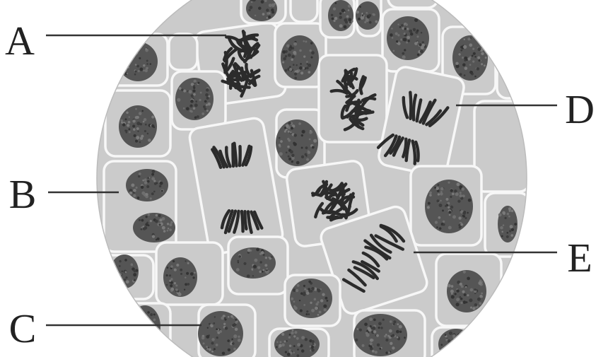
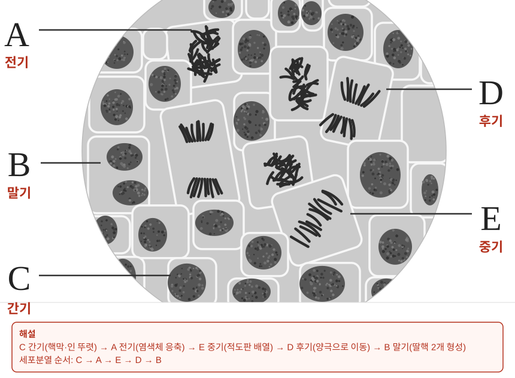
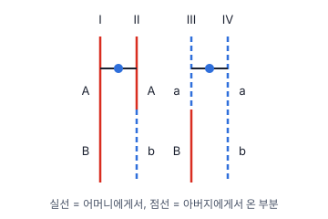

# 복습문제 56선 — 0922 수업 범위

웹과제 6문항, 기출 37문항, 생성 변형 13문항이에요. 먼저 풀어 보고, 막히면 힌트를 열어 보세요.

> `복습문제_0922_Cell_Division_and_Heredity.html`를 마크다운으로 옮겼어요. 원문, 힌트, 풀이는 접혀 있어요. 먼저 풀어 보고 펼쳐 보세요.

**목차**

- [A. 웹과제](#partA)
  - [P38. 양파 뿌리 끝 세포의 분열 순서](#p38)
  - [P39. 염색체 8개인 개체의 정자 종류](#p39)
  - [P40. 체세포 분열과 감수 분열의 차이](#p40)
  - [P41. 감수분열에 대한 설명으로 옳지 않은 것](#p41)
  - [P42. 유사분열 전기에 일어나지 않는 일](#p42)
  - [P43. 중기 II에 도달한 세포의 DNA 양](#p43)
- [B. 기출](#partB)
  - [P1. 제1감수분열이 끝난 딸세포](#p1)
  - [P2. 감수분열에 대한 틀린 설명](#p2)
  - [P3. 중기 II에 도달한 세포의 DNA 양](#p3)
  - [P4. 재조합이 일어나는 시기](#p4)
  - [P5. 유사분열 중기의 모습](#p5)
  - [P6. 2n = 4일 때 생식세포 조합의 수](#p6)
  - [P7. 배우자의 유전적 차이를 만드는 요인](#p7)
  - [P8. 미세소관이 잇는 두 구조](#p8)
  - [P9. 핵막이 사라지는 시기](#p9)
  - [P10. 단백질과 세포소기관이 늘어나는 시기](#p10)
  - [P11. 자매염색분체가 양극으로 갈라지는 시기](#p11)
  - [P12. 세포질이 나뉘기 시작하는 시기](#p12)
  - [P13. 염색체가 세포 중앙에 늘어서는 시기](#p13)
  - [P14. 자손이 모두 보라색인 부모의 유전자형](#p14)
  - [P15. Ff 부부의 아이가 병을 가질 확률](#p15)
  - [P16. 유전자와 염색체의 관계](#p16)
  - [P17. 멘델 완두에서 우성인 쪽](#p17)
  - [P18. Ff끼리 교배한 자손의 유전자형 종류](#p18)
  - [P19. 대립유전자의 뜻](#p19)
  - [P20. 유전자형과 표현형에 관한 틀린 문장](#p20)
  - [P21. 밖으로 보이는 특성의 이름](#p21)
  - [P22. 한 유전자의 다른 형식](#p22)
  - [P23. 상동염색체 쌍의 성질](#p23)
  - [P24. 병이 나타나지 않는 유전자형](#p24)
  - [P25. TT 완두가 만드는 배우자](#p25)
  - [P26. 곱슬머리 부모의 생머리 아이](#p26)
  - [P27. 대립유전자가 갈라지는 때](#p27)
  - [P28. 멘델 연구에 대한 옳은 설명](#p28)
  - [P29. 우성 유전병이 나타나는 경우](#p29)
  - [P30. 유전자와 염색체의 관계](#p30)
  - [P31. 이형접합성의 뜻](#p31)
  - [P32. 생식세포가 합쳐지는 때](#p32)
  - [P33. 해로운 열성 대립유전자와 이형접합자](#p33)
  - [P34. 구부러진 엄지의 확률](#p34)
  - [P35. 이형접합성의 뜻](#p35)
  - [P36. 열성 유전병의 이형접합자를 부르는 말](#p36)
  - [P37. 감수분열 사진과 설명 짝짓기](#p37)
- [C. 변형 연습](#partC)
  - [P44. [변형] 유사분열 중기에 보이는 모습](#p44)
  - [P45. [변형] 유전자형과 표현형, 틀린 문장 찾기](#p45)
  - [P46. [변형] 가운데에 늘어선 세 세포 읽기](#p46)
  - [P47. [변형] 네 가닥 I~IV 그림에서 틀린 해석](#p47)
  - [P48. [변형] 2n = 10인 동물 부부의 자손 조합](#p48)
  - [P49. [변형] 생식모세포 하나의 감수분열 한 번](#p49)
  - [P50. [변형] F2 둥근 콩 300개 가운데 동형접합자](#p50)
  - [P51. [변형] 방추체·수축환·세포판 진술 고르기](#p51)
  - [P52. [변형] 체세포 분열로 생긴 세포, 틀린 설명](#p52)
  - [P53. [변형] 꺾꽂이로만 늘린 과일나무 품종](#p53)
  - [P54. [변형] 수술을 자르고 붓으로 옮긴 까닭](#p54)
  - [P55. [변형] 우열의 법칙으로 설명되는 관찰](#p55)
  - [P56. [변형] 자매염색분체에만 맞는 설명](#p56)

## A. 웹과제

### P38. 양파 뿌리 끝 세포의 분열 순서

성장 중인 양파 뿌리 끝부분의 세포를 현미경으로 관찰한 결과이다. B는 말기, C는 간기에 해당한다. 세포분열의 단계를 순서대로 옳게 나열한 것은?

- A. C-A-B-D-E
- B. C-A-D-E-B
- C. C-D-E-B-A
- D. C-A-E-D-B
- E. A-D-E-B-C

원문 정보 보기

웹과제 3장 q01 (스크린샷 s01). 실제 화면은 현미경 사진이에요. 여기 그림은 그 사진을 단순화해 다시 그린 도식이에요. 원래 화면은 "최대 4개의 옵션 선택" 체크박스 형식이었지만 정답은 하나예요.

힌트 보기

B(말기)와 C(간기)는 이미 알려 줬어요. 나머지 A, D, E에서 염색체가 뭉쳐 있는지, 가운데에 줄 섰는지, 두 무리로 갈라졌는지 보세요.

풀이 보기

1. A. 틀려요. B(말기)가 D와 E보다 앞에 올 수 없어요.
2. B. 틀려요. D(두 무리로 갈라짐, 후기)가 E(가운데 배열, 중기)보다 앞에 있어 순서가 뒤바뀌었어요.
3. C. 틀려요. A(염색체가 뭉침, 전기)가 맨 뒤에 있어요.
4. D. 맞아요. 간기 C → 전기 A → 중기 E → 후기 D → 말기 B 순서예요.
5. E. 틀려요. 전기 A로 시작하고 간기 C가 맨 뒤에 와서 순서가 틀려요.
6. 수업과의 연결: 0922 수업에서 유사분열을 "실이 뭉쳐 막대가 되고, 가운데 한 줄로 섰다가, 막대가 반씩 갈라져 양쪽 끝으로 끌려가는" 네 단계로 정리한 대목과 이어져요(정리노트 "전기·중기·후기·말기").

**정답:** D

---

### P39. 염색체 8개인 개체의 정자 종류

어떤 이배체 체세포의 염색체가 8개라면 이 개체가 만들 수 있는 유전적으로 서로 다른 정자의 종류는 몇 가지인가?

(교차와 돌연변이는 일어나지 않는다고 가정한다)

- A. 8
- B. 16
- C. 128
- D. 64
- E. 32

원문 정보 보기

웹과제 3장 q02 (스크린샷 s02). 원래 화면은 체크박스 형식이었지만 정답은 하나예요.

힌트 보기

가짓수는 염색체 개수가 아니라 상동염색체 쌍의 수로 정해져요. 염색체 8개는 몇 쌍인가요?

풀이 보기

1. A. 틀려요. 염색체 수 8을 그대로 쓴 값이에요. 가짓수는 2를 쌍의 수만큼 곱한 값이에요.
2. B. 맞아요. 2n = 8이면 상동염색체가 4쌍이고, 쌍마다 무작위로 갈라지므로 2⁴ = 16가지예요.
3. C. 틀려요. 128은 2⁷이라 7쌍일 때의 값이에요.
4. D. 틀려요. 64는 2⁶이라 6쌍일 때의 값이에요.
5. E. 틀려요. 32는 2⁵라 5쌍일 때의 값이에요.
6. 수업과의 연결: 0922 수업에서 무작위 분배의 가짓수를 2ⁿ으로 센 대목과 이어져요. 정리노트에서 정리한 대로 n은 염색체 개수가 아니라 상동염색체 쌍의 수예요(정리노트 "상동염색체의 무작위 분배").

**정답:** B

---

### P40. 체세포 분열과 감수 분열의 차이

체세포 분열과 감수 분열의 차이점으로 옳은 것은?

- A. 체세포 분열은 분열 후 염색체 수가 절반으로 줄어든다
- B. 감수 분열은 1회 분열로 2개의 딸세포를 만든다
- C. 두 분열 모두 분열 직후 DNA 복제가 즉시 일어난다
- D. 감수 분열은 생물 전체의 체세포 어디서나 일어난다
- E. 체세포 분열 후기에는 자매염색분체가, 감수 1분열 후기에는 상동 염색체가 분리된다

원문 정보 보기

웹과제 3장 q03 (스크린샷 s03)

힌트 보기

두 분열의 후기에 무엇이 갈라지는지 떠올려 보세요. 짝꿍이 헤어지나요, 붙어 있던 쌍둥이 가닥이 헤어지나요?

풀이 보기

1. A. 틀려요. 체세포 분열은 염색체 수를 그대로 유지해요. 절반으로 줄어드는 것은 감수 분열이에요.
2. B. 틀려요. 감수 분열은 2회 분열해 4개의 딸세포를 만들어요.
3. C. 틀려요. DNA 복제는 분열 직후가 아니라 다음 간기의 S기에 일어나요. 감수 분열로 생긴 생식세포는 복제를 이어 가지 않아요.
4. D. 틀려요. 감수 분열은 생식세포를 만드는 곳에서만 일어나요.
5. E. 맞아요. 체세포 분열 후기에는 자매염색분체가, 감수 1분열 후기에는 상동염색체가 갈라져요.
6. 수업과의 연결: 0922 수업에서 "유사 분열에서 나눠지는 것은 상동 염색체가 아니고 자매 염색 분체"라고 짚고, 감수분열은 먼저 짝꿍(상동염색체)이 헤어진다고 대비한 대목과 이어져요(정리노트 "제1감수분열과 제2감수분열").

**정답:** E

---

### P41. 감수분열에 대한 설명으로 옳지 않은 것

유사분열과 비교하여 감수분열에 대한 설명으로 옳지 않은 것은?

- A. 제1감수분열이 끝나면 염색체 수가 반으로 줄어든다
- B. 제1감수분열과 제2감수분열 사이에 DNA 복제가 일어난다
- C. 감수분열이 완료되면 염색체 수가 반으로 줄어든 4개의 딸세포가 생긴다
- D. M기에 핵분열이 2번 일어난다
- E. 제1감수분열에 의해 상동염색체가 분리된다

원문 정보 보기

웹과제 3장 q09 (스크린샷 s09)

힌트 보기

1분열이 끝난 뒤 2분열이 시작되기 전에 무엇이 일어나는지, 혹은 일어나지 않는지 떠올려 보세요.

풀이 보기

1. A. 맞는 설명이에요. 1분열에서 상동염색체가 갈라져 각 세포의 염색체 수가 반으로 줄어요.
2. B. 틀린 설명이라 답이에요. 1분열이 끝나면 DNA 복제 없이 곧바로 2분열이 시작돼요.
3. C. 맞는 설명이에요. 감수분열이 끝나면 염색체 수가 반인 딸세포 4개가 생겨요.
4. D. 맞는 설명이에요. 감수분열은 핵분열이 두 번 이어지는 분열이에요.
5. E. 맞는 설명이에요. 제1감수분열에서 상동염색체가 분리돼요.
6. 수업과의 연결: 0922 수업에서 "1분열이 끝난 거고 곧바로 2분열이 시작"된다고 설명한 대목과 이어져요(정리노트 "제1감수분열과 제2감수분열").

**정답:** B

---

### P42. 유사분열 전기에 일어나지 않는 일

다음 중 유사분열의 전기 동안에 일어나는 일이 아닌 것은?

- A. 방추체가 형성된다.
- B. 염색체는 적도면의 중간 지점에 배열한다.
- C. 중심체는 세포의 양쪽 극으로 이동한다.
- D. 염색질이 염색체로 응축된다.
- E. 핵막이 소실된다.

원문 정보 보기

웹과제 3장 q11 (스크린샷 s11)

힌트 보기

염색체가 세포 가운데에 한 줄로 늘어서는 단계의 이름이 무엇이었는지 떠올려 보세요.

풀이 보기

1. A. 맞는 설명이에요. 전기에 중심체에서 방추사(미세소관)가 뻗어 나와 방추체가 만들어지기 시작해요.
2. B. 틀린 설명이라 답이에요. 염색체가 적도면의 중간 지점에 배열하는 것은 중기의 일이에요.
3. C. 맞는 설명이에요. 중심체가 갈라져 세포의 양쪽 극으로 가는 것은 전기의 일이에요.
4. D. 맞는 설명이에요. 염색질이 염색체로 응축되는 것은 전기의 일이에요.
5. E. 출제 의도로는 답이 아니에요. 강의노트는 핵막 소실을 전중기로 따로 적지만, 수업은 중기 이전을 모두 전기로 보았고 그 구분에서는 핵막 소실도 전기의 일이에요.
6. 수업과의 연결: 0922 수업에서 전기에 응축, 핵막 소실, 방추사 결합이 일어나고 중기에 "가운데 배열"이 일어난다고 나누며, 중기 이전을 모두 전기로 본 대목과 이어져요(정리노트 "전기·중기·후기·말기").

**정답:** B

강의노트는 전기와 중기 사이에 전중기를 따로 두고 핵막 소실을 전중기의 일로 적어요. 이 구분을 엄격히 따르면 E도 "전기의 일이 아니다"로 읽힐 수 있어요. 수업처럼 전중기를 전기에 묶으면 B만 정답이에요.

---

### P43. 중기 II에 도달한 세포의 DNA 양

G2기의 2배체 세포내의 DNA 양이 100이라고 하자. 만일 이 세포가 감수분열 단계인 ‘중기II’에 도달한다면 DNA 양은 어떻게 되겠는가?

- A. 100
- B. 200
- C. 10
- D. 400
- E. 50

원문 정보 보기

웹과제 3장 q13 (스크린샷 s14)

힌트 보기

G2기 세포는 이미 DNA를 복제한 상태예요. 1분열에서 한 번 나뉜 뒤, 2분열 전에 다시 복제가 있었나요?

풀이 보기

1. A. 틀려요. 100은 감수 1분열 전(G2기부터 중기 I까지)의 양이에요.
2. B. 틀려요. 1분열과 2분열 사이에 복제가 없으므로 양이 늘어날 수 없어요.
3. C. 틀려요. 1분열에서 반으로 줄 뿐 1/10이 되는 과정은 없어요.
4. D. 틀려요. 1분열과 2분열 사이에 복제가 없으므로 400처럼 늘어날 수 없어요.
5. E. 맞아요. 1분열에서 상동염색체가 나뉘어 세포당 50이 되고, 2분열 중기까지 복제가 없어서 그대로 50이에요.
6. 수업과의 연결: 0922 수업에서 1분열이 끝나면 이미 반수체이고 "곧바로 2분열이 시작"된다고 설명한 대목과 이어져요(정리노트 "제1감수분열과 제2감수분열").

**정답:** E

---

## B. 기출

### P1. 제1감수분열이 끝난 딸세포

제1감수분열의 말기Ⅰ뒤에 생성된 각 딸세포에 대한 설명으로 옳은 것은?

- (1) 2배체이며 염색체는 2개의 자매염색분체로 이루어진다.
- (2) 반수체이며 염색체는 2개의 자매염색분체로 이루어진다.
- (3) 2배체이며 염색체들은 1개의 이중나선 DNA 분자로 이루어진다.
- (4) 반수체이며 염색체는 1개의 이중나선 분자로 이루어진다.

원문 정보 보기

기출 3강 합본 4번 (PDF 1쪽)

힌트 보기

제1감수분열에서 갈라지는 것은 상동염색체예요. 그러면 쌍이 아직 남아 있을지, 자매염색분체는 아직 붙어 있을지 따져 보세요.

풀이 보기

1. (1) 틀려요. 제1감수분열에서 상동염색체 쌍이 갈라져 각 딸세포에는 쌍 중 하나씩만 가므로 2배체가 아니에요.
2. (2) 맞아요. 상동염색체가 갈라졌으니 반수체이고, 자매염색분체는 제2감수분열에서야 갈라지므로 염색체마다 아직 자매염색분체 2개가 붙어 있어요.
3. (3) 틀려요. 2배체라는 점도 틀리고, 자매염색분체가 아직 붙어 있어서 염색체 하나에 이중나선 DNA 분자가 2개 들어 있어요.
4. (4) 틀려요. 반수체는 맞지만, 염색체가 이중나선 분자 1개로 이루어지는 것은 자매염색분체가 갈라진 제2감수분열 뒤예요.
5. 수업과의 연결: 교수님이 "1감수분열이 끝나면 이 세포는 반수체예요, 이배체예요?" 하고 묻고 상동염색체가 나눠졌으니 반수체라고 답한 대목과 이어져요.

**정답:** (2)

---

### P2. 감수분열에 대한 틀린 설명

유사분열과 비교하여 감수분열에 대한 설명으로 옳지 않은 것은?

- (1) M기에 핵분열이 2번 일어난다.
- (2) 제1감수분열이 끝나면 염색체 수가 반으로 줄어든다.
- (3) 감수분열이 완료되면 염색체 수가 반으로 줄어든 4개의 딸세포가 생긴다.
- (4) 제1감수분열에 의해 상동염색체가 분리된다.
- (5) 제1감수분열과 제2감수분열 사이에 DNA 복제가 일어난다.

원문 정보 보기

기출 3강 합본 6번 (PDF 1쪽)

힌트 보기

DNA 복제는 세포주기의 어느 시기에 일어났는지, 그리고 제1감수분열이 끝나면 곧바로 무엇이 시작되는지 떠올려 보세요.

풀이 보기

1. (1) 맞아요. 감수분열은 제1감수분열과 제2감수분열 두 번 나뉘므로 핵분열도 2번 일어나요. 옳은 설명이라 답이 아니에요.
2. (2) 맞아요. 제1감수분열에서 상동염색체가 갈라지므로 이 단계가 끝나면 이미 염색체 수가 반(n)이에요.
3. (3) 맞아요. 제2감수분열에서 자매염색분체까지 갈라지면 n인 딸세포 4개가 생겨요. 유사분열은 2n인 딸세포 2개예요.
4. (4) 맞아요. 제1감수분열에서 갈라지는 대상이 바로 상동염색체예요.
5. (5) 틀려요. DNA 복제는 분열 전 간기의 S기에 한 번만 일어나고, 제1감수분열이 끝나면 복제 없이 곧바로 제2감수분열이 시작돼요. 그래서 이것이 옳지 않은 설명이에요.
6. 수업과의 연결: "1분열이 끝나면 곧바로 2분열이 시작된다"는 설명과 S기가 DNA 복제 시기라는 간기 정리와 이어져요.

**정답:** (5)

---

### P3. 중기 II에 도달한 세포의 DNA 양

G2기의 2배체 세포내의 DNA 양은 X이다. 만일 이 세포가 감수분열 단계인 중기II에 도달한다면 DNA 양은 어떻게 되겠는가?

- (1) X
- (2) 0.1X
- (3) 2X
- (4) 0.5X
- (5) 4X

원문 정보 보기

기출 3강 합본 8번 (PDF 1쪽)

힌트 보기

G2기 세포는 이미 DNA 복제를 마친 상태예요. 제1감수분열에서 상동염색체가 두 세포로 나뉘면 한 세포의 DNA 양은 어떻게 될까요?

풀이 보기

1. 먼저 흐름을 따라가요. G2기의 X는 S기에 복제를 마친 양이에요. 제1감수분열에서 상동염색체가 두 딸세포로 나뉘므로 각 세포는 절반을 받고, 제2감수분열 전에는 DNA 복제가 없으므로 중기 II에서도 그 절반 그대로예요.
2. (1) 틀려요. X는 G2기부터 중기 I까지의 양이에요. 상동염색체가 갈라진 뒤에는 절반이 돼요.
3. (2) 틀려요. 분열마다 DNA가 둘로 나뉠 뿐이라 0.1X가 나올 과정은 없어요.
4. (3) 틀려요. 2X가 되려면 DNA를 한 번 더 복제해야 하는데, 두 감수분열 사이에는 복제가 없어요.
5. (4) 맞아요. 제1감수분열 뒤 절반이 된 0.5X가 복제 없이 중기 II까지 이어져요. 제2감수분열이 끝나 자매염색분체까지 갈라지면 0.25X가 돼요.
6. (5) 틀려요. 4X는 복제를 두 번 더 해야 나오는 값이라 감수분열 흐름과 맞지 않아요.
7. 수업과의 연결: 1분열이 끝나면 이미 반수체라는 대목과 "2분열에서는 염색체 수가 변하지 않는다"는 영상 정리와 이어져요.

**정답:** (4)

---

### P4. 재조합이 일어나는 시기

재조합은 감수분열 단계 중에서 어느 시기에 일어나는가?

- (1) 제2감수분열의 전기(전기Ⅱ)
- (2) 제1감수분열의 초기(후기Ⅰ)
- (3) 제1감수분열의 전기(전기Ⅰ)
- (4) 제2감수분열의 후기(후기Ⅱ)

원문 정보 보기

기출 3강 합본 9번 (PDF 1쪽)

힌트 보기

재조합(교차)은 상동염색체가 짝을 지어 네 가닥이 나란히 붙어 있어야 일어나요. 그런 4분염색체는 언제 만들어지나요?

풀이 보기

1. (1) 틀려요. 전기 II에는 상동염색체가 이미 갈라져 4분염색체가 없으므로 교차가 일어날 수 없어요.
2. (2) 틀려요. 후기 I은 짝지었던 상동염색체가 양극으로 갈라지는 단계라, 교차는 그 전에 이미 끝나 있어요. 괄호 속 후기 I은 "초기"라는 말과도 맞지 않아요.
3. (3) 맞아요. 제1감수분열 전기에 상동염색체가 짝을 지어 4분염색체가 되고, 이때 안쪽 두 가닥(엄마 유래 하나와 아빠 유래 하나) 사이에서 DNA 조각이 바뀌어 새 조합이 생겨요.
4. (4) 틀려요. 후기 II에는 자매염색분체가 갈라질 뿐이고, 짝지은 상동염색체가 없어요.
5. 수업과의 연결: 교차가 감수분열 1기 전기에 일어나며 4분염색체가 그때 생기기 때문이라고 두 번 짚은 대목과 이어져요.

**정답:** (3)

---

### P5. 유사분열 중기의 모습

다음 중 유사분열의 중기에서 일어나는 현상으로 옳은 것은?

- (1) 염색체는 하나의 자매염색분체로 구성되어 있다.
- (2) 염색체는 2개의 자매염색분체로 구성되어 있고 세포의 중기판에 정렬되어 있다.
- (3) 세포질분열이 시작된다.
- (4) 염색체는 응축되어 있고 양극 쪽에서 발견된다.

원문 정보 보기

기출 3강 합본 10번 (PDF 1쪽)

힌트 보기

중기는 "가운데 배열"로 외웠어요. 자매염색분체가 갈라지는 것은 중기일까요, 그다음 단계일까요?

풀이 보기

1. (1) 틀려요. 자매염색분체는 후기에 갈라지므로, 중기의 염색체는 아직 자매염색분체 2개로 되어 있어요.
2. (2) 맞아요. 자매염색분체 2개로 된 염색체들이 방추사에 끌려 세포 가운데의 중기판(적도면)에 늘어서요.
3. (3) 틀려요. 세포질 분열은 핵분열이 끝나 가는 말기에 시작돼요.
4. (4) 틀려요. 염색체가 양극 쪽에 있는 것은 자매염색분체가 끌려간 뒤인 후기 끝과 말기의 모습이에요.
5. 수업과의 연결: "외울 때는 가운데 배열된다"고 정리한 중기 설명과 동원체가 적도면에 늘어선다는 영상 설명과 이어져요.

**정답:** (2)

---

### P6. 2n = 4일 때 생식세포 조합의 수

만일 2n이 4라면, 생식세포에서 일어날 수 있는 가능한 조합의 수는 얼마인가?

- (1) 1
- (2) 16
- (3) 2
- (4) 8
- (5) 4

원문 정보 보기

기출 3강 합본 13번 (PDF 1–2쪽)

힌트 보기

n쌍이면 2의 n승 가지예요. 이때 n은 염색체 개수가 아니라 상동염색체 쌍의 수예요.

풀이 보기

1. 먼저 쌍의 수를 구해요. 2n이 4이면 상동염색체가 2쌍(n = 2)이에요. 쌍마다 엄마판과 아빠판 중 어느 쪽이 어느 딸세포로 갈지 2가지씩 무작위로 정해지므로, 교차를 빼고 세면 2 × 2 = 4가지예요.
2. (1) 틀려요. 1가지라면 무작위 분배가 전혀 없는 경우인데, 쌍마다 두 방향이 가능해요.
3. (2) 틀려요. 16은 2의 4승으로, 염색체 개수 4를 지수에 잘못 넣은 값이에요.
4. (3) 틀려요. 2는 상동염색체가 한 쌍뿐일 때의 값이에요.
5. (4) 틀려요. 8은 세 쌍(2 × 2 × 2)일 때의 값이에요.
6. (5) 맞아요. n = 2이므로 2의 2승 = 4가지예요.
7. 수업과의 연결: 한 쌍이면 2가지, 세 쌍이면 8가지, n쌍이면 2의 n승이라고 한 대목과, 사람은 23쌍이라 2의 23승이라고 쌍의 수를 강조한 대목과 이어져요.

**정답:** (5)

---

### P7. 배우자의 유전적 차이를 만드는 요인

다음 중 유전적인 차이를 가지는 배우자의 조합에 영향을 주는 것은?

- (1) 감수분열 동안 염색체의 무작위적 분배
- (2) 감수분열 동안 재조합
- (3) 서로 다른 대립유전자가 존재하는 유전자의 수
- (4) 모두 맞다
- (5) 염색체의 수

원문 정보 보기

기출 3강 합본 16번 (PDF 2쪽)

힌트 보기

감수분열 안에서 다양성을 만드는 두 가지 원인을 떠올려 보세요. 그리고 대립유전자가 쌍마다 모두 같다면, 어떻게 나눠도 배우자가 같아지지 않을까요?

풀이 보기

1. (1) 맞아요. 상동염색체 쌍이 어느 극으로 갈지는 무작위라서, n쌍이면 2의 n승 가지 배우자가 생겨요.
2. (2) 맞아요. 제1감수분열 전기의 교차(재조합)로 A·B와 a·b에서 Ab, aB처럼 부모 염색체에 없던 조합이 생겨요.
3. (3) 맞아요. 한 유전자의 두 대립유전자가 A와 a처럼 달라야 어느 쪽이 가느냐에 따라 배우자가 달라져요. 모든 유전자가 동형접합이면 어떻게 나뉘어도 배우자가 같으므로, 이형접합인 유전자가 많을수록 차이가 커져요.
4. (4) 맞아요. (1), (2), (3)이 모두 배우자의 조합을 바꾸므로 "모두 맞다"가 정답이에요.
5. (5) 출제 의도로는 답이 아니지만, 영향을 준다고 볼 여지도 있어요. 염색체 수(쌍의 수 n)는 2의 n승에서 가능한 조합의 가짓수를 정하기 때문이에요. 다만 한 사람이 만든 배우자는 모두 n개로 염색체 수가 같아서, 배우자끼리의 차이를 직접 만드는 것은 (1)의 무작위 분배예요.
6. 수업과의 연결: 다양성의 원인으로 교차와 상동염색체의 무작위 분배를 차례로 설명하고, A·B / a·b 예로 새 조합 Ab, aB를 보여 준 대목과 이어져요.

**정답:** (4)

이 문항은 모호한 데가 있어요. 보기 (5) "염색체의 수"도 2의 n승에서 가능한 조합의 가짓수를 정하므로 배우자의 조합에 영향을 준다고 볼 수 있는데, "모두 맞다"가 (4)에 있고 (5)가 그 뒤에 따로 나와요. 출제 의도는 (1)~(3)을 묶은 (4)로 보여서 인쇄된 답 (4)를 정답으로 두었어요.

---

### P8. 미세소관이 잇는 두 구조

미세소관은 ( )에 ( )와(과) ( )을(를) 연결한다.

- (1) 유사분열; 동원체; 중심립
- (2) 간기의 S기; 염색체; 중심립
- (3) 유사분열; 동원체; 핵막
- (4) 간기의 G2기; 중심립; 동원체

원문 정보 보기

기출 3강 합본 17번 (PDF 2쪽)

힌트 보기

방추사의 성분이 무엇이었는지, 방추사가 어디서 뻗어 나와 염색체의 어디에 붙는지 떠올려 보세요.

풀이 보기

1. (1) 맞아요. 유사분열 때 미세소관(방추사)이 중심립 한 쌍이 든 중심체에서 뻗어 나와 염색체의 동원체에 붙어요.
2. (2) 틀려요. S기는 DNA와 중심체를 복제하는 간기 시기예요. 이때 DNA는 풀린 염색질 상태이고 방추사는 아직 뻗어 나오지 않아요.
3. (3) 틀려요. 핵막은 전기에 사라지므로 방추사가 핵막에 연결되지 않아요.
4. (4) 틀려요. 중심립과 동원체는 맞는 짝이지만, G2기는 분열을 준비하는 간기라 방추사가 동원체에 붙는 것은 그다음 전기예요.
5. 수업과의 연결: 방추사의 성분이 미세소관이라고 확인한 대목, 중심립 두 개를 합쳐 중심체라 한다는 설명, 방향을 "중심체 → 동원체"로 되풀이한 대목과 이어져요.

**정답:** (1)

---

### P9. 핵막이 사라지는 시기

유사분열 동안 핵막이 사라지는 세포주기의 시기는?

- (1) 말기
- (2) 전기
- (3) 후기
- (4) 중기

원문 정보 보기

기출 3강 합본 21번 (PDF 2쪽)

힌트 보기

교수님이 "세 가지 사건밖에 안 돼요"라고 한 단계가 있어요. 그 세 사건을 떠올려 보세요.

풀이 보기

1. (1) 틀려요. 말기는 전기의 반대라서 핵막이 오히려 다시 생겨요.
2. (2) 맞아요. 전기에 염색체 응축, 핵막 소실, 방추사의 동원체 결합이 일어나요. 엄밀히는 핵막이 무너지는 것은 전중기지만 수업에서는 전기에 포함했어요.
3. (3) 틀려요. 후기에는 자매염색분체가 갈라져 양쪽으로 가며, 핵막은 이미 없는 상태예요.
4. (4) 틀려요. 중기에는 핵막이 이미 사라진 뒤에 염색체가 가운데 배열돼요.
5. 수업과의 연결: 전기의 세 사건을 정리하며 "뭐가 사라진다?" 하고 묻고 핵막이라고 답한 대목과, 전중기는 "그냥 다 전기로 생각하면 돼요"라고 한 대목과 이어져요.

**정답:** (2)

---

### P10. 단백질과 세포소기관이 늘어나는 시기

핵 DNA를 제외한 대부분의 단백질과 세포소기관은 어느 시기에 복제되는가?

- (1) 유사분열 말기
- (2) 간기의 G1기
- (3) 간기의 S기
- (4) 유사분열 전기

원문 정보 보기

기출 3강 합본 23번 (PDF 2쪽)

힌트 보기

간기의 G1, S, G2가 각각 무엇을 하는 시기였는지 떠올려 보세요. 문제는 DNA 복제를 뺀 나머지를 묻고 있어요.

풀이 보기

1. (1) 틀려요. 말기는 핵막이 다시 생기고 염색체가 풀리며 분열이 마무리되는 단계예요.
2. (2) 맞아요. G1은 세포가 성장하는 시기라, 이때 단백질을 많이 만들고 세포소기관 수도 늘려요.
3. (3) 틀려요. S기는 DNA(와 중심체)를 복제하는 시기인데, 문제는 핵 DNA를 뺀 대부분의 단백질과 세포소기관을 물었어요.
4. (4) 틀려요. 전기는 염색체 응축, 핵막 소실, 방추사 결합이 일어나는 분열 단계예요.
5. 수업과의 연결: 세포주기를 G1(성장) → S(DNA 복제) → G2(분열 준비) → M으로 정리한 대목과 S기에 DNA와 함께 중심체가 복제된다는 설명과 이어져요.

**정답:** (2)

---

### P11. 자매염색분체가 양극으로 갈라지는 시기

유사분열에서 두 자매염색분체가 각각 서로 반대 극으로 분리되는 시기는?

- (1) 말기
- (2) 중기
- (3) 후기
- (4) 전기
- (5) 간기

원문 정보 보기

기출 3강 합본 32번 (PDF 3쪽)

힌트 보기

중기에 세포 가운데 늘어선 염색체가 바로 다음 단계에서 어떻게 되는지 떠올려 보세요.

풀이 보기

1. (1) 틀려요. 말기는 극에 도착한 염색체가 풀리고 핵막이 다시 생기며 방추사가 사라지는 단계예요.
2. (2) 틀려요. 중기는 염색체가 세포 가운데에 한 줄로 늘어서는 단계예요.
3. (3) 맞아요. 후기에 동원체가 갈라지면서 자매염색분체가 떨어져 각각 반대 극으로 끌려가요.
4. (4) 틀려요. 전기는 염색체가 응축되고 핵막이 사라지며 방추사가 동원체에 붙는 단계예요.
5. (5) 틀려요. 간기는 분열 전의 G1·S·G2 시기라 염색체가 풀린 염색질 상태로 있어요.
6. 수업과의 연결: 수업에서 교수님이 "나눠지는 것은 상동 염색체다, 자매 염색분체다?" 하고 되물은 뒤 후기에 자매염색분체가 갈라진다고 정리했어요.

**정답:** (3)

---

### P12. 세포질이 나뉘기 시작하는 시기

다음 중 유사분열에서 세포질이 분열되기 시작하는 시기는 언제인가?

- (1) 말기
- (2) 중기
- (3) 후기
- (4) 전기
- (5) 간기

원문 정보 보기

기출 3강 합본 35번 (PDF 3쪽)

힌트 보기

세포가 둘로 나뉘는 건 핵이 둘이 된 다음이에요. 핵막이 다시 생겨 핵분열이 끝나는 단계를 찾아보세요.

풀이 보기

1. (1) 맞아요. 말기에 핵막이 다시 생겨 핵이 둘이 되고, 이 무렵 세포질 분열이 시작돼 세포가 둘로 나뉘어요.
2. (2) 틀려요. 중기에는 염색체가 가운데 늘어설 뿐 세포질은 아직 그대로예요.
3. (3) 틀려요. 수업에서 쓴 모형에서 후기는 자매염색분체가 극으로 끌려가는 단계이고, 세포질 분열은 그다음 말기에 시작돼요.
4. (4) 틀려요. 전기는 응축, 핵막 소실, 방추사 결합이 일어나는 첫 단계예요.
5. (5) 틀려요. 간기는 분열에 들어가기 전 성장하고 DNA를 복제하는 시기예요.
6. 수업과의 연결: 영상에서 "말기에 극에 도착하고 세포질 분열이 시작된다"고 했고, 이어 교수님이 핵분열이 끝나도 세포는 아직 하나라서 세포질 분열이 뒤따라야 한다고 했어요.

**정답:** (1)

인쇄된 답안지의 답도 (1) 말기이고 그대로 따라요. 다만 이 답은 수업 영상처럼 말기에 세포질 분열이 시작된다고 보는 모형에서 성립해요. 동물세포는 후기가 끝날 무렵부터 분열홈이 보이기 시작한다고 적는 자료도 있으니, 다른 시험에서 이 부분을 물으면 기준으로 삼는 모형을 확인하세요.

---

### P13. 염색체가 세포 중앙에 늘어서는 시기

유사분열에서 복제된 염색체들이 세포 중앙에 정렬하는 시기는?

- (1) 중기
- (2) 후기
- (3) 말기
- (4) 전기
- (5) 간기

원문 정보 보기

기출 3강 합본 39번 (PDF 3쪽)

힌트 보기

교수님이 이름의 한자 뜻으로 외우라고 한 단계예요. 가운데 중(中) 자를 떠올려 보세요.

풀이 보기

1. (1) 맞아요. 중기에 방추사에 붙은 염색체들이 세포 가운데(적도면)에 늘어서요.
2. (2) 틀려요. 후기는 가운데 있던 염색체의 자매염색분체가 갈라져 양쪽 극으로 가는 단계예요.
3. (3) 틀려요. 말기는 극에 도착한 염색체가 풀리고 핵막이 다시 생기는 단계예요.
4. (4) 틀려요. 전기에는 방추사가 동원체에 붙기 시작하지만 아직 가운데 정렬은 끝나지 않았어요.
5. (5) 틀려요. 간기에는 염색체가 풀린 염색질 상태라 정렬할 막대 모양 염색체가 보이지 않아요.
6. 수업과의 연결: 수업에서 교수님이 "원래 시간상 중기지만, 그러나 외울 때는 가운데 배열된다 이렇게 외우면 되죠."라고 했어요.

**정답:** (1)

---

### P14. 자손이 모두 보라색인 부모의 유전자형

완두콩에서 보라색 꽃 색깔 대립유전자 (*P*)는 흰색 꽃 색깔 대립유전자 (*p*)에 대해 완전 우성이다. 보라색 완두와 흰색 완두의 교배에서 모든 자손이 보라색이었다면, 다음 보기 중 부모의 유전자형으로 옳은 것은?

- (1) *PP*x*Pp*
- (2) *pp* x *pp*
- (3) *PP*x *pp*
- (4) *PP*x*PP*
- (5) *Pp* x*Pp*

원문 정보 보기

기출 4강 합본 1번 (PDF 1쪽)

힌트 보기

부모 한쪽은 흰색이어야 하고, 흰색이 되는 유전자형은 하나뿐이에요. 그다음 보라색 부모가 무엇을 주어야 자손이 전부 보라색이 될지 생각해 보세요.

풀이 보기

1. (1) 틀려요. *Pp*도 보라색이라 이 교배는 보라색끼리의 교배예요. 흰색 부모가 없어요.
2. (2) 틀려요. 흰색끼리의 교배이고 자손도 모두 *pp*라 흰색이에요.
3. (3) 맞아요. 흰색 부모는 *pp*뿐이고, 보라색 부모가 *PP*면 자손이 모두 *Pp*가 되어 전부 보라색이에요. 보라색 부모가 *Pp*였다면 자손마다 1/2 확률로 *pp* 흰색이 나오므로, 자손 수가 충분히 많은데 모두 보라색이었다면 보라색 부모는 *PP*라고 볼 수 있어요.
4. (4) 틀려요. 보라색끼리의 교배라 문제의 조건(보라색 × 흰색)에 맞지 않아요.
5. (5) 틀려요. 보라색끼리의 교배이고, 자손 1/4이 *pp* 흰색으로 나와요.
6. 수업과의 연결: 수업에서 교수님이 P세대 보라(*PP*) × 흰(*pp*)의 F1이 전부 보라색이라서 혼합설이 틀렸다고 설명했어요.

**정답:** (3)

---

### P15. *Ff* 부부의 아이가 병을 가질 확률

낭성섬유증은 대립유전자 *f* 에 의해 결정되는 상염색체 열성 유전의 예이다. 정상 대립유전자 *F* 는 *f* 에 대해 완전 우성이다. *Ff* 유전자형을 갖고 있는 부부가 있다고 하자. 이들 사이에서 낭성섬유증을 갖는 아이가 태어날 확률은?

- (1) 25 %
- (2) 0 %
- (3) 75 %
- (4) 100 %
- (5) 50 %

원문 정보 보기

기출 4강 합본 2번 (PDF 1쪽)

힌트 보기

열성 형질은 *ff*일 때만 나타나요. 엄마와 아빠가 각각 *f*를 물려줄 확률을 곱해 보세요.

풀이 보기

1. (1) 맞아요. 부모가 각각 *f*를 줄 확률이 1/2이므로 *ff* 아이가 나올 확률은 1/2 × 1/2 = 1/4, 곧 25 %예요.
2. (2) 틀려요. 부모 둘 다 *f*를 하나씩 가지고 있으므로 *ff* 아이가 나올 수 있어요.
3. (3) 틀려요. 75 %는 *F*를 하나 이상 가진 정상 아이(*FF*와 *Ff*)가 태어날 확률이에요.
4. (4) 틀려요. 모든 아이가 병을 가지려면 부모 둘 다 *ff*여야 해요.
5. (5) 틀려요. 50 %는 이형접합자(*Ff*) 아이가 태어날 확률이에요.
6. 수업과의 연결: 수업에서 교수님이 이형접합자끼리 교배하면 유전자형이 1 : 2 : 1로 나오고 열성 표현형은 1/4이라고 정리한 것과 같은 계산이에요.

**정답:** (1)

---

### P16. 유전자와 염색체의 관계

다음 설명 중 유전자와 염색체의 관계를 가장 바르게 설명한 것은?

- (1) 유전자는 수십 개의 염색체로 이루어져 있다
- (2) 유전자와 염색체는 동일하다
- (3) 염색체는 많은 유전자를 가지고 있다
- (4) 유전자는 감수분열 시 독립분열을 하나 염색체는 그렇지 못하다
- (5) 보기 중 정답이 하나 이상이다

원문 정보 보기

기출 4강 합본 3번 (PDF 1쪽)

힌트 보기

강의노트는 유전자를 "염색체 상에서 DNA의 한 부분"이라고 적어요. 부분과 전체 중 어느 쪽이 더 큰지 생각해 보세요.

풀이 보기

1. (1) 틀려요. 관계가 거꾸로예요. 유전자가 염색체의 한 부분이지, 유전자가 염색체 여러 개로 이루어지지 않아요.
2. (2) 틀려요. 염색체 하나에 유전자가 여러 개 있으므로 둘은 같은 것이 아니에요.
3. (3) 맞아요. 염색체는 긴 DNA 한 분자이고, 그 위의 여러 구간이 각각 하나의 유전자예요.
4. (4) 틀려요. 유전자는 염색체 위에 있으므로 감수분열 때 염색체가 갈라지면 그 위의 유전자도 함께 움직여요.
5. (5) 틀려요. 옳은 보기는 (3) 하나뿐이에요.
6. 수업과의 연결: 수업에서 교수님이 상동염색체의 같은 위치에는 같은 유전자가 있다고 했고, 멘델 영상도 유전자가 염색체의 일정한 위치에 있다고 정리했어요.

**정답:** (3)

---

### P17. 멘델 완두에서 우성인 쪽

완두를 이용한 멘델의 연구에 따르면, ________ 유전자는 ________ 유전자에 대해 _______ 이다.

- (1) 녹색, 노란색, 우성
- (2) Y, y, 우성
- (3) y, Y, 우성
- (4) 주름진, 매끈한, 우성

원문 정보 보기

기출 4강 합본 4번 (PDF 1쪽)

힌트 보기

멘델식 표기에서 대문자는 우성 대립유전자, 소문자는 열성 대립유전자예요.

풀이 보기

1. (1) 틀려요. 완두 콩 색은 노란색이 우성이고 녹색이 열성이라 순서가 거꾸로예요.
2. (2) 맞아요. 대문자 Y(노란색)는 소문자 y(초록색)에 대해 우성이에요. 같은 글자의 대문자와 소문자로 쓰는 것 자체가 "Y가 y에 대해 우성"이라는 뜻이에요.
3. (3) 틀려요. 소문자 y는 열성 대립유전자라 대문자 Y에 대해 우성일 수 없어요.
4. (4) 틀려요. 둥근(매끈한) 콩 × 주름진 콩의 자손이 모두 둥근 콩이었으므로 우성은 매끈한 쪽이에요.
5. 수업과의 연결: 수업에서 교수님이 P는 하나만 있어도 보라색이 나타나서 우성, p는 두 개가 다 있어야 흰색이 나타나서 열성이라고 했고, 영상에서 둥근 콩 × 주름진 콩이 모두 둥근 콩을 낳았어요.

**정답:** (2)

---

### P18. *Ff*끼리 교배한 자손의 유전자형 종류

*Ff* 의 유전자형을 갖는 부모의 교배에서 얼마나 많은 종류의 자손(유전자형)이 가능한가?

- (1) 4
- (2) 1
- (3) 3
- (4) 5
- (5) 2

원문 정보 보기

기출 4강 합본 7번 (PDF 1쪽)

힌트 보기

엄마(*F* 또는 *f*)와 아빠(*F* 또는 *f*)의 조합을 네 칸 표로 그리고, 같은 유전자형끼리 묶어 세어 보세요.

풀이 보기

1. (1) 틀려요. 4는 엄마와 아빠가 주는 대립유전자의 조합(칸) 수예요. *F*(엄마)*f*(아빠)와 *f*(엄마)*F*(아빠)는 같은 유전자형 *Ff*예요.
2. (2) 틀려요. 부모가 모두 이형접합자라 서로 다른 유전자형의 자손이 나와요.
3. (3) 맞아요. *FF*, *Ff*, *ff* 세 종류가 1 : 2 : 1로 나와요.
4. (4) 틀려요. 대립유전자 두 가지로 만들 수 있는 쌍은 세 가지뿐이에요.
5. (5) 틀려요. 2는 표현형(우성, 열성)의 종류 수예요.
6. 수업과의 연결: 수업에서 교수님이 이형접합자끼리 교배하면 "경우의 수 4가지, 유전자형 3가지"이고 유전자형 비는 1 : 2 : 1이라고 했어요.

**정답:** (3)

---

### P19. 대립유전자의 뜻

다음 중 대립유전자에 대한 설명으로 옳은 것은?

- (1) 단백질이다
- (2) 표현형이다
- (3) 기능을 가지지 않는 유전자이다
- (4) 유전자의 변형본이다
- (5) 유전자의 여분의 복사본이다

원문 정보 보기

기출 4강 합본 8번 (PDF 1쪽)

힌트 보기

꽃 색을 정하는 유전자에는 *P*와 *p* 두 가지가 있었어요. 둘은 같은 유전자의 무엇일까요?

풀이 보기

1. (1) 틀려요. 대립유전자는 유전자, 곧 DNA의 한 부분이에요. 단백질은 그 유전자에서 만들어지는 산물이에요.
2. (2) 틀려요. 표현형은 보라색, 흰색처럼 겉으로 드러나는 특징이고, 대립유전자는 그 특징을 정하는 유전자 쪽이에요.
3. (3) 틀려요. 대립유전자는 기능이 있고 없고로 정하는 말이 아니라, 같은 유전자의 서로 다른 형태를 가리키는 말이에요.
4. (4) 맞아요. 대립유전자는 같은 유전자 자리에 있는 서로 다른 버전(DNA 염기서열이 조금 다른 것)이에요.
5. (5) 틀려요. 복제로 생긴 똑같은 사본은 자매염색분체 쪽의 이야기예요. 대립유전자는 엄마와 아빠에게서 하나씩 받은, 같을 수도 다를 수도 있는 두 버전이에요.
6. 수업과의 연결: 수업에서 교수님이 상동염색체의 같은 위치에는 같은 유전자가 있지만 대립유전자는 같을 수도 다를 수도 있다고 했고, 이어 멘델이 말한 인자가 바로 대립유전자라고 했어요.

**정답:** (4)

인쇄된 답안지에는 (1) 단백질이다로 표시되어 있지만 오류로 판단해요. 대립유전자는 유전자(DNA)의 한 형태이고 단백질은 그 유전자가 만드는 산물이므로, 옳은 설명은 (4)예요.

---

### P20. 유전자형과 표현형에 관한 틀린 문장

다음 문장 중 틀린 것은?

- (1) 같은 표현형을 갖는 개체들은 다른 유전자형을 가질 수도 있다
- (2) 같은 유전자형을 갖는 개체들은 다른 표현형을 가질 수 있다
- (3) 우성 표현형을 갖는 개체들 간의 교배는 열성 표현형을 갖는 자손을 생산할 수 없다
- (4) 열성 표현형을 갖는 개체들 간의 교배는 우성 표현형을 갖는 자손을 생산할 수 없다

원문 정보 보기

기출 4강 합본 10번 (PDF 1쪽)

힌트 보기

보라색 이형접합자(*Pp*)끼리 교배한 F2를 떠올려 보세요. 보라색끼리 교배했는데 흰색이 나왔나요?

풀이 보기

1. (1) 맞아요(옳은 문장). *PP*와 *Pp*는 유전자형이 달라도 둘 다 보라색이에요.
2. (2) 맞아요(옳은 문장). 유전자형이 같아도 환경에 따라 표현형이 달라질 수 있어요. 예를 들어 사람의 피부색은 유전자형이 같아도 햇빛을 얼마나 받느냐에 따라 달라져요(교재 4장 p.80).
3. (3) 틀려요(틀린 문장이라 이 보기가 답이에요). 우성 표현형끼리라도 *Pp* × *Pp*면 자손 1/4이 *pp*라서 열성 표현형(흰색)이 나와요.
4. (4) 맞아요(옳은 문장). 열성 표현형은 *pp*뿐이라 *pp* × *pp*의 자손은 모두 *pp*이고, 우성 대립유전자를 받을 곳이 없어요.
5. 수업과의 연결: 수업에서 교수님이 F1(보라색)끼리 교배했더니 사라졌던 흰색이 F2에 다시 나타났다고 강조한 장면이 (3)을 반박해요.

**정답:** (3)

인쇄된 답안지에는 (2)로 표시되어 있지만 오류로 판단해요. (2)는 환경의 영향으로 성립하는 옳은 문장이고, 우성 표현형끼리(*Pp* × *Pp*)도 열성 자손을 1/4 낳으므로 틀린 문장은 (3)이에요.

---

### P21. 밖으로 보이는 특성의 이름

사람이 혈우병을 갖고 있다는 것처럼, 어떤 대상의 밖으로 보이는 특성을 나타내는 것을 그 사람의 _______이라 한다. 빈 칸에 알맞은 말은 무엇인가?

- (1) 환경
- (2) 유전자형
- (3) 표현형
- (4) 염색체 수
- (5) 유전적 암호

원문 정보 보기

기출 4강 합본 14번 (PDF 2쪽)

힌트 보기

꽃 색 예에서 PP, Pp, pp는 무엇이라고 부르고, 보라색·흰색은 무엇이라고 불렀는지 떠올려 보세요.

풀이 보기

1. (1) 틀려요. 환경은 생물을 둘러싼 바깥 조건이지, 그 사람이 겉으로 드러내는 특성을 부르는 이름이 아니에요.
2. (2) 틀려요. 유전자형은 PP, Pp, pp처럼 어떤 대립유전자를 가졌는지를 가리키는 말이라 밖에서 바로 보이지 않아요.
3. (3) 맞아요. 보라색, 흰색, 혈우병이 있음처럼 겉으로 드러나는 특징이 표현형이에요.
4. (4) 틀려요. 염색체 수는 2n, n처럼 세포 안 염색체의 개수라서 밖으로 보이는 특성이 아니에요.
5. (5) 틀려요. 유전적 암호는 유전 정보가 적혀 있는 방식을 가리키는 말이라 겉으로 드러난 모습과는 달라요.
6. 수업과의 연결: 0922 수업에서 교수님이 PP, Pp, pp를 가리키며 "이게 유전자형", 보라색과 흰색을 가리키며 "이게 표현형"이라고 되풀이했어요.

**정답:** (3)

---

### P22. 한 유전자의 다른 형식

유전자는 염색체에 존재한다. 한 특성의 서로 다른 특성을 관장하는 또 다른 형식의 유전자는 무엇이라고 불리는가?

- (1) 염색체
- (2) 대립유전자
- (3) 자매염색분체
- (4) 생식세포

원문 정보 보기

기출 4강 합본 17번 (PDF 2쪽)

힌트 보기

꽃 색을 정하는 유전자에 P와 p 두 가지 형식이 있었어요. 이 둘을 서로 무엇이라고 불렀나요?

풀이 보기

1. (1) 틀려요. 염색체는 유전자가 실려 있는 구조물이지, 한 유전자의 다른 형식이 아니에요.
2. (2) 맞아요. 같은 유전자 자리에 있으면서 보라색(P)과 흰색(p)처럼 서로 다른 특성을 정하는 형식이 대립유전자예요.
3. (3) 틀려요. 자매염색분체는 한 염색체를 복제해 동원체로 붙어 있는 두 가닥이라 담긴 유전 정보가 같아요.
4. (4) 틀려요. 생식세포는 정자와 난자처럼 대립유전자를 하나씩 담아 자식에게 전하는 세포이지, 유전자의 형식이 아니에요.
5. 수업과의 연결: 0922 수업에서 꽃 색 대립유전자를 P와 p로 적었고, 이어 멘델이 말한 인자가 바로 대립유전자라고 정리했어요.

**정답:** (2)

---

### P23. 상동염색체 쌍의 성질

상동염색체 쌍에 대한 설명으로 옳은 것은?

- (1) 언제나 동일한 대립유전자를 가지고 있다.
- (2) 일반적으로 같은 유전자를 가지고 있다
- (3) 감수분열 시 분리되지 않기 때문에 함께 자식에게 유전된다.
- (4) 배우자보다 체세포에서 수가 적다.

원문 정보 보기

기출 4강 합본 24번 (PDF 3쪽)

힌트 보기

상동염색체 한 쌍은 엄마와 아빠에게서 하나씩 왔어요. 같은 자리에 있는 것이 '같은 유전자'인지, '같은 대립유전자'인지 구분해 보세요.

풀이 보기

1. (1) 틀려요. 상동염색체는 엄마와 아빠에게서 하나씩 오기 때문에 같은 자리의 대립유전자가 P와 p처럼 서로 다를 수 있어요.
2. (2) 맞아요. 상동염색체는 일반적으로 같은 유전자를 가져요(성염색체 X·Y는 예외). 모양과 크기가 같은 한 쌍이라 같은 위치에 꽃 색 유전자처럼 같은 유전자가 있어요.
3. (3) 틀려요. 제1감수분열에서 갈라지는 것이 바로 상동염색체라서, 자식에게는 한 쌍 가운데 하나만 전해져요.
4. (4) 틀려요. 체세포는 상동염색체를 쌍으로 가진 2n이고 배우자는 n이라서, 상동염색체 쌍은 체세포에만 있어요.
5. 수업과의 연결: 0922 수업에서 교수님이 상동염색체의 같은 위치에는 같은 유전자가 있지만 대립유전자는 같을 수도 다를 수도 있다고 설명했어요.

**정답:** (2)

인쇄된 답안지에는 (1)로 표시되어 있지만 오류로 판단해요. 상동염색체는 같은 자리에 같은 유전자를 가질 뿐, 그 자리의 대립유전자는 엄마 쪽과 아빠 쪽이 다를 수 있어서 '언제나 동일한 대립유전자'는 틀린 문장이에요. 옳은 설명은 (2)예요.

---

### P24. 병이 나타나지 않는 유전자형

다음 중, 개인에게 질병의 표현형이 나타나지 않게 하는 유전자형은 어떤 것인가?

- (1) 상염색체 열성 유전의 열성 동형접합자
- (2) 상염색체 우성 유전의 이형접합자
- (3) 상염색체 우성 유전의 우성 동형접합자
- (4) 상염색체 열성 유전의 이형접합자
- (5) 모두 맞다

원문 정보 보기

기출 4강 합본 30번 (PDF 3쪽)

힌트 보기

질병 대립유전자가 우성이면 몇 개만 있어도 나타나고, 열성이면 몇 개가 있어야 나타나는지 먼저 정해 보세요.

풀이 보기

1. (1) 틀려요. 질병 대립유전자가 열성이고 그것을 두 개 모두 가졌으니 질병 표현형이 나타나요.
2. (2) 틀려요. 질병 대립유전자가 우성이면 하나만 있어도 나타나므로 이형접합자도 병이 나타나요.
3. (3) 틀려요. 우성인 질병 대립유전자를 두 개 가졌으니 당연히 병이 나타나요.
4. (4) 맞아요. 질병 대립유전자가 열성이면 하나만으로는 나타나지 않고, 이형접합자는 정상인 우성 대립유전자의 표현형을 따라요.
5. (5) 틀려요. (1)~(3)은 모두 질병 표현형이 나타나므로 '모두 맞다'가 될 수 없어요.
6. 수업과의 연결: 0922 수업에서 우성은 하나만 있어도, 열성은 두 개가 다 있어야 나타난다고 했고, 이어 동형접합자와 이형접합자를 "꼭" 알아야 한다고 강조했어요. 여기서 상염색체는 성염색체가 아닌 보통 염색체라서 남녀 모두 같은 방식으로 두 개씩 가진다는 뜻이에요.

**정답:** (4)

---

### P25. TT 완두가 만드는 배우자

동형접합성의 큰 키(TT)인 완두콩 식물체가 만들 수 있는 수컷배우자형(꽃가루)과 암컷배우자형(난자)은 각각 무엇인가?

- (1) t,T
- (2) T,t
- (3) T,T
- (4) t.t

원문 정보 보기

기출 4강 합본 33번 (PDF 3쪽)

힌트 보기

배우자는 쌍으로 가진 대립유전자 가운데 하나만 받아요. TT 식물이 가진 대립유전자는 무엇무엇인가요?

풀이 보기

1. (1) 틀려요. TT 식물에는 t가 없으므로 t를 담은 꽃가루를 만들 수 없어요.
2. (2) 틀려요. 같은 이유로 t를 담은 난자도 만들 수 없어요.
3. (3) 맞아요. 분리의 법칙에 따라 배우자는 두 T 가운데 하나를 받으므로 꽃가루도 난자도 모두 T예요.
4. (4) 틀려요. t는 이 식물에 아예 없으니 꽃가루와 난자 모두 t일 수 없어요.
5. 수업과의 연결: 0922 수업에서 교수님이 개체는 인자(대립유전자)를 두 개 가지고 자식에게는 하나만 물려준다는 분리의 법칙을 설명했어요.

**정답:** (3)

---

### P26. 곱슬머리 부모의 생머리 아이

곱슬머리(우성 형질)를 가진 두 부모가 어떻게 생머리(열성 형질)를 가진 아이를 낳을 수 있을 것인가?

- (1) 두 부모가 유전자의 이형접합성 보인자이면, 열성형질이 나타날 수 있다.
- (2) 열성형질은 동형접합성 염색체에서 무작위적인 돌연변이로부터 발생해야한다.
- (3) 유전적으로 불가능하다.
- (4) 열성형질은 X염색체 불활성화의 결과로 나타날 수 있다.

원문 정보 보기

기출 4강 합본 35번 (PDF 4쪽)

힌트 보기

보라색 F1(Pp)끼리 교배했을 때 F2에서 흰색이 몇 분의 몇으로 다시 나타났는지 떠올려 보세요.

풀이 보기

1. (1) 맞아요. 두 부모가 모두 이형접합자이면 곱슬머리로 보이지만, 각자 1/2 확률로 열성 대립유전자를 주어 1/4 확률로 열성 동형접합자인 생머리 아이가 나와요. 이렇게 증상 없이 열성 대립유전자를 가진 이형접합자를 보인자라고 불러요.
2. (2) 틀려요. 돌연변이가 없어도 이형접합자 부모끼리에서 열성 동형접합자가 나올 수 있으므로 '돌연변이로부터 발생해야 한다'는 말은 틀려요.
3. (3) 틀려요. 단성잡종 교배의 F2에서 사라졌던 흰색이 1/4로 다시 나타난 것처럼 충분히 가능해요.
4. (4) 틀려요. X염색체 불활성화는 수업에서 다루지 않은 내용이고, 이 상황은 두 부모가 대립유전자를 하나씩 나눠 주는 분리의 법칙만으로 설명돼요.
5. 수업과의 연결: 0922 수업에서 Pp끼리 교배하면 유전자형 PP : Pp : pp = 1 : 2 : 1이 되어, F1에서 사라졌던 흰색이 F2에 다시 나타난다고 설명했어요.

**정답:** (1)

---

### P27. 대립유전자가 갈라지는 때

대립유전자의 분리는 언제 일어나는가?

- (1) 감수분열 동안 자매염색분체가 분리될 때
- (2) 유사분열 동안 자매염색분체가 분리될 때
- (3) 감수분열 동안 상동염색체가 분리될 때
- (4) 유사분열 동안 상동염색체가 분리될 때

원문 정보 보기

기출 4강 합본 36번 (PDF 4쪽)

힌트 보기

엄마에게서 온 P와 아빠에게서 온 p는 어떤 염색체 둘에 나뉘어 실려 있나요? 그 둘이 갈라지는 분열을 찾아보세요.

풀이 보기

1. (1) 틀려요. 자매염색분체는 한 염색체를 복제한 것이라 교차가 없다면 같은 대립유전자의 복사본을 담고 있어서, 이것이 갈라져도 P와 p가 나뉘지 않아요(교차가 일어나면 AB와 Ab처럼 달라질 수 있어요).
2. (2) 틀려요. 유사분열은 2n에서 2n으로 가는 분열이라 딸세포가 P와 p를 모두 그대로 가져가요.
3. (3) 맞아요. P와 p는 엄마 쪽과 아빠 쪽 상동염색체에 따로 실려 있고, 제1감수분열에서 상동염색체가 갈라질 때 서로 다른 세포로 가요.
4. (4) 틀려요. 유사분열에서는 상동염색체가 갈라지지 않고, 갈라지는 것은 자매염색분체예요.
5. 수업과의 연결: 0922 수업에서 유사분열은 자매염색분체가, 감수분열은 먼저 상동염색체가 갈라진다고 했고, 이어 대립유전자가 하나씩만 자식에게 가는 분리의 법칙을 설명했어요.

**정답:** (3)

---

### P28. 멘델 연구에 대한 옳은 설명

멘델의 연구에 대한 설명으로 옳은 것은?

- (1) 멘델은 서로 다른 유전자들의 독립성도 조사했다.
- (2) 멘델은 염색체의 구조를 이미 알고 있었다.
- (3) 공동우성과 불완전우성에 대한 연구도 있었다.
- (4) 완두는 물려줄 수 있는 형질이 4개 이하이기 때문에 실험에 이용하게 되었다.

원문 정보 보기

기출 4강 합본 37번 (PDF 4쪽)

힌트 보기

수업 영상이 정리한 멘델의 세 법칙과, 멘델이 완두를 고른 이유를 떠올려 보세요.

풀이 보기

1. (1) 맞아요. 수업 영상은 멘델의 법칙으로 우열의 법칙, 분리와 함께 독립의 법칙을 들며 "콩 모양과 콩 색 유전자는 서로 상관이 없다"고 소개했어요.
2. (2) 틀려요. 멘델은 '인자'가 있다고 추론했을 뿐이고, 유전자가 염색체의 일정한 위치에 있다는 것은 그 뒤 모건의 초파리 연구에서 밝혀졌어요.
3. (3) 틀려요. 멘델이 다룬 7가지 형질은 모두 한쪽이 완전히 우성이었고, 불완전우성과 공동우성은 멘델 뒤에 알려졌어요.
4. (4) 틀려요. 완두를 고른 이유는 재배와 교배가 쉽고 대립 형질이 분명하기 때문이었고, 멘델은 대립 형질 7가지를 조사했어요.
5. 수업과의 연결: 0922 수업 의 멘델 영상에서 완두를 고른 가장 중요한 이유가 대립 형질이 분명하다는 것이라고 했고, 멘델의 법칙 세 가지를 이름으로 소개했어요.

**정답:** (1)

---

### P29. 우성 유전병이 나타나는 경우

어떤 질병이 우성 유전일 때, 유전적 질병이 발생하는 경우로 가장 적합한 것은?

- (1) 두 대립유전자가 모두 정상일 때만
- (2) 이형접합자(Mm)일 때만
- (3) 돌연변이 동형접합자(MM)일 때만
- (4) 이형접합자(Mm)와 돌연변이 동형접합자(MM)일 때

원문 정보 보기

기출 4강 합본 38번 (PDF 4쪽)

힌트 보기

보라색 대립유전자 P는 하나만 있어도 보라색이 되었어요. PP일 때는 어떤 색이었나요?

풀이 보기

1. (1) 틀려요. 두 대립유전자가 모두 정상이라면 우성 질병 대립유전자가 없어 병이 나타나지 않아요.
2. (2) 틀려요. 이형접합자(Mm)에서는 병이 나타나지만, 돌연변이 동형접합자(MM)에서도 나타나요.
3. (3) 틀려요. 돌연변이 동형접합자(MM)에서는 병이 나타나지만, 이형접합자(Mm)에서도 나타나요.
4. (4) 맞아요. 우성 질병 대립유전자가 하나만 있어도 병이 나타나므로 Mm과 MM 모두 해당해요.
5. 수업과의 연결: 0922 수업에서 P는 하나만 있어도 보라색이 되므로 우성이고, PP와 Pp가 모두 보라색이라고 설명했어요.

**정답:** (4)

---

### P30. 유전자와 염색체의 관계

다음 설명 중 유전자와 염색체의 관계를 가장 바르게 설명한 것은?

- (1) 유전자는 수십개의 염색체로 이루어져 있다.
- (2) 유전자는 감수분열 시 독립분열을 하나 염색체는 그렇지 못하다
- (3) 유전자와 염색체는 동일하다
- (4) 염색체는 많은 유전자를 가지고 있다.
- (5) 보기 중 정답이 하나 이상이다.

원문 정보 보기

기출 4강 합본 44번 (PDF 5쪽)

힌트 보기

상동염색체의 '같은 위치에 같은 유전자'가 있다는 말을 떠올려 보세요. 무엇이 무엇을 담고 있나요?

풀이 보기

1. (1) 틀려요. 포함 관계가 거꾸로예요. 염색체가 유전자를 담고 있어요.
2. (2) 틀려요. 유전자는 염색체에 실려 있어서 감수분열 때 염색체가 갈라지면 함께 움직여요.
3. (3) 틀려요. 염색체 하나의 여러 위치에 서로 다른 유전자가 있으므로 둘은 같은 것이 아니에요.
4. (4) 맞아요. 염색체 하나에는 여러 위치가 있고, 위치마다 유전자가 있어서 많은 유전자를 가지고 있어요.
5. (5) 틀려요. 옳은 보기는 (4) 하나뿐이에요.
6. 수업과의 연결: 0922 수업에서 상동염색체의 같은 위치에는 같은 유전자가 있다고 했고, 의 영상에서 모건의 초파리 연구로 유전자가 염색체의 일정한 위치에 있다는 것이 밝혀졌다고 소개했어요.

**정답:** (4)

---

### P31. 이형접합성의 뜻

다음 중 이형접합성에 대한 설명으로 옳은 것은?

- (1) 두 개의 같은 대립유전자를 갖는다.
- (2) 항상 열성 형질을 보인다.
- (3) 두 개의 다른 대립유전자를 갖는다.
- (4) 생식세포를 만들 수 없다

원문 정보 보기

기출 4강 합본 45번 (PDF 5쪽)

힌트 보기

꽃 색 유전자형 PP, Pp, pp 가운데 이형접합자는 어느 것인지, 그 개체의 꽃은 무슨 색인지 떠올려 보세요.

풀이 보기

1. (1) 틀려요. PP나 pp처럼 같은 대립유전자 두 개를 가진 것은 동형접합자예요.
2. (2) 틀려요. 이형접합자 Pp는 우성 대립유전자 P가 하나 있어서 우성 형질(보라색)을 보여요.
3. (3) 맞아요. 이형접합자는 Pp처럼 서로 다른 대립유전자 두 개를 가진 개체이고, 잡종이라고도 불러요.
4. (4) 틀려요. 이형접합자도 생식세포를 만들고, 분리의 법칙에 따라 P를 가진 생식세포와 p를 가진 생식세포가 반씩 생겨요.
5. 수업과의 연결: 0922 수업에서 교수님이 동형접합자와 이형접합자(=잡종)를 정의하며 "꼭"을 다섯 번 강조했어요.

**정답:** (3)

---

### P32. 생식세포가 합쳐지는 때

생식세포들은 어느 시기에 서로 융합되는가?

- (1) 유사분열
- (2) 재조합
- (3) 감수분열
- (4) 배 발생
- (5) 수정

원문 정보 보기

기출 4강 합본 48번 (PDF 5쪽)

힌트 보기

생식세포를 "만드는" 과정과 두 생식세포(정자와 난자)가 "만나는" 과정을 나눠 생각해 보세요.

풀이 보기

1. (1) 틀려요. 유사분열은 체세포가 2n인 세포 2개로 나뉘는 분열이고, 세포가 합쳐지는 과정이 아니에요.
2. (2) 틀려요. 재조합(교차)은 제1감수분열 전기에 상동염색체끼리 일부를 바꾸는 일이라 생식세포가 합쳐지는 것과 달라요.
3. (3) 틀려요. 감수분열은 2n을 n으로 줄여 생식세포를 만드는 과정이지 생식세포를 합치는 과정이 아니에요.
4. (4) 틀려요. 배 발생은 수정으로 생긴 수정란이 분열해 몸을 만들어 가는 과정이라 융합 뒤에 일어나요.
5. (5) 맞아요. 정자와 난자, 즉 두 생식세포가 합쳐지는 것이 수정이에요.
6. 수업과의 연결: 0922 수업에서 정자와 난자의 수정도 무작위라서 어떤 정자든 어떤 난자와 수정할 수 있다고 했고, 이것이 유전적 다양성의 세 번째 원인이에요.

**정답:** (5)

---

### P33. 해로운 열성 대립유전자와 이형접합자

어떤 열성 대립유전자가 순환기 문제나 조기사망을 이끄는 세포 내 단백질을 생성할 수 있다고 가정했을 때, 다음 중 가장 옳은 것은?

- (1) 동형접합성 개체는 항상 이형접합성 개체보다 유리하다.
- (2) 이형접합성 개체는 항상 동형접합성 개체보다 유리하다.
- (3) 이형 접합성 개체는 동형 열성을 갖는 사람보다 유리하다.
- (4) 동형접합성 개체는 항상 이형접합성 개체보다 불리하다.

원문 정보 보기

기출 4강 합본 50번 (PDF 5쪽)

힌트 보기

동형접합자에는 우성 동형(AA)과 열성 동형(aa) 두 종류가 있어요. 해로운 형질이 겉으로 나타나는 유전자형은 셋 중 어느 것일까요?

풀이 보기

1. 정리: 해로운 대립유전자를 a라 하면, 열성이므로 a가 두 개 있는 aa만 병이 나타나요. Aa는 우성 A를 따라 정상이고, AA도 정상이에요.
2. (1) 틀려요. 동형접합성 개체 중 aa는 병이 나타나 Aa보다 불리하므로 "항상 유리하다"가 성립하지 않아요.
3. (2) 틀려요. 이형접합성 개체 Aa는 우성 동형 AA와 같은 정상 표현형이라 AA보다 유리하다고 할 수 없어요.
4. (3) 맞아요. 이형접합성 개체 Aa는 정상이고 동형 열성 aa는 병이 나타나므로, Aa가 aa보다 유리해요.
5. (4) 틀려요. 동형접합성 개체 중 AA는 Aa와 똑같이 정상이라 "항상 불리하다"가 성립하지 않아요.
6. 수업과의 연결: 0922 수업에서 열성 대립유전자는 두 개가 다 있어야 나타나고, 이어 이형접합자는 우성 쪽 표현형을 따른다(우열의 법칙)고 했어요.

**정답:** (3)

---

### P34. 구부러진 엄지의 확률

인간에서, 구부러지지 않은 엄지는 대립유전자 *T*에 의해 나타나는 반면에, 구부러진 엄지를 갖는 사람은 *tt*를 갖는다. 한 가족에서 아버지가 구부러지지 않은 엄지를 갖고, 어머니와 첫째 아이가 구부러진 엄지를 갖는다고 할 때, 둘째 아이가 구부러진 엄지를 가질 확률은 얼마인가?

- (1) 주어진 정보로 예측하기는 불가능하다.
- (2) 50%
- (3) 25%
- (4) 75%
- (5) 100%

원문 정보 보기

기출 4강 합본 51번 (PDF 5–6쪽)

힌트 보기

첫째 아이가 *tt*라면 아버지에게서도 *t*를 하나 받았어요. 그러면 아버지의 유전자형은 무엇일까요?

풀이 보기

1. 유전자형 정하기: 어머니는 구부러진 엄지라서 *tt*예요. 아버지는 구부러지지 않은 엄지라서 *T*를 하나 이상 가져요. 첫째 아이가 *tt*이니 아버지에게서도 *t*를 받았으므로 아버지는 *Tt*예요.
2. 교배 계산: *Tt* × *tt*에서 아버지는 *T*와 *t*를 반씩, 어머니는 늘 *t*를 줘요. 그래서 자녀는 *Tt* 1/2, *tt* 1/2이고, 형제마다 따로 정해지므로 둘째가 구부러진 엄지일 확률은 50%예요.
3. (1) 틀려요. 첫째 아이의 표현형으로 아버지 유전자형이 *Tt*로 정해지므로 예측할 수 있어요.
4. (2) 맞아요. *Tt* × *tt*에서 *tt*가 나올 확률은 1/2, 곧 50%예요.
5. (3) 틀려요. 25%는 *Tt* × *Tt*처럼 부모가 둘 다 이형접합자일 때 *tt*가 나올 확률이에요.
6. (4) 틀려요. 75%는 *Tt* × *Tt*에서 구부러지지 않은 엄지가 나올 확률이라 묻는 것과 달라요.
7. (5) 틀려요. 100%가 되려면 아버지도 *tt*여야 하는데, 아버지는 구부러지지 않은 엄지라서 *T*를 가지고 있어요.
8. 수업과의 연결: 0922 수업 의 분리의 법칙(대립유전자 두 개 중 하나만 자식에게 준다)과 의 단성잡종 교배 경우의 수 계산을 부모 한쪽이 동형 열성인 교배에 그대로 쓴 문제예요.

**정답:** (2)

---

### P35. 이형접합성의 뜻

다음 중 이형접합성에 대한 설명으로 옳은 것은?

- (1) 생식세포를 만들 수 없다.
- (2) 두 개의 같은 대립유전자를 갖는다.
- (3) 항상 열성 형질을 보인다.
- (4) 두 개의 다른 대립유전자를 갖는다.

원문 정보 보기

기출 4강 합본 52번 (PDF 6쪽)

힌트 보기

"이형"은 서로 다르다는 뜻이에요. 무엇이 서로 다른지 떠올려 보세요.

풀이 보기

1. (1) 틀려요. 이형접합자 Pp도 감수분열로 생식세포를 만들고, P를 가진 것과 p를 가진 것이 반씩 생겨요.
2. (2) 틀려요. 같은 대립유전자 두 개(PP, pp)를 가진 것은 동형접합자예요.
3. (3) 틀려요. Pp는 우성 대립유전자 P가 하나 있어서 우성 형질을 보여요.
4. (4) 맞아요. 이형접합자는 Pp처럼 서로 다른 대립유전자 두 개를 가진 개체예요.
5. 수업과의 연결: 0922 수업에서 동형접합자(PP, pp)와 이형접합자(Pp, 잡종)를 "꼭 알아야 되는 단어"로 강조했어요.

**정답:** (4)

---

### P36. 열성 유전병의 이형접합자를 부르는 말

인간의 경우, 상염색체의 열성 대립유전자가 유전병과 연관되어 있을 때 이형접합자는 무엇이라고 불리는가?

- (1) 보인자
- (2) 매개동물
- (3) 2란성
- (4) 다배수체

원문 정보 보기

기출 4강 합본 34번 (PDF 4쪽)

힌트 보기

열성 대립유전자는 두 개가 다 있어야 나타나요. 병은 나타나지 않지만 그 대립유전자를 "지니고" 있는 사람을 뭐라고 부를까요?

풀이 보기

1. 정리: 병을 일으키는 열성 대립유전자를 a라 하면 aa만 병이 나타나요. 이형접합자 Aa는 우성 A를 따라 겉으로는 정상이지만 a를 지니고 있어서 자식에게 물려줄 수 있어요.
2. (1) 맞아요. 이렇게 겉으로는 정상이지만 열성 유전병 대립유전자를 하나 지닌 이형접합자를 보인자라고 해요(강의노트 4장 p8).
3. (2) 틀려요. 매개동물은 이형접합 보유자를 부르는 말이 아니에요.
4. (3) 틀려요. 2란성은 이형접합 보유자를 부르는 말이 아니에요.
5. (4) 틀려요. 다배수체는 이형접합 보유자를 부르는 말이 아니에요.
6. 수업과의 연결: 0922 수업에서 열성 대립유전자는 두 개가 다 있어야 나타나고, 이어 이형접합자는 우성 쪽 표현형을 따른다고 했어요. 그래서 이형접합자는 병 없이 대립유전자만 지니게 돼요.

**정답:** (1)

---

### P37. 감수분열 사진과 설명 짝짓기

다음은 감수분열에 관한 설명이다. 각 보기의 그림이 나타내는 분열기에 대한 설명이 바르게 연결되지 않은 것은?

- (1) : 방추체가 해체되며 새로운 핵막이 형성된다
- (2) : 각 염색체는 1개의 염색분체를 가진다
- (3) : 염색체는 거의 또는 전혀 변화가 없다
- (4) : 방추체 미세소관의 이동은 중기판에 염색체를 정렬한다
- (5) : 두 방추체 극 사이에 있는 적도면에 4분체가 정렬된다

원문 정보 보기

기출 3강 합본 19번 (PDF 2쪽)

힌트 보기

사진마다 세포(칸)가 몇 개인지 먼저 세어 보세요. 제1감수분열은 세포 하나 안에서, 제2감수분열은 1분열로 생긴 두 세포에서 함께 일어나요. 그다음 그 단계에서 갈라지는 것이 상동염색체인지 자매염색분체인지 떠올려 보세요.

풀이 보기

1. 사진 읽는 법: 경계 없는 세포 하나면 제1감수분열, 세포가 둘(또는 넷)로 나뉘어 있으면 제2감수분열 쪽이에요. 염색체 무리가 가운데 한 줄이면 중기, 두 무리로 떨어져 가면 후기, 양 끝에 뭉쳐 있으면 말기예요. 다섯 사진은 교재 그림 3.9(3장 p.66–67)의 감수분열 사진과 같은 사진이에요.
2. (1) 맞아요. 네 칸에 핵이 하나씩 있으니 말기 II예요. 말기에는 전기의 반대 일이 일어나서 방추체가 해체되고 새 핵막이 생겨요.
3. (2) 틀려요. 경계 없는 세포 하나 안에서 두 무리가 갈라지고 있으니 후기 I이에요. 후기 I에 갈라지는 것은 상동염색체이고, 각 염색체는 아직 자매염색분체 2개가 붙어 있어요. 염색체가 염색분체 1개가 되는 것은 제2감수분열 후기에 자매염색분체가 갈라진 뒤예요.
4. (3) 맞아요. 세포 하나의 양 끝에 염색체가 뭉쳐 있으니 말기 I이에요. 교재는 말기 I을 염색체에 거의 또는 전혀 변화가 없는 짧은 단계라고 설명해요. 그 뒤 DNA 복제 없이 곧바로 2분열로 넘어가요.
5. (4) 맞아요. 나뉜 두 세포에서 각각 염색체가 가운데 한 줄로 서 있으니 중기 II예요. 방추체 미세소관이 염색체를 중기판에 정렬해요.
6. (5) 맞아요. 세포 하나의 가운데에 염색체가 모여 있으니 중기 I이에요. 중기 I에는 상동염색체가 짝을 지은 4분체(4분염색체)가 두 극 사이의 적도면에 늘어서요.
7. 수업과의 연결: 0922 수업에서 1분열에는 상동염색체가, 2분열에는 자매염색분체가 갈라지고 "어떤 게 나눠지느냐 그 차이만 이해를 하면 돼요"라고 했어요. 그래서 후기 I 뒤의 염색체는 아직 두 가닥이에요.

**정답:** (2)

---

## C. 변형 연습

### P44. [변형] 유사분열 중기에 보이는 모습

다음 중 유사분열의 중기에서 일어나는 현상으로 옳은 것은?

- (1) 자매염색분체가 이미 갈라져, 염색분체 하나짜리 염색체들이 중기판에 늘어선다.
- (2) 상동염색체가 짝을 지어 4분염색체를 이룬 채 세포 가운데에 옆으로 나란히 늘어선다.
- (3) 양쪽 극의 중심체에서 뻗어 나온 방추사가 염색체의 동원체에 붙어 있다.
- (4) 염색체가 풀려 염색질 상태로 돌아가고, 그 주위로 핵막이 다시 생기기 시작한다.
- (5) 세포 허리에 수축환이 생겨 세포질이 나뉘기 시작한다.

원문 정보 보기

기출 3강 10번 발문에 정답을 바꾼 생성 변형이에요. 다루는 혼동: 중기 염색체의 가닥 수, 유사분열 중기와 감수분열 중기 I의 배열, 중기와 말기의 사건. 근거 토픽: 전기·중기·후기·말기

힌트 보기

중기는 "가운데 배열"이에요. 아직 아무것도 갈라지지 않았고, 핵막은 전기에 이미 사라졌어요. 그러면 염색체를 가운데에 붙잡아 두는 것은 무엇일지 떠올려 보세요.

풀이 보기

1. (1) 틀려요. 자매염색분체가 갈라지는 것은 다음 단계인 후기예요. 중기에는 염색체마다 아직 동원체로 붙은 자매염색분체가 2개예요.
2. (2) 틀려요. 상동염색체가 짝을 지은 4분염색체가 옆으로 나란히 서는 것은 감수분열 중기 I이에요. 유사분열에서는 상동염색체가 짝을 짓지 않고 하나씩 위아래로 한 줄로 서요.
3. (3) 맞아요. 전기에 중심체에서 뻗어 나온 방추사(미세소관)가 동원체에 붙고, 중기에는 양쪽 극에서 온 방추사가 동원체에 붙은 채 염색체가 가운데에 늘어서요.
4. (4) 틀려요. 핵막이 다시 생기고 염색체가 풀려 염색질로 돌아가는 것은 전기의 반대 일이 일어나는 말기예요. 중기에는 DNA가 히스톤과 함께 응축된 염색체 상태이고 핵막이 없어요.
5. (5) 틀려요. 수축환이 조여 세포질이 나뉘기 시작하는 것은 말기예요. 중기에는 세포질이 나뉘기 시작하지 않아요.
6. 원문 정답과 달라진 점: 원문은 "자매염색분체 2개로 이루어져 중기판에 정렬"이 정답이었지만, 여기서는 그 개념을 뒤집은 (1)이 오답이고 방추사가 동원체에 붙어 있다는 (3)이 정답이에요.
7. 수업과의 연결: 0922 수업에서 중기는 "가운데 배열된다"로 외우고, 방추사는 "중심체에서 뻗어나와서 동원체에" 붙는다고 정리한 내용, 그리고 0917 수업의 [분열 중에는 DNA가 히스톤과 응축된 염색체이고 평소에는 풀린 염색질이라는 내용](../0917/정리노트_0917_Cell_Division.html#s2-chromatin)과 이어져요.

**정답:** (3)

---

### P45. [변형] 유전자형과 표현형, 틀린 문장 찾기

다음 문장 중 틀린 것은?

- (1) 우성 표현형을 가진 두 부모 사이에서도 열성 표현형 자손이 태어날 수 있다.
- (2) 열성 표현형을 가진 개체의 유전자형은 한 가지뿐이다.
- (3) 이형접합자는 서로 다른 대립유전자를 가진 배우자 두 종류를 같은 비율로 만든다.
- (4) 우성 표현형 개체를 열성 표현형 개체와 교배해 얻은 자손이 충분히 많은데 모두 우성 표현형이었다면, 그 우성 부모는 이형접합자이다.
- (5) 동형접합자끼리 교배해 얻은 자손은 모두 같은 유전자형을 가진다.

원문 정보 보기

기출 4강 10번 발문에 정답을 바꾼 생성 변형이에요. 다루는 혼동: 자손을 보고 부모 유전자형을 거꾸로 찾기, 동형접합자와 이형접합자의 배우자. 근거 토픽: 단성잡종 교배

힌트 보기

꽃 색 P(보라)와 p(흰)로 바꿔 놓고 교배 표를 그려 보세요. 보라 부모가 Pp였다면 흰 꽃 부모(pp)와의 자손은 어떤 비율로 나올까요?

풀이 보기

1. (1) 맞는 문장이에요. 두 부모가 모두 이형접합자(Pp)면 둘 다 p를 줄 수 있어서 열성 자손(pp)이 1/4 확률로 나와요.
2. (2) 맞는 문장이에요. 열성 형질은 열성 대립유전자(p)가 두 개 다 있어야 나타나므로, 흰 꽃의 유전자형은 pp 하나뿐이에요.
3. (3) 맞는 문장이에요. 분리의 법칙에 따라 Pp는 P를 가진 배우자와 p를 가진 배우자를 1/2씩 만들어요.
4. (4) 틀린 문장이에요. 우성 부모가 이형접합자(Pp)였다면 pp와의 자손은 보라 : 흰 = 1 : 1이라, 자손이 많으면 흰 자손이 절반쯤 나와야 해요. 모두 우성이었다면 그 부모는 동형접합자(PP)예요.
5. (5) 맞는 문장이에요. PP × PP는 모두 PP, pp × pp는 모두 pp, PP × pp는 모두 Pp예요. 동형접합자는 배우자를 한 종류만 만들어서 자손 유전자형도 한 가지예요.
6. 원문 정답과 달라진 점: 원문 4강 10번의 인쇄 답안은 (2)였지만 오류로 보고 (3)(우성 표현형끼리의 교배는 열성 자손을 낼 수 없다)을 정답으로 판단했어요(이 복습문제의 기출 카드 참고). 여기서는 그 개념을 바로 쓴 (1)이 맞는 문장이고, 모두 우성인 자손을 보고 부모를 이형접합자로 본 (4)가 틀린 문장이에요.
7. 수업과의 연결: 0922 수업에서 보라(PP) × 흰(pp)의 F1이 전부 보라였고, 잡종(Pp)끼리 교배하니 흰색이 다시 나타났다는 단성잡종 교배와 이어져요.

**정답:** (4)

---

### P46. [변형] 가운데에 늘어선 세 세포 읽기

그림은 체세포의 염색체 수가 2n = 4인 어떤 동물에서, 세포 (가)~(다)의 염색체가 세포 가운데에 늘어선 모습을 나타낸 것이다. 실선 막대는 어머니에게서, 점선 막대는 아버지에게서 온 염색체이고, 막대 두 개 사이의 색칠된 점은 두 가닥이 붙어 있는 곳이다. 이에 대한 설명으로 옳은 것은?

- (1) (가)에서 다음 단계에 서로 갈라지는 것은 상동염색체이다.
- (2) (나)에서 볼 수 있는 2가염색체는 모두 2개이다.
- (3) (다)는 2배체(2n) 세포이다.
- (4) (가)와 (다)는 세포 하나에 들어 있는 염색체 수가 같다.
- (5) (가)와 같은 배열은 정자나 난자를 만들 때만 볼 수 있다.

원문 정보 보기

원문 기출이 아닌 생성 변형이에요. 다루는 혼동: 유사분열 중기(위아래로 한 줄)와 감수분열 중기 I(옆으로 나란히)의 배열, 제2감수분열 세포의 염색체 수. 근거 토픽: 4분염색체와 중기 배열

힌트 보기

먼저 세포마다 두 가닥짜리 막대가 몇 개인지 세어 보세요. 그다음 실선과 점선이 짝을 지어 옆으로 붙어 있는지, 따로따로 위아래로 서 있는지 보세요.

풀이 보기

1. 그림 읽기: (가)는 염색체 4개(2n)가 짝 없이 위아래로 한 줄로 서 있으니 유사분열 중기예요. (나)는 긴 것끼리, 짧은 것끼리 실선과 점선이 짝을 지어 네 가닥씩 옆으로 나란히 서 있으니 감수분열 중기 I이에요. (다)는 염색체가 2개(n)뿐이고 한 줄로 서 있으니 제2감수분열 중기(중기 II)예요.
2. (1) 틀려요. (가)는 유사분열 중기라 다음 단계(후기)에 갈라지는 것은 자매염색분체예요. 유사분열에서는 상동염색체가 갈라지지 않아요.
3. (2) 맞아요. 2가염색체는 4분염색체와 같은 말이에요. (나)에는 긴 쌍 하나, 짧은 쌍 하나가 각각 네 가닥으로 붙어 있으니 2개예요. 2n = 4면 상동염색체가 2쌍이라는 것과도 맞아요.
4. (3) 틀려요. (다)에는 긴 것 하나, 짧은 것 하나씩 쌍마다 하나만 있으니 반수체(n)예요. 제1감수분열이 끝나면 이미 반수체예요.
5. (4) 틀려요. (가)는 염색체 4개, (다)는 2개예요. 두 가닥이 붙어 있는 한 염색체는 하나로 세요.
6. (5) 틀려요. (가)의 배열은 유사분열(체세포 분열)이라 몸을 키우거나 상처를 재생할 때 볼 수 있어요. 정자·난자를 만들 때만 일어나는 것은 감수분열이에요.
7. 수업과의 연결: 0922 수업에서 "유사분열에서는 아래위로, 감수분열에서는 옆으로" 배열한다며 "이 그림만 그릴 줄 알면은 끝"이라고 한 그림과 이어져요. 교수님은 같은 구조를 "4분 염색체, 혹은 2가 염색체"라고 함께 불렀어요.

**정답:** (2)

---

### P47. [변형] 네 가닥 I~IV 그림에서 틀린 해석

그림은 어떤 세포에서 짝을 지은 상동염색체 한 쌍의 네 가닥 I~IV를, 가닥 사이에 DNA 조각이 바뀐 뒤의 모습으로 나타낸 것이다. 실선은 어머니에게서, 점선은 아버지에게서 온 부분이고, 색칠된 점은 두 가닥이 붙어 있는 곳이다. A와 a, B와 b는 각각 대립유전자이다. 이에 대한 설명으로 옳지 않은 것은?

- (1) I과 II는 염색체 하나가 복제되어 생긴 자매염색분체이다.
- (2) DNA 조각의 교환은 II와 III 사이에서 일어났다.
- (3) 이런 교환은 제1감수분열 전기에 일어난다.
- (4) 이 교환으로 원래 없던 대립유전자 조합 Ab와 aB가 생겼다.
- (5) 교환이 끝난 뒤에도 I과 II는 유전 정보가 완전히 같다.

원문 정보 보기

원문 기출이 아닌 생성 변형이에요. 다루는 혼동: 교차가 일어나는 가닥(안쪽 두 가닥)과 시기, 교차 뒤 자매염색분체의 유전 정보. 근거 토픽: 교차와 재조합

힌트 보기

선의 종류가 중간에 바뀌는 가닥을 찾아보세요. 그다음 I과 II의 아래쪽 글자를 비교해 보세요.

풀이 보기

1. 그림 읽기: 위쪽 점으로 붙은 I·II가 한 염색체(어머니 쪽), III·IV가 다른 염색체(아버지 쪽)예요. 선의 종류가 가운데에서 바뀌는 것은 II와 III뿐이라, 이 두 가닥이 아래 조각을 맞바꾼 거예요. 이 현상이 교차이고, 그 결과 새 조합이 생기는 것이 재조합이에요.
2. (1) 맞아요. 색칠된 점(동원체)으로 붙은 두 가닥은 하나를 복제해 생긴 자매염색분체예요.
3. (2) 맞아요. 교환은 안쪽 두 가닥, 곧 어머니 쪽 가닥 하나(II)와 아버지 쪽 가닥 하나(III) 사이에서 일어났어요.
4. (3) 맞아요. 교차는 상동염색체가 짝을 지어 4분염색체를 이루는 제1감수분열 전기에 일어나요.
5. (4) 맞아요. 교환 전에는 AB(I·II)와 ab(III·IV)뿐이었는데, 교환 뒤 II가 Ab, III가 aB가 되었어요.
6. (5) 틀려요. 교환 뒤 I은 AB, II는 Ab라 유전 정보가 달라졌어요. 자매염색분체가 같은 정보를 갖는 것은 교차가 없을 때예요.
7. 수업과의 연결: 0922 수업에서 교차는 "요 안쪽에 있는 두 개의" 가닥 사이에서 DNA가 절단되어 조각이 바뀌고, "원래 없었는데 조합이 된 거다. 그래서 재조합"이라고 한 설명과 이어져요.

**정답:** (5)

---

### P48. [변형] 2n = 10인 동물 부부의 자손 조합

어떤 동물의 체세포 염색체 수는 2n = 10이다. 교차와 돌연변이가 일어나지 않는다고 할 때, 이 동물의 암수 한 쌍이 무작위 수정으로 만들 수 있는 자손의 염색체 조합은 모두 몇 가지인가?

- (1) 32가지
- (2) 64가지
- (3) 100가지
- (4) 1,024가지
- (5) 1,048,576가지

원문 정보 보기

원문 기출이 아닌 생성 변형이에요. 다루는 혼동: 한 개체의 생식세포 종류(2의 n승)와 부모 한 쌍의 자손 조합(곱하기), 지수 n을 염색체 개수로 착각하기. 근거 토픽: 무작위 수정과 70조

힌트 보기

먼저 상동염색체가 몇 쌍인지 구하고, 한 개체가 만드는 생식세포 종류를 구하세요. 그다음 암컷 쪽 종류와 수컷 쪽 종류가 아무렇게나 만난다면 어떻게 셀지 생각해 보세요.

풀이 보기

1. 2n = 10이면 상동염색체는 5쌍이에요. 한 개체가 만드는 생식세포는 2⁵ = 32종류예요. 암컷의 난자 32종류와 수컷의 정자 32종류가 무작위로 만나므로 32 × 32 = 2⁵⁺⁵ = 2¹⁰ = 1,024가지예요.
2. (1) 틀려요. 32는 한 개체가 만드는 생식세포 종류예요. 부모 한 쌍의 자손 조합은 양쪽 경우의 수를 곱해야 해요.
3. (2) 틀려요. 32 + 32로 더한 값이에요. 경우의 수는 곱하고, 지수법칙으로 보면 지수(5와 5)를 더해요.
4. (3) 틀려요. 염색체 수 10을 그대로 10 × 10으로 곱한 값이에요. 경우의 수는 생식세포 종류끼리 곱해요.
5. (4) 맞아요. 2⁵ × 2⁵ = 2¹⁰ = 1,024가지예요.
6. (5) 틀려요. 지수에 쌍의 수(5) 대신 염색체 개수(10)를 넣어 2¹⁰ × 2¹⁰을 계산한 값이에요. 지수 n은 상동염색체 쌍의 수예요.
7. 수업과의 연결: 0922 수업에서 사람은 23쌍이라 2²³ × 2²³ = 2⁴⁶, 약 70조라며 "곱하면 되는 거죠? 지수법칙에 의해서 이걸 더하면 되죠"라고 한 계산을 2n = 10인 동물에 옮긴 문제예요.

**정답:** (4)

---

### P49. [변형] 생식모세포 하나의 감수분열 한 번

2n = 6인 어떤 동물의 생식모세포 하나가 감수분열을 한 번 마쳤다. 교차와 돌연변이가 일어나지 않았다면, 이 세포 하나에서 생긴 딸세포의 수와, 그 딸세포들이 가질 수 있는 유전적 종류의 최대 수로 옳은 것은?

- (1) 4개, 2종류
- (2) 2개, 2종류
- (3) 4개, 4종류
- (4) 4개, 8종류
- (5) 8개, 8종류

원문 정보 보기

원문 기출이 아닌 생성 변형이에요. 다루는 혼동: 2의 n승(한 개체가 여러 번의 감수분열로 만드는 종류)과 생식모세포 하나의 감수분열 한 번으로 생기는 종류. 근거 토픽: 상동염색체의 무작위 분배

힌트 보기

세포 하나가 감수분열할 때 제1감수분열에서 상동염색체 쌍들이 갈라지는 방식은 한 가지로 정해져요. 그 뒤 제2감수분열에서 갈라지는 두 가닥은 서로 어떤 관계인지 떠올려 보세요.

풀이 보기

1. 감수분열은 n인 딸세포 4개를 만들어요. 한 번의 감수분열에서는 제1감수분열 때 세 쌍이 갈라지는 방식이 한 가지로 정해지므로 두 세포가 서로 다른 조합을 받아요. 제2감수분열에서는 같은 정보의 자매염색분체가 갈라지므로, 4개는 2개씩 같아 많아야 2종류예요.
2. (1) 맞아요. 딸세포 4개, 교차가 없으면 많아야 2종류예요.
3. (2) 틀려요. 딸세포 2개는 유사분열이나 제1감수분열까지만 본 결과예요. 감수분열을 마치면 4개예요.
4. (3) 틀려요. 교차가 없으면 제2감수분열에서 갈라지는 자매염색분체는 같은 정보라서, 4개가 모두 다를 수 없어요.
5. (4) 틀려요. 2³ = 8종류는 이 동물 한 개체가 여러 번의 감수분열로 만들 수 있는 생식세포 종류예요. 세포 하나의 감수분열 한 번에 8종류가 나오지 않아요. 애초에 딸세포가 4개뿐이에요.
6. (5) 틀려요. 감수분열 한 번은 세포 8개를 만들지 않아요. 8은 2³을 딸세포 수로 착각한 값이에요.
7. 수업과의 연결: 0922 수업에서 세 쌍이면 "여덟 가지"라고 했는데, 이 8가지는 한 개체가 여러 번의 감수분열로 만드는 종류라는 점을 정리노트 "꼭 기억해요"에서 바로잡은 내용과 이어져요.

**정답:** (1)

---

### P50. [변형] F2 둥근 콩 300개 가운데 동형접합자

완두에서 둥근 콩 대립유전자(R)는 주름진 콩 대립유전자(r)에 대해 완전 우성이다. 둥근 콩(RR)과 주름진 콩(rr)을 교배해 얻은 F1끼리 다시 교배했더니, F2에서 둥근 콩이 300개 나왔다. 이 둥근 콩 300개 가운데 동형접합자는 약 몇 개라고 예상할 수 있는가?

- (1) 약 75개
- (2) 약 100개
- (3) 약 150개
- (4) 약 200개
- (5) 300개 모두

원문 정보 보기

원문 기출이 아닌 생성 변형이에요. 다루는 혼동: F2 유전자형 비(1:2:1)와 표현형 비(3:1), 같은 표현형 안의 서로 다른 유전자형. 근거 토픽: 단성잡종 교배

힌트 보기

F1은 Rr이에요. Rr × Rr의 교배 표 네 칸을 그리고, 그중 둥근 콩인 칸만 남겨서 RR이 몇 칸인지 세어 보세요.

풀이 보기

1. F1은 모두 Rr이고, Rr × Rr의 F2 유전자형 비는 RR : Rr : rr = 1:2:1이에요. 둥근 콩은 RR과 Rr이고 그 안의 비는 RR : Rr = 1 : 2라서, 둥근 콩의 1/3이 동형접합자예요. 300 × 1/3 = 약 100개예요.
2. (1) 틀려요. 75개는 300의 1/4이에요. 1/4은 F2 전체에서 RR(또는 rr)이 차지하는 몫이지, 둥근 콩 안에서의 몫이 아니에요.
3. (2) 맞아요. 둥근 콩 가운데 RR은 3칸 중 1칸이라 약 100개예요.
4. (3) 틀려요. 150개는 300의 절반이에요. 둥근 콩 안에서 RR과 Rr은 1 : 1이 아니라 1 : 2예요.
5. (4) 틀려요. 약 200개는 둥근 콩 가운데 이형접합자(Rr)의 수예요.
6. (5) 틀려요. 같은 둥근 콩이라도 유전자형은 RR과 Rr 두 가지예요. 같은 표현형이 다른 유전자형일 수 있어요.
7. 수업과의 연결: 0922 수업에서 단성잡종 교배의 유전자형은 "1대 2대 1", 표현형은 "3대 1"이라고 한 것을 꽃 색 대신 콩 모양에 옮긴 문제예요. 수업 영상도 둥근 콩 × 주름진 콩의 자손끼리 교배하면 3:1이 나온다고 했어요.

**정답:** (2)

---

### P51. [변형] 방추체·수축환·세포판 진술 고르기

세포 분열 때 쓰이는 섬유와 구조에 대한 설명으로 옳은 것만을 모두 고른 것은?

- ㄱ. 방추체는 중심체에서 뻗어 나와 염색체의 동원체에 붙는다.
- ㄴ. 동물세포의 허리를 조이는 수축환은 방추체와 같은 미세소관이 세포막을 당겨 생긴다.
- ㄷ. 식물세포는 세포벽 때문에 밖에서 조일 수 없어, 세포 안쪽 가운데에서 세포판을 만들어 둘로 나뉜다.

- (1) ㄱ
- (2) ㄴ
- (3) ㄱ, ㄴ
- (4) ㄱ, ㄷ
- (5) ㄱ, ㄴ, ㄷ

원문 정보 보기

원문 기출이 아닌 생성 변형이에요. 다루는 혼동: 중심체와 동원체의 방향, 방추사(미세소관)와 수축환(미세섬유), 동물과 식물의 세포질 분열. 근거 토픽: 세포질 분열

힌트 보기

방추체는 방추사와 같은 말이에요. 방추사의 성분과 수축환을 당기는 섬유가 같은 세포골격인지 따져 보세요.

풀이 보기

1. 용어: 방추체는 정리노트의 방추사와 같은 말이에요. 수업에서도 "방추체 혹은 방추사"라고 함께 불렀어요.
2. ㄱ. 맞아요. 방추체(방추사)는 중심체에서 뻗어 나와 동원체에 붙어요. 방향은 늘 "중심체에서 나와 동원체에 붙는다"예요.
3. ㄴ. 틀려요. 방추체의 성분은 미세소관이지만, 수축환을 만드는 것은 세포막 밑의 미세섬유예요. 둘 다 세포골격이지만 다른 섬유예요.
4. ㄷ. 맞아요. 식물세포는 세포벽이 단단해서 안쪽 가운데에 세포벽 성분인 세포판을 만들고, 이것이 양옆으로 늘어나 새 세포벽이 돼요.
5. (1) 틀려요. ㄷ도 맞는 진술이라 빠졌어요.
6. (2) 틀려요. ㄴ은 미세섬유를 미세소관으로 바꾼 틀린 진술이에요.
7. (3) 틀려요. ㄴ이 틀렸고 ㄷ이 빠졌어요.
8. (4) 맞아요. 맞는 진술은 ㄱ과 ㄷ이에요.
9. (5) 틀려요. ㄴ이 틀린 진술이에요.
10. 수업과의 연결: 0922 수업에서 방추체의 성분을 "미세소관"이라고 답하고, 수축환은 "세포막 밑에 있는 미세 섬유가 이 막을 잡아당"겨 생기며 식물은 "세포벽이 있으니까 밖에서 이렇게 당길 수가 없"다고 한 설명과 이어져요.

**정답:** (4)

---

### P52. [변형] 체세포 분열로 생긴 세포, 틀린 설명

체세포 분열로 생긴 세포나 개체에 대한 설명으로 옳지 않은 것은? (돌연변이는 일어나지 않는다고 가정한다)

- (1) 꺾꽂이로 얻은 식물은 가지를 잘라 낸 어미 식물과 유전정보가 같다.
- (2) 암세포 하나가 계속 분열해 생긴 덩어리의 세포들은 클론이다.
- (3) 효모처럼 세포 하나가 곧 한 개체인 진핵생물은 이 분열로 번식하기도 한다.
- (4) 한 번의 분열로 생긴 두 딸세포는 서로 유전정보가 같다.
- (5) 두 딸세포는 모세포가 가진 상동염색체 쌍 가운데 하나씩만 나누어 받는다.

원문 정보 보기

원문 기출이 아닌 생성 변형이에요. 다루는 혼동: 유사분열에서 갈라지는 것(자매염색분체)과 감수분열에서 갈라지는 것(상동염색체), 클론의 뜻. 근거 토픽: 유사분열의 쓰임과 클론

힌트 보기

체세포 분열은 유사분열과 같은 말이에요. 유사분열은 2n이 그대로 2n이 되어야 한다는 점을 떠올려 보세요.

풀이 보기

1. 용어: 체세포 분열은 정리노트의 유사분열과 같은 말이에요. 수업에서도 "유사 분열, 체세포 분열은 2n이 2n으로 되는 거"라고 함께 불렀어요.
2. (1) 맞는 설명이에요. 꺾꽂이는 유사분열만으로 번식하는 무성생식이라, 돌연변이가 없으면 어미와 같은 클론이에요.
3. (2) 맞는 설명이에요. 교수님도 암세포 한 개가 계속 분열해 덩어리가 된 것이라 암세포도 클론이라고 했어요.
4. (3) 맞아요. 수업 밖이지만 맞는 진술이에요(출처: 교재 3장 p.56). 확실히 틀린 보기를 먼저 찾아요. 교재는 유사분열이 효모나 원생동물 같은 단세포 진핵생물이 번식하는 방법이기도 하다고 설명해요.
5. (4) 맞는 설명이에요. 유사분열은 부모 핵과 유전적으로 같은 핵 두 개를 만들어서, 딸세포끼리도 딸세포와 모세포도 유전정보가 같아요.
6. (5) 옳지 않은 설명이에요. 상동염색체 쌍 가운데 하나씩만 받는 것은 감수분열(제1감수분열)이에요. 체세포 분열에서는 상동염색체가 함께 가고 자매염색분체만 갈라져서 딸세포도 2n이에요.
7. 수업과의 연결: 0922 수업에서 2n이 2n으로 되려면 "엄마가 준 거 아빠가 준 게 같이 가야" 한다며 유사분열에서 갈라지는 것은 자매염색분체라고 한 내용, 그리고 "암세포도 클론"이라는 말과 이어져요.

**정답:** (5)

---

### P53. [변형] 꺾꽂이로만 늘린 과일나무 품종

어떤 과일나무 품종은 씨를 심지 않고 꺾꽂이로만 번식시켜 온 나무들로 이루어져 있다. 이 품종에 대한 설명으로 옳지 않은 것은? (돌연변이는 일어나지 않았다고 가정한다)

- (1) 정자와 난자가 만나 번식한 품종보다, 환경이 갑자기 바뀔 때 일부라도 살아남을 가능성이 높다.
- (2) 이 품종의 나무들은 서로 유전정보가 같다.
- (3) 짝을 찾을 필요가 없어 빠르고 비용이 적게 드는 번식 방법이다.
- (4) 한 나무가 걸리는 새로운 병에 다른 나무들도 모두 걸리기 쉽다.
- (5) 새 개체를 만드는 데 쓰인 분열에서 갈라지는 것은 자매염색분체이다.

원문 정보 보기

원문 기출이 아닌 생성 변형이에요. 다루는 혼동: 유성생식과 무성생식의 장점과 단점 뒤바꾸기. 근거 토픽: 유성생식과 무성생식

힌트 보기

꺾꽂이는 어떤 생식인지, 그 생식으로 생긴 개체끼리는 유전적으로 어떤 관계인지 먼저 정하세요. 수업의 아일랜드 감자 이야기를 떠올려 보세요.

풀이 보기

1. 꺾꽂이는 유사분열만으로 자손을 만드는 무성생식이에요. 그래서 이 품종의 나무들은 모두 같은 클론이에요.
2. (1) 옳지 않은 설명이에요. 환경이 바뀌어도 일부가 살아남게 하는 유전적 다양성은 유성생식(정자와 난자가 만나는 번식)의 장점이에요. 모두 같은 무성생식 품종은 환경 변화에 대처하지 못해요.
3. (2) 맞는 설명이에요. 무성생식은 돌연변이가 없으면 DNA 서열이 바뀌지 않아 모두 같은 클론이에요.
4. (3) 맞는 설명이에요. 무성생식은 짝을 찾지 않아도 되므로 빠르고 비용이 적게 든다는 장점이 있어요.
5. (4) 맞는 설명이에요. 유전적으로 모두 같아서, 한 나무를 쓰러뜨리는 병은 다른 나무도 쓰러뜨리기 쉬워요. 아일랜드 감자 대기근과 같은 상황이에요.
6. (5) 맞는 설명이에요. 꺾꽂이로 몸을 키우는 분열은 유사분열이고, 유사분열에서 갈라지는 것은 자매염색분체예요.
7. 수업과의 연결: 0922 수업에서 씨 없이 무성생식으로 재배한 감자가 병으로 모두 죽은 감자 대기근을 들며 "만약에 유성생식이었으면은 한두 놈은 저항성이 있었을 수도 있다"고 하고, 지금의 바나나도 같은 위험이 있다고 한 내용과 이어져요.

**정답:** (1)

---

### P54. [변형] 수술을 자르고 붓으로 옮긴 까닭

멘델은 완두 교배 실험에서 꽃가루를 받을 꽃의 수술을 잘라 내고, 다른 꽃의 꽃가루를 붓으로 옮겨 그 꽃의 암술머리에 묻혔다. 이 과정에 대한 설명으로 옳은 것은?

- (1) 수술을 잘라 낸 것은 다른 꽃의 꽃가루가 암술에 앉지 못하게 하려는 것이다.
- (2) 붓으로 꽃가루를 옮긴 것은 자가 꽃가루받이를 사람이 일으킨 것이다.
- (3) 수술을 잘라 낸 것은 자기 꽃가루가 자기 암술머리에 앉는 꽃가루받이를 막으려는 것이다.
- (4) 이렇게 교배한 자손이 부모의 중간 모습으로 나온 것이 멘델이 확인한 결과다.
- (5) 이런 방법이 필요했던 것은 완두의 대립 형질이 뚜렷하지 않아서다.

원문 정보 보기

원문 기출이 아닌 생성 변형이에요. 다루는 혼동: 자가수분과 타가수분, 혼합설의 예상과 멘델의 결과. 근거 토픽: 멘델의 실험 설계

힌트 보기

꽃가루받이는 수분과 같은 말이에요. 수술에서 나오는 꽃가루는 누구의 꽃가루인지, 붓으로 옮긴 꽃가루는 누구의 꽃가루인지 나눠 보세요.

풀이 보기

1. 용어: 꽃가루받이는 정리노트의 수분(pollination)과 같은 말이에요. 수업에서도 "수분이라고 합니다. 한글로는 꽃가루받이"라고 했어요. 자가 꽃가루받이는 자가수분, 다른 꽃의 꽃가루를 받는 것은 타가수분이에요.
2. (1) 틀려요. 수술은 그 꽃 자신의 꽃가루가 나오는 곳이에요. 자르면 막히는 것은 자기 꽃가루이고, 다른 꽃의 꽃가루는 오히려 붓으로 옮겨 줬어요.
3. (2) 틀려요. 다른 꽃의 꽃가루를 옮겼으니 타가수분(타가 꽃가루받이)을 인위적으로 일으킨 거예요.
4. (3) 맞아요. 수술을 잘라 자가수분을 막고, 원하는 꽃가루만 받게 한 거예요.
5. (4) 틀려요. 부모의 중간 모습이 나온다는 것은 혼합설의 예상이에요. 멘델의 교배에서는 F1이 한쪽 형질(보라, 둥근 콩)만 보였고, 혼합설이 틀렸다는 것을 보였어요.
6. (5) 틀려요. 완두를 고른 가장 중요한 이유가 대립 형질이 분명하다는 점이에요.
7. 수업과의 연결: 0922 수업에서 자가수분을 막으려고 "과감하게 수술을 잘라버립니다"라고 한 장면과, 완두를 고른 이유를 "대립되는 형질이 분명하다는 것"이라고 한 영상 내용과 이어져요.

**정답:** (3)

---

### P55. [변형] 우열의 법칙으로 설명되는 관찰

완두에서 보라 꽃 대립유전자(P)는 흰 꽃 대립유전자(p)에 대해 완전 우성이다. 다음 관찰 가운데 분리의 법칙이 아니라 우열의 법칙으로 설명되는 것은?

- (1) 잡종(Pp)이 만드는 배우자의 절반은 P를, 절반은 p를 가진다.
- (2) 보라 꽃(PP)과 흰 꽃(pp)을 교배한 F1이 중간색 없이 모두 보라 꽃이다.
- (3) PP인 개체가 만드는 배우자는 모두 P를 가진다.
- (4) 잡종끼리 교배한 F2에서 흰 꽃(pp)이 다시 나타난다.
- (5) 한 개체는 꽃 색 인자를 두 개 가지고 있다가 배우자에는 하나만 물려준다.

원문 정보 보기

원문 기출이 아닌 생성 변형이에요. 다루는 혼동: 분리의 법칙(배우자에 하나씩)과 우열의 법칙(이형접합자의 표현형) 뒤바꾸기. 근거 토픽: 분리의 법칙과 우열의 법칙

힌트 보기

잡종은 이형접합자와 같은 말이에요. 배우자를 만들 때의 이야기인지, 이형접합자가 겉으로 어떤 모습인지의 이야기인지로 나눠 보세요.

풀이 보기

1. 용어: 잡종은 정리노트의 이형접합자(Pp)와 같은 말이에요. 수업에서도 "이형 접합자를 잡종이라고도 합니다"라고 했어요.
2. (1) 틀려요. 대립유전자 쌍이 배우자를 만들 때 갈라져 하나씩 들어간다는 분리의 법칙이에요.
3. (2) 맞아요. F1은 모두 Pp인데, 이형접합자가 우성 쪽(보라) 표현형을 따른다는 것이 우열의 법칙이에요.
4. (3) 틀려요. 동형접합자 PP의 두 P가 갈라져 배우자마다 P 하나씩 들어가는 것이라 분리의 법칙으로 설명해요.
5. (4) 틀려요. 잡종(Pp)끼리 교배한 F2에서 흰 꽃(pp)이 다시 나타나는 것은, 흰색 인자가 섞여 사라지지 않고 배우자에 하나씩 갈라져 들어갔다가 pp로 다시 모였기 때문이에요. 분리의 근거로 든 관찰이에요.
6. (5) 틀려요. 인자 두 개 가운데 하나만 물려준다는 것이 분리의 법칙 그 자체예요.
7. 수업과의 연결: 0922 수업에서 "두 개를 가지고 있다가 자식에게는 한 개만 물려주는 것 같네. 분리가 되는 것 같네"와 "이형접합자의 경우에 한쪽 표현형을 따르게 된다. 우열이 정해져 있다"를 연달아 정의한 내용과 이어져요.

**정답:** (2)

---

### P56. [변형] 자매염색분체에만 맞는 설명

다음 설명 가운데 상동염색체가 아니라 자매염색분체에 해당하는 것은? (교차와 돌연변이는 일어나지 않는다고 가정한다)

- (1) 하나는 어머니에게서, 하나는 아버지에게서 왔다.
- (2) 같은 위치에 있는 대립유전자가 서로 다를 수 있다.
- (3) 한 염색체가 복제되어 생겼고, 동원체로 붙어 있으며 유전 정보가 같다.
- (4) 제1감수분열 후기에 서로 반대 극으로 갈라진다.
- (5) 제1감수분열 전기에 짝을 지어 4분염색체를 이룬다.

원문 정보 보기

원문 기출이 아닌 생성 변형이에요. 다루는 혼동: 동원체로 붙은 두 가닥(자매염색분체)과 엄마·아빠에게서 온 한 쌍(상동염색체). 근거 토픽: 무엇이 갈라지는가

힌트 보기

두 가닥이 어디서 생겼는지 떠올려 보세요. 복제로 생긴 것인지, 엄마와 아빠에게서 따로 온 것인지예요.

풀이 보기

1. (1) 틀려요. 어머니와 아버지에게서 하나씩 온 한 쌍은 상동염색체예요.
2. (2) 틀려요. 같은 위치에 같은 유전자가 있지만 대립유전자가 다를 수 있는 것은 상동염색체예요. 자매염색분체는 복제본이라 대립유전자가 같아요.
3. (3) 맞아요. 염색체 하나를 복제해 생긴 두 가닥이 동원체로 붙어 있는 것이 자매염색분체이고, 복제본이라 유전 정보가 같아요.
4. (4) 틀려요. 제1감수분열 후기에 갈라지는 것은 상동염색체예요. 자매염색분체는 제2감수분열이나 유사분열 후기에 갈라져요.
5. (5) 틀려요. 짝을 지어 4분염색체를 이루는 것은 상동염색체 한 쌍이에요. 자매염색분체는 그 4분염색체 안의 가닥이에요.
6. 수업과의 연결: 0922 수업에서 "상동 염색체하고 자매 염색 분체의 구분을 확실하게 해야 됩니다. 이걸 못 하면은 그냥 달나라 얘기가 됩니다"라고 강조하고, 동원체로 붙은 것은 자매염색분체, "한 개는 마더, 한 개는 파더"는 상동염색체라고 구분한 내용과 이어져요.

**정답:** (3)

---

출처: 2023·2024 생명과학 기출(3강·4강 합본) · 웹과제(3장). 정답은 인쇄된 답안지와 독립 판단을 대조했고, 어긋난 곳은 풀이에 밝혔습니다. 변형 연습은 수업 내용으로 만든 생성 문제예요.
