# 세포분열에서 멘델까지 — 5살도 이해하는 정리노트

이영만 교수님 생명과학 · 0922 수업 (3장 세포분열 · 4장 유전)

> `정리노트_0922_Cell_Division_and_Heredity.html`를 마크다운으로 옮겼어요. 그림은 `figures_0922/` 폴더의 SVG, 위젯은 대표 설정의 정적 그림으로 바꿨어요. 수식은 `$…$` / `$$…$$`라서 GitHub, Obsidian, Typora에서 보여요.

**목차**

- [0. 지난 수업과 오늘의 열쇠](#s0)
  - [지난 수업 복습](#s0-recap)
  - [무엇이 갈라지는가](#s0-target)
- [1. 유사분열](#s1)
  - [간기와 분열 준비](#s1-interphase)
  - [전기·중기·후기·말기](#s1-phases)
  - [세포질 분열](#s1-cytokinesis)
  - [유사분열의 쓰임과 클론](#s1-clone)
- [2. 감수분열](#s2)
  - [4분염색체와 중기 배열](#s2-tetrad)
  - [제1감수분열과 제2감수분열](#s2-two-divisions)
- [3. 유전적 다양성](#s3)
  - [유성생식과 무성생식](#s3-sexual)
  - [교차와 재조합](#s3-crossover)
  - [상동염색체의 무작위 분배](#s3-assortment)
  - [무작위 수정과 70조](#s3-fertilization)
- [4. [4장] 멘델의 유전](#s4)
  - [멘델의 실험 설계](#s4-mendel-design)
  - [꼭 알아야 할 유전학 용어](#s4-terms)
  - [분리의 법칙과 우열의 법칙](#s4-segregation)
  - [단성잡종 교배](#s4-monohybrid)
- [5. 요약 · 예고](#s5)
  - [30초 요약](#s5-cheatsheet)
  - [다음 시간 예고](#s5-next)
  - [함께 보면 좋은 자료](#s5-links)

## 0. 지난 수업과 오늘의 열쇠

### 지난 수업 복습

*0922 수업 · 3장 p2 · 3장 p3*

**정확히 말하면**

- **확인점**(checkpoint): 문제가 생기면 세포주기 진행을 멈추고, 고친 뒤에 다음 단계로 넘어가게 하는 지점이에요.
- **종양 억제 유전자**(tumor suppressor gene): 확인점에서 중요한 일을 하는 유전자예요. 이 유전자가 기능을 못 하면 돌연변이를 고치지 못한 채 세포주기가 진행돼 발암 유전자가 생길 확률이 높아져요.
- **원발암 유전자**(proto-oncogene): 정상일 때 세포 분열을 촉진하거나 세포주기를 조절하는 유전자예요. 돌연변이로 세포 분열을 계속 촉진하게 되면 **발암 유전자**(oncogene)가 돼요.
- 암이 생기는 두 경로: (1) 원발암 유전자가 돌연변이로 발암 유전자가 되거나, (2) 종양 억제 유전자가 기능을 잃어요.

지난 수업 정리노트: [0917.md](../../정리노트/0917.md) · [0917.html](../../정리노트/0917.html)

**페이지 요약**

암은 원발암 유전자가 발암 유전자로 바뀌거나, 확인점에서 일하는 종양 억제 유전자가 기능을 잃을 때 생겨요.

*용어*

- **확인점(checkpoint)** — 문제가 있으면 세포주기를 멈추고 고치게 하는 지점
- **종양 억제 유전자(tumor suppressor gene)** — 확인점에서 중요한 일을 하는 유전자
- **발암 유전자(oncogene)** — 원발암 유전자가 돌연변이로 세포 분열을 계속 촉진하게 된 것

---

### 무엇이 갈라지는가

*0922 수업 · 3장 p3*

**쉽게 말하면**

우리 몸의 설명서는 엄마에게 받은 것과 아빠에게 받은 것이 짝을 이루고, 나누기 전에는 저마다 똑같이 한 부씩 복사해 둬요.

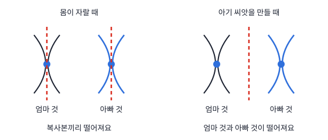

*몸이 자랄 때는 가운데 색칠된 점으로 붙어 있던 복사본끼리 떨어지고, 아기 씨앗을 만들 때는 먼저 엄마 것과 아빠 것이 떨어져요.*

그래서 아기 씨앗에는 엄마 것과 아빠 것 가운데 하나만 들어가요.

**정확히 말하면**

유사분열과 감수분열은 둘 다 전기·중기·후기·말기로 나누지만, **무엇이 갈라지는가**가 달라요. 이 차이를 보려면 두 가지 구분이 먼저 필요해요.

- **자매염색분체**(sister chromatid): 염색체 하나를 복제해 생긴 두 가닥이에요. 동원체로 붙어 있고, 복제본이라 유전 정보가 같아요.
- **상동염색체**(homologous chromosome): 모양과 크기가 같은 염색체 한 쌍이에요. 하나는 어머니에게서, 하나는 아버지에게서 왔어요.
- 상동염색체의 같은 위치에는 같은 유전자가 있어요. 하지만 그 유전자의 **대립유전자**(allele)는 같을 수도 있고 다를 수도 있어요. 그래서 "상동염색체는 늘 같은 대립유전자를 가진다"는 틀린 말이고, "일반적으로 같은 유전자를 가진다(성염색체 X·Y 쌍은 예외)"가 맞는 말이에요.
- 상동염색체를 쌍으로 가진 상태가 **2n**(2배체, diploid)이고, 쌍 가운데 하나씩만 가진 상태가 n, 곧 **반수체**(haploid)예요. 체세포는 2n, 정자·난자 같은 배우자는 n이에요. 사람은 상동염색체가 23쌍이라 체세포에 46개, 배우자에 23개가 있어요. 체세포가 배우자보다 염색체 수가 두 배 많아요.

| 구분 | 유사분열(체세포 분열) | 감수분열 |
|---|---|---|
| 염색체 수 | 2n → 2n | 2n → n(반수체) |
| 갈라지는 것 | 자매염색분체 | 먼저 상동염색체(1분열), 그다음 자매염색분체(2분열) |
| 일어나는 때 | 몸의 세포를 늘릴 때 | 유성생식에서 정자·난자를 만들 때만 |

왜 그렇게 갈라지는지는 염색체 수에서 나와요.

1. 유사분열은 2n이 그대로 2n이 되어야 해요. 그러려면 엄마 것과 아빠 것, 곧 상동염색체가 함께 따라가야 해요. 그래서 유사분열에서 갈라지는 것은 상동염색체가 아니라 자매염색분체예요.
2. 감수분열은 2n이 n으로 줄어야 해요. 그래서 처음에 상동염색체가 갈라져요(감수 1분열). 1분열이 끝난 세포는 이미 반수체예요.
3. 그다음에 자매염색분체가 갈라져요(감수 2분열). 그래서 감수분열은 두 단계로 진행돼요.
4. 결과적으로 배우자는 상동염색체 쌍 가운데 하나만 받아요. 상동염색체 한 쌍이 함께 자식에게 가지 않아요.

**교수님 말씀**

오늘의 목표를 "유사 분열과 감수 분열 차이를 확실하게" 아는 것으로 잡으셨어요(0922 01:58). 단계별 사건은 외울 것 없이 한번 들으면 이해된다고 하시면서, 그 전제로 두 염색체의 구분을 강조하셨어요.

> 상동 염색체하고 자매 염색 분체의 구분을 확실하게 해야 됩니다. 이걸 못 하면은 그냥 달나라 얘기가 됩니다. (0922 02:37)

2n이 2n으로 되려면 상동염색체가 같이 가야 하는지 나뉘어야 하는지 물으시고, 스스로 이렇게 정리하셨어요.

> 엄마가 준 거 아빠가 준 게 같이 가야 되잖아. (0922 04:10)

감수분열에서 상동염색체가 갈라지는 장면은 한마디로 표현하셨어요.

> 너는 이쪽, 나는 이쪽. (0922 04:56)

> 처음에 상동 염색체가 나눠지고 그다음에 자매 염색 분체가 나눠집니다. 이게 결정적인 차이입니다. (0922 05:13)

**꼭 기억해요**

- **착각:** 동원체로 붙은 두 가닥이 엄마 것과 아빠 것이다. **바른 구분:** 동원체로 붙은 두 가닥은 하나를 복제한 자매염색분체라 유전 정보가 같아요. 엄마 것과 아빠 것은 모양과 크기가 같은 따로 된 한 쌍, 곧 상동염색체이고 대립유전자가 다를 수 있어요. "동원체에 의해서 붙어 있는 거는 자매 염색 분체"(0922 02:54), "한 개는 마더, 한 개는 파더"(0922 03:18).
- **착각:** 상동염색체는 같은 유전자를 가지니 대립유전자도 늘 같다. **바른 구분:** 같은 위치에 같은 유전자가 있을 뿐, 대립유전자는 같을 수도 다를 수도 있어요. "동일한 대립유전자일 수도 있고 다른 대립유전자일 수도"(0922 03:25).
- **착각:** 유사분열에서도 상동염색체가 갈라진다, 또는 감수분열도 처음부터 자매염색분체가 갈라진다. **바른 구분:** 유사분열에서 갈라지는 것은 자매염색분체뿐이에요. 감수분열은 1분열에서 상동염색체, 2분열에서 자매염색분체가 갈라져요. "유사 분열에서 나눠지는 것은 상동 염색체가 아니고 자매 염색 분체"(0922 04:14), "처음에 나눠지는 게 상동 염색체"(0922 04:43).
- **착각:** 배우자가 체세포보다 염색체가 많다, 또는 상동염색체 한 쌍이 함께 자식에게 간다. **바른 구분:** 체세포는 2n, 배우자는 n이라 체세포 쪽이 두 배 많아요. 감수분열에서 상동염색체가 갈라지므로 배우자에는 쌍 가운데 하나만 들어가요. "감수 분열은 2n이 n으로 줄어드는 겁니다"(0922 03:43).

**페이지 요약**

유사분열은 자매염색분체가 갈라져 2n을 지키고, 감수분열은 먼저 상동염색체가 갈라져 반수체를 만들어요.

*용어*

- **자매염색분체(sister chromatid)** — 하나를 복제해 동원체로 붙어 있는 두 가닥, 유전 정보가 같음
- **상동염색체(homologous chromosome)** — 엄마·아빠에게서 온 모양과 크기가 같은 한 쌍, 같은 유전자에 대립유전자는 다를 수 있음
- **반수체(haploid)** — 상동염색체 쌍 가운데 하나씩만 가진 n 상태

---

## 1. 유사분열

### 간기와 분열 준비

*0922 수업 · 3장 p1*

**쉽게 말하면**

세포는 둘로 나뉘기 전에 한참 동안 자라면서 준비물을 두 배로 챙겨요.

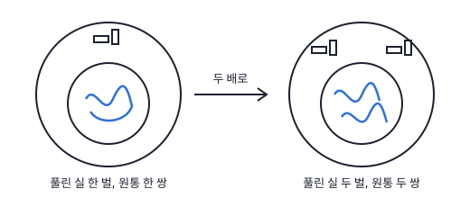

*나누기 전에 설계도 실(테두리 선)과 담배꽁초 모양 원통을 미리 두 배로 늘려 둬요.*

**정확히 말하면**

세포주기는 G1기, S기, G2기, M기 순서로 돌아요. 분열기인 M기를 뺀 G1·S·G2를 합쳐 **간기**(interphase)라고 해요. '사이 간(間)' 자를 써요.

1. **G1기**(G1 phase): 세포가 자라요(성장).
2. **S기**(S phase): DNA가 복제돼요. 이때 **중심체**도 함께 복제돼요.
3. **G2기**(G2 phase): 분열을 준비해요.

간기에는 DNA가 풀어진 **염색질**(chromatin) 상태예요. 그래서 막대 모양 염색체가 현미경으로 보이지 않아요. 교과서 그림에 간기 염색체를 막대로 그린 것은 편의상 그런 거예요. M기의 첫 단계인 전기(prophase)가 되어야 염색체가 응축(condense)되어 보이기 시작해요.

그림에서 두 가닥이 동원체(centromere)로 붙어 있으면 자매염색분체(sister chromatid)예요. 모양과 크기가 같은 한 쌍이면 상동염색체(homologous chromosome)예요.

세포가 분열할 때는 실 같은 **방추사**(방추체, spindle)가 뻗어 나와 염색체의 **동원체**에 붙어요. 방추사의 성분은 세포골격 가운데 **미세소관**(microtubule)이에요.

미세소관이 처음 뻗어 나오는 곳이 **중심체**(centrosome)예요. 서로 직각으로 놓인 작은 원통 하나하나가 **중심립**(centriole)이고, 중심립 두 개를 합친 것이 중심체예요. 수업 영상도 여러 생물에서 중심체마다 중심립이 한 쌍 있다고 했어요.

1. 세포는 원래 중심체를 한 개 가지고 있어요.
2. S기에 DNA가 복제될 때 중심체도 같이 복제돼요.
3. 그래서 분열을 시작할 때 세포에는 중심체 두 개와 두 배가 된 DNA(자매염색분체)가 있어요.

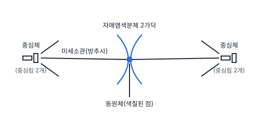

*S기에 복제된 중심체 두 개가 양쪽에 자리 잡고, 거기서 뻗은 미세소관(방추사)이 염색체 가운데의 동원체에 붙어요.*

그래서 미세소관(방추사)이 동원체와 중심체(중심립)를 잇는 일은 [유사분열(M기)](#s1-phases) 때 일어나요. 간기의 S기에는 중심체가 복제될 뿐이고, G2기는 분열을 준비하는 때예요. 핵막은 방추사가 잇는 대상이 아니라 전기에 사라지는 구조예요.

**교수님 말씀**

간기라는 이름은 한자 뜻으로 기억하게 했어요.

> M기를 제외한 나머지 시기를 다 간기라고 한 거요, 간기. 사이 간 자. (0922 05:31)

교과서 그림 속 중심립 두 개를 담배꽁초에 빗댔어요.

> 웬 담배꽁초 두 개가 이렇게 수직 방향으로 두 개가 널브러져 있어요. (0922 07:51)

"방추체의 성분은?" 하고 물은 뒤 스스로 답했어요(0922 07:18–07:29).

> 미세소관, 미세소관. 세포골격 중에서 미세소관 있었죠? (0922 07:29)

간기 그림의 막대 모양 염색체는 실제로는 보이지 않는다고 짚었어요.

> 편의상 이렇게 막대기로 표시했지만 이 막대기조차도 안 보입니다, 원래는. (0922 06:19)

**꼭 기억해요**

**중심립과 중심체.** 원통 하나를 중심체로 착각하기 쉬워요. 원통 하나가 중심립이고, 중심립 두 개를 합친 것이 중심체예요.

> 각각을 중심립이라고 하고 얘네들을 합쳐서 중심체라고 하는데 (0922 08:11)

**중심체와 동원체.** 이름이 비슷해서 서로 바꿔 쓰기 쉬워요. 중심체는 방추사가 뻗어 나오는 곳이고, 동원체는 방추사가 가서 붙는 염색체 부위예요. 방향은 늘 "중심체에서 나와 동원체에 붙는다"예요.

> 방추사가 중심체에서 뻗어나와서 동원체에, 염색체에 결합한다. (0922 14:27)

**간기의 염색체는 "없다"가 아니라 "안 보인다".** 간기에 염색체가 아예 없다고 착각하기 쉬워요. 간기에도 DNA는 있고, 풀린 염색질 상태라 막대로 보이지 않을 뿐이에요. 교수님도 06:05에 "염색체가 없고"라고 했다가 나중에 바로잡았어요.

> 간기 때는 염색체가 안 보이지만, 그냥 편의상 이렇게 그림을 그린 거예요. (0922 10:08)

**보충 · 수업에서 다루지 않았어요**

수업에서는 "G1기는 성장"까지만 말했어요. 교재는 G1기를 DNA 복제 전의 세포 성장기라고 설명해요. 이때 세포는 핵 DNA를 제외한 단백질과 그 밖의 분자들을 만들며 커져요. 세포가 커지는 만큼 미토콘드리아 같은 세포소기관(organelle)도 늘어나요.

그래서 "핵 DNA를 뺀 대부분의 단백질과 세포소기관이 늘어나는(복제되는) 시기"는 간기의 G1기예요. 가르는 기준은 이래요. S기는 DNA(와 중심체)가 복제되는 시기예요. 유사분열 전기와 말기는 핵막이 사라지거나 다시 생기는 분열 단계라서 세포가 자라는 시기가 아니에요.

교재는 G2기에도 단백질 합성과 성장이 이어진다고 써요. 하지만 DNA 복제 전의 성장 단계로 이름 붙은 것은 G1기예요.

출처: 교재 3장 p.57(G1기·S기·G2기 설명, 그림 3.2), 강의노트 3장 p1(G1기: 단백질과 그 밖의 다른 분자들을 합성), 세포소기관 증가는 Campbell Biology 12장(세포주기)

**페이지 요약**

간기에 세포는 G1기에 자라고, S기에 DNA와 중심체를 복제하고, G2기에 분열을 준비해요.

*용어*

- **염색질(chromatin)** — 간기에 DNA가 풀어진 상태라 막대 모양 염색체가 보이지 않아요.
- **중심체(centrosome)** — 중심립 두 개로 되어 있고 미세소관(방추사)이 뻗어 나오는 곳이에요.
- **중심립(centriole)** — 중심체를 이루는 직각으로 놓인 원통 하나예요.

---

### 전기·중기·후기·말기

*0922 수업 · 3장 p2*

**쉽게 말하면**

세포는 준비물을 딱 반으로 나누려고 네 단계로 움직여요.

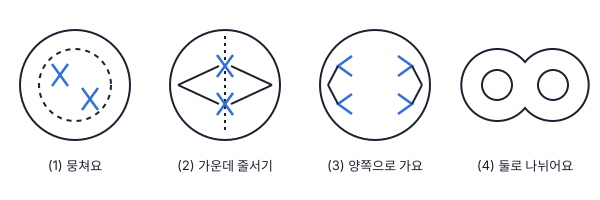

*실이 뭉쳐 막대가 되고, 가운데 한 줄로 섰다가, 막대가 반씩 갈라져 양쪽 끝으로 끌려가요.*

**정확히 말하면**

유사분열(mitosis)의 M기는 **전기**(prophase), **중기**(metaphase), **후기**(anaphase), **말기**(telophase) 네 단계로 나눠요. 전기와 중기 사이에 전중기(prometaphase)가 따로 있지만, 수업에서는 중기 이전을 모두 전기로 봐요.

1. **전기**: 세 가지 일이 일어나요. (1) DNA가 응축되어 염색체가 보이기 시작해요. (2) **핵막**(nuclear envelope)이 사라져요. (3) 중심체에서 **방추사**(미세소관)가 뻗어 나와 염색체의 **동원체**에 결합해요. 수업 영상은 방추사가 동원체에 있는 키네토코어(kinetochore)라는 구조에 붙는다고 했어요.
2. **중기**: 염색체가 세포 가운데에 한 줄로 늘어서요("**가운데 배열**"). 영상은 동원체들이 세포 적도의 한 면에 늘어선다고 했고, 교재는 이 면을 중기판(metaphase plate)이라고 불러요(교재 3장 p.58). 이때 염색체 하나하나는 아직 동원체로 붙은 자매염색분체 2개로 되어 있어요.
3. **후기**: 동원체가 갈라지면서 **자매염색분체**가 떨어져 서로 반대쪽 극으로 끌려가요. 떨어진 염색분체 하나하나는 이제 독립된 염색체로 봐요. 갈라지는 것은 상동염색체가 아니라 자매염색분체예요.
4. **말기**: 전기의 반대예요. 양극에 도착한 염색체 주위로 핵막이 다시 생기고, 염색체가 풀리고, 방추사가 사라져요. 영상은 이 단계에서 세포질 분열도 시작된다고 했어요.

| 단계 | 핵막 | 염색체 | 방추사 |
|---|---|---|---|
| 전기 | 사라져요 | 응축되어 보이기 시작, 자매염색분체 2개가 동원체로 붙은 상태 | 중심체에서 뻗어 나와 동원체에 붙어요 |
| 중기 | 없어요 | 세포 가운데(중기판)에 한 줄로 배열, 여전히 자매염색분체 2개씩 | 양쪽 극에서 동원체에 붙어 있어요 |
| 후기 | 없어요 | 자매염색분체가 갈라져 서로 반대 극으로 이동 | 염색분체를 극 쪽으로 끌어요 |
| 말기 | 다시 생겨요 | 양극에 모여 다시 풀려요 | 사라져요 |

판별 기준을 정리하면 이래요. 염색체가 세포 중앙에 정렬하면 중기, 두 자매염색분체가 반대 극으로 갈라지면 후기, 핵막이 사라지면 전기예요. 염색체가 양극 쪽에서 발견되는 것은 후기·말기의 모습이에요. 세포질 분열은 중기에 시작하지 않아요([세포질 분열](#s1-cytokinesis) 참고).

말기가 끝나면 핵막이 다시 생겨 핵이 두 개가 돼요. 이것으로 핵분열이 끝나요. 세포는 아직 하나라서 [세포질 분열](#s1-cytokinesis)이 뒤따라야 해요.

**교수님 말씀**

전중기는 구분하지 않아도 된다고 했어요.

> 요거 차이까지는 몰라도 되겠습니다. (0922 11:22) 그래서 그냥 다 전기로 생각하면 돼요. (0922 11:30)

"뭐가 사라진다?" 하고 묻고, 농담 뒤에 "핵막이 사라지죠, 핵막"으로 답했어요(0922 11:50–11:57).

전기는 세 가지 사건만 기억하면 된다고 강조했어요.

> 세 가지 사건밖에 안 돼요, 세 가지. (0922 12:19) 사실 전기만 알면은 나머지는 그냥 더 쉬워요. (0922 12:31)

중기는 한자 '가운데 중(中)'으로 외우게 했어요.

> 원래 시간상 중기지만, 그러나 외울 때는 가운데 배열된다 이렇게 외우면 되죠. (0922 12:47)

후기에 무엇이 갈라지는지 되물었어요.

> 이렇게 나눠지는 것은 상동 염색체다, 자매 염색분체다? … 자매 염색분체죠. (0922 12:58–13:07)

**꼭 기억해요**

**전기와 전중기.** 핵막 소실과 방추사 부착을 전기와 다른 단계로 따로 외우려 하기 쉬워요. 엄밀히는 전중기 일이고 강의노트 3장 p2도 전중기로 적었지만, 수업에서는 전기에 포함해요. 핵막이 사라지는 시기를 물으면 전기예요.

**후기에 갈라지는 것.** 상동염색체가 갈라진다고 착각하기 쉬워요. 유사분열 후기에 갈라지는 것은 자매염색분체예요.

> 자매 염색분체죠. 자매 염색분체가 나눠집니다. (0922 13:07)

**중기의 염색체 모양.** 중기 염색체가 염색분체 하나로 되어 있다고 착각하기 쉬워요. 중기에는 아직 갈라지기 전이라 염색체마다 자매염색분체가 2개예요. 갈라지는 것은 그다음 후기예요.

**방추사가 사라지는 시기.** 교수님은 14:39 요약에서 "방추사가 사라집니다. 요게 후기"라고 말했는데, 이것은 말실수예요. 방추사가 사라지는 것은 말기예요. 후기는 자매염색분체가 갈라져 극으로 가는 단계예요.

> 말기 때는 … 핵막이 나타나고 염색체가 풀리고 방추사가 사라진다. (0922 13:13)

**페이지 요약**

전기에 염색체가 응축되고 핵막이 사라지며, 중기에 가운데 배열, 후기에 자매염색분체 분리, 말기에 핵막이 다시 생기고 방추사가 사라져요.

*용어*

- **방추사(spindle)** — 중심체에서 뻗어 나와 동원체에 붙는 미세소관 실이에요.
- **동원체(centromere)** — 자매염색분체가 붙어 있고 방추사가 가서 붙는 염색체 부위예요.
- **중기판(metaphase plate)** — 중기에 염색체가 늘어서는 세포 가운데 면이에요.

---

### 세포질 분열

*0922 수업 · 3장 p2*

**쉽게 말하면**

마지막으로 세포 몸통까지 둘로 갈라야 진짜 세포 두 개가 돼요.

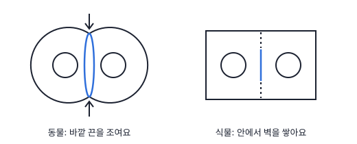

*동물 세포는 허리를 끈으로 조이듯 나뉘고, 벽이 단단한 식물 세포는 가운데에 새 벽을 세워 나뉘어요.*

**정확히 말하면**

말기가 끝나면 핵이 두 개가 되어 **핵분열**이 끝나요. 그래도 세포는 아직 하나예요. 세포가 둘이 되려면 핵분열 다음에 세포질이 나뉘는 **세포질 분열**(cytokinesis)이 일어나야 해요.

1. **동물세포**: 세포막 밑에 있는 **미세섬유**(microfilament)가 막을 안쪽으로 잡아당겨요. 그러면 세포 허리에 고리가 생기는데, 이것을 **수축환**(contractile ring)이라고 해요. 수축환이 점점 좁아져 세포가 둘로 나뉘어요. 강의노트는 이렇게 파인 곳을 분열홈(furrow)이라고 불러요.
2. **식물세포**: 세포벽이 단단해서 밖에서 조일 수 없어요. 그래서 세포벽 성분이 세포 안쪽 가운데에서 만들어지는데, 이것이 **세포판**(cell plate)이에요. 세포판이 양옆으로 늘어나 새 세포벽이 되면서 두 세포로 나뉘어요.

결과는 이래요. 유사분열에서는 상동염색체가 함께 가고 자매염색분체만 갈라지기 때문에, 2n 세포 하나가 2n 세포 두 개가 돼요.

시작 시기: 수업 영상은 말기에 세포질 분열도 시작된다고 했어요(0922 14:15). 그래서 세포질이 나뉘기 시작하는 시기는 [말기](#s1-phases)로 기억해요. 염색체가 가운데 배열되는 중기나 그보다 앞선 전기·간기에는 세포질이 나뉘기 시작하지 않아요.

**교수님 말씀**

핵분열과 세포질 분열을 구분해 짚었어요.

> 핵분열은 끝났지만 아직 세포는 한 개잖아, 한 개. (0922 15:04)

동물세포의 수축환을 신발 끈 주머니에 빗댔어요. 끈을 당기면 주머니 입구가 오므라들듯 세포 허리가 좁아진다는 뜻이에요.

> 신발 끈 주머니 쭉 잡아당기면은 입구가 좁아지죠? (0922 15:41)

식물이 다른 방식을 쓰는 이유는 세포벽이라고 했어요.

> 식물은 세포벽이 있으니까 밖에서 이렇게 당길 수가 없잖아. (0922 15:58)

**꼭 기억해요**

**핵분열과 세포질 분열.** 말기가 끝나면 세포도 이미 둘이 됐다고 착각하기 쉬워요. 말기가 끝나면 핵이 둘이 된 것(핵분열 끝)이고, 세포가 둘이 되려면 세포질 분열이 더 필요해요(0922 14:56–15:04).

**동물과 식물.** 둘의 방식을 뒤바꾸기 쉬워요. 동물은 밖에서 조이고(수축환), 식물은 안에서 세포판을 만들어요. 교수님도 15:21에 "식물- 동물은"이라고 말을 바꿔 잡았어요.

> 동물은 밖에서부터 쪼그라들고, 식물은 안에서부터 세포벽이 생깁니다. (0922 15:21)

**미세소관과 미세섬유.** 수축환을 당기는 것도 방추사처럼 미세소관이라고 착각하기 쉬워요. 방추사의 성분은 미세소관(0922 07:29)이고, 수축환을 당기는 것은 미세섬유(0922 15:48)예요. 둘 다 세포골격이지만 다른 섬유예요.

**보충 · 수업에서 다루지 않았어요**

교재도 동물세포에서 원형질막 안쪽의 미세섬유로 된 띠가 수축하면서 분열홈이 생긴다고 설명해요. 교재 그림 3.3의 말기 설명도 분열홈을 만들어 세포질이 분열되기 시작한다고 적어요. 그래서 수업 모형과 교재 모두 "세포질 분열은 말기에 시작"으로 맞아요.

다만 조건이 있어요. 교재 그림 3.2 설명은 세포질 분열이 대개 유사분열이 진행 중인 가운데 시작해 유사분열이 끝날 때 완결된다고 써요. 그래서 동물세포에서는 후기 끝 무렵부터 분열홈이 보이기 시작한다고 쓰는 자료도 있어요. 보기에 말기가 있으면 수업 모형대로 말기를 고르고, 중기는 어느 자료로 봐도 답이 아니에요.

출처: 교재 3장 p.57(그림 3.2 설명), 교재 3장 p.59(말기·세포질분열 본문, 그림 3.3 말기 설명)

**페이지 요약**

핵분열이 끝나도 세포는 하나라서, 동물은 수축환으로 조이고 식물은 세포판을 세워 세포질을 나눠요.

*용어*

- **수축환(contractile ring)** — 동물세포에서 미세섬유가 세포막을 당겨 생기는 고리예요.
- **세포판(cell plate)** — 식물세포 안쪽 가운데에서 만들어져 새 세포벽이 되는 판이에요.

---

### 유사분열의 쓰임과 클론

*0922 수업 · 3장 p2*

**쉽게 말하면**

하나에서 계속 나뉘어 생긴 세포들은 모두 쌍둥이처럼 똑같아요.

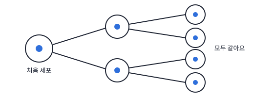

*한 세포가 나뉘고 또 나뉘어도 속에 든 설계도(색칠된 점)는 모두 똑같아요.*

**정확히 말하면**

유사분열은 이럴 때 일어나요.

1. **체세포**(somatic cell)가 분열할 때예요. 예를 들어 상처가 나서 새 세포를 만들 때 유사분열이 일어나요.
2. **무성생식**(asexual reproduction)할 때예요. 식물의 **꺾꽂이**, 잎을 잘라 심으면 뿌리가 나는 것이 그 예예요. 강의노트는 이것을 영양생식(vegetative reproduction)이라고도 불러요.

수업 영상은 체세포 분열이 생장과 재생에 쓰인다고 정리했어요. 동물은 몸 전체에서 체세포 분열이 일어나요. 식물은 생장점, 형성층 같은 특정 부위에서만 일어나요(0922 27:13–27:23).

유사분열에서는 세포 하나가 둘이 돼요. 수업 영상 말대로 유사분열은 부모 핵과 유전적으로 같은 핵 두 개를 만들어요. 그래서 딸세포 두 개끼리, 그리고 딸세포와 모세포의 유전정보가 같아요.

한 세포의 유사분열로 만들어져 유전정보가 같은 세포 무리를 **클론**(clone)이라고 해요. 단, 돌연변이(mutation)가 일어난 경우는 예외예요.

이렇게 같은 세포가 나오는 까닭은 [후기](#s1-phases)에 자매염색분체만 갈라지고 상동염색체는 함께 가기 때문이에요.

**교수님 말씀**

무성생식의 예로 꺾꽂이를 들었어요.

> 식물의 뭐 꺾꽂이라든지 잎을 잘라서 이렇게 심으면은 뿌리가 난다든지 (0922 17:25)

암세포도 클론이라고 했어요. 암세포 하나가 계속 분열해 덩어리가 되었으니, 그 덩어리의 세포들은 유전적으로 같다는 뜻이에요.

> 사실 암세포도 클론이에요. 암세포 한 개가 계속 분열해서 덩어리가 된 거야. (0922 17:56)

**페이지 요약**

유사분열은 체세포 분열과 무성생식(꺾꽂이)에서 일어나고, 돌연변이가 없으면 유전정보가 같은 클론을 만들어요.

*용어*

- **무성생식(asexual reproduction)** — 유사분열만으로 자손을 만드는 생식이에요. 꺾꽂이가 예예요.
- **클론(clone)** — 한 세포의 유사분열로 생겨 유전정보가 같은 세포 무리예요.

---

## 2. 감수분열

### 4분염색체와 중기 배열

*0922 수업 · 3장 p3 · 3장 p4*

**쉽게 말하면**

아기씨(정자·난자)를 만들 때는 엄마 것과 아빠 것이 짝꿍끼리 손잡고 옆으로 나란히 서요.

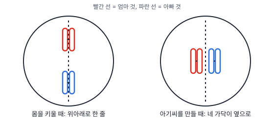

*몸을 키울 때는 엄마 것과 아빠 것이 따로따로 한 줄로 서고, 아기씨를 만들 때는 짝꿍끼리 붙어 네 가닥이 옆으로 나란히 서요.*

**정확히 말하면**

**감수분열(meiosis)**은 2배체(2n) 세포를 반수체(n)로 줄이는 분열이에요. **유성생식**에서만, 즉 정자와 난자 같은 생식세포를 만들 때만 일어나요.

감수분열에서 처음 갈라지는 것은 자매염색분체가 아니라 **상동염색체(homologous chromosomes)**예요. 상동염색체가 갈라지려면 먼저 엄마 것과 아빠 것이 짝을 지어야 해요.

- **4분염색체(tetrad)**: 엄마에게서 온 염색체와 아빠에게서 온 상동염색체가 짝을 지어, 자매염색분체 네 가닥이 옆으로 나란히 붙은 것이에요. 같은 것을 **2가염색체(bivalent)**라고도 불러요. 교수님은 두 이름을 함께 불렀어요(0922 19:49, 33:43).
- 생기는 때: 제1감수분열 전기(전기 I)에 상동염색체가 짝을 지어(접합, synapsis) 생겨요. 짝을 지은 동안 교차가 일어나요([교차와 재조합](#s3-crossover)).
- 늘어서는 때: **중기 I**에 4분염색체가 이 상태 그대로 세포 가운데에 옆으로 나란히 늘어서요. 그다음 후기 I에 짝이 양쪽 극으로 갈라져요.
- 4분염색체는 감수분열에서만 생겨요. 유사분열에서는 상동염색체가 짝을 짓지 않아요.

| 비교 | 유사분열 중기 | 감수분열 중기 I |
|---|---|---|
| 상동염색체 짝짓기 | 하지 않아요 | 짝을 지어요 |
| 가운데 배열 | 염색체가 하나씩 위아래로 한 줄 | 4분염색체가 네 가닥씩 옆으로 나란히 |
| 4분염색체 | 생기지 않아요 | 생겨요 |
| 다음에 갈라지는 것 | 자매염색분체 | 상동염색체 |
| 결과 | 2n인 딸세포 2개 | 1분열 뒤 n인 세포 2개, 끝나면 n인 딸세포 4개 |

유사분열 단계는 [전기·중기·후기·말기](#s1-phases)에서, 두 번의 분열은 [제1감수분열과 제2감수분열](#s2-two-divisions)에서 이어서 봐요.

**교수님 말씀**

교수님은 빨간 것은 엄마가, 파란 것은 아빠가 준 염색체로 정하고 두 배열을 나란히 그렸어요(0922 19:12).

> "정자, 난자 만들 때만 감수분열이 일어나게 된다." (0922 18:34)

유사분열 중기에 상동염색체가 위아래로 선다는 것을 두고 이렇게 말했어요.

> "이게 결정적인 차이입니다." (0922 20:02)

> "요것만 알면은 두 개 차이 그냥 껌이에요, 껌." (0922 20:09)

> "이 그림만 그릴 줄 알면은 끝이죠." (0922 20:27)

**꼭 기억해요**

- **중기 배열을 서로 바꿔 기억하기 쉬워요.** 유사분열 중기에는 상동염색체가 짝 없이 위아래로 한 줄로 서요. 감수분열 중기 I에는 4분염색체가 네 가닥씩 옆으로 나란히 서요. "유사분열에서는 아래위로, 감수분열에서는 옆으로." (0922 22:59)
- **4분염색체와 2가염색체를 다른 구조로 착각하기 쉬워요.** 둘은 같은 것을 부르는 두 이름이에요. "4분 염색체, 혹은 2가 염색체 이렇게 부르죠." (0922 19:49) "2가염색체 혹은 4분염색체라고 부르는" (0922 33:43)
- **4분염색체가 유사분열에도 생긴다고 착각하기 쉬워요.** 4분염색체는 감수분열에서만 생겨요. "감수분열에서만 4분염색체가 형성이 된다." (0922 20:16)

**보충 · 수업에서 다루지 않았어요**

교재와 강의노트는 같은 구조를 4분체(tetrad)라고 적어요. 교재는 이것을 각 상동염색체 쌍이 4개의 염색분체로 이루어졌다는 뜻이라고 설명해요.

- "4분"은 염색분체 네 가닥을, "2가"는 짝을 지은 염색체 두 개(상동염색체 한 쌍)를 센 이름이에요.
- 그래서 4분염색체 하나를 염색체로 세면 4개가 아니라 2개예요. 네 가닥은 염색분체 수예요.

출처: 교재 3장 p.65, 강의노트 3장 p4

**페이지 요약**

감수분열 중기 I에는 상동염색체가 짝을 지은 4분염색체가 옆으로 나란히 서요.

*용어*

- **4분염색체(tetrad)** — 상동염색체 한 쌍이 짝을 지어 염색분체 네 가닥이 붙은 것
- **2가염색체(bivalent)** — 4분염색체의 다른 이름
- **중기 I(metaphase I)** — 4분염색체가 세포 가운데에 옆으로 나란히 서는 때

---

### 제1감수분열과 제2감수분열

*0922 수업 · 3장 p3 · 3장 p4*

**쉽게 말하면**

아기씨를 만들 때는 두 번 나눠요: 먼저 짝꿍이 헤어지고, 다음엔 붙어 있던 쌍둥이 가닥이 헤어져요.

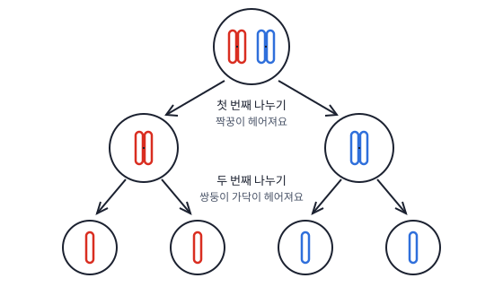

*짝 하나만 그렸어요: 첫 번째에 엄마 것(빨간 선)과 아빠 것(파란 선)이 갈라지고, 두 번째에 붙은 두 가닥이 갈라져 작은 아기씨 4개가 돼요.*

**정확히 말하면**

감수분열은 핵분열이 두 번 이어지는 분열이에요. 앞의 분열을 **제1감수분열**(감수분열 1기, meiosis I), 뒤의 분열을 **제2감수분열**(감수분열 2기, meiosis II)이라고 해요.

1. **시작 전 간기**: S기에 DNA가 복제돼 DNA 양이 두 배가 돼요. 그래서 분열을 시작할 때 각 염색체는 동원체로 붙은 **자매염색분체(sister chromatids)** 두 가닥이에요.
2. **제1감수분열**: 짝을 지은 상동염색체가 양쪽 극으로 갈라져요. 딸세포 2개가 생기고, 각 세포는 상동염색체 쌍마다 하나씩만 받으므로 이미 **반수체(haploid, n)**예요. 염색체 수가 절반으로 주는 것은 이때예요.
3. **1분열과 2분열 사이**: 1분열이 끝나면 곧바로 2분열이 시작돼요.
4. **제2감수분열**: 자매염색분체가 갈라져 양쪽 극으로 가요. 염색체 수는 변하지 않아요(n에서 n). 결과는 n인 딸세포 4개예요.

**말기 I 직후 딸세포**는 두 가지를 함께 기억해요.

- 염색체 세트: 반수체(n)예요. 상동염색체가 이미 갈라졌으니 2배체(2n)가 아니에요.
- 염색체 모양: 각 염색체는 아직 자매염색분체 두 가닥이 붙은 상태예요. 자매염색분체는 제2감수분열에서야 갈라지기 때문이에요.

두 분열은 각각 전기·중기·후기·말기로 진행하고, 전기 I·중기 I·후기 I·말기 I, 전기 II·중기 II·후기 II·말기 II처럼 불러요. 단계마다 일어나는 일은 유사분열과 같아요. 전기에는 핵막이 사라지고 염색체가 응축되고 방추사가 붙어요. 중기에는 가운데에 늘어서고, 후기에는 극으로 끌려가고, 말기에는 전기의 반대 일이 일어나요. 다른 것은 두 가지뿐이에요: 중기 I의 배열 방식([4분염색체와 중기 배열](#s2-tetrad))과, 각 분열에서 무엇이 갈라지는지예요.

| 비교 | 유사분열(체세포 분열) | 감수분열 |
|---|---|---|
| 분열 횟수 | 1번 | 연속 2번(제1감수분열, 제2감수분열) |
| 갈라지는 것 | 자매염색분체 | 1분열: 상동염색체, 2분열: 자매염색분체 |
| 결과 | 2n인 딸세포 2개 | n인 딸세포 4개 |
| 쓰임 | 생장, 재생 | 생식세포(정자, 난자) 형성 |

**교수님 말씀**

교수님은 1분열이 끝난 세포가 어떤 상태인지 묻고 바로 답했어요.

> "1감수분열이 끝나면 이 세포는 반수체예요, 이배체예요?" (0922 21:33)

> "상동염색체가 나눠졌으니까 얘는 반수체죠." (0922 21:45)

> "한번 이렇게 하면 이제 1분열이 끝난 거고 곧바로 2분열이 시작이 됩니다." (0922 23:10)

> "어떤 게 나눠지느냐 그 차이만 이해를 하면 돼요." (0922 23:25)

이해를 돕기 위해 중학교 선생님이 만든 영상도 틀었어요. 손가락 하나를 염색체로 보고 붙였다 떼며 두 분열을 표현해요(0922 26:17). 영상은 DNA 양을 두 배로 늘린 뒤 상동염색체가 접합해 2가염색체를 만든다고 정리했어요(0922 26:40).

> "염색체의 수가 절반으로 감소하는 과정은 1분열" (0922 26:09, 영상)

**꼭 기억해요**

- **1분열이 끝난 세포를 아직 2배체로 착각하기 쉬워요.** 상동염색체가 갈라졌으니 이미 반수체예요. 다만 각 염색체는 아직 자매염색분체 두 가닥이에요. "이미 제1감수분열에서 반수체 세포가 만들어집니다." (0922 21:45)
- **염색체 수가 2분열에서 준다고 착각하기 쉬워요.** 염색체 수가 절반으로 주는 것은 1분열이고, 2분열에서는 수가 변하지 않아요. (0922 26:09)
- **결과를 섞어 기억하기 쉬워요.** 유사분열은 2n인 딸세포 2개, 감수분열은 n인 딸세포 4개예요. "감수분열에서는 n짜리 세포 4개가 만들어지게 됩니다." (0922 22:09)
- **1분열과 2분열을 따로 떨어진 두 번의 분열로 착각하기 쉬워요.** 두 분열은 이어서 일어나요. "1분열이 끝난 거고 곧바로 2분열이 시작이 됩니다." (0922 23:10)
- **감수분열의 단계마다 새로운 사건이 있다고 착각하기 쉬워요.** 전기·중기·후기·말기에 일어나는 일은 유사분열과 같고, 갈라지는 대상만 달라요. "이때 일어나는 현상은 다 똑같습니다." (0922 22:42)

**보충 · 수업에서 다루지 않았어요**

수업에서 DNA 양을 직접 계산하지는 않았어요. 시험은 "G2기 세포의 DNA 양이 X일 때"처럼 물으므로, 염색체 수와 DNA 양을 따로 세는 법을 정리해요.

- 자매염색분체 한 가닥에는 DNA 이중나선이 하나 들어 있어요. 자매염색분체는 DNA가 2개의 복사본으로 복제된 것이기 때문이에요. 그래서 두 가닥짜리 염색체 하나에는 이중나선이 2개예요.
- 염색체 수는 자매염색분체가 붙어 있는 한 하나로 세요. DNA 양은 가닥 수를 따라가요.

1. S기 복제로 DNA가 두 배가 된 2배체 세포가 G2기예요. 이때 DNA 양을 X라고 해요.
2. 제1감수분열에서 상동염색체가 두 세포로 갈라지므로 세포당 DNA 양은 절반인 0.5X가 돼요.
3. 그 사이에 복제가 없고, 중기 II에는 자매염색분체가 아직 붙어 있으므로 0.5X 그대로예요.
4. 제2감수분열에서 자매염색분체가 갈라지면 세포당 0.25X가 돼요.

| 시점 | 세포당 염색체 수 | 염색체 하나의 가닥 | 세포당 DNA 양 |
|---|---|---|---|
| G1기(복제 전) | 2n | 1가닥 | 0.5X |
| G2기(복제 뒤) | 2n | 2가닥 | X |
| 말기 I 뒤, 중기 II | n | 2가닥 | 0.5X |
| 말기 II 뒤 | n | 1가닥 | 0.25X |

**1분열과 2분열 사이에는 DNA 복제가 일어나지 않아요.** 교재는 DNA 복제를 감수분열 전 간기에서만 설명하고, 말기 I 다음의 짧은 분열간기에는 방추체를 해체하고 새로 조립하는 일만 적어요. 그래서 복제는 감수분열 전체에서 한 번뿐이에요.

출처: 교재 3장 p.64–65, 강의노트 3장 p1·p4

**페이지 요약**

제1감수분열에서 상동염색체가, 제2감수분열에서 자매염색분체가 갈라져 n인 딸세포 4개가 생겨요.

*용어*

- **제1감수분열(meiosis I)** — 상동염색체가 갈라져 반수체 세포 2개가 되는 분열
- **제2감수분열(meiosis II)** — 자매염색분체가 갈라져 n인 딸세포 4개가 되는 분열
- **반수체(haploid, n)** — 상동염색체 쌍마다 하나씩만 가진 상태

---

## 3. 유전적 다양성

### 유성생식과 무성생식

*0922 수업 · 3장 p4*

**쉽게 말하면**

둘이 만나서 아기를 만들면 형제끼리도 조금씩 달라서, 큰 병이 와도 누군가는 살아남아요.

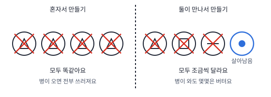

*왼쪽은 모두 같은 무늬라 다 같이 쓰러지고, 오른쪽은 무늬가 달라 파란 테두리 하나가 버텨요.*

**정확히 말하면**

**무성생식(asexual reproduction)**은 유사분열만으로 자손을 만들어요. 돌연변이가 아니면 DNA 서열이 바뀌지 않아요. 그래서 자손끼리도, 자손과 윗세대도 똑같은 클론(clone)이에요([유사분열의 쓰임과 클론](#s1-clone)).

**유성생식(sexual reproduction)**은 감수분열로 만든 정자와 난자가 만나 자손을 만들어요. 자손은 형제자매끼리도 다르고 부모와도 달라요. 즉 유성생식은 **유전적 다양성(genetic diversity)**을 만들어요.

| 구분 | 유성생식 | 무성생식 |
|---|---|---|
| 장점 | 유전적 다양성. 환경이 갑자기 바뀌어도 적어도 일부는 살아남아 번식할 수 있어요. | 빠르고 비용이 들지 않아요. |
| 단점 | 짝을 찾고 생식을 해야 해서 에너지, 시간, 비용이 많이 들어요. | 모두 같아서 환경 변화에 대처하지 못해요. |

유성생식의 단점을 뒤집으면 무성생식의 장점이 되고, 유성생식의 장점을 뒤집으면 무성생식의 단점이 돼요.

유전적 다양성은 감수분열과 수정 과정의 세 가지 현상에서 생겨요.

1. 제1감수분열 전기의 교차(재조합): [교차와 재조합](#s3-crossover)
2. 상동염색체 쌍의 무작위 분배: [상동염색체의 무작위 분배](#s3-assortment)
3. 정자와 난자의 무작위 수정: [무작위 수정과 70조](#s3-fertilization)

**교수님 말씀**

단점은 짝 찾기 비용으로 설명했어요. 소개팅, 결혼처럼 짝을 찾고 맺는 데 돈과 시간이 든다는 농담이에요.

> 선볼 때 썼던 커피값만 모았어도 집을 샀다. (0922 30:43)

장점은 **아일랜드 감자 대기근**으로 설명했어요. 감자는 씨 없이 무성생식으로 재배해서 모두 유전적으로 같았어요. 원생생물이 일으킨 병이 돌자 감자가 모두 병들어 죽었고, 100만 명가량이 굶어 죽거나 이민을 떠났어요. 그 이민자의 후손이 케네디 대통령이에요.

> 만약에 유성생식이었으면은 한두 놈은 저항성이 있었을 수도 있다. (0922 32:27)

지금의 바나나도 씨가 없어 무성생식으로 재배하므로 같은 위험을 안고 있어요(0922 32:07).

**꼭 기억해요**

**유성생식의 장점과 단점을 뒤바꾸기 쉬워요.** 교수님도 "단점, 장점입니다, 장점"이라고 말을 고쳐 잡았어요(0922 32:48).

바른 구분: 유전적 다양성은 유성생식의 **장점**이고, 짝 찾기와 생식에 드는 에너지, 시간, 비용이 **단점**이에요. 무성생식의 장점은 빠르고 싸다는 것이에요.

**페이지 요약**

유성생식은 비용이 들지만 유전적 다양성을 만들어서, 환경이 바뀌어도 일부가 살아남게 해요.

*용어*

- **유성생식(sexual reproduction)** — 정자와 난자가 만나 자손을 만들어요. 자손이 모두 달라요.
- **무성생식(asexual reproduction)** — 유사분열만으로 번식해요. 자손이 클론이에요.
- **감자 대기근** — 무성생식으로 똑같던 감자가 병으로 한꺼번에 죽은 사건이에요.

---

### 교차와 재조합

*0922 수업 · 3장 p4 · 3장 p5*

**쉽게 말하면**

엄마 줄과 아빠 줄이 나란히 붙어 있다가, 가운데 두 줄이 아래 조각을 맞바꾸는 거예요.

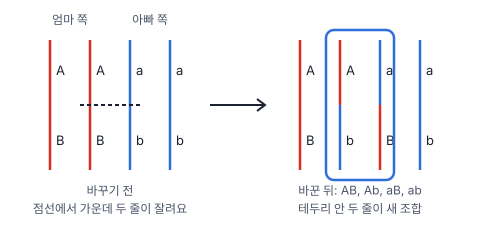

*원래는 AB와 ab뿐이었는데, 조각을 바꾸자 없던 Ab와 aB가 생겼어요.*

**정확히 말하면**

**교차(crossing over)**는 상동염색체 사이에서 DNA 조각이 서로 바뀌는 현상이에요. 그 결과 원래 없던 새로운 대립유전자 조합이 생기는 것을 **재조합(recombination)**이라 해요. "새롭게 조합됐다"는 뜻이에요.

1. **시기**: **제1감수분열 전기**(전기 I, prophase I)예요. 4분염색체(2가염색체)가 이때 만들어지므로 교차도 이때 일어나요([4분염색체와 중기 배열](#s2-tetrad)).
2. **배열**: 상동염색체가 짝을 지어 자매염색분체 네 가닥이 옆으로 나란히 붙어요. 엄마 유래 두 가닥, 아빠 유래 두 가닥이에요.
3. **교환**: **안쪽 두 가닥**, 즉 엄마 유래 한 가닥과 아빠 유래 한 가닥 사이에서 일어나요. DNA가 절단되고 잘린 조각이 상대 가닥에 가서 붙어요. 강의노트는 이를 "상동염색분체 사이의 물리적 교환"이라 적어요.
4. **결과**: 엄마 쪽 염색체가 A·B, 아빠 쪽이 a·b를 가진다고 해요. 교차가 없으면 배우자는 AB 아니면 ab뿐이에요. 교차가 일어나면 원래 없던 **Ab**, **aB** 염색체가 새로 생겨요.

특정 위치에서 교차가 일어날 확률은 낮아요. 하지만 위치가 정해져 있지 않아 염색체 어디서든 일어날 수 있어요(0922 35:51). 그만큼 유전적 다양성이 커져요.

유사분열에서는 상동염색체가 짝을 짓지 않아 4분염색체가 없으므로, 이런 방식의 교차가 일어나지 않아요.

**교수님 말씀**

교수님은 조각이 바뀌려면 먼저 잘려야 한다는 점을 짚었어요.

> DNA 조각이 교환되려면은 DNA가 절단이 돼야 돼요. (0922 34:10)

> 우리 DNA는 종종 절단됩니다. (0922 34:13)

이름의 뜻도 풀어 주었어요.

> 원래 없었는데 조합이 된 거다. 그래서 재조합. (0922 35:30)

**꼭 기억해요**

**교차와 재조합을 서로 관계없는 별개 사건으로 착각하기 쉬워요.** 수업에서는 "교차 혹은 재조합"이라고 두 이름을 함께 썼어요(0922 35:20).

바른 구분: 교차가 원인(물리적 교환)이고 재조합이 그 결과(새 조합)이며, 둘 다 제1감수분열 전기의 일이에요.

**교차 시기를 다른 단계로 착각하기 쉬워요.** 제2감수분열 전기나 후기, 또는 후기 I로 고르면 틀려요.

바른 구분: 교차(재조합)는 **제1감수분열 전기**에 일어나요. 교수님은 "교차도 제1 감수분열 전기 때 일어나는 현상"이라고 반복했어요(0922 36:23). 후기 I은 상동염색체가 양 극으로 갈라지는 단계이고, 제2감수분열에는 상동염색체 짝이 없어 4분염색체가 생기지 않아요.

**같은 염색체의 두 가닥끼리 바꾼다고 착각하기 쉬워요.**

바른 구분: 교환은 "안쪽 두 개", 즉 엄마 유래 가닥과 아빠 유래 가닥 사이에서 일어나요(0922 33:51). 같은 염색체의 자매염색분체끼리는 똑같은 복사본이라 바꿔도 새 조합이 생기지 않아요.

**A와 a, A와 B를 헷갈리기 쉬워요.** 교수님도 "라지 A 라지 A"라고 했다가 "아 다시 다시"하고 고쳤어요(0922 34:29).

바른 구분: A와 a는 같은 유전자의 대립유전자이고, A와 B는 서로 다른 유전자예요. 그래서 예시는 엄마 쪽 염색체 A·B, 아빠 쪽 염색체 a·b예요.

**페이지 요약**

제1감수분열 전기에 엄마 유래와 아빠 유래 가닥이 조각을 바꿔서, AB와 ab뿐이던 조합에 Ab와 aB가 생겨요.

*용어*

- **교차(crossing over)** — 상동염색체의 안쪽 두 가닥이 DNA 조각을 바꾸는 현상이에요.
- **재조합(recombination)** — 교차로 원래 없던 대립유전자 조합이 생기는 것이에요.
- **제1감수분열 전기** — 4분염색체가 생기고 교차가 일어나는 시기예요.

---

### 상동염색체의 무작위 분배

*0922 수업 · 3장 p5*

**쉽게 말하면**

짝마다 엄마 것과 아빠 것 중 하나를 동전 던지듯 골라 담으니, 짝이 두 개면 담는 방법이 네 가지예요.

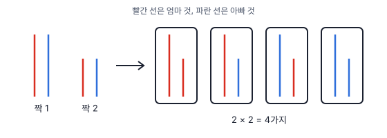

*짝이 하나 늘 때마다 가짓수가 두 배가 돼요.*

**정확히 말하면**

**무작위 분배(random assortment)**는 제1감수분열에서 상동염색체 쌍이 갈라질 때, 엄마 유래 염색체가 어느 극으로 갈지가 정해져 있지 않고 쌍마다 따로 무작위로 정해지는 현상이에요. 강의노트는 "중기 I에서 각 상동염색체 쌍이 무작위로 방추체 극에 부착한다"고 적어요. 이렇게 배열된 쌍이 후기 I에 양 극으로 갈라져요.

1. 상동염색체 1쌍: 엄마 것이 위로 가거나 아래로 가서 2가지예요.
2. 2쌍: 2 × 2 = 4가지예요.
3. 3쌍: 2 × 2 × 2 = 8가지예요. 한 개체가 여러 번의 감수분열로 만들 수 있는 생식세포의 종류가 8가지예요.
4. n쌍: **2의 n승**(2ⁿ)가지예요.

여기서 n은 **상동염색체 쌍의 수**예요. 염색체 개수가 아니에요. 2n은 염색체 개수이므로, 쌍의 수 n은 그 절반이에요.

- 2n = 4인 생물: 상동염색체 2쌍(n = 2)이므로 2² = 4가지예요.
- 2n = 6인 생물: 3쌍(n = 3)이므로 2³ = 8가지예요.
- 사람: 염색체 46개, **23쌍**이므로 2²³ = 약 840만(정확히 8,388,608)가지예요. 이 값은 교차와 돌연변이를 뺀 조합만의 수예요.

이것이 유전적 다양성의 두 번째 원인이에요. 첫 번째는 [교차와 재조합](#s3-crossover), 세 번째는 [무작위 수정과 70조](#s3-fertilization)예요.

**교수님 말씀**

엄마가 빨간색 염색체 세 개, 아빠가 파란색 염색체 세 개를 준 세 쌍의 예로 설명했어요. 누가 나눠 주는지 묻고 스스로 답했어요.

> 누가 나누냐면은 아무도 안 나눠요. 그냥 할 때마다 달라. (0922 37:07)

> 그때그때 달라. 랜덤입니다, 랜덤. 무작위. (0922 37:11)

"n쌍이면 어떻게 되냐"고 물은 뒤 "2의 n승 가지수"라고 정리했어요(0922 38:02).

**꼭 기억해요**

**지수 n을 염색체 개수로 착각하기 쉬워요.** 사람을 2⁴⁶으로 계산하거나, 2n = 4를 보고 2⁴ = 16으로 답하는 실수예요.

바른 구분: 지수는 **상동염색체 쌍의 수**예요. 사람은 23쌍이라 2²³이에요. 교수님도 "23쌍"을 거듭 말했어요(0922 40:16). 2n = 4이면 2쌍이라 2² = 4가지예요. 2⁴⁶은 엄마와 아빠의 조합을 곱한 수예요([무작위 수정과 70조](#s3-fertilization)).

**생식모세포 하나가 감수분열 한 번으로 2ⁿ종류를 만든다고 착각하기 쉬워요.** 수업에서도 "하나의 세포가 감수분열했을 때 여덟 가지"라고 말했어요(0922 37:45).

바른 구분: 생식모세포 하나의 감수분열 한 번은 세포 4개를 만들고, 교차가 없으면 그 종류는 많아야 2가지예요. 2ⁿ은 한 개체가 여러 번의 감수분열로 만들 수 있는 생식세포 종류의 수예요.

**보충 · 수업에서 다루지 않았어요**

**배우자끼리 유전적으로 달라지는 조건**: 배우자(정자나 난자) 사이의 유전적 차이에는 세 가지가 함께 영향을 줘요.

1. 감수분열 때 상동염색체의 무작위 분배
2. 교차에 의한 재조합
3. 서로 다른 대립유전자를 가진 유전자의 수. 즉 이형접합(예: Aa)인 유전자가 몇 개인지예요([꼭 알아야 할 유전학 용어](#s4-terms)).

세 번째가 필요한 이유는 이래요. 무작위 분배와 교차는 엄마 쪽과 아빠 쪽 염색체가 서로 다른 대립유전자를 가질 때만 차이를 만들어요. 수업 예시처럼 엄마 쪽이 A·B, 아빠 쪽이 a·b이면 나뉘는 방식에 따라 배우자가 달라져요. 반대로 모든 유전자가 동형접합(AA, BB처럼 두 대립유전자가 같음)이면 어느 쪽 염색체가 어느 극으로 가든, 조각을 바꾸든 배우자가 모두 같아요. 이형접합인 유전자가 많을수록 배우자가 더 다양해져요.

교재도 각 상동염색체 쌍의 모계 및 부계 염색체는 일반적으로 서로 다른 대립유전자를 지닌다고 전제한 뒤 무작위 분배를 설명해요.

출처: 교재 3장 p.69 (그림 3.10 A-B / a-b 예시는 p.68)

**페이지 요약**

상동염색체 쌍마다 어느 쪽으로 갈지가 무작위라서, n쌍이면 2의 n승 가지 생식세포가 생겨요.

*용어*

- **무작위 분배(random assortment)** — 상동염색체 쌍이 쌍마다 따로 무작위로 갈라지는 현상이에요.
- **2의 n승** — n은 상동염색체 쌍의 수예요. 사람은 23쌍이라 2²³ = 약 840만(정확히 8,388,608)가지예요.

---

### 무작위 수정과 70조

*0922 수업 · 3장 p5*

**쉽게 말하면**

엄마 카드 한 장과 아빠 카드 한 장이 아무렇게나 만나서 내가 돼요.

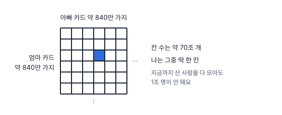

*색칠된 한 칸이 나예요.*

그래서 쌍둥이가 아니라면 나와 똑같은 사람은 전에도 없었고 앞으로도 없어요.

**정확히 말하면**

**수정(fertilization)**은 감수분열로 만들어진 생식세포, 즉 정자와 난자가 서로 융합하는 것이에요. 어떤 정자와 어떤 난자가 만날지에는 정해진 규칙이 없어요. 이론적으로 어떤 정자든 어떤 난자와도 수정할 수 있어요. 이것이 **무작위 수정(random fertilization)**이고, 유전적 다양성의 세 번째 원인이에요.

정자가 10종류, 난자가 10종류면 가능한 조합은 10 × 10 = 100가지예요. 사람에 적용하면 이래요.

1. 사람은 상동염색체 23쌍이므로, 한 사람이 만들 수 있는 정자나 난자는 2²³ = 약 840만(정확히 8,388,608)종류예요([상동염색체의 무작위 분배](#s3-assortment)).
2. 엄마가 만드는 난자 2²³종류와 아빠가 만드는 정자 2²³종류가 만나므로 경우의 수를 곱해요. 지수법칙으로는 지수를 더해요.
3. 한 부모가 만들 수 있는 자녀의 염색체 조합은 2⁴⁶ = 70,368,744,177,664가지, 약 **70조**예요.

$$
2^{23} \times 2^{23} = 2^{23+23} = 2^{46} \approx 70\text{조}
$$

결론: 한 부모가 70조 명을 낳아야 같은 조합의 자녀가 우연히 한 번 나와요. 일란성 쌍둥이만 예외로 유전적으로 같아요. 지금까지 살았던 사람을 모두 합쳐도 1조 명이 안 되므로, 내 염색체 조합은 지금까지 없었고 앞으로도 없을 거예요.

이 70조는 교차와 돌연변이를 **뺀** 값이에요. 교차까지 생각하면 한 부모가 낳을 수 있는 자손의 조합은 사실상 무한대예요. 그래서 유성생식으로 유전적으로 동일한 자손을 만드는 것은 사실상 불가능해요.

**교수님 말씀**

2²³과 2⁴⁶을 **로또**에 빗댔어요.

> 로또 조합 수하고 인간이 만들 수 있는 생식세포의 조합 수하고 비슷해요. (0922 41:11)

> 2의 46승은 무려 70조입니다, 70조. 로또 두 번 당첨될 확률이죠. (0922 41:45)

같은 부모에게서 태어난 유명 연예인 남매나 BTS 이야기로, 형제자매가 서로 다른 이유가 유성생식의 다양성이라고 했어요(0922 38:51–40:00). 이어 한 학생을 예로 "부모님이 몇 명을 낳아야 우연히 또 네가 태어날까"를 계산했어요(0922 40:06).

70조가 얼마나 큰지 인구 곡선으로 보여 주었어요. 지금 세계 인구는 약 80억이고, 호모 사피엔스 이후 인구는 바닥을 기다가 산업혁명 뒤 급격히 늘었어요. 이 곡선을 적분해 지금까지 산 모든 사람을 세어도 1조가 안 돼요(0922 42:38–44:16).

> 우주에서 거의 유일한 염색체 조합을 가지고 있다. (0922 44:26)

**꼭 기억해요**

**2²³과 2⁴⁶을 헷갈리기 쉬워요.**

바른 구분: 2²³은 **한 사람**이 만드는 정자나 난자의 종류예요(0922 40:52). 2⁴⁶은 **한 부모 쌍**이 만드는 자녀의 조합 수예요(0922 41:29).

**경우의 수를 곱하는 것과 지수를 더하는 것을 다른 계산으로 착각하기 쉬워요.**

바른 구분: 같은 계산이에요. 2²³ × 2²³ = 2²³⁺²³ = 2⁴⁶이에요. 교수님도 "곱하면 되는 거죠? 지수법칙에 의해서 이걸 더하면 되죠"라고 짚었어요(0922 41:29).

**70조를 가능한 조합 전부로 착각하기 쉬워요.**

바른 구분: 70조는 교차와 돌연변이를 뺀 값이에요(0922 40:27, 44:40). 교차까지 넣으면 사실상 무한대예요.

**정자와 난자가 합쳐지는 과정의 이름을 다른 과정과 헷갈리기 쉬워요.**

바른 구분: 생식세포(정자와 난자)가 융합하는 것은 **수정**이에요. 유사분열은 체세포가 같은 세포 둘로 나뉘는 분열이고, 감수분열은 정자와 난자를 만드는 분열이에요. 재조합은 제1감수분열 전기에 상동염색체 사이에서 조각이 바뀌는 일이에요. 수정된 세포가 자라 몸이 되는 과정은 수정 뒤의 일이에요.

**페이지 요약**

정자와 난자가 무작위로 만나므로 한 부모가 만드는 자녀 조합은 2⁴⁶, 약 70조 가지예요.

*핵심 식*

- 부모 한 쌍의 자녀 조합

  $$
  2^{23} \times 2^{23} = 2^{23+23} = 2^{46} \approx 70\text{조}
  $$

*용어*

- **수정(fertilization)** — 생식세포인 정자와 난자가 서로 융합하는 것이에요.
- **무작위 수정(random fertilization)** — 어떤 정자와 어떤 난자가 만날지 규칙 없이 정해지는 것이에요.

---

## 4. [4장] 멘델의 유전

### 멘델의 실험 설계

*0922 수업 · 4장 p1*

**쉽게 말하면**

멘델은 부모의 특징이 정말 섞이는지 완두로 직접 실험해 봤어요.

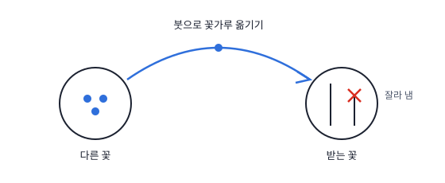

*받는 꽃 안에서 꽃가루가 나오는 부분(X 표시한 선)을 잘라 내고, 다른 꽃의 꽃가루(색칠된 점)를 붓으로 옮겨 줬어요.*

**정확히 말하면**

**혼합설(blending theory)**: 멘델 이전에는 부모의 특징이 섞여서 자식에게 나타난다고 생각했어요. 검은 고양이와 흰 고양이가 만나면 회색 고양이가, 흰 꽃과 붉은 꽃이 만나면 분홍 꽃이 나온다는 식이에요. 멘델의 실험은 이 생각이 틀렸다는 것을 보였어요([분리의 법칙과 우열의 법칙](#s4-segregation)).

**유전 연구 재료의 조건**은 세 가지예요. (1) 키우기(재배) 쉬워야 해요. (2) 교배가 쉬워야 해요. (3) 형질(trait)이 뚜렷해야 해요.

**왜 완두(pea)인가**: 처음에는 쥐를 쓰려 했지만 수도원이 쥐 교배를 금지해 식물로 바꿨어요. 완두는 싸고, 잘 자라고, 빨리 크고, 한 번에 많이 얻을 수 있어요. 가장 중요한 이유는 **대립 형질(contrasting traits)**이 분명하다는 점이에요. 대립 형질은 한 가지 특징에서 서로 맞서는 두 모습이에요. 예를 들면 노란 콩과 초록 콩, 둥근 콩과 주름진 콩, 보라(자주) 꽃과 흰 꽃이에요.

**실험 규모**: 1856년부터 7년 동안 **대립 형질 7가지**를 조사했고, 약 3만 개의 콩을 분석했어요.

**수분(pollination, 꽃가루받이)**: 수술(stamen)의 꽃가루(pollen)가 암술(pistil)의 암술머리(stigma)에 앉는 것이에요. 한 꽃에 수술과 암술이 함께 있는 꽃도 있고, 수꽃과 암꽃이 따로 있는 식물도 있어요.

| 구분 | 꽃가루는 어디서 | 결과·쓰임 |
|---|---|---|
| 자가수분(self-pollination) | 자기 꽃가루가 자기 암술에 | 자기 유전자만 이어져 유전적 다양성이 사라져요. 그래서 식물은 대개 이를 억제하는 체계가 있어요. |
| 타가수분(cross-pollination) | 다른 꽃의 꽃가루가 암술에 | 멘델이 교배 실험에 쓴 방법이에요. |

**멘델의 방법**

1. 받는 꽃의 수술을 잘라 자가수분을 막아요.
2. 다른 꽃의 꽃가루를 붓으로 옮겨 인위적으로 타가수분시켜요.
3. 자손의 형질을 세어 비율을 봐요. 둥근 콩 × 주름진 콩은 모두 둥근 콩이었고, 그 둥근 콩끼리 교배하면 둥근 : 주름 = 3:1이었어요. 다른 형질에서도 3:1이 반복됐어요.

**영상이 소개한 멘델의 세 법칙**: 영상은 멘델이 알아낸 것을 우열의 법칙, 분리(대립되는 유전자가 따로 있다는 것), 독립의 법칙 세 가지로 이름을 들어 소개했어요(0922 51:13–51:27). 독립의 법칙 내용은 다음 시간에 배워요.

**멘델 이후의 역사**: 1866년 논문 「식물의 잡종에 대한 실험」은 당시 무시당했어요. 멘델이 죽은 뒤 1900년에 세 과학자가 재발견했어요. 그 뒤 모건의 초파리 연구로 유전자가 염색체의 일정한 위치에 있다는 것이 밝혀졌고(영상은 1915년, 강의노트 4장 p5는 1911년), 1953년 왓슨과 크릭이 DNA 구조를 발표했어요. 그러니 멘델은 염색체의 구조도, 자기가 말한 인자가 염색체 위에 있다는 것도 몰랐어요.

**교수님 말씀**

완두를 고른 이유를 농담으로 시작해 재배, 교배, 형질이라는 세 조건으로 넘어갔어요.

> "배고플 때 삶아 먹으려고 완두를 가지고 한 건 아니고" (0922 53:56)

영상도 완두를 고른 가장 큰 이유를 따로 짚었어요.

> "가장 중요한 이유, 대립되는 형질이 분명하다는 것이죠." (0922 50:22)

자가수분을 막은 방법은 아주 단순했어요.

> "그래서 과감하게 수술을 잘라버립니다." (0922 55:54)

식물이 자가수분을 억제하는 체계는 "보통 식물은 그걸 억제하는 시스템이 있는데, 아무튼"(0922 55:42) 하고 넘어갔어요.

**꼭 기억해요**

**자가수분과 타가수분을 뒤바꾸기 쉬워요.** 자가수분은 자기 꽃가루가 자기 암술에 앉는 것, 타가수분은 다른 꽃의 꽃가루가 앉는 것이에요. "자기 꽃가루가 자기 암술에 앉는 것은 자가 수분"(0922 56:12). 강의노트 4장 p1은 순계(true-breeding)를 얻을 때 자가수분을, 교배 실험에는 타가수분을 쓴다고 구분해요.

**혼합설의 예상과 멘델의 결과를 섞기 쉬워요.** 흰 꽃 × 붉은 꽃에서 분홍 꽃이 나온다는 것은 혼합설의 예상이에요. 멘델의 보라 × 흰 교배에서 첫째 자식은 모두 보라였고, 흰색은 둘째 자식 세대에서 1/4로 다시 나타났어요. 수업에서 "흰색 그대로 흰색 자식이 나오네"(0922 54:44)라고 한 것은 중간색이 나오지 않았다는 뜻이에요. 뒤 범위에서 자식이 중간색으로 나오는 교배를 보더라도, 사라진 형질이 다음 세대에 그대로 돌아오는지를 보면 혼합설과 구분할 수 있어요(강의노트 4장 p1).

**멘델이 조사한 형질이 몇 개 안 된다고 착각하기 쉬워요.** 멘델이 조사한 대립 형질은 7가지예요.

**멘델이 염색체를 알았다고 착각하기 쉬워요.** 멘델은 염색체 구조를 몰랐어요. 유전자가 염색체 위에 있다는 것은 멘델 뒤의 모건 연구에서 밝혀졌어요.

**보충 · 수업에서 다루지 않았어요**

**멘델이 완두에서 다룬 7가지 대립 형질은 모두 한쪽이 완전히 우성인 형질이었어요.** 그래서 F1에서는 한쪽 형질만 나타나고 F2에서 3:1이 나왔어요.

우성이 열성을 완전히 가리지 못하는 경우(불완전우성)나 두 대립유전자의 효과가 이형접합자에서 함께 드러나는 경우(공동우성)는 1900년 재발견 뒤의 연구에서 알려졌어요. 강의노트와 교재는 이것을 "멘델의 가설에 대한 수정과 추가"로 따로 다뤄요. 그러니 멘델이 이런 경우까지 연구했다고 볼 수 없어요.

출처: 강의노트 4장 p3 (4.1.2 멘델의 가설에 대한 수정과 추가), 교재 4장 p.78

**페이지 요약**

멘델은 대립 형질이 분명한 완두를 타가수분시켜 혼합설이 틀렸음을 보였어요.

*용어*

- **혼합설(blending theory)** — 부모 특징이 섞여 자식에게 나타난다는 멘델 이전의 생각
- **대립 형질(contrasting traits)** — 한 특징에서 서로 맞서는 두 모습(보라/흰 꽃)
- **타가수분(cross-pollination)** — 다른 꽃의 꽃가루가 암술에 앉는 것

---

### 꼭 알아야 할 유전학 용어

*0922 수업 · 4장 p1 · 4장 p2*

**쉽게 말하면**

꽃 속에는 색을 정하는 글자 카드가 두 장씩 들어 있어요.

큰 P 카드가 한 장만 있어도 보라 꽃이 피어요.

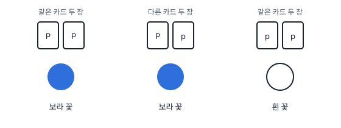

*PP와 Pp는 색칠된 동그라미(보라 꽃)이고, pp만 테두리뿐인 동그라미(흰 꽃)예요.*

**정확히 말하면**

**세대 이름**: **P세대**(parental generation)는 부모 세대예요. 자식 세대는 F(filial)로 쓰고, 첫째 자식 세대가 **F1**, 둘째가 F2, 셋째가 F3예요.

**유전자와 염색체**: 수업의 교차 예시에서 엄마 쪽 염색체 하나에 A와 B 두 유전자가 함께 있었어요([교차와 재조합](#s3-crossover)). 유전자와 염색체는 같은 것이 아니에요.

**대립유전자(allele)**: 같은 유전자의 서로 다른 버전, 즉 유전자의 변형본이에요. 꽃 색 유전자에는 P와 p라는 대립유전자가 있고, 이 둘이 한 형질의 서로 다른 형식(보라와 흰)을 담당해요. 상동염색체의 같은 위치에는 같은 유전자가 있지만, 그 자리의 대립유전자는 같을 수도 다를 수도 있어요(0922 03:25).

**표기**: 한 유전자의 대립유전자는 같은 알파벳으로 쓰고, 대문자가 우성, 소문자가 열성이에요. 보라(purple)의 P를 따서 P와 p로 써요.

| 용어 | 뜻 | 꽃 색 예 |
|---|---|---|
| 유전자형(genotype) | 어떤 대립유전자 두 개를 가졌는가 | PP, Pp, pp |
| 표현형(phenotype) | 겉(밖)으로 드러나는 특징 | 보라, 흰 |
| 우성(dominant) | 대립유전자가 **하나만 있어도** 표현형으로 나타나요 | P(우성 대립유전자) |
| 열성(recessive) | 대립유전자가 **두 개 다 있어야** 표현형으로 나타나요. 우성과 짝을 이루면 가려져요 | p(열성 대립유전자) |
| 동형접합자(homozygote) | 같은 대립유전자 두 개 | PP, pp |
| 이형접합자(heterozygote) | 서로 다른 대립유전자 두 개. 잡종(hybrid)이라고도 해요 | Pp |

| 유전자형 | 접합 상태 | 표현형 |
|---|---|---|
| PP | 동형접합자 | 보라 |
| Pp | 이형접합자(잡종) | 보라 |
| pp | 동형접합자 | 흰 |

이 표에서 두 가지를 읽을 수 있어요.

1. **같은 표현형이라도 유전자형이 다를 수 있어요.** PP와 Pp는 둘 다 보라예요.
2. **이형접합자는 우성 표현형을 보여요.** Pp는 열성 형질(흰)이 아니라 보라예요. 이형접합자도 배우자를 만들 수 있고, 배우자의 절반은 P, 절반은 p를 받아요([분리의 법칙과 우열의 법칙](#s4-segregation)).

**교수님 말씀**

용어부터 확실히 하자며 시작했어요.

> "꼭 알아야 될 유전학 용어, 일단 용어만 알아봅시다." (0922 56:33)

우성의 기준은 "한 개만 가져도"예요.

> "라지 P는 한 개만 가져도 보라색이 됩니다." (0922 57:28)

동형접합자와 이형접합자는 "꼭"을 다섯 번 붙여 강조했어요.

> "이 단어는 꼭 알아야 되죠. 꼭 꼭 꼭 꼭 꼭." (0922 59:22)

**꼭 기억해요**

**유전자형과 표현형을 뒤바꾸기 쉬워요.** PP, Pp, pp처럼 가진 대립유전자를 적은 것이 유전자형이고, 보라나 흰처럼 겉으로 보이는 것이 표현형이에요. "이런 게 유전자형입니다"(0922 57:48), "이 보라색이 표현형이 되는 거죠"(0922 57:58).

**우성과 열성의 기준을 흐리게 기억하기 쉬워요.** 우성은 하나만 있어도 나타나고, 열성은 두 개 다 있어야 나타나요. "열성 대립유전자는 두 개를 다 가져야만 표현형으로 나타나게 됩니다"(0922 58:35).

**동형접합자와 이형접합자를 헷갈리기 쉬워요.** 같은 대립유전자 둘(PP, pp)이 동형접합자, 다른 대립유전자 둘(Pp)이 이형접합자예요. 이형접합자는 잡종이라고도 불러요(0922 59:28). 이형접합자가 "항상 열성 형질을 보인다"거나 "배우자를 만들 수 없다"는 말은 틀려요.

**유전자, 염색체, 대립유전자를 같은 것으로 착각하기 쉬워요.** 수업의 교차 예시처럼 한 염색체에 여러 유전자(A와 B)가 함께 있고, 대립유전자는 한 유전자의 서로 다른 버전(P와 p)이에요.

**보충 · 수업에서 다루지 않았어요**

**같은 유전자형이라도 환경에 따라 표현형이 달라질 수 있어요.** 교재는 구름이 많은 고위도 지역에 사는 사람이 햇빛이 많은 지역에 사는 사람보다 같은 유전자형이라도 피부색이 덜 진하다는 예를 들어요.

출처: 교재 4장 p.80

**멘델 완두의 콩 색**: 노란색 대립유전자(Y)가 초록색 대립유전자(y)에 대해 우성이에요. 대문자 Y가 우성, 소문자 y가 열성이라는 표기 규칙 그대로예요. 콩 모양은 둥근(R)이 주름진(r)에 대해 우성이에요(수업 영상에서도 둥근 콩 × 주름진 콩에서 모두 둥근 콩이 나왔어요).

출처: 강의노트 4장 p2

**유전자, 염색체, 대립유전자의 관계**: 유전자는 생물이 어떤 형질을 나타내게 하는 인자이고, 염색체 위 DNA의 한 부분이에요. 그래서 **염색체 하나에는 많은 유전자가 있어요**. 서로 다른 대립유전자는 DNA 서열이 조금씩 달라서, 그 유전자가 만드는 단백질의 기능이 달라져요. 즉 대립유전자는 DNA(유전자의 변형본)이고, 그것이 만든 단백질이나 겉모습(표현형)이 아니에요.

출처: 강의노트 4장 p1(유전자는 염색체 상 DNA의 한 부분), 강의노트 4장 p3(대립유전자의 DNA 서열 차이와 단백질 기능 차이)

**페이지 요약**

유전자형은 가진 대립유전자 짝(PP·Pp·pp)이고, 표현형은 겉모습(보라·흰)이에요.

*용어*

- **대립유전자(allele)** — 같은 유전자의 서로 다른 버전(P와 p)
- **우성(dominant)** — 하나만 있어도 표현형으로 나타나요
- **이형접합자(heterozygote)** — 서로 다른 대립유전자 두 개(Pp), 잡종

---

### 분리의 법칙과 우열의 법칙

*0922 수업 · 4장 p1 · 4장 p2*

**쉽게 말하면**

부모는 카드 두 장 중 한 장만 아기에게 물려줘요.

그래서 PP 부모는 늘 P만 주고, Pp 부모는 P나 p를 반반 줘요.

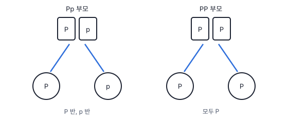

*짝을 이룬 두 장이 갈라져서 아기에게 가는 몫(테두리 동그라미)마다 한 장씩 들어가요.*

**정확히 말하면**

**멘델의 추론 과정** (0922 59:50–61:13)

1. 보라 꽃(PP) × 흰 꽃(pp)을 교배하니 F1이 **전부 보라**였어요. 혼합설대로라면 중간색이 나와야 하므로 혼합설은 틀렸어요.
2. 그렇다면 이런 특징을 나타나게 하는 어떤 **인자(factor)**가 있을 거예요.
3. 한 개체는 그 인자를 **두 개** 가지고 있어요.
4. 자식에게는 그중 **하나만** 물려줘요. 두 개가 갈라지는 것이에요.

멘델이 말한 인자가 바로 오늘날의 대립유전자(유전자)예요(0922 60:41).

**분리의 법칙(law of segregation)**: 한 형질을 정하는 대립유전자 쌍은 **배우자(gamete, 생식세포)**를 만들 때 서로 갈라져 배우자마다 하나씩 들어가요. 강의노트는 이것을 멘델의 세 번째 가설이라고 불러요. 수업에서도 "Pp가 감수분열하면 P를 주든지 p를 주든지 두 가지 경우"라고 설명했어요(0922 62:21).

| 부모 유전자형 | 만드는 배우자 |
|---|---|
| PP (동형접합자) | 모두 P |
| pp (동형접합자) | 모두 p |
| Pp (이형접합자) | P 1/2, p 1/2 |

예를 들어 키 큰 대립유전자에 대해 동형접합인 TT 완두는 꽃가루(수컷 배우자)도 난자(암컷 배우자)도 모두 T만 가져요.

**우열의 법칙(law of dominance)**: 이형접합자(Pp)는 두 대립유전자 중 우성 쪽 표현형을 따라요. P가 우성이라 Pp는 보라예요. 우성과 열성이 정해져 있다는 뜻이에요. 강의노트는 이것을 멘델의 두 번째 가설이라고 불러요.

| 법칙 | 무엇에 대한 규칙인가 | 꽃 색 예 |
|---|---|---|
| 분리의 법칙 | 배우자를 만들 때 대립유전자 쌍이 갈라져 하나씩 들어감 | Pp의 배우자는 P 또는 p |
| 우열의 법칙 | 이형접합자의 표현형은 우성 쪽을 따름 | Pp는 보라 |

**교수님 말씀**

교수님은 멘델이 되어 추론 과정을 혼잣말처럼 재연했어요.

> "아니 뭐 이런 게 다 있어. … 그럼 도대체 뭐지?" (0922 60:03–60:14)

> "두 개를 가지고 있다가 자식에게는 한 개만 물려주는 것 같네. 분리가 되는 것 같네." (0922 60:32)

> "이형접합자의 경우에 한쪽 표현형을 따르게 된다. 우열이 정해져 있다." (0922 61:13)

인자를 쌍으로 갖고 하나만 물려준다는 추론에는 "대단하죠?"(0922 63:00)라고 감탄했어요.

**꼭 기억해요**

**분리의 법칙과 우열의 법칙을 뒤바꾸기 쉬워요.** 분리는 배우자를 만들 때 쌍이 갈라져 하나씩 들어간다는 규칙이고, 우열은 이형접합자가 우성 쪽 모습을 따른다는 규칙이에요. 수업은 두 법칙을 연달아 정의했어요(0922 60:32–61:13). 강의노트의 번호는 우열이 두 번째 가설, 분리가 세 번째 가설이에요.

**"인자"를 대립유전자와 다른 것으로 착각하기 쉬워요.** 멘델의 인자가 곧 대립유전자예요. "멘델이 말했던 그 유전 인자가 바로 대립유전자인 것이지요"(0922 60:41). 강의노트 4장 p1은 "멘델의 인자는 유전자(gene)라고 부름"이라고 써요. 인자는 형질을 정하는 단위인 유전자를 가리키고, 한 개체가 가진 두 인자 하나하나(P나 p)가 그 유전자의 대립유전자예요.

**동형접합자의 배우자를 두 종류로 착각하기 쉬워요.** PP나 TT처럼 같은 대립유전자 둘을 가지면 배우자는 모두 같은 하나(P, T)를 받아요.

**보충 · 수업에서 다루지 않았어요**

수업은 멘델의 "인자"와 3장 감수분열을 따로 가르쳤어요. 둘을 이으면 이렇게 돼요. 대립유전자는 상동염색체의 같은 위치에 있으므로, **대립유전자의 분리는 감수분열에서 상동염색체가 갈라질 때 일어나요.** 상동염색체 쌍은 갈라져 하나만 배우자로 가기 때문이에요([제1감수분열과 제2감수분열](#s2-two-divisions)). 유사분열에서는 상동염색체가 갈라지지 않고 자매염색분체가 갈라지며, 교차가 없다면 자매염색분체는 같은 대립유전자의 복사본이라 대립유전자를 나누지 않아요. 교차가 일어난 뒤에는 한 염색체의 두 자매염색분체가 AB와 Ab처럼 달라질 수 있어요([교차와 재조합](#s3-crossover)).

출처: 강의노트 4장 p3 (유전의 염색체설: 대립유전자는 상동염색체의 동일한 위치에 있고, 각 쌍의 염색체는 분리되어 한 개만 배우자에 전달)

**페이지 요약**

대립유전자 쌍은 배우자를 만들 때 갈라져 하나씩 들어가고(분리), 이형접합자는 우성 쪽 모습을 따라요(우열).

*용어*

- **분리의 법칙(law of segregation)** — 대립유전자 쌍이 배우자에 하나씩 갈라져 들어감
- **우열의 법칙(law of dominance)** — 이형접합자는 우성 쪽 표현형을 따름
- **인자(factor)** — 멘델이 추론한 형질의 단위, 오늘날의 대립유전자

---

### 단성잡종 교배

*0922 수업 · 4장 p2*

**쉽게 말하면**

보라 꽃과 흰 꽃을 짝지으면 자식은 모두 보라 꽃이에요.

그 보라 꽃끼리 다시 짝지으면 흰 꽃이 네 송이 중 한 송이꼴로 돌아와요.

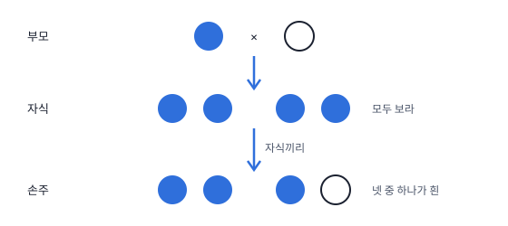

*색칠된 동그라미는 보라 꽃, 테두리만 있는 동그라미는 흰 꽃이에요.*

**정확히 말하면**

**단성잡종 교배(monohybrid cross)**: 한 가지 형질에 대해 이형접합자(잡종)인 F1끼리 교배하는 것이에요. 꽃 색이라는 한 가지 형질, 즉 **유전자 하나**에 대한 잡종끼리 교배하므로 "단성"이에요. 꽃 색에서는 Pp × Pp예요.

1. P세대: 보라(PP) × 흰(pp). 배우자는 각각 P와 p뿐이라 F1은 모두 Pp(보라)예요.
2. F1끼리 교배(Pp × Pp): 엄마도 아빠도 배우자로 P나 p를 1/2씩 줘요.
3. 자식이 받는 조합은 2 × 2 = **4가지 경우**이고, 유전자형은 PP, Pp, pp의 **3종류**예요.
4. F2 유전자형 비 PP : Pp : pp = **1:2:1**이에요.
5. PP와 Pp는 보라, pp는 흰이라 F2 표현형 비 보라 : 흰 = **3:1**이에요. 흰 꽃(pp)이 나올 확률은 1/4(25%)예요.
6. F1에서 사라졌던 흰색이 F2에서 다시 나타나요. 인자를 쌍으로 갖고 하나만 물려준다는 추론의 근거예요.

**교배 표**: 한 부모의 배우자를 세로에, 다른 부모의 배우자를 가로에 적고, 칸마다 만나는 두 대립유전자를 합쳐 적어요. 네 칸은 각각 확률 1/4예요.

#### 직접 해 보기: 교배 표 *(정적 스냅샷 — 직접 조작은 HTML 버전)*

두 부모의 유전자형을 고르면 교배 표 네 칸과 자손의 유전자형 비, 표현형 비가 바뀌어요.

결과: **유전자형 PP:Pp:pp = 1:2:1, 표현형 보라:흰 = 3:1, 흰 꽃이 나올 확률 1/4 (25%)**

범례: 색칠된 동그라미·막대: 보라 꽃 · 테두리만 있는 동그라미·막대: 흰 꽃 · 유전자형 막대는 테두리 막대

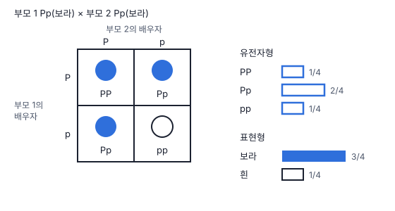

*Pp × Pp (단성잡종 교배)*

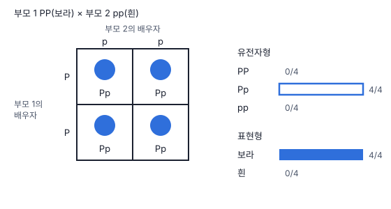

*PP × pp*

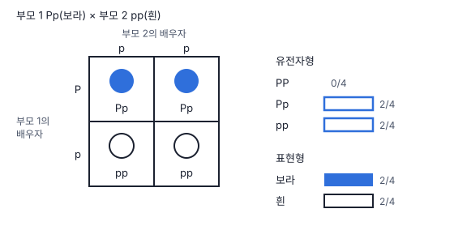

*Pp × pp*

| 설정 | 결과 |
|---|---|
| Pp × Pp | 유전자형 PP:Pp:pp = 1:2:1, 표현형 보라:흰 = 3:1, 흰 꽃이 나올 확률 1/4 (25%) |
| PP × pp | 유전자형 PP:Pp:pp = 0:1:0 (모두 Pp), 표현형 보라:흰 = 1:0 (모두 보라), 흰 꽃이 나올 확률 0/4 (0%) |
| Pp × pp | 유전자형 PP:Pp:pp = 0:1:1, 표현형 보라:흰 = 1:1, 흰 꽃이 나올 확률 2/4 (50%) |

| 교배 | 자손 유전자형 | 자손 표현형 |
|---|---|---|
| PP × pp | 모두 Pp | 모두 보라 |
| PP × Pp | PP : Pp = 1 : 1 | 모두 보라 |
| Pp × Pp | PP : Pp : pp = 1:2:1 | 보라 : 흰 = 3:1 |
| Pp × pp | Pp : pp = 1 : 1 | 보라 : 흰 = 1 : 1 |
| pp × pp | 모두 pp | 모두 흰 |

**자손을 보고 부모 유전자형 거꾸로 찾기**

1. 보라 × 흰 교배에서 자손 수가 충분히 많은데 **모두 보라**면 보라 부모는 PP예요. 보라 부모가 Pp였다면 자손마다 1/2 확률로 흰색(pp)이라, 자손이 많으면 흰 자손이 절반쯤 나와야 해요.
2. 열성 자손(pp)이 하나라도 나오면, 두 부모가 각각 p를 하나 이상 가져야 해요.
3. 그래서 **우성 표현형 부모 둘이 열성 자손을 낳으려면 두 부모 모두 이형접합자(Pp)**여야 해요. 이때 열성 자손이 나올 확률은 1/4예요.
4. 우성 표현형 부모(P_) × 열성 부모(pp) 사이에서 pp 자손이 나왔다면, 우성 부모는 Pp예요. 그러면 다음 자손이 pp일 확률은 1/2(50%)예요. 자손 하나하나는 매번 새로 배우자를 받으므로, 앞 자손의 결과가 다음 자손의 확률을 바꾸지 않아요.
5. 열성 표현형끼리(pp × pp)는 p만 주고받으므로 우성 자손이 나올 수 없어요. 반대로 우성 표현형끼리라도 둘 다 Pp면 열성 자손이 나와요.

**교수님 말씀**

"단성"이 무슨 뜻인지 두 번 되풀이했어요.

> "꽃 색깔에 관여하는 딱 한 개의 유전자만 관여한 거죠." (0922 61:45)

> "유전자형은 … 1대 2대 1의 비율로 나오게 되죠? 표현형은 3대 1의 비율" (0922 62:36–62:44)

> "아 사라졌던 하얀색 형질이 두 번째 세대에서 다시 나타나는구나." (0922 62:53)

영상에서도 둥근 콩 × 주름진 콩의 자손끼리 교배하면 3:1이 나오고, 다른 형질에서도 비슷한 3:1이 계속 나왔다고 했어요(0922 50:51–50:57). 수업은 "분리의 법칙, 우열의 법칙. 일단 여기까지 멘델의 법칙이고 독립의 법칙은 다음 시간에 합시다"(0922 63:20)로 끝났어요.

**꼭 기억해요**

**유전자형 비와 표현형 비를 섞기 쉬워요.** F2 유전자형 비는 PP : Pp : pp = 1:2:1이고, 표현형 비는 보라 : 흰 = 3:1이에요(0922 62:36–62:44).

**경우의 수 4와 유전자형 종류 3을 헷갈리기 쉬워요.** Pp × Pp(Ff × Ff도 같아요)에서 만나는 경우는 4가지지만, Pp가 두 번 나와서 자손 유전자형은 3종류예요.

**"단성"의 뜻을 착각하기 쉬워요.** 단성은 형질(유전자)이 **하나**라는 뜻이에요(0922 61:45–62:04). 이형접합자 = 잡종이라는 점도 다시 짚었어요(0922 61:41).

**보충 · 수업에서 다루지 않았어요**

같은 계산을 사람의 유전병에 적용할 수 있어요. 상염색체는 성염색체(X, Y)가 아닌 염색체예요.

| 유전 방식 | 병이 나타나는 유전자형 | 이형접합자 |
|---|---|---|
| 상염색체 열성 유전 (병 대립유전자 f가 열성) | 열성 동형접합자(ff)에서만 | Ff는 증상이 없어요. 이런 사람을 보인자(carrier)라고 해요 |
| 상염색체 우성 유전 (병 대립유전자가 우성) | 병 대립유전자가 하나만 있어도(이형접합), 둘 다 있어도(동형접합) 나타나요 | 병이 나타나요. 열성 동형접합자만 정상이에요 |

1. "상염색체 열성 유전"이라는 말은 병 대립유전자를 두 개(ff) 가져야만 병이 나타난다는 뜻이에요. Ff × Ff 부부의 아이가 ff일 확률은 1/4(25%)예요.
2. 우성 형질 부모 둘이 열성 형질 아이를 낳았다면, 두 부모 모두 이형접합 보인자예요.
3. 해로운 열성 대립유전자가 있을 때, 이형접합 개체(Ff)는 병이 나타나지 않으므로 열성 동형접합 개체(ff)보다 유리해요. 하지만 동형접합자에는 FF도 있어서, "동형접합자는 항상 이형접합자보다 유리하다(불리하다)" 같은 "항상" 문장은 성립하지 않아요.

출처: 강의노트 4장 p8

**페이지 요약**

단성잡종 교배(Pp × Pp)의 F2는 유전자형 1:2:1, 표현형 3:1이에요.

*용어*

- **단성잡종 교배(monohybrid cross)** — 한 형질(유전자 하나)에 대한 이형접합자끼리의 교배
- **교배 표** — 두 부모의 배우자를 가로·세로에 놓고 조합을 세는 표

---

## 5. 요약 · 예고

### 30초 요약

*0922 수업 · 3장 p2–p5 · 4장 p1–p2*

| 주제 | 시험 직전 한 줄 |
|---|---|
| 무엇이 갈라지나 | 유사분열은 자매염색분체만 갈라져 2n에서 2n이 되고, 감수분열은 제1감수분열에서 상동염색체, 제2감수분열에서 자매염색분체가 갈라져 2n에서 n이 돼요. |
| 자매염색분체와 상동염색체 | 자매염색분체는 복제로 생겨 동원체로 붙은 같은 정보의 두 가닥이고, 상동염색체는 엄마·아빠에게서 하나씩 온 모양·크기가 같은 쌍이라 같은 자리의 대립유전자가 다를 수 있어요. |
| 간기 | G1기(성장)·S기(DNA와 중심체 복제)·G2기(분열 준비)이고, 이때 DNA는 풀린 염색질이라 막대 모양 염색체가 없는 게 아니라 안 보일 뿐이에요. |
| 중심체와 동원체 | 중심체(중심립 두 개)는 방추사가 뻗어 나오는 곳, 동원체는 방추사가 붙는 염색체 부위이고, 방추사의 성분은 미세소관이에요. |
| 전기 | 세 가지 사건: 염색체 응축(보이기 시작), 핵막 소실, 중심체에서 뻗은 방추사가 동원체에 결합(엄밀히 뒤의 둘은 전중기지만 수업에서는 전기로 묶어요). |
| 중기 | 염색체가 세포 가운데 배열되며, 유사분열에서는 상동염색체가 짝을 짓지 않고 따로 한 줄로 서요. |
| 후기 | 유사분열 후기에 갈라지는 것은 상동염색체가 아니라 자매염색분체이고, 각각 양쪽 극으로 끌려가요. |
| 말기 | 전기의 반대(핵막이 다시 생기고, 염색체가 풀리고, 방추사가 사라짐)로 핵분열이 끝나지만 세포는 아직 하나예요. |
| 세포질 분열 | 동물은 미세섬유가 수축환을 조여 밖에서 나누고, 식물은 세포벽 때문에 안쪽에서 세포판을 만들어 새 세포벽으로 나눠요(미세소관인 방추사와 다른 섬유예요). |
| 유사분열의 쓰임 | 체세포 증식(상처 재생)과 무성생식(꺾꽂이)에 쓰이고, 결과 세포는 돌연변이가 없으면 유전정보가 같은 클론이에요. |
| 4분염색체 | 감수분열 전기 I에 상동염색체가 짝을 지어 네 가닥이 옆으로 나란히 붙은 것(= 2가염색체)으로, 중기 I에 이 상태로 가운데 배열되며 유사분열에는 없어요. |
| 두 번의 분열 | 제1감수분열이 끝나면 이미 반수체이고 제2감수분열에서는 염색체 수가 변하지 않아 n인 딸세포 4개가 되며(유사분열은 2n 2개), DNA 양은 두 분열 모두에서 반으로 줄어요. |
| 유성생식과 무성생식 | 유성생식은 짝 찾기에 에너지·시간·비용이 드는 대신(단점) 유전적 다양성으로 환경이 바뀌어도 일부는 살아남고(장점), 무성생식은 빠르고 싸지만 모두 같아 한꺼번에 무너져요(감자 대기근). |
| 다양성 원인 (1) 교차 | 제1감수분열 전기에 4분염색체의 안쪽 두 가닥(엄마 유래 하나와 아빠 유래 하나) 사이에서 DNA 조각이 바뀌어 AB·ab에 없던 Ab·aB가 생기는 재조합이며, 같은 염색체의 자매염색분체끼리가 아니에요. |
| 다양성 원인 (2) 무작위 분배 | 중기 I에 상동염색체 쌍마다 어느 극으로 갈지가 무작위라 n쌍이면 2의 n승 가지이고, n은 염색체 개수가 아니라 쌍의 수예요(사람 23쌍이면 2²³, 약 840만). |
| 다양성 원인 (3) 무작위 수정 | 어떤 정자든 어떤 난자와 수정할 수 있어 2²³ × 2²³ = 2⁴⁶, 약 70조 가지이며, 이 값은 교차와 돌연변이를 뺀 것이고 일란성 쌍둥이만 예외예요. |
| 멘델의 실험 설계 | 혼합설(중간색이 나온다)을 반박했고, 대립 형질이 분명한 완두를 골라 수술을 잘라 자가수분을 막고 붓으로 다른 꽃의 꽃가루를 옮겨 타가수분시켰어요. |
| 유전학 용어 | 표현형은 보라·흰처럼 드러난 모습, 유전자형은 PP·Pp·pp이고, 우성은 하나만 있어도 나타나며 열성은 둘 다 있어야 나타나고, PP·pp는 동형접합자, Pp는 이형접합자(= 잡종)예요. |
| 분리의 법칙 | 개체는 형질을 정하는 인자(대립유전자)를 두 개 가지고, 배우자에는 그중 하나씩만 들어가요. |
| 우열의 법칙 | 이형접합자(Pp)는 우성 쪽 표현형을 나타내서 보라(PP) × 흰(pp)의 F1은 중간색 없이 전부 보라예요. |
| 단성잡종 교배 | 한 가지 형질의 이형접합자끼리(Pp × Pp) 교배하면 F2 유전자형은 PP : Pp : pp = 1:2:1, 표현형은 보라 : 흰 = 3:1이고, 흰색이 다시 나타나는 것이 분리의 근거예요. |

---

### 다음 시간 예고

*0922 수업 · 4장 p2*

끊긴 지점: 분리의 법칙·우열의 법칙과 단성잡종 교배(1:2:1, 3:1)까지 마치고 멈췄어요. "일단 여기까지 멘델의 법칙이고 독립의 법칙은 다음 시간에 합시다." (0922 63:20) 마지막 말씀은 "동영상 꼭 듣고 오시고요. 다음 주 화요일에 봅시다." (0922 63:34)

- 독립의 법칙
- 양성잡종 교배
- 9:3:3:1

공지: 5장 앞부분은 온라인 동영상 강의로 대체돼요. 28일 23:59까지 듣고 오세요(안 들으면 지각 처리).

---

### 함께 보면 좋은 자료

- [복습문제 풀러 가기](복습문제_0922_Cell_Division_and_Heredity.md)

---

출처: 이영만 교수님 강의노트(3장·4장) · 수업 녹음 전사(0922) · 『생명과학: 기초와 응용』 2판 3장·4장.
