# 유전 — 5살도 이해하는 정리노트

이영만 교수님 생명과학 · 0929 수업 (4장 유전)

> `정리노트_0929_Heredity.html`를 마크다운으로 옮겼어요. 그림은 `figures_0929/` 폴더의 SVG, 위젯은 대표 설정의 정적 그림으로 바꿨어요. 수식은 `$…$` / `$$…$$`라서 GitHub, Obsidian, Typora에서 보여요.

**목차**

- [0. 멘델 법칙과 유전의 자리](#s0)
  - [지난 수업 복습](#s0-recap)
  - [양성잡종과 독립의 법칙](#s0-independent)
  - [염색체설과 유전자 좌위](#s0-locus)
- [1. 멘델 법칙을 넓히기](#s1)
  - [가계도로 우성과 열성 구별하기](#s1-pedigree)
  - [불완전우성과 낫모양적혈구](#s1-incomplete)
  - [공동우성·복대립유전자·ABO](#s1-abo)
  - [다인자유전과 다면발현](#s1-many)
- [2. 연관과 재조합](#s2)
  - [초파리 검정교배와 연관](#s2-morgan)
  - [재조합 빈도와 유전자 거리](#s2-frequency)
- [3. 성염색체와 성연관 유전](#s3)
  - [성염색체의 여러 방식](#s3-sex)
  - [X-연관 열성유전과 보인자](#s3-carrier)
  - [X 불활성화와 얼룩 고양이](#s3-inactivation)
- [4. 염색체 구조의 변화](#s4)
  - [결실·중복·전좌·역위](#s4-structural)
  - [위치가 바뀌면 조절도 바뀐다](#s4-regulation)
- [5. 요약 · 예고](#s5)
  - [시험 직전 한눈에](#s5-cheatsheet)
  - [끊긴 지점과 다음 범위](#s5-next)
  - [함께 보면 좋은 자료](#s5-links)

## 0. 멘델 법칙과 유전의 자리

### 지난 수업 복습

*0929 수업 · 4장 p1–2*

**정확히 말하면**

대립유전자 한 쌍은 생식세포를 만들 때 갈라져 자식에게 하나씩 전달돼요. 이것이 분리의 법칙이에요.

한 유전자의 두 대립유전자가 같으면 동형접합자, 다르면 이형접합자예요. 유전자형은 가진 대립유전자 조합이고 표현형은 겉으로 드러난 형질이에요.

완전 우성인 보라색 꽃 `Pp`끼리 교배하면 F2의 유전자형 `PP:Pp:pp`는 **1:2:1**, 표현형 보라색:흰색은 **3:1**이에요. F1에서 보이지 않던 흰색도 F2에 다시 나타나요.

지난 단성잡종 교배를 먼저 복습하려면 [0922 정리노트의 단성잡종 교배](../../0922/정리노트_0922_Cell_Division_and_Heredity.html#s4-monohybrid)를 보세요.

**페이지 요약**

대립유전자는 배우자로 갈라지고, 완전 우성 단성교배에서 유전자형 1:2:1과 표현형 3:1을 구별해요.

*용어*

- **대립유전자** — 같은 형질에 관여하는 유전자의 서로 다른 형태
- **유전자형 / 표현형** — 대립유전자 조합 / 관찰되는 형질

---

### 양성잡종과 독립의 법칙

*0929 수업 · 4장 p2–3*

**쉽게 말하면**

두 묶음에서 각각 하나씩 골라 작은 꾸러미를 만들어요.

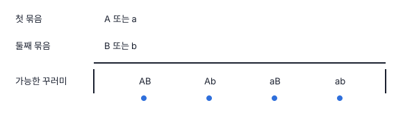

*두 묶음이 따로 고르면 네 꾸러미가 나와요.*

**정확히 말하면**

양성잡종(`dihybrid`)은 두 형질의 유전자 자리 모두에서 이형접합인 개체예요. 예를 들어 **AaBb**는 A 자리에서 `A` 또는 `a`, B 자리에서 `B` 또는 `b`를 배우자 하나에 넣어요. 두 유전자가 서로 다른 염색체에 있어 독립분리하고, 배우자 형성에 치우침이 없다면 가능한 배우자는 **AB, Ab, aB, ab의 4종**이며 각각 1/4이에요. 이것이 독립의 법칙(`principle of independent assortment`)이 적용되는 경우예요. 수업의 완두 예에서는 둥근 모양 `R`과 노란색 `Y`가 각각 주름진 모양 `r`, 초록색 `y`보다 우성이어서 `RrYy`의 배우자도 `RY`, `Ry`, `rY`, `ry`예요.

두 `AaBb` 개체를 교배하면 한쪽의 4종 배우자와 다른 쪽의 4종 배우자가 만나므로 **4 × 4 = 16개의 배우자 결합 칸**이 생겨요. 서로 다른 자손 *유전자형*은 A 자리의 `AA, Aa, aa` 3종과 B 자리의 `BB, Bb, bb` 3종을 결합한 **3 × 3 = 9종**이에요. 16개의 칸과 9종의 유전자형은 세는 대상이 달라요.

두 자리 모두 완전 우성이고 서로 독립분리하며 배우자·자손의 생존에 치우침이 없다면, `AaBb × AaBb`에서 표현형은 **A와 B가 모두 우성 : A만 우성 : B만 우성 : 둘 다 열성 = 9:3:3:1**이에요. 두 우성 표현형을 낼 수 있는 유전자형의 **종류**는 `AABB`, `AABb`, `AaBB`, `AaBb`의 4종이에요. 다만 이 네 종류가 나오는 16칸 중 **결합 칸 수**는 9칸이에요. 한 형질만 따로 보면 각각 3:1이므로 두 형질의 분리가 서로 영향을 주지 않는다는 뜻이에요.

**검정교배(`testcross`)**는 우성 표현형 개체를 해당 형질의 열성 동형접합자와 교배해 유전자형을 알아보는 방법이에요. 두 자리에서 `AaBb × aabb`를 하고 두 유전자가 독립분리하면 `aabb`는 `ab` 배우자만 만들어요. `AaBb`가 주는 네 배우자 `AB, Ab, aB, ab`가 곧 `AaBb, Aabb, aaBb, aabb` 네 자손 유전자형으로 드러나요. 두 자리 모두 완전 우성이고 자손 생존에 치우침이 없으면 네 표현형은 **1:1:1:1**이에요. 이는 `AaBb × AaBb`의 9:3:3:1과 다른 교배 조건이에요.

교배마다 자손 유전자형이 몇 *종류*인지 묻는다면, 각 자리의 가능한 자손 유전자형 수를 먼저 구한 뒤 독립인 자리끼리 곱해요. `AaBB × AABb`에서는 A 자리 `AA/Aa` 2종, B 자리 `BB/Bb` 2종이어서 **4종**이에요. `AAbb × aaBB`에서는 모두 `AaBb` 1종이고, `aabb × AABB`에서도 모두 `AaBb` 1종이에요. `AaBb × AaBb`의 9종과 비교할 때는 부모가 실제로 만들 수 있는 배우자를 먼저 확인해요.

서로 다른 염색체 쌍의 배열이 네 종류 배우자와 양성잡종 교배로 이어지는 모습을 [독립의 법칙과 양성잡종 모형](../%EC%9D%B8%ED%84%B0%EB%A0%89%ED%8B%B0%EB%B8%8C_02_%EB%8F%85%EB%A6%BD%EC%9D%98_%EB%B2%95%EC%B9%99%EA%B3%BC_%EC%96%91%EC%84%B1%EC%9E%A1%EC%A2%85.html)에서 확인해 보세요.

**교수님 말씀**

> “엄마가 네 가지, 아빠가 네 가지, 자식은 총 16가지 경우의 수가 생기게 되고.”

교수님은 색깔만 떼어 보거나 모양만 떼어 보면 각각 12:4, 곧 3:1이라고 되물었어요. 이를 통해 두 유전자가 서로 영향을 주지 않는 독립분리를 설명했어요. 같은 염색체 위의 연관 유전자는 독립분리 예외로 뒤에서 다뤘어요.

**꼭 기억해요**

**네 배우자형**을 네 자손형으로 착각하지 않아요. `AaBb`의 배우자가 네 종류이고, `AaBb × AaBb`에서 가능한 배우자 결합은 16칸이에요. 16칸, 9종의 자손 유전자형, 두 우성 형질을 함께 나타내는 4종의 유전자형은 서로 다른 계산이에요.

**9:3:3:1은 유전자형이 아니라 표현형 비율**이에요. 교수님도 “유전자형이 아니고, 표현형 비율”이라고 바로 고쳤어요. 완전 우성이라는 조건이 없으면 서로 다른 유전자형이 같은 표현형으로 묶인다는 계산을 그대로 쓸 수 없어요.

**독립**을 모든 두 유전자에 적용하지 않아요. 교수님은 다른 염색체라면 독립적으로 분리되고 같은 염색체라면 함께 움직이는 연관을 대비했어요. “서로 영향을 안 미치는 독립이라는 얘기입니다.” 같은 염색체의 유전자라도 교차로 재조합이 가능하다는 점은 [연관과 재조합](#s2-morgan)에서 다뤄요.

**양성잡종끼리의 교배**와 **열성 동형접합자를 상대하는 검정교배**를 혼동하지 않아요. 전자는 위 조건에서 9:3:3:1, 후자는 위 조건에서 1:1:1:1이에요. “항상 9:3:3:1”처럼 부모 유전자형과 우성·독립·생존 조건이 빠진 문장은 조건부터 확인해요.

**페이지 요약**

독립인 두 자리에서 AaBb는 배우자 4종을 만들고, 교배 상대에 따라 자손 비율이 달라져요.

*용어*

- **양성잡종** — 두 유전자 자리 모두 이형접합인 개체
- **독립의 법칙** — 두 유전자 자리의 대립유전자가 배우자로 독립적으로 분배되는 법칙
- **검정교배** — 열성 동형접합자와 교배해 상대의 유전자형을 살피는 방법

---

### 염색체설과 유전자 좌위

*0929 수업 · 4장 p3*

**쉽게 말하면**

짝지은 두 책의 같은 자리에 비슷하지만 조금 다른 문장이 있어요.

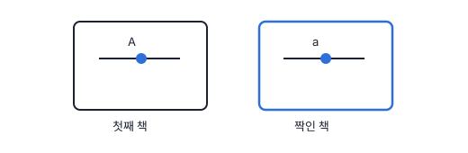

*같은 자리를 나란히 보면 무엇이 다른지 알 수 있어요.*

**정확히 말하면**

서턴은 멘델이 추론한 유전 인자의 움직임과 감수분열 중 염색체의 움직임이 비슷하다는 점에 주목했어요. 한 쌍의 상동염색체는 각각 부모에게서 하나씩 오고, 감수분열 때 나뉘어 배우자에는 각 쌍에서 하나만 들어가요. 이 관찰을 바탕으로 유전자와 대립유전자가 염색체 위에 있다는 **염색체설**을 제시했어요.

한 유전자가 염색체에서 차지하는 특정 자리가 **좌위(locus)**예요. 같은 유전자의 대립유전자는 상동염색체의 대응하는 같은 좌위에 있어요. 예를 들어 한 상동염색체의 그 자리에 `A`, 다른 상동염색체의 대응 자리에는 `a`가 있을 수 있어요. 둘은 위치를 공유하지만 DNA 서열과 만들어지는 단백질의 기능은 다를 수 있어요. 염색체에 DNA가 있고 그 일부가 유전자라는 말과 연결돼요.

**교수님 말씀**

> “멘델이 말한 유전자의 행동이랑 자기가 관찰한 염색체의 행동이 똑같기 때문에.”

교수님은 서턴이 세포의 짝인 염색체가 감수분열 중 나뉘는 것을 보고, 멘델의 대립유전자 분리와 연결했다고 설명했어요. “어느 염색체의 어느 부분에 어떤 유전자가 있다”는 자리가 좌위예요.

**꼭 기억해요**

**유전자**를 염색체 전체로 착각하지 않아요. 유전자는 염색체 DNA의 일부이고, 좌위는 그 유전자가 있는 자리예요. 대립유전자 `A`와 `a`가 서로 다른 형질에 관한 두 유전자라는 뜻도 아니에요. 같은 좌위에 해당하는 한 유전자의 서로 다른 형태예요.

**분리**와 **독립분리**도 구분해요. 한 쌍의 대립유전자가 갈라지는 것은 분리의 법칙이고, 서로 다른 두 유전자 자리의 분배가 서로 영향을 주지 않는다는 조건은 [양성잡종과 독립의 법칙](#s0-independent)에서 확인해요.

**페이지 요약**

상동염색체의 대응하는 같은 자리가 좌위이고, 그 자리의 서로 다른 형태가 대립유전자예요.

*용어*

- **서턴** — 유전자 분리와 염색체 분열의 대응을 관찰한 연구자
- **좌위(locus)** — 염색체에서 유전자가 있는 특정 자리
- **염색체설** — 유전자와 대립유전자가 염색체 위에 있다는 설명

---

## 1. 멘델 법칙을 넓히기

### 가계도로 우성과 열성 구별하기

*0929 수업 · 4장 p3*

**쉽게 말하면**

같은 모습의 부모 둘에게 다른 모습의 아이가 태어났다면, 부모에게는 겉으로 안 보이는 정보가 하나씩 숨어 있어요.

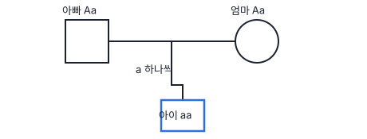

*부모가 숨겨 둔 작은 a를 하나씩 주면 아이는 aa가 돼요.*

**정확히 말하면**

가계도(pedigree)는 가족의 여러 세대에 나타난 형질을 도형으로 기록해 유전 양상을 추론하는 그림이에요. 관례적으로 남자는 네모, 여자는 원으로 그려요. 관찰하려는 형질이 나타난 사람은 기호를 채워 표시해요. 도형의 채움은 우성 여부가 아니라 **관찰한 형질의 유무**를 나타내요.

단일 유전자의 완전우성이고 새로운 돌연변이가 없다는 조건에서, 같은 표현형인 부모 둘에게 다른 표현형의 자녀가 태어나면 그 자녀의 표현형은 열성이에요. 부모는 각각 우성 대립유전자와 열성 대립유전자를 가진 이형접합자 Aa이고, 자녀는 aa예요. Aa와 Aa의 교배에서는 AA, Aa, Aa, aa가 가능하므로 열성 자녀가 나올 확률은 1/4이에요.

부모의 표현형이 서로 다르다는 사실만으로 어느 쪽이 우성인지 단정할 수 없어요. 위도우즈 피크가 있는 부모 둘에게 피크가 없는 아이가 나오면 ‘없음’이 열성이에요. 반대로 미맹이 없는 부모 둘에게 미맹인 아이가 나오면 그 조건에서는 ‘미맹’이 열성이에요. 낭포성 섬유증과 백색증도 수업에서 열성 질환 예로 언급했어요.

열성 질환 대립유전자를 한 개만 가져 표현형은 정상인 이형접합자를 보인자라고 해요. 성염색체의 사례는 [X-연관 열성유전과 보인자](#s3-carrier)에서 성별에 따라 다시 계산해요.

**교수님 말씀**

교수님은 같은 형질의 부모에게 다른 형질의 자녀가 나오는 지점을 가계도에서 먼저 찾게 했어요. “이 가계도를 보고 한눈에 0.1초 만에 알아야 됩니다.”

**꼭 기억해요**

두 부모가 서로 다른 표현형이라는 이유만으로 우열을 정하지 않아요. 같은 표현형인 부모에게 다른 표현형인 자녀가 나오는지를 확인하고, 단일 유전자 완전우성·새 돌연변이 없음이라는 전제를 함께 확인해요.

보인자는 변이 대립유전자를 가진 사람을 무조건 뜻하지 않아요. 여기서는 **열성 질환의 표현형은 없지만 원인 대립유전자 하나를 가진 이형접합자**예요.

**페이지 요약**

같은 모습의 부모 둘에게 다른 모습의 자녀가 나오면, 단순 우열 조건에서 자녀의 모습이 열성이에요.

*용어*

- **가계도(pedigree)** — 가족의 형질을 세대별 도형으로 기록한 그림
- **보인자** — 열성 질환 대립유전자 하나를 가진 정상 표현형의 이형접합자

---

### 불완전우성과 낫모양적혈구

*0929 수업 · 4장 p3*

**쉽게 말하면**

빨간 꽃과 흰 꽃의 정보가 하나씩 만나면, 꽃이 중간 모습인 분홍색으로 피어요.

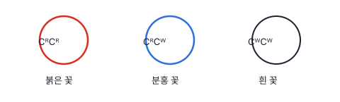

*가운데 꽃은 양끝의 중간 모습이에요.*

**정확히 말하면**

불완전우성(incomplete dominance)은 이형접합자의 표현형이 두 동형접합자 사이에 나타나는 경우예요. 금어초에서 CᴿCᴿ는 붉은 꽃, CᵂCᵂ는 흰 꽃, CᴿCᵂ는 분홍 꽃이에요. 붉은색 색소를 만드는 효소의 양이 이형접합자에서는 중간 수준이어서 분홍색으로 보여요.

CᴿCᵂ끼리 교배하면 유전자형과 표현형 모두 붉음:분홍:흰색이 1:2:1이에요. 완전우성의 Pp끼리 교배해도 유전자형은 1:2:1이지만, Pp가 PP와 같은 표현형을 내므로 표현형은 3:1이에요. [공동우성](#s1-abo)은 두 산물이 각각 나타나는 경우라 중간 표현형과 달라요.

교수님은 낫모양적혈구빈혈증을 불완전우성의 사람 사례로 설명했어요. 헤모글로빈 유전자의 염기 하나 변화로 단백질의 글루탐산이 발린으로 바뀌면 헤모글로빈이 뭉치기 쉬워지고, 적혈구 모양과 산소 운반에 영향을 줘요. 강의의 임상 증상 설명에서는 AA가 정상, AS가 낮은 산소 조건에서 경한 증상을 보일 수 있고, SS가 심한 빈혈이에요.

강의는 AS의 증상 정도가 두 동형접합자 사이에 있다는 점에서 이 사례를 불완전우성에 연결했어요. 한편 교재 79쪽은 심한 질병을 일으키는 대립유전자를 열성으로 설명해요. AS가 언제나 빈혈을 보인다는 뜻은 아니에요. 어떤 표현형과 조건을 비교하는지 밝힌 뒤 분류해요.

**교배 상대가 바뀌면 배우자부터 다시 써요.** 분홍 CᴿCᵂ와 흰 CᵂCᵂ를 교배하면, 분홍 부모는 Cᴿ 또는 Cᵂ를 반씩 주지만 흰 부모는 Cᵂ만 줘요. 자손은 CᴿCᵂ와 CᵂCᵂ가 반씩이라 분홍:흰색은 1:1이에요. 흰 부모가 Cᴿ를 줄 수 없으므로 붉은 CᴿCᴿ는 생기지 않아요.

**교수님 말씀**

교수님은 분홍색 꽃을 붉은색이 “되다 만” 모습에 비유했어요. “유전자형 비율 1 대 2 대 1, 표현형의 비율도 1 대 2 대 1.” 염기 하나의 변화가 헤모글로빈과 적혈구에 큰 영향을 줄 수도 있다고 강조했어요.

**꼭 기억해요**

이형접합자가 중간 모습이면 불완전우성, 두 산물이 모두 보이면 공동우성이에요. 금어초는 붉음과 흰색의 중간인 분홍색이므로 불완전우성의 분명한 예예요.

낫모양적혈구 사례에서 강의의 ‘조건에 따라 경한 증상’과 교재의 ‘심한 질병은 열성’은 관찰 기준이 달라요. AS가 반드시 증상을 보인다고 읽지 않아요.

**1:2:1은 불완전우성의 모든 교배에 붙이는 숫자가 아니에요.** 이형접합자끼리 교배할 때의 결과예요. 먼저 부모 유전자형을 적고, 각 부모가 줄 수 있는 배우자를 조합해요.

**보충 · 수업에서 다루지 않았어요**

**무엇을 측정하는지에 따라 우성 관계를 판단해요.** 수용체 양을 관찰하는 모형에서 RR은 정상 양, Rr은 절반, rr은 없음이라면 Rr의 양은 두 동형접합자 사이예요. 이 수용체 수준에서는 불완전우성으로 분류해요. 두 산물이 각각 함께 보이는 공동우성이나, 여러 유전자가 관여하는 다인자유전과 구별해요. 질병 이름만 보고 다른 관찰 기준으로 바꾸지 않아요.

출처: 강의노트 4장 p3–4의 우성 관계 정의, 4장 실제 웹과제의 수용체 수준 표(상황 조건).

**페이지 요약**

불완전우성은 이형접합자의 중간 표현형이에요. 분홍×분홍은 1:2:1, 분홍×흰색은 1:1이에요.

*용어*

- **불완전우성(incomplete dominance)** — 이형접합자의 표현형이 두 동형접합자 사이에 나타남
- **낫모양적혈구빈혈증** — 헤모글로빈 변화가 적혈구 모양과 산소 운반에 영향을 주는 병

- **(보충) 관찰 기준과 우성 관계** — 우성 관계는 관찰 기준에 따라 판단해요. 수용체 양이 RR=정상, Rr=절반, rr=없음인 모형에서는 이형접합자가 중간이므로 수용체 수준에서 불완전우성이에요.

---

### 공동우성·복대립유전자·ABO

*0929 수업 · 4장 p4*

**쉽게 말하면**

빨간 이름표와 파란 이름표를 함께 만들라는 정보를 받으면, 세포 표면에 두 이름표가 모두 보여요.

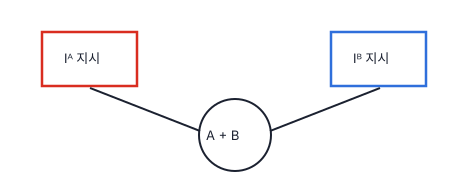

*두 지시가 함께 있으면 이름표도 둘 다 만들어요.*

**정확히 말하면**

공동우성(codominance)은 이형접합자에서 두 대립유전자의 산물이 각각 나타나는 경우예요. ABO에서는 Iᴬ와 Iᴮ가 서로 공동우성이에요. IᴬIᴮ인 사람은 적혈구 표면에 A 항원과 B 항원을 모두 나타내므로 AB형이에요. 이는 중간형 항원 하나를 만드는 불완전우성과 달라요. 수업은 MN 혈액형도 두 산물이 나타나는 예로 짧게 언급했어요.

복대립유전자(multiple alleles)는 한 유전자 자리에 대하여 **집단 전체에 세 개 이상**의 대립유전자 종류가 있는 경우예요. ABO 유전자의 종류는 Iᴬ, Iᴮ, i 세 가지지만, 보통 한 사람은 부모에게 하나씩 받아 두 개만 가져요. 한 사람에게 ABO 유전자 세 개가 들어 있다는 뜻이 아니에요. 교수님은 MHC의 다양한 대립유전자를 세포 표면의 개인별 이름표에 비유하고, 200개 이상이라는 종류 수를 예로 들었어요. 장기이식 때 자기 조직과 다른 조직을 구별하는 일과 연결했지만, 조직이 맞을 확률을 단순히 1/200로 계산할 수 없는 이유는 이후 면역계에서 설명하기로 했어요.

| 유전자형 | 혈액형 | 적혈구 표면 항원 |
|---|---|---|
| IᴬIᴬ, Iᴬi | A형 | A |
| IᴮIᴮ, Iᴮi | B형 | B |
| IᴬIᴮ | AB형 | A와 B |
| ii | O형 | A·B 항원 없음 |

Iᴬ와 Iᴮ는 **서로에게** 공동우성이며, 각각은 i에 대해 완전 우성이에요. 혈액형 A와 B가 “O형에 대해 공동우성”이라는 문장은 우열의 비교 대상을 잘못 잡았어요. 혈액형은 표현형이고 공동우성은 대립유전자 둘의 관계예요. 따라서 혈액형 문제의 보기를 읽을 때 누구와 누구의 우열을 비교하는지 먼저 확인해요.

교배 문제에서는 부모의 혈액형만으로 유전자형이 하나로 정해지는지 먼저 살펴요. 예를 들어 A형은 IᴬIᴬ 또는 Iᴬi, B형은 IᴮIᴮ 또는 Iᴮi예요. A형과 B형 부모가 모두 i를 가진다면 ii인 O형 자녀도 가능하지만, 둘 중 하나가 i를 가지지 않으면 ii는 나오지 않아요.

**ABO의 항원은 적혈구 표면의 당 부분과 연결돼요.** AB형은 A·B 항원이 함께 보이는 경우예요. 집단에 Iᴬ·Iᴮ·i라는 세 대립유전자가 있다는 말은 **세 유전자가 연관돼 있다**는 말과 달라요. 복대립은 한 좌위의 버전 수이고, 연관은 서로 다른 유전자들의 염색체 위치 관계예요(강의노트 4장 p4, 교재 p.80).

**교수님 말씀**

교수님은 “대립유전자가 세 개인 거지 유전자가 세 개인 게 아닙니다.”라고 집단과 개인을 분리했어요. MHC는 자기 세포임을 보여 주는 이름표에 비유했어요.

**꼭 기억해요**

공동우성은 Iᴬ와 Iᴮ **사이**, i에 대해서는 Iᴬ와 Iᴮ 각각의 완전 우성이에요. A형과 B형이 O형에 대해 공동우성이라는 표현은 정확하지 않아요. 기출의 인쇄 답이 이 표현을 택하더라도 문장 자체의 모호성을 확인해요.

복대립유전자의 “세 개 이상”은 집단에 있는 종류 수예요. 한 개인의 두 대립유전자를 세 개로 세지 않아요. 강의노트 p4의 “2개 이상의” 표현과 수업의 “2개 초과” 설명도 구분해요.

**페이지 요약**

AB형에는 A·B 항원이 모두 보이고, ABO 대립유전자는 집단에 세 종류예요.

*용어*

- **공동우성(codominance)** — 이형접합자에서 두 대립유전자 산물이 모두 나타남
- **복대립유전자(multiple alleles)** — 집단의 한 유전자 자리에 세 종류 이상 존재함

---

### 다인자유전과 다면발현

*0929 수업 · 4장 p4*

**쉽게 말하면**

여러 조리사가 한 요리를 만들 수도 있고, 한 조리사가 여러 요리를 만들 수도 있어요.

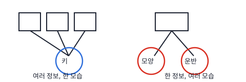

*왼쪽은 여럿이 한 모습에, 오른쪽은 하나가 여러 모습에 영향을 줘요.*

**정확히 말하면**

다인자유전(polygenic inheritance)은 여러 유전자가 한 형질에 함께 영향을 주는 일이에요. 키·몸무게·피부색처럼 값이 연속적으로 퍼지는 양적 형질에서 흔히 보여요. 이 형질에는 유전자뿐 아니라 영양 같은 환경도 영향을 줄 수 있어요. ABO 혈액형은 A·B·AB·O의 구분된 범주로 나타나므로 이 연속형 예와 달라요.

다면발현(pleiotropy)은 한 유전자가 여러 형질에 영향을 주는 일이에요. 낫모양적혈구 사례에서 한 헤모글로빈 유전자 변화가 단백질 성질, 적혈구 모양, 산소 운반과 여러 증상에 이어지는 것을 떠올리면 돼요. 여러 유전자에서 한 형질로 모이면 다인자유전이고, 한 유전자에서 여러 형질로 퍼지면 다면발현이에요.

다면발현 자체는 형제마다 다른 유전자 조합을 **만드는 기작**이 아니에요. 유전적 다양성의 생성은 독립분리, 교차에 따른 재조합, 수정 때의 조합 등과 구분해요. 다면발현은 이미 가진 한 유전자의 효과가 여러 특징에 미치는 관계를 가리켜요.

**교수님 말씀**

교수님은 혈액형별로 손을 들어 보게 하고, 키도 나란히 비교하며 몇 가지 칸에 들어가는 형질과 값이 이어지는 형질을 구분했어요.

**꼭 기억해요**

다인자유전은 **여러 유전자에서 한 형질**, 다면발현은 **한 유전자에서 여러 형질**이에요. 방향을 거꾸로 외우지 않아요. 다면발현을 유전적 다양성을 생성하는 과정으로 분류하지 않아요.

연속적으로 퍼지는 키 같은 양적 형질과 A·B·AB·O로 나뉘는 혈액형을 같은 표현형 분포로 보지 않아요.

**보충 · 수업에서 다루지 않았어요**

지난 수업에서 배운 무성생식은 배우자의 결합 없이 자손을 만들어요. 돌연변이가 없다면 자손은 유전적으로 같은 클론이므로, 무성생식 자체를 새로운 유전자 조합을 만드는 기작으로 보지는 않아요. 반대로 감수분열의 독립분리·교차와 무작위 수정은 유성생식 자손의 조합을 다양하게 해요. 다면발현 역시 조합 생성이 아니라 한 유전자의 여러 효과를 뜻해요.

출처: [0922 복습노트 유성생식과 무성생식](../../0922/정리노트_0922_Cell_Division_and_Heredity.html#s3-sexual), 같은 노트의 s1-clone·s3-crossover·s3-assortment·s3-fertilization 토픽.

**페이지 요약**

여러 유전자가 한 형질에 영향을 주면 다인자유전, 한 유전자가 여러 형질에 영향을 주면 다면발현이에요.

*용어*

- **다인자유전(polygenic inheritance)** — 여러 유전자가 한 형질에 영향
- **다면발현(pleiotropy)** — 한 유전자가 여러 형질에 영향

- **(보충) 무성생식과 유전적 다양성** — 무성생식은 배우자 결합 없이 자손을 만들며 돌연변이가 없으면 클론이에요. 무성생식 자체와 다면발현은 새로운 유전자 조합을 만드는 기작이 아니에요. 유성생식의 조합 다양성은 독립분리·교차·무작위 수정과 연결돼요.

---

## 2. 연관과 재조합

### 초파리 검정교배와 연관

*0929 수업 · 4장 p4–5*

**쉽게 말하면**

같은 버스에 탄 두 친구는 대개 함께 도착해요.

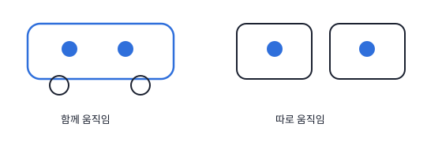

*가끔 짐을 바꾸면 새 조합도 생겨요.*

**정확히 말하면**

연관(linkage)은 두 유전자가 같은 염색체에 있어 함께 유전되는 경향이에요. 야생형(wild type)은 해당 집단에서 흔한 기준형이에요. 야생형이라는 말 자체가 우성을 뜻하지는 않지만, 모건의 이 실험에서는 빨간 눈 pr⁺와 정상 날개 vg⁺가 각각 자주색 눈 pr와 흔적 날개 vg에 우성이에요.

초파리(Drosophila melanogaster)는 세대가 짧고 자손이 많으며, 염색체가 4쌍이고 사육 공간·비용이 적어 여러 세대의 유전을 비교하기 좋아요. 수업 영상은 사람의 유전자 기능과 질환 연구에도 이용된다는 점을 설명했어요.

검정교배는 알아보려는 개체를 열성 동형접합자와 교배하는 방법이에요. 여기서는 pr⁺ vg⁺ / pr vg인 F1 양성잡종을 pr vg / pr vg와 교배해요. 상대는 pr vg 배우자만 주므로, 자손 표현형으로 F1의 배우자 조합을 읽을 수 있어요.

| F1의 배우자 | 자손 표현형 | 자손 수 | 종류 |
|---|---|---|---|
| pr⁺ vg⁺ | 빨간 눈·정상 날개 | 1339 | 부모형 |
| pr vg | 자주색 눈·흔적 날개 | 1195 | 부모형 |
| pr⁺ vg | 빨간 눈·흔적 날개 | 151 | 재조합형 |
| pr vg⁺ | 자주색 눈·정상 날개 | 154 | 재조합형 |

독립적으로 분리된다면 이 검정교배에서는 네 표현형이 1:1:1:1로 나와요. 실제로 부모형 2534마리가 재조합형 305마리보다 훨씬 많아서 두 유전자가 연관됐다고 해석해요.

같은 염색체의 유전자가 함께 전달되다가 교차로 새 조합이 생기는 모습을 [연관과 교차 재조합 모형](../%EC%9D%B8%ED%84%B0%EB%A0%89%ED%8B%B0%EB%B8%8C_01_%EC%97%B0%EA%B4%80%EA%B3%BC_%EA%B5%90%EC%B0%A8_%EC%9E%AC%EC%A1%B0%ED%95%A9.html)의 ‘교차’에서 따라가 보세요.

**교수님 말씀**

> “pr 플러스가 가는 곳에 vg 플러스가 같이 간단 얘기죠.”

교수님은 연구실에서 초파리를 하나씩 세어 얻은 1339·1195·151·154를 비교했어요.

**꼭 기억해요**

9:3:3:1은 독립인 양성잡종끼리 교배한 경우예요. 지금의 검정교배에서 기대하는 독립 비율은 1:1:1:1이에요. 연관됐다고 재조합형이 전혀 생기지 않는 것은 아니에요.

자손 네 종류와 배우자 네 종류는 구별해요. 이 검정교배에서는 열성 부모의 배우자가 한 종류라 둘이 일대일로 대응하는 거예요.

**양성잡종과 재조합은 다른 질문의 답이에요.** 양성잡종은 두 좌위가 이형접합인 개체의 상태이고, 교차에 의한 재조합은 부모형에 없던 대립유전자 조합을 만드는 과정이에요. 자손에서 빨간 눈·흔적 날개처럼 새로운 짝이 보이면, 그 배우자 조합이 어떻게 생겼는지 확인해요.

**페이지 요약**

검정교배에서 부모형이 많으면 함께 유전되는 경향을 읽을 수 있어요.

*용어*

- **연관** — 같은 염색체의 유전자들이 함께 유전되는 경향
- **검정교배** — 열성 동형접합자와 교배하여 배우자 조합 추론

---

### 재조합 빈도와 유전자 거리

*0929 수업 · 4장 p5 · 강의노트 외 계산*

**쉽게 말하면**

함께 묶인 두 조각 사이를 잘라 바꾸면 전에 없던 짝이 생겨요.

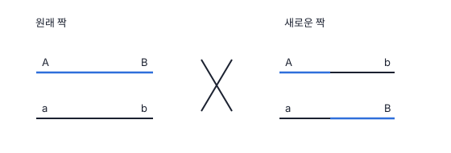

*전체 중 새 짝의 비율을 세어요.*

**정확히 말하면**

감수분열 전기 I에서 상동염색체가 짝을 이루고, 비자매염색분체 사이에 교차가 일어나면 새로운 대립유전자 조합이 생길 수 있어요. 네 가닥은 염색체 네 개가 아니라 염색체 두 개에 속한 염색분체 네 개예요.

재조합 빈도는 재조합형 자손 수를 전체 자손 수로 나눈 비율이에요. 교차가 일어난 세포 비율과 그대로 같은 수는 아니에요.

$$
\text{재조합 빈도}=\frac{151+154}{1339+1195+151+154}\times100=\frac{305}{2839}\times100\approx10.7\%
$$

두 재조합형을 모두 분자에 넣고 부모형도 포함한 전체를 분모에 넣어요. 예를 들어 재조합형이 80마리씩 두 종류이고 전체가 1000마리라면 160/1000 × 100 = 16%예요.

검정교배로 추정하는 재조합 빈도의 이론적 범위는 0–50%예요. 가까운 두 유전자일수록 사이에서 교차가 일어날 가능성이 작아 함께 유전되는 경향이 커요. 짧은 구간에서는 재조합 빈도로 상대적인 유전자 거리를 추정할 수 있어요.

유전자 사이 거리와 재조합 빈도의 관계를 [연관과 교차 재조합 모형](../%EC%9D%B8%ED%84%B0%EB%A0%89%ED%8B%B0%EB%B8%8C_01_%EC%97%B0%EA%B4%80%EA%B3%BC_%EA%B5%90%EC%B0%A8_%EC%9E%AC%EC%A1%B0%ED%95%A9.html)의 ‘거리’에서 비교해 보세요.

**교수님 말씀**

> “151마리 플러스 154마리, 305마리죠.”

교수님은 새 조합을 전부 더한 뒤 2839마리 전체로 나누어 10.7%를 계산했어요.

**꼭 기억해요**

50%는 ‘유전적으로 독립처럼 관측된다’는 뜻이에요. 이 숫자만으로 서로 다른 염색체에 있다고 확정할 수는 없어요. 수업의 ‘다른 염색체’ 설명은 독립분리가 나타나는 대표 경우로 이해해요.

교과서 그림 4.10에서는 재조합을 만드는 F1이 암컷이에요. 전사에서 수컷·정자로 부른 대목과 구별해요.

**재조합형 한 종류의 비율과 전체 재조합 빈도는 달라요.** 예를 들어 한 재조합형이 8%라고 주어졌다면, 다른 재조합형도 더해야 총빈도를 알 수 있어요. 반대 유형의 수나 두 유형이 같은 비율이라는 가정 없이 총빈도를 바로 두 배로 확정하지 않아요.

**보충 · 수업에서 다루지 않았어요**

수업 중 성별 표현과 달리, 이 검정교배 그림의 F1 양성잡종에는 암컷 기호가, 이중 열성 상대에는 수컷 기호가 붙어 있어요. 아래의 자손 집계는 이 그림의 교배를 기준으로 읽어요.

출처: 교재 4장 p.82 그림 4.10 (PDF 11쪽).

**페이지 요약**

두 재조합형을 모두 더해 전체로 나눠요.

- 재조합 빈도

  $$
  \frac{305}{2839}\times100\approx10.7\%
  $$

*용어*

- **상한 50%** — 독립처럼 보이지만 염색체 위치를 확정하지는 못해요.

- **(보충) 검정교배의 암수** — 교재 검정교배 그림은 F1 양성잡종이 암컷, 이중 열성 상대가 수컷이에요. 수업 중 성별 표현과 달라도 자손 집계는 그림의 교배를 기준으로 읽어요.

---

## 3. 성염색체와 성연관 유전

### 성염색체의 여러 방식

*0929 수업 · 4장 p5–6*

**쉽게 말하면**

사람은 몸의 설계도를 두 묶음씩 가지고, 아기를 만들 때 각 묶음에서 하나씩 건네줘요.

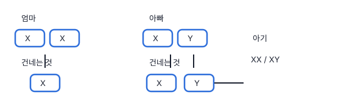

*이 그림에서는 엄마는 X를, 아빠는 X 또는 Y를 건네줘요.*

**정확히 말하면**

성염색체(sex chromosome)에 있는 유전자를 **성연관 유전자**라고 해요. X 염색체에 있으면 X 연관, Y 염색체에 있으면 Y 연관 유전자예요. 성염색체가 아닌 22쌍은 **상염색체**(autosome)예요. 성연관은 형질이 어느 성에서만 나타난다는 말이 아니라 유전자의 **위치**를 뜻해요. 남성과 여성 모두 성연관 형질을 보일 수 있어요.

수업에서 다룬 사람의 일반적인 모형은 여성 **XX**, 남성 **XY**예요. 난자는 X를 하나 받고, 정자는 X 또는 Y 가운데 하나를 받아요. 따라서 딸의 두 X 중 하나는 아버지에게서, 아들의 Y는 아버지에게서 와요. Y 염색체 위의 유전자는 이 모형에서 아버지가 아들에게만 전하고 딸에게는 전하지 않아요. 정자는 성염색체 X와 Y를 동시에 받지 않고, 몸세포와 같은 염색체 조합도 갖지 않아요.

사람의 Y 염색체에는 남성 발달을 시작하는 **SRY** 유전자가 있어요. X 염색체는 Y보다 크고 유전자가 훨씬 많아요. 수업에서는 X에 생존에 필수적인 유전자가 있어 X가 전혀 없으면 생존할 수 없지만, Y 없이도 생존할 수 있다고 설명했어요. 일부 곤충에서는 XX가 암컷이고 XO가 수컷이에요. O는 별도 염색체가 아니라 두 번째 성염색체가 없다는 표기예요. 조류 등에서는 ZZ가 수컷, ZW가 암컷이에요. 그러므로 사람의 XX·XY 규칙을 모든 생물에 그대로 적용하면 안 돼요.

**교수님 말씀**

> “남성은 XY 여성은 XX죠.”

교수님은 앞선 말실수를 바로 고치고, 사람과 일부 곤충의 방식이 다르다는 점을 강조했어요. Y에는 유전자가 적지만 SRY처럼 중요한 유전자가 있어요.

**꼭 기억해요**

성연관은 성염색체에 놓인 유전자이고, 상염색체 유전자는 그 밖의 염색체에 놓여요. X 연관 형질도 여성과 남성 모두에게 나타날 수 있어요. Y 연관 유전자는 일반적인 XX·XY 모형에서 아버지에게서 아들로 가지만 딸에게는 가지 않아요.

사람의 XX·XY는 이번 수업의 표준 예예요. 곤충의 XO나 ZZ/ZW 방식까지 XX·XY로 단정하지 않아요.

**페이지 요약**

사람의 일반적 XX·XY 모형에서 정자는 X 또는 Y 하나를 전해요.

*용어*

- **성연관 유전자** — 성염색체에 위치한 유전자
- **상염색체** — 성염색체가 아닌 염색체
- **SRY** — Y 염색체의 남성 발달 관련 유전자

---

### X-연관 열성유전과 보인자

*0929 수업 · 4장 p6*

**쉽게 말하면**

두 장 중 한 장에 고장이 있어도 다른 장이 일을 하면 겉으로는 멀쩡할 수 있어요.

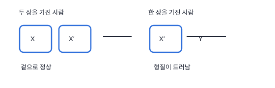

*남은 한 장이 제 일을 하면 겉으로 드러나는 모습이 달라져요.*

**정확히 말하면**

적록**색맹**과 **혈우병**은 수업에서 든 X-연관 열성 형질이에요. 여기서 X는 정상 대립유전자를, X′는 열성 질환 대립유전자를 가진 X 염색체라고 정해요. 일반적인 사람 XX·XY 모형에서 여성 XX는 정상, XX′는 정상인 **이형접합자**, X′X′는 환자예요. 남성 XY는 정상, X′Y는 환자예요. X′Y 남성은 질환 대립유전자를 하나만 가졌지만 이를 가려 줄 두 번째 X가 없어요.

**보인자(carrier)**는 열성 질환 대립유전자를 갖고도 해당 질환의 표현형은 나타나지 않는 정상 이형접합자예요. 보인자는 환자와 달라요. 이 단순 모형에서 X′를 가진 남성은 보인자가 아니라 환자예요. 보인자인 여성은 X′를 딸이나 아들에게 각각 전할 수 있어요.

| 정상 아버지 XY × 보인자 어머니 XX′ | 어머니에게서 X | 어머니에게서 X′ |
|---|---|---|
| 딸: 아버지에게서 X | XX, 정상 | XX′, 정상 보인자 |
| 아들: 아버지에게서 Y | XY, 정상 | X′Y, 환자 |

딸은 모두 해당 열성 질환의 표현형이 정상이고, 그중 절반이 보인자예요. 아들은 절반이 정상, 절반이 환자예요. 보인자 어머니에게서 우연히 정상 자녀만 태어날 수도 있어요. 현재 자녀가 모두 정상이라는 관찰만으로 어머니가 보인자가 아니라고 결론낼 수 없어요. 정상 딸도 보인자일 수 있고, 훗날 환자 자녀를 낳을 가능성이 있어요.

색맹 딸 X′X′가 태어나려면 일반적 XX·XY 모형에서는 어머니와 아버지 모두에게서 X′를 받아야 해요. 따라서 정상 아버지 XY와 색맹 어머니 X′X′ 사이에서 색맹 딸은 나올 수 없고, 딸은 XX′ 보인자예요. 이 조건에서 딸이 색맹이라고 주어졌다면 일반적인 부녀 유전 관계와 모순돼요.

**아들일 때는 아들이 받는 X만 따라가요.** 색맹 아버지 X′Y와 보인자 어머니 XX′ 사이에서도 아들은 아버지의 Y와 어머니의 X 또는 X′를 받아요. 따라서 아들 중 환자 비율은 1/2예요. 이미 아들이라고 주어졌는데 성별 확률 1/2를 다시 곱하지 않아요. 성별이 주어지지 않은 전체 출생 중 환자 아들을 묻고 남녀가 같은 확률이라고 가정할 때에만 1/2×1/2를 계산해요.

단일 유전자·새 돌연변이 없는 X-연관 열성 모형에서 정상 부모에게 환자 아들 X′Y가 태어났다면, 그 아들의 X′는 어머니에게서 왔어요. 정상인 어머니는 XX′ 보인자로 추론해요. 가계도의 비어 있는 원만 보고 XX라고 확정하지 않아요.

딸과 아들이 X 염색체를 누구에게서 받는지 [X 연관 유전과 바소체 모형](../%EC%9D%B8%ED%84%B0%EB%A0%89%ED%8B%B0%EB%B8%8C_04_X_%EC%97%B0%EA%B4%80_%EC%9C%A0%EC%A0%84%EA%B3%BC_%EB%B0%94%EC%86%8C%EC%B2%B4.html)의 ‘X 연관’에서 교배 결과와 함께 확인해 보세요.

**교수님 말씀**

> “보인자는 환자가 아닙니다. 정상입니다, 정상.”

교수님은 《더 글로리》 속 색맹 딸의 사례를 꺼내 딸의 X′가 어머니와 아버지에게서 하나씩 와야 한다고 설명했어요. 드라마 사례는 유전형을 추론하는 연습이며, 표준 XX·XY 모형의 조건을 먼저 확인해야 해요.

**꼭 기억해요**

보인자와 환자를 혼동하지 않아요. XX′는 정상 보인자이고 X′X′는 환자예요. X′Y는 X′가 하나뿐이어도 환자예요.

딸이 열성 질환이면 아버지에게서도 X′를 받아야 해요. 정상 아버지와 보인자 어머니의 딸은 모두 정상일 수 있지만 절반은 보인자예요. 자녀가 지금까지 정상이라는 사실이 부모와 자녀의 질환 대립유전자 부재를 증명하지 않아요.

**가계도에서 채워지지 않은 기호는 증상이 없다는 뜻이에요.** 열성 대립유전자도 없다는 뜻은 아니에요. 이 단순 X-연관 열성 모형에서 정상 아버지의 딸은 정상 X를 하나 받으므로 환자가 되지 않지만 보인자는 될 수 있어요. 같은 부모의 다음 임신에서 배우자 전달 확률은 앞선 자녀의 결과로 소모되지 않아요.

**페이지 요약**

XX′는 정상 보인자이고, 정상 아버지의 딸은 이 모형에서 X-연관 열성 질환을 보이지 않아요.

*용어*

- **보인자(carrier)** — 열성 질환 대립유전자를 지닌 정상 이형접합자
- **X′Y** — X-연관 열성 형질이 드러나는 남성

---

### X 불활성화와 얼룩 고양이

*0929 수업 · 4장 p6*

**쉽게 말하면**

같은 노트북 두 대가 있으면 하나는 쓰고 다른 하나는 포장해 둘 수 있어요.

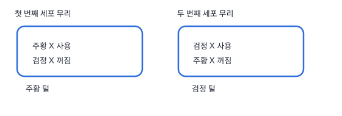

*같은 몸에서도 어느 쪽을 쓰는지 세포 무리마다 달라요.*

**정확히 말하면**

일반적인 XX 포유류의 대부분 체세포에서는 두 X 염색체 중 하나가 응축되어 작동하지 않아요. 이것이 **X 염색체 불활성화**(X chromosome inactivation)예요. 응축되어 현미경에서 보이는 불활성 X가 **바소체(Barr body)**예요. 바소체는 사용 중인 X가 아니에요. X 하나만 가진 XY 체세포나 X 하나를 가진 난자를 XX 체세포와 같은 방식으로 설명하지 않아요.

어느 X가 꺼지는지는 세포마다 **무작위**로 정해져요. 고양이 털 색깔이 X 연관이고 한 X가 주황, 다른 X가 검정을 지정하는 **이형접합자** XX라면, 어떤 세포 집단은 주황 대립유전자가 작동하고 다른 집단은 검정 대립유전자가 작동해요. 이 차이가 모자이크처럼 보이는 얼룩무늬를 만들어요. 수업에서 설명한 이형접합 얼룩 고양이는 정상적인 성염색체 두 개라는 조건에서 암컷이에요. 동형접합 XX나 정상적인 XY에서는 이 두 색을 같은 방식으로 함께 만들 수 없어요.

교수님은 주황과 검정의 큰 영역이 만들어지는 세부 이유는 설명을 미뤘어요. 이번 수업에서는 어느 X가 꺼지는지가 세포마다 무작위라는 원리까지 알아두면 돼요.

**유전자 정량 보정(dosage compensation)**은 XX와 XY 사이의 X 유전자 발현량 차이를 줄이는 조절이에요. 수업의 모형에서는 XX 체세포의 X 하나를 불활성화해 설명해요. DNA를 복사하거나 X의 개수를 바꾸는 과정이 아니라, 가진 X의 사용량을 조절하는 과정이에요(강의노트 4장 p6).

X 불활성화가 서로 다른 세포 집단과 얼룩 털로 이어지는 과정을 [X 연관 유전과 바소체 모형](../%EC%9D%B8%ED%84%B0%EB%A0%89%ED%8B%B0%EB%B8%8C_04_X_%EC%97%B0%EA%B4%80_%EC%9C%A0%EC%A0%84%EA%B3%BC_%EB%B0%94%EC%86%8C%EC%B2%B4.html)의 ‘불활성화’에서 따라가 보세요.

**교수님 말씀**

> “노트북이 두 대야. 뭐 학교에 한 개만 들고 갈 텐데.”

다른 한 대를 포장해 서랍에 두는 비유가 불활성화예요. 교수님은 얼룩 고양이에서 “둘 중에 아무거나 하나가 불활성화”된다고 강조했어요.

**꼭 기억해요**

바소체는 활성 X가 아니라 응축되어 불활성화된 X예요. 어느 X가 불활성화되는지는 세포마다 무작위이므로 같은 개체 안에 서로 다른 털색 세포 집단이 생길 수 있어요.

얼룩 고양이를 무조건 암컷이라고 넓혀 말하지 않아요. 수업의 결론은 정상적인 성염색체 두 개를 가진, 주황·검정 X 대립유전자 이형접합 고양이라는 조건에서 암컷이라는 뜻이에요. 얼룩의 큰 무늬가 왜 생기는지는 이번 수업에서 설명하지 않았어요.

X **연관**은 유전자의 위치, **불활성화**는 발현 조절이에요. 염색체의 개수를 바꾸는 일과 가진 염색체의 사용량을 조절하는 일을 구별해요. X가 등장한다고 모두 정량 보정은 아니며, 모든 X 유전자가 예외 없이 완전히 꺼진다는 뜻으로 넓히지 않아요.

**페이지 요약**

XX 체세포에서 어느 X가 꺼지는지는 무작위이며, 꺼진 X가 바소체예요.

*용어*

- **바소체(Barr body)** — 응축되어 불활성화된 X 염색체
- **X 염색체 불활성화** — XX 체세포에서 X 하나의 작동을 멈추는 현상

---

## 4. 염색체 구조의 변화

### 결실·중복·전좌·역위

*0929 수업 · 4장 p6–7*

**쉽게 말하면**

책의 글 조각이 빠지거나, 한 번 더 들어가거나, 다른 책으로 옮겨 가거나, 거꾸로 붙을 수 있어요.

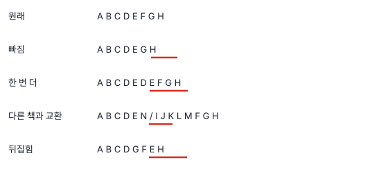

*글자 하나는 여러 유전자를 담을 수도 있는 조각을 뜻해요.*

**정확히 말하면**

| 변화 | 무엇이 달라지나요? | 수업의 예 |
|---|---|---|
| 결실(deletion) | 잘린 절편을 잃어 그 안의 유전자·염기서열이 사라져요. | 5번 염색체 일부 결실에 의한 고양이 울음 증후군과 후두 이상 |
| 중복(duplication) | 같은 절편이 한 번 더 생겨요. 불균등한 교환이나 복제 오류 등으로 생길 수 있어요. | 중복된 유전자에 변화가 쌓이면 비슷하지만 다른 글로빈 유전자들이 될 수 있어요. |
| 전좌(translocation) | 절편이 비상동염색체로 옮겨 가요. 두 염색체가 서로 절편을 교환할 수도 있어요. | 8번·14번 염색체 사이 전좌 |
| 역위(inversion) | 절편이 원래 염색체에 반대 방향으로 붙어 유전자 순서가 뒤집혀요. | EFG가 GFE 순서가 돼요. |

중복으로 유전자 사본이 늘어난 뒤 한 사본에 돌연변이가 축적되면 새로운 기능이 생길 수 있어요. 헤모글로빈은 α 사슬 두 개와 β 사슬 두 개로 이루어지고, 글로빈 유전자들의 유사성이 이런 진화 과정을 설명하는 예예요.

절단이 일어나도 수선될 수 있어요. 남는 영향은 없어진 조각, 절단 위치, 바뀐 조절 관계에 따라 달라져요. 구조 변화가 모두 같은 질환이나 같은 효과를 일으키지는 않아요.

결실·중복·역위·전좌가 염색체 구간을 어떻게 바꾸는지 [염색체 구조 변화 모형](../%EC%9D%B8%ED%84%B0%EB%A0%89%ED%8B%B0%EB%B8%8C_03_%EC%97%BC%EC%83%89%EC%B2%B4_%EA%B5%AC%EC%A1%B0_%EB%B3%80%ED%99%94.html)의 ‘구조’에서 비교해 보세요.

**교수님 말씀**

> “보고서 베껴 썼는데 ... 그 부분을 또 써 버린 거야.”

교수님은 중복을 보고서의 같은 문장을 두 번 쓴 경우에 비유했어요. 전좌는 다른 염색체로 자리를 옮기는 일, 역위는 잘린 조각이 거꾸로 붙는 일로 설명했어요.

**꼭 기억해요**

교차는 상동염색체의 비자매염색분체 사이 교환이고, 전좌는 비상동염색체로의 이동이에요. 역위는 정방향 재정렬이 아니라 방향이 뒤집힌 변화예요.

영상 전사 중 질환 설명이 섞인 부분이 있어요. 고양이 울음 증후군은 5번 염색체 일부의 결실 예로 기억해요. 영상에서 함께 언급한 고양이 눈 증후군은 22번 염색체 일부의 추가 사본과 관련된 별도 예예요.

**구조 그림은 내용·개수 → 순서 → 이동 상대 순서로 읽어요.** 글자 종류와 개수가 같고 한 구간만 거꾸로 되면 역위예요. 글자가 없어졌으면 결실, 같은 구간이 더 있으면 중복, 다른 비상동염색체로 옮겨 갔으면 전좌예요. 절단 표시가 있다는 이유만으로 결실을 고르지 않아요.

**페이지 요약**

빠짐·늘어남·다른 염색체로 이동·뒤집힘을 구별해요.

*용어*

- **결실 / 중복** — 절편의 손실 / 추가 사본
- **전좌 / 역위** — 비상동염색체로 이동 / 반대 방향 재삽입

---

### 위치가 바뀌면 조절도 바뀐다

*0929 수업 · 4장 p7*

**쉽게 말하면**

전등이 멀쩡해도 늘 켜져 있는 스위치에 연결하면 쉴 수 없어요.

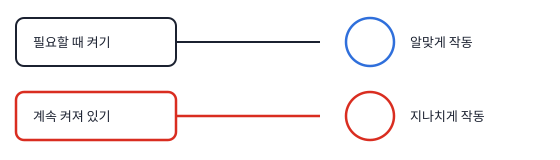

*연결된 조절 장치가 바뀌면 작동량도 달라져요.*

**정확히 말하면**

유전자가 존재한다고 언제나 단백질이 만들어지는 것은 아니에요. 조절 부위는 RNA 중합효소가 작용해 RNA를 만드는 과정과 발현량에 영향을 줘요. 전좌나 역위로 유전자가 잘리면 기능이 손상될 수 있고, 유전자와 조절 부위의 관계가 바뀌면 발현량이 달라질 수 있어요.

1. 세포분열을 촉진하는 유전자는 원래 필요할 때 발현되도록 조절돼요.
2. 염색체 위치가 바뀌어 강하게 작동하는 조절 부위의 영향을 받으면 너무 많이 발현될 수 있어요.
3. 세포분열 촉진 단백질이 지나치게 작용하면 암 발생에 기여할 수 있어요.

수업에서는 8번 염색체와 14번 염색체 사이 전좌가 나타나는 버킷 림프종을 예로 들었어요. 이는 구조 변화가 조절 관계에 영향을 주는 예이며, 전좌가 생기면 모두 암이 된다는 뜻은 아니에요.

유전자가 조절 부위 옆으로 옮겨 갔을 때 발현이 바뀌는 모습을 [염색체 구조 변화 모형](../%EC%9D%B8%ED%84%B0%EB%A0%89%ED%8B%B0%EB%B8%8C_03_%EC%97%BC%EC%83%89%EC%B2%B4_%EA%B5%AC%EC%A1%B0_%EB%B3%80%ED%99%94.html)의 ‘조절’에서 살펴보세요.

**교수님 말씀**

> “항상 켜져 있는 스위치 밑으로 간 거예요, 형광등이.”

형광등은 유전자, 스위치는 발현을 조절하는 부위에 대응해요.

**꼭 기억해요**

유전자의 서열 자체가 망가지는 경우와, 서열이 보존돼도 주변 조절 관계가 바뀌는 경우를 구별해요. 이번 수업에서는 구조 변형의 결과로 이 원리까지만 설명했어요.

**페이지 요약**

유전자의 위치 변화는 기능뿐 아니라 발현 조절도 바꿀 수 있어요.

*용어*

- **조절 부위** — 발현 시점과 양에 영향을 주는 DNA 부위
- **버킷 림프종** — 8번·14번 전좌와 발현 조절 변화의 예

---

## 5. 요약 · 예고

### 시험 직전 한눈에

| 주제 | 시험 직전 한 줄 |
|---|---|
| 분리와 독립 | 대립유전자 쌍은 배우자를 만들 때 분리돼요. 서로 독립인 두 유전자 쌍은 각각의 분리 결과가 다른 쌍의 결과에 좌우되지 않아요. |
| 교배 비율 | 독립·완전우성·같은 생존율을 가정하면 AaBb끼리는 표현형 9:3:3:1, AaBb×aabb는 1:1:1:1이에요. |
| 가계도 | 단일유전자·완전우성·새 돌연변이 없는 모형에서 같은 표현형 부모에게 다른 표현형 자녀가 나오면 자녀의 형질이 열성이에요. |
| 불완전우성 | 이형접합자는 중간 표현형이에요. 분홍끼리 교배는 1:2:1, 분홍×흰색은 1:1이며 부모 유전자형부터 확인해요. |
| 공동우성·복대립유전자 | 공동우성은 이형접합자에서 두 효과가 모두 나타나는 관계예요. 복대립유전자는 집단의 한 좌위에 대립유전자 종류가 세 개 이상인 경우예요. |
| ABO | Iᴬ와 Iᴮ는 서로 공동우성이고 각각 i에 완전 우성이에요. O형은 ii이며, 보통 한 사람은 그 좌위에 두 사본을 가져요. |
| 다인자·다면 | 여러 유전자가 한 형질에 기여하면 다인자유전, 한 유전자가 여러 형질에 영향을 주면 다면발현이에요. |
| 연관·재조합 | 같은 염색체의 유전자는 함께 유전되는 경향이 있어요. 감수분열 전기 I의 비자매염색분체 교차가 새 조합을 만들 수 있어요. |
| 재조합 빈도 | 재조합형 305 / 전체 2839 × 100 ≈ 10.7%예요. 이론적 상한 50%만으로 서로 다른 염색체라고 확정할 수 없어요. |
| 성연관 | 성염색체에 있는 유전자라는 뜻으로, 성별을 결정하는 유전자만을 가리키지는 않아요. X-연관 열성 형질은 남녀 모두 나타날 수 있어요. |
| 보인자 | 단순 X-연관 열성 모형에서 여성 이형접합자는 증상 없이 대립유전자를 전할 수 있어요. 남성은 해당 X를 하나만 가져도 형질이 나타나요. |
| X 불활성화 | 두 X 중 하나를 무작위로 응축시킨 것이 바소체예요. 서로 다른 X의 털색 대립유전자를 가진 고양이에서는 얼룩이 생길 수 있어요. |
| 구조 변형 | 결실은 손실, 중복은 추가 사본, 전좌는 비상동염색체로 이동, 역위는 방향 반전이에요. |
| 발현 조절 | 전좌로 유전자 주변 조절 관계가 바뀌면 발현량도 달라질 수 있어요. 버킷 림프종의 8번·14번 전좌가 수업의 예예요. |

---

### 끊긴 지점과 다음 범위

“여기까지 염색체 변형에 대한 얘기였습니다, 구조의 변형. 자, 여기까지 합시다.”

4장 p7의 구조 변형까지 마쳤어요. 전사에 분·초가 없어서 정확한 시간은 표시할 수 없어요.

- 아직 다루지 않은 강의노트 순서: 4장 p7 아래의 비분리와 염색체 수 변화, 다배수체, p8의 유전병 상세, p9의 유전상담.
- 5장 조절 부위는 전좌의 결과를 설명하며 잠깐 언급했어요. DNA 복제·전사·번역 본수업까지 배운 것으로 넓히지 않아요.
- 교수님이 다음 시간 진도를 확정해서 말한 것은 아니에요. 위 목록은 강의노트 순서로 확인한 남은 내용이에요.
- 기출 4강 5번은 돌연변이가 단백질에 영향을 주지 않는 경우까지 판단해야 해서 보류했어요. 아직 배우지 않았다는 것이 시험 제외를 뜻하지는 않아요.

---

### 함께 보면 좋은 자료

- [복습문제 43개 풀러 가기](복습문제_0929_Heredity.md)
- [0922 단성잡종 교배 복습](../../0922/정리노트_0922_Cell_Division_and_Heredity.html#s4-monohybrid)

---

출처: 이영만 교수님 강의노트(4장) · 수업 녹음 전사(0929) · 『생명과학: 기초와 응용』 2판 4장. 전사에 분·초가 없어 출처는 Part로 표시했어요.
