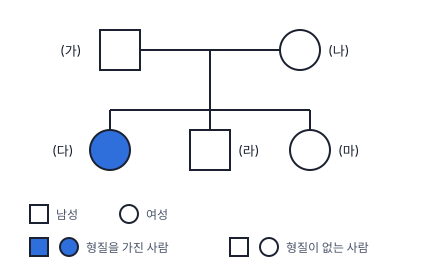
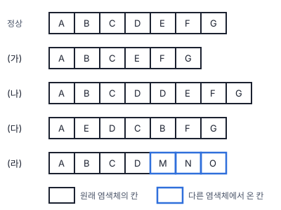

# 복습문제 43선 — 0929 수업 범위

웹과제 1문항, 기출 28문항, 생성 변형 14문항이에요. 먼저 풀어 보고, 막히면 힌트를 열어 봐요. 원문이 모호한 문항은 풀이에서 구분해요.

> `복습문제_0929_Heredity.html`를 마크다운으로 옮겼어요. 원문, 힌트, 풀이는 접혀 있어요. 먼저 풀어 보고 펼쳐 보세요.

**목차**

- [A. 웹과제](#partA)
  - [P43. 유전적 다양성과 가장 거리가 먼 것](#p43)
- [B. 기출](#partB)
  - [P1. Y 연관 형질의 전달](#p1)
  - [P2. 독립분리가 만드는 네 배우자](#p2)
  - [P3. 정자에 들어가는 성염색체](#p3)
  - [P4. ABO 대립유전자 사이의 관계](#p4)
  - [P5. X 연관 열성 형질의 보인자](#p5)
  - [P6. 양성잡종 F₂의 표현형 비](#p6)
  - [P7. 색맹 보인자 어머니의 자녀](#p7)
  - [P8. 열성 동형접합 ABO 혈액형](#p8)
  - [P9. 두 형질 모두 우성인 자손 비율](#p9)
  - [P10. AaBb가 만드는 배우자 종류](#p10)
  - [P11. 자손의 다양성이 생기는 까닭](#p11)
  - [P12. 한 유전자가 여러 증상에](#p12)
  - [P13. 색맹인 딸과 아버지의 X](#p13)
  - [P14. O형 아이의 부모](#p14)
  - [P15. 한 자리의 여러 대립유전자](#p15)
  - [P16. 성연관 형질의 발현](#p16)
  - [P17. 중간 표현형의 이름](#p17)
  - [P18. Iᴬi의 혈액형](#p18)
  - [P19. 여러 유전자가 한 형질에](#p19)
  - [P20. 멘델 법칙의 확장 구별](#p20)
  - [P21. 염색체 구조 변화](#p21)
  - [P22. 두 형질의 배우자](#p22)
  - [P23. 혈우병과 정상 자녀](#p23)
  - [P24. 정상 아버지와 혈우병 딸](#p24)
  - [P25. 둥글고 노란 완두](#p25)
  - [P26. 자손 유전자형의 종류](#p26)
  - [P27. ABO 우열의 표현](#p27)
  - [P28. 복대립유전자](#p28)
- [C. 변형 연습](#partC)
  - [P29. [변형] 교배 종류와 비율](#p29)
  - [P30. [변형] 집단 대립유전자와 개인](#p30)
  - [P31. [변형] 다인자와 다면](#p31)
  - [P32. [변형] 재조합 빈도의 분모](#p32)
  - [P33. [변형] 보인자와 조건부확률](#p33)
  - [P34. [변형] 교차 전좌 역위](#p34)
  - [P35. [변형] 멘델 확장 현상과 예 짝짓기](#p35)
  - [P36. [변형] 염색체 구조 변형 설명 고르기](#p36)
  - [P37. [변형] 가계도로 열성과 성연관 판별](#p37)
  - [P38. [변형] 염색체 막대로 구조 변형 판별](#p38)
  - [P39. [변형] X 불활성화 진술 판정](#p39)
  - [P40. [변형] 연관된 두 유전자의 검정교배](#p40)
  - [P41. [변형] 다인자유전이 아닌 형질 고르기](#p41)
  - [P42. [변형] 색맹 아버지의 자녀](#p42)

## A. 웹과제

### P43. 유전적 다양성과 가장 거리가 먼 것

자손의 유전적 다양성에 기여하는 것과 가장 거리가 먼 것은?

- A. 무작위적 염색체 분배
- B. 유성생식
- C. 연관
- D. 감수분열
- E. 재조합

원문 정보 보기

웹과제 3장 q07 (스크린샷 s07). 원래 화면은 체크박스 형식이었지만 정답은 하나예요.

힌트 보기

보기 중 하나는 유전자들을 함께 묶어 다니게 만드는 현상이에요. 묶여 다니면 새 조합이 늘까요, 줄까요?

풀이 보기

1. A. 다양성에 기여하므로 답이 아니에요. 후기 I에 상동염색체 쌍이 무작위로 갈라지는 것은 다양성의 주요 원인이에요.
2. B. 다양성에 기여하므로 답이 아니에요. 유성생식은 다양성을 만드는 생식 방식이에요.
3. C. 다양성과 가장 거리가 멀어 답이에요. 연관된 유전자는 같은 염색체에 있어 함께 전달되므로 새 조합을 줄여요.
4. D. 다양성에 기여하므로 답이 아니에요. 감수분열의 재조합과 무작위 분배가 다양성을 만들어요.
5. E. 다양성에 기여하므로 답이 아니에요. 재조합(교차)은 새 대립유전자 조합을 만들어요.
6. 수업과의 연결: 0929 수업에서 교수님이 "pr 플러스가 가는 곳에 vg 플러스가 같이 간다"며 연관을 설명하고, 교차가 일어난 일부 생식모세포에서만 새 조합이 생긴다고 대비한 대목과 이어져요(정리노트 "초파리 검정교배와 연관").

**정답:** C

---

## B. 기출

### P1. Y 연관 형질의 전달

Y-염색체 연관 유전자 중에는 귀에 털이 나는 유전 형질을 결정하는 것도 있다. 귀에 털이 난 남성은 이 형질을 _________.

- (1) 일반적으로 그의 아들에게 그러나 간혹 딸에게도 전달한다
- (2) 그의 아들에게만 전달한다
- (3) 그의 딸에게만 전달한다
- (4) 엄마가 보인자라면 그의 모든 자녀에게 전달한다
- (5) 그의 손자에게만 전달한다

원문 정보 보기

기출 4강 합본 6번 (PDF 1쪽)

힌트 보기

남성은 아들에게 어느 성염색체를 주고 딸에게 어느 것을 주는지 나누어 생각해요.

풀이 보기

1. (1) 틀려요. 딸에게는 아버지의 X가 전달되므로 이 Y 연관 대립유전자는 딸에게 가지 않아요.
2. (2) 맞아요. 이 문제의 일반적인 XY 유전 모형에서 아버지는 아들에게 Y를 전달해요.
3. (3) 틀려요. 딸은 아버지에게서 X를 받아요.
4. (4) 틀려요. 어머니의 보인 여부와 관계없이 아버지의 Y는 딸에게 가지 않아요.
5. (5) 틀려요. 아버지는 먼저 아들에게 Y를 전달하므로 손자에게만 간다는 말이 아니에요.
6. 수업과의 연결: 0929 Part 05–06에서 성연관 유전자는 성염색체에 자리하고, 사람의 남성은 XY라고 배웠어요.

**정답:** (2)

---

### P2. 독립분리가 만드는 네 배우자

어떤 유전자가 서로 다른 염색체에 있다고 가정 하면, AaBb의 유전자형을 갖는 생물은 1/4 AB, 1/4 Ab, 1/4 aB, and 1/4 ab 의 비율을 갖는 생식세포를 만들 것이다. 이것이 의미하는 것을 가장 잘 나타내는 말은 무엇인가?

- (1) 재조합
- (2) 무작위 수정
- (3) 분리의 법칙
- (4) 돌연변이
- (5) 독립의 법칙

원문 정보 보기

기출 4강 합본 9번 (PDF 1쪽)

힌트 보기

A/a 중 하나와 B/b 중 하나가 서로 영향을 주지 않고 배우자에 들어가는지를 봐요.

풀이 보기

1. (1) 틀려요. 재조합은 여기서 네 배우자가 같은 비율로 생기는 핵심 이름이 아니에요.
2. (2) 틀려요. 무작위 수정은 이미 만들어진 두 배우자가 만나는 단계예요.
3. (3) 틀려요. 분리의 법칙은 한 자리의 A와 a처럼 대립유전자가 나뉘는 것을 말해요.
4. (4) 틀려요. 돌연변이는 DNA 서열의 변화이지 네 배우자 조합의 기본 원리가 아니에요.
5. (5) 맞아요. 서로 다른 두 염색체의 유전자쌍이 독립적으로 분배되면 네 배우자가 각각 1/4이에요.
6. 수업과의 연결: 0929 Part 01에서 RrYy가 RY, Ry, rY, ry 배우자를 만들고 각 형질만 떼어 보면 3:1이라고 설명했어요.

**정답:** (5)

---

### P3. 정자에 들어가는 성염색체

다음 중 정자 세포에 대한 설명으로 옳은 것은?

- (1) X, Y 염색체 둘 다 받는다
- (2) X 나 Y 염색체 둘 중 하나를 받는다
- (3) 체세포와 완전히 같은 유전적 정보를 갖는다
- (4) Y 염색체를 항상 받는다
- (5) X 염색체를 항상 받는다

원문 정보 보기

기출 4강 합본 11번 (PDF 2쪽)

힌트 보기

XY인 남성의 감수분열에서 한 정자는 성염색체를 몇 개 받는지 확인해요.

풀이 보기

1. (1) 틀려요. 정상적인 한 정자는 성염색체를 하나 받아요.
2. (2) 맞아요. XY인 남성에게서 만들어진 한 정자에는 X 또는 Y 중 하나가 들어가요.
3. (3) 틀려요. 정자는 반수체여서 이배체 체세포와 염색체 구성이 같지 않아요.
4. (4) 틀려요. X를 가진 정자도 만들어져요.
5. (5) 틀려요. Y를 가진 정자도 만들어져요.
6. 수업과의 연결: 0929 Part 05에서 사람의 일반적인 XY·XX 체계와 감수분열의 분리를 짚었어요.

**정답:** (2)

---

### P4. ABO 대립유전자 사이의 관계

ABO 혈액형에서 Iᴬ와 Iᴮ 대립유전자는 서로 ( ) 이다.

- (1) 성연관
- (2) 공동우성
- (3) 독립분리
- (4) 불완전 우성

원문 정보 보기

기출 4강 합본 12번 (PDF 2쪽)

힌트 보기

IᴬIᴮ에서 A와 B 항원이 중간 형태 하나로 합쳐지는지, 두 종류가 모두 나타나는지 생각해요.

풀이 보기

1. (1) 틀려요. 이 문항은 성염색체 위치가 아니라 두 대립유전자의 표현 관계를 물어요.
2. (2) 맞아요. IᴬIᴮ에서는 A 항원과 B 항원이 모두 나타나므로 두 대립유전자는 서로 공동우성이에요.
3. (3) 틀려요. 독립분리는 서로 다른 유전자 자리의 배우자 분배를 설명해요.
4. (4) 틀려요. 불완전 우성은 이형접합자의 표현형이 중간이지만 AB형은 두 항원이 모두 나타나요.
5. 수업과의 연결: 0929 Part 03에서 불완전우성과 공동우성을 직접 대비하며 ABO식 혈액형을 설명했어요.

**정답:** (2)

---

### P5. X 연관 열성 형질의 보인자

다음 중, X 염색체에 연관된 형질(예:혈우병)이 보인자인 정상 개체에 대한 설명으로 옳은 것은?

- (1) 우성 표현형을 보인다
- (2) 모두 맞다
- (3) 항상 여성이다
- (4) 그 유전자를 갖는 딸을 가질 수 있다
- (5) 열성에 대해 이형접합성이다

원문 정보 보기

기출 4강 합본 13번 (PDF 2쪽)

힌트 보기

보인자는 정상 대립유전자와 열성 질환 대립유전자를 함께 가진 사람이라는 수업의 모형을 적용해요.

풀이 보기

1. (1) 맞아요. 정상 대립유전자가 발현되어 이 열성 질환의 증상은 나타나지 않아요.
2. (2) 맞아요. 이 문제에서 전제한 일반적인 XX·XY 및 X 연관 열성 보인자 모형에서는 나머지 설명이 모두 성립해요.
3. (3) 맞아요. 이 수업의 일반적인 XX·XY 모형에서 증상 없는 이형접합 보인자는 여성이고, 남성의 변이 X는 곧 표현돼요.
4. (4) 맞아요. 보인자 어머니의 변이 X가 딸에게 전달될 수 있어요.
5. (5) 맞아요. 정상 X와 열성 변이 X를 하나씩 지닌 이형접합자예요.
6. 수업과의 연결: 0929 Part 06에서 보인자는 정상 표현형이지만 질환 대립유전자를 한 개 가진 이형접합자라고 반복했어요.

**정답:** (2)

---

### P6. 양성잡종 F₂의 표현형 비

큰 키와 노란 색에 대해 동형접합(TTYY)인 완두와 작은 키와 녹색에 대해 동형접합(ttyy)인 완두를 교배했을 때의 F1 식물체가 자가수분 하였을 때, F2 식물의 표현형 비는 무엇인가?

- (1) 3:1
- (2) 1:1
- (3) 1:2:2:1
- (4) 9:3:3:1

원문 정보 보기

기출 4강 합본 15번 (PDF 2쪽)

힌트 보기

부모에게서 생긴 F1은 두 자리 모두 이형접합이에요. 두 형질이 독립이고 완전 우성일 때의 F2를 계산해요.

풀이 보기

1. (1) 틀려요. 3:1은 한 형질만 따로 볼 때의 완전 우성 교배 비율이에요.
2. (2) 틀려요. 1:1은 한 자리의 이형접합자와 열성 동형접합자의 검정교배에서 나올 수 있어요.
3. (3) 틀려요. 두 자리의 완전 우성 양성잡종 표현형을 네 부류로 묶은 비율이 아니에요.
4. (4) 맞아요. F1은 TtYy이고 독립인 두 자리의 양성잡종 자가수분은 F2 표현형 9:3:3:1을 만들어요.
5. 수업과의 연결: 0929 Part 01에서 RrYy끼리 교배한 F2의 표현형 비율을 9:3:3:1로 설명했어요.

**정답:** (4)

---

### P7. 색맹 보인자 어머니의 자녀

어떤 여성이 X-연관 열성인 색맹 유전자에 대하여 보인자일 때, 이 여성이 정상인 남자와 결혼한다면, 그들의 자녀에 대한 설명 중 올바른 것은?

- (1) 여자의 반은 보인자이다
- (2) 모든 남자는 색맹이다
- (3) 모든 여자는 보인자이다
- (4) 남자의 반은 보인자이다

원문 정보 보기

기출 4강 합본 16번 (PDF 2쪽)

힌트 보기

어머니를 정상 X와 변이 X의 이형접합자로, 아버지를 정상 X와 Y로 놓고 딸과 아들을 나누어 보아요.

풀이 보기

1. (1) 맞아요. 딸은 아버지의 정상 X를 받고, 어머니에게서 변이 X를 받을 확률이 1/2이므로 딸의 반이 보인자예요.
2. (2) 틀려요. 아들은 어머니의 정상 X도 1/2 확률로 받아 정상일 수 있어요.
3. (3) 틀려요. 딸은 어머니에게서 정상 X를 받으면 보인자가 아니에요.
4. (4) 틀려요. 일반적인 XY 모형에서 남성은 X가 한 개여서 변이 X를 가지면 이 열성 형질이 나타나며 증상 없는 이형접합 보인자가 아니에요.
5. 수업과의 연결: 0929 Part 06에서 XX의 보인자와 X′Y의 환자를 구별했어요.

**정답:** (1)

---

### P8. 열성 동형접합 ABO 혈액형

동형접합성 열성 유전자를 갖는 사람의 혈액형은 무엇인가?

- (1) A
- (2) O
- (3) AB
- (4) B

원문 정보 보기

기출 4강 합본 18번 (PDF 2쪽)

힌트 보기

ABO 유전자에서 열성 대립유전자 i를 두 개 가지면 어떤 항원이 만들어지는지 떠올려요.

풀이 보기

1. (1) 틀려요. A형은 IᴬIᴬ 또는 Iᴬi로, 열성 동형접합 ii가 아니에요.
2. (2) 맞아요. ii는 A·B 항원을 만들지 않는 O형이에요.
3. (3) 틀려요. AB형은 IᴬIᴮ로 서로 다른 두 대립유전자를 가져요.
4. (4) 틀려요. B형은 IᴮIᴮ 또는 Iᴮi예요.
5. 수업과의 연결: 0929 Part 03에서 Iᴬ·Iᴮ·i의 조합별 A, B, AB, O형을 모두 열거했어요.

**정답:** (2)

---

### P9. 두 형질 모두 우성인 자손 비율

멘델의 실험에서, 종자 모양과 색깔에 대한 순계품종 들의 교배로 생긴 F₁ 이형접합성 개체간의 양성잡종교배를 진행하였을 때, 두 형질에 대해 표현형이 모두 우성인 자손은 얼마나 많이 나오겠는가?

- (1) 3/16
- (2) 1/16
- (3) 9/16
- (4) 0/16

원문 정보 보기

기출 4강 합본 19번 (PDF 2쪽)

힌트 보기

각 형질에서 우성 표현형이 나올 확률 3/4를 독립인 두 형질에 적용해요.

풀이 보기

1. (1) 틀려요. 3/16은 한 형질만 우성이고 다른 형질은 열성인 부류의 비율이에요.
2. (2) 틀려요. 1/16은 두 형질 모두 열성인 부류예요.
3. (3) 맞아요. 두 자리 모두 우성 표현형일 확률은 3/4 × 3/4 = 9/16이에요.
4. (4) 틀려요. F1 이형접합자끼리 교배하면 두 우성 형질을 모두 나타내는 자손이 나와요.
5. 수업과의 연결: 0929 Part 01에서 양성잡종 F2를 9:3:3:1로 설명하며 둘 다 우성인 부류를 9라고 했어요.

**정답:** (3)

---

### P10. AaBb가 만드는 배우자 종류

AaBb 유전자형을 갖는 개체가 만들 수 있는 배우자 유전자형의 종류는?

- (1) 2
- (2) 16
- (3) 8
- (4) 4

원문 정보 보기

기출 4강 합본 20번 (PDF 2쪽)

힌트 보기

한 배우자는 A/a에서 하나, B/b에서 하나를 받아요. 각 선택 수를 곱해요.

풀이 보기

1. (1) 틀려요. 두 자리가 각각 두 선택지를 가지므로 전체는 두 종류보다 많아요.
2. (2) 틀려요. 16은 네 배우자형을 내는 두 부모를 교배할 때의 결합 칸 수예요.
3. (3) 틀려요. 두 자리만 있는 AaBb의 독립분리에서는 세 번의 이진 선택이 아니에요.
4. (4) 맞아요. 독립인 두 자리에서 AB, Ab, aB, ab의 네 배우자형이 가능해요.
5. 수업과의 연결: 0929 Part 01에서 RrYy가 네 종류의 배우자를 만든다고 열거했어요.

**정답:** (4)

---

### P11. 자손의 다양성이 생기는 까닭

동일 부모에서 태어나는 자손들 간의 다양성은 다음의 방법으로 생긴다. 예외인 것은?

- (1) 다면발현
- (2) 재조합
- (3) 무성생식
- (4) 무작위 수정
- (5) 독립분리

원문 정보 보기

기출 4강 합본 21번 (PDF 2쪽)

힌트 보기

유전 정보를 새로 섞는 과정과, 이미 있는 한 유전자가 여러 특징에 영향을 주는 현상을 구분해요.

풀이 보기

1. (1) 출제 의도로는 답이 아니지만, 다면발현도 다양성을 새로 만드는 과정은 아니에요. 따라서 (3)과 함께 예외로 읽을 수 있어요.
2. (2) 교차에 따른 재조합은 다양성을 만드는 과정이 맞아요. 예외로 고를 답은 아니에요.
3. (3) 무성생식은 보통 자손의 유전자를 새로 섞지 않아요. 출제 의도상 예외로 고를 답이에요.
4. (4) 무작위 수정은 부모의 생식세포를 다양한 조합으로 만나게 해요. 예외로 고를 답은 아니에요.
5. (5) 독립분리는 서로 다른 염색체의 조합을 다양하게 만들어요. 예외로 고를 답은 아니에요.

**정답:** (3)

인쇄된 답은 (3)이에요. 다만 (1) 다면발현도 형제 간 유전적 다양성을 만드는 기작이 아니므로, ‘예외’를 하나만 고르는 문항으로는 (1)과 (3)이 모두 가능해요. 인쇄 답을 유지하되 이 모호성을 함께 기억해요.

수업과의 연결: 0929 Part 01의 독립분리와 Part 05의 재조합은 조합을 달리해요. Part 03의 다면발현은 한 유전자의 여러 효과를 뜻해요.

---

### P12. 한 유전자가 여러 증상에

혈우병 환자는 과도한 출혈 뿐만 아니라 과도한 멍, 통증과 부어오름, 시력 상실, 빈혈, 또는 신경문제가 발생할 수 있다. 이는 단일 유전자의 영향으로 인한 결과인데, 이 설명이 의미하는 것은 무엇인가?

- (1) 환경적 영향
- (2) 다면발현
- (3) 공동우성
- (4) 복대립유전자

원문 정보 보기

기출 4강 합본 22번 (PDF 2쪽)

힌트 보기

원인 유전자는 하나인데 결과로 언급된 증상은 몇 가지인가요?

풀이 보기

1. (1) 틀려요. 여러 증상이 나타난다는 정보만으로 환경이 원인이라고 단정할 수 없어요.
2. (2) 맞아요. 한 유전자가 여러 형질에 영향을 주는 다면발현이에요.
3. (3) 틀려요. 공동우성은 이형접합자에서 두 대립유전자의 산물이 함께 나타나는 관계예요.
4. (4) 틀려요. 복대립유전자는 집단에 한 유전자의 대립유전자가 세 종류 이상 있다는 뜻이에요.

**정답:** (2)

수업과의 연결: 0929 Part 03에서 한 유전자와 여러 형질을 다면발현으로 구분했어요.

---

### P13. 색맹인 딸과 아버지의 X

인간에게서 적록생맹 대립유전자는 X-연관 열성유전이다(Xc). 정상적인 남자가 색맹인 여성과 결혼하여 색맹인 딸을 낳았다. 이로부터 유추하면, __________________.

- (1) 남성은 색맹의 보인자다
- (2) 이 남자는 딸 아이의 생물학적 아버지가 아니다
- (3) 딸은 이형접합성이다.
- (4) 그 여성은 XCXc이다.

원문 정보 보기

기출 4강 합본 23번 (PDF 3쪽)

힌트 보기

딸은 아버지에게서 어떤 성염색체를 하나 받나요?

풀이 보기

1. (1) 틀려요. 표준 X 연관 열성 모형에서 남성은 X가 하나라 정상 보인자가 될 수 없어요.
2. (2) 맞아요. 색맹인 딸은 아버지에게서 색맹 대립유전자가 있는 X를 받아야 해요. 정상인 남성과는 모순돼요.
3. (3) 틀려요. 이 모형에서 색맹인 딸은 열성 대립유전자가 있는 X 두 개가 필요해요.
4. (4) 틀려요. 색맹인 여성의 유전자형은 XᶜXᶜ이에요.

**정답:** (2)

수업과의 연결: 0929 Part 06에서 X 연관 열성인 적록색맹과 딸이 부모에게서 X를 하나씩 받는 관계를 다뤘어요.

---

### P14. O형 아이의 부모

O형인 아이의 부모가 가질 수 없는 혈액형은?

- (1) A
- (2) 모두 가능하다
- (3) AB
- (4) O
- (5) B

원문 정보 보기

기출 4강 합본 25번 (PDF 3쪽)

힌트 보기

O형 아이의 유전자형 ii를 만들려면 각 부모가 무엇을 하나씩 줘야 하나요?

풀이 보기

1. (1) 틀려요. Iᴬi인 A형 부모는 i를 줄 수 있어요.
2. (2) 틀려요. AB형은 i를 줄 수 없으므로 모든 혈액형이 가능한 것은 아니에요.
3. (3) 맞아요. AB형 IᴬIᴮ에는 i가 없어 ii인 O형 자녀를 만들 수 없어요.
4. (4) 틀려요. O형 ii 부모는 i를 줄 수 있어요.
5. (5) 틀려요. Iᴮi인 B형 부모는 i를 줄 수 있어요.

**정답:** (3)

수업과의 연결: 0929 Part 03에서 ABO의 Iᴬ, Iᴮ, i 조합과 O형의 ii를 배웠어요.

---

### P15. 한 자리의 여러 대립유전자

만약 한 사람이 특정 유전자에 대하여 두개의 대립유전자를 갖고 있고, 다른 사람은 이 유전자에 완전히 다른 대립유전자를 가진다고 알려져 있다면, 이는 무엇에 대한 예시인가?

- (1) 불완전우성
- (2) 공동우성
- (3) 복대립유전자
- (4) 다면발현

원문 정보 보기

기출 4강 합본 26번 (PDF 3쪽)

힌트 보기

두 사람이 가진 대립유전자의 종류를 집단 전체에서 세어 보세요.

풀이 보기

1. (1) 틀려요. 불완전우성은 이형접합자에서 중간 표현형이 나타나는 경우예요.
2. (2) 틀려요. 공동우성은 이형접합자에서 두 대립유전자의 산물이 모두 드러나는 경우예요.
3. (3) 맞아요. 여러 사람에게서 같은 유전자의 대립유전자가 적어도 세 종류 확인돼요.
4. (4) 틀려요. 다면발현은 한 유전자가 여러 형질에 영향을 주는 일이에요.

**정답:** (3)

인쇄된 답안지는 (2) 공동우성으로 표시했지만, 공동우성은 이형접합자에서 두 대립유전자가 함께 드러나는 방식이에요. 이 문항의 정보는 집단에 한 유전자의 대립유전자가 여러 종류 있다는 뜻이어서 (3) 복대립유전자가 타당해요.

수업과의 연결: 0929 Part 03에서 복대립유전자는 집단에 세 종류 이상의 대립유전자가 있는 경우라고 강조했어요.

---

### P16. 성연관 형질의 발현

성연관 유전형질은 ( ) 발현된다.

- (1) 남성이나 여성 모두
- (2) 보인자에게서만
- (3) 여성에게서만
- (4) 남성에게서만

원문 정보 보기

기출 4강 합본 27번 (PDF 3쪽)

힌트 보기

유전자가 성염색체에 있다는 사실과 그 형질이 오직 한 성별에서만 보인다는 주장은 달라요.

풀이 보기

1. (1) 맞아요. 성연관 형질도 여성과 남성 모두에게서 나타날 수 있어요.
2. (2) 틀려요. 보인자에게서만 나타나는 형질이 아니에요. 열성 형질의 정상 보인자는 보통 발병하지 않아요.
3. (3) 틀려요. 남성에게서도 나타날 수 있어요.
4. (4) 틀려요. 여성에게서도 나타날 수 있어요.

**정답:** (1)

수업과의 연결: 0929 Part 05–06에서 성연관은 성염색체 위 유전자의 위치를 뜻한다고 배웠어요.

---

### P17. 중간 표현형의 이름

만약 우성인 대립유전자가 이형접합성과 동형접합성 개체에서 어느 정도 다른 효과를 나타낸다면 이를 ( )라고 한다.

- (1) 완전 우성
- (2) 불완전 우성
- (3) 다인자유전
- (4) 공동우성
- (5) 연속변이

원문 정보 보기

기출 4강 합본 28번 (PDF 3쪽)

힌트 보기

이형접합자의 효과가 우성 동형접합자와 똑같은지 비교해요.

풀이 보기

1. (1) 틀려요. 완전우성이면 우성 동형접합자와 이형접합자의 해당 표현형이 같아요.
2. (2) 맞아요. 이형접합자에서 효과가 중간 정도라면 불완전우성이에요.
3. (3) 틀려요. 다인자유전은 여러 유전자가 한 형질에 영향을 주는 일이에요.
4. (4) 틀려요. 공동우성은 이형접합자에서 두 대립유전자의 효과가 함께 드러나요.
5. (5) 틀려요. 연속변이는 양적 형질의 값이 연속적으로 퍼지는 모습이에요.

**정답:** (2)

수업과의 연결: 0929 Part 02에서 금어초 이형접합자의 분홍색 꽃을 불완전우성으로 설명했어요.

---

### P18. Iᴬi의 혈액형

유전자형이 Iᴬi인 아이의 혈액형은?

- (1) B
- (2) A
- (3) AB
- (4) O

원문 정보 보기

기출 4강 합본 29번 (PDF 3쪽)

힌트 보기

Iᴬ와 i 중 적혈구 표면의 A 항원을 만드는 쪽은 어느 것인가요?

풀이 보기

1. (1) 틀려요. Iᴬi에는 B 항원을 만드는 Iᴮ가 없어요.
2. (2) 맞아요. Iᴬ가 i에 대해 우성이므로 Iᴬi는 A형이에요.
3. (3) 틀려요. AB형이 되려면 Iᴬ와 Iᴮ가 모두 있어야 해요.
4. (4) 틀려요. O형이 되려면 ii여야 해요.

**정답:** (2)

수업과의 연결: 0929 Part 03에서 Iᴬ는 i에 대해 우성이고 Iᴬi는 A형임을 배웠어요.

---

### P19. 여러 유전자가 한 형질에

다음 중 여러 개 또는 많은 유전자에 의해 제어되는 형질을 설명하는 용어는 무엇인가?

- (1) 양성잡종
- (2) 다면발현
- (3) 다인자유전
- (4) 유전
- (5) 공동우성

원문 정보 보기

기출 4강 합본 31번 (PDF 3쪽)

힌트 보기

유전자 여러 개가 한 형질에 영향을 주는 방향을 찾아요.

풀이 보기

1. (1) 틀려요. 양성잡종은 두 형질에 대해 이형접합인 개체를 가리켜요.
2. (2) 틀려요. 다면발현은 한 유전자가 여러 형질에 영향을 주는 일이에요.
3. (3) 맞아요. 다인자유전은 여러 유전자가 한 형질에 영향을 주는 일이에요.
4. (4) 틀려요. 유전은 형질이 전달되는 현상을 가리키는 넓은 말이에요.
5. (5) 틀려요. 공동우성은 두 대립유전자의 효과가 함께 드러나는 관계예요.

**정답:** (3)

수업과의 연결: 0929 Part 03에서 키처럼 여러 유전자의 영향을 받는 형질을 다인자유전으로 설명했어요.

---

### P20. 멘델 법칙의 확장 구별

다음은 멘델의 근본적 원리를 확장한 현상들과 그 예를 연결한 것이다. 잘못 연결된 것은?

- (1) 공동우성 - ABO식 혈액형
- (2) 다면발현 - 낫모양적혈구빈혈증
- (3) 복대립유전자 - ABO식 혈액형
- (4) 다인자유전 - 금어초 꽃 색깔의 유전
- (5) 불완전우성 – 낫모양적혈구빈혈증

원문 정보 보기

기출 4강 합본 32번 (PDF 3쪽)

힌트 보기

금어초의 분홍색 꽃은 여러 유전자 때문인가요, 이형접합자의 중간 모습 때문인가요?

풀이 보기

1. (1) 연결은 맞아요. ABO의 Iᴬ와 Iᴮ는 서로 공동우성이에요. 그래서 고를 답은 아니에요.
2. (2) 수업의 관찰 기준에서는 연결이 맞아요. 낫모양적혈구 사례에서 한 유전자 변화가 여러 증상에 영향을 줘요. 그래서 고를 답은 아니에요.
3. (3) 연결은 맞아요. ABO 유전자에는 집단 수준에서 Iᴬ, Iᴮ, i 세 종류의 대립유전자가 있어요. 그래서 고를 답은 아니에요.
4. (4) 연결이 틀려요. 금어초 꽃 색깔은 한 유전자의 이형접합자가 중간 모습인 불완전우성 사례예요. 따라서 고를 답이에요.
5. (5) 수업의 관찰 기준에서는 연결이 맞아요. 낫모양적혈구 사례에서 AS의 증상 정도를 불완전우성의 예로 설명했어요. 그래서 고를 답은 아니에요.

**정답:** (4)

(5)는 수업이 낫모양적혈구의 이형접합 증상 정도를 불완전우성 예로 설명한 기준에 따라 맞다고 판정해요. 심한 질병의 유무만 보는 교재의 열성 설명과는 관찰 기준이 달라요. 금어초 꽃색은 단일 유전자에서 이형접합자가 중간인 사례이므로 (4)가 잘못 연결됐어요.

수업과의 연결: 0929 Part 02–03에서 금어초의 중간 꽃색, 낫모양적혈구의 증상, ABO의 두 항원을 각각 비교했어요.

---

### P21. 염색체 구조 변화

다음은 염색체 변형에 대한 설명이다. 설명이 잘못된 것은?

- (1) 결실은 잘려나간 절편이 손실되었을 때 일어난다.
- (2) 중복은 한 염색체의 절편이 상동염색체로 삽입되었을 때 일어난다.
- (3) 모두 맞다
- (4) 역위는 유전자들의 순서가 정방향으로 재정렬된다.
- (5) 전좌는 잘린 절편이 비상동염색체에 붙었을 때 일어난다.

원문 정보 보기

기출 4강 합본 39번 (PDF 4쪽)

힌트 보기

결실은 사라짐, 중복은 추가, 전좌는 다른 염색체로 이동, 역위는 뒤집힘이에요. “모두 맞다”도 다른 보기의 참거짓에 기대요.

풀이 보기

1. (1) 맞아요. 결실은 잘려나간 절편이 없어지는 일이에요.
2. (2) 맞아요. 절편이 상동염색체의 기존 부분과 더해지면 중복이 될 수 있어요.
3. (3) 출제 의도로는 답이 아니지만, (4)가 틀린 이상 “모두 맞다”라는 문장도 문자 그대로는 거짓이에요.
4. (4) 출제 의도상 답이에요. 역위는 절편이 반대 방향으로 붙어 유전자 순서가 뒤집히는 일이에요.
5. (5) 맞아요. 비상동염색체에 절편이 붙는 변화가 전좌예요.
6. 수업과의 연결: 0929 Part 07에서 교수님이 결실·중복·전좌·역위 네 변화를 차례로 설명했어요.

**정답:** (4)

인쇄 답은 (4)예요. 다만 (4)가 틀리므로 (3) “모두 맞다”도 논리적으로 거짓이에요. 원문은 단일 정답 문항으로는 모호하며, 출제 의도인 역위의 정의를 기준으로 (4)를 유지했어요.

---

### P22. 두 형질의 배우자

두 가지 형질에 대해 이형접합, 우성인 완두 개체가 만들 수 있는 유전적으로 다른 꽃가루의 종류는 몇 가지인 가?

- (1) 3
- (2) 4
- (3) 1
- (4) 8
- (5) 2

원문 정보 보기

기출 4강 합본 40번 (PDF 4쪽)

힌트 보기

서로 다른 두 유전자가 독립적으로 움직일 때, 각 유전자에서 두 종류씩 고를 수 있어요.

풀이 보기

1. (1) 틀려요. 두 유전자 자리마다 두 선택이 있으므로 세 종이 아니에요.
2. (2) 맞아요. RrYy라면 RY, Ry, rY, ry 네 종류의 꽃가루가 가능해요.
3. (3) 틀려요. 두 유전자 모두 이형접합이므로 한 종류만 나오지 않아요.
4. (4) 틀려요. 두 자리의 선택은 2×2로 네 종류예요.
5. (5) 틀려요. 한 자리에서만 두 선택을 세면 두 종류지만 다른 자리도 달라요.
6. 수업과의 연결: 0929 Part 01에서 양성잡종 RrYy의 네 배우자형을 설명했어요.

**정답:** (2)

---

### P23. 혈우병과 정상 자녀

혈우병은 X 염색체에 연관된 열성 형질이다. 만약 표현형이 정상인 부모들이 혈우병을 갖지 않는 아이들만을 갖 는다고 했을 때, 다음 중 가장 올바른 것은?

- (1) 부모들은 혈우병 유전자에 대해 보인자가 아니다
- (2) 아이들은 모두 혈우병에 대해 보인자가 아니다
- (3) 그들의 아이들은 혈우병이 있는 아이들을 가질 수 없다.
- (4) 세가지 설명 모두 틀리다
- (5) 세가지 설명 모두 맞다.

원문 정보 보기

기출 4강 합본 41번 (PDF 4–5쪽)

힌트 보기

정상 자녀가 태어났다는 사실만으로 어머니나 딸에게 질환 대립유전자가 없는지 판단할 수 있을까요?

풀이 보기

1. (1) 틀려요. 어머니가 보인자여도 우연히 정상 자녀만 태어날 수 있어요.
2. (2) 틀려요. 정상인 딸도 혈우병 대립유전자를 지닌 보인자일 수 있어요.
3. (3) 틀려요. 정상인 보인자 딸은 장차 혈우병 자녀를 낳을 수 있어요.
4. (4) 맞아요. 앞의 세 문장은 실제 정상 자녀만 관찰했다는 조건으로는 어느 것도 단정할 수 없어요.
5. (5) 틀려요. 앞의 세 문장이 모두 성립하지 않으므로 전부 맞을 수 없어요.
6. 수업과의 연결: 0929 Part 06에서 교수님은 보인자를 증상이 없는 정상 이형접합자로 정의했어요.

**정답:** (4)

---

### P24. 정상 아버지와 혈우병 딸

혈우병은 X-연관 열성 유전자에 의해 나타난다. 정상인 남자와 이형접합성 여자의 딸이 혈우병일 확률은 얼마나 되겠는가?

- (1) 25%
- (2) 75%
- (3) 50%
- (4) 100%
- (5) 0%

원문 정보 보기

기출 4강 합본 42번 (PDF 5쪽)

힌트 보기

딸은 아버지의 X를 반드시 받아요. 아버지가 정상이라면 그 X에 열성 질환 대립유전자가 없어요.

풀이 보기

1. (1) 틀려요. 정상 아버지가 딸에게 정상 X를 주므로 25%가 아니에요.
2. (2) 틀려요. 딸의 발병 확률이 75%가 아니에요.
3. (3) 틀려요. 딸의 절반이 보인자일 수 있지만, 환자 딸의 확률은 50%가 아니에요.
4. (4) 틀려요. 모든 딸이 혈우병인 것은 아니에요.
5. (5) 맞아요. 딸은 아버지의 정상 X를 하나씩 받아 X-연관 열성 혈우병을 나타내지 않아요.
6. 수업과의 연결: 0929 Part 06에서 X-연관 열성 질환은 여성의 X 둘 모두에 열성 대립유전자가 있어야 드러난다고 설명했어요.

**정답:** (5)

---

### P25. 둥글고 노란 완두

둥글고 노란 완두의 표현형을 나타낼 수 있는 유전자형은 몇 가지 인가?

- (1) 3가지
- (2) 2가지
- (3) 1가지
- (4) 4가지

원문 정보 보기

기출 4강 합본 43번 (PDF 5쪽)

힌트 보기

둥글고 노랗게 보이려면 각 형질에서 우성 대립유전자가 적어도 하나면 돼요.

풀이 보기

1. (1) 틀려요. 두 형질에서 우성 표현형 유전자형은 각각 두 종류라 세 종이 아니에요.
2. (2) 틀려요. 한 형질만 세면 두 종류지만 두 형질을 함께 세어야 해요.
3. (3) 틀려요. 우성 동형접합만이 아니라 이형접합도 같은 표현형이에요.
4. (4) 맞아요. RRYY, RRYy, RrYY, RrYy 네 유전자형이 모두 둥글고 노란 표현형이에요.
5. 수업과의 연결: 0929 Part 01에서 우성 대립유전자 하나만 있어도 그 형질이 드러난다고 설명했어요.

**정답:** (4)

---

### P26. 자손 유전자형의 종류

다음 중 각각 교배를 했을 때, 자손에서 가장 다양한 유전형이 나오는 조합은 무엇인가?

- (1) AaBB X AABb
- (2) AaBb X AaBb
- (3) AAbb X aaBB
- (4) aabb X AABB

원문 정보 보기

기출 4강 합본 46번 (PDF 5쪽)

힌트 보기

각 교배에서 A 자리와 B 자리에 나올 수 있는 서로 다른 유전자형의 수를 각각 세어 곱해요.

풀이 보기

1. (1) 틀려요. A 자리 AA/Aa 두 종과 B 자리 BB/Bb 두 종을 결합해 네 종이에요.
2. (2) 맞아요. Aa×Aa에서 AA/Aa/aa 세 종, Bb×Bb에서 BB/Bb/bb 세 종이므로 3×3=9종이에요.
3. (3) 틀려요. AAbb×aaBB에서는 모든 자손이 AaBb예요.
4. (4) 틀려요. aabb×AABB에서도 모든 자손이 AaBb예요.
5. 수업과의 연결: 0929 Part 01의 양성잡종 교배에서 각 형질의 유전자형을 독립적으로 결합해 세어요.

**정답:** (2)

원본 PDF 이미지에는 이 문항의 빨간 정답 표시가 없어요. 각 교배의 유전자형 종류를 직접 계산해 (2)로 판단했어요.

---

### P27. ABO 우열의 표현

다음 중에서 혈액형의 유전에 대한 설명으로 가장 옳은 것은?

- (1) B형과 O형은 A형에 대해 공동우성이다.
- (2) A형은 B형, AB형 O형에 대해 우성이다
- (3) A형과 O형은 B형에 대해 공동우성이다
- (4) A형과 B형은 O형에 대해 공동우성이다.
- (5) O형은 A형과 B형에 대해 우성이다.

원문 정보 보기

기출 4강 합본 47번 (PDF 5쪽)

힌트 보기

A와 B를 만드는 대립유전자 둘 사이의 관계와, 각각을 O형 대립유전자와 비교하는 관계를 나눠요.

풀이 보기

1. (1) 틀려요. B형 대립유전자 Iᴮ와 O형 대립유전자 i는 A형 대립유전자 Iᴬ에 대해 함께 공동우성이 아니에요.
2. (2) 틀려요. Iᴬ는 i에는 우성이지만 Iᴮ와는 공동우성이며, AB형은 두 대립유전자가 함께 드러난 결과예요.
3. (3) 틀려요. Iᴬ와 i가 Iᴮ에 대해 함께 공동우성인 관계는 아니에요.
4. (4) 출제 의도상 답이에요. Iᴬ와 Iᴮ는 서로 공동우성이지만, 문장대로 “O형에 대해 공동우성”이라고 하면 엄밀히는 틀려요. 둘은 각각 i에 대해 우성이에요.
5. (5) 틀려요. O형의 i는 Iᴬ와 Iᴮ 각각에 대해 열성이에요.
6. 수업과의 연결: 0929 Part 03에서 Iᴬ와 Iᴮ는 함께 발현되고, 각각은 i보다 우성이라고 구별했어요.

**정답:** (4)

인쇄 답은 (4)예요. 출제 의도는 Iᴬ와 Iᴮ의 공동우성이지만, 선택지의 “O형에 대해 공동우성”은 부정확해요. 엄밀한 단일 정답 선택지는 없으며, 학습용 정답 표시는 인쇄 답 (4)를 유지했어요.

---

### P28. 복대립유전자

만약 한 사람이 특정 유전자에 대하여 두 개의 대립유전자를 갖고 있고, 다른 사람은 이 유전자에 완전히 다른 대립유전자를 가진다고 알려져 있다면, 이는 무엇에 대한 예시인가?

- (1) 불완전우성
- (2) 다면발현
- (3) 공동우성
- (4) 복대립유전자

원문 정보 보기

기출 4강 합본 49번 (PDF 5쪽)

힌트 보기

한 사람 안의 대립유전자 개수와 집단 전체의 대립유전자 종류 수를 구별해요.

풀이 보기

1. (1) 틀려요. 불완전우성은 이형접합자의 중간 표현형을 말해요.
2. (2) 틀려요. 다면발현은 한 유전자가 여러 형질에 영향을 주는 일이에요.
3. (3) 틀려요. 공동우성은 두 대립유전자가 한 개체에서 함께 발현되는 관계예요.
4. (4) 맞아요. 한 유전자에 집단 전체로 세 종류 이상의 대립유전자가 있으면 복대립유전자예요.
5. 수업과의 연결: 0929 Part 03에서 교수님은 한 사람은 그 자리에서 두 대립유전자를 갖지만 집단에는 세 종류 이상이 있을 수 있다고 설명했어요.

**정답:** (4)

---

## C. 변형 연습

### P29. [변형] 교배 종류와 비율

독립인 두 유전자에 대해 AaBb 개체를 aabb와 교배해요. 완전 우성이고 생존율 차이가 없다면 자손의 네 표현형 비율은?

- (1) 9:3:3:1
- (2) 1:1:1:1
- (3) 3:1
- (4) 1:2:1
- (5) 1:1

원문 정보 보기

원문 기출이 아닌 생성 변형이에요. 다루는 혼동: 교배 종류와 비율. 근거 토픽: 양성잡종과 독립의 법칙.

힌트 보기

양성잡종과 독립의 법칙에서 구분한 조건을 떠올려 봐요.

풀이 보기

1. (1) 틀려요. 양성잡종끼리의 교배 비율이에요.
2. (2) 맞아요. 검정교배 상대는 ab만 주고 AaBb는 네 배우자를 같은 비율로 줘요.
3. (3) 틀려요. 한 유전자 이형접합자끼리의 완전 우성 교배 비율이에요.
4. (4) 틀려요. 한 유전자의 유전자형 또는 불완전우성 표현형 비율이에요.
5. (5) 틀려요. 한 유전자의 검정교배 비율이에요. 두 유전자가 독립이라 AaBb는 배우자 네 종류를 같은 비율로 만들어요.
6. 수업과의 연결: 0929 수업의 양성잡종과 독립의 법칙를 새 조건에 적용해요.

**정답:** (2)

---

### P30. [변형] 집단 대립유전자와 개인

한 집단에는 ABO 대립유전자가 세 종류 있어요. 일반적인 한 사람의 체세포가 그 좌위에 가진 대립유전자 사본 수와 AB형의 표면 특징을 바르게 연결한 것은?

- (1) 3개 / 중간 모양 항원
- (2) 2개 / A와 B 항원이 모두 있음
- (3) 2개 / 중간 모양 항원
- (4) 3개 / A와 B 항원이 모두 있음
- (5) 1개 / A와 B 항원이 모두 있음

원문 정보 보기

원문 기출이 아닌 생성 변형이에요. 다루는 혼동: 집단 대립유전자와 개인. 근거 토픽: 공동우성·복대립유전자·ABO.

힌트 보기

공동우성·복대립유전자·ABO에서 구분한 조건을 떠올려 봐요.

풀이 보기

1. (1) 틀려요. 집단의 종류 수와 개인의 사본 수를 혼동했어요.
2. (2) 맞아요. 이배체 개인은 두 사본을 갖고 공동우성으로 두 항원이 모두 나타나요.
3. (3) 틀려요. 공동우성을 불완전우성과 혼동했어요.
4. (4) 틀려요. AB형 항원은 맞지만 개인의 사본은 두 개예요.
5. (5) 틀려요. AB형 항원은 맞지만, 이배체 체세포는 한 좌위에 부모에게서 하나씩 두 사본을 가져요.
6. 수업과의 연결: 0929 수업의 공동우성·복대립유전자·ABO를 새 조건에 적용해요.

**정답:** (2)

---

### P31. [변형] 다인자와 다면

하나의 변형된 헤모글로빈 유전자가 산소 운반과 혈관 흐름 등 여러 특성에 영향을 줘요. 가장 알맞은 분류는?

- (1) 다인자유전
- (2) 복대립유전자
- (3) 다면발현
- (4) 독립의 법칙
- (5) 공동우성

원문 정보 보기

원문 기출이 아닌 생성 변형이에요. 다루는 혼동: 다인자와 다면. 근거 토픽: 다인자유전과 다면발현.

힌트 보기

다인자유전과 다면발현에서 구분한 조건을 떠올려 봐요.

풀이 보기

1. (1) 틀려요. 여러 유전자가 한 특성에 기여하는 경우예요.
2. (2) 틀려요. 집단의 한 좌위에 대립유전자 종류가 세 개 이상인 경우예요.
3. (3) 맞아요. 하나의 유전자가 여러 형질에 영향을 주는 경우예요.
4. (4) 틀려요. 서로 다른 유전자 쌍의 분리를 다루는 법칙이에요.
5. (5) 틀려요. 이형접합자에서 두 대립유전자의 형질이 함께 나타나는 경우(ABO의 AB형)예요. 한 유전자가 여러 형질에 영향을 주는 것과는 달라요.
6. 수업과의 연결: 0929 수업의 다인자유전과 다면발현를 새 조건에 적용해요.

**정답:** (3)

---

### P32. [변형] 재조합 빈도의 분모

검정교배 자손 1000마리 중 부모형이 420마리와 420마리, 재조합형이 80마리와 80마리예요. 재조합 빈도는?

- (1) 8%
- (2) 16%
- (3) 50%
- (4) 84%
- (5) 42%

원문 정보 보기

원문 기출이 아닌 생성 변형이에요. 다루는 혼동: 재조합 빈도의 분모. 근거 토픽: 재조합 빈도와 유전자 거리.

힌트 보기

재조합 빈도와 유전자 거리에서 구분한 조건을 떠올려 봐요.

풀이 보기

1. (1) 틀려요. 재조합형 한 종류만 셌어요.
2. (2) 맞아요. 두 재조합형 160마리를 전체 1000마리로 나눠요.
3. (3) 틀려요. 주어진 집계는 최대값과 달라요.
4. (4) 틀려요. 부모형의 비율이에요.
5. (5) 틀려요. 부모형 한 종류의 비율이에요. 재조합 빈도는 두 재조합형을 모두 더해 전체로 나눠요.
6. 수업과의 연결: 0929 수업의 재조합 빈도와 유전자 거리를 새 조건에 적용해요.

**정답:** (2)

---

### P33. [변형] 보인자와 조건부확률

X-연관 열성 형질에서 정상 아버지 XᴺY와 보인자 어머니 XᴺXᶜ의 딸만 따져요. 단순 멘델 모형에서 올바른 것은?

- (1) 딸의 절반이 환자예요.
- (2) 딸은 모두 환자예요.
- (3) 딸은 모두 정상이지만 절반은 보인자예요.
- (4) 딸은 모두 보인자예요.
- (5) 딸의 1/4이 환자예요.

원문 정보 보기

원문 기출이 아닌 생성 변형이에요. 다루는 혼동: 보인자와 조건부확률. 근거 토픽: X-연관 열성유전과 보인자.

힌트 보기

X-연관 열성유전과 보인자에서 구분한 조건을 떠올려 봐요.

풀이 보기

1. (1) 틀려요. 모든 딸은 아버지의 정상 X를 받아요.
2. (2) 틀려요. 아버지가 정상 X를 주므로 환자 딸은 나오지 않아요.
3. (3) 맞아요. 딸은 XᴺXᴺ 또는 XᴺXᶜ이고 각각 1/2이에요.
4. (4) 틀려요. 어머니가 정상 X를 주는 경우도 있어요.
5. (5) 틀려요. 딸은 모두 아버지의 정상 X를 받으므로 환자가 나오지 않아요. 1/4은 아들과 딸을 합친 전체 자손 가운데 환자 아들의 비율이에요.
6. 수업과의 연결: 0929 수업의 X-연관 열성유전과 보인자를 새 조건에 적용해요.

**정답:** (3)

---

### P34. [변형] 교차 전좌 역위

염색체의 ABCDEFG가 ABCFEDG로 바뀌었어요. 조각을 잃거나 다른 염색체로 옮기지 않았다면 어떤 변화인가요?

- (1) 중복
- (2) 전좌
- (3) 결실
- (4) 역위
- (5) 교차

원문 정보 보기

원문 기출이 아닌 생성 변형이에요. 다루는 혼동: 교차 전좌 역위. 근거 토픽: 결실·중복·전좌·역위.

힌트 보기

결실·중복·전좌·역위에서 구분한 조건을 떠올려 봐요.

풀이 보기

1. (1) 틀려요. 사본이 늘지 않았어요.
2. (2) 틀려요. 다른 염색체로 옮기지 않았어요.
3. (3) 틀려요. 사라진 글자가 없어요.
4. (4) 맞아요. DEF가 FED로 반대 방향으로 붙었어요.
5. (5) 틀려요. 교차는 감수분열 때 상동염색체끼리 조각을 맞바꾸는 일이라, 한 염색체 안에서 조각의 순서가 뒤집히는 변화가 아니에요.
6. 수업과의 연결: 0929 수업의 결실·중복·전좌·역위를 새 조건에 적용해요.

**정답:** (4)

---

### P35. [변형] 멘델 확장 현상과 예 짝짓기

다음은 멘델의 근본적 원리를 확장한 현상들과 그 예를 연결한 것이다. 잘못 연결된 것은?

- (1) 불완전 우성 - 붉은 꽃과 흰 꽃 금어초 사이에서 분홍 꽃이 나옴
- (2) 공동우성 - AB형 적혈구 표면에 A 항원과 B 항원이 모두 있음
- (3) 다면발현 - 사람의 피부색이 여러 단계로 연속해서 나타남
- (4) 복대립유전자 - 한 좌위에 Iᴬ, Iᴮ, i 세 가지가 있는 ABO식 혈액형
- (5) 다인자유전 - 옥수수 열매의 길이

원문 정보 보기

기출 4강 32번 발문에 정답을 바꾼 생성 변형이에요. 다루는 혼동: 멘델 확장 현상과 그 예(특히 다인자유전과 다면발현의 방향). 근거 토픽: 다인자유전과 다면발현.

힌트 보기

각 현상이 "유전자 몇 개 → 형질 몇 개"인지, 또는 이형접합자에서 무엇이 보이는지로 예를 하나씩 맞춰 봐요.

풀이 보기

1. (1) 연결이 맞아요. 금어초에서 붉은 꽃과 흰 꽃의 이형접합자가 그 중간인 분홍 꽃이 되므로 불완전 우성의 예예요.
2. (2) 연결이 맞아요. IᴬIᴮ인 사람은 두 대립유전자의 산물인 A 항원과 B 항원을 모두 나타내므로 공동우성의 예예요.
3. (3) 연결이 틀려요. 피부색처럼 값이 여러 단계로 연속해서 퍼지는 형질은 여러 유전자가 한 형질에 영향을 주는 다인자유전의 예예요. 다면발현은 반대로 한 유전자가 여러 형질에 영향을 주는 일(낫모양적혈구의 헤모글로빈 유전자)이에요.
4. (4) 연결이 맞아요. 집단 안에서 한 좌위에 Iᴬ, Iᴮ, i 세 종류의 대립유전자가 있으니 복대립유전자예요.
5. (5) 맞아요. 수업 밖이지만 맞는 진술이에요(출처: 교재 4장 p.80). 확실히 틀린 보기를 먼저 찾아요. 교재는 사람의 키 말고도 옥수수 열매의 길이 같은 연속적인 형질을 여러 유전자가 함께 만드는 다인자유전의 예로 들어요.
6. 원문 정답과 달라진 점: 원문에서는 금어초를 다인자유전에 붙인 짝이 틀린 짝이었지만, 여기서는 금어초를 맞는 짝(불완전 우성)에 두고 피부색을 다면발현에 붙인 짝이 틀린 짝이에요.
7. 수업과의 연결: 0929 수업에서 교수님이 혈액형처럼 몇 가지 칸에 들어가는 형질과 키처럼 값이 이어지는 형질을 나란히 비교한 내용과 이어져요.

**정답:** (3)

---

### P36. [변형] 염색체 구조 변형 설명 고르기

다음은 염색체 변형에 대한 설명이다. 설명이 잘못된 것은?

- (1) 결실은 염색체 절편이 떨어져 나가 없어진 것이다.
- (2) 역위는 절편이 잘렸다가 방향이 뒤집혀 다시 붙어 유전자 순서가 거꾸로 된 것이다.
- (3) 전좌는 절편이 같은 염색체 안에서 방향만 뒤집혀 다시 붙은 것이다.
- (4) 중복은 같은 절편이 한 번 더 들어가 반복된 것이다.
- (5) 염색체 구조 변형이 자손에게 유전되려면, 그 변형이 정자나 난자를 만들 생식세포에서 일어나야 한다.

원문 정보 보기

기출 4강 39번 발문에 정답을 바꾼 생성 변형이에요. 다루는 혼동: 염색체 구조 변형 4종(결실·중복·전좌·역위)의 정의, 특히 전좌와 역위. 근거 토픽: 결실·중복·전좌·역위.

힌트 보기

절편이 "같은 염색체에 남는지, 다른 염색체로 가는지"와 "방향이 뒤집히는지"를 따로 따져 봐요.

풀이 보기

1. (1) 설명이 맞아요. 결실은 잘린 절편을 잃어 그 안의 유전자가 사라지는 변화예요.
2. (2) 설명이 맞아요. 역위는 절편이 원래 염색체에 반대 방향으로 붙어 EFG가 GFE처럼 순서가 뒤집히는 변화예요.
3. (3) 설명이 틀려요. 같은 염색체 안에서 방향이 뒤집혀 붙는 것은 역위예요. 전좌는 절편이 비상동염색체(다른 염색체)로 옮겨 가는 변화이고, 두 염색체가 절편을 서로 바꿀 수도 있어요.
4. (4) 설명이 맞아요. 중복은 같은 절편이 한 번 더 생긴 변화로, 교수님은 보고서의 같은 부분을 두 번 베껴 쓴 경우에 비유했어요.
5. (5) 맞아요. 수업 밖이지만 맞는 진술이에요(출처: 교재 4장 p.85). 확실히 틀린 보기를 먼저 찾아요. 교재는 구조 변형이 자손에게 전해지려면 정자나 난자가 될 생식세포에서 일어나야 한다고 설명해요.
6. 원문 정답과 달라진 점: 원문에서는 역위 설명이 틀린 진술이었지만, 여기서는 역위 설명을 맞게 두고 전좌 설명을 틀리게 바꿨어요.
7. 수업과의 연결: 0929 수업에서 교수님이 전좌는 다른 염색체로 자리를 옮기는 일, 역위는 잘린 조각이 거꾸로 붙는 일로 나누어 설명한 내용과 이어져요.

**정답:** (3)

---

### P37. [변형] 가계도로 열성과 성연관 판별

그림은 어떤 형질에 대한 가계도이다(칠한 것이 형질을 가진 사람). 이 형질은 대립유전자 A와 a에 의해 결정되며, A는 a에 대해 완전 우성이다. 돌연변이는 없다. 이에 대한 설명으로 옳지 않은 것은?

- (1) 이 형질은 열성이다.
- (2) (가)와 (나)는 모두 이형접합자이다.
- (3) (다)는 열성 동형접합자이다.
- (4) 이 형질은 성연관 열성 유전자에 의한 것일 수 있다.
- (5) (라)는 이 형질을 나타내는 열성 대립유전자를 가지고 있을 수도 있다.

원문 정보 보기

원문 기출이 아닌 생성 변형이에요. 다루는 혼동: 가계도로 우열과 성연관 여부를 구별하기. 근거 토픽: 가계도로 우성과 열성 구별하기.

힌트 보기

같은 모습의 부모에게서 다른 모습의 자녀가 나온 곳을 먼저 찾고, 형질을 가진 딸이 아버지에게서 무엇을 받는지 생각해 봐요.

풀이 보기

1. (1) 맞아요. 형질이 없는 부모 (가)와 (나)에게서 형질을 가진 딸 (다)가 나왔으니, 단일 유전자 완전우성·돌연변이 없음 조건에서 이 형질은 열성이에요.
2. (2) 맞아요. 두 부모는 형질이 없으면서 (다)에게 열성 대립유전자를 하나씩 주었으니 둘 다 Aa 이형접합자예요.
3. (3) 맞아요. 열성 형질이 드러난 (다)는 a를 두 개 가진 aa예요.
4. (4) 틀려요. 보기의 "성연관 열성"은 정리노트의 "X-연관 열성"과 같은 말이에요. X-연관 열성이라면 딸 (다)가 형질을 가지려면 아버지 (가)에게서도 질환 X′를 받아야 하는데, 그러면 X′Y인 (가)도 형질을 가져야 해요. (가)는 형질이 없으니 성연관일 수 없고, 상염색체 열성이에요. Y 연관도 딸에게는 Y가 없으므로 해당하지 않아요.
5. (5) 맞아요. (라)는 형질이 없으니 AA이거나 Aa예요. Aa라면 열성 대립유전자를 가지고 있지만 겉으로는 정상인 보인자예요.
6. 수업과의 연결: 0929 수업에서 교수님이 가계도는 같은 형질의 부모에게서 다른 형질의 자녀가 나오는 지점을 한눈에 찾아야 한다고 강조한 내용과, 색맹 딸은 아버지에게서도 X′를 받아야 한다는 설명을 함께 써요.

**정답:** (4)

---

### P38. [변형] 염색체 막대로 구조 변형 판별

그림은 정상 염색체와 구조가 바뀐 염색체 (가)~(라)를 나타낸 것이다. (가)~(라)에 일어난 변화를 순서대로 바르게 짝지은 것은?

- (1) 결실 / 중복 / 전좌 / 역위
- (2) 중복 / 결실 / 역위 / 전좌
- (3) 결실 / 중복 / 역위 / 전좌
- (4) 결실 / 역위 / 중복 / 전좌
- (5) 역위 / 중복 / 결실 / 전좌

원문 정보 보기

원문 기출이 아닌 생성 변형이에요. 다루는 혼동: 구조 변형을 그림으로 판별하기(결실·중복·전좌·역위). 근거 토픽: 결실·중복·전좌·역위.

힌트 보기

정상 막대와 칸을 하나씩 맞대어 보고, 칸이 빠졌는지, 한 번 더 있는지, 순서가 거꾸로인지, 처음 보는 칸이 붙었는지 확인해요.

풀이 보기

1. 먼저 그림 판독: (가)는 D 칸이 없어 결실이에요. (나)는 D 칸이 두 번 있어 중복이에요. (다)는 B C D E가 E D C B로 거꾸로 붙어 역위예요. (라)는 D 뒤에 다른 염색체에서 온 M N O가 붙어 전좌예요.
2. 먼저 (라)를 보면, E F G 조각이 다른 염색체로 옮겨 가고 그 자리에 다른 염색체의 M N O가 붙었어요(두 염색체가 절편을 맞바꿈). 잃은 것이 아니라 옮겨 간 것이라 결실이 아니라 전좌예요.
3. (1) 틀려요. (다)와 (라)를 맞바꿨어요. 같은 염색체 안에서 순서가 뒤집힌 (다)가 역위이고, 다른 염색체 조각이 붙은 (라)가 전좌예요.
4. (2) 틀려요. (가)와 (나)를 맞바꿨어요. 칸이 빠진 (가)가 결실, 칸이 반복된 (나)가 중복이에요.
5. (3) 맞아요. 결실 / 중복 / 역위 / 전좌가 (가)~(라)와 차례대로 맞아요.
6. (4) 틀려요. (나)는 순서가 뒤집힌 곳이 없고 D가 한 번 더 있으니 역위가 아니라 중복이에요. (다)도 늘어난 칸이 없으니 중복이 아니에요.
7. (5) 틀려요. (가)는 순서가 그대로이고 D만 빠졌으니 역위가 아니라 결실이에요. (다)는 빠진 칸이 없으니 결실이 아니에요.
8. 수업과의 연결: 0929 수업에서 빠짐·늘어남·다른 염색체로 이동·뒤집힘으로 구별한 네 가지 구조 변형을 글자 막대 그림에 적용해요.

**정답:** (3)

---

### P39. [변형] X 불활성화 진술 판정

X 염색체 불활성화에 대한 설명으로 옳은 것만을 있는 대로 고른 것은?

- ㄱ. 여성의 체세포에서는 두 X 염색체 중 하나가 응축되어 바소체가 된다.
- ㄴ. 캘리코 고양이(털에 주황색과 검은색 얼룩이 섞인 고양이)는 대부분 수컷이다.
- ㄷ. 두 X 염색체 중 어느 쪽이 불활성화될지는 세포마다 무작위로 정해진다.

- (1) ㄱ
- (2) ㄴ
- (3) ㄱ, ㄴ
- (4) ㄱ, ㄷ
- (5) ㄱ, ㄴ, ㄷ

원문 정보 보기

원문 기출이 아닌 생성 변형이에요. 다루는 혼동: X 불활성화(바소체, 무작위성, 얼룩 고양이의 성별). 근거 토픽: X 불활성화와 얼룩 고양이.

힌트 보기

주황과 검정 얼룩이 함께 생기려면 한 몸에 서로 다른 털색 대립유전자를 가진 X가 몇 개 있어야 하는지 따져 봐요.

풀이 보기

1. ㄱ. 맞아요. XX 체세포에서는 두 X 중 하나가 응축되어 작동하지 않고, 현미경에서 보이는 이 불활성 X가 바소체예요.
2. ㄴ. 틀려요. "캘리코 고양이"는 정리노트의 "얼룩 고양이"와 같은 말이에요. 주황과 검정 얼룩이 섞이려면 두 X에 서로 다른 털색 대립유전자가 있고 세포마다 다른 X가 꺼져야 해요. 성염색체가 정상인 수컷 XY는 X가 하나뿐이라 한 가지 색만 띠므로, 성염색체가 정상인 조건에서 캘리코 고양이는 암컷이에요.
3. ㄷ. 맞아요. 어느 X가 꺼질지는 세포마다 무작위로 정해지고, 그래서 한 몸 안에 주황 세포 집단과 검정 세포 집단이 섞여요.
4. (1) 틀려요. ㄷ도 맞는 진술인데 빠졌어요.
5. (2) 틀려요. ㄴ은 틀린 진술이고, 맞는 ㄱ과 ㄷ이 빠졌어요.
6. (3) 틀려요. 틀린 ㄴ이 들어 있고 맞는 ㄷ이 빠졌어요.
7. (4) 맞아요. 맞는 진술 ㄱ과 ㄷ만 골랐어요.
8. (5) 틀려요. 캘리코 고양이를 수컷으로 본 ㄴ이 들어 있어요.
9. 수업과의 연결: 0929 수업에서 교수님이 노트북 두 대 중 한 대만 쓰는 비유로 불활성화를 설명하고, 얼룩 고양이에서 둘 중 아무거나 하나가 꺼진다고 강조한 내용과 이어져요.

**정답:** (4)

---

### P40. [변형] 연관된 두 유전자의 검정교배

두 유전자 A와 B가 같은 염색체에 가까이 있다. A와 B가 한 염색체에, a와 b가 그 상동염색체에 있는 AaBb 개체를 aabb와 교배했다. 완전 우성일 때 자손에 대한 설명으로 가장 알맞은 것은?

- (1) 네 표현형이 1:1:1:1로 나온다.
- (2) 부모와 같은 조합(AB, ab)의 표현형이 대부분이고, 새 조합(Ab, aB)의 표현형은 적게 나온다.
- (3) 새 조합(Ab, aB)의 표현형이 부모와 같은 조합보다 많이 나온다.
- (4) 새 조합(Ab, aB)의 표현형은 나오지 않는다.
- (5) 새 조합은 감수 1분열 전기에 같은 염색체의 두 자매염색분체 사이에서 일어난 교차 때문에 생긴다.

원문 정보 보기

원문 기출이 아닌 생성 변형이에요. 다루는 혼동: 연관과 재조합형(독립일 때의 비율, 부모형과 재조합형의 크기, 교차가 일어나는 염색분체). 근거 토픽: 초파리 검정교배와 연관.

힌트 보기

모건의 초파리 검정교배에서 부모형과 재조합형이 각각 몇 마리였는지 떠올려 봐요.

풀이 보기

1. (1) 틀려요. 1:1:1:1은 두 유전자가 서로 다른 염색체에 있어 독립적으로 분리될 때의 검정교배 비율이에요. 같은 염색체에 있으면 함께 움직이는 경향이 있어 이 비율에서 벗어나요.
2. (2) 맞아요. A와 B, a와 b가 한 염색체에 함께 있어 대부분의 배우자가 AB나 ab를 받아요. 일부 생식모세포에서만 두 유전자 사이에 교차가 일어나 Ab, aB 배우자가 적게 생기므로, 모건의 초파리 실험(부모형 2534마리, 재조합형 305마리)처럼 부모형이 훨씬 많아요.
3. (3) 틀려요. 새 조합은 일부 세포에서 일어난 재조합으로만 생기므로 부모형보다 적어요.
4. (4) 틀려요. 연관됐다고 새 조합이 전혀 생기지 않는 것은 아니에요. 상동염색체 사이의 재조합으로 적은 수가 나와요.
5. (5) 틀려요. 교차는 감수 1분열 전기에 맞는 시기이지만, 새 조합을 만드는 교환은 같은 염색체의 자매염색분체끼리가 아니라 엄마 유래와 아빠 유래 가닥, 즉 비자매염색분체 사이에서 일어나요. 자매염색분체는 서로 똑같은 복사본이라 바꿔도 새 조합이 생기지 않아요.
6. 용어 정리: 비자매염색분체 사이에서 교차가 일어나 새 대립유전자 조합이 생기는 것을 재조합이라고 해요. 이 문제의 "새 조합"은 그 재조합으로 생긴 Ab, aB 조합을 가리켜요.
7. 수업과의 연결: 0929 수업에서 교수님이 "pr 플러스가 가는 곳에 vg 플러스가 같이 간다"며 연관을 설명하고, 교차가 일부 생식모세포에서만 일어나 재조합형이 조금만 나온다고 반복한 내용과 이어져요. 앞선 0922 수업에서 교차는 엄마 유래 가닥과 아빠 유래 가닥 사이의 교환이라고 배운 내용([교차와 재조합](../0922/정리노트_0922_Cell_Division_and_Heredity.html#s3-crossover))도 함께 써요.

**정답:** (2)

---

### P41. [변형] 다인자유전이 아닌 형질 고르기

다인자유전으로 설명하기 가장 어려운 형질은?

- (1) 사람의 키
- (2) 사람의 피부색
- (3) 사람의 몸무게
- (4) ABO식 혈액형
- (5) 키처럼 여러 단계로 연속해서 나타나는 형질

원문 정보 보기

원문 기출이 아닌 생성 변형이에요. 다루는 혼동: 다인자유전의 예에 들어가는 것과 빠지는 것. 근거 토픽: 다인자유전과 다면발현.

힌트 보기

값이 이어져 퍼지는 형질인지, 몇 개의 뚜렷한 칸으로 나뉘는 형질인지 나눠 봐요.

풀이 보기

1. (1) 틀려요. 다인자유전으로 잘 설명되는 형질이라 답이 아니에요. 키는 여러 유전자와 영양 같은 환경이 함께 영향을 주어 값이 연속으로 퍼지는 대표 예예요.
2. (2) 틀려요. 다인자유전으로 잘 설명되는 형질이라 답이 아니에요. 피부색도 여러 유전자가 한 형질에 영향을 주어 여러 단계로 이어져 나타나요.
3. (3) 틀려요. 다인자유전으로 잘 설명되는 형질이라 답이 아니에요. 몸무게는 정리노트가 키·피부색과 함께 든 연속형 양적 형질이에요.
4. (4) 맞아요. ABO식 혈액형은 한 유전자 자리의 복대립유전자 Iᴬ, Iᴮ, i로 정해지고 A·B·AB·O의 뚜렷한 범주로 나뉘어, 여러 유전자가 연속 분포를 만드는 다인자유전과 달라요.
5. (5) 틀려요. 다인자유전으로 잘 설명되는 형질이라 답이 아니에요. 여러 단계로 연속해서 나타나는 양적 형질은 다인자유전의 특징 그대로예요.
6. 수업과의 연결: 0929 수업에서 교수님이 혈액형별로 손을 들어 보게 하고 키를 나란히 비교하며, 몇 가지 칸에 들어가는 형질과 값이 이어지는 형질을 구분한 장면과 이어져요.

**정답:** (4)

---

### P42. [변형] 색맹 아버지의 자녀

적록색맹은 성연관 열성 형질이다. 색맹인 아버지와 보인자가 아닌 정상 어머니 사이의 자녀에 대한 설명으로 옳지 않은 것은?

- (1) 딸은 모두 보인자이다.
- (2) 아들은 모두 정상이다.
- (3) 아들은 아버지에게서 Y 염색체를 받는다.
- (4) 딸 중 절반은 색맹이다.
- (5) 이 집의 딸이 정상인 남자와 결혼하면, 그 아들의 절반은 색맹일 것으로 예상된다.

원문 정보 보기

원문 기출이 아닌 생성 변형이에요. 다루는 혼동: 성연관 열성의 전달(아버지의 X는 딸에게, Y는 아들에게). 근거 토픽: X-연관 열성유전과 보인자.

힌트 보기

아버지는 X′Y, 어머니는 XX로 두고 딸과 아들이 각 부모에게서 어떤 염색체를 받는지 칸을 채워 봐요.

풀이 보기

1. 문제의 "성연관"은 정리노트의 "X-연관"과 같은 말로 쓰였어요. 적록색맹 대립유전자는 X 염색체에 있으니, X′를 색맹 대립유전자가 있는 X라고 두면 아버지는 X′Y, 어머니는 XX예요.
2. (1) 맞아요. 딸은 아버지에게서 반드시 X′를, 어머니에게서 정상 X를 받아 모두 XX′ 보인자예요.
3. (2) 맞아요. 아들은 어머니에게서 정상 X를 받으므로 모두 XY 정상이에요.
4. (3) 맞아요. 아버지가 X를 주면 딸, Y를 주면 아들이 되므로 아들은 아버지의 Y를 받아요. 그래서 아버지의 X′는 아들에게 가지 않아요.
5. (4) 틀려요. 색맹 딸 X′X′가 되려면 어머니에게서도 X′를 받아야 하는데, 어머니는 보인자가 아닌 XX라서 X′를 줄 수 없어요. 딸은 모두 정상인 보인자이고 색맹 딸은 없어요.
6. (5) 맞아요. 이 집의 딸은 XX′ 보인자이고 정상 남자 XY와 결혼하면, 아들은 어머니에게서 X 또는 X′를 절반씩 받으므로 절반이 X′Y 색맹일 것으로 예상돼요.
7. 수업과의 연결: 0929 수업에서 교수님이 "보인자는 환자가 아닙니다"라고 강조하고, 색맹 딸의 X′는 어머니와 아버지에게서 하나씩 와야 한다고 설명한 내용과 이어져요.

**정답:** (4)

---

출처: 2023·2024 생명과학 기출(4강 합본) · 웹과제(3장). 정답은 인쇄 답과 독립 판단을 대조했고, 어긋난 곳은 풀이에 밝혔어요. 변형 연습은 수업 내용으로 만든 생성 문제예요.
