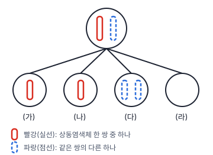

# 생명과학 복습 1001 문제설명

왼쪽 목차로 문항을 고르고, 오른쪽 문제를 보며 해설을 따라가요.

문제의 첫 줄부터 검산까지 설명해요.

**목차**

- [문항별 설명](#problems)
  - [P1. 반보존적 복제의 뜻](#p1)
  - [P2. 전사는 무엇을 만들까](#p2)
  - [P3. 전사의 주형](#p3)
  - [P4. 전사와 복제·번역 구별](#p4)
  - [P5. 복제 효소와 프라이머](#p5)
  - [P6. 번역의 직접 산물](#p6)
  - [P7. 교정과 수선](#p7)
  - [P8. 상보 가닥과 역평행](#p8)
  - [P9. DNA 정보의 최종 산물](#p9)
  - [P10. DNA와 RNA의 공통 구성](#p10)
  - [P11. RNA에 들어가는 네 염기](#p11)
  - [P12. 유전자는 무엇을 만드는 정보인가](#p12)
  - [P13. RNA의 당은 무엇인가](#p13)
  - [P14. DNA와 RNA의 일반적인 가닥 수](#p14)
  - [P15. 단백질까지의 정보 흐름](#p15)
  - [P16. 전사로 만들어지는 사본](#p16)
  - [P17. G가 22%일 때 나머지 염기](#p17)
  - [P18. 샤가프의 규칙이 말하는 것](#p18)
  - [P19. 핵산과 효소의 재료 구분](#p19)
  - [P20. 새 DNA 가닥이 자라는 쪽](#p20)
  - [P21. [변형] 두 번째 분열의 비분리](#p21)
  - [P22. [변형] 한 염색체와 한 세트](#p22)
  - [P23. [변형] 두 세대 뒤의 DNA 밀도](#p23)
  - [P24. [변형] 복제분기점의 두 새 가닥](#p24)
  - [P25. [변형] 오류를 고치는 시점](#p25)
  - [P26. [변형] 전체 복제와 일부 정보 읽기](#p26)
  - [P27. [변형] 복제 효소와 두 새 가닥의 방향](#p27)
  - [P28. [변형] 교정과 수선 뒤에도 남는 오류](#p28)
  - [P29. [변형] 그림으로 두 새 가닥 판별하기](#p29)
  - [P30. [변형] 배우자 속 염색체 색으로 비분리 시기 읽기](#p30)
  - [P31. [변형] 성염색체 조합과 SRY 진술 판정](#p31)
  - [P32. [변형] 우성 질환 가족의 자녀 확률](#p32)
  - [P33. [변형] 정상 부부에게서 태어난 환자 아이](#p33)
  - [P34. [변형] 100 염기쌍 조각의 길이와 수소결합](#p34)
  - [P35. [변형] 복제 효소와 프라이머, 틀린 설명 고르기](#p35)
  - [P36. [변형] 복제된 염색체의 두 자매염색분체 속 질소](#p36)

## 문항별 설명

### P1. 반보존적 복제의 뜻

기출 5강 1 · [원 문제 보기](../%EB%B3%B5%EC%8A%B5%EB%AC%B8%EC%A0%9C_1001_Chromosome_Changes_and_DNA_Replication.html#p1)

반보존적 복제가 지칭하는 것은?

- (1) DNA는 9개의 가능한 뉴클레오타이드 중 단지 4개만으로 만들어 진다
- (2) 각 분자의 양쪽 가닥은 오래된 절편과 새로운 절편이 섞인 상태로 갖는다
- (3) DNA의 이중나선은 항상 부모 가닥과 새로이 합성된 가닥으로 구성된다
- (4) DNA는 단일 나선이 아니라 서로 상보적인 이중나선으로 되어 있다
- (5) DNA복제의 방법은 잘 알려져 있지 않다

기출 원문 보기

기출 5강 합본 1번 (PDF 1쪽)

#### 문제를 내 말로 읽어요

주어진 것: ‘반보존적 복제’라는 이름 하나와, DNA에 관한 다섯 문장이에요.

구할 것: 다섯 문장 가운데 **반보존적 복제라는 말의 뜻**을 설명한 문장 하나를 골라요. DNA에 관해 맞는 사실이라도 이 이름의 뜻이 아니면 답이 아니에요.

쉽게 말하면, 지퍼 달린 옷 한 벌을 두 벌로 늘릴 때 원래 옷의 한쪽 지퍼 줄이 새 옷마다 하나씩 남는지 묻는 문제예요.

#### 이 문제를 봤을 때 떠올릴 개념과 공식

‘반보존적’이라는 단어 자체가 단서예요. ‘반(semi)’은 절반, ‘보존(conservative)’은 원래 것을 그대로 남긴다는 뜻이에요. 그래서 반보존적 복제(semiconservative replication)는 **복제된 DNA 이중나선마다 원래(부모) 가닥 한 가닥이 그대로 남고, 나머지 한 가닥은 새로 합성된다**는 모형이에요.

이 모형이 나온 이유는 상보적 염기쌍(complementary base pairing) 규칙이에요. A는 T와, G는 C와 짝을 이루므로 두 가닥이 풀리면 각 가닥이 주형(template)이 되어 맞은편 가닥을 다시 만들 수 있어요.

교과서는 비교할 다른 두 모형도 소개해요. 보존적 복제 모형(conservative model)은 원래 이중나선이 통째로 남고 새 이중나선이 따로 생긴다는 모형이고, 분산적 복제 모형(dispersive model)은 각 가닥에 오래된 절편과 새 절편이 섞인다는 모형이에요. 1958년 메셀슨과 스탈의 실험이 반보존적 모형을 증명했어요.

그래서 보기마다 ‘복제 결과물 하나에 옛 가닥과 새 가닥이 어떻게 들어 있는지’를 말하는지부터 확인해요.

관련 정리노트: [원래 가닥 하나와 새 가닥 하나](../%EC%A0%95%EB%A6%AC%EB%85%B8%ED%8A%B8_1001_Chromosome_Changes_and_DNA_Replication.html#s4-semiconservative)

#### 종이에 쓸 첫 줄

세 모형을 한 줄씩 먼저 적어요.

- 반보존적: 새 이중나선 = 옛 가닥 1 + 새 가닥 1
- 보존적: 옛 이중나선 그대로 1개 + 완전히 새 이중나선 1개
- 분산적: 각 가닥 = 옛 절편과 새 절편이 섞임

그다음 각 보기 옆에 ‘복제 모형을 말하나? 말한다면 어느 모형인가?’를 적어요.

#### 왜 이렇게 푸는지 함께 따라가요

(1) 틀려요. DNA가 네 종류 뉴클레오타이드(A, T, G, C를 가진 것)로 이루어진다는 내용은 DNA의 재료 이야기예요. 복제할 때 옛 가닥이 어떻게 남는지는 말하지 않으므로 반보존적 복제의 뜻이 아니에요.

(2) 틀려요. 한 가닥 안에 오래된 절편과 새 절편이 섞인다는 것은 분산적 복제 모형의 설명이에요. 반보존적 모형에서는 한 가닥 전체가 옛 가닥이거나 새 가닥이에요.

(3) 맞아요. 복제된 이중나선이 언제나 부모 가닥 하나와 새로 합성된 가닥 하나로 이루어진다는 것이 바로 반보존적 복제의 정의예요.

(4) 틀려요. DNA가 상보적인 이중나선이라는 것은 구조에 관한 사실이에요. 이 구조는 세 모형 모두와 함께 쓸 수 있으므로, 어떤 가닥이 보존되는지 정해 주지 않아요.

(5) 틀려요. 메셀슨과 스탈의 실험으로 DNA 복제가 반보존적이라는 것이 이미 증명되었어요. 또 이 문장은 용어의 뜻을 설명하지도 않아요.

따라서 답은 (3)이에요.

#### 완성 답과 검산

답 (3).

소거로 확인해요: 복제 결과물 속 옛 가닥·새 가닥의 배치를 말하는 보기는 (2)와 (3)뿐이에요. (1)·(4)는 DNA 구조, (5)는 연구 상황 이야기라 먼저 빠져요. 남은 둘 중 (2)는 분산적 모형이므로 (3)만 남아요.

교과서 대조: 교과서 5장 p.96~97에서 왓슨과 크릭의 모형을 반보존적 복제라 부르고, 분산적 모형을 ‘양쪽 가닥이 오래된 절편과 새로운 절편이 섞인 상태’로 설명해요. 그림 5.5 설명도 복제가 끝나면 반은 오래되고 반은 새로운 분자가 된다고 해요. 기출 5강 합본 1번의 표시된 답도 ③이에요.

#### 이 문항에서 하기 쉬운 실수

(2)에도 ‘오래된’과 ‘새로운’이 함께 나와서 반보존적 복제처럼 보여요. 섞이는 단위가 **가닥 전체**인지 **가닥 안의 절편**인지 확인해야 해요.

(4)는 DNA에 관해 맞는 사실이라 고르기 쉬워요. 질문은 ‘맞는 사실’이 아니라 ‘반보존적 복제가 지칭하는 것’이에요.

#### 설명을 닫고 다시 해 봐요

- 반보존적·보존적·분산적 모형을 각각 한 줄로 그림이나 말로 그려 보기
- 보기 (2)가 어느 모형의 설명인지, 어떤 단어 때문인지 짚어 보기
- (4)가 사실인데도 답이 아닌 이유를 한 문장으로 말해 보기

**페이지 요약**

#### 떠올릴 개념·공식

반보존적 복제: 새 이중나선 = 옛 가닥 1 + 새 가닥 1. 분산적 모형은 가닥 안에 옛·새 절편이 섞여요.

#### 첫 줄

세 복제 모형을 한 줄씩 적고 보기마다 어느 모형인지 표시해요.

#### 핵심 판단

(1)·(4)는 구조, (5)는 사실과 반대, (2)는 분산적 모형이라 틀리고 (3)이 정의예요.

#### 검산

교과서 5장 p.96~97 세 모형 설명과 기출 표시 답 ③이 일치해요. 답 (3).

---

### P2. 전사는 무엇을 만들까

기출 5강 2 · [원 문제 보기](../%EB%B3%B5%EC%8A%B5%EB%AC%B8%EC%A0%9C_1001_Chromosome_Changes_and_DNA_Replication.html#p2)

다음 중 전사에 관한 설명으로 옳은 것은?

- (1) 리보솜에서 일어난다
- (2) 번역될 유전자의 RNA 사본을 생성한다
- (3) 타이민과 아데닌 쌍을 만든다
- (4) 존재하는 DNA 분자로부터 새로운 딸 DNA 분자를 합성한다

기출 원문 보기

기출 5강 합본 2번 (PDF 1쪽)

#### 문제를 내 말로 읽어요

주어진 것: ‘전사’에 관한 네 문장이에요. 장소, 산물, 염기쌍, 새 DNA 합성이 하나씩 나와요.

구할 것: 전사에 관한 설명으로 **옳은 것** 하나를 골라요.

쉽게 말하면, 책 한 부분을 공책에 옮겨 적는 일(전사)을 바르게 설명한 문장을 찾는 문제예요.

**문항 결함:** 보기 (3) ‘타이민과 아데닌 쌍을 만든다’는 읽는 방식에 따라 맞을 수도 있어요. 전사 중에 DNA 주형가닥의 T가 RNA 뉴클레오타이드의 A와 잠깐 짝을 이루기 때문이에요. 출제 의도와 기출 표시 답은 (2)예요.

#### 이 문제를 봤을 때 떠올릴 개념과 공식

‘전사’라는 단어에서 중심 원리(central dogma) DNA → RNA → 단백질의 첫 화살표를 떠올려요.

전사(transcription)는 DNA에 암호화된 유전자 정보를 상보적인 RNA 사본으로 옮기는 과정이에요. 진핵세포에서는 핵에서 일어나고, RNA 중합효소(RNA polymerase)가 DNA 주형가닥(template strand)에 맞춰 RNA 뉴클레오타이드를 이어요. 단백질 암호화 유전자라면 그 사본이 전령 RNA(mRNA)이고, 이것이 리보솜(ribosome)에서 번역(translation)돼요.

전사를 복제(replication)와 구별하는 기준도 함께 떠올려요. 복제는 DNA 전체로 새 DNA를 만들고, 전사는 유전자 부분으로 단일가닥 RNA를 만들어요. RNA에는 티민(T) 대신 우라실(U)이 들어가요.

그래서 보기마다 ‘장소·산물·염기가 전사와 맞는가, 아니면 번역이나 복제의 설명인가’를 확인해요.

관련 정리노트: [전체 복제와 유전자 전사·번역 구별하기](../%EC%A0%95%EB%A6%AC%EB%85%B8%ED%8A%B8_1001_Chromosome_Changes_and_DNA_Replication.html#s7-expression)

#### 종이에 쓸 첫 줄

비교표의 첫 행을 써요: **| 과정 | 장소 | 주형 → 산물 |**

그 아래 세 행을 채워요: ‘복제 | 핵 | DNA → DNA’, ‘전사 | 핵 | DNA → RNA(U 사용)’, ‘번역 | 리보솜 | mRNA → 폴리펩티드’. 보기가 어느 행과 맞는지 표시해요.

#### 왜 이렇게 푸는지 함께 따라가요

(1) 틀려요. 리보솜은 mRNA를 읽어 폴리펩티드를 만드는 번역의 장소예요. 표의 번역 행에 해당해요.

(2) 맞아요. 전사는 번역될 유전자의 정보를 RNA 사본(mRNA)으로 만들어요. 표의 전사 행과 정확히 일치해요.

(3) 출제 의도로는 틀려요. 하지만 엄밀히는 맞을 수도 있어요. 전사 중 DNA 주형가닥의 T 자리에는 RNA의 A가 와서 짝을 이루므로(TAC ↔ AUG), T–A 짝짓기가 실제로 잠깐 생겨요. 출제 의도는 ‘전사의 결과물은 RNA라서 T가 없고, 주형의 A는 U와 짝을 이룬다’는 점이에요. 즉 T–A 염기쌍을 결과로 남기는 것은 복제이고 전사가 아니라는 뜻으로 (3)을 틀린 보기로 냈어요.

(4) 틀려요. 기존 DNA로부터 새 딸 DNA를 만드는 것은 복제예요. 표의 복제 행에 해당해요.

(3)은 해석에 따라 맞을 수도 있지만, 전사의 정의(유전자 정보 → RNA 사본) 자체를 설명하는 보기는 (2) 하나예요. 기출 표시 답도 ②이므로 의도한 답은 (2)예요.

#### 완성 답과 검산

출제 의도·인쇄 답은 (2)예요. 문자 그대로는 (3)도 참일 수 있어 단일 정답을 확정할 수 없어요.

소거로 확인해요: (1)은 번역, (4)는 복제의 설명이라 확실히 빠져요. 남은 (2)는 전사의 산물을 바르게 설명하고, (3)도 DNA 주형 T와 RNA A의 짝짓기로 읽으면 참일 수 있어요. 발문에 강조된 우선순위 기준은 없으므로 정의를 더 직접 설명한다는 이유만으로 (3)을 배제할 수 없어요. 인쇄 답 (2)는 출제 의도이며 엄밀한 단일 정답 확정과 달라요.

교과서 대조: 교과서 5장 p.101에서 전사는 DNA에 암호화된 정보가 상보적인 RNA 사본으로 만들어지는 과정이고, 번역은 리보솜과 연계되어 일어난다고 해요. p.103에서 전사는 RNA 중합효소가 촉매하고 RNA 전사체에서는 티민 대신 우라실이 쓰인다고 설명해요. 기출 5강 합본 2번의 표시된 답도 ②예요.

#### 이 문항에서 하기 쉬운 실수

‘RNA에는 T가 없다’만 기억하면 (3)을 쉽게 지울 수 있지만, 전사 중 주형 DNA의 T가 RNA의 A와 짝을 이룬다는 사실을 놓친 판단이에요. 반대로 그 사실 때문에 (3)을 답으로 고르면 출제 의도와 어긋나요.

시험에서 이런 보기를 만나면 ‘엄밀히 참일 수 있는 보기’와 ‘과정의 정의를 정확히 설명한 보기’를 비교해, 정의에 해당하는 보기를 고르는 것이 안전해요. 시험 뒤 이의 제기를 할 때는 교과서 그림 5.12를 근거로 들 수 있어요.

#### 설명을 닫고 다시 해 봐요

- 복제·전사·번역의 장소와 ‘주형 → 산물’을 표로 써 보기
- 전사 중 주형 DNA의 A와 T가 각각 RNA의 어떤 염기와 짝을 이루는지 써 보기
- (3)이 해석에 따라 왜 맞을 수도 있는지, 인쇄·출제 의도 답 (2)와 엄밀한 단일 정답 불확정을 구별해 한 문장으로 말해 보기

**페이지 요약**

#### 떠올릴 개념·공식

전사: DNA 유전자 → RNA 사본(U 사용). 번역은 리보솜, 복제는 DNA → DNA.

#### 첫 줄

| 과정 | 장소 | 주형 → 산물 | 표에 복제·전사·번역 세 행을 채워요.

#### 핵심 판단

(1) 번역, (4) 복제라 틀려요. (3)은 주형 T–RNA A 짝짓기로 보면 엄밀히는 참일 수 있는 결함 보기예요. 출제 의도·인쇄 답은 (2)이지만, 엄밀한 단일 정답은 불확정이에요.

#### 검산

교과서 5장 p.101·103과 기출 표시 답 ②가 일치해요. 출제 의도·인쇄 답은 (2)예요. 문자 그대로는 (3)도 참일 수 있어 단일 정답을 확정할 수 없어요.

---

### P3. 전사의 주형

기출 5강 4 · [원 문제 보기](../%EB%B3%B5%EC%8A%B5%EB%AC%B8%EC%A0%9C_1001_Chromosome_Changes_and_DNA_Replication.html#p3)

다음 중 전사가 일어나는 동안 주형으로 이용되는 것은?

- (1) miRNA
- (2) DNA
- (3) mRNA
- (4) tRNA
- (5) 중합효소

기출 원문 보기

기출 5강 합본 4번 (PDF 1쪽)

#### 문제를 내 말로 읽어요

주어진 것: ‘전사가 일어나는 동안’이라는 시점과 분자·효소 다섯 개예요.

구할 것: 전사에서 **주형(template)**, 즉 베껴 쓸 원본 역할을 하는 것 하나를 골라요.

쉽게 말하면, 책의 한 부분을 공책에 옮겨 적을 때 ‘원본 책’이 무엇인지 묻는 문제예요. 공책(만들어지는 것)이나 펜(도구)을 고르면 안 돼요.

#### 이 문제를 봤을 때 떠올릴 개념과 공식

‘전사’와 ‘주형’이라는 두 단어에서 중심 원리(central dogma) DNA → RNA → 단백질의 첫 화살표를 떠올려요.

전사(transcription)는 DNA에 암호화된 정보를 상보적인 RNA 사본으로 옮기는 과정이에요. 이때 DNA 두 가닥 중 한 가닥, 즉 주형가닥(template strand)만 원본으로 쓰이고, RNA 중합효소(RNA polymerase)가 그 염기에 맞는 RNA 뉴클레오타이드를 하나씩 붙여요.

주형을 고르는 기준은 ‘정보를 제공하는 원본이냐’예요. 만들어지는 결과물(산물)이나 반응을 돕는 효소는 주형이 아니에요. 그래서 보기마다 원본·산물·도구 중 무엇인지 분류해요.

관련 정리노트: [전체 복제와 유전자 전사·번역 구별하기](../%EC%A0%95%EB%A6%AC%EB%85%B8%ED%8A%B8_1001_Chromosome_Changes_and_DNA_Replication.html#s7-expression)

#### 종이에 쓸 첫 줄

먼저 이렇게 적어요: **전사: 원본(주형) = ? → 산물 = RNA, 도구 = RNA 중합효소**.

그다음 보기 다섯 개를 ‘원본 / 산물(RNA 종류) / 도구’ 칸에 나눠 넣어요.

#### 왜 이렇게 푸는지 함께 따라가요

(1) 틀려요. miRNA는 RNA의 한 종류예요. 전사로 만들어질 수 있는 산물 쪽이지, 전사에서 정보를 주는 원본이 아니에요.

(2) 맞아요. 전사는 DNA의 유전자 부분 한 가닥을 주형으로 써서 RNA를 합성해요.

(3) 틀려요. mRNA는 단백질 암호화 유전자가 전사되어 만들어지는 산물이에요. mRNA는 다음 단계인 번역에서 정보원으로 쓰여요.

(4) 틀려요. tRNA도 RNA의 한 종류로, 번역에서 아미노산을 운반하는 분자예요. 전사의 원본이 아니에요.

(5) 틀려요. 중합효소는 뉴클레오타이드를 연결하는 반응을 촉매하는 도구예요. 유전 정보를 담은 원본이 아니에요.

따라서 답은 (2)예요.

#### 완성 답과 검산

답 (2).

소거로 확인해요: 보기 중 RNA가 셋((1), (3), (4))이고 효소가 하나((5))예요. RNA는 전사의 산물 쪽이고 효소는 도구이므로 넷이 함께 빠지고, 핵산이면서 RNA가 아닌 DNA만 남아요.

교과서 대조: 교과서 5장 p.101에서 전사 과정에서 DNA 두 가닥 중 주형가닥 하나만이 RNA 가닥으로 전사된다고 설명해요. p.103 그림 5.12에서도 ‘DNA 주형가닥’에 RNA 뉴클레오타이드가 염기쌍을 이뤄요. 기출 5강 합본 4번의 표시된 답도 ②예요.

#### 이 문항에서 하기 쉬운 실수

mRNA를 ‘유전 정보를 가진 분자’로 외워 두면 (3)을 고르기 쉬워요. mRNA는 **번역**의 주형이고, 전사에서는 만들어지는 결과물이에요.

‘전사에 꼭 필요한 것’과 ‘전사의 주형’을 혼동하면 (5) 중합효소를 고를 수 있어요.

#### 설명을 닫고 다시 해 봐요

- 복제·전사·번역 각각의 주형과 산물을 한 줄씩 적어 보기
- 보기 다섯 개를 원본/산물/도구로 다시 분류해 보기

**페이지 요약**

#### 떠올릴 개념·공식

전사: DNA 주형가닥 → RNA. 도구는 RNA 중합효소예요.

#### 첫 줄

‘원본(주형) / 산물 / 도구’ 칸을 만들고 보기를 나눠 넣어요.

#### 핵심 판단

miRNA·mRNA·tRNA는 RNA라 산물 쪽, 중합효소는 도구라 틀리고 DNA가 주형이에요.

#### 검산

교과서 5장 p.101 주형가닥 설명과 기출 표시 답 ②가 일치해요. 답 (2).

---

### P4. 전사와 복제·번역 구별

기출 5강 7 · [원 문제 보기](../%EB%B3%B5%EC%8A%B5%EB%AC%B8%EC%A0%9C_1001_Chromosome_Changes_and_DNA_Replication.html#p4)

다음 중 전사 과정 동안 일어나는 현상으로 옳은 것은?

- (1) 단백질을 만들기 위하여 RNA가 주형으로 사용된다
- (2) RNA를 만들기 위하여 DNA가 주형으로 사용된다
- (3) 단백질을 만들기 위하여 DNA가 주형으로 사용된다
- (4) DNA를 만들기 위하여 DNA가 주형으로 사용된다

기출 원문 보기

기출 5강 합본 7번 (PDF 1쪽)

#### 문제를 내 말로 읽어요

주어진 것: 네 보기가 모두 ‘○○를 만들기 위해 △△가 주형으로 사용된다’는 같은 틀로 쓰여 있어요.

구할 것: 이 중 **전사**에서 일어나는 일, 즉 주형과 산물의 짝이 전사와 맞는 것 하나를 골라요.

쉽게 말하면, ‘무엇을 보고 → 무엇을 만드는지’ 화살표 네 개 중 전사의 화살표를 찾는 문제예요.

#### 이 문제를 봤을 때 떠올릴 개념과 공식

보기마다 ‘주형’과 ‘만들어지는 것’이 짝으로 나오므로, 정보 전달 과정을 **주형 → 산물** 화살표로 정리한 중심 원리(central dogma)를 떠올려요.

DNA 복제(replication)는 DNA → DNA, 전사(transcription)는 DNA → RNA, 번역(translation)은 mRNA → 폴리펩티드(polypeptide)예요. 세 과정은 주형과 산물의 조합이 서로 달라서, 조합만 보면 어느 과정인지 하나로 정해져요.

그래서 각 보기를 ‘주형 → 산물’ 화살표로 바꿔 쓰고, 그 화살표가 세 과정 중 어디에 해당하는지 대응시켜요.

관련 정리노트: [전체 복제와 유전자 전사·번역 구별하기](../%EC%A0%95%EB%A6%AC%EB%85%B8%ED%8A%B8_1001_Chromosome_Changes_and_DNA_Replication.html#s7-expression)

#### 종이에 쓸 첫 줄

기준 세 줄을 먼저 써요: **복제 DNA→DNA / 전사 DNA→RNA / 번역 RNA→단백질**.

그 아래에 보기 (1)을 ‘RNA → 단백질’처럼 화살표로 바꿔 적고, 기준 줄 중 어느 것과 같은지 표시해요.

#### 왜 이렇게 푸는지 함께 따라가요

(1) 틀려요. RNA → 단백질은 번역의 화살표예요. 전사가 아니에요.

(2) 맞아요. DNA → RNA는 DNA 주형가닥에서 RNA 사본을 만드는 전사의 화살표예요.

(3) 틀려요. DNA → 단백질이라는 직접 화살표는 기준 세 줄 어디에도 없어요. DNA 정보는 먼저 RNA로 전사된 뒤 번역되어야 폴리펩티드가 돼요.

(4) 틀려요. DNA → DNA는 복제의 화살표예요.

따라서 답은 (2)예요.

#### 완성 답과 검산

답 (2).

다른 경로로 확인해요: 이번에는 산물만 봐요. 전사의 산물은 RNA인데, 산물이 RNA인 보기는 (2) 하나뿐이에요((1)·(3)은 단백질, (4)는 DNA). 주형으로 보든 산물로 보든 (2)만 남아요.

교과서 대조: 교과서 5장 p.101에서 전사는 DNA에 암호화된 정보가 상보적인 RNA 사본으로 만들어지는 과정, 번역은 RNA 정보로 아미노산을 폴리펩티드로 조립하는 과정이라고 정의해요. 기출 5강 합본 7번의 표시된 답도 ②예요.

#### 이 문항에서 하기 쉬운 실수

‘유전자는 단백질을 지정한다’는 말만 기억하면 (3)처럼 DNA에서 바로 단백질이 만들어진다고 착각하기 쉬워요. 중간에 RNA 단계가 반드시 있어요.

네 보기 문장이 거의 같아서 주형과 산물 자리를 바꿔 읽기 쉬워요. ‘~을 만들기 위하여’ 앞이 산물, ‘~가 주형으로’ 앞이 주형이에요.

#### 설명을 닫고 다시 해 봐요

- 복제·전사·번역의 ‘주형 → 산물’ 화살표를 보지 않고 써 보기
- 보기 (1), (3), (4)가 각각 어느 과정이거나 왜 어디에도 없는지 말해 보기

**페이지 요약**

#### 떠올릴 개념·공식

복제 DNA→DNA, 전사 DNA→RNA, 번역 RNA→폴리펩티드.

#### 첫 줄

기준 화살표 세 줄을 쓰고 보기를 화살표로 바꿔 대응시켜요.

#### 핵심 판단

(1) 번역, (4) 복제, (3) 없는 경로라 틀리고 (2)가 전사예요.

#### 검산

산물이 RNA인 보기는 (2)뿐이고, 교과서 5장 p.101 정의·기출 표시 답 ②와 일치해요. 답 (2).

---

### P5. 복제 효소와 프라이머

기출 5강 8 · [원 문제 보기](../%EB%B3%B5%EC%8A%B5%EB%AC%B8%EC%A0%9C_1001_Chromosome_Changes_and_DNA_Replication.html#p5)

다음은 DNA 복제에 관한 내용이다. 보기 중 틀린 것은?

- (1) 한 가닥의 새로운 DNA는 연속적으로 합성되고, 다른 가닥은 불연속적으로 합성된다
- (2) DNA로 구성되는 프라이머에 의해 DNA 중합효소는 합성의 시작점을 제공받는다
- (3) DNA의 복제 시, 주형과 상보적인 복사본 사슬은 서로 감긴 채로 있어서 반은 오래된 그리고 반은 새로운 분자체를 형성한다
- (4) DNA 주형가닥의 분리는 DNA 헬리케이스에 의해 촉매된다
- (5) DNA 중합효소는 5’ -&gt; 3’ 방향으로만 뉴클레오타이드 사슬을 만든다

기출 원문 보기

기출 5강 합본 8번 (PDF 1쪽)

#### 문제를 내 말로 읽어요

주어진 것: DNA 복제에 관한 다섯 문장이에요. 선도·지연가닥, 프라이머, 반보존성, 헬리케이스, 합성 방향이 하나씩 나와요.

구할 것: 이 문제는 **틀린 것**을 골라요. 다섯 문장을 하나씩 맞아요/틀려요로 판정한 뒤, ‘틀려요’가 나온 문장이 답이에요.

쉽게 말하면, 복제 공장의 작업 설명서 다섯 줄 중 잘못 적힌 한 줄을 찾는 문제예요.

#### 이 문제를 봤을 때 떠올릴 개념과 공식

‘DNA 복제’와 보기 속 효소 이름(헬리케이스, DNA 중합효소, 프라이머)에서 복제분기점(replication fork)에서 일하는 효소들의 순서를 떠올려요.

DNA 헬리케이스(DNA helicase)가 ATP 에너지로 염기 사이 수소결합을 끊어 두 가닥을 풀어요. 그런데 DNA 중합효소(DNA polymerase)는 이미 있는 사슬의 3′ 말단에만 뉴클레오타이드를 붙일 수 있어서 혼자서는 시작하지 못해요. 그래서 프라이메이스(primase)가 짧은 **RNA** 가닥인 프라이머(primer)를 먼저 깔아 시작점을 줘요. 이 RNA 프라이머는 나중에 제거되고 DNA로 바뀌어요.

DNA 중합효소는 새 가닥을 5′→3′ 방향으로만 늘려요. 두 주형가닥은 역평행(antiparallel)이므로, 한 가닥(선도가닥, leading strand)은 풀리는 방향으로 연속 합성되고, 다른 가닥(지연가닥, lagging strand)은 반대 방향으로 짧은 오카자키 절편(Okazaki fragment)을 만들며 불연속적으로 합성돼요.

그래서 보기마다 ‘누가, 무엇으로, 어느 방향으로’가 이 규칙과 맞는지 하나씩 대조해요. 특히 재료 이름(DNA인지 RNA인지)을 꼼꼼히 봐요.

관련 정리노트: [헬리케이스·프라이메이스·DNA 중합효소](../%EC%A0%95%EB%A6%AC%EB%85%B8%ED%8A%B8_1001_Chromosome_Changes_and_DNA_Replication.html#s5-replication-machinery), [선도가닥과 지연가닥](../%EC%A0%95%EB%A6%AC%EB%85%B8%ED%8A%B8_1001_Chromosome_Changes_and_DNA_Replication.html#s5-strands)

#### 종이에 쓸 첫 줄

효소 역할 표의 첫 행을 이렇게 써요: **| 효소·분자 | 하는 일 | 재료 |**

바로 아래에 ‘헬리케이스 | 두 가닥을 푼다 | ATP’, ‘프라이메이스 | 프라이머를 만든다 | RNA’, ‘DNA 중합효소 | 3′ 말단에 붙여 5′→3′로 늘린다 | DNA’를 채운 뒤 보기와 비교해요.

#### 왜 이렇게 푸는지 함께 따라가요

(1) 맞아요. 선도가닥은 연속적으로, 지연가닥은 오카자키 절편으로 불연속적으로 합성돼요.

(2) 틀려요. DNA 중합효소에 시작점을 주는 프라이머는 DNA가 아니라 프라이메이스가 만드는 짧은 **RNA** 가닥이에요.

(3) 맞아요. 복제가 끝나면 주형가닥과 그에 상보적인 새 가닥이 서로 감긴 채 남아, 반은 오래되고 반은 새로운 분자가 돼요. 반보존적 복제의 내용이에요.

(4) 맞아요. DNA 헬리케이스가 염기 사이 수소결합을 끊어 주형가닥 두 개를 분리해요.

(5) 맞아요. DNA 중합효소는 기존 사슬의 3′ 말단에만 뉴클레오타이드를 붙이므로 새 사슬은 5′→3′ 방향으로만 자라요.

이 문제는 틀린 것을 고르므로, 틀려요로 판정된 (2)가 답이에요. 답은 (2)예요.

#### 완성 답과 검산

답 (2).

교과서 대조: 교과서 5장 p.98 ‘RNA 프라이머는 DNA 중합효소가 새로운 DNA 가닥을 합성하기 위한 시작점을 제공한다’ 문단에서 프라이머가 ‘DNA 대신에 RNA로 구성되는’ 짧은 가닥이라고 해요. 같은 쪽에 헬리케이스((4))와 연속·불연속 합성((1))이, p.97에 5′→3′ 합성((5))이, p.96 그림 5.5 설명에 (3)과 같은 문장이 있어요. 맞는 네 문장이 모두 교과서에서 확인되므로 틀린 것은 (2) 하나예요.

기출 5강 합본 8번의 표시된 답도 ②예요.

#### 이 문항에서 하기 쉬운 실수

(2)는 ‘프라이머가 DNA 중합효소에 시작점을 준다’는 역할 부분이 맞아서 그냥 넘기기 쉬워요. **재료가 DNA인지 RNA인지** 한 단어가 틀린 곳이에요.

(3)은 문장이 길고 낯설어 틀린 것처럼 보여요. 끝부분 ‘반은 오래된, 반은 새로운’이 반보존적 복제를 말한다는 것을 확인해요.

#### 설명을 닫고 다시 해 봐요

- 헬리케이스 → 프라이메이스 → DNA 중합효소 → 연결효소의 순서와 역할을 써 보기
- 프라이머가 왜 필요한지 ‘3′ 말단’이라는 말로 설명해 보기
- 선도가닥과 지연가닥이 왜 다르게 합성되는지 역평행과 5′→3′로 말해 보기

**페이지 요약**

#### 떠올릴 개념·공식

헬리케이스가 풀고, 프라이메이스가 RNA 프라이머를 깔고, DNA 중합효소가 3′ 말단에 붙여 5′→3′로 늘려요.

#### 첫 줄

| 효소·분자 | 하는 일 | 재료 | 표를 만들고 보기와 대조해요.

#### 핵심 판단

(1)·(3)·(4)·(5)는 맞아요. (2)는 프라이머 재료를 DNA로 써서 틀려요. 틀린 것을 고르므로 답 (2).

#### 검산

교과서 5장 p.96~98에서 맞는 네 문장을 모두 확인했고, 기출 표시 답 ②와 일치해요.

---

### P6. 번역의 직접 산물

기출 5강 14 · [원 문제 보기](../%EB%B3%B5%EC%8A%B5%EB%AC%B8%EC%A0%9C_1001_Chromosome_Changes_and_DNA_Replication.html#p6)

번역 과정은 최종적으로 ________을(를) 생산한다.

- (1) DNA
- (2) 각 아미노산
- (3) 폴리펩타이드
- (4) RNA
- (5) 운반 RNA 분자

기출 원문 보기

기출 5강 합본 14번 (PDF 2쪽)

#### 문제를 내 말로 읽어요

주어진 것: ‘번역 과정은 최종적으로 ___을 생산한다’는 빈칸 문장과 다섯 개의 분자예요.

구할 것: 번역이 끝났을 때 나오는 **결과물(산물)** 하나를 골라요. 번역에 쓰이는 재료나 도구가 아니라 만들어지는 것을 찾아야 해요.

쉽게 말하면, 구슬(아미노산)을 실에 꿰는 작업이 끝나면 손에 무엇이 남는지 묻는 문제예요.

#### 이 문제를 봤을 때 떠올릴 개념과 공식

‘번역’과 ‘최종적으로 생산’이라는 단서에서 중심 원리(central dogma)의 두 번째 화살표 RNA → 폴리펩티드를 떠올려요.

번역(translation)은 mRNA에 담긴 코돈(codon) 정보를 리보솜(ribosome)에서 읽어, tRNA가 운반해 온 아미노산(amino acid)을 차례로 펩티드 결합으로 연결하는 과정이에요. 그 결과 생기는 아미노산 사슬이 폴리펩티드(polypeptide)예요. 비들과 테이텀의 생각이 다듬어진 ‘1유전자 1폴리펩티드설’도 유전자 하나가 폴리펩티드 하나를 지정한다는 뜻이에요.

판정 기준은 ‘이 분자가 번역 전에 이미 있던 재료·도구냐, 번역 뒤에 새로 생긴 결과냐’예요.

관련 정리노트: [전체 복제와 유전자 전사·번역 구별하기](../%EC%A0%95%EB%A6%AC%EB%85%B8%ED%8A%B8_1001_Chromosome_Changes_and_DNA_Replication.html#s7-expression)

#### 종이에 쓸 첫 줄

번역을 한 줄로 써요: **mRNA(정보) + tRNA(운반) + 아미노산(재료) → [리보솜] → ?**

왼쪽에 이미 들어간 것은 결과가 될 수 없으니, 보기를 왼쪽(투입)과 오른쪽(산물)으로 나눠요.

#### 왜 이렇게 푸는지 함께 따라가요

(1) 틀려요. DNA는 복제로 만들어지는 분자예요. 번역 단계에는 DNA가 직접 참여하지도, 만들어지지도 않아요.

(2) 틀려요. 아미노산 하나하나는 번역에 들어가는 재료예요. 번역의 결과는 그 아미노산들이 이어진 사슬이에요.

(3) 맞아요. 리보솜에서 아미노산이 차례로 연결되어 폴리펩타이드가 만들어지는 것이 번역의 최종 산물이에요.

(4) 틀려요. RNA는 전사에서 만들어지는 산물이에요. 번역에서는 mRNA가 정보원으로 쓰여요.

(5) 틀려요. 운반 RNA(tRNA)는 아미노산을 리보솜으로 나르는 도구로, 번역 전부터 있던 분자예요.

따라서 답은 (3)이에요.

#### 완성 답과 검산

답 (3).

소거로 확인해요: 첫 줄의 투입 쪽에 아미노산·tRNA가 있고, 정보원 mRNA를 포함한 RNA도 투입 쪽이에요. DNA는 번역식에 아예 없어요. 투입이 아니고 식의 오른쪽에 들어갈 수 있는 보기는 (3)뿐이에요.

교과서 대조: 교과서 5장 p.101에서 번역은 아미노산을 폴리펩타이드로 조립하기 위해 RNA에 암호화된 정보를 이용하는 것이라고 정의하고, p.102 그림 5.10에서도 mRNA 아래 최종 칸이 폴리펩타이드예요. 기출 5강 합본 14번의 표시된 답도 ③이에요.

#### 이 문항에서 하기 쉬운 실수

‘번역은 아미노산을 만든다’라고 짧게 외우면 (2)를 고르기 쉬워요. 아미노산은 새로 만들어지는 것이 아니라 **연결되는 재료**예요.

tRNA가 번역 장면에 꼭 등장하니 (5)를 산물로 착각할 수 있어요. 등장하는 것과 만들어지는 것은 달라요.

#### 설명을 닫고 다시 해 봐요

- 번역의 투입 분자 세 가지와 산물 하나를 써 보기
- 폴리펩티드와 아미노산의 차이를 한 문장으로 말해 보기

**페이지 요약**

#### 떠올릴 개념·공식

번역: mRNA 정보로 아미노산을 이어 폴리펩티드를 만들어요.

#### 첫 줄

mRNA + tRNA + 아미노산 → [리보솜] → ? 로 투입과 산물을 나눠요.

#### 핵심 판단

아미노산·tRNA·RNA는 투입, DNA는 무관해 틀리고 폴리펩타이드 (3)이 산물이에요.

#### 검산

교과서 5장 p.101 정의, p.102 그림 5.10과 기출 표시 답 ③이 일치해요. 답 (3).

---

### P7. 교정과 수선

기출 5강 15 · [원 문제 보기](../%EB%B3%B5%EC%8A%B5%EB%AC%B8%EC%A0%9C_1001_Chromosome_Changes_and_DNA_Replication.html#p7)

다음 중 DNA 복제의 오류를 수정하는 메커니즘에 대한 설명으로 잘못된 것은?

- (1) 교정 후에도 남아 있는 염기쌍 불일치들은 DNA 수선 메커니즘에 의해 수정된다
- (2) 모두 맞다
- (3) 교정과 DNA 수선 이후에도 돌연변이는 발생 할 수 있다
- (4) DNA 중합효소는 불일치 뉴클레오타이드를 제거하고 되돌릴 수 있다
- (5) DNA 중합효소는 새로운 뉴클레오타이드 사슬을 조립할 때 많은 오류를 범한다

기출 원문 보기

기출 5강 합본 15번 (PDF 2쪽)

#### 문제를 내 말로 읽어요

주어진 것: DNA 복제 오류를 고치는 방법(교정과 수선)에 관한 문장 네 개와 ‘모두 맞다’라는 보기 하나예요.

구할 것: 이 문제는 **잘못된 것**을 골라요. 각 문장을 맞아요/틀려요로 판정한 뒤 ‘틀려요’가 나온 것이 답이에요.

쉽게 말하면, 글을 쓰며 백스페이스로 바로 고치는 일(교정)과 다 쓴 뒤 다시 읽고 고치는 일(수선)에 관한 설명 중 틀린 것을 찾는 문제예요.

**문항 결함:** (5)가 틀린 문장이면 ‘모두 맞다’인 (2)도 논리적으로 틀린 문장이 돼서, ‘잘못된 것’이 두 개로 읽혀요. 출제 의도와 기출 표시 답은 (5)예요.

#### 이 문제를 봤을 때 떠올릴 개념과 공식

‘복제의 오류를 수정하는 메커니즘’이라는 말에서 교과서 5.1.3절의 두 단계를 떠올려요.

첫째, 교정(proofreading)은 복제 **중**에 일어나요. 새로 붙인 뉴클레오타이드가 주형과 짝이 맞지 않으면 DNA 중합효소(DNA polymerase)가 뒤로 물러나 그 뉴클레오타이드를 떼어 내고 다시 붙여요.

둘째, DNA 수선(DNA repair)은 복제 **후**에 일어나요. 교정 뒤에도 남은 염기쌍 불일치(base-pair mismatch)를 불일치 수선(mismatch repair)으로 다시 고쳐요.

그래도 오류가 아주 드물게 남고, 이것이 돌연변이(mutation)가 돼요. 또 교과서는 DNA 중합효소가 사슬을 조립하면서 **거의 오류를 만들지 않는다**고 설명해요. 그래서 보기마다 ‘언제, 누가, 얼마나 정확하게’가 이 설명과 맞는지 대조해요.

관련 정리노트: [복제 중 교정과 복제 후 수선](../%EC%A0%95%EB%A6%AC%EB%85%B8%ED%8A%B8_1001_Chromosome_Changes_and_DNA_Replication.html#s6-proofreading)

#### 종이에 쓸 첫 줄

시간 순서로 한 줄을 써요: **DNA 중합효소 조립(오류 거의 없음) → 교정(복제 중, 중합효소가 제거) → 수선(복제 후, 남은 불일치) → 극히 드문 돌연변이**

그리고 ‘모두 맞다’ 보기는 다른 네 문장을 다 판정한 뒤 마지막에 판정한다고 옆에 적어요.

#### 왜 이렇게 푸는지 함께 따라가요

(1) 맞아요. 교정 후에도 남은 염기쌍 불일치는 복제 후 DNA 수선 메커니즘(불일치 수선)이 고쳐요.

(3) 맞아요. 교정과 수선이 오류를 크게 줄여도 극히 드문 오류가 남아 돌연변이가 될 수 있어요.

(4) 맞아요. 교정에서 DNA 중합효소는 짝이 맞지 않는 뉴클레오타이드를 제거하고 되돌릴 수 있어요.

(5) 틀려요. 교과서는 DNA 중합효소가 새 사슬을 조립하면서 거의 오류를 만들지 않는다고 해요. ‘많은 오류를 범한다’는 이 설명과 반대예요.

(2) 엄밀히는 이것도 틀린 문장일 수 있어요. (5)가 틀렸으니 ‘모두 맞다’는 사실이 아니기 때문이에요. 하지만 이런 보기는 보통 ‘잘못된 문장이 하나도 없을 때 고르는 보기’로 쓰여요. 잘못된 문장 (5)가 있으므로 (2)는 고를 이유가 없어져요.

이 문제는 잘못된 것을 고르므로, 내용이 틀려요로 판정된 문장 (5)가 의도한 답이에요. 기출 표시 답도 ⑤예요. 답은 (5)예요.

#### 완성 답과 검산

답 (5).

교과서 대조: 교과서 5장 p.100 ‘5.1.3 복제 오류를 수정하는 메커니즘’ 첫 문장은 DNA 중합효소가 새 사슬을 조립하면서 거의 오류를 만들지 않는다고 해요. 같은 쪽에 교정 메커니즘((4)), 교정 후 남은 불일치의 DNA 수선((1)), 교정과 수선 뒤에도 극히 적은 오류가 돌연변이로 남는다는 설명((3))이 모두 있어요.

강의노트 5장 2~3쪽에도 교정·수선과 ‘교정과 DNA 수선 후에도 복제 오류가 극히 적지만 남게 됨’이 있어요. 기출 5강 합본 15번의 표시된 답도 ⑤예요.

#### 이 문항에서 하기 쉬운 실수

‘오류가 생기니까 교정이 필요하다’는 생각에서 (5)를 맞는 문장으로 볼 수 있어요. 교정이 있다는 것은 오류가 많다는 뜻이 아니에요. 처음 조립할 때부터 오류는 드물어요.

시험에서 ‘틀린 것’을 묻는 문제에 ‘모두 맞다’ 보기가 있으면, 내용이 틀린 다른 보기를 먼저 찾아요. 그런 보기가 있으면 그것을 고르고, 하나도 없을 때만 ‘모두 맞다’를 골라요.

#### 설명을 닫고 다시 해 봐요

- 교정과 수선을 ‘언제, 누가, 무엇을’로 나눠 한 줄씩 써 보기
- (5)의 어느 단어가 교과서 설명과 반대인지 짚어 보기
- ‘모두 맞다’ 보기를 언제 고르는지 규칙을 한 문장으로 말해 보기

**페이지 요약**

#### 떠올릴 개념·공식

DNA 중합효소는 오류가 거의 없고, 복제 중 교정, 복제 후 수선을 거쳐도 극히 드문 돌연변이가 남아요.

#### 첫 줄

조립 → 교정 → 수선 → 돌연변이를 시간 순으로 쓰고 ‘모두 맞다’는 마지막에 판정해요.

#### 핵심 판단

(1)·(3)·(4)는 맞고 (5)는 ‘많은 오류’라 틀려요. (2)도 엄밀히는 거짓인 결함 보기지만 의도한 답은 (5)예요.

#### 검산

교과서 5장 p.100, 강의노트 5장 2~3쪽과 기출 표시 답 ⑤가 일치해요.

---

### P8. 상보 가닥과 역평행

기출 5강 17 · [원 문제 보기](../%EB%B3%B5%EC%8A%B5%EB%AC%B8%EC%A0%9C_1001_Chromosome_Changes_and_DNA_Replication.html#p8)

만약 어떤 유전자의 일부가 5’-TAACAGGTCA-3’ 이라면 상보 DNA 가닥의 서열은?

- (1) 3’-ATTGTCCAGT-5’
- (2) 3’-UUACAGGUCC-5’
- (3) 3’-ATUGUCCAGU-5’
- (4) 3’-GGAGTGGACC-5'

기출 원문 보기

기출 5강 합본 17번 (PDF 2쪽)

#### 문제를 내 말로 읽어요

주어진 것: 한 DNA 가닥의 서열 5′-TAACAGGTCA-3′이에요. 양 끝에 방향 표시 5′과 3′이 붙어 있어요.

구할 것: 이 가닥과 짝을 이루는 **상보 DNA 가닥**의 서열을, 방향까지 맞게 쓴 보기 하나를 골라요.

쉽게 말하면, 지퍼 한쪽 이빨 모양을 보고 맞은편 이빨을 순서대로 적는 문제예요. 맞은편 지퍼는 거꾸로 달려 있다는 점도 함께 봐야 해요.

#### 이 문제를 봤을 때 떠올릴 개념과 공식

‘상보 DNA 가닥’이라는 말에서 두 가지 규칙을 떠올려요.

(a) 상보적 염기쌍(complementary base pairing): DNA에서는 A가 T와, G가 C와만 짝을 이뤄요(샤가프 규칙 [A]=[T], [G]=[C]의 근거). DNA 염기는 A, T, G, C 네 가지뿐이고, U(우라실)는 RNA에만 있어요.

(b) 역평행(antiparallel): 이중나선의 두 가닥은 방향이 반대예요. 한 가닥을 왼쪽에서 오른쪽으로 5′→3′로 읽으면, 바로 아래 짝 가닥은 같은 위치에서 3′→5′예요. 그래서 짝 가닥을 위아래로 맞춰 쓰면 왼쪽 끝이 3′이 돼요.

보기들이 모두 3′-…-5′ 형태로 방향이 맞춰져 있으므로, 이 문제에서는 각 자리 염기를 짝지은 결과와 DNA 염기만 쓰였는지를 확인하면 돼요.

관련 정리노트: [뉴클레오타이드와 상보적인 두 가닥](../%EC%A0%95%EB%A6%AC%EB%85%B8%ED%8A%B8_1001_Chromosome_Changes_and_DNA_Replication.html#s3-dna-structure), [역평행 이중나선](../%EC%A0%95%EB%A6%AC%EB%85%B8%ED%8A%B8_1001_Chromosome_Changes_and_DNA_Replication.html#s3-double-helix)

#### 종이에 쓸 첫 줄

주어진 가닥을 쓰고 바로 아래에 한 글자씩 짝을 적어요.

첫 줄: **5′- T A A C A G G T C A -3′**

둘째 줄의 첫 칸은 T의 짝 A, 그리고 왼쪽 끝 방향 표시는 3′부터 써요: **3′- A …**

#### 왜 이렇게 푸는지 함께 따라가요

열 자리를 차례로 짝지어요: T→A, A→T, A→T, C→G, A→T, G→C, G→C, T→A, C→G, A→T. 이어 쓰면 3′-ATTGTCCAGT-5′예요.

(1) 맞아요. 3′-ATTGTCCAGT-5′는 위에서 짝지은 결과와 열 자리 모두 같고, 방향도 역평행에 맞게 3′부터 쓰여 있어요.

(2) 틀려요. U가 들어 있어 DNA 가닥이 될 수 없어요. 첫 자리도 T의 짝 A가 아니라 U라서 짝지은 결과와 처음부터 달라요.

(3) 틀려요. 셋째 자리와 다섯째 자리 등에 U가 섞여 있어요. DNA의 상보 가닥에는 U가 올 수 없어요.

(4) 틀려요. 첫 자리부터 G인데, 원래 첫 자리 T의 짝은 A여야 해요. 상보 규칙에 맞지 않아요.

따라서 답은 (1)이에요.

#### 완성 답과 검산

답 (1).

되짚어 확인해요: 답 3′-ATTGTCCAGT-5′의 짝을 다시 구하면 A→T, T→A, T→A, G→C, T→A, C→G, C→G, A→T, G→C, T→A로 5′-TAACAGGTCA-3′이 나와 원래 가닥과 같아요. 상보 가닥의 상보 가닥은 원래 가닥이어야 하므로 맞아요.

염기 수로도 확인해요: 원래 가닥은 A 4개, T 2개, C 2개, G 2개예요. 상보 가닥은 T 4개, A 2개, G 2개, C 2개여야 하고, ATTGTCCAGT를 세면 정확히 그래요.

자료 대조: 강의노트 5장 1쪽의 상보적 염기 짝짓기(A–T, G–C)와 ‘두 가닥은 역평행’, 교과서 5장 p.98의 ‘주형가닥에 대해 역평행 방향’ 설명과 맞아요. 기출 5강 합본 17번의 표시된 답도 ①이에요.

#### 이 문항에서 하기 쉬운 실수

DNA 상보 가닥을 묻는데 mRNA를 만드는 전사처럼 A의 짝을 U로 쓰면 (2)나 (3)으로 가요. **DNA ↔ DNA는 A–T**, DNA → RNA일 때만 A–U예요.

짝을 지은 뒤 순서를 뒤집어 5′부터 쓰는 것과, 위아래로 맞춰 3′부터 쓰는 것을 섞으면 서열이 거꾸로 돼요. 방향 표시를 서열과 함께 써요.

#### 설명을 닫고 다시 해 봐요

- 5′-TAACAGGTCA-3′의 상보 가닥을 방향 표시와 함께 다시 써 보기
- 쓴 답을 같은 서열을 5′→3′ 순서로 바꿔 써 보기(5′-TGACCTGTTA-3′이 되는지 확인)
- DNA 상보 가닥과 RNA 전사체에서 A의 짝이 어떻게 다른지 말해 보기

**페이지 요약**

#### 떠올릴 개념·공식

DNA 상보쌍 A–T, G–C(U 없음). 두 가닥은 역평행이라 짝 가닥 왼쪽 끝은 3′.

#### 첫 줄

5′-TAACAGGTCA-3′ 아래에 한 글자씩 짝을 3′부터 적어요.

#### 핵심 판단

짝지은 결과는 3′-ATTGTCCAGT-5′. (2)·(3)은 U, (4)는 짝이 틀려요. 답 (1).

#### 검산

답의 상보 가닥이 원래 가닥으로 돌아오고, 염기 수(A4·T2 ↔ T4·A2)도 맞아요.

---

### P9. DNA 정보의 최종 산물

기출 5강 22 · [원 문제 보기](../%EB%B3%B5%EC%8A%B5%EB%AC%B8%EC%A0%9C_1001_Chromosome_Changes_and_DNA_Replication.html#p9)

DNA 암호의 서열은 최종적으로 어떠한 분자를 만드는가?

- (1) 단당류
- (2) 이당류
- (3) 글리세롤
- (4) 지질
- (5) 단백질

기출 원문 보기

기출 5강 합본 22번 (PDF 3쪽)

#### 문제를 내 말로 읽어요

주어진 것: ‘DNA 암호의 서열’과 생체 분자 다섯 가지(단당류, 이당류, 글리세롤, 지질, 단백질)예요.

구할 것: DNA 염기서열에 담긴 정보가 **최종적으로** 어떤 분자의 모양을 정하는지 골라요.

쉽게 말하면, 설계도(DNA)를 따라 공장에서 마지막에 조립되어 나오는 제품이 무엇인지 묻는 문제예요.

#### 이 문제를 봤을 때 떠올릴 개념과 공식

‘DNA 암호’와 ‘최종적으로’라는 단서에서 중심 원리(central dogma) **DNA → (전사) → RNA → (번역) → 단백질**의 끝을 떠올려요.

유전암호(genetic code)는 폴리펩티드의 아미노산 서열을 결정하는 염기 정보예요. 염기 3개가 한 코돈(codon)으로 아미노산 하나를 지정하므로, DNA 서열이 직접 정하는 것은 아미노산의 순서이고, 그 사슬(폴리펩티드)이 접히거나 모여 단백질(protein)이 돼요.

판정 기준은 ‘이 분자의 구조가 아미노산 서열, 즉 유전암호로 직접 정해지느냐’예요. 당이나 지질은 효소(단백질)의 작용으로 만들어질 수는 있지만, 그 구조가 염기서열에 암호화되어 있지는 않아요.

관련 정리노트: [전체 복제와 유전자 전사·번역 구별하기](../%EC%A0%95%EB%A6%AC%EB%85%B8%ED%8A%B8_1001_Chromosome_Changes_and_DNA_Replication.html#s7-expression)

#### 종이에 쓸 첫 줄

첫 줄에 정보 흐름을 써요: **DNA 염기서열 → mRNA 코돈 → 아미노산 서열 → ?**

그다음 보기마다 ‘아미노산으로 이루어졌나?’를 예/아니요로 표시해요.

#### 왜 이렇게 푸는지 함께 따라가요

(1) 틀려요. 단당류는 포도당 같은 당 분자로 아미노산이 아니에요. 그 구조는 유전암호로 지정되지 않아요.

(2) 틀려요. 이당류도 단당류 두 개가 결합한 당이에요. 유전 정보 흐름의 최종 산물이 아니에요.

(3) 틀려요. 글리세롤은 지방을 구성하는 작은 알코올 분자예요. 코돈이 지정하는 아미노산 사슬과 관계없어요.

(4) 틀려요. 지질은 아미노산이 아니라 지방산·글리세롤 등으로 이루어져요. 번역으로 만들어지지 않아요.

(5) 맞아요. DNA 정보는 mRNA로 전사되고 번역되어 아미노산 사슬인 폴리펩티드가 되며, 이것이 단백질을 이뤄요.

따라서 답은 (5)예요.

#### 완성 답과 검산

답 (5).

소거로 확인해요: 보기 (1)~(4)는 모두 탄수화물(단당류·이당류)이거나 지질 쪽 분자(글리세롤·지질)예요. ‘아미노산으로 이루어졌나?’에 예라고 답할 수 있는 보기는 단백질 하나뿐이에요.

교과서 대조: 교과서 5장 p.101에서 DNA로부터 단백질로의 정보 흐름을 중심이론이라 명명했다고 하고, 단백질은 유전자에 의해 지정된다고 설명해요. 강의노트 5장 3쪽에도 ‘DNA → 전사 → RNA → 번역 → 단백질’이 있어요. 기출 5강 합본 22번의 표시된 답도 ⑤예요.

#### 이 문항에서 하기 쉬운 실수

세포 안의 당과 지질도 결국 유전자의 영향을 받는다는 생각에 헷갈릴 수 있어요. 그 분자들은 **효소가 만든 결과**일 뿐, 구조 자체가 DNA 서열로 암호화된 것은 아니에요.

#### 설명을 닫고 다시 해 봐요

- DNA → 단백질 사이의 두 단계 이름과 각 산물을 써 보기
- 보기 다섯 개를 ‘아미노산으로 이루어졌나?’ 기준으로 다시 분류해 보기

**페이지 요약**

#### 떠올릴 개념·공식

중심 원리: DNA → 전사 → RNA → 번역 → 폴리펩티드(단백질).

#### 첫 줄

DNA 염기서열 → 코돈 → 아미노산 서열 → ? 를 쓰고 ‘아미노산으로 이루어졌나’로 보기를 나눠요.

#### 핵심 판단

당·글리세롤·지질은 유전암호로 지정되지 않아 틀리고, 단백질 (5)만 맞아요.

#### 검산

교과서 5장 p.101, 강의노트 5장 3쪽과 기출 표시 답 ⑤가 일치해요. 답 (5).

---

### P10. DNA와 RNA의 공통 구성

기출 5강 27 · [원 문제 보기](../%EB%B3%B5%EC%8A%B5%EB%AC%B8%EC%A0%9C_1001_Chromosome_Changes_and_DNA_Replication.html#p10)

( )때문에 RNA와 DNA의 구조는 유사하다.

- (1) 둘 다 디옥시리보스 당을 갖기
- (2) 둘 다 이중나선을 이루기
- (3) 둘 다 우라실이 발견되기
- (4) 둘 다 당과 인산과 염기로 이루어졌기

기출 원문 보기

기출 5강 합본 27번 (PDF 3쪽)

#### 문제를 내 말로 읽어요

주어진 것: RNA와 DNA의 구조가 서로 비슷하다는 문장에 빈칸이 하나 있어요.

구할 것: 그 빈칸에 들어갈 **두 핵산이 실제로 공유하는 이유** 하나를 골라요.

쉽게 말하면, 두 쌍둥이 같은 물건이 “왜 닮았는지”를 묻는 문제예요. 둘 중 하나에만 있는 특징은 닮은 이유가 될 수 없어요.

#### 이 문제를 봤을 때 떠올릴 개념과 공식

‘RNA와 DNA의 구조가 유사하다’는 단서에서 두 분자가 모두 **핵산(nucleic acid)**이고, 같은 종류의 단위체인 **뉴클레오타이드(nucleotide)**가 이어진 중합체라는 점을 떠올려요.

뉴클레오타이드 하나는 세 부분으로 이뤄져요. 질소함유 염기(nitrogenous base), 5탄당(pentose sugar), 인산기(phosphate group)예요. 이 세 부분의 **종류**는 DNA와 RNA가 조금 달라요. DNA의 당은 디옥시리보스(deoxyribose), RNA의 당은 리보스(ribose)이고, DNA는 타이민(T)을, RNA는 그 자리에 우라실(U)을 써요. 또 DNA는 보통 이중나선, RNA는 대개 한 가닥이에요.

그래서 “공통점”을 묻는 문제에서는 각 보기를 **두 분자 모두에 성립하는지** 하나씩 대조해야 해요. 한쪽에만 맞는 특징은 공통 이유가 아니에요.

관련 정리노트: [뉴클레오타이드와 상보적인 두 가닥](../%EC%A0%95%EB%A6%AC%EB%85%B8%ED%8A%B8_1001_Chromosome_Changes_and_DNA_Replication.html#s3-dna-structure)

#### 종이에 쓸 첫 줄

DNA와 RNA를 두 열로 놓는 비교표의 첫 행을 써요.

**| 항목 | DNA | RNA |** 아래에 **| 당 | 디옥시리보스 | 리보스 |**, **| 염기 | A·T·G·C | A·U·G·C |**, **| 가닥 | 보통 이중 | 대개 단일 |**, **| 단위체 구성 | 당+인산+염기 | 당+인산+염기 |**를 채워요.

그다음 각 보기가 표에서 두 열 모두 ‘예’인 행인지 표시하면 판정 준비가 끝나요.

#### 왜 이렇게 푸는지 함께 따라가요

(1) 틀려요. 디옥시리보스는 DNA의 당이에요. RNA의 당은 2′ 탄소에 OH가 있는 리보스라서 ‘둘 다’가 성립하지 않아요.

(2) 틀려요. 이중나선은 DNA의 일반적인 구조예요. RNA는 대개 한 가닥의 뉴클레오타이드 사슬로 존재해요.

(3) 틀려요. 우라실은 RNA의 염기예요. DNA에서는 그 자리에 타이민이 들어가요.

(4) 맞아요. 두 핵산 모두 뉴클레오타이드의 중합체이고, 뉴클레오타이드는 당·인산·염기 세 부분으로 이뤄져요. 당과 염기의 ‘종류’는 달라도 ‘구성 방식’은 같으므로 구조가 비슷한 이유가 돼요.

따라서 답은 (4)예요.

#### 완성 답과 검산

답 (4).

소거로 확인해요: (1)·(2)·(3)은 각각 DNA 전용(디옥시리보스, 이중나선) 또는 RNA 전용(우라실) 특징이라 ‘둘 다’에서 탈락해요. 두 열 모두 ‘예’인 행은 ‘당+인산+염기’ 하나만 남아요.

자료 대조: 강의노트 1장 p4는 뉴클레오타이드를 ‘질소함유 염기 + 5탄당 + 인산기’로 정의하고, 5탄당을 데옥시리보오스(DNA)와 리보오스(RNA)로, RNA를 ‘대개 한 가닥’으로 구분해요. 기출 5강 합본 27번의 인쇄 답도 ④예요.

#### 이 문항에서 하기 쉬운 실수

DNA에서 익숙한 특징(디옥시리보스, 이중나선)을 RNA에도 그대로 적용하기 쉬워요. ‘둘 다’라는 말이 있으면 반드시 두 분자를 따로 확인해요.

(4)를 “당과 염기가 완전히 같다”로 읽지 않아요. 같은 것은 세 부분으로 이뤄진 구성 방식이고, 당과 염기 한 종류는 달라요.

#### 설명을 닫고 다시 해 봐요

- DNA와 RNA의 당·염기·가닥 수를 비교표로 다시 써 보기
- 뉴클레오타이드의 세 구성 요소를 영어 이름과 함께 말해 보기
- 보기 (1)~(3)이 각각 DNA와 RNA 중 어느 쪽에만 맞는지 짝지어 보기

**페이지 요약**

#### 떠올릴 개념·공식

DNA·RNA는 모두 뉴클레오타이드(당+인산+염기)의 중합체예요.

#### 첫 줄

DNA | RNA 비교표에 당·염기·가닥·구성 행을 채워요.

#### 핵심 판단

디옥시리보스·이중나선은 DNA 전용, 우라실은 RNA 전용이라 공통 이유가 아니에요.

#### 검산

소거하면 (4)만 남고, 강의노트 1장 p4와 기출 인쇄 답 ④가 일치해요. 답 (4).

---

### P11. RNA에 들어가는 네 염기

기출 5강 29 · [원 문제 보기](../%EB%B3%B5%EC%8A%B5%EB%AC%B8%EC%A0%9C_1001_Chromosome_Changes_and_DNA_Replication.html#p11)

RNA를 구성하는 염기들은 어느 것인가?

- (1) 우라실, 아데닌, 구아닌, 아데노신
- (2) 아데닌, 구아닌, 사이토신, 우라실
- (3) 아데닌, 구아닌, 타이민, 우라실
- (4) 타이민, 아데닌, 구아닌, 사이토신

기출 원문 보기

기출 5강 29번 (PDF 4쪽)

#### 문제를 내 말로 읽어요

주어진 것: 네 개의 이름 묶음이 보기로 있어요.

구할 것: RNA를 이루는 **염기 네 가지**를 정확히 담은 묶음 하나를 골라요.

쉽게 말하면, RNA라는 글자판에 쓰이는 알파벳 네 개를 고르는 문제예요. 글자가 하나라도 틀리거나, 글자가 아닌 것이 끼어 있으면 탈락이에요.

#### 이 문제를 봤을 때 떠올릴 개념과 공식

‘RNA를 구성하는 염기’라는 단서에서 DNA와 RNA의 **염기 알파벳 차이**를 떠올려요. DNA는 A·T·G·C, RNA는 A·U·G·C예요. 두 핵산은 네 염기 중 세 개(아데닌 A, 구아닌 G, 사이토신 C)를 공유하고, DNA의 타이민(thymine, T) 자리에 RNA는 우라실(uracil, U)을 써요.

또 하나 구별할 것은 **염기(base)**와 **뉴클레오사이드(nucleoside)**예요. 뉴클레오사이드는 염기 + 5탄당이고, 여기에 인산이 붙으면 뉴클레오타이드예요. 아데노신(adenosine)은 아데닌 염기에 리보스가 붙은 뉴클레오사이드라서 염기 이름이 아니에요.

그래서 각 보기를 “네 이름이 모두 염기인가 → 그 네 개가 A·U·G·C와 정확히 같은가” 두 단계로 확인해요.

관련 정리노트: [뉴클레오타이드와 상보적인 두 가닥](../%EC%A0%95%EB%A6%AC%EB%85%B8%ED%8A%B8_1001_Chromosome_Changes_and_DNA_Replication.html#s3-dna-structure)

#### 종이에 쓸 첫 줄

먼저 정답 집합을 한 줄로 써요: **RNA 염기 = {A 아데닌, U 우라실, G 구아닌, C 사이토신}**.

그 아래에 각 보기의 네 이름을 옮겨 적고, 집합에 있으면 ○, 없으면 ×를 붙여요. 네 칸이 모두 ○인 보기만 남겨요.

#### 왜 이렇게 푸는지 함께 따라가요

(1) 틀려요. 아데노신은 아데닌 염기와 당이 붙은 뉴클레오사이드라 염기 이름이 아니고, 아데닌이 두 번 들어간 셈이에요. 사이토신도 빠졌어요.

(2) 맞아요. 아데닌·구아닌·사이토신·우라실은 RNA의 네 염기 A·G·C·U와 정확히 일치해요.

(3) 틀려요. 타이민은 DNA의 염기이고 RNA에는 쓰이지 않아요. 대신 사이토신이 빠졌어요.

(4) 틀려요. 타이민·아데닌·구아닌·사이토신은 DNA의 네 염기예요. RNA라면 타이민 자리에 우라실이 와야 해요.

따라서 답은 (2)예요.

#### 완성 답과 검산

답 (2).

다른 경로로 확인해요: DNA 염기 집합 {A, T, G, C}에서 T를 U로 바꾸면 {A, U, G, C}가 돼요. 이 집합과 같은 보기는 (2) 하나이고, (4)는 바꾸기 전 DNA 집합 그대로예요.

교과서 대조: 교과서 5장 p.101은 “DNA와 RNA는 4개의 염기 중 3개를 공유하며 하나만 다르다. DNA의 T는 RNA에서 U에 해당한다”고 설명해요. 기출 5강 합본 29번의 인쇄 답도 ②예요.

#### 이 문항에서 하기 쉬운 실수

‘아데노신’을 ‘아데닌’과 같은 말로 읽기 쉬워요. 아데노신은 염기에 당이 붙은 뉴클레오사이드예요(ATP의 A도 아데노신이에요).

(3)처럼 T와 U가 함께 있는 보기를 “둘 다 넣으면 안전하다”고 고르지 않아요. RNA는 T 대신 U를 쓰므로 둘이 함께 네 염기에 들어가지 않아요.

#### 설명을 닫고 다시 해 봐요

- DNA와 RNA의 염기 네 개를 각각 써 보고 다른 한 개에 동그라미 치기
- 염기·뉴클레오사이드·뉴클레오타이드의 차이를 아데닌을 예로 한 줄씩 말해 보기

**페이지 요약**

#### 떠올릴 개념·공식

DNA = A·T·G·C, RNA = A·U·G·C. 아데노신은 염기가 아니라 뉴클레오사이드예요.

#### 첫 줄

RNA 염기 집합 {A, U, G, C}를 쓰고 보기마다 ○/×를 붙여요.

#### 핵심 판단

타이민이 있으면 DNA, 아데노신이 있으면 염기 목록이 아니에요.

#### 검산

DNA 집합의 T→U 치환 결과가 (2)와 같고, 교과서 p.101과 기출 인쇄 답 ②가 일치해요. 답 (2).

---

### P12. 유전자는 무엇을 만드는 정보인가

기출 5강 30 · [원 문제 보기](../%EB%B3%B5%EC%8A%B5%EB%AC%B8%EC%A0%9C_1001_Chromosome_Changes_and_DNA_Replication.html#p12)

한 생물의 염색체에 포함된 유전자가 제품의 사용설명서와 비슷하다면, 유전자가 세포에게 지시하는 내용은 무엇인가?

- (1) 주변 환경의 요구에 맞게 모양과 구조를 바꾼다.
- (2) 설정된 크기만큼 성장하고, 복제한다.
- (3) 탄수화물을 효소로 바꾼다.
- (4) 아미노산으로부터 특정 단백질을 합성한다.

기출 원문 보기

기출 5강 30번 (PDF 4쪽)

#### 문제를 내 말로 읽어요

주어진 것: 염색체 속 유전자를 제품의 사용설명서에 비유했어요.

구할 것: 그 설명서가 세포에게 **무엇을 만들라고 지시하는지** 하나를 골라요.

쉽게 말하면, 레고 설명서가 “이 순서로 블록을 끼워 이 모양을 만들어라”라고 적혀 있듯이, 유전자에는 어떤 블록(아미노산)을 어떤 순서로 이을지가 적혀 있는지 묻는 문제예요.

#### 이 문제를 봤을 때 떠올릴 개념과 공식

‘유전자가 지시하는 내용’이라는 단서에서 **유전자 → 폴리펩티드** 관계를 떠올려요. 비들과 테이텀(Beadle & Tatum)은 붉은빵곰팡이 돌연변이로 1유전자 1효소설(one gene–one enzyme hypothesis)을 제안했고, 모든 단백질이 효소는 아니며 단백질이 여러 폴리펩티드로 이뤄질 수 있어서 1유전자 1폴리펩티드설(one gene–one polypeptide hypothesis)로 다듬어졌어요.

단백질 암호화 유전자(protein-coding gene)의 정보는 **아미노산 서열**이에요. 전사(transcription)로 그 정보를 mRNA로 옮기고, 번역(translation)에서 리보솜이 mRNA를 읽어 아미노산을 순서대로 연결해 폴리펩티드를 만들어요.

그래서 보기 가운데 “아미노산을 이어 특정 단백질을 만든다”는 정보 내용과 맞는 것을 찾고, 나머지는 유전자가 직접 담는 정보인지 따져 봐요. 이 문항은 수업이 초점을 둔 단백질 암호화 유전자를 기준으로 읽어요.

관련 정리노트: [1유전자 1효소에서 1폴리펩티드까지](../%EC%A0%95%EB%A6%AC%EB%85%B8%ED%8A%B8_1001_Chromosome_Changes_and_DNA_Replication.html#s7-gene-concept)

#### 종이에 쓸 첫 줄

정보 흐름 한 줄을 써요: **유전자(DNA의 염기 서열) → mRNA(코돈) → 아미노산 서열 → 특정 단백질**.

그다음 각 보기 옆에 “이 줄의 어느 칸에 해당하나?”를 적어요. 줄 위에 놓이지 않는 보기는 유전자가 직접 담은 지시가 아니에요.

#### 왜 이렇게 푸는지 함께 따라가요

(1) 틀려요. 유전자 하나에 “환경에 맞춰 모양과 구조를 바꿔라”라는 명령이 적혀 있지 않아요. 유전자가 담은 것은 아미노산 서열 정보이고, 형태 변화는 여러 단백질과 조절이 함께 만든 결과예요.

(2) 틀려요. 성장 크기나 복제 자체가 유전자에 적힌 지시 내용은 아니에요. DNA 복제는 효소들이 DNA 전체를 복사하는 과정이고, 유전자의 정보 흐름(전사·번역)과 구분해요.

(3) 틀려요. 효소는 단백질이라 아미노산으로 만들어져요. 탄수화물을 재료로 효소가 만들어지는 것이 아니에요.

(4) 맞아요. 단백질 암호화 유전자는 아미노산을 어떤 순서로 이을지 정하는 정보를 담고, 번역에서 그 순서대로 아미노산이 연결돼 특정 단백질(폴리펩티드)이 돼요.

따라서 답은 (4)예요.

#### 완성 답과 검산

답 (4).

소거로 확인해요: 첫 줄의 정보 흐름(DNA → mRNA → 아미노산 서열 → 단백질) 위에 놓이는 보기는 (4)뿐이에요. (1)·(2)는 유전자 하나의 정보가 아니고, (3)은 재료(탄수화물)가 단백질의 재료(아미노산)와 달라요.

교과서 대조: 교과서 5장 p.100–101은 “단백질은 유전자에 의해 지정된다”는 소제목 아래 비들과 테이텀의 1유전자 1효소설이 1유전자 1폴리펩타이드설로 다시 진술되었다고 설명하고, 번역을 “아미노산을 폴리펩타이드로 조립하기 위해 RNA의 정보를 이용하는 것”으로 정의해요. 기출 5강 합본 30번의 인쇄 답도 ④예요.

#### 이 문항에서 하기 쉬운 실수

‘효소’라는 단어 때문에 (3)을 1유전자 1효소설과 연결하기 쉬워요. 효소는 유전자가 지정하는 단백질의 한 종류이지, 탄수화물을 바꿔서 만드는 물질이 아니에요.

(2)의 ‘복제’를 보고 DNA 복제를 떠올려 고르지 않아요. 복제는 DNA 전체를 복사하는 일이고, 유전자 정보가 지시하는 산물(단백질)과는 다른 이야기예요.

#### 설명을 닫고 다시 해 봐요

- 유전자에서 단백질까지 정보 흐름을 화살표 한 줄로 써 보기
- 1유전자 1효소설이 1유전자 1폴리펩티드설로 바뀐 이유 두 가지를 말해 보기

**페이지 요약**

#### 떠올릴 개념·공식

단백질 암호화 유전자 = 아미노산 서열 정보. 1유전자 1폴리펩티드.

#### 첫 줄

유전자 → mRNA → 아미노산 서열 → 단백질 줄을 쓰고 보기를 위치시켜요.

#### 핵심 판단

모양 변화·성장 크기는 유전자 하나의 지시가 아니고, 효소는 탄수화물이 아니라 아미노산으로 만들어요.

#### 검산

소거하면 (4)만 남고, 교과서 p.100–101과 기출 인쇄 답 ④가 일치해요. 답 (4).

---

### P13. RNA의 당은 무엇인가

기출 5강 31 · [원 문제 보기](../%EB%B3%B5%EC%8A%B5%EB%AC%B8%EC%A0%9C_1001_Chromosome_Changes_and_DNA_Replication.html#p13)

RNA에 들어 있는 뉴클레오타이드를 구성하는 요소가 아닌 것은?

- (1) 질소함유 염기
- (2) 디옥시리보스
- (3) 당
- (4) 인산

기출 원문 보기

기출 5강 31번 (PDF 4쪽)

#### 문제를 내 말로 읽어요

주어진 것: RNA를 이루는 뉴클레오타이드 하나를 생각해요.

구할 것: 그 뉴클레오타이드의 구성 요소가 **아닌 것** 하나를 골라요. 부정형 질문이에요.

쉽게 말하면, RNA 블록 하나를 분해했을 때 나오지 **않는** 부품을 찾는 문제예요.

#### 이 문제를 봤을 때 떠올릴 개념과 공식

‘RNA 뉴클레오타이드의 구성 요소’라는 단서에서 뉴클레오타이드의 세 부분을 떠올려요: **질소함유 염기(nitrogenous base) + 5탄당(pentose) + 인산기(phosphate group)**.

여기서 5탄당의 **종류**가 DNA와 RNA를 가르는 기준이에요. DNA의 당은 디옥시리보스(deoxyribose)로 2′ 탄소에 H만 있고, RNA의 당은 리보스(ribose)로 2′ 탄소에 OH가 있어요. ‘디옥시(deoxy-)’는 ‘산소가 하나 빠진’이라는 뜻이에요.

그래서 보기 중 일반 범주(염기, 당, 인산)는 RNA에도 들어 있고, DNA에만 있는 특정 당 이름이 끼어 있는지 확인하면 돼요.

관련 정리노트: [뉴클레오타이드와 상보적인 두 가닥](../%EC%A0%95%EB%A6%AC%EB%85%B8%ED%8A%B8_1001_Chromosome_Changes_and_DNA_Replication.html#s3-dna-structure)

#### 종이에 쓸 첫 줄

RNA 뉴클레오타이드 하나를 식으로 써요: **RNA 뉴클레오타이드 = 염기(A·U·G·C 중 하나) + 리보스 + 인산**.

그 아래에 보기 네 개를 적고, 식 안에 그 이름(또는 그 이름이 가리키는 범주)이 있으면 ‘구성 요소 맞아요’, 없으면 ‘아니에요’로 표시해요. 부정형이니 ‘아니에요’가 답이에요.

#### 왜 이렇게 푸는지 함께 따라가요

(1) 맞아요(구성 요소예요). RNA 뉴클레오타이드에도 A·U·G·C 중 하나의 질소함유 염기가 들어 있어요.

(2) 틀려요(구성 요소가 아니에요). 디옥시리보스는 DNA의 당이에요. RNA 뉴클레오타이드의 당은 리보스예요.

(3) 맞아요(구성 요소예요). RNA에도 5탄당이 있어요. 그 종류가 리보스일 뿐이에요.

(4) 맞아요(구성 요소예요). 인산기는 DNA와 RNA 뉴클레오타이드 모두에 있고, 당-인산 골격을 만들어요.

질문은 구성 요소가 **아닌 것**이므로, 구성 요소가 아니라고(틀려요) 판정된 (2)가 답이에요.

#### 완성 답과 검산

답 (2).

반대 경우로 확인해요: 같은 질문을 DNA로 바꾸면 디옥시리보스는 구성 요소가 되고, 네 보기 모두 ‘맞아요’가 돼 답이 사라져요. 즉 (2)만이 DNA와 RNA를 가르는 보기이고, (1)·(3)·(4)는 두 핵산 모두에 공통이에요.

자료 대조: 강의노트 1장 p4는 5탄당을 ‘데옥시리보오스(DNA), 리보오스(RNA)’로 구분하고, 교과서 5장 p.94는 DNA 뉴클레오타이드의 당을 디옥시리보스로 설명해요. 기출 5강 합본 31번의 인쇄 답도 ②예요.

#### 이 문항에서 하기 쉬운 실수

(3) ‘당’을 보고 “RNA 당은 리보스인데 ‘당’이라고만 써서 틀렸다”고 고르기 쉬워요. 리보스도 당이므로 ‘당’은 RNA 구성 요소가 맞아요.

부정형이라 ‘맞아요’로 판정된 보기를 답으로 고르지 않아요. 구성 요소가 **아니라고** 판정된 것이 답이에요.

#### 설명을 닫고 다시 해 봐요

- DNA 뉴클레오타이드와 RNA 뉴클레오타이드를 각각 ‘염기 + 당 + 인산’ 식으로 써 보기
- 디옥시리보스와 리보스의 차이를 2′ 탄소 기준으로 한 문장으로 말해 보기

**페이지 요약**

#### 떠올릴 개념·공식

뉴클레오타이드 = 염기 + 5탄당 + 인산. RNA 당은 리보스(2′-OH), DNA 당은 디옥시리보스(2′-H).

#### 첫 줄

RNA 뉴클레오타이드 = 염기 + 리보스 + 인산을 쓰고 보기를 대조해요.

#### 핵심 판단

염기·당·인산은 RNA에도 있고, 디옥시리보스만 DNA 전용이라 구성 요소가 아니에요.

#### 검산

DNA로 바꾸면 답이 사라지는 보기가 (2)뿐이고, 강의노트 1장 p4와 기출 인쇄 답 ②가 일치해요. 답 (2).

---

### P14. DNA와 RNA의 일반적인 가닥 수

기출 5강 32 · [원 문제 보기](../%EB%B3%B5%EC%8A%B5%EB%AC%B8%EC%A0%9C_1001_Chromosome_Changes_and_DNA_Replication.html#p14)

다음 보기 중 DNA와 RNA의 차이점으로 옳은 것은?

- (1) RNA는 아데닌을 갖지 않는다.
- (2) RNA는 단백질 합성과 관련되지 않는다.
- (3) RNA는 단일 가닥이다.
- (4) RNA는 당을 갖지 않는다.

기출 원문 보기

기출 5강 32번 (PDF 4쪽)

#### 문제를 내 말로 읽어요

주어진 것: DNA와 RNA를 비교하는 네 진술이 있어요. 모두 “RNA는 ~이다/~않는다” 형태예요.

구할 것: DNA와 RNA의 차이점으로 **옳은 것** 하나를 골라요.

쉽게 말하면, RNA에 대한 설명 중 사실이면서 DNA와 다른 점을 짚은 것을 찾는 문제예요.

#### 이 문제를 봤을 때 떠올릴 개념과 공식

‘DNA와 RNA의 차이점’이라는 단서에서 두 핵산의 비교표를 떠올려요. 공통점은 뉴클레오타이드(염기 + 5탄당 + 인산)로 이뤄지고, 염기 A·G·C를 공유한다는 것이에요. 차이점은 당(디옥시리보스 ↔ 리보스), 네 번째 염기(타이민 T ↔ 우라실 U), 가닥 수(DNA는 보통 이중나선, RNA는 대개 단일 가닥)예요.

또 RNA의 역할도 떠올려요. 전사(transcription)로 만들어진 mRNA가 정보를 나르고, tRNA가 아미노산을 운반하고, rRNA가 리보솜을 이뤄요. 그래서 RNA는 단백질 합성의 핵심 참여자예요.

각 진술을 “RNA에 대해 사실인가?”로 먼저 판정하면, 사실인 진술이 곧 옳은 차이점이에요.

관련 정리노트: [뉴클레오타이드와 상보적인 두 가닥](../%EC%A0%95%EB%A6%AC%EB%85%B8%ED%8A%B8_1001_Chromosome_Changes_and_DNA_Replication.html#s3-dna-structure)

#### 종이에 쓸 첫 줄

비교표를 써요: **| 항목 | DNA | RNA |** → **| 아데닌 | 있음 | 있음 |**, **| 당 | 디옥시리보스 | 리보스 |**, **| 가닥 | 보통 이중 | 대개 단일 |**, **| 단백질 합성 | 정보 저장 | mRNA·tRNA·rRNA로 직접 참여 |**.

보기마다 표의 해당 행을 찾아 RNA 칸과 진술이 일치하는지 표시해요.

#### 왜 이렇게 푸는지 함께 따라가요

(1) 틀려요. RNA 염기는 A·U·G·C로, 아데닌을 가져요. 아데닌은 DNA와 RNA의 공통 염기예요.

(2) 틀려요. RNA는 단백질 합성에 직접 관여해요. mRNA는 유전 정보를 리보솜으로 나르고, tRNA는 아미노산을 운반하며, rRNA는 리보솜의 구성 성분이에요.

(3) 맞아요. RNA는 대개 한 가닥의 뉴클레오타이드 사슬로 존재하고, DNA는 두 가닥이 이중나선을 이뤄요. 이것이 두 핵산의 일반적인 구조 차이예요.

(4) 틀려요. RNA 뉴클레오타이드에도 당이 있어요. 그 당이 리보스예요.

따라서 답은 (3)이에요.

#### 완성 답과 검산

답 (3).

소거로 확인해요: (1)과 (4)는 RNA에도 있는 구성 요소(아데닌, 당)를 없다고 해서 탈락하고, (2)는 번역 과정에 mRNA·tRNA가 필요하다는 사실과 어긋나 탈락해요. 남는 보기는 (3) 하나예요.

자료 대조: 강의노트 1장 p4는 “RNA 분자는 대개 한 가닥의 뉴클레오타이드사슬로 존재한다”고 쓰고, 강의노트 5장 p4는 전사가 ‘단일가닥의 RNA 분자를 생성’한다고 정리해요. 기출 5강 합본 32번의 인쇄 답도 ③이에요.

#### 이 문항에서 하기 쉬운 실수

“RNA는 T 대신 U를 쓴다”를 “RNA는 아데닌이 없다”로 잘못 기억하기 쉬워요. 바뀌는 것은 T 하나이고, A는 그대로예요.

(3)의 ‘단일 가닥’은 **일반적인** 특징이에요. tRNA처럼 한 가닥이 접혀 일부에 짝을 이루는 경우도 있지만, 이것은 여전히 한 가닥이 스스로 접힌 구조예요.

#### 설명을 닫고 다시 해 봐요

- DNA와 RNA의 차이점 세 가지(당, 염기, 가닥 수)를 표로 써 보기
- mRNA·tRNA·rRNA가 단백질 합성에서 각각 하는 일을 한 줄씩 말해 보기

**페이지 요약**

#### 떠올릴 개념·공식

DNA ↔ RNA 차이: 디옥시리보스 ↔ 리보스, T ↔ U, 이중 ↔ 대개 단일 가닥.

#### 첫 줄

아데닌·당·가닥·단백질 합성 행으로 비교표를 써요.

#### 핵심 판단

RNA도 아데닌과 당을 갖고 단백질 합성에 참여하므로 (1)(2)(4)는 틀려요.

#### 검산

소거하면 (3)만 남고, 강의노트 1장 p4·5장 p4와 기출 인쇄 답 ③이 일치해요. 답 (3).

---

### P15. 단백질까지의 정보 흐름

기출 5강 39 · [원 문제 보기](../%EB%B3%B5%EC%8A%B5%EB%AC%B8%EC%A0%9C_1001_Chromosome_Changes_and_DNA_Replication.html#p15)

단백질 합성과정의 바른 순서는 어느 것인가?

- (1) 단백질 → RNA → DNA
- (2) RNA → DNA → 단백질
- (3) RNA → 단백질 → DNA
- (4) DNA → RNA → 단백질

기출 원문 보기

기출 5강 39번 (PDF 5쪽)

#### 문제를 내 말로 읽어요

주어진 것: DNA, RNA, 단백질 세 분자를 화살표로 이은 네 가지 순서가 있어요.

구할 것: 단백질이 만들어지기까지 정보가 흐르는 **바른 순서** 하나를 골라요.

쉽게 말하면, 원본 설명서(DNA) → 복사본(RNA) → 완성품(단백질) 중 어떤 순서로 일이 진행되는지 묻는 문제예요.

#### 이 문제를 봤을 때 떠올릴 개념과 공식

‘단백질 합성과정의 순서’라는 단서에서 **중심 원리(central dogma)**를 떠올려요. 크릭(Crick)이 DNA에서 단백질로의 정보 흐름에 붙인 이름이에요.

$$
\text{DNA} \xrightarrow{\text{전사}} \text{RNA} \xrightarrow{\text{번역}} \text{단백질}
$$

전사(transcription)는 DNA의 한 가닥을 주형으로 상보적인 RNA 사본을 만드는 과정이고, 번역(translation)은 리보솜이 mRNA의 코돈을 읽어 아미노산을 이어 폴리펩티드를 만드는 과정이에요. 두 과정을 묶어 유전자 발현(gene expression)이라고 해요.

그래서 보기의 화살표를 하나씩 따라가며, 각 화살표가 전사나 번역에 해당하는지 확인해요. 어느 쪽에도 해당하지 않는 화살표가 하나라도 있으면 그 순서는 탈락이에요.

관련 정리노트: [전체 복제와 유전자 전사·번역 구별하기](../%EC%A0%95%EB%A6%AC%EB%85%B8%ED%8A%B8_1001_Chromosome_Changes_and_DNA_Replication.html#s7-expression)

#### 종이에 쓸 첫 줄

기준 줄을 써요: **DNA →(전사)→ RNA →(번역)→ 단백질**.

그 아래에 각 보기의 첫 화살표와 둘째 화살표를 따로 적고, 기준 줄의 ‘전사’ 또는 ‘번역’ 화살표와 같은지 ○/×를 붙여요.

#### 왜 이렇게 푸는지 함께 따라가요

(1) 틀려요. 단백질 → RNA → DNA는 기준 줄을 완전히 거꾸로 거슬러 올라가요. 단백질의 아미노산 서열에서 RNA를 만드는 과정은 중심 원리에 없어요.

(2) 틀려요. 첫 화살표 RNA → DNA는 전사도 번역도 아니에요. 단백질 합성의 기본 흐름은 RNA를 DNA로 바꾸는 단계를 거치지 않아요.

(3) 틀려요. RNA → 단백질은 번역이지만, 그다음 단백질 → DNA는 정보가 거꾸로 흐르는 화살표라 성립하지 않아요. 또 출발점 DNA가 빠졌어요.

(4) 맞아요. DNA → RNA는 전사, RNA → 단백질은 번역으로, 두 화살표 모두 기준 줄과 일치해요.

따라서 답은 (4)예요.

#### 완성 답과 검산

답 (4).

다른 경로로 확인해요: 마지막 산물이 단백질이어야 하므로 끝이 ‘단백질’인 보기는 (2)와 (4)뿐이에요. 그중 (2)는 RNA → DNA라는 기준 줄에 없는 단계가 있어 탈락하고 (4)만 남아요.

교과서 대조: 교과서 5장 p.101은 유전자에서 폴리펩타이드로 가는 경로가 전사와 번역을 거치며, 크릭이 이 DNA → 단백질 정보 흐름을 중심이론(central dogma)이라 명명했다고 설명해요. 강의노트 5장 p3도 ‘DNA → 전사 → RNA → 번역 → 단백질’로 정리해요. 기출 5강 합본 39번의 인쇄 답도 ④예요.

#### 이 문항에서 하기 쉬운 실수

“RNA가 먼저 생겼다”는 생명 기원 이야기나 RNA 바이러스의 역전사를 떠올려 (2)를 고르기 쉬워요. 이 문제는 세포가 단백질을 만드는 기본 순서를 묻고 있어요.

화살표 하나만 보고 판단하지 않아요. (3)처럼 첫 화살표(RNA → 단백질)가 맞아도 둘째 화살표가 틀리면 전체 순서는 틀려요.

#### 설명을 닫고 다시 해 봐요

- 중심 원리를 화살표와 과정 이름(전사·번역)까지 넣어 한 줄로 써 보기
- 전사와 번역의 주형·산물·장소를 각각 한 줄로 말해 보기

**페이지 요약**

#### 떠올릴 개념·공식

중심 원리: DNA →(전사)→ RNA →(번역)→ 단백질.

#### 첫 줄

기준 줄을 쓰고 보기의 화살표마다 전사/번역인지 ○/×를 붙여요.

#### 핵심 판단

RNA → DNA, 단백질 → RNA·DNA 화살표는 기본 흐름에 없어요.

#### 검산

끝이 단백질인 보기 중 (4)만 남고, 교과서 p.101과 기출 인쇄 답 ④가 일치해요. 답 (4).

---

### P16. 전사로 만들어지는 사본

기출 5강 40 · [원 문제 보기](../%EB%B3%B5%EC%8A%B5%EB%AC%B8%EC%A0%9C_1001_Chromosome_Changes_and_DNA_Replication.html#p16)

유전자가 전사에 의해 사본이 만들어질 때 이 사본의 형태는?

- (1) mRNA 사슬
- (2) tRNA 분자
- (3) 내부상보성
- (4) DNA의 상보적 사슬

기출 원문 보기

기출 5강 40번 (PDF 5쪽)

#### 문제를 내 말로 읽어요

주어진 것: 유전자가 전사(transcription)되어 사본이 만들어지는 상황이에요.

구할 것: 그 사본이 **어떤 분자의 형태**인지 하나를 골라요.

쉽게 말하면, 도서관의 원본 설명서(DNA)는 밖으로 못 가져가니, 필요한 쪽만 베껴 쓴 쪽지를 들고 작업장(리보솜)에 가요. 그 쪽지가 어떤 분자인지 묻는 문제예요.

#### 이 문제를 봤을 때 떠올릴 개념과 공식

‘유전자가 전사에 의해 사본이 만들어질 때’라는 단서에서 전사의 정의를 떠올려요. **전사**는 RNA 중합효소(RNA polymerase)가 DNA 두 가닥 중 주형가닥(template strand) 하나를 읽어, 그 정보를 상보적인 **RNA** 사본으로 만드는 과정이에요. 그래서 전사의 산물은 DNA가 아니라 RNA예요.

단백질을 암호화하는 유전자(protein-coding gene)에서 전사된 RNA를 **전령 RNA(messenger RNA, mRNA)**라고 불러요. mRNA는 유전자의 코돈 정보를 리보솜으로 전달하는 ‘사본 사슬’이에요. 반면 tRNA(transfer RNA)는 아미노산을 운반하는 어댑터 분자이고, DNA의 상보적 사슬은 DNA 복제(replication)의 산물이에요.

그래서 보기를 “전사의 직접 산물인가 → 유전자 정보의 사본 역할을 하는가” 두 기준으로 판정해요.

관련 정리노트: [전체 복제와 유전자 전사·번역 구별하기](../%EC%A0%95%EB%A6%AC%EB%85%B8%ED%8A%B8_1001_Chromosome_Changes_and_DNA_Replication.html#s7-expression)

#### 종이에 쓸 첫 줄

두 과정을 나란히 써요: **복제: DNA → DNA(상보적 새 가닥)** / **전사: 유전자 DNA의 주형가닥 → RNA 사본(단백질 암호화 유전자면 mRNA)**.

그 아래에 보기 네 개를 적고, 각각이 ‘전사의 사본’ 칸에 들어가는지, ‘복제’ 칸이나 다른 칸에 들어가는지 표시해요.

#### 왜 이렇게 푸는지 함께 따라가요

(1) 맞아요. 단백질 암호화 유전자를 전사하면 유전자 정보를 그대로 옮긴 RNA 사슬, 즉 mRNA가 만들어져요. 이것이 리보솜에서 번역될 ‘사본’이에요.

(2) 틀려요. tRNA도 RNA이지만, 아미노산을 리보솜으로 운반하고 안티코돈으로 코돈과 짝을 이루는 어댑터 분자예요. 단백질을 만들 유전자 정보의 사본 역할을 하지 않아요.

(3) 틀려요. 내부상보성은 한 분자 안에서 염기끼리 짝을 이루는 성질을 가리키는 말이지, 사본 분자의 종류가 아니에요.

(4) 틀려요. DNA의 상보적 사슬은 DNA 복제에서 DNA 중합효소가 만드는 산물이에요. 전사의 산물은 DNA가 아니라 RNA예요.

따라서 답은 (1)이에요.

#### 완성 답과 검산

답 (1).

소거로 확인해요: 전사의 산물은 RNA이므로 (4) DNA 사슬과 (3) 분자 종류가 아닌 성질이 먼저 탈락해요. 남은 RNA 두 개 중 유전자 정보를 ‘전달하는 사본’은 mRNA이고, tRNA는 운반 역할이라 (1)만 남아요.

교과서 대조: 교과서 5장 p.101은 전사를 ‘DNA에 암호화된 정보가 상보적인 RNA 사본으로 만들어지는 과정’으로 정의하고, 단백질 암호화 유전자로부터 전사되는 RNA를 전령 RNA(mRNA)라고 불러요. 기출 5강 합본 40번의 인쇄 답도 ①이에요.

#### 이 문항에서 하기 쉬운 실수

‘상보적’이라는 말에 끌려 (4)를 고르기 쉬워요. 전사된 RNA도 주형 DNA와 상보적이지만, 분자 자체는 RNA예요. DNA 사슬을 만드는 것은 복제예요.

(2) tRNA도 전사로 만들어지는 RNA라서 헷갈릴 수 있어요. 이 문항의 ‘사본’은 단백질 정보를 옮긴 분자를 뜻하므로 mRNA를 골라요.

#### 설명을 닫고 다시 해 봐요

- 복제와 전사의 주형·효소·산물을 표로 비교해 보기
- mRNA·tRNA·rRNA의 역할을 한 줄씩 구별해 말해 보기

**페이지 요약**

#### 떠올릴 개념·공식

전사 = DNA 주형가닥 → 상보적 RNA 사본. 단백질 암호화 유전자의 사본은 mRNA.

#### 첫 줄

복제(DNA → DNA)와 전사(DNA → RNA)를 나란히 쓰고 보기를 배치해요.

#### 핵심 판단

DNA 상보 사슬은 복제 산물, tRNA는 운반 분자, 내부상보성은 분자가 아니에요.

#### 검산

소거하면 (1)만 남고, 교과서 p.101과 기출 인쇄 답 ①이 일치해요. 답 (1).

---

### P17. G가 22%일 때 나머지 염기

기출 5강 41 · [원 문제 보기](../%EB%B3%B5%EC%8A%B5%EB%AC%B8%EC%A0%9C_1001_Chromosome_Changes_and_DNA_Replication.html#p17)

DNA 이중가닥 한 분자가 구아닌을 22% 갖고 있으면 다음 중 옳지 않은 것은?

- (1) 우라실은 갖지 않는다.
- (2) 타이민을 28%, 사이토신을 22% 갖는다
- (3) 타이민을 28% 갖는다.
- (4) 아데닌을 44% 갖는다.
- (5) 사이토신을 22% 갖는다.

기출 원문 보기

기출 5강 41번 (PDF 5쪽)

#### 문제를 내 말로 읽어요

주어진 것: 이중가닥 DNA 한 분자 전체에서 구아닌(G)이 22%예요.

구할 것: 나머지 염기 비율에 대한 설명 중 **옳지 않은 것** 하나를 골라요. 부정형 질문이에요.

쉽게 말하면, 사다리의 가로대가 모두 A-T 또는 G-C 짝으로만 되어 있을 때, G 칸 비율 하나로 나머지 칸 비율을 모두 계산할 수 있어요. 계산과 다른 숫자를 말한 보기를 찾는 문제예요.

#### 이 문제를 봤을 때 떠올릴 개념과 공식

‘이중가닥 DNA’와 ‘한 염기의 %’라는 단서에서 **샤가프의 규칙(Chargaff’s rule)**과 **상보적 염기 짝짓기(complementary base pairing)**를 떠올려요. 이중가닥에서 A는 항상 T와, G는 항상 C와 짝을 이루므로, 분자 전체에서 다음이 성립해요.

$$
[A] = [T], \qquad [G] = [C], \qquad [A] + [T] + [G] + [C] = 100\%
$$

이 식은 **이중가닥 전체**를 셀 때만 성립해요. 한 가닥만 보면 A와 T가 같을 필요가 없어요. 이 문제는 “DNA 이중가닥 한 분자”라고 했으므로 적용 조건을 만족해요.

또 DNA의 네 염기는 A·T·G·C이고, 우라실(U)은 RNA의 염기예요.

관련 정리노트: [뉴클레오타이드와 상보적인 두 가닥](../%EC%A0%95%EB%A6%AC%EB%85%B8%ED%8A%B8_1001_Chromosome_Changes_and_DNA_Replication.html#s3-dna-structure)

#### 종이에 쓸 첫 줄

첫 줄에 $G = 22\%$를 쓰고, 바로 아래에 $C = G = 22\%$를 써요.

그다음 $A + T = 100 - (22 + 22) = 56\%$, $A = T = 56 \div 2 = 28\%$를 적어 네 칸 표 **| A 28 | T 28 | G 22 | C 22 |**를 완성해요. 이 표와 보기를 하나씩 대조해요.

#### 왜 이렇게 푸는지 함께 따라가요

(1) 맞아요. DNA의 염기는 A·T·G·C이고 우라실은 RNA의 염기라서, 이 DNA는 우라실을 갖지 않아요.

(2) 맞아요. 표에서 T = 28%, C = 22%로 두 값 모두 일치해요.

(3) 맞아요. T는 A와 짝이라 A와 같은 28%예요.

(4) 틀려요. A는 28%예요. 44%는 G와 C를 더한 값(22 + 22)으로, A의 비율이 아니에요. 만약 A가 44%라면 T도 44%가 되어 A + T만 88%이고, G + C = 44%와 합하면 100%를 넘어요.

(5) 맞아요. C는 G와 짝이라 G와 같은 22%예요.

질문은 **옳지 않은 것**이므로, 틀려요로 판정된 (4)가 답이에요.

#### 완성 답과 검산

답 (4).

합계로 다시 확인해요: 표의 네 값을 더하면 $28 + 28 + 22 + 22 = 100\%$로 맞아요. (4)를 넣으면 $44 + 44 + 22 + 22 = 132\%$가 되어 불가능해요.

퓨린·피리미딘으로도 확인해요: 이중가닥에서는 퓨린(A + G)과 피리미딘(T + C)이 각각 50%예요. $A = 50 - 22 = 28\%$로 같은 값이 나와요.

교과서 대조: 교과서 5장 p.94는 아데닌의 양이 타이민과, 구아닌의 양이 사이토신과 같다는 샤가프의 규칙을 설명해요. 기출 5강 합본 41번의 인쇄 답도 ④예요.

#### 이 문항에서 하기 쉬운 실수

G와 C를 더한 44%를 A의 값으로 착각하거나, 100 − 56 같은 순서를 섞기 쉬워요. 먼저 C = G를 쓰고, 남은 비율을 A와 T가 **반씩** 나눈다는 순서를 지켜요.

부정형이라 맞는 계산값이 나온 보기를 답으로 고르지 않아요. 계산과 **다른** 값이 답이에요.

#### 설명을 닫고 다시 해 봐요

- 이중가닥 DNA에서 A가 20%일 때 G·C·T의 비율을 계산해 보기
- 샤가프의 규칙이 한 가닥에서는 왜 성립하지 않아도 되는지 한 문장으로 말해 보기

**페이지 요약**

#### 떠올릴 개념·공식

이중가닥 DNA: $[A]=[T]$, $[G]=[C]$, 합 100%.

#### 첫 줄

$G = C = 22\%$, $A = T = (100 - 44) \div 2 = 28\%$로 표를 채워요.

#### 핵심 판단

A는 28%라서 ‘아데닌 44%’만 옳지 않아요. DNA에 우라실은 없어요.

#### 검산

합계 100%와 퓨린 50% 경로가 모두 A = 28%를 주고, 기출 인쇄 답 ④와 일치해요. 답 (4).

---

### P18. 샤가프의 규칙이 말하는 것

기출 5강 43 · [원 문제 보기](../%EB%B3%B5%EC%8A%B5%EB%AC%B8%EC%A0%9C_1001_Chromosome_Changes_and_DNA_Replication.html#p18)

다음 DNA 구조에 대한 설명 중 옳지 않은 것은?

- (1) 아데닌과 구아닌은 이중고리 구조이고, 타이민과 사이토신은 단일고리 구조이다.
- (2) 프랭클린은 X-선 회절법을 통해 DNA의 구조가 나선형이라는 것을 밝혀냈다.
- (3) 이중나선의 두 가닥이 역평행일 때만 화학적으로 안정하게 맞춰진다.
- (4) DNA에서 퓨린 - 피리미딘 염기쌍은 A-T, G-C 쌍이다.
- (5) 샤가프의 법칙이 따르면 퓨린 염기인 아데닌과 구아닌의 양은 서로 같다.

기출 원문 보기

기출 5강 43번 (PDF 5쪽)

#### 문제를 내 말로 읽어요

주어진 것: DNA 구조에 관한 다섯 진술이 있어요. 염기의 고리 구조, 프랭클린의 X선 회절, 역평행, 염기쌍, 샤가프의 법칙을 다뤄요.

구할 것: DNA 구조에 대한 설명 중 **옳지 않은 것** 하나를 골라요. 부정형 질문이에요.

쉽게 말하면, 다섯 문장 중 사실과 다르게 적힌 한 문장을 찾는 문제예요. 특히 샤가프의 법칙이 “어떤 염기끼리 양이 같다”고 말하는지 정확히 기억하는지 묻고 있어요.

**문항 결함:** (3)의 “역평행일 때만”은 절대 표현이라 엄밀히는 지나쳐요. 특별한 서열과 조건에서는 평행 이중가닥도 안정하게 형성된다고 보고돼 정리노트 보충에도 적혀 있어요. 다만 교과서 5장 p.95가 이 문장을 사실로 서술하므로, 이 수업에서는 (3)을 옳은 진술로 읽고 의도한 답은 (5)예요.

#### 이 문제를 봤을 때 떠올릴 개념과 공식

‘샤가프의 법칙’과 ‘퓨린·피리미딘’이라는 단서에서 **샤가프의 규칙(Chargaff’s rule)**을 정확한 식으로 떠올려요. 이중가닥 DNA 전체에서 양이 같은 것은 **짝을 이루는 염기끼리**예요.

$$
[A] = [T], \qquad [G] = [C]
$$

A와 G는 둘 다 퓨린(purine, 이중고리)이고, T와 C는 피리미딘(pyrimidine, 단일고리)이에요. 상보적 짝은 항상 퓨린 하나 + 피리미딘 하나(A-T, G-C)라서, 퓨린 전체(A + G)와 피리미딘 전체(T + C)는 같아요. 하지만 퓨린끼리인 A와 G가 서로 같을 필요는 없어요.

나머지 진술은 DNA 구조 발견 과정과 연결해요. 프랭클린(Rosalind Franklin)의 X선 회절(X-ray diffraction) 무늬는 나선 구조를 보여 주었고, 왓슨과 크릭은 두 가닥이 역평행(antiparallel)일 때 염기쌍이 들어맞는 이중나선 모형을 제안했어요.

그래서 각 진술을 “교과서에 그대로 있는 사실인가, 아니면 짝이 아닌 염기끼리 같다고 바꿔 쓴 것인가”로 판정해요.

관련 정리노트: [뉴클레오타이드와 상보적인 두 가닥](../%EC%A0%95%EB%A6%AC%EB%85%B8%ED%8A%B8_1001_Chromosome_Changes_and_DNA_Replication.html#s3-dna-structure), [역평행 이중나선과 구조 발견](../%EC%A0%95%EB%A6%AC%EB%85%B8%ED%8A%B8_1001_Chromosome_Changes_and_DNA_Replication.html#s3-double-helix)

#### 종이에 쓸 첫 줄

염기 분류표를 먼저 써요: **퓨린(이중고리) = A, G** / **피리미딘(단일고리) = T, C** / **짝 = A-T, G-C**.

그 아래에 샤가프 식 $[A]=[T]$, $[G]=[C]$를 쓰고, 보기 (5)의 “A와 G가 같다”가 이 식의 어느 짝에 해당하는지 대조해요. 나머지 보기는 교과서 서술과 하나씩 맞춰 봐요.

#### 왜 이렇게 푸는지 함께 따라가요

(1) 맞아요. 아데닌과 구아닌은 퓨린으로 이중고리, 타이민과 사이토신은 피리미딘으로 단일고리 구조예요.

(2) 맞아요. 프랭클린은 X선 회절 사진의 X자 모양 반점 분포가 DNA의 나선 구조를 뜻한다고 해석했어요.

(3) 수업 기준으로 맞아요. 교과서는 왓슨과 크릭이 두 가닥이 역평행일 때만 화학적으로 안정하게 끼워 맞춰진다는 것을 인지했다고 서술해요. 엄밀히는 틀릴 수도 있어요 — 특별한 서열과 조건에서는 평행 이중가닥도 안정하게 형성되어 ‘때만’이라는 절대 표현이 지나치기 때문이에요. 하지만 이 문항이 기대는 교과서 서술 그대로이므로 출제 의도상 옳은 진술이에요.

(4) 맞아요. DNA의 퓨린-피리미딘 염기쌍은 A-T와 G-C예요.

(5) 틀려요. 샤가프의 법칙은 짝을 이루는 염기끼리, 즉 A = T, G = C를 말해요. 퓨린인 A와 G의 양이 서로 같다는 뜻이 아니에요. 예를 들어 G가 22%인 DNA는 A가 28%로 A ≠ G예요.

질문은 **옳지 않은 것**이므로, 교과서와 정면으로 어긋나 틀려요로 판정된 (5)가 의도한 답이에요. (3)은 표현이 지나칠 수 있어도 교과서가 사실로 서술한 문장이라 답이 아니에요.

#### 완성 답과 검산

답 (5).

숫자로 확인해요: 앞 문항처럼 G = 22%인 이중가닥 DNA를 생각하면 C = 22%, A = T = 28%예요. A(28%)와 G(22%)가 다르므로 “A와 G의 양이 같다”는 일반 법칙이 될 수 없어요. 법칙에서 같아지는 것은 A + G = T + C = 50%(퓨린 합 = 피리미딘 합)예요.

교과서 대조: 교과서 5장 p.94는 “아데닌의 양은 타이민의 양과 동일하였고 구아닌의 양은 사이토신의 양과 동일하였다”고 샤가프의 규칙을 설명하고, p.95는 (3)의 역평행 진술과 (2)의 프랭클린 해석을 사실로 서술해요. 기출 5강 합본 43번의 인쇄 답도 ⑤예요.

#### 이 문항에서 하기 쉬운 실수

“퓨린끼리 같다”와 “퓨린 합 = 피리미딘 합”을 섞기 쉬워요. 샤가프의 법칙은 짝(A-T, G-C)끼리 같다는 것이고, A와 G는 짝이 아니에요.

시험에서 (3)처럼 ‘~때만’ 같은 절대 표현이 교과서 문장 그대로 나오면, 교과서 서술을 기준으로 옳은 것으로 읽어요. 그보다 교과서 개념과 정면으로 어긋나는 보기(여기서는 (5))가 있으면 그것을 답으로 고르고, 의문이 남으면 이의를 따로 제기해요.

#### 설명을 닫고 다시 해 봐요

- 샤가프의 법칙을 식으로 쓰고, 퓨린 합과 피리미딘 합이 같은 이유를 말해 보기
- A, G, T, C를 퓨린·피리미딘과 이중·단일고리로 분류해 보기
- 역평행과 오른나선의 차이를 한 문장씩 설명해 보기

**페이지 요약**

#### 떠올릴 개념·공식

샤가프: $[A]=[T]$, $[G]=[C]$. 퓨린(A·G) 합 = 피리미딘(T·C) 합.

#### 첫 줄

퓨린/피리미딘 분류와 A-T, G-C 짝을 쓰고 (5)를 대조해요.

#### 핵심 판단

A와 G는 짝이 아니라 양이 같을 필요가 없어요. (3)의 ‘때만’은 엄밀히 지나치지만 교과서 p.95 서술이라 수업 기준 옳아요.

#### 검산

G 22%면 A 28%로 A ≠ G. 교과서 p.94–95와 기출 인쇄 답 ⑤가 일치해요. 답 (5).

---

### P19. 핵산과 효소의 재료 구분

기출 5강 44 · [원 문제 보기](../%EB%B3%B5%EC%8A%B5%EB%AC%B8%EC%A0%9C_1001_Chromosome_Changes_and_DNA_Replication.html#p19)

다음 고분자 중 뉴클레오타이드로 구성되지 않은 것은?

- (1) DNA
- (2) mRNA
- (3) tRNA
- (4) RNA 중합효소

기출 원문 보기

기출 5강 44번 (PDF 5쪽)

#### 문제를 내 말로 읽어요

주어진 것: DNA, mRNA, tRNA, RNA 중합효소라는 네 가지 큰 분자(고분자, polymer)가 있어요.

구할 것: 이 중 뉴클레오타이드(nucleotide)를 이어 만든 것이 **아닌** 것 하나를 골라요. 부정형이라 “뉴클레오타이드로 **구성되지 않은** 것”을 찾는 문제예요.

쉽게 말하면, 레고 블록(뉴클레오타이드)으로 조립한 장난감 셋과, 이름에 ‘레고’가 들어 있지만 사실은 레고를 조립해 주는 기계(효소)를 구별하는 문제예요.

#### 이 문제를 봤을 때 떠올릴 개념과 공식

‘고분자’와 ‘뉴클레오타이드로 구성’이라는 단서에서 **고분자는 어떤 단위체(monomer)가 이어진 것인가**를 떠올려요. 핵산(nucleic acid)의 단위체는 뉴클레오타이드이고, 단백질(protein)의 단위체는 아미노산(amino acid)이에요.

뉴클레오타이드는 염기·당·인산 세 부분으로 된 단위예요. DNA는 디옥시리보스(deoxyribose)를 가진 뉴클레오타이드가, RNA는 리보스(ribose)를 가진 뉴클레오타이드가 인산다이에스테르 결합(phosphodiester bond)으로 이어진 사슬이에요. mRNA(전령 RNA)와 tRNA(운반 RNA)는 하는 일이 다를 뿐 모두 RNA라서 같은 재료로 만들어져요.

효소(enzyme)는 반응을 돕는 단백질 촉매예요. RNA 중합효소(RNA polymerase)는 이름에 RNA가 들어 있지만, 그것은 “RNA를 **만드는** 효소”라는 뜻이에요. 효소 이름은 보통 ‘무엇을 다루는지 + 어떤 일을 하는지’로 짓기 때문에, 이름 속 물질과 효소 자신의 재료를 구별해야 해요.

그래서 각 보기를 “이것이 핵산인가, 핵산을 다루는 단백질인가”로 나눠요.

관련 정리노트: [뉴클레오타이드와 상보적인 두 가닥](../%EC%A0%95%EB%A6%AC%EB%85%B8%ED%8A%B8_1001_Chromosome_Changes_and_DNA_Replication.html#s3-dna-structure)

#### 종이에 쓸 첫 줄

표의 첫 행을 이렇게 만들어요: **| 보기 | 종류(핵산/단백질) | 단위체 |**

그리고 기준 두 줄을 먼저 적어요: “핵산 = 뉴클레오타이드 사슬”, “효소 = 아미노산 사슬(단백질)”. 이제 네 보기를 한 칸씩 채워요.

#### 왜 이렇게 푸는지 함께 따라가요

각 보기를 “이것은 뉴클레오타이드로 구성된다”라는 진술로 바꿔 판정해요.

(1) 맞아요. DNA는 디옥시리보스 뉴클레오타이드가 이어진 핵산이에요.

(2) 맞아요. mRNA는 유전자 정보를 옮긴 RNA라서 리보스 뉴클레오타이드의 사슬이에요.

(3) 맞아요. tRNA는 아미노산을 운반하는 역할을 할 뿐 RNA 분자이므로 뉴클레오타이드로 만들어져요.

(4) 틀려요. RNA 중합효소는 RNA 사슬을 합성하는 효소, 즉 단백질이에요. 단백질의 단위체는 뉴클레오타이드가 아니라 아미노산이에요.

이 문제는 뉴클레오타이드로 “구성되지 않은 것”을 묻는 부정형이라, 진술이 **틀려요**로 판정된 보기가 답이에요. 따라서 답은 (4)예요.

#### 완성 답과 검산

답 (4) RNA 중합효소.

소거로 확인해요: 이름이 DNA 또는 “…RNA”로 끝나는 (1)~(3)은 모두 핵산이라 지워지고, 이름이 “효소”로 끝나는 (4)만 남아요.

교과서 대조: 교과서 5장 p.103은 전사를 설명하면서 RNA 중합효소가 RNA 가닥으로의 뉴클레오타이드 중합을 **촉매한다**고 써요. 즉 RNA 중합효소는 뉴클레오타이드를 이어 붙이는 쪽(촉매)이고, 이어 붙여지는 재료가 아니에요. 같은 쪽에서 RNA 사본(산물)과 효소를 따로 그린 그림 5.12도 이 구분과 맞아요.

#### 이 문항에서 하기 쉬운 실수

이름에 ‘RNA’가 들어 있다는 이유로 RNA 중합효소를 핵산으로 착각하기 쉬워요. 효소 이름의 물질은 효소가 **만들거나 다루는 대상**이에요.

tRNA가 아미노산을 나른다고 해서 아미노산으로 만들어졌다고 생각하지 않아요. tRNA 자체는 RNA예요.

#### 설명을 닫고 다시 해 봐요

- 핵산과 단백질의 단위체를 각각 한 단어로 쓰기
- DNA 중합효소, DNA 연결효소, rRNA를 핵산/단백질로 분류해 보기
- “RNA 중합효소”라는 이름이 무엇을 뜻하는지 한 문장으로 말하기

**페이지 요약**

#### 떠올릴 개념·공식

핵산(DNA·RNA)의 단위체는 뉴클레오타이드, 효소(단백질)의 단위체는 아미노산이에요.

#### 첫 줄

| 보기 | 핵산/단백질 | 단위체 | 표를 만들어요.

#### 핵심 판단

DNA·mRNA·tRNA는 핵산, RNA 중합효소는 RNA를 만드는 단백질이에요.

#### 검산

이름 끝이 ‘효소’인 보기만 남고, 교과서 p.103에서 RNA 중합효소는 중합을 촉매하는 쪽이에요. 답 (4).

---

### P20. 새 DNA 가닥이 자라는 쪽

기출 5강 46 · [원 문제 보기](../%EB%B3%B5%EC%8A%B5%EB%AC%B8%EC%A0%9C_1001_Chromosome_Changes_and_DNA_Replication.html#p20)

복제 동안에 DNA는 5’ → 3’ 방향으로 합성이 된다. 이것은 무엇을 의미하는가?

- (1) 주형은 5’ → 3’ 방향으로 읽혀진다.
- (2) 프라이메이즈는 복제되는 가닥의 3’ 말단에 작용한다.
- (3) 연속되는 뉴클레오타이들은 새롭게 형성되는 사슬의 3’ - OH 말단에 첨가된다.
- (4) 양쪽 가닥들은 거의 동시에 복제되기 때문에 복제는 양쪽으로 연속적이어야만 한다.
- (5) 연결효소는 5’ → 3’ 방향으로 DNA를 푼다.

기출 원문 보기

기출 5강 46번 (PDF 5쪽)

#### 문제를 내 말로 읽어요

주어진 것: DNA가 복제될 때 새 가닥이 5′ → 3′ 방향으로 합성된다는 사실이에요.

구할 것: 이 “5′ → 3′ 합성”이라는 말이 **실제로 무엇을 뜻하는지** 바르게 풀어 쓴 보기 하나를 골라요.

쉽게 말하면, 기차에 객차를 붙일 때 항상 꼬리 쪽 연결고리(3′ 끝)에만 붙일 수 있다는 규칙을 이해했는지 묻는 문제예요.

**인쇄 정답 오류:** 기출 인쇄 정답은 ①이지만 교과서 5장 p.97–98 근거로 정답은 (3)이에요.

#### 이 문제를 봤을 때 떠올릴 개념과 공식

‘5′ → 3′ 방향으로 합성’이라는 단서에서 **DNA 중합효소(DNA polymerase)는 이미 있는 가닥의 3′-OH 끝에만 뉴클레오타이드를 붙인다**는 규칙을 떠올려요.

5′과 3′은 당(디옥시리보스)의 탄소 번호예요. 가닥의 5′ 끝에는 인산이, 3′ 끝에는 수산기(-OH)가 있어요. 새로 들어오는 뉴클레오사이드 3인산(dNTP)의 5′ 인산이 기존 가닥 3′-OH와 인산다이에스테르 결합을 만들고 피로인산이 떨어져요. 그래서 새 가닥은 항상 3′ 끝이 늘어나고, 이것을 “5′ → 3′ 방향 합성”이라고 불러요.

두 가닥은 역평행(antiparallel)이므로 새 가닥이 5′ → 3′으로 자라면 주형 가닥은 반대인 3′ → 5′ 방향으로 읽혀요. 이 규칙은 **새 가닥의 늘어나는 방향**에 대한 것이지, 프라이메이스·헬리케이스·연결효소 같은 다른 효소의 일을 정하는 말이 아니에요.

그래서 각 보기가 “3′-OH에 붙인다”는 핵심과 일치하는지, 아니면 다른 효소나 다른 현상으로 바꿔 말했는지를 기준으로 판정해요.

관련 정리노트: [헬리케이스·프라이메이스·DNA 중합효소](../%EC%A0%95%EB%A6%AC%EB%85%B8%ED%8A%B8_1001_Chromosome_Changes_and_DNA_Replication.html#s5-replication-machinery)

#### 종이에 쓸 첫 줄

두 줄을 위아래로 그려요: 위에 주형 “3′ ─────── 5′”, 아래에 새 가닥 “5′ ──→ 3′-OH”. 화살표 끝의 3′-OH에 동그라미를 치고 “새 뉴클레오타이드는 여기에만 붙음”이라고 적어요.

이 그림을 기준으로 각 보기가 그림의 어느 부분을 말하는지 대 보며 판정해요.

#### 왜 이렇게 푸는지 함께 따라가요

(1) 틀려요. 기출 합본에는 이 보기(①)가 정답으로 표시돼 있지만 교과서와 맞지 않아요. 교과서 5장 p.98은 새 합성의 방향이 5′ → 3′이고 “주형가닥에 대해 역평행 방향”이라고 적고 있어요. 새 가닥이 5′ → 3′으로 자라면 주형은 반대인 3′ → 5′ 방향으로 읽혀요. p.97 그림 5.6에서도 주형가닥 위쪽은 3′ 말단, 새 가닥 위쪽은 5′ 말단이라 두 가닥의 방향이 반대예요. ①은 주형을 읽는 방향과 새 가닥이 자라는 방향을 같게 썼으니, 인쇄 표시와 달리 정답이 될 수 없어요.

(2) 틀려요. 프라이메이스(primase)는 주형에 맞는 짧은 RNA 프라이머를 만들어 DNA 중합효소에 3′-OH 시작점을 주는 효소예요. 5′ → 3′ 합성의 의미는 새 가닥의 3′ 끝이 늘어난다는 것이고, 프라이메이스가 어디에 작용하는지를 설명하는 말이 아니에요.

(3) 맞아요. 새 뉴클레오타이드가 자라는 사슬의 3′-OH 말단에 하나씩 첨가되므로 사슬이 5′ → 3′ 방향으로 길어져요. 이것이 문장의 뜻 그대로예요.

(4) 틀려요. 두 새 가닥 모두 5′ → 3′으로만 자랄 수 있기 때문에 오히려 한 가닥(선도가닥)만 연속이고 다른 가닥(지체가닥)은 짧은 조각으로 불연속 합성돼요. “양쪽으로 연속적이어야 한다”는 결론은 반대예요.

(5) 틀려요. DNA를 푸는 효소는 헬리케이스(helicase)이고, 연결효소(DNA ligase)는 조각 사이의 틈(nick)을 이어 줘요. 효소의 역할을 바꿔 썼어요.

따라서 답은 (3)이에요.

#### 완성 답과 검산

답 (3).

교과서 대조: 교과서 5장 p.97은 DNA 중합효소가 원래 있던 뉴클레오타이드 사슬의 3′ 말단에만 뉴클레오타이드를 1개씩 붙여 나갈 수 있고, 그래서 5′ → 3′ 방향으로 사슬을 만든다고 설명해요. 그림 5.6에서도 새 뉴클레오사이드 3인산이 3′-OH에 붙고 피로인산이 떨어져요. (3)의 문장과 같은 내용이에요.

반대 사례로 확인해요: 만약 (4)처럼 양쪽이 연속이라면 지체가닥과 오카자키 절편이 필요 없어야 하는데, 교과서 5장 p.98은 지체가닥이 짧은 조각으로 불연속 합성된다고 해요. 그러니 (4)는 5′ → 3′ 규칙의 결과와 충돌해요.

#### 이 문항에서 하기 쉬운 실수

“5′ → 3′ 합성”을 “주형을 5′ → 3′으로 읽는다”로 바꿔 이해하기 쉬워요. 방향 규칙은 **새 가닥**의 것이고, 주형은 역평행이라 반대 방향으로 읽혀요.

기출 인쇄 정답(①)이 교과서와 다르니, 그 표시를 외우지 말고 교과서 p.97–98의 원리(3′ 끝에만 첨가, 주형과 역평행)로 판단해요. 시험에서 같은 문항이 나오면 (3)을 고르고, 답이 애매하게 느껴지면 시험 중에 조교나 교수님께 질문하거나 시험 후 교과서 쪽수를 근거로 이의를 제기해요.

(5)처럼 효소 이름이 섞인 보기에서 헬리케이스(풀기)와 연결효소(잇기)를 바꾸지 않아요.

#### 설명을 닫고 다시 해 봐요

- 주형 3′→5′과 새 가닥 5′→3′을 그리고, 새 뉴클레오타이드가 붙는 끝을 표시하기
- 헬리케이스·프라이메이스·DNA 중합효소·연결효소의 일을 한 줄씩 쓰기
- 5′→3′ 규칙 때문에 지체가닥이 불연속이 되는 이유를 한 문장으로 말하기

**페이지 요약**

#### 떠올릴 개념·공식

DNA 중합효소는 기존 가닥의 3′-OH에만 뉴클레오타이드를 붙여요. 그래서 새 가닥은 5′→3′, 주형은 3′→5′으로 읽혀요.

#### 첫 줄

주형 3′──5′, 새 가닥 5′──→3′-OH를 그리고 3′-OH에 표시해요.

#### 핵심 판단

(1) 주형 방향 반대, (2)·(5) 다른 효소 이야기, (4) 결과가 반대예요. (3)만 문장의 뜻이에요.

#### 검산

교과서 p.97의 ‘3′ 말단에만 1개씩’ 설명과 일치해요. 답 (3).

---

### P21. [변형] 두 번째 분열의 비분리

생성 변형 s1-nondisjunction · [원 문제 보기](../%EB%B3%B5%EC%8A%B5%EB%AC%B8%EC%A0%9C_1001_Chromosome_Changes_and_DNA_Replication.html#p21)

어떤 염색체 쌍의 감수 1분열은 정상이고, 감수 2분열에서 한 세포의 자매염색분체만 분리되지 않았다. 이 염색체에 대해 네 배우자의 수 분포는?

- (1) n+1 두 개와 n−1 두 개
- (2) 정상 n 두 개, n+1 한 개, n−1 한 개
- (3) 정상 n 네 개
- (4) n+1 한 개와 정상 n 세 개

기출 원문 보기

원문 기출이 아닌 생성 변형이에요. 다루는 혼동: 두 번째 분열의 비분리. 근거 토픽: s1-nondisjunction.

#### 문제를 내 말로 읽어요

주어진 것: 어떤 염색체 한 쌍을 따라가요. 감수 1분열은 정상으로 끝났고, 감수 2분열에서 두 세포 중 **한 세포에서만** 자매염색분체가 갈라지지 않았어요.

구할 것: 이 염색체를 기준으로 네 배우자(생식세포)가 각각 몇 개를 받는지, 그 분포를 골라요.

쉽게 말하면, 사탕 두 봉지를 두 명에게 한 봉지씩 잘 나눈 다음, 한 사람이 자기 봉지 속 두 개를 다시 둘에게 나누다 실수한 경우를 세는 문제예요. 실수하지 않은 사람 쪽은 그대로 정상이에요.

#### 이 문제를 봤을 때 떠올릴 개념과 공식

‘감수 2분열’, ‘자매염색분체가 분리되지 않았다’는 단서에서 **비분리(nondisjunction)**와 그 결과인 이수성(aneuploidy)을 떠올려요.

감수분열에서 갈라지는 대상이 분열마다 달라요. 감수 1분열은 **상동염색체** 쌍을 나누고, 감수 2분열은 한 염색체의 두 **자매염색분체**를 나눠요. n은 정상 배우자가 가진 염색체 수, n+1은 그 염색체를 하나 더, n−1은 하나 덜 가진 상태예요.

비분리는 “한쪽으로 함께 가는 것”이므로 받은 쪽이 +1이면 다른 쪽은 반드시 −1이에요. 그리고 비분리가 일어난 세포에서 나온 딸세포만 영향을 받아요. 1분열에서 일어나면 그 뒤의 네 배우자 모두가, 2분열의 한 세포에서 일어나면 그 세포의 두 배우자만 영향을 받아요.

이 문제는 1분열이 정상이라고 했으므로 두 번째 규칙을 적용해요.

관련 정리노트: [감수분열 비분리와 이수성](../%EC%A0%95%EB%A6%AC%EB%85%B8%ED%8A%B8_1001_Chromosome_Changes_and_DNA_Replication.html#s1-nondisjunction)

#### 종이에 쓸 첫 줄

세포 가계도를 그려요: “감수 1분열 정상 → 세포 X(자매염색분체 2개짜리 염색체 1개), 세포 Y(같음)”.

그 아래에 “X: 정상 분리 → 배우자 1, 2”, “Y: 비분리 → 배우자 3, 4”라고 칸을 나누고, 각 배우자가 이 염색체를 몇 개 받는지 채워요.

#### 왜 이렇게 푸는지 함께 따라가요

먼저 가계도를 채워요. 세포 X는 정상으로 자매염색분체를 하나씩 나눠 배우자 1, 2가 각각 n이에요. 세포 Y에서는 두 자매염색분체가 한쪽으로 함께 가서 배우자 3은 n+1, 배우자 4는 n−1이에요.

(1) 틀려요. n+1 둘과 n−1 둘은 감수 1분열에서 상동염색체가 함께 한쪽으로 가서 네 배우자 모두가 영향을 받을 때의 분포예요. 이 문제는 1분열이 정상이에요.

(2) 맞아요. 정상인 세포 X에서 n 두 개, 비분리가 일어난 세포 Y에서 n+1 하나와 n−1 하나가 나와요.

(3) 틀려요. 세포 Y에서 비분리가 일어났으므로 두 배우자의 염색체 수가 정상과 달라요. 모두 n일 수는 없어요.

(4) 틀려요. 비분리로 한 배우자가 하나를 더 받으면 같은 세포의 다른 배우자는 그 하나를 받지 못해 n−1이 돼요. n+1만 생기고 n−1이 없는 분포는 불가능해요.

따라서 답은 (2)예요.

#### 완성 답과 검산

답 (2) 정상 n 두 개, n+1 한 개, n−1 한 개.

개수 합으로 확인해요: 감수 1분열 뒤 한 세포에는 자매염색분체가 2개 있으므로, 두 세포를 합한 염색분체는 4개예요. (2)의 분포는 1+1+2+0 = 4로 맞아요. (4)는 2+1+1+1 = 5라서 염색분체 수가 보존되지 않아요.

교과서 대조: 교과서 4장 p.86 그림 4.13(b)는 제2감수분열기의 비분리가 정상 배우자 2개, 염색체를 하나 더 가진 배우자 1개, 하나 결실된 배우자 1개를 만든다고 보여 줘요. 같은 쪽 그림 4.13(a)의 제1감수분열기 비분리는 n+1 둘, n−1 둘이라 (1)과 일치해요.

#### 이 문항에서 하기 쉬운 실수

1분열 비분리(네 개 모두 영향)와 2분열 비분리(두 개만 영향)의 결과를 바꿔 (1)을 고르기 쉬워요. “어느 분열에서 멈췄는가”를 먼저 표시해요.

비분리에서 +1만 세고 짝이 되는 −1을 빠뜨리지 않아요. 한쪽에 더 간 만큼 다른 쪽은 모자라요.

#### 설명을 닫고 다시 해 봐요

- 1분열 비분리와 2분열 비분리의 세포 가계도를 각각 그려 네 배우자의 수를 쓰기
- 감수 1분열과 2분열에서 각각 갈라지는 대상을 한 단어씩 쓰기
- n+1 배우자가 정상 배우자와 수정하면 생기는 상태의 이름을 말하기

**페이지 요약**

#### 떠올릴 개념·공식

1분열은 상동염색체, 2분열은 자매염색분체를 나눠요. 비분리가 일어난 세포의 딸세포만 +1/−1이 돼요.

#### 첫 줄

1분열 정상 → 세포 X(정상), 세포 Y(비분리)로 가계도를 그려요.

#### 핵심 판단

X에서 n, n / Y에서 n+1, n−1이 나와요.

#### 검산

염색분체 합 4개가 보존되고, 교과서 p.86 그림 4.13(b)와 일치해요. 답 (2).

---

### P22. [변형] 한 염색체와 한 세트

생성 변형 s1-polyploidy · [원 문제 보기](../%EB%B3%B5%EC%8A%B5%EB%AC%B8%EC%A0%9C_1001_Chromosome_Changes_and_DNA_Replication.html#p22)

다음 두 개체를 바르게 분류한 것은? A: 21번 염색체만 세 사본이며 나머지는 보통의 쌍이다. B: 모든 염색체가 세 세트(3n)이다.

- (1) A와 B 모두 이수체
- (2) A와 B 모두 다배수체
- (3) A는 이수체, B는 다배수체
- (4) A는 다배수체, B는 이수체

기출 원문 보기

원문 기출이 아닌 생성 변형이에요. 다루는 혼동: 한 염색체와 한 세트. 근거 토픽: s1-polyploidy.

#### 문제를 내 말로 읽어요

주어진 것: 개체 A는 21번 염색체만 세 개이고 나머지는 보통처럼 두 개씩이에요. 개체 B는 모든 염색체가 세 벌(3n)이에요.

구할 것: A와 B를 각각 이수체(aneuploid)와 다배수체(polyploid) 중 무엇으로 분류하는지 바르게 짝지은 보기를 골라요.

쉽게 말하면, 책장에 책 한 권만 더 꽂힌 경우(A)와 책장 한 세트를 통째로 하나 더 들여놓은 경우(B)를 구별하는 문제예요.

#### 이 문제를 봤을 때 떠올릴 개념과 공식

‘21번 염색체만 세 사본’과 ‘모든 염색체가 세 세트(3n)’라는 두 단서에서 **염색체 수 변화의 두 종류**를 떠올려요.

**이수성(aneuploidy)**은 특정 염색체 하나가 더 있거나(2n+1, 삼염색체성 trisomy) 모자란(2n−1, 단염색체성 monosomy) 상태예요. 이런 개체를 이수체라고 해요. 21번 염색체가 세 개인 다운 증후군(trisomy 21)이 대표 예예요.

**다배수성(polyploidy)**은 염색체의 **완전한 세트**가 늘어나 3n, 4n처럼 되는 상태예요. 이런 개체를 다배수체라고 하고, 3n은 3배체(triploid)예요. 밀·딸기·바나나 같은 식물에서 흔해요.

판단 기준은 “숫자 3이 나왔는가”가 아니라 “**한 종류**만 늘었는가, **세트 전체**가 늘었는가”예요. 이 기준을 A와 B에 따로 적용해요.

관련 정리노트: [한 개의 오류와 세트 전체의 증가](../%EC%A0%95%EB%A6%AC%EB%85%B8%ED%8A%B8_1001_Chromosome_Changes_and_DNA_Replication.html#s1-polyploidy)

#### 종이에 쓸 첫 줄

표의 첫 행을 이렇게 만들어요: **| 개체 | 늘어난 범위(한 종류/세트 전체) | 분류 |**

A 행에는 “21번 한 종류만 +1 → 2n+1”, B 행에는 “모든 종류가 3개씩 → 3n”이라고 적은 뒤 분류 칸을 채워요.

#### 왜 이렇게 푸는지 함께 따라가요

표를 채우면 A는 한 종류만 늘어난 2n+1이라 이수체, B는 세트 전체가 늘어난 3n이라 다배수체예요.

(1) 틀려요. B는 특정 염색체 하나가 아니라 모든 염색체가 세 벌이므로 이수체가 아니라 다배수체예요.

(2) 틀려요. A는 21번만 하나 더 있고 나머지 염색체는 두 개씩이라 세트 전체가 늘어난 것이 아니에요. A는 다배수체가 아니에요.

(3) 맞아요. A는 개별 염색체의 수 변화인 이수체, B는 세트 전체가 늘어난 다배수체예요.

(4) 틀려요. 두 분류의 기준을 A와 B에 거꾸로 적용했어요.

따라서 답은 (3)이에요.

#### 완성 답과 검산

답 (3) A는 이수체, B는 다배수체.

교과서 대조: 교과서 4장 p.86은 염색체의 추가나 소실이 일어난 개체를 이수체, 반수체 세트를 하나 이상 더 받은 개체를 다배수체라 하고, 3배체는 각 염색체를 3개씩 갖는다고 정의해요. p.87은 21번 염색체를 하나 더 가진 다운증후군을 상염색체 이수체의 예로 들어요. A는 p.87의 예와 같고, B는 p.86의 3배체 정의와 같아요.

염색체 개수로도 확인해요: 사람 기준으로 A는 46+1 = 47개, B는 23×3 = 69개예요. 47은 한 세트(23)의 배수가 아니라 세트 단위 변화가 아니고, 69는 23의 정확히 3배예요.

#### 이 문항에서 하기 쉬운 실수

‘21번 염색체가 세 개’의 “세 개”만 보고 3n, 즉 다배수체로 착각하기 쉬워요. 세 개인 것이 한 종류뿐이면 이수성이에요.

다배수체를 “염색체가 많은 상태” 전부로 넓혀 읽지 않아요. 완전한 세트 단위로 늘어야 해요.

#### 설명을 닫고 다시 해 봐요

- 이수성과 다배수성의 판단 기준을 한 문장씩 쓰기
- 사람에서 2n+1, 2n−1, 3n, 4n의 염색체 수를 계산하고 분류하기
- 다운 증후군과 3배체 식물을 각각 어느 쪽으로 분류하는지 말하기

**페이지 요약**

#### 떠올릴 개념·공식

이수성은 특정 염색체 하나의 증감(2n±1), 다배수성은 완전한 세트의 증가(3n, 4n)예요.

#### 첫 줄

| 개체 | 늘어난 범위 | 분류 | 표에 A=한 종류, B=세트 전체를 적어요.

#### 핵심 판단

A(21번만 +1)는 이수체, B(3n)는 다배수체예요.

#### 검산

47개는 23의 배수가 아니고 69개는 23×3이에요. 교과서 p.86–87 정의와 일치해요. 답 (3).

---

### P23. [변형] 두 세대 뒤의 DNA 밀도

생성 변형 s4-meselson-stahl · [원 문제 보기](../%EB%B3%B5%EC%8A%B5%EB%AC%B8%EC%A0%9C_1001_Chromosome_Changes_and_DNA_Replication.html#p23)

두 가닥 모두 ¹⁵N인 DNA를 가진 세포를 ¹⁴N 배지로 옮겨 두 번 복제했다. 반보존적 복제라면 DNA 분자들의 밀도 분포는?

- (1) 모두 무거운 밀도
- (2) 중간 밀도 절반, 가벼운 밀도 절반
- (3) 모두 중간 밀도
- (4) 무거운 밀도 절반, 가벼운 밀도 절반

기출 원문 보기

원문 기출이 아닌 생성 변형이에요. 다루는 혼동: 두 세대 뒤의 DNA 밀도. 근거 토픽: s4-meselson-stahl.

#### 문제를 내 말로 읽어요

주어진 것: 처음 DNA는 두 가닥 모두 무거운 질소 ¹⁵N으로 만들어졌어요. 이 세포를 가벼운 질소 ¹⁴N만 있는 배지로 옮겨 DNA를 **두 번** 복제했어요. 복제 방식은 반보존적이라고 가정해요.

구할 것: 두 번 복제한 뒤 DNA 분자들이 어떤 밀도(무거움·중간·가벼움)로 얼마씩 나뉘는지 골라요.

쉽게 말하면, 무거운 끈 두 가닥으로 꼰 줄을 풀어 가벼운 끈으로 짝을 채우는 일을 두 번 반복한 뒤, 줄마다 무게를 재는 문제예요.

#### 이 문제를 봤을 때 떠올릴 개념과 공식

‘¹⁵N → ¹⁴N 배지’, ‘두 번 복제’, ‘밀도 분포’라는 단서에서 **메셀슨-스탈(Meselson–Stahl) 실험**과 **반보존적 복제(semiconservative replication)**를 떠올려요.

반보존적 복제에서는 부모 DNA의 두 가닥이 갈라져 각각 주형이 되고, 새 가닥은 배지에 있는 재료로 만들어져요. 그래서 복제된 딸 DNA 하나는 **옛 가닥 하나 + 새 가닥 하나**예요. 이 문제에서 옛 가닥은 처음 ¹⁵N 가닥이고, 새 가닥은 모두 ¹⁴N 가닥이에요.

DNA 밀도는 두 가닥에 든 질소의 무게로 정해져요. ¹⁵N/¹⁵N은 무거운 밀도, ¹⁵N/¹⁴N은 중간 밀도, ¹⁴N/¹⁴N은 가벼운 밀도예요. 밀도 구배 원심분리를 하면 밀도마다 다른 높이에 띠가 생겨요.

한 번 복제할 때마다 분자 수는 두 배가 되지만 처음 ¹⁵N 가닥은 늘 두 개뿐이라는 점을 이용해 세요.

관련 정리노트: [질소 동위원소로 복제 모형 구별하기](../%EC%A0%95%EB%A6%AC%EB%85%B8%ED%8A%B8_1001_Chromosome_Changes_and_DNA_Replication.html#s4-meselson-stahl)

#### 종이에 쓸 첫 줄

세대별 표의 첫 행을 써요: **| 세대 | 분자 수 | 각 분자의 두 가닥 | 밀도 |**

0세대 행부터 채워요: “0세대 | 1 | ¹⁵N/¹⁵N | 무거움”. 다음 행부터는 각 가닥 옆에 ¹⁴N 새 가닥을 하나씩 붙여 써 나가요.

#### 왜 이렇게 푸는지 함께 따라가요

표를 채워요. 1세대: ¹⁵N 가닥 두 개가 각각 ¹⁴N 새 가닥과 짝이 되어 ¹⁵N/¹⁴N 분자 2개, 모두 중간 밀도예요.

2세대: 두 분자의 네 가닥(¹⁵N 둘, ¹⁴N 둘)이 각각 주형이 되어 ¹⁴N 새 가닥과 짝이 돼요. ¹⁵N 주형에서 ¹⁵N/¹⁴N 2개, ¹⁴N 주형에서 ¹⁴N/¹⁴N 2개가 생겨요. 네 분자 중 중간 2개, 가벼운 2개예요.

(1) 틀려요. 새 가닥에는 배지의 ¹⁴N이 들어가므로 복제 뒤 모든 분자가 무거운 밀도로 남을 수 없어요.

(2) 맞아요. 두 번째 복제 뒤 네 분자 중 두 분자는 ¹⁵N/¹⁴N 중간 밀도, 두 분자는 ¹⁴N/¹⁴N 가벼운 밀도라 절반씩이에요.

(3) 틀려요. 모두 중간 밀도인 것은 첫 번째 복제 뒤의 결과예요. 두 번째 복제에서는 ¹⁴N 가닥끼리 짝인 분자가 새로 생겨요.

(4) 틀려요. 반보존적 복제에서는 ¹⁵N 두 가닥이 첫 복제 때 서로 다른 분자로 갈라지므로 ¹⁵N/¹⁵N 무거운 분자는 다시 생기지 않아요. 무거운 절반, 가벼운 절반은 보존적 복제 모형의 예측이에요.

따라서 답은 (2)예요.

#### 완성 답과 검산

답 (2) 중간 밀도 절반, 가벼운 밀도 절반.

가닥 수로 다시 세요: 두 번 복제하면 분자는 $1 \to 2 \to 4$개, 가닥은 8개예요. 이 중 ¹⁵N 가닥은 처음의 2개뿐이고, 반보존적 복제에서는 서로 다른 분자에 하나씩 들어가요. 그래서 ¹⁵N을 가진 분자는 2개(중간), 나머지 $4 - 2 = 2$개는 ¹⁴N/¹⁴N(가벼움)이에요. 비율 $2:2 = 1:1$이 (2)와 같아요.

정리노트 대조: 정리노트의 메셀슨-스탈 절은 두 번 복제한 뒤 DNA 분자의 절반은 ¹⁵N/¹⁴N 중간 띠, 절반은 ¹⁴N/¹⁴N 가벼운 띠라고 정리해요. 강의노트 5장 p.1의 반보존적 복제 정의(두 가닥이 분리된 뒤 각 가닥이 주형)에서 같은 결과가 나와요.

#### 이 문항에서 하기 쉬운 실수

첫 번째 복제의 결과(모두 중간)를 두 번째 복제에 그대로 써서 (3)을 고르기 쉬워요. 세대마다 표를 한 줄씩 새로 채워요.

“반보존”을 “부모 분자가 그대로 보존된다”로 읽어 무거운 분자가 남는다고(4) 생각하지 않아요. 남는 것은 부모 **가닥**이지 부모 분자가 아니에요.

#### 설명을 닫고 다시 해 봐요

- 0·1·2세대 표를 그려 분자마다 두 가닥의 질소를 적기
- 세 번 복제한 뒤 중간 밀도와 가벼운 밀도 분자의 비율을 계산하기
- 보존적 모형이라면 1세대에 어떤 띠가 보이는지 말하기

**페이지 요약**

#### 떠올릴 개념·공식

반보존적 복제: 딸 DNA = 옛 가닥 1 + 새 가닥 1. 새 가닥은 배지의 ¹⁴N이에요.

#### 첫 줄

| 세대 | 분자 수 | 두 가닥 | 밀도 | 표의 0세대에 ¹⁵N/¹⁵N을 써요.

#### 핵심 판단

1세대 ¹⁵N/¹⁴N ×2, 2세대 ¹⁵N/¹⁴N ×2 + ¹⁴N/¹⁴N ×2예요.

#### 검산

¹⁵N 가닥은 2개뿐이라 4분자 중 2분자만 중간 밀도예요. 답 (2).

---

### P24. [변형] 복제분기점의 두 새 가닥

생성 변형 s5-strands · [원 문제 보기](../%EB%B3%B5%EC%8A%B5%EB%AC%B8%EC%A0%9C_1001_Chromosome_Changes_and_DNA_Replication.html#p24)

DNA 복제분기점이 오른쪽으로 이동할 때, 새로 합성되는 선도가닥과 지연가닥에 대한 설명으로 옳은 것은?

- (1) 선도가닥은 5′→3′, 지연가닥은 3′→5′로 늘어난다
- (2) 두 가닥 모두 3′→5′로 늘어나고 지연가닥만 끊어진다
- (3) 지연가닥은 프라이머 없이 이어 붙인다
- (4) 두 가닥 모두 5′→3′으로 늘어나지만 지연가닥은 여러 조각으로 합성된다

기출 원문 보기

원문 기출이 아닌 생성 변형이에요. 다루는 혼동: 복제분기점의 두 새 가닥. 근거 토픽: s5-strands.

#### 문제를 내 말로 읽어요

주어진 것: DNA 복제분기점(replication fork)이 오른쪽으로 열리면서 두 새 가닥, 선도가닥과 지연가닥이 만들어지고 있어요.

구할 것: 두 새 가닥이 **어느 방향으로 늘어나고**, **연속인지 조각인지**를 바르게 말한 보기 하나를 골라요.

쉽게 말하면, 지퍼가 오른쪽으로 열리는데 두 사람 모두 “왼쪽에서 오른쪽으로만” 글씨를 쓸 수 있다면, 한 사람은 지퍼를 따라 쭉 쓰고 다른 사람은 조금씩 끊어 써야 하는 상황이에요.

#### 이 문제를 봤을 때 떠올릴 개념과 공식

‘선도가닥과 지연가닥’, ‘복제분기점의 이동 방향’이라는 단서에서 **5′ → 3′ 합성 규칙**과 **역평행(antiparallel)**을 함께 떠올려요.

DNA 중합효소는 기존 가닥의 3′-OH에만 뉴클레오타이드를 붙이므로 **모든 새 DNA 가닥은 5′ → 3′으로만** 늘어나요. 시작할 때는 프라이메이스(primase)가 만든 RNA 프라이머(primer)가 3′-OH를 줘야 해요.

두 주형 가닥은 방향이 반대예요. 그래서 한 새 가닥은 5′ → 3′ 방향이 분기점이 열리는 방향과 같아 끊김 없이 따라가요. 이것이 **선도가닥(leading strand)**이에요. 다른 새 가닥은 5′ → 3′ 방향이 분기점과 반대라, 분기점이 조금 열릴 때마다 새 프라이머에서 짧은 조각(오카자키 절편, Okazaki fragment)을 만들어요. 이것이 **지연가닥(lagging strand, 지체가닥)**이에요.

즉 두 가닥의 차이는 “합성 방향”이 아니라 “분기점과의 상대 방향” 때문이라는 기준으로 보기를 판정해요.

관련 정리노트: [선도가닥과 지연가닥은 왜 다를까](../%EC%A0%95%EB%A6%AC%EB%85%B8%ED%8A%B8_1001_Chromosome_Changes_and_DNA_Replication.html#s5-strands)

#### 종이에 쓸 첫 줄

분기점이 오른쪽(→)으로 열리는 Y자를 그리고, 위 주형을 “3′ ──── 5′”, 아래 주형을 “5′ ──── 3′”으로 적어요.

각 주형 옆에 새 가닥의 5′ → 3′ 화살표를 그려요. 위쪽 새 가닥 화살표는 오른쪽(분기점 쪽), 아래쪽 새 가닥 화살표는 왼쪽(분기점 반대)을 향해요. 이 그림으로 보기를 판정해요.

#### 왜 이렇게 푸는지 함께 따라가요

(1) 틀려요. 선도가닥의 5′ → 3′은 맞지만, 지연가닥도 3′ → 5′로는 늘어날 수 없어요. 새 DNA 사슬은 어느 쪽도 3′ → 5′ 방향으로 자라지 않아요.

(2) 틀려요. 3′ → 5′은 새 가닥이 아니라 주형을 읽는 방향이에요. 새 가닥이 늘어나는 방향과 주형을 읽는 방향을 바꿨어요.

(3) 틀려요. 지연가닥의 조각 하나하나도 DNA 중합효소가 시작하려면 3′-OH를 주는 RNA 프라이머가 필요해요. 그래서 지연가닥에는 프라이머가 여러 번 놓여요.

(4) 맞아요. 두 새 가닥 모두 5′ → 3′으로 늘어나고, 지연가닥은 분기점과 반대 방향이라 오카자키 절편으로 나누어 합성돼요.

따라서 답은 (4)예요.

#### 완성 답과 검산

답 (4).

교과서 대조: 교과서 5장 p.98 그림 5.7은 5′ → 3′ 방향의 DNA 중합효소가 복제분기점 이동 방향의 반대로 가면서 짧은 조각을 복사하고, 이 조각들이 나중에 연결된다고 설명해요. 같은 쪽 본문은 풀리는 방향으로 합성되는 가닥을 선도가닥, 반대 방향으로 불연속 합성되는 가닥을 지체가닥이라 불러요. p.99 그림 5.8에서는 지체가닥 주형에 새 프라이머가 계속 합성되는 모습이 보여 (3)이 틀린 것도 확인돼요.

소거로도 확인해요: “3′ → 5′”이 들어간 (1)·(2)와 “프라이머 없이”인 (3)을 지우면 (4) 하나만 남아요.

#### 이 문항에서 하기 쉬운 실수

지연가닥이 끊어지는 이유를 “3′ → 5′로 합성되기 때문”이라고 외우기 쉬워요. 실제 이유는 5′ → 3′ 합성 방향이 분기점 진행 방향과 **반대**이기 때문이에요.

프라이머는 맨 처음 한 번만 필요하다고 생각하지 않아요. 지연가닥은 조각마다 새 프라이머가 필요해요.

#### 설명을 닫고 다시 해 봐요

- 분기점이 오른쪽으로 열리는 Y자에 두 주형의 5′·3′과 새 가닥의 화살표를 그리기
- 분기점이 왼쪽으로 열린다면 어느 새 가닥이 선도가닥이 되는지 말하기
- 지연가닥에서 프라이머가 여러 번 필요한 이유를 한 문장으로 쓰기

**페이지 요약**

#### 떠올릴 개념·공식

새 DNA는 모두 5′→3′으로만 자라요. 분기점과 같은 방향이면 선도(연속), 반대면 지연(조각)이에요.

#### 첫 줄

오른쪽으로 열리는 Y자에 두 주형의 방향과 새 가닥 화살표를 그려요.

#### 핵심 판단

3′→5′ 합성은 없고, 지연가닥 조각마다 프라이머가 필요해요. (4)만 맞아요.

#### 검산

교과서 p.98 그림 5.7, p.99 그림 5.8과 일치하고 소거로도 (4)만 남아요. 답 (4).

---

### P25. [변형] 오류를 고치는 시점

생성 변형 s6-proofreading · [원 문제 보기](../%EB%B3%B5%EC%8A%B5%EB%AC%B8%EC%A0%9C_1001_Chromosome_Changes_and_DNA_Replication.html#p25)

DNA 복제 중 방금 잘못 넣은 염기를 즉시 제거하는 일과 복제 후 남은 염기쌍 불일치를 다시 고치는 일을 순서대로 부르면?

- (1) 교정, 불일치 수선
- (2) 불일치 수선, 교정
- (3) 교정, 교정
- (4) 불일치 수선, 수선 불필요

기출 원문 보기

원문 기출이 아닌 생성 변형이에요. 다루는 혼동: 오류를 고치는 시점. 근거 토픽: s6-proofreading.

#### 문제를 내 말로 읽어요

주어진 것: DNA 복제에서 오류를 고치는 일 두 가지가 나와요. 첫째는 복제 **도중** 방금 잘못 넣은 염기를 바로 빼는 일, 둘째는 복제가 **끝난 뒤** 남아 있는 잘못된 염기쌍을 다시 고치는 일이에요.

구할 것: 두 일의 이름을 순서대로 바르게 짝지은 보기를 골라요.

쉽게 말하면, 글을 쓰다가 바로 백스페이스로 오타를 지우는 일과, 다 쓴 글을 다시 읽으며 남은 오타를 고치는 일의 이름을 붙이는 문제예요.

#### 이 문제를 봤을 때 떠올릴 개념과 공식

‘복제 중 즉시 제거’와 ‘복제 후 남은 불일치’라는 시점 단서에서 **교정(proofreading)**과 **불일치 수선(mismatch repair)**을 떠올려요.

교정은 DNA 중합효소(DNA polymerase) 자신이 하는 일이에요. 새로 붙인 뉴클레오타이드가 주형과 짝이 맞지 않으면 중합효소가 뒤로 물러나 그 뉴클레오타이드를 잘라 내고 맞는 것을 다시 넣어요. 그래서 시점은 **복제 도중**이에요.

불일치 수선은 교정 뒤에도 남은 염기쌍 불일치(base-pair mismatch)를 **복제 후**에 다른 수선 단백질들이 찾아, 잘못된 새 가닥 부분을 제거하고 다시 채우는 과정이에요.

두 단계는 서로를 대신하지 않고 차례로 오류율을 낮춰요. 그래서 문장의 “복제 중”, “복제 후”라는 시점 표현을 기준으로 이름을 붙여요.

관련 정리노트: [복제 중 교정과 복제 후 수선](../%EC%A0%95%EB%A6%AC%EB%85%B8%ED%8A%B8_1001_Chromosome_Changes_and_DNA_Replication.html#s6-proofreading)

#### 종이에 쓸 첫 줄

시간축 한 줄을 써요: **복제 시작 ──[복제 중]── 복제 끝 ──[복제 후]──**.

문제의 첫째 일(“방금 잘못 넣은 염기를 즉시 제거”)을 [복제 중] 칸에, 둘째 일(“복제 후 남은 불일치”)을 [복제 후] 칸에 적고, 각 칸에 들어갈 이름을 채워요.

#### 왜 이렇게 푸는지 함께 따라가요

(1) 맞아요. 복제 중 DNA 중합효소가 바로 고치는 것이 교정, 복제 후 남은 불일치를 고치는 것이 불일치 수선이라 순서가 맞아요.

(2) 틀려요. 두 이름의 시점을 뒤바꿨어요. 불일치 수선은 복제가 끝난 뒤의 과정이라 “즉시 제거”에 해당하지 않아요.

(3) 틀려요. 첫째는 교정이 맞지만, 둘째 일은 중합효소가 지나간 뒤 남은 오류를 다른 수선 기구가 고치는 불일치 수선이에요.

(4) 틀려요. 첫째 일은 복제 중이므로 불일치 수선이 아니에요. 또 교정 뒤에도 불일치가 남을 수 있어 복제 후 수선이 필요해요.

따라서 답은 (1)이에요.

#### 완성 답과 검산

답 (1) 교정, 불일치 수선.

교과서 대조: 교과서 5장 p.100은 교정 메커니즘을 새로 추가된 불일치 뉴클레오타이드를 DNA 중합효소가 후진하며 제거하는 능력으로 설명하고, 교정 후에도 남아 있는 염기쌍 불일치를 불일치 수선이 또 한 번 고친다고 설명해요. 강의노트 5장 p.2도 교정은 새로 첨가된 불일치 뉴클레오타이드의 제거, DNA 수선은 복제 후 남은 불일치의 수선으로 나눠요.

반대 경우로 확인해요: 교정만으로 충분하다면(4) 교과서 p.100이 말하는 “교정 후에도 남아 있는 불일치”가 없어야 하는데, 실제로는 남기 때문에 수선 단계가 따로 있어요.

#### 이 문항에서 하기 쉬운 실수

‘불일치’라는 말이 첫째 일에도 어울려 보여서 (2)를 고르기 쉬워요. 이름보다 **시점**(복제 중/복제 후)을 먼저 표시해요.

교정이 있으면 오류가 0이 된다고 생각하지 않아요. 교정과 수선을 거쳐도 아주 드물게 오류가 남아 돌연변이가 될 수 있어요.

#### 설명을 닫고 다시 해 봐요

- 교정과 불일치 수선을 시점과 담당(누가 고치는지)으로 한 줄씩 구별하기
- 백스페이스와 다시 읽기 비유를 각각 어느 단계에 붙이는지 말하기
- 두 단계를 거쳐도 돌연변이가 남을 수 있는 이유를 한 문장으로 쓰기

**페이지 요약**

#### 떠올릴 개념·공식

복제 중 DNA 중합효소의 즉시 제거 = 교정, 복제 후 남은 불일치 고치기 = 불일치 수선이에요.

#### 첫 줄

복제 중 / 복제 후 시간축에 두 일을 놓아요.

#### 핵심 판단

시점 순서대로 교정 → 불일치 수선이에요.

#### 검산

교과서 p.100과 강의노트 5장 p.2의 구분과 일치해요. 답 (1).

---

### P26. [변형] 전체 복제와 일부 정보 읽기

생성 변형 s7-expression · [원 문제 보기](../%EB%B3%B5%EC%8A%B5%EB%AC%B8%EC%A0%9C_1001_Chromosome_Changes_and_DNA_Replication.html#p26)

세포가 분열 전에 DNA 전체를 사본으로 만들고, 이후 한 유전자의 정보를 RNA로 옮긴 다음 폴리펩티드를 만들었다. 세 일을 순서대로 부르면?

- (1) 전사, 번역, DNA 복제
- (2) DNA 복제, 전사, 번역
- (3) DNA 복제, 번역, 전사
- (4) 번역, 전사, DNA 복제

기출 원문 보기

원문 기출이 아닌 생성 변형이에요. 다루는 혼동: 전체 복제와 일부 정보 읽기. 근거 토픽: s7-expression.

#### 문제를 내 말로 읽어요

주어진 것: 세포가 세 가지 일을 차례로 했어요. ① 분열 전에 DNA **전체**의 사본을 만들었고, ② 한 유전자의 정보를 RNA로 옮겼고, ③ 그 정보로 폴리펩티드를 만들었어요.

구할 것: 세 일의 이름을 일어난 순서대로 바르게 나열한 보기를 골라요.

쉽게 말하면, 책 전체를 한 벌 더 복사하는 일, 책의 한 쪽만 메모지에 베끼는 일, 그 메모를 보고 물건을 만드는 일에 이름을 붙이는 문제예요.

#### 이 문제를 봤을 때 떠올릴 개념과 공식

‘DNA 전체를 사본으로’, ‘정보를 RNA로 옮김’, ‘폴리펩티드를 만듦’이라는 세 단서에서 **DNA 복제(DNA replication)**, **전사(transcription)**, **번역(translation)**을 떠올려요.

세 과정은 **산물(만들어지는 것)**과 **범위**로 구별해요. DNA 복제는 유전체 DNA 전체를 새 DNA로 복사해요(산물 DNA). 전사는 특정 유전자 부분의 한 가닥을 주형으로 RNA 사본을 만들어요(산물 RNA, 단백질 유전자라면 mRNA). 번역은 mRNA의 코돈을 읽어 아미노산을 이어 폴리펩티드를 만들어요(산물 폴리펩티드).

DNA → RNA → 단백질의 정보 흐름을 중심 원리(central dogma)라고 하고, 전사와 번역을 묶어 유전자 발현(gene expression)이라고 해요. DNA 복제는 이 발현 흐름과 별개의 일이에요.

그래서 문장마다 “무엇이 만들어졌는가”를 먼저 찾아 이름을 붙여요.

관련 정리노트: [전체 복제와 유전자 전사·번역 구별하기](../%EC%A0%95%EB%A6%AC%EB%85%B8%ED%8A%B8_1001_Chromosome_Changes_and_DNA_Replication.html#s7-expression)

#### 종이에 쓸 첫 줄

표의 첫 행을 만들어요: **| 순서 | 문제의 표현 | 산물 | 이름 |**

첫째 행을 채워요: “① | DNA 전체를 사본으로 | DNA | ?”. 같은 방식으로 ②(산물 RNA), ③(산물 폴리펩티드)을 적은 뒤 이름 칸을 채워요.

#### 왜 이렇게 푸는지 함께 따라가요

표를 채우면 ① 산물 DNA → DNA 복제, ② 산물 RNA → 전사, ③ 산물 폴리펩티드 → 번역이에요.

(1) 틀려요. DNA 전체를 사본으로 만드는 첫째 일은 전사가 아니라 DNA 복제예요. 전사는 한 유전자 부분을 RNA로 옮기는 일이에요.

(2) 맞아요. 전체 DNA 사본(DNA 복제), 유전자의 RNA 사본(전사), RNA 정보로 만든 폴리펩티드(번역) 순서와 일치해요.

(3) 틀려요. 둘째와 셋째 이름이 바뀌었어요. RNA 사본을 만드는 일이 전사이고 폴리펩티드를 만드는 일이 번역이에요.

(4) 틀려요. 번역은 RNA 정보로 폴리펩티드를 만드는 일이라 셋째 일이에요. 첫째 일에 붙일 수 없어요.

따라서 답은 (2)예요.

#### 완성 답과 검산

답 (2) DNA 복제, 전사, 번역.

교과서 대조: 교과서 5장 p.103은 전사를 DNA 정보가 상보적인 RNA 사본으로 전달되는 과정이라고 하고, 복제와 달리 두 가닥 중 하나만, DNA 분자의 비교적 작은 부위만 주형으로 쓰인다고 구별해요. p.102 그림 5.10은 유전자 DNA → (전사) → mRNA → (번역) → 폴리펩티드의 순서를 보여 줘요. 둘째·셋째 일의 이름이 이와 같아요.

소거로도 확인해요: 첫째 자리에 “DNA 복제”가 오는 보기는 (2)·(3)뿐이고, 그중 “전사 → 번역” 순서인 것은 (2) 하나예요.

#### 이 문항에서 하기 쉬운 실수

“DNA를 사본으로 만든다”는 말만 보고 전사라고 부르기 쉬워요. 산물이 **DNA**이고 범위가 **전체**이면 복제, 산물이 **RNA**이고 범위가 **한 유전자**이면 전사예요.

전사와 번역의 이름을 바꾸지 않아요. 전사의 산물은 RNA, 번역의 산물은 폴리펩티드예요.

#### 설명을 닫고 다시 해 봐요

- 복제·전사·번역의 산물과 범위를 표 한 장에 쓰기
- “책 전체 복사”, “한 쪽 베끼기”, “메모로 물건 만들기”를 각 과정에 연결하기
- 중심 원리의 화살표 두 개에 전사와 번역을 붙여 그리기

**페이지 요약**

#### 떠올릴 개념·공식

복제(산물 DNA, 전체), 전사(산물 RNA, 한 유전자), 번역(산물 폴리펩티드)을 산물로 구별해요.

#### 첫 줄

| 순서 | 표현 | 산물 | 이름 | 표에 ①~③의 산물을 적어요.

#### 핵심 판단

DNA → RNA → 폴리펩티드 산물 순서가 복제 → 전사 → 번역이에요.

#### 검산

교과서 p.102 그림 5.10과 p.103의 전사 정의와 일치해요. 답 (2).

---

### P27. [변형] 복제 효소와 두 새 가닥의 방향

생성 변형 s5-replication-machinery · [원 문제 보기](../%EB%B3%B5%EC%8A%B5%EB%AC%B8%EC%A0%9C_1001_Chromosome_Changes_and_DNA_Replication.html#p27)

다음은 DNA 복제에 관한 내용이다. 보기 중 틀린 것은?

- (1) 선도가닥은 복제분기점이 열리는 방향으로 끊기지 않고 이어서 합성된다.
- (2) DNA 중합효소는 RNA로 된 프라이머(시발체)의 3′-OH 끝에 뉴클레오타이드를 붙이며 합성을 시작한다.
- (3) 헬리케이스는 두 가닥 사이의 수소결합을 끊어 주형 가닥을 드러낸다.
- (4) 지체가닥은 복제분기점 쪽으로 3′→5′ 방향으로 늘어나 한 번에 이어서 합성된다.
- (5) 복제가 끝난 DNA 분자는 각각 옛 가닥 하나와 새 가닥 하나로 이루어진다.

기출 원문 보기

기출 5강 8번 발문에 정답을 바꾼 생성 변형이에요. 다루는 혼동: 프라이머의 재료와 시작점, 지연가닥의 합성 방향과 불연속 합성. 근거 토픽: s5-replication-machinery.

#### 문제를 내 말로 읽어요

주어진 것: DNA 복제에 관한 다섯 문장이에요. 선도가닥, 프라이머(시발체), 헬리케이스, 지체가닥, 복제 결과를 하나씩 말해요.

구할 것: 이 중 **틀린 것** 하나를 골라요. 부정형이라 맞는 문장 넷을 지우고 남는 하나가 답이에요.

쉽게 말하면, 지퍼를 열고(헬리케이스) 시작 표시를 붙인 뒤(프라이머) 새 줄을 잇는 복제 과정의 설명서에서 잘못 쓴 한 줄을 찾는 문제예요.

#### 이 문제를 봤을 때 떠올릴 개념과 공식

보기에 효소 이름(헬리케이스, DNA 중합효소)과 가닥 이름(선도가닥, 지체가닥), 방향(3′→5′)이 섞여 있으므로 **복제 효소의 역할**과 **5′ → 3′ 합성 규칙**을 함께 떠올려요.

헬리케이스(helicase)는 ATP 에너지로 두 가닥 사이의 수소결합을 끊어 주형을 드러내요. 프라이메이스(primase)는 짧은 RNA 프라이머(primer, 시발체)를 놓아요. DNA 중합효소(DNA polymerase)는 그 3′-OH에 뉴클레오타이드를 붙여 새 가닥을 **5′ → 3′으로만** 늘려요.

두 주형은 역평행이라, 5′ → 3′ 방향이 분기점이 열리는 방향과 같은 새 가닥은 연속 합성되는 선도가닥(leading strand), 반대인 새 가닥은 짧은 조각(오카자키 절편)으로 불연속 합성되는 지체가닥(lagging strand, 지연가닥)이에요. 복제가 끝난 딸 DNA는 반보존적 복제(semiconservative replication)에 따라 옛 가닥 하나와 새 가닥 하나를 가져요.

보기의 “시발체”는 프라이머, “지체가닥”은 지연가닥과 같은 말이에요. 이 기준으로 다섯 문장을 하나씩 확인해요.

관련 정리노트: [헬리케이스·프라이메이스·DNA 중합효소](../%EC%A0%95%EB%A6%AC%EB%85%B8%ED%8A%B8_1001_Chromosome_Changes_and_DNA_Replication.html#s5-replication-machinery), [선도가닥과 지연가닥은 왜 다를까](../%EC%A0%95%EB%A6%AC%EB%85%B8%ED%8A%B8_1001_Chromosome_Changes_and_DNA_Replication.html#s5-strands)

#### 종이에 쓸 첫 줄

표의 첫 행을 만들어요: **| 보기 | 다루는 대상 | 기준 사실 | 판정 |**

첫째 행: “(1) | 선도가닥 | 분기점 방향으로 연속 합성 | ?”. 방향이 나오는 보기는 옆에 “새 가닥은 항상 5′→3′” 기준을 적어 두고 비교해요.

#### 왜 이렇게 푸는지 함께 따라가요

(1) 맞아요. 선도가닥은 5′ → 3′ 방향이 복제분기점이 열리는 방향과 같아서 끊기지 않고 이어서 합성돼요.

(2) 맞아요. 프라이메이스가 놓은 RNA 프라이머(시발체)의 3′-OH에 DNA 중합효소가 주형과 짝이 맞는 뉴클레오타이드를 붙이며 합성을 시작해요. 프라이머가 없으면 DNA 중합효소는 새로 시작하지 못해요.

(3) 맞아요. 헬리케이스는 두 가닥 사이의 수소결합을 끊어 주형 가닥을 노출해요.

(4) 틀려요. 새 가닥은 지체가닥을 포함해 모두 5′ → 3′으로만 늘어나요. 지체가닥은 분기점에서 멀어지는 방향으로, 분기점이 열릴 때마다 짧은 조각을 여러 번 나누어 만들어요. “3′ → 5′”도, “한 번에 이어서”도 틀렸어요.

(5) 맞아요. 반보존적 복제라서 복제된 두 DNA 분자는 각각 옛 가닥 하나와 새 가닥 하나로 이루어져요.

이 문제는 “틀린 것”을 묻는 부정형이라 **틀려요**로 판정된 보기가 답이에요. 따라서 답은 (4)예요.

#### 완성 답과 검산

답 (4).

교과서 대조: 교과서 5장 p.98은 DNA 중합효소가 기존 가닥의 3′ 말단에만 뉴클레오타이드를 추가하므로 RNA 프라이머가 시작점을 제공하고(2), 헬리케이스가 ATP 가수분해 에너지로 DNA를 풀며(3), 풀리는 방향으로 합성되는 선도가닥과 반대 방향으로 불연속 합성되는 지체가닥이 있다고(1·4) 설명해요. 그림 5.7도 지체가닥 조각이 5′ → 3′으로 만들어지는 모습을 보여 줘요. 교과서 p.96 그림 5.5는 복제 결과 각 분자가 오래된 가닥 하나와 새로운 가닥 하나를 갖는다고 해서(5)와 맞아요.

틀린 보기가 하나뿐인지 확인해요: (1)·(2)·(3)·(5)는 모두 교과서 서술과 일치하고, 교과서와 충돌하는 것은 (4) 하나예요.

#### 이 문항에서 하기 쉬운 실수

원래 기출(5강 8번)에서는 “DNA로 된 프라이머”가 틀린 보기였어요. 그 기억만으로 (2)를 고르면 안 돼요. 이 변형의 (2)는 프라이머를 RNA로 바르게 썼어요.

지체가닥이 조각으로 만들어지는 이유를 “3′ → 5′로 합성되기 때문”이라고 착각하지 않아요. 합성 방향은 5′ → 3′이고, 분기점과 방향이 반대라서 조각이 돼요.

#### 설명을 닫고 다시 해 봐요

- 헬리케이스·프라이메이스·DNA 중합효소의 일을 순서대로 한 줄씩 쓰기
- (4)를 맞는 문장으로 고쳐 쓰기
- 시발체와 지체가닥이 각각 정리노트의 어떤 용어와 같은지 말하기

**페이지 요약**

#### 떠올릴 개념·공식

헬리케이스가 열고, RNA 프라이머의 3′-OH에서 DNA 중합효소가 5′→3′으로만 늘려요. 선도는 연속, 지체는 조각이에요.

#### 첫 줄

| 보기 | 대상 | 기준 사실 | 판정 | 표를 만들어요.

#### 핵심 판단

(4)의 “3′→5′”와 “한 번에 이어서”가 둘 다 틀렸어요. 나머지는 맞아요.

#### 검산

교과서 p.96 그림 5.5, p.98 본문·그림 5.7과 대조하면 충돌하는 보기는 (4) 하나예요. 답 (4).

---

### P28. [변형] 교정과 수선 뒤에도 남는 오류

생성 변형 s6-proofreading · [원 문제 보기](../%EB%B3%B5%EC%8A%B5%EB%AC%B8%EC%A0%9C_1001_Chromosome_Changes_and_DNA_Replication.html#p28)

다음 중 DNA 복제의 오류를 수정하는 메커니즘에 대한 설명으로 잘못된 것은?

- (1) DNA 중합효소는 방금 잘못 넣은 뉴클레오타이드를 복제 도중에 잘라 내고 다시 넣을 수 있다.
- (2) 복제가 끝난 뒤 남은 염기쌍 불일치는 미스매치 리페어로 고친다.
- (3) 교정과 수선을 모두 거치면 복제 오류가 완전히 없어져 돌연변이가 생기지 않는다.
- (4) 자외선이나 화학물질로 손상된 DNA도 수선의 대상이 된다.
- (5) 교정만 거쳤을 때보다 수선까지 거쳤을 때 남는 오류의 빈도가 더 낮다.

기출 원문 보기

기출 5강 15번 발문에 정답을 바꾼 생성 변형이에요. 다루는 혼동: 복제 중 교정과 복제 후 불일치 수선, 그리고 두 단계를 거친 뒤에도 오류가 0이 되지 않는다는 점. 근거 토픽: s6-proofreading.

#### 문제를 내 말로 읽어요

DNA를 복제할 때 생긴 실수를 고치는 방법에 대한 다섯 문장 가운데 **잘못된 것 하나**를 골라요. 부정형이라 “맞아요”가 넷, “틀려요”가 하나 나와야 해요.

보기들은 두 단계를 다뤄요. 복제하는 **도중** 바로 고치는 일과, 복제가 **끝난 뒤** 다시 살펴 고치는 일이에요. 그리고 두 단계를 거친 뒤 오류가 얼마나 남는지도 물어요.

#### 이 문제를 봤을 때 떠올릴 개념과 공식

‘복제 도중 잘라 내고 다시 넣는다’는 표현에서 교정(proofreading)을 떠올려요. DNA 중합효소(DNA polymerase)가 새 뉴클레오타이드를 붙이다가 주형과 짝이 맞지 않는 염기를 넣으면, 그 자리에서 바로 떼어 내고 맞는 염기를 다시 넣는 작용이에요. 교수님은 이것을 글을 쓰다 누르는 백스페이스에 비유했어요.

‘복제가 끝난 뒤 남은 불일치’라는 표현에서는 불일치 수선(mismatch repair, 보기의 “미스매치 리페어”)을 떠올려요. 교정을 빠져나간 잘못된 염기쌍을 찾아 그 부분의 새 가닥을 잘라 내고 바른 염기로 다시 채우는 과정이에요. 수선 체계는 자외선·화학물질이 만든 DNA 손상도 찾아 고쳐요.

마지막으로 ‘완전히 없어진다’ 같은 절대 표현이 보이면 오류율의 크기를 떠올려요. 수업의 예로 교정만 거친 뒤에는 약 백만 염기당 1개, 수선까지 거친 뒤에는 약 10억~100억 염기당 1개가 남아요. 매우 작아지지만 0은 아니고, 이 남은 변화가 자발적 돌연변이(mutation)의 원천이 돼요.

관련 개념: [복제 중 교정과 복제 후 수선](../%EC%A0%95%EB%A6%AC%EB%85%B8%ED%8A%B8_1001_Chromosome_Changes_and_DNA_Replication.html#s6-proofreading)

#### 종이에 쓰는 첫 줄

첫 줄: “복제 중 = 교정(중합효소) → 약 10⁶당 1 / 복제 후 = 불일치 수선 → 약 10⁹~10¹⁰당 1 / 0은 아님.”

이 세 칸짜리 줄 옆에 보기 번호를 하나씩 붙여 보고, 어느 칸과도 맞지 않는 문장을 찾아요.

#### 왜 이렇게 푸는지 함께 따라가요

(1) 맞아요. 복제 도중 잘못 넣은 뉴클레오타이드를 DNA 중합효소가 바로 떼어 내고 맞는 것을 다시 넣는 것이 교정이에요. 첫 줄의 ‘복제 중’ 칸과 같아요.

(2) 맞아요. 복제가 끝난 뒤에도 남은 염기쌍 불일치는 불일치 수선(미스매치 리페어)으로 고쳐요. ‘복제 후’ 칸과 같아요.

(3) 틀려요. 교정과 수선은 오류를 크게 줄일 뿐 0으로 만들지 못해요. 수선까지 거쳐도 약 10억~100억 염기당 1개 정도가 남고, 이것이 자발적 돌연변이로 이어질 수 있어요. “완전히 없어져 돌연변이가 생기지 않는다”는 부분이 틀렸어요.

(4) 맞아요. 복제 중 생긴 짝 오류뿐 아니라 자외선·화학물질로 손상된 DNA도 수선 체계가 찾아서 고쳐요.

(5) 맞아요. 교정만 거친 뒤 약 백만 염기당 1개에서, 수선까지 거치면 약 10억~100억 염기당 1개로 줄어요. 수선을 거친 쪽의 오류 빈도가 더 낮아요.

틀려요로 판정된 보기는 (3) 하나예요. 이 문제는 잘못된 것을 고르므로 답은 (3)이에요.

#### 완성 답과 검산

답 (3). 교과서 대조: 교재 5장 p100은 교정 후에도 약 100만 개 뉴클레오타이드당 1개의 불일치가 남고, 불일치 수선이 정확도를 더 높이며, 교정과 수선 뒤에도 남는 복제 오류가 돌연변이의 주요 근원이라고 설명해요. 강의노트 5장 p2~3도 “교정과 DNA 수선 후에도 DNA에 복제 오류가 극히 적지만 남게됨”, “자외선과 화학물질 등에 의한 DNA의 손상”도 수선한다고 적어 (1)·(2)·(4)·(5)를 뒷받침하고 (3)만 반대예요.

#### 이 문항에서 하기 쉬운 실수

“두 번이나 고치니 완벽하다”라고 생각하면 (3)을 맞는 문장으로 넘겨요. 오류율이 **아주 작다**와 **0이다**는 다른 말이에요. 남는 오류가 있어야 돌연변이와 진화도 설명할 수 있어요.

교정과 수선의 시점을 바꾸는 것도 흔한 실수예요. 교정은 **복제 중** 중합효소가, 불일치 수선은 **복제 후** 따로 일어나요. 보기 (2)의 “미스매치 리페어”가 정리노트의 “불일치 수선”과 같은 말이라는 것도 알아 둬요.

#### 설명을 닫고 다시 풀어요

- 교정과 불일치 수선을 시점(복제 중/후)과 남는 오류율로 비교하는 두 줄 표를 써요.
- (3)의 어느 단어가 틀렸는지 짚고 맞는 문장으로 고쳐 써요.

**페이지 요약**

#### 떠올릴 개념·공식

교정: 복제 중 중합효소가 즉시 수정(약 10⁶당 1 남음). 불일치 수선: 복제 후 수정(약 10⁹~10¹⁰당 1 남음). 오류는 0이 되지 않아요.

#### 첫 줄

복제 중/복제 후/0은 아님, 세 칸을 적고 보기를 대응시켜요.

#### 핵심 판단

“완전히 없어져 돌연변이가 생기지 않는다”는 (3)만 틀려요. 답 (3).

#### 검산

교재 5장 p100, 강의노트 5장 p2~3과 일치해요.

---

### P29. [변형] 그림으로 두 새 가닥 판별하기

생성 변형 s5-strands · [원 문제 보기](../%EB%B3%B5%EC%8A%B5%EB%AC%B8%EC%A0%9C_1001_Chromosome_Changes_and_DNA_Replication.html#p29)

그림은 복제분기점에서 새 가닥 (가)와 (나)가 합성되는 모습이다(굵은 화살표는 분기점이 움직이는 방향). 이에 대한 설명으로 옳지 않은 것은?

- (1) (가)는 분기점이 움직이는 방향으로 이어서 합성되는 선도가닥이다.
- (2) (나)는 짧은 조각으로 나뉘어 합성된다.
- (3) (가)는 조각마다 프라이머를 새로 만들어야 한다.
- (4) (가)와 (나)는 모두 새 가닥의 5′→3′ 방향으로 늘어난다.
- (5) 프라이머를 DNA로 바꾼 뒤 (나)의 조각 사이에 남는 틈(닉)은 DNA 연결효소가 잇는다.

기출 원문 보기

원문 기출이 아닌 생성 변형이에요. 다루는 혼동: 선도가닥과 지연가닥의 판별, 프라이머가 필요한 횟수, 조각을 잇는 연결효소. 근거 토픽: s5-strands.

#### 문제를 내 말로 읽어요

그림은 Y자로 벌어진 복제분기점이에요. 굵은 화살표가 오른쪽을 가리키니 분기점은 **오른쪽으로** 계속 열려요. 위쪽 새 가닥 (가)는 긴 화살표 하나, 아래쪽 새 가닥 (나)는 왼쪽을 향한 짧은 화살표 세 개예요. 빨간 칸은 프라이머예요.

이 그림에 대한 다섯 설명 가운데 **옳지 않은 것**을 골라요.

#### 이 문제를 봤을 때 떠올릴 개념과 공식

‘분기점이 움직이는 방향’과 ‘짧은 조각’이라는 단서에서 선도가닥(leading strand)과 지연가닥(lagging strand)을 떠올려요. DNA 중합효소(DNA polymerase)는 이미 있는 가닥의 3′-OH 끝에만 뉴클레오타이드를 붙이므로 새 가닥은 언제나 5′→3′ 방향으로만 자라요. 그런데 부모 두 가닥은 역평행(antiparallel)이라, 한 새 가닥은 분기점이 열리는 쪽으로 계속 자라고(선도가닥), 다른 새 가닥은 분기점 반대쪽으로 자라야 해요(지연가닥).

지연가닥은 분기점이 조금 열릴 때마다 새로 드러난 주형에 프라이메이스(primase)가 RNA 프라이머(primer)를 새로 놓고, 거기서 짧은 오카자키 조각(Okazaki fragment)을 만들어요. 그래서 **조각 수만큼 프라이머가 필요**해요. 선도가닥은 처음 한 번 놓인 프라이머에서 끊김 없이 이어져요.

프라이머는 나중에 DNA로 바뀌지만, 조각과 조각 사이 골격 결합 하나가 빈 닉(nick)이 남아 DNA 연결효소(DNA ligase)가 이어요.

관련 개념: [선도가닥과 지연가닥은 왜 다를까](../%EC%A0%95%EB%A6%AC%EB%85%B8%ED%8A%B8_1001_Chromosome_Changes_and_DNA_Replication.html#s5-strands), [프라이머를 제거하고 조각을 잇기](../%EC%A0%95%EB%A6%AC%EB%85%B8%ED%8A%B8_1001_Chromosome_Changes_and_DNA_Replication.html#s5-finishing)

#### 종이에 쓰는 첫 줄

그림에서 세 가지를 세어 적어요. “(가): 화살표 1개, 분기점 쪽(→), 프라이머 1개 → 선도가닥 / (나): 화살표 3개, 분기점 반대쪽(←), 프라이머 3개 → 지연가닥.”

이 표를 기준으로 각 보기가 (가)와 (나) 중 누구의 특징을 말하는지 대조해요.

#### 왜 이렇게 푸는지 함께 따라가요

(1) 맞아요. (가)는 분기점이 움직이는 오른쪽으로 끊김 없이 이어진 한 가닥이라 선도가닥이에요.

(2) 맞아요. (나)는 분기점 반대쪽을 향한 짧은 화살표 세 개로 나뉘어 있어요. 분기점이 열릴 때마다 조각을 하나씩 만드는 지연가닥이에요.

(3) 틀려요. (가)는 계속 이어서 합성되므로 처음 놓인 프라이머 하나면 충분해요. 그림에서도 (가)의 프라이머 칸은 하나뿐이에요. 조각마다 프라이머를 새로 놓아야 하는 것은 (나)라서 주어를 바꿔 쓴 문장이에요.

(4) 맞아요. DNA 중합효소는 3′-OH 끝에만 뉴클레오타이드를 붙이므로 두 새 가닥 모두 5′→3′ 방향으로 늘어나요. 분기점에 대한 방향만 서로 반대예요.

(5) 맞아요. 프라이머를 제거하고 DNA로 채워도 조각 사이에 골격 결합이 하나 빠진 닉이 남고, DNA 연결효소가 이 결합을 만들어 조각을 이어요.

틀려요로 판정된 보기는 (3) 하나예요. 옳지 않은 것을 고르므로 답은 (3)이에요.

#### 완성 답과 검산

답 (3). 교과서 대조: 교재 5장 p98 그림 5.7은 선도가닥이 분기점 방향으로 연속 합성되고 지연가닥은 짧은 조각으로 불연속 합성된다고 보여 주고, p99 그림 5.8과 p100 본문은 지연가닥에서 조각마다 새 RNA 프라이머가 만들어지며 프라이머가 DNA로 교체된 뒤 남은 틈(닉)을 DNA 연결효소가 메운다고 설명해요. 그림에서 프라이머 칸을 다시 세어 보면 (가) 1개, (나) 3개라 “(가)는 조각마다 프라이머”는 그림과도 맞지 않아요.

#### 이 문항에서 하기 쉬운 실수

선도·지연을 그림의 위·아래로 외우면 틀려요. 기준은 **분기점이 움직이는 방향과 새 가닥이 자라는 방향이 같은가**예요. 반드시 굵은 화살표부터 확인해요.

“지연가닥은 3′→5′로 합성된다”고 생각해 (4)를 틀렸다고 고르기 쉬워요. 지연가닥의 조각 하나하나도 5′→3′로 자라요. 또 프라이머를 DNA로 채우는 일과 닉을 잇는 일은 다른 효소의 일이라는 것도 구분해요.

#### 설명을 닫고 다시 풀어요

- 굵은 화살표를 보고 (가)와 (나) 중 선도가닥을 한 문장 근거로 정해요.
- 그림의 프라이머 칸을 가닥별로 세어 (3)을 판정해요.
- 프라이머 제거 → DNA로 채움 → 닉 연결의 순서와 담당 효소를 써요.

**페이지 요약**

#### 떠올릴 개념·공식

새 가닥은 모두 5′→3′. 분기점 쪽으로 연속 = 선도가닥(프라이머 1개), 반대쪽 조각 = 지연가닥(조각마다 프라이머). 닉은 DNA 연결효소.

#### 첫 줄

(가) 화살표 1·프라이머 1 → 선도, (나) 화살표 3·프라이머 3 → 지연.

#### 핵심 판단

조각마다 프라이머가 필요한 것은 (나)인데 (3)은 (가)라고 했어요. 답 (3).

#### 검산

교재 5장 p98~100과 그림의 프라이머 개수로 확인해요.

---

### P30. [변형] 배우자 속 염색체 색으로 비분리 시기 읽기

생성 변형 s1-nondisjunction · [원 문제 보기](../%EB%B3%B5%EC%8A%B5%EB%AC%B8%EC%A0%9C_1001_Chromosome_Changes_and_DNA_Replication.html#p30)

그림은 상동염색체 한 쌍(빨강·파랑)을 가진 세포가 감수분열하여 만든 배우자 (가)~(라)에 들어 있는 이 염색체를 나타낸 것이다. 이에 대한 설명으로 옳은 것은? (교차는 생각하지 않는다.)

- (1) 비분리는 감수 1분열에서 일어났다.
- (2) (다)는 상동염색체 두 개를 함께 받았다.
- (3) (가)와 (나)는 이 염색체에 대해 정상(n)이다.
- (4) (라)가 정상 배우자와 수정하면 이 염색체를 세 개 가진 자손이 된다.
- (5) 이 배우자들은 다배수성의 원인이 된다.

기출 원문 보기

원문 기출이 아닌 생성 변형이에요. 다루는 혼동: 감수 1분열 비분리와 감수 2분열 비분리(상동염색체와 자매염색분체), 이수성과 다배수성. 근거 토픽: s1-nondisjunction.

#### 문제를 내 말로 읽어요

처음 세포에는 같은 쌍의 두 염색체, 빨강 하나와 파랑 하나가 있어요. 감수분열로 생긴 배우자 네 개를 보면 (가) 빨강 1, (나) 빨강 1, (다) 파랑 2, (라) 없음이에요. 교차는 없다고 했으니 색이 같은 막대는 같은 염색체에서 복제된 사본이에요.

이 결과를 보고 비분리가 언제 일어났는지, 각 배우자가 어떤 상태인지에 대한 설명 중 **옳은 것**을 골라요.

#### 이 문제를 봤을 때 떠올릴 개념과 공식

‘배우자에 염색체가 둘 또는 0개’라는 단서에서 비분리(nondisjunction)를 떠올려요. 감수 1분열은 **상동염색체**(빨강과 파랑)를 나누고, 감수 2분열은 한 염색체가 복제되어 생긴 **자매염색분체**(빨강과 빨강, 파랑과 파랑)를 나눠요.

그래서 판단 기준은 두 가지예요. 감수 1분열 비분리면 빨강과 파랑이 함께 한쪽으로 가서 배우자 네 개가 모두 비정상(빨강+파랑 둘, 없음 둘)이에요. 감수 2분열 비분리면 1분열은 정상이라 한쪽 세포의 배우자 둘은 정상 n이고, 다른 쪽 세포에서만 **같은 색 두 개**(n+1)와 없음(n−1)이 나와요.

염색체 한 종류의 수만 하나 많거나 적은 상태는 이수성(aneuploidy)이고, n+1 배우자가 정상 배우자와 수정하면 삼염색체성, n−1이 수정하면 단염색체성이 돼요. 세트 전체가 늘어나는 다배수성(polyploidy)과 구분해요.

관련 개념: [감수분열 비분리와 이수성](../%EC%A0%95%EB%A6%AC%EB%85%B8%ED%8A%B8_1001_Chromosome_Changes_and_DNA_Replication.html#s1-nondisjunction), [한 개의 오류와 세트 전체의 증가](../%EC%A0%95%EB%A6%AC%EB%85%B8%ED%8A%B8_1001_Chromosome_Changes_and_DNA_Replication.html#s1-polyploidy)

#### 종이에 쓰는 첫 줄

배우자마다 염색체 수와 n 표시를 적어요. “(가) 빨1 = n, (나) 빨1 = n, (다) 파2 = n+1(같은 색), (라) 0 = n−1.”

그다음 “정상 n이 두 개 있고, n+1 안의 두 개가 같은 색 → 감수 2분열 비분리(파랑 쪽 세포)”라고 결론 한 줄을 써요.

#### 왜 이렇게 푸는지 함께 따라가요

(1) 틀려요. 감수 1분열에서 비분리가 일어나면 빨강과 파랑이 함께 움직여 네 배우자가 모두 비정상이고, n+1 배우자에는 빨강과 파랑이 하나씩 들어 있어야 해요. 그림에서는 (가)와 (나)가 정상이고 (다)의 두 막대가 모두 파랑이라 감수 1분열 비분리가 아니에요.

(2) 틀려요. (다)의 두 막대는 둘 다 파랑이라 같은 염색체가 복제된 자매염색분체에서 온 두 개예요. 상동염색체 두 개를 받았다면 빨강과 파랑이 하나씩 있어야 해요.

(3) 맞아요. 감수 1분열은 정상이라 빨강과 파랑이 서로 다른 세포로 갔어요. 빨강 쪽 세포는 감수 2분열도 정상이어서 (가)와 (나)가 빨강을 하나씩 받은 정상 n이에요. 파랑 쪽 세포에서만 감수 2분열 비분리가 일어나 (다) n+1, (라) n−1이 됐어요.

(4) 틀려요. (라)는 이 염색체가 없는 n−1이에요. 정상 배우자(n)와 수정하면 이 염색체를 한 개만 가진 단염색체성 자손이 돼요. 세 개를 가진 삼염색체성은 (다)가 수정할 때 생겨요.

(5) 틀려요. 염색체 한 종류만 하나 많거나 모자란 상태는 이수성이에요. 다배수성은 염색체 세트 전체가 늘어난 경우라 이 배우자들과 달라요.

맞아요로 판정된 보기는 (3) 하나예요. 따라서 답은 (3)이에요.

#### 완성 답과 검산

답 (3). 교과서 대조: 교재 4장 p86 그림 4.13(b) “제2감수분열기에 일어나는 비분리”는 배우자가 n+1 하나, n−1 하나, 정상 n 둘로 나오고, (a) 제1감수분열 비분리는 n+1 둘, n−1 둘로 나와요. 그림의 결과(n 둘, n+1 하나, n−1 하나)는 (b)와 같은 개수 분포예요. 거꾸로 감수 1분열 비분리를 가정해 그려 보면 (다)에 빨강+파랑이 들어가야 해서 그림과 맞지 않아요.

#### 이 문항에서 하기 쉬운 실수

(다)에 막대가 두 개라는 것만 보고 “상동염색체 두 개”라고 판단하면 (2)를 고르게 돼요. **개수보다 색**을 먼저 봐요. 같은 색 두 개는 자매염색분체에서 온 사본, 다른 색 두 개는 상동염색체예요.

n−1 배우자가 수정하면 삼염색체성이 된다고 거꾸로 연결하거나, 이수성과 다배수성을 같은 말로 쓰는 실수도 조심해요.

#### 설명을 닫고 다시 풀어요

- (가)~(라)의 염색체 수를 n, n+1, n−1로 다시 표시해요.
- 감수 1분열 비분리였다면 배우자 네 개에 어떤 색이 들어가는지 그려서 그림과 비교해요.
- (다)와 (라)가 각각 정상 배우자와 수정할 때 자손의 이름을 말해요.

**페이지 요약**

#### 떠올릴 개념·공식

감수 1분열 = 상동염색체 분리(비분리 시 네 배우자 모두 비정상), 감수 2분열 = 자매염색분체 분리(비분리 시 둘만 비정상). 한 종류 수 변화 = 이수성.

#### 첫 줄

(가) n, (나) n, (다) n+1 같은 색, (라) n−1 → 감수 2분열 비분리.

#### 핵심 판단

정상 n이 둘이고 (다)는 파랑 둘이라 (1)·(2) 틀림. (4)는 단염색체성, (5)는 이수성. 답 (3).

#### 검산

교재 4장 p86 그림 4.13(b)의 배우자 분포와 같아요.

---

### P31. [변형] 성염색체 조합과 SRY 진술 판정

생성 변형 s1-sex-aneuploidy · [원 문제 보기](../%EB%B3%B5%EC%8A%B5%EB%AC%B8%EC%A0%9C_1001_Chromosome_Changes_and_DNA_Replication.html#p31)

성염색체 비분리로 생긴 조합에 대한 설명으로 옳은 것만을 있는 대로 고른 것은?

- ㄱ. XXY인 클라인펠터 증후군은 Y 염색체의 SRY가 있어 보통 남성으로 발달한다.
- ㄴ. X0인 터너 증후군은 성염색체가 하나 모자란 이수성이다.
- ㄷ. X 없이 Y만 있는 조합도 SRY가 있으므로 남성으로 정상 발생할 수 있다.

- (1) ㄱ
- (2) ㄴ
- (3) ㄷ
- (4) ㄱ, ㄴ
- (5) ㄱ, ㄴ, ㄷ

기출 원문 보기

원문 기출이 아닌 생성 변형이에요. 다루는 혼동: 성염색체의 수와 발생 방향(SRY 유무), X 염색체가 꼭 필요하다는 점. 근거 토픽: s1-sex-aneuploidy.

#### 문제를 내 말로 읽어요

성염색체가 제대로 나뉘지 않아 생긴 세 가지 조합 XXY, X0, Y만 있는 경우에 대한 진술 ㄱ, ㄴ, ㄷ이 있어요. 진술마다 맞는지 판정한 뒤, **옳은 진술만 모두** 담은 보기를 골라요.

판정할 때는 두 질문을 따로 물어요. 성염색체가 몇 개인가(수), 그리고 어느 성 방향으로 발생하거나 생존할 수 있는가(결과)예요.

#### 이 문제를 봤을 때 떠올릴 개념과 공식

‘XXY, X0’ 같은 기호에서 성염색체 이수성(aneuploidy)을 떠올려요. 정상은 XX 또는 XY로 두 개인데, 하나 더 있으면(XXY, XXX, XYY) 또는 하나 모자라면(X0) 이수성이에요. X0의 0은 “두 번째 성염색체가 없음”을 뜻해요.

‘SRY’라는 단서에서는 성 결정 규칙을 떠올려요. Y 염색체에 있는 SRY 유전자가 있으면 남성 방향의 발생이 시작되므로, X가 몇 개든 Y가 있으면 보통 남성(XXY 클라인펠터 증후군), Y가 없으면 보통 여성(X0 터너 증후군)으로 발달해요.

여기에 하나의 조건이 더 붙어요. X 염색체에는 생존에 꼭 필요한 유전자가 많아서 **X가 하나도 없는 조합(Y0)은 살아남지 못해요**. SRY 규칙은 “어느 성 방향인가”를 정할 뿐 “살 수 있는가”를 보장하지 않아요.

관련 개념: [성염색체 수의 변화와 성 결정](../%EC%A0%95%EB%A6%AC%EB%85%B8%ED%8A%B8_1001_Chromosome_Changes_and_DNA_Replication.html#s1-sex-aneuploidy)

#### 종이에 쓰는 첫 줄

세 칸 표를 그려요. “조합 | Y(SRY) 있나 | X 있나” → “XXY | 있음 | 있음 → 남성”, “X0 | 없음 | 있음 → 여성”, “Y0 | 있음 | 없음 → 생존 불가.”

이 표의 결과 칸과 각 진술을 맞춰 보고 ㄱ, ㄴ, ㄷ 옆에 O/X를 적어요.

#### 왜 이렇게 푸는지 함께 따라가요

ㄱ. 맞아요. XXY에도 Y가 있고, Y의 SRY가 남성 방향 발생을 시작하므로 클라인펠터 증후군은 보통 남성으로 발달해요.

ㄴ. 맞아요. X0는 성염색체가 정상보다 하나 적은 상태라 이수성이에요. Y가 없으니 보통 여성(터너 증후군)으로 발달해요.

ㄷ. 틀려요. Y가 있으면 남성 방향이라는 SRY 규칙은 맞지만, X가 하나도 없는 조합은 생존할 수 없어요. “정상 발생할 수 있다”는 부분이 틀렸어요.

옳은 진술은 ㄱ과 ㄴ이에요. 이제 보기를 대조해요.

(1) 틀려요. 옳은 ㄴ이 빠졌어요.

(2) 틀려요. 옳은 ㄱ이 빠졌어요.

(3) 틀려요. 틀린 ㄷ만 골랐어요.

(4) 맞아요. 옳은 ㄱ, ㄴ을 정확히 골랐어요.

(5) 틀려요. 틀린 ㄷ이 함께 들어 있어요.

따라서 답은 (4)예요.

#### 완성 답과 검산

답 (4). 교과서 대조: 교재 4장 p87 표 4.1은 XO를 터너증후군(여성), XXY를 클라인펠터증후군(남성)으로 적고, 그림 4.15에서 X 없이 Y만 받은 YO 조합을 “생존 불가능”으로 표시해요. 같은 쪽 본문도 Y 염색체를 가진 사람은 X의 개수와 상관없이 외부적으로 남성이 된다고 설명해요. 따라서 ㄱ·ㄴ은 참, ㄷ은 거짓이라 (4)만 남아요.

#### 이 문항에서 하기 쉬운 실수

“SRY가 있으면 남성”이라는 규칙을 “SRY만 있으면 살 수 있다”로 넓히면 ㄷ을 맞다고 판단해 (5)를 고르게 돼요. 성 방향의 규칙과 **생존에 X가 필요하다**는 사실은 다른 질문이에요.

X0의 0을 Y로 읽거나, X0를 “X가 없는 것”으로 읽는 실수도 흔해요. 0은 두 번째 성염색체가 없다는 뜻이에요.

#### 설명을 닫고 다시 풀어요

- XXY, X0, XXX, XYY, Y0 각각에 대해 Y 유무, X 유무, 결과를 표로 적어요.
- ㄷ이 틀린 까닭을 SRY 규칙과 구분해서 한 문장으로 말해요.

**페이지 요약**

#### 떠올릴 개념·공식

성 방향: Y(SRY) 있으면 남성, 없으면 여성. 생존: X가 최소 하나 필요. XXY 클라인펠터, X0 터너.

#### 첫 줄

조합 | Y 있나 | X 있나 표를 먼저 그려요.

#### 핵심 판단

ㄱ O, ㄴ O, ㄷ X(Y0는 생존 불가). 답 (4).

#### 검산

교재 4장 p87 표 4.1과 그림 4.15(YO 생존 불가능)로 확인해요.

---

### P32. [변형] 우성 질환 가족의 자녀 확률

생성 변형 s2-dominant-disease · [원 문제 보기](../%EB%B3%B5%EC%8A%B5%EB%AC%B8%EC%A0%9C_1001_Chromosome_Changes_and_DNA_Replication.html#p32)

연골발육부전증은 상염색체 우성 질환이다. 질환 대립유전자를 D, 정상 대립유전자를 d라고 할 때, Dd인 아버지와 dd인 정상 어머니 사이의 자녀에 대한 설명으로 옳지 않은 것은?

- (1) 자녀가 질환 대립유전자를 물려받을 확률은 1/2이다.
- (2) D를 하나라도 물려받은 자녀는 이 질환을 나타낸다.
- (3) 첫째가 질환을 가졌더라도 둘째가 D를 물려받을 확률은 1/2이다.
- (4) 자녀의 1/2은 증상 없이 질환 대립유전자를 하나 가진 보인자이다.
- (5) 어머니는 정상 대립유전자만 두 개 가진 동형접합자이다.

기출 원문 보기

원문 기출이 아닌 생성 변형이에요. 다루는 혼동: 우성 질환과 열성 질환의 보인자, 자녀마다 독립인 확률. 근거 토픽: s2-dominant-disease.

#### 문제를 내 말로 읽어요

연골발육부전증은 **상염색체 우성** 질환이에요. D가 질환, d가 정상 대립유전자이고, 아버지는 Dd(질환), 어머니는 dd(정상)예요. 이 부부의 자녀에 대한 설명 가운데 **옳지 않은 것**을 골라요.

먼저 자녀의 유전자형과 확률을 구하고, 그다음 “질환이 나타나는가”, “보인자가 있는가” 같은 용어 문제를 따져요.

#### 이 문제를 봤을 때 떠올릴 개념과 공식

‘상염색체 우성’이라는 단서에서 우성 유전 모형을 떠올려요. 질환 대립유전자 D가 **하나만 있어도** 형질이 나타나므로 DD와 Dd는 질환, dd만 정상이에요.

‘자녀의 확률’이라는 단서에서는 멘델의 분리 법칙과 교배표(Punnett square)를 떠올려요. 부모는 각자 대립유전자 두 개 중 하나를 같은 확률로 생식세포에 넣어요. Dd 아버지는 D와 d를 1/2씩, dd 어머니는 늘 d를 줘요. 각 자녀는 이 추첨을 새로 하므로 확률은 자녀마다 독립이에요.

‘보인자’라는 말은 열성 질환에서 쓰는 개념이에요. 보인자(carrier)는 열성 질환 대립유전자를 하나 가지지만 정상 대립유전자 때문에 증상이 없는 이형접합자예요. 우성 질환에서는 대립유전자 하나로 증상이 나타나므로 “증상 없는 보인자”가 이 모형에 없어요.

관련 개념: [우성 유전과 헌팅턴병의 확률](../%EC%A0%95%EB%A6%AC%EB%85%B8%ED%8A%B8_1001_Chromosome_Changes_and_DNA_Replication.html#s2-dominant-disease), [열성 유전과 낭포성 섬유증](../%EC%A0%95%EB%A6%AC%EB%85%B8%ED%8A%B8_1001_Chromosome_Changes_and_DNA_Replication.html#s2-recessive-disease)

#### 종이에 쓰는 첫 줄

첫 줄: “Dd × dd. 아버지 생식세포 D, d / 어머니 생식세포 d, d.” 그 아래 교배표를 채워요.

|   | 어머니 d | 어머니 d |
|---|---|---|
| 아버지 D | Dd (질환) | Dd (질환) |
| 아버지 d | dd (정상) | dd (정상) |

네 칸 중 Dd 2칸, dd 2칸이라 자녀는 Dd(질환) 1/2, dd(정상) 1/2이에요.

#### 왜 이렇게 푸는지 함께 따라가요

(1) 맞아요. 교배표에서 D를 가진 칸은 4칸 중 2칸이라 질환 대립유전자를 물려받을 확률은 1/2이에요.

(2) 맞아요. 상염색체 우성 모형에서는 D 하나만 있어도 질환이 나타나므로 Dd 자녀는 질환을 나타내요.

(3) 맞아요. 자녀마다 아버지의 생식세포 추첨이 새로 일어나므로 첫째의 결과와 상관없이 둘째가 D를 받을 확률도 1/2이에요.

(4) 틀려요. D를 하나 가진 Dd 자녀는 증상이 나타나요. 증상 없이 질환 대립유전자를 하나 가진 보인자는 열성 질환에서의 개념이라 이 가족에는 없어요. 자녀는 Dd(질환) 1/2, dd(정상) 1/2로 나뉠 뿐이에요.

(5) 맞아요. 어머니 dd는 같은 정상 대립유전자 d를 두 개 가진 동형접합자예요.

틀려요로 판정된 보기는 (4) 하나예요. 옳지 않은 것을 고르므로 답은 (4)예요.

#### 완성 답과 검산

답 (4). 곱셈 규칙으로 다시 세면, 자녀가 D를 가질 확률 = (아버지가 D를 줄 확률 1/2) × (어머니가 d를 줄 확률 1) = 1/2이고 나머지 1/2은 dd예요. 증상이 없는 자녀는 dd뿐인데 dd에는 D가 없으므로 “증상 없이 D를 가진 자녀”는 0이에요. 교과서 대조: 교재 4장 p78은 연골발육부전증을 우성 형질로 소개하고, 강의노트 4장 p8은 상염색체 우성 유전에서 “동형접합이거나 이형접합이면 모두 증상이 나타난다”고 적어 (4)와 반대예요.

#### 이 문항에서 하기 쉬운 실수

“이형접합자 = 보인자”로 외워 두면 우성 질환에도 그대로 적용하는 실수를 해요. 보인자는 **열성** 질환에서 증상이 없는 이형접합자에게만 쓰는 말이에요. 우성 질환의 이형접합자 Dd는 환자예요.

“첫째가 환자였으니 둘째는 정상일 차례”처럼 앞 자녀의 결과가 다음 확률을 바꾼다고 생각하는 것도 피해요. 확률은 자녀마다 1/2로 같아요.

#### 설명을 닫고 다시 풀어요

- Dd × dd 교배표를 네 칸 모두 채우고 질환·정상 비율을 써요.
- 보인자의 정의를 쓰고, 우성 질환 가족에 보인자가 없는 이유를 한 문장으로 말해요.

**페이지 요약**

#### 떠올릴 개념·공식

상염색체 우성: D 하나면 질환. Dd × dd → Dd 1/2(질환), dd 1/2(정상). 자녀마다 독립. 보인자는 열성 질환의 개념.

#### 첫 줄

생식세포 D, d × d, d로 교배표 네 칸을 채워요.

#### 핵심 판단

Dd는 증상이 있어 “증상 없는 보인자”는 없어요. 답 (4).

#### 검산

곱셈 규칙 1/2 × 1 = 1/2, 교재 4장 p78·강의노트 4장 p8과 일치해요.

---

### P33. [변형] 정상 부부에게서 태어난 환자 아이

생성 변형 s2-recessive-disease · [원 문제 보기](../%EB%B3%B5%EC%8A%B5%EB%AC%B8%EC%A0%9C_1001_Chromosome_Changes_and_DNA_Replication.html#p33)

낭포성 섬유증은 상염색체 열성 질환이다. 정상 대립유전자를 C, 질환 대립유전자를 c라고 할 때, 증상이 없는 부부 사이에서 낭포성 섬유증인 첫째 아이가 태어났다. 이 가족에 대한 설명으로 옳지 않은 것은?

- (1) 부부는 모두 Cc인 보인자이다.
- (2) 둘째가 이 질환을 가질 확률은 1/4이다.
- (3) 둘째가 보인자일 확률은 1/2이다.
- (4) 둘째가 증상이 없을 확률은 3/4이다.
- (5) 첫째가 환자이므로 둘째가 환자일 확률은 1/2로 높아진다.

기출 원문 보기

원문 기출이 아닌 생성 변형이에요. 다루는 혼동: 열성 질환의 보인자(Cc)와 환자(cc), 자녀마다 독립인 확률. 근거 토픽: s2-recessive-disease.

#### 문제를 내 말로 읽어요

낭포성 섬유증은 **상염색체 열성** 질환이에요. C가 정상, c가 질환 대립유전자예요. 부부는 둘 다 증상이 없는데 첫째 아이가 환자로 태어났어요.

여기서 부부의 유전자형을 거꾸로 알아낸 뒤, 둘째 아이에 대한 확률을 따져 **옳지 않은 것**을 골라요.

#### 이 문제를 봤을 때 떠올릴 개념과 공식

‘상염색체 열성’이라는 단서에서 열성 유전 모형을 떠올려요. 질환 대립유전자 c가 **두 개**여야 증상이 나타나므로 cc는 환자, Cc는 증상 없이 c를 가진 보인자(carrier), CC는 정상이에요.

‘정상 부부에게서 환자 아이’라는 단서는 부모의 유전자형을 알려 줘요. 아이 cc는 부모에게서 c를 하나씩 받았고, 부모는 증상이 없으니 cc가 아니에요. 그러면 두 부모는 모두 Cc예요.

‘둘째의 확률’에서는 멘델의 분리 법칙과 교배표(Punnett square)를 써요. 부모 각자가 C와 c를 1/2씩 생식세포에 넣고, 아이마다 이 추첨을 새로 하므로 확률은 자녀마다 독립이에요.

관련 개념: [열성 유전과 낭포성 섬유증](../%EC%A0%95%EB%A6%AC%EB%85%B8%ED%8A%B8_1001_Chromosome_Changes_and_DNA_Replication.html#s2-recessive-disease)

#### 종이에 쓰는 첫 줄

첫 줄: “첫째 cc → 부모 각각 c 1개 이상, 부모 무증상 → 부모 = Cc × Cc.” 그 아래 교배표를 채워요.

|   | 어머니 C | 어머니 c |
|---|---|---|
| 아버지 C | CC (정상) | Cc (보인자) |
| 아버지 c | Cc (보인자) | cc (환자) |

네 칸을 세면 CC 1/4, Cc 2/4 = 1/2, cc 1/4이에요.

#### 왜 이렇게 푸는지 함께 따라가요

(1) 맞아요. 첫째 cc는 부모에게서 c를 하나씩 받았고, 부부는 증상이 없어 cc가 아니므로 둘 다 Cc 보인자예요.

(2) 맞아요. 교배표에서 cc 칸은 4칸 중 1칸이라 둘째가 환자일 확률은 1/4이에요.

(3) 맞아요. 증상 없이 c를 하나 가진 Cc 칸은 4칸 중 2칸이라 1/2이에요.

(4) 맞아요. 증상이 없는 아이는 CC와 Cc를 합친 1/4 + 1/2 = 3/4이에요.

(5) 틀려요. 아이마다 부모에게서 대립유전자를 새로 받으므로 첫째의 결과는 둘째의 확률을 바꾸지 않아요. 둘째가 환자일 확률은 여전히 1/4이에요.

틀려요로 판정된 보기는 (5) 하나예요. 옳지 않은 것을 고르므로 답은 (5)예요.

#### 완성 답과 검산

답 (5). 곱셈 규칙으로 다시 계산하면 둘째가 cc일 확률 = (아버지가 c를 줄 확률 1/2) × (어머니가 c를 줄 확률 1/2) = 1/4이에요. 이 계산에는 첫째에 대한 정보가 들어가지 않으므로 첫째가 환자여도 1/4 그대로예요. 세 확률을 더하면 1/4 + 1/2 + 1/4 = 1로 빠짐이 없어요. 교과서 대조: 교재 4장 p78은 낭포성 섬유증을 열성 형질로, 강의노트 4장 p8은 상염색체 열성 유전에서 이형접합자는 증상이 없는 보인자이고 열성 동형접합자에서만 질병이 나타난다고 적어요.

#### 이 문항에서 하기 쉬운 실수

“이미 한 명이 환자였으니 확률이 바뀐다”는 생각은 동전을 한 번 던진 결과가 다음 던지기를 바꾼다고 믿는 것과 같아요. 각 아이의 확률은 **독립**이에요. 첫째의 결과는 부모가 Cc라는 사실을 알려 줄 뿐이에요.

“증상이 없을 확률”을 CC만 세어 1/4로 쓰는 실수도 조심해요. 보인자 Cc도 증상이 없어요.

#### 설명을 닫고 다시 풀어요

- 정상 부부와 환자 첫째에서 부모 유전자형이 Cc임을 두 단계로 설명해요.
- Cc × Cc 교배표를 채워 환자·보인자·무증상 확률을 각각 써요.
- (5)가 틀린 이유를 “독립”이라는 말로 한 문장에 써요.

**페이지 요약**

#### 떠올릴 개념·공식

상염색체 열성: cc 환자, Cc 보인자, CC 정상. Cc × Cc → 1/4 : 1/2 : 1/4. 자녀마다 독립.

#### 첫 줄

첫째 cc + 부모 무증상 → 부모 Cc × Cc, 교배표 네 칸.

#### 핵심 판단

(1)~(4)는 교배표와 일치. 둘째도 환자 확률 1/4이라 (5)가 틀려요. 답 (5).

#### 검산

곱셈 규칙 1/2 × 1/2 = 1/4, 확률 합 1. 교재 4장 p78, 강의노트 4장 p8과 일치해요.

---

### P34. [변형] 100 염기쌍 조각의 길이와 수소결합

생성 변형 s3-double-helix · [원 문제 보기](../%EB%B3%B5%EC%8A%B5%EB%AC%B8%EC%A0%9C_1001_Chromosome_Changes_and_DNA_Replication.html#p34)

어떤 DNA 이중나선 조각이 100 염기쌍으로 되어 있고, 그중 G–C 쌍이 40개이다. 이 조각에 대한 설명으로 옳은 것은?

- (1) 이 조각의 길이는 약 340 nm이다.
- (2) 이 조각은 약 100바퀴 감겨 있다.
- (3) A–T 쌍은 40개이다.
- (4) 두 가닥 사이의 수소결합은 모두 240개이다.
- (5) 이 조각에는 퓨린 염기가 피리미딘 염기보다 많다.

기출 원문 보기

원문 기출이 아닌 생성 변형이에요. 다루는 혼동: 염기쌍 간격 0.34 nm와 한 바퀴 3.4 nm, A–T와 G–C의 수소결합 수. 근거 토픽: s3-double-helix.

#### 문제를 내 말로 읽어요

DNA 이중나선 한 조각이 염기쌍 100개로 되어 있고, 그중 40개가 G–C 쌍이에요. 이 조각의 길이, 감긴 바퀴 수, A–T 쌍 수, 수소결합 수, 퓨린·피리미딘 수에 대한 설명 중 **옳은 것**을 골라요.

모두 숫자 문제라서 필요한 수치 세 개(염기쌍 간격, 한 바퀴당 염기쌍 수, 쌍마다 수소결합 수)만 정확히 기억하면 계산으로 판정할 수 있어요.

#### 이 문제를 봤을 때 떠올릴 개념과 공식

‘길이’와 ‘바퀴’라는 단서에서 이중나선(double helix)의 수치를 떠올려요. 인접한 두 염기쌍 사이 간격은 약 **0.34 nm**이고, 한 바퀴에 약 10염기쌍이 들어가므로 한 바퀴 길이는 약 **3.4 nm**예요. 그래서 길이 $= \text{염기쌍 수} \times 0.34\ \text{nm}$, 바퀴 수 $= \text{염기쌍 수} \div 10$이에요.

‘G–C 쌍’과 ‘수소결합’이라는 단서에서는 상보적 염기쌍(complementary base pairing)을 떠올려요. A는 T와 수소결합 2개로, G는 C와 수소결합 3개로 짝을 지어요. 염기쌍은 A–T 아니면 G–C뿐이니 A–T 수 $=$ 전체 $-$ G–C 수예요.

‘퓨린·피리미딘’은 강의노트 5장 p1에 나온 분류예요. A·G는 고리가 둘인 퓨린(purine), T·C는 고리가 하나인 피리미딘(pyrimidine)이고, 모든 염기쌍은 퓨린 하나와 피리미딘 하나로 이루어져요. 그래서 이중가닥 전체에서 퓨린 수와 피리미딘 수는 항상 같아요.

관련 개념: [역평행 이중나선과 구조 발견](../%EC%A0%95%EB%A6%AC%EB%85%B8%ED%8A%B8_1001_Chromosome_Changes_and_DNA_Replication.html#s3-double-helix), [뉴클레오타이드와 상보적인 두 가닥](../%EC%A0%95%EB%A6%AC%EB%85%B8%ED%8A%B8_1001_Chromosome_Changes_and_DNA_Replication.html#s3-dna-structure)

#### 종이에 쓰는 첫 줄

첫 줄: “전체 100쌍 = G–C 40쌍 + A–T 60쌍.” 그 아래에 계산 네 줄을 미리 적어 둬요.

길이 $100 \times 0.34 = 34$ nm, 바퀴 $100 \div 10 = 10$, 수소결합 $60 \times 2 + 40 \times 3$, 퓨린 $=$ 피리미딘 $= 100$.

#### 왜 이렇게 푸는지 함께 따라가요

(1) 틀려요. 염기쌍 간격 0.34 nm로 계산하면 $100 \times 0.34 = 34$ nm예요. 340 nm는 한 바퀴 길이 3.4 nm를 염기쌍 간격으로 잘못 넣은 값이에요.

(2) 틀려요. 한 바퀴에 약 10염기쌍이므로 100쌍은 약 $100 \div 10 = 10$바퀴예요.

(3) 틀려요. 염기쌍은 A–T 아니면 G–C이므로 A–T는 $100 - 40 = 60$쌍이에요. 40은 G–C 쌍의 수예요.

(4) 맞아요. A–T 쌍 60개에 2개씩, G–C 쌍 40개에 3개씩이므로 $60 \times 2 + 40 \times 3 = 120 + 120 = 240$개예요.

(5) 틀려요. 모든 염기쌍이 퓨린 하나와 피리미딘 하나로 이루어지므로 이중가닥 전체에서 퓨린과 피리미딘은 각각 100개로 같아요.

맞아요로 판정된 보기는 (4) 하나예요. 따라서 답은 (4)예요.

#### 완성 답과 검산

답 (4). 다른 방법으로 세면, 100쌍이 모두 A–T라면 수소결합은 $100 \times 2 = 200$개이고, G–C 쌍 하나마다 1개씩 더해지므로 $200 + 40 = 240$개예요. 교과서 대조: 교재 5장 p95는 A와 T 사이는 이중, G와 C 사이는 삼중 수소결합이며 염기쌍이 0.34 nm 간격, 한 바퀴 3.4 nm에 10개 염기쌍이라고 설명하고, 같은 쪽에서 퓨린-피리미딘 염기쌍을 언급해요. p96 그림 5.4도 염기쌍 간 거리 0.34 nm, 한 번의 완전 회전 3.4 nm를 표시해요.

#### 이 문항에서 하기 쉬운 실수

**0.34 nm(염기쌍 간격)와 3.4 nm(한 바퀴)**를 바꾸면 (1)을 맞다고 고르게 돼요. 수업에서도 교수님이 “3.4 nm”라고 말했다가 바로 0.34 nm로 고쳤고, 강의노트 5장 p1에도 “염기쌍 사이의 거리는 3.4 nm”라는 줄이 같은 쪽의 “0.34 nm 사이로 놓여 있음”과 함께 있어요. 교과서 5장 p95 기준으로 3.4 nm는 한 바퀴 길이예요.

수소결합 수를 A–T 3개, G–C 2개로 거꾸로 외우거나, G–C 40을 A–T로 읽는 실수도 조심해요.

#### 설명을 닫고 다시 풀어요

- 염기쌍 간격, 한 바퀴 길이, 한 바퀴 염기쌍 수를 단위까지 적어요.
- G–C가 40쌍일 때 A–T 수와 전체 수소결합 수를 두 가지 방법으로 계산해요.

**페이지 요약**

#### 떠올릴 개념·공식

염기쌍 간격 0.34 nm, 한 바퀴 3.4 nm·10쌍. A–T 수소결합 2개, G–C 3개. 퓨린 수 = 피리미딘 수.

#### 첫 줄

100쌍 = G–C 40 + A–T 60.

#### 핵심 판단

길이 34 nm, 10바퀴, A–T 60, 수소결합 $60 \times 2 + 40 \times 3 = 240$. 답 (4).

#### 검산

200 + 40 = 240으로 다시 세고, 교재 5장 p95~96 수치와 대조해요.

---

### P35. [변형] 복제 효소와 프라이머, 틀린 설명 고르기

생성 변형 s5-replication-machinery · [원 문제 보기](../%EB%B3%B5%EC%8A%B5%EB%AC%B8%EC%A0%9C_1001_Chromosome_Changes_and_DNA_Replication.html#p35)

DNA 복제에 대한 설명으로 옳지 않은 것은?

- (1) 프라이메이스가 만드는 프라이머는 약 10개 뉴클레오타이드 길이의 짧은 RNA이다.
- (2) 헬리케이스는 ATP가 분해될 때 나오는 에너지를 써서 DNA 이중나선을 푼다.
- (3) DNA 중합효소는 새 가닥의 3′-OH 끝에만 뉴클레오타이드를 붙여 5′→3′ 방향으로 연장한다.
- (4) 지연가닥을 이루는 오카자키 조각들은 DNA 연결효소에 의해 서로 이어진다.
- (5) 복제가 끝난 DNA 가닥에는 RNA 프라이머가 그대로 남아 있다.

기출 원문 보기

원문 기출이 아닌 생성 변형이에요. 다루는 혼동: 프라이머의 재료와 최종 DNA에서의 운명, 복제 효소별 역할. 근거 토픽: s5-replication-machinery.

#### 문제를 내 말로 읽어요

DNA 복제에 참여하는 효소들(프라이메이스, 헬리케이스, DNA 중합효소, DNA 연결효소)과 RNA 프라이머에 대한 다섯 설명 가운데 **옳지 않은 것**을 골라요.

특히 프라이머가 무엇으로 만들어지고, 복제가 끝난 뒤 어떻게 되는지를 정확히 알아야 해요.

#### 이 문제를 봤을 때 떠올릴 개념과 공식

효소 이름이 줄줄이 나오면 복제 순서와 각 효소의 역할을 짝지어 떠올려요. 헬리케이스(helicase)는 ATP 에너지로 두 가닥 사이 수소결합을 끊어 주형을 드러내요. 프라이메이스(primase)는 짧은 RNA 프라이머(RNA primer)를 만들어 시작점을 줘요. DNA 중합효소(DNA polymerase)는 그 3′-OH 끝에 뉴클레오타이드를 붙여 새 가닥을 5′→3′로 늘려요.

‘프라이머’라는 단서에서는 그 운명을 이어서 떠올려요. 프라이머는 DNA 중합효소가 아무것도 없는 곳에서 시작하지 못해서 필요한 **임시 RNA**예요. 복제 후반에 제거되고 그 자리는 DNA로 채워지며, 조각 사이에 남은 닉(nick)을 DNA 연결효소(DNA ligase)가 이어요. 그래서 완성된 DNA에는 RNA가 남지 않아요.

보기 (1)의 “약 10개 뉴클레오타이드”는 수업에서 다루지 않은 교재 수치예요(수업 밖 보충). 낯선 수치가 나오면 먼저 확실히 틀린 보기가 있는지부터 찾아요.

관련 개념: [헬리케이스·프라이메이스·DNA 중합효소](../%EC%A0%95%EB%A6%AC%EB%85%B8%ED%8A%B8_1001_Chromosome_Changes_and_DNA_Replication.html#s5-replication-machinery), [프라이머를 제거하고 조각을 잇기](../%EC%A0%95%EB%A6%AC%EB%85%B8%ED%8A%B8_1001_Chromosome_Changes_and_DNA_Replication.html#s5-finishing)

#### 종이에 쓰는 첫 줄

복제 순서를 한 줄로 써요. “헬리케이스(ATP로 풀기) → 프라이메이스(RNA 프라이머) → DNA 중합효소(3′-OH에 붙여 5′→3′) → 프라이머 제거·DNA로 채움 → 연결효소(닉 연결).”

각 보기가 이 줄의 어느 칸을 말하는지 번호를 붙이고, 칸의 내용과 어긋나는 보기를 찾아요.

#### 왜 이렇게 푸는지 함께 따라가요

(1) 맞아요. 수업 밖 보충이지만 교재 수치와 같아요. 프라이메이스가 만드는 RNA 프라이머는 약 10개 뉴클레오타이드 길이의 짧은 가닥이에요.

(2) 맞아요. 헬리케이스는 ATP 가수분해 에너지로 두 가닥의 수소결합을 끊어 이중나선을 풀어요.

(3) 맞아요. DNA 중합효소는 기존 가닥의 3′-OH 끝에만 뉴클레오타이드를 붙이므로 새 가닥은 5′→3′ 방향으로만 늘어나요.

(4) 맞아요. 지연가닥의 오카자키 조각들은 프라이머가 DNA로 바뀐 뒤 남은 닉을 DNA 연결효소가 이어 하나의 가닥이 돼요.

(5) 틀려요. RNA 프라이머는 복제 중 제거되고 그 자리는 DNA 뉴클레오타이드로 채워져요. 완성된 DNA 가닥에는 RNA 프라이머가 남지 않아요.

틀려요로 판정된 보기는 (5) 하나예요. 옳지 않은 것을 고르므로 답은 (5)예요.

#### 완성 답과 검산

답 (5). 교과서 대조: 교재 5장 p98은 헬리케이스가 ATP 가수분해 에너지로 DNA 나선을 풀고, 프라이메이스가 약 10개 뉴클레오타이드 길이의 RNA 프라이머를 놓으며, “RNA 프라이머들은 복제 후반부에 제거되어 DNA로 대체된다”고 적어요. p97은 3′-OH 끝에만 뉴클레오타이드가 붙어 5′→3′로 합성된다고, p100은 DNA 연결효소가 두 절편을 이어 닉을 메운다고 설명해요. 강의노트 5장 p2도 “RNA 프라이머는 복제 후기에 제거되고 DNA로 대체됨”이라고 적어요. (1)~(4)가 모두 교재와 일치하므로 소거로도 (5)만 남아요.

#### 이 문항에서 하기 쉬운 실수

처음 보는 수치 “약 10개 뉴클레오타이드”가 낯설어서 (1)을 틀렸다고 먼저 골라 버리기 쉬워요. 낯설다는 것과 틀렸다는 것은 달라요. 확실히 개념과 어긋나는 (5)를 찾았다면 그것이 답이에요.

“프라이머를 DNA로 채운다”와 “닉을 잇는다”를 같은 일로 생각해, 프라이머가 그대로 남아 연결효소가 잇는다고 오해하지 않아요. 제거·채움이 먼저, 연결이 나중이에요.

#### 설명을 닫고 다시 풀어요

- 헬리케이스부터 연결효소까지 복제 순서와 효소의 역할을 한 줄로 써요.
- RNA 프라이머가 만들어져서 사라지기까지의 과정을 세 단계로 말해요.

**페이지 요약**

#### 떠올릴 개념·공식

헬리케이스(ATP로 풀기) → 프라이메이스(RNA 프라이머 약 10 nt) → DNA 중합효소(3′-OH, 5′→3′) → 프라이머 제거·DNA로 채움 → 연결효소(닉).

#### 첫 줄

복제 순서 한 줄에 보기 번호를 대응시켜요.

#### 핵심 판단

RNA 프라이머는 제거되어 최종 DNA에 남지 않아요. 답 (5).

#### 검산

교재 5장 p97·p98·p100, 강의노트 5장 p2와 일치해요.

---

### P36. [변형] 복제된 염색체의 두 자매염색분체 속 질소

생성 변형 s4-meselson-stahl · [원 문제 보기](../%EB%B3%B5%EC%8A%B5%EB%AC%B8%EC%A0%9C_1001_Chromosome_Changes_and_DNA_Replication.html#p36)

두 가닥 모두 ¹⁵N으로 표지된 DNA를 가진 체세포를 ¹⁴N 배지로 옮겨 키웠다. 이 세포가 S기를 한 번 마치고 M기에 들어갔을 때, 한 염색체를 이루는 두 자매염색분체에 대한 설명으로 옳은 것은? (복제는 반보존적이며 복제 오류는 생각하지 않는다.)

- (1) DNA 복제는 M기에 일어나므로 이 시점에는 DNA가 아직 ¹⁵N/¹⁵N이다.
- (2) 두 자매염색분체의 DNA는 모두 ¹⁵N 가닥 하나와 ¹⁴N 가닥 하나로 이루어져 있다.
- (3) 한 자매염색분체는 ¹⁵N/¹⁵N이고 다른 자매염색분체는 ¹⁴N/¹⁴N이다.
- (4) 두 자매염색분체는 DNA의 밀도가 서로 다르므로 상동염색체의 관계이다.
- (5) 두 자매염색분체의 DNA는 모두 ¹⁴N/¹⁴N이다.

기출 원문 보기

원문 기출이 아닌 생성 변형이에요. 다루는 혼동: 반보존적 복제 뒤 DNA의 질소 구성, 복제가 일어나는 세포주기 시기, 자매염색분체와 상동염색체의 구별. 근거 토픽: s4-meselson-stahl. 앞선 팩(0917) 토픽을 함께 써요.

#### 문제를 내 말로 읽어요

처음 세포의 DNA는 두 가닥 모두 무거운 질소 ¹⁵N로 되어 있어요. 이 세포를 가벼운 질소 ¹⁴N 배지로 옮겼더니 S기를 한 번 마치고 M기에 들어갔어요. 이때 염색체 하나를 이루는 **두 자매염색분체**의 DNA가 어떤 질소로 이루어졌는지에 대한 설명 중 **옳은 것**을 골라요.

복제는 반보존적이고 오류는 없다고 했으니, 복제가 몇 번 일어났는지와 옛 가닥이 어디로 가는지만 따라가면 돼요.

#### 이 문제를 봤을 때 떠올릴 개념과 공식

‘S기를 마치고 M기’라는 단서에서 세포주기를 떠올려요. DNA 복제는 S기에 일어나므로, M기에 들어갔다면 이 실험에서 복제가 **정확히 한 번** 끝난 상태예요.

‘¹⁵N에서 ¹⁴N으로 옮김’과 ‘반보존적’이라는 단서에서 메셀슨–스탈 실험과 반보존적 복제(semiconservative replication)를 떠올려요. 두 부모 가닥이 갈라져 각각 주형이 되고, 새로 만드는 가닥에는 배지의 ¹⁴N이 들어가요. 그래서 한 번 복제한 뒤의 두 DNA 분자는 모두 ¹⁵N 옛 가닥 하나와 ¹⁴N 새 가닥 하나(¹⁵N/¹⁴N, 중간 밀도)예요.

‘자매염색분체’라는 단서에서는 복제로 생긴 두 사본이 동원체로 붙어 있는 구조를 떠올려요. 한 DNA가 복제되어 생긴 두 DNA가 각각 자매염색분체 하나씩이 돼요. 엄마·아빠에게서 따로 받은 상동염색체와는 다른 관계예요.

관련 개념: [질소 동위원소로 복제 모형 구별하기](../%EC%A0%95%EB%A6%AC%EB%85%B8%ED%8A%B8_1001_Chromosome_Changes_and_DNA_Replication.html#s4-meselson-stahl), [G1–S–G2–M과 G0](../../0917/%EC%A0%95%EB%A6%AC%EB%85%B8%ED%8A%B8_0917_Cell_Division.html#s3-phases), [자매염색분체·상동염색체·대립유전자](../../0917/%EC%A0%95%EB%A6%AC%EB%85%B8%ED%8A%B8_0917_Cell_Division.html#s2-sister-homolog)

#### 종이에 쓰는 첫 줄

첫 줄: “복제 전 ¹⁵N/¹⁵N → (S기, 복제 1회, 새 가닥 ¹⁴N) → 분자 ① ¹⁵N/¹⁴N, 분자 ② ¹⁵N/¹⁴N.”

그 옆에 “① = 자매염색분체 1, ② = 자매염색분체 2”라고 연결해 두면 보기를 바로 대조할 수 있어요.

#### 왜 이렇게 푸는지 함께 따라가요

(1) 틀려요. DNA 복제는 M기가 아니라 S기에 일어나요. S기를 마치고 M기에 들어갔으니 복제는 이미 한 번 끝났어요.

(2) 맞아요. 반보존적 복제 한 번 뒤 두 DNA 분자는 각각 옛 ¹⁵N 가닥 하나와 새 ¹⁴N 가닥 하나로 이루어져요. 이 두 분자가 두 자매염색분체이므로 둘 다 ¹⁵N/¹⁴N이에요.

(3) 틀려요. 옛 가닥끼리(¹⁵N/¹⁵N), 새 가닥끼리(¹⁴N/¹⁴N) 짝이 되는 것은 보존적 복제를 가정한 결과예요. 문제의 조건인 반보존적 복제와 맞지 않아요.

(4) 틀려요. 두 자매염색분체는 모두 ¹⁵N/¹⁴N이라 밀도가 같고, 한 염색체가 복제되어 생긴 같은 서열의 두 사본이에요. 상동염색체는 부모에게서 각각 받은 서로 다른 염색체예요.

(5) 틀려요. 옛 ¹⁵N 가닥은 사라지거나 ¹⁴N으로 바뀌지 않고 각 자매염색분체에 하나씩 남아 있어요.

맞아요로 판정된 보기는 (2) 하나예요. 따라서 답은 (2)예요.

#### 완성 답과 검산

답 (2). 가닥 수로 다시 세면, 복제 전 ¹⁵N 가닥 2개가 복제 뒤 4개 가닥(¹⁵N 2개 + ¹⁴N 2개)이 되고, 반보존적이면 두 분자에 ¹⁵N이 하나씩 나뉘므로 두 분자 모두 ¹⁵N/¹⁴N이에요. 메셀슨–스탈 실험에서 한 번 복제한 뒤 중간 밀도 띠 하나만 나온 결과와도 같아요. 교과서 대조: 교재 5장 p96 그림 5.5는 복제된 각 DNA가 오래된 가닥 하나와 새로운 가닥 하나를 가진다고 설명하고, p96~97 본문은 1958년 메셀슨과 스탈의 실험이 반보존적 복제를 증명했다고 적어요.

#### 이 문항에서 하기 쉬운 실수

“M기”라는 말에 끌려 아직 복제 전이라고 판단하면 (1)을 고르게 돼요. 복제는 **S기**예요. M기의 염색체가 X자 모양으로 자매염색분체 두 개를 가진 것 자체가 복제가 끝났다는 증거예요.

“두 자매염색분체 중 하나는 원본, 하나는 복사본”으로 생각하면 보존적 복제의 답 (3)으로 빠져요. 반보존적 복제에서는 **두 사본이 모두 반은 원본**이에요. 자매염색분체를 상동염색체라 부르는 혼동도 피해요.

#### 설명을 닫고 다시 풀어요

- ¹⁵N/¹⁵N DNA가 ¹⁴N 배지에서 한 번 복제된 뒤 두 분자의 가닥 구성을 그려요.
- 보존적 복제였다면 두 자매염색분체가 어떻게 되는지 비교해 써요.
- 자매염색분체와 상동염색체의 차이를 한 문장으로 말해요.

**페이지 요약**

#### 떠올릴 개념·공식

복제는 S기. 반보존적 복제 1회: ¹⁵N/¹⁵N → ¹⁵N/¹⁴N 두 분자 = 두 자매염색분체. 자매염색분체 ≠ 상동염색체.

#### 첫 줄

¹⁵N/¹⁵N → 복제 1회 → ① ¹⁵N/¹⁴N, ② ¹⁵N/¹⁴N.

#### 핵심 판단

(1) 시기 틀림, (3) 보존적 모형, (4) 자매/상동 혼동, (5) 옛 가닥 소실. 답 (2).

#### 검산

가닥 수 세기와 메셀슨–스탈의 첫 세대 중간 띠, 교재 5장 p96~97과 일치해요.

---

원 문제·정리노트·PDF는 보존해요.
