# 염색체 수 변화와 DNA 복제 — 5살도 이해하는 정리노트

이영만 교수님 생명과학 · 1001 수업 (4장 마무리 · 5장 DNA 복제와 유전자 발현 도입)

> `정리노트_1001_Chromosome_Changes_and_DNA_Replication.html`를 마크다운으로 옮겼어요. 그림은 `figures_1001/` 폴더의 SVG, 위젯은 대표 설정의 정적 그림으로 바꿨어요. 수식은 `$…$` / `$$…$$`라서 GitHub, Obsidian, Typora에서 보여요.

**목차**

- [0. 지난 수업과 연결](#s0)
  - [0929 염색체 구조 변형에서 이어지는 이야기](#s0-recap)
- [1. [4장] 염색체 수가 달라질 때](#s1)
  - [감수분열 비분리와 이수성](#s1-nondisjunction)
  - [성염색체 수의 변화와 성 결정](#s1-sex-aneuploidy)
  - [한 개의 오류와 세트 전체의 증가](#s1-polyploidy)
- [2. [4장] 유전 질환을 읽는 법](#s2)
  - [열성 유전과 낭포성 섬유증](#s2-recessive-disease)
  - [우성 유전과 헌팅턴병의 확률](#s2-dominant-disease)
- [3. [5장] DNA 구조가 복제를 예고한다](#s3)
  - [뉴클레오타이드와 상보적인 두 가닥](#s3-dna-structure)
  - [역평행 이중나선과 구조 발견](#s3-double-helix)
- [4. [5장] 반보존적 복제의 증거](#s4)
  - [원래 가닥 하나와 새 가닥 하나](#s4-semiconservative)
  - [질소 동위원소로 복제 모형 구별하기](#s4-meselson-stahl)
- [5. [5장] DNA를 한 가닥씩 만드는 과정](#s5)
  - [헬리케이스·프라이메이스·DNA 중합효소](#s5-replication-machinery)
  - [선도가닥과 지연가닥은 왜 다를까](#s5-strands)
  - [프라이머를 제거하고 조각을 잇기](#s5-finishing)
- [6. [5장] 오류를 줄이고 DNA를 포장하기](#s6)
  - [복제 중 교정과 복제 후 수선](#s6-proofreading)
  - [히스톤과 뉴클레오솜으로 포장하기](#s6-chromatin)
- [7. [5장] 복제에서 유전자 발현으로](#s7)
  - [전체 복제와 유전자 전사·번역 구별하기](#s7-expression)
  - [1유전자 1효소에서 1폴리펩티드까지](#s7-gene-concept)
- [8. 요약 · 예고](#s8)
  - [시험 직전 한눈에](#s8-cheatsheet)
  - [끊긴 지점과 다음 범위](#s8-next)
  - [함께 보면 좋은 자료](#s8-links)

## 0. 지난 수업과 연결

### 0929 염색체 구조 변형에서 이어지는 이야기

*1001 수업 · 4장 p7*

**정확히 말하면**

지난 시간에는 염색체의 **구조**가 달라지는 네 경우를 배웠어요. 결실은 절편 손실, 중복은 절편 추가, 전좌는 비상동염색체로 이동, 역위는 절편 방향의 반전이에요. 이번에는 구조와 구별되는 **수의 변화**에서 시작해요.

[0929 염색체 구조 변형 복습](../../0929/정리노트_0929_Heredity.html#s4)

**페이지 요약**

결실·중복·전좌·역위는 염색체 구조의 변화이고, 이번 수업은 수의 변화로 이어져요.

---

## 1. [4장] 염색체 수가 달라질 때

### 감수분열 비분리와 이수성

*1001 수업 · 4장 p7*

**쉽게 말하면**

두 묶음을 반씩 나눠야 하는데 한쪽으로 함께 가면, 어떤 세포는 하나가 남고 다른 세포는 하나가 모자라요.

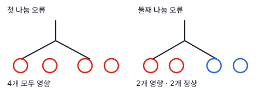

*어느 나눔에서 멈췄는지에 따라 영향을 받는 세포 수가 달라요.*

**정확히 말하면**

염색체가 하나 더 있거나 하나 적은 상태는 **이수성(aneuploidy)**이에요. 감수분열에서 염색체가 제때 갈라지지 않는 **비분리(nondisjunction)**가 원인이 될 수 있어요.

1. **감수 1분열**에서 상동염색체가 비분리되면 네 배우자가 모두 비정상이에요. 한 쌍을 기준으로 둘은 n+1, 둘은 n−1이에요.
2. 감수 1분열은 정상이고 **감수 2분열**에서 자매염색분체가 비분리되면 둘은 정상 n, 하나는 n+1, 하나는 n−1이에요.

정상 배우자와 수정하면 해당 염색체가 세 개인 삼염색체성 또는 한 개인 단염색체성이 생길 수 있어요. 21번 염색체가 세 개인 다운 증후군이 수업의 예예요. 모든 염색체의 삼염색체성이 살아남는 것은 아니에요.

제1분열과 제2분열에서 비분리가 일어날 때 배우자 네 개의 결과가 어떻게 다른지 [감수분열 비분리 모형](../%EC%9D%B8%ED%84%B0%EB%A0%89%ED%8B%B0%EB%B8%8C_01_%EA%B0%90%EC%88%98%EB%B6%84%EC%97%B4_%EB%B9%84%EB%B6%84%EB%A6%AC_%EB%B9%84%EA%B5%90.html)에서 비교해 보세요.

**교수님 말씀**

> “1분열 때 비분리가 일어나게 되면 네 개의 세포가 전부 영향을 받게 되죠.”

**꼭 기억해요**

감수 1분열은 **상동염색체**, 감수 2분열은 **자매염색분체**를 나눠요. “네 개 모두 영향”과 “두 개만 영향”을 바꾸지 않아요. 비분리는 과정이고 이수성은 그 결과의 염색체 수를 가리켜요.

**페이지 요약**

감수 1분열 비분리는 배우자 네 개 모두, 감수 2분열 비분리는 두 개의 수를 바꿔요.

*용어*

- **이수성(aneuploidy)** — 개별 염색체가 더 있거나 부족한 상태
- **비분리(nondisjunction)** — 감수분열에서 분리할 염색체가 함께 가는 현상

---

### 성염색체 수의 변화와 성 결정

*1001 수업 · 4장 p7*

**쉽게 말하면**

성염색체도 나눌 때 수가 어긋날 수 있어요. 그러나 같은 숫자 오류라도 어떤 조합이 남았는지가 중요해요.

*수만 세지 말고 Y와 SRY 유전자의 존재도 확인해요.*

**정확히 말하면**

성염색체의 비분리로 X0, XXY, XXX, XYY 같은 조합이 생길 수 있어요. X 하나인 **터너 증후군**, XXY인 **클라인펠터 증후군**, XXX인 삼중 X 증후군이 수업에 나왔어요. 수업의 기본 모형에서는 Y 염색체의 **SRY** 유전자가 남성 방향의 발생을 시작하므로 XXY와 XYY는 보통 남성으로, X0와 XXX는 보통 여성으로 발달해요. Y만 있고 X가 없는 조합은 생존할 수 없어요.

**교수님 말씀**

> “남성이 남성인 이유는 Y 염색체 때문이라고 그랬죠.”

**꼭 기억해요**

성염색체의 **수**와 발생의 **방향**은 다른 질문이에요. SRY가 있는 보통의 경우를 설명하는 모형이며, 실제 성 발달은 더 복잡할 수 있어요. X0의 0은 Y만 있다는 뜻이 아니라 두 번째 성염색체가 없다는 뜻이에요.

**페이지 요약**

성염색체 이수성에서는 X·Y 조합과 SRY 유무를 따로 읽어요.

*용어*

- **SRY** — 보통 Y 염색체에 있는 남성 발생의 시작 유전자

---

### 한 개의 오류와 세트 전체의 증가

*1001 수업 · 4장 p7–8*

**쉽게 말하면**

책 한 권만 더 생긴 경우와 책장 한 세트를 통째로 더 받은 경우는 달라요.

*한 종류의 수 변화인지, 염색체 세트 전체의 변화인지 나눠 봐요.*

**정확히 말하면**

**이수성**은 특정 염색체가 하나 더 있거나 부족한 경우예요. **다배수체(polyploid)**는 염색체의 완전한 세트가 늘어나 **3n**, 4n처럼 된 개체예요. 수업에서는 식물의 밀·딸기·바나나를 예로 들고, 동물에서는 발생 과정의 문제가 커서 드물다고 설명했어요. 세트 전체가 바뀌면 종 분화나 농업 품종 개발에 영향을 줄 수 있지만, 그 자세한 원리는 뒤 장의 주제예요.

**교수님 말씀**

> “한 개가 삑사리가 나는 게 아니고 이제 세트 전체가 많을 때.”

**꼭 기억해요**

21번 염색체 **세 개**는 3n이 아니에요. 21번만 하나 더 있으면 이수성이고, 전체 세트가 세 벌이어야 3n 다배수성이에요.

**질환 이름과 바뀐 대상을 함께 확인해요.** 다운 증후군은 21번 염색체 하나가 더 있는 수적 이상이고, 고양이 울음 증후군은 5번 염색체 일부가 사라진 구조적 이상이에요([결실·중복·전좌·역위](../../0929/정리노트_0929_Heredity.html#s4-structural)). 같은 ‘염색체 이상’이라는 이름만으로 번호·수·절편을 섞지 않아요.

**보충 · 노트에 빠졌던 수업 내용**

강의노트는 다배수성이 생기는 한 모형으로 유사분열 동안 방추체가 정상적으로 작동하지 못하는 경우를 들어요. 복제된 염색체를 두 세포에 나누지 못해 한 세포에 완전한 세트가 더 남는 경우예요. 특정 염색체 하나의 감수분열 비분리와 구별하며, 다배수성의 모든 원인이 이 하나의 과정이라는 뜻은 아니에요.

출처: 강의노트 4장 p7–8.

**페이지 요약**

특정 염색체 수 오류는 이수성, 전체 세트 증가가 다배수성이에요.

*용어*

- **다배수체(polyploid)** — 완전한 염색체 세트를 더 가진 개체

---

## 2. [4장] 유전 질환을 읽는 법

### 열성 유전과 낭포성 섬유증

*1001 수업 · 4장 p8*

**쉽게 말하면**

기도의 끈끈한 보호막에는 적당한 물기가 필요해요. 물기가 부족하면 작은 털이 먼지를 밖으로 밀어내기 어려워져요.

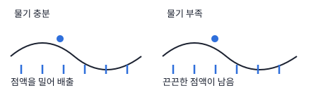

*물기 차이가 점액을 내보내는 움직임에 영향을 줘요.*

**정확히 말하면**

**상염색체 열성** 질환은 질병 대립유전자가 두 개일 때 나타나는 단순 유전 모형이에요. C를 정상, c를 질환 대립유전자로 두면 CC는 정상, Cc는 증상이 없는 **보인자**, cc는 질환을 나타내요.

**낭포성 섬유증**에서는 염소 이온 채널 기능의 이상으로 기도 표면으로의 염소 이온 이동과 이를 따르는 물 이동이 줄어요. 물기가 적어진 점액이 지나치게 끈끈해지면 **섬모**가 점액에 붙은 먼지와 미생물을 위로 옮기기 어려워져요. 그래서 점액 축적과 감염 위험이 커져요.

수업은 **낫모양적혈구빈혈증**도 열성 유전 사례로 다시 언급했어요. 헤모글로빈 유전자의 염기 변화가 단백질과 적혈구 모양에 영향을 주어 산소 운반을 방해할 수 있어요. 다만 이형접합자의 형질은 관찰 수준에 따라 달라져 단순한 완전우성 예 하나로만 외우지 않아요.

**보인자끼리 Cc×Cc를 교배하면** CC:Cc:cc는 1:2:1이에요. 네 조합 중 cc 하나만 질환을 나타내므로 환자 확률은 1/4, Cc 두 조합은 정상 보인자이므로 보인자 확률은 1/2예요. 정상 표현형에는 CC와 Cc가 모두 들어가요. 계산할 때 환자 수와 보인자 수를 따로 세어요.

정상과 기능 저하 상태의 염소 이온 이동·물기·점액 배출을 [낭포성 섬유증 모형](../%EC%9D%B8%ED%84%B0%EB%A0%89%ED%8B%B0%EB%B8%8C_02_%EB%82%AD%ED%8F%AC%EC%84%B1_%EC%84%AC%EC%9C%A0%EC%A6%9D%EA%B3%BC_%EC%A0%90%EC%95%A1_%EB%B0%B0%EC%B6%9C.html)에서 나란히 비교해 보세요.

**교수님 말씀**

> “물은 항상 이온을 따라갑니다.”

수업의 뜻은 기도 표면에서 이온 이동이 물의 삼투 이동과 연결된다는 거예요. 코털·기도 점액·섬모가 이물질을 걸러 밖으로 내보내는 장면으로 설명했어요.

**꼭 기억해요**

질환자가 cc인 모형에서 Cc는 증상 없이 대립유전자를 전달하는 **보인자**예요. 낭포성 섬유증의 점액이 마르는 까닭은 채널이 정상보다 염소를 지나치게 내보내기 때문이 아니라, 채널 기능 저하로 이온·물 이동이 잘 되지 않기 때문이에요. 강의노트 4장 p8의 “염소 이온이 과다하게 배출” 문구는 수업 설명과 맞지 않아 이렇게 바로잡았어요.

**페이지 요약**

두 질환 대립유전자를 받은 cc에서 질환이 나타나고, 채널 기능 저하가 점액을 끈끈하게 해요.

*용어*

- **보인자(carrier)** — 열성 질환 대립유전자를 하나 가지지만 이 모형에서 증상이 없는 이형접합자
- **섬모(cilium)** — 기도 표면에서 점액의 배출을 돕는 작은 돌기

---

### 우성 유전과 헌팅턴병의 확률

*1001 수업 · 4장 p8*

**쉽게 말하면**

부모가 가진 질환 대립유전자 하나를 자녀에게 전할지 말지는 자녀마다 새로 결정돼요. 절반의 확률은 한 아이의 몸이 절반만 영향을 받는다는 뜻이 아니에요.

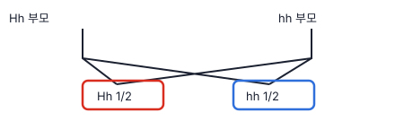

*한쪽 부모가 Hh이고 다른 쪽이 hh일 때의 확률이에요.*

**정확히 말하면**

**상염색체 우성** 질환은 질환 대립유전자 한 개만 있어도 형질이 나타나는 단순 모형이에요. 수업의 **헌팅턴병** 예에서 H를 질환, h를 정상 대립유전자로 두면 Hh는 질환을 나타내고 hh는 그렇지 않아요. 환자 부모가 **Hh**, 다른 부모가 **hh**라고 조건을 정할 때 각 자녀가 H를 받을 확률은 **50%**예요. 자녀마다 독립적인 확률이므로 앞의 자녀 결과로 다음 자녀 결과가 정해지지 않아요. 헌팅턴병은 발병 시기가 늦을 수 있어 어린 시절 증상이 없다는 사실만으로 유전형을 알 수 없어요.

같은 우성 질환의 수업 예로 **연골발육부전증**도 소개했어요. 질환 대립유전자가 한 개일 때도 뼈·연골 발달에 영향을 주어 팔다리가 짧아질 수 있어요.

**정상 자녀가 있으면 부모 유전자형을 거꾸로 추론할 수 있어요.** 단순 완전우성 모형에서 A를 질환, a를 정상 대립유전자로 정하면 정상 자녀는 aa예요. 질환을 보이는 두 부모가 aa 자녀를 낳았다면 두 부모 모두 a를 줄 수 있는 Aa여야 해요. Aa×Aa의 유전자형은 AA:Aa:aa=1:2:1이고, 수정란의 우성 표현형 비율은 3/4예요. 다음 임신에도 이 배우자 전달 확률은 그대로예요.

**교수님 말씀**

> “이 아이가 걸릴 것이냐 안 걸릴 것이냐? 확률이 얼마냐?”

교수님은 환자 부모에게서 H 또는 h를 받을 수 있다는 점을 통해 1:1을 설명했어요.

**꼭 기억해요**

**50%**는 모든 우성 질환 가족에 적용하는 고정값이 아니에요. Hh×hh라는 유전형을 먼저 확인해야 해요. 발병 시기나 증상의 정도를 이 확률과 동일시하지 않아요. 이 단순 모형으로는 가족의 실제 임상 결과를 예언할 수 없어요. 교수님은 앞서 배운 **X-연관 열성 유전**의 적록색맹과 혈우병도 다시 언급했어요. 이는 여기의 상염색체 우성·열성 모형과 유전자 위치가 달라요.

**확률의 분모와 모형의 조건을 확인해요.** 3/4는 모든 유전자형의 생존율을 같게 둔 멘델 모형의 결과예요. 문제에 유전자형별 생존율이 다르다는 추가 조건이 있다면, 수정란 전체인지 생존한 출생아인지에 따라 분모가 달라져요. 이 단순 교배 계산을 실제 가족의 출생 확률로 바로 바꾸지 않아요.

**페이지 요약**

Hh×hh 조건에서 질환 대립유전자를 받을 확률은 자녀마다 1/2이에요.

*용어*

- **상염색체 우성** — 질환 대립유전자 하나로 형질이 나타나는 단순 유전 모형

---

## 3. [5장] DNA 구조가 복제를 예고한다

### 뉴클레오타이드와 상보적인 두 가닥

*1001 수업 · 5장 p1*

**쉽게 말하면**

두 줄의 사다리에서 글자는 정해진 짝끼리 마주 봐요. 한쪽 글자를 읽으면 맞은편 글자를 채울 수 있어요.

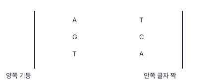

*A는 T와, G는 C와 마주 서요.*

**정확히 말하면**

DNA와 RNA는 모두 **뉴클레오타이드(nucleotide)**가 이어진 핵산이에요. 뉴클레오타이드는 **염기·당·인산** 세 부분으로 이루어져요. DNA의 당은 2′ 탄소에 H가 붙은 **디옥시리보스(deoxyribose)**이고, 염기는 A·T·G·C예요. RNA의 당은 2′-OH를 가진 리보스이고, 염기는 A·U·G·C예요. 따라서 두 핵산은 뉴클레오타이드로 이뤄졌다는 점은 같지만 당과 염기 한 종류가 달라요. 수업에서는 DNA는 보통 이중가닥, RNA는 보통 단일가닥이라고 비교했어요.

DNA 한 가닥에서는 당과 인산이 번갈아 이어져 바깥 골격을 만들고, 염기는 안쪽을 향해요. 서로 마주한 염기는 **A-T** 사이 수소결합 2개, **G-C** 사이 수소결합 3개로 상보적 짝을 이뤄요. 따라서 이중가닥 DNA 전체에서 A의 수와 T의 수, G의 수와 C의 수가 각각 같아요. 예를 들어 전체 염기 중 G가 22%라면 C도 22%, A와 T는 각각 28%예요.

가닥의 방향도 같이 써야 해요. 5′-TAACAGGTCA-3′의 맞은편은 **3′-ATTGTCCAGT-5′**예요. 이를 왼쪽에서 오른쪽 5′→3′로 다시 적으면 **5′-TGACCTGTTA-3′**가 돼요. 단백질은 아미노산으로 이루어진 고분자이므로 뉴클레오타이드 중합체인 DNA·RNA와 구분해요.

**교수님 말씀**

> “DNA 구조를 머릿속에 그릴 줄 알아야 DNA 복제 과정을 이해를 할 수가 있습니다.”

당-인산 연결을 사다리의 기둥인 백본에 비유하고, 염기는 옆으로 나온다고 그려 주셨어요.

**꼭 기억해요**

DNA의 T를 RNA에도 그대로 넣지 않아요. RNA에서는 U가 그 자리에 와요. DNA의 디옥시리보스는 2′-H, RNA의 리보스는 2′-OH예요. 당 탄소에 붙는 프라임(′)은 염기의 탄소 번호와 구별하려는 표시예요.

상보 서열을 쓸 때 염기만 바꾸고 양쪽을 같은 방향으로 쓰지 않아요. 두 가닥은 반대 방향이에요. 전체 이중가닥의 A=T와 G=C는 한쪽 가닥 안에서도 각각 같다는 뜻이 아니에요.

**보충 · 수업에서 다루지 않았어요**

DNA 염기의 분류는 A·G가 **퓨린(purine)**, C·T가 **피리미딘(pyrimidine)**이에요. RNA에서는 T 대신 U가 피리미딘에 속해요. A와 G의 퓨린은 두 고리, C·T·U의 피리미딘은 한 고리 구조예요. 상보적 짝은 퓨린 하나와 피리미딘 하나로 이뤄져요.

출처: 강의노트 5장 p1

DNA·RNA와 운반 RNA(tRNA)는 뉴클레오타이드가 이어진 핵산이에요. **RNA 중합효소**는 이름에 RNA가 들어가지만 RNA 분자를 만드는 **단백질 효소**이므로 뉴클레오타이드 중합체로 분류하지 않아요.

출처: 강의노트 5장 p4

수업의 보통 B형 DNA는 두 가닥이 역평행이에요. 다만 “역평행일 때만 화학적으로 안정”이라는 절대 표현은 성립하지 않아요. 특별한 서열과 조건에서 안정한 평행 이중가닥도 실험으로 보고됐어요.

출처: [평행 DNA 이중가닥 실험 연구](https://pubmed.ncbi.nlm.nih.gov/3399411/)

**페이지 요약**

DNA와 RNA는 뉴클레오타이드로 이뤄지고, DNA 두 가닥의 염기는 A-T와 G-C로 마주 봐요.

*용어*

- **뉴클레오타이드(nucleotide)** — 염기·당·인산으로 이뤄진 핵산의 기본 단위
- **디옥시리보스(deoxyribose)** — DNA에 있는 2′-H 당

---

### 역평행 이중나선과 구조 발견

*1001 수업 · 5장 p1*

**쉽게 말하면**

두 줄은 서로 반대쪽을 향하면서 함께 꼬여요. 꼬이는 방향과 줄이 향하는 방향은 서로 다른 이야기예요.

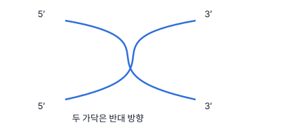

*끝의 방향은 반대이고, 두 줄은 함께 꼬여요.*

**정확히 말하면**

DNA의 두 폴리뉴클레오타이드 가닥은 **역평행(antiparallel)**이에요. 한쪽을 같은 공간 방향에서 5′→3′로 보면 다른 쪽은 3′→5′예요. 5′ 말단은 인산, 3′ 말단은 OH로 구별해요. 사람의 세포에서 주로 설명하는 B형 DNA는 **오른나선**이에요. 오른나선은 꼬이는 손잡이 방향이고, 역평행은 두 가닥 자체의 진행 방향이에요.

수업에서 제시한 이중나선은 한 바퀴에 약 10염기쌍, 축 방향 한 바퀴 길이 약 3.4 nm, 인접 염기쌍 간격 약 **0.34 nm**, 지름 약 2 nm예요. 3.4 nm를 인접한 두 염기쌍 사이 간격으로 읽지 않아요. 수업에서는 로절린드 **프랭클린**의 X선 회절 사진과 샤가프의 A=T, G=C 조성 자료를 토대로 **왓슨과 크릭**이 이중나선 구조 모형을 제시한 이야기를 연결했어요. 구조를 알면 두 가닥을 벌려 각각 새 가닥의 주형으로 삼을 수 있음을 예상할 수 있어요.

두 가닥의 역평행 방향과 상보적인 염기쌍을 [DNA 구조와 복제 3D 모형](../%EC%9D%B8%ED%84%B0%EB%A0%89%ED%8B%B0%EB%B8%8C_03_DNA_%EA%B5%AC%EC%A1%B0%EC%99%80_%EB%B3%B5%EC%A0%9C_3D.html)의 ‘구조’에서 돌려 보며 확인해 보세요.

**교수님 말씀**

> “이 번호가 중요합니다.”

교수님은 꼬인 것에도 오른쪽·왼쪽 방향이 있다며 오른나선을 강조했어요. 프랭클린의 X선 회절 무늬를 구조를 읽을 수 있는 ‘그림자 패턴’에 비유했어요.

**꼭 기억해요**

**역평행**과 **오른나선**을 같은 말로 취급하지 않아요. 역평행은 5′·3′ 끝의 배치, 오른나선은 꼬임의 방향이에요. 당의 5′에는 인산, 3′에는 OH가 있는 것도 반대로 외우지 않아요. 한 바퀴 3.4 nm와 염기쌍 사이 0.34 nm를 구분해요.

**페이지 요약**

DNA 두 가닥은 역평행이고, 일반적인 B형 이중나선은 오른쪽으로 꼬여요.

*용어*

- **역평행(antiparallel)** — 두 가닥의 5′→3′ 방향이 서로 반대인 배치
- **오른나선** — B형 DNA가 오른쪽으로 꼬이는 구조

---

## 4. [5장] 반보존적 복제의 증거

### 원래 가닥 하나와 새 가닥 하나

*1001 수업 · 5장 p1*

**쉽게 말하면**

두 줄을 벌리고, 각 줄 옆에 맞는 새 줄을 하나씩 만들어요. 완성된 두 묶음에는 옛 줄과 새 줄이 하나씩 있어요.

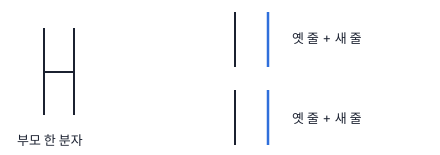

*복제 뒤 각각에 옛 줄이 하나씩 남아요.*

**정확히 말하면**

복제 전 이중가닥 DNA 한 분자가 분리되면 두 부모 가닥이 각각 주형이 돼요. 주형의 염기에 맞는 새 가닥을 합성한 결과 이중가닥 DNA 두 분자가 돼요. 각 딸 DNA에 부모 가닥 하나와 새 가닥 하나가 있는 방식이 **반보존적 복제(semiconservative replication)**예요. 한 분자 두 가닥이 두 분자 네 가닥이 되는 것을 가닥 수로도 확인해요.

**보존적 복제(conservative replication)**라면 부모 가닥 두 개가 서로 붙어 한 분자로 남고 새 가닥 두 개가 다른 분자를 이뤄요. **분산적 복제(dispersive replication)**라면 각 딸 가닥 안에 옛 DNA 조각과 새 DNA 조각이 섞여요. 실제 DNA 복제의 원칙은 반보존적 모형이에요.

**교수님 말씀**

> “두 가닥 중에서 이제 한 가닥은 원래 있던 가닥, 한 가닥은 새로운 가닥이 된다.”

교수님은 처음 DNA 한 분자가 복제되면 같은 서열의 두 분자, 가닥으로는 총 네 가닥이 된다고 반복해 설명했어요.

**꼭 기억해요**

반보존적의 ‘반’은 DNA 염기서열이 반만 보존된다는 뜻이 아니에요. **각 딸 분자에서 두 가닥 중 하나가 옛 가닥**이라는 뜻이에요. 보존적은 옛 가닥끼리, 새 가닥끼리 짝이고, 분산적은 한 가닥 내부에서 옛/새 조각이 섞여요.

**페이지 요약**

반보존적 복제 뒤 두 DNA 분자는 각각 부모 가닥 하나와 새 가닥 하나를 가져요.

*용어*

- **반보존적 복제(semiconservative replication)** — 옛 가닥과 새 가닥이 한 쌍씩 되는 복제
- **보존적 복제(conservative replication)** — 옛 가닥 둘이 한 분자로 함께 남는 가상 모형

---

### 질소 동위원소로 복제 모형 구별하기

*1001 수업 · 5장 p1*

**쉽게 말하면**

무거운 재료로 만든 줄을 가벼운 재료로 다시 만들게 해요. 한 번 만들고 두 번 만들었을 때 묶음의 무게를 보면 옛 줄이 어디에 남는지 알 수 있어요.

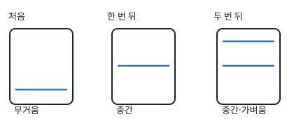

*한 번 뒤에는 중간 무게만, 두 번 뒤에는 두 무게가 보여요.*

**정확히 말하면**

**메셀슨과 스탈**은 DNA 염기에 포함된 질소를 표지했어요. 무거운 안정 동위원소 **¹⁵N** 배지에서 대장균을 길러 DNA의 양쪽 가닥을 무겁게 만든 뒤, 보통 질소 **¹⁴N** 배지로 옮겼어요. 새로 합성되는 DNA 가닥에는 ¹⁴N이 들어가요. DNA를 밀도 구배 원심분리하면 밀도가 다른 DNA가 다른 위치에 띠를 만들어요.

1. 옮기기 전: 부모 DNA는 ¹⁵N/¹⁵N으로 무거운 띠예요.
2. 한 번 복제한 뒤: 딸 DNA는 모두 ¹⁵N/¹⁴N으로 **중간 밀도** 띠예요. 무거운 부모 분자와 가벼운 새 분자가 따로 나오는 보존적 모형과 달라요.
3. 두 번 복제한 뒤: DNA 분자의 절반은 ¹⁵N/¹⁴N 중간 띠, 절반은 ¹⁴N/¹⁴N 가벼운 띠예요. 옛 조각과 새 조각이 모든 분자에 계속 섞이는 분산적 모형이라면 가벼워진 단일 띠가 예측되므로 구별돼요.

따라서 두 세대의 결과를 함께 보면 [반보존적 복제](#s4-semiconservative)를 식별할 수 있어요.

**교수님 말씀**

> “새로 합성되는 DNA만 14N이 들어가겠죠?”

한 번, 두 번 복제했을 때 각각의 두 가닥에 어느 질소가 들어갈지 학생에게 물으며 따라갔어요.

**꼭 기억해요**

**¹⁵N은 방사성 동위원소가 아니라 안정 동위원소**예요. 이 실험은 방사능이 아니라 밀도 차이를 측정해요. 첫 복제에서 중간 띠 하나만 나오는 결과는 보존적 복제를 제외하지만 분산적 복제까지 구별하려면 다음 세대의 두 띠를 확인해야 해요. 부모 가닥의 ¹⁵N이 새 가닥으로 바뀌는 것도 아니에요.

**페이지 요약**

¹⁵N DNA를 ¹⁴N 배지로 옮기면 한 번 뒤 중간 띠만, 두 번 뒤 중간·가벼운 띠가 보여요.

*용어*

- **¹⁵N** — 처음 부모 가닥을 표지한 무거운 안정 동위원소
- **중간 밀도** — ¹⁵N 부모 가닥 하나와 ¹⁴N 새 가닥 하나의 DNA가 만드는 밀도

---

## 5. [5장] DNA를 한 가닥씩 만드는 과정

### 헬리케이스·프라이메이스·DNA 중합효소

*1001 수업 · 5장 p1–2*

**쉽게 말하면**

붙어 있는 두 줄을 먼저 벌려요. 작은 시작 조각을 붙인 뒤, 그 끝에 새 조각을 하나씩 이어요.

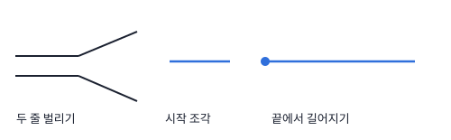

*시작 조각이 있어야 새 줄을 더 길게 만들 수 있어요.*

**정확히 말하면**

DNA 복제는 두 부모 가닥을 각각 주형으로 쓰는 과정이에요. **복제원점(origin of replication)**에서 시작하고, 두 가닥이 벌어지는 Y자 경계는 **복제분기점(replication fork)**이에요. 위치인 원점과 진행하는 경계인 분기점을 구별해요.

1. **헬리케이스(helicase)**가 ATP의 에너지를 써서 두 가닥의 수소결합을 끊고 주형을 노출해요.
2. **프라이메이스(primase)**가 주형에 맞는 짧은 **RNA 프라이머(RNA primer)**를 만들어요. 프라이머는 DNA 중합효소가 이용할 3′ 말단을 제공해요.
3. **DNA 중합효소(DNA polymerase)**가 주형의 염기와 짝이 맞는 dNTP를 기존 가닥의 **3′-OH**에 붙여요. 새 dNTP의 5′ 인산과 기존 3′-OH가 인산다이에스테르 결합을 만들고 피로인산이 떨어져요. 그래서 길어지는 **새 가닥은 5′→3′** 방향으로만 합성돼요.

dNTP는 dATP·dCTP·dGTP·dTTP를 통틀어 부르는 말이에요. 주형에 T가 있으면 dATP가, C가 있으면 dGTP가 들어와요. dATP는 DNA의 디옥시리보스를 가지므로 ATP와 이름·용도를 구분해요. 프라이머가 없으면 DNA 중합효소는 아무것도 없는 자리에서 합성을 새로 시작하지 못해요.

**교수님 말씀**

> “프라이머가 있어야지만 DNA 복제가 진행이 됩니다.”

교수님은 헬리케이스가 지퍼를 열듯 DNA 두 가닥을 벌리고, 프라이메이스가 먼저 시작 조각을 놓는다고 설명했어요.

**꼭 기억해요**

DNA 중합효소가 5′→3′으로 움직인다는 말은 **새 가닥의 길어지는 방향**을 말해요. 주형은 그와 반대 방향으로 읽혀요. 새 뉴클레오타이드는 기존 5′ 말단이 아니라 **3′-OH**에 붙어요. RNA 프라이머를 만드는 효소는 프라이메이스, 프라이머에서 DNA를 늘리는 효소는 DNA 중합효소예요. 헬리케이스는 가닥을 여는 효소예요.

**페이지 요약**

헬리케이스가 열고 프라이메이스가 RNA 프라이머를 놓으면, DNA 중합효소가 3′-OH에서 새 가닥을 늘려요.

*용어*

- **헬리케이스(helicase)** — 부모 DNA 두 가닥을 여는 효소
- **RNA 프라이머(RNA primer)** — DNA 중합효소에 3′-OH 시작점을 주는 짧은 RNA
- **3′-OH** — 새 뉴클레오타이드가 붙는 기존 가닥의 말단

---

### 선도가닥과 지연가닥은 왜 다를까

*1001 수업 · 5장 p2*

**쉽게 말하면**

두 줄은 서로 반대로 놓였지만 새 줄은 한 방향으로만 자라요. 그래서 한쪽은 길게 이어지고 다른 쪽은 짧은 조각으로 만들어져요.

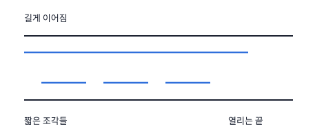

*두 쪽 모두 같은 방향으로 자라지만, 한쪽은 조각이 필요해요.*

**정확히 말하면**

부모 두 가닥은 [역평행](#s3-double-helix)이고 DNA 중합효소는 **새 가닥만 5′→3′**으로 늘려요. 복제분기점이 열리는 방향과 같은 방향으로 연속 합성되는 새 가닥은 **선도가닥(leading strand)**이에요. 반대 방향으로 합성하는 새 가닥은 **지연가닥(lagging strand)**, 또는 지체가닥이라고 해요. 분기점이 조금 더 열릴 때마다 새로 드러난 주형에 프라이메이스가 RNA 프라이머를 놓고 DNA 중합효소가 그 지점에서 분기점 반대 방향으로 합성해요. 이 짧은 DNA 조각이 **오카자키 조각(Okazaki fragment)**, 또는 오카자키 절편이에요.

선도·지연은 그림의 위쪽·아래쪽 이름이 아니에요. 어느 분기점을 기준으로 보느냐에 따라 주형의 위아래 위치는 달라져요. 두 가닥 모두 새 DNA 자체의 연장 방향은 5′→3′이에요. 지연가닥의 조각들은 프라이머 교체 뒤 [연결효소로 이어져](#s5-finishing) 하나의 가닥이 돼요.

#### 직접 해 보기: 복제분기점이 더 열리면 *(정적 스냅샷 — 직접 조작은 HTML 버전)*

슬라이더로 열린 길이를 바꾸면 연속 가닥과 조각으로 만들어지는 가닥을 비교할 수 있어요.

이 모형에서는 **선도가닥 1칸 연속, 지연가닥 1조각**이에요.

범례: 한 칸마다 시작점을 하나 놓는 단순화된 모형이에요. 실제 조각의 길이는 이 그림의 칸 길이로 정해지지 않아요.

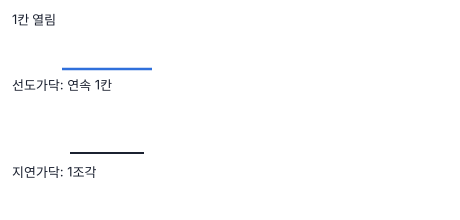

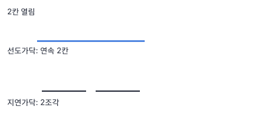

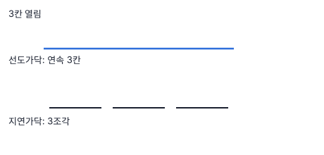

| 열린 구간 | 선도가닥 | 지연가닥 |
|---|---|---|
| 1칸 | 연속 1칸 | 1조각 |
| 2칸 | 연속 2칸 | 2조각 |
| 3칸 | 연속 3칸 | 3조각 |

선도가닥과 지연가닥의 합성 방향과 오카자키 절편을 [DNA 구조와 복제 3D 모형](../%EC%9D%B8%ED%84%B0%EB%A0%89%ED%8B%B0%EB%B8%8C_03_DNA_%EA%B5%AC%EC%A1%B0%EC%99%80_%EB%B3%B5%EC%A0%9C_3D.html)의 ‘복제’에서 재생해 보세요.

**교수님 말씀**

> “양쪽 가닥이 서로 반대로 진행이 되기 때문에 이렇게 될 수밖에 없다.”

교수님은 한쪽은 ‘한 번에 쭉’, 다른 쪽은 ‘요만큼 만들고 또 요만큼’이라고 비교해 설명했어요.

**꼭 기억해요**

지연가닥이 **3′→5′로 합성되는 것**이 아니에요. 지연가닥의 개별 조각도 모두 **5′→3′**으로 만들어져요. 복제원점은 시작 자리이고, 복제분기점은 진행하면서 이동하는 Y자 경계예요. 선도가닥은 분기점 진행 방향과 합성 방향이 같고, 지연가닥은 반대예요.

**페이지 요약**

두 새 가닥 모두 5′→3′로 자라지만, 분기점에 대한 방향 차이 때문에 한쪽은 조각으로 합성돼요.

*용어*

- **선도가닥(leading strand)** — 분기점 방향으로 연속 합성되는 새 가닥
- **지연가닥(lagging strand)** — 분기점 반대 방향으로 조각마다 합성되는 새 가닥
- **오카자키 조각(Okazaki fragment)** — 지연가닥에서 만들어지는 짧은 DNA 조각

---

### 프라이머를 제거하고 조각을 잇기

*1001 수업 · 5장 p2*

**쉽게 말하면**

처음 붙였던 임시 조각을 빼고 그 자리를 새 재료로 채워요. 그래도 줄 사이가 끊어져 있으면 마지막으로 이어 붙여요.

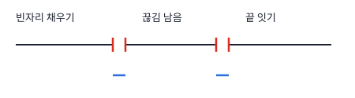

*재료를 채운 뒤에도 끊긴 곳은 따로 이어야 해요.*

**정확히 말하면**

복제에 필요했던 RNA 프라이머는 최종 DNA 가닥에 남지 않아요. 먼저 **프라이머 제거**가 일어나고, 빈자리를 DNA 뉴클레오타이드로 채워요. 수업에서 든 원핵세포 사례에서는 DNA 중합효소 III가 새 DNA를 주로 합성하고, DNA 중합효소 I이 RNA 프라이머를 제거하며 그 자리를 DNA로 채워요.

그렇게 채워도 이웃한 오카자키 조각 사이의 당-인산 골격에 공유결합 하나가 없는 **닉(nick)**이 남아요. **DNA 연결효소(DNA ligase)**가 이 절단점의 인산다이에스테르 결합을 형성해 조각을 하나의 연속 가닥으로 이어요. 닉은 염기 자체가 빠진 빈자리와 달라요. 복제분기점이 더 열리면 새 프라이머 만들기, DNA 연장, 프라이머 교체, 닉 연결이 반복돼요.

**교수님 말씀**

> “RNA 프라이머 제거하고 그 자리에 DNA를 채워 넣었는데도 불구하고 이 틈이 생겨요.”

교수님은 그 틈을 닉이라고 부르고, 별도의 연결효소가 필요하다고 거듭 짚었어요.

**꼭 기억해요**

RNA 프라이머를 DNA로 **채우는 것**과 닉에서 DNA 조각을 **잇는 것**은 달라요. 연결효소는 빠진 염기를 새로 합성하는 효소가 아니에요. DNA 중합효소 I/III의 번호별 역할은 수업에서 설명한 원핵세포 사례에 해당해요. ‘프라이머를 제거했으니 복제 완료’라고 판단하지 않아요.

**페이지 요약**

RNA 프라이머를 DNA로 교체해도 닉이 남으므로 DNA 연결효소가 조각을 이어야 해요.

*용어*

- **닉(nick)** — 염기는 있지만 이웃 DNA 조각 사이 골격 결합이 끊긴 자리
- **DNA 연결효소(DNA ligase)** — 닉의 공유결합을 형성해 조각을 잇는 효소

---

## 6. [5장] 오류를 줄이고 DNA를 포장하기

### 복제 중 교정과 복제 후 수선

*1001 수업 · 5장 p2–3*

**쉽게 말하면**

글자를 옮겨 쓰다 바로 오타를 지울 수도 있고, 다 쓴 뒤 다시 읽으며 남은 오타를 고칠 수도 있어요.

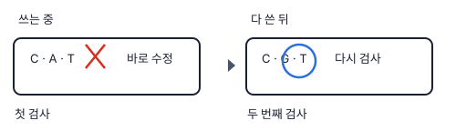

*두 번 살펴도 실수가 모두 사라지는 것은 아니에요.*

**정확히 말하면**

주형 DNA의 C에는 새 가닥의 G가 짝을 이뤄야 해요. 복제 도중 A처럼 맞지 않는 염기가 들어오면 DNA 중합효소가 이를 제거하고 맞는 염기를 넣는 **교정(proofreading)**을 해요. 교수님은 이를 **백스페이스**에 비유했어요.

복제가 끝나도 남은 잘못된 짝은 **불일치 수선(mismatch repair)**으로 고칠 수 있어요. 수선은 오류가 있는 새 가닥의 일부를 제거하고 바른 염기로 다시 채우는 과정이에요. 자외선·화학물질로 생긴 DNA 손상도 수선의 대상이 될 수 있어요.

교정과 수선은 복제 오류율을 크게 낮추지만 0으로 만들지는 못해요. 수업은 교정만 거친 뒤 약 백만 염기당 하나, 수선까지 거친 뒤 약 10억~100억 염기당 하나 수준을 예로 들었어요. 남은 변화가 **자발적 돌연변이**로 이어질 수 있어요. 돌연변이는 단백질 기능에 영향을 주거나, 영향이 거의 없거나, 환경에 따라 이롭거나 해로울 수 있어요. 생식에 유리한 돌연변이가 자손에 전달되면 진화와 연결될 수 있어요.

**교수님 말씀**

> “그 자리에서 백스페이스 누르면 되죠? 이게 바로 교정 기능입니다.”

보고서를 다 쓴 다음 다시 읽으며 오타를 찾는 일로 복제 후 수선을 설명했어요. 로또 비유로 오류가 드물어져도 확률이 0은 아니라는 점을 다시 짚었어요.

**꼭 기억해요**

**복제 중 교정**은 새 염기를 넣는 도중 중합효소가 바로 고쳐요. **복제 후 불일치 수선**은 복제가 끝난 뒤 남은 오류를 찾아 고쳐요. 교정이 있으면 무조건 완벽하다는 뜻은 아니에요.

수업에서는 RNA 바이러스의 높은 변이율을 설명하며 교정 기능이 없다고 했어요. 그러나 이를 코로나바이러스까지 포함한 모든 RNA 바이러스에 적용하면 틀려요. 코로나바이러스의 RNA 중합효소 자체에는 교정 엑소뉴클레아제 부위가 없지만, 별도 단백질 nsp14가 RNA 복제 중 오류 교정에 참여해요. [출처: SARS-CoV-2 nsp14 교정 효소 구조와 기능 연구](https://pmc.ncbi.nlm.nih.gov/articles/PMC8892293/).

**페이지 요약**

복제 중에는 중합효소가 바로 교정하고, 복제 후에는 수선이 남은 오류를 고쳐요.

*용어*

- **교정(proofreading)** — 복제 중 잘못 넣은 염기를 바로 제거하는 작용
- **불일치 수선(mismatch repair)** — 복제 후 남은 잘못된 염기쌍을 고치는 과정
- **자발적 돌연변이** — 교정·수선 후에도 남을 수 있는 DNA 변화

---

### 히스톤과 뉴클레오솜으로 포장하기

*1001 수업 · 5장 p3*

**쉽게 말하면**

아주 긴 실을 작은 공간에 넣으려면 실타래에 감아 가지런히 정리해야 해요.

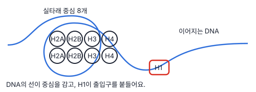

*실타래 중심과 바깥에서 붙드는 단백질의 역할이 달라요.*

**정확히 말하면**

진핵세포의 긴 DNA는 단백질과 함께 조직화돼요. **히스톤(histone)** 중 H2A·H2B·H3·H4가 각각 두 개씩 모인 여덟 단백질 주위를 DNA가 감은 단위를 **뉴클레오솜(nucleosome)**이라고 해요. 이 중심의 여덟 개에 **H1**은 포함되지 않아요. H1은 DNA가 드나드는 곳과 뉴클레오솜 사이의 연결 DNA를 안정화해요.

DNA의 인산 골격은 **음전하**를 띠어요. 히스톤에는 생리적 조건에서 양전하를 띠는 라이신·아르기닌 잔기가 풍부하여 DNA와 결합하기 쉬워요. 뉴클레오솜들이 이어진 DNA–단백질 복합체가 염색질이에요. 이것이 세포분열 때 더 응축되면 관찰하기 쉬운 염색체가 돼요.

DNA가 히스톤에 감기는 모습과 H1의 위치를 [뉴클레오솜과 DNA 포장 모형](../%EC%9D%B8%ED%84%B0%EB%A0%89%ED%8B%B0%EB%B8%8C_04_%EB%89%B4%ED%81%B4%EB%A0%88%EC%98%A4%EC%86%9C%EA%B3%BC_DNA_%ED%8F%AC%EC%9E%A5.html)의 ‘구조’와 ‘포장’에서 살펴보세요.

**교수님 말씀**

> “이 실타래 역할을 하는 단백질이 히스톤입니다.”

길이 약 2m인 DNA를 작은 핵에 넣는 일을 긴 실을 테니스공에 넣는 데 비유했어요. 히스톤 여덟 개를 농구공에, H1을 집게에 비유했어요.

**꼭 기억해요**

**히스톤**은 단백질이고, **뉴클레오솜**은 DNA가 중심 히스톤을 감은 구조예요. H1은 중심 여덟 개 바깥에 있어요. **염색질**과 **염색체**는 서로 다른 재료가 아니라 응축 정도가 다른 같은 DNA–단백질 복합체를 가리켜요.

전하도 바꾸지 않아요. DNA가 음전하, 히스톤이 양전하 성격이에요. 수업에서는 히스티딘도 예로 말했지만, 히스톤의 풍부한 양전하 잔기를 설명할 때는 라이신·아르기닌이 정확해요.

**페이지 요약**

DNA는 여덟 히스톤 주위를 감아 뉴클레오솜을 만들고 H1은 그 바깥을 붙들어요.

*용어*

- **히스톤(histone)** — DNA를 포장하는 양전하 성격의 단백질
- **뉴클레오솜(nucleosome)** — 중심 히스톤 여덟 개 주위를 DNA가 감은 단위
- **H1** — 중심 여덟 개 바깥에서 연결 DNA를 안정화하는 히스톤

---

## 7. [5장] 복제에서 유전자 발현으로

### 전체 복제와 유전자 전사·번역 구별하기

*1001 수업 · 5장 p3*

**쉽게 말하면**

책을 통째로 한 벌 더 만드는 일과 필요한 한 부분을 베껴 읽어 물건을 만드는 일은 달라요.

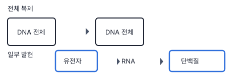

*두 과정 모두 DNA에서 출발하지만 다루는 범위와 만들어 내는 것이 달라요.*

**정확히 말하면**

세포분열을 준비하는 **DNA 복제**는 염색체의 DNA 전체를 새 DNA로 복사해요. 사람 체세포의 46개 염색체를 책 46권에 비유했어요. 이에 비해 유전자 발현은 필요한 유전자 부분을 이용해 산물을 만드는 과정이에요.

1. **전사(transcription)**에서는 DNA의 특정 유전자 영역 한 가닥을 주형으로 RNA 사본을 만들어요. 단백질을 암호화하는 유전자라면 전령 RNA(mRNA)가 만들어져요.
2. **번역(translation)**에서는 mRNA의 정보를 읽어 아미노산을 연결한 폴리펩티드를 만들어요. 이것이 접히거나 다른 사슬과 결합해 기능하는 단백질이 될 수 있어요.

수업의 기본 흐름인 DNA, RNA, 단백질 사이의 정보 전달을 **중심 원리(central dogma)**라고 해요. 전사와 번역을 묶어 **유전자 발현(gene expression)**이라고 해요. 이 흐름은 DNA 복제와 구분해야 해요.

**교수님 말씀**

> “DNA 복제는 전체 DNA를 다 복제하는 거예요.”

엄마·아빠에게서 23권씩 받은 책을 통째로 복사하면 DNA 복제예요. 책 속 한 부분의 내용을 옮겨 쓰는 것은 전사에 비유했어요.

**꼭 기억해요**

**복제**의 산물은 DNA이고 범위는 전체 유전체예요. **전사**의 직접 산물은 RNA이고 범위는 해당 유전자예요. **번역**의 직접 산물은 폴리펩티드예요. 전사를 단백질 생성 단계라고 부르거나 번역을 RNA 생성 단계라고 부르지 않아요.

중심 원리는 수업에서 배운 주요 정보 흐름을 나타내요. 모든 생물학적 정보 전달이 예외 없이 DNA에서만 시작한다는 절대 규칙으로 읽지 않아요.

**보충 · 수업에서 다루지 않았어요**

진핵세포에서 단백질을 암호화하는 유전자의 전사는 핵에서 일어나고, 만들어진 mRNA가 세포질로 나온 뒤 리보솜에서 번역돼요. 따라서 전사를 리보솜에서 일어나는 과정이라고 하면 번역의 장소와 혼동한 거예요.

출처: 강의노트 5장 p4·p6

**페이지 요약**

DNA 복제는 전체 DNA를 늘리고, 유전자 발현은 전사로 RNA를 만든 뒤 번역으로 폴리펩티드를 만들어요.

*용어*

- **DNA 복제** — 전체 DNA를 새 DNA로 복사
- **전사(transcription)** — 유전자 DNA 정보를 RNA로 옮김
- **번역(translation)** — RNA 정보로 폴리펩티드를 만듦

---

### 1유전자 1효소에서 1폴리펩티드까지

*1001 수업 · 5장 p3*

**쉽게 말하면**

한 설명서가 어떤 부품을 만드는지 알아가며, 설명서의 역할을 더 정확하게 말하게 되었어요.

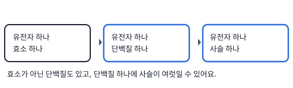

*예외를 발견할수록 설명이 더 정확해졌어요.*

**정확히 말하면**

유전자는 기능성 산물을 만드는 데 필요한 DNA 서열이에요. 수업에서는 단백질을 만드는 유전자에 초점을 맞췄어요. **비들과 테이텀**은 붉은빵곰팡이에 X선을 쬐어 특정 유전자를 손상시키고, 필요한 영양분을 스스로 합성하지 못하는 돌연변이를 관찰했어요. 이를 바탕으로 **1유전자 1효소**라는 역사적 설명이 나왔어요.

그러나 인슐린은 호르몬, 케라틴은 구조 단백질, 헤모글로빈은 운반 단백질이지 모두 효소인 것은 아니에요. 그래서 설명을 **1유전자 1단백질**로 넓혔어요. 헤모글로빈은 α 사슬 두 개와 β 사슬 두 개가 모인 단백질이에요. α 사슬과 β 사슬은 서로 다른 유전자가 암호화해요. 따라서 단백질을 암호화하는 유전자 하나의 산물을 한 폴리펩티드 사슬로 보는 **1유전자 1폴리펩티드** 설명이 이 사례를 더 잘 설명해요.

이는 유전자 개념이 정교해진 **역사적 모형**이에요. 단백질이 아닌 기능성 RNA를 만드는 유전자도 있으므로 모든 유전자가 폴리펩티드를 만든다는 보편 법칙은 아니에요. 수업의 “사람 DNA 중 1~2%”라는 수치는 대략 단백질 암호화 서열의 비율로 이해해요. 나머지 DNA 전체가 쓸모없다는 뜻은 아니에요.

**교수님 말씀**

> “핸드폰이 없어서 게임을 못 한다. 1 핸드폰 1 게임설이 맞기는 맞죠.”

휴대전화는 게임뿐 아니라 문자·통화에도 쓰여요. 이 비유로 효소에만 초점을 둔 첫 모형의 한계를 설명했어요. 헤모글로빈의 α·β 사슬을 떠올리며 단백질 한 분자와 폴리펩티드 한 줄을 구별하게 했어요.

**꼭 기억해요**

**효소**는 촉매 기능을 하는 단백질의 한 부류예요. 모든 단백질이 효소인 것은 아니에요. **폴리펩티드**는 아미노산으로 이어진 한 사슬이고, **단백질** 한 분자에는 그런 사슬이 하나 또는 여럿 있을 수 있어요. 따라서 “한 유전자면 무조건 완성된 단백질 한 개”라고 계산하면 헤모글로빈에서 틀려요.

이 모형들은 단백질 암호화 유전자 연구의 역사적 단계예요. 단백질을 만들지 않는 기능성 RNA 유전자도 있고, 단백질 암호화 구간이 아닌 DNA도 조절 등 역할을 할 수 있어요.

**페이지 요약**

효소만이 아닌 여러 단백질을 거쳐, 단백질을 이루는 폴리펩티드 한 사슬까지 설명이 정교해졌어요.

*용어*

- **1유전자 1효소** — 비들과 테이텀의 역사적 설명
- **1유전자 1단백질** — 효소가 아닌 단백질까지 넓힌 설명
- **1유전자 1폴리펩티드** — 단백질의 각 사슬을 별도 유전자 산물로 보는 모형

---

## 8. 요약 · 예고

### 시험 직전 한눈에

*1001 수업 · 4장 p7–8 · 5장 p1–3*

| 주제 | 시험 직전 한 줄 |
|---|---|
| 염색체 구조와 수 | 결실·중복·전좌·역위는 구조의 변화, 이수성과 다배수성은 수의 변화예요. |
| 비분리 | 감수 1분열의 상동염색체 비분리는 배우자 네 개 모두, 감수 2분열의 자매염색분체 비분리는 두 개에 영향을 줘요. |
| 이수성·다배수성 | 21번 염색체가 하나 더 있으면 이수성, 염색체 전체가 3n이면 다배수성이에요. |
| 성염색체 | X0는 터너, XXY는 클라인펠터 증후군의 조합이에요. 보통 Y의 SRY가 남성 방향의 발생을 시작해요. |
| 열성 질환 | 단순 상염색체 열성 모형에서 Cc는 보인자, cc에서 낭포성 섬유증이 나타나요. |
| 우성 질환 | 헌팅턴병의 단순 Hh×hh 모형에서는 자녀마다 H를 받을 확률이 1/2이에요. |
| DNA 구성 | 뉴클레오타이드는 염기·디옥시리보스·인산으로 구성되고, DNA 두 가닥은 역평행이에요. |
| 상보적 염기 | DNA에서 A–T는 수소결합 2개, G–C는 3개이며 두 가닥의 짝이 주형을 제공해요. |
| 나선의 길이 | 인접 염기쌍 사이 약 0.34 nm, 열 쌍 정도의 한 회전은 약 3.4 nm예요. |
| 반보존적 복제 | 복제 뒤 각 DNA 이중가닥은 원래 가닥 하나와 새 가닥 하나를 가져요. |
| 밀도 실험 | ¹⁵N DNA를 ¹⁴N 배지에서 한 번 복제하면 전부 중간 밀도, 두 번이면 중간·가벼운 밀도예요. |
| 합성 시작 | 헬리케이스가 가닥을 풀고, 프라이메이스가 RNA 프라이머의 3′-OH를 제공하면 DNA 중합효소가 연장해요. |
| 합성 방향 | 새 DNA는 5′→3′으로만 늘어나요. 선도가닥은 연속, 지연가닥은 오카자키 조각으로 불연속 합성돼요. |
| 조각 연결 | RNA 프라이머를 제거하고 DNA로 채운 뒤, DNA 연결효소가 남은 닉의 공유결합을 이어요. |
| 오류 수정 | 교정은 복제 중 잘못 넣은 염기를 고치고, 불일치 수선은 복제 뒤 남은 오류를 고쳐요. 둘 다 완벽하지는 않아요. |
| DNA 포장 | H2A·H2B·H3·H4 각 두 개가 히스톤 팔량체를 이루고, DNA가 감겨 뉴클레오솜이 돼요. H1은 팔량체 밖이에요. |
| 복제·발현 | 분열 전 복제는 DNA 전체, 전사는 유전자 정보를 RNA로, 번역은 RNA 정보를 폴리펩티드로 옮겨요. |
| 유전자 개념 | 1유전자 1효소에서 1단백질, 1폴리펩티드로 설명이 정교해졌지만 모든 유전자의 보편 공식은 아니에요. |

---

### 끊긴 지점과 다음 범위

*1001 수업 · 5장 p3*

“자, 여기까지 하고 코돈부터 다음 시간에 합시다.”

- DNA 복제 설명은 DNA 조직화까지 진행했고, 이어진 수업에서는 5장 p3의 유전자 발현 개관과 유전자 개념 변화를 소개했어요. 겹치는 복제 내용은 한 번만 정리했어요.
- 다음 시간에는 코돈을 포함한 유전암호의 세부와 전사·번역의 기작이 이어질 예정이에요. 안티코돈, 스플라이싱, lac 오페론, 프로테아좀은 이번 수업의 본문 범위에 넣지 않았어요.
- 강의노트 4장 p9의 유전상담·분만 전 진단은 설명 없이 5장으로 넘어갔어요. 수업에서 생략됐다는 사실만으로 시험 제외라고 판단하지 않아요.

---

### 함께 보면 좋은 자료

*1001 수업*

- [1001 복습문제 풀러 가기](복습문제_1001_Chromosome_Changes_and_DNA_Replication.md)
- [0929 염색체 구조 변형 복습](../../0929/정리노트_0929_Heredity.html#s4)

---

출처: 이영만 교수님 강의노트(4·5장) · 수업 녹음 전사(1001 생명, 5장1 DNA 복제) · 『생명과학: 기초와 응용』 2판 4·5장.
