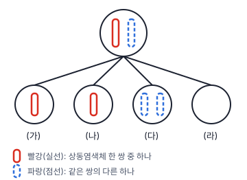

# 복습문제 36선 — 1001 수업 범위

기출 **20개**와 변형 연습 **16개**입니다. 먼저 풀어 보고, 막히면 힌트를 열어 보세요.

> `복습문제_1001_Chromosome_Changes_and_DNA_Replication.html`를 마크다운으로 옮겼어요. 원문, 힌트, 풀이는 접혀 있어요. 먼저 풀어 보고 펼쳐 보세요.

**목차**

- [B. 기출](#partB)
  - [P1. 반보존적 복제의 뜻](#p1)
  - [P2. 전사는 무엇을 만들까](#p2)
  - [P3. 전사의 주형](#p3)
  - [P4. 전사와 복제·번역 구별](#p4)
  - [P5. 복제 효소와 프라이머](#p5)
  - [P6. 번역의 직접 산물](#p6)
  - [P7. 교정과 수선](#p7)
  - [P8. 상보 가닥과 역평행](#p8)
  - [P9. DNA 정보의 최종 산물](#p9)
  - [P10. DNA와 RNA의 공통 구성](#p10)
  - [P11. RNA에 들어가는 네 염기](#p11)
  - [P12. 유전자는 무엇을 만드는 정보인가](#p12)
  - [P13. RNA의 당은 무엇인가](#p13)
  - [P14. DNA와 RNA의 일반적인 가닥 수](#p14)
  - [P15. 단백질까지의 정보 흐름](#p15)
  - [P16. 전사로 만들어지는 사본](#p16)
  - [P17. G가 22%일 때 나머지 염기](#p17)
  - [P18. 샤가프의 규칙이 말하는 것](#p18)
  - [P19. 핵산과 효소의 재료 구분](#p19)
  - [P20. 새 DNA 가닥이 자라는 쪽](#p20)
- [C. 변형 연습](#partC)
  - [P21. [변형] 두 번째 분열의 비분리](#p21)
  - [P22. [변형] 한 염색체와 한 세트](#p22)
  - [P23. [변형] 두 세대 뒤의 DNA 밀도](#p23)
  - [P24. [변형] 복제분기점의 두 새 가닥](#p24)
  - [P25. [변형] 오류를 고치는 시점](#p25)
  - [P26. [변형] 전체 복제와 일부 정보 읽기](#p26)
  - [P27. [변형] 복제 효소와 두 새 가닥의 방향](#p27)
  - [P28. [변형] 교정과 수선 뒤에도 남는 오류](#p28)
  - [P29. [변형] 그림으로 두 새 가닥 판별하기](#p29)
  - [P30. [변형] 배우자 속 염색체 색으로 비분리 시기 읽기](#p30)
  - [P31. [변형] 성염색체 조합과 SRY 진술 판정](#p31)
  - [P32. [변형] 우성 질환 가족의 자녀 확률](#p32)
  - [P33. [변형] 정상 부부에게서 태어난 환자 아이](#p33)
  - [P34. [변형] 100 염기쌍 조각의 길이와 수소결합](#p34)
  - [P35. [변형] 복제 효소와 프라이머, 틀린 설명 고르기](#p35)
  - [P36. [변형] 복제된 염색체의 두 자매염색분체 속 질소](#p36)

## B. 기출

### P1. 반보존적 복제의 뜻

반보존적 복제가 지칭하는 것은?

- (1) DNA는 9개의 가능한 뉴클레오타이드 중 단지 4개만으로 만들어 진다
- (2) 각 분자의 양쪽 가닥은 오래된 절편과 새로운 절편이 섞인 상태로 갖는다
- (3) DNA의 이중나선은 항상 부모 가닥과 새로이 합성된 가닥으로 구성된다
- (4) DNA는 단일 나선이 아니라 서로 상보적인 이중나선으로 되어 있다
- (5) DNA복제의 방법은 잘 알려져 있지 않다

원문 정보 보기

기출 5강 합본 1번 (PDF 1쪽)

힌트 보기

복제 뒤 생긴 이중나선 한 분자 안에서 두 가닥이 각각 언제 만들어졌는지 구분해 보세요.

풀이 보기

1. (1) 틀려요. DNA는 A·T·G·C를 가진 네 종류의 뉴클레오타이드를 쓰지만, 이것은 복제 모형의 뜻이 아니에요.
2. (2) 틀려요. 오래된 절편과 새 절편이 한 가닥 안에 섞이는 설명은 분산적 복제 모형에 가까워요.
3. (3) 맞아요. 복제 산물마다 부모에게서 물려받은 기존 가닥 하나와 새로 합성한 가닥 하나가 있어요.
4. (4) 틀려요. DNA가 상보적 이중나선이라는 사실만으로는 어느 가닥을 보존하는지 알 수 없어 반보존적 복제의 정의가 아니에요.
5. (5) 틀려요. 실제 복제가 반보존적이라는 것은 실험으로 확인됐어요.
6. 수업과의 연결: 기존 가닥이 한 가닥씩 남는 반보존적 복제를 배웠어요.

**정답:** (3)

---

### P2. 전사는 무엇을 만들까

다음 중 전사에 관한 설명으로 옳은 것은?

- (1) 리보솜에서 일어난다
- (2) 번역될 유전자의 RNA 사본을 생성한다
- (3) 타이민과 아데닌 쌍을 만든다
- (4) 존재하는 DNA 분자로부터 새로운 딸 DNA 분자를 합성한다

원문 정보 보기

기출 5강 합본 2번 (PDF 1쪽)

힌트 보기

DNA의 일부를 RNA로 옮기는 과정과 RNA를 단백질로 읽는 과정을 구분해 보세요.

풀이 보기

1. (1) 틀려요. 리보솜은 RNA를 바탕으로 폴리펩티드를 만드는 번역의 장소예요.
2. (2) 맞아요. 전사는 DNA의 유전자 정보를 RNA 사본으로 옮겨요. 단백질 암호화 유전자라면 이 사본이 mRNA예요.
3. (3) 틀려요. DNA에서 A와 짝을 이루는 염기는 T지만, RNA 사본에서는 U를 사용해요.
4. (4) 틀려요. 기존 DNA로 새 DNA를 만드는 일은 전사가 아니라 복제예요.
5. 수업과의 연결: 전체 DNA 복제와 유전자 부분의 RNA 전사를 구분했어요.

**정답:** (2)

---

### P3. 전사의 주형

다음 중 전사가 일어나는 동안 주형으로 이용되는 것은?

- (1) miRNA
- (2) DNA
- (3) mRNA
- (4) tRNA
- (5) 중합효소

원문 정보 보기

기출 5강 합본 4번 (PDF 1쪽)

힌트 보기

복제는 DNA로 DNA를 만들고, 전사는 DNA로 RNA를 만들어요. 그때 출발 정보는 어느 분자인가요?

풀이 보기

1. (1) 틀려요. miRNA는 RNA의 한 종류이지, 이 문항의 전사 주형이 아니에요.
2. (2) 맞아요. 전사에서는 DNA의 유전자 부분을 주형으로 RNA를 합성해요.
3. (3) 틀려요. mRNA는 단백질 암호화 유전자가 전사되며 만들어지는 사본이에요.
4. (4) 틀려요. tRNA는 RNA의 한 종류이지, 전사에 쓰이는 DNA 주형이 아니에요.
5. (5) 틀려요. 중합효소는 반응을 돕는 효소이고 유전 정보가 적힌 주형은 DNA예요.
6. 수업과의 연결: 전사는 DNA 유전자에서 RNA 사본을 만드는 과정이라고 배웠어요.

**정답:** (2)

---

### P4. 전사와 복제·번역 구별

다음 중 전사 과정 동안 일어나는 현상으로 옳은 것은?

- (1) 단백질을 만들기 위하여 RNA가 주형으로 사용된다
- (2) RNA를 만들기 위하여 DNA가 주형으로 사용된다
- (3) 단백질을 만들기 위하여 DNA가 주형으로 사용된다
- (4) DNA를 만들기 위하여 DNA가 주형으로 사용된다

원문 정보 보기

기출 5강 합본 7번 (PDF 1쪽)

힌트 보기

무엇을 주형으로 삼고 무엇을 결과물로 만드는지 두 칸으로 적어 보세요.

풀이 보기

1. (1) 틀려요. RNA를 바탕으로 단백질을 만드는 것은 번역이에요.
2. (2) 맞아요. DNA가 주형이고 RNA가 산물이면 전사예요.
3. (3) 틀려요. DNA 정보가 단백질로 전달되기 전에 먼저 RNA 사본이 만들어져요.
4. (4) 틀려요. DNA를 바탕으로 DNA를 만드는 것은 복제예요.
5. 수업과의 연결: DNA → RNA → 단백질 흐름에서 전사는 첫 번째 전달 단계예요.

**정답:** (2)

---

### P5. 복제 효소와 프라이머

다음은 DNA 복제에 관한 내용이다. 보기 중 틀린 것은?

- (1) 한 가닥의 새로운 DNA는 연속적으로 합성되고, 다른 가닥은 불연속적으로 합성된다
- (2) DNA로 구성되는 프라이머에 의해 DNA 중합효소는 합성의 시작점을 제공받는다
- (3) DNA의 복제 시, 주형과 상보적인 복사본 사슬은 서로 감긴 채로 있어서 반은 오래된 그리고 반은 새로운 분자체를 형성한다
- (4) DNA 주형가닥의 분리는 DNA 헬리케이스에 의해 촉매된다
- (5) DNA 중합효소는 5’ -&gt; 3’ 방향으로만 뉴클레오타이드 사슬을 만든다

원문 정보 보기

기출 5강 합본 8번 (PDF 1쪽)

힌트 보기

DNA 중합효소가 첫 염기를 맨땅에서 붙일 수 있는지, 프라이머의 재료가 무엇인지 떠올려 보세요.

풀이 보기

1. (1) 맞아요. 선도가닥은 연속적으로, 지연가닥은 짧은 조각을 만들며 불연속적으로 합성돼요.
2. (2) 틀려요. 시작점을 주는 프라이머는 DNA가 아니라 RNA예요. 프라이메이스가 만들어요.
3. (3) 맞아요. 복제된 이중나선에는 부모 가닥과 그에 상보적으로 새로 만든 가닥이 함께 있어요.
4. (4) 맞아요. 헬리케이스가 수소결합을 풀어 DNA 주형 두 가닥을 분리해요.
5. (5) 맞아요. DNA 중합효소는 새 뉴클레오타이드를 3′ 끝에 붙여 새 가닥을 5′→3′ 방향으로 늘려요.
6. 수업과의 연결: 헬리케이스, RNA 프라이머, DNA 중합효소의 역할을 순서대로 배웠어요.

**정답:** (2)

---

### P6. 번역의 직접 산물

번역 과정은 최종적으로 ________을(를) 생산한다.

- (1) DNA
- (2) 각 아미노산
- (3) 폴리펩타이드
- (4) RNA
- (5) 운반 RNA 분자

원문 정보 보기

기출 5강 합본 14번 (PDF 2쪽)

힌트 보기

번역은 유전자 정보를 아미노산으로 이루어진 한 줄에 옮기는 과정이에요.

풀이 보기

1. (1) 틀려요. DNA는 번역으로 만들어지지 않아요.
2. (2) 틀려요. 아미노산은 재료이고, 번역의 결과는 아미노산들이 연결된 사슬이에요.
3. (3) 맞아요. 번역 결과로 아미노산이 연결된 폴리펩티드가 만들어져요.
4. (4) 틀려요. RNA는 전사에서 만들어지는 분자예요.
5. (5) 틀려요. 운반 RNA는 번역의 산물이 아니라 이미 존재하는 RNA의 한 종류예요.
6. 수업과의 연결: 1유전자 1폴리펩티드설에서 폴리펩티드 한 줄이 번역 산물임을 배웠어요.

**정답:** (3)

---

### P7. 교정과 수선

다음 중 DNA 복제의 오류를 수정하는 메커니즘에 대한 설명으로 잘못된 것은?

- (1) 교정 후에도 남아 있는 염기쌍 불일치들은 DNA 수선 메커니즘에 의해 수정된다
- (2) 모두 맞다
- (3) 교정과 DNA 수선 이후에도 돌연변이는 발생 할 수 있다
- (4) DNA 중합효소는 불일치 뉴클레오타이드를 제거하고 되돌릴 수 있다
- (5) DNA 중합효소는 새로운 뉴클레오타이드 사슬을 조립할 때 많은 오류를 범한다

원문 정보 보기

기출 5강 합본 15번 (PDF 2쪽)

힌트 보기

복제 중 바로 고치는 교정과, 복제 뒤 남은 불일치를 고치는 수선을 구분해 보세요.

풀이 보기

1. (1) 맞아요. 복제 중 교정을 빠져나간 염기쌍 불일치는 복제 뒤 수선될 수 있어요.
2. (2) 출제 의도로는 답이 아니지만, (5)가 잘못됐다고 판단하면 “모두 맞다”인 이 보기도 논리적으로 틀려요.
3. (3) 맞아요. 교정과 수선이 오류를 크게 줄여도 돌연변이 가능성을 0으로 만들지는 못해요.
4. (4) 맞아요. DNA 중합효소는 잘못 붙인 뉴클레오타이드를 교정하며 제거하고 다시 진행할 수 있어요.
5. (5) 출제 의도상 틀려요. DNA 중합효소는 상보성을 확인하고 교정도 하므로 오류를 아무렇게나 많이 남기는 효소로 설명할 수 없어요.
6. 수업과의 연결: 교수님은 복제 중 교정을 백스페이스, 복제 후 수선을 다시 찾아 고치는 작업에 비유했어요.

**정답:** (5)

인쇄된 답안지는 (5)를 표시해요. 그러나 (5)가 틀리면 “모두 맞다”라는 (2)도 틀리므로 이 문항에는 단일 정답이 없어요.

---

### P8. 상보 가닥과 역평행

만약 어떤 유전자의 일부가 5’-TAACAGGTCA-3’ 이라면 상보 DNA 가닥의 서열은?

- (1) 3’-ATTGTCCAGT-5’
- (2) 3’-UUACAGGUCC-5’
- (3) 3’-ATUGUCCAGU-5’
- (4) 3’-GGAGTGGACC-5'

원문 정보 보기

기출 5강 합본 17번 (PDF 2쪽)

힌트 보기

A는 T, G는 C로 짝을 만들어요. 원래 가닥의 5′와 3′ 방향도 함께 보세요.

풀이 보기

1. (1) 맞아요. T-A, A-T, A-T, C-G, A-T, G-C, G-C, T-A, C-G, A-T로 짝짓고 3′→5′로 적은 가닥이에요.
2. (2) 틀려요. U는 RNA의 염기이며, 이 문제는 상보 DNA 가닥을 물어요.
3. (3) 틀려요. U가 섞여 있어 DNA 가닥의 서열이 될 수 없어요.
4. (4) 틀려요. 원래 서열의 각 자리와 A-T, G-C로 상보적으로 짝지은 결과가 아니에요.
5. 수업과의 연결: DNA의 두 가닥은 상보적 염기쌍을 이루며 방향이 서로 역평행이라고 배웠어요.

**정답:** (1)

---

### P9. DNA 정보의 최종 산물

DNA 암호의 서열은 최종적으로 어떠한 분자를 만드는가?

- (1) 단당류
- (2) 이당류
- (3) 글리세롤
- (4) 지질
- (5) 단백질

원문 정보 보기

기출 5강 합본 22번 (PDF 3쪽)

힌트 보기

유전자 발현의 큰 흐름을 DNA → RNA → 무엇으로 외워 보세요.

풀이 보기

1. (1) 틀려요. 단당류는 당 분자이고 유전자 발현의 직접 정보 산물이 아니에요.
2. (2) 틀려요. 이당류는 당 분자이고 수업에서 배운 정보 흐름의 최종 산물이 아니에요.
3. (3) 틀려요. 글리세롤은 지질 구성에 쓰일 수 있지만 DNA 암호를 번역한 산물이 아니에요.
4. (4) 틀려요. 지질은 이 문항이 묻는 유전자 발현의 번역 산물이 아니에요.
5. (5) 맞아요. DNA 유전자 정보는 RNA를 거쳐 폴리펩티드로 번역되고 단백질 형성으로 이어져요.
6. 수업과의 연결: 중심 원리인 DNA → RNA → 단백질 흐름을 배웠어요.

**정답:** (5)

---

### P10. DNA와 RNA의 공통 구성

( )때문에 RNA와 DNA의 구조는 유사하다.

- (1) 둘 다 디옥시리보스 당을 갖기
- (2) 둘 다 이중나선을 이루기
- (3) 둘 다 우라실이 발견되기
- (4) 둘 다 당과 인산과 염기로 이루어졌기

원문 정보 보기

기출 5강 합본 27번 (PDF 3쪽)

힌트 보기

DNA와 RNA의 차이를 찾기 전에, 둘 다 같은 종류의 단위체로 만들어진다는 점을 떠올려 보세요.

풀이 보기

1. (1) 틀려요. DNA는 디옥시리보스를 쓰지만 RNA는 리보스를 써요.
2. (2) 틀려요. DNA는 보통 이중 가닥이고 RNA는 보통 단일 가닥이에요.
3. (3) 틀려요. 우라실은 RNA에 있으며 DNA에는 보통 타이민이 있어요.
4. (4) 맞아요. 두 핵산 모두 뉴클레오타이드로 만들어지고, 각 단위체에는 당·인산·염기가 있어요.
5. 수업과의 연결: DNA와 RNA를 비교하면서 뉴클레오타이드의 세 부분을 다시 배웠어요.

**정답:** (4)

---

### P11. RNA에 들어가는 네 염기

RNA를 구성하는 염기들은 어느 것인가?

- (1) 우라실, 아데닌, 구아닌, 아데노신
- (2) 아데닌, 구아닌, 사이토신, 우라실
- (3) 아데닌, 구아닌, 타이민, 우라실
- (4) 타이민, 아데닌, 구아닌, 사이토신

원문 정보 보기

기출 5강 29번 (PDF 4쪽)

힌트 보기

RNA 염기에는 타이민 대신 우라실이 있어요. 아데노신은 염기인지도 구분해 보세요.

풀이 보기

1. (1) 틀려요. 아데노신은 아데닌 염기를 포함한 뉴클레오사이드이지 염기 이름이 아니고, 사이토신도 빠졌어요.
2. (2) 맞아요. RNA 염기는 아데닌, 구아닌, 사이토신, 우라실 네 가지예요.
3. (3) 틀려요. RNA 염기 목록에는 타이민 대신 사이토신이 들어가야 해요.
4. (4) 틀려요. 타이민이 아니라 우라실을 쓰는 것이 RNA의 특징이에요.
5. 수업과의 연결: 수업에서는 DNA의 ATGC와 RNA의 AUGC를 나란히 비교했어요.

**정답:** (2)

---

### P12. 유전자는 무엇을 만드는 정보인가

한 생물의 염색체에 포함된 유전자가 제품의 사용설명서와 비슷하다면, 유전자가 세포에게 지시하는 내용은 무엇인가?

- (1) 주변 환경의 요구에 맞게 모양과 구조를 바꾼다.
- (2) 설정된 크기만큼 성장하고, 복제한다.
- (3) 탄수화물을 효소로 바꾼다.
- (4) 아미노산으로부터 특정 단백질을 합성한다.

원문 정보 보기

기출 5강 30번 (PDF 4쪽)

힌트 보기

사용설명서의 내용이 세포가 만들 분자의 재료와 순서를 어떻게 정하는지 생각해 보세요.

풀이 보기

1. (1) 틀려요. 유전자에는 환경에 맞춰 세포 모양을 직접 바꾸라는 명령이 적힌 것은 아니에요.
2. (2) 틀려요. 유전자 하나가 정해진 성장 크기와 복제 자체를 지시한다고 볼 수 없어요.
3. (3) 틀려요. 유전자는 탄수화물을 효소로 바꾸는 재료 변환 장치가 아니에요.
4. (4) 맞아요. 이 수업의 단백질 암호화 유전자는 아미노산을 특정 순서로 연결할 정보를 담아요.
5. 수업과의 연결: 수업의 1유전자 1효소에서 1폴리펩티드로 이어지는 역사적 설명과 연결돼요.

**정답:** (4)

---

### P13. RNA의 당은 무엇인가

RNA에 들어 있는 뉴클레오타이드를 구성하는 요소가 아닌 것은?

- (1) 질소함유 염기
- (2) 디옥시리보스
- (3) 당
- (4) 인산

원문 정보 보기

기출 5강 31번 (PDF 4쪽)

힌트 보기

뉴클레오타이드의 세 구성 요소는 공통이고, DNA와 RNA는 당의 종류가 달라요.

풀이 보기

1. (1) 틀려요. RNA 뉴클레오타이드에도 질소함유 염기가 들어 있어요.
2. (2) 맞아요. 디옥시리보스는 DNA의 당이고 RNA의 당은 리보스예요.
3. (3) 틀려요. RNA 뉴클레오타이드에도 리보스라는 당이 들어 있어요.
4. (4) 틀려요. RNA 뉴클레오타이드에도 인산이 들어 있어요.
5. 수업과의 연결: 수업에서 디옥시리보스와 리보스의 차이를 2′ 탄소의 산소 유무로 설명했어요.

**정답:** (2)

---

### P14. DNA와 RNA의 일반적인 가닥 수

다음 보기 중 DNA와 RNA의 차이점으로 옳은 것은?

- (1) RNA는 아데닌을 갖지 않는다.
- (2) RNA는 단백질 합성과 관련되지 않는다.
- (3) RNA는 단일 가닥이다.
- (4) RNA는 당을 갖지 않는다.

원문 정보 보기

기출 5강 32번 (PDF 4쪽)

힌트 보기

수업에서 DNA 이중 가닥과 일반적인 RNA 가닥 수를 어떻게 대비했는지 떠올려 보세요.

풀이 보기

1. (1) 틀려요. RNA도 아데닌을 염기로 가져요.
2. (2) 틀려요. RNA는 단백질 합성에서 전사 정보와 번역 과정에 관련돼요.
3. (3) 맞아요. 수업에서 대비한 일반적인 세포 RNA는 단일 가닥이고 DNA는 이중 가닥이에요.
4. (4) 틀려요. RNA 뉴클레오타이드에는 리보스 당이 들어 있어요.
5. 수업과의 연결: DNA는 이중나선, RNA는 일반적으로 한 가닥이라는 수업의 구조 비교예요.

**정답:** (3)

---

### P15. 단백질까지의 정보 흐름

단백질 합성과정의 바른 순서는 어느 것인가?

- (1) 단백질 → RNA → DNA
- (2) RNA → DNA → 단백질
- (3) RNA → 단백질 → DNA
- (4) DNA → RNA → 단백질

원문 정보 보기

기출 5강 39번 (PDF 5쪽)

힌트 보기

전사는 DNA 정보를 RNA로 옮기고 번역은 RNA 정보를 폴리펩티드로 옮겨요.

풀이 보기

1. (1) 틀려요. 수업의 기본 흐름은 단백질에서 RNA로 거꾸로 올라가지 않아요.
2. (2) 틀려요. 기본 발현 흐름에서 RNA가 먼저 DNA로 바뀌는 순서가 아니에요.
3. (3) 틀려요. 단백질을 만든 다음 DNA로 되돌아가는 순서가 아니에요.
4. (4) 맞아요. 이 수업의 중심 원리는 DNA에서 RNA를 거쳐 단백질로 이어져요.
5. 수업과의 연결: 교수님이 전사와 번역을 합쳐 유전자 발현이라고 소개한 순서예요.

**정답:** (4)

---

### P16. 전사로 만들어지는 사본

유전자가 전사에 의해 사본이 만들어질 때 이 사본의 형태는?

- (1) mRNA 사슬
- (2) tRNA 분자
- (3) 내부상보성
- (4) DNA의 상보적 사슬

원문 정보 보기

기출 5강 40번 (PDF 5쪽)

힌트 보기

단백질을 암호화하는 유전자의 DNA 정보를 전사하면 어떤 RNA가 될까요?

풀이 보기

1. (1) 맞아요. 이 문항이 말하는 단백질 암호화 유전자의 전사 사본은 mRNA 사슬이에요.
2. (2) 틀려요. tRNA도 RNA의 한 종류지만 이 문항의 단백질 암호화 유전자 사본을 가리키지 않아요.
3. (3) 틀려요. 내부상보성은 사본 분자의 종류가 아니에요.
4. (4) 틀려요. DNA의 상보적 사슬은 DNA 복제의 산물이지 전사의 직접 산물이 아니에요.
5. 수업과의 연결: 수업에서 DNA 전체 복제와 유전자 부분의 mRNA 전사를 구분했어요.

**정답:** (1)

---

### P17. G가 22%일 때 나머지 염기

DNA 이중가닥 한 분자가 구아닌을 22% 갖고 있으면 다음 중 옳지 않은 것은?

- (1) 우라실은 갖지 않는다.
- (2) 타이민을 28%, 사이토신을 22% 갖는다
- (3) 타이민을 28% 갖는다.
- (4) 아데닌을 44% 갖는다.
- (5) 사이토신을 22% 갖는다.

원문 정보 보기

기출 5강 41번 (PDF 5쪽)

힌트 보기

이중가닥 DNA에는 G=C와 A=T가 성립해요. 네 비율의 합은 100%예요.

풀이 보기

1. (1) 틀려요. 우라실은 일반적인 DNA의 네 염기에 포함되지 않으므로 이 설명은 옳아요.
2. (2) 틀려요. G=C=22%를 빼면 A=T=28%라서 이 설명은 옳아요.
3. (3) 틀려요. 타이민은 아데닌과 같은 28%라서 이 설명은 옳아요.
4. (4) 맞아요. 샤가프 법칙으로 A는 28%이고 44%가 아니므로 옳지 않은 설명이에요.
5. (5) 틀려요. 사이토신은 구아닌과 같은 22%라서 이 설명은 옳아요.
6. 수업과의 연결: 수업에서 A와 T, G와 C가 각각 상보적으로 짝을 이룬다고 배웠어요.

**정답:** (4)

---

### P18. 샤가프의 규칙이 말하는 것

다음 DNA 구조에 대한 설명 중 옳지 않은 것은?

- (1) 아데닌과 구아닌은 이중고리 구조이고, 타이민과 사이토신은 단일고리 구조이다.
- (2) 프랭클린은 X-선 회절법을 통해 DNA의 구조가 나선형이라는 것을 밝혀냈다.
- (3) 이중나선의 두 가닥이 역평행일 때만 화학적으로 안정하게 맞춰진다.
- (4) DNA에서 퓨린 - 피리미딘 염기쌍은 A-T, G-C 쌍이다.
- (5) 샤가프의 법칙이 따르면 퓨린 염기인 아데닌과 구아닌의 양은 서로 같다.

원문 정보 보기

기출 5강 43번 (PDF 5쪽)

힌트 보기

샤가프 법칙은 서로 짝인 염기의 양을 비교해요. 같은 고리 종류끼리 같다는 뜻일까요?

풀이 보기

1. (1) 틀려요. 아데닌과 구아닌은 퓨린, 타이민과 사이토신은 피리미딘이라 이 설명은 옳아요.
2. (2) 틀려요. 프랭클린의 X선 회절 자료는 나선 구조 추론에 기여해 이 설명은 옳아요.
3. (3) 출제 의도로는 답이 아니지만, 보통 DNA의 역평행 구조를 모든 안정한 DNA 이중가닥에 적용한 ‘때만’은 지나친 표현이에요. 특별한 조건에서는 안정한 평행 이중가닥도 형성돼요.
4. (4) 틀려요. 상보적인 염기쌍은 A-T와 G-C라 이 설명은 옳아요.
5. (5) 맞아요. 샤가프 법칙은 A=T, G=C이지 퓨린인 A와 G의 양이 같다는 뜻은 아니에요.
6. 수업과의 연결: 수업의 염기쌍 그림과 프랭클린의 회절 자료 설명을 함께 적용해요.

**정답:** (5)

인쇄 답은 (5)이지만 (3)도 엄밀히 틀릴 수 있어 원문은 단일 정답으로 판정하기 어려워요. 일반적인 B형 DNA의 역평행과 모든 가능한 이중가닥을 구별해요. [평행 이중가닥 실험 근거](https://pubmed.ncbi.nlm.nih.gov/3399411/)

---

### P19. 핵산과 효소의 재료 구분

다음 고분자 중 뉴클레오타이드로 구성되지 않은 것은?

- (1) DNA
- (2) mRNA
- (3) tRNA
- (4) RNA 중합효소

원문 정보 보기

기출 5강 44번 (PDF 5쪽)

힌트 보기

DNA와 여러 RNA는 핵산이에요. 중합효소라는 이름의 효소는 어떤 재료로 만들어졌을까요?

풀이 보기

1. (1) 틀려요. DNA는 뉴클레오타이드가 이어진 핵산이에요.
2. (2) 틀려요. mRNA도 뉴클레오타이드가 이어진 핵산이에요.
3. (3) 틀려요. tRNA도 뉴클레오타이드로 만들어진 RNA예요.
4. (4) 맞아요. RNA 중합효소는 RNA라는 산물을 만드는 단백질 효소이지 뉴클레오타이드 중합체가 아니에요.
5. 수업과의 연결: 수업의 핵산 단위체인 뉴클레오타이드와 효소 단백질의 구분을 적용해요.

**정답:** (4)

---

### P20. 새 DNA 가닥이 자라는 쪽

복제 동안에 DNA는 5’ → 3’ 방향으로 합성이 된다. 이것은 무엇을 의미하는가?

- (1) 주형은 5’ → 3’ 방향으로 읽혀진다.
- (2) 프라이메이즈는 복제되는 가닥의 3’ 말단에 작용한다.
- (3) 연속되는 뉴클레오타이들은 새롭게 형성되는 사슬의 3’ - OH 말단에 첨가된다.
- (4) 양쪽 가닥들은 거의 동시에 복제되기 때문에 복제는 양쪽으로 연속적이어야만 한다.
- (5) 연결효소는 5’ → 3’ 방향으로 DNA를 푼다.

원문 정보 보기

기출 5강 46번 (PDF 5쪽)

힌트 보기

새 뉴클레오타이드는 이미 자라는 가닥의 어느 말단에 붙을까요? 주형을 읽는 방향과 구별해요.

풀이 보기

1. (1) 틀려요. 새 가닥을 5′→3′으로 합성하려면 주형은 반대인 3′→5′으로 읽혀요.
2. (2) 틀려요. 프라이메이즈는 주형에 상보적인 RNA 프라이머를 만들어요. 새 DNA 신장을 직접 맡는 효소가 아니에요.
3. (3) 맞아요. 새 뉴클레오타이드는 자라는 가닥의 3′-OH 말단에 첨가돼서 5′→3′ 합성이 돼요.
4. (4) 틀려요. 두 새 가닥은 모두 5′→3′으로 만들어지지만 한쪽은 연속, 다른 쪽은 불연속이에요.
5. (5) 틀려요. DNA를 푸는 효소는 헬리케이스이고 연결효소는 조각 사이의 틈을 이어 줘요.
6. 수업과의 연결: 수업에서 3′-OH가 없으면 DNA 중합효소가 새 뉴클레오타이드를 붙일 수 없다고 강조했어요.

**정답:** (3)

인쇄된 답안지에는 (1)로 표시되어 있지만 오류예요. 주형은 3′→5′으로 읽고 새 가닥은 5′→3′으로 합성하므로 (3)이 맞아요.

---

## C. 변형 연습

### P21. [변형] 두 번째 분열의 비분리

어떤 염색체 쌍의 감수 1분열은 정상이고, 감수 2분열에서 한 세포의 자매염색분체만 분리되지 않았다. 이 염색체에 대해 네 배우자의 수 분포는?

- (1) n+1 두 개와 n−1 두 개
- (2) 정상 n 두 개, n+1 한 개, n−1 한 개
- (3) 정상 n 네 개
- (4) n+1 한 개와 정상 n 세 개

원문 정보 보기

원문 기출이 아닌 생성 변형이에요. 다루는 혼동: 두 번째 분열의 비분리. 근거 토픽: s1-nondisjunction.

힌트 보기

감수 1분열과 2분열의 비분리가 미치는 배우자 수를 비교해요.

풀이 보기

1. (1) 틀려요. 이 결과는 감수 1분열에서 상동염색체가 갈라지지 않았을 때의 분포예요.
2. (2) 맞아요. 둘째 분열의 한 세포에서 나온 두 배우자만 영향을 받고, 다른 두 배우자는 정상이에요.
3. (3) 틀려요. 비분리가 일어난 쪽의 두 배우자는 서로 반대 방향의 수 이상이 있어요.
4. (4) 틀려요. 한쪽에 하나가 더 갔다면 다른 쪽에서는 그 하나가 모자라요.
5. 수업과의 연결: 감수 1분열과 2분열에서 갈라지는 대상이 다르다는 설명을 적용해요.

**정답:** (2)

[정리노트에서 다시 보기](정리노트_1001_Chromosome_Changes_and_DNA_Replication.md#s1-nondisjunction)

---

### P22. [변형] 한 염색체와 한 세트

다음 두 개체를 바르게 분류한 것은? A: 21번 염색체만 세 사본이며 나머지는 보통의 쌍이다. B: 모든 염색체가 세 세트(3n)이다.

- (1) A와 B 모두 이수체
- (2) A와 B 모두 다배수체
- (3) A는 이수체, B는 다배수체
- (4) A는 다배수체, B는 이수체

원문 정보 보기

원문 기출이 아닌 생성 변형이에요. 다루는 혼동: 한 염색체와 한 세트. 근거 토픽: s1-polyploidy.

힌트 보기

이수성은 한 종류의 수 변화예요. 숫자 3이 아니라 한 종류와 전체 세트 중 무엇이 늘었는지 봐요.

풀이 보기

1. (1) 틀려요. B에서는 특정 염색체 하나가 아닌 전체 세트가 세 벌이에요.
2. (2) 틀려요. A에서는 21번만 한 사본 더 있어요.
3. (3) 맞아요. A는 개별 염색체 수 변화, B는 세트 전체의 증가예요.
4. (4) 틀려요. 두 분류의 기준을 거꾸로 적용했어요.
5. 수업과의 연결: 염색체 하나의 수 오류와 전체 세트 증가를 나눠 본 설명을 적용해요.

**정답:** (3)

[정리노트에서 다시 보기](정리노트_1001_Chromosome_Changes_and_DNA_Replication.md#s1-polyploidy)

---

### P23. [변형] 두 세대 뒤의 DNA 밀도

두 가닥 모두 ¹⁵N인 DNA를 가진 세포를 ¹⁴N 배지로 옮겨 두 번 복제했다. 반보존적 복제라면 DNA 분자들의 밀도 분포는?

- (1) 모두 무거운 밀도
- (2) 중간 밀도 절반, 가벼운 밀도 절반
- (3) 모두 중간 밀도
- (4) 무거운 밀도 절반, 가벼운 밀도 절반

원문 정보 보기

원문 기출이 아닌 생성 변형이에요. 다루는 혼동: 두 세대 뒤의 DNA 밀도. 근거 토픽: s4-meselson-stahl.

힌트 보기

원래 ¹⁵N 가닥 두 개가 각각 어떤 새 가닥과 짝이 되는지 따라가요.

풀이 보기

1. (1) 틀려요. 새 가닥에는 배지의 ¹⁴N이 들어가요.
2. (2) 맞아요. 두 번째 복제 뒤 네 분자 중 두 분자는 ¹⁵N/¹⁴N, 두 분자는 ¹⁴N/¹⁴N이에요.
3. (3) 틀려요. 모두 중간 밀도인 것은 첫 번째 복제 뒤예요.
4. (4) 틀려요. 반보존적 복제에서 ¹⁵N/¹⁵N 원래 분자는 첫 복제 뒤 남지 않아요.
5. 수업과의 연결: ¹⁵N에서 ¹⁴N으로 옮긴 반보존적 복제 실험의 두 번째 세대를 따라가요.

**정답:** (2)

[정리노트에서 다시 보기](정리노트_1001_Chromosome_Changes_and_DNA_Replication.md#s4-meselson-stahl)

---

### P24. [변형] 복제분기점의 두 새 가닥

DNA 복제분기점이 오른쪽으로 이동할 때, 새로 합성되는 선도가닥과 지연가닥에 대한 설명으로 옳은 것은?

- (1) 선도가닥은 5′→3′, 지연가닥은 3′→5′로 늘어난다
- (2) 두 가닥 모두 3′→5′로 늘어나고 지연가닥만 끊어진다
- (3) 지연가닥은 프라이머 없이 이어 붙인다
- (4) 두 가닥 모두 5′→3′으로 늘어나지만 지연가닥은 여러 조각으로 합성된다

원문 정보 보기

원문 기출이 아닌 생성 변형이에요. 다루는 혼동: 복제분기점의 두 새 가닥. 근거 토픽: s5-strands.

힌트 보기

새 가닥이 늘어나는 5′→3′ 방향과 분기점의 이동 방향을 구별해요.

풀이 보기

1. (1) 틀려요. 새 DNA 사슬은 어느 쪽도 3′→5′로 늘어나지 않아요.
2. (2) 틀려요. 주형을 읽는 방향과 새 가닥이 늘어나는 방향을 바꿨어요.
3. (3) 틀려요. 지연가닥의 각 조각도 시작할 3′-OH를 주는 프라이머가 필요해요.
4. (4) 맞아요. 합성 방향은 둘 다 같고, 복제분기점과의 상대 방향 때문에 지연가닥만 불연속이에요.
5. 수업과의 연결: 두 새 가닥 모두 5′→3′으로 늘어난다는 복제 방향 원리를 적용해요.

**정답:** (4)

[정리노트에서 다시 보기](정리노트_1001_Chromosome_Changes_and_DNA_Replication.md#s5-strands)

---

### P25. [변형] 오류를 고치는 시점

DNA 복제 중 방금 잘못 넣은 염기를 즉시 제거하는 일과 복제 후 남은 염기쌍 불일치를 다시 고치는 일을 순서대로 부르면?

- (1) 교정, 불일치 수선
- (2) 불일치 수선, 교정
- (3) 교정, 교정
- (4) 불일치 수선, 수선 불필요

원문 정보 보기

원문 기출이 아닌 생성 변형이에요. 다루는 혼동: 오류를 고치는 시점. 근거 토픽: s6-proofreading.

힌트 보기

문장 속 복제 중과 복제 후를 표시해요.

풀이 보기

1. (1) 맞아요. DNA 중합효소의 복제 중 교정과 복제 후 불일치 수선의 순서예요.
2. (2) 틀려요. 두 단계의 시점을 뒤바꿨어요.
3. (3) 틀려요. 두 번째 단계는 복제 후 남은 오류를 찾아 고치는 불일치 수선이에요.
4. (4) 틀려요. 복제 중 교정이 있어도 남는 불일치를 수선할 수 있어요.
5. 수업과의 연결: 타이핑 중 백스페이스와 작성 후 재검토라는 교수님 비유를 적용해요.

**정답:** (1)

[정리노트에서 다시 보기](정리노트_1001_Chromosome_Changes_and_DNA_Replication.md#s6-proofreading)

---

### P26. [변형] 전체 복제와 일부 정보 읽기

세포가 분열 전에 DNA 전체를 사본으로 만들고, 이후 한 유전자의 정보를 RNA로 옮긴 다음 폴리펩티드를 만들었다. 세 일을 순서대로 부르면?

- (1) 전사, 번역, DNA 복제
- (2) DNA 복제, 전사, 번역
- (3) DNA 복제, 번역, 전사
- (4) 번역, 전사, DNA 복제

원문 정보 보기

원문 기출이 아닌 생성 변형이에요. 다루는 혼동: 전체 복제와 일부 정보 읽기. 근거 토픽: s7-expression.

힌트 보기

산물이 DNA, RNA, 폴리펩티드 중 무엇인지 차례로 봐요.

풀이 보기

1. (1) 틀려요. DNA 전체를 사본으로 만드는 첫 단계는 전사가 아니에요.
2. (2) 맞아요. 전체 DNA 사본, 유전자 RNA 사본, RNA 정보의 폴리펩티드 산물 순서예요.
3. (3) 틀려요. RNA 사본을 만드는 일이 전사이고 폴리펩티드를 만드는 일이 번역이에요.
4. (4) 틀려요. 번역은 RNA 정보로 폴리펩티드를 만드는 마지막 단계예요.
5. 수업과의 연결: DNA 전체를 복사하는 일과 책의 일부 정보를 읽는 교수님 비유를 적용해요.

**정답:** (2)

[정리노트에서 다시 보기](정리노트_1001_Chromosome_Changes_and_DNA_Replication.md#s7-expression)

---

### P27. [변형] 복제 효소와 두 새 가닥의 방향

다음은 DNA 복제에 관한 내용이다. 보기 중 틀린 것은?

- (1) 선도가닥은 복제분기점이 열리는 방향으로 끊기지 않고 이어서 합성된다.
- (2) DNA 중합효소는 RNA로 된 프라이머(시발체)의 3′-OH 끝에 뉴클레오타이드를 붙이며 합성을 시작한다.
- (3) 헬리케이스는 두 가닥 사이의 수소결합을 끊어 주형 가닥을 드러낸다.
- (4) 지체가닥은 복제분기점 쪽으로 3′→5′ 방향으로 늘어나 한 번에 이어서 합성된다.
- (5) 복제가 끝난 DNA 분자는 각각 옛 가닥 하나와 새 가닥 하나로 이루어진다.

원문 정보 보기

기출 5강 8번 발문에 정답을 바꾼 생성 변형이에요. 다루는 혼동: 프라이머의 재료와 시작점, 지연가닥의 합성 방향과 불연속 합성. 근거 토픽: s5-replication-machinery.

힌트 보기

DNA 중합효소가 새 가닥을 늘릴 수 있는 방향은 하나뿐이에요. 그 방향이 분기점 쪽과 반대가 되는 새 가닥은 어떻게 만들어질지 떠올려 봐요.

풀이 보기

1. (1) 맞아요. 복제분기점이 열리는 방향과 같은 방향으로 끊김 없이 합성되는 새 가닥이 선도가닥이에요.
2. (2) 맞아요. 보기의 "시발체"는 정리노트의 "프라이머"와 같은 말이에요. 프라이메이스가 짧은 RNA 프라이머를 놓으면, DNA 중합효소가 그 3′-OH에 주형과 짝이 맞는 뉴클레오타이드를 붙여 나가요. 프라이머가 없으면 합성을 새로 시작하지 못해요.
3. (3) 맞아요. 헬리케이스는 ATP의 에너지를 써서 두 가닥의 수소결합을 끊고 주형을 노출해요.
4. (4) 틀려요. 보기의 "지체가닥"은 정리노트의 "지연가닥"과 같은 말이에요. 새 가닥은 두 가닥 모두 5′→3′ 방향으로만 늘어나요. 그래서 지체가닥(지연가닥)은 분기점에서 멀어지는 방향으로, 분기점이 열릴 때마다 짧은 조각(오카자키 절편)을 여러 번 나누어 만들어요. "3′→5′"도 "한 번에 이어서"도 틀린 말이에요.
5. (5) 맞아요. 반보존적 복제라서 두 딸 DNA는 각각 부모 가닥 하나와 새 가닥 하나를 가져요.
6. 원문 정답과 달라진 점: 원문에서는 "DNA로 된 프라이머"가 틀린 보기였지만, 여기서는 프라이머가 RNA라고 바르게 쓰고 지체가닥의 방향과 연속성을 틀리게 바꿨어요.
7. 수업과의 연결: 1001 수업에서 교수님이 프라이머를 시발체라고도 부른다고 소개하고, 선도가닥은 한 번에 쭉, 지체가닥은 조금씩 만든다고 비교한 내용과 이어져요.

**정답:** (4)

[정리노트에서 다시 보기](정리노트_1001_Chromosome_Changes_and_DNA_Replication.md#s5-replication-machinery)

---

### P28. [변형] 교정과 수선 뒤에도 남는 오류

다음 중 DNA 복제의 오류를 수정하는 메커니즘에 대한 설명으로 잘못된 것은?

- (1) DNA 중합효소는 방금 잘못 넣은 뉴클레오타이드를 복제 도중에 잘라 내고 다시 넣을 수 있다.
- (2) 복제가 끝난 뒤 남은 염기쌍 불일치는 미스매치 리페어로 고친다.
- (3) 교정과 수선을 모두 거치면 복제 오류가 완전히 없어져 돌연변이가 생기지 않는다.
- (4) 자외선이나 화학물질로 손상된 DNA도 수선의 대상이 된다.
- (5) 교정만 거쳤을 때보다 수선까지 거쳤을 때 남는 오류의 빈도가 더 낮다.

원문 정보 보기

기출 5강 15번 발문에 정답을 바꾼 생성 변형이에요. 다루는 혼동: 복제 중 교정과 복제 후 불일치 수선, 그리고 두 단계를 거친 뒤에도 오류가 0이 되지 않는다는 점. 근거 토픽: s6-proofreading.

힌트 보기

교정과 수선이 오류를 "줄이는" 것인지 "없애는" 것인지 따져 봐요. 남은 오류가 무엇이 되는지도 떠올려 봐요.

풀이 보기

1. (1) 맞아요. 복제 도중 맞지 않는 염기가 들어오면 DNA 중합효소가 바로 제거하고 맞는 염기를 넣어요. 이것이 교정이에요.
2. (2) 맞아요. 보기의 "미스매치 리페어"는 정리노트의 "불일치 수선"과 같은 말이에요. 복제가 끝난 뒤 남은 잘못된 짝을 찾아 그 부분을 제거하고 바른 염기로 다시 채워요.
3. (3) 틀려요. 교정과 수선은 오류율을 크게 낮출 뿐 0으로 만들지는 못해요. 수선까지 거쳐도 약 10억~100억 염기당 하나 정도의 오류가 남고, 이 남은 변화가 자발적 돌연변이로 이어질 수 있어요.
4. (4) 맞아요. 복제 중 생긴 짝 오류뿐 아니라 자외선·화학물질로 생긴 DNA 손상도 수선의 대상이 될 수 있어요.
5. (5) 맞아요. 수업의 예로 교정만 거친 뒤에는 약 백만 염기당 하나, 수선까지 거친 뒤에는 약 10억~100억 염기당 하나 수준이라 수선을 거친 쪽이 훨씬 낮아요.
6. 원문 정답과 달라진 점: 원문에서는 "DNA 중합효소가 많은 오류를 범한다"가 의도된 틀린 보기였지만, 여기서는 "교정과 수선을 거치면 돌연변이가 생기지 않는다"가 틀린 보기예요.
7. 수업과의 연결: 1001 수업에서 교수님이 복제 중 고치는 것은 교정, 복제가 끝난 뒤 다시 고치는 것은 미스매치 리페어라고 나누고, 돌연변이는 생길 수밖에 없다고 강조한 내용과 이어져요.

**정답:** (3)

[정리노트에서 다시 보기](정리노트_1001_Chromosome_Changes_and_DNA_Replication.md#s6-proofreading)

---

### P29. [변형] 그림으로 두 새 가닥 판별하기

그림은 복제분기점에서 새 가닥 (가)와 (나)가 합성되는 모습이다(굵은 화살표는 분기점이 움직이는 방향). 이에 대한 설명으로 옳지 않은 것은?

- (1) (가)는 분기점이 움직이는 방향으로 이어서 합성되는 선도가닥이다.
- (2) (나)는 짧은 조각으로 나뉘어 합성된다.
- (3) (가)는 조각마다 프라이머를 새로 만들어야 한다.
- (4) (가)와 (나)는 모두 새 가닥의 5′→3′ 방향으로 늘어난다.
- (5) 프라이머를 DNA로 바꾼 뒤 (나)의 조각 사이에 남는 틈(닉)은 DNA 연결효소가 잇는다.

원문 정보 보기

원문 기출이 아닌 생성 변형이에요. 다루는 혼동: 선도가닥과 지연가닥의 판별, 프라이머가 필요한 횟수, 조각을 잇는 연결효소. 근거 토픽: s5-strands.

힌트 보기

화살표 끝이 분기점 쪽을 향하는 새 가닥과 반대쪽을 향하는 새 가닥을 먼저 나눠요. 그다음 프라이머 칸이 각 가닥에 몇 개 있는지 세어 봐요.

풀이 보기

1. (1) 맞아요. (가)는 분기점이 움직이는 오른쪽으로 끊김 없이 이어진 한 가닥이므로 선도가닥이에요.
2. (2) 맞아요. (나)는 분기점 반대쪽을 향하는 짧은 화살표 여러 개로 나뉘어 있어요. 분기점이 열릴 때마다 새로 드러난 주형에서 조각(오카자키 조각)을 하나씩 만드는 지연가닥이에요.
3. (3) 틀려요. (가)는 분기점을 따라 계속 이어서 합성되므로 처음 한 번 놓인 프라이머 하나면 돼요. 그림에서도 (가)의 프라이머 칸은 하나뿐이에요. 조각마다 프라이머를 새로 놓아야 하는 것은 (나)예요.
4. (4) 맞아요. DNA 중합효소는 새 가닥을 5′→3′ 방향으로만 늘려요. 두 새 가닥의 화학적 방향(5′→3′)은 같지만, 분기점에 대해서는 서로 반대로 자라서 한쪽만 조각으로 합성돼요.
5. (5) 맞아요. 프라이머를 제거하고 그 자리를 DNA로 채워도 조각 사이의 골격 결합 하나가 끊긴 닉이 남고, DNA 연결효소가 이 결합을 만들어 조각을 하나로 이어요.
6. 수업과의 연결: 1001 수업에서 교수님이 두 가닥이 반대로 놓여 있으니 한쪽은 한 번에 쭉, 다른 쪽은 조금씩 만들 수밖에 없다고 설명하고, 프라이머를 채운 뒤에도 남는 틈을 연결효소가 잇는다고 거듭 짚은 내용과 이어져요.

**정답:** (3)

[정리노트에서 다시 보기](정리노트_1001_Chromosome_Changes_and_DNA_Replication.md#s5-strands)

---

### P30. [변형] 배우자 속 염색체 색으로 비분리 시기 읽기

그림은 상동염색체 한 쌍(빨강·파랑)을 가진 세포가 감수분열하여 만든 배우자 (가)~(라)에 들어 있는 이 염색체를 나타낸 것이다. 이에 대한 설명으로 옳은 것은? (교차는 생각하지 않는다.)

- (1) 비분리는 감수 1분열에서 일어났다.
- (2) (다)는 상동염색체 두 개를 함께 받았다.
- (3) (가)와 (나)는 이 염색체에 대해 정상(n)이다.
- (4) (라)가 정상 배우자와 수정하면 이 염색체를 세 개 가진 자손이 된다.
- (5) 이 배우자들은 다배수성의 원인이 된다.

원문 정보 보기

원문 기출이 아닌 생성 변형이에요. 다루는 혼동: 감수 1분열 비분리와 감수 2분열 비분리(상동염색체와 자매염색분체), 이수성과 다배수성. 근거 토픽: s1-nondisjunction.

힌트 보기

막대가 두 개 들어간 배우자를 찾아 두 막대의 색이 같은지 다른지 봐요. 감수 1분열과 감수 2분열이 각각 무엇을 나누는지 떠올려 봐요.

풀이 보기

1. (1) 틀려요. 감수 1분열은 상동염색체를 나누는데, 여기서 비분리가 일어나면 빨강과 파랑이 함께 한쪽 세포로 가요. 그러면 배우자 두 개에 빨강과 파랑이 하나씩 함께 들어 있고 나머지 두 개에는 없어서 네 배우자가 모두 비정상이에요. 그림에서는 (다)의 두 막대가 같은 파랑이고 (가)와 (나)가 정상이므로 감수 1분열 비분리가 아니에요.
2. (2) 틀려요. (다)의 두 막대는 둘 다 파랑이라 같은 염색체가 복제되어 생긴 자매염색분체 두 개예요. 상동염색체 두 개를 받았다면 빨강과 파랑이 하나씩 있어야 해요.
3. (3) 맞아요. 감수 1분열은 정상이어서 빨강은 한쪽 세포로, 파랑은 다른 쪽 세포로 갔어요. 빨강 쪽 세포는 감수 2분열에서도 정상으로 나뉘어 (가)와 (나)가 빨강을 하나씩 받은 정상 n이에요. 파랑 쪽 세포에서만 감수 2분열 때 자매염색분체가 갈라지지 않아 (다)는 n+1, (라)는 n−1이 됐어요.
4. (4) 틀려요. (라)는 이 염색체가 없는 n−1이라서 정상 배우자(n)와 수정하면 이 염색체를 한 개만 가진 단염색체성 자손이 돼요. 세 개를 가진 삼염색체성 자손은 (다)가 정상 배우자와 수정할 때 생겨요.
5. (5) 틀려요. 염색체 한 종류의 수만 하나 더 있거나 모자란 상태는 이수성이에요. 다배수성은 염색체 세트 전체가 늘어난 것이라 이 경우와 달라요.
6. 수업과의 연결: 1001 수업에서 교수님이 감수 1분열 비분리는 네 세포 모두에, 감수 2분열 비분리는 두 세포에만 영향을 준다고 비교한 내용과 이어져요.

**정답:** (3)

[정리노트에서 다시 보기](정리노트_1001_Chromosome_Changes_and_DNA_Replication.md#s1-nondisjunction)

---

### P31. [변형] 성염색체 조합과 SRY 진술 판정

성염색체 비분리로 생긴 조합에 대한 설명으로 옳은 것만을 있는 대로 고른 것은?

- ㄱ. XXY인 클라인펠터 증후군은 Y 염색체의 SRY가 있어 보통 남성으로 발달한다.
- ㄴ. X0인 터너 증후군은 성염색체가 하나 모자란 이수성이다.
- ㄷ. X 없이 Y만 있는 조합도 SRY가 있으므로 남성으로 정상 발생할 수 있다.

- (1) ㄱ
- (2) ㄴ
- (3) ㄷ
- (4) ㄱ, ㄴ
- (5) ㄱ, ㄴ, ㄷ

원문 정보 보기

원문 기출이 아닌 생성 변형이에요. 다루는 혼동: 성염색체의 수와 발생 방향(SRY 유무), X 염색체가 꼭 필요하다는 점. 근거 토픽: s1-sex-aneuploidy.

힌트 보기

"Y가 있으면 남성 방향"이라는 규칙과 "살아남을 수 있는가"는 다른 질문이에요. X가 하나도 없는 조합이 어떻게 되는지 떠올려 봐요.

풀이 보기

1. ㄱ. 맞아요. XXY에도 Y가 있고, Y의 SRY 유전자가 남성 방향의 발생을 시작하므로 클라인펠터 증후군은 보통 남성으로 발달해요.
2. ㄴ. 맞아요. X0의 0은 두 번째 성염색체가 없다는 뜻이에요. 성염색체 하나가 모자란 이수성이고, Y가 없으니 보통 여성으로 발달해요.
3. ㄷ. 틀려요. SRY가 있으면 남성 방향으로 발생한다는 규칙은 맞지만, X가 하나도 없고 Y만 있는 조합은 생존할 수 없어요. SRY 규칙을 X가 꼭 필요하다는 사실과 바꿔 쓴 함정이에요.
4. (1) 틀려요. 맞는 진술 ㄴ이 빠졌어요.
5. (2) 틀려요. 맞는 진술 ㄱ이 빠졌어요.
6. (3) 틀려요. ㄷ은 틀린 진술이고, 맞는 ㄱ과 ㄴ이 빠졌어요.
7. (4) 맞아요. 맞는 진술 ㄱ과 ㄴ만 골랐어요.
8. (5) 틀려요. Y만 있는 조합을 생존 가능하다고 본 ㄷ이 들어 있어요.
9. 수업과의 연결: 1001 수업에서 교수님이 남성이 남성인 이유는 Y 염색체 때문이라고 SRY를 다시 짚으면서, Y만 있고 X가 없는 경우는 생존할 수 없다고 설명한 내용과 이어져요.

**정답:** (4)

[정리노트에서 다시 보기](정리노트_1001_Chromosome_Changes_and_DNA_Replication.md#s1-sex-aneuploidy)

---

### P32. [변형] 우성 질환 가족의 자녀 확률

연골발육부전증은 상염색체 우성 질환이다. 질환 대립유전자를 D, 정상 대립유전자를 d라고 할 때, Dd인 아버지와 dd인 정상 어머니 사이의 자녀에 대한 설명으로 옳지 않은 것은?

- (1) 자녀가 질환 대립유전자를 물려받을 확률은 1/2이다.
- (2) D를 하나라도 물려받은 자녀는 이 질환을 나타낸다.
- (3) 첫째가 질환을 가졌더라도 둘째가 D를 물려받을 확률은 1/2이다.
- (4) 자녀의 1/2은 증상 없이 질환 대립유전자를 하나 가진 보인자이다.
- (5) 어머니는 정상 대립유전자만 두 개 가진 동형접합자이다.

원문 정보 보기

원문 기출이 아닌 생성 변형이에요. 다루는 혼동: 우성 질환과 열성 질환의 보인자, 자녀마다 독립인 확률. 근거 토픽: s2-dominant-disease.

힌트 보기

우성 질환은 질환 대립유전자가 몇 개 있으면 나타나는지부터 떠올려요. 그 조건에서 "증상 없는 보인자"가 있을 수 있는지 따져 봐요.

풀이 보기

1. (1) 맞아요. 아버지는 D와 d 중 하나를, 어머니는 늘 d를 주므로 자녀는 Dd와 dd가 1:1이에요. D를 받을 확률은 1/2이에요.
2. (2) 맞아요. 상염색체 우성 질환은 질환 대립유전자 하나만 있어도 나타나는 모형이라서 Dd인 자녀는 질환을 나타내요.
3. (3) 맞아요. 확률은 자녀마다 독립이라서 첫째의 결과로 둘째의 결과가 정해지지 않아요. 둘째도 1/2이에요.
4. (4) 틀려요. 보인자는 열성 질환 대립유전자를 하나 가지지만 증상이 없는 이형접합자를 말해요. 우성 질환에서는 D를 하나만 가져도 질환이 나타나므로 증상 없이 D만 지닌 보인자가 없어요. 자녀는 Dd(질환) 1/2, dd(정상) 1/2이에요.
5. (5) 맞아요. 어머니의 유전자형 dd는 정상 대립유전자 d를 두 개 가진 동형접합이에요.
6. 수업과의 연결: 1001 수업에서 교수님이 헌팅턴병의 Hh×hh 가족으로 "이 아이가 걸릴 확률"을 1:1로 설명하고, 같은 우성 질환 예로 연골발육부전증을 소개한 내용을 다른 기호로 옮긴 거예요.

**정답:** (4)

[정리노트에서 다시 보기](정리노트_1001_Chromosome_Changes_and_DNA_Replication.md#s2-dominant-disease)

---

### P33. [변형] 정상 부부에게서 태어난 환자 아이

낭포성 섬유증은 상염색체 열성 질환이다. 정상 대립유전자를 C, 질환 대립유전자를 c라고 할 때, 증상이 없는 부부 사이에서 낭포성 섬유증인 첫째 아이가 태어났다. 이 가족에 대한 설명으로 옳지 않은 것은?

- (1) 부부는 모두 Cc인 보인자이다.
- (2) 둘째가 이 질환을 가질 확률은 1/4이다.
- (3) 둘째가 보인자일 확률은 1/2이다.
- (4) 둘째가 증상이 없을 확률은 3/4이다.
- (5) 첫째가 환자이므로 둘째가 환자일 확률은 1/2로 높아진다.

원문 정보 보기

원문 기출이 아닌 생성 변형이에요. 다루는 혼동: 열성 질환의 보인자(Cc)와 환자(cc), 자녀마다 독립인 확률. 근거 토픽: s2-recessive-disease.

힌트 보기

환자 아이 cc는 c를 부모 양쪽에서 하나씩 받아요. 부부의 유전자형을 정한 뒤 Cc×Cc 자녀의 비율을 써 봐요.

풀이 보기

1. (1) 맞아요. 첫째가 cc이니 부모 양쪽에서 c를 하나씩 받았어요. 그런데 부부는 증상이 없으니 cc가 아니고, 둘 다 c를 하나 가진 Cc 보인자예요.
2. (2) 맞아요. Cc×Cc의 자녀는 CC 1/4, Cc 1/2, cc 1/4이에요. 질환을 가지는 cc는 1/4이에요.
3. (3) 맞아요. 증상 없이 c를 하나 가진 Cc가 보인자이고, 그 확률은 1/2이에요.
4. (4) 맞아요. 증상이 없는 자녀는 CC와 Cc를 합친 1/4 + 1/2 = 3/4이에요.
5. (5) 틀려요. 아이마다 부모에게서 대립유전자를 따로 받으므로 첫째의 결과는 둘째의 확률을 바꾸지 않아요. 둘째가 환자일 확률은 여전히 1/4이에요.
6. 수업과의 연결: 1001 수업에서 교수님이 CC·Cc·cc로 정상·보인자·환자를 나누고, 열성 질환은 정상 대립유전자를 하나라도 가지면 증상이 없다고 강조한 내용과 이어져요.

**정답:** (5)

[정리노트에서 다시 보기](정리노트_1001_Chromosome_Changes_and_DNA_Replication.md#s2-recessive-disease)

---

### P34. [변형] 100 염기쌍 조각의 길이와 수소결합

어떤 DNA 이중나선 조각이 100 염기쌍으로 되어 있고, 그중 G–C 쌍이 40개이다. 이 조각에 대한 설명으로 옳은 것은?

- (1) 이 조각의 길이는 약 340 nm이다.
- (2) 이 조각은 약 100바퀴 감겨 있다.
- (3) A–T 쌍은 40개이다.
- (4) 두 가닥 사이의 수소결합은 모두 240개이다.
- (5) 이 조각에는 퓨린 염기가 피리미딘 염기보다 많다.

원문 정보 보기

원문 기출이 아닌 생성 변형이에요. 다루는 혼동: 염기쌍 간격 0.34 nm와 한 바퀴 3.4 nm, A–T와 G–C의 수소결합 수. 근거 토픽: s3-double-helix.

힌트 보기

먼저 A–T 쌍의 수를 구해요. 그다음 쌍마다 수소결합이 몇 개인지, 염기쌍 하나가 축 방향으로 얼마를 차지하는지 떠올려 봐요.

풀이 보기

1. (1) 틀려요. 인접 염기쌍 간격은 약 0.34 nm이므로 100쌍이면 약 100 × 0.34 = 34 nm예요. 340 nm는 한 바퀴 길이 3.4 nm를 염기쌍 간격으로 잘못 읽은 값이에요.
2. (2) 틀려요. 한 바퀴에 약 10염기쌍이 들어가므로 100쌍은 약 10바퀴예요.
3. (3) 틀려요. 100쌍 중 G–C가 40쌍이니 A–T는 100 − 40 = 60쌍이에요.
4. (4) 맞아요. A–T 쌍에는 수소결합이 2개, G–C 쌍에는 3개 있으므로 60 × 2 + 40 × 3 = 120 + 120 = 240개예요.
5. (5) 틀려요. 상보적 짝은 늘 퓨린(A·G) 하나와 피리미딘(T·C) 하나로 이루어지므로, 이중가닥 전체에서 퓨린과 피리미딘의 수는 같아요. 여기서는 둘 다 100개예요.
6. 수업과의 연결: 1001 수업에서 교수님이 염기쌍 사이 거리를 3.4 nm라고 말했다가 0.34 nm로 바로 고치고, A–T는 수소결합 2개, G–C는 3개라고 복습한 내용과 이어져요.

**정답:** (4)

[정리노트에서 다시 보기](정리노트_1001_Chromosome_Changes_and_DNA_Replication.md#s3-double-helix)

---

### P35. [변형] 복제 효소와 프라이머, 틀린 설명 고르기

DNA 복제에 대한 설명으로 옳지 않은 것은?

- (1) 프라이메이스가 만드는 프라이머는 약 10개 뉴클레오타이드 길이의 짧은 RNA이다.
- (2) 헬리케이스는 ATP가 분해될 때 나오는 에너지를 써서 DNA 이중나선을 푼다.
- (3) DNA 중합효소는 새 가닥의 3′-OH 끝에만 뉴클레오타이드를 붙여 5′→3′ 방향으로 연장한다.
- (4) 지연가닥을 이루는 오카자키 조각들은 DNA 연결효소에 의해 서로 이어진다.
- (5) 복제가 끝난 DNA 가닥에는 RNA 프라이머가 그대로 남아 있다.

원문 정보 보기

원문 기출이 아닌 생성 변형이에요. 다루는 혼동: 프라이머의 재료와 최종 DNA에서의 운명, 복제 효소별 역할. 근거 토픽: s5-replication-machinery.

힌트 보기

RNA 프라이머는 합성을 시작하기 위한 임시 시작점이에요. 복제가 끝났을 때 최종 DNA 가닥에 남는지 떠올려 봐요. 수업에서 다루지 않은 진술이 섞여 있어도 확실히 틀린 보기를 먼저 찾으면 돼요.

풀이 보기

1. (1) 맞아요. 수업 밖이지만 맞는 진술이에요(출처: 교재 5장 p.98). 프라이메이스가 만드는 RNA 프라이머는 약 10개 뉴클레오타이드 길이의 짧은 가닥이에요. 확실히 틀린 보기를 먼저 찾아요.
2. (2) 맞아요. 헬리케이스는 ATP의 에너지를 써서 두 가닥의 수소결합을 끊고 주형을 드러내요.
3. (3) 맞아요. DNA 중합효소는 기존 가닥의 3′-OH 끝에만 뉴클레오타이드를 붙이므로 새 가닥은 5′→3′ 방향으로만 늘어나요.
4. (4) 맞아요. 지연가닥은 짧은 조각으로 합성되고, 프라이머를 DNA로 바꿔 채운 뒤 남은 닉을 DNA 연결효소가 이어 하나의 가닥으로 만들어요.
5. (5) 틀려요. RNA 프라이머는 복제 중에 제거되고 그 자리는 DNA 뉴클레오타이드로 채워져요. 그래서 완성된 DNA 가닥에는 RNA 프라이머가 남지 않아요.
6. 수업과의 연결: 1001 수업에서 교수님이 RNA 프라이머를 제거하고 DNA로 채운 뒤에도 생기는 틈을 닉이라 부르며 연결효소가 메운다고 짚은 내용과 이어져요.

**정답:** (5)

[정리노트에서 다시 보기](정리노트_1001_Chromosome_Changes_and_DNA_Replication.md#s5-replication-machinery)

---

### P36. [변형] 복제된 염색체의 두 자매염색분체 속 질소

두 가닥 모두 ¹⁵N으로 표지된 DNA를 가진 체세포를 ¹⁴N 배지로 옮겨 키웠다. 이 세포가 S기를 한 번 마치고 M기에 들어갔을 때, 한 염색체를 이루는 두 자매염색분체에 대한 설명으로 옳은 것은? (복제는 반보존적이며 복제 오류는 생각하지 않는다.)

- (1) DNA 복제는 M기에 일어나므로 이 시점에는 DNA가 아직 ¹⁵N/¹⁵N이다.
- (2) 두 자매염색분체의 DNA는 모두 ¹⁵N 가닥 하나와 ¹⁴N 가닥 하나로 이루어져 있다.
- (3) 한 자매염색분체는 ¹⁵N/¹⁵N이고 다른 자매염색분체는 ¹⁴N/¹⁴N이다.
- (4) 두 자매염색분체는 DNA의 밀도가 서로 다르므로 상동염색체의 관계이다.
- (5) 두 자매염색분체의 DNA는 모두 ¹⁴N/¹⁴N이다.

원문 정보 보기

원문 기출이 아닌 생성 변형이에요. 다루는 혼동: 반보존적 복제 뒤 DNA의 질소 구성, 복제가 일어나는 세포주기 시기, 자매염색분체와 상동염색체의 구별. 근거 토픽: s4-meselson-stahl. 앞선 팩(0917) 토픽을 함께 써요.

힌트 보기

DNA 복제는 세포주기의 S기에 끝나요. 복제된 염색체의 두 자매염색분체는 각각 옛 가닥 하나와 새 가닥 하나를 가져요.

풀이 보기

1. (1) 틀려요. DNA 복제는 M기가 아니라 S기에 일어나요. M기에 들어갔다면 복제는 이미 끝나 있어요.
2. (2) 맞아요. 반보존적 복제이므로 복제 한 번 뒤의 두 DNA 분자는 각각 옛 ¹⁵N 가닥 하나와 새 ¹⁴N 가닥 하나로 이루어져요. 복제로 생긴 두 사본이 자매염색분체이므로 두 자매염색분체의 DNA는 모두 ¹⁵N/¹⁴N이에요.
3. (3) 틀려요. 이것은 옛 가닥끼리, 새 가닥끼리 짝이 되는 보존적 복제를 가정한 결과예요. 반보존적 복제에서는 일어나지 않아요.
4. (4) 틀려요. 두 자매염색분체는 밀도도 같고, 한 염색체가 복제되어 생긴 똑같은 두 사본이에요. 상동염색체는 엄마와 아빠에게서 각각 받은 서로 다른 염색체예요.
5. (5) 틀려요. 옛 가닥은 ¹⁵N 그대로 남아 각 자매염색분체에 하나씩 들어 있어요.
6. 수업과의 연결: 1001 수업의 ¹⁵N에서 ¹⁴N으로 옮긴 반보존적 복제 실험에, 0917 수업에서 배운 [S기에 DNA를 복제한다는 내용](../0917/정리노트_0917_Cell_Division.html#s3-phases)과 [자매염색분체와 상동염색체의 구별](../0917/정리노트_0917_Cell_Division.html#s2-sister-homolog)을 합쳐서 생각하는 문제예요.

**정답:** (2)

[정리노트에서 다시 보기](정리노트_1001_Chromosome_Changes_and_DNA_Replication.md#s4-meselson-stahl)

---

출처: 2023·2024 생명과학 기출(4·5강 합본). 정답은 인쇄된 답안지와 독립 판단을 대조했고, 어긋난 곳은 풀이에 밝혔습니다. 변형 연습은 수업 내용으로 만든 생성 문제입니다.
