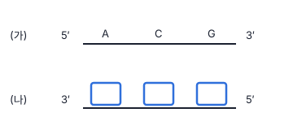
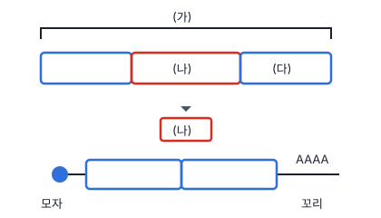

# 복습문제 32선 — 1006 수업 범위

기출 20개와 생성 변형 12개를 담았어요. 먼저 풀어 보고, 막히면 힌트를 열어 보세요. 원문이 모호한 문제는 풀이에서 조건과 출제 의도를 구분해요.

> `복습문제_1006_Transcription_Translation_and_Lac_Operon.html`를 마크다운으로 옮겼어요. 원문, 힌트, 풀이는 접혀 있어요. 먼저 풀어 보고 펼쳐 보세요.

**목차**

- [B. 기출](#partB)
  - [P1. 가닥과 안티코돈](#p1)
  - [P2. 전사 서열의 조건](#p2)
  - [P3. 삽입과 조기 종결](#p3)
  - [P4. 핵 안의 원본](#p4)
  - [P5. 리보솜의 구성](#p5)
  - [P6. 두 자리 암호](#p6)
  - [P7. 오페론의 유도자](#p7)
  - [P8. 과오와 틀이동의 경계](#p8)
  - [P9. tRNA의 짝](#p9)
  - [P10. 발현량의 변화](#p10)
  - [P11. 기능과 변이 유형](#p11)
  - [P12. 틀이동의 원인](#p12)
  - [P13. 같은 아미노산의 두 코돈](#p13)
  - [P14. DNA를 여는 과정](#p14)
  - [P15. tRNA의 운반 기능](#p15)
  - [P16. 전사 시작 부위](#p16)
  - [P17. 돌연변이의 다양한 영향](#p17)
  - [P18. 번역에 직접 쓰는 분자](#p18)
  - [P19. 번역의 시작](#p19)
  - [P20. 원본과 번역 사본](#p20)
- [C. 변형 연습](#partC)
  - [P21. [변형] 억제자와 유도자](#p21)
  - [P22. [변형] tRNA의 두 기능](#p22)
  - [P23. [변형] 방향을 바꾸어 읽기](#p23)
  - [P24. [변형] 가공에서 남는 구간](#p24)
  - [P25. [변형] 세 염기의 삭제](#p25)
  - [P26. [변형] 결합하지 못하는 억제자](#p26)
  - [P27. [변형] 유전암호의 세 진술](#p27)
  - [P28. [변형] 리보솜과 단백질의 재료](#p28)
  - [P29. [변형] 선택하는 전사](#p29)
  - [P30. [변형] tRNA와 여러 코돈](#p30)
  - [P31. [변형] 염기는 바뀌고 아미노산은 유지](#p31)
  - [P32. [변형] 다섯 종류의 두 자리 신호](#p32)

## B. 기출

### P1. 가닥과 안티코돈

DNA의 암호화 서열의 특정 세 개 염기가 TGA이다. 이 서열을 바탕으로한 mRNA의 코돈에 결합하는 tRNA의 안티코돈은 무엇인가?

- (1) TGA
- (2) UCU
- (3) ACU
- (4) ACT
- (5) UGA

원문 정보 보기

기출 5강 3번 (PDF 1쪽)

힌트 보기

가닥의 종류와 5′·3′ 방향을 먼저 확인하고, 코돈 인식 부위와 아미노산 결합 부위를 구분해요.

풀이 보기

1. (1) 틀려요. T를 포함한 TGA는 DNA 표기이고 RNA 안티코돈 표기가 아니에요.
2. (2) 틀려요. UCU는 주형을 3′-TGA-5′로 가정했을 때 만들어지는 5′-ACU-3′ 코돈과 상보적이지 않아요.
3. (3) 출제 의도로는 답이 아니에요. 주형을 3′-TGA-5′로 가정하면 ACU는 mRNA 코돈이고, 그 코돈에 결합하는 안티코돈은 3′-UGA-5′예요.
4. (4) 틀려요. T가 들어 있는 ACT는 RNA 안티코돈 표기가 아니에요.
5. (5) 출제 의도상 맞아요. DNA를 암호화가닥이 아니라 3′-TGA-5′ 주형으로 읽으면 mRNA는 5′-ACU-3′이고 안티코돈은 3′-UGA-5′예요. 하지만 발문대로 암호화가닥 5′-TGA-3′라면 mRNA는 종결 코돈 5′-UGA-3′이므로 아미노산을 운반하는 tRNA가 결합하지 않아요.
6. 수업과의 연결: 1006 수업에서 다룬 [가닥 방향과 코돈·안티코돈](정리노트_1006_Transcription_Translation_and_Lac_Operon.md#s3-trna)의 개념으로 분자 역할과 조건을 구분해요.

**정답:** (5)

원문과 인쇄 정답 (5)를 보존해요. 발문대로 암호화가닥을 5′-TGA-3′로 읽으면 mRNA는 5′-UGA-3′ 종결 코돈이고, 대응하는 아미노산 운반 tRNA는 없어요. 출제자가 DNA를 3′-TGA-5′ 주형으로 의도했다면 mRNA 5′-ACU-3′와 안티코돈 3′-UGA-5′가 되어 (5)가 성립해요. UGA라는 글자만 같아도 방향과 분자 역할이 다르면 같은 의미가 아니에요.

---

### P2. 전사 서열의 조건

TTACAGGTCC 유전자로부터 만들어진 mRNA는 어느 것인가?

- (1) AATGTCCAGG
- (2) GGAGTGGACC
- (3) AAUGUCCAGG
- (4) UUACAGGUCC

원문 정보 보기

기출 5강 5번 (PDF 1쪽)

힌트 보기

가닥의 종류와 5′·3′ 방향을 먼저 확인하고, 코돈 인식 부위와 아미노산 결합 부위를 구분해요.

풀이 보기

1. (1) 틀려요. AATGTCCAGG는 T가 들어 있는 DNA 서열이며 mRNA 표기가 아니에요.
2. (2) 틀려요. GGAGTGGACC에도 T가 들어 있어 mRNA 서열이 아니에요.
3. (3) 출제 의도상 맞아요. 3′-TTACAGGTCC-5′를 주형으로 가정하면 상보적인 mRNA는 5′-AAUGUCCAGG-3′예요.
4. (4) 조건에 따라 맞아요. 5′-TTACAGGTCC-3′를 암호화가닥으로 가정하면 T만 U로 바꾼 5′-UUACAGGUCC-3′가 mRNA예요.
5. 수업과의 연결: 1006 수업에서 다룬 [가닥 방향과 코돈·안티코돈](정리노트_1006_Transcription_Translation_and_Lac_Operon.md#s3-trna)의 개념으로 분자 역할과 조건을 구분해요.

**정답:** (3)

인쇄 정답은 (3)이지만 방향과 가닥 종류가 누락되어 있어요. 3′에서 5′로 제시한 주형이면 (3), 5′에서 3′로 제시한 암호화가닥이면 (4)예요. 5′에서 3′로 제시한 주형이면 역상보 서열 5′-GGACCUGUAA-3′로 보기에도 없어요. 단일 정답으로 단정하지 않아요.

---

### P3. 삽입과 조기 종결

DNA 복제 과정 중 어떤 유전자 서열에 하나의 염기쌍이 삽입되어 종결코돈이 중간에 생겼다면, 이로서 발생하는 현상으로 옳은 것만 &lt;보기&gt;에서 고른 것은?

- a. 번역틀이동 돌연변이다.
- b. 과오 돌연변이다.
- c. 침묵 돌연변이다.
- d. 중성돌연변이며 원래의 단백질과 같은 단백질이 만들어진다.
- e. 원래보다 더 짧은 단백질이 만들어진다.

- (1) a, e
- (2) b, d
- (3) a, c
- (4) b, c, e
- (5) b, c, d

원문 정보 보기

기출 5강 6번 (PDF 1쪽)

힌트 보기

염기 수 변화가 3의 배수인지와 종결 코돈이 생긴 위치를 확인해요.

풀이 보기

1. a는 맞아요. 한 염기쌍 삽입으로 틀이 바뀌어요. b는 틀려요. 과오는 염기 치환 유형이에요. c는 틀려요. 조기 종결하므로 아미노산 서열이 같지 않아요. d는 틀려요. 원래와 같은 단백질이 아니에요. e는 맞아요. 중간 종결로 더 짧아져요.
2. (1) 맞아요. 한 염기쌍 삽입은 읽는 틀을 바꾸므로 a가 맞고, 중간에 종결 코돈이 생겼으므로 e처럼 짧아져요.
3. (2) 틀려요. 이 변화는 염기 치환에 의한 과오가 아니라 삽입에 의한 틀이동이고, 조기 종결하므로 같은 단백질이 만들어진다는 d도 틀려요.
4. (3) 틀려요. a는 맞지만 조기 종결로 단백질이 짧아지므로 아미노산 서열이 유지되는 침묵 돌연변이라는 c는 틀려요.
5. (4) 틀려요. e는 맞지만 삽입에 의한 틀이동을 과오라는 b나 침묵이라는 c로 분류할 수 없어요.
6. (5) 틀려요. b는 변화 유형을 잘못 분류하고, c와 d는 조기 종결로 단백질이 짧아진다는 조건과 맞지 않아요.
7. 수업과의 연결: 1006 수업에서 다룬 [한 글자가 빠지면 조가 밀려요](정리노트_1006_Transcription_Translation_and_Lac_Operon.md#s4-frameshift)의 개념으로 분자 역할과 조건을 구분해요.

**정답:** (1)

---

### P4. 핵 안의 원본

단백질 합성 과정 중 핵 안에 남아 있는 물질은?

- (1) tRNA
- (2) 리보솜
- (3) DNA
- (4) rRNA
- (5) mRNA

원문 정보 보기

기출 5강 10번 (PDF 2쪽)

힌트 보기

핵에 있는 정보 원본과 핵 밖에서 사용하는 RNA 사본을 구분해요.

풀이 보기

1. (1) 틀려요. tRNA는 핵에서 만들어진 뒤 세포질로 나와 번역에 참여해요.
2. (2) 틀려요. 리보솜의 소단위체는 핵 밖으로 나와 세포질에서 번역해요.
3. (3) 맞아요. 진핵세포의 핵 DNA는 핵 안에 남고 그 정보의 RNA 사본이 이동해요.
4. (4) 틀려요. rRNA는 핵에서 만들어지지만 리보솜의 일부로 핵 밖에 나와 번역에 참여해요.
5. (5) 틀려요. 성숙한 mRNA는 핵 밖으로 나와 리보솜에서 읽혀요.
6. 수업과의 연결: 1006 수업에서 다룬 [요리책은 핵에, 요리는 리보솜에서](정리노트_1006_Transcription_Translation_and_Lac_Operon.md#s0-expression)의 개념으로 분자 역할과 조건을 구분해요.

**정답:** (3)

---

### P5. 리보솜의 구성

리보솜은 무엇으로 구성되어 있는가?

- (1) DNA와 단백질
- (2) mRNA와 DNA
- (3) tRNA 와 mRNA
- (4) rRNA 와 단백질

원문 정보 보기

기출 5강 11번 (PDF 2쪽)

힌트 보기

번역의 재료·정보 사본·장소를 각각 구분해요.

풀이 보기

1. (1) 틀려요. DNA는 정보를 보관하는 핵산이며 리보솜의 구조 성분이 아니에요.
2. (2) 틀려요. mRNA는 리보솜이 읽는 사본이고 DNA는 리보솜의 구성 성분이 아니에요.
3. (3) 틀려요. tRNA와 mRNA는 번역 중 리보솜에 결합하는 분자이며 리보솜 자체의 구성 성분 조합은 아니에요.
4. (4) 맞아요. 리보솜의 소단위체는 rRNA와 단백질로 이루어져요.
5. 수업과의 연결: 1006 수업에서 다룬 [정보·배달·조립의 세 역할](정리노트_1006_Transcription_Translation_and_Lac_Operon.md#s3-ribosome)의 개념으로 분자 역할과 조건을 구분해요.

**정답:** (4)

---

### P6. 두 자리 암호

만약 두 개의 뉴클레오타이드가 하나의 아미노산을 결정하는 데 사용된다면, 단백질 합성 시 몇 개의 아미노산을 지정할 수 있는가?

- (1) 64
- (2) 8
- (3) 32
- (4) 4
- (5) 16

원문 정보 보기

기출 5강 12번 (PDF 2쪽)

힌트 보기

서로 다른 염기의 조합 수와 한 코돈의 의미를 구분해요.

풀이 보기

1. (1) 틀려요. 64는 염기 네 종류로 세 자리 신호를 만들 때의 4×4×4예요.
2. (2) 틀려요. 각 자리에는 네 가지가 올 수 있어서 4+4로 더하지 않아요.
3. (3) 틀려요. 두 자리 신호의 조합 수는 4×4이며 32가 아니에요.
4. (4) 틀려요. 4는 한 자리 신호의 경우의 수예요.
5. (5) 맞아요. 네 종류 염기를 두 자리로 배열하면 4×4=16개의 서로 다른 신호를 만들 수 있어요.
6. 수업과의 연결: 1006 수업에서 다룬 [네 글자로 만드는 세 글자 암호](정리노트_1006_Transcription_Translation_and_Lac_Operon.md#s2-code)의 개념으로 분자 역할과 조건을 구분해요.

**정답:** (5)

---

### P7. 오페론의 유도자

다음은 원핵생물의 오페론에 대한 설명이다. 맞는 설명은?

- (1) 젖당이 배지내에서 모두 소모되면 lac 오페론이 작동된다
- (2) 억제자는 활성화되면 오페론의 유전자들을 발현시킨다
- (3) 대장균은 젖당을 분해하는 효소를 항상 발현시킨다
- (4) 알로락토스는 lac 오페론의 유도자로 작용한다
- (5) lac 오페론은 유도자가 억제자를 활성화 시키면 전사된다

원문 정보 보기

기출 5강 18번 (PDF 2쪽)

힌트 보기

억제자는 단백질, 작동자는 DNA, 유도자는 억제자에 결합하는 분자예요.

풀이 보기

1. (1) 틀려요. 젖당이 소모되면 유도자 효과가 사라져 활성 억제자가 작동자에 결합하고 전사를 막아요.
2. (2) 틀려요. 활성 억제자는 작동자에 결합하여 전사를 막아요.
3. (3) 틀려요. 젖당 분해 효소 발현은 환경에 따라 조절되므로 젖당이 없을 때도 항상 발현하는 것이 아니에요.
4. (4) 맞아요. 알로락토스는 억제자에 결합하여 작동자 결합을 방해하는 유도자예요.
5. (5) 틀려요. 유도자는 억제자를 비활성화하므로 활성화시킨다는 설명은 반대예요.
6. 수업과의 연결: 1006 수업에서 다룬 [lac 오페론의 억제자 스위치](정리노트_1006_Transcription_Translation_and_Lac_Operon.md#s5-operon)의 개념으로 분자 역할과 조건을 구분해요.

**정답:** (4)

---

### P8. 과오와 틀이동의 경계

다음 중 과오 돌연변이(missense mutation)가 될 수 없는 것은?

- (1) 암호화 서열에서 염기 1개 삭제
- (2) 암호와 서열에 염기 2개가 추가됨
- (3) 침묵 돌연변이와 같다
- (4) 번역틀이동에 의해 야기된다
- (5) 낫모양적혈구빈혈증 유전자에 대한 암호

원문 정보 보기

기출 5강 19번 (PDF 3쪽)

힌트 보기

염기가 바뀌었는지, 아미노산이 바뀌었는지, 기능이 바뀌었는지를 따로 확인해요.

풀이 보기

1. (1) 출제 의도로는 답이 아니지만 엄밀하게는 과오 유형이 아니에요. 한 염기 삭제는 읽는 틀을 바꾸는 삭제·번역틀이동 돌연변이이고, 염기 치환으로 한 아미노산이 바뀌는 과오와 구분해요.
2. (2) 출제 의도로는 답이 아니지만 엄밀하게는 과오 유형이 아니에요. 두 염기 삽입은 3의 배수가 아니므로 틀이동을 일으키며 과오 치환과 다른 유형이에요.
3. (3) 출제 의도상 맞아요. 침묵 돌연변이는 코돈이 달라져도 아미노산이 같고, 과오 돌연변이는 아미노산이 바뀌므로 같지 않아요.
4. (4) 출제 의도로는 답이 아니지만 엄밀하게는 과오 유형이 아니에요. 틀이동으로 아미노산 서열이 달라질 수 있지만 변화의 유형은 번역틀이동이며 과오 치환의 동의어가 아니에요.
5. (5) 출제 의도상 과오의 예로 맞아요. 낫모양적혈구빈혈증의 대표적 변이는 베타글로빈에서 염기 치환으로 아미노산이 바뀌는 과오 돌연변이예요.
6. 수업과의 연결: 1006 수업에서 다룬 [한 글자를 바꿨을 때](정리노트_1006_Transcription_Translation_and_Lac_Operon.md#s4-substitution)의 개념으로 분자 역할과 조건을 구분해요.

**정답:** (3)

인쇄 정답 (3)은 과오를 넓게 아미노산 서열의 변화로 읽은 출제 의도예요. 엄밀한 과오는 염기 치환으로 아미노산이 바뀌는 유형이므로 (1) 삭제, (2) 삽입, (4) 틀이동도 그 유형에 해당하지 않아요. 서로 다른 유형을 같은 말로 외우지 않아요.

---

### P9. tRNA의 짝

운반 RNA (tRNA)에 대한 설명으로 옳은 것은?

- (1) 단당류 (monosaccharide)를 운반한다
- (2) 단백질 합성이 일어나는 장소이다
- (3) 전령 RNA (mRNA)로 만들어진다
- (4) 전령 RNA (mRNA)의 코돈과 상보적인 안티코돈 부분을 가지고 있다

원문 정보 보기

기출 5강 20번 (PDF 3쪽)

힌트 보기

가닥의 종류와 5′·3′ 방향을 먼저 확인하고, 코돈 인식 부위와 아미노산 결합 부위를 구분해요.

풀이 보기

1. (1) 틀려요. tRNA가 운반하는 것은 단당류가 아니라 아미노산이에요.
2. (2) 틀려요. 단백질 합성이 일어나는 장소는 리보솜이에요.
3. (3) 틀려요. tRNA는 해당 유전자의 DNA에서 전사되며 mRNA를 재료로 만들어지지 않아요.
4. (4) 맞아요. tRNA의 안티코돈이 mRNA의 코돈과 상보적이고 역평행으로 결합해요.
5. 수업과의 연결: 1006 수업에서 다룬 [가닥 방향과 코돈·안티코돈](정리노트_1006_Transcription_Translation_and_Lac_Operon.md#s3-trna)의 개념으로 분자 역할과 조건을 구분해요.

**정답:** (4)

---

### P10. 발현량의 변화

효소와 같은 세포내 단백질은 일반적으로 항상 생산되지는 않거나, 시간에 따라 일정한 비율로 생산되지는 않는다. 이러한 현상의 원인은 무엇인가?

- (1) 유전 암호의 중복성
- (2) 유전 암호의 모호함
- (3) 유전자 발현의 조절
- (4) 틀이동 돌연변이(framshift mutation)

원문 정보 보기

기출 5강 21번 (PDF 3쪽)

힌트 보기

환경에 맞게 생산량이 달라지는 이유를 생각해요.

풀이 보기

1. (1) 틀려요. 중복성은 여러 코돈이 같은 아미노산을 지정하는 성질이며 생산량의 시간적 조절을 뜻하지 않아요.
2. (2) 틀려요. 표준 유전암호에서 한 코돈은 여러 아미노산을 동시에 지정하지 않으며 생산량 변화의 원인이 아니에요.
3. (3) 맞아요. 필요한 때에 필요한 유전자의 발현을 켜거나 끄고 양을 바꾸므로 생산 비율이 달라져요.
4. (4) 틀려요. 틀이동은 염기 삽입·삭제로 읽는 틀이 바뀌는 변이이며 정상적인 생산량 조절을 설명하지 않아요.
5. 수업과의 연결: 1006 수업에서 다룬 [필요한 단백질만 만들어요](정리노트_1006_Transcription_Translation_and_Lac_Operon.md#s5-switch)의 개념으로 분자 역할과 조건을 구분해요.

**정답:** (3)

---

### P11. 기능과 변이 유형

돌연변이가 발생하였지만 생성된 단백질의 기능에 큰 변화를 주지 않았을 때, 이를 무엇이라고 하는가?

- (1) 변역틀이동 돌연변이
- (2) 침묵 돌연변이
- (3) 정지 돌연변이
- (4) 과오 돌연변이
- (5) 유전 암호의 보편성

원문 정보 보기

기출 5강 23번 (PDF 3쪽)

힌트 보기

염기가 바뀌었는지, 아미노산이 바뀌었는지, 기능이 바뀌었는지를 따로 확인해요.

풀이 보기

1. (1) 출제 의도로는 답이 아니에요. 틀이동은 염기를 세 개씩 읽는 경계가 달라지는 유형이고, 기능 영향만으로 이 유형을 판별할 수 없어요.
2. (2) 출제 의도상 맞아요. 침묵 돌연변이는 코돈이 바뀌어도 아미노산이 그대로여서 기능이 유지될 수 있어요. 다만 기능 변화가 작다는 조건만으로 침묵을 확정할 수 없어요.
3. (3) 출제 의도로는 답이 아니에요. 정지 돌연변이는 아미노산 코돈이 종결 코돈으로 바뀌는 것이며, 기능 변화 정도만으로 확정하지 않아요.
4. (4) 조건에 따라 맞아요. 아미노산이 바뀐 과오 돌연변이도 단백질 기능에 큰 영향이 없을 수 있으므로 기능이 유지된다는 이유만으로 배제할 수 없어요.
5. (5) 틀려요. 보편성은 여러 생물이 거의 같은 유전암호를 쓰는 성질이며 개별 돌연변이의 기능 영향을 분류하는 이름이 아니에요.
6. 수업과의 연결: 1006 수업에서 다룬 [한 글자를 바꿨을 때](정리노트_1006_Transcription_Translation_and_Lac_Operon.md#s4-substitution)의 개념으로 분자 역할과 조건을 구분해요.

**정답:** (2)

인쇄 정답 (2)를 유지하지만 기능이 크게 달라지지 않았다는 정보만으로 침묵 돌연변이를 확정할 수 없어요. 침묵은 아미노산이 그대로인 경우이고, 아미노산이 바뀐 과오도 기능적으로 중성일 수 있어요. 아미노산 서열을 확인해야 유형을 구분할 수 있어요.

---

### P12. 틀이동의 원인

번역틀이동 돌연변이는 ( ) 의 결과로 생긴다.

- (1) 아미노산이 정상적으로 기능을 띠는 단백질로 조합
- (2) 단백질 합성이 방해되는 형태로 DNA가 변형
- (3) 유전자의 암호화 부위에 염기 하나가 삽입 또는 삭제
- (4) 한 개의 아미노산이 유사한 성질의 다른 아미노산으로 치환

원문 정보 보기

기출 5강 25번 (PDF 3쪽)

힌트 보기

염기 수 변화가 3의 배수인지와 종결 코돈이 생긴 위치를 확인해요.

풀이 보기

1. (1) 틀려요. 아미노산이 정상적인 단백질로 조합되는 것은 번역이며 염기 읽는 틀의 변화가 아니에요.
2. (2) 틀려요. 단백질 합성을 방해하는 DNA 변화에는 치환 등도 있어 이 문장만으로 틀이동을 특정할 수 없어요.
3. (3) 맞아요. 암호화 부위의 한 염기 삽입·삭제는 3의 배수가 아니므로 그 뒤 코돈 경계가 달라져요.
4. (4) 틀려요. 한 아미노산의 치환은 과오 변이일 수 있지만 읽는 틀을 옮기는 변화는 아니에요.
5. 수업과의 연결: 1006 수업에서 다룬 [한 글자가 빠지면 조가 밀려요](정리노트_1006_Transcription_Translation_and_Lac_Operon.md#s4-frameshift)의 개념으로 분자 역할과 조건을 구분해요.

**정답:** (3)

---

### P13. 같은 아미노산의 두 코돈

DNA 분자의 코돈 CCU를 코돈 CCC로 변화시킨 돌연변이를 가정하자. 이 두 코돈은 모두 프롤린을 지시한다. 이러한 예를 무엇이라 하는가?

- (1) 유전암호의 진화성
- (2) 유전암호의 보편성
- (3) 유전암호의 연속성
- (4) 유전암호의 중복성
- (5) 유전암호의 모호성

원문 정보 보기

기출 5강 26번 (PDF 3쪽)

힌트 보기

서로 다른 염기의 조합 수와 한 코돈의 의미를 구분해요.

풀이 보기

1. (1) 틀려요. 이 예는 유전암호가 진화했다는 증거가 아니라 현재 두 코돈의 의미가 같다는 예예요.
2. (2) 틀려요. 보편성은 생물들 사이에 유전암호가 거의 같다는 성질이에요.
3. (3) 틀려요. 연속성은 여러 코돈이 같은 아미노산을 지정하는 성질의 이름이 아니에요.
4. (4) 맞아요. 서로 다른 CCU와 CCC가 같은 프롤린을 지정하는 것이 중복성이에요.
5. (5) 틀려요. 한 코돈이 여러 아미노산을 지정하는 모호성이 아니라 여러 코돈이 하나를 지정하는 중복성이에요.
6. 수업과의 연결: 1006 수업에서 다룬 [네 글자로 만드는 세 글자 암호](정리노트_1006_Transcription_Translation_and_Lac_Operon.md#s2-code)의 개념으로 분자 역할과 조건을 구분해요.

**정답:** (4)

원문은 DNA라고 쓰면서 U가 들어 있는 CCU를 제시해요. DNA에는 보통 U 대신 T를 쓰므로 여기의 CCU와 CCC는 mRNA 코돈 표기로 이해해야 해요. 원문의 표기 오류를 공개하고 중복성이라는 정답 (4)는 유지해요.

---

### P14. DNA를 여는 과정

다음 중 두 DNA 가닥을 분리시키는 것은 무엇인가?

- (1) 안티코돈
- (2) mRNA
- (3) tRNA
- (4) RNA 중합효소

원문 정보 보기

기출 5강 28번 (PDF 3쪽)

힌트 보기

DNA에서 RNA를 만드는 과정과 RNA 중합효소의 역할을 확인해요.

풀이 보기

1. (1) 틀려요. 안티코돈은 tRNA의 세 염기 구간이며 DNA를 여는 효소가 아니에요.
2. (2) 틀려요. mRNA는 RNA 사본이며 DNA 두 가닥을 분리하는 효소가 아니에요.
3. (3) 틀려요. tRNA는 아미노산을 운반하며 DNA 가닥을 여는 효소가 아니에요.
4. (4) 전사 맥락에서는 맞아요. RNA 중합효소는 전사할 부위의 DNA를 국소적으로 열고 한 가닥을 주형으로 읽어요. 복제에서 DNA를 푸는 효소를 묻는다면 헬리케이스이므로 문맥 조건이 필요해요.
5. 수업과의 연결: 1006 수업에서 다룬 [복사 시작점과 RNA 합성](정리노트_1006_Transcription_Translation_and_Lac_Operon.md#s1-transcription)의 개념으로 분자 역할과 조건을 구분해요.

**정답:** (4)

인쇄 정답 (4)는 전사할 부위의 DNA를 국소적으로 여는 맥락이에요. 복제에서 두 DNA 가닥을 분리하는 효소는 헬리케이스이지만 보기에 없어요. 발문이 과정을 지정하지 않아 단일 정답 판정에 주의해요.

---

### P15. tRNA의 운반 기능

번역 과정 중 tRNA의 기능은?

- (1) 단백질 합성에 필요한 정보를 담고 있다.
- (2) 리보솜으로 아미노산을 운반한다.
- (3) RNA 중합효소의 출발점으로 작용한다.
- (4) 전령 RNA(mRNA)의 이중 나선을 단일 나선으로 푼다.

원문 정보 보기

기출 5강 34번 (PDF 4쪽)

힌트 보기

가닥의 종류와 5′·3′ 방향을 먼저 확인하고, 코돈 인식 부위와 아미노산 결합 부위를 구분해요.

풀이 보기

1. (1) 틀려요. 번역할 아미노산 순서의 정보를 담은 것은 mRNA예요.
2. (2) 맞아요. tRNA는 3′ 말단에 아미노산을 달고 리보솜으로 가져와요.
3. (3) 틀려요. RNA 중합효소가 전사를 시작하는 DNA 부위는 프로모터예요.
4. (4) 틀려요. tRNA는 mRNA의 이중 나선을 푸는 효소가 아니며 코돈과 짝지어 아미노산을 전달해요.
5. 수업과의 연결: 1006 수업에서 다룬 [가닥 방향과 코돈·안티코돈](정리노트_1006_Transcription_Translation_and_Lac_Operon.md#s3-trna)의 개념으로 분자 역할과 조건을 구분해요.

**정답:** (2)

---

### P16. 전사 시작 부위

RNA 중합효소는 전사를 시작할 때 ( ) 에 결합한다.

- (1) 리보솜
- (2) 엑손
- (3) tRNA
- (4) 인트론
- (5) 프로모터

원문 정보 보기

기출 5강 35번 (PDF 4쪽)

힌트 보기

DNA에서 RNA를 만드는 과정과 RNA 중합효소의 역할을 확인해요.

풀이 보기

1. (1) 틀려요. 리보솜은 번역 장소이며 전사를 시작하는 DNA 결합 부위가 아니에요.
2. (2) 틀려요. 엑손은 가공 뒤 RNA에 남는 구간이며 전사 시작 부위의 이름이 아니에요.
3. (3) 틀려요. tRNA는 번역에 참여하는 RNA이며 전사 시작 DNA 부위가 아니에요.
4. (4) 틀려요. 인트론은 전사 뒤 이어맞추기에서 제거되는 구간이에요.
5. (5) 맞아요. 프로모터는 전사가 시작되도록 RNA 중합효소가 결합하는 DNA 부위예요.
6. 수업과의 연결: 1006 수업에서 다룬 [복사 시작점과 RNA 합성](정리노트_1006_Transcription_Translation_and_Lac_Operon.md#s1-transcription)의 개념으로 분자 역할과 조건을 구분해요.

**정답:** (5)

---

### P17. 돌연변이의 다양한 영향

유전자에 일어난 돌연변이는 _____________.

- (1) 새로운 기능을 갖는 단백질을 만들 수 없다.
- (2) 항상 개체의 표현형에 변화를 가져온다
- (3) 기능이 없는 단백질을 반드시 만들어야 한다.
- (4) 단백질을 만들 수 없다
- (5) 유전자에 의해 만들어지는 단백질에 영향을 미치지 않을 수도 있다.

원문 정보 보기

기출 5강 36번 (PDF 4쪽)

힌트 보기

염기가 바뀌었는지, 아미노산이 바뀌었는지, 기능이 바뀌었는지를 따로 확인해요.

풀이 보기

1. (1) 틀려요. 돌연변이로 아미노산 서열이 달라져 새로운 기능이나 성질을 얻는 경우도 있어요.
2. (2) 틀려요. 침묵 돌연변이처럼 표현형이 달라지지 않는 경우가 있으므로 항상이라는 조건이 성립하지 않아요.
3. (3) 틀려요. 침묵 변이나 기능에 영향이 적은 과오 변이에서는 단백질이 기능을 유지할 수 있어요.
4. (4) 틀려요. 침묵 변이에서는 같은 아미노산 서열의 단백질을 계속 만들 수 있어요.
5. (5) 맞아요. 코돈이 달라져도 같은 아미노산을 지정하거나 바뀐 아미노산이 기능에 큰 영향을 주지 않을 수 있어요.
6. 수업과의 연결: 1006 수업에서 다룬 [한 글자를 바꿨을 때](정리노트_1006_Transcription_Translation_and_Lac_Operon.md#s4-substitution)의 개념으로 분자 역할과 조건을 구분해요.

**정답:** (5)

---

### P18. 번역에 직접 쓰는 분자

다음 중 번역 과정에 직접적으로 참여하지 않는 분자는?

- (1) tRNA
- (2) 아미노산
- (3) 리보솜
- (4) mRNA
- (5) DNA

원문 정보 보기

기출 5강 37번 (PDF 4쪽)

힌트 보기

번역의 재료·정보 사본·장소를 각각 구분해요.

풀이 보기

1. (1) 틀려요. tRNA는 코돈을 인식하고 아미노산을 전달하여 번역에 직접 참여해요.
2. (2) 틀려요. 아미노산은 번역 중 연결되는 재료예요.
3. (3) 틀려요. 리보솜은 mRNA를 읽고 아미노산을 연결하는 장소예요.
4. (4) 틀려요. mRNA는 번역 중 리보솜이 직접 읽는 코돈 서열을 담아요.
5. (5) 맞아요. DNA는 전사의 주형이고, 번역에서는 그 RNA 사본을 직접 읽어요.
6. 수업과의 연결: 1006 수업에서 다룬 [정보·배달·조립의 세 역할](정리노트_1006_Transcription_Translation_and_Lac_Operon.md#s3-ribosome)의 개념으로 분자 역할과 조건을 구분해요.

**정답:** (5)

---

### P19. 번역의 시작

어떤 아미노산이 번역 과정에서 맨 처음 시작하는가?

- (1) 아르지닌
- (2) 발린
- (3) 메싸이오닌
- (4) 글리신
- (5) 페닐알라닌

원문 정보 보기

기출 5강 38번 (PDF 4쪽)

힌트 보기

시작 신호와 아미노산을 지정하지 않는 종결 신호를 구분해요.

풀이 보기

1. (1) 틀려요. 아르지닌은 단백질의 재료지만 표준 개시 코돈 AUG가 지정하는 아미노산은 아니에요.
2. (2) 틀려요. 발린은 표준 개시 코돈 AUG가 지정하는 아미노산이 아니에요.
3. (3) 맞아요. 표준 개시 코돈 AUG는 메싸이오닌을 지정하여 번역을 시작해요. 세균에서는 변형된 메싸이오닌을 사용해요.
4. (4) 틀려요. 글리신은 표준 개시 코돈 AUG가 지정하는 아미노산이 아니에요.
5. (5) 틀려요. 페닐알라닌은 표준 개시 코돈 AUG가 지정하는 아미노산이 아니에요.
6. 수업과의 연결: 1006 수업에서 다룬 [번역의 시작과 끝](정리노트_1006_Transcription_Translation_and_Lac_Operon.md#s2-start-stop)의 개념으로 분자 역할과 조건을 구분해요.

**정답:** (3)

---

### P20. 원본과 번역 사본

단백질의 아미노산 서열을 결정하는 데 필요한 뉴클레오타이드 서열을 가지고 있는 DNA는?

- (1) 운반RNA(tRNA)
- (2) 작은 RNA(miRNA)
- (3) 번역 RNA
- (4) 전령 RNA(mRNA)
- (5) 리보솜RNA(rRNA)

원문 정보 보기

기출 5강 42번 (PDF 5쪽)

힌트 보기

번역의 재료·정보 사본·장소를 각각 구분해요.

풀이 보기

1. (1) 틀려요. tRNA는 아미노산을 운반하는 RNA이므로 발문에서 물은 DNA가 아니에요.
2. (2) 틀려요. miRNA는 작은 조절 RNA이므로 DNA가 아니며 번역할 단백질 서열의 사본도 아니에요.
3. (3) 틀려요. 번역 RNA는 여기서 표준 RNA 유형 이름으로 쓰이지 않으며 DNA를 가리키는 보기도 아니에요.
4. (4) 출제 의도상 맞아요. mRNA는 리보솜이 읽을 코돈 서열을 담아요. 하지만 RNA이므로 발문의 DNA라는 조건을 문자 그대로 충족하지 못해요.
5. (5) 틀려요. rRNA는 리보솜의 구조와 기능에 참여하는 RNA이며 번역할 단백질 서열의 사본을 담은 DNA가 아니에요.
6. 수업과의 연결: 1006 수업에서 다룬 [정보·배달·조립의 세 역할](정리노트_1006_Transcription_Translation_and_Lac_Operon.md#s3-ribosome)의 개념으로 분자 역할과 조건을 구분해요.

**정답:** (4)

원문은 DNA를 묻지만 (1)~(5)에 DNA를 가리키는 유효한 보기가 없어요. 따라서 문자 그대로는 정답이 없고, 인쇄 정답 (4)는 발문의 DNA를 RNA로 읽었을 때의 의도상 답이에요. DNA가 정보의 원본이라는 사실과 mRNA가 번역에서 읽는 사본이라는 사실을 구분해요.

---

## C. 변형 연습

### P21. [변형] 억제자와 유도자

다음은 원핵생물의 오페론에 대한 설명이다. 맞는 설명은?

- (1) 알로락토스는 작동자를 이루는 DNA 서열이다.
- (2) 젖당이 없는 조건에서 활성 억제자는 전사를 막는다.
- (3) lacZ, lacY, lacA는 각각 별개 mRNA로만 전사된다.
- (4) 유도자가 억제자에 결합하면 억제자가 작동자에 더 잘 결합한다.
- (5) RNA 중합효소는 작동자에 결합하는 억제 단백질이다.

원문 정보 보기

기출 5강 18번 발문에 정답을 바꾼 생성 변형이에요. 다루는 혼동: 알로락토스와 활성 억제자 구분예요.

힌트 보기

억제자는 단백질, 작동자는 DNA, 유도자는 억제자에 결합하는 분자예요.

풀이 보기

1. (1) 틀려요. 알로락토스는 작은 유도자 분자이고 작동자는 DNA 서열이에요.
2. (2) 맞아요. 젖당이 없으면 활성 억제자가 작동자에 결합하여 전사를 막아요.
3. (3) 틀려요. lacZ·lacY·lacA는 같은 오페론에서 하나의 mRNA로 함께 전사될 수 있어요.
4. (4) 틀려요. 유도자 결합은 억제자의 작동자 결합을 방해해요.
5. (5) 틀려요. RNA 중합효소는 RNA를 합성하는 효소이고 억제자는 별개의 조절 단백질이에요.
6. 원문 정답과 달라진 점: 기출 5강 18번의 정답은 (4) 알로락토스의 유도자 역할이지만, 이 변형은 (2) 젖당이 없을 때 활성 억제자가 전사를 막는 설명을 정답으로 바꾸었어요.
7. 수업과의 연결: 1006 수업에서 다룬 [lac 오페론의 억제자 스위치](정리노트_1006_Transcription_Translation_and_Lac_Operon.md#s5-operon)의 개념으로 분자 역할과 조건을 구분해요.

**정답:** (2)

---

### P22. [변형] tRNA의 두 기능

운반 RNA (tRNA)에 대한 설명으로 옳은 것은?

- (1) 전령 RNA의 정보를 복제해 새로운 DNA를 만든다.
- (2) 아미노산은 안티코돈 세 염기에 공유결합한다.
- (3) 3′ 말단에 아미노산을 달고 리보솜으로 운반한다.
- (4) 코돈과 안티코돈은 같은 방향으로 나란히 결합한다.
- (5) 수소결합이 있는 부분이 하나도 없다.

원문 정보 보기

기출 5강 20번 발문에 정답을 바꾼 생성 변형이에요. 다루는 혼동: 아미노산 결합 위치예요.

힌트 보기

가닥의 종류와 5′·3′ 방향을 먼저 확인하고, 코돈 인식 부위와 아미노산 결합 부위를 구분해요.

풀이 보기

1. (1) 틀려요. tRNA는 DNA를 복제하는 효소가 아니며 아미노산 운반에 참여해요.
2. (2) 틀려요. 아미노산은 안티코돈이 아니라 tRNA의 3′ 말단에 결합해요.
3. (3) 맞아요. tRNA의 3′ 말단에 아미노산이 결합하고 안티코돈이 코돈을 인식해요.
4. (4) 틀려요. 상보적 코돈·안티코돈은 서로 반대인 역평행 방향으로 결합해요.
5. (5) 틀려요. tRNA 내부에도 상보적인 염기쌍 사이의 수소결합이 있어 접힌 구조를 만들어요.
6. 원문 정답과 달라진 점: 기출 5강 20번의 정답은 (4) 상보적인 안티코돈이지만, 이 변형은 (3) 아미노산이 붙는 3′ 말단과 운반 기능을 정답으로 바꾸었어요.
7. 수업과의 연결: 1006 수업에서 다룬 [가닥 방향과 코돈·안티코돈](정리노트_1006_Transcription_Translation_and_Lac_Operon.md#s3-trna)의 개념으로 분자 역할과 조건을 구분해요.

**정답:** (3)

---

### P23. [변형] 방향을 바꾸어 읽기

그림의 (가)는 mRNA, (나)는 그 코돈에 결합하는 tRNA의 세 염기예요. (나)를 5′에서 3′ 방향으로 적으면?

- (1) UGC
- (2) CGU
- (3) TGC
- (4) ACG
- (5) GCA

원문 정보 보기

원문 기출이 아닌 생성 변형이에요. 다루는 혼동: 역평행과 안티코돈예요.

힌트 보기

가닥의 종류와 5′·3′ 방향을 먼저 확인하고, 코돈 인식 부위와 아미노산 결합 부위를 구분해요.

풀이 보기

1. (1) 틀려요. UGC는 아래 가닥을 그림의 왼쪽에서 오른쪽, 곧 3′에서 5′ 방향으로 적은 서열이에요.
2. (2) 맞아요. 5′-ACG-3′와 짝지은 아래 가닥은 왼쪽부터 3′-UGC-5′이고, 5′에서 3′로 다시 읽으면 CGU예요.
3. (3) 틀려요. tRNA는 RNA이므로 T 대신 U를 사용하며 방향도 확인해야 해요.
4. (4) 틀려요. ACG는 (가)의 코돈이며 그와 상보적으로 결합하는 아래 가닥 서열이 아니에요.
5. (5) 틀려요. GCA는 위 가닥의 순서만 뒤집었으므로 상보적 염기쌍 조건을 충족하지 않아요.
6. 수업과의 연결: 1006 수업에서 다룬 [가닥 방향과 코돈·안티코돈](정리노트_1006_Transcription_Translation_and_Lac_Operon.md#s3-trna)의 개념으로 분자 역할과 조건을 구분해요.

**정답:** (2)

---

### P24. [변형] 가공에서 남는 구간

그림은 핵 안에서 일어나는 가공을 나타내요. (가), (나), (다)에 관한 설명으로 옳지 않은 것은?

- (1) (가)의 모든 구간은 전구체 RNA에 먼저 복사된다.
- (2) (나)는 이어맞추기 때 제거된다.
- (3) (다)는 가공 뒤 성숙한 RNA에 남는다.
- (4) 모자와 꼬리는 RNA를 보호하는 데 도움을 준다.
- (5) (나)는 핵 바깥에서 번역된 뒤 잘려 나간다.

원문 정보 보기

원문 기출이 아닌 생성 변형이에요. 다루는 혼동: 인트론의 전사와 제거예요.

힌트 보기

핵에서 전사한 뒤 남기는 구간과 제거하는 구간을 구분해요.

풀이 보기

1. (1) 맞아요. 위의 전체 가닥 (가)는 가운데 구간을 포함하여 전사된 전구체 RNA예요.
2. (2) 맞아요. 가운데 (나)는 아래의 성숙한 RNA에서 빠졌으므로 이어맞추기에서 제거되는 인트론이에요.
3. (3) 맞아요. 오른쪽 (다)는 아래에도 이어져 남으므로 엑손 구간이에요.
4. (4) 맞아요. 모자와 꼬리는 성숙한 RNA를 분해로부터 보호하는 데 도움을 줘요.
5. (5) 틀려요. (나)는 핵 안의 가공에서 제거되고 성숙한 mRNA는 그 뒤 핵 밖으로 나가 번역돼요.
6. 수업과의 연결: 1006 수업에서 다룬 [모자·꼬리와 이어맞추기](정리노트_1006_Transcription_Translation_and_Lac_Operon.md#s1-processing)의 개념으로 분자 역할과 조건을 구분해요.

**정답:** (5)

---

### P25. [변형] 세 염기의 삭제

암호화 부위 중간에서 세 염기를 삭제했어요. 개시·종결 신호는 그대로이고 추가 변화는 없어요. 바른 설명은?

- (1) 삭제 뒤 모든 코돈이 반드시 한 칸씩 밀린다.
- (2) 반드시 침묵 돌연변이이다.
- (3) 염기 하나의 치환과 같은 변화이다.
- (4) 삭제 뒤 읽는 틀은 유지될 수 있지만 아미노산은 줄거나 달라질 수 있다.
- (5) DNA 염기 수가 늘어난다.

원문 정보 보기

원문 기출이 아닌 생성 변형이에요. 다루는 혼동: 3배수 삭제와 틀이동예요.

힌트 보기

염기 수 변화가 3의 배수인지와 종결 코돈이 생긴 위치를 확인해요.

풀이 보기

1. (1) 틀려요. 세 염기의 삭제는 3의 배수라 삭제 이후 읽는 틀을 반드시 한 칸 밀지 않아요.
2. (2) 틀려요. 염기를 삭제하면 아미노산 하나가 빠지거나 경계 코돈이 달라질 수 있으므로 반드시 침묵은 아니에요.
3. (3) 틀려요. 치환은 염기 수를 유지하며 종류를 바꾸고, 삭제는 염기 수를 줄여요.
4. (4) 맞아요. 세 염기 삭제는 그 뒤 읽는 틀을 유지할 수 있지만 삭제 구간의 아미노산 수나 경계의 아미노산은 달라질 수 있어요.
5. (5) 틀려요. 삭제는 염기 수를 줄이는 변화예요.
6. 수업과의 연결: 1006 수업에서 다룬 [한 글자가 빠지면 조가 밀려요](정리노트_1006_Transcription_Translation_and_Lac_Operon.md#s4-frameshift)의 개념으로 분자 역할과 조건을 구분해요.

**정답:** (4)

---

### P26. [변형] 결합하지 못하는 억제자

포도당 효과는 고려하지 않는 단순 모형이에요. 억제 단백질이 작동자에 결합하지 못하게 되었어요. 젖당이 없을 때 예상되는 결과는?

- (1) 정상 모형과 달리 억제자가 전사를 막지 못한다.
- (2) 작동자 DNA가 억제 단백질로 바뀐다.
- (3) 알로락토스가 새로 만들어져야만 전사가 가능하다.
- (4) lacI 유전자가 작동자에 대신 결합한다.
- (5) RNA 중합효소가 아미노산을 직접 연결한다.

원문 정보 보기

원문 기출이 아닌 생성 변형이에요. 다루는 혼동: 작동자와 억제자 구분예요.

힌트 보기

억제자는 단백질, 작동자는 DNA, 유도자는 억제자에 결합하는 분자예요.

풀이 보기

1. (1) 맞아요. 억제자가 작동자에 결합해야 전사를 막으므로 그 결합이 불가능하면 젖당이 없어도 억제하지 못해요.
2. (2) 틀려요. 작동자는 DNA 서열이고 억제자는 단백질이므로 결합 능력의 변화로 서로 바뀌지 않아요.
3. (3) 틀려요. 이 모형에서는 억제자가 이미 결합하지 못하므로 그 결합을 막는 유도자가 필수 조건이 아니에요.
4. (4) 틀려요. lacI는 억제자를 만드는 유전자이며 DNA 유전자 자체가 억제 단백질처럼 작동자에 결합하지 않아요.
5. (5) 틀려요. RNA 중합효소는 뉴클레오타이드를 연결해 RNA를 합성하고 아미노산 연결은 번역 과정에서 일어나요.
6. 수업과의 연결: 1006 수업에서 다룬 [lac 오페론의 억제자 스위치](정리노트_1006_Transcription_Translation_and_Lac_Operon.md#s5-operon)의 개념으로 분자 역할과 조건을 구분해요.

**정답:** (1)

---

### P27. [변형] 유전암호의 세 진술

표준 유전암호에 관한 옳은 진술만 모두 고르면?

- ㄱ. 여러 코돈이 같은 아미노산을 지정할 수 있어요.
- ㄴ. 각 코돈은 여러 아미노산을 지정해요.
- ㄷ. 세 종결 코돈은 아미노산을 지정하지 않아요.

- (1) ㄱ
- (2) ㄴ
- (3) ㄱ, ㄴ
- (4) ㄱ, ㄷ
- (5) ㄱ, ㄴ, ㄷ

원문 정보 보기

원문 기출이 아닌 생성 변형이에요. 다루는 혼동: 중복성 대 모호성예요.

힌트 보기

서로 다른 염기의 조합 수와 한 코돈의 의미를 구분해요.

풀이 보기

1. ㄱ은 맞아요. 여러 코돈이 같은 아미노산을 지정하는 중복성이 있어요. ㄴ은 틀려요. 표준 유전암호의 각 아미노산 코돈은 한 아미노산을 지정해요. ㄷ은 맞아요. UAA·UAG·UGA는 아미노산을 지정하지 않는 종결 코돈이에요.
2. (1) 틀려요. ㄱ은 맞지만 맞는 진술 ㄷ이 빠졌어요.
3. (2) 틀려요. ㄴ은 한 코돈의 뜻이 모호하다고 잘못 설명해요.
4. (3) 틀려요. ㄱ은 맞지만 ㄴ은 틀리고 맞는 ㄷ이 빠졌어요.
5. (4) 맞아요. ㄱ은 중복성을 설명하고 ㄷ은 종결 코돈의 성질을 설명하므로 둘만 옳아요.
6. (5) 틀려요. ㄱ과 ㄷ은 맞지만 ㄴ은 틀리므로 모두 고를 수 없어요.
7. 수업과의 연결: 1006 수업에서 다룬 [네 글자로 만드는 세 글자 암호](정리노트_1006_Transcription_Translation_and_Lac_Operon.md#s2-code)의 개념으로 분자 역할과 조건을 구분해요.

**정답:** (4)

---

### P28. [변형] 리보솜과 단백질의 재료

번역의 구성 요소에 관한 설명으로 옳지 않은 것은?

- (1) 전령 RNA는 번역할 정보를 담아요.
- (2) 운반 RNA는 아미노산을 데려와요.
- (3) 리보솜에는 rRNA와 단백질이 있어요.
- (4) 아미노산들이 연결되어 폴리펩티드를 이루어요.
- (5) rRNA와 단백질은 모두 뉴클레오타이드만 연결된 중합체예요.

원문 정보 보기

원문 기출이 아닌 생성 변형이에요. 다루는 혼동: RNA와 단백질예요.

힌트 보기

번역의 재료·정보 사본·장소를 각각 구분해요.

풀이 보기

1. (1) 맞아요. mRNA의 코돈이 연결할 아미노산 순서의 정보를 담아요.
2. (2) 맞아요. tRNA는 아미노산을 리보솜으로 운반해요.
3. (3) 맞아요. 리보솜은 rRNA와 단백질로 이루어진 복합체예요.
4. (4) 맞아요. 아미노산들이 펩타이드 결합으로 연결되어 폴리펩티드가 돼요.
5. (5) 틀려요. rRNA는 뉴클레오타이드의 중합체이고 단백질은 아미노산의 중합체예요.
6. 수업과의 연결: 1006 수업에서 다룬 [정보·배달·조립의 세 역할](정리노트_1006_Transcription_Translation_and_Lac_Operon.md#s3-ribosome)의 개념으로 분자 역할과 조건을 구분해요. 0903 수업의 [아미노산과 펩타이드 결합](../../0903/정리노트_0903_Biomolecules_and_Cells.html#s5-amino-acid)에서 단백질이 아미노산의 중합체임을 다시 연결해요.

**정답:** (5)

---

### P29. [변형] 선택하는 전사

전사에 관한 설명으로 옳지 않은 것은?

- (1) RNA 합성은 5′에서 3′ 방향으로 진행돼요.
- (2) RNA 중합효소는 프라이머 없이 합성을 시작할 수 있어요.
- (3) 전사할 DNA의 두 가닥 중 하나가 주형으로 쓰여요.
- (4) 매번 핵 속 전체 DNA를 모두 RNA로 복사해야 해요.
- (5) 단백질로 번역되지 않는 RNA를 암호화하는 유전자도 있어요.

원문 정보 보기

원문 기출이 아닌 생성 변형이에요. 다루는 혼동: 전사 단위 대 유전체예요.

힌트 보기

DNA에서 RNA를 만드는 과정과 RNA 중합효소의 역할을 확인해요.

풀이 보기

1. (1) 맞아요. RNA 사슬의 3′ 말단에 새 뉴클레오타이드가 붙으므로 합성 방향은 5′에서 3′예요.
2. (2) 맞아요. RNA 중합효소는 DNA 중합효소와 달리 프라이머 없이 전사를 시작할 수 있어요.
3. (3) 맞아요. 하나의 전사 단위에서는 DNA의 두 가닥 중 하나를 주형으로 읽어요.
4. (4) 틀려요. 필요한 유전자를 선택하여 전사하므로 핵의 전체 DNA를 매번 모두 복사하지 않아요.
5. (5) 맞아요. 수업 밖이지만 맞는 진술이에요(출처: 교재 5장 p.104). 확실히 틀린 보기를 먼저 찾아요. rRNA나 tRNA처럼 RNA 자체로 기능하는 유전자 산물도 있어요.
6. 수업과의 연결: 1006 수업에서 다룬 [복사 시작점과 RNA 합성](정리노트_1006_Transcription_Translation_and_Lac_Operon.md#s1-transcription)의 개념으로 분자 역할과 조건을 구분해요.

**정답:** (4)

---

### P30. [변형] tRNA와 여러 코돈

운반 RNA와 코돈의 관계에 관한 설명으로 옳지 않은 것은?

- (1) 코돈과 안티코돈은 상보적으로 결합해요.
- (2) 아미노산은 운반 RNA의 3′ 말단에 결합해요.
- (3) 코돈과 안티코돈은 역평행으로 짝지어요.
- (4) 하나의 운반 RNA가 여러 코돈을 읽을 수 있는 경우도 있어요.
- (5) 종결 코돈에는 반드시 아미노산을 달고 온 운반 RNA가 결합해요.

원문 정보 보기

원문 기출이 아닌 생성 변형이에요. 다루는 혼동: 코돈과 안티코돈 방향예요.

힌트 보기

가닥의 종류와 5′·3′ 방향을 먼저 확인하고, 코돈 인식 부위와 아미노산 결합 부위를 구분해요.

풀이 보기

1. (1) 맞아요. 코돈과 안티코돈 사이의 상보적인 염기쌍으로 짝을 인식해요.
2. (2) 맞아요. 아미노산이 붙는 곳은 안티코돈이 아니라 tRNA의 3′ 말단이에요.
3. (3) 맞아요. 한쪽이 5′에서 3′일 때 맞은편은 3′에서 5′인 역평행으로 결합해요.
4. (4) 맞아요. 수업 밖이지만 맞는 진술이에요(출처: 교재 5장 p.105–106). 확실히 틀린 보기를 먼저 찾아요. 코돈의 세 번째 자리 결합에는 유연성이 있어 한 tRNA가 여러 코돈을 읽을 수 있어요.
5. (5) 틀려요. 종결 코돈에는 아미노산을 운반하는 tRNA가 아니라 종결을 돕는 단백질이 작용해요.
6. 수업과의 연결: 1006 수업에서 다룬 [가닥 방향과 코돈·안티코돈](정리노트_1006_Transcription_Translation_and_Lac_Operon.md#s3-trna)의 개념으로 분자 역할과 조건을 구분해요.

**정답:** (5)

---

### P31. [변형] 염기는 바뀌고 아미노산은 유지

CCU와 CCC가 둘 다 프롤린을 지정한다고 알려져 있어요. 암호화 부위의 CCU가 CCC로 바뀌었을 때 가장 직접적인 판정은?

- (1) 정지 돌연변이이다.
- (2) 번역틀이동이다.
- (3) 이 위치의 아미노산이 달라지는 과오 돌연변이이다.
- (4) 이 위치의 아미노산이 바뀌지 않는 침묵 돌연변이이다.
- (5) 염기가 하나 추가된 삽입이다.

원문 정보 보기

원문 기출이 아닌 생성 변형이에요. 다루는 혼동: 염기 변화 대 단백질 변화예요.

힌트 보기

염기가 바뀌었는지, 아미노산이 바뀌었는지, 기능이 바뀌었는지를 따로 확인해요.

풀이 보기

1. (1) 틀려요. CCC도 프롤린을 지정하므로 종결 코돈으로 바뀐 것이 아니에요.
2. (2) 틀려요. 염기가 추가·삭제되지 않았으므로 코돈 경계가 밀리지 않아요.
3. (3) 틀려요. 두 코돈이 같은 프롤린을 지정하므로 이 위치의 아미노산이 바뀌지 않아요.
4. (4) 맞아요. 염기는 달라져도 같은 프롤린을 지정하므로 이 위치에서 침묵 돌연변이예요.
5. (5) 틀려요. 코돈의 길이는 그대로이고 마지막 염기가 바뀌었으므로 삽입이 아니라 치환이에요.
6. 수업과의 연결: 1006 수업에서 다룬 [한 글자를 바꿨을 때](정리노트_1006_Transcription_Translation_and_Lac_Operon.md#s4-substitution)의 개념으로 분자 역할과 조건을 구분해요.

**정답:** (4)

---

### P32. [변형] 다섯 종류의 두 자리 신호

염기 종류가 다섯 가지인 가상 체계에서 두 염기로 하나의 신호를 만들어요. 서로 다른 신호의 최대 수는?

- (1) 10
- (2) 20
- (3) 25
- (4) 32
- (5) 125

원문 정보 보기

원문 기출이 아닌 생성 변형이에요. 다루는 혼동: 경우의 수예요.

힌트 보기

서로 다른 염기의 조합 수와 한 코돈의 의미를 구분해요.

풀이 보기

1. (1) 틀려요. 두 자리 각각의 선택 수를 5+5로 더하는 것이 아니라 곱해야 해요.
2. (2) 틀려요. 염기가 다섯 종류라 각 자리마다 다섯 선택이 있으므로 20이 아니에요.
3. (3) 맞아요. 첫 자리 다섯 가지와 둘째 자리 다섯 가지를 조합하면 5×5=25예요.
4. (4) 틀려요. 두 염기로 만든 신호의 경우의 수는 5의 제곱이며 32가 아니에요.
5. (5) 틀려요. 125는 다섯 종류 염기로 세 자리 신호를 만들 때의 5×5×5예요.
6. 수업과의 연결: 1006 수업에서 다룬 [네 글자로 만드는 세 글자 암호](정리노트_1006_Transcription_Translation_and_Lac_Operon.md#s2-code)의 개념으로 분자 역할과 조건을 구분해요.

**정답:** (3)

---

출처: 2023·2024 생명과학 기출(5강 합본). 정답은 인쇄된 답안지와 독립 판단을 대조했고, 어긋나거나 모호한 곳은 풀이에 밝혔어요. 변형 연습은 수업 내용으로 만든 생성 문제예요.
