# 전사·번역과 lac 오페론 — 5살도 이해하는 정리노트

이영만 교수님 생명과학 · 1006 수업 (5장 DNA 복제와 유전자의 발현)

> `정리노트_1006_Transcription_Translation_and_Lac_Operon.html`를 마크다운으로 옮겼어요. 그림은 `figures_1006/` 폴더의 SVG, 위젯은 대표 설정의 정적 그림으로 바꿨어요. 수식은 `$…$` / `$$…$$`라서 GitHub, Obsidian, Typora에서 보여요.

**목차**

- [0. 복습과 유전자 발현](#s0)
  - [지난 수업 복습](#s0-recap)
  - [요리책은 핵에, 요리는 리보솜에서](#s0-expression)
- [1. 전사와 RNA 가공](#s1)
  - [복사 시작점과 RNA 합성](#s1-transcription)
  - [모자·꼬리와 이어맞추기](#s1-processing)
- [2. 유전암호](#s2)
  - [네 글자로 만드는 세 글자 암호](#s2-code)
  - [번역의 시작과 끝](#s2-start-stop)
- [3. 번역의 도구](#s3)
  - [가닥 방향과 코돈·안티코돈](#s3-trna)
  - [정보·배달·조립의 세 역할](#s3-ribosome)
- [4. 돌연변이](#s4)
  - [한 글자를 바꿨을 때](#s4-substitution)
  - [한 글자가 빠지면 조가 밀려요](#s4-frameshift)
- [5. 원핵생물의 발현 조절](#s5)
  - [필요한 단백질만 만들어요](#s5-switch)
  - [lac 오페론의 억제자 스위치](#s5-operon)
- [6. 요약 · 예고](#s6)
  - [시험 직전 한 줄](#s6-cheatsheet)
  - [끊긴 지점과 다음 범위 — 예고](#s6-next)
  - [함께 보면 좋은 자료](#s6-links)

## 0. 복습과 유전자 발현

### 지난 수업 복습

*1006 수업 · 5장 p1–3*

**정확히 말하면**

- DNA 복제는 세포 분열에 앞서 DNA 전체를 새 DNA로 복사하는 과정이에요.
- 두 부모 가닥을 각각 주형으로 쓰며, 새 가닥은 5′→3′로 합성돼요.
- 1유전자 1폴리펩티드 설명은 효소 아닌 단백질과 여러 사슬로 이뤄진 단백질도 고려한 수정이에요.
- 폴리펩티드는 아미노산 한 줄이고, 단백질은 이런 사슬 하나 또는 여러 개로 기능할 수 있어요.

[1001 정리노트의 시험 직전 요약](../../1001/정리노트_1001_Chromosome_Changes_and_DNA_Replication.html#s8-cheatsheet)

**페이지 요약**

DNA 복제는 전체 DNA를 복사하고, 1유전자 1폴리펩티드 설명은 사슬 한 줄의 정보를 가리켜요.

---

### 요리책은 핵에, 요리는 리보솜에서

*1006 수업 · 5장 p3*

**쉽게 말하면**

요리책은 방 안에 두고, 필요한 쪽을 베껴 주방으로 가져가 요리해요.

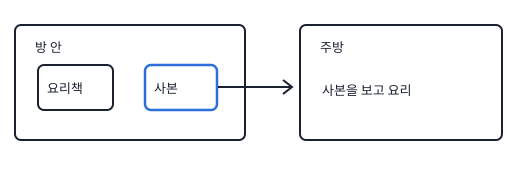

*원본을 옮기지 않아도 필요한 정보를 전달할 수 있어요.*

**정확히 말하면**

단백질 암호화 유전자에서 **유전자 발현(expression)**은 DNA의 염기서열 정보로 폴리펩티드를 만드는 전체 과정이에요. **전사(transcription)**는 DNA 정보를 상보적인 RNA 사본으로 만들고, **번역(translation)**은 mRNA 정보를 리보솜에서 아미노산 서열로 바꾸어 폴리펩티드를 만들어요.

| 과정 | 진핵세포의 핵 유전자 | 만드는 것 |
|---|---|---|
| 전사 | 핵 안 | RNA |
| 번역 | 세포질의 리보솜 | 폴리펩티드 |

핵 DNA는 원본으로 남고, 핵에서 만들어 가공한 mRNA가 핵 밖으로 나와 정보를 전달해요. 원핵생물에는 핵막으로 구분된 핵이 없어서, mRNA가 전사되는 도중에 번역이 시작될 수도 있어요.

**교수님 말씀**

> “요리책은 도서관에 있는 거고… 요리는 주방에서 하는 거죠.”

교수님은 진핵세포를 방이 나뉜 아파트, 원핵세포를 텐트에 비유했어요. 아파트에서는 책을 베끼는 방과 요리하는 주방이 나뉘지만, 텐트에서는 같은 공간에서 일을 할 수 있어요.

**꼭 기억해요**

유전자 발현 전체를 전사 하나와 같다고 생각하지 않아요. 단백질 암호화 유전자는 전사와 번역을 거쳐 폴리펩티드를 만들어요. 폴리펩티드 한 줄이 언제나 단백질 하나 전체인 것도 아니에요.

핵 안에 남는 DNA 원본과 밖으로 전달되는 mRNA를 구별해요. 여기서 설명한 장소 구분은 진핵세포의 핵 유전자 기준이에요.

**페이지 요약**

진핵세포의 핵 유전자는 핵에서 RNA 사본을 만들고, 세포질 리보솜에서 폴리펩티드를 만들어요.

*용어*

- **전사(transcription)** — DNA 정보로 RNA를 만드는 과정
- **번역(translation)** — mRNA 정보로 폴리펩티드를 만드는 과정

---

## 1. 전사와 RNA 가공

### 복사 시작점과 RNA 합성

*1006 수업 · 5장 p4*

**쉽게 말하면**

책 전체를 제본하는 일과, 필요한 쪽만 복사하는 일은 달라요.

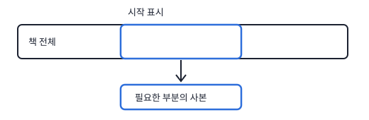

*복사할 곳을 알려 주는 시작 표시가 필요해요.*

**정확히 말하면**

**프로모터(promoter)**는 전사 개시를 위한 결합 부위를 제공하는 DNA의 특정 염기서열이에요. **RNA 중합효소(RNA polymerase)**는 RNA 합성을 촉진하는 효소예요. RNA로 복사되는 DNA 구간을 **전사단위(transcription unit)**라고 해요. 전사는 매번 유전체 전체를 복사하지 않아요. 한 전사단위에 여러 유전자가 묶인 경우는 [lac 오페론](#s5-operon)에서 구별해요.

1. 개시: 수업의 기본 모형에서는 RNA 중합효소가 프로모터에 결합하고 DNA를 국소적으로 풀어 전사 개시점에서 합성을 시작해요. DNA 복제와 달리 미리 만들어 둔 RNA 프라이머가 필요하지 않아요.
2. 연장: 두 DNA 가닥 중 하나인 **주형가닥**을 3′→5′로 읽으며, 상보적인 RNA를 **5′→3′**로 만들어요. 새로운 RNA 뉴클레오타이드는 자라는 RNA의 3′-OH에 붙어요.
3. 종결: 종결 신호에 이르면 RNA 합성이 끝나고 RNA와 중합효소가 DNA에서 떨어져요.

RNA는 리보스 당과 A·U·G·C 염기를 사용해요. 주형 DNA의 A에는 RNA의 U, T에는 A, G에는 C, C에는 G가 대응해요. 예를 들어 주형 3′-TAC-5′로부터 RNA 5′-AUG-3′가 만들어져요.

RNA 중합효소가 주형을 읽으며 RNA를 늘리는 방향을 [전사와 RNA 가공 모형](../%EC%9D%B8%ED%84%B0%EB%A0%89%ED%8B%B0%EB%B8%8C_02_%EC%A0%84%EC%82%AC%EC%99%80_RNA_%EA%B0%80%EA%B3%B5.html)의 ‘전사’에서 확인해 보세요.

**교수님 말씀**

> “프로모터는 DNA 상에서의 어떤 염기서열입니다, 염기서열.”

복사집 직원이 페이지 번호를 보고 시작점을 찾듯 RNA 중합효소는 프로모터를 시작 표지로 이용해요. 46권의 책 전체를 제본하는 비유는 DNA 복제이고, 오징어볶음밥 조리법이나 시험 범위만 복사하는 비유는 전사예요.

**꼭 기억해요**

프로모터는 단백질이 아니라 DNA 서열이에요. RNA 중합효소는 단백질 효소이고, DNA 중합효소가 새 DNA를 만드는 것과 달리 RNA를 만들어요.

복제에서는 헬리케이스가 두 DNA 가닥을 풀고, 프라이메이스가 프라이머를 만들어요. 수업의 전사 기본 모형에서는 RNA 중합효소가 DNA를 국소적으로 풀며 프라이머 없이 합성을 시작해요. “두 가닥을 푸는 효소”라는 질문은 복제인지 전사인지 조건을 먼저 확인해요.

5′→3′는 새 RNA의 합성 방향이고 주형을 읽는 방향은 3′→5′예요. 한 전사단위에서 두 가닥 모두를 동시에 주형으로 쓰지 않아요. 전사를 끝내는 DNA 신호와 번역을 끝내는 mRNA 종결 코돈도 구별해요.

**보충 · 수업에서 다루지 않았어요**

모든 유전자가 단백질을 암호화하는 것은 아니에요. rRNA와 tRNA처럼 RNA 자체가 기능하고 번역되지 않는 비단백질 암호화 유전자도 있어요. 이런 유전자도 각자의 DNA 정보를 전사해 RNA를 만들어요. tRNA와 rRNA가 mRNA를 바꾸어 만들어지는 것은 아니에요. 따라서 “전사의 산물은 모두 번역된다”라는 설명은 맞지 않아요.

출처: 교재 5장 p.104

**페이지 요약**

프로모터에서 시작해 한 DNA 주형을 읽고, 필요한 구간의 RNA를 5′→3′로 만들어요.

*용어*

- **프로모터(promoter)** — 전사 개시를 위한 DNA 서열
- **주형가닥(template strand)** — RNA와 상보적 염기쌍을 이루는 DNA 가닥
- **전사단위(transcription unit)** — 한 RNA로 전사되는 DNA 구간

---

### 모자·꼬리와 이어맞추기

*1006 수업 · 5장 p4–5*

**쉽게 말하면**

베낀 종이에 모자와 꼬리를 달아 보호하고, 중간에 끼어든 글을 빼고 남길 글을 이어요.

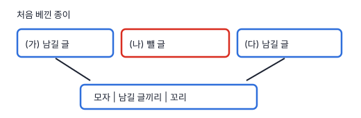

*처음에는 뺄 부분도 베껴지고, 손질한 뒤에는 남길 부분끼리 이어져요.*

**정확히 말하면**

진핵세포의 핵 유전자에서 처음 만들어지는 **전구체 mRNA(pre-mRNA)**는 핵 안에서 가공돼요. 수업에서는 mRNA가 DNA보다 불안정하고 분해되기 쉽다고 설명했어요. 가공은 mRNA를 보호하고 번역에 사용할 사본을 준비해요.

1. **5′ cap**: 5′ 말단에 구아닌이 거꾸로 연결된 모자 구조가 붙어요.
2. **poly(A) 꼬리**: 3′ 말단에 A 뉴클레오타이드가 여러 개 이어진 꼬리가 붙어요. 모자와 꼬리는 mRNA의 안정성에 도움을 줘요.
3. **스플라이싱(splicing)**: 전구체에 포함된 **인트론(intron)**을 제거하고 **엑손(exon)**끼리 이어요.

그림의 (가)와 (다)는 성숙 RNA에 남는 엑손, (나)는 가공할 때 제거되는 인트론에 대응해요. 성숙한 mRNA는 핵 밖으로 나와 리보솜에서 번역돼요.

모자·꼬리를 붙이고 인트론을 제거한 뒤 핵 밖으로 나가는 순서를 [전사와 RNA 가공 모형](../%EC%9D%B8%ED%84%B0%EB%A0%89%ED%8B%B0%EB%B8%8C_02_%EC%A0%84%EC%82%AC%EC%99%80_RNA_%EA%B0%80%EA%B3%B5.html)의 ‘가공’에서 따라가 보세요.

**교수님 말씀**

> “너 모자 하나 써봐라, 모자.”

교수님은 짧은 거리라도 불안정한 사본을 보호해야 한다고 설명했어요. 뜻이 통하는 문장 사이에 이상한 글이 끼어든 책에서 그 부분을 잘라 내고 남은 부분을 잇는 비유도 사용했어요.

BRCA1 분리 사례에서 이어진 핵심은 성숙 mRNA를 역전사효소(reverse transcriptase)로 DNA로 바꾸면, 원래 DNA와 달리 제거된 인트론이 없는 DNA를 실험적으로 얻을 수 있다는 점이에요.

**꼭 기억해요**

인트론이 처음부터 전사되지 않는다고 생각하지 않아요. 전구체 RNA에 먼저 포함된 뒤 제거돼요. 이때 DNA 원본에서 인트론을 잘라 내는 것도 아니에요.

전구체 mRNA와 가공된 성숙 mRNA를 구별해요. 스플라이싱은 여기서 핵 안의 RNA 가공이고, 핵 밖에서 번역한 뒤 인트론을 자르는 과정이 아니에요.

“엑손은 남는다”와 “엑손 전체가 번역된다”는 다른 말이에요. 인트론을 “의미 없는 부분”이라고 비유해도 생물학적 기능이 전혀 없다는 뜻은 아니에요. 원핵·진핵 비교는 전형적인 단백질 암호화 유전자의 비교이며, 모든 원핵생물에 인트론이 전혀 없다는 절대 규칙으로 외우지 않아요.

**보충 · 수업에서 다루지 않았어요**

엑손에는 번역되지 않는 부위(UTR)도 포함될 수 있어요. 따라서 엑손 전체가 번역된다고 단정하지 않아요. 교재 그림의 5′ 비번역 부위와 3′ 비번역 부위는 가공 후 mRNA에도 남아요.

출처: 교재 5장 p.104 그림 5.13

**페이지 요약**

진핵의 전구체 mRNA는 핵 안에서 모자·꼬리를 얻고, 인트론을 빼고 엑손을 이어요.

*용어*

- **인트론(intron)** — 전구체 RNA에 포함됐다가 가공 중 제거되는 구간
- **엑손(exon)** — 가공 후 성숙 RNA에 남는 구간
- **스플라이싱(splicing)** — 인트론 제거와 엑손 연결

---

## 2. 유전암호

### 네 글자로 만드는 세 글자 암호

*1006 수업 · 5장 p3–4*

**쉽게 말하면**

네 종류의 글자를 세 칸에 넣으면, 작은 재료로도 많은 신호를 만들 수 있어요.

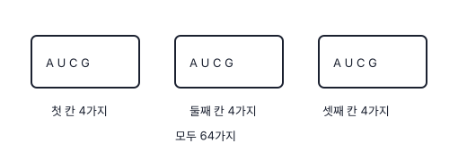

*세 칸의 선택을 곱해서 신호의 수를 세어요.*

**정확히 말하면**

**코돈(codon)**은 mRNA에서 연속한 염기 세 개로 된 암호예요. 네 염기 A·U·C·G의 **조합**을 사용해요. n칸의 경우의 수는 4ⁿ이에요. 한 칸은 4¹=4, 두 칸은 4²=16으로 일반적인 단백질 구성 아미노산 20종을 지정하기에 부족해요. 세 칸이면 4³=64가지예요. 표준 유전암호에서 **64**개 중 **61**개는 아미노산을 지정하고, 3개는 종결 신호예요.

염기가 k종이고 신호가 n칸이면 서로 다른 신호의 최대 수는 kⁿ이에요. 각 칸의 선택을 곱한다는 같은 원리예요.

| 특성 | 정확한 뜻 |
|---|---|
| 연속성(commaless) | 번역되는 읽는 틀 안에서 띄어쓰기 없이 세 염기씩 이어 읽어요. |
| 중복성(redundancy, degeneracy) | 서로 다른 여러 코돈이 같은 아미노산을 지정할 수 있어요. |
| 보편성(universality) | 극소수 예외를 제외하고 거의 모든 생물이 같은 암호 대응을 사용해요. |

코돈표는 mRNA의 **5′→3′** 서열로 찾아요. 첫 염기는 왼쪽, 둘째는 위, 셋째는 오른쪽에서 찾는 표예요. AUU는 이소류신(Ile), ACG는 트레오닌(Thr), UUU와 UUC는 모두 페닐알라닌(Phe)이에요. CCU와 CCC는 모두 프롤린(Pro), GGU와 GGC는 모두 글리신(Gly)이에요.

**교수님 말씀**

> “연속성, 중복성, 보편성, 이 세 가지 특징을 반드시 기억을 하셔야 됩니다.”

자음과 모음을 조합해 시를 쓰듯, 디지털의 0과 1로 복잡한 신호를 표현하듯, 적은 종류의 재료를 조합해 많은 정보를 나타낼 수 있어요.

코돈 해독 실험에서는 대장균에서 얻은 리보솜을 이용하는 번역 체계에 인공 mRNA를 넣었어요. U만 이어진 RNA로 페닐알라닌 사슬이 만들어지는 결과가 UUU의 뜻을 밝혔고, 반복·혼합 서열 실험을 모아 코돈표를 완성했어요.

보편성은 공통 조상이라는 설명을 뒷받침하며, 인간 인슐린 정보를 대장균에서 읽을 수 있는 근거예요. 실제 생산에는 대장균에서 전사·번역될 수 있도록 준비한 암호화 서열과 발현 조건이 필요해요. 아무 인간 DNA 조각을 넣기만 하면 자동으로 인슐린이 생긴다는 뜻은 아니에요.

**꼭 기억해요**

코돈 하나는 아미노산 세 개가 아니라 염기 세 개예요. 코돈표에서 찾는 것은 DNA 주형이나 tRNA 안티코돈이 아니라 mRNA 코돈이에요.

중복성은 여러 암호가 같은 아미노산을 뜻한다는 말이에요. 표준 유전암호에서 한 코돈이 여러 아미노산을 마음대로 뜻한다는 모호성과는 달라요. 세 번째 염기를 바꿔도 같은 아미노산인 사례가 있지만, 세 번째 염기의 모든 변화가 침묵하는 것은 아니에요.

연속성이 있어 한 염기의 삽입·삭제는 뒤의 묶음을 바꿀 수 있어요. 보편성은 예외가 전혀 없다는 뜻이 아니에요. 종결 코돈은 아미노산을 지정하지 않아도 번역을 끝내는 중요한 신호예요.

**페이지 요약**

네 종류 염기를 세 개씩 조합한 64개 코돈 중 61개가 아미노산을 지정해요.

*용어*

- **코돈(codon)** — mRNA의 세 염기 암호
- **중복성(redundancy)** — 서로 다른 코돈이 같은 아미노산을 지정할 수 있음
- **보편성(universality)** — 극소수 예외를 제외한 공통 암호 대응

---

### 번역의 시작과 끝

*1006 수업 · 5장 p3–4*

**쉽게 말하면**

시작 표지가 나오면 재료를 잇고, 끝 표지가 나오면 더 붙이지 않아요.

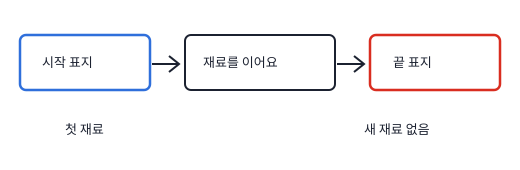

*끝 표지는 마지막 재료의 이름이 아니에요.*

**정확히 말하면**

표준 유전암호에서 **AUG**는 **메티오닌(methionine)**을 지정해요. 개시 코돈(start codon)으로 쓰일 때 번역 시작을 알리고, 처음 붙는 아미노산은 메티오닌이에요. 같은 읽는 틀의 내부 AUG도 메티오닌을 지정해요.

**UAA**·**UAG**·**UGA**는 **종결 코돈(stop codon)**이에요. 정지 코돈·중지 코돈·termination codon도 같은 뜻이에요. 아미노산을 지정하지 않으며 번역 중 만나면 폴리펩티드 합성이 끝나요. 표준 유전암호의 종결 코돈에 대응해 아미노산을 가져오는 tRNA는 없어요.

**교수님 말씀**

> “번역을 그만 멈추어라.”

교수님은 종결 코돈이 아미노산을 지정하지 않는다고 번역과 무관한 것은 아니라며, 종료 신호라는 기능을 강조했어요. 64개 코돈에서 종결 신호 3개를 빼면 아미노산 지정 코돈은 61개예요.

**꼭 기억해요**

처음 메티오닌으로 합성이 시작돼도 이후 가공에서 첫 메티오닌이 제거될 수 있어요. 따라서 완성된 모든 단백질의 첫 아미노산이 항상 메티오닌이라는 뜻은 아니에요.

프로모터는 DNA에서 전사 개시를 위한 표지이고, AUG는 mRNA의 번역 개시 코돈이에요. 둘 사이에 비번역 구간이 있을 수 있으므로 “프로모터 바로 다음이 무조건 AUG”라고 외우지 않아요. 암호화 DNA의 ATG와 mRNA의 AUG도 구별해요.

전사 종결 신호는 RNA 복사를 끝내고, 종결 코돈은 폴리펩티드 합성을 끝내요. 종결 코돈을 별도의 “정지 아미노산”이라고 생각하지 않아요.

**페이지 요약**

AUG는 번역 개시 때 메티오닌을 지정하고, UAA·UAG·UGA는 아미노산 없이 번역을 끝내요.

*용어*

- **AUG** — 메티오닌 지정 및 개시 신호
- **종결 코돈(stop codon)** — UAA·UAG·UGA; 아미노산을 지정하지 않는 종료 신호

---

## 3. 번역의 도구

### 가닥 방향과 코돈·안티코돈

*1006 수업 · 5장 p5*

**쉽게 말하면**

배달차는 한쪽에 재료를 싣고, 반대쪽으로 설명서의 맞는 세 글자를 찾아요.

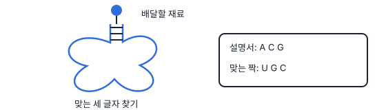

*배달할 재료와 설명서를 읽는 자리는 달라요.*

**정확히 말하면**

**운반 RNA(tRNA)**는 아미노산을 리보솜으로 운반해요. 한 가닥 RNA가 자기 안의 상보적 부분끼리 수소결합해 부분적으로 이중가닥을 이루고, 평면에서는 세잎클로버 모양으로 접혀요.

아미노산은 tRNA의 **3′ 말단**, CCA로 끝나는 자리의 마지막 A에 공유결합해요. 반대편의 세 염기는 **안티코돈(anticodon)**이며 mRNA 코돈과 **상보적**으로, 서로 반대 방향인 역평행으로 짝지어요.

| 가닥·산물 | 트레오닌 예 | 메티오닌 예 |
|---|---|---|
| DNA 주형가닥 | 3′-TGC-5′ | 3′-TAC-5′ |
| DNA 암호화가닥 | 5′-ACG-3′ | 5′-ATG-3′ |
| mRNA 코돈 | 5′-ACG-3′ | 5′-AUG-3′ |
| 맞춰 놓은 안티코돈 | 3′-UGC-5′ | 3′-UAC-5′ |
| 안티코돈을 5′부터 쓰면 | 5′-CGU-3′ | 5′-CAU-3′ |

mRNA는 주형가닥에 상보적으로 합성돼요. 암호화가닥과 같은 5′부터 비교하면 mRNA는 T 대신 U를 써요. 코돈표에는 mRNA 코돈을 5′에서 3′ 방향으로 넣어요.

코돈과 안티코돈이 짝을 이루는 방향을 [번역과 tRNA 모형](../%EC%9D%B8%ED%84%B0%EB%A0%89%ED%8B%B0%EB%B8%8C_03_%EB%B2%88%EC%97%AD%EA%B3%BC_tRNA.html)의 ‘tRNA’에서 돌려 보며 확인해 보세요.

**교수님 말씀**

> 안티코돈하고 코돈 관계 그 정도만 알면 됩니다.

교수님은 ACG와 AUG를 예로 들며 DNA, mRNA, 운반체의 짝을 반복해서 물으셨어요.

**꼭 기억해요**

단일가닥 RNA에도 내부 염기쌍의 수소결합은 있어요. 아미노산을 붙이는 공유결합, 코돈과 안티코돈 사이 수소결합, 아미노산끼리의 펩티드 결합은 구분해요. 아미노산을 안티코돈에 달지 않아요.

안티코돈 UGC와 CAU는 방향 없이 외우면 틀릴 수 있어요. AUG에 맞춰 놓으면 3′-UAC-5′이고, 이를 뒤집어 5′부터 적으면 5′-CAU-3′예요. 표는 수업 서열 설명의 방향을 바로잡았어요.

DNA 서열만 주고 주형인지 암호화가닥인지, 방향이 무엇인지 생략하면 mRNA를 하나로 확정할 수 없어요. **암호화가닥 5′-TGA-3′라면 mRNA는 5′-UGA-3′**예요. 표준 유전암호의 종결 코돈이므로 대응 아미노산을 싣는 tRNA가 없어요. mRNA는 RNA이며 DNA가 아니에요.

한 tRNA가 여러 코돈을 읽을 수 있다는 교재의 보충 사실은 [정보·배달·조립의 세 역할](#s3-ribosome)에서 함께 확인해요.

**보충 · 수업에서 다루지 않았어요**

#### tRNA는 어디서 와서 어디로 갈까?

mRNA는 아미노산을 연결할 순서를 알려 주는 정보이고, **tRNA는 그 순서에 맞는 아미노산을 가져오는 운반체**예요. 정보를 읽어 실제 재료를 연결하려면 둘이 함께 필요해요.

**mRNA와 tRNA는 각각 자기 유전자에서 만들어져요.** 진핵세포의 핵 유전자를 기준으로, tRNA는 핵에서 전사되고 가공을 거쳐 핵 밖으로 나와 세포질의 번역에 참여해요. 아래는 이 흐름을 단순화한 기본 모형이에요. 원핵생물에는 핵막으로 구분된 핵이 없어요.

안티코돈도 tRNA의 일부예요. 해당 서열은 tRNA가 전사될 때 함께 만들어지며, 가공 중 일부 염기가 변형될 수 있어요. **mRNA 코돈을 만날 때 안티코돈이 새로 생기는 것은 아니에요.**

세포는 tRNA를 만들고 유지하므로, 특정 mRNA가 나왔을 때 세포에 있던 tRNA가 번역에 참여할 수 있어요. 여기서 ‘이미 있다’는 말은 그 tRNA도 앞서 DNA에서 만들어졌다는 뜻이에요. 특정 mRNA를 만들 때마다 tRNA를 한 세트씩 새로 만드는 것은 아니며, **mRNA와 tRNA를 만드는 일에는 고정된 앞뒤 순서가 없고 동시에 진행될 수도 있어요.**

1. **생성:** DNA의 tRNA 유전자를 전사하고 가공해, 번역에 사용할 tRNA를 준비해요.
2. **아미노산 부착:** 아미노아실 tRNA 합성효소가 **이미 있는 아미노산**을 알맞은 tRNA의 **3′ 말단**에 붙여요. ATP 에너지를 사용하는 이 과정을 **충전(charging)**이라고 해요. 아미노산을 실은 뒤 리보솜의 mRNA 코돈과 짝지어요.
3. **번역 참여:** 리보솜에서 안티코돈이 mRNA 코돈과 짝을 이루고, tRNA가 가져온 아미노산이 자라는 폴리펩티드 사슬에 연결돼요.
4. **재사용:** 아미노산을 전달한 빈 tRNA는 리보솜에서 나와, 다시 알맞은 아미노산을 받아 번역에 참여할 수 있어요. 새 tRNA를 만드는 ①이 아니라 아미노산을 붙이는 ②로 돌아가요.

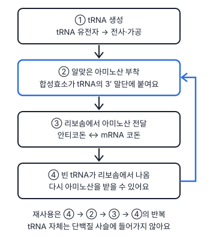

*tRNA는 운반체로 남고, 전달한 아미노산이 단백질 사슬의 재료가 돼요.*

**tRNA 자체가 단백질의 재료로 들어가는 것은 아니에요.** 전달하는 아미노산이 사슬에 들어가고, tRNA는 다시 사용돼요. 재사용된다는 말이 영원히 분해되지 않는다는 뜻은 아니에요.

#### 합성효소는 어떤 아미노산을 실어야 하는지 어떻게 알까요?

**아미노아실 tRNA 합성효소(aminoacyl-tRNA synthetase)**는 아미노산과 tRNA 양쪽을 인식해요. 효소의 결합 자리는 알맞은 아미노산의 크기·모양·화학적 성질에 잘 맞아요. tRNA 쪽에서는 특정 염기들과 입체 모양을 인식하며, 아미노산이 붙는 쪽 줄기나 안티코돈 등에서 중요한 특징을 읽어요. 인식 부위는 합성효소마다 달라요.

예를 들어 알라닌 담당 합성효소는 알라닌과 알라닌용 tRNA를 골라 연결해요. 이 tRNA의 아미노산 수용 줄기에 있는 특정 염기쌍이 중요한 인식 표지가 돼요. mRNA를 먼저 읽고 그때 알라닌을 만드는 과정이 아니에요.

| 단계 | 인식·짝맞춤 대상 | 역할 |
|---|---|---|
| 합성효소의 충전 | 아미노산과 tRNA | 알맞은 재료를 싣기 |
| 리보솜의 코돈 해독 | mRNA 코돈과 tRNA 안티코돈 | 재료가 들어갈 순서 맞추기 |

코돈과 안티코돈이 맞아도 tRNA에 잘못된 아미노산이 실렸다면 잘못된 아미노산이 사슬에 들어갈 수 있어요. 일부 합성효소에는 잘못 선택한 아미노산이나 잘못 붙인 아미노산을 제거하는 **교정(editing)** 기능도 있어요.

출처: [Molecular Biology of the Cell, 4판, From RNA to Protein — 아미노산 부착·ATP·tRNA 인식·교정](https://www.ncbi.nlm.nih.gov/books/NBK26829/); [Transfer RNA Structure and Identity — 알라닌 tRNA의 인식 표지](https://www.ncbi.nlm.nih.gov/books/NBK6236/).

출처: 교재 5장 p.104–107(비단백질 암호화 유전자·tRNA 구조·아미노산 부착·빈 tRNA의 퇴장); 핵과 세포질 사이 이동은 [Chatterjee 등(2018), tRNA의 생성과 이동에 관한 종설](https://pubmed.ncbi.nlm.nih.gov/29191733/). 생성·번역·재사용을 잇는 설명은 이해를 위한 보충이며, 수업에서 이 순서로 설명했다고 표시하지 않아요.

**페이지 요약**

tRNA는 3′ 말단에 아미노산을 달고, 안티코돈으로 mRNA 코돈과 역평행으로 짝지어요. 합성효소가 ATP를 써서 아미노산을 미리 붙이는 충전과 코돈–안티코돈 짝짓기는 서로 다른 단계예요. 빈 tRNA는 다시 충전해 재사용해요.

---

### 정보·배달·조립의 세 역할

*1006 수업 · 5장 p5–6*

**쉽게 말하면**

설명서, 재료 배달차, 조립 작업대가 함께 있어야 물건을 만들 수 있어요.

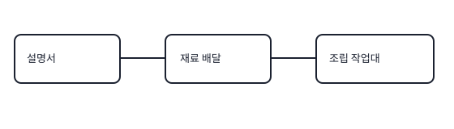

*세 역할을 같은 것으로 외우지 않아요.*

**정확히 말하면**

**mRNA**(전령 RNA)는 번역할 염기서열 정보를 담아요. tRNA는 아미노산을 운반해요. **리보솜(ribosome)**은 큰 단위체와 작은 단위체가 합쳐져 단백질을 조립하는 장소예요. 코돈에 맞는 아미노산이 차례로 펩티드 결합으로 연결되어 **폴리펩티드** 사슬이 길어져요.

DNA 정보는 먼저 mRNA로 전사되어 전달돼요. 번역에는 mRNA와 tRNA, 리보솜, 아미노산이 직접 참여해요. DNA는 코돈을 읽는 리보솜의 직접 입력이 아니에요.

tRNA 도착·펩티드 결합·리보솜 이동이 반복되는 순서를 [번역과 tRNA 모형](../%EC%9D%B8%ED%84%B0%EB%A0%89%ED%8B%B0%EB%B8%8C_03_%EB%B2%88%EC%97%AD%EA%B3%BC_tRNA.html)의 ‘번역’에서 재생해 보세요.

**교수님 말씀**

> 아미노산들이 순서대로 쫙 붙는 과정이 번역 과정.

이번 수업에서 확실한 중심은 정보, 운반체, 조립 장소의 연결이에요.

**꼭 기억해요**

mRNA가 정보를 담는다는 말은 mRNA가 DNA라는 뜻이 아니에요. rRNA와 단백질도 같은 물질이 아니에요. RNA는 뉴클레오타이드의 중합체이고 단백질은 아미노산의 중합체예요. [0903 아미노산과 펩타이드 결합](../../0903/정리노트_0903_Biomolecules_and_Cells.html#s5-amino-acid)에서 구성 단위를 확인할 수 있어요.

**보충 · 노트에 빠졌던 수업 내용**

리보솜은 **rRNA**(리보솜 RNA)와 단백질의 복합체예요. **아미노아실 tRNA 합성효소**는 알맞은 아미노산을 알맞은 tRNA에 붙여요. 교재의 기본 모형은 20종 아미노산 각각에 대응하는 20종 합성효소를 설명해요.

입문 수준의 상세 번역 모형에서 A 자리는 다음 아미노산을 싣고 온 tRNA가 들어오는 자리, P 자리는 자라는 사슬을 가진 tRNA의 자리, E 자리는 빈 tRNA가 나가는 자리예요. 개시 tRNA는 P 자리에서 시작해요. 연장 중 펩티드 결합과 자리 이동을 반복하고, 종결 코돈에는 아미노산 운반 tRNA 대신 방출인자가 결합해 사슬이 방출돼요.

한 tRNA가 여러 코돈을 읽는 경우도 있어요. 예를 들어 페닐알라닌 tRNA는 UUU와 UUC를 읽을 수 있어요.

**범위 주의:** 수업 녹음 전사 자료에는 상세 번역 설명 뒤 조기 종료 발언이 있지만, 뒤이어 코돈과 lac 수업이 계속되고 번역 상세 과정은 생략한다는 발언도 있어요. 자료의 연결이 일치하지 않아 상세 A/P/E 기작을 실제로 배운 필수 범위로 확정하지 않아요.

출처: 강의노트 5장 p5–6; 교재 5장 p.105–108. 상세 설명이 있는 수업 전사와 뒤의 생략 발언이 충돌해 보충으로 분리했어요.

**보충 · 수업에서 다루지 않았어요**

#### 번역은 아미노산을 새로 만드는 과정일까요?

**번역에서는 이미 있는 아미노산을 mRNA가 지정한 종류와 순서대로 연결해 폴리펩티드를 만들어요.** 상보적 결합은 재료를 새로 만드는 신호가 아니라, 아미노산을 실은 tRNA가 들어갈 자리를 맞추는 단계예요. 인터랙티브에서 tRNA가 아미노산을 이미 달고 오는 이유도, 그 전에 충전이 끝났기 때문이에요.

예를 들어 mRNA의 **5′-AUG-GCU-UUU-3′**는 메티오닌–알라닌–페닐알라닌의 연결 순서를 지정해요. 메티오닌을 실은 tRNA가 AUG와 짝지은 뒤, 다음 tRNA들이 가져온 아미노산이 차례로 연결돼요. 이 예는 종결 코돈을 생략한 짧은 서열이에요.

음식점에 비유하면 **미리 준비한 것은 재료인 아미노산**이에요. mRNA는 재료를 넣는 순서가 적힌 주문서이고, tRNA는 재료를 실은 배달 담당, 리보솜은 재료를 연결하는 조립 장소예요. 완성 요리에 해당하는 단백질을 미리 모두 만들어 둔다는 뜻은 아니에요.

#### 그 아미노산은 어디서 올까요? — 사람 기준

1. **음식 소화:** 고기·달걀·콩 등의 단백질을 소화효소가 작은 펩타이드와 아미노산으로 분해해요. 소장에서 흡수하며, 흡수된 작은 펩타이드도 장세포 안에서 더 분해돼요. 아미노산은 혈액을 통해 여러 조직에 공급돼요.
2. **체내 합성:** 일부 아미노산은 세포의 대사 중간산물을 재료로 만들어요. 예를 들어 당 분해에서 생길 수 있는 피루브산에 다른 아미노산의 **아미노기**(질소를 포함한 원자단)를 옮기면 알라닌이 만들어져요. 이런 아미노기 이동을 **아미노기 전이(transamination)**라고 해요. 모든 아미노산을 이 방법으로 만들 수 있는 것은 아니에요.
3. **기존 단백질의 재활용:** 몸속 단백질은 계속 만들어지고 분해돼요. 분해에서 나온 아미노산 일부를 새 단백질 합성에 다시 사용해요.

**필수 아미노산(essential amino acids)**은 우리 몸이 필요한 양을 합성하지 못해 음식으로 공급받아야 하는 아미노산이에요. ‘비필수’도 몸에 필요하지만 일반적인 조건에서 체내 합성이 가능하다는 뜻이에요.

확보한 아미노산은 **tRNA 충전 → 코돈과 짝짓기 → 사슬 연결**에 사용돼요. 음식 속 단백질이 그대로 내 근육이 되는 것이 아니라, 재료로 분해된 뒤 내 몸의 정보에 따라 다시 조립되는 셈이에요. 다만 유전자는 아미노산 합성에 관여하는 효소도 암호화하므로, 염기서열이 아미노산 생성과 전혀 무관하다는 뜻은 아니에요.

출처: [From RNA to Protein — 충전과 번역](https://www.ncbi.nlm.nih.gov/books/NBK26829/); [National Academies, The Role of Protein and Amino Acids…, Committee Overview — 아미노산 공급원](https://www.ncbi.nlm.nih.gov/books/NBK224619/); [Colorado State University, Absorption of Amino Acids and Peptides — 소화·흡수](https://vivo.colostate.edu/hbooks/pathphys/digestion/smallgut/absorb_aacids.html); [NLM MeSH, Alanine — 피루브산의 아미노기 전이](https://www.ncbi.nlm.nih.gov/mesh/68000409); [National Academies, Recommended Dietary Allowances, Protein and Amino Acids — 필수 아미노산](https://www.ncbi.nlm.nih.gov/books/NBK234922/). 대화에서 생긴 이해 공백을 메우는 보충이며, 이번 수업에서 모두 다뤘다는 뜻은 아니에요.

**페이지 요약**

mRNA는 준비된 아미노산의 종류와 연결 순서를 지정해요. 사람은 음식 소화·체내 합성·기존 단백질 분해로 아미노산을 확보하고, 번역에서 폴리펩티드로 연결해요.

---

## 4. 돌연변이

### 한 글자를 바꿨을 때

*1006 수업 · 5장 p6*

**쉽게 말하면**

한 사람을 바꿔도 하는 일이 같을 수 있고, 달라질 수도 있어요.

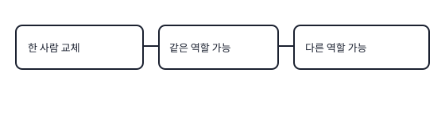

*글자 교체와 결과 변화를 나누어 봐요.*

**정확히 말하면**

**치환(substitution)**은 염기쌍이 다른 염기쌍으로 바뀌는 변화예요. 단백질 암호화 부위의 치환은 바뀐 코돈이 무엇을 지정하는지에 따라 구분해요.

| 분류 | mRNA 코돈 예 | 결과 |
|---|---|---|
| 과오 돌연변이(missense mutation) | UCA가 CCA로 | 세린이 프롤린으로 바뀜 |
| 정지 돌연변이(nonsense mutation) | UGC가 UGA로 | 시스테인 지정이 종결 신호로 바뀜 |
| 침묵 돌연변이(silent mutation) | GGU가 GGC로 | 둘 다 글리신, 해당 아미노산 유지 |

CCU와 CCC도 둘 다 프롤린을 지정해요. 코돈이 바뀌어도 아미노산이 같으면 유전암호의 중복성에 따른 침묵 변이예요. 돌연변이는 자발적으로 생기거나 자외선·돌연변이 유발 물질에 의해 발생률이 높아질 수 있어요. 영향은 변화 위치와 결과에 따라 해롭거나 중립적이거나 이로울 수 있어요.

**교수님 말씀**

교수님은 친구가 대리출석해 구별되지 않는 상황을 침묵 변이에 비유하셨어요. 과오의 사례로 낫 모양 적혈구 빈혈증에서 글루타메이트가 발린으로 바뀌어 화학적 성질이 달라지는 점을 설명하셨어요.

**꼭 기억해요**

치환이 항상 아미노산을 바꾸지는 않아요. 침묵은 염기 변화가 없다는 뜻이 아니라 아미노산 변화가 없다는 뜻이에요. 정지 코돈은 새로운 ‘정지 아미노산’을 지정하지 않아요.

**과오**는 엄밀하게 치환으로 특정 아미노산이 다른 것으로 바뀌는 분류예요. 삽입·삭제의 틀이동도 아미노산을 바꿀 수 있지만 과오와 같은 유형이라고 분류하지 않아요.

단백질 기능이 크게 변하지 않았다는 사실만으로 침묵을 확정할 수 없어요. 아미노산이 달라져도 기능이 유지될 수 있으므로 침묵 판정에는 아미노산 서열이 유지됐는지 확인해야 해요. U가 있는 CCU·CCC는 mRNA 코돈 표기예요.

**정지 돌연변이 = 넌센스 돌연변이(nonsense mutation)**예요. 이름에서 아미노산 코돈의 종결 신호 전환과 번역의 조기 종료를 떠올려요. 반대로 코돈 하나의 치환으로 종결 신호가 생겼다면 넌센스라고 부를 수 있어요. 한 염기 삽입·삭제로 뒤의 세 염기 묶음이 바뀌는 것은 [번역틀이동](#s4-frameshift)이에요. 두 경우 모두 짧은 산물이 나올 수 있으므로 길이만으로 이름을 고르지 않아요.

**페이지 요약**

치환은 코돈의 결과에 따라 과오·정지·침묵으로 구분해요.

---

### 한 글자가 빠지면 조가 밀려요

*1006 수업 · 5장 p6*

**쉽게 말하면**

세 명씩 조를 짰는데 한 명이 빠지면 뒤의 조가 밀려요.

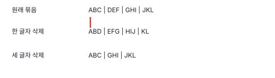

*세 명이 함께 빠진 경우에는 뒤 조의 경계가 유지돼요.*

**정확히 말하면**

**번역틀이동 돌연변이(frameshift mutation)**는 단백질 암호화 부위에서 **삽입**·**삭제**된 염기 수가 3의 배수가 아니어서 이후 세 염기씩 읽는 틀이 달라지는 변화예요. 한 염기가 삽입되거나 삭제되면 뒤의 코돈들이 달라질 수 있고 중간에 종결 코돈이 생길 수도 있어요.

세 염기처럼 3의 배수를 삭제하면 이후의 읽는 틀은 유지될 수 있어요. 그래도 아미노산이 줄거나 삭제 경계의 코돈이 달라질 수 있으므로 침묵이라고 단정하지 않아요. 이 조건은 수업의 한 염기 예를 일반화할 때 필요한 범위 보정이에요.

**교수님 말씀**

교수님은 세 명씩 만든 조에서 한 명을 교체하는 경우와 한 명이 빠지는 경우를 비교하셨어요. 교체는 그 조에 한정될 수 있지만 삭제는 뒤 조들을 밀 수 있어요.

**꼭 기억해요**

치환은 염기를 다른 것으로 바꾸고 삽입·삭제는 개수를 바꿔요. 중간 종결 코돈이 생겼다는 결과만 보지 말고 원인이 한 염기 삽입인지 치환인지 확인해요. 틀이동은 흔히 영향이 크지만 항상 더 치명적인 것은 아니에요.

**페이지 요약**

암호화 부위의 삽입·삭제 수가 3의 배수가 아니면 이후 읽는 틀이 바뀌어요.

---

## 5. 원핵생물의 발현 조절

### 필요한 단백질만 만들어요

*1006 수업 · 5장 p6–7*

**쉽게 말하면**

쓸 때만 등을 켜면 낭비를 줄일 수 있어요.

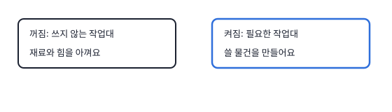

*필요한 때에 맞춰 켜고 꺼요.*

**정확히 말하면**

**유전자 발현의 조절**은 필요한 때 필요한 양의 단백질을 만들게 하는 조절이에요. 단백질 합성은 동화 과정으로 **에너지**와 **아미노산**을 사용해요. 유전자가 있어도 항상 같은 속도로 발현하는 것은 아니에요. 환경에 맞춰 불필요한 합성을 줄이면 자원을 절약해요.

대장균은 **포도당**을 젖당보다 우선 이용해요. 젖당을 이용할 때는 젖당 운반과 처리에 필요한 단백질들을 함께 만드는 것이 효율적이에요. 젖당은 갈락토스와 포도당으로 이루어진 이당류예요.

**교수님 말씀**

교수님은 유전자를 형광등, 발현 조절을 스위치에 비유하셨어요. 포도당은 이미 잘라 포크까지 꽂아 둔 피자, 젖당은 상자를 열고 잘라야 하는 피자예요. 준비가 덜 필요한 먹이를 먼저 쓰는 배경을 설명하는 비유예요.

> 필요할 때만 필요한 단백질을 만드는 거야.

**꼭 기억해요**

유전자가 존재하는 것과 지금 발현하고 있다는 것은 달라요. 단백질 수명이 제한적이라는 설명도 있었지만 상세 분해 기작을 배웠다는 뜻은 아니에요. 포도당 우선 이용은 배경이고, 이번에는 젖당에 따른 억제 해제를 중심으로 살펴봐요.

**페이지 요약**

발현 조절은 필요할 때 단백질을 만들어 에너지와 아미노산의 낭비를 줄여요.

---

### lac 오페론의 억제자 스위치

*1006 수업 · 5장 p6–7*

**쉽게 말하면**

길목을 막던 장애물이 다른 것에 붙으면, 필요한 세 가지 도구의 설명서를 함께 복사할 수 있어요.

*설명서 한 장에서 도구 세 가지를 따로 만들어요.*

**정확히 말하면**

**왜 억제자 스위치가 필요할까요?** 젖당이 없을 때 젖당 운반·처리 단백질을 많이 만들면, 쓰지 않는 단백질에 에너지와 아미노산이 들어가요. 억제자가 전사를 억제하면 그 뒤의 단백질 합성도 줄어 자원을 아껴요. 젖당이 들어와 억제가 풀리면 필요한 단백질의 생산을 늘릴 수 있어요.

**오페론(operon)**은 원핵생물에서 유전자들과 발현 조절 DNA 서열을 묶은 단위예요. lac 오페론의 **lacZ**, **lacY**, **lacA**는 하나의 프로모터 아래 나란히 있어 하나의 mRNA로 전사돼요. 이 mRNA에서 서로 다른 세 단백질이 만들어져요. 세 단백질을 이어 붙인 하나의 폴리펩티드를 만드는 것은 아니에요.

세 산물이 모두 젖당을 직접 자르는 효소는 아니에요.

| 구성 요소 | 물질·역할 |
|---|---|
| 프로모터 | RNA 중합효소가 결합해 전사를 시작하는 DNA 서열 |
| 작동자(operator) | 억제자가 결합하는 조절 DNA 서열 |
| 억제자(repressor) | 작동자에 결합해 전사를 막는 조절 단백질 |
| lacI | lacZYA 오페론 바깥의 억제자 암호화 조절 유전자 |
| 알로락토스(allolactose) | 억제자에 결합해 억제를 푸는 유도자(inducer) |

젖당이 없으면 활성 억제자가 작동자에 결합해 lac 구조유전자 전사를 억제해요. 젖당이 있으면 그로부터 생기는 알로락토스가 억제자에 결합해 구조를 바꾸고 작동자에 잘 결합하지 못하게 해요. 억제가 풀려 전사가 가능해져요. lac는 유도성 오페론이에요.

젖당이 있고 포도당이 없는 조건에서 강한 유도를 기대하는 단순 모형을 사용해요. 젖당이 있다는 조건 하나로 모든 환경에서 강한 발현을 보장하지는 않아요. 억제자가 변해서 작동자에 결합할 수 없다면 젖당이 없어도 이 억제자가 전사를 막지 못해요.

#### 직접 해 보기: 젖당 스위치 *(정적 스냅샷 — 직접 조작은 HTML 버전)*

포도당이 없는 조건에서 젖당의 유무를 바꾸면 억제자의 위치와 전사 상태가 달라져요. 여기서 OFF는 전사가 강하게 억제된 상태예요. 실제 생산량이 완전히 0이라는 뜻은 아니며, 최초 젖당 유입은 이 토픽의 보충에서 설명해요.

현재 상태: **억제자가 작동자에 결합해 전사를 억제해요.**

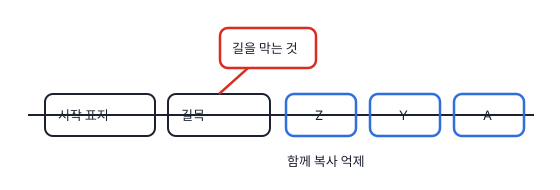

*포도당 없음, 젖당 없음: 작동자 점유와 전사 억제.*

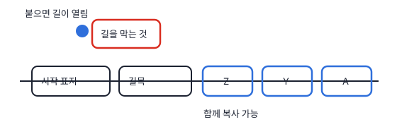

*포도당 없음, 젖당 있음: 알로락토스 결합으로 억제 해제.*

| 고정 조건 | 젖당 | 억제자와 작동자 | 전사 |
|---|---|---|---|
| 포도당 없음 | 없음 | 억제자 결합 | 억제 |
| 포도당 없음 | 있음 | 알로락토스 결합, 억제자 이탈 | 가능 |

젖당 유무에 따라 억제자의 결합과 전사가 달라지는 모습을 [lac 오페론 스위치 모형](../%EC%9D%B8%ED%84%B0%EB%A0%89%ED%8B%B0%EB%B8%8C_01_lac_%EC%98%A4%ED%8E%98%EB%A1%A0_%EC%8A%A4%EC%9C%84%EC%B9%98.html)에서 비교해 보세요.

**교수님 말씀**

교수님은 가위·칼·포크를 함께 필요한 도구 세트로 비유하셨어요. 억제자는 길을 막는 장애물이며, 유도자가 붙으면 장애물의 결합 상태가 바뀐다고 설명하셨어요. 실제 억제자 결합 물질은 알로락토스라고 바로잡으셨어요.

**꼭 기억해요**

작동자는 DNA, 억제자는 단백질이에요. 알로락토스는 작동자가 아니라 억제자에 결합해요. lacI는 lacZYA와 함께 전사되는 구조유전자에 포함되지 않아요. 억제자 자체는 젖당이 없어도 만들어져요.

RNA 중합효소가 프로모터에서 시작하는 것은 전사예요. mRNA를 읽어 아미노산을 연결하는 번역과 구분해요. 아래 모형은 포도당이 없다고 고정하고 젖당에 따른 억제자 상태만 바꿔요.

작동자 DNA의 억제자 결합 기능만 소실되고 프로모터·구조유전자는 정상이라면, 억제자가 정상이어도 이 부위에 결합해 전사를 막지 못해요. 이는 젖당 의존적 억제가 풀린 **구성적 발현**이며 모든 환경에서 최대 발현한다는 뜻은 아니에요. 억제자 단백질 자체의 결합 기능 소실과 작동자 DNA의 손상을 구별해요.

**보충 · 수업에서 다루지 않았어요**

**젖당을 들여오는 단백질도 억제되는데, 첫 젖당은 어떻게 들어올까요?** 억제된 lac 오페론에서도 소량의 전사와 단백질 생산이 일어나요. 이를 **기저 발현(basal expression)**이라고 해요. 그래서 젖당이 없을 때도 젖당 운반 단백질인 **LacY(젖당 투과효소, lactose permease)**와 **LacZ(β-갈락토시데이스, β-galactosidase)**가 소량 존재할 수 있어요.

1. 젖당이 없는 동안에는 lac 발현이 강하게 억제되지만, 기저 발현으로 LacY와 LacZ가 소량 만들어져요.
2. 주변에 젖당이 생기면 이미 있는 LacY가 젖당을 세포 안으로 운반해요.
3. 이미 있는 LacZ가 들어온 젖당의 일부를 알로락토스로 전환해요.
4. 알로락토스가 억제자에 결합해 구조를 바꿔요. 억제자가 작동자에 잘 결합하지 못해 전사 억제가 풀려요.
5. 포도당이 없는 조건에서는 lac 전사가 크게 늘어나고, LacY와 LacZ도 더 많이 만들어져 젖당의 유입과 이용이 증가해요.

**평소에는 소량, 젖당이 들어오면 생산 증가**라는 흐름이에요. 억제를 푸는 물질은 젖당 자체가 아니라 알로락토스이며, 포도당이 함께 있으면 강한 발현을 단정할 수 없어요.

출처: Gatti-Lafranconi 외(2013), [A single mutation in the core domain of the lac repressor reduces leakiness](https://pmc.ncbi.nlm.nih.gov/articles/PMC3722110/), Background. 억제 상태의 소량 LacY·LacZ와 알로락토스 생성에 관한 이해 보충이에요.

**페이지 요약**

젖당이 없을 때는 생산을 줄여 자원을 아껴요. 기저 발현으로 최초 젖당을 들여오고, 포도당이 없을 때 알로락토스가 억제를 풀면 생산이 늘어요.

---

## 6. 요약 · 예고

### 시험 직전 한 줄

| 주제 | 시험 직전 한 줄 |
|---|---|
| 전사 | DNA의 한 주형가닥으로 RNA를 만들며 RNA 합성은 5′에서 3′ 방향이에요. |
| 진핵 mRNA 가공 | 핵 안에서 모자·꼬리를 붙이고 전구체 RNA의 인트론을 제거해 엑손을 이어요. |
| 유전암호 | mRNA의 세 염기 코돈은 64가지이고 61가지는 아미노산을 지정해요. |
| 번역 | mRNA 정보를 리보솜에서 읽고 tRNA가 가져온 아미노산을 폴리펩티드로 연결해요. |
| tRNA | 아미노산은 3′ 말단에, 코돈의 역평행·상보적 짝은 안티코돈에 있어요. |
| 개시와 종결 | AUG는 메티오닌을 지정하며 개시에 쓰이고 UAA·UAG·UGA는 종결 신호예요. |
| 치환 | 암호화 부위의 결과가 다른 아미노산이면 과오, 종결 코돈이면 정지, 같은 아미노산이면 침묵이에요. |
| 틀이동 | 암호화 부위의 삽입·삭제 수가 3의 배수가 아니면 이후 읽는 틀이 달라져요. |
| 오페론 | lacZYA는 하나의 mRNA로 전사되고 각각의 단백질을 만들어요. lacI는 별도 조절 유전자예요. |
| lac 억제 | 포도당이 없는 단순 모형에서 젖당이 없으면 억제자가 작동자 DNA를 점유해 전사를 억제해요. |
| lac 유도 | 같은 조건에서 젖당이 있으면 알로락토스가 억제자 단백질에 붙어 억제를 풀어요. |

---

### 끊긴 지점과 다음 범위 — 예고

확정 범위는 5장 전사·RNA 가공·코돈·간단한 번역·돌연변이·lac 오페론까지예요. 진핵생물의 발현 조절은 다음 시간 예고이며 5장을 끝냈다고 판단하지 않아요.

> 진핵생물은 다음 시간에 봅시다. 모레는 4장 마저 읽겠습니다.

- 진핵생물의 발현 조절: 전사·전사 후·번역·번역 후 조절.
- 이름만 예고: TATA 상자, 증폭자, 히스톤 아세틸화, 프로테아좀.
- 작은 RNA 조절: miRNA는 다음 범위의 이름만 예고해요.
- 4장 남은 범위는 교수님이 다음 일정으로 언급하셨어요.

---

### 함께 보면 좋은 자료

- [1006 복습문제 풀기](복습문제_1006_Transcription_Translation_and_Lac_Operon.md)
- [가닥 방향과 코돈·안티코돈](#s3-trna)
- [lac 오페론의 억제자 스위치](#s5-operon)

---

출처: 이영만 교수님 강의노트(5장) · 수업 녹음 전사(1006 생명) · 『생명과학: 기초와 응용』 2판 5장.
