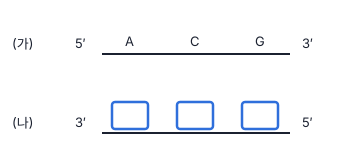
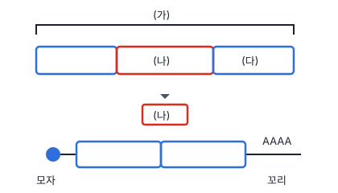

# 생명과학 복습 1006 문제설명

왼쪽 목차로 문항을 고르고, 오른쪽 문제를 보며 해설을 따라가요.

문제의 첫 줄부터 검산까지 설명해요.

**목차**

- [문항별 설명](#problems)
  - [P1. 가닥과 안티코돈](#p1)
  - [P2. 전사 서열의 조건](#p2)
  - [P3. 삽입과 조기 종결](#p3)
  - [P4. 핵 안의 원본](#p4)
  - [P5. 리보솜의 구성](#p5)
  - [P6. 두 자리 암호](#p6)
  - [P7. 오페론의 유도자](#p7)
  - [P8. 과오와 틀이동의 경계](#p8)
  - [P9. tRNA의 짝](#p9)
  - [P10. 발현량의 변화](#p10)
  - [P11. 기능과 변이 유형](#p11)
  - [P12. 틀이동의 원인](#p12)
  - [P13. 같은 아미노산의 두 코돈](#p13)
  - [P14. DNA를 여는 과정](#p14)
  - [P15. tRNA의 운반 기능](#p15)
  - [P16. 전사 시작 부위](#p16)
  - [P17. 돌연변이의 다양한 영향](#p17)
  - [P18. 번역에 직접 쓰는 분자](#p18)
  - [P19. 번역의 시작](#p19)
  - [P20. 원본과 번역 사본](#p20)
  - [P21. [변형] 억제자와 유도자](#p21)
  - [P22. [변형] tRNA의 두 기능](#p22)
  - [P23. [변형] 방향을 바꾸어 읽기](#p23)
  - [P24. [변형] 가공에서 남는 구간](#p24)
  - [P25. [변형] 세 염기의 삭제](#p25)
  - [P26. [변형] 결합하지 못하는 억제자](#p26)
  - [P27. [변형] 유전암호의 세 진술](#p27)
  - [P28. [변형] 리보솜과 단백질의 재료](#p28)
  - [P29. [변형] 선택하는 전사](#p29)
  - [P30. [변형] tRNA와 여러 코돈](#p30)
  - [P31. [변형] 염기는 바뀌고 아미노산은 유지](#p31)
  - [P32. [변형] 다섯 종류의 두 자리 신호](#p32)

## 문항별 설명

### P1. 가닥과 안티코돈

기출 5강 3 · [원 문제 보기](%EB%B3%B5%EC%8A%B5%EB%AC%B8%EC%A0%9C_1006_Transcription_Translation_and_Lac_Operon.html#p1)

DNA의 암호화 서열의 특정 세 개 염기가 TGA이다. 이 서열을 바탕으로한 mRNA의 코돈에 결합하는 tRNA의 안티코돈은 무엇인가?

- (1) TGA
- (2) UCU
- (3) ACU
- (4) ACT
- (5) UGA

기출 원문 보기

기출 5강 3번 (PDF 1쪽)

#### 문제를 내 말로 읽어요

주어진 것: DNA의 세 염기 TGA예요. 발문은 이것을 ‘암호화 서열’이라고 부르지만, 어느 가닥인지와 5′·3′ 방향은 적혀 있지 않아요.

구할 것: 이 DNA로부터 만들어진 mRNA 코돈에 결합하는 **tRNA의 안티코돈(anticodon)**이에요. 즉 DNA → mRNA → tRNA로 짝을 두 번 바꿔 적는 문제예요.

쉽게 말하면, 원본(DNA)을 베낀 쪽지(mRNA)에 딱 맞는 열쇠(tRNA)의 홈 모양을 묻는 문제예요. 그런데 원본을 어느 쪽 면에서 읽었는지가 빠져 있어요.

**문항 결함:** 발문이 가닥(주형가닥/암호화가닥)과 방향을 정하지 않았어요. 문자 그대로 암호화가닥 5′-TGA-3′로 읽으면 mRNA 코돈은 5′-UGA-3′이고, 이와 상보적인 서열은 보기 (3) ACU예요. 게다가 UGA는 종결 코돈이라 실제로 결합하는 tRNA가 없어요. 기출 인쇄 정답이자 카드 정답인 (5)는 TGA를 3′→5′로 적은 주형가닥으로 읽었을 때만 나오는 답이에요. 아래 설명은 출제 의도인 (5)를 기준으로 하되, (3)이 왜 문자 그대로는 맞는지도 함께 밝혀요.

#### 이 문제를 봤을 때 떠올릴 개념과 공식

‘DNA 서열 → mRNA 코돈 → tRNA 안티코돈’이라는 단서에서 전사(transcription)의 상보성과 코돈–안티코돈의 역평행(antiparallel) 짝짓기를 떠올려요.

DNA 두 가닥 중 RNA 중합효소가 실제로 읽는 가닥이 **주형가닥(template strand)**이에요(교과서 5장 p.101). mRNA는 주형가닥과 상보적이므로, 반대편 **암호화가닥(coding strand)**과는 T가 U로 바뀐 것만 빼고 서열이 같아요.

RNA의 짝은 A–U, G–C이고 RNA에는 T가 없어요. 안티코돈은 mRNA 코돈과 역평행으로 짝지어요(교과서 p.105: 코돈 5′-AGU-3′ ↔ 안티코돈 3′-UCA-5′).

UAA·UAG·UGA는 아미노산을 지정하지 않는 종결 코돈(stop codon)이에요(교과서 p.102). 종결 코돈에는 아미노산을 싣는 tRNA가 결합하지 않아요.

그래서 이 문제는 ‘주어진 TGA가 어느 가닥인가’를 먼저 정해야 답이 하나로 정해져요.

관련 정리노트: [가닥 방향과 코돈·안티코돈](%EC%A0%95%EB%A6%AC%EB%85%B8%ED%8A%B8_1006_Transcription_Translation_and_Lac_Operon.html#s3-trna)

#### 종이에 쓸 첫 줄

두 가지 읽기를 나란히 표로 써요.

첫 행(문자 그대로, 암호화가닥): **DNA 5′-TGA-3′ → mRNA 5′-UGA-3′ → 안티코돈 3′-ACU-5′**

둘째 행(주형가닥 가정): **DNA 3′-TGA-5′ → mRNA 5′-ACU-3′ → 안티코돈 3′-UGA-5′**

그다음 두 행의 끝을 보기와 맞춰 보고, 어느 쪽이 출제 의도인지 판단해요.

#### 왜 이렇게 푸는지 함께 따라가요

(1) 틀려요. TGA는 T가 들어 있는 DNA 표기예요. tRNA 안티코돈은 RNA이므로 T가 아니라 U를 써요.

(2) 틀려요. UCU는 어느 읽기에서도 나오지 않아요. 문자 그대로의 코돈 UGA와도, 주형 가정의 코돈 ACU와도 세 쌍이 모두 상보적이지 않아요.

(3) 문자 그대로 읽으면 맞는 답이에요. ‘암호화 서열’을 암호화가닥 5′-TGA-3′로 읽으면 mRNA는 T만 U로 바꾼 5′-UGA-3′이고, 이와 상보적인 서열은 3′-ACU-5′, 곧 ACU예요. 다만 UGA는 종결 코돈이어서 실제 세포에서는 이 코돈에 결합하는 tRNA가 없어요. 따라서 엄밀히는 ‘결합하는 tRNA가 없다’가 맞고, 보기 중 상보 서열은 (3)이에요. 독립 재풀이도 이 읽기로 (3)을 골랐어요.

(4) 틀려요. ACT는 짝은 (3)과 같지만 T를 썼어요. tRNA는 RNA라서 T가 들어갈 수 없어요.

(5) 출제 의도상 맞아요(기출 인쇄 정답). 출제자는 TGA를 교과서 그림 5.10(p.102)처럼 3′→5′로 적은 주형가닥으로 본 것으로 보여요. 주형 3′-TGA-5′에서 mRNA는 5′-ACU-3′이고, 이 코돈과 역평행으로 짝짓는 안티코돈은 3′-UGA-5′예요. 이 해석에서는 ACU가 트레오닌(Thr)을 지정하므로 tRNA가 실제로 결합한다는 점도 발문과 맞아요.

정리하면 문자 그대로는 (3), 주형가닥 가정에서는 (5)가 나와요. 발문이 ‘코돈에 결합하는 tRNA’가 있다고 전제하므로 그 전제가 성립하는 주형 읽기가 출제 의도예요. 따라서 이 카드의 답은 (5)예요.

#### 완성 답과 검산

답 (5) UGA (주형가닥 3′-TGA-5′ 가정, 안티코돈 3′-UGA-5′).

답에서 거꾸로 올라가 확인해요: 안티코돈 3′-UGA-5′와 짝짓는 코돈은 5′-ACU-3′이고, 교과서 p.102 그림 5.11 코돈표에서 ACU는 트레오닌이에요. 이 코돈을 만든 주형가닥은 A↔T, C↔G, U↔A로 바꾼 3′-TGA-5′이므로 주어진 세 글자 TGA와 같아요.

소거로도 확인해요: T가 들어간 (1)(4)는 RNA가 아니고, (2)는 어느 읽기에서도 상보적이지 않아요. 남는 (3)과 (5) 가운데 tRNA가 실제로 결합하는 경우는 (5)뿐이에요. 기출 5강 합본 1쪽 3번의 인쇄 정답도 ⑤예요.

#### 이 문항에서 하기 쉬운 실수

주어진 DNA가 주형가닥인지 암호화가닥인지, 왼쪽 끝이 5′인지 3′인지를 확인하지 않고 바로 짝을 바꾸기 쉬워요. 가닥과 방향이 바뀌면 답이 (3)과 (5)처럼 갈려요.

안티코돈 보기에서 T가 들어간 서열(ACT, TGA)을 고르지 않아요. tRNA는 RNA예요.

실제 시험에서 가닥·방향이 빠져 있으면 감독관에게 질문하거나, 서술형이라면 ‘주형가닥 3′→5′로 가정’처럼 가정을 답안에 적어 두어요. 객관식에서 확인이 불가능하면 교과서 그림 5.10처럼 주형가닥을 3′→5′로 적는 관례를 떠올리고, 결과 코돈이 종결 코돈이 아닌지도 점검해요.

#### 설명을 닫고 다시 해 봐요

- DNA TAC를 암호화가닥 5′→3′로 볼 때와 주형가닥 3′→5′로 볼 때 각각 mRNA 코돈과 안티코돈을 적어 보기
- 나온 코돈이 UAA·UAG·UGA 중 하나인지 확인하고, 그렇다면 tRNA가 결합하는지 말해 보기

**페이지 요약**

#### 떠올릴 개념·공식

주형가닥과 mRNA는 상보적, 암호화가닥과 mRNA는 T→U만 달라요. 코돈·안티코돈은 역평행. UGA는 종결 코돈이에요.

#### 첫 줄

암호화가닥 읽기와 주형가닥 읽기를 두 행으로 나란히 써요.

#### 핵심 판단

문항 결함: 문자 그대로면 코돈 UGA(종결)와 상보 서열 (3). 주형 3′-TGA-5′ 가정이면 코돈 ACU, 안티코돈 3′-UGA-5′로 출제 의도 (5).

#### 검산

3′-UGA-5′ → 코돈 ACU(Thr, p.102) → 주형 3′-TGA-5′. 인쇄 정답 ⑤와 일치. 답 (5).

---

### P2. 전사 서열의 조건

기출 5강 5 · [원 문제 보기](%EB%B3%B5%EC%8A%B5%EB%AC%B8%EC%A0%9C_1006_Transcription_Translation_and_Lac_Operon.html#p2)

TTACAGGTCC 유전자로부터 만들어진 mRNA는 어느 것인가?

- (1) AATGTCCAGG
- (2) GGAGTGGACC
- (3) AAUGUCCAGG
- (4) UUACAGGUCC

기출 원문 보기

기출 5강 5번 (PDF 1쪽)

#### 문제를 내 말로 읽어요

주어진 것: 유전자 DNA 서열 TTACAGGTCC(10염기)예요. 어느 가닥인지, 왼쪽 끝이 5′인지 3′인지는 적혀 있지 않아요.

구할 것: 이 유전자로부터 전사(transcription)되어 만들어지는 **mRNA 서열**이에요.

쉽게 말하면, DNA 글자를 RNA 글자로 옮겨 적는 문제예요. RNA에는 T가 없고 U가 있다는 점과, 짝을 바꿔 쓸지 그대로 쓸지가 핵심이에요.

**문항 결함:** 발문이 가닥과 방향을 정하지 않았어요. 주어진 서열을 3′→5′로 적은 주형가닥으로 읽으면 (3) AAUGUCCAGG, 5′→3′ 암호화가닥으로 읽으면 T만 U로 바꾼 (4) UUACAGGUCC가 답이 돼요. 기출 인쇄 정답이자 카드 정답은 주형 읽기의 (3)이에요.

#### 이 문제를 봤을 때 떠올릴 개념과 공식

‘유전자로부터 만들어진 mRNA’라는 단서에서 전사의 상보적 염기쌍 규칙을 떠올려요.

전사 때 RNA 중합효소는 DNA 두 가닥 중 **주형가닥(template strand)** 하나만 읽어요(교과서 5장 p.101). 주형을 3′→5′로 읽으며 RNA를 5′→3′로 만들고, 짝은 DNA A→RNA U, T→A, G→C, C→G예요.

반대편 **암호화가닥(coding strand)**은 mRNA와 같은 방향이고 서열도 같아요. 다만 T 자리에 U가 와요.

교과서 p.102 그림 5.10은 DNA 주형가닥을 3′→5′로 적고, 그 아래 mRNA를 5′→3′로 적어요. 이 문제의 출제 의도도 같은 관례예요.

관련 정리노트: [가닥 방향과 코돈·안티코돈](%EC%A0%95%EB%A6%AC%EB%85%B8%ED%8A%B8_1006_Transcription_Translation_and_Lac_Operon.html#s3-trna)

#### 종이에 쓸 첫 줄

주어진 서열 아래에 한 글자씩 짝을 맞춰 써요.

첫 줄: **DNA 3′-T T A C A G G T C C-5′** (주형가닥으로 가정)

둘째 줄: **mRNA 5′-A A U G U C C A G G-3′**

옆에 다른 가정도 한 줄 적어 둬요: 암호화가닥 5′-TTACAGGTCC-3′이면 mRNA는 5′-UUACAGGUCC-3′.

#### 왜 이렇게 푸는지 함께 따라가요

(1) 틀려요. AATGTCCAGG는 짝은 맞췄지만 T가 들어 있어 DNA 표기예요. mRNA에는 T 대신 U가 와요.

(2) 틀려요. GGAGTGGACC는 T가 들어 있어 RNA가 아니고, 주어진 서열과 어느 방향으로 맞춰도 상보적이지 않아요.

(3) 맞아요(출제 의도). 주어진 서열을 3′-TTACAGGTCC-5′ 주형가닥으로 보면 T→A, A→U, C→G, G→C로 바꿔 5′-AAUGUCCAGG-3′가 돼요.

(4) 엄밀히는 맞을 수도 있어요. 주어진 서열이 5′-TTACAGGTCC-3′ 암호화가닥이라면 mRNA는 T만 U로 바꾼 5′-UUACAGGUCC-3′예요. 발문이 가닥을 정하지 않았으므로 이 읽기를 틀렸다고 단정할 근거는 발문 안에 없어요. 다만 ‘유전자로부터 만들어진’을 ‘이 서열을 주형으로 전사한’으로 읽는 것이 교과서 그림 5.10의 관례이자 기출 인쇄 정답의 해석이에요.

따라서 출제 의도에 따른 답은 (3)이에요.

#### 완성 답과 검산

답 (3) AAUGUCCAGG (주어진 DNA를 3′→5′ 주형가닥으로 가정).

거꾸로 확인해요: 답 mRNA의 각 글자를 DNA 짝으로 되돌리면 A→T, A→T, U→A, G→C, U→A, C→G, C→G, A→T, G→C, G→C로 TTACAGGTCC가 다시 나와요. 열 쌍이 모두 상보적이에요.

소거로도 확인해요: T가 들어간 (1)(2)는 RNA가 아니에요. 남은 (3)과 (4)는 가닥 가정만 다르고, 기출 5강 합본 1쪽 5번의 인쇄 정답은 ③이에요.

#### 이 문항에서 하기 쉬운 실수

짝을 잘 맞추고도 T를 U로 바꾸지 않아 (1)을 고르기 쉬워요. mRNA 보기에 T가 보이면 바로 지워요.

가닥 정보가 없을 때 (3)과 (4) 중 어느 쪽인지 헷갈려요. 문제에 ‘주형가닥’이라면 짝을 바꾸고, ‘암호화가닥’이라면 T만 U로 바꿔요. 실제 시험에서 둘 다 빠져 있으면 감독관에게 묻거나, 서술형에서는 ‘주형가닥 3′→5′로 가정’을 답안에 적어요. 객관식이라면 교과서 그림처럼 주형가닥으로 읽는 관례를 따르는 것이 이 기출의 의도예요.

#### 설명을 닫고 다시 해 봐요

- DNA GCATTA를 주형가닥 3′→5′로 볼 때와 암호화가닥 5′→3′로 볼 때 mRNA를 각각 적어 보기
- 답 mRNA를 DNA 짝으로 되돌려 원래 서열이 나오는지 확인해 보기

**페이지 요약**

#### 떠올릴 개념·공식

주형가닥과 mRNA는 상보적(A→U, T→A, G→C, C→G). 암호화가닥과 mRNA는 T→U만 달라요.

#### 첫 줄

3′-TTACAGGTCC-5′ 아래에 5′-AAUGUCCAGG-3′를 맞춰 써요.

#### 핵심 판단

문항 결함: 가닥·방향 미지정. 주형이면 (3), 암호화가닥이면 (4). 출제 의도는 주형 읽기 (3).

#### 검산

답을 DNA로 되돌리면 TTACAGGTCC. 인쇄 정답 ③과 일치. 답 (3).

---

### P3. 삽입과 조기 종결

기출 5강 6 · [원 문제 보기](%EB%B3%B5%EC%8A%B5%EB%AC%B8%EC%A0%9C_1006_Transcription_Translation_and_Lac_Operon.html#p3)

DNA 복제 과정 중 어떤 유전자 서열에 하나의 염기쌍이 삽입되어 종결코돈이 중간에 생겼다면, 이로서 발생하는 현상으로 옳은 것만 &lt;보기&gt;에서 고른 것은?

- a. 번역틀이동 돌연변이다.
- b. 과오 돌연변이다.
- c. 침묵 돌연변이다.
- d. 중성돌연변이며 원래의 단백질과 같은 단백질이 만들어진다.
- e. 원래보다 더 짧은 단백질이 만들어진다.

- (1) a, e
- (2) b, d
- (3) a, c
- (4) b, c, e
- (5) b, c, d

기출 원문 보기

기출 5강 6번 (PDF 1쪽)

#### 문제를 내 말로 읽어요

유전자 서열에 **염기쌍 하나가 끼어들었고(삽입)**, 그 결과 원래 없던 종결 코돈이 중간에 생겼어요.

구할 것은 &lt;보기&gt; a~e 중 이 상황을 옳게 설명한 진술만 모은 조합이에요. 원인(삽입)과 결과(중간 종결)를 둘 다 써서 판정해요.

#### 이 문제를 봤을 때 떠올릴 개념과 공식

‘하나의 염기쌍이 **삽입**’이라는 단서에서 번역틀이동 돌연변이(frameshift mutation)를 떠올려요. mRNA는 세 염기씩 끊어 읽는 코돈(codon) 단위로 번역되는데, 삽입·삭제된 염기 수가 3의 배수가 아니면 그 뒤의 끊어 읽는 위치(읽는 틀, reading frame)가 모두 밀려요.

보기에 나온 과오(missense)·침묵(silent) 돌연변이는 염기쌍 **치환**(substitution)의 결과 분류예요. 과오는 치환으로 한 아미노산이 다른 아미노산으로 바뀌는 것, 침묵은 코돈이 바뀌어도 같은 아미노산을 지정해 아미노산 서열이 그대로인 것이에요.

‘종결 코돈이 중간에 생겼다’는 단서에서는 종결 코돈(stop codon: UAA, UAG, UGA)에 리보솜이 도달하면 번역이 멈춘다는 규칙을 떠올려요. 그래서 원래 길이보다 짧은 폴리펩티드가 만들어져요.

즉 원인 분류는 ‘삽입 → 틀이동’, 결과는 ‘조기 종결 → 짧은 단백질’로 나눠서 각 진술을 판정해요. 개념 정리는 [한 글자가 빠지면 조가 밀려요](%EC%A0%95%EB%A6%AC%EB%85%B8%ED%8A%B8_1006_Transcription_Translation_and_Lac_Operon.html#s4-frameshift)와 [한 글자를 바꿨을 때](%EC%A0%95%EB%A6%AC%EB%85%B8%ED%8A%B8_1006_Transcription_Translation_and_Lac_Operon.html#s4-substitution)에 있어요.

#### 종이에 쓸 첫 줄

첫 줄: “원인 = 염기쌍 1개 삽입(1은 3의 배수 아님 → 틀이동), 결과 = 중간 종결 코돈(→ 번역이 일찍 멈춤).”

그 아래에 a~e를 세로로 적고, 각 진술이 ‘원인 분류’를 말하는지 ‘결과’를 말하는지 표시한 뒤 O/X를 붙여요.

#### 왜 이렇게 푸는지 함께 따라가요

a 맞아요. 한 염기쌍 삽입은 3의 배수가 아니므로 삽입 지점 뒤의 읽는 틀이 밀리는 번역틀이동 돌연변이예요.

b 틀려요. 과오 돌연변이는 염기쌍 치환으로 한 아미노산이 다른 아미노산으로 바뀌는 분류예요. 이 문제의 원인은 치환이 아니라 삽입이에요.

c 틀려요. 침묵 돌연변이는 아미노산 서열이 그대로인 경우예요. 중간에 종결 코돈이 생겨 번역이 일찍 끝났으니 아미노산 서열이 같을 수 없어요.

d 틀려요. 조기 종결로 사슬 길이부터 달라지므로 ‘원래와 같은 단백질이 만들어진다’는 결과와 모순이에요.

e 맞아요. 리보솜이 새로 생긴 종결 코돈에 도달하면 번역이 멈춰서 원래보다 짧은 폴리펩티드가 나와요.

맞는 진술은 a와 e예요. 보기 중 a, e 조합은 (1)뿐이고, (2)~(5)는 모두 틀린 진술 b·c·d 중 하나 이상을 포함해요.

따라서 답은 (1)이에요.

#### 완성 답과 검산

답 (1). 교과서 5장 109쪽 그림 5.18과 대조해요. 그림 5.18b(과오)와 5.18d(침묵)는 염기쌍 하나가 다른 염기쌍으로 **바뀐** 경우이고, 5.18e(번역틀이동)는 염기쌍이 **첨가**된 뒤 번역틀이 한 칸씩 밀려 아미노산들이 달라지는 경우로 따로 분류돼요. 또 5.18c처럼 종결 코돈이 생기면 폴리펩티드가 조기 종결돼요. 삽입이라는 원인은 5.18e, 중간 종결이라는 결과는 5.18c와 같으므로 ‘틀이동 + 짧은 단백질’, 곧 a와 e만 맞아요.

#### 이런 실수를 조심해요

‘종결 코돈이 생겼다’는 결과만 보고 원인 분류까지 정지·과오 같은 치환 유형으로 고르면 안 돼요. 원인은 삽입이라는 점을 먼저 확인해요.

침묵 돌연변이는 ‘염기 변화가 없다’가 아니라 ‘아미노산 서열 변화가 없다’는 뜻이에요. 사슬이 짧아졌다면 침묵이 될 수 없어요.

#### 설명을 닫고 다시 해 봐요

- 삽입·삭제와 치환을 원인으로 구분하고, 각각 어떤 돌연변이 이름이 붙는지 말해 봐요.
- 중간 종결 코돈이 생기면 단백질 길이가 어떻게 되는지 이유와 함께 써 봐요.
- a~e를 O/X로 판정한 뒤 조합 보기를 골라 봐요.

**페이지 요약**

#### 떠올릴 개념·공식

1염기 삽입(3의 배수 아님) → 번역틀이동. 과오·침묵은 치환의 분류. 종결 코돈 → 번역 정지.

#### 첫 줄

원인 = 삽입 → 틀이동, 결과 = 조기 종결 → 짧은 단백질.

#### 핵심 판단

a, e 맞음 / b, c, d 틀림 → (1).

#### 검산

교과서 5장 109쪽 그림 5.18c·e와 일치.

---

### P4. 핵 안의 원본

기출 5강 10 · [원 문제 보기](%EB%B3%B5%EC%8A%B5%EB%AC%B8%EC%A0%9C_1006_Transcription_Translation_and_Lac_Operon.html#p4)

단백질 합성 과정 중 핵 안에 남아 있는 물질은?

- (1) tRNA
- (2) 리보솜
- (3) DNA
- (4) rRNA
- (5) mRNA

기출 원문 보기

기출 5강 10번 (PDF 2쪽)

#### 문제를 내 말로 읽어요

단백질을 만드는 동안 진핵세포의 핵 밖으로 나가지 않고 **핵 안에 계속 남아 있는 물질**을 골라요.

요리책 원본은 방(핵)에 두고, 필요한 쪽만 베낀 종이를 주방(세포질의 리보솜)으로 보내는 장면을 떠올리면 돼요.

#### 이 문제를 봤을 때 떠올릴 개념과 공식

‘단백질 합성’과 ‘핵 안’이라는 단서에서 진핵세포의 유전자 발현(gene expression)이 두 장소로 나뉜다는 점을 떠올려요. 전사(transcription)는 핵 안에서 DNA 정보를 RNA로 베끼고, 번역(translation)은 세포질의 리보솜에서 mRNA를 읽어 폴리펩티드를 만들어요.

DNA는 정보의 원본이라 핵에 남고, 전사로 만든 RNA 사본(mRNA)과 번역 장치(tRNA, rRNA가 들어간 리보솜)는 세포질에서 번역에 참여해요.

그래서 보기마다 ‘번역에 쓰이려면 세포질에 있어야 하는가’를 물으면 핵에 남는 물질을 가려낼 수 있어요. 개념 정리는 [요리책은 핵에, 요리는 리보솜에서](%EC%A0%95%EB%A6%AC%EB%85%B8%ED%8A%B8_1006_Transcription_Translation_and_Lac_Operon.html#s0-expression)에 있어요.

#### 종이에 쓸 첫 줄

첫 줄: “전사 = 핵 안(DNA → RNA), 번역 = 세포질 리보솜(mRNA → 폴리펩티드).”

그 아래 다섯 보기 옆에 ‘번역 때 세포질에서 쓰임 / 핵에만 남음’을 표시해요.

#### 왜 이렇게 푸는지 함께 따라가요

(1) 틀려요. tRNA는 핵에서 전사되지만 세포질로 나와 아미노산을 리보솜으로 운반해요.

(2) 틀려요. 리보솜은 번역이 일어나는 장소이므로 세포질에서 일해요.

(3) 맞아요. 핵 DNA는 정보의 원본으로 핵 안에 남고, 그 정보는 RNA 사본으로 바뀌어 밖으로 전달돼요.

(4) 틀려요. rRNA는 리보솜의 구성 성분이 되어 세포질에서 번역에 참여해요.

(5) 틀려요. 가공이 끝난 mRNA는 핵 밖으로 나와 리보솜에서 읽혀요.

따라서 답은 (3)이에요.

#### 완성 답과 검산

답 (3). 교과서 5장 106쪽의 진핵세포 그림(그림 5.15 위)을 보면 DNA는 핵 안에 그려져 있고, 전사로 만든 전구체 mRNA가 RNA 가공을 거쳐 mRNA가 된 뒤 핵 밖 리보솜에서 번역돼요. 소거로 보아도 tRNA·리보솜·rRNA·mRNA는 모두 번역(세포질)에 직접 필요한 물질이라 남는 보기는 DNA 하나예요.

#### 이런 실수를 조심해요

‘핵에서 만들어진다’와 ‘핵에 남는다’를 섞으면 tRNA·rRNA·mRNA도 핵에 남는다고 착각해요. 만들어지는 장소와 일하는 장소를 구분해요.

이 장소 구분은 진핵세포 기준이에요. 원핵세포에는 핵막이 없어 전사와 번역이 같은 공간에서 일어나요.

#### 설명을 닫고 다시 해 봐요

- 전사와 번역이 진핵세포 어디에서 일어나는지 써 봐요.
- tRNA, rRNA, mRNA 각각이 번역에서 맡는 역할을 한 줄씩 말해 봐요.

**페이지 요약**

#### 떠올릴 개념·공식

전사는 핵, 번역은 세포질 리보솜. DNA는 원본으로 핵에 남아요.

#### 첫 줄

보기마다 번역 때 세포질에서 쓰이는지 표시.

#### 핵심 판단

tRNA·리보솜·rRNA·mRNA는 세포질에서 번역 참여 → (3) DNA.

#### 검산

교과서 5장 106쪽 그림과 소거로 확인.

---

### P5. 리보솜의 구성

기출 5강 11 · [원 문제 보기](%EB%B3%B5%EC%8A%B5%EB%AC%B8%EC%A0%9C_1006_Transcription_Translation_and_Lac_Operon.html#p5)

리보솜은 무엇으로 구성되어 있는가?

- (1) DNA와 단백질
- (2) mRNA와 DNA
- (3) tRNA 와 mRNA
- (4) rRNA 와 단백질

기출 원문 보기

기출 5강 11번 (PDF 2쪽)

#### 문제를 내 말로 읽어요

리보솜이라는 ‘조립 작업대’ 자체가 어떤 물질로 지어져 있는지 묻고 있어요.

작업대 위에 잠깐 올라오는 설명서(mRNA)나 배달차(tRNA)가 아니라, 작업대를 이루는 재료를 골라야 해요.

#### 이 문제를 봤을 때 떠올릴 개념과 공식

‘리보솜은 무엇으로 구성’이라는 단서에서 리보솜(ribosome)의 구조를 떠올려요. 리보솜은 큰 단위체와 작은 단위체로 이루어지고, 각 단위체는 리보솜 RNA(ribosomal RNA, rRNA)와 리보솜 단백질의 복합체예요.

번역에 참여하는 분자의 역할도 함께 구분해요. mRNA(전령 RNA)는 읽힐 정보, tRNA(운반 RNA)는 아미노산 운반체, 리보솜은 둘이 만나 펩티드 결합이 생기는 장소예요. mRNA와 tRNA는 번역 중 리보솜에 **결합**할 뿐 리보솜의 구성 성분은 아니에요.

DNA는 핵에 남는 정보 원본이라 리보솜 재료가 아니라는 점도 함께 적용해요. 개념 정리는 [정보·배달·조립의 세 역할](%EC%A0%95%EB%A6%AC%EB%85%B8%ED%8A%B8_1006_Transcription_Translation_and_Lac_Operon.html#s3-ribosome)에 있어요.

#### 종이에 쓸 첫 줄

첫 줄: “리보솜 = 큰 단위체 + 작은 단위체, 각각 rRNA + 단백질.”

그 아래 보기의 두 성분마다 ‘리보솜 재료 / 리보솜에 결합하는 분자 / 핵의 원본’ 중 하나로 표시해요.

#### 왜 이렇게 푸는지 함께 따라가요

(1) 틀려요. 단백질은 리보솜 성분이지만 DNA는 정보를 보관하는 원본이고 리보솜의 구조 성분이 아니에요.

(2) 틀려요. mRNA는 리보솜이 읽는 정보 사본이고, DNA도 리보솜 성분이 아니에요.

(3) 틀려요. tRNA와 mRNA는 번역 중 리보솜에 결합하는 분자예요. 리보솜 자체를 이루는 재료가 아니에요.

(4) 맞아요. 리보솜의 두 단위체는 모두 rRNA와 리보솜 단백질의 복합체예요.

따라서 답은 (4)예요.

#### 완성 답과 검산

답 (4). 교과서 5장 106쪽 ‘리보솜은 자동화된 단백질 조립 기구로 작동하는 rRNA–단백질 복합체이다’ 단락에서 각 구성요소가 리보솜 RNA(rRNA)와 리보솜 단백질들의 복합체라고 설명해요. 소거로 보아도 (1)~(3)에는 리보솜 재료가 아닌 DNA·mRNA·tRNA가 하나 이상 들어 있어 남는 보기는 (4)뿐이에요.

#### 이런 실수를 조심해요

번역 장면 그림에서 mRNA와 tRNA가 리보솜 안에 붙어 있으니 리보솜의 일부라고 착각하기 쉬워요. 결합하는 분자와 구성하는 재료를 구분해요.

rRNA는 RNA이고 리보솜 단백질은 아미노산 중합체예요. rRNA와 단백질을 같은 물질로 묶어 외우지 않아요.

#### 설명을 닫고 다시 해 봐요

- 리보솜의 두 단위체가 무엇과 무엇으로 이루어지는지 써 봐요.
- mRNA, tRNA, 리보솜의 역할을 ‘정보·배달·조립’으로 짝지어 봐요.

**페이지 요약**

#### 떠올릴 개념·공식

리보솜 = 큰·작은 단위체 = rRNA + 리보솜 단백질.

#### 첫 줄

보기 성분마다 재료/결합 분자/원본으로 분류.

#### 핵심 판단

DNA·mRNA·tRNA는 리보솜 재료가 아님 → (4).

#### 검산

교과서 5장 106쪽 rRNA–단백질 복합체 설명과 일치.

---

### P6. 두 자리 암호

기출 5강 12 · [원 문제 보기](%EB%B3%B5%EC%8A%B5%EB%AC%B8%EC%A0%9C_1006_Transcription_Translation_and_Lac_Operon.html#p6)

만약 두 개의 뉴클레오타이드가 하나의 아미노산을 결정하는 데 사용된다면, 단백질 합성 시 몇 개의 아미노산을 지정할 수 있는가?

- (1) 64
- (2) 8
- (3) 32
- (4) 4
- (5) 16

기출 원문 보기

기출 5강 12번 (PDF 2쪽)

#### 문제를 내 말로 읽어요

실제 유전암호는 염기 세 개가 아미노산 하나를 정하지만, 이 문제는 **두 개**로 정한다고 가정해요.

구할 것은 염기 두 칸짜리 신호로 서로 다른 아미노산을 최대 몇 개까지 지정할 수 있는지, 곧 만들 수 있는 서로 다른 신호의 수예요.

#### 이 문제를 봤을 때 떠올릴 개념과 공식

‘뉴클레오타이드 몇 개가 아미노산 하나를 결정’이라는 단서에서 코돈(codon)의 경우의 수를 떠올려요. 핵산의 염기는 네 종류(mRNA에서는 A, U, G, C)이고, 신호의 각 칸에 네 염기 중 하나를 독립적으로 고를 수 있어요.

각 칸의 선택을 곱하는 곱의 법칙에 따라 염기가 $k$종, 신호가 $n$칸이면 서로 다른 신호의 최대 수는 $k^n$이에요. 실제 세 칸 코돈은 $4^3=64$가지예요.

이 문제는 순서가 있는 배열을 세는 것이라 AU와 UA를 다른 신호로 세요. 그래서 덧셈이 아니라 곱셈을 쓰고, $n=2$를 넣어요. 개념 정리는 [네 글자로 만드는 세 글자 암호](%EC%A0%95%EB%A6%AC%EB%85%B8%ED%8A%B8_1006_Transcription_Translation_and_Lac_Operon.html#s2-code)에 있어요.

#### 종이에 쓸 첫 줄

첫 줄: “염기 종류 $k=4$, 칸 수 $n=2$ → 신호 수 $=4^2$.”

바로 아래에 첫째 칸 4가지 × 둘째 칸 4가지라고 칸별 선택 수를 적어요.

#### 왜 이렇게 푸는지 함께 따라가요

계산: 첫째 칸 4가지, 둘째 칸 4가지이므로 $4 \times 4 = 16$가지 신호를 만들 수 있어요.

(1) 틀려요. 64는 세 칸 신호의 경우의 수 $4^3$이에요.

(2) 틀려요. 8은 칸별 선택 수를 $4+4$로 더한 값이에요. 칸마다 독립적으로 고르므로 곱해야 해요.

(3) 틀려요. 32는 $4^2$도 $4^3$도 아니어서 두 칸 신호 수가 될 수 없어요.

(4) 틀려요. 4는 한 칸 신호의 경우의 수 $4^1$이에요.

(5) 맞아요. 두 칸 신호는 $4^2=16$가지예요.

따라서 답은 (5)예요.

#### 완성 답과 검산

답 (5). 다른 방법으로 직접 세어요. 첫 염기를 A로 두면 AA, AU, AG, AC의 4개이고, 첫 염기가 U, G, C인 경우도 각각 4개라서 $4+4+4+4=16$개예요. 교과서 5장 102쪽도 두 글자로는 16가지($4^2$)의 아미노산만 지정할 수 있어 20가지 아미노산에 부족하므로 배제되었다고 설명해요.

#### 이런 실수를 조심해요

‘두 개’라는 말에 $4 \times 2 = 8$이나 $4+4=8$로 계산하기 쉬워요. 칸 수는 지수, 염기 종류는 밑이에요.

실제 유전암호 64를 외운 대로 고르지 않아요. 문제의 가정(두 칸)에 맞춰 다시 계산해요.

#### 설명을 닫고 다시 해 봐요

- 한 칸, 두 칸, 세 칸 신호의 수를 각각 거듭제곱으로 써 봐요.
- 두 칸 암호가 실제 생물에서 쓰일 수 없는 이유를 20종 아미노산과 비교해 말해 봐요.

**페이지 요약**

#### 떠올릴 개념·공식

신호 수 $=k^n$ (염기 종류 $k$, 칸 수 $n$).

#### 첫 줄

$k=4$, $n=2$ → $4^2$.

#### 핵심 판단

$4 \times 4 = 16$ → (5).

#### 검산

첫 염기별로 4개씩 세어 16개, 교과서 5장 102쪽과 일치.

---

### P7. 오페론의 유도자

기출 5강 18 · [원 문제 보기](%EB%B3%B5%EC%8A%B5%EB%AC%B8%EC%A0%9C_1006_Transcription_Translation_and_Lac_Operon.html#p7)

다음은 원핵생물의 오페론에 대한 설명이다. 맞는 설명은?

- (1) 젖당이 배지내에서 모두 소모되면 lac 오페론이 작동된다
- (2) 억제자는 활성화되면 오페론의 유전자들을 발현시킨다
- (3) 대장균은 젖당을 분해하는 효소를 항상 발현시킨다
- (4) 알로락토스는 lac 오페론의 유도자로 작용한다
- (5) lac 오페론은 유도자가 억제자를 활성화 시키면 전사된다

기출 원문 보기

기출 5강 18번 (PDF 2쪽)

#### 문제를 내 말로 읽어요

원핵생물(대장균)의 lac 오페론에 대한 다섯 설명 중 **맞는 설명** 하나를 골라요.

젖당이 있을 때와 없을 때 억제자가 길목(작동자)을 막는지 비켜 주는지를 따라가면 판정할 수 있어요.

#### 이 문제를 봤을 때 떠올릴 개념과 공식

‘오페론’, ‘억제자’, ‘유도자’, ‘젖당’이라는 단서에서 유도성 오페론(inducible operon)인 lac 오페론의 억제 스위치를 떠올려요.

오페론(operon)은 원핵생물에서 프로모터(promoter), 작동자(operator), 함께 전사되는 구조유전자(lacZ, lacY, lacA)를 묶은 단위예요. 억제자(repressor)는 lacI 유전자가 만드는 조절 단백질로, 활성 상태에서는 작동자에 결합해 RNA 중합효소의 전사를 막아요.

젖당이 세포에 들어오면 일부가 알로락토스(allolactose)로 바뀌어요. 알로락토스는 유도자(inducer)로서 억제자에 결합해 모양을 바꾸고, 억제자가 작동자에 붙지 못하게 해요. 그러면 전사가 일어나요.

판정 규칙은 ‘젖당 없음 → 활성 억제자 결합 → 전사 꺼짐’, ‘젖당 있음 → 유도자가 억제자를 비활성화 → 전사 켜짐’이에요. 개념 정리는 [lac 오페론의 억제자 스위치](%EC%A0%95%EB%A6%AC%EB%85%B8%ED%8A%B8_1006_Transcription_Translation_and_Lac_Operon.html#s5-operon)에 있어요.

#### 종이에 쓸 첫 줄

첫 줄 표의 첫 행: “젖당 없음 | 억제자 활성, 작동자에 결합 | 전사 억제”, 둘째 행: “젖당 있음 | 알로락토스가 억제자에 결합해 비활성화 | 전사 가능”.

보기마다 이 표의 어느 행과 맞거나 반대인지 표시해요.

#### 왜 이렇게 푸는지 함께 따라가요

(1) 틀려요. 젖당이 다 소모되면 알로락토스가 없어져 억제자가 다시 활성 상태로 작동자에 결합하므로 lac 오페론은 꺼져요.

(2) 틀려요. 활성화된 억제자는 작동자에 결합해 전사를 **막아요**. 발현시키는 것은 반대예요.

(3) 틀려요. 젖당 분해 관련 효소는 젖당이 있을 때 유도되어 만들어지고, 젖당이 없으면 억제자가 전사를 막아요. 항상 발현하지 않아요.

(4) 맞아요. 알로락토스는 억제자에 결합해 작동자 결합을 방해하는 lac 오페론의 유도자예요.

(5) 틀려요. 유도자는 억제자를 비활성화해서 전사를 일으켜요. ‘활성화시키면’은 방향이 반대예요.

따라서 답은 (4)예요.

#### 완성 답과 검산

답 (4). 교과서 5장 111쪽에서 ‘알로락토스는 lac 오페론의 유도자(inducer)’이며 Lac 억제자에 결합해 형태를 바꾸어 작동자에 결합하지 못하게 한다고 설명해요. 같은 쪽은 젖당이 배지에서 다 소모되면 조절체계가 다시 lac 오페론의 작동을 끈다고 해서 (1)이 반대임도 확인돼요. 그림 5.20a는 젖당이 없을 때 활성 억제자가 전사를 막는다고 보여 주어 (2)·(3)도 소거돼요.

#### 이런 실수를 조심해요

‘유도자’라는 이름 때문에 억제자를 활성화한다고 생각하면 (5)를 고르게 돼요. 유도자는 억제자를 **끄는** 방식으로 전사를 켜요.

알로락토스는 작동자(DNA)가 아니라 억제자(단백질)에 결합해요. 결합 대상을 바꿔 외우지 않아요.

#### 설명을 닫고 다시 해 봐요

- 젖당 있음/없음 두 행 표를 억제자 상태와 전사 여부로 채워 봐요.
- 프로모터, 작동자, 억제자, 유도자가 각각 DNA인지 단백질인지 다른 물질인지 써 봐요.

**페이지 요약**

#### 떠올릴 개념·공식

젖당 없음 → 활성 억제자가 작동자 결합 → 전사 억제. 젖당 있음 → 알로락토스(유도자)가 억제자 비활성화 → 전사.

#### 첫 줄

젖당 유무 두 행 표를 쓰고 보기마다 대조.

#### 핵심 판단

(1)(2)(3)(5)는 방향이 반대 → (4).

#### 검산

교과서 5장 111쪽 본문·그림 5.20과 일치.

---

### P8. 과오와 틀이동의 경계

기출 5강 19 · [원 문제 보기](%EB%B3%B5%EC%8A%B5%EB%AC%B8%EC%A0%9C_1006_Transcription_Translation_and_Lac_Operon.html#p8)

다음 중 과오 돌연변이(missense mutation)가 될 수 없는 것은?

- (1) 암호화 서열에서 염기 1개 삭제
- (2) 암호와 서열에 염기 2개가 추가됨
- (3) 침묵 돌연변이와 같다
- (4) 번역틀이동에 의해 야기된다
- (5) 낫모양적혈구빈혈증 유전자에 대한 암호

기출 원문 보기

기출 5강 19번 (PDF 3쪽)

#### 문제를 내 말로 읽어요

주어진 것: 염기 삭제, 염기 추가, 침묵 돌연변이, 번역틀이동, 낫모양적혈구빈혈증 다섯 가지 상황이에요.

구할 것: 과오 돌연변이(missense mutation)가 **될 수 없는** 것이에요. 부정형이므로 ‘과오가 아니다’로 판정되는 보기를 찾아요.

쉽게 말하면, 문장 속 한 글자가 바뀌어 한 단어의 뜻이 달라진 경우가 과오예요. 다섯 상황 중 ‘뜻이 바뀐 단어가 하나도 없다’고 정해진 것이 무엇인지 묻는 문제예요.

**문항 결함:** 교과서의 엄밀한 정의로는 과오는 염기쌍 대체(치환)로 아미노산 하나가 바뀌는 것이라, 삽입·삭제·틀이동인 (1)(2)(4)도 과오 ‘유형’이 될 수 없어요. 그러면 답이 여러 개가 돼요. 출제자는 과오를 ‘아미노산이 바뀌는 변이’로 넓게 쓴 것으로 보이고, 기출 인쇄 정답이자 카드 정답은 (3)이에요.

#### 이 문제를 봤을 때 떠올릴 개념과 공식

‘과오’, ‘침묵’, ‘번역틀이동’이라는 이름이 함께 나오면 돌연변이를 결과에 따라 나누는 분류를 떠올려요.

**과오 돌연변이(missense)**: 염기쌍 대체로 코돈이 다른 아미노산을 지정하게 바뀐 것이에요(교과서 5장 p.109). 낫모양적혈구빈혈증이 대표 예예요(p.110 그림 5.19, GAG→GUG, Glu→Val).

**침묵 돌연변이(silent)**: 코돈은 바뀌었지만 같은 아미노산을 지정해 아미노산 서열이 그대로인 것이에요(p.110, 그림 5.18d).

**번역틀이동 돌연변이(frameshift)**: 암호화 부위에 염기가 삽입·삭제되어 그 뒤 코돈 묶음이 밀리는 것이에요(p.110, 그림 5.18e). 결과적으로 그 뒤 아미노산들이 바뀌어요.

판단 기준은 ‘아미노산이 바뀌는가’예요. 침묵은 정의상 아미노산이 바뀌지 않으므로, 과오와 정의가 정면으로 충돌해요.

관련 정리노트: [한 글자를 바꿨을 때](%EC%A0%95%EB%A6%AC%EB%85%B8%ED%8A%B8_1006_Transcription_Translation_and_Lac_Operon.html#s4-substitution)

#### 종이에 쓸 첫 줄

보기마다 두 칸을 채우는 표를 만들어요.

첫 행: **보기 | 아미노산이 바뀌나? | 염기 치환인가?**

예: (3) 침묵 | 아니요(정의상 그대로) | 예. 이렇게 두 칸을 모두 ‘아니요’로 만들 수 있는 보기를 찾아요.

#### 왜 이렇게 푸는지 함께 따라가요

(1) 엄밀히는 과오가 될 수 없어요 — 염기 1개 삭제는 번역틀이동이지 치환이 아니에요. 다만 넓은 뜻으로는 삭제 뒤 아미노산들이 바뀌므로(교과서 p.110) 출제자는 ‘과오가 될 수 있음’ 쪽으로 본 것으로 보여요. 출제 의도로는 답이 아니에요.

(2) 엄밀히는 과오가 될 수 없어요 — 염기 2개 추가는 3의 배수가 아니라 틀이동을 일으켜요. 넓은 뜻으로는 그 뒤 아미노산이 바뀌므로 출제 의도로는 답이 아니에요.

(3) 맞아요(답). 침묵 돌연변이는 정의상 아미노산이 바뀌지 않고, 과오는 정의상 아미노산이 바뀌어요. 엄밀한 정의로 보든 넓은 뜻으로 보든 ‘침묵 = 과오’는 성립할 수 없어요.

(4) 엄밀히는 과오가 될 수 없어요 — 틀이동은 과오와 다른 유형이에요. 넓은 뜻으로는 틀이동으로 아미노산이 바뀌므로 출제 의도로는 답이 아니에요.

(5) 과오가 될 수 있어요. 낫모양적혈구빈혈증은 베타 글로빈 유전자의 염기 하나가 바뀌어 글루탐산이 발린으로 바뀐 과오 돌연변이예요(p.110 그림 5.19).

부정형 문항이므로 답은 ‘과오가 될 수 없다’로 판정되면서 두 해석 모두에서 그 판정이 유지되는 보기예요. 따라서 답은 (3)이에요.

#### 완성 답과 검산

답 (3) 침묵 돌연변이와 같다.

교과서 그림으로 대조해요: 교과서 p.109 그림 5.18b(과오)는 mRNA 코돈 UCA가 CCA로 바뀌어 Ser이 Pro로 바뀌지만, 그림 5.18d(침묵)는 GGU가 GGC로 바뀌어도 Gly 그대로예요. 같은 그림 안에서 두 경우의 결과가 ‘아미노산 변화 있음/없음’으로 반대예요.

정의 충돌 여부로 다시 세어 봐도, 어떤 해석에서도 과오가 될 수 없는 보기는 (3) 하나예요. 기출 5강 합본 3쪽 19번 인쇄 정답도 ③이에요.

#### 이 문항에서 하기 쉬운 실수

‘과오’를 막연히 ‘잘못된 변이’로 읽으면 모든 보기가 과오처럼 보여요. 과오는 치환으로 아미노산 하나가 바뀐 것, 침묵은 아미노산이 그대로인 것으로 결과 기준을 먼저 세워요.

엄밀한 정의로만 보면 (1)(2)(4)도 답처럼 보여 당황하기 쉬워요. 시험에서 이런 경우에는 ‘어떤 해석에서도 성립하지 않는 보기’, 즉 정의끼리 정면으로 모순되는 보기를 고르고, 이의 제기 기간이 있다면 정의 충돌을 근거로 적어 두어요.

#### 설명을 닫고 다시 해 봐요

- 과오·침묵·정지·틀이동을 ‘아미노산이 바뀌나’와 ‘치환인가’ 두 기준으로 표에 정리해 보기
- 낫모양적혈구빈혈증의 코돈 변화와 아미노산 변화를 적어 과오인 이유를 말해 보기

**페이지 요약**

#### 떠올릴 개념·공식

과오: 치환으로 아미노산 변화. 침묵: 아미노산 그대로. 틀이동: 삽입·삭제로 읽는 틀이 밀림.

#### 첫 줄

보기마다 ‘아미노산이 바뀌나? / 치환인가?’ 두 칸을 채워요.

#### 핵심 판단

문항 결함: 엄밀히는 (1)(2)(4)도 과오 유형이 아님. 어떤 해석에서도 과오가 될 수 없는 것은 침묵 (3).

#### 검산

교과서 p.109 그림 5.18b와 5.18d의 결과가 반대. 인쇄 정답 ③. 답 (3).

---

### P9. tRNA의 짝

기출 5강 20 · [원 문제 보기](%EB%B3%B5%EC%8A%B5%EB%AC%B8%EC%A0%9C_1006_Transcription_Translation_and_Lac_Operon.html#p9)

운반 RNA (tRNA)에 대한 설명으로 옳은 것은?

- (1) 단당류 (monosaccharide)를 운반한다
- (2) 단백질 합성이 일어나는 장소이다
- (3) 전령 RNA (mRNA)로 만들어진다
- (4) 전령 RNA (mRNA)의 코돈과 상보적인 안티코돈 부분을 가지고 있다

기출 원문 보기

기출 5강 20번 (PDF 3쪽)

#### 문제를 내 말로 읽어요

주어진 것: 운반 RNA(transfer RNA, tRNA)에 대한 네 문장이에요.

구할 것: tRNA를 **옳게** 설명한 문장 하나를 골라요.

쉽게 말하면, 단백질 공장(리보솜)에서 설계도(mRNA)를 읽을 때 재료(아미노산)를 들고 오는 배달원이 tRNA예요. 이 배달원이 무엇을 들고, 어떻게 자기 자리를 찾는지 묻는 문제예요.

#### 이 문제를 봤을 때 떠올릴 개념과 공식

‘tRNA’라는 단어와 ‘코돈·안티코돈’이라는 보기 표현에서 번역(translation)에 참여하는 세 가지 RNA의 역할 구분을 떠올려요.

mRNA(전령 RNA)는 아미노산 순서 정보를 담은 사본이고, 리보솜(ribosome, rRNA와 단백질로 이루어짐)은 펩타이드 결합을 만드는 장소예요. tRNA는 한쪽 끝(3′ 말단)에 아미노산을 달고, 반대쪽 고리에 있는 세 염기 **안티코돈(anticodon)**으로 mRNA의 **코돈(codon)**과 상보적인 염기쌍을 이뤄요.

안티코돈과 코돈은 역평행(antiparallel)으로 짝지어요. 예를 들어 코돈 5′-AGU-3′에는 안티코돈 3′-UCA-5′가 맞아요. 이 짝짓기 덕분에 코돈에 맞는 아미노산이 정확한 자리에 들어가요.

또 tRNA도 rRNA처럼 자기 유전자의 DNA에서 직접 전사되는 RNA라는 점을 함께 떠올려야 보기 (3)을 판정할 수 있어요.

관련 정리노트: [가닥 방향과 코돈·안티코돈](%EC%A0%95%EB%A6%AC%EB%85%B8%ED%8A%B8_1006_Transcription_Translation_and_Lac_Operon.html#s3-trna)

#### 종이에 쓸 첫 줄

세 칸짜리 역할표의 첫 행부터 써요: **mRNA = 정보(코돈) / 리보솜 = 장소 / tRNA = 아미노산 운반 + 안티코돈**.

그다음 각 보기의 주어를 tRNA로 고정하고, 보기가 말하는 내용이 표의 어느 칸에 속하는지 옆에 적어요.

#### 왜 이렇게 푸는지 함께 따라가요

(1) 틀려요. tRNA가 리보솜으로 운반하는 것은 아미노산(amino acid)이에요. 단당류(monosaccharide)는 탄수화물의 단위체로 번역과 관계가 없어요.

(2) 틀려요. 단백질 합성이 일어나는 장소는 리보솜이에요. tRNA는 리보솜 안으로 들어와 아미노산을 건네는 분자이지 장소가 아니에요.

(3) 틀려요. tRNA는 tRNA를 암호화하는 DNA 유전자에서 직접 전사돼요. mRNA를 재료로 삼아 만들어지는 것이 아니에요.

(4) 맞아요. tRNA의 안티코돈은 mRNA 코돈과 상보적이고 역평행으로 염기쌍을 이뤄요.

따라서 답은 (4)예요.

#### 완성 답과 검산

답 (4).

교과서 대조: 교과서 5장 p.105는 tRNA를 폴리펩타이드 사슬에 더해질 아미노산을 리보솜으로 운반하는 RNA로 정의하고, 이중나선 부위 끝의 안티코돈이 mRNA의 코돈과 염기쌍을 이루는 세 뉴클레오타이드라고 설명해요(세린 코돈 5′-AGU-3′ ↔ 안티코돈 3′-UCA-5′ 예). p.104는 tRNA를 번역되지 않는 RNA를 암호화하는 비단백질 암호화 유전자의 산물로 소개해서 (3)이 틀린 이유도 확인돼요.

기출 5강 합본 20번(PDF 3쪽)의 인쇄 답도 ④예요.

#### 이 문항에서 하기 쉬운 실수

‘운반’이라는 단어만 보고 (1)을 고르기 쉬워요. 무엇을 운반하는지(아미노산)까지 확인해요.

RNA는 모두 mRNA에서 나온다고 착각하면 (3)을 맞다고 할 수 있어요. mRNA·tRNA·rRNA는 각각 자기 DNA 유전자에서 전사돼요.

#### 설명을 닫고 다시 해 봐요

- mRNA·tRNA·리보솜의 역할을 한 단어씩(정보·운반·장소) 적어 보기
- 코돈 5′-CCU-3′에 맞는 안티코돈을 3′→5′ 방향으로 써 보기

**페이지 요약**

#### 떠올릴 개념·공식

tRNA = 아미노산 운반 + 안티코돈. 안티코돈은 코돈과 상보적·역평행으로 짝지어요.

#### 첫 줄

mRNA=정보, 리보솜=장소, tRNA=운반 역할표를 먼저 써요.

#### 핵심 판단

단당류 운반·합성 장소·mRNA에서 생성은 모두 다른 분자 이야기예요.

#### 검산

교과서 p.105의 tRNA 정의와 기출 인쇄 답 ④가 일치해요. 답 (4).

---

### P10. 발현량의 변화

기출 5강 21 · [원 문제 보기](%EB%B3%B5%EC%8A%B5%EB%AC%B8%EC%A0%9C_1006_Transcription_Translation_and_Lac_Operon.html#p10)

효소와 같은 세포내 단백질은 일반적으로 항상 생산되지는 않거나, 시간에 따라 일정한 비율로 생산되지는 않는다. 이러한 현상의 원인은 무엇인가?

- (1) 유전 암호의 중복성
- (2) 유전 암호의 모호함
- (3) 유전자 발현의 조절
- (4) 틀이동 돌연변이(framshift mutation)

기출 원문 보기

기출 5강 21번 (PDF 3쪽)

#### 문제를 내 말로 읽어요

주어진 것: 효소 같은 단백질이 항상 만들어지지 않거나, 시간에 따라 만드는 양이 달라진다는 현상이에요.

구할 것: 이 현상의 **원인**을 골라요.

쉽게 말하면, 공장이 설계도는 항상 갖고 있지만 필요할 때만 기계를 돌리고 필요 없으면 멈추는 이유를 묻는 문제예요.

#### 이 문제를 봤을 때 떠올릴 개념과 공식

‘항상 생산되지 않는다’, ‘시간에 따라 일정한 비율로 생산되지 않는다’는 단서는 **양과 시점**이 바뀐다는 말이에요. 여기서 유전자 발현 조절(regulation of gene expression)을 떠올려요.

세포는 유전자를 모두 갖고 있어도 필요한 때에 필요한 유전자만 전사·번역해요. 대장균은 젖당이 있을 때만 젖당 분해 효소를 만들고, 없으면 만들지 않아요(lac 오페론). 이처럼 발현을 켜고 끄거나 양을 바꾸는 체계가 조절이에요.

나머지 보기는 유전암호의 성질(중복성)이나 돌연변이 종류(틀이동)예요. 이것들은 **무엇을** 만드는지(아미노산 서열)에 관한 개념이지 **언제, 얼마나** 만드는지에 관한 개념이 아니에요. 이 구분이 판정 기준이에요.

관련 정리노트: [필요한 단백질만 만들어요](%EC%A0%95%EB%A6%AC%EB%85%B8%ED%8A%B8_1006_Transcription_Translation_and_Lac_Operon.html#s5-switch)

#### 종이에 쓸 첫 줄

두 칸 표의 머리줄을 써요: **‘무엇을 만드나(서열)’ | ‘언제·얼마나 만드나(양·시점)’**.

문제의 현상을 오른쪽 칸에 넣고, 각 보기를 두 칸 중 어디에 넣을지 하나씩 분류해요.

#### 왜 이렇게 푸는지 함께 따라가요

(1) 틀려요. 유전암호의 중복성(redundancy)은 서로 다른 여러 코돈이 같은 아미노산을 지정하는 성질이에요. 서열 쪽 개념이라 생산 시점·양의 변화를 설명하지 못해요.

(2) 틀려요. 표준 유전암호에서 한 코돈은 한 아미노산(또는 종결)만 지정해서 모호하지 않아요. 생산량 변화와도 관계가 없어요.

(3) 맞아요. 유전자 발현의 조절은 필요할 때 전사를 켜고 필요 없을 때 끄며 양을 조절해요. 문제의 ‘항상 만들지 않음, 비율이 일정하지 않음’을 그대로 설명해요.

(4) 틀려요. 틀이동 돌연변이(frameshift mutation)는 염기 삽입·삭제로 읽는 틀이 바뀌는 변이로, 아미노산 서열을 바꿔요. 정상 세포의 생산량 변화를 설명하는 원리가 아니에요.

따라서 답은 (3)이에요.

#### 완성 답과 검산

답 (3).

소거로 확인해요: (1)·(2)는 유전암호의 성질, (4)는 서열을 바꾸는 돌연변이로 모두 ‘무엇을’ 칸에 들어가요. ‘언제·얼마나’ 칸에 남는 보기는 (3) 하나예요.

교과서 대조: 교과서 5장 p.110의 5.3.1은 대장균이 젖당이 있을 때 분해 효소를 만들고 없을 때 만들지 않는 예로 원핵생물의 유전자 발현 조절을 설명해요. 기출 5강 합본 21번(PDF 3쪽)의 인쇄 답도 ③이에요.

#### 이 문항에서 하기 쉬운 실수

‘유전 암호’라는 익숙한 단어 때문에 (1)을 고르기 쉬워요. 중복성은 코돈과 아미노산의 대응 규칙이지 생산 스위치가 아니에요.

단백질이 ‘가끔 안 만들어진다’를 고장(돌연변이)으로 해석하지 않아요. 정상 세포가 일부러 조절하는 현상이에요.

#### 설명을 닫고 다시 해 봐요

- ‘무엇을 만드나’와 ‘언제·얼마나 만드나’ 칸에 네 보기를 다시 분류해 보기
- 젖당이 있을 때와 없을 때 대장균의 젖당 분해 효소 생산을 한 문장씩 말해 보기

**페이지 요약**

#### 떠올릴 개념·공식

생산 시점·양의 변화 = 유전자 발현 조절. 중복성·틀이동은 서열 쪽 개념이에요.

#### 첫 줄

‘무엇을 | 언제·얼마나’ 두 칸 표에 보기를 분류해요.

#### 핵심 판단

필요할 때만 켜고 끄는 체계는 발현 조절뿐이에요.

#### 검산

소거로 (3)만 남고 교과서 p.110 젖당 예와 기출 인쇄 답 ③이 일치해요. 답 (3).

---

### P11. 기능과 변이 유형

기출 5강 23 · [원 문제 보기](%EB%B3%B5%EC%8A%B5%EB%AC%B8%EC%A0%9C_1006_Transcription_Translation_and_Lac_Operon.html#p11)

돌연변이가 발생하였지만 생성된 단백질의 기능에 큰 변화를 주지 않았을 때, 이를 무엇이라고 하는가?

- (1) 변역틀이동 돌연변이
- (2) 침묵 돌연변이
- (3) 정지 돌연변이
- (4) 과오 돌연변이
- (5) 유전 암호의 보편성

기출 원문 보기

기출 5강 23번 (PDF 3쪽)

#### 문제를 내 말로 읽어요

주어진 것: 돌연변이가 생겼지만 만들어진 단백질의 기능에는 큰 변화가 없어요.

구할 것: 이런 돌연변이를 부르는 이름이에요. 보기 가운데 ‘단백질이 그대로 유지되는’ 돌연변이 유형을 골라요.

쉽게 말하면, 요리책의 글자 하나가 바뀌었는데 완성된 요리 맛이 그대로인 경우의 이름을 묻는 문제예요.

**문항 결함:** ‘기능에 큰 변화가 없다’는 조건만으로는 침묵 돌연변이를 확정할 수 없어요. 아미노산이 하나 바뀌었지만 성질이 비슷해 기능이 유지되는 과오 돌연변이(이른바 중성 과오)도 같은 결과를 낼 수 있어요. 출제 의도는 아미노산 자체가 바뀌지 않는 침묵 돌연변이이고, 기출 인쇄 정답이자 카드 정답은 (2)예요.

#### 이 문제를 봤을 때 떠올릴 개념과 공식

‘돌연변이가 생겼는데 단백질 기능은 그대로’라는 단서에서 염기쌍 대체 돌연변이의 결과별 분류를 떠올려요.

**침묵 돌연변이(silent mutation)**: 바뀐 코돈이 여전히 같은 아미노산을 지정해 아미노산 서열이 그대로예요(교과서 5장 p.110, 그림 5.18d). 유전암호의 중복성(redundancy) 덕분에 생겨요.

**과오 돌연변이(missense)**: 아미노산 하나가 다른 것으로 바뀌어요. 교과서 p.109는 기능이 심각하게 변하는지는 어떤 아미노산이 어떻게 바뀌었는지에 달렸다고 해요. 즉 과오라도 기능이 거의 유지될 수 있어요.

**정지(nonsense)**와 **번역틀이동(frameshift)**은 폴리펩타이드가 짧아지거나 그 뒤 아미노산이 모두 바뀌어 보통 기능이 크게 손상돼요(p.110).

그래서 ‘정의상 단백질이 그대로’인 유형을 찾으면 침묵이고, 과오는 ‘경우에 따라’ 기능이 유지되는 유형이에요.

관련 정리노트: [한 글자를 바꿨을 때](%EC%A0%95%EB%A6%AC%EB%85%B8%ED%8A%B8_1006_Transcription_Translation_and_Lac_Operon.html#s4-substitution)

#### 종이에 쓸 첫 줄

유형마다 결과를 한 줄로 적어요.

첫 행: **침묵 → 아미노산 그대로 → 단백질 그대로(항상)**

이어서 과오 → 아미노산 1개 변화 → 기능은 경우에 따라, 정지 → 짧은 단백질, 틀이동 → 이후 서열 전부 변화를 적고 ‘기능 변화 없음’과 맞는 줄을 찾아요.

#### 왜 이렇게 푸는지 함께 따라가요

(1) 틀려요. 번역틀이동은 삽입·삭제 지점 뒤의 코돈이 모두 밀려 아미노산 서열이 크게 달라지고, 교과서 p.110은 결과 폴리펩타이드가 종종 기능을 상실한다고 해요.

(2) 맞아요. 침묵 돌연변이는 코돈이 바뀌어도 같은 아미노산을 지정하므로 단백질 자체가 그대로이고, 기능 변화가 없는 대표 유형이에요.

(3) 틀려요. 정지 돌연변이는 아미노산 코돈이 종결 코돈으로 바뀌어 정상보다 짧은 폴리펩타이드를 만들고, 많은 경우 기능이 부분적으로만 남아요(p.109~110).

(4) 엄밀히는 맞을 수도 있어요 — 과오 돌연변이도 바뀐 아미노산이 원래와 성질이 비슷하거나 기능에 중요하지 않은 자리라면 기능이 거의 유지될 수 있어요(p.109). 하지만 과오는 아미노산이 바뀌는 유형이라 ‘기능 변화 없음’이 항상 성립하지 않아요. 출제자가 묻는 ‘변화가 없는 돌연변이의 이름’에는 정의상 단백질이 그대로인 침묵이 더 정확히 맞아요.

(5) 틀려요. 유전 암호의 보편성은 거의 모든 생물이 같은 유전암호를 쓴다는 성질이지, 돌연변이 유형의 이름이 아니에요.

따라서 출제 의도에 따른 답은 (2)예요.

#### 완성 답과 검산

답 (2) 침묵 돌연변이.

교과서 그림으로 대조해요: 교과서 p.109 그림 5.18의 다섯 경우 중 폴리펩타이드 서열이 정상(Met-Thr-Gly-Ser-Cys-Leu)과 완전히 같은 것은 d(침묵) 하나뿐이에요. b(과오)는 Ser이 Pro로, c(정지)는 Ser 뒤에서 끊기고, e(틀이동)는 Thr 뒤가 모두 달라요.

‘서열이 같으면 기능도 같다’는 확실한 경우는 침묵뿐이므로 답은 (2)예요. 기출 5강 합본 3쪽 23번 인쇄 정답도 ②예요.

#### 이 문항에서 하기 쉬운 실수

‘과오’라는 이름 때문에 무조건 기능이 망가진다고 생각하기 쉬워요. 과오도 기능이 거의 유지될 수 있어요. 반대로 ‘기능 변화 없음 = 반드시 침묵’도 엄밀히는 틀린 추론이에요.

시험에서 이런 발문을 만나면 ‘정의상 항상 그 결과가 나오는 유형’을 고르세요. 서술형이라면 ‘아미노산 서열이 유지되면 침묵, 아미노산이 바뀌었는데 기능이 유지되면 중성 과오’처럼 두 경우를 나눠 쓰면 안전해요.

#### 설명을 닫고 다시 해 봐요

- 침묵·과오·정지·틀이동을 ‘아미노산 서열’과 ‘기능’ 두 칸으로 정리해 보기
- 기능은 유지되지만 침묵이 아닌 경우를 한 문장으로 설명해 보기

**페이지 요약**

#### 떠올릴 개념·공식

침묵: 아미노산 그대로. 과오: 아미노산 1개 변화, 기능은 경우에 따라. 정지·틀이동: 보통 기능 손상.

#### 첫 줄

유형마다 ‘아미노산 → 단백질 → 기능’ 결과를 한 줄씩 적어요.

#### 핵심 판단

문항 결함: 기능 변화 없음만으로는 중성 과오 (4)도 가능. 정의상 단백질이 그대로인 침묵 (2)가 출제 의도.

#### 검산

교과서 p.109 그림 5.18에서 정상과 서열이 같은 것은 d(침묵)뿐. 인쇄 정답 ②. 답 (2).

---

### P12. 틀이동의 원인

기출 5강 25 · [원 문제 보기](%EB%B3%B5%EC%8A%B5%EB%AC%B8%EC%A0%9C_1006_Transcription_Translation_and_Lac_Operon.html#p12)

번역틀이동 돌연변이는 ( ) 의 결과로 생긴다.

- (1) 아미노산이 정상적으로 기능을 띠는 단백질로 조합
- (2) 단백질 합성이 방해되는 형태로 DNA가 변형
- (3) 유전자의 암호화 부위에 염기 하나가 삽입 또는 삭제
- (4) 한 개의 아미노산이 유사한 성질의 다른 아미노산으로 치환

기출 원문 보기

기출 5강 25번 (PDF 3쪽)

#### 문제를 내 말로 읽어요

주어진 것: 번역틀이동 돌연변이(frameshift mutation)라는 이름이에요.

구할 것: 이 돌연변이가 **무엇 때문에 생기는지** 원인을 골라요.

쉽게 말하면, “THE CAT ATE” 처럼 세 글자씩 끊어 읽는 문장에서 글자 하나가 빠지거나 끼어들면 그 뒤가 모두 엉뚱하게 끊겨요. 이렇게 끊는 위치가 밀리는 원인을 찾는 문제예요.

#### 이 문제를 봤을 때 떠올릴 개념과 공식

‘틀이동’이라는 이름에서 **읽는 틀(reading frame)**을 떠올려요. 리보솜은 개시 코돈부터 염기를 세 개씩 끊어 코돈으로 읽어요. 유전암호는 연속적(commaless)이라 코돈 사이에 띄어쓰기 표시가 없어요.

그래서 암호화 부위에 염기가 1개(또는 3의 배수가 아닌 개수) 삽입·삭제되면 그 지점 뒤의 모든 세 염기 묶음 경계가 바뀌어요. 그 뒤 아미노산이 대부분 달라지고, 중간에 종결 코돈이 나와 일찍 끝나기도 해요.

반면 염기 하나를 다른 염기로 바꾸는 치환(substitution)은 염기 개수가 그대로라 틀이 밀리지 않아요. 치환은 결과에 따라 침묵·과오·정지 돌연변이로 나눠요. ‘염기 개수가 바뀌었나’가 판정 기준이에요.

관련 정리노트: [한 글자가 빠지면 조가 밀려요](%EC%A0%95%EB%A6%AC%EB%85%B8%ED%8A%B8_1006_Transcription_Translation_and_Lac_Operon.html#s4-frameshift)

#### 종이에 쓸 첫 줄

짧은 예를 세 글자씩 끊어 써요: **AUG | GAC | CGG | UUC**. 그다음 두 번째 묶음 앞에 G 하나를 넣어 **AUG | GGA | CCG | GUU | C**로 다시 끊어 봐요.

삽입 지점 뒤 묶음이 모두 바뀐 것을 확인한 뒤, 각 보기가 ‘염기 개수 변화’를 말하는지 표시해요.

#### 왜 이렇게 푸는지 함께 따라가요

(1) 틀려요. 아미노산이 정상적으로 기능하는 단백질로 조립되는 것은 정상 번역 과정이에요. 돌연변이의 원인이 아니에요.

(2) 틀려요. 단백질 합성을 방해하는 DNA 변화에는 정지 돌연변이를 만드는 치환 등도 포함돼요. 읽는 틀이 밀리는 원인을 특정하지 못하는 너무 넓은 설명이에요.

(3) 맞아요. 암호화 부위에 염기 하나가 삽입 또는 삭제되면 3의 배수가 깨져 그 뒤 코돈 경계가 모두 밀려요. 이것이 틀이동의 정의예요.

(4) 틀려요. 한 아미노산이 비슷한 다른 아미노산으로 바뀌는 것은 염기 치환에 의한 과오 돌연변이의 결과예요. 염기 개수가 그대로라 틀이 밀리지 않아요.

따라서 답은 (3)이에요.

#### 완성 답과 검산

답 (3).

교과서 대조: 교과서 5장 p.110은 암호화 부위에 염기 하나가 삭제 또는 삽입되면 그 지점 이후 리보솜이 정상과 다른 코돈을 읽게 되는 돌연변이를 번역틀이동 돌연변이라고 정의해요. p.109 그림 5.18e도 염기쌍 하나의 첨가 뒤 아미노산이 Glu·Leu·Met·Leu로 바뀌는 예를 보여 줘요.

시작 단계의 예로 다시 세어도, 삽입 지점 앞 AUG는 그대로이고 뒤의 묶음만 모두 바뀌어 (3)의 설명과 맞아요. 기출 5강 합본 25번(PDF 3쪽)의 인쇄 답도 ③이에요.

#### 이 문항에서 하기 쉬운 실수

(2)는 틀이동에도 해당할 수 있어 보여 고르기 쉬워요. 하지만 원인을 묻는 질문에서는 틀이동만의 원인(삽입·삭제)을 콕 집은 보기를 골라야 해요.

‘염기 하나 바뀜(치환)’과 ‘염기 하나 끼어듦·빠짐(삽입·삭제)’을 헷갈리지 않아요. 개수가 바뀌어야 틀이 밀려요.

#### 설명을 닫고 다시 해 봐요

- AUG GAC CGG UUC에서 두 번째 G를 지우고 세 글자씩 다시 끊어 보기
- 치환과 삽입·삭제 중 읽는 틀을 바꾸는 것이 무엇인지 이유와 함께 말해 보기
- 염기 3개가 한꺼번에 삽입되면 틀이 어떻게 되는지 생각해 보기

**페이지 요약**

#### 떠올릴 개념·공식

읽는 틀 = 세 염기씩 끊기. 3의 배수가 아닌 삽입·삭제가 틀을 밀어요.

#### 첫 줄

AUG|GAC|CGG에 염기 하나를 넣고 다시 끊어 봐요.

#### 핵심 판단

염기 개수 변화(삽입·삭제)만 틀을 옮기고, 치환은 틀을 옮기지 않아요.

#### 검산

교과서 p.110 정의·p.109 그림 5.18e와 기출 인쇄 답 ③이 일치해요. 답 (3).

---

### P13. 같은 아미노산의 두 코돈

기출 5강 26 · [원 문제 보기](%EB%B3%B5%EC%8A%B5%EB%AC%B8%EC%A0%9C_1006_Transcription_Translation_and_Lac_Operon.html#p13)

DNA 분자의 코돈 CCU를 코돈 CCC로 변화시킨 돌연변이를 가정하자. 이 두 코돈은 모두 프롤린을 지시한다. 이러한 예를 무엇이라 하는가?

- (1) 유전암호의 진화성
- (2) 유전암호의 보편성
- (3) 유전암호의 연속성
- (4) 유전암호의 중복성
- (5) 유전암호의 모호성

기출 원문 보기

기출 5강 26번 (PDF 3쪽)

#### 문제를 내 말로 읽어요

주어진 것: 코돈 CCU가 CCC로 바뀌었는데, 두 코돈 모두 프롤린(proline)을 지정해요.

구할 것: **서로 다른 코돈이 같은 아미노산을 지정하는** 이 현상을 유전암호의 어떤 성질이라고 부르는지 골라요.

쉽게 말하면, ‘사과’를 가리키는 단어가 ‘사과’와 ‘애플’ 두 개 있는 것처럼, 서로 다른 암호가 같은 뜻을 가지는 경우의 이름을 묻는 문제예요.

#### 이 문제를 봤을 때 떠올릴 개념과 공식

‘두 코돈 모두 프롤린’이라는 단서에서 유전암호의 세 가지 특성(연속성·중복성·보편성)을 떠올리고, 그중 코돈과 아미노산의 **개수 대응**을 다루는 성질을 찾아요.

코돈은 네 염기를 세 개씩 조합해 $4^3 = 64$가지이고, 그중 61개가 20종의 아미노산을 지정해요. 코돈 수가 아미노산 수보다 많으니 여러 코돈이 한 아미노산을 나눠 맡게 돼요. 이것이 **중복성(redundancy, 퇴화 degeneracy)**이에요. CCU·CCC·CCA·CCG는 모두 프롤린이에요.

다른 성질과 구별해요. **연속성(commaless)**은 코돈 사이에 띄어쓰기 없이 이어 읽는 성질이고, **보편성(universality)**은 거의 모든 생물이 같은 암호표를 쓰는 성질이에요. 반대 방향, 즉 한 코돈이 여러 아미노산을 뜻하는 ‘모호성’은 표준 유전암호에 없는 성질이에요.

관련 정리노트: [네 글자로 만드는 세 글자 암호](%EC%A0%95%EB%A6%AC%EB%85%B8%ED%8A%B8_1006_Transcription_Translation_and_Lac_Operon.html#s2-code)

#### 종이에 쓸 첫 줄

화살표 방향으로 대응을 써요: **CCU → Pro, CCC → Pro ⇒ 코돈 2개 → 아미노산 1개 (여러 개 → 하나)**.

그다음 ‘여러 개 → 하나’에 맞는 성질 이름이 보기 중 무엇인지 찾아요.

#### 왜 이렇게 푸는지 함께 따라가요

(1) 틀려요. 이 예는 지금 두 코돈의 뜻이 같다는 사실이에요. 유전암호가 진화했다는 성질을 보여 주는 것이 아니고, 수업에서 다룬 세 특성에도 진화성은 없어요.

(2) 틀려요. 보편성은 생물들 사이에 같은 코돈표를 쓴다는 성질이에요. 한 생물 안에서 두 코돈이 같은 뜻이라는 이 예와 다른 이야기예요.

(3) 틀려요. 연속성은 코돈 사이 구분 없이 이어 읽는 성질이에요. 코돈과 아미노산의 개수 대응을 말하지 않아요.

(4) 맞아요. 서로 다른 코돈 CCU와 CCC가 같은 프롤린을 지정하는 ‘여러 개 → 하나’ 대응이 중복성이에요.

(5) 틀려요. 모호성은 ‘하나 → 여러 개’(한 코돈이 여러 아미노산)를 뜻하는데, 이 예는 반대 방향이에요. 표준 유전암호는 모호하지 않아요.

따라서 답은 (4)예요.

#### 완성 답과 검산

답 (4).

교과서 대조: 교과서 5장 p.102는 핵산 암호에 퇴화(degeneracy) 또는 중복(redundancy)으로 알려진 특징이 있다고 하며 CCU, CCC, CCA, CCG가 모두 프롤린을 지정한다는 예를 그대로 들어요. 같은 쪽 그림 5.11 코돈표의 C행·C열 칸에서도 CC로 시작하는 네 코돈이 모두 Pro로 묶여 있어요.

기출 5강 합본 26번(PDF 3쪽)의 인쇄 답도 ④예요.

#### 이 문항에서 하기 쉬운 실수

중복성(여러 코돈 → 한 아미노산)과 모호성(한 코돈 → 여러 아미노산)은 화살표 방향이 반대예요. 방향을 먼저 써 두면 헷갈리지 않아요.

문제 원문은 ‘DNA 분자의 코돈 CCU’라고 썼지만, U는 DNA에 없는 염기라서 CCU·CCC는 mRNA 코돈으로 읽어야 해요. 이 표기 문제는 답 (4)에는 영향이 없어요.

#### 설명을 닫고 다시 해 봐요

- 연속성·중복성·보편성을 각각 한 문장으로 정의해 보기
- 코돈표에서 GGU·GGC·GGA·GGG가 모두 무엇을 지정하는지 찾아 중복성 예로 말해 보기

**페이지 요약**

#### 떠올릴 개념·공식

64개 코돈 중 61개가 20종 아미노산 지정 → 여러 코돈이 한 아미노산 = 중복성.

#### 첫 줄

CCU → Pro, CCC → Pro ⇒ 여러 개 → 하나.

#### 핵심 판단

‘여러 → 하나’는 중복성, ‘하나 → 여러’는 모호성(표준 암호에 없음)이에요.

#### 검산

교과서 p.102의 프롤린 예와 기출 인쇄 답 ④가 일치해요. 답 (4).

---

### P14. DNA를 여는 과정

기출 5강 28 · [원 문제 보기](%EB%B3%B5%EC%8A%B5%EB%AC%B8%EC%A0%9C_1006_Transcription_Translation_and_Lac_Operon.html#p14)

다음 중 두 DNA 가닥을 분리시키는 것은 무엇인가?

- (1) 안티코돈
- (2) mRNA
- (3) tRNA
- (4) RNA 중합효소

기출 원문 보기

기출 5강 28번 (PDF 3쪽)

#### 문제를 내 말로 읽어요

주어진 것: 안티코돈, mRNA, tRNA, RNA 중합효소라는 네 보기예요.

구할 것: 이 중 **두 DNA 가닥을 분리시키는** 것을 골라요.

쉽게 말하면, 지퍼처럼 닫힌 DNA를 열 수 있는 ‘손’이 보기 중 누구인지 묻는 문제예요. 보기에 나온 이름은 모두 유전자 발현(전사·번역)에 등장하는 분자라서, 전사 상황에서 DNA를 여는 것이 무엇인지 찾으면 돼요.

#### 이 문제를 봤을 때 떠올릴 개념과 공식

‘두 DNA 가닥을 분리’라는 단서에서 DNA를 여는 일은 **효소(enzyme)**가 한다는 점, 그리고 그 일이 복제와 전사 중 어느 과정인지를 떠올려요.

복제(replication)에서는 헬리케이스(helicase)가 두 가닥을 풀어요. 전사(transcription)에서는 **RNA 중합효소(RNA polymerase)**가 프로모터(promoter)에 결합한 뒤 그 부위의 DNA를 국소적으로 풀고, 한 가닥을 주형으로 RNA를 5′→3′ 방향으로 만들어요. 지나간 뒤에는 DNA가 다시 이중나선으로 감겨요.

이 문제의 보기는 안티코돈·mRNA·tRNA·RNA 중합효소로 모두 전사·번역 맥락의 분자이고 헬리케이스는 없어요. 그래서 전사 맥락에서 판단해요. 나머지 보기는 효소가 아닌 RNA 분자이거나 RNA의 일부 구간이라 DNA를 열 수 없어요.

관련 정리노트: [복사 시작점과 RNA 합성](%EC%A0%95%EB%A6%AC%EB%85%B8%ED%8A%B8_1006_Transcription_Translation_and_Lac_Operon.html#s1-transcription)

#### 종이에 쓸 첫 줄

각 보기 옆에 ‘정체’를 한 단어로 적어요: **안티코돈 = tRNA의 세 염기 구간 / mRNA = RNA 사본 / tRNA = 아미노산 운반 RNA / RNA 중합효소 = 효소**.

그다음 ‘DNA를 여는 일은 효소가 한다’는 기준으로 효소가 아닌 보기를 지워요.

#### 왜 이렇게 푸는지 함께 따라가요

(1) 틀려요. 안티코돈은 tRNA 안의 세 염기 구간으로 mRNA 코돈과 짝지을 뿐, DNA를 여는 효소가 아니에요.

(2) 틀려요. mRNA는 전사로 만들어진 RNA 사본이에요. 전사의 산물이지 DNA를 여는 주체가 아니에요.

(3) 틀려요. tRNA는 번역에서 아미노산을 리보솜으로 운반하는 RNA로, DNA 가닥 분리와 관계가 없어요.

(4) 맞아요. 전사에서 RNA 중합효소는 프로모터에 결합해 그 부위의 DNA 두 가닥을 풀어 분리하고, 한 가닥을 주형으로 RNA를 합성해요. 이 판정은 보기들이 가리키는 전사 맥락에서 성립해요.

따라서 답은 (4)예요.

#### 완성 답과 검산

답 (4).

소거로 확인해요: (1)~(3)은 모두 효소가 아닌 RNA나 RNA의 일부이므로 지워지고, 효소인 보기는 (4) 하나만 남아요.

교과서 대조: 교과서 5장 p.103 그림 5.12 설명은 RNA 중합효소가 유전자를 따라 이동하면서 두 DNA 가닥을 분리시켜 주형으로서의 DNA를 이용한다고 적고, 같은 그림의 개시 단계도 RNA 중합효소가 프로모터에 결합하여 DNA를 풀고 전사를 시작한다고 보여 줘요. p.104도 전사가 RNA 중합효소가 DNA에 결합하여 시작 부위를 풀어 나가면서 시작된다고 설명해요. 기출 5강 합본 28번(PDF 3~4쪽)의 인쇄 답도 ④예요.

#### 이 문항에서 하기 쉬운 실수

“DNA 두 가닥을 푸는 효소 = 헬리케이스”만 외우면 보기에 헬리케이스가 없어 당황하기 쉬워요. 복제 맥락이면 헬리케이스, 전사 맥락이면 RNA 중합효소가 국소적으로 DNA를 연다는 것을 조건으로 구별해요.

이 문제는 맥락을 명시하지 않았어요. 답 (4)는 보기들이 모두 전사·번역 분자라는 점에서 전사 맥락으로 읽을 때 성립하고, 복제 일반을 묻는 문제라면 헬리케이스가 답이 돼요.

#### 설명을 닫고 다시 해 봐요

- 네 보기 각각의 정체(효소인지 RNA인지)를 한 단어로 적어 보기
- 복제에서 DNA를 여는 효소와 전사에서 DNA를 여는 효소를 짝지어 말해 보기

**페이지 요약**

#### 떠올릴 개념·공식

DNA를 여는 것은 효소. 복제는 헬리케이스, 전사는 RNA 중합효소가 국소적으로 열어요.

#### 첫 줄

보기마다 ‘효소인가, RNA인가’를 적어요.

#### 핵심 판단

보기는 모두 전사·번역 분자이고 효소는 RNA 중합효소뿐이에요(전사 맥락 조건).

#### 검산

소거로 (4)만 남고 교과서 p.103 그림 5.12, 기출 인쇄 답 ④와 일치해요. 답 (4).

---

### P15. tRNA의 운반 기능

기출 5강 34 · [원 문제 보기](%EB%B3%B5%EC%8A%B5%EB%AC%B8%EC%A0%9C_1006_Transcription_Translation_and_Lac_Operon.html#p15)

번역 과정 중 tRNA의 기능은?

- (1) 단백질 합성에 필요한 정보를 담고 있다.
- (2) 리보솜으로 아미노산을 운반한다.
- (3) RNA 중합효소의 출발점으로 작용한다.
- (4) 전령 RNA(mRNA)의 이중 나선을 단일 나선으로 푼다.

기출 원문 보기

기출 5강 34번 (PDF 4쪽)

#### 문제를 내 말로 읽어요

주어진 것: 번역(translation) 과정이라는 상황과 네 가지 기능 설명이에요.

구할 것: 번역 중 **tRNA가 하는 일**을 골라요.

쉽게 말하면, 요리사(리보솜)가 조리법(mRNA)을 보며 요리할 때 재료(아미노산)를 하나씩 가져다주는 심부름꾼이 누구이고 무슨 일을 하는지 묻는 문제예요.

#### 이 문제를 봤을 때 떠올릴 개념과 공식

‘번역 과정 중 tRNA의 기능’이라는 단서에서 번역 참여자의 역할 분담을 떠올려요: 정보는 mRNA, 장소는 리보솜, 운반은 tRNA예요.

운반 RNA(transfer RNA, tRNA)는 3′ 말단에 코돈에 맞는 아미노산을 달고 리보솜으로 가져와요. 리보솜 안에서 tRNA의 안티코돈이 mRNA 코돈과 짝지으면, 들고 온 아미노산이 자라는 폴리펩타이드 사슬에 더해져요.

보기 중에는 전사(transcription) 단계의 개념(RNA 중합효소의 출발점 = 프로모터)이나 존재하지 않는 기능(mRNA의 이중나선 풀기, mRNA는 단일 가닥)이 섞여 있어요. 그래서 각 보기가 번역의 어느 참여자, 혹은 어느 과정의 이야기인지 나눠서 판정해요.

관련 정리노트: [가닥 방향과 코돈·안티코돈](%EC%A0%95%EB%A6%AC%EB%85%B8%ED%8A%B8_1006_Transcription_Translation_and_Lac_Operon.html#s3-trna)

#### 종이에 쓸 첫 줄

세 칸 표를 먼저 써요: **정보 = mRNA | 장소 = 리보솜 | 운반 = tRNA**. 표 아래에 ‘전사 시작점 = 프로모터(DNA)’를 따로 한 줄 적어요.

그다음 각 보기의 기능이 표의 어느 칸이나 줄에 해당하는지 표시하고, tRNA 칸에 들어가는 것을 찾아요.

#### 왜 이렇게 푸는지 함께 따라가요

(1) 틀려요. 단백질 합성에 필요한 아미노산 순서 정보를 담은 것은 mRNA예요. 정보 칸이지 tRNA 칸이 아니에요.

(2) 맞아요. tRNA는 아미노산을 달고 리보솜으로 운반해요. 운반 칸에 정확히 들어가요.

(3) 틀려요. RNA 중합효소가 결합해 전사를 시작하는 출발점은 DNA의 프로모터예요. 번역이 아니라 전사 단계의 이야기예요.

(4) 틀려요. mRNA는 단일 가닥으로 쓰이고, tRNA는 무언가를 풀어 주는 효소가 아니에요. tRNA는 안티코돈으로 코돈과 짝지어 아미노산을 전달해요.

따라서 답은 (2)예요.

#### 완성 답과 검산

답 (2).

교과서 대조: 교과서 5장 p.105의 소제목이 ‘tRNA는 아미노산을 리보솜으로 운반하는 작고 고도로 특이적인 RNA이다’이고, 본문도 tRNA를 폴리펩타이드 사슬에 더해질 아미노산을 리보솜으로 운반하는 RNA로 정의해요. (3)의 출발점은 p.104에서 RNA 중합효소가 결합하는 프로모터로 설명돼요.

기출 5강 합본 34번(PDF 4쪽)의 인쇄 답도 ②예요.

#### 이 문항에서 하기 쉬운 실수

(1)의 ‘단백질 합성에 필요한 정보’가 그럴듯해 보여요. 정보를 ‘담는’ 것은 mRNA이고, tRNA는 그 정보를 ‘읽어 맞춰 주는’ 역할이에요.

전사의 분자(RNA 중합효소·프로모터)와 번역의 분자(tRNA·리보솜)를 섞지 않아요. 질문이 ‘번역 과정 중’이라고 범위를 정해 줘요.

#### 설명을 닫고 다시 해 봐요

- 정보·장소·운반의 세 칸 표를 기억으로 다시 채워 보기
- 보기 (3)이 전사 단계 설명인 이유를 프로모터라는 단어로 말해 보기

**페이지 요약**

#### 떠올릴 개념·공식

번역 역할 분담: mRNA=정보, 리보솜=장소, tRNA=아미노산 운반.

#### 첫 줄

세 칸 표와 ‘전사 시작점=프로모터’ 한 줄을 써요.

#### 핵심 판단

정보 보관은 mRNA, 전사 출발점은 프로모터, mRNA는 단일 가닥이에요.

#### 검산

교과서 p.105 tRNA 정의와 기출 인쇄 답 ②가 일치해요. 답 (2).

---

### P16. 전사 시작 부위

기출 5강 35 · [원 문제 보기](%EB%B3%B5%EC%8A%B5%EB%AC%B8%EC%A0%9C_1006_Transcription_Translation_and_Lac_Operon.html#p16)

RNA 중합효소는 전사를 시작할 때 ( ) 에 결합한다.

- (1) 리보솜
- (2) 엑손
- (3) tRNA
- (4) 인트론
- (5) 프로모터

기출 원문 보기

기출 5강 35번 (PDF 4쪽)

#### 문제를 내 말로 읽어요

주어진 것: RNA 중합효소(RNA polymerase)가 전사(transcription)를 시작할 때 어딘가에 결합한다는 문장이에요.

구할 것: 빈칸에 들어갈 **결합 위치**를 골라요.

쉽게 말하면, 복사기가 두꺼운 책에서 복사를 시작하려면 “여기서부터”라는 표시가 필요해요. DNA에서 그 시작 표시의 이름을 묻는 문제예요.

#### 이 문제를 봤을 때 떠올릴 개념과 공식

‘전사를 시작할 때’, ‘결합한다’는 단서에서 전사의 개시(initiation) 단계와 **프로모터(promoter)**를 떠올려요.

프로모터는 유전자 앞쪽에 있는 DNA의 특정 염기서열로, 전사가 어디서 시작될지 지정해요. RNA 중합효소가 프로모터를 인지해 결합하고, 그 부위의 DNA를 풀어 전사 개시점에서 RNA 합성을 시작해요. 전사는 개시 → 연장 → 종결 순서로 진행돼요.

보기에는 번역의 구성 요소(리보솜, tRNA)와 전사 뒤 RNA 가공에서 쓰는 구간 이름(엑손, 인트론)이 섞여 있어요. ‘전사 시작 전 DNA 위의 표지’라는 조건에 맞는지로 판정해요.

관련 정리노트: [복사 시작점과 RNA 합성](%EC%A0%95%EB%A6%AC%EB%85%B8%ED%8A%B8_1006_Transcription_Translation_and_Lac_Operon.html#s1-transcription)

#### 종이에 쓸 첫 줄

유전자 한 개를 왼쪽부터 그려요: **[프로모터] → [엑손 | 인트론 | 엑손 …] → [종결]**. 그리고 프로모터 위에 ‘RNA 중합효소 결합’이라고 화살표를 달아요.

그다음 각 보기가 이 그림의 어디에 있는지, 그림 밖(번역 단계)인지 표시해요.

#### 왜 이렇게 푸는지 함께 따라가요

(1) 틀려요. 리보솜은 번역이 일어나는 장소예요. 전사를 시작하는 DNA 위의 결합 부위가 아니에요.

(2) 틀려요. 엑손(exon)은 전사된 뒤 RNA 가공을 거쳐 mRNA에 남는 구간이에요. 전사 시작 부위의 이름이 아니에요.

(3) 틀려요. tRNA는 번역에서 아미노산을 운반하는 RNA예요. 전사 시작과 관계가 없어요.

(4) 틀려요. 인트론(intron)은 전사된 뒤 mRNA 이어맞추기(splicing)에서 제거되는 구간이에요. 시작 표지가 아니에요.

(5) 맞아요. 프로모터는 RNA 중합효소가 인지해 결합하고 전사를 개시하는 DNA 서열이에요.

따라서 답은 (5)예요.

#### 완성 답과 검산

답 (5).

교과서 대조: 교과서 5장 p.104는 유전자의 한쪽 끝은 프로모터라 불리는 조절서열이고, RNA 중합효소가 프로모터 내 서열을 인지하여 결합하고 전사를 개시한다고 설명해요. 같은 쪽 그림 5.13에서도 프로모터가 엑손·인트론보다 앞쪽에 따로 표시돼 있어 (2)·(4)와 구별돼요. 탐구시간 4번도 ‘전사에서 프로모터의 역할’을 물어요.

기출 5강 합본 35번(PDF 4쪽)의 인쇄 답도 ⑤예요.

#### 이 문항에서 하기 쉬운 실수

엑손·인트론도 DNA(유전자) 안의 구간이라 헷갈리기 쉬워요. 둘은 RNA로 전사되는 부분 안에서 남느냐 제거되느냐를 나누는 이름이고, 전사 시작 표지는 그 앞의 프로모터예요.

프로모터는 단백질이 아니라 DNA 서열이에요. 결합하는 쪽(RNA 중합효소)과 결합되는 곳(프로모터)을 뒤바꾸지 않아요.

#### 설명을 닫고 다시 해 봐요

- 프로모터·엑손·인트론의 위치를 유전자 그림 한 줄로 그려 보기
- 전사의 개시·연장·종결에서 각각 무슨 일이 일어나는지 한 문장씩 말해 보기

**페이지 요약**

#### 떠올릴 개념·공식

전사 개시: RNA 중합효소가 DNA 서열인 프로모터에 결합해요.

#### 첫 줄

[프로모터] → [엑손|인트론|엑손] → [종결] 유전자 그림을 그려요.

#### 핵심 판단

리보솜·tRNA는 번역, 엑손·인트론은 전사 뒤 가공 구간이에요.

#### 검산

교과서 p.104 프로모터 설명·그림 5.13과 기출 인쇄 답 ⑤가 일치해요. 답 (5).

---

### P17. 돌연변이의 다양한 영향

기출 5강 36 · [원 문제 보기](%EB%B3%B5%EC%8A%B5%EB%AC%B8%EC%A0%9C_1006_Transcription_Translation_and_Lac_Operon.html#p17)

유전자에 일어난 돌연변이는 _____________.

- (1) 새로운 기능을 갖는 단백질을 만들 수 없다.
- (2) 항상 개체의 표현형에 변화를 가져온다
- (3) 기능이 없는 단백질을 반드시 만들어야 한다.
- (4) 단백질을 만들 수 없다
- (5) 유전자에 의해 만들어지는 단백질에 영향을 미치지 않을 수도 있다.

기출 원문 보기

기출 5강 36번 (PDF 4쪽)

#### 문제를 내 말로 읽어요

주어진 것: 유전자(gene)에 돌연변이(mutation)가 일어났다는 사실 하나뿐이에요. 어떤 종류의 돌연변이인지는 정해 주지 않았어요.

구할 것: 빈칸에 들어가 **모든 돌연변이에 대해 참이 되는 설명**을 골라요.

쉽게 말하면, 설명서의 한 글자가 바뀌었을 때 “반드시 이렇게 된다”는 말은 한 번만 예외가 있어도 틀리고, “그럴 수도 있다”는 말은 예가 하나만 있어도 맞아요.

#### 이 문제를 봤을 때 떠올릴 개념과 공식

‘유전자에 일어난 돌연변이’와 ‘단백질에 영향’이라는 단서에서 염기쌍 치환(base-pair substitution)의 세 가지 결과를 떠올려요. 바뀐 코돈(codon)이 무엇을 지정하는지에 따라 결과가 갈려요.

과오 돌연변이(missense mutation)는 코돈이 다른 아미노산을 지정하게 되는 경우예요. 정지 돌연변이(nonsense mutation)는 코돈이 종결 코돈(stop codon)으로 바뀌어 폴리펩타이드가 일찍 끝나는 경우예요. 침묵 돌연변이(silent mutation)는 코돈이 바뀌어도 같은 아미노산을 지정해 아미노산 서열이 그대로인 경우예요.

침묵 돌연변이가 가능한 이유는 유전암호의 중복성(redundancy, 축중)이에요. 예를 들어 CCU와 CCC는 둘 다 프롤린을 지정해요. 또 과오 돌연변이라도 단백질 기능이 크게 변하는지는 어떤 아미노산이 어떻게 바뀌었는지에 달려 있어요.

이 문제는 ‘항상’, ‘반드시’, ‘할 수 없다’ 같은 단정 표현과 ‘~수도 있다’라는 가능 표현이 섞여 있어요. 그래서 각 결과 유형을 반례 상자로 써서 보기를 판정해요.

관련 정리노트: [한 글자를 바꿨을 때](%EC%A0%95%EB%A6%AC%EB%85%B8%ED%8A%B8_1006_Transcription_Translation_and_Lac_Operon.html#s4-substitution)

#### 종이에 쓸 첫 줄

먼저 세 줄 표를 써요: **침묵 → 아미노산 그대로 / 과오 → 아미노산 하나 바뀜 / 정지 → 일찍 끝남**.

그다음 각 보기 옆에 ‘단정형(항상·반드시·불가능)’인지 ‘가능형(~수도 있다)’인지 표시해요. 단정형은 표에서 반례 한 줄을 찾고, 가능형은 표에서 예 한 줄을 찾아요.

#### 왜 이렇게 푸는지 함께 따라가요

(1) 틀려요. 과오 돌연변이로 아미노산이 바뀌면 단백질의 성질이 달라지고, 드물게는 새롭거나 유리한 기능을 얻을 수도 있어요. ‘만들 수 없다’는 단정은 성립하지 않아요.

(2) 틀려요. 침묵 돌연변이는 아미노산 서열이 그대로라 표현형이 바뀌지 않을 수 있어요. 반례가 있으므로 ‘항상’은 틀려요.

(3) 틀려요. 침묵 돌연변이나 기능에 영향이 작은 과오 돌연변이에서는 단백질이 기능을 유지해요. ‘반드시 기능이 없는 단백질’은 틀려요.

(4) 틀려요. 침묵 돌연변이에서는 원래와 같은 단백질이 계속 만들어지고, 과오 돌연변이에서도 단백질 자체는 만들어져요.

(5) 맞아요. 침묵 돌연변이는 코돈이 바뀌어도 같은 아미노산을 지정해 단백질에 영향을 주지 않아요. ‘않을 수도 있다’는 예 하나로 성립하는 가능 표현이에요.

따라서 답은 (5)예요.

#### 완성 답과 검산

답 (5).

소거로 확인해요: (1)~(4)는 모두 단정형이라 침묵 돌연변이라는 반례 하나로 함께 무너져요. 남는 가능형 보기는 (5) 하나예요.

교과서 대조: 교과서 5장 p.109 그림 5.18d의 침묵 돌연변이에서 DNA 염기 하나가 바뀌어 mRNA 코돈이 GGU에서 GGC로 바뀌어도 둘 다 Gly이라 ‘아미노산의 변화 없음’으로 표시돼요. 같은 쪽 본문은 과오 돌연변이에서 기능이 심각하게 변하는지가 일어난 아미노산 변화에 달렸다고 설명해요. 기출 5강 합본 36번(PDF 4쪽)의 인쇄 답도 ⑤예요.

#### 이 문항에서 하기 쉬운 실수

‘돌연변이는 해롭다’는 인상만으로 (2)나 (3)을 고르기 쉬워요. 돌연변이의 영향은 위치와 결과에 따라 해롭거나, 중립이거나, 이로울 수 있어요.

침묵 돌연변이를 ‘염기가 안 바뀐 것’으로 오해하지 않아요. 염기는 바뀌었지만 아미노산이 그대로인 경우예요.

#### 설명을 닫고 다시 해 봐요

- 침묵·과오·정지 돌연변이를 mRNA 코돈 예 하나씩과 함께 적어 보기
- 보기 (1)~(4)마다 무너뜨리는 반례를 한 줄씩 말해 보기
- 유전암호의 중복성이 침묵 돌연변이를 가능하게 하는 이유를 한 문장으로 쓰기

**페이지 요약**

#### 떠올릴 개념·공식

치환의 결과: 침묵(아미노산 유지)·과오(아미노산 변경)·정지(조기 종결). 유전암호 중복성.

#### 첫 줄

세 유형 표를 쓰고 보기마다 단정형인지 가능형인지 표시해요.

#### 핵심 판단

침묵 돌연변이라는 반례 하나로 단정형 (1)~(4)가 틀리고, 가능형 (5)가 맞아요.

#### 검산

교과서 p.109 그림 5.18d, 기출 인쇄 답 ⑤와 일치해요. 답 (5).

---

### P18. 번역에 직접 쓰는 분자

기출 5강 37 · [원 문제 보기](%EB%B3%B5%EC%8A%B5%EB%AC%B8%EC%A0%9C_1006_Transcription_Translation_and_Lac_Operon.html#p18)

다음 중 번역 과정에 직접적으로 참여하지 않는 분자는?

- (1) tRNA
- (2) 아미노산
- (3) 리보솜
- (4) mRNA
- (5) DNA

기출 원문 보기

기출 5강 37번 (PDF 4쪽)

#### 문제를 내 말로 읽어요

주어진 것: 다섯 가지 분자 tRNA, 아미노산, 리보솜, mRNA, DNA예요.

구할 것: 번역(translation) 과정에 **직접 참여하지 않는** 분자 하나를 골라요. 부정형 질문이에요.

쉽게 말하면, 공장 작업대에서 실제로 손에 잡히는 것(설명서 사본, 배달차, 재료, 작업대)과 금고에 보관된 원본 설명서를 구분하는 문제예요.

#### 이 문제를 봤을 때 떠올릴 개념과 공식

‘번역 과정에 직접 참여’라는 단서에서 중심 원리(central dogma)의 두 단계, **DNA →(전사)→ mRNA →(번역)→ 폴리펩타이드**를 떠올려요.

전사(transcription)는 RNA 중합효소가 DNA 주형가닥을 읽어 mRNA를 만드는 단계예요. 번역은 리보솜(ribosome)이 mRNA의 코돈을 읽고, tRNA가 날라 온 아미노산을 펩타이드 결합으로 잇는 단계예요.

번역에서 직접 일하는 역할은 세 가지로 나눠요: 정보(mRNA), 배달(tRNA, 아미노산을 실음), 조립 장소(리보솜)예요. 아미노산은 이어지는 재료예요. DNA의 정보는 전사 단계에서 mRNA에 복사되어 전달되므로, 리보솜이 직접 읽는 입력이 아니에요.

관련 정리노트: [정보·배달·조립의 세 역할](%EC%A0%95%EB%A6%AC%EB%85%B8%ED%8A%B8_1006_Transcription_Translation_and_Lac_Operon.html#s3-ribosome)

#### 종이에 쓸 첫 줄

먼저 한 줄을 써요: **DNA →(전사, 핵)→ mRNA →(번역, 리보솜)→ 폴리펩타이드**.

그다음 ‘번역’ 화살표 아래에 그 자리에서 일하는 분자를 적어요: mRNA(정보), tRNA(배달), 아미노산(재료), 리보솜(장소). 이 목록에 없는 보기가 답 후보예요.

#### 왜 이렇게 푸는지 함께 따라가요

(1) 맞아요(번역에 직접 참여해요). tRNA는 안티코돈으로 mRNA 코돈을 인식하고 3′ 말단에 실은 아미노산을 리보솜으로 날라요.

(2) 맞아요(번역에 직접 참여해요). 아미노산은 리보솜에서 펩타이드 결합으로 이어지는 폴리펩타이드의 재료예요.

(3) 맞아요(번역에 직접 참여해요). 리보솜은 mRNA를 읽고 아미노산을 연결하는 조립 장소예요.

(4) 맞아요(번역에 직접 참여해요). mRNA는 리보솜이 직접 읽는 코돈 서열을 담고 있어요.

(5) 틀려요(번역에 직접 참여한다는 말이 틀려요). DNA는 전사의 주형이고, 번역에서는 DNA가 아니라 그 RNA 사본인 mRNA를 읽어요.

질문은 직접 참여하지 **않는** 분자이므로, ‘참여한다’가 틀린 보기가 답이에요. 따라서 답은 (5)예요.

#### 완성 답과 검산

답 (5) DNA.

장소로 확인해요: 진핵세포에서 DNA는 핵 안에 남고, 번역은 세포질의 리보솜에서 일어나요. 교과서 5장 p.104 그림 5.13은 DNA가 핵 안에서 전사되어 mRNA가 되고, 그 mRNA가 리보솜에서 번역된다고 나타내요. 교과서 p.105는 번역을 ‘mRNA가 지정하는 폴리펩타이드의 합성’이라고 설명해요.

기출 5강 합본 37번(PDF 4쪽)의 인쇄 답도 ⑤예요.

#### 이 문항에서 하기 쉬운 실수

‘단백질 정보는 DNA에 있다’는 사실 때문에 DNA도 번역에 직접 참여한다고 생각하기 쉬워요. 정보의 원본과 번역에서 직접 읽히는 사본을 구분해요.

리보솜을 ‘분자가 아니라 세포 소기관이라 답’이라고 고르지 않아요. 리보솜은 rRNA와 단백질의 복합체이며 번역에 직접 참여해요.

#### 설명을 닫고 다시 해 봐요

- DNA → mRNA → 폴리펩타이드 줄에 전사·번역과 장소(핵·리보솜)를 적어 보기
- 번역에서 mRNA·tRNA·리보솜·아미노산의 역할을 한 단어씩 말해 보기

**페이지 요약**

#### 떠올릴 개념·공식

DNA →(전사)→ mRNA →(번역)→ 폴리펩타이드. 번역의 역할: mRNA 정보, tRNA 배달, 리보솜 조립, 아미노산 재료.

#### 첫 줄

번역 화살표 아래에 그 자리에서 일하는 분자를 적어요.

#### 핵심 판단

DNA는 전사의 주형이고 번역에서는 mRNA 사본을 읽어요. 부정형이므로 답은 DNA예요.

#### 검산

교과서 p.104 그림 5.13·p.105, 기출 인쇄 답 ⑤와 일치해요. 답 (5).

---

### P19. 번역의 시작

기출 5강 38 · [원 문제 보기](%EB%B3%B5%EC%8A%B5%EB%AC%B8%EC%A0%9C_1006_Transcription_Translation_and_Lac_Operon.html#p19)

어떤 아미노산이 번역 과정에서 맨 처음 시작하는가?

- (1) 아르지닌
- (2) 발린
- (3) 메싸이오닌
- (4) 글리신
- (5) 페닐알라닌

기출 원문 보기

기출 5강 38번 (PDF 4쪽)

#### 문제를 내 말로 읽어요

주어진 것: 다섯 가지 아미노산 아르지닌, 발린, 메싸이오닌, 글리신, 페닐알라닌이에요.

구할 것: 번역이 시작될 때 **맨 처음 붙는 아미노산** 하나를 골라요.

쉽게 말하면, 설명서에서 ‘여기서부터 읽어요’라는 시작 표지가 있고, 그 표지 자체가 첫 재료 하나를 가리키는데 그 재료가 무엇인지 묻는 문제예요.

#### 이 문제를 봤을 때 떠올릴 개념과 공식

‘번역 과정에서 맨 처음’이라는 단서에서 개시 코돈(start codon, initiator codon)을 떠올려요.

표준 유전암호에서 mRNA의 **AUG**는 메싸이오닌(methionine, Met)을 지정해요. 원핵세포와 진핵세포 모두 번역할 때 mRNA에서 처음 읽히는 코돈이 이 AUG이고, 이 위치의 AUG를 개시 코돈이라고 불러요. 그래서 첫 아미노산은 메싸이오닌이에요. 세균에서는 변형된 메싸이오닌을 써요(수업 밖 보충).

반대로 종결 코돈 UAA·UAG·UGA는 아미노산을 지정하지 않고 번역을 끝내는 신호예요. 시작 신호와 끝 신호를 짝으로 기억해요.

관련 정리노트: [번역의 시작과 끝](%EC%A0%95%EB%A6%AC%EB%85%B8%ED%8A%B8_1006_Transcription_Translation_and_Lac_Operon.html#s2-start-stop)

#### 종이에 쓸 첫 줄

먼저 이렇게 써요: **개시 코돈 5′-AUG-3′ → Met(메싸이오닌)**.

그다음 보기의 아미노산 이름을 이 줄의 Met과 하나씩 맞춰 봐요.

#### 왜 이렇게 푸는지 함께 따라가요

(1) 틀려요. 아르지닌은 CGU·AGA 등 다른 코돈이 지정하는 아미노산이고, 개시 코돈 AUG가 지정하는 아미노산이 아니에요.

(2) 틀려요. 발린은 GUU·GUC·GUA·GUG가 지정하며 개시 코돈의 아미노산이 아니에요.

(3) 맞아요. 개시 코돈 AUG는 메싸이오닌을 지정하므로 번역의 첫 아미노산은 메싸이오닌이에요.

(4) 틀려요. 글리신은 GGU·GGC·GGA·GGG가 지정하며 개시 코돈의 아미노산이 아니에요.

(5) 틀려요. 페닐알라닌은 UUU·UUC가 지정하며 개시 코돈의 아미노산이 아니에요.

따라서 답은 (3)이에요.

#### 완성 답과 검산

답 (3) 메싸이오닌.

교과서 대조: 교과서 5장 p.102 본문은 메싸이오닌을 지정하는 AUG가 원핵세포와 진핵세포에서 mRNA 내에서 첫 번째로 읽히는 코돈이며 시작코돈(개시코돈)이라고 설명해요. 같은 쪽 그림 5.11 유전암호표에서도 AUG 칸에 Met이 적혀 있고 개시코돈으로 표시돼요.

기출 5강 합본 38번(발문 PDF 4쪽, 보기 PDF 5쪽)의 인쇄 답도 ③이에요.

#### 이 문항에서 하기 쉬운 실수

개시 코돈 AUG와 DNA 암호화가닥의 ATG, 또는 프로모터를 섞지 않아요. 프로모터는 전사의 시작점이고, AUG는 mRNA에서 번역의 시작점이에요.

‘첫 아미노산이 메싸이오닌’이라는 말을 ‘완성된 모든 단백질의 첫 아미노산이 항상 메싸이오닌’으로 넓히지 않아요. 번역 뒤 가공에서 첫 메싸이오닌이 제거될 수 있어요.

#### 설명을 닫고 다시 해 봐요

- 개시 코돈과 지정 아미노산, 종결 코돈 세 개를 적어 보기
- 프로모터와 AUG가 각각 무엇의 시작 신호인지 구별해 말해 보기

**페이지 요약**

#### 떠올릴 개념·공식

개시 코돈 AUG = 메싸이오닌(Met). 종결 코돈 UAA·UAG·UGA는 아미노산 없음.

#### 첫 줄

5′-AUG-3′ → Met을 쓰고 보기와 맞춰요.

#### 핵심 판단

번역에서 처음 읽히는 코돈이 AUG이므로 첫 아미노산은 메싸이오닌이에요.

#### 검산

교과서 p.102 본문·그림 5.11, 기출 인쇄 답 ③과 일치해요. 답 (3).

---

### P20. 원본과 번역 사본

기출 5강 42 · [원 문제 보기](%EB%B3%B5%EC%8A%B5%EB%AC%B8%EC%A0%9C_1006_Transcription_Translation_and_Lac_Operon.html#p20)

단백질의 아미노산 서열을 결정하는 데 필요한 뉴클레오타이드 서열을 가지고 있는 DNA는?

- (1) 운반RNA(tRNA)
- (2) 작은 RNA(miRNA)
- (3) 번역 RNA
- (4) 전령 RNA(mRNA)
- (5) 리보솜RNA(rRNA)

기출 원문 보기

기출 5강 42번 (PDF 5쪽)

#### 문제를 내 말로 읽어요

주어진 것: 다섯 보기가 모두 RNA 종류(tRNA, miRNA, ‘번역 RNA’, mRNA, rRNA)예요.

구할 것: 단백질의 아미노산 서열을 정하는 데 필요한 뉴클레오타이드 서열, 곧 **번역될 정보(코돈)를 담고 있는 RNA**예요.

쉽게 말하면, 요리책(DNA)에서 레시피 한 장을 베껴 부엌(리보솜)으로 가져가는 쪽지가 무엇인지 묻는 문제예요.

**문항 결함:** 발문 끝이 ‘가지고 있는 DNA는?’이지만 보기는 모두 RNA예요. 문자 그대로라면 맞는 보기가 없어요. ‘DNA는’은 ‘RNA는’의 오기로 보이며, 이렇게 읽은 출제 의도이자 기출 인쇄 정답·카드 정답은 (4) mRNA예요.

#### 이 문제를 봤을 때 떠올릴 개념과 공식

‘아미노산 서열을 결정하는 뉴클레오타이드 서열’이라는 단서에서 중심원리(central dogma) DNA → RNA → 단백질과, 번역에 참여하는 세 RNA의 역할 분담을 떠올려요.

**mRNA(전령 RNA, messenger RNA)**: 단백질 암호화 유전자로부터 전사된 RNA로, 리보솜이 읽을 코돈 서열을 담아요(교과서 5장 p.101). 정보 담당이에요.

**tRNA(운반 RNA, transfer RNA)**: 아미노산을 리보솜으로 운반하고 안티코돈으로 코돈을 읽어요(p.105). 배달 담당이에요.

**rRNA(리보솜 RNA)**: 단백질과 함께 리보솜을 이루어요. 조립 장소 담당이에요.

miRNA는 다른 mRNA의 번역을 억제하는 작은 조절 RNA예요(이번 범위에서는 이름만 예고, 자세한 내용은 수업 밖 보충).

관련 정리노트: [정보·배달·조립의 세 역할](%EC%A0%95%EB%A6%AC%EB%85%B8%ED%8A%B8_1006_Transcription_Translation_and_Lac_Operon.html#s3-ribosome)

#### 종이에 쓸 첫 줄

먼저 발문을 고쳐 읽은 문장을 적어요: **“아미노산 서열을 정하는 코돈 서열을 가진 RNA는?”**

그 아래 세 칸 표를 그려요: **정보(코돈) | 배달(아미노산) | 조립(리보솜)**. 각 보기를 칸에 넣어요.

#### 왜 이렇게 푸는지 함께 따라가요

(1) 틀려요. tRNA는 아미노산을 리보솜으로 운반하는 배달 담당이에요. 안티코돈 세 염기는 코돈을 읽는 짝일 뿐, 단백질 전체 서열 정보를 담지 않아요.

(2) 틀려요. miRNA는 짧은 조절 RNA로 번역을 억제하는 역할이며, 단백질로 번역되는 코돈 서열을 담지 않아요.

(3) 틀려요. ‘번역 RNA’는 교과서에 나오는 표준 RNA 이름이 아니에요. 정보를 담는 RNA의 정식 이름은 전령 RNA예요.

(4) 맞아요(출제 의도). mRNA는 단백질 암호화 유전자의 정보를 베낀 사본으로, 리보솜이 5′→3′로 읽는 코돈 서열이 아미노산 서열을 결정해요. 다만 mRNA는 RNA이므로 발문의 ‘DNA는’을 문자 그대로 충족하지는 못해요. 발문의 오기를 ‘RNA는’으로 고쳐 읽을 때의 답이에요.

(5) 틀려요. rRNA는 단백질과 함께 리보솜을 이루는 조립 장소 담당이고, 번역될 서열 정보를 담지 않아요.

따라서 출제 의도에 따른 답은 (4)예요.

#### 완성 답과 검산

답 (4) 전령 RNA(mRNA).

교과서 정의로 대조해요: 교과서 5장 p.101은 단백질 암호화 유전자로부터 전사되는 RNA를 전령 RNA(mRNA)라 부르고, 번역 과정에서 mRNA가 리보솜과 연계되어 아미노산이 폴리펩타이드로 연결된다고 해요. p.105는 tRNA를 아미노산 운반 RNA로 정의해요. 코돈 서열을 담는 RNA는 mRNA뿐이에요.

소거로도 남는 보기는 (4) 하나예요. 기출 5강 합본 5쪽 42번 인쇄 정답도 ④예요.

#### 이 문항에서 하기 쉬운 실수

발문의 ‘DNA는’에 끌려 보기에서 DNA를 찾다가 당황하기 쉬워요. 원본 정보는 DNA에 있지만, 번역 때 리보솜이 실제로 읽는 사본은 mRNA예요.

tRNA도 안티코돈이라는 염기 서열을 가지니 답처럼 보일 수 있어요. 세 염기짜리 짝 읽기와 단백질 전체 서열 정보는 달라요.

실제 시험에서 발문과 보기가 어긋나면 감독관에게 확인하고, 확인이 어렵다면 보기 범주(여기서는 RNA)에 맞춰 오기를 고쳐 읽은 뒤 답해요.

#### 설명을 닫고 다시 해 봐요

- mRNA·tRNA·rRNA를 정보·배달·조립 역할에 하나씩 연결해 보기
- 발문의 ‘DNA는’을 고쳐 읽어야 하는 이유를 보기 범주로 설명해 보기

**페이지 요약**

#### 떠올릴 개념·공식

mRNA: 코돈 서열(정보). tRNA: 아미노산 운반(배달). rRNA: 리보솜 구성(조립).

#### 첫 줄

“코돈 서열을 가진 RNA는?”으로 고쳐 읽고 세 역할 표에 보기를 넣어요.

#### 핵심 판단

문항 결함: 발문 ‘DNA는’은 오기. 보기가 모두 RNA이고 정보 담당은 mRNA (4).

#### 검산

교과서 p.101 mRNA 정의, p.105 tRNA 정의. 인쇄 정답 ④. 답 (4).

---

### P21. [변형] 억제자와 유도자

생성 변형 s5-operon · [원 문제 보기](%EB%B3%B5%EC%8A%B5%EB%AC%B8%EC%A0%9C_1006_Transcription_Translation_and_Lac_Operon.html#p21)

다음은 원핵생물의 오페론에 대한 설명이다. 맞는 설명은?

- (1) 알로락토스는 작동자를 이루는 DNA 서열이다.
- (2) 젖당이 없는 조건에서 활성 억제자는 전사를 막는다.
- (3) lacZ, lacY, lacA는 각각 별개 mRNA로만 전사된다.
- (4) 유도자가 억제자에 결합하면 억제자가 작동자에 더 잘 결합한다.
- (5) RNA 중합효소는 작동자에 결합하는 억제 단백질이다.

기출 원문 보기

기출 5강 18번 발문에 정답을 바꾼 생성 변형이에요. 다루는 혼동: 알로락토스와 활성 억제자 구분예요.

#### 문제를 내 말로 읽어요

주어진 것: 원핵생물 오페론(operon), 특히 lac 오페론의 구성 요소에 관한 다섯 설명이에요.

구할 것: **맞는** 설명 하나를 골라요.

쉽게 말하면, 길목(작동자)을 막는 장애물(억제자)이 있고, 젖당이 들어오면 생기는 열쇠(알로락토스)가 장애물에 붙어 길을 열어 줘요. 누가 길목이고, 누가 장애물이고, 누가 열쇠인지 이름표를 바르게 붙였는지 확인하는 문제예요.

#### 이 문제를 봤을 때 떠올릴 개념과 공식

‘알로락토스’, ‘작동자’, ‘활성 억제자’, ‘lacZ, lacY, lacA’라는 단서에서 lac 오페론의 억제자 스위치를 떠올려요.

구성 요소를 **물질 종류**와 **역할**로 나눠 기억해요. 프로모터(promoter)는 RNA 중합효소가 결합하는 DNA 서열이에요. 작동자(operator)는 억제자가 결합하는 조절 DNA 서열이에요. 억제자(repressor)는 조절 유전자 lacI가 암호화하는 단백질이에요. 알로락토스(allolactose)는 젖당에서 생기는 작은 분자이며 억제자에 결합하는 유도자(inducer)예요.

스위치 규칙은 두 줄이에요. 젖당이 없으면 활성 억제자가 작동자에 붙어 RNA 중합효소의 전사를 막아요. 젖당이 있으면 알로락토스가 억제자에 붙어 모양을 바꾸고, 억제자는 작동자에 결합하지 못해 전사가 일어나요. 이때 lacZ·lacY·lacA는 하나의 프로모터 아래에서 하나의 mRNA로 함께 전사돼요.

관련 정리노트: [lac 오페론의 억제자 스위치](%EC%A0%95%EB%A6%AC%EB%85%B8%ED%8A%B8_1006_Transcription_Translation_and_Lac_Operon.html#s5-operon)

#### 종이에 쓸 첫 줄

먼저 구성 요소 표의 첫 행을 써요: **이름 | 물질 | 역할**. 그 아래에 프로모터(DNA, 중합효소 결합), 작동자(DNA, 억제자 결합), 억제자(단백질, 전사 차단), 알로락토스(작은 분자, 억제자에 결합해 억제 해제)를 채워요.

그다음 젖당 없음/있음 두 줄에 억제자가 작동자에 붙는지와 전사 여부를 적고, 보기마다 이 표와 비교해요.

#### 왜 이렇게 푸는지 함께 따라가요

(1) 틀려요. 알로락토스는 젖당에서 생기는 작은 유도자 분자이고, 작동자를 이루는 것은 DNA 서열이에요. 물질 종류가 달라요.

(2) 맞아요. 젖당이 없으면 유도자가 없으므로 억제자가 활성 상태로 작동자에 결합하고, RNA 중합효소가 구조유전자를 전사하지 못해요.

(3) 틀려요. lacZ·lacY·lacA는 한 프로모터 아래 나란히 있어 하나의 mRNA로 함께 전사되고, 그 mRNA에서 세 단백질이 만들어져요. ‘각각 별개 mRNA로만’은 틀려요.

(4) 틀려요. 유도자가 억제자에 결합하면 억제자의 모양이 바뀌어 작동자에 결합하지 **못하게** 돼요. 방향이 반대예요.

(5) 틀려요. RNA 중합효소는 프로모터에 결합해 RNA를 합성하는 효소예요. 작동자에 결합해 전사를 막는 단백질은 억제자예요.

따라서 답은 (2)예요.

#### 완성 답과 검산

답 (2).

교과서 대조: 교과서 5장 p.111 본문은 배지에 젖당이 없을 때 활성을 띠는 Lac 억제자가 작동자에 결합해 RNA 중합효소가 프로모터에 결합하는 것을 방해하여 전사가 일어나지 못한다고 설명해요(그림 5.20a). 같은 쪽 그림 5.20b에서는 알로락토스(유도자)가 붙은 억제자가 비활성이 되어 작동자에서 떨어지고, lacZ부터 lacA까지 하나로 이어진 mRNA가 만들어져 세 효소로 번역돼요. 이 그림으로 (3)·(4)·(5)의 오류도 다시 확인돼요.

변형 설계 대조: 복습노트 1006 .pack/variants.md의 p21 행 ‘의도한 정답과 이유’도 (2)예요. 원 기출 5강 18번의 정답은 (4) 알로락토스의 유도자 역할이며, 이 변형은 정답을 (2)로 바꾼 문항이에요.

#### 이 문항에서 하기 쉬운 실수

‘유도자가 억제자에 결합한다’까지만 기억하고 그 결과의 방향을 거꾸로 읽기 쉬워요(보기 4). 유도자가 붙으면 억제자는 작동자에서 **떨어져** 전사가 켜져요.

작동자(DNA)·억제자(단백질)·알로락토스(작은 분자)·RNA 중합효소(효소)를 이름이 비슷하다고 섞지 않아요.

#### 설명을 닫고 다시 해 봐요

- 프로모터·작동자·억제자·알로락토스의 물질 종류와 역할을 표로 다시 써 보기
- 젖당이 없을 때와 있을 때 억제자 위치와 전사 여부를 그림으로 그려 보기
- lacZYA가 몇 개의 mRNA로 전사되는지와 몇 개의 단백질이 생기는지 말해 보기

**페이지 요약**

#### 떠올릴 개념·공식

작동자=DNA, 억제자=단백질, 알로락토스=유도자. 젖당 없음 → 억제자가 작동자에 결합 → 전사 차단.

#### 첫 줄

이름 | 물질 | 역할 표와 젖당 없음/있음 두 줄을 써요.

#### 핵심 판단

젖당이 없을 때 활성 억제자가 전사를 막는 (2)만 표와 일치해요.

#### 검산

교과서 p.111 그림 5.20, variants.md 의도 정답 (2)와 일치해요. 답 (2).

---

### P22. [변형] tRNA의 두 기능

생성 변형 s3-trna · [원 문제 보기](%EB%B3%B5%EC%8A%B5%EB%AC%B8%EC%A0%9C_1006_Transcription_Translation_and_Lac_Operon.html#p22)

운반 RNA (tRNA)에 대한 설명으로 옳은 것은?

- (1) 전령 RNA의 정보를 복제해 새로운 DNA를 만든다.
- (2) 아미노산은 안티코돈 세 염기에 공유결합한다.
- (3) 3′ 말단에 아미노산을 달고 리보솜으로 운반한다.
- (4) 코돈과 안티코돈은 같은 방향으로 나란히 결합한다.
- (5) 수소결합이 있는 부분이 하나도 없다.

기출 원문 보기

기출 5강 20번 발문에 정답을 바꾼 생성 변형이에요. 다루는 혼동: 아미노산 결합 위치예요.

#### 문제를 내 말로 읽어요

주어진 것: 운반 RNA(transfer RNA, tRNA)에 관한 다섯 설명이에요.

구할 것: **옳은** 설명 하나를 골라요.

쉽게 말하면, tRNA는 한쪽 끝에 재료(아미노산)를 싣고 반대쪽 끝의 세 글자(안티코돈)로 설명서의 맞는 자리를 찾는 배달차예요. 재료를 싣는 자리와 설명서를 읽는 자리가 어디인지 바르게 말한 보기를 찾아요.

#### 이 문제를 봤을 때 떠올릴 개념과 공식

‘tRNA’, ‘안티코돈’, ‘3′ 말단’, ‘같은 방향’, ‘수소결합’이라는 단서에서 tRNA의 구조와 두 기능을 떠올려요.

tRNA는 한 가닥 RNA가 자기 안의 상보적 부분끼리 수소결합으로 염기쌍을 이뤄 접힌 분자예요. 평면에서는 세잎클로버, 입체로는 L자 모양이에요. 두 끝은 기능이 달라요. **3′ 말단**(CCA로 끝나는 끝)에는 아미노산이 공유결합하고, 반대쪽 고리의 세 염기 **안티코돈(anticodon)**은 mRNA 코돈과 상보적으로 염기쌍을 이뤄요.

코돈과 안티코돈은 DNA 두 가닥처럼 **역평행(antiparallel)**으로, 곧 한쪽이 5′→3′이면 다른 쪽은 3′→5′로 짝지어요. tRNA는 번역에서 아미노산을 리보솜으로 운반하는 RNA이며 DNA를 만드는 일과는 무관해요.

관련 정리노트: [가닥 방향과 코돈·안티코돈](%EC%A0%95%EB%A6%AC%EB%85%B8%ED%8A%B8_1006_Transcription_Translation_and_Lac_Operon.html#s3-trna)

#### 종이에 쓸 첫 줄

먼저 L자 tRNA를 간단히 그리고 두 끝에 이름표를 달아요: **위 끝 3′ 말단 = 아미노산 결합 / 아래 고리 = 안티코돈(코돈과 역평행 짝)**.

그다음 보기마다 ‘어느 끝 이야기인가’, ‘방향은 맞는가’, ‘결합 종류는 맞는가’를 이 그림과 대조해요.

#### 왜 이렇게 푸는지 함께 따라가요

(1) 틀려요. tRNA는 DNA를 복제하거나 새로운 DNA를 만드는 분자가 아니에요. 번역에서 아미노산을 운반하는 RNA예요.

(2) 틀려요. 아미노산은 안티코돈이 아니라 그 반대쪽 끝인 tRNA의 3′ 말단에 결합해요. 안티코돈은 코돈과 염기쌍을 이루는 자리예요.

(3) 맞아요. tRNA는 3′ 말단에 아미노산을 달고 리보솜으로 운반해요.

(4) 틀려요. 상보적인 코돈과 안티코돈은 같은 방향이 아니라 서로 반대 방향인 역평행으로 결합해요.

(5) 틀려요. tRNA는 한 가닥 안의 상보적 부분끼리 수소결합으로 염기쌍을 이뤄 접혀요. 수소결합이 있는 부분이 있어요.

따라서 답은 (3)이에요.

#### 완성 답과 검산

답 (3).

교과서 대조: 교과서 5장 p.105는 tRNA를 폴리펩타이드 사슬에 더해질 아미노산을 리보솜으로 운반하는 RNA로 정의해요. 같은 쪽 그림 5.14a에서 아미노산 상자는 3′ 말단(…ACCA)에 붙어 있고, 안티코돈은 반대쪽 아래 고리에 있어요. 본문은 4개의 이중나선 부위가 있다고 해 (5)를, 코돈 5′-AGU-3′와 안티코돈 3′-UCA-5′의 역평행 짝 예로 (4)를 함께 반박해요.

변형 설계 대조: 복습노트 1006 .pack/variants.md의 p22 행 ‘의도한 정답과 이유’도 (3)이에요. 원 기출 5강 20번의 정답은 (4) 상보적인 안티코돈이며, 이 변형은 정답을 (3)으로 바꾼 문항이에요.

#### 이 문항에서 하기 쉬운 실수

‘안티코돈이 아미노산을 결정한다’는 말을 ‘아미노산이 안티코돈에 붙는다’로 바꿔 기억하기 쉬워요(보기 2). 결정과 결합 위치는 달라요.

‘단일 가닥 RNA’라는 말만 보고 수소결합이 전혀 없다고 판단하지 않아요(보기 5).

#### 설명을 닫고 다시 해 봐요

- tRNA를 그리고 아미노산 결합 끝과 안티코돈 위치를 표시해 보기
- 코돈 5′-AGU-3′에 맞는 안티코돈을 방향과 함께 적어 보기
- 아미노산-tRNA 결합, 코돈-안티코돈 결합, tRNA 내부 염기쌍의 결합 종류를 구별해 말해 보기

**페이지 요약**

#### 떠올릴 개념·공식

tRNA: 3′ 말단에 아미노산 공유결합, 안티코돈은 코돈과 역평행 상보 짝, 내부 염기쌍 수소결합.

#### 첫 줄

L자 tRNA에 3′ 말단과 안티코돈 이름표를 달아요.

#### 핵심 판단

아미노산은 3′ 말단에 붙어 리보솜으로 운반돼요. (3)이 옳아요.

#### 검산

교과서 p.105 그림 5.14a, variants.md 의도 정답 (3)과 일치해요. 답 (3).

---

### P23. [변형] 방향을 바꾸어 읽기

생성 변형 s3-trna · [원 문제 보기](%EB%B3%B5%EC%8A%B5%EB%AC%B8%EC%A0%9C_1006_Transcription_Translation_and_Lac_Operon.html#p23)

그림의 (가)는 mRNA, (나)는 그 코돈에 결합하는 tRNA의 세 염기예요. (나)를 5′에서 3′ 방향으로 적으면?

- (1) UGC
- (2) CGU
- (3) TGC
- (4) ACG
- (5) GCA

기출 원문 보기

원문 기출이 아닌 생성 변형이에요. 다루는 혼동: 역평행과 안티코돈예요.

#### 문제를 내 말로 읽어요

주어진 것: 그림의 위 가닥 (가)는 mRNA이고 5′부터 A, C, G가 놓여 있어요. 아래 가닥 (나)는 그 코돈에 결합하는 tRNA의 세 염기이고, 그림에서 왼쪽이 3′, 오른쪽이 5′예요.

구할 것: (나)의 세 염기를 **5′에서 3′ 방향으로** 적은 서열이에요.

쉽게 말하면, 짝 글자를 먼저 채우고, 그다음 읽는 방향을 문제가 요구한 쪽으로 돌려서 적는 두 단계 문제예요.

#### 이 문제를 봤을 때 떠올릴 개념과 공식

‘mRNA 코돈에 결합하는 tRNA의 세 염기’라는 단서에서 안티코돈(anticodon)을, ‘5′에서 3′ 방향으로 적으면’이라는 단서에서 역평행(antiparallel) 규칙을 떠올려요.

RNA의 상보적 염기쌍 규칙은 A–U, G–C예요. RNA에는 타이민(T)이 없고 우라실(U)이 있어요.

코돈과 안티코돈은 역평행으로 짝지어요. mRNA가 왼쪽에서 오른쪽으로 5′→3′이면, 짝지은 안티코돈은 같은 왼쪽에서 오른쪽으로 3′→5′예요. 서열은 관례상 5′부터 적으므로, 짝을 채운 뒤 순서를 뒤집어야 해요.

관련 정리노트: [가닥 방향과 코돈·안티코돈](%EC%A0%95%EB%A6%AC%EB%85%B8%ED%8A%B8_1006_Transcription_Translation_and_Lac_Operon.html#s3-trna)

#### 종이에 쓸 첫 줄

그림 그대로 두 줄을 맞춰 써요.

첫 줄: **(가) 5′-A C G-3′**

둘째 줄: **(나) 3′-U G C-5′** (A의 짝 U, C의 짝 G, G의 짝 C)

이제 둘째 줄을 오른쪽 5′ 끝부터 거꾸로 읽으면 돼요.

#### 왜 이렇게 푸는지 함께 따라가요

짝 채우기: (가) 5′-ACG-3′의 각 염기 아래에 짝을 쓰면 (나)는 왼쪽부터 3′-UGC-5′예요. 5′부터 다시 읽으면 5′-CGU-3′예요.

(1) 틀려요. UGC는 짝은 맞지만 그림의 왼쪽에서 오른쪽, 곧 3′→5′ 방향으로 읽은 서열이에요. 요구한 5′→3′ 방향이 아니에요.

(2) 맞아요. 3′-UGC-5′를 5′ 끝부터 읽은 5′-CGU-3′와 같아요.

(3) 틀려요. TGC는 T를 썼어요. tRNA는 RNA이므로 A의 짝은 U이고, 방향도 3′→5′ 그대로예요.

(4) 틀려요. ACG는 (가)의 코돈 자체예요. 상보적 짝을 채우지 않았어요.

(5) 틀려요. GCA는 (가)의 순서만 뒤집은 것이라 상보적 염기쌍 조건을 충족하지 않아요.

따라서 답은 (2)예요.

#### 완성 답과 검산

답 (2) 5′-CGU-3′.

거꾸로 맞춰 확인해요: 답 5′-CGU-3′를 뒤집어 3′-UGC-5′로 놓고 (가) 5′-ACG-3′ 아래에 대면 U–A, G–C, C–G로 세 쌍이 모두 상보적이고, 두 가닥의 방향도 반대예요.

교과서 대조: 교과서 5장 p.105는 코돈 5′-AGU-3′와 짝을 이루는 안티코돈이 3′-UCA-5′이며, 안티코돈과 코돈은 역평행 방향으로 쌍을 이룬다고 설명해요. 같은 규칙을 이 문제에 적용한 결과예요. 정리노트 표의 트레오닌 예(코돈 5′-ACG-3′, 안티코돈 5′부터 5′-CGU-3′)와도 일치하고, .pack/variants.md의 p23 의도 정답도 (2)예요.

#### 이 문항에서 하기 쉬운 실수

짝만 채우고 그림의 왼쪽부터 그대로 읽어 UGC(보기 1)를 고르기 쉬워요. 마지막에 ‘5′부터 적었는가’를 꼭 확인해요.

DNA 습관대로 A의 짝을 T로 쓰지 않아요(보기 3). tRNA는 RNA예요.

#### 설명을 닫고 다시 해 봐요

- 코돈 5′-AUG-3′의 안티코돈을 짝 채우기와 방향 뒤집기의 두 단계로 적어 보기
- 답을 다시 뒤집어 코돈 아래에 대고 세 쌍이 모두 상보적인지 확인해 보기

**페이지 요약**

#### 떠올릴 개념·공식

RNA 짝 A–U, G–C. 코돈·안티코돈은 역평행. 서열은 5′부터 적어요.

#### 첫 줄

5′-ACG-3′ 아래에 3′-UGC-5′를 맞춰 써요.

#### 핵심 판단

3′-UGC-5′를 5′부터 읽으면 CGU예요.

#### 검산

뒤집어 대면 세 쌍 모두 상보적이고, 교과서 p.105의 AGU/UCA 예와 같은 규칙이에요. 답 (2).

---

### P24. [변형] 가공에서 남는 구간

생성 변형 s1-processing · [원 문제 보기](%EB%B3%B5%EC%8A%B5%EB%AC%B8%EC%A0%9C_1006_Transcription_Translation_and_Lac_Operon.html#p24)

그림은 핵 안에서 일어나는 가공을 나타내요. (가), (나), (다)에 관한 설명으로 옳지 않은 것은?

- (1) (가)의 모든 구간은 전구체 RNA에 먼저 복사된다.
- (2) (나)는 이어맞추기 때 제거된다.
- (3) (다)는 가공 뒤 성숙한 RNA에 남는다.
- (4) 모자와 꼬리는 RNA를 보호하는 데 도움을 준다.
- (5) (나)는 핵 바깥에서 번역된 뒤 잘려 나간다.

기출 원문 보기

원문 기출이 아닌 생성 변형이에요. 다루는 혼동: 인트론의 전사와 제거예요.

#### 문제를 내 말로 읽어요

주어진 것: 핵 안 가공 그림이에요. 위 가닥 (가)는 세 구간 전체이고, 가운데 (나)는 아래로 빠져나가며, 오른쪽 (다)는 왼쪽 구간과 이어져 아래 가닥에 남아요. 아래 가닥 양 끝에는 모자와 꼬리(AAAA)가 있어요.

구할 것: (가), (나), (다)에 관한 설명 가운데 **옳지 않은 것** 하나를 골라요. 부정형 질문이에요.

쉽게 말하면, 베낀 종이에서 중간에 끼어든 글을 오려 내고, 남길 글끼리 이은 뒤 양 끝을 보호 띠로 감싸는 과정이에요. 이 과정을 잘못 말한 보기를 찾아요.

#### 이 문제를 봤을 때 떠올릴 개념과 공식

‘핵 안에서 일어나는 가공’, ‘빠지는 구간과 남는 구간’, ‘모자와 꼬리’라는 단서에서 진핵생물 전구체 mRNA(pre-mRNA)의 가공을 떠올려요.

진핵세포의 유전자는 먼저 인트론까지 포함해 통째로 전사되어 전구체 mRNA가 돼요. 이어서 핵 안에서 세 가지 가공이 일어나요. 5′ 말단에 구아닌을 포함한 모자(5′ cap)가 붙고, 3′ 말단에 A가 여러 개 이어진 폴리(A) 꼬리(poly(A) tail)가 붙어요. 이어맞추기(RNA splicing)로 인트론(intron)을 잘라 내고 엑손(exon)끼리 이어요.

그림에서는 위 가닥이 전구체 RNA, 빠지는 (나)가 인트론, 남는 (다)가 엑손에 대응해요. 가공이 끝난 성숙한 mRNA만 핵 밖으로 나가 세포질의 리보솜에서 번역돼요. 그래서 ‘언제, 어디서 잘리는가’가 판정 기준이에요.

관련 정리노트: [모자·꼬리와 이어맞추기](%EC%A0%95%EB%A6%AC%EB%85%B8%ED%8A%B8_1006_Transcription_Translation_and_Lac_Operon.html#s1-processing)

#### 종이에 쓸 첫 줄

먼저 순서 한 줄을 써요: **DNA →(전사, 핵)→ 전구체 RNA (가) →(모자·꼬리 + 이어맞추기, 핵)→ 성숙 mRNA →(핵 밖)→ 번역**.

그다음 그림의 각 기호에 이름표를 붙여요: (가) = 전구체 RNA 전체, (나) = 인트론, (다) = 엑손. 보기마다 이 줄의 순서와 장소가 맞는지 확인해요.

#### 왜 이렇게 푸는지 함께 따라가요

(1) 맞아요. 인트론을 포함한 (가)의 모든 구간이 먼저 전구체 RNA로 전사되고, 제거는 그 뒤 가공 단계에서 일어나요.

(2) 맞아요. 가운데 (나)는 아래의 성숙한 RNA에서 빠졌으므로 이어맞추기 때 제거되는 인트론이에요.

(3) 맞아요. 오른쪽 (다)는 왼쪽 구간과 이어져 아래 가닥에 남으므로 성숙한 RNA에 남는 엑손이에요.

(4) 맞아요. 5′ 모자와 폴리(A) 꼬리는 mRNA를 RNA 분해효소로부터 보호하고 번역에 도움을 줘요.

(5) 틀려요. (나)는 번역되지 않고 핵 안의 이어맞추기에서 제거돼요. 핵 밖으로 나가 번역되는 것은 가공이 끝난 성숙한 mRNA이고, ‘번역된 뒤 잘린다’는 순서와 장소가 모두 틀려요.

질문은 옳지 **않은** 것이므로 틀려요로 판정된 보기가 답이에요. 따라서 답은 (5)예요.

#### 완성 답과 검산

답 (5).

교과서 대조: 교과서 5장 p.104 그림 5.13은 DNA의 엑손·인트론이 모두 전구체 mRNA로 전사되고, 5′ cap과 폴리(A) 꼬리가 붙은 뒤 이어맞추기로 인트론이 제거되어 mRNA가 된다고 나타내요. 같은 쪽 본문은 폴리(A) 꼬리가 mRNA를 RNA 분해효소의 공격으로부터 보호한다고 설명해요. p.105는 이어맞추기가 핵 안에서 일어나고, 진핵생물에서는 이어맞추기로 만들어진 mRNA가 그다음에 세포질에서 번역된다고 설명해요. 이는 (1)~(4)를 지지하고 (5)를 반박해요.

소거로도 (1)~(4)가 모두 맞으므로 틀린 보기는 (5) 하나만 남아요. .pack/variants.md의 p24 의도 정답도 (5)예요.

#### 이 문항에서 하기 쉬운 실수

‘인트론은 처음부터 전사되지 않는다’고 생각해 (1)을 틀린 보기로 고르기 쉬워요. 인트론도 먼저 전사된 뒤 제거돼요.

부정형 질문이라 맞는 설명 (2)·(3)을 답으로 고르지 않도록, 마지막에 ‘틀려요로 판정한 보기’를 고르는지 확인해요.

#### 설명을 닫고 다시 해 봐요

- 전사부터 번역까지 순서와 장소(핵/세포질)를 한 줄로 적어 보기
- 그림의 (가)·(나)·(다)에 전구체 RNA·인트론·엑손 이름표를 붙이고 이유를 말해 보기
- 모자와 꼬리가 붙는 말단(5′/3′)과 기능을 적어 보기

**페이지 요약**

#### 떠올릴 개념·공식

전구체 mRNA 가공(핵 안): 5′ 모자, 폴리(A) 꼬리, 이어맞추기(인트론 제거·엑손 연결).

#### 첫 줄

전사 → 핵 안 가공 → 핵 밖 → 번역 순서를 쓰고 (가)·(나)·(다)에 이름표를 붙여요.

#### 핵심 판단

인트론 (나)는 번역 전에 핵 안에서 제거돼요. (5)가 틀린 설명이에요.

#### 검산

교과서 p.104 그림 5.13·p.105, 소거, variants.md 의도 정답 (5)와 일치해요. 답 (5).

---

### P25. [변형] 세 염기의 삭제

생성 변형 s4-frameshift · [원 문제 보기](%EB%B3%B5%EC%8A%B5%EB%AC%B8%EC%A0%9C_1006_Transcription_Translation_and_Lac_Operon.html#p25)

암호화 부위 중간에서 세 염기를 삭제했어요. 개시·종결 신호는 그대로이고 추가 변화는 없어요. 바른 설명은?

- (1) 삭제 뒤 모든 코돈이 반드시 한 칸씩 밀린다.
- (2) 반드시 침묵 돌연변이이다.
- (3) 염기 하나의 치환과 같은 변화이다.
- (4) 삭제 뒤 읽는 틀은 유지될 수 있지만 아미노산은 줄거나 달라질 수 있다.
- (5) DNA 염기 수가 늘어난다.

기출 원문 보기

원문 기출이 아닌 생성 변형이에요. 다루는 혼동: 3배수 삭제와 틀이동예요.

#### 문제를 내 말로 읽어요

단백질을 암호화하는 부위 한가운데에서 염기 **세 개**가 한꺼번에 빠졌어요. 시작·끝 신호는 그대로이고 다른 변화는 없어요. 이 상황을 바르게 설명한 보기 하나를 고르는 문제예요.

핵심 질문은 두 가지예요. 빠진 개수가 3이라는 점이 뒤쪽의 읽는 틀(reading frame)에 어떤 영향을 주는지, 그리고 그래도 아미노산 서열은 달라질 수 있는지예요.

#### 이 문제를 봤을 때 떠올릴 개념과 공식

‘염기를 삭제했다’는 단서에서 삽입·삭제 돌연변이와 번역틀이동 돌연변이(frameshift mutation)를 떠올려요. 코돈(codon)은 mRNA의 염기 세 개 묶음이고, 리보솜은 개시 코돈부터 띄어쓰기 없이 세 염기씩 이어 읽어요(연속성, commaless).

그래서 삭제·삽입된 염기 수가 **3의 배수가 아니면** 그 뒤의 세 칸 묶음 경계가 모두 밀려 틀이동이 생겨요. 반대로 **3의 배수**이면 삭제 지점 뒤의 묶음 경계는 원래대로 돌아와 읽는 틀이 유지될 수 있어요.

그래도 세 염기가 빠졌으니 코돈 수가 하나 줄어 아미노산이 하나 줄거나, 삭제가 두 코돈에 걸쳐 있으면 경계에 새로 생긴 코돈이 다른 아미노산을 지정할 수 있어요. 이 문제는 ‘개수 3’이라는 조건을 정확히 적용하는지 묻는 문제예요.

치환(substitution)은 염기의 종류만 바꾸고 개수는 그대로라는 점도 함께 구분해요.

관련 개념: [한 글자가 빠지면 조가 밀려요](%EC%A0%95%EB%A6%AC%EB%85%B8%ED%8A%B8_1006_Transcription_Translation_and_Lac_Operon.html#s4-frameshift), [한 글자를 바꿨을 때](%EC%A0%95%EB%A6%AC%EB%85%B8%ED%8A%B8_1006_Transcription_Translation_and_Lac_Operon.html#s4-substitution)

#### 종이에 쓰는 첫 줄

짧은 예시 서열을 직접 만들어 세 칸씩 끊어 봐요. “AUG | CCU | GGU | UCA | UAA”에서 둘째 코돈의 CCU를 지우면 “AUG | GGU | UCA | UAA”가 돼요.

그 아래에 “빠진 수 = 3 → 3으로 나누어떨어짐 → 뒤 경계 유지 / 코돈 수 −1”이라고 적고, 이 메모와 각 보기를 비교해요.

#### 왜 이렇게 푸는지 함께 따라가요

(1) 틀려요. 세 염기는 3의 배수라서 삭제 지점 뒤의 코돈 경계가 원래대로 맞춰져요. ‘반드시 한 칸씩 밀린다’는 한 염기(3의 배수가 아닌 수) 삭제에 해당하는 설명이에요.

(2) 틀려요. 침묵 돌연변이(silent mutation)는 아미노산 서열이 그대로인 경우예요. 세 염기가 빠지면 코돈이 하나 줄어 아미노산이 하나 빠지거나, 경계 코돈이 바뀌어 다른 아미노산이 될 수 있으므로 ‘반드시 침묵’이라고 할 수 없어요.

(3) 틀려요. 치환은 염기 수를 그대로 두고 종류만 바꿔요. 삭제는 염기 수를 줄이는 다른 유형이에요.

(4) 맞아요. 3의 배수 삭제이므로 뒤의 읽는 틀은 유지될 수 있고, 동시에 아미노산이 하나 줄거나 경계 아미노산이 달라질 수 있어요.

(5) 틀려요. 삭제는 DNA 염기 수를 줄여요. 염기 수가 늘어나는 것은 삽입이에요.

따라서 답은 (4)예요.

#### 완성 답과 검산

답 (4). 예시 서열 재계산: AUG CCU GGU UCA UAA는 Met-Pro-Gly-Ser 후 종결이고, CCU를 지우면 AUG GGU UCA UAA로 Met-Gly-Ser 후 종결이에요. 뒤의 GGU·UCA·UAA 경계는 그대로이고 아미노산이 하나(Pro) 줄었어요. 같은 서열에서 C 하나만 지우면 AUG CUG GUU CAU AA…로 뒤 코돈이 전부 바뀌어, 한 염기 삭제와의 차이도 확인돼요.

교과서 대조: 교재 5장 p.110은 염기 하나의 삽입·삭제가 그 뒤의 코돈을 모두 바꾸는 번역틀이동 돌연변이를 설명해요. 정리노트의 s4-frameshift는 3의 배수 삭제에서 틀은 유지될 수 있지만 침묵이라고 단정하지 않는다고 정리해요. 소거해도 남는 보기는 (4) 하나예요.

#### 이 문항에서 하기 쉬운 실수

‘삭제 = 틀이동’으로 외워 두면 (1)을 고르기 쉬워요. 틀이동 여부는 빠진 **개수가 3의 배수인지**로 판단해요.

반대로 틀이 유지된다는 사실만 보고 ‘아무 변화 없음(침묵)’이라고 넘어가는 것도 실수예요. 코돈 하나가 사라졌으니 아미노산 수는 달라져요.

#### 설명을 닫고 다시 풀어요

- 예시 서열에서 염기 1개, 2개, 3개를 지운 경우를 각각 세 칸씩 다시 끊어 봐요.
- 틀이동이 생기는 조건을 ‘3의 배수’라는 말을 넣어 한 문장으로 써요.
- 치환·삽입·삭제가 염기 수를 어떻게 바꾸는지 표로 정리해요.

**페이지 요약**

#### 떠올릴 개념·공식

코돈은 세 염기씩 연속으로 읽어요. 삽입·삭제 수가 3의 배수가 아니면 번역틀이동, 3의 배수면 틀 유지 가능.

#### 첫 줄

예시 서열을 세 칸씩 끊고 세 염기를 지워 뒤 경계를 비교해요.

#### 핵심 판단

틀은 유지될 수 있지만 아미노산은 줄거나 바뀔 수 있어 (4)가 답이에요.

#### 검산

예시 서열 재계산과 교재 5장 p.110 번역틀이동 설명으로 확인해요.

---

### P26. [변형] 결합하지 못하는 억제자

생성 변형 s5-operon · [원 문제 보기](%EB%B3%B5%EC%8A%B5%EB%AC%B8%EC%A0%9C_1006_Transcription_Translation_and_Lac_Operon.html#p26)

포도당 효과는 고려하지 않는 단순 모형이에요. 억제 단백질이 작동자에 결합하지 못하게 되었어요. 젖당이 없을 때 예상되는 결과는?

- (1) 정상 모형과 달리 억제자가 전사를 막지 못한다.
- (2) 작동자 DNA가 억제 단백질로 바뀐다.
- (3) 알로락토스가 새로 만들어져야만 전사가 가능하다.
- (4) lacI 유전자가 작동자에 대신 결합한다.
- (5) RNA 중합효소가 아미노산을 직접 연결한다.

기출 원문 보기

원문 기출이 아닌 생성 변형이에요. 다루는 혼동: 작동자와 억제자 구분예요.

#### 문제를 내 말로 읽어요

포도당 효과는 빼고 생각하는 단순한 lac 오페론 모형이에요. 억제 단백질(억제자)이 변해서 작동자에 **붙지 못하게** 되었어요. 이때 **젖당이 없는** 조건에서 무슨 일이 생기는지 고르는 문제예요.

정상이라면 젖당이 없을 때 전사가 꺼져 있어요. 그 ‘끄는 장치’가 고장 나면 어떻게 되는지를 따라가면 돼요.

#### 이 문제를 봤을 때 떠올릴 개념과 공식

‘억제 단백질’, ‘작동자’, ‘젖당’이라는 단서에서 lac 오페론(lac operon)의 음성 조절을 떠올려요.

구성 요소를 물질 종류부터 나눠요. 프로모터(promoter)와 작동자(operator)는 **DNA 서열**이고, 억제자(repressor)는 lacI 유전자가 만드는 **단백질**이에요. 알로락토스(allolactose)는 젖당에서 생기는 유도자(inducer)로, 억제자에 붙어 모양을 바꿔요.

정상 규칙은 이래요. 젖당 없음 → 활성 억제자가 작동자에 결합 → RNA 중합효소가 프로모터에서 전사를 진행하지 못함. 젖당 있음 → 알로락토스가 억제자에 결합 → 억제자가 작동자에서 떨어짐 → 전사 가능.

즉 전사를 막는 원인은 ‘억제자가 작동자에 붙어 있는 상태’예요. 이 결합 자체가 불가능해지면 젖당이 있든 없든 막을 수 없다는 결론이 나와요.

관련 개념: [lac 오페론의 억제자 스위치](%EC%A0%95%EB%A6%AC%EB%85%B8%ED%8A%B8_1006_Transcription_Translation_and_Lac_Operon.html#s5-operon)

#### 종이에 쓰는 첫 줄

두 줄짜리 비교표를 적어요. “정상, 젖당 없음: 억제자 → 작동자 결합 → 전사 억제.” “돌연변이, 젖당 없음: 억제자 → 작동자 결합 ✕ → ?”

물음표 칸을 채운 뒤 각 보기가 그 결과와 맞는지, 그리고 DNA·단백질 구분을 지키는지 확인해요.

#### 왜 이렇게 푸는지 함께 따라가요

(1) 맞아요. 억제자는 작동자에 붙어야 전사를 막아요. 결합하지 못하면 젖당이 없어도 작동자가 비어 있으므로, 정상과 달리 억제자가 전사를 막지 못해요.

(2) 틀려요. 작동자는 DNA 서열이고 억제자는 단백질이에요. 억제자의 결합 능력이 바뀐다고 DNA가 단백질로 바뀌지 않아요.

(3) 틀려요. 알로락토스는 억제자를 작동자에서 떼어 내는 역할이에요. 이미 억제자가 붙지 못하므로 알로락토스는 전사의 필수 조건이 아니에요.

(4) 틀려요. lacI는 억제자를 암호화하는 유전자(DNA)예요. 작동자에 결합하는 것은 lacI의 산물인 억제 단백질이지 lacI 유전자 자체가 아니에요.

(5) 틀려요. RNA 중합효소는 뉴클레오타이드를 이어 RNA를 만드는 전사 효소예요. 아미노산 연결은 리보솜에서 일어나는 번역이에요.

따라서 답은 (1)이에요.

#### 완성 답과 검산

답 (1). 반대 경우로 확인: 정상 세포에서 젖당이 있을 때 알로락토스가 억제자를 작동자에서 떼어 내면 전사가 일어나요. 이 돌연변이는 처음부터 ‘떼어 낸 상태’와 같으므로, 젖당이 없어도 젖당이 있을 때처럼 전사가 막히지 않아요.

교과서 대조: 교재 5장 p.111 본문과 그림 5.20은 젖당이 없을 때 활성 억제자가 작동자에 결합해 RNA 중합효소의 프로모터 결합을 방해하고, 알로락토스가 억제자에 결합하면 억제자가 작동자에 결합하지 못해 전사된다고 설명해요. 같은 쪽에 lacI가 억제자를 암호화한다고 나와요. 정리노트 s5-operon도 “억제자가 작동자에 결합할 수 없다면 젖당이 없어도 전사를 막지 못한다”고 적어요.

#### 이 문항에서 하기 쉬운 실수

‘젖당이 없으면 전사 꺼짐’을 결과만 외우면 돌연변이 조건을 무시하고 전사가 꺼진다고 답하기 쉬워요. 결과가 아니라 원인(억제자–작동자 결합)을 따라가요.

lacI(유전자), 억제자(단백질), 작동자(DNA 서열), 알로락토스(유도자)를 뒤섞으면 (2)·(4) 같은 보기가 그럴듯해 보여요.

#### 설명을 닫고 다시 풀어요

- 정상 lac 오페론에서 젖당 없음/있음 두 경우의 억제자 위치와 전사 상태를 표로 그려요.
- 억제자가 작동자에 붙지 못하는 돌연변이를 같은 표에 한 줄 추가해 채워요.
- lacI, 억제자, 작동자, 알로락토스를 DNA·단백질·작은 분자로 분류해요.

**페이지 요약**

#### 떠올릴 개념·공식

lac 오페론: 억제자(단백질)가 작동자(DNA)에 붙어야 전사가 막혀요. 알로락토스는 억제자를 떼어 내요.

#### 첫 줄

정상과 돌연변이의 ‘젖당 없음’ 상황을 두 줄로 비교해요.

#### 핵심 판단

결합 불능이면 젖당이 없어도 전사를 막지 못하므로 (1)이 답이에요.

#### 검산

젖당 있을 때와 같은 상태라는 반대 경우 비교와 교재 5장 p.111 그림 5.20으로 확인해요.

---

### P27. [변형] 유전암호의 세 진술

생성 변형 s2-code · [원 문제 보기](%EB%B3%B5%EC%8A%B5%EB%AC%B8%EC%A0%9C_1006_Transcription_Translation_and_Lac_Operon.html#p27)

표준 유전암호에 관한 옳은 진술만 모두 고르면?

- ㄱ. 여러 코돈이 같은 아미노산을 지정할 수 있어요.
- ㄴ. 각 코돈은 여러 아미노산을 지정해요.
- ㄷ. 세 종결 코돈은 아미노산을 지정하지 않아요.

- (1) ㄱ
- (2) ㄴ
- (3) ㄱ, ㄴ
- (4) ㄱ, ㄷ
- (5) ㄱ, ㄴ, ㄷ

기출 원문 보기

원문 기출이 아닌 생성 변형이에요. 다루는 혼동: 중복성 대 모호성예요.

#### 문제를 내 말로 읽어요

표준 유전암호에 관한 진술 ㄱ, ㄴ, ㄷ 중 **옳은 것만 모두** 고르는 ㄱㄴㄷ형 문제예요.

각 진술을 먼저 맞아요/틀려요로 판정하고, 맞는 진술의 조합과 같은 보기 번호를 찾아요. 특히 “여러 코돈 → 한 아미노산”과 “한 코돈 → 여러 아미노산”의 방향 차이를 확인해야 해요.

#### 이 문제를 봤을 때 떠올릴 개념과 공식

‘여러 코돈’, ‘여러 아미노산’, ‘종결 코돈’이라는 단서에서 유전암호(genetic code)의 특성과 코돈표를 떠올려요.

코돈은 mRNA의 염기 세 개 묶음이고, 네 염기로 $4^3=64$개가 만들어져요. 이 중 61개는 아미노산을 지정하고, UAA·UAG·UGA 3개는 종결 코돈(stop codon)으로 아미노산 없이 번역을 끝내요.

중복성(redundancy, degeneracy)은 서로 다른 **여러 코돈이 같은 아미노산**을 지정한다는 뜻이에요. 예: CCU·CCC·CCA·CCG는 모두 프롤린이에요. 반대 방향인 ‘한 코돈이 여러 아미노산을 뜻한다’는 모호성(ambiguity)으로, 표준 유전암호에는 없어요. 코돈 하나를 넣으면 답은 하나로 정해져요.

관련 개념: [네 글자로 만드는 세 글자 암호](%EC%A0%95%EB%A6%AC%EB%85%B8%ED%8A%B8_1006_Transcription_Translation_and_Lac_Operon.html#s2-code), [번역의 시작과 끝](%EC%A0%95%EB%A6%AC%EB%85%B8%ED%8A%B8_1006_Transcription_Translation_and_Lac_Operon.html#s2-start-stop)

#### 종이에 쓰는 첫 줄

화살표 방향을 두 줄로 적어요. “여러 코돈 → 한 아미노산 = 중복성(있음)” “한 코돈 → 여러 아미노산 = 모호성(없음)”.

그 아래에 ㄱ, ㄴ, ㄷ을 세로로 쓰고 옆에 O/✕ 칸을 만들어 하나씩 채워요.

#### 왜 이렇게 푸는지 함께 따라가요

ㄱ 맞아요. 여러 코돈이 같은 아미노산을 지정하는 중복성이 있어요. CCU·CCC·CCA·CCG가 모두 프롤린인 것이 예예요.

ㄴ 틀려요. 표준 유전암호에서 아미노산을 지정하는 각 코돈은 아미노산 **하나**만 지정해요. 한 코돈이 여러 아미노산을 뜻한다면 같은 mRNA에서 다른 단백질이 나올 수 있어 암호가 모호해져요.

ㄷ 맞아요. UAA·UAG·UGA는 아미노산을 지정하지 않고 번역 종료를 알리는 종결 코돈이에요.

맞는 진술은 ㄱ, ㄷ이에요. 이제 보기를 대조해요.

(1) 틀려요. ㄱ만 있고 맞는 ㄷ이 빠졌어요.

(2) 틀려요. 틀린 ㄴ만 골랐어요.

(3) 틀려요. 틀린 ㄴ이 들어 있고 맞는 ㄷ이 빠졌어요.

(4) 맞아요. 맞는 진술 ㄱ, ㄷ의 조합과 정확히 같아요.

(5) 틀려요. 틀린 ㄴ까지 포함했어요.

따라서 답은 (4)예요.

#### 완성 답과 검산

답 (4). 숫자로 확인: 코돈 64개 중 종결 3개를 빼면 61개가 아미노산 20종을 지정해요. 61개가 20종에 나뉘려면 한 아미노산에 여러 코돈이 대응해야 하므로 ㄱ이 성립해요. 반대로 61개가 각각 아미노산 하나씩만 가리켜야 코돈표가 한 칸에 한 아미노산으로 그려지므로 ㄴ은 성립하지 않아요.

교과서 대조: 교재 5장 p.102는 64개 코돈 중 61개가 아미노산을 지정하고 UAA·UAG·UGA는 아미노산을 지정하지 않는 정지코돈이며, CCU·CCC·CCA·CCG가 모두 프롤린을 지정하는 퇴화(중복)를 설명해요. 그림 5.11 코돈표의 각 칸에도 아미노산이 하나씩만 적혀 있어요.

#### 이 문항에서 하기 쉬운 실수

ㄱ과 ㄴ은 단어가 비슷해서 둘 다 ‘중복성’으로 읽기 쉬워요. 화살표가 **코돈 여러 개 → 아미노산 하나**인지 반대인지 꼭 확인해요.

종결 코돈이 아미노산을 지정하지 않는다고 ‘의미 없는 코돈’으로 여겨 ㄷ을 틀렸다고 보는 것도 실수예요. 아미노산은 없지만 번역 종료라는 기능이 있어요.

#### 설명을 닫고 다시 풀어요

- 중복성과 모호성을 화살표 방향으로 한 줄씩 정의해요.
- 64, 61, 3이라는 숫자가 각각 무엇인지 말해요.
- ㄱ, ㄴ, ㄷ을 다시 O/✕로 판정하고 조합 보기를 골라요.

**페이지 요약**

#### 떠올릴 개념·공식

$4^3=64$ 코돈, 61개 아미노산 지정·3개 종결. 중복성은 여러 코돈 → 한 아미노산.

#### 첫 줄

중복성/모호성의 화살표 방향을 적고 ㄱㄴㄷ을 O/✕로 판정해요.

#### 핵심 판단

ㄱ O, ㄴ ✕, ㄷ O → (4) ㄱ, ㄷ.

#### 검산

61개 코돈이 20종을 나눠 갖는 계산과 교재 5장 p.102 코돈표로 확인해요.

---

### P28. [변형] 리보솜과 단백질의 재료

생성 변형 s3-ribosome · [원 문제 보기](%EB%B3%B5%EC%8A%B5%EB%AC%B8%EC%A0%9C_1006_Transcription_Translation_and_Lac_Operon.html#p28)

번역의 구성 요소에 관한 설명으로 옳지 않은 것은?

- (1) 전령 RNA는 번역할 정보를 담아요.
- (2) 운반 RNA는 아미노산을 데려와요.
- (3) 리보솜에는 rRNA와 단백질이 있어요.
- (4) 아미노산들이 연결되어 폴리펩티드를 이루어요.
- (5) rRNA와 단백질은 모두 뉴클레오타이드만 연결된 중합체예요.

기출 원문 보기

원문 기출이 아닌 생성 변형이에요. 다루는 혼동: RNA와 단백질예요.

#### 문제를 내 말로 읽어요

번역에 참여하는 구성 요소(mRNA, tRNA, 리보솜, 아미노산)에 관한 설명 중 **옳지 않은 것**을 고르는 부정형 문제예요.

각 분자가 맡은 역할과, 각 분자가 무엇으로 이어진 중합체(polymer)인지를 확인하면 틀린 문장이 드러나요.

#### 이 문제를 봤을 때 떠올릴 개념과 공식

‘전령 RNA’, ‘운반 RNA’, ‘리보솜’, ‘폴리펩티드’라는 단서에서 번역의 세 역할을 떠올려요. mRNA(전령 RNA)는 코돈 순서로 정보를 담고, tRNA(운반 RNA)는 아미노산을 리보솜으로 가져오고, 리보솜(ribosome)은 아미노산을 펩티드 결합으로 이어 폴리펩티드(polypeptide)를 만드는 작업대예요.

보기 (5)처럼 ‘무엇으로 이루어졌나’를 묻는 표현이 나오면 1장의 생체 고분자 구성 단위를 함께 떠올려요. 핵산(DNA·RNA)은 뉴클레오타이드(nucleotide)의 중합체이고, 단백질은 아미노산(amino acid)의 중합체예요. 리보솜은 rRNA(리보솜 RNA)와 리보솜 단백질이 모인 복합체라서 두 종류의 중합체가 함께 들어 있어요.

관련 개념: [정보·배달·조립의 세 역할](%EC%A0%95%EB%A6%AC%EB%85%B8%ED%8A%B8_1006_Transcription_Translation_and_Lac_Operon.html#s3-ribosome), [아미노산과 펩타이드 결합](../0903/%EC%A0%95%EB%A6%AC%EB%85%B8%ED%8A%B8_0903_Biomolecules_and_Cells.html#s5-amino-acid)

#### 종이에 쓰는 첫 줄

세 칸 표를 그려요. “분자 | 역할 | 구성 단위”. mRNA | 정보 | 뉴클레오타이드, tRNA | 아미노산 운반 | 뉴클레오타이드, rRNA | 리보솜 구성 | 뉴클레오타이드, 단백질 | 리보솜 구성·완성 산물 | 아미노산.

질문이 **옳지 않은 것**이라는 표시도 표 옆에 적어요.

#### 왜 이렇게 푸는지 함께 따라가요

(1) 맞아요. mRNA의 코돈 순서가 연결할 아미노산 순서의 정보예요.

(2) 맞아요. tRNA는 3′ 말단에 아미노산을 달고 리보솜으로 운반해요.

(3) 맞아요. 리보솜은 rRNA와 리보솜 단백질로 이루어진 복합체예요.

(4) 맞아요. 리보솜에서 아미노산이 펩티드 결합으로 차례로 연결되어 폴리펩티드가 돼요.

(5) 틀려요. rRNA는 뉴클레오타이드의 중합체가 맞지만, 단백질은 아미노산이 펩티드 결합으로 이어진 중합체예요. 둘을 ‘모두 뉴클레오타이드만’으로 묶은 부분이 틀렸어요.

질문은 옳지 않은 것을 고르는 문제이므로, 답은 **틀려요**로 판정된 (5)예요.

#### 완성 답과 검산

답 (5). 보기 (4)와 대조: (4)는 아미노산들이 이어져 폴리펩티드, 즉 단백질 사슬이 된다고 했어요. 이 문장이 맞다면 단백질의 구성 단위는 아미노산이므로 (5)의 ‘단백질도 뉴클레오타이드 중합체’와 서로 모순돼요. 맞는 보기 넷과 충돌하는 보기는 (5) 하나뿐이에요.

교과서 대조: 교재 5장 p.106은 리보솜을 리보솜 RNA(rRNA)와 리보솜 단백질의 복합체로, p.105는 tRNA를 아미노산을 리보솜으로 운반하는 RNA로 설명해요. 단백질이 아미노산의 중합체라는 점은 0903 정리노트 s5-amino-acid에서 확인할 수 있어요.

#### 이 문항에서 하기 쉬운 실수

리보솜에 ‘RNA’가 들어 있다는 사실만 기억하면 리보솜 전체를 RNA처럼 생각하기 쉬워요. 리보솜은 RNA와 단백질 두 종류 중합체의 복합체예요.

부정형 문제라서 처음 읽은 맞는 문장을 답으로 고르지 않도록, 다섯 보기를 모두 판정한 뒤 **틀려요** 쪽을 골라요.

#### 설명을 닫고 다시 풀어요

- mRNA, tRNA, rRNA, 단백질의 역할과 구성 단위를 표로 다시 채워요.
- 핵산과 단백질의 구성 단위와 연결 결합 이름을 한 줄씩 써요.

**페이지 요약**

#### 떠올릴 개념·공식

mRNA 정보, tRNA 운반, 리보솜 조립. RNA는 뉴클레오타이드 중합체, 단백질은 아미노산 중합체.

#### 첫 줄

분자 | 역할 | 구성 단위 표를 그려요. 질문은 옳지 않은 것.

#### 핵심 판단

(1)~(4)는 맞아요. 단백질도 뉴클레오타이드라 한 (5)가 틀려서 답이에요.

#### 검산

(4)와의 모순, 교재 5장 p.105–106, 0903 정리노트로 확인해요.

---

### P29. [변형] 선택하는 전사

생성 변형 s1-transcription · [원 문제 보기](%EB%B3%B5%EC%8A%B5%EB%AC%B8%EC%A0%9C_1006_Transcription_Translation_and_Lac_Operon.html#p29)

전사에 관한 설명으로 옳지 않은 것은?

- (1) RNA 합성은 5′에서 3′ 방향으로 진행돼요.
- (2) RNA 중합효소는 프라이머 없이 합성을 시작할 수 있어요.
- (3) 전사할 DNA의 두 가닥 중 하나가 주형으로 쓰여요.
- (4) 매번 핵 속 전체 DNA를 모두 RNA로 복사해야 해요.
- (5) 단백질로 번역되지 않는 RNA를 암호화하는 유전자도 있어요.

기출 원문 보기

원문 기출이 아닌 생성 변형이에요. 다루는 혼동: 전사 단위 대 유전체예요.

#### 문제를 내 말로 읽어요

전사(transcription)에 관한 다섯 설명 중 **옳지 않은 것**을 고르는 부정형 문제예요.

합성 방향, 프라이머 필요 여부, 주형 가닥 수, 복사하는 범위, 전사 산물의 종류를 하나씩 확인해요. 보기 (5)는 수업에서 직접 다루지 않은 교재 내용이라, 확실히 틀린 보기를 먼저 찾는 것이 좋아요.

#### 이 문제를 봤을 때 떠올릴 개념과 공식

‘RNA 중합효소’, ‘주형’, ‘프라이머’라는 단서에서 전사의 기본 모형과 DNA 복제와의 차이를 떠올려요.

RNA 중합효소(RNA polymerase)는 프로모터(promoter)에 결합해 DNA를 국소적으로 풀고, 두 가닥 중 하나인 주형가닥(template strand)을 읽으며 RNA를 **5′→3′** 방향으로 만들어요. 새 뉴클레오타이드는 자라는 RNA의 3′ 끝에 붙어요. DNA 중합효소와 달리 프라이머(primer)가 필요 없어요.

전사되는 구간은 전사단위(transcription unit)라는 필요한 유전자 부분이에요. 복제는 46권 책 전체 제본, 전사는 필요한 쪽만 복사하는 일에 비유돼요.

수업 밖 보충: 모든 유전자가 단백질을 암호화하지는 않아요. rRNA·tRNA처럼 RNA 자체로 기능하고 번역되지 않는 RNA를 암호화하는 유전자도 있어요.

관련 개념: [복사 시작점과 RNA 합성](%EC%A0%95%EB%A6%AC%EB%85%B8%ED%8A%B8_1006_Transcription_Translation_and_Lac_Operon.html#s1-transcription)

#### 종이에 쓰는 첫 줄

복제와 전사를 나란히 비교하는 표를 적어요. “복제: DNA 전체, 두 가닥 모두 주형, 프라이머 필요 | 전사: 필요한 유전자만, 한 가닥 주형, 프라이머 불필요, 5′→3′ 합성.”

각 보기가 전사 칸과 맞는지 비교하고, 질문이 **옳지 않은 것**이라는 것도 적어 둬요.

#### 왜 이렇게 푸는지 함께 따라가요

(1) 맞아요. 새 RNA 뉴클레오타이드는 자라는 사슬의 3′ 말단에 붙으므로 합성은 5′→3′ 방향이에요.

(2) 맞아요. RNA 중합효소는 DNA 중합효소와 달리 이미 놓인 프라이머 없이 합성을 시작할 수 있어요.

(3) 맞아요. 한 전사단위에서는 DNA 두 가닥 중 한 가닥만 주형으로 읽어요.

(4) 틀려요. 전사는 필요한 유전자(전사단위)를 골라 복사하는 과정이에요. 매번 핵 속 DNA 전체를 RNA로 복사하는 것이 아니에요. 전체를 복사하는 것은 복제의 특징이에요.

(5) 맞아요(수업 밖 보충). rRNA·tRNA처럼 번역되지 않는 RNA를 암호화하는 비단백질 암호화 유전자도 있어요.

질문은 옳지 않은 것을 고르는 문제이므로, 답은 **틀려요**로 판정된 (4)예요.

#### 완성 답과 검산

답 (4). 교과서 대조: 교재 5장 p.104는 RNA 중합효소가 프라이머 없이 상보적 복사를 시작하고 RNA를 5′→3′로 만든다고 설명하며, 인간 유전체의 일부 유전자가 rRNA·tRNA 같은 번역되지 않는 RNA를 암호화한다고 적어요. 같은 쪽에서 RNA로 전사되는 유전자 부분을 전사단위라 하고, p.103은 전사 때 DNA 두 가닥 중 한 가닥만 주형으로 쓴다고 설명해요.

소거 확인: (1)·(2)·(3)·(5)가 모두 교재 내용과 일치해 지워지고 남는 보기는 (4) 하나예요.

#### 이 문항에서 하기 쉬운 실수

(5)는 수업에서 다루지 않아 낯설어서 ‘틀렸다’고 찍기 쉬워요. 낯선 보기보다 개념상 확실히 틀린 (4)를 먼저 찾아요.

복제의 특징(전체 복사, 프라이머 필요, 두 가닥 모두 주형)을 전사에 섞어 쓰지 않도록 비교표를 먼저 써요.

#### 설명을 닫고 다시 풀어요

- 복제와 전사를 범위·주형 가닥·프라이머·합성 방향으로 비교해요.
- 번역되지 않는 RNA를 만드는 유전자의 예를 두 개 말해요.

**페이지 요약**

#### 떠올릴 개념·공식

전사: 필요한 유전자만, 한 가닥 주형, 프라이머 없이 5′→3′. rRNA·tRNA 유전자는 번역되지 않아요.

#### 첫 줄

복제/전사 비교표를 쓰고 보기를 대조해요. 질문은 옳지 않은 것.

#### 핵심 판단

전체 DNA를 매번 복사한다는 (4)가 틀려서 답이에요.

#### 검산

교재 5장 p.103–104와 소거로 확인해요.

---

### P30. [변형] tRNA와 여러 코돈

생성 변형 s3-trna · [원 문제 보기](%EB%B3%B5%EC%8A%B5%EB%AC%B8%EC%A0%9C_1006_Transcription_Translation_and_Lac_Operon.html#p30)

운반 RNA와 코돈의 관계에 관한 설명으로 옳지 않은 것은?

- (1) 코돈과 안티코돈은 상보적으로 결합해요.
- (2) 아미노산은 운반 RNA의 3′ 말단에 결합해요.
- (3) 코돈과 안티코돈은 역평행으로 짝지어요.
- (4) 하나의 운반 RNA가 여러 코돈을 읽을 수 있는 경우도 있어요.
- (5) 종결 코돈에는 반드시 아미노산을 달고 온 운반 RNA가 결합해요.

기출 원문 보기

원문 기출이 아닌 생성 변형이에요. 다루는 혼동: 코돈과 안티코돈 방향예요.

#### 문제를 내 말로 읽어요

운반 RNA(tRNA)와 mRNA 코돈의 관계에 관한 설명 중 **옳지 않은 것**을 고르는 부정형 문제예요.

tRNA가 코돈을 어떻게 알아보는지, 아미노산을 어디에 다는지, 그리고 아미노산이 없는 종결 코돈에서는 무엇이 일어나는지를 확인해요. 보기 (4)는 수업 밖 교재 내용이라 확실히 틀린 보기를 먼저 찾아요.

#### 이 문제를 봤을 때 떠올릴 개념과 공식

‘안티코돈’, ‘3′ 말단’, ‘종결 코돈’이라는 단서에서 tRNA 구조와 번역의 시작·끝을 떠올려요.

tRNA(transfer RNA)는 한쪽 끝인 **3′ 말단**에 아미노산을 달고, 반대쪽의 세 염기 안티코돈(anticodon)으로 mRNA 코돈과 **상보적**으로 짝지어요. 두 RNA는 서로 반대 방향, 즉 역평행(antiparallel)으로 짝지어요. 예: 코돈 5′-AUG-3′에는 안티코돈 3′-UAC-5′가 맞아요.

UAA·UAG·UGA 종결 코돈(stop codon)은 아미노산을 지정하지 않아요. 표준 유전암호에서 이 코돈에 맞는 아미노산 운반 tRNA는 없고, 대신 방출인자(release factor)라는 단백질이 결합해 사슬을 풀어 줘요.

수업 밖 보충: 안티코돈은 코돈의 세 번째 염기와는 느슨하게 짝지을 수 있어(동요 가설, wobble), 한 tRNA가 UUU와 UUC처럼 여러 코돈을 읽기도 해요.

관련 개념: [가닥 방향과 코돈·안티코돈](%EC%A0%95%EB%A6%AC%EB%85%B8%ED%8A%B8_1006_Transcription_Translation_and_Lac_Operon.html#s3-trna), [번역의 시작과 끝](%EC%A0%95%EB%A6%AC%EB%85%B8%ED%8A%B8_1006_Transcription_Translation_and_Lac_Operon.html#s2-start-stop)

#### 종이에 쓰는 첫 줄

tRNA를 간단히 그리고 위쪽에 “3′ 말단: 아미노산”, 아래쪽에 “안티코돈 3′-UAC-5′ ↔ 코돈 5′-AUG-3′”라고 적어요.

옆에 “종결 코돈 UAA·UAG·UGA → 아미노산 tRNA ✕, 방출인자 ○”를 한 줄 더 적고, 질문이 **옳지 않은 것**임을 표시해요.

#### 왜 이렇게 푸는지 함께 따라가요

(1) 맞아요. 코돈과 안티코돈은 상보적인 염기쌍(A–U, G–C)으로 서로를 알아봐요.

(2) 맞아요. 아미노산은 안티코돈 쪽이 아니라 tRNA의 3′ 말단에 결합해요.

(3) 맞아요. 코돈이 5′→3′이면 짝짓는 안티코돈은 3′→5′로 놓이는 역평행 결합이에요.

(4) 맞아요(수업 밖 보충). 코돈 세 번째 자리 짝짓기의 유연성 때문에 한 tRNA가 여러 코돈을 읽을 수 있어요. 예: 페닐알라닌 tRNA가 UUU와 UUC를 모두 읽어요.

(5) 틀려요. 종결 코돈은 아미노산을 지정하지 않으므로 아미노산을 달고 온 tRNA가 결합하지 않아요. 그 자리에는 방출인자 단백질이 결합해 번역을 끝내요.

질문은 옳지 않은 것을 고르는 문제이므로, 답은 **틀려요**로 판정된 (5)예요.

#### 완성 답과 검산

답 (5). 교과서 대조: 교재 5장 p.108은 종결코돈이 A 자리에 나타나면 방출인자(release factor)가 아미노아실-tRNA 대신 그 자리에 결합한다고 설명해요. p.105는 안티코돈이 코돈과 역평행으로 염기쌍을 이루고 그림 5.14에서 아미노산이 3′ 말단에 붙는 것을 보여 주며, p.105–106의 동요 가설은 한 tRNA가 UUU와 UUC를 읽을 수 있다고 적어요.

숫자로 확인: 64개 코돈 중 61개만 아미노산을 지정하므로, 나머지 3개(종결 코돈)에 아미노산을 싣고 올 tRNA가 있을 이유가 없어요. 소거하면 남는 보기는 (5) 하나예요.

#### 이 문항에서 하기 쉬운 실수

‘모든 코돈에는 짝이 되는 tRNA가 있다’고 일반화하면 (5)를 맞다고 보기 쉬워요. 종결 코돈은 tRNA가 아니라 단백질(방출인자)이 읽어요.

(4)는 낯설어서 틀렸다고 찍기 쉽지만 교재에 있는 맞는 내용이에요. 확실히 틀린 보기를 먼저 찾아요.

#### 설명을 닫고 다시 풀어요

- tRNA 그림에 아미노산 결합 자리와 안티코돈을 방향(5′, 3′)과 함께 표시해요.
- 코돈 5′-ACG-3′에 짝짓는 안티코돈을 3′부터 써요.
- 종결 코돈에서 tRNA 대신 무엇이 결합하는지 한 줄로 써요.

**페이지 요약**

#### 떠올릴 개념·공식

tRNA: 3′ 말단에 아미노산, 안티코돈은 코돈과 상보적·역평행. 종결 코돈에는 방출인자가 결합.

#### 첫 줄

tRNA 그림에 3′ 말단·안티코돈을 표시하고 종결 코돈 줄을 추가해요. 질문은 옳지 않은 것.

#### 핵심 판단

(1)~(4)는 맞아요. 종결 코돈에 아미노산 tRNA가 결합한다는 (5)가 틀려서 답이에요.

#### 검산

교재 5장 p.105–106, p.108 방출인자 설명과 소거로 확인해요.

---

### P31. [변형] 염기는 바뀌고 아미노산은 유지

생성 변형 s4-substitution · [원 문제 보기](%EB%B3%B5%EC%8A%B5%EB%AC%B8%EC%A0%9C_1006_Transcription_Translation_and_Lac_Operon.html#p31)

CCU와 CCC가 둘 다 프롤린을 지정한다고 알려져 있어요. 암호화 부위의 CCU가 CCC로 바뀌었을 때 가장 직접적인 판정은?

- (1) 정지 돌연변이이다.
- (2) 번역틀이동이다.
- (3) 이 위치의 아미노산이 달라지는 과오 돌연변이이다.
- (4) 이 위치의 아미노산이 바뀌지 않는 침묵 돌연변이이다.
- (5) 염기가 하나 추가된 삽입이다.

기출 원문 보기

원문 기출이 아닌 생성 변형이에요. 다루는 혼동: 염기 변화 대 단백질 변화예요.

#### 문제를 내 말로 읽어요

CCU와 CCC는 둘 다 프롤린을 지정한다는 정보가 주어졌어요. 암호화 부위에서 CCU의 마지막 염기 U가 C로 바뀌어 CCC가 되었을 때, 이 변화를 **가장 직접적으로** 부르는 이름을 고르는 문제예요.

두 가지를 확인하면 돼요. 염기 수가 변했는지(치환인지 삽입·삭제인지), 그리고 이 위치의 아미노산이 바뀌었는지예요.

#### 이 문제를 봤을 때 떠올릴 개념과 공식

‘두 코돈이 같은 아미노산을 지정한다’는 단서에서 유전암호의 중복성(redundancy)과 치환 돌연변이의 분류를 떠올려요.

치환(substitution)은 염기 수는 그대로 두고 한 염기를 다른 염기로 바꾸는 변화예요. 바뀐 코돈이 무엇을 지정하느냐에 따라 세 가지로 나눠요.

과오 돌연변이(missense)는 다른 아미노산으로 바뀌는 경우, 정지 돌연변이(nonsense)는 종결 코돈으로 바뀌는 경우, 침묵 돌연변이(silent)는 염기는 바뀌었지만 같은 아미노산을 지정하는 경우예요.

삽입·삭제처럼 염기 수가 바뀌어야 번역틀이동(frameshift)이 생길 수 있어요. 따라서 ‘몇 개가 바뀌었나’와 ‘무엇을 지정하나’ 두 질문으로 분류해요.

관련 개념: [한 글자를 바꿨을 때](%EC%A0%95%EB%A6%AC%EB%85%B8%ED%8A%B8_1006_Transcription_Translation_and_Lac_Operon.html#s4-substitution), [네 글자로 만드는 세 글자 암호](%EC%A0%95%EB%A6%AC%EB%85%B8%ED%8A%B8_1006_Transcription_Translation_and_Lac_Operon.html#s2-code)

#### 종이에 쓰는 첫 줄

두 코돈을 위아래로 맞춰 적어요. “CC**U** → CC**C**: 염기 수 3 → 3(치환), 프롤린 → 프롤린.”

그 아래 “치환 + 같은 아미노산 = ?”라고 쓰고, 과오·정지·침묵 중 어느 칸인지 채워요.

#### 왜 이렇게 푸는지 함께 따라가요

(1) 틀려요. 정지 돌연변이는 코돈이 UAA·UAG·UGA 같은 종결 코돈으로 바뀌는 경우예요. CCC는 프롤린을 지정하므로 종결 코돈이 아니에요.

(2) 틀려요. 염기가 추가되거나 빠지지 않아 염기 수가 그대로이므로 뒤 코돈의 경계가 밀리지 않아요.

(3) 틀려요. 과오 돌연변이는 아미노산이 바뀌어야 해요. CCU와 CCC는 같은 프롤린이므로 이 위치의 아미노산은 그대로예요.

(4) 맞아요. 염기는 U에서 C로 바뀌었지만 같은 프롤린을 지정하므로 이 위치의 아미노산이 바뀌지 않는 침묵 돌연변이예요.

(5) 틀려요. 코돈 길이는 세 염기 그대로이고 마지막 염기의 종류만 바뀌었으므로 삽입이 아니라 치환이에요.

따라서 답은 (4)예요.

#### 완성 답과 검산

답 (4). 코돈표 재확인: 교재 5장 p.102의 그림 5.11에서 첫 염기 C, 둘째 염기 C 칸은 셋째 염기가 U·C·A·G 무엇이든 모두 Pro이고, 본문도 CCU·CCC·CCA·CCG가 모두 프롤린을 지정한다고 적어요.

교과서 대조: 교재 5장 p.110은 변화된 코돈이 여전히 같은 아미노산을 지정해 아미노산이 바뀌지 않는 경우를 침묵 돌연변이라 부르고, p.109 그림 5.18d는 GGU → GGC(둘 다 Gly)를 같은 예로 보여 줘요.

#### 이 문항에서 하기 쉬운 실수

‘염기가 바뀌었다 = 아미노산이 바뀌었다’로 생각하면 (3) 과오를 고르기 쉬워요. 침묵은 염기 변화가 없다는 뜻이 아니라 **아미노산 변화가 없다**는 뜻이에요.

반대로 세 번째 염기의 변화가 언제나 침묵인 것은 아니에요. 이 문제는 CCU와 CCC가 같은 아미노산이라는 정보가 있었기 때문에 침묵으로 판정할 수 있어요.

#### 설명을 닫고 다시 풀어요

- 과오·정지·침묵 돌연변이를 ‘바뀐 코돈이 무엇을 지정하나’ 기준으로 한 줄씩 정의해요.
- 치환과 삽입·삭제를 염기 수 기준으로 구분해요.
- 코돈표에서 다른 침묵 치환 예를 하나 찾아 써요.

**페이지 요약**

#### 떠올릴 개념·공식

치환은 염기 수 유지. 바뀐 코돈이 같은 아미노산이면 침묵, 다른 아미노산이면 과오, 종결이면 정지.

#### 첫 줄

CCU → CCC: 염기 수 3 → 3, 프롤린 → 프롤린.

#### 핵심 판단

치환이면서 아미노산이 그대로이므로 침묵 돌연변이 (4)가 답이에요.

#### 검산

교재 5장 p.102 코돈표와 p.109–110 침묵 돌연변이 설명으로 확인해요.

---

### P32. [변형] 다섯 종류의 두 자리 신호

생성 변형 s2-code · [원 문제 보기](%EB%B3%B5%EC%8A%B5%EB%AC%B8%EC%A0%9C_1006_Transcription_Translation_and_Lac_Operon.html#p32)

염기 종류가 다섯 가지인 가상 체계에서 두 염기로 하나의 신호를 만들어요. 서로 다른 신호의 최대 수는?

- (1) 10
- (2) 20
- (3) 25
- (4) 32
- (5) 125

기출 원문 보기

원문 기출이 아닌 생성 변형이에요. 다루는 혼동: 경우의 수예요.

#### 문제를 내 말로 읽어요

염기 종류가 다섯 가지인 가상의 세계에서, 염기 두 개를 나란히 놓아 신호 하나를 만들어요. 만들 수 있는 서로 다른 신호가 **최대 몇 개**인지 구하는 문제예요.

자리가 두 개이고, 각 자리에 다섯 염기 중 아무거나 올 수 있어요. 같은 염기를 두 번 써도 되고, 순서가 다르면 다른 신호예요.

#### 이 문제를 봤을 때 떠올릴 개념과 공식

‘염기 종류’와 ‘몇 개의 염기로 하나의 신호’라는 단서에서 유전암호 코돈 수 계산을 떠올려요. 실제 유전암호는 염기 4종을 세 자리로 묶어 $4^3=64$개의 코돈을 만들어요.

원리는 곱셈 규칙이에요. 각 자리의 선택이 서로 독립이면 전체 경우의 수는 자리마다의 선택 수를 곱한 값이에요. 염기가 $k$종이고 신호가 $n$자리이면 최대 신호 수는 $k^n$이에요.

이 공식은 같은 염기의 반복을 허용하고(AA도 가능) 순서를 구분할 때(AG와 GA는 다른 신호) 성립해요. 코돈도 순서대로 읽히고 UUU처럼 반복이 가능하므로 같은 조건이에요.

관련 개념: [네 글자로 만드는 세 글자 암호](%EC%A0%95%EB%A6%AC%EB%85%B8%ED%8A%B8_1006_Transcription_Translation_and_Lac_Operon.html#s2-code)

#### 종이에 쓰는 첫 줄

빈칸 두 개를 그리고 각 칸 아래에 선택 수를 적어요. “[ 5 ] × [ 5 ]”.

그 옆에 공식 $k^n$에 $k=5$, $n=2$를 대입한다고 써요.

#### 왜 이렇게 푸는지 함께 따라가요

계산: 첫 자리 5가지, 둘째 자리 5가지이므로 $5\times5=5^2=25$예요.

(1) 틀려요. 10은 두 자리의 선택 수를 $5+5$로 더했거나, 순서를 무시하고 서로 다른 두 염기만 고른 수예요. 신호는 순서와 반복을 모두 구분하므로 곱해야 해요.

(2) 틀려요. 20은 같은 염기 반복(AA 등 5가지)을 빼고 $5\times4$로 센 수예요. 같은 염기를 두 번 써도 하나의 신호가 되므로 빼면 안 돼요.

(3) 맞아요. $5^2=25$로 곱셈 규칙의 결과와 같아요.

(4) 틀려요. 32는 $2^5$로, 밑과 지수를 바꿔 계산한 값이에요. 밑은 염기 종류 수 5, 지수는 자리 수 2예요.

(5) 틀려요. 125는 $5^3$으로 세 자리 신호의 수예요.

따라서 답은 (3)이에요.

#### 완성 답과 검산

답 (3). 직접 세기: 염기를 A, B, C, D, E라 하면 첫 염기가 A인 신호는 AA, AB, AC, AD, AE의 5개이고, 첫 염기가 B·C·D·E일 때도 각각 5개씩이에요. 5줄 × 5개 = 25개로 공식과 같아요.

교과서 대조: 교재 5장 p.102는 네 염기로 한 글자는 $4^1=4$가지, 두 글자는 $4^2=16$가지, 세 글자는 $4^3=64$가지라고 설명해요. 같은 방식에서 4를 5로, 지수를 2로 바꾸면 25예요.

#### 이 문항에서 하기 쉬운 실수

밑과 지수를 뒤바꿔 $2^5=32$를 계산하는 실수가 가장 흔해요. ‘자리마다 몇 가지를 고를 수 있나’가 밑이고, ‘자리가 몇 개인가’가 지수예요.

AA처럼 같은 염기 반복이나 AB/BA 순서 차이를 빼는 것도 실수예요. 신호는 순서대로 읽히는 서열이라 모두 다른 신호예요.

#### 설명을 닫고 다시 풀어요

- $k^n$에서 $k$와 $n$이 각각 무엇인지 말해요.
- 염기 4종으로 두 자리, 세 자리 신호 수를 구하고 아미노산 20종에 충분한지 판단해요.

**페이지 요약**

#### 떠올릴 개념·공식

최대 신호 수 $=k^n$ (k: 염기 종류, n: 자리 수). 실제 코돈은 $4^3=64$.

#### 첫 줄

[ 5 ] × [ 5 ] 두 칸을 그려요.

#### 핵심 판단

$5^2=25$이므로 (3)이 답이에요. 32는 밑·지수를 바꾼 값, 125는 세 자리 값.

#### 검산

첫 염기별로 5개씩 직접 세고 교재 5장 p.102의 $4^n$ 계산과 대조해요.

---

원 문제·정리노트·PDF는 보존해요.
