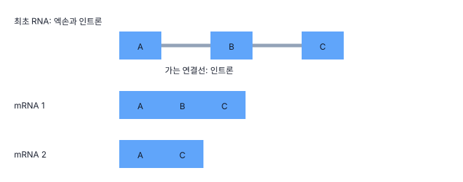
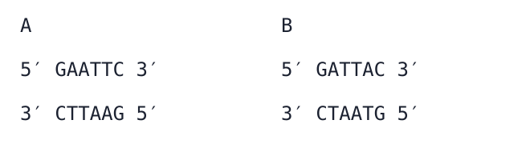

# 복습문제 22선 — 1008 수업 범위

기출 9개와 생성 변형 13개예요. 변형 연습은 기본 11개·심화 2개예요(목표 기본 9~10개·심화 2~3개). 독립 풀이 검사에서 빈 벡터 선별 문항은 한 원리 적용으로 재분류했어요. 먼저 풀어 보고, 막히면 힌트를 열어 보세요. 실제 5장 판별 기준을 점검하는 생성 연습 1개가 포함되어 있어요. 기존 문항 번호는 그대로예요.

> `복습문제_1008_Gene_Regulation_and_DNA_Cloning.html`를 마크다운으로 옮겼어요. 원문, 힌트, 풀이는 접혀 있어요. 먼저 풀어 보고 펼쳐 보세요.

**목차**

- [B. 기출](#partB)
  - [P1. mRNA 이동의 조절 단계](#p1)
  - [P2. 피부세포와 신경세포의 차이](#p2)
  - [P3. 진핵생물의 발현 조절](#p3)
  - [P4. 세 염기에 한정되지 않는 RNA](#p4)
  - [P5. DNA를 자르는 분자가위](#p5)
  - [P6. 유전자 조작 기술의 이름](#p6)
  - [P7. 제한효소의 절단 범위](#p7)
  - [P8. 재조합 단백질의 생산](#p8)
  - [P9. 세균의 클로닝 벡터](#p9)
- [C. 변형 연습](#partC)
  - [P10. [변형] 아세틸화와 전사 접근성](#p10)
  - [P11. [변형] DNA 서열과 조절 단백질](#p11)
  - [P12. [변형] 한 유전자와 두 mRNA](#p12)
  - [P13. [변형] miRNA의 선택적 표적](#p13)
  - [P14. [변형] 발현 조절 단계 구별](#p14)
  - [P15. [변형] 분해 기구와 단백질 수명](#p15)
  - [P16. [변형] 복제·선별·발현의 조건](#p16)
  - [P17. [변형] 회문 구조의 읽는 방향](#p17)
  - [P18. [변형] EcoRI가 남기는 말단](#p18)
  - [P19. [변형] 짝짓기 뒤 남은 골격의 틈](#p19)
  - [P20. [변형] 항생제 선별과 삽입 확인](#p20)
  - [P21. [변형] 먼 증폭자가 전사를 돕는 이유](#p21)
  - [P22. [변형] mRNA를 세는 기준](#p22)

## B. 기출

### P1. mRNA 이동의 조절 단계

mRNA가 세포질로 이동하는 것을 통제하는 것은 다음 중 어느 것에 해당하는가?

- (1) DNA의 조절
- (2) 전사 시 조절
- (3) 번역 시 조절
- (4) 번역 후 조절
- (5) 전사 후 조절

원문 정보 보기

기출 5강 합본 13번 (PDF 2쪽)

힌트 보기

mRNA가 만들어진 뒤 핵 밖으로 이동하는 단계이므로 전사 후 조절이다.

풀이 보기

1. (1) 틀려요. DNA 구조 자체를 조절하는 단계와 만들어진 mRNA의 이동은 달라요.
2. (2) 틀려요. 전사는 RNA를 만드는 단계인데 여기서는 이미 만들어진 mRNA가 이동해요.
3. (3) 틀려요. 번역 조절은 mRNA로 단백질을 만드는 단계에서 일어나요.
4. (4) 틀려요. 번역 후 조절은 만들어진 단백질을 가공하거나 분해해요.
5. (5) 맞아요. 전사가 끝난 뒤 만들어진 mRNA의 이용 가능성을 조절해요.
6. 수업과의 연결: 1008 수업의 [엑손 조합과 mRNA의 수명](정리노트_1008_Gene_Regulation_and_DNA_Cloning.md#s2-splicing) 개념으로 판단해요.

**정답:** (5)

---

### P2. 피부세포와 신경세포의 차이

같은 사람에게 존재하는 두 종류의 세포(예 : 피부세포와 신경세포)의 차이를 야기하는 것은 무엇인가?

- (1) 다른 종류의 세포는 같은 유전자를 갖는다. 그러나 이 중 발현하는 유전자는 다르다.
- (2) 다른 종류의 세포는 염색체의 수가 다르다.
- (3) 두 세포는 같은 유전자를 가지고 출발하나 이들이 발생 과정에서 어떤 유전자들을 차등적으로 제거한다.
- (4) 다른 종류의 세포는 다른 유전자를 가지고 있다.

원문 정보 보기

기출 5강 합본 24번 (PDF 3쪽)

힌트 보기

동일한 사람의 일반적인 체세포는 같은 유전정보를 가지며 선택적으로 발현하는 유전자가 다르다.

풀이 보기

1. (1) 맞아요. 같은 유전정보를 가지고도 켜지는 유전자 조합이 달라 세포의 기능이 달라져요.
2. (2) 틀려요. 일반적인 피부세포와 신경세포의 차이를 염색체 수 차이로 설명하지 않아요.
3. (3) 틀려요. 일반적인 분화는 필요한 유전자를 차등적으로 켜고 끄며 유전자를 제거하는 과정이 아니에요.
4. (4) 틀려요. 같은 사람의 일반적인 체세포는 같은 유전정보를 공유해요.
5. 수업과의 연결: 1008 수업의 [DNA 서열과 조절 단백질](정리노트_1008_Gene_Regulation_and_DNA_Cloning.md#s1-initiation) 개념으로 판단해요.

**정답:** (1)

---

### P3. 진핵생물의 발현 조절

진핵생물에서의 유전자 발현 조절에 대한 설명 중 틀린 것은?

- (1) 프로모터 근접요소들은 전사 속도를 증가시키는 조절 체계의 일부이다.
- (2) 몇몇 유전자들에서는 전사의 속도를 늦추거나 억제하는 억제자가 존재한다.
- (3) 헤모글로빈의 세포 선택적 발현은 DNA 메틸화 반응으로 인한 조절의 예이다.
- (4) 프로모터 근접부위에는 증폭자가 존재하여 최대 속도로 전사되는지를 결정한다.
- (5) 히스톤 단백질의 아세틸화로 인해 프로모터에 RNA 중합효소가 접근하기 쉬워진다.

원문 정보 보기

기출 5강 합본 33번 (PDF 4쪽)

힌트 보기

증폭자는 프로모터에서 멀리 떨어진 조절 DNA 서열이다.

풀이 보기

1. (1) 옳은 설명이므로 답이 아니에요. 프로모터 가까이 있는 조절 서열에 단백질이 결합하여 전사를 도와요.
2. (2) 옳은 설명이므로 답이 아니에요. 억제자는 전사를 낮추거나 막는 조절 단백질이에요.
3. (3) 옳은 설명이므로 답이 아니에요. 원문 기출에서 메틸화에 의한 세포 선택적 발현의 사례로 제시한 보기에요.
4. (4) 틀린 설명이므로 정답이에요. 증폭자는 프로모터 근접요소와 구별되는, 멀리 떨어진 조절 DNA 서열이에요.
5. (5) 옳은 설명이므로 답이 아니에요. 아세틸화로 히스톤과 DNA의 결합이 느슨해지면 접근하기 쉬워져요.
6. 수업과의 연결: 1008 수업의 [DNA 서열과 조절 단백질](정리노트_1008_Gene_Regulation_and_DNA_Cloning.md#s1-initiation) 개념으로 판단해요.

**정답:** (4)

---

### P4. 세 염기에 한정되지 않는 RNA

다음 중 항상 세 개의 뉴클레오타이드로 구성되어 있지 않은 것은?

- (1) 코돈
- (2) 개시코돈
- (3) miRNA
- (4) 정지코돈
- (5) 안티코돈

원문 정보 보기

기출 5강 합본 45번 (PDF 5쪽)

힌트 보기

코돈과 안티코돈은 세 염기이며 miRNA는 그보다 긴 짧은 RNA 조각이다.

풀이 보기

1. (1) 세 염기로 이뤄져 답이 아니에요. 코돈은 세 염기로 이루어진 번역 정보 단위에요.
2. (2) 세 염기로 이뤄져 답이 아니에요. 개시코돈도 세 염기로 이루어진 코돈이에요.
3. (3) 세 염기 길이로 한정되지 않아 정답이에요. miRNA는 상보적인 mRNA를 방해하는 짧은 RNA이며 세 염기로 한정되지 않아요.
4. (4) 세 염기로 이뤄져 답이 아니에요. 정지코돈도 세 염기로 이루어진 코돈이에요.
5. (5) 세 염기로 이뤄져 답이 아니에요. 안티코돈은 코돈에 상보적으로 짝짓는 세 염기에요.
6. 수업과의 연결: 1008 수업의 [짧은 RNA로 발현을 낮추기](정리노트_1008_Gene_Regulation_and_DNA_Cloning.md#s2-rnai) 개념으로 판단해요.

**정답:** (3)

---

### P5. DNA를 자르는 분자가위

특별한 DNA 서열을 인식하여 특이적으로 절단하는 분자가위는 무엇인가?

- (1) 제한효소
- (2) 벡터
- (3) Taq 중합효소
- (4) DNA 중합효소
- (5) PCR

원문 정보 보기

기출 6강 합본 1번 (PDF 1쪽)

힌트 보기

제한효소는 인식 서열을 찾아 절단한다.

풀이 보기

1. (1) 맞아요. 제한효소는 정해진 DNA 서열을 인식하고 잘라요.
2. (2) 틀려요. 벡터는 유전자를 운반하는 DNA이며 자르는 효소가 아니에요.
3. (3) 틀려요. 이 중합효소는 DNA를 절단하는 분자가위가 아니에요.
4. (4) 틀려요. DNA 중합효소는 DNA를 합성하는 효소에요.
5. (5) 틀려요. 이 기술명은 정해진 서열을 절단하는 효소의 이름이 아니에요.
6. 수업과의 연결: 1008 수업의 [제한효소와 회문 구조](정리노트_1008_Gene_Regulation_and_DNA_Cloning.md#s5-restriction) 개념으로 판단해요.

**정답:** (1)

---

### P6. 유전자 조작 기술의 이름

DNA 기술의 응용을 위해 인위적으로 유전자를 조작하는 기술을 무엇이라 하는가?

- (1) DNA 유전자미세배열
- (2) PCR
- (3) 유전공학
- (4) 생물정보학
- (5) 재조합

원문 정보 보기

기출 6강 합본 10번 (PDF 2쪽)

힌트 보기

유전자를 인위적으로 변형하여 응용하는 기술의 총칭은 유전공학이다.

풀이 보기

1. (1) 틀려요. 이 분석 기술의 이름은 유전자를 조작하여 응용하는 기술의 총칭이 아니에요.
2. (2) 틀려요. 이 기술명은 유전자 조작 기술 전체를 부르는 이름이 아니에요.
3. (3) 맞아요. 유전공학은 DNA 기술로 유전자를 조작하고 응용하는 기술이에요.
4. (4) 틀려요. 이 학문 이름은 유전자 조작 기술의 총칭이 아니에요.
5. (5) 틀려요. 재조합은 DNA 조각을 새롭게 조합하는 과정이며 기술 전체의 이름은 유전공학이에요.
6. 수업과의 연결: 1008 수업의 [인슐린 유전자와 플라스미드](정리노트_1008_Gene_Regulation_and_DNA_Cloning.md#s4-vector) 개념으로 판단해요.

**정답:** (3)

---

### P7. 제한효소의 절단 범위

다음 중 제한효소에 관련된 설명 중 틀린 것은?

- (1) 대부분의 제한효소 절단 위치는 대칭형이다
- (2) 바이러스의 공격을 방어하기 위한 세균의 효소이다
- (3) EcoRI의 경우 단일가닥의 점착성 말단을 가지는 DNA 조각을 생성한다
- (4) 제한효소는 제한효소 절단위치를 인식하여 특정부분을 절단한다
- (5) 지금까지 발견된 제한효소를 이용하면 실험자가 원하는 DNA 서열의 모든 부위를 절단할 수 있다

원문 정보 보기

기출 6강 합본 11번 (PDF 2쪽)

힌트 보기

제한효소는 정해진 인식 서열만 절단하므로 임의의 모든 위치를 자를 수 없다.

풀이 보기

1. (1) 옳은 설명이므로 답이 아니에요. 수업에서 다룬 제한효소는 두 가닥을 각각 같은 방향으로 읽으면 같은 회문 서열을 인식해요.
2. (2) 옳은 설명이므로 답이 아니에요. 세균은 침입한 바이러스 DNA를 절단하여 방어해요.
3. (3) 옳은 설명이므로 답이 아니에요. EcoRI는 어긋나게 절단하여 단일가닥 돌출부를 남겨요.
4. (4) 옳은 설명이므로 답이 아니에요. 제한효소는 정해진 인식 서열이 있는 위치를 잘라요.
5. (5) 틀린 설명이므로 정답이에요. 정해진 인식 서열이 필요하므로 원하는 임의의 모든 위치를 자를 수는 없어요.
6. 수업과의 연결: 1008 수업의 [제한효소와 회문 구조](정리노트_1008_Gene_Regulation_and_DNA_Cloning.md#s5-restriction) 개념으로 판단해요.

**정답:** (5)

---

### P8. 재조합 단백질의 생산

다음 중 재조합 단백질에 대해 가장 올바른 설명은?

- (1) 디옥시리보핵산으로부터 직접적으로 만들어져서 전사와 번역을 우회하는 것
- (2) 이전에 사용하던 것 보다 더 강하고 더 많이 농축된 것
- (3) 유전적으로 조작된 세균으로부터 만들어진 것
- (4) 과학자들에 의해서 화학물질로부터 만들어진 것

원문 정보 보기

기출 6강 합본 17번 (PDF 2쪽)

힌트 보기

이번 수업의 사람 인슐린 사례에서 재조합 DNA를 가진 세균이 전사·번역하여 단백질을 만든다.

풀이 보기

1. (1) 틀려요. DNA 정보도 먼저 RNA로 전사되고 번역되어 단백질이 만들어져요.
2. (2) 틀려요. 재조합이라는 말은 강도나 농축 정도가 아니라 유전자의 새 조합과 생산 방법을 가리켜요.
3. (3) 맞아요. 수업의 사람 인슐린 사례처럼 유전자를 넣은 세균에서 만들어질 수 있어요.
4. (4) 틀려요. 이 사례는 세포의 전사·번역을 이용한 생산이며 단순한 화학 합성이라는 뜻이 아니에요.
5. 수업과의 연결: 1008 수업의 [인슐린 유전자와 플라스미드](정리노트_1008_Gene_Regulation_and_DNA_Cloning.md#s4-vector) 개념으로 판단해요.

**정답:** (3)

보기 중 가장 알맞은 답이에요. 재조합 단백질은 세균에만 한정되지 않고 다른 숙주에서도 생산할 수 있어요.

---

### P9. 세균의 클로닝 벡터

유전학자들이 외부 유전자를 세균에 삽입시키기 위해 사용하는 클로닝 벡터는 무엇이라고 하는가?

- (1) 재조합 DNA
- (2) STR 유전자
- (3) 게놈
- (4) 플라스미드

원문 정보 보기

기출 6강 합본 28번 (PDF 4쪽)

힌트 보기

세균의 염색체와 별도로 존재하는 원형 DNA인 플라스미드를 운반 벡터로 사용한다.

풀이 보기

1. (1) 틀려요. 재조합 DNA는 삽입 DNA와 벡터가 결합한 결과물의 이름이에요.
2. (2) 틀려요. 이 이름은 수업에서 배운 세균의 원형 운반 벡터가 아니에요.
3. (3) 틀려요. 게놈은 유전정보 전체이며 이 작은 원형 벡터를 가리키지 않아요.
4. (4) 맞아요. 플라스미드는 세균 염색체와 별도로 존재하는 원형 DNA이며 벡터로 이용해요.
5. 수업과의 연결: 1008 수업의 [인슐린 유전자와 플라스미드](정리노트_1008_Gene_Regulation_and_DNA_Cloning.md#s4-vector) 개념으로 판단해요.

**정답:** (4)

---

## C. 변형 연습

### P10. [변형] 아세틸화와 전사 접근성

어떤 유전자 주변 히스톤의 아세틸화가 증가했고 DNA 메틸화 정도는 변하지 않았다. 다른 조건이 같다면 예상되는 변화로 가장 알맞은 것은?

- (1) 히스톤과 DNA의 결합이 강해져 전사가 증가한다.
- (2) 히스톤과 DNA의 결합이 느슨해져 전사가 증가할 수 있다.
- (3) DNA가 모두 제거되어 번역만 계속된다.
- (4) 새로운 유전자가 생겨서만 단백질이 증가한다.
- (5) 히스톤 아세틸화는 만들어진 단백질을 분해하는 표지이다.

원문 정보 보기

원문 기출이 아닌 생성 변형이에요. 다루는 혼동: 히스톤 아세틸화와 DNA 접근성. 근거 토픽: s0-chromatin.

힌트 보기

DNA가 느슨하게 풀리면 RNA 중합효소가 접근하기 쉬워져요.

풀이 보기

1. (1) 틀려요. 강하게 감길수록 RNA 중합효소가 접근하기 어려워져요.
2. (2) 맞아요. 결합이 느슨해지면 DNA에 접근하기 쉬워 전사가 증가할 수 있어요.
3. (3) 틀려요. DNA를 없애는 과정이 아니라 기존 DNA에 대한 접근성을 바꾸는 과정이에요.
4. (4) 틀려요. 유전자 수를 늘리지 않고 기존 유전자의 발현을 바꿔요.
5. (5) 틀려요. 히스톤 아세틸화는 염색질을 통한 전사 조절에요.
6. 수업과의 연결: 1008 수업의 [염색질을 풀면 전사가 쉬워져요](정리노트_1008_Gene_Regulation_and_DNA_Cloning.md#s0-chromatin) 개념으로 판단해요.

**정답:** (2)

---

### P11. [변형] DNA 서열과 조절 단백질

진핵생물에서의 유전자 발현 조절에 대한 설명 중 틀린 것은?

- (1) 전사 인자가 TATA 상자에 결합하여 RNA 중합효소의 자리 잡기를 도울 수 있다.
- (2) DNA 메틸화는 유전자 전사를 억제하는 데 쓰일 수 있다.
- (3) 히스톤 아세틸화는 DNA 접근성을 높일 수 있다.
- (4) 증폭자는 전사를 수행하는 RNA 중합효소 자체를 부르는 이름이다.
- (5) 억제자는 전사의 속도를 낮추거나 전사를 막는 단백질이다.

원문 정보 보기

기출 5강 33번 발문에 보기를 바꾼 생성 변형이에요. 다루는 혼동: 조절 DNA 서열과 조절 단백질. 근거 토픽: s1-initiation.

힌트 보기

조절 DNA 서열과 단백질을 구별해요.

풀이 보기

1. (1) 옳은 설명이므로 답이 아니에요. 전사 인자는 RNA 중합효소가 전사를 시작하도록 도와요.
2. (2) 옳은 설명이므로 답이 아니에요. DNA 메틸화는 수업에서 전사 억제 기작으로 설명했어요.
3. (3) 옳은 설명이므로 답이 아니에요. 히스톤과 DNA 사이 결합을 느슨하게 할 수 있어요.
4. (4) 틀린 설명이므로 정답이에요. 증폭자는 DNA 서열이며 RNA 중합효소는 단백질 효소에요.
5. (5) 옳은 설명이므로 답이 아니에요. 억제자는 전사를 줄이는 조절 단백질이에요.
6. 원문 정답과 달라진 점: 원문은 증폭자의 위치를 잘못 설명했지만 여기서는 증폭자를 효소라고 잘못 설명해요.
7. 수업과의 연결: 1008 수업의 [DNA 서열과 조절 단백질](정리노트_1008_Gene_Regulation_and_DNA_Cloning.md#s1-initiation) 개념으로 판단해요.

**정답:** (4)

---

### P12. [변형] 한 유전자와 두 mRNA

그림에서 한 유전자의 최초 RNA와 가공된 mRNA 두 종류를 나타냈다. DNA 서열은 변하지 않았다. 가장 알맞은 설명은?

- (1) 엑손 A와 C의 순서가 바뀌어야 두 종류의 mRNA가 생긴다.
- (2) 두 mRNA가 생겼으므로 원래 유전자는 반드시 두 개이다.
- (3) 대체 스플라이싱으로 한 유전자에서 서로 다른 단백질이 만들어질 수 있다.
- (4) 가공된 mRNA에는 모든 인트론이 반드시 남는다.
- (5) mRNA가 달라지려면 DNA 염기서열이 먼저 바뀌어야 한다.

원문 정보 보기

원문 기출이 아닌 생성 변형이에요. 다루는 혼동: 엑손 선택과 순서 유지. 근거 토픽: s2-splicing.

힌트 보기

같은 유전자의 엑손 중 어떤 것을 이어 붙였는지 읽어요.

풀이 보기

1. (1) 틀려요. 그림에서는 A 다음 C라는 순서를 유지하고 B의 포함 여부만 달라져요.
2. (2) 틀려요. 하나의 최초 RNA에서 엑손의 선택이 달라질 수 있어요.
3. (3) 맞아요. 엑손을 선택적으로 연결하면 서로 다른 mRNA와 단백질이 생길 수 있어요.
4. (4) 틀려요. 가공 과정에서는 인트론을 제거해요.
5. (5) 틀려요. DNA가 그대로여도 RNA의 가공 방식이 달라질 수 있어요.
6. 수업과의 연결: 1008 수업의 [엑손 조합과 mRNA의 수명](정리노트_1008_Gene_Regulation_and_DNA_Cloning.md#s2-splicing) 개념으로 판단해요.

**정답:** (3)

---

### P13. [변형] miRNA의 선택적 표적

새 miRNA는 기존 mRNA X에만 상보적이며 다른 mRNA에는 결합하지 않는다. DNA 서열은 그대로이다. 가능한 직접 효과는?

- (1) mRNA X의 번역이 억제되거나 X가 분해된다.
- (2) X를 만드는 DNA 유전자가 반드시 삭제된다.
- (3) 모든 단백질의 합성이 똑같이 완전히 중지된다.
- (4) miRNA가 리보솜으로 아미노산을 운반한다.
- (5) miRNA가 X를 주형으로 새 DNA를 복제한다.

원문 정보 보기

원문 기출이 아닌 생성 변형이에요. 다루는 혼동: RNA 간섭의 표적과 DNA 서열. 근거 토픽: s2-rnai.

힌트 보기

표적은 DNA가 아니라 상보적인 mRNA에요.

풀이 보기

1. (1) 맞아요. 상보적 mRNA에 결합하여 번역을 방해하거나 분해를 유도해요.
2. (2) 틀려요. RNA에 작용하는 조건이므로 DNA 삭제라는 결론은 나오지 않아요.
3. (3) 틀려요. X에만 결합하는 조건이라 다른 mRNA까지 모두 막는다는 결론은 나오지 않아요.
4. (4) 틀려요. 아미노산 운반은 tRNA의 역할이에요.
5. (5) 틀려요. 제시된 miRNA 작용은 DNA 복제가 아니에요.
6. 수업과의 연결: 1008 수업의 [짧은 RNA로 발현을 낮추기](정리노트_1008_Gene_Regulation_and_DNA_Cloning.md#s2-rnai) 개념으로 판단해요.

**정답:** (1)

---

### P14. [변형] 발현 조절 단계 구별

조절 사례와 단계의 연결 중 틀린 것은?

- (1) 히스톤 아세틸화로 DNA 접근성 변화 — 전사 조절
- (2) 선택적 이어맞추기로 mRNA 종류 변화 — 전사 후 조절
- (3) mRNA와 리보솜의 결합 조절 — 번역 조절
- (4) 유비퀴틴 표지를 통한 단백질 분해 — 번역 후 조절
- (5) 이미 만들어진 단백질의 인산화 — 전사 후 조절

원문 정보 보기

원문 기출이 아닌 생성 변형이에요. 다루는 혼동: 전사 후 조절과 번역 후 조절. 근거 토픽: s3-translation.

힌트 보기

무엇이 이미 만들어진 상태인지 확인해요.

풀이 보기

1. (1) 옳은 설명이므로 답이 아니에요. DNA에서 RNA를 만들기 전 접근성에 작용해요.
2. (2) 옳은 설명이므로 답이 아니에요. 만들어진 RNA의 가공을 바꾸는 조절이에요.
3. (3) 옳은 설명이므로 답이 아니에요. 리보솜에서 단백질을 만드는 과정의 시작을 조절해요.
4. (4) 옳은 설명이므로 답이 아니에요. 이미 만들어진 단백질의 수명을 바꿔요.
5. (5) 틀린 설명이므로 정답이에요. 단백질이 만들어진 뒤 화학적으로 변형되므로 번역 후 조절이에요.
6. 수업과의 연결: 1008 수업의 [리보솜 결합과 단백질 활성](정리노트_1008_Gene_Regulation_and_DNA_Cloning.md#s3-translation) 개념으로 판단해요.

**정답:** (5)

---

### P15. [변형] 분해 기구와 단백질 수명

분해 표지가 붙은 사이클린이 있다. 이 세포의 프로테아좀 기능만 낮아지고 합성 속도는 그대로라면 가장 직접적으로 예상되는 결과는?

- (1) 사이클린을 합성하는 장소가 프로테아좀으로 바뀐다.
- (2) 표지된 사이클린의 분해가 느려져 더 오래 남을 수 있다.
- (3) 사이클린을 암호화하는 DNA가 즉시 사라진다.
- (4) 유비퀴틴이 새 사이클린의 아미노산 원료가 된다.
- (5) 기존 사이클린이 mRNA로 전환된다.

원문 정보 보기

원문 기출이 아닌 생성 변형이에요. 다루는 혼동: 단백질 합성과 단백질 분해. 근거 토픽: s3-proteasome.

힌트 보기

프로테아좀은 단백질을 만드는 곳인지 없애는 곳인지 떠올려요.

풀이 보기

1. (1) 틀려요. 단백질 합성 장소는 리보솜이에요.
2. (2) 맞아요. 프로테아좀이 분해를 담당하므로 기능이 낮아지면 분해가 늦어져요.
3. (3) 틀려요. 단백질 분해 기구 변화가 DNA를 삭제하지는 않아요.
4. (4) 틀려요. 유비퀴틴은 여기서 분해 대상으로 보내는 표지에요.
5. (5) 틀려요. 단백질 분해가 mRNA로 되돌리는 과정은 아니에요.
6. 수업과의 연결: 1008 수업의 [표지를 붙여 분해하기](정리노트_1008_Gene_Regulation_and_DNA_Cloning.md#s3-proteasome) 개념으로 판단해요.

**정답:** (2)

---

### P16. [변형] 복제·선별·발현의 조건

벡터 A에는 원하는 유전자·항생제 내성 유전자·복제원점이 있다. 벡터 B에는 같은 요소와 원하는 유전자를 전사할 세균 프로모터가 있다. 두 벡터 모두 세균에 들어갔고 복제원점과 내성 유전자는 정상 작동하며, 원하는 유전자를 위한 다른 프로모터는 없다. 가장 알맞은 결론은?

- (1) A만 복제되고 B는 복제되지 않는다.
- (2) 항생제 처리 후 B만 살아남는다.
- (3) 두 벡터 모두 원하는 유전자를 똑같이 전사한다.
- (4) 두 벡터 모두 복제·선별될 수 있지만 주어진 유전자의 전사는 B에서 가능하다.
- (5) 프로모터는 원하는 DNA를 절단하는 효소이다.

원문 정보 보기

원문 기출이 아닌 생성 변형이에요. 다루는 혼동: 복제원점·항생제 내성·프로모터의 역할. 근거 토픽: s4-vector.

힌트 보기

복제원점·내성 유전자·프로모터의 역할을 따로 판단해요.

풀이 보기

1. (1) 틀려요. 두 벡터 모두 정상 복제원점이 있어요.
2. (2) 틀려요. 두 벡터 모두 정상 내성 유전자가 있어 살아남을 수 있어요.
3. (3) 틀려요. A에는 해당 유전자를 전사할 프로모터가 없다고 명시했어요.
4. (4) 맞아요. 복제는 복제원점, 선별은 내성 유전자, 해당 유전자의 전사는 프로모터에 달려 있어요.
5. (5) 틀려요. 프로모터는 RNA 중합효소가 자리 잡는 DNA 서열이에요.
6. 수업과의 연결: 1008 수업의 [인슐린 유전자와 플라스미드](정리노트_1008_Gene_Regulation_and_DNA_Cloning.md#s4-vector) 개념으로 판단해요.

**정답:** (4)

---

### P17. [변형] 회문 구조의 읽는 방향

그림 A와 B의 각 DNA 가닥을 각각 5′에서 3′ 방향으로 읽었다. 두 가닥에서 읽은 서열이 같아지는 회문 구조는?

- (1) A만 해당한다.
- (2) B만 해당한다.
- (3) A와 B 모두 해당한다.
- (4) A와 B 모두 해당하지 않는다.
- (5) 한 가닥을 항상 종이의 왼쪽에서 오른쪽으로 읽어야 회문을 판별한다.

원문 정보 보기

원문 기출이 아닌 생성 변형이에요. 다루는 혼동: DNA 가닥의 방향과 회문 구조. 근거 토픽: s5-restriction.

힌트 보기

아래 가닥의 5′가 그림 어느 쪽인지 찾아요.

풀이 보기

1. (1) 맞아요. A의 위 가닥과 아래 가닥을 각각 5′→3′로 읽으면 모두 GAATTC에요.
2. (2) 틀려요. B의 아래 가닥은 5′→3′로 GTAATC라 위 가닥 GATTAC와 달라요.
3. (3) 틀려요. B는 각각 같은 방향으로 읽은 두 서열이 달라요.
4. (4) 틀려요. A는 두 가닥을 각각 5′→3′로 읽은 서열이 같아요.
5. (5) 틀려요. 종이에서의 위치가 아니라 표시된 5′와 3′ 방향을 따라 읽어요.
6. 수업과의 연결: 1008 수업의 [제한효소와 회문 구조](정리노트_1008_Gene_Regulation_and_DNA_Cloning.md#s5-restriction) 개념으로 판단해요.

**정답:** (1)

---

### P18. [변형] EcoRI가 남기는 말단

다음 중 제한효소에 관련된 설명 중 틀린 것은?

- (1) 세균이 침입한 바이러스 DNA를 자르는 방어에 쓰일 수 있다.
- (2) 정해진 인식 서열이 있는 DNA 위치를 절단한다.
- (3) EcoRI는 단일가닥 돌출부를 남기지 않는 평활말단만 만든다.
- (4) 수업의 제한효소 인식 서열은 두 가닥을 각각 5′에서 3′로 읽을 때 같았다.
- (5) 제한효소는 인식 서열이 필요하므로 원하는 임의의 모든 위치를 자르지는 못한다.

원문 정보 보기

기출 6강 11번 발문에 보기를 바꾼 생성 변형이에요. 다루는 혼동: 점착성 말단과 평활 말단. 근거 토픽: s5-restriction.

힌트 보기

EcoRI가 자른 뒤 말단에 무엇이 남는지 떠올려요.

풀이 보기

1. (1) 옳은 설명이므로 답이 아니에요. 수업에서 제한효소의 세균 방어 역할을 설명했어요.
2. (2) 옳은 설명이므로 답이 아니에요. 특정 서열을 인식하는 것이 핵심이에요.
3. (3) 틀린 설명이므로 정답이에요. EcoRI는 어긋나게 잘라 점착성 말단을 만들어요.
4. (4) 옳은 설명이므로 답이 아니에요. 이것이 수업에서 설명한 회문 구조에요.
5. (5) 옳은 설명이므로 답이 아니에요. 인식 서열이 없는 임의의 위치를 마음대로 고를 수 없어요.
6. 원문 정답과 달라진 점: 원문은 임의의 모든 위치를 자를 수 있다는 설명이 틀렸고, 여기서는 EcoRI의 말단 설명이 틀렸어요.
7. 수업과의 연결: 1008 수업의 [제한효소와 회문 구조](정리노트_1008_Gene_Regulation_and_DNA_Cloning.md#s5-restriction) 개념으로 판단해요.

**정답:** (3)

---

### P19. [변형] 짝짓기 뒤 남은 골격의 틈

서로 상보적인 점착성 말단(sticky end)이 짝지었지만 DNA 당·인산 골격에는 아직 nick이 남아 있다. 이를 마무리하는 기능으로 알맞은 것은?

- (1) 리보솜이 DNA를 단백질로 직접 바꾼다.
- (2) 제한효소가 해당 DNA를 다시 절단한다.
- (3) 히스톤이 DNA의 모든 염기를 제거한다.
- (4) miRNA가 DNA 말단으로 아미노산을 운반한다.
- (5) ligase인 DNA 연결효소가 당·인산 골격의 공유결합을 잇는다.

원문 정보 보기

원문 기출이 아닌 생성 변형이에요. 다루는 혼동: 염기 짝짓기와 당·인산 골격 연결. 근거 토픽: s5-ligation.

힌트 보기

염기의 짝짓기와 DNA 골격의 연결은 다른 일이에요.

풀이 보기

1. (1) 틀려요. 리보솜은 mRNA를 읽어 단백질을 만들어요.
2. (2) 틀려요. 다시 자르는 것은 골격의 틈을 잇는 기능이 아니에요.
3. (3) 틀려요. 히스톤은 DNA를 감는 단백질이며 염기 제거 효소가 아니에요.
4. (4) 틀려요. miRNA는 mRNA 발현을 억제하며 DNA 골격을 잇지 않아요.
5. (5) 맞아요. 상보적 짝짓기 뒤 남은 골격의 틈을 DNA 연결효소가 이어 줘요.
6. 수업과의 연결: 1008 수업의 [말단 결합과 DNA 연결효소](정리노트_1008_Gene_Regulation_and_DNA_Cloning.md#s5-ligation) 개념으로 판단해요.

**정답:** (5)

---

### P20. [변형] 항생제 선별과 삽입 확인

빈 벡터 E와 원하는 유전자를 삽입한 벡터 F는 모두 정상 항생제 내성 유전자와 복제원점을 가진다. 각각의 벡터가 들어간 세균을 같은 항생제 배지에서 키웠다. 가장 알맞은 결론은?

- (1) 살아남은 세균은 반드시 원하는 유전자를 가진다.
- (2) 두 집단 모두 살아남을 수 있으므로 항생제 선별만으로 원하는 삽입을 보장할 수 없다.
- (3) 원하는 유전자가 없는 E는 복제원점이 있어도 복제하지 못한다.
- (4) 항생제는 F에 삽입된 원하는 DNA 서열을 복제하는 효소이다.
- (5) F가 들어간 세균은 내성 유전자가 있어도 모두 반드시 죽는다.

원문 정보 보기

원문 기출이 아닌 생성 변형이에요. 다루는 혼동: 항생제 내성과 원하는 DNA 삽입. 근거 토픽: s5-cloning.

힌트 보기

항생제 내성 유전자와 원하는 삽입 유전자를 구별해요.

풀이 보기

1. (1) 틀려요. E도 내성 유전자가 있어 살아남을 수 있다는 반례가 있어요.
2. (2) 맞아요. 선별은 내성을 확인할 뿐이며 원하는 삽입 여부는 별도로 확인해야 해요.
3. (3) 틀려요. 정상 복제원점이 있으므로 E도 복제될 수 있어요.
4. (4) 틀려요. 항생제는 DNA 복제 효소가 아니라 내성 여부에 따라 생존을 가르는 물질이에요.
5. (5) 틀려요. 정상 내성 조건에서는 F 세균도 살아남을 수 있어요.
6. 수업과의 연결: 1008 수업의 [선별과 DNA 클로닝](정리노트_1008_Gene_Regulation_and_DNA_Cloning.md#s5-cloning) 개념으로 판단해요.

**정답:** (2)

---

### P21. [변형] 먼 증폭자가 전사를 돕는 이유

증폭자가 선형 DNA에서 유전자와 멀리 떨어져 있어도 전사를 도울 수 있는 이유로 가장 알맞은 것은?

- (1) 증폭자가 단백질이므로 DNA에서 떨어져 나오기 때문이다.
- (2) 증폭자가 항상 프로모터 바로 옆 서열로 잘려 이동하기 때문이다.
- (3) 증폭자가 RNA로 바뀌어 리보솜에 직접 아미노산을 운반하기 때문이다.
- (4) DNA가 굽어 증폭자에 결합한 단백질과 전사 복합체가 3차원적으로 가까워질 수 있기 때문이다.
- (5) 멀리 떨어진 서열은 단백질 없이 DNA를 모두 복제하기 때문이다.

원문 정보 보기

원문 기출이 아닌 생성 변형이에요. 다루는 혼동: 선형 거리와 3차원 거리. 근거 토픽: s1-initiation.

힌트 보기

줄 위에서는 멀어도 줄을 굽히면 두 지점이 가까워질 수 있어요.

풀이 보기

1. (1) 틀려요. 증폭자는 조절 DNA 서열이에요.
2. (2) 틀려요. DNA 서열 자체가 잘려 옮겨가야 한다는 뜻이 아니에요.
3. (3) 틀려요. 아미노산 운반은 tRNA의 역할이며 증폭자는 DNA 서열이에요.
4. (4) 맞아요. 선형 거리와 3차원 공간 거리는 다를 수 있어요.
5. (5) 틀려요. 증폭자의 전사 조절과 DNA 복제는 다른 과정이에요.
6. 수업과의 연결: 1008 수업의 [DNA 서열과 조절 단백질](정리노트_1008_Gene_Regulation_and_DNA_Cloning.md#s1-initiation) 개념으로 판단해요.

**정답:** (4)

---

### P22. [변형] mRNA를 세는 기준

한 진핵 유전자의 전구체 RNA에서 엑손 조합이 다른 성숙 mRNA X와 Y가 만들어졌다. X와 Y는 각각 하나의 단백질 정보를 담는 전형적인 경우이다. 옳지 않은 설명은?

- (1) X와 Y가 생긴 것은 선택적 이어맞추기로 설명할 수 있다.
- (2) 성숙 mRNA 한 종류의 암호화 범위와 전구체 하나의 가공 산물 종류 수는 다른 기준이다.
- (3) X와 Y가 각각 한 단백질 정보를 담는다는 사실은 서로 다른 두 단백질이 생길 가능성과 모순되지 않는다.
- (4) 두 성숙 mRNA 종류가 생겼으므로 각각의 성숙 mRNA 한 분자도 반드시 여러 구조유전자를 담는다.
- (5) 원핵 lac 오페론의 한 mRNA가 여러 구조유전자 정보를 담는 경우와 구별해야 한다.

원문 정보 보기

원문 기출이 아닌 생성 변형이에요. 다루는 혼동: 전구체 하나/성숙 mRNA 한 종류/원핵 오페론의 비교 단위(강의노트 5장 p7–8; 교재 p114; 실제 피드백 q01/q06). 근거 토픽: s2-splicing.

힌트 보기

전구체에서 생기는 종류 수와 완성 사본 하나의 정보를 구별해요.

풀이 보기

1. (1) 맞는 진술이므로 고르지 않아요. 한 전구체의 엑손 조합 차이가 서로 다른 성숙 mRNA를 만들 수 있어요.
2. (2) 맞는 진술이므로 고르지 않아요. 완성 사본 한 종류와 가공으로 가능한 종류 수는 비교 단위가 달라요.
3. (3) 맞는 진술이므로 고르지 않아요. 각 mRNA의 암호화 범위와 두 mRNA의 서로 다른 산물 가능성은 함께 성립해요.
4. (4) 틀린 진술이므로 골라요. 가공 산물이 두 종류라는 사실을 각 성숙 mRNA가 여러 구조유전자를 담는다는 결론으로 바꿀 수 없어요.
5. (5) 맞는 진술이므로 고르지 않아요. 원핵 lac의 다중 구조유전자 mRNA와 이 진핵 사례를 구별해요.
6. 수업과의 연결: 1008의 [mRNA를 세는 기준](정리노트_1008_Gene_Regulation_and_DNA_Cloning.md#s2-splicing)에서 다룬 판별 기준이에요.

**정답:** (4)

---

출처: 2023·2024 생명과학 기출(5·6강 합본). 정답은 인쇄된 답안지와 독립 판단을 대조했어요. 변형 연습은 수업 내용으로 만든 생성 문제예요.
