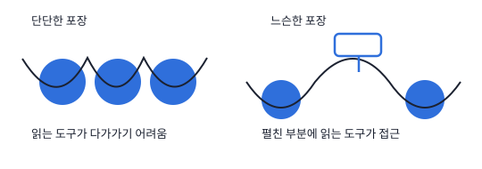
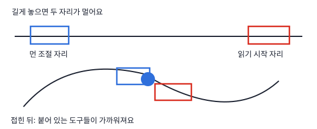
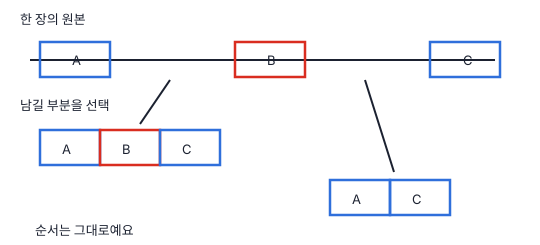
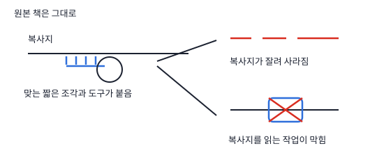
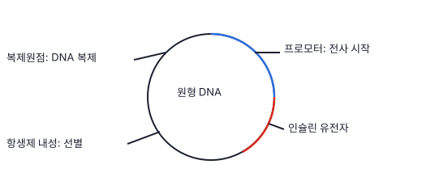
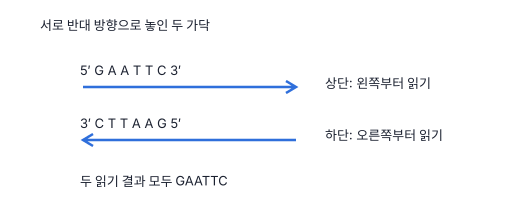
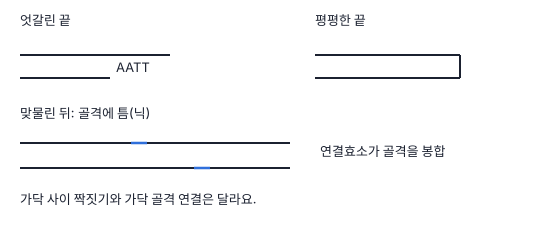
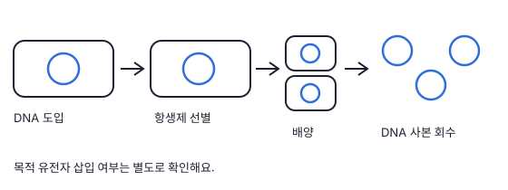

# 유전자 발현 조절과 DNA 클로닝 — 5살도 이해하는 정리노트

이영만 교수님 생명과학 · 1008 수업 (5장 마무리 · 6장 DNA 클로닝)

> `정리노트_1008_Gene_Regulation_and_DNA_Cloning.html`를 마크다운으로 옮겼어요. 그림은 `figures_1008/` 폴더의 SVG, 위젯은 대표 설정의 정적 그림으로 바꿨어요. 수식은 `$…$` / `$$…$$`라서 GitHub, Obsidian, Typora에서 보여요.

**목차**

- [0. [5장] DNA를 꺼내 쓰기](#s0)
  - [염색질을 풀면 전사가 쉬워져요](#s0-chromatin)
- [1. [5장] 전사 시작과 원거리 스위치](#s1)
  - [DNA 서열과 조절 단백질](#s1-initiation)
- [2. [5장] 만든 RNA를 조절하기](#s2)
  - [엑손 조합과 mRNA의 수명](#s2-splicing)
  - [짧은 RNA로 발현을 낮추기](#s2-rnai)
- [3. [5장] 번역과 단백질의 수명](#s3)
  - [리보솜 결합과 단백질 활성](#s3-translation)
  - [표지를 붙여 분해하기](#s3-proteasome)
- [4. [6장] 유전자를 운반할 도구](#s4)
  - [인슐린 유전자와 플라스미드](#s4-vector)
- [5. [6장] 자르고 붙여 늘리기](#s5)
  - [제한효소와 회문 구조](#s5-restriction)
  - [말단 결합과 DNA 연결효소](#s5-ligation)
  - [선별과 DNA 클로닝](#s5-cloning)
- [6. 요약 · 예고](#s6)
  - [시험 직전 한 줄](#s6-cheatsheet)
  - [끊긴 지점과 다음 범위](#s6-next)
  - [함께 보면 좋은 자료](#s6-links)

## 0. [5장] DNA를 꺼내 쓰기

### 염색질을 풀면 전사가 쉬워져요

*1008 수업 · 5장 p7–8*

**쉽게 말하면**

꽁꽁 포장한 옷보다 꺼내 둔 옷을 쉽게 입어요. 몸속 설명서도 잘 펼쳐져야 쉽게 읽어요.

**정확히 말하면**

염색질(chromatin)은 DNA와 단백질이 함께 이루는 구조예요. 음전하의 DNA가 양전하의 히스톤(histone)에 감겨 포장돼요. 조밀하게 묶이면 전사에 필요한 단백질이 프로모터에 접근하기 어려워요.

히스톤 아세틸화(histone acetylation)는 히스톤에 아세틸기(CH₃CO–)를 붙이는 변화예요. 히스톤의 양전하가 줄어 DNA와의 결합이 느슨해지면 전사 관련 단백질의 접근이 쉬워져 전사가 촉진될 수 있어요. 이런 접근성 변화는 염색질 재조정(chromatin remodeling)의 한 방식이에요.

반대로 이번 수업에서 다룬 DNA 메틸화(DNA methylation)는 프로모터 DNA의 시토신에 메틸기(CH₃)를 붙여 유전자 침묵을 유도하는 조절이에요. 전사량이 줄면 만들어지는 mRNA와 단백질 양도 줄 수 있어요.

**교수님 말씀**

> 히스톤에 아세틸화가 되면 전사량이 증가한다.

겨울옷을 꽁꽁 포장하면 꺼내 입기 어렵고, 꺼내 놓으면 쉽게 입는다고 비교하셨어요. DNA도 전사에 필요한 곳을 읽기 쉽게 펼치는 것이 중요해요.

**꼭 기억해요**

아세틸화는 여기서 히스톤에, 메틸화는 DNA에 일어나는 변화예요. 두 변화의 대상을 바꾸면 전사 효과도 혼동하기 쉬워요.

염색질은 DNA 하나만의 이름이 아니에요. DNA와 히스톤 등 단백질이 함께 이룬 구조예요. 메틸화가 모든 위치에서 같은 효과를 낸다는 뜻으로 일반화하지 않아요.

**페이지 요약**

히스톤 아세틸화는 DNA를 읽기 쉽게 하고, 이번 사례의 DNA 메틸화는 전사를 억제해요.

*용어*

- **히스톤** — DNA를 감아 포장하는 단백질
- **염색질** — DNA와 단백질이 함께 이룬 구조
- **DNA 메틸화** — 프로모터에서 전사를 억제하는 조절 사례

---

## 1. [5장] 전사 시작과 원거리 스위치

### DNA 서열과 조절 단백질

*1008 수업 · 5장 p7–8*

**쉽게 말하면**

전등 스위치가 있어도 눌러 줄 손이 필요해요. 멀리 있는 스위치도 연결돼 있으면 같은 전등을 켤 수 있어요.

**정확히 말하면**

전사 개시(transcription initiation)는 RNA 중합효소가 프로모터에 자리잡고 RNA 합성을 시작하는 단계예요. 진핵세포에서는 전사 인자(transcription factor)라는 단백질들이 그 자리잡기를 도와요. TATA 상자(TATA box)는 일부 프로모터 안의 특정 DNA 서열이에요. 이 상자를 가진 프로모터에서는 일반전사인자들이 결합하여 RNA 중합효소II와 개시 복합체를 만들어요.

활성자(activator)는 전사를 촉진하는 조절 단백질이고, 억제자(repressor)는 전사 속도를 낮추거나 전사를 억제하는 조절 단백질이에요. 프로모터근접요소(promoter proximal element)는 프로모터 가까이의 조절 DNA 서열이며, 전사 속도를 증가시키는 조절 체계의 일부예요. 증폭자(enhancer)는 멀리 떨어져서도 전사를 촉진하는 조절 DNA 서열이에요.

멀리 떨어진 증폭자에 단백질이 붙고 DNA가 굽으면, 조절 단백질이 전사 개시 복합체와 가까워질 수 있어요. 여러 단백질의 상호작용으로 전사량이 정해지며, 증폭자 자체가 단백질을 합성하는 효소인 것은 아니에요.

**교수님 말씀**

> 작동자나 증폭자는 DNA 서열인 거고

유전자를 형광등, 프로모터를 스위치로 비유하셨어요. 멀리 다른 건물의 스위치가 전등을 켜는 것처럼 증폭자도 멀리서 영향을 주며, DNA의 입체적 굽힘이 그 거리를 좁혀요.

**꼭 기억해요**

강의노트는 프로모터 바로 가까이의 근접요소와 더 먼 위치에서 전사 속도를 높이는 증폭자를 구별해요. 기출에서 두 이름을 구분할 때에는 이 강의노트의 위치·기능 구분을 적용해요. 실제 조절 서열을 무조건 거리 하나로 판정한다는 일반 법칙은 아니에요.

증폭자·프로모터·작동자는 DNA 서열이고 활성자·억제자·전사 인자는 단백질이에요. 이름의 마지막 글자만 보고 물질 종류를 판단하지 않아요.

TATA 상자는 모든 진핵 프로모터의 필수 구성 요소가 아니에요. 이번 설명은 TATA 상자가 있는 프로모터의 개시 과정을 예로 든 것이에요.

증폭자는 DNA 복제를 시작하는 복제원점이 아니에요. 전사 속도를 조절하는 서열이며, 단백질인 활성자가 결합해 작동해요.

**보충 · 노트에 빠졌던 수업 내용**

같은 개체의 서로 다른 세포 유형은 대체로 같은 유전체를 갖지만 발현하는 유전자 집합과 발현량이 달라요. 같은 유전자라도 각 세포의 조절 단백질과 염색질 상태가 달라 서로 다른 기능을 할 수 있어요.

출처: 강의노트 5장 p7, 교재 5장 p112–113의 세포 유형별 발현과 전사 조절 설명.

**보충 · 수업에서 다루지 않았어요**

기출 자료는 헤모글로빈의 세포 선택적 발현을 DNA 메틸화 조절의 예로 제시해요. 이 예의 판별 원리는 프로모터 메틸화가 전사를 억제하여 세포별 발현 차이에 기여할 수 있다는 것이에요. 교수님이 이번 수업에서 헤모글로빈 사례를 직접 설명하신 것은 아니에요. 세포별 발현 차이의 원인이 언제나 메틸화 하나뿐이라는 뜻도 아니에요.

출처: 2023·2024 기출 5강 합본 33번의 헤모글로빈 사례; 교재 5장 p113의 프로모터 DNA 메틸화와 전사 억제 원리.

**페이지 요약**

조절 DNA 서열에 조절 단백질이 결합하여 전사 시작과 전사량을 조절해요.

*용어*

- **전사 인자** — 전사 개시에 관여하는 단백질
- **증폭자** — 멀리서도 전사를 촉진하는 조절 DNA 서열
- **활성자** — 전사를 촉진하는 단백질

---

## 2. [5장] 만든 RNA를 조절하기

### 엑손 조합과 mRNA의 수명

*1008 수업 · 5장 p8*

**쉽게 말하면**

같은 요리 설명서에서 다른 단계를 골라 쓰면 다른 요리가 나와요. 복사한 설명서가 오래 남으면 그만큼 여러 번 요리할 수 있어요.

**정확히 말하면**

전사 후 조절(post-transcriptional regulation)은 이미 만들어진 RNA의 가공과 유효성을 조절해요. 진핵세포의 전구체 mRNA에는 엑손(exon)과 인트론(intron)이 함께 있고, 핵 안에서 인트론을 제거하고 엑손을 연결하는 이어맞추기(splicing)를 해요. 완성 mRNA는 핵 밖으로 나가 세포질에서 번역돼요.

선택적 이어맞추기(alternative splicing)는 같은 전구체 RNA에서도 사용하는 엑손의 조합을 달리하는 과정이에요. 예를 들어 엑손 1·2·3·4 중 1·2·4를 잇거나 1·3·4를 이을 수 있어요. 한 유전자에서 서로 다른 mRNA가 생기고, 서로 다른 단백질이 만들어질 수 있어요. 따라서 단백질 종류 수가 유전자 종류 수보다 많을 수 있어요.

mRNA의 수명은 분해 속도에 따라 달라져요. 분해가 느려 오래 남는 mRNA는 번역에 참여할 기회가 많아요. 다른 조건이 같다면 단백질 생산량이 증가할 수 있어요. mRNA를 분해하는 조절은 단백질을 분해하는 조절과 대상이 달라요.

**교수님 말씀**

> 유전자는 한 개인데 여기서 만들어지는 단백질은 여러 종류가 될 수가 있는 거죠.

레시피의 일부 단계들을 다르게 선택하면 서로 다른 요리가 나온다고 비유하셨어요. 선택적 이어맞추기도 같은 원본에서 사용할 부분이 달라져요.

**꼭 기억해요**

엑손 선택 조합이 달라지는 것을 임의의 엑손 순서 뒤집기로 착각하지 않아요. 여기의 예에서는 원래 순서를 유지하고 특정 엑손을 선택하거나 건너뛰어요.

엑손은 가공 후 mRNA에 남는 서열이고, 모든 엑손 염기가 반드시 단백질을 암호화한다는 뜻은 아니에요. 인트론은 보통 이어맞추기 때 제거되지만 생물학적 역할이 전혀 없다고 단정하지 않아요.

선택적 이어맞추기는 DNA 원본을 바꾸는 돌연변이나 DNA 복제가 아니에요. mRNA의 수명을 조절하는 것도 전사 후 조절이에요.

**보충 · 노트에 빠졌던 수업 내용**

완성 mRNA가 핵에서 세포질로 나가는 수송도 전사 후 조절에 속해요. 전구체 가공·수송·수명 조절은 번역에 쓸 수 있는 mRNA의 종류와 양을 정해요.

출처: 교재 5장 p112 그림 5.21, 강의노트 5장 p4–5의 핵 내 가공과 세포질 번역.

**페이지 요약**

엑손 선택은 단백질 종류를, mRNA 수명은 번역할 기회와 생산량을 조절해요.

*용어*

- **선택적 이어맞추기** — 전구체 RNA에서 엑손 사용 조합을 달리하는 과정
- **전사 후 조절** — 만들어진 RNA의 가공과 유효성 조절

---

### 짧은 RNA로 발현을 낮추기

*1008 수업 · 5장 p8*

**쉽게 말하면**

원본 책을 그대로 두고 복사지를 못 쓰게 해도 작업이 줄어요. 짧은 조각은 모양이 맞는 복사지를 찾아 작업을 방해해요.

**정확히 말하면**

RNA 간섭(RNA interference, RNAi)은 작은 RNA가 상보적인 표적 mRNA에 작용하여 그 mRNA에서의 단백질 생산을 낮추는 현상이에요. DNA 원본을 직접 잘라 없애는 과정이 아니에요.

miRNA(microRNA)는 단백질을 암호화하지 않는 유전자에서 만들어지는 짧은 RNA예요. 부분적으로 이중가닥을 이루는 전구체가 처리되며, Dicer라는 단백질이 작은 RNA 생성에 관여해요. 기능하는 한 가닥의 작은 RNA가 단백질 복합체와 함께 상보적 서열을 가진 mRNA에 결합해요.

1. 표적 mRNA가 절단·분해되면 번역할 재료가 줄어요.
2. 표적 mRNA가 남아 있어도 번역이 억제될 수 있어요.

siRNA(small interfering RNA)도 상보적인 mRNA를 억제하는 작은 RNA예요. 수업에서는 miRNA는 몸속 유전자에서 만들어지고 siRNA는 외부에서 들어오는 예로 구별했어요. 이는 강의의 비교 모델이며, 모든 생물의 siRNA가 언제나 외부 유래라는 일반 법칙은 아니에요.

강연 영상에서는 RNA가 다른 RNA나 단백질 등과 결합하여 다양한 기능을 수행한다고 소개했어요. miRNA의 작용은 RNA가 단백질 합성용 암호 전달 외에도 발현을 조절할 수 있다는 사례예요.

**교수님 말씀**

> 상보적인 서열의 mRNA에 가서 들러붙는 겁니다.

원본 책과 복사지를 비교하셨어요. 원본 DNA를 편집하는 방식과 복사지 mRNA의 사용을 방해하는 RNA 간섭은 작용 대상이 달라요.

**꼭 기억해요**

miRNA는 mRNA와 이름만 비슷할 뿐, 같은 역할의 RNA가 아니에요. mRNA는 번역의 주형이고, miRNA는 단백질 복합체와 함께 그 번역을 억제할 수 있어요.

코돈은 세 염기로 이뤄지고, 개시코돈과 정지코돈도 코돈의 종류라 세 염기예요. 코돈과 짝을 이루는 tRNA의 안티코돈 역시 세 염기의 구간이에요. 이는 1006에서 배운 구분이에요. 코돈이 세 염기로 이루어진다고 해서 miRNA도 세 염기인 것은 아니에요. miRNA는 코돈보다 긴 작은 RNA이며 코돈을 대신 읽어 단백질을 만드는 분자가 아니에요.

상보적인 RNA 두 가닥은 역평행으로 결합해요. 단순히 같은 방향으로 염기 문자만 맞추지 않아요. Dicer와 전체 생성 경로의 세부 암기는 수업에서 요구하지 않으셨어요.

**페이지 요약**

작은 RNA가 표적 mRNA에 상보적으로 결합하여 분해 또는 번역 억제를 유도해요.

*용어*

- **miRNA** — 유전자 발현을 억제하는 작은 RNA
- **RNA 간섭** — 작은 RNA가 표적 mRNA의 사용을 낮추는 현상

---

## 3. [5장] 번역과 단백질의 수명

### 리보솜 결합과 단백질 활성

*1008 수업 · 5장 p7–9*

**쉽게 말하면**

설명서가 있어도 조립기가 일을 시작해야 물건이 나와요. 완성한 물건도 스위치를 켜야 작동할 수 있어요.

**정확히 말하면**

번역 조절(translational regulation)은 mRNA에서 단백질이 합성되는 정도를 조절해요. mRNA가 있어도 리보솜과 결합하고 번역을 개시하지 못하면 그 mRNA에서 단백질이 만들어지지 않아요.

번역 후 조절(post-translational regulation)은 단백질이 만들어진 뒤 기능과 유효성을 조절해요. 화학적 변형, 가공, 분해가 여기에 속해요. 수업의 예에서는 인산기(phosphate group)가 붙는 인산화로 이미 만들어진 단백질이 활성화될 수 있어요.

유전자 발현은 전사, 전사 후, 번역, 번역 후의 여러 단계에서 조절돼요. 전사 조절은 RNA를 만드는 단계, 전사 후 조절은 만들어진 RNA의 처리 단계, 번역 조절은 단백질 합성 단계, 번역 후 조절은 만들어진 단백질의 처리 단계예요.

**교수님 말씀**

> 얼마나 빨리 번역 단계가 시작되느냐, 요게 번역 조절이고.

단백질을 만들어 놓았다고 끝나는 게 아니라고 설명하셨어요. 수업의 예처럼 인산기가 붙어 기능이 달라지는 것도 번역이 끝난 이후의 조절이에요.

**꼭 기억해요**

mRNA가 리보솜에 결합해 번역을 시작하는 것은 번역 조절이에요. 완성 단백질에 인산기가 붙는 것은 번역 후 조절이에요. 조절 대상이 RNA인지 단백질인지도 함께 확인해요.

모든 인산화가 단백질을 활성화한다는 뜻은 아니에요. 이번 예는 인산화로 활성화되는 단백질이며, 효과는 단백질과 위치에 따라 달라요.

**페이지 요약**

번역 조절은 단백질 합성을, 번역 후 조절은 완성 단백질의 기능과 수명을 조절해요.

*용어*

- **번역 조절** — mRNA에서 단백질이 합성되는 정도의 조절
- **번역 후 조절** — 완성 단백질의 기능과 유효성 조절

---

### 표지를 붙여 분해하기

*1008 수업 · 5장 p9*

**쉽게 말하면**

처리가 끝난 종이에 버릴 표지를 붙이면 파쇄기로 보낼 수 있어요. 몸도 필요 없어진 도구에 표지를 붙여 잘게 없애요.

**정확히 말하면**

단백질의 수명은 종류마다 달라요. 사이클린(cyclin)처럼 특정 세포주기 단계에 필요한 단백질은 필요한 때 만들어지고 이후 제거되어야 주기가 조절돼요.

1. 분해할 단백질에 작은 단백질인 유비퀴틴(ubiquitin)이 분해 표지로 붙어요.
2. 프로테아좀(proteasome)이라는 단백질 복합체가 표지된 단백질을 인식해요.
3. 단백질을 작은 조각으로 분해하여 기능하는 단백질 양을 낮춰요.

이 과정은 이미 합성된 단백질을 없애므로 번역 후 조절이에요. 단백질이 오래 남을지 빨리 없어질지 조절하면 실제로 사용할 수 있는 단백질 양도 달라져요.

**교수님 말씀**

> 단백질을 잘라서 없애 버리는 것이 프로테아좀입니다.

유비퀴틴을 처리 딱지에, 프로테아좀을 문서 파쇄기에 비유하셨어요. 사이클린도 해당 단계가 지나면 제거되어야 한다고 설명하셨어요.

**꼭 기억해요**

유비퀴틴은 분해 표지로 쓰이는 작은 단백질이고, 프로테아좀은 실제로 단백질을 분해하는 복합체예요. 표지와 파쇄기를 서로 바꾸지 않아요.

리보솜은 단백질을 합성하고 프로테아좀은 분해해요. 프로테아좀을 막으로 둘러싸인 세포 소기관이라고 쓰지 않아요.

이번에는 분해를 지시하는 유비퀴틴 표지를 배웠어요. 유비퀴틴이 한 번 붙은 모든 단백질이 무조건 즉시 분해된다는 절대 법칙으로 넓히지 않아요.

**페이지 요약**

필요 없어진 단백질에 분해 표지를 붙이고 프로테아좀에서 처리해요.

*용어*

- **유비퀴틴** — 분해할 단백질에 붙는 표지 단백질
- **프로테아좀** — 표지된 단백질을 분해하는 복합체

---

## 4. [6장] 유전자를 운반할 도구

### 인슐린 유전자와 플라스미드

*1008 수업 · 6장 p1·3*

**쉽게 말하면**

작은 공장에 새 요리법을 보내려면, 배달차와 읽을 표지와 복사할 표지가 함께 필요해요.

*각 표지는 서로 다른 일을 맡아요.*

**정확히 말하면**

유전공학(genetic engineering)은 DNA 기술로 유전자를 목적에 맞게 조작하는 분야예요. DNA를 자르고 다시 연결하는 작업은 그 기본 도구예요. 사람과 대장균이 유전암호를 거의 공통으로 사용하므로, 적절한 조건을 갖추면 대장균에서 사람의 단백질을 생산할 수 있어요.

인슐린(insulin)은 호르몬이에요. 수업에서는 사람이 쓸 인슐린을 대장균에서 대량 생산하는 휴뮬린(Humulin)을 예로 들었어요. DNA에 든 정보를 읽어 단백질을 만드는 과정이 필요하므로, 인슐린 DNA 조각을 넣는 것만으로 생산이 완성되지는 않아요.

플라스미드(plasmid)는 세균의 주 염색체와 별도로 복제되는 작은 DNA예요. 여기서 사용하는 형태는 원형 이중가닥 DNA예요. 모든 세균이 플라스미드를 갖는 것은 아니에요. 벡터(vector)는 원하는 유전자를 숙주로 운반하는 도구예요. 플라스미드를 이 목적에 맞게 바꾸면 플라스미드 벡터가 돼요.

| 요소 | 담당하는 일 | 없을 때의 문제 |
|---|---|---|
| 복제원점(origin of replication) | 숙주 안에서 벡터 DNA의 복제를 시작해요. | 단순히 들어간 DNA가 숙주 분열마다 유지·증폭된다고 보장할 수 없어요. |
| 프로모터(promoter) | 숙주가 인식할 때 RNA 중합효소의 전사 시작을 지원해요. | 유전자를 갖고 있어도 원하는 RNA와 단백질 생산을 보장하지 못해요. |
| 항생제 내성 유전자 | 대응 항생제에서 살아남도록 해 벡터를 지닌 세균을 선별해요. | 벡터가 들어간 세균과 안 들어간 세균을 이 방식으로 가르기 어려워요. |
| 삽입 DNA | 복제하거나 발현시키려는 목적 유전자예요. | 벡터만 늘어나고 목적 유전자를 얻지 못해요. |

복제원점과 프로모터는 모두 DNA 서열이지만 역할은 달라요. 복제원점은 DNA 사본을 늘리는 시작점이고, 프로모터는 RNA를 만드는 시작점이에요. 단백질 생산용 발현벡터에는 숙주가 읽을 수 있는 프로모터와 목적 유전자의 적절한 배치가 필요해요.

DNA는 크고 음전하를 띠어서 세포막을 자유롭게 통과하기 어려워요. 수업에서는 처리한 대장균을 차갑게 두었다가 잠깐 뜨겁게 하는 열충격(heat shock)으로 일부 세포에 DNA를 도입한다고 설명했어요. 모든 세균에 들어가는 방법은 아니므로 뒤에 선별이 필요해요.

**교수님 말씀**

코끼리를 냉장고에 넣는 비유처럼 겉보기 순서는 단순해요.

> 사람 인슐린 유전자를 준비한다. 대장균에게 넣는다. 인슐린 단백질을 생산한다, 분리한다.

실제 실험에서는 준비·운반·복제·발현·선별에 필요한 조건을 하나씩 갖춰야 한다는 설명이에요. 교수님은 RNA 백신의 지질 입자와 유전자를 운반하는 바이러스 벡터도 비교했어요. 유전자 운반체는 플라스미드만 있는 것이 아니에요.

**꼭 기억해요**

벡터는 운반 기능을 가리키고, 플라스미드는 DNA 분자의 한 종류예요. 플라스미드 벡터는 숙주의 주 염색체 자체가 아니에요. 사람 유전자를 가졌다는 것과 실제 사람 단백질을 생산한다는 것은 다른 단계예요.

재조합 단백질은 유전공학으로 조작한 세균에서 만들 수 있으며, 생산 숙주가 언제나 세균이어야 한다는 뜻은 아니에요.

**페이지 요약**

운반·복제·발현·선별에 필요한 요소를 갖춘 벡터로 목적 유전자를 다뤄요.

*용어*

- **플라스미드(plasmid)** — 세균의 주 염색체와 별도로 복제되는 DNA예요.
- **복제원점** — DNA 복제의 시작 서열이에요.
- **프로모터** — 전사가 시작되도록 돕는 DNA 서열이에요.

---

## 5. [6장] 자르고 붙여 늘리기

### 제한효소와 회문 구조

*1008 수업 · 6장 p1*

**쉽게 말하면**

글자가 정해진 순서로 놓인 곳만 자르는 가위가 있어요.

*각 줄의 읽는 방향을 지켜 비교해요.*

**정확히 말하면**

제한효소(restriction enzyme)는 특정 염기서열을 인식해 DNA 골격을 절단하는 효소예요. 원하는 아무 위치나 임의로 고르는 가위가 아니에요. 종류마다 인식서열과 절단 위치가 정해져 있어요.

세균을 감염시키는 바이러스가 박테리오파지(bacteriophage), 줄여서 파지예요. 수업에서는 제한효소의 원래 기능을 침입한 파지 DNA를 잘라 세균을 보호하는 것으로 설명했어요. 자기 DNA와 외부 DNA를 가르는 것은 단순한 이름표 읽기가 아니라 인식 부위의 상태 등과 관련돼요.

대표적인 클로닝용 제한효소의 인식서열은 회문(palindrome) 구조예요. DNA 두 가닥은 역평행이므로, 각 가닥을 각각 5′에서 3′으로 읽은 결과가 같은지 비교해요. 한 가닥의 글자를 방향 표시 없이 거꾸로 읽는다는 뜻은 아니에요.

| 효소 | 두 가닥의 절단 위치 | 남는 말단 |
|---|---|---|
| EcoRI | `5′ G\|AATTC 3′3′ CTTAA\|G 5′` | 엇갈리게 잘려 단일가닥이 돌출해요. |
| HpaI | `5′ GTT\|AAC 3′3′ CAA\|TTG 5′` | 같은 위치에서 잘려 평평해요. |

EcoRI의 Eco는 대장균 Escherichia coli에서 유래한 이름이에요. 인식서열 GAATTC는 반대 가닥을 5′에서 3′으로 읽어도 GAATTC예요. HpaI의 GTTAAC도 같은 기준으로 회문이에요.

**교수님 말씀**

우영우·기러기·토마토처럼 앞뒤로 읽어도 같은 말을 들어 회문을 설명했어요. 영어 예로 kayak·noon·racecar도 나왔어요.

> 5 프라임에서 3 프라임으로.

DNA에서는 이 방향 조건이 핵심이에요. 교수님은 제한효소와 크리스퍼 유전자 가위 모두 세균의 방어 장치에서 생명공학 도구로 이어졌다고 설명했어요.

**꼭 기억해요**

GAATTC의 글자만 뒤집으면 CTTAAG예요. 회문 판정은 한 가닥의 단순 역순이 아니라 상보 가닥을 반대 방향으로 읽은 결과를 비교해요.

수업에서 본 EcoRI·HpaI 같은 대표 효소의 회문 성질을 모든 제한효소에 예외 없이 적용하지 않아요. 대부분의 익숙한 클로닝용 사례를 설명하는 규칙으로 기억해요. DNA를 자르는 제한효소와 DNA를 붙이는 연결효소도 구분해요.

**페이지 요약**

제한효소는 정해진 서열을 자르고, 회문은 두 가닥을 각각 5′에서 3′으로 읽어 판별해요.

*용어*

- **제한효소** — 특정 DNA 서열을 인식하고 절단해요.
- **회문(palindrome)** — 두 가닥의 5′에서 3′ 방향 읽기가 같아요.
- **박테리오파지** — 세균을 감염시키는 바이러스예요.

---

### 말단 결합과 DNA 연결효소

*1008 수업 · 6장 p1*

**쉽게 말하면**

맞물리는 조각을 끼운 뒤에는 가장자리까지 단단히 이어야 해요.

*끝이 맞물려도 가장자리에 틈이 남을 수 있어요.*

**정확히 말하면**

점착성 말단(sticky end)은 한 가닥이 돌출한 DNA 끝이에요. EcoRI으로 벡터와 삽입 DNA를 자르면 서로 상보적인 돌출 서열을 만들 수 있어요. 섞으면 상보적인 염기끼리 수소결합을 형성해 조각들이 맞물려요. 평활 말단(blunt end)은 돌출한 단일가닥이 없는 끝이고, HpaI이 만드는 예가 여기에 해당해요.

염기쌍이 맞물린 것과 각 가닥의 당·인산 골격이 이어진 것은 달라요. 염기는 짝을 이뤄도 골격에는 닉(nick), 즉 끊어진 결합 자리가 남을 수 있어요. DNA 연결효소(DNA ligase)는 이 자리에 공유결합인 인산다이에스터 결합을 만들어 DNA 골격을 봉합해요. 염기 사이 수소결합을 만드는 효소라고 외우면 역할을 바꿔 기억한 셈이에요.

1. 제한효소로 벡터와 목적 DNA를 잘라 맞는 끝을 준비해요.
2. 상보적인 점착성 말단끼리 짝을 이루게 해요.
3. DNA 연결효소로 골격의 닉을 봉합해요.

**교수님 말씀**

> 제한효소는 DNA를 자르는 효소고 DNA 연결효소는 DNA를 붙이는 효소다.

DNA 복제에서 마지막 틈을 연결하던 효소를 떠올리면 돼요. 클로닝에서도 붙어 보이는 조각의 골격을 완성하는 데 같은 역할이 필요해요.

**꼭 기억해요**

점착성이라는 말이 접착제가 발라져 있다는 뜻은 아니에요. 서로 상보적인 돌출 서열이 짝을 이룬다는 뜻이에요. 제한효소로 자른 직후나 염기끼리 짝을 이룬 직후를 연결효소로 봉합한 상태와 구별해요.

**페이지 요약**

염기쌍의 수소결합으로 맞물린 뒤, 연결효소가 공유결합으로 DNA 골격의 닉을 봉합해요.

*용어*

- **점착성 말단** — 단일가닥이 돌출해 상보적으로 맞물릴 수 있어요.
- **평활 말단** — 돌출한 단일가닥 없이 끝이 평평해요.
- **DNA 연결효소** — DNA 골격의 끊어진 결합 자리를 이어요.

---

### 선별과 DNA 클로닝

*1008 수업 · 6장 p1·3*

**쉽게 말하면**

새 설명서를 받은 공장을 골라 키우면, 같은 설명서 사본을 많이 얻을 수 있어요.

*받은 것을 고르는 단계와 받은 내용이 맞는지 확인하는 단계는 달라요.*

**정확히 말하면**

재조합 DNA(recombinant DNA)는 서로 다른 근원의 DNA를 조합한 분자예요. 여기서는 플라스미드 벡터에 목적 DNA를 연결해 만든 재조합 플라스미드를 대장균에 도입해요.

1. 벡터와 목적 DNA를 자르고 연결효소로 붙여 재조합 DNA를 준비해요.
2. 처리한 대장균에 DNA를 도입해요. 모든 세균이 받아들이지는 않아요.
3. 벡터의 내성 유전자에 대응하는 항생제를 사용해 벡터 보유 세균을 선별(selection)해요.
4. 목적 DNA를 가진 세균을 키워요. 세균이 증식하면서 플라스미드와 삽입 DNA도 복제돼요.
5. 배양한 세균에서 플라스미드 DNA를 분리해 많은 사본을 얻어요.

DNA 클로닝(DNA cloning)은 이런 방법으로 특정 DNA의 많은 사본을 얻는 일이에요. 클론(clone)은 한 조상으로부터 유래한 유전적으로 동일한 세포나 개체들의 집단을 뜻해요. 여기서는 같은 DNA를 가진 세균을 늘려 그 DNA 사본을 얻는 데 이용해요.

클로닝한 유전자는 기능을 연구하거나 서열을 밝히고, 유전자를 조작해 기능·조절을 조사하는 데 쓸 수 있어요. 발현 조건을 갖추면 단백질의 대량 생산에도 이용할 수 있어요.

**교수님 말씀**

교수님은 원하는 DNA가 들어간 세균을 골라 왕창 키운 뒤 세균에서 DNA를 다시 꺼낸다고 설명했어요.

> 가장 기본입니다.

DNA 클로닝이 유전자 연구에서 반복해서 쓰는 핵심 작업이라는 강조예요.

**꼭 기억해요**

DNA 클로닝의 결과는 DNA 사본 증가이고, 유전자 발현의 결과는 RNA와 단백질 생산이에요. 복제원점 덕분에 DNA가 늘어나는 것과 프로모터를 통해 전사되는 것을 구별해요. 항생제가 유전자를 넣어 주거나 원하는 단백질을 직접 만들어 주는 것은 아니에요.

**보충 · 수업에서 다루지 않았어요**

항생제에서 살아남았다는 사실은 기능하는 내성 유전자를 가진 벡터의 보유를 뒷받침해요. 삽입 DNA가 없는 빈 벡터도 내성 유전자가 남아 있으면 살아남을 수 있어요. 따라서 생존만으로 목적 유전자 삽입을 확정하지 않고 별도로 확인해야 해요.

출처: 교재 6장 p120 그림 6.2의 벡터와 삽입 DNA 선별 설명. 수업의 항생제 선별 모델을 보완하는 한계예요.

**페이지 요약**

벡터 보유 세균을 선별하고 목적 삽입을 확인해 키우면 특정 DNA의 사본을 많이 얻어요.

*용어*

- **재조합 DNA** — 서로 다른 근원의 DNA를 연결한 분자예요.
- **선별(selection)** — 조건에 따라 원하는 세균을 골라요.
- **DNA 클로닝** — 특정 DNA의 많은 사본을 생산해요.

---

## 6. 요약 · 예고

### 시험 직전 한 줄

| 주제 | 시험 직전 한 줄 |
|---|---|
| 히스톤 아세틸화 | 히스톤의 양전하와 DNA 결합이 약해져 전사 기구 접근과 전사가 쉬워져요. |
| DNA 메틸화 | 수업에서 다룬 유전자 조절 맥락에서는 전사를 억제하는 방향으로 작용해요. |
| 전사 시작 | TATA 상자가 있는 프로모터에서는 전사 인자가 결합을 도와 RNA 중합효소의 전사 개시를 지원해요. |
| 조절 서열과 단백질 | 프로모터·TATA 상자·증폭자는 DNA 서열이고, 전사 인자·활성자·억제자는 단백질이에요. |
| 증폭자 | DNA가 접히면 멀리 있는 증폭자에 붙은 활성자가 전사 기구와 가까워져 작용할 수 있어요. |
| 선택적 이어맞추기 | 한 유전자의 RNA에서 엑손을 선택적으로 조합해 다른 성숙 mRNA와 단백질을 만들 수 있어요. |
| mRNA 수명 | 다른 조건이 같으면 mRNA가 오래 남을수록 번역에 더 오래 참여할 수 있어요. |
| RNA 간섭 | 짧은 RNA가 표적 mRNA와 상보적으로 결합해 분해나 번역 억제를 이끌며 DNA 원본은 그대로 둬요. |
| 번역·번역 후 조절 | 리보솜의 mRNA 결합을 바꾸는 일과 이미 만든 단백질의 활성·수명을 바꾸는 일을 구별해요. |
| 유비퀴틴·프로테아좀 | 분해 표지를 단 단백질은 프로테아좀에서 분해될 수 있으며, 유비퀴틴은 표지이고 프로테아좀은 분해 장치예요. |
| 플라스미드 벡터 | 주 염색체와 별도로 복제되는 DNA를 운반체로 쓰며, 복제원점은 DNA 복제·프로모터는 전사·내성 유전자는 선별을 맡아요. |
| 인슐린 생산 | 대장균에서 읽을 수 있게 준비한 인슐린 암호화 서열과 발현 조건을 갖춰야 단백질을 생산할 수 있어요. |
| 제한효소·회문 | 제한효소는 특정 서열을 자르며, 대표 회문 서열은 두 가닥을 각각 5′에서 3′으로 읽은 결과가 같아요. |
| 말단과 연결 | EcoRI은 점착성 말단, HpaI은 평활 말단을 만들며, 연결효소는 염기 사이 수소결합 대신 골격의 공유결합을 완성해요. |
| 항생제 선별 | 대응 항생제에서의 생존은 내성 벡터 보유를 뒷받침하지만 목적 DNA 삽입을 보장하지 않아요. |
| DNA 클로닝 | 목적 DNA 삽입을 확인한 세균을 키워 DNA 사본을 늘리는 과정이며 단백질 발현과 구별해요. |

---

### 끊긴 지점과 다음 범위

이번 수업은 재조합 DNA를 넣은 세균의 선별·배양과 DNA 사본 회수까지 마쳤어요. DNA 클로닝을 설명한 뒤 수업을 끝냈어요.

> 자, 여기까지 합시다

- 다음 강의노트 범위: PCR
- 이후 강의노트에 있는 범위: 전기영동, DNA 지문감식과 STR
- 그 뒤의 응용 범위: 유전자 치료, 유전체학·단백질체학

이 목록은 뒤에 남은 범위의 이름이에요. 이번에 배운 내용으로 간주하거나 풀이 근거로 쓰지 않아요.

---

### 함께 보면 좋은 자료

- [1008 복습문제](복습문제_1008_Gene_Regulation_and_DNA_Cloning.md)
- [지난 1006 수업: 전사·번역과 오페론](../1006/정리노트_1006_Transcription_Translation_and_Lac_Operon.html#s5-operon)

---

출처: 이영만 교수님 강의노트(5·6장) · 수업 녹음 전사(1008 생명) · 『생명과학: 기초와 응용』 2판 5·6장.
