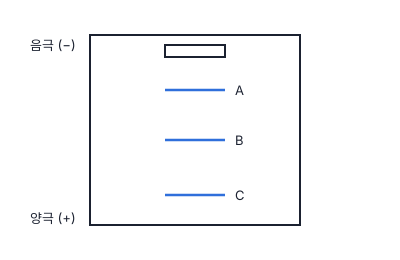

# 생명과학 복습 1013 문제설명

왼쪽 목차로 문항을 고르고, 오른쪽 문제를 보며 해설을 따라가요.

문제의 첫 줄부터 검산까지 설명해요.

**목차**

- [문항별 설명](#problems)
  - [P1. GMO의 환경 영향](#p1)
  - [P2. STR 반복수와 개인 차이](#p2)
  - [P3. DNA 지문감식의 활용](#p3)
  - [P4. PCR의 주된 용도](#p4)
  - [P5. 식물의 성질 개선](#p5)
  - [P6. PCR 30주기 계산](#p6)
  - [P7. DNA 클로닝의 도구](#p7)
  - [P8. 돌리의 핵치환](#p8)
  - [P9. PCR에서 필요하지 않은 효소](#p9)
  - [P10. 내성 잡초와 제초제](#p10)
  - [P11. DNA 지문의 비교 기준](#p11)
  - [P12. 유전자 치료의 경계](#p12)
  - [P13. STR 감식에 필요 없는 과정](#p13)
  - [P14. DNA 이동의 원인](#p14)
  - [P15. 절편을 분리하는 방법](#p15)
  - [P16. 친자확인과 대립유전자 상속](#p16)
  - [P17. 식물 유전공학의 목표와 위험](#p17)
  - [P18. 겔의 분리와 검출](#p18)
  - [P19. 체세포와 세대 전달](#p19)
  - [P20. PCR로 고대 DNA 읽기](#p20)
  - [P21. PCR의 효소 조건](#p21)
  - [P22. DNA 지문의 표지](#p22)
  - [P23. STR 서열과 반복수](#p23)
  - [P24. ADA 유전자 치료](#p24)
  - [P25. 정상 유전자 기능의 보완](#p25)
  - [P26. [변형] PCR 준비물 판별](#p26)
  - [P27. [변형] 초기량을 고려한 PCR 증폭량](#p27)
  - [P28. [변형] RNA 검출과 대조군](#p28)
  - [P29. [변형] 밴드 거리 읽기](#p29)
  - [P30. [변형] 반복 횟수에서 분리 순서까지](#p30)
  - [P31. [변형] 한 좌위의 한계](#p31)
  - [P32. [변형] 생산과 치료 구별](#p32)
  - [P33. [변형] 세대 전달 판별](#p33)
  - [P34. [변형] 세 제공자 구별](#p34)
  - [P35. [변형] 작물 개량의 목적](#p35)
  - [P36. [변형] 빛으로 발현 확인](#p36)
  - [P37. [변형] 내성 선택과 관리](#p37)

## 문항별 설명

### P1. GMO의 환경 영향

기출 6강 3 · [원 문제 보기](../%EB%B3%B5%EC%8A%B5%EB%AC%B8%EC%A0%9C_1013_PCR_and_DNA_Technology.html#p1)

유전자변형생물(GMO) 식품의 유해한 환경 효과로 올바른 것은?

- (1) 유전학적으로 변형된 유전자가 다른 잡초로 퍼져 나간다
- (2) 모두 옳다
- (3) GMO 작물의 유전적 다양성이 감소한다
- (4) GMO 작물이 제초제 저항성을 보이면 제초제의 사용이 증가한다
- (5) 그 작물을 먹이로 하는 다른 생물종에게 역효과를 줄 수 있다

기출 원문 보기

기출 6강 합본 3번 (PDF 1쪽)

#### 문제에서 무엇을 묻는지 읽어요

GMO를 재배하거나 먹이망에 넣었을 때 생길 수 있는 환경 우려를 모두 찾는 문제예요. “모두 옳다”는 나머지 네 진술이 출제 의도에 맞는지 확인한 뒤 골라요.

#### 이 문제를 봤을 때 떠올릴 개념과 공식

“환경 효과”에서 유전자변형생물(genetically modified organism, GMO)의 안전성 평가를 떠올려요. 도입 유전자는 생물의 성질을 바꾸지만 실제 영향은 형질·교배 가능성·재배 방식·주변 환경에 따라 달라요.

유전자 유출(gene flow)은 교배 가능한 야생종으로 도입 유전자가 전달되는 것이고, 비표적 영향은 목표 해충 이외 생물에 생기는 영향이에요. 같은 품종에 집중하는 재배에서는 품종 다양성이 줄 수도 있어요. 그러므로 모든 GMO에 필연적으로 생기는 결과와 가능한 위험을 구별하며 보기를 읽어요.

#### 종이에 적는 실제 첫 줄

각 보기에서 환경 위험이 가능한 조건을 하나씩 적는다.

#### 왜 이렇게 푸는지 함께 따라가요

(1) 맞아요. 도입 유전자가 교배 가능한 야생종으로 퍼질 수 있어요.

(2) 맞아요. 나머지 보기는 잠재적 환경 우려를 제시하므로 출제 의도에서 모두 옳아요.

(3) 맞아요. 소수 품종 집중 재배는 작물 다양성을 줄일 수 있어요.

(4) 맞아요. 내성 잡초의 선택으로 제초제 사용량이 늘 수 있어요.

(5) 맞아요. 비표적 생물에 영향을 줄 가능성이 있어요.

따라서 답은 (2)예요.

#### 완성 답과 검산

교재 6장 인쇄 p129(PDF 12쪽)는 잡초로 유전자가 전달되는 위험과 비표적 곤충의 영향을 별도로 설명해요. 이를 작물 품종 집중과 내성 잡초의 선택이라는 나머지 두 위험과 교차 대조하면 네 보기 모두 잠재적 위험이라는 분류에 들어가요. 따라서 묶음 보기 (2)가 답이에요.

#### 여기서 헷갈리기 쉬워요

“모두 옳다”를 골랐다고 모든 GMO가 반드시 다양성을 줄이거나 제초제 사용을 늘린다고 외우지 않아요. 다양성 감소는 수업 밖 보충으로 기출이 제시한 항목의 조건부 해석이에요.

#### 설명을 닫고 다시 확인해요

- 유전자 유출과 비표적 영향을 각각 한 문장으로 설명해요.
- 각 위험에 성립 조건을 하나씩 붙여요.

**페이지 요약**

#### 떠올릴 개념·공식

가능한 위험과 필연 결과 구별

#### 첫 줄

각 보기에서 환경 위험이 가능한 조건을 하나씩 적는다.

#### 답과 검산

답 (2). 각 환경영향의 성립 조건 확인

---

### P2. STR 반복수와 개인 차이

기출 6강 5 · [원 문제 보기](../%EB%B3%B5%EC%8A%B5%EB%AC%B8%EC%A0%9C_1013_PCR_and_DNA_Technology.html#p2)

사람들마다 DNA 지문이 다른 이유는 무엇인가?

- (1) 사람마다 다른 개수의 DNA 세트를 갖고 있기 때문에
- (2) 같은 유전자 좌위에서 개체들마다 STR 의 반복수가 서로 다르기 때문에
- (3) PCR 이 다른 염기서열보다 특정 염기서열을 더 많이 증폭시키기 때문에
- (4) 특정 염기서열과 가까우면, STR을 제한효소가 자르지 못하기 때문에

기출 원문 보기

기출 6강 합본 5번 (PDF 1쪽)

#### 문제에서 무엇을 묻는지 읽어요

사람의 DNA 지문이 왜 달라지는지 묻는 원인 문제예요. 증폭 장비가 아니라 비교 대상인 DNA의 차이를 찾아요.

#### 이 문제를 봤을 때 떠올릴 개념과 공식

“사람마다 DNA 지문이 다르다”에서 짧은연속반복서열(short tandem repeat, STR)을 떠올려요. STR은 짧은 염기 단위가 나란히 반복되는 부위이며, 유전자 좌위(locus)는 그 부위의 염색체상 자리예요.

같은 좌위에서 반복수가 다르면 양옆의 같은 프라이머로 증폭해도 산물 길이가 달라져요. 길이는 겔 전기영동의 이동 차이로 읽어요. 여러 좌위를 조사하는 표준 분석에서 이 차이가 개인 식별의 근거이므로 장비의 증폭량보다 반복수에 주목해요.

#### 종이에 적는 실제 첫 줄

같은 STR 좌위의 반복수 차이가 증폭 산물의 길이 차이를 만든다.

#### 왜 이렇게 푸는지 함께 따라가요

(1) 틀려요. 일반적으로 사람 체세포의 DNA 세트 수는 같아요.

(2) 맞아요. 같은 좌위의 STR 반복수가 개인마다 달라요.

(3) 틀려요. 증폭량보다 STR 길이 차이가 지문 차이의 근거예요.

(4) 틀려요. STR 반복수 차이를 설명하지 못해요.

따라서 답은 (2)예요.

#### 완성 답과 검산

교재 6장 인쇄 p124(PDF 7쪽)의 그림 6.6을 역으로 읽어요. A는 11/11, B는 15/9, C는 11/9이며 모두 동일한 두 상동염색체의 대립유전자를 비교해요. DNA 세트 수가 같아도 밴드 조합이 달라지므로 (1)을 배제하고 반복수 차이인 (2)를 확인할 수 있어요.

#### 여기서 헷갈리기 쉬워요

PCR이 원래 존재하지 않던 개인 차이를 만들어 내는 것은 아니에요. PCR은 원래 있던 STR을 늘려 분석하기 쉽게 해요.

#### 설명을 닫고 다시 확인해요

- 반복 단위와 반복 횟수를 구별해요.
- 9회 반복과 15회 반복 중 어떤 산물이 더 짧은지 말해요.

**페이지 요약**

#### 떠올릴 개념·공식

STR 반복수 차이로 산물 길이 차이

#### 첫 줄

같은 STR 좌위의 반복수 차이가 증폭 산물의 길이 차이를 만든다.

#### 답과 검산

답 (2). 교재 STR 그림의 11/11·15/9·11/9 대조

---

### P3. DNA 지문감식의 활용

기출 6강 6 · [원 문제 보기](../%EB%B3%B5%EC%8A%B5%EB%AC%B8%EC%A0%9C_1013_PCR_and_DNA_Technology.html#p3)

DNA 지문감식에 대한 설명으로 잘못된 것은?

- (1) 짧은연속반복서열(STR)의 분석을 통해 개개인을 구별할 수 있다
- (2) DNA 지문감식은 사람 뿐만 아니라 동식물, 미생물에도 사용할 수 있다
- (3) DNA 지문감식으로 일란성 쌍둥이는 구분하기 어렵다
- (4) 법의학적으로 DNA 지문감식은 아직 법적 증거로서의 효력이 없다
- (5) DNA 지문감식은 친자확인에 사용할 수 있다

기출 원문 보기

기출 6강 합본 6번 (PDF 1쪽)

#### 문제에서 무엇을 묻는지 읽어요

DNA 지문감식의 기능과 한계를 비교해요. **잘못된 설명 하나를 고르는 부정형**이에요.

#### 이 문제를 봤을 때 떠올릴 개념과 공식

“지문감식”에서 DNA 프로파일링(DNA profiling)을 떠올려요. 같은 종의 개체마다 다르게 조합된 유전적 표지를 여러 좌위에서 분석하여 식별하거나 부모-자식의 상속을 비교하는 기술이에요.

일란성 쌍둥이는 수정란을 공유하므로 표준 STR 패턴이 대체로 같아요. 반면 DNA 분석은 적절한 절차와 충분한 좌위를 갖추면 법의학적 자료가 될 수 있어요. 이 두 경계를 기준으로 틀린 일반화를 찾아요.

#### 종이에 적는 실제 첫 줄

DNA 감식은 여러 좌위를 이용하며 친자확인과 법의학적 식별에 쓰인다.

#### 왜 이렇게 푸는지 함께 따라가요

(1) 맞아요. STR 여러 좌위로 개인을 식별할 수 있어요.

(2) 맞아요. 사람 이외 종에서도 유전적 차이를 분석할 수 있어요.

(3) 맞아요. 일란성 쌍둥이는 표준 STR 지문이 대체로 같아요.

(4) 틀려요. 충분한 좌위와 적절한 절차를 갖춘 DNA 분석은 법적 증거로 사용돼요.

(5) 맞아요. 부모와 자식의 대립유전자 공유를 비교할 수 있어요.

틀려요로 판정된 보기 (4)가 이 부정형 문제의 답이에요.

#### 완성 답과 검산

강의노트 6장 p2–3의 두 항목을 서로 교차 확인해요. 일란성 쌍둥이 예외와 종·개체 식별은 p2, 충분한 좌위가 법정 증거가 될 수 있다는 설명은 p3에 있어요. 네 진술은 이 기능·한계와 부합하고 (4)의 효력 전면 부정만 반대이므로 답은 (4)예요.

#### 여기서 헷갈리기 쉬워요

일란성 쌍둥이를 쉽게 구별하지 못한다는 한계를 기술 전체가 증거로 쓰이지 못한다는 결론으로 확대하지 않아요.

#### 설명을 닫고 다시 확인해요

- 일란성 쌍둥이 예외를 설명해요.
- 틀린 문장을 올바른 법의학적 용도로 고쳐 말해요.

**페이지 요약**

#### 떠올릴 개념·공식

STR 식별의 활용과 일란성 예외

#### 첫 줄

DNA 감식은 여러 좌위를 이용하며 친자확인과 법의학적 식별에 쓰인다.

#### 답과 검산

답 (4). 강의노트의 법정증거·쌍둥이 예외 대조

---

### P4. PCR의 주된 용도

기출 6강 7 · [원 문제 보기](../%EB%B3%B5%EC%8A%B5%EB%AC%B8%EC%A0%9C_1013_PCR_and_DNA_Technology.html#p4)

중합효소연쇄반응(PCR)은 주로 언제 사용되는가?

- (1) DNA를 작은 조각으로 자를 때
- (2) 재조합 DNA를 삽입할 때
- (3) 특정 염기서열이 있는 DNA를 자르는 제한효소를 이용해야 할 때
- (4) 적은 양의 DNA를 많이 증폭시킬 때
- (5) 사람 손의 지문을 분석할 때

기출 원문 보기

기출 6강 합본 7번 (PDF 1쪽)

#### 문제에서 무엇을 묻는지 읽어요

PCR이 가장 직접적으로 하는 일을 묻고 있어요. “자른다”, “삽입한다”, “증폭한다”라는 동사를 먼저 구별해요.

#### 이 문제를 봤을 때 떠올릴 개념과 공식

“PCR의 주된 용도”에서 중합효소연쇄반응(polymerase chain reaction)을 떠올려요. 특정 프라이머가 양끝에 결합한 주형 DNA를 중합효소가 복사하고, 이를 반복하여 특정 구간의 사본 수를 늘리는 기술이에요.

시험관에서 주형·프라이머·dNTP·내열성 중합효소를 사용하는 조건에서는 세균을 배양할 필요가 없어요. 제한효소에 의한 절단이나 벡터 삽입과는 목적이 다르므로 “증폭”이라는 결과에 맞는 보기를 골라요.

#### 종이에 적는 실제 첫 줄

PCR의 핵심 결과는 적은 표적 DNA의 사본 수 증가다.

#### 왜 이렇게 푸는지 함께 따라가요

(1) 틀려요. DNA 절단은 제한효소 기능이에요.

(2) 틀려요. DNA 삽입은 재조합·벡터 도입 단계예요.

(3) 틀려요. PCR은 제한효소 절단 기술이 아니에요.

(4) 맞아요. PCR은 소량의 특정 DNA를 증폭해요.

(5) 틀려요. 손가락 무늬와 DNA 지문은 달라요.

따라서 답은 (4)예요.

#### 완성 답과 검산

교재 6장 인쇄 p122(PDF 5쪽)의 PCR 목적은 표적 DNA의 대량 증폭이에요. 보기의 동사를 각각 절단·삽입·절단·증폭·손가락무늬 분석으로 분류하면 목적이 일치하는 동사는 하나만 남아요. 답은 (4)예요.

#### 여기서 헷갈리기 쉬워요

DNA 지문 분석에 PCR을 쓴다는 사실과 손가락의 피부 무늬를 PCR로 읽는다는 진술을 혼동하지 않아요.

#### 설명을 닫고 다시 확인해요

- PCR의 결과를 한 문장으로 적어요.
- 절단·삽입·증폭 중 PCR에 해당하는 동사를 골라요.

**페이지 요약**

#### 떠올릴 개념·공식

PCR은 표적 DNA의 시험관 증폭

#### 첫 줄

PCR의 핵심 결과는 적은 표적 DNA의 사본 수 증가다.

#### 답과 검산

답 (4). 다섯 동사를 기술 목적별로 분류

---

### P5. 식물의 성질 개선

기출 6강 8 · [원 문제 보기](../%EB%B3%B5%EC%8A%B5%EB%AC%B8%EC%A0%9C_1013_PCR_and_DNA_Technology.html#p5)

유전적으로 조작된 식품에 대한 설명으로 옳은 것은?

- (1) 모두 맞다
- (2) 의학적으로 유용한 물질을 생산하는 식물을 만들 수 있다
- (3) 식물에 제초제 저항성을 증가시킬 수 있다
- (4) 농작물의 특정 영양분을 향상시킬 수 있다
- (5) 바이러스 내성을 가진 농작물을 만들 수 있다

기출 원문 보기

기출 6강 합본 8번 (PDF 1쪽)

#### 문제에서 무엇을 묻는지 읽어요

식물의 유전자를 바꾸어 만들 수 있는 성질을 확인해요. “모두 맞다”는 네 성질을 따로 검토한 뒤 판단해요.

#### 이 문제를 봤을 때 떠올릴 개념과 공식

“유전적으로 조작된 식품”에서는 그 원료가 되는 형질전환 식물(transgenic plant)을 떠올려요. 도입된 유전자가 식물에서 적절히 발현되면 효소·단백질 생산이나 저항성·영양 성분이 달라질 수 있어요.

제초제 내성은 제초제에 살아남는 성질, 질병 저항성은 감염 피해를 줄이는 성질이에요. 식물을 단백질 생산 공장으로 쓰거나 영양분을 개선하는 것도 별개 목적이에요. 특정 작물 하나가 네 형질을 모두 지닌다는 뜻이 아니라 기술로 가능한 목적들을 묻기 때문에 각각의 가능성을 확인해요.

#### 종이에 적는 실제 첫 줄

각 성질을 의약품 생산·제초제 내성·영양 개선·바이러스 저항성으로 분류한다.

#### 왜 이렇게 푸는지 함께 따라가요

(1) 맞아요. 나머지 모두 식물 유전공학의 가능한 목표예요.

(2) 맞아요. 식물이 의약품 단백질을 생산하도록 할 수 있어요.

(3) 맞아요. 제초제 내성 유전자를 도입할 수 있어요.

(4) 맞아요. 황금쌀처럼 영양 성분을 개선할 수 있어요.

(5) 맞아요. 질병·바이러스 저항성을 높이도록 만들 수 있어요.

따라서 답은 (1)예요.

#### 완성 답과 검산

교재 6장 인쇄 p127–128(PDF 10–11쪽)의 목적 목록과 사례를 대조해요. 황금쌀은 영양 개선, 글리포세이트 내성 작물은 제초제 내성, 바이러스 저항성 식물과 의약용 식물은 다른 두 목적을 보여요. 네 목적이 모두 포함되므로 종합 답은 (1)이에요.

#### 여기서 헷갈리기 쉬워요

가능한 기술 목표라는 진술을 모든 형질전환 식물의 실제 성질로 바꾸지 않아요. 제초제 내성 작물이 제초제 없이는 살 수 없다는 뜻도 아니에요.

#### 설명을 닫고 다시 확인해요

- 각 보기의 목적을 한 단어로 분류해요.
- 황금쌀이 개선하려는 영양 성분을 말해요.

**페이지 요약**

#### 떠올릴 개념·공식

식물 유전공학의 네 목적

#### 첫 줄

각 성질을 의약품 생산·제초제 내성·영양 개선·바이러스 저항성으로 분류한다.

#### 답과 검산

답 (1). 교재 식물 유전공학의 목적 목록 대조

---

### P6. PCR 30주기 계산

기출 6강 9 · [원 문제 보기](../%EB%B3%B5%EC%8A%B5%EB%AC%B8%EC%A0%9C_1013_PCR_and_DNA_Technology.html#p6)

정상적인 중합효소연쇄 반응을 30회 수행하면 몇 배로 증폭된 DNA 분자 수를 얻을 수 있는가?

- (1) 2배
- (2) 320배
- (3) 60배
- (4) 230배
- (5) 30배

기출 원문 보기

기출 6강 합본 9번 (PDF 2쪽)

#### 문제에서 무엇을 묻는지 읽어요

이상적인 PCR을 30번 반복했을 때 처음보다 몇 배가 되는지 계산해요. 초기 분자 수가 아니라 증폭 배수를 묻고 있어요.

#### 이 문제를 봤을 때 떠올릴 개념과 공식

“30회 수행”에서 매 주기 두 배라는 PCR 증폭 원리를 떠올려요. 초기 분자 수를 $N_0$, 주기 수를 $n$, 최종 분자 수를 $N_n$으로 쓰면 $N_n=N_0 2^n$이에요.

매 주기 모든 분자가 같은 효율로 복제된다는 이상적 조건에서 배수는 $N_n/N_0=2^n$이에요. 그래서 초기량을 몰라도 주기 수만으로 배수를 구할 수 있어요. 실제 효율 저하를 이 문제의 정상적인 이상 모델에 임의로 추가하지 않아요.

#### 종이에 적는 실제 첫 줄

$N_{30}/N_0=2^{30}$.

#### 왜 이렇게 푸는지 함께 따라가요

(1) 틀려요. 2배는 1주기의 결과예요.

(2) 틀려요. PCR은 3배씩 증가하지 않아요.

(3) 틀려요. 증폭은 2×30의 선형 증가가 아니에요.

(4) 맞아요. 이상적인 PCR은 매 주기 두 배여서 30주기 후 $2^{30}$배예요.

(5) 틀려요. 30배가 아니라 $2^{30}$배예요.

따라서 답은 (4)예요.

#### 완성 답과 검산

순서대로 거듭제곱을 대입하는 풀이와 달리 주기를 세 묶음으로 나눠 검산해요. 10주기 배수 $2^{10}=1024$를 세 번 곱하면 $1024^3=1,073,741,824=2^{30}$이에요. 교재 인쇄 p122(PDF 5쪽)의 1·2·3주기 2·4·8분자 패턴도 이 배수 규칙과 맞으므로 답은 (4)예요.

#### 여기서 헷갈리기 쉬워요

$2\times30$은 한 주기마다 같은 양을 더하는 선형 증가예요. PCR의 두 배 반복은 이전 주기의 모든 분자가 다시 복제되는 기하 증가예요.

#### 설명을 닫고 다시 확인해요

- 1·2·3주기의 배수를 써요.
- 분자 수와 처음 대비 배수의 차이를 설명해요.

**페이지 요약**

#### 떠올릴 개념·공식

이상적 증폭 배수 $2^n$

#### 첫 줄

$N_{30}/N_0=2^{30}$.

#### 답과 검산

답 (4). $1024^3=2^{30}$으로 다시 확인

---

### P7. DNA 클로닝의 도구

기출 6강 12 · [원 문제 보기](../%EB%B3%B5%EC%8A%B5%EB%AC%B8%EC%A0%9C_1013_PCR_and_DNA_Technology.html#p7)

제한효소, 연결효소, 플라스미드, 바이러스 벡터, 효모 벡터, 전기영동 젤, 항생제 내성 유전자 등은 다음 중 어떤 실험에 필요한가?

- (1) DNA 클로닝
- (2) 2디옥시리보뉴클레오타이드 분석
- (3) DNA 염기서열결정
- (4) PCR
- (5) DNA 지문감식

기출 원문 보기

기출 6강 합본 12번 (PDF 2쪽)

#### 문제에서 무엇을 묻는지 읽어요

절단·연결·운반·선별·분리 도구들을 함께 사용하는 실험이 무엇인지 묻고 있어요. 한 가지 도구만 보고 결정하지 않아요.

#### 이 문제를 봤을 때 떠올릴 개념과 공식

“제한효소·연결효소·벡터·항생제 내성”의 조합에서 DNA 클로닝(DNA cloning)을 떠올려요. 특정 DNA를 벡터에 연결하고 숙주에 넣어 숙주와 함께 복제시켜 많은 사본을 얻는 방법이에요.

제한효소는 DNA를 자르고 연결효소는 DNA 골격을 연결해요. 벡터(vector)는 외부 DNA를 운반하며 항생제 내성 표지는 벡터를 받은 세균의 선별을 돕고 겔은 절편을 확인해요. 이 과정 전체를 포괄하는 선택지를 찾는 이유는 PCR·지문감식과 일부 도구가 겹칠 수 있기 때문이에요.

#### 종이에 적는 실제 첫 줄

제한효소로 절단하고 연결효소로 벡터에 연결한 뒤 숙주에 도입한다.

#### 왜 이렇게 푸는지 함께 따라가요

(1) 맞아요. DNA 클로닝은 DNA 절단·연결·벡터 도입·선별과 절편 확인을 이용해요.

(2) 틀려요. 제시된 도구 전체가 이 분석을 특정하지 않아요.

(3) 틀려요. 염기서열 결정과 클로닝을 구별해요.

(4) 틀려요. PCR은 벡터·항생제 선별 없이 시험관에서 수행해요.

(5) 틀려요. STR 감식은 세균 클로닝을 요구하지 않아요.

따라서 답은 (1)예요.

#### 완성 답과 검산

PCR의 필수 목록과 대조하는 소거법을 사용해요. 강의노트 6장 p1–2에서 PCR은 주형·프라이머·내열성 중합효소로 설명되고 항생제 선별·숙주 배양이 없어요. 반면 p1의 플라스미드 클로닝과 1013 복습 설명은 DNA 절단·연결·숙주 도입을 연결해요. 벡터와 선별 표지가 있는 전체 묶음에 맞는 답은 (1)이에요.

#### 여기서 헷갈리기 쉬워요

겔 전기영동 하나만 보고 DNA 지문감식으로 고르지 않아요. 모든 벡터 종류가 하나의 실험에서 동시에 필수라는 뜻도 아니며 제시된 묶음이 어느 기술군에 속하는지 묻는 문항이에요.

#### 설명을 닫고 다시 확인해요

- 각 도구에 절단·연결·운반·선별·확인 중 역할을 붙여요.
- 숙주가 필요한 클로닝과 시험관 PCR을 구별해요.

**페이지 요약**

#### 떠올릴 개념·공식

벡터 운반·숙주 선별을 포함하는 DNA 클로닝

#### 첫 줄

제한효소로 절단하고 연결효소로 벡터에 연결한 뒤 숙주에 도입한다.

#### 답과 검산

답 (1). PCR 목록과 벡터·선별 도구 대조

---

### P8. 돌리의 핵치환

기출 6강 13 · [원 문제 보기](../%EB%B3%B5%EC%8A%B5%EB%AC%B8%EC%A0%9C_1013_PCR_and_DNA_Technology.html#p8)

복제양 돌리는 생식세포 클로닝의 한 예이다. 다음 중 이 실험을 수행하는 데 필요한 것은?

- (1) 젖샘세포의 2배체 세포를 핵이 제거된 미수정란과 융합
- (2) 자궁세포를 젖샘에 이식
- (3) 한 종의 미수정란을 다른 종의 미수정란과 융합
- (4) 2배체 배아세포를 반수체 성체세포와 융합
- (5) 다른 종으로부터 유래된 두 젖샘세포의 융합

기출 원문 보기

기출 6강 합본 13번 (PDF 2쪽)

#### 문제에서 무엇을 묻는지 읽어요

복제양 돌리를 만드는 데 어떤 세포 조합이 사용됐는지 묻고 있어요. **문항 결함:** 원문의 “생식세포 클로닝”은 용어 오류이며, 돌리는 체세포 핵치환 복제의 예예요. 원문 문장은 보존하고 실제 제작 절차로 판단해요.

#### 이 문제를 봤을 때 떠올릴 개념과 공식

“돌리”에서 체세포 핵치환(somatic cell nuclear transfer)을 떠올려요. 난자의 핵을 제거하고 이미 분화한 체세포에서 온 2배체 핵을 넣어 배아로 발달시키는 방식이에요.

핵 제공 세포는 젖샘 체세포이며 난자는 세포질과 발달 환경을 제공해요. 핵 DNA는 체세포 제공자와, 미토콘드리아 DNA는 난자 제공자와 연결돼요. 따라서 체세포의 핵과 핵 제거 난자를 결합하는 선택지를 찾아요.

#### 종이에 적는 실제 첫 줄

젖샘 체세포의 2배체 핵을 핵이 제거된 미수정란에 넣는다.

#### 왜 이렇게 푸는지 함께 따라가요

(1) 맞아요. 돌리는 젖샘 체세포의 핵을 핵 제거 난자에 넣어 만들었어요.

(2) 틀려요. 자궁세포의 젖샘 이식은 핵치환이 아니에요.

(3) 틀려요. 다른 종 난자의 융합은 돌리 과정이 아니에요.

(4) 틀려요. 성체 체세포는 일반적으로 2배체이고 이 과정도 달라요.

(5) 틀려요. 두 젖샘세포 융합은 핵 제거 난자를 사용하지 않아요.

따라서 답은 (1)예요.

#### 완성 답과 검산

교재 6장 인쇄 p127(PDF 10쪽)의 돌리 제작 설명은 젖샘의 2배체 세포와 핵을 제거한 미수정란의 융합을 명시해요. 두 재료를 하나씩 대조하면 자궁세포, 다른 종 난자, 반수체 성체세포, 두 젖샘세포를 쓰는 선택지는 필요한 난자-핵 관계를 만족하지 않아요. 따라서 답은 (1)이에요.

#### 여기서 헷갈리기 쉬워요

난자를 사용한다고 생식세포의 핵을 복제하는 것은 아니에요. 시험에서 원문의 잘못된 용어를 만나면 돌리의 실제 핵 제공 세포를 기준으로 (1)을 고르고 정확한 용어는 체세포 핵치환이라고 구별해요.

#### 설명을 닫고 다시 확인해요

- 핵 제공자와 난자 제공자의 역할을 따로 적어요.
- 핵 DNA와 미토콘드리아 DNA의 유래를 말해요.

**페이지 요약**

#### 떠올릴 개념·공식

체세포 핵치환: 젖샘 핵과 핵 제거 난자

#### 첫 줄

젖샘 체세포의 2배체 핵을 핵이 제거된 미수정란에 넣는다.

#### 답과 검산

답 (1). 교재의 두 세포 재료를 하나씩 대조

---

### P9. PCR에서 필요하지 않은 효소

기출 6강 14 · [원 문제 보기](../%EB%B3%B5%EC%8A%B5%EB%AC%B8%EC%A0%9C_1013_PCR_and_DNA_Technology.html#p9)

중합효소연쇄반응(PCR)의 혼합물에 필요한 주요 요소가 아닌 것은?

- (1) DNA를 분리시키기 위한 헬리케이스
- (2) 고온내성의 DNA 중합효소(Taq 중합효소)
- (3) 증폭시킬 표적서열이 포함된 DNA
- (4) 4종의 뉴클레오사이드 3인산 전구체
- (5) 표적서열의 양 끝단에 각각 상보적인 프라이머

기출 원문 보기

기출 6강 합본 14번 (PDF 2쪽)

#### 문제에서 무엇을 묻는지 읽어요

PCR 반응액에 넣지 않아도 되는 요소를 골라요. **필요한 요소가 아닌 것을 고르는 부정형**이에요.

#### 이 문제를 봤을 때 떠올릴 개념과 공식

“DNA를 분리시키기 위한 헬리케이스”에서 세포 내부 복제와 시험관 PCR의 차이를 떠올려요. 헬리케이스(helicase)는 이중가닥을 여는 효소지만 PCR은 고온 변성으로 가닥을 분리해요.

프라이머(primer)는 중합효소가 연장을 시작할 짧은 DNA이며, dNTP는 새 DNA 가닥을 만들 네 종류 재료예요. 주형 DNA와 고온내성 Taq도 필요해요. 열이 가닥 분리를 대신한다는 조건 때문에 헬리케이스를 필수 반응 성분에서 제외해요.

#### 종이에 적는 실제 첫 줄

PCR은 열로 두 가닥을 분리하므로 헬리케이스를 넣지 않는다.

#### 왜 이렇게 푸는지 함께 따라가요

(1) 틀려요. PCR은 가열로 가닥을 분리하여 헬리케이스가 필요하지 않아요.

(2) 맞아요. 고온 변성을 견디는 Taq가 필요해요.

(3) 맞아요. 복제할 표적을 포함한 주형 DNA가 필요해요.

(4) 맞아요. DNA 합성 재료인 네 종류 dNTP가 필요해요.

(5) 맞아요. 표적 양끝을 정하는 상보적인 프라이머가 필요해요.

틀려요로 판정된 보기 (1)가 이 부정형 문제의 답이에요.

#### 완성 답과 검산

교재 6장 인쇄 p122(PDF 5쪽)의 네 가지 반응 요소 목록을 반대로 찾아요. 표적 DNA, 두 프라이머, 네 종류 dNTP, 중합효소는 목록에 있고 헬리케이스는 없어요. 그림의 첫 단계도 효소 투입이 아닌 가열 변성이므로 필요하지 않은 답은 (1)이에요.

#### 여기서 헷갈리기 쉬워요

세포 안의 복제에 쓰이는 효소를 PCR에도 전부 추가해야 한다고 생각하지 않아요. 부정형의 답 (1)은 “헬리케이스가 PCR 필수다”라는 진술이 틀리다는 뜻이에요.

#### 설명을 닫고 다시 확인해요

- PCR의 네 가지 준비물을 말해요.
- 세포의 헬리케이스 역할을 PCR에서 무엇이 대신하는지 적어요.

**페이지 요약**

#### 떠올릴 개념·공식

가열 변성이 헬리케이스를 대신함

#### 첫 줄

PCR은 열로 두 가닥을 분리하므로 헬리케이스를 넣지 않는다.

#### 답과 검산

답 (1). 교재의 네 필수요소와 가열 단계 대조

---

### P10. 내성 잡초와 제초제

기출 6강 15 · [원 문제 보기](../%EB%B3%B5%EC%8A%B5%EB%AC%B8%EC%A0%9C_1013_PCR_and_DNA_Technology.html#p10)

제초제에 저항성이 있도록 변형된 식물을 키우던 중 제초제 사용량이 더 많아졌다면 이 원인으로 가장 적절한 것은?

- (1) 제초제 내성 유전자를 세균으로부터 얻었기 때문에
- (2) 변형된 식물이 비슷한 종의 야생 식물과는 교배가 일어날 수 없기 때문에
- (3) 변형된 식물의 수명이 짧아져서
- (4) 제초제가 있어야만 변형된 식물이 살 수 있기 때문에
- (5) 제초제에 내성을 지닌 돌연변이 잡초가 자연선택 되어 주위에 자라나기 때문에

기출 원문 보기

기출 6강 합본 15번 (PDF 2쪽)

#### 문제에서 무엇을 묻는지 읽어요

제초제 내성 작물을 재배했는데 제초제 사용량이 증가한 원인을 찾고 있어요. 작물의 내성과 잡초의 내성을 분리해 생각해요.

#### 이 문제를 봤을 때 떠올릴 개념과 공식

“사용량이 더 많아졌다”와 “돌연변이 잡초”에서 자연선택(natural selection)을 떠올려요. 같은 처리 환경에서 잘 살아남는 유전적 변이가 번식하여 집단에서 비중이 커지는 과정이에요.

제초제가 필요해서 맞춤 돌연변이를 만드는 것이 아니라 우연히 존재하거나 새로 생긴 내성 변이가 살포 후 선택될 수 있어요. 내성 잡초가 늘면 이전 살포량이 잘 듣지 않기 때문에 사용량을 늘리려는 압력이 생겨요. 이 연결을 설명하는 선택지가 원인에 해당해요.

#### 종이에 적는 실제 첫 줄

제초제에 살아남는 내성 잡초가 선택되어 늘면 같은 살포량의 효과가 줄어든다.

#### 왜 이렇게 푸는지 함께 따라가요

(1) 틀려요. 유전자 출처 자체가 사용량 증가 원인은 아니에요.

(2) 틀려요. 교배 불가능성은 내성 잡초 선택을 설명하지 않아요.

(3) 틀려요. 작물 수명과 직접 관련되지 않아요.

(4) 틀려요. 내성은 제초제가 있어야 살 수 있다는 뜻이 아니에요.

(5) 맞아요. 내성 잡초가 살아남아 늘면 같은 살포량의 효과가 감소해요.

따라서 답은 (5)예요.

#### 완성 답과 검산

반대 상황을 세워 확인해요. 주변 잡초가 계속 민감하다면 같은 제초제는 그 잡초를 제거하므로 작물이 내성을 얻었다는 사실만으로 사용량 증가를 설명할 수 없어요. 반대로 잡초 내성이 늘면 사용량 증가 동기가 생겨요. 정리노트 s5-gmo의 돌연변이와 선택 설명에 맞는 원인은 (5)이에요.

#### 여기서 헷갈리기 쉬워요

유전자 제공자가 세균이라는 사실을 내성 잡초의 선택이라는 직접 원인과 혼동하지 않아요. 또 내성은 약을 견딘다는 뜻이지 약이 있어야만 생존한다는 뜻이 아니에요.

#### 설명을 닫고 다시 확인해요

- 작물과 잡초 중 어느 집단의 내성이 증가하는지 적어요.
- 돌연변이 발생과 자연선택의 순서를 설명해요.

**페이지 요약**

#### 떠올릴 개념·공식

내성 잡초의 생존과 자연선택

#### 첫 줄

제초제에 살아남는 내성 잡초가 선택되어 늘면 같은 살포량의 효과가 줄어든다.

#### 답과 검산

답 (5). 잡초가 민감한 반대 상황과 비교

---

### P11. DNA 지문의 비교 기준

기출 6강 16 · [원 문제 보기](../%EB%B3%B5%EC%8A%B5%EB%AC%B8%EC%A0%9C_1013_PCR_and_DNA_Technology.html#p11)

DNA 지문감식은 _______________.

- (1) 같은 DNA의 한쪽 가닥을 사람들 간에 비교한다
- (2) 여러 곳에서 반복적으로 나타나는 비암호화 DNA의 길이가 서로 다른 점을 이용하여 사람들 간에 비교한다
- (3) 젤 상에서 제일 먼 곳까지 이동시키려면 길이가 가장 긴 DNA가 필요하다
- (4) 일란성 쌍둥이 간의 DNA 차이도 쉽게 구분할 수 있다
- (5) 젤에서 분리한 후 증폭과정이 필요하다

기출 원문 보기

기출 6강 합본 16번 (PDF 2쪽)

#### 문제를 내 말로 읽어요

DNA 지문감식이 무엇을 비교하고 어떤 순서로 수행되는지 가장 알맞게 설명한 보기를 찾아요.

#### 이 문제를 봤을 때 떠올릴 개념과 공식

“DNA 지문감식”이라는 단서에서 STR(Short Tandem Repeat, 짧은 직렬 반복 서열)의 길이 비교를 떠올려요. 손가락 표면 무늬를 비교하는 기술이 아니에요.

같은 STR 좌위에서 짧은 단위가 반복되는 횟수가 다르면 PCR 산물의 길이가 달라져요. 비암호화 영역의 여러 좌위를 증폭한 뒤 겔 전기영동으로 분리하여 개인의 길이 패턴을 비교해요.

같은 조건에서 짧은 DNA가 멀리 이동하며, 표준 STR 분석에서는 일란성 쌍둥이를 구별하기 어려워요. 이 조건을 이용해 길이·순서·예외를 설명하는 보기를 고를 수 있어요.

#### 종이에 쓰는 첫 줄

비교 대상: 여러 STR 좌위의 DNA 길이. 순서: PCR 증폭, 겔 분리, 패턴 비교.

#### 왜 이렇게 푸는지 함께 따라가요

(1) 틀려요. 단일가닥이라는 상태가 개인 구별의 핵심이 아니라 여러 STR 좌위의 반복 수에 따른 길이 패턴이 핵심이에요.

(2) 맞아요. 여러 비암호화 STR 영역에서 PCR 산물의 길이가 다른 점을 비교하는 원리와 일치해요.

(3) 틀려요. 가장 긴 DNA는 겔 틈을 더 느리게 지나므로 같은 시간에 가장 멀리 가지 않아요.

(4) 틀려요. 일란성 쌍둥이는 표준 STR 패턴이 대체로 같아 쉽게 구별할 수 없어요.

(5) 틀려요. 수업에서 배운 순서는 미량 DNA를 PCR로 증폭한 다음 겔에서 분리하는 순서예요.

따라서 답은 (2)예요.

#### 완성 답과 검산

교재 p124의 그림 6.6을 거꾸로 읽어 확인해요. A는 11/11로 한 띠, B는 9/15로 두 띠, C는 9/11로 두 띠이며 개인별로 길이 패턴이 달라요. 그 앞에 PCR이 있고 뒤에 겔 분리가 있으므로 길이 비교를 말하는 (2)가 남아요.

#### 헷갈리기 쉬운 점

지문이라는 말 때문에 손가락 무늬를 떠올리거나, 가장 긴 DNA가 가장 멀리 간다고 반대로 읽기 쉬워요. 길이 비교와 증폭 후 분리의 순서를 함께 확인해요.

#### 설명을 닫고 다시 해 봐요

- 비교하는 DNA의 특징을 한 문장으로 말해 보세요.
- 긴 절편과 짧은 절편 중 더 멀리 가는 쪽을 설명해 보세요.

**페이지 요약**

#### 떠올릴 개념·공식

STR 반복 수가 PCR 산물 길이 차이로 나타나요.

#### 첫 줄

비교 대상: 여러 STR 좌위의 DNA 길이. 순서: PCR 증폭, 겔 분리, 패턴 비교.

#### 핵심 판단

따라서 답은 (2)예요.

#### 검산

정의와 교재의 실제 과정·조건을 대조해요.

---

### P12. 유전자 치료의 경계

기출 6강 18 · [원 문제 보기](../%EB%B3%B5%EC%8A%B5%EB%AC%B8%EC%A0%9C_1013_PCR_and_DNA_Technology.html#p12)

다음의 설명 중 옳지 않은 것은?

- (1) 동, 식물 유전공학 모두 사회적 우려 속에서 진행되고 있다
- (2) 형질전환 생명체란 유전적으로 조작되어 외부로부터 온 유전정보를 함유하고 있음을 의미한다
- (3) 유전자의 많은 사본을 생산하는 것을 DNA 클로닝(cloning)이라고 한다
- (4) 유전자 조작 식품을 섭취하여 질병을 치료하는 것은 유전자 치료의 예이다
- (5) 중합효소연쇄반응(PCR)을 이용하면 충분한 양의 DNA를 단시간 내에 얻을 수 있다

기출 원문 보기

기출 6강 합본 18번 (PDF 3쪽)

#### 문제를 내 말로 읽어요

유전공학·클로닝·PCR·치료 설명 중 **옳지 않은 것** 하나를 찾아요. 치료받는 환자의 유전자를 실제로 바꾸는지 살펴야 해요.

#### 이 문제를 봤을 때 떠올릴 개념과 공식

“식품을 섭취하여 질병을 치료”라는 단서가 유전자 치료(gene therapy)의 경계를 묻게 해요. 유전자 치료는 환자의 세포에 정상 유전자를 넣거나 질병 유전자의 기능을 조절하여 치료하는 방법이에요.

생산 생물에 유전자를 넣어 의약품을 만드는 일과 환자의 유전자 기능을 바꾸는 일은 조작 대상이 달라요. 환자가 식품이나 단백질을 섭취·투여받았다는 사실만으로 환자 세포 유전자가 바뀌지는 않아요.

나머지 보기는 사회적 우려, 외부 유전정보의 도입, DNA 사본의 생산, 시험관 증폭의 정의와 비교해요. 부정형이므로 그 정의에서 벗어난 진술을 답으로 골라요.

#### 종이에 쓰는 첫 줄

유전자 치료인가? 환자의 세포에 유전자를 도입하거나 유전자 기능을 바꿨는가를 먼저 확인한다.

#### 왜 이렇게 푸는지 함께 따라가요

(1) 맞아요. 동물과 식물 유전공학에는 안전·환경·윤리적 우려를 검토해야 하는 문제가 있어요.

(2) 맞아요. 외부 유전정보를 도입한 형질전환(transgenic) 생명체의 정의와 맞아요.

(3) 맞아요. 특정 유전자의 같은 서열 사본을 많이 확보하는 것을 DNA 클로닝이라고 해요.

(4) 틀려요. 유전자 조작 식품을 섭취하는 것만으로 환자의 유전자를 조작한 유전자 치료가 되지는 않아요.

(5) 맞아요. 적절한 주형과 반응 조건이 갖춰지면 PCR로 DNA를 빠르게 증폭할 수 있어요.

따라서 틀린 진술을 고르는 이 문항의 답은 (4)예요.

#### 완성 답과 검산

교재 p126의 ADA 치료 사례를 대조해요. 정상 ADA 유전자를 환자의 백혈구에 도입하고 그 세포를 다시 주입했어요. 단순 식품 섭취에는 이 환자 세포 유전자 도입 단계가 없으므로 (4)가 정의와 다르다는 점을 독립적으로 확인해요.

#### 헷갈리기 쉬운 점

유전공학으로 만든 것을 먹었다는 말과 환자에게 유전자 치료를 했다는 말을 같게 취급하지 않아요. “옳지 않은 것”이므로 틀린 설명을 선택해요.

#### 설명을 닫고 다시 해 봐요

- 생산자의 유전자 조작과 환자의 유전자 조작을 구분해 보세요.
- 부정형 질문에서 선택해야 하는 판정을 말해 보세요.

**페이지 요약**

#### 떠올릴 개념·공식

유전자 치료의 기준은 환자 세포의 유전자 기능 변경이에요.

#### 첫 줄

유전자 치료인가? 환자의 세포에 유전자를 도입하거나 유전자 기능을 바꿨는가를 먼저 확인한다.

#### 핵심 판단

따라서 틀린 진술을 고르는 이 문항의 답은 (4)예요.

#### 검산

정의와 교재의 실제 과정·조건을 대조해요.

---

### P13. STR 감식에 필요 없는 과정

기출 6강 20 · [원 문제 보기](../%EB%B3%B5%EC%8A%B5%EB%AC%B8%EC%A0%9C_1013_PCR_and_DNA_Technology.html#p13)

다음 중 DNA 지문감식에서 사용되는 과정이 아닌 것은 무엇인가?

- (1) DNA 조각을 분리하기 위해 전류가 사용된다
- (2) DNA를 크기에 따라 여러 가지 조각들로 분리하기 위해 젤 위에 놓는다
- (3) 피, 정액, 모근으로부터 채취한 DNA가 분석에 사용된다
- (4) 지문을 나타내는 부위의 유전자를 세균에 클로닝한다

기출 원문 보기

기출 6강 합본 20번 (PDF 3쪽)

#### 문제를 내 말로 읽어요

시료 채취·증폭·겔 분리로 DNA 지문을 얻는 과정에서 **사용되는 과정이 아닌 것**을 찾아요.

#### 이 문제를 봤을 때 떠올릴 개념과 공식

“DNA 지문감식”과 “과정”이라는 단서에서 세포를 배양하는 DNA 클로닝과 시험관 PCR을 구별해요. PCR(polymerase chain reaction)은 주형 DNA의 특정 구간을 세포 밖에서 증폭해요.

통상적인 STR 감식에서는 혈액·정액·모근처럼 DNA를 얻을 수 있는 시료에서 추출하고, 여러 좌위를 PCR한 뒤 전기영동으로 길이 패턴을 읽어요.

세균 클로닝은 벡터를 세균에 넣고 증식시켜 DNA를 확보하는 별도 방법이에요. 수업의 STR 감식에 그 숙주 배양 단계가 필요한지 확인하면 제외할 보기를 고를 수 있어요.

#### 종이에 쓰는 첫 줄

수업의 감식 경로: DNA 추출, STR의 PCR 증폭, 겔 전기영동, 길이 패턴 비교.

#### 왜 이렇게 푸는지 함께 따라가요

(1) 맞아요. 전기영동에서 전기장이 음전하 DNA를 이동시켜 절편을 분리해요.

(2) 맞아요. DNA를 겔에 넣으면 길이에 따른 이동 차이를 이용해 분리할 수 있어요.

(3) 맞아요. 세포를 포함한 혈액·정액·모근 시료는 분석할 DNA의 공급원이 될 수 있어요.

(4) 틀려요. 수업의 STR 분석은 시험관 PCR을 이용하며 표지 부위를 세균에 클로닝하는 과정은 필요하지 않아요.

따라서 틀린 진술을 고르는 이 문항의 답은 (4)예요.

#### 완성 답과 검산

교재 p124 그림 6.6의 경로에는 세포에서 DNA 추출, PCR, 겔 분석이 있고 세균 배양 경로가 없어요. 이 도식과 각 보기의 단계를 대응시키면 (1)~(3)은 포함되고 (4)만 수업 경로 밖에 있어요.

#### 헷갈리기 쉬운 점

둘 다 DNA 양을 늘릴 수 있다는 이유로 PCR와 세균 클로닝을 같은 과정으로 부르기 쉬워요. 증폭이 일어나는 위치와 숙주 사용 여부를 확인해요.

#### 설명을 닫고 다시 해 봐요

- PCR가 세포 안에서 수행되는지 말해 보세요.
- 감식 경로를 순서대로 적어 보세요.

**페이지 요약**

#### 떠올릴 개념·공식

STR 감식은 PCR 증폭 후 겔 분리하며 세균 클로닝을 요구하지 않아요.

#### 첫 줄

수업의 감식 경로: DNA 추출, STR의 PCR 증폭, 겔 전기영동, 길이 패턴 비교.

#### 핵심 판단

따라서 틀린 진술을 고르는 이 문항의 답은 (4)예요.

#### 검산

정의와 교재의 실제 과정·조건을 대조해요.

---

### P14. DNA 이동의 원인

기출 6강 23 · [원 문제 보기](../%EB%B3%B5%EC%8A%B5%EB%AC%B8%EC%A0%9C_1013_PCR_and_DNA_Technology.html#p14)

DNA가 전기장이 걸린 젤에서 (+)극으로 이동하는 이유는?

- (1) 아가로오스 젤이 음전하를 띠기 때문
- (2) DNA의 무게에 따라 중력에 의해 아래로 이동하므로
- (3) 다른 염색체들은 서로 다른 전하를 띠기 때문
- (4) 제한효소에 의해 잘리기 때문
- (5) DNA는 음전하를 띠기 때문

기출 원문 보기

기출 6강 합본 23번 (PDF 3쪽)

#### 문제를 내 말로 읽어요

DNA가 겔에서 양극으로 이동하는 이유를 찾아요. 그림의 아래 방향 자체보다 DNA의 전하를 먼저 생각해요.

#### 이 문제를 봤을 때 떠올릴 개념과 공식

“(+)극으로 이동”이라는 단서는 전기장과 전하의 관계를 묻게 해요. DNA는 인산기(phosphate group) 때문에 음전하를 띠어요.

전기장을 걸면 음전하 DNA는 양극(positive electrode) 쪽으로 이동해요. 같은 조건에서 길이 차이는 속도와 거리를 바꾸지만, 양극으로 가는 기본 방향은 음전하로 설명해요.

그래서 겔의 전하나 중력, 제한효소 절단 여부를 방향의 원인으로 삼는지 확인하여 실제 원인인 DNA 자체의 전하를 골라요.

#### 종이에 쓰는 첫 줄

DNA는 음전하이므로 전기장을 걸면 양극으로 이동한다.

#### 왜 이렇게 푸는지 함께 따라가요

(1) 틀려요. 양극으로 가는 원인은 겔의 음전하가 아니라 시료인 DNA 자체의 음전하예요.

(2) 틀려요. 전기영동의 이동은 중력에 의한 낙하가 아니라 전기장에 대한 이동이에요.

(3) 틀려요. DNA는 공통적으로 인산기 때문에 음전하를 띠며 염색체별 전하 차이가 방향의 원인이 아니에요.

(4) 틀려요. 절단은 길이를 바꿀 수 있지만, 절단했기 때문에 음전하가 생기는 것은 아니에요.

(5) 맞아요. DNA가 음전하이므로 양극으로 이동해요.

따라서 답은 (5)예요.

#### 완성 답과 검산

교재 p123 그림 6.5를 확인해요. 시료 홈 쪽은 음극이고 DNA는 반대쪽 양극으로 이동해요. 전기장의 극성을 표시한 실험 그림이 DNA 음전하라는 설명과 일치하므로 (5)를 확인해요.

#### 헷갈리기 쉬운 점

아래로 그려진 실험 그림을 중력 이동으로 해석하지 않아요. DNA를 자르는 효소와 이동 방향을 결정하는 전하도 분리해서 생각해요.

#### 설명을 닫고 다시 해 봐요

- 인산기의 전하와 이동할 전극을 연결해 보세요.
- 겔을 가로로 놓아도 방향 판단의 기준이 무엇인지 말해 보세요.

**페이지 요약**

#### 떠올릴 개념·공식

DNA의 음전하가 양극 이동의 원인이에요.

#### 첫 줄

DNA는 음전하이므로 전기장을 걸면 양극으로 이동한다.

#### 핵심 판단

따라서 답은 (5)예요.

#### 검산

정의와 교재의 실제 과정·조건을 대조해요.

---

### P15. 절편을 분리하는 방법

기출 6강 24 · [원 문제 보기](../%EB%B3%B5%EC%8A%B5%EB%AC%B8%EC%A0%9C_1013_PCR_and_DNA_Technology.html#p15)

DNA 클로닝 과정 중, DNA 조각들을 크기나 전하 등에 따라 서로 분리시키는 방법은 무엇인가?

- (1) 크로마토크래피
- (2) 교차
- (3) 여과
- (4) 전기영동
- (5) PCR(중합효소연쇄반응)

기출 원문 보기

기출 6강 합본 24번 (PDF 3쪽)

#### 문제를 내 말로 읽어요

DNA 조각을 크기나 전하 차이로 분리하는 기술의 이름을 찾아요. 사본 수를 늘리는 기술을 묻는 것이 아니에요. **문항 결함:** 원문은 전기장이나 겔을 명시하지 않아요. 분리라는 표현만으로 기술이 유일하지 않으므로 수업의 겔 전기영동 맥락을 적용하여 (4)로 판단해요.

#### 이 문제를 봤을 때 떠올릴 개념과 공식

“크기나 전하 등에 따라 서로 분리”라는 단서는 전기영동(electrophoresis)의 역할을 나타내요. 전기영동은 전기장을 이용하여 분자의 이동 차이로 시료를 분리하는 기술이에요.

아가로오스 겔에서 같은 조건의 DNA 절편은 길이가 짧을수록 빠르게 이동해요. 일반적인 전기영동의 분리 조건에는 크기와 전하 등도 관련돼요.

클로닝 과정에 사용된다는 큰 문맥보다 지금 수행하는 일이 “분리”라는 점을 우선해요. PCR의 증폭, 감수분열의 교차와 다른 역할이에요.

#### 종이에 쓰는 첫 줄

주어진 기능은 DNA 절편의 분리이고, 전기장을 이용하는 전기영동이다.

#### 왜 이렇게 푸는지 함께 따라가요

(1) 출제 의도로는 답이 아니에요. 크로마토그래피도 분리 기술이지만, 수업의 DNA 절편을 전기장·겔로 나누는 맥락은 전기영동을 가리켜요.

(2) 틀려요. 교차는 감수분열 때 상동염색체 사이 유전물질 교환이며 실험적 절편 분리 기술이 아니에요.

(3) 틀려요. 수업에서 DNA 길이 차이를 확인하는 방법은 단순 여과가 아니라 전기장과 겔을 이용해요.

(4) 맞아요. 전기영동은 전기장에 의해 이동하는 분자의 크기·전하와 조건 차이를 이용해 분리해요.

(5) 틀려요. PCR은 DNA의 특정 구간을 증폭하며 크기별 분리 자체를 수행하지 않아요.

따라서 답은 (4)예요.

#### 완성 답과 검산

교재 p123 그림 6.5의 제목은 아가로오스 젤 전기영동에 의한 DNA 절편 분리예요. 다른 길이의 절편을 나누고 표지 DNA와 비교한다는 실험 목적이 발문과 대응하므로 (4)를 확인해요.

#### 헷갈리기 쉬운 점

어떤 과정에 사용되는 도구인지와 그 도구의 직접 기능을 구별해요. PCR 산물을 겔에서 분리할 수 있지만 분리 역할은 PCR 자체가 아니에요. 원문에는 전기장·겔 조건이 생략되어 있어 크로마토그래피도 분리 기술이라는 논쟁 여지가 있어요. 수업의 겔 전기영동 맥락 답 (4)와 조건 없는 분리 기술의 일반적 판단을 구별해요.

#### 설명을 닫고 다시 해 봐요

- 증폭과 분리를 각각 맡는 기술을 말해 보세요.
- 크기가 다른 두 DNA의 이동 거리를 비교해 보세요.

**페이지 요약**

#### 떠올릴 개념·공식

전기영동은 분리, PCR은 증폭을 수행해요.

#### 첫 줄

주어진 기능은 DNA 절편의 분리이고, 전기장을 이용하는 전기영동이다.

#### 핵심 판단

따라서 답은 (4)예요.

#### 검산

정의와 교재의 실제 과정·조건을 대조해요.

---

### P16. 친자확인과 대립유전자 상속

기출 6강 25 · [원 문제 보기](../%EB%B3%B5%EC%8A%B5%EB%AC%B8%EC%A0%9C_1013_PCR_and_DNA_Technology.html#p16)

친자확인에서 부모의 DNA 지문을 자식의 지문과 비교할 때, 어떤 한 쪽 부모의 지문은 항상 _____.

- (1) 자식 DNA 지문과 일치하는 DNA 지문을 가져가야 하며 일치하지 않은 것은 다른 양친이 가져야 한다.
- (2) 자식에게만 나타나는 DNA 지문과 어느정도 유사한 지문을 가져야 한다.
- (3) 자식 DNA 지문의 절반을 가져야 한다.
- (4) 자식의 DNA 지문과 아무 관련이 없다
- (5) 자식의 모든 DNA 지문을 가져야 한다.

기출 원문 보기

기출 6강 합본 25번 (PDF 3쪽–4쪽)

#### 문제를 내 말로 읽어요

한쪽 부모와 자녀의 DNA 지문 사이 상속 관계를 읽고 가장 가까운 설명을 찾아요. **문항 결함:** 인쇄 정답 표시가 없고 (3)의 “절반”이 대립유전자 유래인지 겔 밴드 수인지 불명확해요. 이 설명은 상속 규칙에 가장 가까운 (1)을 판단 답으로 삼아요.

#### 이 문제를 봤을 때 떠올릴 개념과 공식

“부모의 DNA 지문을 자식과 비교”라는 단서에서 대립유전자(allele)의 상속을 떠올려요. 통상적인 이배체 상속 모형에서 아이는 같은 STR 좌위의 두 대립유전자 중 하나를 엄마에게, 하나를 아빠에게 받아요.

부모 각각이 아이에게 줄 수 있는 대립유전자가 있는지 비교하는 것이 기준이에요. 두 대립유전자의 길이가 같은 동형접합이나 부모가 공유하는 대립유전자가 있으면 겔 밴드가 겹칠 수 있어요.

따라서 “부모에게서 하나씩”이라는 유래 규칙을 “눈에 보이는 밴드 개수가 정확히 절반”이라는 규칙으로 바꾸면 안 돼요. 그 구분을 보존하는 진술에 가장 가깝게 답을 정해요.

#### 종이에 쓰는 첫 줄

각 좌위에서 자녀의 두 대립유전자는 부모 각각이 하나씩 제공할 수 있어야 한다.

#### 왜 이렇게 푸는지 함께 따라가요

(1) 가장 가까운 설명이에요. 통상적 상속 모형에서 아이의 대립유전자는 부모 각각에서 와야 하며, 한쪽에서 설명되지 않는 대립유전자는 다른 쪽에서 설명돼야 해요.

(2) 틀려요. 막연히 유사하다는 말만으로는 부모 각각이 하나를 제공한다는 상속 조건을 나타내지 못해요.

(3) 엄밀히는 맞을 수도 있어요. 대립유전자 유래가 부모 각각에게서 하나씩이라는 뜻이면 상속 규칙을 줄인 표현이에요. 그러나 실제 겔 밴드 수가 항상 정확히 절반이라는 뜻이면 공유 대립유전자와 동형접합 때문에 성립하지 않아요.

(4) 틀려요. 부모와 자녀는 상속된 대립유전자를 공유하므로 아무 관련이 없지는 않아요.

(5) 틀려요. 자녀의 다른 대립유전자는 다른 부모에게서 받을 수 있어 한쪽 부모가 모든 밴드를 가질 필요는 없어요.

상속 규칙에 가장 가까운 판단 답은 (1)예요.

#### 완성 답과 검산

밴드 수 규칙의 반례로 확인해요. 부모가 모두 같은 좌위에서 11/11이고 아이도 11/11이면 각 시료는 한 띠로 보여요. 부모의 한 띠는 아이의 한 띠와 전부 겹치며 “한 띠의 절반”이 되지 않아요. 그래도 부모 각각이 대립유전자 하나를 주었다는 상속 규칙은 유지돼요. 이 때문에 (1)을 가장 가까운 답으로 택하되 단일 정답 확신은 보류해요. 교재 p125는 각 부모에게서 대립유전자 하나씩 받는다고 설명해요.

#### 헷갈리기 쉬운 점

시험에서는 가장 명확한 상속 규칙인 (1)을 기준으로 답을 고르되, 공식 해설이 (3)을 의도했다면 “유래의 절반”과 “밴드 수의 절반”을 구별해 질문할 수 있어요. 이 문항을 확정적인 단일정답 문제로 암기하지 않아요.

#### 설명을 닫고 다시 해 봐요

- 한쪽 부모에게 없는 아이의 대립유전자를 어느 쪽에서 찾아야 하는지 말해 보세요.
- 11/11인 부모·아이의 띠 수를 각각 그려 보세요.

**페이지 요약**

#### 떠올릴 개념·공식

대립유전자의 유래와 눈에 보이는 밴드 수는 달라요.

#### 첫 줄

각 좌위에서 자녀의 두 대립유전자는 부모 각각이 하나씩 제공할 수 있어야 한다.

#### 핵심 판단

상속 규칙에 가장 가까운 판단 답은 (1)예요.

#### 검산

정의와 교재의 실제 과정·조건을 대조해요.

---

### P17. 식물 유전공학의 목표와 위험

기출 6강 26 · [원 문제 보기](../%EB%B3%B5%EC%8A%B5%EB%AC%B8%EC%A0%9C_1013_PCR_and_DNA_Technology.html#p17)

다음은 식물을 이용한 유전공학 응용의 예로 적절치 않은 것은?

- (1) 작물에 간균이 갖고 있는 Bt 독소의 유전자를 도입
- (2) 옥수수 및 목화를 글리포세이트 내성으로 만들어 생산량을 증가시킴
- (3) 제초제 내성을 위해 도입된 유전자를 중간 수분에 의해 다른 잡초종에게 전파
- (4) 베타-카로틴이 풍부하게 조작된 황금 쌀을 만들어 영양 개선에 기여
- (5) 콩과 식물에 부족한 필수아미노산인 메싸이오닌과 시스테인의 증량

기출 원문 보기

기출 6강 합본 26번 (PDF 4쪽)

#### 문제를 내 말로 읽어요

작물에 유전공학을 적용하는 예 중 **바람직한 응용의 목적에 적절치 않은 것**을 찾아요. **문항 결함:** 원문의 두 아미노산을 모두 “필수아미노산”으로 묶는 표현은 일반화하지 않아요. 여기서는 부족한 아미노산 조성을 개선한다는 목적을 판별해요.

#### 이 문제를 봤을 때 떠올릴 개념과 공식

“식물을 이용한 유전공학 응용”이라는 단서에서 개선하려는 작물의 성질을 먼저 떠올려요. 해충 저항성, 제초제 내성, 영양 개선과 의약품 생산이 목적이에요.

Bt는 Bacillus thuringiensis 유래 살충성 독소이며 이를 작물이 생산하게 하면 해충 피해를 줄일 수 있어요. 글리포세이트(glyphosate) 내성은 제초제가 작물에 주는 해를 견디도록 하는 성질이에요.

β-카로틴(β-carotene)은 비타민 A의 전구체예요. 이를 늘리거나 부족한 아미노산 함량을 높이는 것은 영양 개선이에요. 도입 유전자가 원치 않는 잡초로 퍼지는 것은 작물 개선 목적이 아니라 생태 위험이라는 구분을 적용해요.

#### 종이에 쓰는 첫 줄

작물에 유익한 성질을 넣는 목표와 잡초로 유전자가 퍼지는 환경 위험을 나눈다.

#### 왜 이렇게 푸는지 함께 따라가요

(1) 맞아요. Bt 독소 유전자를 도입하여 작물이 살충성 단백질을 만들게 하는 것은 해충 저항성의 응용이에요.

(2) 맞아요. 제초제가 작물에 주는 해를 줄여 잡초를 관리하려는 글리포세이트 내성은 작물 보호의 목적이에요.

(3) 틀려요. 잡초로 내성 유전자가 퍼지는 것은 원치 않는 유전자 유출이며 바람직한 응용의 성과가 아니에요.

(4) 맞아요. 황금쌀에 β-카로틴이 축적되게 하는 것은 비타민 A 전구체 공급을 위한 영양 개선이에요.

(5) 목적의 관점에서는 맞아요. 교재 p127은 콩과 종자에서 메싸이오닌 또는 시스테인이 부족하다고 설명하며 그 함량 증량은 영양 개선이에요. 다만 원문처럼 두 아미노산의 필수 분류를 묶어 일반화하지 않아요.

따라서 틀린 진술을 고르는 이 문항의 답은 (3)예요.

#### 완성 답과 검산

교재 p128의 응용 사례(Bt 독소·제초제 내성·황금쌀)와 p127의 아미노산 조성 개선을 목적 목록으로 대조해요. 반면 p129는 교배를 통한 잡초로의 내성 유전자 이동을 우려로 다뤄요. 자료에서 실제로 놓인 범주가 다르므로 (3)이 바람직한 응용이 아니라는 점을 확인해요.

#### 헷갈리기 쉬운 점

부정형에서 유전자 조작이라는 말을 포함했다고 모두 같은 응용으로 분류하지 않아요. 시험은 목적과 위험을 가르는 (3)을 고르되, (5)의 필수아미노산 분류 문구를 별도 개념의 정확한 정의로 외우지 않아요.

#### 설명을 닫고 다시 해 봐요

- 황금쌀에서 늘리는 물질과 그 목적을 말해 보세요.
- 잡초로 내성 유전자가 이동하면 왜 목표와 반대가 되는지 설명해 보세요.

**페이지 요약**

#### 떠올릴 개념·공식

작물 개선 목적과 원치 않는 유전자 유출 위험을 구별해요.

#### 첫 줄

작물에 유익한 성질을 넣는 목표와 잡초로 유전자가 퍼지는 환경 위험을 나눈다.

#### 핵심 판단

따라서 틀린 진술을 고르는 이 문항의 답은 (3)예요.

#### 검산

정의와 교재의 실제 과정·조건을 대조해요.

---

### P18. 겔의 분리와 검출

기출 6강 27 · [원 문제 보기](../%EB%B3%B5%EC%8A%B5%EB%AC%B8%EC%A0%9C_1013_PCR_and_DNA_Technology.html#p18)

다음 아가로오스 젤 전기염동에 관한 설명 중 잘못된 것은?

- (1) DNA 절편의 길이는 표지 DNA와 이동거리를 비교하여 알 수 있다
- (2) 전류를 흘려주면 음전하를 띤 DNA는 양극으로 이동한다
- (3) 일반적으로 아가로오스 젤은 비교적 큰 사이즈인 DNA 분리에 적합하다.
- (4) 젤 전기영동은 DNA 뿐만 아니라 RNA, 단백질도 분리할 수 있다
- (5) DNA와 결합하는 염료로 젤을 염색을 하면 가시광선 파장에서 눈으로 확인할 수 있다

기출 원문 보기

기출 6강 합본 27번 (PDF 4쪽)

#### 문제를 내 말로 읽어요

겔 분리와 DNA 검출 설명 중 **잘못된 것**을 찾아요. **인쇄 정답 오류:** 인쇄 답은 (3)이지만 아가로오스가 비교적 큰 DNA 분리에 적합하다는 진술은 맞아요. 카드·수업 맥락 답은 (5)이에요. **문항 결함:** 원문은 염료·광원 조건을 생략했으므로 (5)를 모든 검출법에서 거짓이라고 할 수 없어요. 수업의 자외선 형광 검출 조건에서 판단해요.

#### 이 문제를 봤을 때 떠올릴 개념과 공식

“전기영동”과 “눈으로 확인”은 분리와 검출이라는 두 단계를 묻게 해요. 겔 전기영동은 전기장에서 분자를 나누는 기술이고, DNA가 보이게 하려면 적절한 염료와 검출 조건이 필요해요.

음전하 DNA는 양극으로 이동하고, 길이를 아는 표지 DNA(ladder)와 이동 거리를 비교하면 절편 길이를 추정해요. 아가로오스는 비교적 큰 DNA 절편의 분리에 적합해요.

수업과 교재 p123은 DNA 결합 염료에 자외선(UV)을 비추어 형광을 내게 해요. 원문의 “가시광선”을 이 조사 조건과 비교하되, 다른 염료·검출법까지 무조건 불가능하다고 확대하지 않아요.

#### 종이에 쓰는 첫 줄

분리의 기준은 전기장·길이이고, 수업의 검출 조건은 DNA 결합 염료와 자외선 조사다.

#### 왜 이렇게 푸는지 함께 따라가요

(1) 맞아요. 길이를 아는 표지 DNA와 밴드 이동 거리를 비교하면 시료의 DNA 길이를 추정할 수 있어요.

(2) 맞아요. DNA 인산기의 음전하 때문에 양극으로 이동해요.

(3) 맞아요. 교재 pp122–123은 아가로오스의 큰 구멍이 비교적 큰 DNA 분리에 적합하다고 설명해요. 인쇄 답이 이 보기를 틀리다고 표시한 판단과 어긋나요.

(4) 맞아요. 적절한 겔·전기영동 조건을 이용하면 DNA뿐 아니라 RNA와 단백질도 분리할 수 있어요.

(5) 수업의 조건에서는 틀려요. 수업은 자외선을 조사하여 DNA 결합 염료가 형광을 내도록 검출해요. 엄밀히는 다른 염료·검출법에서 맞을 수도 있어서, 염료와 광원이 생략된 이 문장을 보편적인 거짓 진술로 확정하지 않아요.

수업 조건에서의 판단 답은 (5)예요.

#### 완성 답과 검산

교재 p123 그림 6.5의 실험 4단계를 직접 대조해요. DNA 결합 염료로 염색한 뒤 자외선을 비추어 형광을 내게 해 DNA 띠를 보이게 한다고 써 있어요. p122의 아가로오스 설명도 큰 DNA 분리에 적합함을 지지하므로 인쇄 (3)은 근거와 맞지 않아요. 따라서 수업 조건에서 (5)를 판단 답으로 쓰고 검출 조건이 없는 원문의 모호성을 함께 보존해요.

#### 헷갈리기 쉬운 점

인쇄된 빨간 (3)을 그대로 암기하지 않아요. 시험에서 이 원문을 만나면 수업의 UV 형광 검출 조건을 밝혀 (5)로 판단하고, 공식 답과 다르면 교재 쪽과 검출 조건을 근거로 확인해요. 원문의 “전기염동”은 오타이며 분리 기술의 이름은 전기영동이에요.

#### 설명을 닫고 다시 해 봐요

- 분리와 검출에 필요한 조건을 각각 말해 보세요.
- 인쇄 (3)이 왜 의심스러운지 교재 근거를 한 줄로 적어 보세요.

**페이지 요약**

#### 떠올릴 개념·공식

수업의 UV 형광 검출 조건과 인쇄 정답 오류를 함께 확인해요.

#### 첫 줄

분리의 기준은 전기장·길이이고, 수업의 검출 조건은 DNA 결합 염료와 자외선 조사다.

#### 핵심 판단

수업 조건에서의 판단 답은 (5)예요.

#### 검산

정의와 교재의 실제 과정·조건을 대조해요.

---

### P19. 체세포와 세대 전달

기출 6강 30 · [원 문제 보기](../%EB%B3%B5%EC%8A%B5%EB%AC%B8%EC%A0%9C_1013_PCR_and_DNA_Technology.html#p19)

다음은 유전공학의 응용에 대한 설명이다. 틀린 설명은?

- (1) 실험실에서 세균을 배양할 경우 생물학적 안정성 지침을 준수하여야 한다
- (2) 생식세포 유전자 치료는 인간에게는 허용되지 않는다
- (3) 동물세포의 경우 유전자를 체세포에 도입하면 다음 세대에 전달된다
- (4) 동물의 유전자를 조작하여 필요한 단백질을 생산, 정제하면 사람의 질병을 치료할 수 있다
- (5) 대장균을 유전적으로 조작하여 사람 호르몬을 생산할 수 있다

기출 원문 보기

기출 6강 합본 30번 (PDF 4쪽)

#### 문제를 내 말로 읽어요

유전공학 응용 설명 중 **틀린 설명**을 찾아요. 특히 조작된 세포가 자녀에게 유전정보를 전달하는 세포인지 확인해요.

#### 이 문제를 봤을 때 떠올릴 개념과 공식

“체세포에 도입하면 다음 세대에 전달”이라는 단서는 체세포(somatic cell)와 생식세포(germ-line cell)의 구분을 묻게 해요. 생식계열은 정자·난자로 이어지며 자손의 유전정보 전달에 관여해요.

피부세포 같은 분화된 체세포만 바꾸면 생식계열은 바뀌지 않으므로 그 조작은 다음 세대에 전달되지 않아요. 반대로 생식계열을 변형하면 자손에게 이어질 수 있어 윤리적 논의가 달라져요.

수업·교재의 인간 생식세포 치료 제한을 당시 자료의 윤리적 구분으로 읽어요. 이 문항에서는 현재 모든 국가의 법률을 추정하지 않고 세포 계열과 단백질 생산의 원리를 비교해요.

#### 종이에 쓰는 첫 줄

체세포만 조작하면 생식계열을 통한 다음 세대 전달은 일어나지 않는다.

#### 왜 이렇게 푸는지 함께 따라가요

(1) 맞아요. 세균 실험에서 생물학적 안전 지침을 지키는 것은 유출과 노출을 줄이는 기본 조건이에요.

(2) 수업·교재의 윤리적 설명에서는 맞아요. 인간의 생식세포 유전자 치료는 허용하지 않는다고 설명해요. 이 진술을 최신 국가별 법률에 대한 일반화로 쓰지는 않아요.

(3) 틀려요. 체세포에만 도입한 유전자는 생식세포의 유전정보를 바꾼 것이 아니므로 다음 세대에 전달되지 않아요.

(4) 맞아요. 형질전환 동물이 만든 치료용 단백질을 정제하여 단백질 의약품으로 이용할 수 있어요.

(5) 맞아요. 사람 인슐린 유전자를 대장균에서 발현시켜 사람 호르몬 단백질을 생산하는 예가 있어요.

따라서 틀린 진술을 고르는 이 문항의 답은 (3)예요.

#### 완성 답과 검산

교재 p126은 생식세포 도입과 체세포 도입을 대비하고, 분화된 체세포는 정자나 난자를 만드는 생식세포가 아니어서 다음 세대에 전달되지 않는다고 설명해요. 피부세포를 바꾼 사람이 자녀에게 제공할 정자·난자는 별도 계열이라는 반대 경로로 확인하면 (3)이 틀린 이유가 분명해요.

#### 헷갈리기 쉬운 점

유전자를 넣었다는 공통점만 보고 모든 조작이 자녀에게 전달된다고 판단하지 않아요. 생식계열을 바꿨는지 먼저 살펴요. 사람에게 약용 단백질을 주는 일과 그 사람의 유전자 치료도 구별해요.

#### 설명을 닫고 다시 해 봐요

- 피부세포와 정자가 다음 세대 전달에서 어떤 차이가 있는지 말해 보세요.
- 질문 방향을 확인하고 틀린 보기 번호를 다시 골라 보세요.

**페이지 요약**

#### 떠올릴 개념·공식

체세포 변화는 생식계열을 바꾸지 않아 자손에게 전달되지 않아요.

#### 첫 줄

체세포만 조작하면 생식계열을 통한 다음 세대 전달은 일어나지 않는다.

#### 핵심 판단

따라서 틀린 진술을 고르는 이 문항의 답은 (3)예요.

#### 검산

정의와 교재의 실제 과정·조건을 대조해요.

---

### P20. PCR로 고대 DNA 읽기

기출 6강 31 · [원 문제 보기](../%EB%B3%B5%EC%8A%B5%EB%AC%B8%EC%A0%9C_1013_PCR_and_DNA_Technology.html#p20)

중합효소연쇄반응(PCR)에 대한 설명 중 옳은 것은?

- (1) PCR은 고대 유골의 DNA 시료에서도 DNA를 추출하여 증폭시킬 수 있다
- (2) PCR에 사용되는 제작된 특정 프라이머는 시료의 모든 서열에 결합할 수 있다
- (3) DNA의 복제에 사용되는 DNA 중합효소는 프라이머가 필요하지 않다
- (4) PCR의 결과물은 별다른 추가 확인과정 없이 눈으로 바로 확인할 수 있다
- (5) PCR은 특정 DNA 서열을 숙주에 클로닝하여 대량으로 생산할 수 있다

기출 원문 보기

기출 6강 합본 31번 (PDF 4쪽)

#### 문제를 내 말로 읽어요

PCR 설명 중 옳은 것을 찾아요. 고대 유골의 DNA를 쓸 수 있다는 말에는 증폭할 DNA가 남아 있고 추출·오염 관리가 가능하다는 조건이 있어요. **문항 결함:** (1)의 “추출하여 증폭”은 전체 실험 절차를 줄인 표현이에요. DNA 추출은 PCR 자체의 기능이 아니에요.

#### 이 문제를 봤을 때 떠올릴 개념과 공식

“고대 유골”과 “PCR”이라는 단서에서 남아 있는 미량 DNA를 확보한 뒤 증폭하는 원리를 떠올려요. PCR(polymerase chain reaction)은 세포 밖에서 특정 DNA 서열 사본을 늘리는 방법이에요.

두 프라이머(primer)는 주형의 상보적인 결합 부위에 붙고 DNA 중합효소가 그 끝을 연장해요. 따라서 아무 서열이나 붙는 프라이머가 아니며 프라이머 없이 합성할 수도 없어요.

시료에서 DNA 추출, 시험관의 증폭, 겔·염색 등의 결과 확인은 별도 단계예요. 남아 있는 표적이 있어야 하고 오염을 관리해야 한다는 조건을 보존하면 고대 DNA 분석과 숙주 클로닝을 구별할 수 있어요.

#### 종이에 쓰는 첫 줄

고대 시료에서 남은 DNA를 따로 추출한 뒤, 표적에 맞는 두 프라이머로 시험관에서 증폭한다.

#### 왜 이렇게 푸는지 함께 따라가요

(1) 조건을 붙이면 맞아요. 고대 유골에 분석할 DNA가 남아 있으면 이를 별도로 추출하고 PCR로 증폭할 수 있어요. PCR가 DNA 추출 자체를 수행한다는 뜻은 아니에요.

(2) 틀려요. 특정 프라이머는 자신의 서열에 상보적인 부위에 결합하므로 모든 서열에 결합하지 않아요.

(3) 틀려요. DNA 중합효소는 프라이머의 끝을 연장하여 새 가닥을 만들므로 프라이머가 필요해요.

(4) 틀려요. DNA는 그대로 눈에 보이지 않으며 전기영동·염색 같은 확인 절차가 필요해요.

(5) 틀려요. 숙주에 넣어 증식시키는 것은 세포를 이용한 DNA 클로닝이고 PCR은 시험관 증폭이에요.

따라서 답은 (1)예요.

#### 완성 답과 검산

교재 p122는 미량 시료의 DNA 증폭과 PCR 산물을 아가로오스 겔로 확인하는 단계를 설명해요. 이 도식에서 주형 DNA를 먼저 준비하고 PCR 이후 겔 분석을 수행하므로 추출·증폭·확인은 별개예요. (2)~(5)를 표적 결합·프라이머 필요성·검출·반응 위치라는 기준으로 소거하면 전체 절차를 말하는 (1)만 남아요.

#### 헷갈리기 쉬운 점

PCR가 사라진 DNA를 되살리거나 고대 시료에서 DNA를 자동 추출한다고 생각하지 않아요. 시험에서는 (1)을 전체 추출 후 증폭 절차로 읽되 실제 PCR 기능은 증폭이라고 말해요.

#### 설명을 닫고 다시 해 봐요

- DNA 추출과 PCR를 별도 단계로 적어 보세요.
- 프라이머가 정하는 것과 PCR 반응 위치를 말해 보세요.

**페이지 요약**

#### 떠올릴 개념·공식

PCR은 추출한 DNA의 표적 증폭이며 추출 자체와 구별해요.

#### 첫 줄

고대 시료에서 남은 DNA를 따로 추출한 뒤, 표적에 맞는 두 프라이머로 시험관에서 증폭한다.

#### 핵심 판단

따라서 답은 (1)예요.

#### 검산

정의와 교재의 실제 과정·조건을 대조해요.

---

### P21. PCR의 효소 조건

기출 6강 32 · [원 문제 보기](../%EB%B3%B5%EC%8A%B5%EB%AC%B8%EC%A0%9C_1013_PCR_and_DNA_Technology.html#p21)

PCR 기술은 다음 중 어떤 것을 어떤 것을 사용한다는 점에서 다른 기술들과 구분되는가?

- (1) DNA
- (2) RNA
- (3) 고온내성의 DNA 중합효소
- (4) 프라이머
- (5) 네 가지 뉴클레오사이드 3인산

기출 원문 보기

기출 6강 합본 32번 (PDF 4쪽–5쪽)

#### 문제를 내 말로 읽어요

PCR의 준비물 전체를 묻는 것이 아니라, 다른 DNA 분석·합성에서도 쓰이는 것과 비교하여 PCR을 특징짓는 요소를 골라요.

#### 이 문제를 봤을 때 떠올릴 개념과 공식

‘다른 기술들과 구분’이라는 말에서 단순히 필요한 재료가 아니라 온도를 반복 바꾸는 PCR의 작동 조건을 떠올려요.

PCR(Polymerase Chain Reaction)은 변성·프라이머 결합·신장을 반복해요. 변성 단계에서는 약 95℃로 가열하므로 DNA 중합효소(DNA polymerase)가 반복 가열 후에도 기능할 수 있어야 해요. Taq는 이런 내열성 효소의 예예요.

DNA·프라이머(primer)·dNTP는 다른 DNA 합성에서도 쓰여요. 따라서 공통 재료와 고온 반복 조건을 견디는 효소를 구별하는 기준으로 보기를 비교해요.

#### 종이에 쓸 첫 줄

“PCR 특징: 약 95℃의 가열을 반복하므로 효소가 내열성이어야 한다.”라고 먼저 적어요.

#### 왜 이렇게 푸는지 함께 따라가요

(1) 틀려요. DNA는 PCR의 주형이지만 클로닝이나 다른 DNA 분석에도 쓰여서 구별 기준이 아니에요.

(2) 틀려요. 일반적인 PCR의 주형은 DNA예요. RNA 검출에서는 역전사로 DNA를 만드는 선행 단계가 필요해요.

(3) 맞아요. 고온내성의 DNA 중합효소는 반복 변성 후에도 DNA를 합성할 수 있게 해 주는 핵심 조건이에요.

(4) 틀려요. 프라이머는 필요하지만 DNA 중합효소가 합성을 시작하는 다른 반응에도 쓰여요.

(5) 틀려요. 네 종류 dNTP는 DNA 합성의 공통 재료이므로 이것만으로 PCR을 구별하지 못해요.

따라서 답은 (3)예요.

#### 완성 답과 검산

교재 p122 그림6.4에서 네 요소를 다시 확인하면 DNA·두 프라이머·네 종류 전구체는 복사에 필요한 역할로 설명되고, DNA 중합효소는 반응 중 고온 때문에 내열성이어야 한다고 따로 강조돼요. 고온 조건이라는 별도 경로로 답 (3)을 확인해요.

#### 여기서 헷갈리기 쉬워요

필요한 것이라는 이유만으로 모두 특징적인 것이라고 생각하지 마세요. 내열성 중합효소가 다른 기술에 절대 사용되지 않는다는 뜻도 아니에요. 이 문항은 PCR의 반복 가열 조건에 필요한 특징을 묻는 수업 맥락이에요.

#### 설명을 닫고 다시 해 봐요

- 변성 온도가 효소에 주는 문제를 말해 보세요.
- 필수 재료와 구별에 쓰이는 특징을 나누어 보세요.

**페이지 요약**

#### 첫 줄

“PCR 특징: 약 95℃의 가열을 반복하므로 효소가 내열성이어야 한다.”라고 먼저 적어요.

#### 떠올릴 개념·공식

반복 고온 변성에 견디는 DNA 중합효소

#### 핵심 판단

답 (3). 맞아요. 고온내성의 DNA 중합효소는 반복 변성 후에도 DNA를 합성할 수 있게 해 주는 핵심 조건이에요.

#### 검산

입력·출력이나 관련 교재 그림의 조건과 대조해요.

---

### P22. DNA 지문의 표지

기출 6강 33 · [원 문제 보기](../%EB%B3%B5%EC%8A%B5%EB%AC%B8%EC%A0%9C_1013_PCR_and_DNA_Technology.html#p22)

다음 중 사람의 DNA 지문을 감식하는데 이용되는 것은 무엇인가?

- (1) 손가락에서 특정 지문을 만드는데 원인이 되는 유전자
- (2) STR (짧은연속반복서열)
- (3) 형질전환
- (4) 플라스미드
- (5) 염색체에서 인트론의 수

기출 원문 보기

기출 6강 합본 33번 (PDF 5쪽)

#### 문제를 내 말로 읽어요

DNA 지문감식에서 사람마다 차이를 비교하는 DNA 표지를 골라요. 손가락 무늬를 만드는 유전자를 고르는 문제는 아니에요.

#### 이 문제를 봤을 때 떠올릴 개념과 공식

‘DNA 지문’에서 개인별 DNA 차이를 읽는 DNA fingerprinting을 떠올려요. 수업의 표지는 STR(Short Tandem Repeat), 짧은 직렬 반복 서열이에요.

같은 STR 좌위에서 짧은 반복단위가 이어지는 횟수가 사람마다 다를 수 있어요. 양 끝 프라이머로 증폭하면 반복수 차이는 절편 길이 차이가 되고, 전기영동으로 이를 비교해요.

따라서 생물에 유전자를 넣는 도구나 방법보다 개인 간 변이를 담고 있는 표지를 골라야 해요. 여러 STR 좌위를 비교하면 단일 좌위의 우연 일치를 줄일 수 있어요.

#### 종이에 쓸 첫 줄

“개인별 차이: 같은 STR 좌위의 반복 횟수 차이.”라고 적어요.

#### 왜 이렇게 푸는지 함께 따라가요

(1) 틀려요. DNA 지문은 손가락의 굴곡 무늬를 분석하는 검사가 아니에요.

(2) 맞아요. STR 반복수의 차이는 증폭한 DNA 절편의 길이 차이로 읽을 수 있어요.

(3) 틀려요. 형질전환(transformation)은 외부 DNA를 세포에 도입하는 방법이지 개인차를 담은 표지가 아니에요.

(4) 틀려요. 플라스미드(plasmid)는 DNA 운반·클로닝에 쓰는 벡터예요. 사람의 STR 표지를 뜻하지 않아요.

(5) 틀려요. 수업의 DNA 지문은 염색체 전체의 인트론 수를 세는 것이 아니라 선택한 STR 좌위의 길이 패턴을 비교해요.

따라서 답은 (2)예요.

#### 완성 답과 검산

교재 p124 그림6.6의 A=(11,11), B=(9,15), C=(9,11)을 보면 같은 좌위의 반복수 차이가 각각 한 개 또는 두 개의 밴드 위치로 바뀌어요. 실제 그림의 읽기 경로가 (2) STR과 연결되고 나머지 도구는 이 차이를 설명하지 못해요.

#### 여기서 헷갈리기 쉬워요

‘지문’이라는 비유에 끌려 손가락 무늬를 만드는 유전자를 고르지 마세요. STR도 한 좌위에서 모든 사람이 서로 다른 값이라는 뜻은 아니에요.

#### 설명을 닫고 다시 해 봐요

- STR이라는 표지가 담고 있는 개인차를 말해 보세요.
- 그 차이가 PCR·전기영동 뒤 어떻게 보이는지 연결해 보세요.

**페이지 요약**

#### 첫 줄

“개인별 차이: 같은 STR 좌위의 반복 횟수 차이.”라고 적어요.

#### 떠올릴 개념·공식

STR 반복수 차이를 DNA 절편 길이로 읽기

#### 핵심 판단

답 (2). 맞아요. STR 반복수의 차이는 증폭한 DNA 절편의 길이 차이로 읽을 수 있어요.

#### 검산

입력·출력이나 관련 교재 그림의 조건과 대조해요.

---

### P23. STR 서열과 반복수

기출 6강 35 · [원 문제 보기](../%EB%B3%B5%EC%8A%B5%EB%AC%B8%EC%A0%9C_1013_PCR_and_DNA_Technology.html#p23)

다음 중 DNA 지문을 만드는 과정이 아닌 것은?

- (1) 짧은연속반복서열(STR)은 사람에 따라 서로 다른 염기서열을 가진다
- (2) DNA 조각은 아가로오스 젤을 통과시킴으로써 크기 순서로 분리할 수 있다
- (3) 자식의 DNA 지문에 해당하는 조각을 부모 중의 한 명은 반드시 가져야 한다
- (4) 피부, 뼈, 혈액, 정액, 모근 등으로부터 채취한 DNA가 분석에 사용될 수 있다
- (5) 짧은연속반복서열(STR)의 반복 수는 사람마다 다르다

기출 원문 보기

기출 6강 합본 35번 (PDF 5쪽)

#### 문제를 내 말로 읽어요

**DNA 지문을 만드는 원리와 과정에 해당하지 않는 것을 고르는 부정형 문제예요.** 반복 서열, 겔 분리, 상속, 시료를 각각 점검해요.

**문항 결함:** (1)의 “염기서열”이 반복단위(motif)를 뜻하는지 반복 횟수까지 포함한 전체 STR 구간을 뜻하는지 불명확해요. 전체 구간을 뜻하면 길이와 서열이 다를 수 있어 엄밀히는 맞을 수도 있어요. 인쇄 답과 카드의 출제 의도상 답은 (1)이지만 문구만으로 보편적인 거짓을 확정할 수는 없어요.

#### 이 문제를 봤을 때 떠올릴 개념과 공식

‘STR 염기서열’과 ‘반복 수’가 별개 보기로 나오므로 반복단위와 전체 반복구간을 먼저 구별해요. STR은 같은 짧은 단위가 나란히 이어진 DNA 구간이에요.

통상적인 STR 길이 감식은 같은 좌위에서 같은 단위가 몇 번 반복되는지 비교해요. GTA가 9번과 11번 반복되면 단위 GTA는 같아도 전체 구간은 길이가 달라요. 따라서 “서열이 같다/다르다”는 말에는 무엇을 비교하는지 조건이 필요해요.

전기영동은 길이 차이를 분리하고 자녀의 각 좌위 대립유전자는 통상 부모 각각에게서 하나씩 와요. DNA가 확보된 여러 생물학적 시료를 쓸 수 있어요. 이러한 원리로 (2)–(5)를 점검하되 (1)은 출제 의도와 엄밀한 해석을 함께 적어요.

#### 종이에 쓸 첫 줄

“같은 좌위에서 비교할 것: 반복단위의 종류가 아니라 반복 횟수.”라고 적고, 옆에 “전체 STR 구간은 길이가 다를 수 있음”도 표시해요.

#### 왜 이렇게 푸는지 함께 따라가요

(1) 출제 의도에서는 틀려요. 같은 좌위의 반복단위가 사람마다 다르기 때문이 아니라 반복수가 달라 길이 차이를 만든다는 뜻으로 오답 처리했어요. 그러나 엄밀히는 맞을 수도 있어요. 전체 STR 서열을 뜻하면 반복수 차이만으로도 구간 길이가 달라져요. 원문은 단위를 특정하지 않았어요.

(2) 맞아요. 같은 조건의 선형 DNA 절편은 아가로오스 겔에서 길이에 따라 분리할 수 있어요. 짧은 절편이 더 멀리 가요.

(3) 수업의 통상적 상속 모형에서는 맞아요. 자녀의 각 좌위 대립유전자는 부모 각각에게서 하나씩 와요. 실제 검사에서는 돌연변이·검사 오류 등 예외도 고려하므로 무조건적인 일반 규칙으로 확대하지 않아요.

(4) 맞아요. DNA를 얻을 수 있다면 피부·뼈·혈액·정액·모근 등 여러 시료를 분석에 사용할 수 있어요. 시료별 DNA 양과 보존 상태는 다를 수 있어요.

(5) 출제 의도에서는 맞아요. STR 반복수에 개인차가 있다는 원리예요. 모든 두 사람이 단일 좌위에서 반드시 다른 반복수를 가진다는 뜻은 아니에요.

출제 의도상 답은 (1)예요. 부정형에서 과정이 아닌 것으로 고르는 보기예요.

#### 완성 답과 검산

교재 p124 그림6.6은 같은 좌위의 9·11·15회 반복을 그리고 p125는 부모 각각에게서 하나씩 상속하는 원리를 설명해요. 이를 대조하면 출제 의도상 (1)이 선택돼요. 별도로 GTA 9회와 GTA 11회라는 반례를 만들면 전체 반복구간의 길이가 달라 “서열”을 단위로 한정해야 판정할 수 있음을 확인할 수 있어요. 인쇄 답 (1)을 유지하되 모호성을 없던 것으로 만들지 않아요.

#### 여기서 헷갈리기 쉬워요

시험에서는 “반복단위는 같고 횟수는 다르다”는 출제 의도를 적고 (1)을 선택할 수 있어요. 정답 확인만으로 “사람 사이 STR 전체 서열에는 차이가 전혀 없다”라고 외우면 안 돼요. 표현을 논의할 때는 motif와 전체 반복구간 중 무엇인지 조건을 분명히 해요.

#### 설명을 닫고 다시 해 봐요

- GTA 9회와 11회에서 같은 것과 다른 것을 나누어 말해 보세요.
- 출제 의도상 답과 원문이 모호한 이유를 함께 적어 보세요.

**페이지 요약**

#### 첫 줄

“같은 좌위에서 비교할 것: 반복단위의 종류가 아니라 반복 횟수.”라고 적고, 옆에 “전체 STR 구간은 길이가 다를 수 있음”도 표시해요.

#### 떠올릴 개념·공식

반복단위(motif)와 전체 STR 구간의 차이

#### 핵심 판단

출제 의도상 답 (1). 반복단위와 전체 구간이라는 말의 조건을 분리해요.

#### 검산

입력·출력이나 관련 교재 그림의 조건과 대조해요.

---

### P24. ADA 유전자 치료

기출 6강 36 · [원 문제 보기](../%EB%B3%B5%EC%8A%B5%EB%AC%B8%EC%A0%9C_1013_PCR_and_DNA_Technology.html#p24)

다음 중 가장 적절한 유전자 치료의 예는?

- (1) ADA 환자에게 정상적인 유전자를 환자 본인의 백혈구를 이용하여 도입하는 것
- (2) 유전적으로 맞는 기증자의 심장을 이식하는 것
- (3) 모두 옳다
- (4) 박테리아가 만든 사람 혈액 응고인자를 직접 혈우병 환자에게 주사하는 것

기출 원문 보기

기출 6강 합본 36번 (PDF 5쪽)

#### 문제를 내 말로 읽어요

여러 치료 중 환자의 세포에 정상 유전자를 넣어 결핍 기능을 보완하는 유전자 치료의 예를 골라요.

#### 이 문제를 봤을 때 떠올릴 개념과 공식

‘정상적인 유전자’와 ‘환자 본인의 백혈구’라는 단서에서 유전자 치료(gene therapy)를 떠올려요. 환자 세포의 유전자 기능을 바꾸어 치료하는 방법이에요.

ADA(adenosine deaminase)는 아데노신 탈아미노효소예요. 결핍이 면역세포 기능 장애를 일으킬 수 있어 환자의 백혈구에 정상 ADA 유전자를 전달하고 다시 몸에 넣는 사례를 배웠어요.

치료를 위한 단백질을 밖에서 만들어 주사하거나 정상 장기를 이식하는 것은 환자 세포에 정상 유전자를 넣는 조작과 달라요. 어떤 물질이 유전공학으로 만들어졌는지가 아니라 환자에게 무엇을 바꾸었는지 판단해요.

#### 종이에 쓸 첫 줄

“환자 세포에 유전자를 도입했는가?”라고 적고 각 보기의 조작 대상을 표시해요.

#### 왜 이렇게 푸는지 함께 따라가요

(1) 맞아요. 환자의 백혈구에 정상 ADA 유전자를 넣어 효소 기능을 보완하므로 체세포 유전자 치료예요.

(2) 틀려요. 적합한 기증자의 심장을 이식하는 것은 장기 이식이에요. 이 보기에서는 환자 세포 유전자 조작이 없어요.

(3) 틀려요. 다른 보기 중 장기 이식과 단백질 주사는 유전자 치료에 해당하지 않아요.

(4) 틀려요. 세균에서 생산한 응고인자는 단백질 의약품이에요. 이를 주사한다고 환자의 응고인자 유전자를 바꾸거나 도입하지는 않아요.

따라서 답은 (1)예요.

#### 완성 답과 검산

교재 p126의 1990년 사례를 과정으로 대조해요. 정상 ADA 유전자를 환자의 성숙 백혈구에 넣고 그 세포를 다시 환자에게 주입했다고 서술돼요. 이 두 동작을 모두 만족하는 보기는 (1)뿐이에요. (4)의 주입 대상은 유전자가 들어간 환자 세포가 아니라 완성된 단백질이에요.

#### 여기서 헷갈리기 쉬워요

‘유전학적으로 맞는’이라는 말만 보고 유전자 치료로 분류하지 마세요. 재조합 기술로 만든 약물을 쓰는 것과 환자의 유전자 기능을 바꾸는 것은 달라요.

#### 설명을 닫고 다시 해 봐요

- 네 보기에서 환자에게 넣는 것이 유전자·장기·단백질 중 무엇인지 적어 보세요.
- ADA 치료가 체세포 치료인 이유를 말해 보세요.

**페이지 요약**

#### 첫 줄

“환자 세포에 유전자를 도입했는가?”라고 적고 각 보기의 조작 대상을 표시해요.

#### 떠올릴 개념·공식

유전자 도입 치료와 장기·단백질 투여의 구분

#### 핵심 판단

답 (1). 맞아요. 환자의 백혈구에 정상 ADA 유전자를 넣어 효소 기능을 보완하므로 체세포 유전자 치료예요.

#### 검산

입력·출력이나 관련 교재 그림의 조건과 대조해요.

---

### P25. 정상 유전자 기능의 보완

기출 6강 37 · [원 문제 보기](../%EB%B3%B5%EC%8A%B5%EB%AC%B8%EC%A0%9C_1013_PCR_and_DNA_Technology.html#p25)

다음 유전자 치료를 이용하여 가장 효과적으로 치료할 수 있는 질병은 무엇인가?

- (1) 세균 감염에 의한 질병
- (2) 지방 과다 섭취로 인한 질병
- (3) 기능이 결핍된 효소에 의해 일어난 질병
- (4) 조절되지 않는 세포분열에 의한 질병

기출 원문 보기

기출 6강 합본 37번 (PDF 5쪽)

#### 문제를 내 말로 읽어요

정상 유전자를 넣어 기능을 보완한다는 수업의 치료 원리가 가장 직접적으로 맞는 질병을 골라요. 이 문제는 모든 질병의 실제 임상 효과를 비교하는 자료가 아니에요.

#### 이 문제를 봤을 때 떠올릴 개념과 공식

‘유전자 치료’와 ‘기능이 결핍된 효소’라는 표현에서 유전자와 효소 기능의 연결을 떠올려요. 정상 유전자가 발현되어 필요한 효소를 만들면 잃은 기능을 보완할 수 있어요.

유전자 치료(gene therapy)는 환자 세포의 유전자 기능을 바꾸는 방법이에요. 수업의 ADA 사례는 정상 유전자 도입으로 특정 결핍 기능을 회복하려는 예예요.

따라서 하나의 결핍 기능을 정상 유전자로 보완하는 관계가 명확한 보기를 골라요. 실제 성공률은 질병·전달 방법·발현 조절·세포 종류에 따라 다르므로 이 원리만으로 모든 환자의 효과를 단정하지 않아요.

#### 종이에 쓸 첫 줄

“원인: 효소 기능 결핍 / 대응: 정상 유전자 도입으로 기능 보완.”이라고 적어요.

#### 왜 이렇게 푸는지 함께 따라가요

(1) 틀려요. 세균 감염이라는 원인만으로는 어떤 결핍 유전자를 넣으면 원인이 해결되는지 정해지지 않아요.

(2) 틀려요. 과다 지방 섭취라는 생활·환경 원인을 정상 효소 유전자 하나의 도입과 곧바로 연결할 수 없어요.

(3) 맞아요. 정상 유전자가 만드는 효소 기능을 잃었다면 그 유전자를 도입해 결핍 기능을 보완한다는 수업의 원리에 가장 직접적으로 맞아요.

(4) 출제 의도에서는 틀려요. 조절되지 않는 분열은 여러 유전자와 조절 변화가 관여할 수 있어 단일 효소 기능 보완보다 조건이 불명확해요. 다만 암에는 유전자·세포 조작을 이용하는 치료도 있으므로 암은 유전자 치료가 불가능하다는 뜻은 아니에요.

따라서 답은 (3)예요.

#### 완성 답과 검산

교재 p126 ADA 사례에서 “효소 결핍”이라는 원인과 “정상 ADA 유전자를 도입”이라는 대응을 연결해요. 두 조건의 짝이 보기 (3)에 그대로 성립해요. 수업 사례와 질병 원인의 대응을 대조하는 방식으로 답 (3)을 확인하며, 다른 질병이 어떤 유전자 치료의 대상도 될 수 없다는 배제 주장을 하지는 않아요.

#### 여기서 헷갈리기 쉬워요

“가장 효과적”을 실제 치료 성적이 주어졌다는 말로 읽지 마세요. 정상 유전자 기능을 보완하는 수업 모형에서 직접적인 표적을 고르는 문제예요. “암에는 유전자 치료를 못 한다”라고 외우면 안 돼요.

#### 설명을 닫고 다시 해 봐요

- 유전자 도입이 어떤 결핍 기능을 보완하는지 말해 보세요.
- 암을 오답으로 고른 이유와 암 치료가 불가능하다는 주장이 어떻게 다른지 구별해 보세요.

**페이지 요약**

#### 첫 줄

“원인: 효소 기능 결핍 / 대응: 정상 유전자 도입으로 기능 보완.”이라고 적어요.

#### 떠올릴 개념·공식

정상 유전자 발현으로 결핍 효소 기능 보완

#### 핵심 판단

답 (3). 맞아요. 정상 유전자가 만드는 효소 기능을 잃었다면 그 유전자를 도입해 결핍 기능을 보완한다는 수업의 원리에 가장 직접적으로 맞아요.

#### 검산

입력·출력이나 관련 교재 그림의 조건과 대조해요.

---

### P26. [변형] PCR 준비물 판별

생성 변형 s0-pcr-components · [원 문제 보기](../%EB%B3%B5%EC%8A%B5%EB%AC%B8%EC%A0%9C_1013_PCR_and_DNA_Technology.html#p26)

중합효소연쇄반응(PCR)에 대한 설명 중 옳은 것은?

- (1) 첫 가열을 대신하려면 프라이메이스만 첨가하면 된다.
- (2) 합성된 두 프라이머가 표적 양쪽에서 새 가닥의 합성 시작점을 제공한다.
- (3) 새 가닥을 만들 때 리보뉴클레오티드만 재료로 사용한다.
- (4) 일반적인 사람의 DNA 중합효소는 반복되는 95℃ 가열에 안정하다.
- (5) 프라이머 서열을 정할 때 표적 주변의 염기서열 정보가 필요 없다.

기출 원문 보기

기출 6강 31번 발문에 정답을 바꾼 생성 변형이에요. 다루는 혼동: PCR 준비물 판별. 근거 토픽: s0-pcr-components.

#### 문제를 내 말로 읽어요

PCR의 가닥 분리, 합성 시작, 재료, 효소, 표적 선택에 관한 설명 중 옳은 하나를 골라요.

#### 이 문제를 봤을 때 떠올릴 개념과 공식

‘프라이메이스’, ‘두 프라이머’, ‘95℃’가 보이면 세포 안의 복제와 시험관 PCR의 차이를 떠올려요. PCR은 열로 DNA를 분리하고 미리 합성한 두 DNA 프라이머를 붙여요.

프라이머(primer)는 DNA 중합효소가 새 가닥을 늘릴 시작점을 제공해요. 표적 양쪽의 반대 가닥에 붙고 새 DNA는 5′에서 3′ 방향으로 늘어나요. DNA 합성 재료는 dNTP이며 반복 가열에 견디는 효소가 필요해요.

이 기준은 일반적인 DNA PCR 조건에 적용해요. 각 보기에서 가닥을 분리하는 일, 시작점을 만드는 일, DNA 재료를 공급하는 일을 섞었는지 확인해요.

#### 종이에 쓸 첫 줄

“분리=열 / 시작점=두 DNA 프라이머 / 재료=dNTP / 효소=내열성.”이라고 적어요.

#### 왜 이렇게 푸는지 함께 따라가요

(1) 틀려요. 프라이메이스는 프라이머 합성에 관여하는 효소이며 가닥을 여는 효소가 아니에요. PCR에서 열의 분리 역할을 대신한다는 말이 틀려요.

(2) 맞아요. 합성한 두 DNA 프라이머가 표적 구간의 양 끝에서 새 가닥 합성 시작점을 제공해요.

(3) 틀려요. DNA를 합성하므로 디옥시리보뉴클레오시드 삼인산인 dNTP를 써요. 리보뉴클레오티드만을 DNA 재료로 쓰는 것이 아니에요.

(4) 틀려요. 일반적인 사람 중합효소는 반복되는 95℃ 가열에서 안정하게 기능하지 못하므로 내열성 효소가 필요해요.

(5) 틀려요. 프라이머가 붙을 위치를 정하려면 표적 양 끝의 서열 정보가 필요해요.

따라서 답은 (2)예요.

#### 완성 답과 검산

교재 p122 그림6.4의 변성·결합·합성을 역으로 읽어요. 합성은 프라이머 끝에서 시작하고 결합 단계에는 두 프라이머가 그려져요. 그림이 직접 보여 주는 시작점 제공 기능이 보기 (2)에 해당해요. 별도로 세포 내 프라이메이스의 기능을 확인하면 (1)은 분리와 시작점 형성을 바꿔 놓았어요.

#### 여기서 헷갈리기 쉬워요

헬리케이스·프라이메이스·중합효소를 모두 “복제 효소”라고 묶고 역할을 섞지 마세요. 두 프라이머는 같은 가닥의 양 끝에 나란히 붙는 것이 아니라 반대 주형 가닥에서 표적 쪽으로 연장돼요.

#### 설명을 닫고 다시 해 봐요

- PCR 준비물 네 가지와 역할을 짝지어 보세요.
- 세포 내 가닥 분리와 PCR 가닥 분리의 방법을 비교해 보세요.

**페이지 요약**

#### 첫 줄

“분리=열 / 시작점=두 DNA 프라이머 / 재료=dNTP / 효소=내열성.”이라고 적어요.

#### 떠올릴 개념·공식

PCR에서 열과 합성 DNA 프라이머가 담당하는 역할

#### 핵심 판단

답 (2). 맞아요. 합성한 두 DNA 프라이머가 표적 구간의 양 끝에서 새 가닥 합성 시작점을 제공해요.

#### 검산

입력·출력이나 관련 교재 그림의 조건과 대조해요.

---

### P27. [변형] 초기량을 고려한 PCR 증폭량

생성 변형 s0-pcr-cycle · [원 문제 보기](../%EB%B3%B5%EC%8A%B5%EB%AC%B8%EC%A0%9C_1013_PCR_and_DNA_Technology.html#p27)

DNA 3분자로 시작해 모든 주기에서 정확히 두 배가 되었다. 5주기 후 분자 수는?

- (1) 15분자
- (2) 30분자
- (3) 48분자
- (4) 96분자
- (5) 243분자

기출 원문 보기

원문 기출이 아닌 생성 변형이에요. 다루는 혼동: 초기량을 고려한 PCR 증폭량. 근거 토픽: s0-pcr-cycle.

#### 문제를 내 말로 읽어요

초기 DNA가 3분자이고 매 주기 정확히 두 배가 된다는 조건에서 5주기 후의 전체 분자 수를 구해요.

#### 이 문제를 봤을 때 떠올릴 개념과 공식

‘초기 3분자’, ‘매 주기 두 배’, ‘5주기’라는 세 조건에서 반복 배가의 식을 떠올려요. 주기 수만큼 더하는 선형 증가가 아니에요.

초기량을 N₀, 완료한 주기 수를 n이라 두면 이상적 전체 분자 수 N은 $N=N_0\times2^n$이에요. N₀는 처음 분자 수, 2는 주기마다 증가하는 배수, n은 이 배수를 곱하는 횟수예요.

문제가 모든 주기에서 정확히 두 배라고 정했으므로 이상적 식을 그대로 적용할 수 있어요. 여기서 세는 것은 정확한 길이의 표적만이 아니라 문제에서 말한 전체 DNA 분자 수예요.

#### 종이에 쓸 첫 줄

“N₀=3, n=5, N=3×2⁵”라고 적어요.

#### 왜 이렇게 푸는지 함께 따라가요

(1) 틀려요. 3×5=15는 초기량에 주기 수를 단순히 곱해서 반복 배가를 반영하지 못해요.

(2) 틀려요. 3×(2×5)=30도 두 배 증가를 5회 연속 적용한 결과가 아니에요.

(3) 틀려요. 48=3×2⁴이므로 4주기 결과예요.

(4) 맞아요. 2⁵=32이므로 3×32=96분자예요.

(5) 틀려요. 243=3⁵이지만 매 주기 배수는 초기량 3이 아니라 2예요.

따라서 답은 (4)예요.

#### 완성 답과 검산

공식 대신 주기를 하나씩 세어 표를 만들어요. 0주기 3, 1주기 6, 2주기 12, 3주기 24, 4주기 48, 5주기 96이에요. 마지막 수가 식의 96과 같으므로 답 (4)을 확인해요.

#### 여기서 헷갈리기 쉬워요

0주기는 아직 복제 전이라 3분자예요. 초기량을 배수의 밑으로 넣거나 0주기를 첫 배가로 세지 마세요. 실제 PCR은 효율이 달라질 수 있지만 이 문제는 정확히 두 배라는 이상적 조건을 줬어요.

#### 설명을 닫고 다시 해 봐요

- 초기량·주기 수·주기 배수를 각각 표시해 보세요.
- 0주기부터 5주기까지 분자 수를 설명 없이 적어 보세요.

**페이지 요약**

#### 첫 줄

“N₀=3, n=5, N=3×2⁵”라고 적어요.

#### 떠올릴 개념·공식

이상적 반복 배가: N=N₀×2ⁿ

#### 핵심 판단

답 (4). 맞아요. 2⁵=32이므로 3×32=96분자예요.

#### 검산

0주기 3부터 5번 배가하면 96이에요.

---

### P28. [변형] RNA 검출과 대조군

생성 변형 s0-pcr-uses · [원 문제 보기](../%EB%B3%B5%EC%8A%B5%EB%AC%B8%EC%A0%9C_1013_PCR_and_DNA_Technology.html#p28)

RNA 표적을 검사하는 실험에서 A는 역전사 후 PCR, B는 역전사를 생략한 PCR이다. 두 실험에는 같은 표적 특이 DNA 프라이머를 넣었고, 원시료에는 표적 RNA만 있으며 DNA 오염은 없다. A에서만 표적이 증폭되는 이유는?

- (1) PCR이 RNA를 주형으로 직접 복제하기 때문이다.
- (2) 역전사효소가 표적 RNA를 DNA로 바꾸어 PCR 주형을 제공하기 때문이다.
- (3) B의 프라이머는 반드시 열에 불안정하기 때문이다.
- (4) A에서는 리보솜이 표적 DNA를 합성하기 때문이다.
- (5) 역전사하면 양쪽 프라이머가 필요 없어지기 때문이다.

기출 원문 보기

원문 기출이 아닌 생성 변형이에요. 다루는 혼동: RNA 검출과 대조군. 근거 토픽: s0-pcr-uses.

#### 문제를 내 말로 읽어요

표적 RNA만 있는 시료에서 A는 역전사 후 PCR하고 B는 바로 PCR해요. 프라이머는 같고 DNA 오염도 없으므로 차이는 역전사 유무예요.

#### 이 문제를 봤을 때 떠올릴 개념과 공식

‘RNA만’, ‘역전사 유무’, ‘DNA 오염 없음’이라는 조건에서 어떤 반응이 주형 DNA를 제공하는지 떠올려요.

역전사(reverse transcription)는 RNA를 주형으로 상보적 DNA(cDNA)를 합성하는 과정이에요. 역전사효소(reverse transcriptase)의 출력인 cDNA가 일반 PCR의 DNA 주형이 돼요.

B에는 처음부터 DNA가 없고 DNA를 만드는 역전사 단계도 없어요. 같은 프라이머라는 조건은 프라이머 차이로 설명하지 못하게 해요. 따라서 두 경로의 입력과 출력을 비교하는 것이 이 문제에 맞는 판단법이에요.

#### 종이에 쓸 첫 줄

“A: RNA에서 DNA 생성 후 PCR / B: RNA만 있고 DNA 주형 없음.”이라고 적어요.

#### 왜 이렇게 푸는지 함께 따라가요

(1) 틀려요. 문제의 일반적인 DNA PCR은 RNA를 직접 주형으로 복제하지 않아요.

(2) 맞아요. 역전사효소가 표적 RNA에서 DNA를 합성해 A에 PCR 주형을 제공해요.

(3) 틀려요. 프라이머는 같다고 했고 B의 프라이머가 특별히 열에 불안정하다는 조건은 없어요.

(4) 틀려요. 리보솜(ribosome)은 단백질 번역에 참여해요. 표적 DNA를 만드는 담당자가 아니에요.

(5) 틀려요. 역전사는 DNA 주형을 제공할 뿐, 그 뒤 표적 구간을 PCR할 때도 양쪽 프라이머가 필요해요.

따라서 답은 (2)예요.

#### 완성 답과 검산

B의 경로를 먼저 검사하는 소거법을 써요. DNA 오염이 없으므로 B에서 PCR에 쓸 DNA를 얻는 단계가 없어요. A에는 역전사라는 유일한 추가 단계가 있어 DNA를 공급해요. 이 입력·출력 차이를 설명하는 보기는 (2)뿐이에요. 1013 정리노트의 역전사 설명과도 맞아요.

#### 여기서 헷갈리기 쉬워요

B가 검출되지 않는 이유를 임의의 효소 고장이나 다른 프라이머 탓으로 만들지 마세요. 지문에서 같다고 한 요소는 고정하고 다른 단계의 출력만 비교해요.

#### 설명을 닫고 다시 해 봐요

- 역전사효소와 PCR 중합효소의 주형·출력을 각각 적어 보세요.
- DNA 오염이 없다는 조건이 B 해석에 필요한 이유를 말해 보세요.

**페이지 요약**

#### 첫 줄

“A: RNA에서 DNA 생성 후 PCR / B: RNA만 있고 DNA 주형 없음.”이라고 적어요.

#### 떠올릴 개념·공식

RNA에서 만든 cDNA가 PCR의 DNA 주형이 됨

#### 핵심 판단

답 (2). 맞아요. 역전사효소가 표적 RNA에서 DNA를 합성해 A에 PCR 주형을 제공해요.

#### 검산

입력·출력이나 관련 교재 그림의 조건과 대조해요.

---

### P29. [변형] 밴드 거리 읽기

생성 변형 s1-gel · [원 문제 보기](../%EB%B3%B5%EC%8A%B5%EB%AC%B8%EC%A0%9C_1013_PCR_and_DNA_Technology.html#p29)

같은 조건에서 선형 DNA 절편 A·B·C를 함께 분리한 그림이다. 방향과 길이에 대한 설명 중 옳지 않은 것은?

*같은 시간 동안 분리한 세 절편이에요.*

- (1) 시료를 넣은 구멍 쪽은 음극이다.
- (2) 세 절편은 양극 쪽으로 이동했다.
- (3) A가 가장 긴 DNA 절편이다.
- (4) C가 가장 짧은 DNA 절편이다.
- (5) A가 C보다 빨리 이동한 절편이다.

기출 원문 보기

원문 기출이 아닌 생성 변형이에요. 다루는 혼동: 밴드 거리 읽기. 근거 토픽: s1-gel.

#### 문제를 내 말로 읽어요

**옳지 않은 설명을 하나 고르는 부정형 문제예요.** 그림은 같은 시간·조건에서 음극 쪽 홈으로부터 아래 양극 방향으로 이동한 A·B·C를 보여 줘요.

#### 이 문제를 봤을 때 떠올릴 개념과 공식

‘같은 조건’, ‘선형 DNA’, ‘같은 시간’이라는 조건에서 이동 거리로 속도와 길이의 순서를 비교해요. 비교 조건이 같아야 거리 차이를 이런 규칙으로 읽을 수 있어요.

DNA는 인산기 때문에 음전하를 띠어 양극(+)으로 이동해요. 아가로오스 겔에서는 같은 조건의 짧은 선형 DNA 절편이 긴 절편보다 빠르고 멀리 이동해요.

위 홈부터 밴드까지의 거리를 비교하면 A가 가장 가깝고 C가 가장 멀어요. 따라서 거리 순서와 속도 순서는 C, B, A이고 DNA 길이 순서는 반대예요. 이 역방향 관계가 보기 판정의 기준이에요.

#### 종이에 쓸 첫 줄

“이동 거리 C&gt;B&gt;A, 같은 시간의 속도 C&gt;B&gt;A, 길이 A&gt;B&gt;C.”라고 적어요.

#### 왜 이렇게 푸는지 함께 따라가요

(1) 맞아요. 그림에서 홈이 있는 위쪽이 음극으로 표시되어 있어요.

(2) 맞아요. 음전하 DNA가 아래의 양극 방향으로 이동했어요.

(3) 맞아요. A가 홈에 가장 가까우므로 같은 시간에 가장 조금 이동한 긴 절편이에요.

(4) 맞아요. C가 홈에서 가장 멀리 이동했으므로 가장 짧은 절편이에요.

(5) 틀려요. 같은 시간에 더 가까이 남은 A는 C보다 느리게 이동했어요. 빠르다고 한 방향이 반대예요.

따라서 답은 (5)예요. 옳지 않은 보기예요.

#### 완성 답과 검산

길이 원리와 별도로 속도=거리/시간을 적용해요. 세 절편의 시간이 같으므로 더 짧은 거리를 이동한 A의 속도는 C보다 작아요. DNA 길이를 몰라도 (5)의 빠르다는 말이 틀렸음을 확인할 수 있어요. 교재 p123 그림6.5의 짧은 절편이 멀리 간다는 설명과도 맞아요.

#### 여기서 헷갈리기 쉬워요

그림의 아래쪽을 무조건 큰 분자로 생각하지 마세요. 먼저 홈 위치와 양극 표시를 찾고 실제 이동 거리를 재어요. 부정형이므로 맞는 네 개가 아니라 틀린 (5)를 고르세요.

#### 설명을 닫고 다시 해 봐요

- 그림에서 출발점과 양극 방향을 짚어 보세요.
- 거리·속도·길이의 세 순서를 따로 적어 보세요.

**페이지 요약**

#### 첫 줄

“이동 거리 C&gt;B&gt;A, 같은 시간의 속도 C&gt;B&gt;A, 길이 A&gt;B&gt;C.”라고 적어요.

#### 떠올릴 개념·공식

같은 시간의 거리로 속도를 비교하고 DNA 길이는 역순

#### 핵심 판단

답 (5). 틀려요. 같은 시간에 더 가까이 남은 A는 C보다 느리게 이동했어요. 빠르다고 한 방향이 반대예요.

#### 검산

입력·출력이나 관련 교재 그림의 조건과 대조해요.

---

### P30. [변형] 반복 횟수에서 분리 순서까지

생성 변형 s2-str · [원 문제 보기](../%EB%B3%B5%EC%8A%B5%EB%AC%B8%EC%A0%9C_1013_PCR_and_DNA_Technology.html#p30)

같은 STR 좌위를 두 프라이머로 증폭했다. 반복 단위는 6 bp이고, PCR 산물의 반복 이외 고정 구간의 총길이는 프라이머 부분을 포함하여 50 bp이다. 표의 길이를 바르게 해석한 것은?

| 시료 | 반복 수 |
|---|---|
| A | 7 |
| B | 10 |
| C | 13 |

- (1) 7회 반복 산물은 42 bp이다.
- (2) 10회 반복 산물은 110 bp이며 7회 반복 산물보다 느리게 이동한다.
- (3) 13회 반복 산물은 50 bp이다.
- (4) 반복 횟수가 많을수록 같은 겔에서 더 멀리 이동한다.
- (5) 각 산물의 길이는 반복 횟수와 무관하게 같다.

기출 원문 보기

원문 기출이 아닌 생성 변형이에요. 다루는 혼동: 반복 횟수에서 분리 순서까지. 근거 토픽: s2-str.

#### 문제를 내 말로 읽어요

한 반복은 6 bp이고 반복 이외의 고정 부분은 50 bp예요. 50 bp에 프라이머 부분도 이미 포함돼 있으므로 산물 길이를 구한 뒤 겔 이동을 비교해요.

#### 이 문제를 봤을 때 떠올릴 개념과 공식

‘반복 단위 6 bp’, ‘고정 구간 50 bp’, ‘반복 수 7·10·13’에서 전체 길이를 고정 구간과 반복 구간으로 나누어요. STR은 반복 횟수가 길이로 바뀌는 표지예요.

반복 횟수를 r, 산물 전체 길이를 L이라 두면 $L=50+6r$ bp예요. 50은 반복 이외 구간, 6은 한 반복의 길이, r은 반복 횟수예요. 프라이머는 이미 50 안에 있으므로 따로 더하지 않아요.

세 시료는 같은 좌위·고정 구간을 가지므로 반복 횟수만 비교해도 길이 순서를 알 수 있어요. 같은 겔 조건에서 긴 선형 절편은 느리게 이동하고 짧은 절편은 더 멀리 가요. 먼저 수치를 구하고 이 방향을 연결해요.

#### 종이에 쓸 첫 줄

“L=50+6r; A=50+6×7=92 bp.”라고 첫 행을 적어요.

#### 왜 이렇게 푸는지 함께 따라가요

(1) 틀려요. 42 bp는 6×7이라는 반복 구간만의 길이예요. 전체 산물은 50을 더한 92 bp예요.

(2) 맞아요. 10회 산물은 50+6×10=110 bp예요. 7회 산물 92 bp보다 길어서 같은 겔 조건에서는 느리게 이동해요.

(3) 틀려요. 50 bp는 고정 구간뿐이에요. 13회 산물은 50+6×13=128 bp예요.

(4) 틀려요. 반복이 많을수록 길어져 느리게 이동하고 같은 시간에는 덜 멀리 가요.

(5) 틀려요. 고정 구간은 같아도 반복 수가 달라 반복 구간의 길이와 전체 길이가 달라요.

따라서 답은 (2)예요.

#### 완성 답과 검산

전체 길이를 다른 방식으로 확인해요. 7회 산물은 92 bp이고 이후 반복이 3회씩 늘 때마다 3×6=18 bp 증가하므로 92, 110, 128 bp가 돼요. 따라서 길이는 C&gt;B&gt;A, 같은 시간 이동 거리는 A&gt;B&gt;C예요. B=110 bp가 A보다 느리다는 (2)와 맞아요.

#### 여기서 헷갈리기 쉬워요

정리노트의 80 bp·4 bp는 예시이고 이 문제의 조건은 50 bp·6 bp예요. 이전 숫자를 외워 대입하지 마세요. 고정 구간을 빠뜨리지 말고, 이미 포함된 프라이머 길이를 중복해서 더하지 않아요.

#### 설명을 닫고 다시 해 봐요

- 고정 부분과 반복 부분을 따로 표시하고 세 길이를 계산해 보세요.
- 반복 수·길이·이동 거리의 방향을 연결해 보세요.
- 프라이머 길이를 다시 더하지 않는 근거를 지문에서 찾아 보세요.

**페이지 요약**

#### 첫 줄

“L=50+6r; A=50+6×7=92 bp.”라고 첫 행을 적어요.

#### 떠올릴 개념·공식

고정 길이+반복단위 길이×횟수, 길이와 이동 거리의 역관계

#### 핵심 판단

답 (2). 맞아요. 10회 산물은 50+6×10=110 bp예요. 7회 산물 92 bp보다 길어서 같은 겔 조건에서는 느리게 이동해요.

#### 검산

92·110·128 bp, 이동은 짧은 A부터예요.

---

### P31. [변형] 한 좌위의 한계

생성 변형 s2-parentage · [원 문제 보기](../%EB%B3%B5%EC%8A%B5%EB%AC%B8%EC%A0%9C_1013_PCR_and_DNA_Technology.html#p31)

STR 좌위 L에서 어머니는 8/12, 아버지 후보는 10/14, 아이는 12/14이다. 이 결과만으로 할 수 있는 판단은?

- (1) 친자 관계가 확정된다.
- (2) 친자 관계가 반드시 배제된다.
- (3) 이 좌위의 상속 조건과는 맞지만 여러 좌위 대조가 더 필요하다.
- (4) 아이의 12와 14는 모두 어머니에게서 왔다.
- (5) 아이의 밴드는 언제나 어머니 밴드 수의 절반이다.

기출 원문 보기

원문 기출이 아닌 생성 변형이에요. 다루는 혼동: 한 좌위의 한계. 근거 토픽: s2-parentage.

#### 문제에서 묻는 것

어머니 8/12, 아버지 후보 10/14, 아이 12/14라는 한 좌위 자료로 무엇까지 판정할 수 있는지 물어요.

#### 이 문제를 봤을 때 떠올릴 개념과 공식

부모와 아이의 STR 숫자가 있다는 단서에서 대립유전자(allele)의 상속을 떠올려요. 한 좌위에서 자녀는 어머니와 아버지로부터 하나씩 받아요.

따라서 아이의 두 숫자를 부모에게 하나씩 배분할 수 있는지 먼저 살펴요. 배분이 가능하더라도 다른 사람도 같은 대립유전자를 가질 수 있어요.

한 좌위의 일치는 친자 관계와 양립하는 자료이고 친자 관계의 확정은 아니에요. 여러 좌위의 독립적인 결과를 함께 비교해야 해요.

[관련 개념을 확인해요.](../%EC%A0%95%EB%A6%AC%EB%85%B8%ED%8A%B8_1013_PCR_and_DNA_Technology.html#s2-parentage)

#### 종이에 쓰는 첫 줄

아이의 12는 어머니의 12와, 14는 아버지 후보의 14와 맞아요.

#### 왜 이렇게 푸는지 함께 따라가요

(1) 틀려요. 한 좌위가 맞는 후보는 우연히 맞을 가능성도 있어요.

(2) 틀려요. 12는 어머니, 14는 아버지 후보가 줄 수 있어 이 좌위에서는 배제되지 않아요.

(3) 맞아요. 상속 조건과 양립하지만 친자 확인에는 여러 좌위 비교가 필요해요.

(4) 틀려요. 어머니에게는 14가 없어요.

(5) 틀려요. 한 좌위의 대립유전자는 부모에게서 하나씩 오지만 밴드 수 절반이 보장되는 것은 아니에요.

정답: (3)예요.

#### 완성 답과 검산

정답: (3). 가능한 자녀 조합은 8/10, 8/14, 12/10, 12/14예요. 네 조합을 직접 만들면 아이의 조합이 포함되지만, 이 계산만으로 후보의 유일성은 보장하지 않아요. 교재 6장 pp.124–125의 여러 좌위 대조 조건과도 맞아요.

#### 헷갈리기 쉬운 것

아이의 밴드가 부모와 맞는다고 바로 친부라고 확정하지 않아요. 상속 조건 위반으로 배제하는 일과 일치로 후보를 남기는 일은 다르며, 보이는 밴드 수를 절반으로 나누는 규칙도 아니에요.

#### 설명을 닫고 다시 풀어요

- 아이의 두 대립유전자를 부모에게 하나씩 배분해 보세요.
- 배제와 친자 확정을 구별해 말해 보세요.

**페이지 요약**

#### 떠올릴 개념·공식

부모와 아이의 STR 숫자가 있다는 단서에서 대립유전자(allele)의 상속을 떠올려요. 한 좌위에서 자녀는 어머니와 아버지로부터 하나씩 받아요.

#### 첫 줄

아이의 12는 어머니의 12와, 14는 아버지 후보의 14와 맞아요.

#### 검산

정답: (3). 가능한 자녀 조합은 8/10, 8/14, 12/10, 12/14예요. 네 조합을 직접 만들면 아이의 조합이 포함되지만, 이 계산만으로 후보의 유일성은 보장하지 않아요. 교재 6장 pp.124–125의 여러 좌위 대조 조건과도 맞아요.

---

### P32. [변형] 생산과 치료 구별

생성 변형 s3-protein · [원 문제 보기](../%EB%B3%B5%EC%8A%B5%EB%AC%B8%EC%A0%9C_1013_PCR_and_DNA_Technology.html#p32)

질병 치료용 단백질의 유전자를 효모의 발현벡터에 넣어 생산하고 정제해 환자에게 투여했다. 환자의 세포에는 유전자를 넣거나 바꾸지 않았다. 이 실험의 해석으로 옳지 않은 것은?

- (1) 효모를 생산 공장으로 이용한 유전공학 응용이다.
- (2) 투여된 물질은 단백질 의약품일 수 있다.
- (3) 유전공학으로 생산한 약이라는 사실만으로 환자의 유전자 치료라고 부를 수 있다.
- (4) 생산 숙주의 발현 조건이 중요하다.
- (5) 단백질 생산과 환자의 유전자 조작은 구별해야 한다.

기출 원문 보기

원문 기출이 아닌 생성 변형이에요. 다루는 혼동: 생산과 치료 구별. 근거 토픽: s3-protein.

#### 문제에서 묻는 것

효모의 발현벡터에 유전자를 넣어 단백질을 만들었지만 환자 세포의 유전자는 조작하지 않았어요. **옳지 않은 해석**을 찾아요.

#### 이 문제를 봤을 때 떠올릴 개념과 공식

생산 숙주에 유전자를 도입했다는 단서에서 유전공학(genetic engineering)을 떠올려요. 발현벡터(expression vector)는 숙주가 유전자를 읽고 단백질을 만들 수 있게 하는 운반체예요.

환자의 세포에 유전자를 넣거나 바꾸지 않았다는 조건은 유전자 치료(gene therapy)의 분류를 결정해요. 치료 목적 단백질을 만드는 생물과 치료받는 환자는 서로 다른 대상이에요.

유전공학으로 생산한 약을 투여하는 것만으로 환자의 유전자 치료가 되는 것은 아니에요. 이 경계가 보기 (3)을 판정하는 기준이에요.

[관련 개념을 확인해요.](../%EC%A0%95%EB%A6%AC%EB%85%B8%ED%8A%B8_1013_PCR_and_DNA_Technology.html#s3-protein)

#### 종이에 쓰는 첫 줄

효모의 유전자는 조작했지만 환자의 유전자는 조작하지 않았어요.

#### 왜 이렇게 푸는지 함께 따라가요

(1) 맞아요. 효모의 유전자를 조작해 단백질을 생산하므로 유전공학 응용이에요.

(2) 맞아요. 정제한 단백질을 의약품으로 사용할 수 있어요.

(3) 틀려요. 생산 생물 조작과 환자의 유전자 치료는 서로 다른 분류예요.

(4) 맞아요. 숙주에서 유전자가 발현될 조건이 갖춰져야 해요.

(5) 맞아요. 환자의 유전자를 바꿨는지 따로 살펴야 해요.

정답: (3)예요. 틀린 진술을 고르는 부정형이므로 틀려요로 판정한 보기가 답이에요.

#### 완성 답과 검산

정답: (3). 두 대상의 조작 여부를 표로 다시 생각해요. 생산 효모는 유전자 도입 있음, 환자는 없음이에요. 유전자 치료의 대상이 환자라는 정의를 적용하면 (3)만 분류를 잘못하고 있어요. 교재 6장 pp.125–126의 단백질 생산과 유전자 치료 구별과 맞아요.

#### 헷갈리기 쉬운 것

병을 치료하는 약이라는 이유와 환자의 유전자를 바꾸는 치료라는 이유를 섞지 않아요. 단백질을 생산하는 모든 효모 배양이 유전공학인 것도 아니며 이 문제는 발현벡터 도입 조건을 명시했어요.

#### 설명을 닫고 다시 풀어요

- 효모와 환자의 조작 유무를 따로 써 보세요.
- 틀린 해석의 분류 기준을 한 문장으로 고쳐 보세요.

**페이지 요약**

#### 떠올릴 개념·공식

생산 숙주에 유전자를 도입했다는 단서에서 유전공학(genetic engineering)을 떠올려요. 발현벡터(expression vector)는 숙주가 유전자를 읽고 단백질을 만들 수 있게 하는 운반체예요.

#### 첫 줄

효모의 유전자는 조작했지만 환자의 유전자는 조작하지 않았어요.

#### 검산

정답: (3). 두 대상의 조작 여부를 표로 다시 생각해요. 생산 효모는 유전자 도입 있음, 환자는 없음이에요. 유전자 치료의 대상이 환자라는 정의를 적용하면 (3)만 분류를 잘못하고 있어요. 교재 6장 pp.125–126의 단백질 생산과 유전자 치료 구별과 맞아요.

---

### P33. [변형] 세대 전달 판별

생성 변형 s3-therapy · [원 문제 보기](../%EB%B3%B5%EC%8A%B5%EB%AC%B8%EC%A0%9C_1013_PCR_and_DNA_Technology.html#p33)

유전자 조작에 대한 다음 진술 중 옳은 것만 모두 고른 것은?

- ㄱ. 분화한 피부세포만 조작하면 그 조작은 보통 생식세포를 통해 자녀에게 전달되지 않는다.
- ㄴ. 생식계열에 도입된 변화는 다음 세대로 이어질 수 있다.
- ㄷ. 인슐린 단백질을 주사하면 환자의 인슐린 유전자가 정상 유전자로 교체된다.

- (1) ㄱ
- (2) ㄴ
- (3) ㄱ, ㄴ
- (4) ㄴ, ㄷ
- (5) ㄱ, ㄴ, ㄷ

기출 원문 보기

원문 기출이 아닌 생성 변형이에요. 다루는 혼동: 세대 전달 판별. 근거 토픽: s3-therapy.

#### 문제에서 묻는 것

ㄱ·ㄴ·ㄷ을 각각 참과 거짓으로 판정한 뒤 옳은 진술만 포함한 보기 조합을 골라요.

#### 이 문제를 봤을 때 떠올릴 개념과 공식

피부세포와 생식계열이라는 단서에서 체세포(somatic cell)와 생식세포(germ-line cell)를 구별해요. 분화한 피부세포만 바꾸면 일반적으로 그 변화가 정자·난자를 통해 자손에게 전달되지 않아요.

생식계열의 변화는 정자·난자를 통해 다음 세대로 전달될 수 있어요. 가능성과 언제나 모든 자녀가 물려받는다는 주장은 구별해요.

인슐린 단백질 주사는 단백질 의약품 투여예요. 투여된 단백질 자체가 환자의 유전자를 교체한다는 뜻은 아니므로 유전공학 생산과 환자 유전자 변경을 나눠 판단해요.

[관련 개념을 확인해요.](../%EC%A0%95%EB%A6%AC%EB%85%B8%ED%8A%B8_1013_PCR_and_DNA_Technology.html#s3-therapy)

#### 종이에 쓰는 첫 줄

ㄱ은 체세포만 조작, ㄴ은 생식계열 조작, ㄷ은 단백질 투여예요.

#### 왜 이렇게 푸는지 함께 따라가요

ㄱ은 맞아요. 분화한 피부세포만 바뀌면 생식계열을 통한 전달이 아니에요.

ㄴ은 맞아요. 생식계열 변화는 다음 세대로 전달될 수 있어요.

ㄷ은 틀려요. 인슐린 단백질 주사는 유전자 교체가 아니에요.

(1) 틀려요. ㄱ뿐 아니라 ㄴ도 참이에요.

(2) 틀려요. ㄴ뿐 아니라 ㄱ도 참이에요.

(3) 맞아요. ㄱ·ㄴ은 참이고 약물 주사만으로 유전자가 교체된다는 ㄷ은 거짓이에요.

(4) 틀려요. ㄷ은 거짓이고 ㄱ은 빠졌어요.

(5) 틀려요. ㄷ을 포함하면 맞지 않아요.

정답: (3)예요.

#### 완성 답과 검산

정답: (3). ㄱ 참·ㄴ 참·ㄷ 거짓이라는 세 칸을 만들어 조합과 다시 대조해요. (1)은 ㄴ을 빠뜨리고 (2)는 ㄱ을 빠뜨려요. (4)·(5)는 거짓 ㄷ을 포함하므로 남는 조합은 ㄱ·ㄴ뿐이에요. 교재 6장 pp.125–126과도 일치해요.

#### 헷갈리기 쉬운 것

조합 보기만 보고 추측하지 말고 진술을 먼저 판정해요. 생식계열의 전달 가능성을 피부세포의 전달로 뒤집거나 인슐린 주사를 유전자 교체로 오해하지 않아요.

#### 설명을 닫고 다시 풀어요

- 설명 없이 ㄱ·ㄴ·ㄷ을 각각 판정해 보세요.
- 참인 진술만 묶어 보기 번호를 골라 보세요.

**페이지 요약**

#### 떠올릴 개념·공식

피부세포와 생식계열이라는 단서에서 체세포(somatic cell)와 생식세포(germ-line cell)를 구별해요. 분화한 피부세포만 바꾸면 일반적으로 그 변화가 정자·난자를 통해 자손에게 전달되지 않아요.

#### 첫 줄

ㄱ은 체세포만 조작, ㄴ은 생식계열 조작, ㄷ은 단백질 투여예요.

#### 검산

정답: (3). ㄱ 참·ㄴ 참·ㄷ 거짓이라는 세 칸을 만들어 조합과 다시 대조해요. (1)은 ㄴ을 빠뜨리고 (2)는 ㄱ을 빠뜨려요. (4)·(5)는 거짓 ㄷ을 포함하므로 남는 조합은 ㄱ·ㄴ뿐이에요. 교재 6장 pp.125–126과도 일치해요.

---

### P34. [변형] 세 제공자 구별

생성 변형 s4-clone · [원 문제 보기](../%EB%B3%B5%EC%8A%B5%EB%AC%B8%EC%A0%9C_1013_PCR_and_DNA_Technology.html#p34)

그림에서 A의 체세포 핵을 B의 핵이 제거된 난자에 넣고 배아를 C의 자궁에 이식했다. 태어난 동물의 핵 DNA와 미토콘드리아 DNA는 각각 주로 누구와 일치하는가?

*A의 핵을 넣은 배아를 C에게 이식했어요.*

- (1) 핵 A, 미토콘드리아 B
- (2) 핵 A, 미토콘드리아 C
- (3) 핵 B, 미토콘드리아 A
- (4) 핵 C, 미토콘드리아 B
- (5) 핵과 미토콘드리아 모두 C

기출 원문 보기

원문 기출이 아닌 생성 변형이에요. 다루는 혼동: 세 제공자 구별. 근거 토픽: s4-clone.

#### 문제에서 묻는 것

A는 체세포 핵, B는 핵을 제거한 난자, C는 자궁을 제공했어요. 태어난 동물의 두 종류 DNA가 누구에게서 왔는지 물어요.

#### 이 문제를 봤을 때 떠올릴 개념과 공식

핵을 제거한 난자에 체세포 핵을 넣는 그림에서 체세포 핵치환(somatic cell nuclear transfer)을 떠올려요. 새 핵의 핵 DNA(nuclear DNA)는 주로 핵 제공자의 것이에요.

난자의 핵을 제거해도 난자의 세포질과 미토콘드리아는 남아요. 그래서 미토콘드리아 DNA(mitochondrial DNA)는 주로 난자 제공자에게서 와요.

자궁 제공자는 배아를 착상시켜 임신을 맡아요. 자궁을 제공했다는 사실로 배아의 핵 DNA나 미토콘드리아 DNA가 그 사람의 것으로 바뀌지는 않아요.

[관련 개념을 확인해요.](../%EC%A0%95%EB%A6%AC%EB%85%B8%ED%8A%B8_1013_PCR_and_DNA_Technology.html#s4-clone)

#### 종이에 쓰는 첫 줄

핵 출처는 A, 세포질 속 미토콘드리아 출처는 B, 임신은 C예요.

#### 왜 이렇게 푸는지 함께 따라가요

(1) 맞아요. 핵은 체세포 제공자 A, 미토콘드리아는 난자 세포질 제공자 B에서 주로 와요.

(2) 틀려요. C는 자궁을 제공하며 미토콘드리아는 난자 제공자 B의 것이에요.

(3) 틀려요. B의 난자 핵은 제거했고 새 핵은 A에서 왔어요.

(4) 틀려요. 자궁 제공자 C의 핵이 배아에 들어간 것은 아니에요.

(5) 틀려요. C는 착상과 임신을 맡고 두 DNA의 주된 제공자는 A와 B예요.

정답: (1)예요.

#### 완성 답과 검산

정답: (1). 그림을 거꾸로 추적해요. 배아의 핵은 A에서 들어온 것이고 B의 원래 핵은 제거됐어요. 배아의 세포질은 B 난자에 남은 부분이에요. C의 세포를 배아에 넣는 단계는 없으므로 핵 A·미토콘드리아 B만 남아요. 교재 p127의 핵치환 그림과 1013 수업의 미토콘드리아 설명을 각각 대조한 확인이에요.

#### 헷갈리기 쉬운 것

복제양과 핵 제공자가 유전적으로 거의 같다는 말을 두 종류 DNA가 모두 같다는 뜻으로 확장하지 않아요. 체세포 핵 제공자·난자 제공자·대리모의 세 역할을 분리해요.

#### 설명을 닫고 다시 풀어요

- A·B·C의 역할을 이름 없이 다시 붙여 보세요.
- 핵을 제거해도 난자에 남는 것은 무엇인지 말해 보세요.

**페이지 요약**

#### 떠올릴 개념·공식

핵을 제거한 난자에 체세포 핵을 넣는 그림에서 체세포 핵치환(somatic cell nuclear transfer)을 떠올려요. 새 핵의 핵 DNA(nuclear DNA)는 주로 핵 제공자의 것이에요.

#### 첫 줄

핵 출처는 A, 세포질 속 미토콘드리아 출처는 B, 임신은 C예요.

#### 검산

정답: (1). 그림을 거꾸로 추적해요. 배아의 핵은 A에서 들어온 것이고 B의 원래 핵은 제거됐어요. 배아의 세포질은 B 난자에 남은 부분이에요. C의 세포를 배아에 넣는 단계는 없으므로 핵 A·미토콘드리아 B만 남아요. 교재 p127의 핵치환 그림과 1013 수업의 미토콘드리아 설명을 각각 대조한 확인이에요.

---

### P35. [변형] 작물 개량의 목적

생성 변형 s5-plant · [원 문제 보기](../%EB%B3%B5%EC%8A%B5%EB%AC%B8%EC%A0%9C_1013_PCR_and_DNA_Technology.html#p35)

다음은 식물을 이용한 유전공학 응용의 예로 적절치 않은 것은?

- (1) 작물이 해충에 작용하는 단백질을 만들게 한다.
- (2) 작물이 제초제를 견디도록 성질을 바꾼다.
- (3) 작물의 내성 유전자가 잡초로 퍼지는 것을 막도록 관리한다.
- (4) 작물에서 필요한 의약품 단백질을 생산한다.
- (5) 비타민 A 전구체의 합성을 줄여 황금 쌀의 영양분을 개선한다.

기출 원문 보기

기출 6강 26번 발문에 정답을 바꾼 생성 변형이에요. 다루는 혼동: 작물 개량의 목적. 근거 토픽: s5-plant.

#### 문제에서 묻는 것

기출 발문에 새로운 보기를 붙인 생성 쌍둥이예요. **적절하지 않은 식물 유전공학 응용**을 찾아요.

#### 이 문제를 봤을 때 떠올릴 개념과 공식

해충 단백질·제초제 내성·의약품 생산이라는 단서에서 식물을 원하는 기능의 생산 공장으로 쓰는 유전공학을 떠올려요. 해충 저항성은 살충성 단백질을 작물이 만드는 방식으로 얻을 수 있어요.

황금쌀(golden rice)은 비타민 A 자체와 같은 물질이 아니라 그 전구체인 β-카로틴(β-carotene)의 합성과 축적을 늘리는 영양 개선 사례예요.

영양 개선을 묻는 보기는 물질의 이름만 맞는지보다 변화 방향이 목적에 맞는지 확인해요. 합성을 줄여 해당 영양분을 늘린다는 진술은 목적과 방향이 반대예요.

[관련 개념을 확인해요.](../%EC%A0%95%EB%A6%AC%EB%85%B8%ED%8A%B8_1013_PCR_and_DNA_Technology.html#s5-plant)

#### 종이에 쓰는 첫 줄

황금쌀의 영양 개선 방향은 β-카로틴 합성·축적 증가예요.

#### 왜 이렇게 푸는지 함께 따라가요

(1) 맞아요. 살충성 단백질을 작물이 발현하면 해충 저항성을 얻을 수 있어요.

(2) 맞아요. 제초제 내성은 작물을 남기고 잡초를 제거하려는 목표예요.

(3) 맞아요. 원치 않는 내성 유전자 유출을 막는 관리는 생태 위험을 줄이는 일이에요.

(4) 맞아요. 식물을 의약품 생산 공장으로 사용할 수 있어요.

(5) 틀려요. 황금쌀은 β-카로틴 합성과 축적을 늘려 영양을 개선하므로 합성을 줄인다는 방향이 틀려요.

원문 정답과 달라진 점: 황금쌀은 β-카로틴 합성과 축적을 늘려 영양을 개선하므로 줄인다는 방향이 틀려요.

정답: (5)예요. 틀린 진술을 고르는 부정형이므로 틀려요로 판정한 보기가 답이에요.

#### 완성 답과 검산

정답: (5). 목적과 변화 방향을 따로 대조해요. 해충 방어·제초제 내성·유출 관리·의약품 생산은 각각 설명한 목적에 맞고, (5)는 β-카로틴의 합성을 줄인다고 해 영양 개선 사례와 반대예요. 교재 p128의 황금쌀과 p129의 유출 관리로 확인해요. 원기출은 유전자 유출이 정답 개념이고 이 변형은 β-카로틴의 증가/감소가 정답 개념이에요.

#### 헷갈리기 쉬운 것

황금쌀과 비타민 A라는 익숙한 단어가 보인다고 맞는 보기로 넘기지 않아요. 생성 쌍둥이는 기출 정답 번호와 정답 개념도 달라졌으므로 원문 답을 외워 고르면 안 돼요.

#### 설명을 닫고 다시 풀어요

- 각 보기의 목적과 변화 방향을 따로 써 보세요.
- β-카로틴과 비타민 A의 관계를 말해 보세요.

**페이지 요약**

#### 떠올릴 개념·공식

해충 단백질·제초제 내성·의약품 생산이라는 단서에서 식물을 원하는 기능의 생산 공장으로 쓰는 유전공학을 떠올려요. 해충 저항성은 살충성 단백질을 작물이 만드는 방식으로 얻을 수 있어요.

#### 첫 줄

황금쌀의 영양 개선 방향은 β-카로틴 합성·축적 증가예요.

#### 검산

정답: (5). 목적과 변화 방향을 따로 대조해요. 해충 방어·제초제 내성·유출 관리·의약품 생산은 각각 설명한 목적에 맞고, (5)는 β-카로틴의 합성을 줄인다고 해 영양 개선 사례와 반대예요. 교재 p128의 황금쌀과 p129의 유출 관리로 확인해요. 원기출은 유전자 유출이 정답 개념이고 이 변형은 β-카로틴의 증가/감소가 정답 개념이에요.

---

### P36. [변형] 빛으로 발현 확인

생성 변형 s5-plant · [원 문제 보기](../%EB%B3%B5%EC%8A%B5%EB%AC%B8%EC%A0%9C_1013_PCR_and_DNA_Technology.html#p36)

반딧불이의 루시퍼레이스 유전자를 도입한 식물에 빛을 내는 반응에 필요한 기질과 에너지가 공급되어 빛이 관찰됐다. 이 표지를 사용하는 직접적인 이유는?

- (1) 식물이 제초제에 무조건 저항하도록 하기 위해서다.
- (2) 도입한 유전자의 발현을 비교적 쉽게 확인하기 위해서다.
- (3) 빛이 나면 식물의 모든 유전자가 교체됐음을 증명하기 위해서다.
- (4) 빛이 나면 미토콘드리아 DNA가 없음을 증명하기 위해서다.
- (5) 인슐린 유전자와 발광효소 유전자가 같은 유전자임을 확인하기 위해서다.

기출 원문 보기

원문 기출이 아닌 생성 변형이에요. 다루는 혼동: 빛으로 발현 확인. 근거 토픽: s5-plant.

#### 문제에서 묻는 것

발광효소 유전자를 넣고 반응의 기질·에너지가 갖춰진 식물에서 빛을 관찰했어요. 왜 이 표지를 사용하는지 물어요.

#### 이 문제를 봤을 때 떠올릴 개념과 공식

빛이 보인다는 관찰에서 리포터 유전자(reporter gene)를 떠올려요. 리포터는 유전자 발현을 쉽게 관찰할 수 있는 출력과 연결한 표지예요.

루시퍼레이스(luciferase)는 발광 반응을 돕는 효소예요. 유전자 발현뿐 아니라 빛 생성에 필요한 기질·에너지·조건이 갖춰져야 결과를 볼 수 있어요.

따라서 빛은 표지 유전자의 발현을 확인하는 데 유용하지만 전체 유전자 교체나 제초제 내성 등 다른 특성 전체를 증명하지는 않아요.

[관련 개념을 확인해요.](../%EC%A0%95%EB%A6%AC%EB%85%B8%ED%8A%B8_1013_PCR_and_DNA_Technology.html#s5-plant)

#### 종이에 쓰는 첫 줄

빛은 도입한 표지의 발현을 관찰하는 출력이에요.

#### 왜 이렇게 푸는지 함께 따라가요

(1) 틀려요. 발광 표지는 제초제 저항성을 직접 부여하는 표지가 아니에요.

(2) 맞아요. 빛이라는 관찰 가능한 출력으로 발현을 확인하기 쉬워요.

(3) 틀려요. 한 표지의 발현은 전체 유전체 교체를 뜻하지 않아요.

(4) 틀려요. 빛은 미토콘드리아 DNA 존재 여부를 판단하는 기준이 아니에요.

(5) 틀려요. 두 유전자는 서로 다른 단백질을 암호화해요.

정답: (2)예요.

#### 완성 답과 검산

정답: (2). 검증 가능한 결론의 범위를 좁혀요. 이 실험이 직접 관찰한 것은 발광 표지의 출력이에요. 제초제 내성·모든 유전자 교체·미토콘드리아 DNA 소실을 따로 측정한 조건은 없으므로 (2)만 관찰 목적에 맞아요. 교재 p128의 발광 담배 그림 캡션도 같은 목적을 보여 줘요.

#### 헷갈리기 쉬운 것

발광 표지와 제초제 내성을 같은 성질로 취급하지 않아요. 수업의 형광이라는 표현과 교재의 발광효소 표현은 용어 혼용이며 여기서는 루시퍼레이스의 발광 반응을 뜻해요.

#### 설명을 닫고 다시 풀어요

- 리포터의 직접 관찰 대상이 무엇인지 써 보세요.
- 빛이 난다는 사실만으로 증명할 수 없는 결론을 하나 말해 보세요.

**페이지 요약**

#### 떠올릴 개념·공식

빛이 보인다는 관찰에서 리포터 유전자(reporter gene)를 떠올려요. 리포터는 유전자 발현을 쉽게 관찰할 수 있는 출력과 연결한 표지예요.

#### 첫 줄

빛은 도입한 표지의 발현을 관찰하는 출력이에요.

#### 검산

정답: (2). 검증 가능한 결론의 범위를 좁혀요. 이 실험이 직접 관찰한 것은 발광 표지의 출력이에요. 제초제 내성·모든 유전자 교체·미토콘드리아 DNA 소실을 따로 측정한 조건은 없으므로 (2)만 관찰 목적에 맞아요. 교재 p128의 발광 담배 그림 캡션도 같은 목적을 보여 줘요.

---

### P37. [변형] 내성 선택과 관리

생성 변형 s5-gmo · [원 문제 보기](../%EB%B3%B5%EC%8A%B5%EB%AC%B8%EC%A0%9C_1013_PCR_and_DNA_Technology.html#p37)

내성 변이가 있는 잡초가 드물게 섞인 밭에 같은 제초제를 반복 사용했다. 살아남은 잡초가 씨를 퍼뜨리자 내성 잡초 비율이 높아졌다. 이 관찰을 가장 잘 설명한 것은?

- (1) 제초제가 필요한 방향으로 모든 잡초를 계획적으로 바꾸었다.
- (2) 살아남는 데 유리한 기존 변이가 선택되고 자손으로 이어졌다.
- (3) 제초제 사용 때문에 모든 작물의 핵이 잡초의 핵으로 치환됐다.
- (4) 잡초 비율 증가가 식품 섭취 독성을 직접 증명한다.
- (5) 약을 더 많이 쓰면 내성 변이는 반드시 사라진다.

기출 원문 보기

원문 기출이 아닌 생성 변형이에요. 다루는 혼동: 내성 선택과 관리. 근거 토픽: s5-gmo.

#### 문제에서 묻는 것

처리 전 드문 내성 변이가 있었고, 제초제를 쓴 뒤 살아남은 잡초의 자손이 늘어났어요. 그 비율 변화를 설명해요.

#### 이 문제를 봤을 때 떠올릴 개념과 공식

처리 전부터 내성 변이가 있다는 조건에서 변이 발생과 자연선택(natural selection)을 나누어 생각해요. 변이는 필요한 방향을 계획해서 생기는 변화가 아니에요.

같은 제초제 조건에서 내성 개체가 상대적으로 잘 살아남고 번식하면 그 성질을 가진 개체의 비율이 다음 세대에 늘 수 있어요.

이 문제는 변이를 이미 주었으므로 선택과 번식에 따른 비율 변화로 판단해요. 제초제 내성 작물·내성 잡초·GMO 식품 독성은 서로 다른 대상과 문제예요.

[관련 개념을 확인해요.](../%EC%A0%95%EB%A6%AC%EB%85%B8%ED%8A%B8_1013_PCR_and_DNA_Technology.html#s5-gmo)

#### 종이에 쓰는 첫 줄

처리 전 내성 변이 있음, 처리 후 내성 개체의 생존·번식 우위가 있어요.

#### 왜 이렇게 푸는지 함께 따라가요

(1) 틀려요. 변이는 필요에 맞춰 계획적으로 생긴다는 뜻이 아니에요.

(2) 맞아요. 내성 개체가 살아남고 번식해 그 변이를 가진 개체 비율이 커졌어요.

(3) 틀려요. 핵치환은 해당 재배 과정에 없어요.

(4) 틀려요. 재배 중 잡초 저항성과 식품 섭취 독성은 다른 문제예요.

(5) 틀려요. 더 많은 약으로도 내성이 반드시 사라지는 것은 아니며 과사용 위험이 커질 수 있어요.

정답: (2)예요.

#### 완성 답과 검산

정답: (2). 시간 순서를 거꾸로 검사해요. 변이는 제초제 처리 전에 이미 있었으므로 제초제가 목적에 맞게 변이를 설계했다는 (1)은 성립하지 않아요. 핵치환·식품 독성·내성 제거 보장도 관찰에 없어요. 남는 (2)가 생존과 번식을 모두 설명하며 1013 GMO 토픽의 내성 선택과 맞아요.

#### 헷갈리기 쉬운 것

제초제가 필요에 맞춰 잡초를 바꿨다고 설명하지 않아요. 내성 잡초가 늘었다는 관찰로 GMO 식품 자체의 독성을 증명했다는 결론도 나오지 않아요.

#### 설명을 닫고 다시 풀어요

- 변이가 생긴 시점과 선택된 시점을 구별해 써 보세요.
- 비율 증가를 생존과 번식의 차이로 설명해 보세요.

**페이지 요약**

#### 떠올릴 개념·공식

처리 전부터 내성 변이가 있다는 조건에서 변이 발생과 자연선택(natural selection)을 나누어 생각해요. 변이는 필요한 방향을 계획해서 생기는 변화가 아니에요.

#### 첫 줄

처리 전 내성 변이 있음, 처리 후 내성 개체의 생존·번식 우위가 있어요.

#### 검산

정답: (2). 시간 순서를 거꾸로 검사해요. 변이는 제초제 처리 전에 이미 있었으므로 제초제가 목적에 맞게 변이를 설계했다는 (1)은 성립하지 않아요. 핵치환·식품 독성·내성 제거 보장도 관찰에 없어요. 남는 (2)가 생존과 번식을 모두 설명하며 1013 GMO 토픽의 내성 선택과 맞아요.

---

원 문제·정리노트·PDF는 보존해요.
