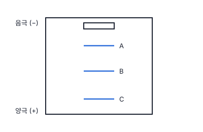

# 복습문제 37선 — 1013 수업 범위

기출 25개와 생성 변형 12개예요. 변형은 기본 10개·심화 2개로 구성했어요. 먼저 풀어 보고, 막히면 힌트를 열어 보세요. 원문 표현이나 인쇄 답이 모호한 문항은 풀이에 밝혔어요.

> `복습문제_1013_PCR_and_DNA_Technology.html`를 마크다운으로 옮겼어요. 원문, 힌트, 풀이는 접혀 있어요. 먼저 풀어 보고 펼쳐 보세요.

**목차**

- [B. 기출](#partB)
  - [P1. GMO의 환경 영향](#p1)
  - [P2. STR 반복수와 개인 차이](#p2)
  - [P3. DNA 지문감식의 활용](#p3)
  - [P4. PCR의 주된 용도](#p4)
  - [P5. 식물의 성질 개선](#p5)
  - [P6. PCR 30주기 계산](#p6)
  - [P7. DNA 클로닝의 도구](#p7)
  - [P8. 돌리의 핵치환](#p8)
  - [P9. PCR에서 필요하지 않은 효소](#p9)
  - [P10. 내성 잡초와 제초제](#p10)
  - [P11. DNA 지문의 비교 기준](#p11)
  - [P12. 유전자 치료의 경계](#p12)
  - [P13. STR 감식에 필요 없는 과정](#p13)
  - [P14. DNA 이동의 원인](#p14)
  - [P15. 절편을 분리하는 방법](#p15)
  - [P16. 친자확인과 대립유전자 상속](#p16)
  - [P17. 식물 유전공학의 목표와 위험](#p17)
  - [P18. 겔의 분리와 검출](#p18)
  - [P19. 체세포와 세대 전달](#p19)
  - [P20. PCR로 고대 DNA 읽기](#p20)
  - [P21. PCR의 효소 조건](#p21)
  - [P22. DNA 지문의 표지](#p22)
  - [P23. STR 서열과 반복수](#p23)
  - [P24. ADA 유전자 치료](#p24)
  - [P25. 정상 유전자 기능의 보완](#p25)
- [C. 변형 연습](#partC)
  - [P26. [변형] PCR 준비물 판별](#p26)
  - [P27. [변형] 초기량을 고려한 PCR 증폭량](#p27)
  - [P28. [변형] RNA 검출과 대조군](#p28)
  - [P29. [변형] 밴드 거리 읽기](#p29)
  - [P30. [변형] 반복 횟수에서 분리 순서까지](#p30)
  - [P31. [변형] 한 좌위의 한계](#p31)
  - [P32. [변형] 생산과 치료 구별](#p32)
  - [P33. [변형] 세대 전달 판별](#p33)
  - [P34. [변형] 세 제공자 구별](#p34)
  - [P35. [변형] 작물 개량의 목적](#p35)
  - [P36. [변형] 빛으로 발현 확인](#p36)
  - [P37. [변형] 내성 선택과 관리](#p37)

## B. 기출

### P1. GMO의 환경 영향

유전자변형생물(GMO) 식품의 유해한 환경 효과로 올바른 것은?

- (1) 유전학적으로 변형된 유전자가 다른 잡초로 퍼져 나간다
- (2) 모두 옳다
- (3) GMO 작물의 유전적 다양성이 감소한다
- (4) GMO 작물이 제초제 저항성을 보이면 제초제의 사용이 증가한다
- (5) 그 작물을 먹이로 하는 다른 생물종에게 역효과를 줄 수 있다

원문 정보 보기

기출 6강 합본 3번 (PDF 1쪽)

힌트 보기

기술의 목표와 환경에서 일어날 수 있는 위험을 나눠 봐요. 내성 개체가 살아남아 늘어나는 상황을 떠올려요.

풀이 보기

1. (1) 맞아요. 도입 유전자가 교배 가능한 야생종으로 퍼질 수 있어요.
2. (2) 맞아요. 나머지 보기는 잠재적 환경 우려를 제시하므로 출제 의도에서 모두 옳아요.
3. (3) 맞아요. 소수 품종 집중 재배는 작물 다양성을 줄일 수 있어요.
4. (4) 맞아요. 내성 잡초의 선택으로 제초제 사용량이 늘 수 있어요.
5. (5) 맞아요. 비표적 생물에 영향을 줄 가능성이 있어요.
6. 수업과의 연결: 1013 수업의 [GMO와 내성의 문제](정리노트_1013_PCR_and_DNA_Technology.md#s5-gmo)에서 판단 기준을 확인해요.

**정답:** (2)

이 문항은 가능한 환경 위험을 묻는 것으로 읽어요. 유전자 유출·다양성 감소·제초제 증가·비표적종 영향이 모든 GMO에서 반드시 생긴다는 뜻은 아니에요. 실제 영향은 도입 형질·재배 방식·환경 조건에 따라 달라요.

---

### P2. STR 반복수와 개인 차이

사람들마다 DNA 지문이 다른 이유는 무엇인가?

- (1) 사람마다 다른 개수의 DNA 세트를 갖고 있기 때문에
- (2) 같은 유전자 좌위에서 개체들마다 STR 의 반복수가 서로 다르기 때문에
- (3) PCR 이 다른 염기서열보다 특정 염기서열을 더 많이 증폭시키기 때문에
- (4) 특정 염기서열과 가까우면, STR을 제한효소가 자르지 못하기 때문에

원문 정보 보기

기출 6강 합본 5번 (PDF 1쪽)

힌트 보기

같은 좌위의 반복 단위, 반복 횟수, 증폭된 조각의 길이를 구별해요. 손가락 무늬와 DNA 지문도 달라요.

풀이 보기

1. (1) 틀려요. 일반적으로 사람 체세포의 DNA 세트 수는 같아요.
2. (2) 맞아요. 같은 좌위의 STR 반복수가 개인마다 달라요.
3. (3) 틀려요. 증폭량보다 STR 길이 차이가 지문 차이의 근거예요.
4. (4) 틀려요. STR 반복수 차이를 설명하지 못해요.
5. 수업과의 연결: 1013 수업의 [STR 반복 횟수가 밴드가 되기까지](정리노트_1013_PCR_and_DNA_Technology.md#s2-str)에서 판단 기준을 확인해요.

**정답:** (2)

---

### P3. DNA 지문감식의 활용

DNA 지문감식에 대한 설명으로 잘못된 것은?

- (1) 짧은연속반복서열(STR)의 분석을 통해 개개인을 구별할 수 있다
- (2) DNA 지문감식은 사람 뿐만 아니라 동식물, 미생물에도 사용할 수 있다
- (3) DNA 지문감식으로 일란성 쌍둥이는 구분하기 어렵다
- (4) 법의학적으로 DNA 지문감식은 아직 법적 증거로서의 효력이 없다
- (5) DNA 지문감식은 친자확인에 사용할 수 있다

원문 정보 보기

기출 6강 합본 6번 (PDF 1쪽)

힌트 보기

같은 좌위의 반복 단위, 반복 횟수, 증폭된 조각의 길이를 구별해요. 손가락 무늬와 DNA 지문도 달라요.

풀이 보기

1. (1) 맞아요. STR 여러 좌위로 개인을 식별할 수 있어요.
2. (2) 맞아요. 사람 이외 종에서도 유전적 차이를 분석할 수 있어요.
3. (3) 맞아요. 일란성 쌍둥이는 표준 STR 지문이 대체로 같아요.
4. (4) 틀려요. 충분한 좌위와 적절한 절차를 갖춘 DNA 분석은 법적 증거로 사용돼요.
5. (5) 맞아요. 부모와 자식의 대립유전자 공유를 비교할 수 있어요.
6. 수업과의 연결: 1013 수업의 [STR 반복 횟수가 밴드가 되기까지](정리노트_1013_PCR_and_DNA_Technology.md#s2-str)에서 판단 기준을 확인해요.

**정답:** (4)

---

### P4. PCR의 주된 용도

중합효소연쇄반응(PCR)은 주로 언제 사용되는가?

- (1) DNA를 작은 조각으로 자를 때
- (2) 재조합 DNA를 삽입할 때
- (3) 특정 염기서열이 있는 DNA를 자르는 제한효소를 이용해야 할 때
- (4) 적은 양의 DNA를 많이 증폭시킬 때
- (5) 사람 손의 지문을 분석할 때

원문 정보 보기

기출 6강 합본 7번 (PDF 1쪽)

힌트 보기

PCR은 준비한 주형 DNA의 특정 구간을 시험관에서 늘려요. 추출·절단·삽입·분리와 구별해요.

풀이 보기

1. (1) 틀려요. DNA 절단은 제한효소 기능이에요.
2. (2) 틀려요. DNA 삽입은 재조합·벡터 도입 단계예요.
3. (3) 틀려요. PCR은 제한효소 절단 기술이 아니에요.
4. (4) 맞아요. PCR은 소량의 특정 DNA를 증폭해요.
5. (5) 틀려요. 손가락 무늬와 DNA 지문은 달라요.
6. 수업과의 연결: 1013 수업의 [적은 시료를 읽기: 역전사와 오염](정리노트_1013_PCR_and_DNA_Technology.md#s0-pcr-uses)에서 판단 기준을 확인해요.

**정답:** (4)

---

### P5. 식물의 성질 개선

유전적으로 조작된 식품에 대한 설명으로 옳은 것은?

- (1) 모두 맞다
- (2) 의학적으로 유용한 물질을 생산하는 식물을 만들 수 있다
- (3) 식물에 제초제 저항성을 증가시킬 수 있다
- (4) 농작물의 특정 영양분을 향상시킬 수 있다
- (5) 바이러스 내성을 가진 농작물을 만들 수 있다

원문 정보 보기

기출 6강 합본 8번 (PDF 1쪽)

힌트 보기

해충 저항성, 제초제 내성, 영양 개선은 작물에 더하려는 성질이에요. 원하지 않는 유전자 전파와 구별해요.

풀이 보기

1. (1) 맞아요. 나머지 모두 식물 유전공학의 가능한 목표예요.
2. (2) 맞아요. 식물이 의약품 단백질을 생산하도록 할 수 있어요.
3. (3) 맞아요. 제초제 내성 유전자를 도입할 수 있어요.
4. (4) 맞아요. 황금쌀처럼 영양 성분을 개선할 수 있어요.
5. (5) 맞아요. 질병·바이러스 저항성을 높이도록 만들 수 있어요.
6. 수업과의 연결: 1013 수업의 [작물에 필요한 성질 더하기](정리노트_1013_PCR_and_DNA_Technology.md#s5-plant)에서 판단 기준을 확인해요.

**정답:** (1)

---

### P6. PCR 30주기 계산

정상적인 중합효소연쇄 반응을 30회 수행하면 몇 배로 증폭된 DNA 분자 수를 얻을 수 있는가?

- (1) 2배
- (2) 320배
- (3) 60배
- (4) 230배
- (5) 30배

원문 정보 보기

기출 6강 합본 9번 (PDF 2쪽)

힌트 보기

이상적으로 한 주기마다 사본 수가 두 배가 돼요. 주기 수를 곱하는 계산과 구별해요.

풀이 보기

1. (1) 틀려요. 2배는 1주기의 결과예요.
2. (2) 틀려요. PCR은 3배씩 증가하지 않아요.
3. (3) 틀려요. 증폭은 2×30의 선형 증가가 아니에요.
4. (4) 맞아요. 이상적인 PCR은 매 주기 두 배여서 30주기 후 2^30배예요.
5. (5) 틀려요. 30배가 아니라 2^30배예요.
6. 수업과의 연결: 1013 수업의 [PCR 세 단계와 증폭량](정리노트_1013_PCR_and_DNA_Technology.md#s0-pcr-cycle)에서 판단 기준을 확인해요.

**정답:** (4)

초기 분자 수를 N으로 두면 30주기 후 N × 230개예요. 증폭 비율은 230배예요.

---

### P7. DNA 클로닝의 도구

제한효소, 연결효소, 플라스미드, 바이러스 벡터, 효모 벡터, 전기영동 젤, 항생제 내성 유전자 등은 다음 중 어떤 실험에 필요한가?

- (1) DNA 클로닝
- (2) 2디옥시리보뉴클레오타이드 분석
- (3) DNA 염기서열결정
- (4) PCR
- (5) DNA 지문감식

원문 정보 보기

기출 6강 합본 12번 (PDF 2쪽)

힌트 보기

DNA가 띠는 전하와 작은 조각의 이동을 먼저 생각해요. 분리한 DNA를 보는 데에는 검출 과정도 필요해요.

풀이 보기

1. (1) 맞아요. DNA 클로닝은 DNA 절단·연결·벡터 도입·선별과 절편 확인을 이용해요.
2. (2) 틀려요. 제시된 도구 전체가 이 분석을 특정하지 않아요.
3. (3) 틀려요. 염기서열 결정과 클로닝을 구별해요.
4. (4) 틀려요. PCR은 벡터·항생제 선별 없이 시험관에서 수행해요.
5. (5) 틀려요. STR 감식은 세균 클로닝을 요구하지 않아요.
6. 수업과의 연결: 1013 수업의 [전기영동의 방향과 거리](정리노트_1013_PCR_and_DNA_Technology.md#s1-gel)에서 판단 기준을 확인해요.
7. [지난 수업 DNA 클로닝의 도구 역할](정리노트_1013_PCR_and_DNA_Technology.md#s0-recap)도 함께 확인해요.

**정답:** (1)

---

### P8. 돌리의 핵치환

복제양 돌리는 생식세포 클로닝의 한 예이다. 다음 중 이 실험을 수행하는 데 필요한 것은?

- (1) 젖샘세포의 2배체 세포를 핵이 제거된 미수정란과 융합
- (2) 자궁세포를 젖샘에 이식
- (3) 한 종의 미수정란을 다른 종의 미수정란과 융합
- (4) 2배체 배아세포를 반수체 성체세포와 융합
- (5) 다른 종으로부터 유래된 두 젖샘세포의 융합

원문 정보 보기

기출 6강 합본 13번 (PDF 2쪽)

힌트 보기

돌리를 만드는 데 쓰인 난자와 체세포의 역할을 구별해요. 핵을 제공한 세포가 무엇인지 확인해요.

풀이 보기

1. (1) 맞아요. 돌리는 젖샘 체세포의 핵을 핵 제거 난자에 넣어 만들었어요.
2. (2) 틀려요. 자궁세포의 젖샘 이식은 핵치환이 아니에요.
3. (3) 틀려요. 다른 종 난자의 융합은 돌리 과정이 아니에요.
4. (4) 틀려요. 성체 체세포는 일반적으로 2배체이고 이 과정도 달라요.
5. (5) 틀려요. 두 젖샘세포 융합은 핵 제거 난자를 사용하지 않아요.
6. 수업과의 연결: 1013 수업의 [핵치환과 복제양 돌리](정리노트_1013_PCR_and_DNA_Technology.md#s4-clone)에서 판단 기준을 확인해요.

**정답:** (1)

원문 발문은 돌리를 “생식세포 클로닝”이라고 부르지만 용어가 잘못됐어요. 돌리는 젖샘 체세포의 핵을 핵 제거 난자에 넣어 만든 체세포 핵치환 복제예요. 원문은 보존하고 정확한 방법으로 판단했어요.

---

### P9. PCR에서 필요하지 않은 효소

중합효소연쇄반응(PCR)의 혼합물에 필요한 주요 요소가 아닌 것은?

- (1) DNA를 분리시키기 위한 헬리케이스
- (2) 고온내성의 DNA 중합효소(Taq 중합효소)
- (3) 증폭시킬 표적서열이 포함된 DNA
- (4) 4종의 뉴클레오사이드 3인산 전구체
- (5) 표적서열의 양 끝단에 각각 상보적인 프라이머

원문 정보 보기

기출 6강 합본 14번 (PDF 2쪽)

힌트 보기

가열이 세포 안의 어떤 효소 역할을 대신하는지 생각해요. 주형·프라이머·합성 재료·중합효소는 별개예요.

풀이 보기

1. (1) 틀려요. PCR은 가열로 가닥을 분리하여 헬리케이스가 필요하지 않아요.
2. (2) 맞아요. 고온 변성을 견디는 Taq가 필요해요.
3. (3) 맞아요. 복제할 표적을 포함한 주형 DNA가 필요해요.
4. (4) 맞아요. DNA 합성 재료인 네 종류 dNTP가 필요해요.
5. (5) 맞아요. 표적 양끝을 정하는 상보적인 프라이머가 필요해요.
6. 수업과의 연결: 1013 수업의 [PCR: 시험관 속 복사 준비](정리노트_1013_PCR_and_DNA_Technology.md#s0-pcr-components)에서 판단 기준을 확인해요.

**정답:** (1)

---

### P10. 내성 잡초와 제초제

제초제에 저항성이 있도록 변형된 식물을 키우던 중 제초제 사용량이 더 많아졌다면 이 원인으로 가장 적절한 것은?

- (1) 제초제 내성 유전자를 세균으로부터 얻었기 때문에
- (2) 변형된 식물이 비슷한 종의 야생 식물과는 교배가 일어날 수 없기 때문에
- (3) 변형된 식물의 수명이 짧아져서
- (4) 제초제가 있어야만 변형된 식물이 살 수 있기 때문에
- (5) 제초제에 내성을 지닌 돌연변이 잡초가 자연선택 되어 주위에 자라나기 때문에

원문 정보 보기

기출 6강 합본 15번 (PDF 2쪽)

힌트 보기

기술의 목표와 환경에서 일어날 수 있는 위험을 나눠 봐요. 내성 개체가 살아남아 늘어나는 상황을 떠올려요.

풀이 보기

1. (1) 틀려요. 유전자 출처 자체가 사용량 증가 원인은 아니에요.
2. (2) 틀려요. 교배 불가능성은 내성 잡초 선택을 설명하지 않아요.
3. (3) 틀려요. 작물 수명과 직접 관련되지 않아요.
4. (4) 틀려요. 내성은 제초제가 있어야 살 수 있다는 뜻이 아니에요.
5. (5) 맞아요. 내성 잡초가 살아남아 늘면 같은 살포량의 효과가 감소해요.
6. 수업과의 연결: 1013 수업의 [GMO와 내성의 문제](정리노트_1013_PCR_and_DNA_Technology.md#s5-gmo)에서 판단 기준을 확인해요.

**정답:** (5)

---

### P11. DNA 지문의 비교 기준

DNA 지문감식은 _______________.

- (1) 같은 DNA의 한쪽 가닥을 사람들 간에 비교한다
- (2) 여러 곳에서 반복적으로 나타나는 비암호화 DNA의 길이가 서로 다른 점을 이용하여 사람들 간에 비교한다
- (3) 젤 상에서 제일 먼 곳까지 이동시키려면 길이가 가장 긴 DNA가 필요하다
- (4) 일란성 쌍둥이 간의 DNA 차이도 쉽게 구분할 수 있다
- (5) 젤에서 분리한 후 증폭과정이 필요하다

원문 정보 보기

기출 6강 합본 16번 (PDF 2쪽)

힌트 보기

같은 좌위의 반복 단위, 반복 횟수, 증폭된 조각의 길이를 구별해요. 손가락 무늬와 DNA 지문도 달라요.

풀이 보기

1. (1) 틀려요. 단일가닥 자체보다 STR 좌위의 길이 패턴을 비교해요.
2. (2) 맞아요. 여러 비암호화 STR 부위의 길이 차이를 비교해요.
3. (3) 틀려요. 짧은 DNA가 더 멀리 이동해요.
4. (4) 틀려요. 일란성 쌍둥이는 표준 STR로 구별하기 어려워요.
5. (5) 틀려요. 수업의 과정은 PCR 증폭 후 겔 분리예요.
6. 수업과의 연결: 1013 수업의 [STR 반복 횟수가 밴드가 되기까지](정리노트_1013_PCR_and_DNA_Technology.md#s2-str)에서 판단 기준을 확인해요.

**정답:** (2)

---

### P12. 유전자 치료의 경계

다음의 설명 중 옳지 않은 것은?

- (1) 동, 식물 유전공학 모두 사회적 우려 속에서 진행되고 있다
- (2) 형질전환 생명체란 유전적으로 조작되어 외부로부터 온 유전정보를 함유하고 있음을 의미한다
- (3) 유전자의 많은 사본을 생산하는 것을 DNA 클로닝(cloning)이라고 한다
- (4) 유전자 조작 식품을 섭취하여 질병을 치료하는 것은 유전자 치료의 예이다
- (5) 중합효소연쇄반응(PCR)을 이용하면 충분한 양의 DNA를 단시간 내에 얻을 수 있다

원문 정보 보기

기출 6강 합본 18번 (PDF 3쪽)

힌트 보기

환자 자신의 유전자가 바뀌는지 확인해요. 생식세포와 체세포는 다음 세대로 전달되는지 달라요.

풀이 보기

1. (1) 맞아요. 유전공학에는 안전·윤리·환경 우려가 있어요.
2. (2) 맞아요. 형질전환 생명체는 도입된 외부 유전정보를 가질 수 있어요.
3. (3) 맞아요. DNA 클로닝은 특정 DNA의 많은 사본 생산이에요.
4. (4) 틀려요. 유전자 치료는 환자의 유전자를 직접 조작해야 하며 식품 섭취와 달라요.
5. (5) 맞아요. PCR은 DNA를 빠르게 증폭할 수 있어요.
6. 수업과의 연결: 1013 수업의 [유전자 치료와 세대 전달](정리노트_1013_PCR_and_DNA_Technology.md#s3-therapy)에서 판단 기준을 확인해요.

**정답:** (4)

---

### P13. STR 감식에 필요 없는 과정

다음 중 DNA 지문감식에서 사용되는 과정이 아닌 것은 무엇인가?

- (1) DNA 조각을 분리하기 위해 전류가 사용된다
- (2) DNA를 크기에 따라 여러 가지 조각들로 분리하기 위해 젤 위에 놓는다
- (3) 피, 정액, 모근으로부터 채취한 DNA가 분석에 사용된다
- (4) 지문을 나타내는 부위의 유전자를 세균에 클로닝한다

원문 정보 보기

기출 6강 합본 20번 (PDF 3쪽)

힌트 보기

같은 좌위의 반복 단위, 반복 횟수, 증폭된 조각의 길이를 구별해요. 손가락 무늬와 DNA 지문도 달라요.

풀이 보기

1. (1) 맞아요. 전류로 DNA를 이동시켜요.
2. (2) 맞아요. 겔은 크기별 이동 차이를 만들어요.
3. (3) 맞아요. 세포를 포함한 혈액·정액·모근에서 DNA를 얻을 수 있어요.
4. (4) 틀려요. STR 감식은 PCR을 이용하며 세균 클로닝이 필요하지 않아요.
5. 수업과의 연결: 1013 수업의 [STR 반복 횟수가 밴드가 되기까지](정리노트_1013_PCR_and_DNA_Technology.md#s2-str)에서 판단 기준을 확인해요.

**정답:** (4)

---

### P14. DNA 이동의 원인

DNA가 전기장이 걸린 젤에서 (+)극으로 이동하는 이유는?

- (1) 아가로오스 젤이 음전하를 띠기 때문
- (2) DNA의 무게에 따라 중력에 의해 아래로 이동하므로
- (3) 다른 염색체들은 서로 다른 전하를 띠기 때문
- (4) 제한효소에 의해 잘리기 때문
- (5) DNA는 음전하를 띠기 때문

원문 정보 보기

기출 6강 합본 23번 (PDF 3쪽)

힌트 보기

DNA가 띠는 전하와 작은 조각의 이동을 먼저 생각해요. 분리한 DNA를 보는 데에는 검출 과정도 필요해요.

풀이 보기

1. (1) 틀려요. 겔의 전하가 아니라 DNA 자체의 전하 때문이에요.
2. (2) 틀려요. 중력이 아니라 전기장에 의해 이동해요.
3. (3) 틀려요. DNA들은 인산기로 음전하를 띠어요.
4. (4) 틀려요. 절단 여부와 무관하게 DNA는 음전하를 띠어요.
5. (5) 맞아요. 음전하 DNA가 양극으로 이동해요.
6. 수업과의 연결: 1013 수업의 [전기영동의 방향과 거리](정리노트_1013_PCR_and_DNA_Technology.md#s1-gel)에서 판단 기준을 확인해요.

**정답:** (5)

---

### P15. 절편을 분리하는 방법

DNA 클로닝 과정 중, DNA 조각들을 크기나 전하 등에 따라 서로 분리시키는 방법은 무엇인가?

- (1) 크로마토크래피
- (2) 교차
- (3) 여과
- (4) 전기영동
- (5) PCR(중합효소연쇄반응)

원문 정보 보기

기출 6강 합본 24번 (PDF 3쪽)

힌트 보기

DNA가 띠는 전하와 작은 조각의 이동을 먼저 생각해요. 분리한 DNA를 보는 데에는 검출 과정도 필요해요.

풀이 보기

1. (1) 틀려요. 출제 의도의 겔을 이용한 DNA 분리와 다른 기술이에요.
2. (2) 틀려요. 교차는 감수분열의 유전물질 교환이에요.
3. (3) 틀려요. 단순 여과가 아니라 전기장을 이용해요.
4. (4) 맞아요. 전기영동은 전하·크기에 따른 이동 차이로 분리해요.
5. (5) 틀려요. PCR은 분리가 아니라 증폭이에요.
6. 수업과의 연결: 1013 수업의 [전기영동의 방향과 거리](정리노트_1013_PCR_and_DNA_Technology.md#s1-gel)에서 판단 기준을 확인해요.

**정답:** (4)

---

### P16. 친자확인과 대립유전자 상속

친자확인에서 부모의 DNA 지문을 자식의 지문과 비교할 때, 어떤 한 쪽 부모의 지문은 항상 _____.

- (1) 자식 DNA 지문과 일치하는 DNA 지문을 가져가야 하며 일치하지 않은 것은 다른 양친이 가져야 한다.
- (2) 자식에게만 나타나는 DNA 지문과 어느정도 유사한 지문을 가져야 한다.
- (3) 자식 DNA 지문의 절반을 가져야 한다.
- (4) 자식의 DNA 지문과 아무 관련이 없다
- (5) 자식의 모든 DNA 지문을 가져야 한다.

원문 정보 보기

기출 6강 합본 25번 (PDF 3쪽–4쪽)

힌트 보기

자식은 각 좌위에서 부모에게 대립유전자를 하나씩 받아요. 대립유전자의 유래와 화면에 보이는 밴드 개수는 달라요.

풀이 보기

1. (1) 맞아요. 자식의 대립유전자는 각 부모에게서 하나씩 물려받아 부모 중 한쪽과 맞지 않는 것은 다른 쪽에서 설명돼야 해요.
2. (2) 틀려요. 막연한 유사성만으로는 부모-자식의 대립유전자 상속을 설명하지 못해요.
3. (3) 출제 의도로는 답이 아니지만 유래의 절반을 말하려는 표현일 수 있어요. 각 좌위의 유래는 절반씩이지만 겔 밴드 개수가 항상 정확히 절반이라는 보장은 없어요.
4. (4) 틀려요. 부모와 자식은 대립유전자를 공유해요.
5. (5) 틀려요. 한쪽 부모가 자식의 모든 밴드를 공유할 필요는 없어요.
6. 수업과의 연결: 1013 수업의 [친자 판별: 부모에게서 하나씩](정리노트_1013_PCR_and_DNA_Technology.md#s2-parentage)에서 판단 기준을 확인해요.

**정답:** (1)

인쇄 원문에는 정답 표시가 없어요. 상속 규칙에 가장 정확한 (1)로 판단했어요. 각 좌위 대립유전자의 유래는 양쪽 부모에게서 하나씩이지만, 동형접합이나 부모가 공유하는 대립유전자 때문에 화면의 밴드 개수가 항상 정확히 절반이 되는 것은 아니에요. (3)을 단순화된 출제 의도로 삼았을 가능성은 있지만 단일 정답을 확신하기 어려워요.

---

### P17. 식물 유전공학의 목표와 위험

다음은 식물을 이용한 유전공학 응용의 예로 적절치 않은 것은?

- (1) 작물에 간균이 갖고 있는 Bt 독소의 유전자를 도입
- (2) 옥수수 및 목화를 글리포세이트 내성으로 만들어 생산량을 증가시킴
- (3) 제초제 내성을 위해 도입된 유전자를 중간 수분에 의해 다른 잡초종에게 전파
- (4) 베타-카로틴이 풍부하게 조작된 황금 쌀을 만들어 영양 개선에 기여
- (5) 콩과 식물에 부족한 필수아미노산인 메싸이오닌과 시스테인의 증량

원문 정보 보기

기출 6강 합본 26번 (PDF 4쪽)

힌트 보기

해충 저항성, 제초제 내성, 영양 개선은 작물에 더하려는 성질이에요. 원하지 않는 유전자 전파와 구별해요.

풀이 보기

1. (1) 맞아요. Bt 독소 유전자는 해충 저항성 목적이에요.
2. (2) 맞아요. 제초제 내성은 작물을 보호하는 목적이에요.
3. (3) 틀려요. 잡초로 내성 유전자가 퍼지는 것은 바람직한 목표가 아니라 환경 위험이에요.
4. (4) 맞아요. 베타카로틴은 비타민 A 전구체로 영양 개선 목표예요.
5. (5) 맞아요. 제한 아미노산 함량 증가는 영양 개선 목표예요.
6. 수업과의 연결: 1013 수업의 [작물에 필요한 성질 더하기](정리노트_1013_PCR_and_DNA_Technology.md#s5-plant)에서 판단 기준을 확인해요.

**정답:** (3)

원문 표현 주의: 이 문항은 부족한 아미노산 조성 개선이라는 목적을 판별해요. 두 아미노산을 모두 필수로 묶는 분류는 그대로 일반화하지 않아요. 교재 p127은 콩과 종자의 메싸이오닌 또는 시스테인 부족과 함량 개선 목적을 설명해요.

---

### P18. 겔의 분리와 검출

다음 아가로오스 젤 전기염동에 관한 설명 중 잘못된 것은?

- (1) DNA 절편의 길이는 표지 DNA와 이동거리를 비교하여 알 수 있다
- (2) 전류를 흘려주면 음전하를 띤 DNA는 양극으로 이동한다
- (3) 일반적으로 아가로오스 젤은 비교적 큰 사이즈인 DNA 분리에 적합하다.
- (4) 젤 전기영동은 DNA 뿐만 아니라 RNA, 단백질도 분리할 수 있다
- (5) DNA와 결합하는 염료로 젤을 염색을 하면 가시광선 파장에서 눈으로 확인할 수 있다

원문 정보 보기

기출 6강 합본 27번 (PDF 4쪽)

힌트 보기

DNA가 띠는 전하와 작은 조각의 이동을 먼저 생각해요. 분리한 DNA를 보는 데에는 검출 과정도 필요해요.

풀이 보기

1. (1) 맞아요. 표지 DNA와 비교하여 절편 길이를 추정해요.
2. (2) 맞아요. 음전하 DNA는 양극으로 이동해요.
3. (3) 맞아요. 인쇄 정답과 다른 판단이에요. 아가로오스는 폴리아크릴아마이드보다 비교적 큰 DNA 분리에 적합하여 인쇄 정답은 오류예요.
4. (4) 맞아요. 일반적인 겔 전기영동은 DNA·RNA·단백질을 분리할 수 있어요.
5. (5) 수업의 검출 조건에서는 틀려요. 수업의 형광 염료는 UV 조사로 확인하므로 수업 맥락에서 틀려요. 다만 가시광으로 보는 염료도 존재하여 이 문장 전체를 보편적으로 거짓이라 할 수는 없어요.
6. 수업과의 연결: 1013 수업의 [전기영동의 방향과 거리](정리노트_1013_PCR_and_DNA_Technology.md#s1-gel)에서 판단 기준을 확인해요.

**정답:** (5)

인쇄된 답안지는 (3)을 표시하지만 아가로오스는 비교적 큰 DNA를 분리하는 데 적합하므로 오류로 판단해요. 수업의 UV 형광 검출 맥락에서는 (5)를 답으로 삼아요. 다만 가시광으로 검출하는 염료도 있으므로 염료와 광원 조건이 생략된 원문은 엄밀히 모호해요. (5)가 모든 검출법에서 거짓이라는 뜻은 아니에요. 원문의 “전기염동”은 “전기영동”의 오타예요.

---

### P19. 체세포와 세대 전달

다음은 유전공학의 응용에 대한 설명이다. 틀린 설명은?

- (1) 실험실에서 세균을 배양할 경우 생물학적 안정성 지침을 준수하여야 한다
- (2) 생식세포 유전자 치료는 인간에게는 허용되지 않는다
- (3) 동물세포의 경우 유전자를 체세포에 도입하면 다음 세대에 전달된다
- (4) 동물의 유전자를 조작하여 필요한 단백질을 생산, 정제하면 사람의 질병을 치료할 수 있다
- (5) 대장균을 유전적으로 조작하여 사람 호르몬을 생산할 수 있다

원문 정보 보기

기출 6강 합본 30번 (PDF 4쪽)

힌트 보기

환자 자신의 유전자가 바뀌는지 확인해요. 생식세포와 체세포는 다음 세대로 전달되는지 달라요.

풀이 보기

1. (1) 맞아요. 생물학적 안전 지침을 지켜야 해요.
2. (2) 맞아요. 수업에서 인간 생식세포 유전자 치료는 허용하지 않는다고 다뤘어요.
3. (3) 틀려요. 체세포 도입은 다음 세대에 전달되지 않아요.
4. (4) 맞아요. 형질전환 동물에서 생산·정제한 단백질을 의약품으로 쓸 수 있어요.
5. (5) 맞아요. 대장균에서 사람 인슐린 등을 만들 수 있어요.
6. 수업과의 연결: 1013 수업의 [유전자 치료와 세대 전달](정리노트_1013_PCR_and_DNA_Technology.md#s3-therapy)에서 판단 기준을 확인해요.

**정답:** (3)

---

### P20. PCR로 고대 DNA 읽기

중합효소연쇄반응(PCR)에 대한 설명 중 옳은 것은?

- (1) PCR은 고대 유골의 DNA 시료에서도 DNA를 추출하여 증폭시킬 수 있다
- (2) PCR에 사용되는 제작된 특정 프라이머는 시료의 모든 서열에 결합할 수 있다
- (3) DNA의 복제에 사용되는 DNA 중합효소는 프라이머가 필요하지 않다
- (4) PCR의 결과물은 별다른 추가 확인과정 없이 눈으로 바로 확인할 수 있다
- (5) PCR은 특정 DNA 서열을 숙주에 클로닝하여 대량으로 생산할 수 있다

원문 정보 보기

기출 6강 합본 31번 (PDF 4쪽)

힌트 보기

PCR은 준비한 주형 DNA의 특정 구간을 시험관에서 늘려요. 추출·절단·삽입·분리와 구별해요.

풀이 보기

1. (1) 맞아요. 고대 시료에 남은 DNA도 적합한 표적·오염 관리 조건에서 증폭할 수 있어요.
2. (2) 틀려요. 프라이머는 상보적인 특정 부위에 결합해요.
3. (3) 틀려요. 중합효소는 프라이머의 끝을 연장해요.
4. (4) 틀려요. 겔 전기영동과 염색 등 확인 과정이 필요해요.
5. (5) 틀려요. 숙주 클로닝 대신 시험관에서 합성해요.
6. 수업과의 연결: 1013 수업의 [적은 시료를 읽기: 역전사와 오염](정리노트_1013_PCR_and_DNA_Technology.md#s0-pcr-uses)에서 판단 기준을 확인해요.

**정답:** (1)

원문 (1)의 “추출하여 증폭”은 시료에서 DNA를 따로 추출한 뒤 PCR로 늘리는 전체 절차를 표현한 거예요. DNA 추출 자체가 PCR의 역할은 아니에요.

---

### P21. PCR의 효소 조건

PCR 기술은 다음 중 어떤 것을 어떤 것을 사용한다는 점에서 다른 기술들과 구분되는가?

- (1) DNA
- (2) RNA
- (3) 고온내성의 DNA 중합효소
- (4) 프라이머
- (5) 네 가지 뉴클레오사이드 3인산

원문 정보 보기

기출 6강 합본 32번 (PDF 4쪽–5쪽)

힌트 보기

가열이 세포 안의 어떤 효소 역할을 대신하는지 생각해요. 주형·프라이머·합성 재료·중합효소는 별개예요.

풀이 보기

1. (1) 틀려요. DNA는 여러 다른 기술도 이용해요.
2. (2) 틀려요. PCR 자체의 주형은 DNA예요.
3. (3) 맞아요. 반복되는 고온에도 활성을 유지하는 중합효소가 특징이에요.
4. (4) 틀려요. 프라이머는 세포 내 복제에도 필요해요.
5. (5) 틀려요. dNTP는 다른 DNA 합성에도 쓰여요.
6. 수업과의 연결: 1013 수업의 [PCR: 시험관 속 복사 준비](정리노트_1013_PCR_and_DNA_Technology.md#s0-pcr-components)에서 판단 기준을 확인해요.

**정답:** (3)

---

### P22. DNA 지문의 표지

다음 중 사람의 DNA 지문을 감식하는데 이용되는 것은 무엇인가?

- (1) 손가락에서 특정 지문을 만드는데 원인이 되는 유전자
- (2) STR (짧은연속반복서열)
- (3) 형질전환
- (4) 플라스미드
- (5) 염색체에서 인트론의 수

원문 정보 보기

기출 6강 합본 33번 (PDF 5쪽)

힌트 보기

같은 좌위의 반복 단위, 반복 횟수, 증폭된 조각의 길이를 구별해요. 손가락 무늬와 DNA 지문도 달라요.

풀이 보기

1. (1) 틀려요. 손가락의 무늬와 DNA 지문을 구별해요.
2. (2) 맞아요. 개인마다 다른 STR 반복수를 이용해요.
3. (3) 틀려요. 형질전환은 외부 DNA 도입이에요.
4. (4) 틀려요. 플라스미드는 클로닝 벡터예요.
5. (5) 틀려요. 인트론 개수를 세는 방식이 아니에요.
6. 수업과의 연결: 1013 수업의 [STR 반복 횟수가 밴드가 되기까지](정리노트_1013_PCR_and_DNA_Technology.md#s2-str)에서 판단 기준을 확인해요.

**정답:** (2)

---

### P23. STR 서열과 반복수

다음 중 DNA 지문을 만드는 과정이 아닌 것은?

- (1) 짧은연속반복서열(STR)은 사람에 따라 서로 다른 염기서열을 가진다
- (2) DNA 조각은 아가로오스 젤을 통과시킴으로써 크기 순서로 분리할 수 있다
- (3) 자식의 DNA 지문에 해당하는 조각을 부모 중의 한 명은 반드시 가져야 한다
- (4) 피부, 뼈, 혈액, 정액, 모근 등으로부터 채취한 DNA가 분석에 사용될 수 있다
- (5) 짧은연속반복서열(STR)의 반복 수는 사람마다 다르다

원문 정보 보기

기출 6강 합본 35번 (PDF 5쪽)

힌트 보기

같은 좌위의 반복 단위, 반복 횟수, 증폭된 조각의 길이를 구별해요. 손가락 무늬와 DNA 지문도 달라요.

풀이 보기

1. (1) 틀려요. 같은 STR 좌위에서는 반복 단위보다 반복 수 차이가 출제 의도의 구별 근거예요.
2. (2) 맞아요. 겔에서 길이에 따라 분리해요.
3. (3) 맞아요. 통상적 상속 모델에서 자식 대립유전자는 부모 중 한쪽에 있어요.
4. (4) 맞아요. DNA를 포함한 다양한 생물학적 시료를 사용할 수 있어요.
5. (5) 맞아요. STR 반복수 차이를 비교해요.
6. 수업과의 연결: 1013 수업의 [STR 반복 횟수가 밴드가 되기까지](정리노트_1013_PCR_and_DNA_Technology.md#s2-str)에서 판단 기준을 확인해요.

**정답:** (1)

같은 STR 좌위의 통상적 분석에서는 반복 단위의 종류보다 반복 횟수 차이를 비교해요. 이 문항의 (1)은 그 기준에 어긋나요. 모든 사람의 모든 STR 염기서열이 완전히 동일하다는 일반화는 하지 않아요.

---

### P24. ADA 유전자 치료

다음 중 가장 적절한 유전자 치료의 예는?

- (1) ADA 환자에게 정상적인 유전자를 환자 본인의 백혈구를 이용하여 도입하는 것
- (2) 유전적으로 맞는 기증자의 심장을 이식하는 것
- (3) 모두 옳다
- (4) 박테리아가 만든 사람 혈액 응고인자를 직접 혈우병 환자에게 주사하는 것

원문 정보 보기

기출 6강 합본 36번 (PDF 5쪽)

힌트 보기

환자 자신의 유전자가 바뀌는지 확인해요. 생식세포와 체세포는 다음 세대로 전달되는지 달라요.

풀이 보기

1. (1) 맞아요. 환자 세포에 정상 ADA 유전자를 도입하므로 유전자 치료예요.
2. (2) 틀려요. 장기 이식은 환자 유전자 조작과 달라요.
3. (3) 틀려요. 유전자 치료는 (1)만 해당해요.
4. (4) 틀려요. 단백질 의약품 주사는 유전자 자체를 조작하지 않아요.
5. 수업과의 연결: 1013 수업의 [유전자 치료와 세대 전달](정리노트_1013_PCR_and_DNA_Technology.md#s3-therapy)에서 판단 기준을 확인해요.

**정답:** (1)

---

### P25. 정상 유전자 기능의 보완

다음 유전자 치료를 이용하여 가장 효과적으로 치료할 수 있는 질병은 무엇인가?

- (1) 세균 감염에 의한 질병
- (2) 지방 과다 섭취로 인한 질병
- (3) 기능이 결핍된 효소에 의해 일어난 질병
- (4) 조절되지 않는 세포분열에 의한 질병

원문 정보 보기

기출 6강 합본 37번 (PDF 5쪽)

힌트 보기

환자 자신의 유전자가 바뀌는지 확인해요. 생식세포와 체세포는 다음 세대로 전달되는지 달라요.

풀이 보기

1. (1) 틀려요. 세균 감염보다 단일 유전자 결함이 출제 의도의 표적이에요.
2. (2) 틀려요. 생활습관성 원인을 정상 효소 유전자 도입만으로 해결할 수 없어요.
3. (3) 맞아요. 결핍 효소의 정상 유전자를 도입하여 기능을 보완할 수 있어요.
4. (4) 틀려요. 암은 여러 변화가 관여할 수 있어 단일 효소 결핍보다 단순한 표적이 아니에요.
5. 수업과의 연결: 1013 수업의 [유전자 치료와 세대 전달](정리노트_1013_PCR_and_DNA_Technology.md#s3-therapy)에서 판단 기준을 확인해요.

**정답:** (3)

유전자 치료는 암에도 적용할 수 있지만 이 문항은 단일 효소의 기능 결핍을 정상 유전자로 보완하는 가장 직접적인 사례를 묻고 있어요.

---

## C. 변형 연습

### P26. [변형] PCR 준비물 판별

중합효소연쇄반응(PCR)에 대한 설명 중 옳은 것은?

- (1) 첫 가열을 대신하려면 프라이메이스만 첨가하면 된다.
- (2) 합성된 두 프라이머가 표적 양쪽에서 새 가닥의 합성 시작점을 제공한다.
- (3) 새 가닥을 만들 때 리보뉴클레오티드만 재료로 사용한다.
- (4) 일반적인 사람의 DNA 중합효소는 반복되는 95℃ 가열에 안정하다.
- (5) 프라이머 서열을 정할 때 표적 주변의 염기서열 정보가 필요 없다.

원문 정보 보기

기출 6강 31번 발문에 정답을 바꾼 생성 변형이에요. 다루는 혼동: PCR 준비물 판별. 근거 토픽: s0-pcr-components.

힌트 보기

준비물 기능을 각각 대조.

풀이 보기

1. (1) 틀려요. 헬리케이스 대신 열로 가닥을 분리하며 프라이메이스는 가닥을 여는 효소가 아니에요.
2. (2) 맞아요. 양쪽의 합성 DNA 프라이머를 5′에서 3′으로 연장해요.
3. (3) 틀려요. PCR은 DNA를 만드므로 dNTP를 재료로 사용해요.
4. (4) 틀려요. 일반 효소는 고온에서 활성을 잃을 수 있어 내열성 중합효소가 필요해요.
5. (5) 틀려요. 프라이머를 설계하려면 결합 부위의 서열 정보가 필요해요.
6. 원문 정답과 달라진 점: 합성 DNA 프라이머가 시작점을 제공해요.
7. 수업과의 연결: 1013의 [PCR 준비물 판별 관련 개념](정리노트_1013_PCR_and_DNA_Technology.md#s0-pcr-components)으로 판단해요.

**정답:** (2)

---

### P27. [변형] 초기량을 고려한 PCR 증폭량

DNA 3분자로 시작해 모든 주기에서 정확히 두 배가 되었다. 5주기 후 분자 수는?

- (1) 15분자
- (2) 30분자
- (3) 48분자
- (4) 96분자
- (5) 243분자

원문 정보 보기

원문 기출이 아닌 생성 변형이에요. 다루는 혼동: 초기량을 고려한 PCR 증폭량. 근거 토픽: s0-pcr-cycle.

힌트 보기

초기량에 2의 주기 수 제곱을 곱하기.

풀이 보기

1. (1) 틀려요. 주기 수를 초기량에 단순히 곱하지 않아요.
2. (2) 틀려요. 5주기의 증폭 배수는 10이 아니라 32예요.
3. (3) 틀려요. 48은 4주기를 수행한 결과예요.
4. (4) 맞아요. 초기 3분자에 2⁵=32를 곱하면 96분자예요.
5. (5) 틀려요. 각 주기의 배수는 초기 3이 아니라 2예요.
6. 수업과의 연결: 1013의 [초기량을 고려한 PCR 증폭량 관련 개념](정리노트_1013_PCR_and_DNA_Technology.md#s0-pcr-cycle)으로 판단해요.

**정답:** (4)

---

### P28. [변형] RNA 검출과 대조군

RNA 표적을 검사하는 실험에서 A는 역전사 후 PCR, B는 역전사를 생략한 PCR이다. 두 실험에는 같은 표적 특이 DNA 프라이머를 넣었고, 원시료에는 표적 RNA만 있으며 DNA 오염은 없다. A에서만 표적이 증폭되는 이유는?

- (1) PCR이 RNA를 주형으로 직접 복제하기 때문이다.
- (2) 역전사효소가 표적 RNA를 DNA로 바꾸어 PCR 주형을 제공하기 때문이다.
- (3) B의 프라이머는 반드시 열에 불안정하기 때문이다.
- (4) A에서는 리보솜이 표적 DNA를 합성하기 때문이다.
- (5) 역전사하면 양쪽 프라이머가 필요 없어지기 때문이다.

원문 정보 보기

원문 기출이 아닌 생성 변형이에요. 다루는 혼동: RNA 검출과 대조군. 근거 토픽: s0-pcr-uses.

힌트 보기

RNA 주형과 DNA 주형 구별 후 역전사의 출력 확인.

풀이 보기

1. (1) 틀려요. 보통의 PCR은 DNA를 주형으로 증폭해요.
2. (2) 맞아요. 역전사효소가 RNA에서 상보적 DNA를 합성해요.
3. (3) 틀려요. 차이는 역전사 유무이고 프라이머 불안정이라는 조건은 주어지지 않았어요.
4. (4) 틀려요. 리보솜은 단백질 합성에 참여해요.
5. (5) 틀려요. 역전사 이후에도 표적 양쪽의 PCR 프라이머가 필요해요.
6. 수업과의 연결: 1013의 [RNA 검출과 대조군 관련 개념](정리노트_1013_PCR_and_DNA_Technology.md#s0-pcr-uses)으로 판단해요. [1006의 DNA와 RNA 구별](../../1006/정리노트_1006_Transcription_Translation_and_Lac_Operon.html#s0-recap)도 함께 확인해요.

**정답:** (2)

---

### P29. [변형] 밴드 거리 읽기

같은 조건에서 선형 DNA 절편 A·B·C를 함께 분리한 그림이다. 방향과 길이에 대한 설명 중 옳지 않은 것은?

*같은 시간 동안 분리한 세 절편이에요.*

- (1) 시료를 넣은 구멍 쪽은 음극이다.
- (2) 세 절편은 양극 쪽으로 이동했다.
- (3) A가 가장 긴 DNA 절편이다.
- (4) C가 가장 짧은 DNA 절편이다.
- (5) A가 C보다 빨리 이동한 절편이다.

원문 정보 보기

원문 기출이 아닌 생성 변형이에요. 다루는 혼동: 밴드 거리 읽기. 근거 토픽: s1-gel.

힌트 보기

음극 위치 확인 후 거리와 크기를 역으로 대조.

풀이 보기

1. (1) 맞아요. 음전하 DNA가 양극 쪽으로 나가도록 홈을 음극 쪽에 두었어요.
2. (2) 맞아요. 아래쪽으로 이동한 방향이 양극이에요.
3. (3) 맞아요. A가 구멍에서 가장 가까워 가장 길고 느린 절편이에요.
4. (4) 맞아요. C가 가장 멀리 갔으므로 가장 짧은 절편이에요.
5. (5) 틀려요. 같은 시간에 더 짧은 거리를 간 A는 C보다 느려요.
6. 수업과의 연결: 1013의 [밴드 거리 읽기 관련 개념](정리노트_1013_PCR_and_DNA_Technology.md#s1-gel)으로 판단해요.

**정답:** (5)

---

### P30. [변형] 반복 횟수에서 분리 순서까지

같은 STR 좌위를 두 프라이머로 증폭했다. 반복 단위는 6 bp이고, PCR 산물의 반복 이외 고정 구간의 총길이는 프라이머 부분을 포함하여 50 bp이다. 표의 길이를 바르게 해석한 것은?

| 시료 | 반복 수 |
|---|---|
| A | 7 |
| B | 10 |
| C | 13 |

- (1) 7회 반복 산물은 42 bp이다.
- (2) 10회 반복 산물은 110 bp이며 7회 반복 산물보다 느리게 이동한다.
- (3) 13회 반복 산물은 50 bp이다.
- (4) 반복 횟수가 많을수록 같은 겔에서 더 멀리 이동한다.
- (5) 각 산물의 길이는 반복 횟수와 무관하게 같다.

원문 정보 보기

원문 기출이 아닌 생성 변형이에요. 다루는 혼동: 반복 횟수에서 분리 순서까지. 근거 토픽: s2-str.

힌트 보기

고정 구간과 반복 길이 합산 후 겔 원리 연결.

풀이 보기

1. (1) 틀려요. 반복 이외 50 bp를 더하면 7회는 92 bp예요.
2. (2) 맞아요. 50+6×10=110 bp이며 7회 92 bp보다 길어 느려요.
3. (3) 틀려요. 13회는 50+6×13=128 bp예요.
4. (4) 틀려요. 같은 조건에서 반복이 많아 긴 절편이 되면 덜 멀리 가요.
5. (5) 틀려요. 고정 구간은 같아도 반복 구간의 길이가 달라요.
6. 수업과의 연결: 1013의 [반복 횟수에서 분리 순서까지 관련 개념](정리노트_1013_PCR_and_DNA_Technology.md#s2-str)으로 판단해요.

**정답:** (2)

---

### P31. [변형] 한 좌위의 한계

STR 좌위 L에서 어머니는 8/12, 아버지 후보는 10/14, 아이는 12/14이다. 이 결과만으로 할 수 있는 판단은?

- (1) 친자 관계가 확정된다.
- (2) 친자 관계가 반드시 배제된다.
- (3) 이 좌위의 상속 조건과는 맞지만 여러 좌위 대조가 더 필요하다.
- (4) 아이의 12와 14는 모두 어머니에게서 왔다.
- (5) 아이의 밴드는 언제나 어머니 밴드 수의 절반이다.

원문 정보 보기

원문 기출이 아닌 생성 변형이에요. 다루는 혼동: 한 좌위의 한계. 근거 토픽: s2-parentage.

힌트 보기

부모별 대립유전자 하나씩 확인 후 단일 좌위의 한계 적용.

풀이 보기

1. (1) 틀려요. 한 좌위가 맞는 후보는 우연히 맞을 가능성도 있어요.
2. (2) 틀려요. 12는 어머니, 14는 아버지 후보가 줄 수 있어 이 좌위에서는 배제되지 않아요.
3. (3) 맞아요. 상속 조건과 양립하지만 친자 확인에는 여러 좌위 비교가 필요해요.
4. (4) 틀려요. 어머니에게는 14가 없어요.
5. (5) 틀려요. 한 좌위의 대립유전자는 부모에게서 하나씩 오지만 밴드 수 절반이 보장되는 것은 아니에요.
6. 수업과의 연결: 1013의 [한 좌위의 한계 관련 개념](정리노트_1013_PCR_and_DNA_Technology.md#s2-parentage)으로 판단해요.

**정답:** (3)

---

### P32. [변형] 생산과 치료 구별

질병 치료용 단백질의 유전자를 효모의 발현벡터에 넣어 생산하고 정제해 환자에게 투여했다. 환자의 세포에는 유전자를 넣거나 바꾸지 않았다. 이 실험의 해석으로 옳지 않은 것은?

- (1) 효모를 생산 공장으로 이용한 유전공학 응용이다.
- (2) 투여된 물질은 단백질 의약품일 수 있다.
- (3) 유전공학으로 생산한 약이라는 사실만으로 환자의 유전자 치료라고 부를 수 있다.
- (4) 생산 숙주의 발현 조건이 중요하다.
- (5) 단백질 생산과 환자의 유전자 조작은 구별해야 한다.

원문 정보 보기

원문 기출이 아닌 생성 변형이에요. 다루는 혼동: 생산과 치료 구별. 근거 토픽: s3-protein.

힌트 보기

환자 유전자 조작 유무 확인 후 분류.

풀이 보기

1. (1) 맞아요. 효모의 유전자를 조작해 단백질을 생산하므로 유전공학 응용이에요.
2. (2) 맞아요. 정제한 단백질을 의약품으로 사용할 수 있어요.
3. (3) 틀려요. 생산 생물 조작과 환자의 유전자 치료는 서로 다른 분류예요.
4. (4) 맞아요. 숙주에서 유전자가 발현될 조건이 갖춰져야 해요.
5. (5) 맞아요. 환자의 유전자를 바꿨는지 따로 살펴야 해요.
6. 수업과의 연결: 1013의 [생산과 치료 구별 관련 개념](정리노트_1013_PCR_and_DNA_Technology.md#s3-protein)으로 판단해요.

**정답:** (3)

---

### P33. [변형] 세대 전달 판별

유전자 조작에 대한 다음 진술 중 옳은 것만 모두 고른 것은?

- ㄱ. 분화한 피부세포만 조작하면 그 조작은 보통 생식세포를 통해 자녀에게 전달되지 않는다.
- ㄴ. 생식계열에 도입된 변화는 다음 세대로 이어질 수 있다.
- ㄷ. 인슐린 단백질을 주사하면 환자의 인슐린 유전자가 정상 유전자로 교체된다.

- (1) ㄱ
- (2) ㄴ
- (3) ㄱ, ㄴ
- (4) ㄴ, ㄷ
- (5) ㄱ, ㄴ, ㄷ

원문 정보 보기

원문 기출이 아닌 생성 변형이에요. 다루는 혼동: 세대 전달 판별. 근거 토픽: s3-therapy.

힌트 보기

세포 계열별 전달과 약물/유전자 조작 구별.

풀이 보기

ㄱ은 체세포와 생식계열 구별에 따라 참이에요. ㄴ은 생식계열 변화의 상속 가능성에 따라 참이에요. ㄷ은 약물 투여를 환자의 유전자 조작과 혼동한 거짓 진술이에요.

1. (1) 틀려요. ㄱ뿐 아니라 ㄴ도 참이에요.
2. (2) 틀려요. ㄴ뿐 아니라 ㄱ도 참이에요.
3. (3) 맞아요. ㄱ·ㄴ은 참이고 약물 주사만으로 유전자가 교체된다는 ㄷ은 거짓이에요.
4. (4) 틀려요. ㄷ은 거짓이고 ㄱ은 빠졌어요.
5. (5) 틀려요. ㄷ을 포함하면 맞지 않아요.
6. 수업과의 연결: 1013의 [세대 전달 판별 관련 개념](정리노트_1013_PCR_and_DNA_Technology.md#s3-therapy)으로 판단해요.

**정답:** (3)

---

### P34. [변형] 세 제공자 구별

그림에서 A의 체세포 핵을 B의 핵이 제거된 난자에 넣고 배아를 C의 자궁에 이식했다. 태어난 동물의 핵 DNA와 미토콘드리아 DNA는 각각 주로 누구와 일치하는가?

*A의 핵을 넣은 배아를 C에게 이식했어요.*

- (1) 핵 A, 미토콘드리아 B
- (2) 핵 A, 미토콘드리아 C
- (3) 핵 B, 미토콘드리아 A
- (4) 핵 C, 미토콘드리아 B
- (5) 핵과 미토콘드리아 모두 C

원문 정보 보기

원문 기출이 아닌 생성 변형이에요. 다루는 혼동: 세 제공자 구별. 근거 토픽: s4-clone.

힌트 보기

핵과 세포질 제공자를 따로 추적.

풀이 보기

1. (1) 맞아요. 핵은 체세포 제공자 A, 미토콘드리아는 난자 세포질 제공자 B에서 주로 와요.
2. (2) 틀려요. C는 자궁을 제공하며 미토콘드리아는 난자 제공자 B의 것이에요.
3. (3) 틀려요. B의 난자 핵은 제거했고 새 핵은 A에서 왔어요.
4. (4) 틀려요. 자궁 제공자 C의 핵이 배아에 들어간 것은 아니에요.
5. (5) 틀려요. C는 착상과 임신을 맡고 두 DNA의 주된 제공자는 A와 B예요.
6. 수업과의 연결: 1013의 [세 제공자 구별 관련 개념](정리노트_1013_PCR_and_DNA_Technology.md#s4-clone)으로 판단해요.

**정답:** (1)

---

### P35. [변형] 작물 개량의 목적

다음은 식물을 이용한 유전공학 응용의 예로 적절치 않은 것은?

- (1) 작물이 해충에 작용하는 단백질을 만들게 한다.
- (2) 작물이 제초제를 견디도록 성질을 바꾼다.
- (3) 작물의 내성 유전자가 잡초로 퍼지는 것을 막도록 관리한다.
- (4) 작물에서 필요한 의약품 단백질을 생산한다.
- (5) 비타민 A 전구체의 합성을 줄여 황금 쌀의 영양분을 개선한다.

원문 정보 보기

기출 6강 26번 발문에 정답을 바꾼 생성 변형이에요. 다루는 혼동: 작물 개량의 목적. 근거 토픽: s5-plant.

힌트 보기

목적에 맞는 변화와 생태적 유출 구별.

풀이 보기

1. (1) 맞아요. 살충성 단백질을 작물이 발현하면 해충 저항성을 얻을 수 있어요.
2. (2) 맞아요. 제초제 내성은 작물을 남기고 잡초를 제거하려는 목표예요.
3. (3) 맞아요. 원치 않는 내성 유전자 유출을 막는 관리는 생태 위험을 줄이는 일이에요.
4. (4) 맞아요. 식물을 의약품 생산 공장으로 사용할 수 있어요.
5. (5) 틀려요. 황금쌀은 β-카로틴 합성과 축적을 늘려 영양을 개선하므로 합성을 줄인다는 방향이 틀려요.
6. 원문 정답과 달라진 점: 황금쌀은 β-카로틴 합성과 축적을 늘려 영양을 개선하므로 줄인다는 방향이 틀려요.
7. 수업과의 연결: 1013의 [작물 개량의 목적 관련 개념](정리노트_1013_PCR_and_DNA_Technology.md#s5-plant)으로 판단해요.

**정답:** (5)

---

### P36. [변형] 빛으로 발현 확인

반딧불이의 루시퍼레이스 유전자를 도입한 식물에 빛을 내는 반응에 필요한 기질과 에너지가 공급되어 빛이 관찰됐다. 이 표지를 사용하는 직접적인 이유는?

- (1) 식물이 제초제에 무조건 저항하도록 하기 위해서다.
- (2) 도입한 유전자의 발현을 비교적 쉽게 확인하기 위해서다.
- (3) 빛이 나면 식물의 모든 유전자가 교체됐음을 증명하기 위해서다.
- (4) 빛이 나면 미토콘드리아 DNA가 없음을 증명하기 위해서다.
- (5) 인슐린 유전자와 발광효소 유전자가 같은 유전자임을 확인하기 위해서다.

원문 정보 보기

원문 기출이 아닌 생성 변형이에요. 다루는 혼동: 빛으로 발현 확인. 근거 토픽: s5-plant.

힌트 보기

빛 표지의 직접 목적 확인.

풀이 보기

1. (1) 틀려요. 발광 표지는 제초제 저항성을 직접 부여하는 표지가 아니에요.
2. (2) 맞아요. 빛이라는 관찰 가능한 출력으로 발현을 확인하기 쉬워요.
3. (3) 틀려요. 한 표지의 발현은 전체 유전체 교체를 뜻하지 않아요.
4. (4) 틀려요. 빛은 미토콘드리아 DNA 존재 여부를 판단하는 기준이 아니에요.
5. (5) 틀려요. 두 유전자는 서로 다른 단백질을 암호화해요.
6. 수업과의 연결: 1013의 [빛으로 발현 확인 관련 개념](정리노트_1013_PCR_and_DNA_Technology.md#s5-plant)으로 판단해요.

**정답:** (2)

---

### P37. [변형] 내성 선택과 관리

내성 변이가 있는 잡초가 드물게 섞인 밭에 같은 제초제를 반복 사용했다. 살아남은 잡초가 씨를 퍼뜨리자 내성 잡초 비율이 높아졌다. 이 관찰을 가장 잘 설명한 것은?

- (1) 제초제가 필요한 방향으로 모든 잡초를 계획적으로 바꾸었다.
- (2) 살아남는 데 유리한 기존 변이가 선택되고 자손으로 이어졌다.
- (3) 제초제 사용 때문에 모든 작물의 핵이 잡초의 핵으로 치환됐다.
- (4) 잡초 비율 증가가 식품 섭취 독성을 직접 증명한다.
- (5) 약을 더 많이 쓰면 내성 변이는 반드시 사라진다.

원문 정보 보기

원문 기출이 아닌 생성 변형이에요. 다루는 혼동: 내성 선택과 관리. 근거 토픽: s5-gmo.

힌트 보기

처리 전 이미 있던 변이 확인 후 생존·번식 차이와 비율 변화 연결.

풀이 보기

1. (1) 틀려요. 변이는 필요에 맞춰 계획적으로 생긴다는 뜻이 아니에요.
2. (2) 맞아요. 내성 개체가 살아남고 번식해 그 변이를 가진 개체 비율이 커졌어요.
3. (3) 틀려요. 핵치환은 해당 재배 과정에 없어요.
4. (4) 틀려요. 재배 중 잡초 저항성과 식품 섭취 독성은 다른 문제예요.
5. (5) 틀려요. 더 많은 약으로도 내성이 반드시 사라지는 것은 아니며 과사용 위험이 커질 수 있어요.
6. 수업과의 연결: 1013의 [내성 선택과 관리 관련 개념](정리노트_1013_PCR_and_DNA_Technology.md#s5-gmo)으로 판단해요.

**정답:** (2)

---

출처: 2023·2024 생명과학 기출(6강 합본). 정답은 인쇄된 답안지와 독립 판단을 대조했어요. 변형 연습은 수업 내용으로 만든 생성 문제예요.
