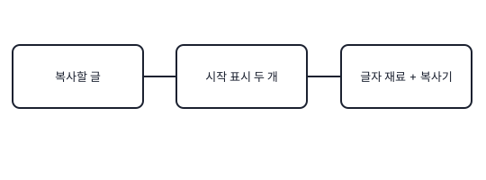
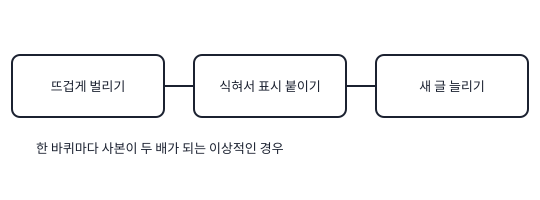
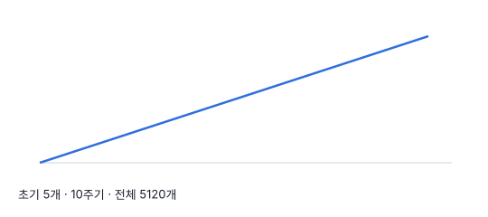
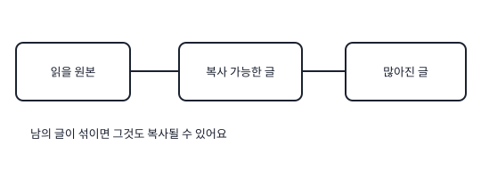
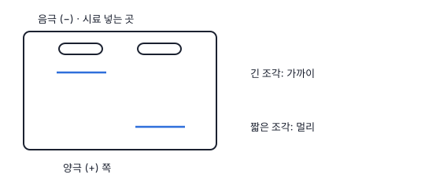
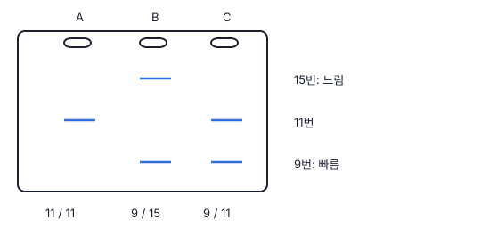
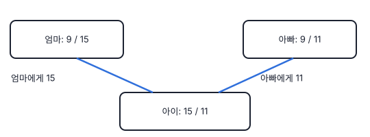

# PCR과 DNA 기술의 응용 — 5살도 이해하는 정리노트

이영만 교수님 생명과학 · 1013 수업 (6장 DNA 기술과 유전체학)

> `정리노트_1013_PCR_and_DNA_Technology.html`를 마크다운으로 옮겼어요. 그림은 `figures_1013/` 폴더의 SVG, 위젯은 대표 설정의 정적 그림으로 바꿨어요. 수식은 `$…$` / `$$…$$`라서 GitHub, Obsidian, Typora에서 보여요.

**목차**

- [0. DNA 클로닝 복습과 PCR](#s0)
  - [지난 수업: DNA 클로닝](#s0-recap)
  - [PCR: 시험관 속 복사 준비](#s0-pcr-components)
  - [PCR 세 단계와 증폭량](#s0-pcr-cycle)
  - [적은 시료를 읽기: 역전사와 오염](#s0-pcr-uses)
- [1. 겔 전기영동: DNA 크기 읽기](#s1)
  - [전기영동의 방향과 거리](#s1-gel)
- [2. DNA 지문감식과 STR](#s2)
  - [STR 반복 횟수가 밴드가 되기까지](#s2-str)
  - [친자 판별: 부모에게서 하나씩](#s2-parentage)
- [3. 단백질 생산과 유전자 치료](#s3)
  - [생물을 단백질 생산 공장으로](#s3-protein)
  - [유전자 치료와 세대 전달](#s3-therapy)
- [4. 동물 복제: 핵은 누구에게서 왔을까](#s4)
  - [핵치환과 복제양 돌리](#s4-clone)
- [5. 식물 유전공학과 GMO](#s5)
  - [작물에 필요한 성질 더하기](#s5-plant)
  - [GMO와 내성의 문제](#s5-gmo)
- [6. 요약 · 예고](#s6)
  - [시험 직전 한 줄](#s6-cheatsheet)
  - [끊긴 지점과 남은 범위](#s6-next)
  - [함께 보면 좋은 자료](#s6-links)

## 0. DNA 클로닝 복습과 PCR

### 지난 수업: DNA 클로닝

*1013 수업 · 6장 p1–5*

**정확히 말하면**

- 제한효소로 원하는 DNA와 플라스미드를 같은 방식으로 잘라 상보적인 점착성 말단을 만들어요.
- 연결효소로 조각을 이어 재조합 DNA를 만들어요.
- 대장균에 넣고 배양한 뒤 플라스미드를 분리하면 원하는 DNA 사본을 많이 얻어요.
- 항생제 내성은 플라스미드를 가진 세균을 고르는 데 쓰여요. 원하는 조각이 들어갔는지는 추가로 확인해야 해요.

[지난 수업의 DNA 클로닝](../../1008/정리노트_1008_Gene_Regulation_and_DNA_Cloning.html#s5-cloning)

**페이지 요약**

같은 조각을 잘라 잇고 세균을 길러 DNA 사본을 확보해요.

*용어*

- **DNA 클로닝** — 특정 DNA의 사본을 많이 만드는 과정

---

### PCR: 시험관 속 복사 준비

*1013 수업 · 6장 p1–5*

**쉽게 말하면**

필요한 구간 양쪽에 시작 표시를 붙이고 글자 재료와 복사기를 준비해요.

*복사할 글과 시작 표시, 재료, 복사기가 함께 필요해요.*

**정확히 말하면**

PCR(중합효소 연쇄반응, Polymerase Chain Reaction)은 시험관에서 특정 DNA를 증폭하는 방법이에요. 세균을 배양하는 DNA 클로닝과 달리 세포 밖에서 반응해요.

- **주형 DNA:** 원하는 표적 서열을 포함한 DNA예요.
- **두 프라이머(primer):** 서로 다른 주형 가닥에 붙어 원하는 구간의 양 끝을 정해요. 프라이머가 붙을 양 끝 서열 정보가 필요해요.
- **내열성 DNA 중합효소:** 프라이머 끝에서 새 DNA를 5′에서 3′ 방향으로 늘려요. 대표 효소는 Taq 중합효소예요.
- **dNTP:** DNA를 만들 네 종류의 재료인 dATP·dGTP·dCTP·dTTP예요. 디옥시리보뉴클레오시드 삼인산을 뜻해요.

**교수님 말씀**

> “DNA 복제는 무조건 프라이머가 필요합니다.”

교수님은 기존 글을 보며 글자를 하나씩 덧붙이는 복사를, 가득 찬 차선 옆에 차가 차례로 들어오는 모습에 비유했어요.

**꼭 기억해요**

- 세포 안에서는 헬리케이스가 두 가닥을 분리하고 프라이메이스가 RNA 프라이머를 만들어요. PCR에서는 열로 분리하고 합성한 DNA 프라이머를 공급해요.
- 표적 내부 서열 전체를 이미 알아야 하는 것은 아니에요. 프라이머를 설계할 양 끝 정보를 알아야 해요.
- dNTP는 재료이고 중합효소는 재료를 연결하는 효소예요. DNA 연결효소와 같은 역할로 혼동하지 마세요.
- PCR에 플라스미드·헬리케이스·프라이메이스를 필수 재료로 넣지 않아요. 일반적인 PCR에서는 열과 미리 만든 프라이머가 그 일을 대신해요.

**보충 · 노트에 빠졌던 수업 내용**

Taq는 호열성 **세균** 유래 중합효소예요. 수업 중 고세균이라고 말한 부분은 강의노트의 분류에 맞게 바로잡아요. 교재도 고온 지역 미생물의 내열성 효소를 쓴다고 설명해요.

출처: 강의노트 6장 p2, 교재 6장 p122

DNA 클로닝의 도구는 실험 목적에 따라 골라 써요. 플라스미드 외에도 바이러스 벡터·효모 벡터를 DNA 운반에 쓸 수 있으며 모든 실험에 이 도구들이 전부 필수라는 뜻은 아니에요. 제한효소는 절단, 연결효소는 연결, 벡터는 운반, 내성 유전자는 선별, 겔은 절편 확인에 쓰여요.

출처: 교재 6장 pp.119–122, 기출 6강 12의 도구 묶음. 1008의 DNA 클로닝 복습과 연결한 보충이에요.

**페이지 요약**

주형, 두 프라이머, 내열성 중합효소, dNTP를 준비해요.

*용어*

- **프라이머(primer)** — 새 가닥이 자라기 시작하는 짧은 DNA
- **Taq 중합효소** — 반복 가열에 견디는 DNA 합성 효소

---

### PCR 세 단계와 증폭량

*1013 수업 · 6장 p1–5*

**쉽게 말하면**

두 줄을 벌리고 시작 표시를 붙인 다음 새 줄을 늘리는 일을 반복해요.

*세 일을 한 바퀴로 반복하면 복사본이 늘어요.*

**정확히 말하면**

1. **변성:** 약 95℃로 가열해 두 DNA 가닥 사이 수소결합을 깨고 가닥을 분리해요.
2. **결합:** 약 55℃로 낮추면 두 프라이머가 각 주형의 상보적인 자리에 붙어요.
3. **신장:** 약 72℃에서 Taq 중합효소가 dNTP를 이어 새 DNA를 합성해요.

이 세 단계를 한 주기(cycle)라고 해요. 이상적으로 매 주기 모든 분자가 복제되면 초기 N₀개의 전체 분자는 n주기 뒤 N₀×2^n개가 돼요. 처음 1개라면 1주기 2개, 2주기 4개, 3주기 8개예요. 수업에서는 보통 30–35주기를 반복한다고 설명했어요.

**교수님 말씀**

> “n 사이클 돌리면 몇 배가 된다? 2의 n승 배가 됩니다.”

**꼭 기억해요**

- 변성은 DNA 두 가닥을 분리하는 단계예요. 내열성 효소를 쓰는 이유는 이런 가열을 반복해도 DNA를 합성할 기능이 필요하기 때문이에요.
- 계속 뜨겁게 두면 프라이머가 붙기 어려워요. 결합 단계에서는 온도를 낮춰야 해요.
- 55℃는 수업의 대표값이에요. 실제 결합 온도는 프라이머의 서열·조건에 따라 달라요.
- 2^n은 이상적인 **전체 DNA 분자 수** 증가예요. 초기 주기에는 양 끝 길이가 정확히 표적과 일치하지 않는 산물도 있어요. 3주기 전체 8개를 모두 정확한 길이의 표적 8개라고 말하면 안 돼요.
- 실제 반응에서는 효율이 낮아지거나 재료가 소모되어 계속 정확히 두 배가 되지는 않아요.

#### 직접 해 보기: 전체 분자 수 *(정적 스냅샷 — 직접 조작은 HTML 버전)*

처음 분자 수와 주기를 바꾸면 매 주기 두 배가 되는 이상적인 전체 분자 수를 보여 줘요.

이상적 전체 분자 수 **8**개

범례: 가로축은 주기, 세로 한 단계는 두 배 증가예요. 정확한 길이의 표적 산물 수를 보여 주는 그래프가 아니에요.

| 초기 분자 | 주기 | 전체 분자 |
|---|---|---|
| 1 | 3 | 8 |
| 2 | 5 | 64 |
| 5 | 10 | 5120 |

**페이지 요약**

변성·결합·신장을 반복하면 이상적 전체 분자 수는 매 주기 두 배가 돼요.

*용어*

- **변성** — 열로 DNA 두 가닥을 분리함
- **결합** — 프라이머가 주형에 붙음
- **신장** — 새 가닥을 늘림

---

### 적은 시료를 읽기: 역전사와 오염

*1013 수업 · 6장 p1–5*

**쉽게 말하면**

너무 적어서 읽기 힘든 글을 많이 복사하면 비교할 수 있어요.

*원본을 복사하되 남의 글이 섞이지 않게 조심해요.*

**정확히 말하면**

범죄 현장의 모근세포나 고대 유골에서 얻은 미량 DNA도 PCR로 증폭한 뒤 분석할 수 있어요. 네안데르탈인 DNA 연구는 고대 DNA 분석 사례로 소개됐어요.

RNA 바이러스 검출에는 먼저 역전사효소로 RNA를 DNA로 바꿔요. 그 DNA에 바이러스 서열에 맞는 프라이머를 붙여 PCR해요. 역전사와 PCR은 서로 다른 단계예요.

손이나 주변 환경에서 나온 DNA가 시료에 섞이는 **오염**은 엉뚱한 결과를 만들 수 있어요. 프라이머의 비특이적 결합이나 표적 검출 실패도 주의해야 해요.

**교수님 말씀**

> “PCR은 DNA를 증폭하는 기술입니다. 어떻게 할까요?”

교수님은 미라와 네안데르탈인 연구 이야기를 통해 미량 시료에서는 오염 관리가 특히 중요하다고 설명했어요.

**꼭 기억해요**

- 역전사효소가 RNA를 DNA로 바꿔요. PCR 중합효소가 RNA를 직접 DNA로 바꾼다고 혼동하지 마세요.
- 표적 서열에 맞는 프라이머가 검출할 대상을 정해요. 증폭 결과가 있다고 어떤 시료든 같은 바이러스라는 뜻은 아니에요.
- 잘못된 양성·음성은 프라이머 하나의 문제만으로 설명할 수 없어요. 시료 상태·오염·반응 조건도 결과에 영향을 줘요.
- PCR은 남아 있는 DNA를 증폭해요. 오랜 시간 부서져 사라진 DNA를 되살리는 기술은 아니에요.
- 네안데르탈인 유래 유전자의 비중을 전체 DNA 서열 유사도와 같은 값으로 읽으면 안 돼요. 이 수업의 핵심은 고대 DNA를 분석할 때 오염을 조심하는 것이에요.

**페이지 요약**

RNA는 먼저 DNA로 바꾸고, 적은 DNA를 증폭할 때는 오염을 조심해요.

*용어*

- **역전사효소** — RNA를 주형으로 DNA를 합성하는 효소
- **오염** — 분석하려던 시료에 다른 물질이나 DNA가 섞임

---

## 1. 겔 전기영동: DNA 크기 읽기

### 전기영동의 방향과 거리

*1013 수업 · 6장 p1–5*

**쉽게 말하면**

작은 조각은 틈을 빨리 지나 멀리 가고 큰 조각은 뒤에 남아요.

*두 조각을 같은 시간 동안 움직이면 작은 조각이 더 멀리 가요.*

**정확히 말하면**

아가로오스(아가로스) 겔 전기영동은 전기장을 걸어 DNA 절편을 분리하는 방법이에요. 시료를 넣는 홈(well)에 DNA를 넣고 전압을 걸어요.

DNA의 **인산기** 때문에 DNA는 **음전하**를 띠어요. 따라서 음극(−)에서 **양극(+)** 쪽으로 이동해요.

같은 겔·시간·조건에서 비교하는 DNA 절편은 짧을수록 빠르고 멀리 이동해요. 500 염기쌍(bp)의 절편은 5000 염기쌍 절편보다 멀리 가요. 같은 길이의 분자들이 모이면 같은 위치의 띠, 밴드로 관찰돼요.

DNA는 맨눈으로 바로 보이지 않아요. 수업에서는 DNA에 결합하는 염료를 쓰고 자외선을 비추어 **형광**을 내게 하는 검출법을 설명했어요.

**교수님 말씀**

교수님은 겔의 작은 구멍을 통과할 때 큰 조각이 빠져나오기 힘들고 작은 조각은 빨리 지나간다고 설명했어요.

**꼭 기억해요**

- 양극 쪽으로 가는 이유는 DNA가 음전하이기 때문이에요. 음극에 끌려가는 것이 아니에요.
- 멀리 간 밴드는 작은 DNA예요. 웰 가까이에 남은 밴드를 작은 조각으로 읽지 마세요.
- 단백질도 적절한 전기영동으로 분리할 수 있어요. 모든 단백질이 어떤 조건에서도 DNA와 같은 방향·크기 규칙으로 이동한다고 일반화하면 안 돼요.
- 수업의 자외선·형광 염료 조건에서는 형광으로 DNA를 확인해요. 염료나 검출법이 명시되지 않은 문제에서는 가시광선으로 보이는 염색법도 있을 수 있어요. “가시광선으로 DNA를 확인”을 조건 없이 항상 불가능하다고 판정하면 모호해요.

**보충 · 수업에서 다루지 않았어요**

길이를 아는 표지 DNA인 **ladder**를 함께 흘려 보내면 시료 밴드의 위치와 비교하여 길이를 추정할 수 있어요. 겔의 종류와 조건은 분자에 맞게 골라야 해요. 단백질의 이동은 전하와 분리 조건에도 영향을 받아요.

출처: 교재 6장 pp122–123

아가로오스 겔은 일반적으로 비교적 큰 DNA 절편 분리에 적합해요. 겔 전기영동은 DNA 외 RNA와 단백질도 적절한 겔·처리 조건에서 분리할 수 있어요. 이들이 모두 같은 전하와 같은 분리 조건을 갖는다는 뜻은 아니에요.

출처: 교재 6장 p.123, 강의노트 6장 p2.

**페이지 요약**

DNA는 양극으로 가고, 같은 조건에서 짧은 절편이 더 멀리 이동해요.

*용어*

- **염기쌍(bp)** — DNA 절편 길이를 나타내는 단위
- **밴드(band)** — 같은 위치에 모여 관찰되는 DNA 띠

---

## 2. DNA 지문감식과 STR

### STR 반복 횟수가 밴드가 되기까지

*1013 수업 · 6장 p1–5*

**쉽게 말하면**

같은 짧은 말을 몇 번 적었는지가 다르면 글 전체의 길이도 달라져요.

*같은 길이 두 개는 한 자리에 겹치고 다른 길이는 따로 보여요.*

**정확히 말하면**

DNA 지문감식(DNA fingerprinting), 또는 DNA 프로파일링은 DNA 서열 차이로 개인을 구별하는 방법이에요.

STR(Short Tandem Repeat)은 짧은 염기서열이 나란히 이어지는 짧은 직렬 반복 서열이에요. 수업과 교재에서는 약 3–5개 염기의 반복단위를 설명했어요. 예를 들어 GTA가 여러 번 반복되고, 같은 좌위에서도 사람마다 반복 횟수가 달라요.

같은 STR 좌위에서는 반복단위 서열이 같아도 반복 **횟수**가 달라질 수 있어요. 사람마다 DNA 세트 수가 달라서 생기는 차이가 아니에요.

STR 좌위 양 끝에 프라이머를 붙여 PCR하면 반복부를 포함한 절편이 만들어져요. 양 끝 길이가 같다는 조건에서 반복이 많으면 절편이 길고, 적으면 짧아요. 겔 전기영동으로 그 길이 차이를 읽어요.

- A=(11,11): 동형접합이라 두 대립유전자의 길이가 같아 한 위치의 밴드가 나와요.
- B=(9,15): 이형접합이라 짧은 9와 긴 15의 밴드가 따로 나와요.
- C=(9,11): 이형접합이라 9와 11의 밴드가 따로 나와요.
- SNP(단일염기다형성)는 특정 위치의 염기 하나가 개인 사이에서 다른 변이예요.
- CNV(복제수변이)는 DNA 구간의 복제 수가 개인 사이에서 다른 변이예요. 수업에서는 두 변이도 소개했지만 STR을 중심으로 공부하라고 했어요.

**교수님 말씀**

> “일단 STR만 알면 돼요.”

교수님은 “상무, 상무, 상무”처럼 같은 말이 이어지는 모습을 STR에 비유했어요. 반복 횟수가 달라지면 길이가 달라진다는 뜻이에요.

**꼭 기억해요**

- 반복단위의 염기 수와 반복 횟수는 달라요. 3개짜리 단위를 9번 반복하면 반복부는 27개 염기예요. PCR 절편에는 양쪽 구간도 포함될 수 있어요. 프라이머 부분을 포함한 증폭 산물의 반복 이외 고정 구간이 80 bp이고 반복단위가 4 bp라면, 길이는 80+4×반복 횟수예요. 9회는 116 bp, 11회는 124 bp, 15회는 140 bp예요.
- 한 밴드는 DNA가 한 개 또는 대립유전자가 하나라는 뜻이 아니에요. 같은 길이인 두 대립유전자 산물이 겹칠 수 있어요.
- 단일 좌위에서 서로 다른 길이를 가진 이형접합자라면 두 위치가 나와요. 여러 좌위를 함께 분석한 전체 밴드 수에 이 규칙을 그대로 적용하지 마세요.
- 반복이 적은 9번은 15번보다 짧아서 더 멀리 이동해요. 위 그림은 음극의 웰이 위, 양극 방향이 아래예요.

**보충 · 노트에 빠졌던 수업 내용**

STR 감식에서는 대개 비암호화 영역의 여러 좌위를 비교해요. 먼저 PCR로 증폭한 뒤 겔에서 길이를 나누어요. 실제 손가락의 지문 무늬를 분석하는 기술은 아니에요.

교재는 일반적인 DNA 지문으로 사람을 구별할 때 **일란성쌍둥이**를 예외로 들어요. “모든 사람의 DNA 지문은 반드시 다르다”는 주장에는 이 예외를 고려해야 해요.

출처: 강의노트 6장 p2, 교재 6장 p124

DNA 지문감식에는 혈액·정액·모근·피부·뼈 등에서 얻은 DNA 시료를 쓸 수 있어요. 핵심은 분석할 DNA가 확보되는 것이며 몸의 모든 시료가 같은 양과 보존 상태의 DNA를 제공하는 것은 아니에요.

출처: 강의노트 6장 p2의 머리카락·정자 시료, 교재 6장 pp.124–125와 기출 6강 20·35의 DNA 시료.

**페이지 요약**

STR 반복 수를 PCR 절편의 길이로 바꿔 읽고 동형접합에서는 같은 길이가 겹쳐요.

*용어*

- **동형접합** — 한 좌위의 두 대립유전자가 같은 상태
- **이형접합** — 한 좌위의 두 대립유전자가 다른 상태

---

### 친자 판별: 부모에게서 하나씩

*1013 수업 · 6장 p1–5*

**쉽게 말하면**

아이는 엄마에게 하나, 아빠에게 하나씩 받아요.

*각 자리에서 부모에게 하나씩 받은 글을 비교해요.*

**정확히 말하면**

자녀는 한 STR 유전자좌에서 엄마에게 대립유전자 하나, 아빠에게 하나를 물려받아요. 따라서 부모에게서 제공할 수 있는 대립유전자와 아이의 두 대립유전자가 맞는지 비교해요.

엄마 B=(9,15), 아빠 C=(9,11)에서 자녀 (15,11)은 엄마의 15와 아빠의 11을 받아 생길 수 있어요. 자녀 (15,20)은 이 단순 모형에서 부모에게 없는 20이 있어서 양립하지 않아요. 실제 친자 검사는 돌연변이·검사 오류 등도 고려해 해석해요.

한 좌위가 맞아도 **우연**히 같은 반복 수를 가진 사람일 수 있어요. **여러** 좌위를 비교해야 친자 관계나 개인 식별의 근거가 강해져요. 수업의 영상은 15개 좌위를 검사한 예이지, 모든 검사에 고정된 수는 아니에요.

범죄 현장 시료와 용의자의 DNA를 비교하거나, 유골을 친척의 DNA와 비교해 신원을 확인하는 데도 활용해요. 러시아 황실과 아나스타샤 주장의 신원 확인 이야기도 이런 활용 예로 소개됐어요.

**교수님 말씀**

교수님은 “하나는 엄마가 준 거, 하나는 아빠가 준 거”라고 친자 판별의 기준을 설명했어요. 한 위치의 우연 일치만으로 결론내리지 않도록 여러 위치를 검사한다고 덧붙였어요.

**꼭 기억해요**

- 자녀의 모든 밴드가 엄마와 같거나 아빠와 같아야 하는 것은 아니에요. 각 좌위에서 부모 각각의 대립유전자 하나씩을 확인해요.
- “아이는 엄마 밴드 절반과 아빠 밴드 절반”이라는 말은 상속 원리를 거칠게 줄인 표현이에요. 공유하는 대립유전자와 동형접합의 겹침 때문에 눈에 보이는 **밴드 수의 절반**이 항상 보장되지는 않아요.
- 예의 15는 엄마 B에게서 온 값이에요. 수업에서 이 값을 아빠 것으로 말한 부분은 부모의 실제 구성과 맞춰 고쳤어요.
- 한 좌위가 맞으면 그 좌위와 양립한다는 뜻이에요. 친부 확정으로 과장하지 마세요. 여러 좌위가 필요해요.
- 길이가 맞는다는 것은 같은 대립유전자로 분류할 단서예요. 한 밴드 위치가 같다고 두 사람의 DNA 전체가 같다는 뜻은 아니에요.

**보충 · 노트에 빠졌던 수업 내용**

DNA 지문 분석은 사람뿐 아니라 동식물·미생물의 유전적 차이와 신원·종 확인에도 활용돼요. 교재는 병원성 대장균 검사와 밀렵 수사 등의 예를 들어요. 강의노트는 충분한 수의 좌위를 조사하면 법정 증거로 채택될 수 있다고 설명해요. 이는 수업 자료에 실린 활용 설명이며, 개별 사건의 법적 효력을 자동 보장하는 뜻은 아니에요.

출처: 강의노트 6장 pp2–3, 교재 6장 p125

**페이지 요약**

친자 비교는 각 좌위에서 부모 각각에게 하나씩 받을 수 있는지 확인해요.

*용어*

- **대립유전자(allele)** — 같은 좌위에 있는 유전자 또는 DNA 서열의 서로 다른 형태
- **친자 판별** — 부모에게서 받은 대립유전자들의 관계를 여러 좌위에서 비교함

---

## 3. 단백질 생산과 유전자 치료

### 생물을 단백질 생산 공장으로

*1013 수업 · 6장 p3–4*

**쉽게 말하면**

필요한 물건의 만드는 법을 작은 공장에 보내면 많이 만들 수 있어요.

*공장 역할을 하는 생물에서 만든 물질을 골라내요.*

**정확히 말하면**

유전공학(genetic engineering)은 DNA 기술로 세포나 생명체의 유전자를 목적에 맞게 변형하는 일이에요. 외부 유전정보가 도입된 생명체를 형질전환(transgenic) 생명체라고 해요.

1. 원하는 단백질을 암호화하는 유전자를 발현벡터(expression vector)에 넣어요.
2. 벡터를 대장균 등에 도입해 배양해요. 프로모터(promoter)는 유전자의 전사가 시작되도록 하는 조절 부위예요.
3. 생산된 단백질을 세포나 배양액에서 추출하고 정제해요.

사람 인슐린(insulin) 유전자를 대장균에서 발현시켜 얻는 단백질 의약품의 예가 Humulin(휴뮬린)이에요. 인간성장호르몬, 혈전 치료용 단백질, 백신 성분도 생산 대상이 될 수 있어요.

대장균에서 원하는 기능을 갖추기 어려운 단백질은 효모(yeast) 같은 진핵생물이나 동물을 생산자로 사용할 수 있어요. 암양의 젖에서 발현하는 단백질 유전자의 프로모터에 원하는 유전자를 연결하면, 젖에서 약용 단백질을 생산하고 정제하는 데 이용할 수 있어요.

**교수님 말씀**

교수님은 인슐린 유전자를 대장균에 넣고 대장균을 싸게 대량 배양하는 방식을 생산 공장으로 설명했어요. 인슐린 개발의 사업화 이야기는 아이디어를 실제 단백질 생산에 연결한 사례로 소개했어요.

> 그때는 효모를 사용하든지, 아니면 다른 동물을 사용해야 돼요.

**꼭 기억해요**

생산자가 대장균이라고 해서 생산된 의약품이 세균 단백질이라는 뜻은 아니에요. 도입한 사람 유전자에 따라 사람 단백질을 만드는 것이 목적이에요.

유전자를 넣는 것과 원하는 단백질이 충분히 발현되는 것은 달라요. 적절한 프로모터와 생산 조건이 필요해요. 모든 사람 단백질을 대장균에서 같은 방식으로 만들 수 있다고 일반화하지 않아요.

이 단백질 의약품을 환자에게 투여하는 것만으로 환자의 유전자가 바뀌지는 않아요. [유전자 치료](#s3-therapy)와 구별해요.

**페이지 요약**

필요한 물건의 만드는 법을 작은 공장에 보내면 많이 만들 수 있어요.

*용어*

- **프로모터(promoter)** — 유전자의 전사 시작을 조절하는 DNA 부위예요.
- **Humulin** — 유전공학으로 생산한 사람 인슐린 의약품의 예예요.
- **발현벡터(expression vector)** — 도입한 유전자의 발현을 가능하게 하는 벡터예요.

---

### 유전자 치료와 세대 전달

*1013 수업 · 6장 p3–4*

**쉽게 말하면**

고장 난 만드는 법을 세포 안에서 고쳐 주는 치료예요.

*만들어진 약을 먹는 것과 세포의 만드는 법을 바꾸는 것은 달라요.*

**정확히 말하면**

유전자 치료(gene therapy)는 환자의 세포에 정상 유전자를 도입하거나 질병을 일으키는 유전자의 기능을 조절하여 치료하는 방법이에요. 정상 유전자가 만드는 효소의 기능을 잃은 질환은, 결핍된 기능을 유전자로 보완한다는 목적이 분명한 예예요.

| 조작 대상 | 영향과 전달 |
|---|---|
| 생식세포(germ-line cell)·초기 수정란 단계 | 생식계열까지 변형되면 다음 세대에 전달될 수 있어요. |
| 체세포(somatic cell) | 해당 세포 계열에 영향을 주며 생식세포를 바꾸지 않으므로 다음 세대에 전달되지 않아요. |

수업은 인간의 생식세포 유전자 치료에 큰 윤리적 제한이 있고, 체세포 유전자 치료가 이용된다고 설명했어요. 다음 세대에 영향을 주는 변화는 치료받는 사람 밖으로 영향이 이어질 수 있기 때문이에요.

ADA는 아데노신 탈아미노효소(adenosine deaminase)예요. ADA 결핍은 면역세포 기능에 해를 주어 중증복합면역결핍증(SCID, severe combined immunodeficiency)의 한 원인이 될 수 있어요. 환자의 백혈구에 정상 ADA 유전자를 전달하고 다시 환자에게 넣어 결핍 기능을 보완하는 치료 사례를 배웠어요.

**교수님 말씀**

> 반드시 그 개체의 유전자를 조작을 해서 치료하는 게 유전자 치료인 겁니다.

교수님은 피부세포를 바꾸면 그 세포 계열에 영향을 주지만 자손에게 전달되는 것은 아니라는 예를 들었어요. 무균 환경이 필요한 면역결핍 환자 이야기는 면역 기능 회복이 치료의 목적임을 보여 줘요.

**꼭 기억해요**

유전공학으로 만든 인슐린이나 응고인자를 주사하는 단백질 치료, 유전자 조작 식품을 먹는 것, 장기를 이식하는 것만으로는 환자 세포의 유전자를 바꾸는 유전자 치료가 아니에요.

ADA를 DNA 중합효소처럼 DNA를 직접 복제하는 효소라고 외우지 않아요. 수업의 복제 설명을 그대로 기능 정의로 쓰는 대신, ADA 결핍이 면역세포에 해롭고 정상 유전자 도입으로 그 기능을 보완한다는 관계를 기억해요.

SCID는 하나의 원인만 있는 질환을 뜻하지 않아요. ADA 결핍은 원인의 한 예예요. 수업의 허용·금지 논의는 윤리적 구분으로 읽고 모든 나라의 현재 법률을 단정하지 않아요.

**보충 · 노트에 빠졌던 수업 내용**

1990년 사례에서는 환자의 성숙 백혈구에 정상 ADA 유전자를 넣고 배양한 뒤 환자에게 주사했어요. 이 백혈구는 이미 분화하여 수명이 제한되므로, 정상 기능을 지속하려면 수개월마다 치료를 반복해야 했어요. 유전자 도입 세포의 수명도 치료 지속성을 결정해요.

출처: 강의노트 6장 p4, 교재 6장 p126(PDF 9쪽)

**페이지 요약**

고장 난 만드는 법을 세포 안에서 고쳐 주는 치료예요.

*용어*

- **유전자 치료(gene therapy)** — 환자 세포의 유전자 기능을 바꾸어 치료해요.
- **체세포(somatic cell)** — 생식계열 밖의 세포이며 그 변화는 자손에게 전달되지 않아요.
- **ADA** — 결핍 시 면역 기능 장애를 일으킬 수 있는 효소예요.

---

## 4. 동물 복제: 핵은 누구에게서 왔을까

### 핵치환과 복제양 돌리

*1013 수업 · 6장 p4*

**쉽게 말하면**

빈 알에 다른 양의 설계도를 넣어 새끼를 만드는 방법이에요.

*설계도를 주는 양, 알을 주는 양, 새끼를 품는 양은 역할이 달라요.*

**정확히 말하면**

핵치환(nuclear transfer)은 난자의 핵을 제거한 뒤 다른 세포의 핵을 넣는 방법이에요. 돌리(Dolly)는 성체 양의 젖샘(mammary gland)에서 얻은 분화된 2배체 체세포를 사용했어요.

1. 미수정 난자에서 핵을 제거해요. 난자의 세포질은 남아요.
2. 성체 젖샘 체세포의 핵을 넣거나, 핵 제거 난자와 그 체세포를 융합해요.
3. 전기 자극으로 분열을 유도하고 복제 배아로 배양해요.
4. 배아를 대리모 자궁에 착상시켜 새끼가 발달하도록 해요.

| 제공자 | 제공하는 것 |
|---|---|
| 젖샘 체세포 제공자 | 핵 DNA(nuclear DNA)의 주된 유전적 조성이에요. |
| 난자 제공자 | 난자 세포질과 미토콘드리아 DNA(mitochondrial DNA)를 제공해요. |
| 대리모 | 배아가 착상하고 발달할 자궁 환경을 제공해요. |

따라서 수업의 핵치환 모형에서 복제양의 핵 DNA는 핵 제공자와, 미토콘드리아 DNA는 난자 제공자와 대응해요. 유전적으로 거의 같은 개체를 만드는 것이지 정자와 난자를 수정하여 두 부모의 핵 유전자를 섞는 과정이 아니에요.

**교수님 말씀**

교수님은 핵을 준 양과 난자를 준 양을 구별하고, 미토콘드리아에도 DNA가 있다는 점을 확인했어요. 돌리의 핵 제공 세포가 젖샘 세포였음을 이름에 관한 일화와 함께 설명했어요.

> 핵 DNA는 핵 제공자하고 일치하게 됩니다.

우수한 가축을 얻거나 반려동물을 복제하려는 목적이 소개됐어요. 많은 시도가 실패할 수 있고, 태어난 복제동물에도 발달·건강 문제가 생길 수 있어요.

**꼭 기억해요**

돌리는 생식세포 클로닝이라고 부르기보다 **체세포 핵치환 복제**라고 구분해요. 난자를 사용하더라도 넣는 핵이 분화한 젖샘 체세포에서 왔기 때문이에요.

대리모가 새끼를 낳았다는 이유로 핵 DNA까지 대리모 것이 되는 것은 아니에요. 핵·세포질·임신 환경의 제공자를 각각 확인해요.

핵 DNA가 거의 같아도 미토콘드리아 DNA의 출처와 발달 환경이 다를 수 있어요. 모든 DNA·외모·건강·성격이 완전히 같다고 확대하지 않아요.

**보충 · 노트에 빠졌던 수업 내용**

돌리의 핵심은 분화된 성체 체세포로 만든 최초의 복제 포유류라는 점이에요. 수업·교재의 “최초 포유동물 클론”이라는 넓은 표현은 이 조건을 붙여 기억해요. 교재의 실험 설명은 어른 양의 젖샘에서 채취한 2배체 세포와 핵이 제거된 미수정란의 융합을 명시해요.

출처: 1013 수업, 강의노트 6장 p4, 교재 6장 p127(PDF 10쪽)

**페이지 요약**

빈 알에 다른 양의 설계도를 넣어 새끼를 만드는 방법이에요.

*용어*

- **핵치환(nuclear transfer)** — 핵을 제거한 난자에 다른 세포의 핵을 넣어요.
- **핵 DNA** — 핵 제공자의 주된 유전적 조성을 물려받아요.
- **미토콘드리아 DNA** — 수업의 복제 모형에서는 난자 제공자에서 와요.

---

## 5. 식물 유전공학과 GMO

### 작물에 필요한 성질 더하기

*1013 수업 · 6장 p4–5*

**쉽게 말하면**

작물에 원하는 능력을 더해 잘 자라거나 영양을 더 담게 해요.

*원하는 능력을 더하는 목적과 주변으로 퍼지는 위험은 구별해요.*

**정확히 말하면**

식물 유전공학의 목적은 해충·질병 저항성, 더위·가뭄·염분에 대한 내성, 생산성·생장 개선, 제초제 내성, 영양 개선, 의약품 생산이에요. 질병 저항성에는 바이러스 감염에 대한 저항성을 높이는 경우도 포함돼요.

작물이 해충을 죽이는 물질을 만들게 하면 해충 피해를 줄일 수 있어요. 제초제는 풀을 죽이는 약이에요. 작물에 제초제 내성을 부여하면 내성 없는 주변 잡초를 약으로 제거하면서 작물은 보호하는 방식으로 사용할 수 있어요.

황금쌀(golden rice)은 종자에 β-카로틴(베타카로틴, β-carotene)을 축적하도록 만든 영양 개선의 예예요. β-카로틴은 비타민 A(vitamin A)의 전구체이며, 황금색을 띠는 이유가 돼요. β-카로틴과 비타민 A 자체는 같은 물질이 아니에요.

반딧불의 루시퍼레이스(luciferase)는 빛을 만드는 발광효소예요. 이 효소의 유전자를 담배에 넣고 발현되게 하면 기질과 필요한 조건이 갖춰졌을 때 빛을 낼 수 있어요. 이런 눈에 띄는 신호를 유전자 도입·발현 실험의 지표로 사용하는 유전자를 리포터 유전자(reporter gene)라고 해요.

**교수님 말씀**

교수님은 텃밭에서 작물과 잡초가 같이 자라는 상황으로 제초제 내성의 목적을 설명했어요. 황금쌀은 밥을 통해 β-카로틴을 공급하려는 영양 개선의 취지로 소개했어요.

리포터는 시험 점수를 빨리 확인하는 것처럼 실험 결과를 눈에 보이게 해 주는 예였어요. 발광 가로수 아이디어는 가능성에 관한 이야기이며, 보급 상태나 성공이 확인된 사례로 외우지 않아요.

**꼭 기억해요**

해충 저항성은 작물이 해충의 피해를 견디는 성질이고, 제초제 내성은 작물이 약의 작용을 견디는 성질이에요. 약으로 잡초만 죽이려는 목적과 작물의 독소로 해충을 죽이려는 목적을 구분해요.

수업과 교재 일부 문장의 “형광” 표현은 루시퍼레이스의 발광과 혼용됐어요. 이 사례는 **생물발광**으로 적어요. 유전자 하나를 넣었다는 사실만으로 항상 빛이 난다고 단정하지 않아요.

황금쌀을 현재 어디에서 얼마나 사용하는지는 수업에서도 불명이라고 했어요. 이번 노트는 이용 현황이 아니라 영양 개선의 원리를 다뤄요.

**보충 · 노트에 빠졌던 수업 내용**

Bt는 간균 Bacillus thuringiensis에서 유래한 살충성 독소예요. Bt 독소 유전자를 작물에 도입하면 작물이 독소를 만들고, 이를 먹는 해충이 피해를 받아 해충 저항성이 생겨요.

교재의 글리포세이트(glyphosate) 내성 예에서는 제초제가 억제하는 엽록체의 특정 효소를 세균 유래 효소로 대체해 작물의 기능을 유지해요. 강의노트의 “글리포세이트를 분해하는 효소” 설명과 달라서, 여기서는 교재에 나온 **억제 표적 효소의 대체** 원리로 구분해요. 독소를 만드는 Bt 해충 저항성과 같은 원리가 아니에요.

출처: 강의노트 6장 p5, 교재 6장 p128(PDF 11쪽)

**보충 · 수업에서 다루지 않았어요**

영양 개선에는 아미노산 조성의 개선도 있어요. 교재는 콩·완두콩·편두·대두·땅콩 같은 콩과 식물 종자에서 메싸이오닌(methionine) 또는 시스테인(cysteine)이 부족하다고 설명해요. 부족한 아미노산 함량을 늘리는 것은 영양 개선의 목적에 해당해요.

작물에 필요한 성질을 넣는 것과 도입 유전자가 다른 잡초종에 퍼지는 것은 달라요. 후자는 작물을 개선하려는 목표가 아니라 관리해야 할 환경 우려예요.

출처: 교재 6장 p127–129(PDF 10–12쪽), 기출 6강 문항 26

**페이지 요약**

작물에 원하는 능력을 더해 잘 자라거나 영양을 더 담게 해요.

*용어*

- **β-카로틴(β-carotene)** — 비타민 A의 전구체이며 황금쌀 색의 원인이에요.
- **리포터 유전자(reporter gene)** — 눈에 띄는 신호로 유전자 발현을 확인하는 데 사용해요.
- **제초제 내성** — 작물이 제초제의 해로운 작용을 견디는 성질이에요.

---

### GMO와 내성의 문제

*1013 수업 · 6장 p5*

**쉽게 말하면**

원하는 능력을 더한 뒤에도 주변 생물과 약의 사용량을 살펴야 해요.

*살아남은 풀들이 늘면 같은 약으로 관리하기 어려울 수 있어요.*

**정확히 말하면**

GMO는 Genetically Modified Organism, 유전자변형생물이에요. 이를 원료로 가공한 식품과 생물 자체는 구별해요.

자발적 돌연변이(mutation)로 독소나 제초제를 견디는 개체가 나타날 수 있어요. 독소에 저항성이 있는 해충이나 제초제 저항성 잡초가 처리 뒤 살아남아 번식하면 그 비중이 늘어날 수 있어요. 목적에 맞춰 필요한 돌연변이가 생기는 것이 아니라, 변이와 선택으로 나타나는 변화예요.

처음에는 제초제로 잡초를 제거할 수 있어도 저항성 잡초가 늘면 관리 효과가 줄고 제초제 사용량을 늘리려는 문제가 생길 수 있어요. 작물의 해충 저항성과 해충의 독소 저항성은 서로 반대 입장에서 사용하는 표현이에요.

카르타헤나 의정서(Cartagena Protocol on Biosafety)는 유전자변형생물의 안전한 국가 간 수송·취급·이용과 생물안전성을 다루는 국제협약이에요. 수업에서는 환경·생태 위험을 관리해야 한다는 윤리적 논점과 함께 소개했어요.

**교수님 말씀**

> 유전자 조작 식품이라고 해서 뭐 독성 물질이 생길 거고 … 그렇게 생각하면 안 되죠.

교수님은 아르헨티나 사례 영상을 통해 저항성 잡초와 제초제 사용 증가의 악순환을 생각하게 했어요. 수업 영상의 특정 피해에 관한 이야기는 농약 사용·노출과 생태 관리를 돌아보는 사례로 읽어요.

**꼭 기억해요**

GMO라는 이름만으로 언제나 독성이 있거나 언제나 안전하다고 판정하지 않아요. 도입한 기능, 실제 노출, 환경 영향을 구체적으로 살펴야 해요.

작물 자체의 섭취 위험과 재배 중 제초제에 과다 노출되는 위험은 달라요. 영상의 특정 질환을 GMO 식품 자체가 일으켰다는 확정된 인과로 바꾸지 않아요.

저항성은 필요해서 생기는 목표 변이가 아니에요. 우연한 변이와 처리 환경에서의 선택을 구별해요. 의정서의 현재 회원국 수나 각국 법률 상태도 수업의 불확실한 언급으로 단정하지 않아요.

**보충 · 노트에 빠졌던 수업 내용**

환경 우려에는 도입 유전자가 교배 가능한 야생종·잡초로 전달되는 경우, 작물의 독소가 먹이망의 비표적 생물종에 영향을 줄 가능성, 재조합 세균이 실험실에서 유출되는 경우가 있어요. 가능성과 조건을 평가해야 한다는 뜻이며 모든 작물에서 반드시 일어나는 결과는 아니에요.

세균을 배양하는 실험실에서는 생물학적 안전 지침을 지켜 유출과 노출을 줄여야 해요. 실험실 조건 밖에서 생존하기 어렵도록 만든 숙주를 사용하는 것도 교재의 안전 관리 예예요.

출처: 강의노트 6장 p5, 교재 6장 p125·129(PDF 8·12쪽)

**보충 · 수업에서 다루지 않았어요**

작물의 유전적 다양성 감소도 기출이 제시하는 환경 우려예요. 소수의 품종에 집중하여 재배하면 기존에 재배하던 다양한 품종의 비중이 줄 수 있다는 조건으로 읽어요. 유전자를 하나 변형했다는 사실 자체가 곧 모든 작물의 다양성 감소를 뜻하는 것은 아니에요.

출처: 기출 6강 문항 3(환경 우려 항목), 조건부 해석

**페이지 요약**

원하는 능력을 더한 뒤에도 주변 생물과 약의 사용량을 살펴야 해요.

*용어*

- **GMO** — 유전자를 변형한 생물이며 그 원료로 만든 식품과 구별해요.
- **저항성의 선택** — 처리 환경에서 견디는 개체가 살아남아 비중이 늘 수 있어요.
- **카르타헤나 의정서** — 국가 간 수송·취급·이용의 생물안전성을 다뤄요.

---

## 6. 요약 · 예고

### 시험 직전 한 줄

| 주제 | 시험 직전 한 줄 |
|---|---|
| PCR 준비물 | 주형 DNA·두 프라이머·dNTP·내열성 Taq 중합효소를 넣어 시험관에서 DNA를 증폭해요. |
| 주기 | 가열로 가닥 분리, 냉각으로 프라이머 결합, 적절한 온도에서 새 가닥 신장을 반복해요. |
| 증폭량 | 매 주기 정확히 두 배가 되는 이상적 조건에서 전체 분자 수는 초기량 곱하기 $2^n$이며 초기 주기의 정확 길이 표적 산물 수와 구별해요. |
| RNA 검사 | RNA를 역전사효소로 DNA로 바꾼 뒤 표적에 맞는 프라이머로 PCR을 해요. |
| 전기영동 | DNA는 음전하라 양극으로 이동하며, 같은 조건의 선형 절편은 짧을수록 더 멀리 가요. |
| STR | 같은 좌위의 반복 횟수가 달라 산물 길이가 달라지며 동형접합이면 두 같은 길이 밴드가 겹쳐 하나로 보여요. |
| 친자 | 한 좌위의 대립유전자는 부모에게서 하나씩 오며, 한 좌위 일치는 친자 확정이 아니어서 여러 좌위를 대조해요. |
| 단백질 생산 | 생산 생물의 유전자를 조작해 얻은 의약품을 투여하는 일과 환자의 유전자를 조작하는 치료를 구별해요. |
| 유전자 치료 | 환자의 유전 기능을 바꿔 치료하며 체세포 조작은 일반적으로 다음 세대에 전달되지 않아요. |
| 동물 복제 | 체세포 핵치환에서는 핵 DNA는 주로 핵 제공자, 미토콘드리아 DNA는 주로 난자 제공자와 일치해요. |
| 작물 개량 | 해충 저항성·제초제 내성·영양 개선은 목적이며 잡초로의 원치 않는 유전자 유출은 생태적 우려예요. |
| GMO | 유전자변형 자체만으로 독성을 단정하지 않으며 재배 중 내성 선택과 농약 과사용 위험을 따로 살펴요. |

---

### 끊긴 지점과 남은 범위

GMO와 카르타헤나 의정서 논의를 마치고 교수님은 다음 장으로 넘어가겠다고 했어요.

> 자, 이 정도로 하고 다음 장으로 넘어가 봅시다.

- 강의노트 6장 p5의 6.3 유전체학·유전체 프로젝트: 이번 전사본에서는 다루지 않았어요.
- 강의노트 6장 p6의 CRISPR·Cas9·guide RNA·PERV: 이번 전사본에서는 다루지 않았어요.
- 위 내용은 강의노트에 남아 있는 항목이에요. 다음 시간에 반드시 배운다는 예고나 시험 제외를 뜻하지 않아요.
- 다음 장 본론은 이 전사본에 없어요. 미다룬 내용의 시험 범위는 아직 불명이에요.

---

### 함께 보면 좋은 자료

- [1013 복습문제](복습문제_1013_PCR_and_DNA_Technology.md)
- [지난 1008 수업: DNA 클로닝](../../1008/정리노트_1008_Gene_Regulation_and_DNA_Cloning.html#s5-cloning)

---

출처: 이영만 교수님 강의노트(6장) · 수업 녹음 전사(1013 생명) · 『생명과학: 기초와 응용』 2판 6장.
