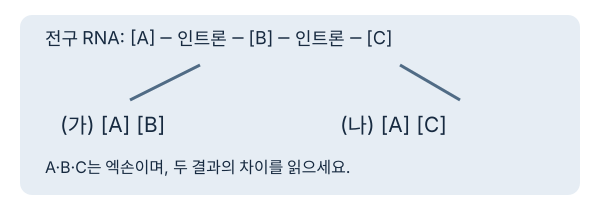
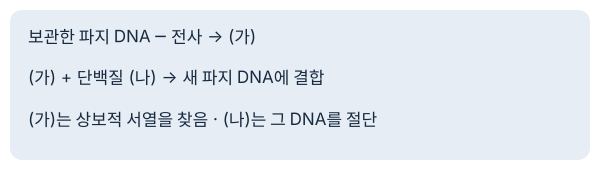

# 생명과학 복습 1015 문제설명

왼쪽 목차로 문항을 고르고, 오른쪽 문제를 보며 해설을 따라가요.

문제의 첫 줄부터 검산까지 설명해요.

**목차**

- [문항별 설명](#problems)
  - [P1. 미세배열의 용도](#p1)
  - [P2. 서열과 데이터베이스 분석](#p2)
  - [P3. CRISPR 응용의 구별](#p3)
  - [P4. 인간 유전체 프로젝트](#p4)
  - [P5. 표적 DNA를 찾아 자르는 도구](#p5)
  - [P6. 단백질체의 범위](#p6)
  - [P7. 생물정보학의 역할](#p7)
  - [P8. [변형] 미세배열과 측정 대상](#p8)
  - [P9. [변형] 단백질체와 유전자 수](#p9)
  - [P10. [변형] 엑손 연결 방식의 차이](#p10)
  - [P11. [변형] 표적 안내자와 절단 효소](#p11)
  - [P12. [변형] 조건이 바뀐 세포의 발현 비교](#p12)
  - [P13. [변형] 잘린 DNA의 복구 결과](#p13)
  - [P14. [변형] 서열 인식 길이와 특이성](#p14)
  - [P15. [변형] 생물정보학의 다른 이름](#p15)
  - [P16. [변형] 같은 유전체와 다른 단백질체](#p16)
  - [P17. [변형] 편집 결과를 함께 해석하기](#p17)
  - [P18. [변형] 체세포 편집의 효과와 한계](#p18)
  - [P19. [변형] 단백질을 암호화하지 않는 DNA](#p19)

## 문항별 설명

### P1. 미세배열의 용도

기출 6강 2 · [원 문제 보기](../%EB%B3%B5%EC%8A%B5%EB%AC%B8%EC%A0%9C_1015_Genomics_and_CRISPR.html#p1)

유전자미세배열은 다음 중 어디에 이용할 수 있는가?

- (1) 클로닝을 위한 인간 생식세포의 증식
- (2) 다수의 염색체로부터 DNA 서열 결정
- (3) 폐암세포로부터의 암호화 DNA와 정상 세포로부터의 암호화 DNA의 비교
- (4) 특정 환경 조건하에서 발현되는 단백질의 검색
- (5) 다수의 시료로부터 DNA 증폭

기출 원문 보기

기출 6강 합본 2번 (PDF 1쪽)

#### 문제부터 읽어요

여러 실험의 목적 중 유전자미세배열에 맞는 목적을 골라요. 무엇을 늘리거나 읽는 실험인지보다, 어떤 시료의 양을 서로 비교하는지에 주목해요.

**문항 결함:** 원문의 “암호화 DNA”만으로는 RNA에서 만든 cDNA인지 분명하지 않아요. 이 표현을 cDNA로 해석할 때 인쇄 답 (3)이 발현 비교라는 수업 설명과 맞아요. 유전체 DNA 비교로 읽는 다른 해석은 구별해서 남겨요.

#### 이 문제를 봤을 때 떠올릴 개념과 공식

‘미세배열’이라는 단서에서 DNA 미세배열(DNA microarray)의 측정 원리를 떠올려요. 서로 다른 유전자의 알려진 DNA를 칩의 각 자리에 고정하고, 세포 RNA에서 만든 상보적 DNA(cDNA)를 결합시키는 방법이에요.

어떤 유전자의 RNA가 많으면 그 RNA에서 만든 cDNA의 해당 결합 신호도 커질 수 있어요. 같은 유전자를 서로 다른 세포·조건 사이에서 비교한다는 조건 아래 RNA 발현 차이를 조사해요. 염기 순서를 새로 읽거나 단백질을 직접 측정하는 원리와 달라 이 기준으로 보기를 나누어요.

관련 정리노트: [DNA 미세배열의 발현량 비교](../%EC%A0%95%EB%A6%AC%EB%85%B8%ED%8A%B8_1015_Genomics_and_CRISPR.html#s2-array)

#### 종이에 쓰는 첫 줄

미세배열: 세포 RNA에서 만든 cDNA의 결합 신호를 비교한다.

#### 왜 이렇게 푸는지 함께 따라가요

(1) 틀려요. 세포 수를 늘리는 배양은 RNA 유래 시료의 결합을 측정하는 미세배열의 목적과 달라요.

(2) 틀려요. DNA 염기 순서를 새로 정하는 시퀀싱과, 이미 알려진 탐침에 시료를 붙이는 미세배열은 다른 과정이에요.

(3) 출제 의도로는 답이에요. “암호화 DNA”를 각 세포의 RNA에서 만든 cDNA로 해석하면 두 세포의 RNA 발현 차이를 비교할 수 있어요. 이 표현 자체가 cDNA의 정확한 정의는 아니에요.

(4) 틀려요. 칩의 신호는 RNA 유래 cDNA의 결합량이며 단백질 자체를 직접 검색한 결과가 아니에요.

(5) 틀려요. DNA 양을 늘리는 증폭은 PCR의 목적이고 이 문제의 미세배열 측정과 달라요.

인쇄 답은 (3)이며 cDNA로 해석한다는 조건에서 유지해요.

#### 완성 답과 검산

인쇄 답은 (3)이며 cDNA로 해석한다는 조건에서 유지해요.

교재 6장 p131의 미세배열 설명과 p133 문제6을 대조하면 핵심은 두 조건의 발현 비교예요. 배양·서열 결정·단백질 직접 검출·증폭을 제거하면 출제 의도는 (3)만 남아요. 다만 소거 결과가 원문의 DNA 표현을 정확하게 만들어 주지는 않아요.

#### 헷갈리기 쉬운 점

“암호화 DNA=cDNA”라는 동의어를 외우지 않아요. 시험에서는 원문 표현의 결함을 알아두고, RNA 유래 시료로 발현을 비교한다는 수업의 의도를 기준으로 답해요.

#### 혼자 다시 풀어 봐요

- 시료가 RNA에서 왔는지 설명해요.
- 발현 비교와 DNA 증폭을 구분해요.

**페이지 요약**

#### 떠올릴 개념·공식

미세배열은 RNA 유래 cDNA 결합 신호로 발현을 비교해요.

#### 첫 줄

미세배열: 세포 RNA에서 만든 cDNA의 결합 신호를 비교한다.

#### 검산

교재 p131의 측정 대상과 대조하고 원문 표현의 조건을 남겨요.

---

### P2. 서열과 데이터베이스 분석

기출 6강 4 · [원 문제 보기](../%EB%B3%B5%EC%8A%B5%EB%AC%B8%EC%A0%9C_1015_Genomics_and_CRISPR.html#p2)

다음 중 유전체 서열에서 유전자를 발견하고 데이터베이스와 비교해 유전자 산물의 구조와 기능을 연구하는 학문은?

- (1) 분자생물학
- (2) 유전공학
- (3) 단백질체학
- (4) 생물정보학
- (5) 시스템 생물학

기출 원문 보기

기출 6강 합본 4번 (PDF 1쪽)

#### 문제부터 읽어요

서열에서 유전자를 찾고 데이터베이스와 비교한다는 작업에 가장 직접 맞는 학문 이름을 골라요.

#### 이 문제를 봤을 때 떠올릴 개념과 공식

‘데이터베이스와 비교’와 ‘유전체 서열’이 함께 나오므로 생물정보학(bioinformatics)을 떠올려요. 생물학 자료를 수학과 컴퓨터과학으로 저장·비교·분석하는 분야예요.

여기서는 서열의 유사성을 단서로 유전자와 유전자 산물의 구조·기능을 추론해요. 실험으로 DNA를 바꾸는 유전공학과는 작업이 달라요. 시스템생물학(systems biology)은 구성요소 사이의 상호작용을 전체적으로 연구하는 관점이므로 발문의 자료 분석 작업과 구별해요.

관련 정리노트: [생물정보학과 비교유전체학](../%EC%A0%95%EB%A6%AC%EB%85%B8%ED%8A%B8_1015_Genomics_and_CRISPR.html#s2-bioinfo)

#### 종이에 쓰는 첫 줄

데이터베이스를 이용한 유전체 서열 비교 = 생물정보학.

#### 왜 이렇게 푸는지 함께 따라가요

(1) 틀려요. 분자생물학은 분자 수준의 생명현상을 다루는 넓은 분야지만, 이 발문의 계산·데이터베이스 비교를 가장 직접 가리키는 이름은 아니에요.

(2) 틀려요. 유전공학은 DNA를 조작해 원하는 성질이나 산물을 얻는 기술과 연결되며 서열 자료 비교 자체의 명칭과 달라요.

(3) 틀려요. 단백질체학은 전체 단백질의 구성·구조·상호작용을 연구하는 분야예요.

(4) 맞아요. 생물정보학은 컴퓨터와 데이터베이스를 이용해 서열을 비교하고 유전자 및 산물에 관한 정보를 분석해요.

(5) 틀려요. 시스템생물학의 중심은 생명 구성요소의 상호작용을 통합해 이해하는 것이에요. 계산 도구를 쓴다는 공통점만으로 두 분야를 같게 보지 않아요.

따라서 답은 (4) 생물정보학이에요.

#### 완성 답과 검산

따라서 답은 (4) 생물정보학이에요.

교재 6장 p130은 생물정보학을 생물학·수학·컴퓨터과학의 결합으로 설명하고 서열 유사성 검색을 예로 들어요. p132의 시스템생물학은 상호작용 네트워크에 초점을 두므로 두 정의를 대조해 (4)를 확인해요.

#### 헷갈리기 쉬운 점

‘기능을 연구한다’만 보고 단백질체학이나 시스템생물학을 고르지 않아요. 어떤 자료를 어떤 수단으로 연구하는지가 구분 기준이에요.

#### 혼자 다시 풀어 봐요

- 발문에서 계산 분석을 뜻하는 두 단서를 찾아요.
- 생물정보학과 시스템생물학의 초점을 각각 한 줄로 써요.

**페이지 요약**

#### 떠올릴 개념·공식

생물정보학은 계산과 데이터베이스로 생물학 자료를 분석해요.

#### 첫 줄

데이터베이스를 이용한 유전체 서열 비교 = 생물정보학.

#### 검산

교재 p130의 서열 비교와 p132의 네트워크 연구를 대조해요.

---

### P3. CRISPR 응용의 구별

기출 6강 19 · [원 문제 보기](../%EB%B3%B5%EC%8A%B5%EB%AC%B8%EC%A0%9C_1015_Genomics_and_CRISPR.html#p3)

다음은 크리스퍼(CRISPR) 유전자 가위의 적용에 대한 예이다. 잘못된 것은?

- (1) T 세포 표면의 CCR5 수용체 유전자를 제거하여 HIV가 침입할 수 없도록 하여 AIDS 치료에 이용하였다
- (2) 담배에 반딧불이의 발광효소 유전자를 삽입하여 발광하도록 유전적으로 조작하였다
- (3) 폐암 환자의 면역세포에서 PD-1 유전자를 제거하여 다시 주입해 면역세포의 기능을 증진시켰다
- (4) 돼지 DNA에 존재하는 PERV 유전자를 제거하여 장기이식용 돼지의 효용성을 높였다
- (5) 근육발달을 억제하는 마이오스타틴 유전자를 제거하여 단백질 함량이 높은 슈퍼근육돼지를 만들었다

기출 원문 보기

기출 6강 합본 19번 (PDF 3쪽)

#### 문제부터 읽어요

보기는 모두 유전공학과 관련되어 보여도 사용한 기술이 같지는 않아요. **CRISPR 적용 사례로 잘못 분류된 것**을 찾아요.

**문항 결함:** 보기 (1)은 CCR5 제거가 모든 HIV 침입과 AIDS를 해결하는 것처럼 읽힐 수 있는 단순화된 표현이에요. 수업의 의도는 CCR5를 이용하는 침입 경로를 억제하는 접근이며 모든 HIV에 대한 면역 보장은 아니에요.

#### 이 문제를 봤을 때 떠올릴 개념과 공식

‘CRISPR 적용’이라는 단서는 결과가 유용한지보다 실제로 어떤 도구와 표적을 이용했는지 비교하라는 뜻이에요. CRISPR-Cas9에서는 가이드 RNA(guide RNA)가 표적 위치를 안내하고 Cas9이 DNA를 절단해요. 뒤따르는 복구로 유전자 기능을 줄일 수 있어요.

CCR5는 일부 HIV의 침입에 쓰이는 보조 수용체, PD-1은 면역 억제 신호에 관여하는 단백질, PERV는 돼지 DNA 속 바이러스 유래 서열, 마이오스타틴(myostatin)은 근육 발달을 억제하는 단백질이에요. 표적 기능을 줄일 때 얻으려는 효과를 각 사례와 연결해요.

외래 유전자를 도입하는 형질전환(transformation/transgenesis)과 CRISPR를 사용했다는 분류는 서로 같지 않아요. 교재 p128의 발광 담배는 반딧불이 발광효소 유전자 도입이라는 고전적인 형질전환 사례이므로, 유전공학의 예라는 이유만으로 CRISPR 사례로 분류하지 않아요.

관련 정리노트: [유전자 편집의 표적과 효과](../%EC%A0%95%EB%A6%AC%EB%85%B8%ED%8A%B8_1015_Genomics_and_CRISPR.html#s4-applications)

#### 종이에 쓰는 첫 줄

각 보기의 표적과 도구를 분리한다: 발광 담배는 발광효소 유전자 도입 사례이다.

#### 왜 이렇게 푸는지 함께 따라가요

(1) 출제 의도로는 맞아요. CCR5 기능을 줄여 그 수용체를 이용하는 HIV의 침입을 억제하려는 CRISPR 접근을 뜻해요. 모든 HIV 감염이나 AIDS 완치를 보장한다는 해석은 옳지 않아요.

(2) 틀려요. 이 교재의 발광 담배는 반딧불이 발광효소 유전자를 넣은 형질전환 사례예요. 유전공학의 예로는 맞지만 여기서 묻는 CRISPR 적용 사례로 분류한 것이 잘못됐어요.

(3) 맞아요. PD-1의 면역 억제 기능을 줄이려는 표적 편집 사례예요. 교재는 폐암 환자의 면역세포를 채취해 편집한 뒤 재주입한 연구를 설명해요.

(4) 맞아요. 돼지 DNA 속 PERV 서열을 불활성화해 장기이식 때 바이러스 관련 위험을 줄이려는 CRISPR 응용이에요.

(5) 맞아요. 근육 성장을 억제하는 마이오스타틴 기능을 줄이면 억제가 완화되어 근육량과 단백질 함량을 늘리는 사례가 돼요. 새 근육 유전자를 추가하는 설명과 달라요.

잘못 분류된 사례를 찾으므로 답은 (2)예요. 보기 (1)의 효과는 CCR5 경로로 한정해 읽어요.

#### 완성 답과 검산

잘못 분류된 사례를 찾으므로 답은 (2)예요. 보기 (1)의 효과는 CCR5 경로로 한정해 읽어요.

교재 6장 p128은 발광 담배를 형질전환 식물로 소개하고, p136–137은 마이오스타틴·PERV·CCR5·PD-1을 CRISPR 사례로 소개해요. 효과의 참·거짓만 보지 않고 실제 사례가 놓인 기술 범주를 대조하면 (2)를 골라요.

#### 헷갈리기 쉬운 점

‘유전자를 넣으면 무조건 CRISPR가 아니다’라는 일반 법칙으로 만들지 않아요. CRISPR로 삽입을 유도할 수도 있어요. 여기서는 교재에 제시된 바로 그 발광 담배 사례의 사용 기술을 구분해요. 시험에서는 의도된 분류를 고르되 CCR5 표현의 일반화는 경계해요.

#### 혼자 다시 풀어 봐요

- 네 표적의 원래 기능을 말해요.
- 발광 담배가 다른 범주인 이유를 설명해요.

**페이지 요약**

#### 떠올릴 개념·공식

사용 도구와 사례의 출처를 기준으로 CRISPR와 고전 형질전환을 구분해요.

#### 첫 줄

각 보기의 표적과 도구를 분리한다: 발광 담배는 발광효소 유전자 도입 사례이다.

#### 검산

교재 p128의 담배와 p136–137의 편집 사례를 대조해요.

---

### P4. 인간 유전체 프로젝트

기출 6강 21 · [원 문제 보기](../%EB%B3%B5%EC%8A%B5%EB%AC%B8%EC%A0%9C_1015_Genomics_and_CRISPR.html#p4)

인간 유전체의 전체 염기서열은 ____________.

- (1) 사용된 기술은 다른 종에 적용할 수 없었다.
- (2) 예상치보다 훨씬 더 많은 유전자를 발견하였다.
- (3) 3조 개의 염기쌍이었다.
- (4) 중첩된 DNA 절편들의 염기서열을 결정하여 달성하였다.
- (5) 250,000개의 단백질-암호화 유전자를 발견하였다.

기출 원문 보기

기출 6강 합본 21번 (PDF 3쪽)

#### 문제부터 읽어요

인간 유전체 프로젝트에 관한 보기에서 서열을 읽은 방법과 밝혀진 규모를 구별해 참인 설명을 찾아요.

#### 이 문제를 봤을 때 떠올릴 개념과 공식

‘전체 염기서열’은 염기의 배열 순서이며 유전자 개수와 다른 정보예요. 인간 유전체 프로젝트(Human Genome Project)는 DNA의 순서를 밝히는 연구였어요. 한 세트는 약 30억~32억 염기쌍이고 단백질 암호화 유전자는 약 2만~2만5천 개라는 수업 추산을 구별해요.

전체 DNA를 여러 절편으로 나누어 서열을 읽은 뒤, 서로 겹치는 중첩(overlap) 구간을 이용해 연결할 수 있어요. 예를 들어 ACGT와 GTAA는 GT가 겹치므로 ACGTAA로 이어져요. 전체를 한 번에 읽지 않아도 긴 서열을 재구성할 수 있다는 원리예요.

서열을 읽는 기술은 사람에게만 적용되는 기술이 아니에요. 사람의 유전자 수는 초기 예상보다 적었으므로 방향과 단위까지 함께 확인해야 이 문항을 풀 수 있어요.

관련 정리노트: [유전체의 서열과 기능](../%EC%A0%95%EB%A6%AC%EB%85%B8%ED%8A%B8_1015_Genomics_and_CRISPR.html#s1-genome)

#### 종이에 쓰는 첫 줄

염기쌍 수와 유전자 수를 분리한다: 약 30억~32억 염기쌍, 약 2만~2만5천 유전자.

#### 왜 이렇게 푸는지 함께 따라가요

(1) 틀려요. 같은 서열 결정 원리는 대장균·효모·초파리 등 다른 생물에도 적용돼요.

(2) 틀려요. 사람의 단백질 암호화 유전자 수는 초기에 예상한 것보다 적었어요.

(3) 틀려요. 약 30억~32억 염기쌍이라는 수업 규모와 3조 염기쌍은 세 자릿수, 약 천 배가 달라요.

(4) 맞아요. 절편들의 염기서열을 읽고 서로 중첩되는 부분을 이용해 이어 전체 서열을 재구성해요.

(5) 틀려요. 250,000개는 25만 개이며 약 2만~2만5천 개라는 수업의 유전자 수보다 약 열 배 많아요.

따라서 답은 (4)예요.

#### 완성 답과 검산

따라서 답은 (4)예요.

교재 6장 p131의 인간 유전체 특징에서 약 20,000~25,000개와 32억 염기쌍을 따로 확인해요. p133 문제5의 중첩 절편 설명도 대조하면 (4)가 남아요. 숫자에서는 250,000을 25만으로 다시 읽어 자리수를 검산해요.

#### 헷갈리기 쉬운 점

250,000과 25,000은 열 배 차이예요. DNA 길이를 세는 염기쌍 수와 유전자 개수를 같은 수치처럼 비교하지 않아요.

#### 혼자 다시 풀어 봐요

- 250,000을 한글 숫자로 읽어요.
- 중첩 구간으로 두 짧은 서열을 잇는 예를 써요.

**페이지 요약**

#### 떠올릴 개념·공식

DNA 길이·유전자 수·중첩 절편 조립은 서로 다른 판단 기준이에요.

#### 첫 줄

염기쌍 수와 유전자 수를 분리한다: 약 30억~32억 염기쌍, 약 2만~2만5천 유전자.

#### 검산

교재 p131 수치와 p133의 서열 조립 설명을 대조해요.

---

### P5. 표적 DNA를 찾아 자르는 도구

기출 6강 22 · [원 문제 보기](../%EB%B3%B5%EC%8A%B5%EB%AC%B8%EC%A0%9C_1015_Genomics_and_CRISPR.html#p5)

________은 자르고 싶은 특정 유전자를 찾아 DNA를 잘라낼 수 있는 도구로 사용된다. 무엇에 관한 설명인가?

- (1) 헬리케이스
- (2) 크리스퍼 유전자 가위
- (3) 제한효소
- (4) DNA 중합효소
- (5) cDNA

기출 원문 보기

기출 6강 합본 22번 (PDF 3쪽)

#### 문제부터 읽어요

원하는 DNA 위치를 찾아 자르는 도구의 이름을 골라요. ‘찾기’와 ‘자르기’가 어떻게 이루어지는지 나누면 쉬워요.

#### 이 문제를 봤을 때 떠올릴 개념과 공식

‘자르고 싶은 특정 유전자’라는 단서에서 표적에 맞춰 설계할 수 있는 CRISPR-Cas9을 떠올려요. 가이드 RNA(guide RNA)는 표적 DNA와 상보적인 서열을 이용해 위치를 안내하고, Cas9 단백질은 절단을 맡아요.

제한효소(restriction enzyme)도 DNA를 자르지만 정해진 인식서열에 작용해요. 이 문항은 실험자가 원하는 표적에 맞춰 길잡이를 설계하는 유전자 가위의 설명이므로, 단지 DNA를 자른다는 공통점만으로 고르지 않아요.

관련 정리노트: [가이드 RNA와 Cas9의 역할](../%EC%A0%95%EB%A6%AC%EB%85%B8%ED%8A%B8_1015_Genomics_and_CRISPR.html#s3-mechanism)

#### 종이에 쓰는 첫 줄

원하는 위치의 안내는 가이드 RNA, DNA 절단은 Cas9이다.

#### 왜 이렇게 푸는지 함께 따라가요

(1) 틀려요. 헬리케이스(helicase)는 DNA 두 가닥을 풀어 주는 효소이며 원하는 유전자를 찾아 절단하는 도구가 아니에요.

(2) 맞아요. CRISPR 유전자 가위는 표적에 맞춘 가이드 RNA와 DNA를 자르는 Cas9의 역할을 결합해요.

(3) 틀려요. 제한효소는 정해진 짧은 인식서열을 자르지만, 발문의 원하는 유전자에 맞춰 표적을 지정하는 유전자 가위라는 명칭은 CRISPR를 뜻해요.

(4) 틀려요. DNA 중합효소(DNA polymerase)는 주형에 따라 DNA를 합성해요.

(5) 틀려요. cDNA는 RNA를 바탕으로 만든 DNA라는 시료의 이름이며 절단 효소가 아니에요.

따라서 답은 (2) 크리스퍼 유전자 가위예요.

#### 완성 답과 검산

따라서 답은 (2) 크리스퍼 유전자 가위예요.

강의노트 6장 p6의 가이드 RNA·Cas9 역할을 확인하고 교재 p134–135 그림 b의 결합 후 절단 과정과 대조해요. 다른 보기 중 합성 효소·가닥을 푸는 효소·DNA 시료를 소거하면 표적 설계라는 조건에 맞는 (2)가 남아요.

#### 헷갈리기 쉬운 점

가이드 RNA가 가위라고 바꾸어 외우지 않아요. RNA는 안내하고 Cas9이 자르며, 절단 뒤 복구는 세포가 맡아요.

#### 혼자 다시 풀어 봐요

- 가이드 RNA와 Cas9의 역할을 각각 써요.
- 제한효소도 DNA를 자르는데 왜 답이 아닌지 말해요.

**페이지 요약**

#### 떠올릴 개념·공식

가이드 RNA의 표적 안내와 Cas9의 절단을 나누어요.

#### 첫 줄

원하는 위치의 안내는 가이드 RNA, DNA 절단은 Cas9이다.

#### 검산

강의노트 p6과 교재 p134–135의 작동 순서를 대조해요.

---

### P6. 단백질체의 범위

기출 6강 29 · [원 문제 보기](../%EB%B3%B5%EC%8A%B5%EB%AC%B8%EC%A0%9C_1015_Genomics_and_CRISPR.html#p6)

다음 단백질체(proteome)에 대한 설명 중 잘못된 것은?

- (1) 진핵생물의 경우 유전체에 의해 암호화되어 있는 단백질의 수가 단백질을 암호화하고 있는 유전자의 수보다 많다
- (2) 단백질체학(proteomics)은 단백질체에 있는 단백질의 개수와 구조를 밝히는 학문이다
- (3) 세포 단백질체는 특수한 환경하의 특정 세포 유형에서 발견되는 단백질들의 집합체를 가리킨다
- (4) 단백질체(proteome)는 생물의 유전체에 의해 발현되는 특정 몇몇 단백질을 지칭한다
- (5) 단백질체학(proteomics)을 이용하여 약을 개발할 수 있다

기출 원문 보기

기출 6강 합본 29번 (PDF 4쪽)

#### 문제부터 읽어요

단백질체의 정의와 연구 범위를 비교하는 문항이에요. **잘못된 설명 한 개**를 찾아야 해요.

#### 이 문제를 봤을 때 떠올릴 개념과 공식

‘단백질체(proteome)’의 ‘체’는 몇 개만 골라 부르는 말이 아니라 발현되는 단백질 전체 집합이라는 단서예요. 세포 단백질체는 특정 세포가 정해진 환경에서 발현하는 전체 단백질의 집합이에요.

단백질체학(proteomics)은 이 집합의 구성·구조·상호작용 등을 연구해요. 단백질 상호작용이 질병에 미치는 영향을 알면 약물 표적 연구로 이어질 수 있어요.

하나의 유전자에서 선택적 이어맞추기(alternative splicing)와 단백질 변형을 통해 서로 다른 단백질이 나올 수 있어요. 그래서 유전자 수와 단백질 종류 수를 일대일로 고정하지 않고, 정의와 연구 응용을 따로 확인해요.

관련 정리노트: [단백질체의 범위](../%EC%A0%95%EB%A6%AC%EB%85%B8%ED%8A%B8_1015_Genomics_and_CRISPR.html#s1-proteome) · [선택적 이어맞추기와 단백질 다양성](../%EC%A0%95%EB%A6%AC%EB%85%B8%ED%8A%B8_1015_Genomics_and_CRISPR.html#s1-splicing)

#### 종이에 쓰는 첫 줄

단백질체 = 특정 생물 또는 세포·조건에서 발현되는 단백질 전체 집합.

#### 왜 이렇게 푸는지 함께 따라가요

(1) 맞아요. 수업의 진핵생물 설명에서는 한 유전자에서 여러 단백질이 생길 수 있어 단백질 종류 수가 유전자 수보다 많아질 수 있어요.

(2) 맞아요. 단백질체에 포함되는 단백질의 개수와 구조를 밝히는 것은 단백질체학의 연구 과제예요. 이것만이 유일한 과제라는 뜻은 아니에요.

(3) 맞아요. ‘특정 세포 유형’과 ‘특수한 환경’은 어떤 단백질 전체를 세는지 정해 주는 조건이에요.

(4) 틀려요. ‘특정 몇몇’은 전체 집합이라는 단백질체의 정의를 좁혀 버려요.

(5) 맞아요. 단백질의 기능과 상호작용을 파악하면 질병에 관여하는 표적을 찾아 약물 개발에 활용할 수 있어요.

잘못된 설명을 찾으므로 답은 (4)예요.

#### 완성 답과 검산

잘못된 설명을 찾으므로 답은 (4)예요.

교재 6장 p131은 단백질체와 세포 단백질체를 전체 집합으로 정의하고, p132는 단백질 구조·상호작용 연구와 약 개발을 연결해요. 이 정의와 연구 목록을 별도로 대조하면 ‘몇몇’이라고 한 (4)만 정의와 충돌해요.

#### 헷갈리기 쉬운 점

‘특정 세포의 전체 단백질’과 ‘특정 단백질 몇 개’는 달라요. 조사 대상 세포를 한정해도 그 안에서는 전체 집합을 뜻해요.

#### 혼자 다시 풀어 봐요

- 단백질체 정의에서 빠지면 안 되는 말을 골라요.
- 특정 세포·조건이 필요한 이유를 말해요.

**페이지 요약**

#### 떠올릴 개념·공식

단백질체는 전체 집합이며 세포·조건을 함께 정해요.

#### 첫 줄

단백질체 = 특정 생물 또는 세포·조건에서 발현되는 단백질 전체 집합.

#### 검산

교재 p131의 정의와 p132의 응용을 따로 확인해요.

---

### P7. 생물정보학의 역할

기출 6강 34 · [원 문제 보기](../%EB%B3%B5%EC%8A%B5%EB%AC%B8%EC%A0%9C_1015_Genomics_and_CRISPR.html#p7)

다음 중 생물정보학에 대한 설명이 아닌 것은?

- (1) 생물정보학을 통해 진핵생물 유전체들이 예상보다 훨씬 많은 미지의 유전자를 가지고 있음을 확인하였다
- (2) 비록 진화적 기원이 먼 생물들일지라도 유사한 유전자를 가지고 있다는 것을 밝힘
- (3) 고도로 발달한 인간의 경우 다른 종들보다 훨씬 많은 단백질 암호화 유전자를 가진다고 증명
- (4) 생물학을 기반으로 수학, 컴퓨터 과학 등을 융합한 새로운 학문이다
- (5) 유전체의 컴퓨터 분석을 통해 단백질의 아미노산 서열을 알 수 있다

기출 원문 보기

기출 6강 합본 34번 (PDF 5쪽)

#### 문제부터 읽어요

계산을 이용해 유전체를 분석하는 연구의 성과와, 인간 유전자 수에 관한 잘못된 해석을 구별해요. **생물정보학의 설명이 아닌 것**이 답이에요.

#### 이 문제를 봤을 때 떠올릴 개념과 공식

‘유전체의 컴퓨터 분석’은 생물정보학(bioinformatics)의 단서예요. 서열을 비교해 유전자 후보와 유사성을 찾고, 암호화 서열과 유전암호를 이용해 단백질 아미노산 서열을 추론할 수 있어요.

서로 진화적으로 먼 생물도 유사한 유전자를 가질 수 있어요. 미지의 유전자를 많이 발견했다는 말은 이전에 몰랐던 유전자와 기능을 찾았다는 뜻이며, 인간의 유전자 총수가 초기 예상보다 많다는 주장과 달라요.

인간의 복잡성이 다른 종보다 압도적으로 많은 단백질 암호화 유전자 수에서 나온다는 설명은 수업 내용과 맞지 않아요. 유전자 수와 단백질 다양성·조절을 구분하기 위해 두 종류의 ‘많다’를 나누어 판단해요.

관련 정리노트: [생물정보학과 비교유전체학](../%EC%A0%95%EB%A6%AC%EB%85%B8%ED%8A%B8_1015_Genomics_and_CRISPR.html#s2-bioinfo)

#### 종이에 쓰는 첫 줄

미지 유전자의 발견과 인간의 유전자 총수 비교를 다른 주장으로 분리한다.

#### 왜 이렇게 푸는지 함께 따라가요

(1) 맞아요. 유전체 분석은 미처 알지 못했던 유전자들을 발견하게 했다는 교재 설명과 맞아요. 인간 유전자 총수가 예상보다 많았다는 말과는 달라요.

(2) 맞아요. 서열 유사성을 비교하면 진화적으로 먼 생물들에서도 유사한 유전자를 공유함을 찾을 수 있어요.

(3) 틀려요. 인간의 단백질 암호화 유전자 수는 예상보다 적었고, 인간의 복잡성을 다른 종보다 압도적으로 많은 유전자 수로 설명할 수 없어요.

(4) 맞아요. 생물학 자료를 수학과 컴퓨터과학으로 분석하는 융합 분야가 생물정보학이에요.

(5) 맞아요. 단백질 암호화 서열을 판별하면 유전암호에 따라 아미노산 서열을 추론할 수 있어요. 모든 DNA가 단백질로 번역된다는 뜻은 아니에요.

설명으로 옳지 않은 것을 찾으므로 답은 (3)예요.

#### 완성 답과 검산

설명으로 옳지 않은 것을 찾으므로 답은 (3)예요.

교재 6장 p130의 유전체 분석 성과에는 미지 유전자 발견과 먼 생물의 유사 유전자가 따로 나와요. p131의 인간 유전자수 약 20,000~25,000개와 초기 기대를 대조하면 (1)을 틀렸다고 지우지 않고 (3)을 골라야 해요.

#### 헷갈리기 쉬운 점

‘예상보다 많다’라는 말만 보고 모든 보기를 같은 뜻으로 읽지 않아요. 무엇의 수가 어떤 예상과 비교되는지 주어를 확인해요.

#### 혼자 다시 풀어 봐요

- 보기 (1)과 (3)의 비교 대상을 각각 써요.
- 서열 분석으로 기능을 추론하는 것과 확정하는 것을 구별해요.

**페이지 요약**

#### 떠올릴 개념·공식

미지 유전자 발견과 인간 유전자 총수의 예상 실패를 구별해요.

#### 첫 줄

미지 유전자의 발견과 인간의 유전자 총수 비교를 다른 주장으로 분리한다.

#### 검산

교재 p130의 발견 목록과 p131의 인간 유전자 수를 대조해요.

---

### P8. [변형] 미세배열과 측정 대상

생성 변형 s2-array · [원 문제 보기](../%EB%B3%B5%EC%8A%B5%EB%AC%B8%EC%A0%9C_1015_Genomics_and_CRISPR.html#p8)

유전자미세배열은 다음 중 어디에 이용할 수 있는가?

- (1) 배양 접시에서 난자의 세포 수를 늘리는 데 이용한다
- (2) DNA의 염기 순서를 처음부터 한 염기씩 결정하는 데 이용한다
- (3) 암세포와 정상 세포의 유전체 DNA에 암호화된 전체 염기 순서를 직접 해독하는 데 이용한다
- (4) 특정 환경에서 발현되는 여러 유전자의 RNA 양을 RNA 유래 DNA의 결합 신호로 비교하는 데 이용한다
- (5) DNA 중합효소 없이 표적 DNA를 대량 증폭하는 데 이용한다

기출 원문 보기

기출 6강 2번 발문에 정답을 바꾼 생성 변형이에요. 다루는 혼동: 미세배열과 측정 대상. 근거 토픽: DNA 미세배열.

#### 문제부터 읽어요

생성 변형 문항이에요. 여러 실험 목적 중 미세배열로 할 수 있는 일을 골라요. DNA라는 말이 공통으로 들어 있어도 시료와 측정 대상이 다르다는 점을 확인해요.

#### 이 문제를 봤을 때 떠올릴 개념과 공식

‘미세배열’의 단서에서 RNA 발현량을 결합 신호로 비교한다는 원리를 떠올려요. 여러 유전자에 대한 DNA 탐침을 고정해 놓고 시료의 상보적 DNA(cDNA)를 붙이는 기술이에요.

이 cDNA는 세포의 RNA에서 만들므로 RNA 양에 따른 발현 신호를 반영해요. 여러 세포·조건을 비교할 때 같은 유전자의 신호 차이를 보고, 유전체 전체의 염기 순서를 직접 읽거나 DNA를 증폭하는 방법과 구분해요.

관련 정리노트: [DNA 미세배열의 발현량 비교](../%EC%A0%95%EB%A6%AC%EB%85%B8%ED%8A%B8_1015_Genomics_and_CRISPR.html#s2-array)

#### 종이에 쓰는 첫 줄

미세배열의 입력은 RNA 유래 cDNA, 관찰은 여러 유전자의 결합 신호이다.

#### 왜 이렇게 푸는지 함께 따라가요

(1) 틀려요. 난자 세포 수를 늘리는 배양과 칩에 결합한 시료 신호를 읽는 과정은 달라요.

(2) 틀려요. 한 염기씩 순서를 결정하는 것은 서열 결정의 목적이며 미세배열 발현 분석과 달라요.

(3) 틀려요. 유전체 DNA 전체의 순서를 직접 해독하는 것은 시퀀싱이며 RNA 양에 바탕을 둔 발현 비교가 아니에요.

(4) 맞아요. 여러 유전자의 RNA를 cDNA로 바꾼 뒤 탐침과의 결합 신호를 비교하면 발현 차이를 조사할 수 있어요.

(5) 틀려요. DNA를 대량 증폭하는 PCR은 DNA 중합효소가 필요하며 미세배열의 목적도 아니에요.

따라서 답은 (4)예요.

#### 완성 답과 검산

따라서 답은 (4)예요.

정리노트 s2-array의 ‘RNA 추출, DNA로 전환, 탐침과 결합, 신호 비교’ 순서에 각 보기를 대응시켜요. 교재 p131의 미세배열 측정 대상과도 대조하면 (4)만 이 순서를 만족해요. 이 문항의 (3)은 유전체 전체 서열의 직접 해독이라고 명시하므로 cDNA로 바꾸어 읽지 않아요.

#### 헷갈리기 쉬운 점

익숙한 원문에서 DNA 비교가 답이었다는 기억으로 번호를 고르지 않아요. 현재 보기의 ‘전체 염기 순서를 직접 해독’이라는 표현이 판단을 바꾸어요.

#### 혼자 다시 풀어 봐요

- 각 보기의 목적을 배양·서열 결정·발현 비교·증폭으로 나누어요.
- 원문 기억 대신 현재 보기 (3)의 핵심 표현을 읽어요.

**페이지 요약**

#### 떠올릴 개념·공식

RNA 유래 시료의 결합 신호를 발현량과 연결해요.

#### 첫 줄

미세배열의 입력은 RNA 유래 cDNA, 관찰은 여러 유전자의 결합 신호이다.

#### 검산

정리노트의 실험 순서와 교재 p131의 측정 대상을 대조해요.

---

### P9. [변형] 단백질체와 유전자 수

생성 변형 s1-proteome · [원 문제 보기](../%EB%B3%B5%EC%8A%B5%EB%AC%B8%EC%A0%9C_1015_Genomics_and_CRISPR.html#p9)

다음 단백질체(proteome)에 대한 설명 중 잘못된 것은?

- (1) 특정 세포의 단백질체는 그 세포에서 정해진 조건에 나타나는 단백질 전체를 가리킨다
- (2) 단백질 종류 수는 단백질을 암호화하는 유전자 수와 언제나 정확히 같다
- (3) 같은 유전체를 가진 세포들도 조건에 따라 단백질체가 달라질 수 있다
- (4) 단백질체는 관심 있는 단백질 몇 개만 골라 부르는 말이 아니다
- (5) 단백질체의 기능을 밝히는 연구는 치료 표적을 찾는 데 도움이 될 수 있다

기출 원문 보기

기출 6강 29번 발문에 정답을 바꾼 생성 변형이에요. 다루는 혼동: 단백질체와 유전자 수. 근거 토픽: 단백질체.

#### 문제부터 읽어요

단백질체 정의와 유전자 수의 관계를 바꾼 생성 변형이에요. **잘못된 설명 한 개**를 찾아요.

#### 이 문제를 봤을 때 떠올릴 개념과 공식

‘단백질체(proteome)’는 특정 세포·조건에서 발현되는 단백질 전체를 뜻해요. 같은 유전체라도 세포와 환경이 다르면 발현되는 단백질 집합이 달라질 수 있어요.

‘언제나 정확히 같다’라는 보기에는 일대일 관계가 성립하는지 검토해야 해요. 선택적 이어맞추기(alternative splicing)로 한 유전자의 RNA를 서로 다르게 가공하면 여러 단백질 종류가 나올 수 있으므로 유전자 종류와 단백질 종류의 수는 고정된 일대일 관계가 아니에요.

단백질체의 기능과 상호작용을 연구하면 질병 관련 단백질을 약물 표적으로 검토할 수 있어요. 집합의 정의·수의 관계·연구의 응용을 각각 분리해서 판정해요.

관련 정리노트: [단백질체의 범위](../%EC%A0%95%EB%A6%AC%EB%85%B8%ED%8A%B8_1015_Genomics_and_CRISPR.html#s1-proteome) · [선택적 이어맞추기와 단백질 다양성](../%EC%A0%95%EB%A6%AC%EB%85%B8%ED%8A%B8_1015_Genomics_and_CRISPR.html#s1-splicing)

#### 종이에 쓰는 첫 줄

한 유전자가 여러 단백질을 만들 수 있으므로 유전자 수 = 단백질 종류 수라고 고정하지 않는다.

#### 왜 이렇게 푸는지 함께 따라가요

(1) 맞아요. 정해진 세포와 조건에서 나타나는 전체 단백질 집합이라는 단백질체 정의와 맞아요.

(2) 틀려요. 선택적 이어맞추기 등으로 한 유전자에서 여러 단백질이 나올 수 있어 두 수가 언제나 정확히 같지는 않아요.

(3) 맞아요. 유전체 DNA가 같아도 세포·조건에 따라 발현이나 가공이 달라져 단백질체가 달라질 수 있어요.

(4) 맞아요. 단백질체는 전체 집합이므로 관심 있는 몇 개만 골라 부르는 말이 아니에요.

(5) 맞아요. 단백질의 기능·상호작용과 질병의 관계를 알면 치료 표적 연구에 도움이 될 수 있어요.

잘못된 설명을 찾으므로 답은 (2)예요.

#### 완성 답과 검산

잘못된 설명을 찾으므로 답은 (2)예요.

교재 6장 p131은 선택적 이어맞추기와 단백질 변형 때문에 단백질 수가 유전자 수보다 많을 수 있다고 설명해요. 예로 유전자 하나의 엑손을 1·2 또는 1·3으로 연결한 두 RNA를 그려 보면, 일대일 고정 주장을 깨는 반례가 생겨요.

#### 헷갈리기 쉬운 점

‘언제나’라는 단어라서 틀린 것이 아니에요. 한 유전자에서 다른 단백질이 생길 수 있다는 실제 원리가 일대일 주장의 반례예요.

#### 혼자 다시 풀어 봐요

- 선택적 이어맞추기 반례를 두 줄로 그려요.
- 틀린 보기를 참이 되게 고쳐요.

**페이지 요약**

#### 떠올릴 개념·공식

한 유전자에서 여러 단백질이 가능해 수를 일대일로 묶지 않아요.

#### 첫 줄

한 유전자가 여러 단백질을 만들 수 있으므로 유전자 수 = 단백질 종류 수라고 고정하지 않는다.

#### 검산

교재 p131과 두 엑손 조합이라는 반례로 확인해요.

---

### P10. [변형] 엑손 연결 방식의 차이

생성 변형 s1-splicing · [원 문제 보기](../%EB%B3%B5%EC%8A%B5%EB%AC%B8%EC%A0%9C_1015_Genomics_and_CRISPR.html#p10)

그림은 같은 전구 RNA가 두 방식으로 가공된 결과이다. (가)와 (나)의 차이를 설명하는 것은?

- (1) 두 결과는 DNA 복제 과정에서 서로 다른 염색체 수를 얻은 것이다
- (2) 인트론을 전혀 제거하지 않았기 때문에 두 결과가 생겼다
- (3) 선택적 이어맞추기 때문에 한 유전자에서 다른 성숙 RNA가 생길 수 있다
- (4) Cas9이 (가)의 단백질을 (나)의 DNA로 바꾸었다
- (5) 하나의 유전자에서는 한 종류의 성숙 RNA만 만들어진다는 증거이다

기출 원문 보기

원문 기출이 아닌 생성 변형이에요. 다루는 혼동: 엑손 연결 방식의 차이. 근거 토픽: 선택적 이어맞추기.

#### 문제부터 읽어요

같은 전구 RNA에서 (가)는 A·B, (나)는 A·C가 남았어요. 무엇이 달라졌는지 먼저 관찰한 뒤 이 과정을 설명하는 이름을 골라요.

#### 이 문제를 봤을 때 떠올릴 개념과 공식

‘같은 전구 RNA’와 ‘다른 엑손 조합’이 선택적 이어맞추기(alternative splicing)의 단서예요. 엑손(exon)은 가공 뒤 성숙 RNA에 남는 구간이고 인트론(intron)은 이어맞추기에서 제거되는 구간이에요.

보통의 이어맞추기가 인트론 제거와 엑손 연결이라면, 선택적 이어맞추기는 남길 엑손의 조합이 달라질 수 있다는 점이 핵심이에요. A·B와 A·C처럼 같은 출발 RNA에서 다른 성숙 RNA를 만들 수 있으므로 원래 유전자가 반드시 달라야 한다고 추론하지 않아요.

지문은 RNA를 가공한 결과예요. DNA 복제나 Cas9의 DNA 절단은 위치·대상·작동이 다른 과정이므로, 그림이 보여 준 RNA 단계에 맞는 개념을 골라요.

관련 정리노트: [선택적 이어맞추기와 단백질 다양성](../%EC%A0%95%EB%A6%AC%EB%85%B8%ED%8A%B8_1015_Genomics_and_CRISPR.html#s1-splicing)

#### 종이에 쓰는 첫 줄

공통 출발은 같은 전구 RNA이고, 차이는 남은 엑손이 A·B와 A·C라는 것이다.

#### 왜 이렇게 푸는지 함께 따라가요

(1) 틀려요. 그림은 RNA의 엑손 조합을 비교하며 DNA 복제 뒤 염색체 수를 관찰한 그림이 아니에요.

(2) 틀려요. 결과에는 인트론이 표시되어 있지 않고 남은 엑손 조합이 달라요. 인트론을 전혀 제거하지 않았다는 해석과 맞지 않아요.

(3) 맞아요. 선택적 이어맞추기로 같은 유전자의 전구 RNA에서 엑손 조합이 다른 성숙 RNA가 생길 수 있어요.

(4) 틀려요. Cas9의 역할은 DNA 절단이며 단백질을 DNA로 바꾸는 효소가 아니에요. 그림도 그런 전환을 보여 주지 않아요.

(5) 틀려요. 그림 자체가 같은 전구 RNA에서 서로 다른 두 결과를 보여 주므로 한 종류만 가능하다는 주장의 반례예요.

따라서 답은 (3)예요.

#### 완성 답과 검산

따라서 답은 (3)예요.

정답 이름을 잠시 가리고 그림만 다시 읽어요. 공통 A는 유지되고 두 번째 엑손이 B에서 C로 달라졌다는 사실을 확인하면 ‘RNA 가공의 선택 차이’로 설명돼요. 정리노트 s1-splicing의 1·2와 1·3 예, 교재 p131의 선택적 이어맞추기 설명과도 같은 구조예요.

#### 헷갈리기 쉬운 점

그림에서 B가 빠졌다고 유전체 DNA에서도 B가 삭제되었다고 확대하지 않아요. 이 그림은 성숙 RNA에 어떤 엑손이 포함됐는지를 보여 줘요.

#### 혼자 다시 풀어 봐요

- 두 결과의 공통 부분과 다른 부분을 표시해요.
- 엑손 조합 차이가 DNA 삭제 증거가 아닌 이유를 말해요.

**페이지 요약**

#### 떠올릴 개념·공식

같은 전구 RNA에서 남는 엑손 조합이 달라질 수 있어요.

#### 첫 줄

공통 출발은 같은 전구 RNA이고, 차이는 남은 엑손이 A·B와 A·C라는 것이다.

#### 검산

그림의 공통 A와 다른 B·C를 다시 읽고 교재 p131과 대조해요.

---

### P11. [변형] 표적 안내자와 절단 효소

생성 변형 s3-mechanism · [원 문제 보기](../%EB%B3%B5%EC%8A%B5%EB%AC%B8%EC%A0%9C_1015_Genomics_and_CRISPR.html#p11)

그림에서 (가)와 (나)의 조합으로 옳은 것은?

- (1) (가) Cas9, (나) 가이드 RNA
- (2) (가) guide RNA, (나) Cas9
- (3) (가) DNA 중합효소, (나) 가이드 RNA
- (4) (가) 인트론, (나) 엑손
- (5) (가) 단백질체, (나) 유전체

기출 원문 보기

원문 기출이 아닌 생성 변형이에요. 다루는 혼동: 표적 안내자와 절단 효소. 근거 토픽: 가이드 RNA와 Cas9.

#### 문제를 내 말로 읽어요

그림의 이름표 (가)와 (나)를 채우는 문제예요. (가)는 보관된 DNA에서 전사되어 나오고 상보적인 서열을 찾아요. (나)는 단백질이며 DNA를 잘라요. 먼저 물질의 종류를 나누면 이름을 외우기만 할 때보다 쉽게 골라요.

#### 이 문제를 봤을 때 떠올릴 개념과 공식

‘DNA에서 전사되어 나옴’은 RNA라는 단서예요. 전사(transcription)는 DNA의 정보를 바탕으로 RNA를 만드는 과정이에요.

가이드 RNA(guide RNA)는 DNA와 상보적으로 결합해 표적 위치를 안내하고, Cas9은 그 위치의 DNA를 자르는 단백질 효소예요. guide RNA와 가이드 RNA는 같은 말이에요.

이 문제는 CRISPR 방어 모형에서 두 역할을 묻고 있으므로, 전사 산물=안내자, 단백질=절단 효소로 대응시켜요.

관련 정리노트: [가이드 RNA와 Cas9의 역할](../%EC%A0%95%EB%A6%AC%EB%85%B8%ED%8A%B8_1015_Genomics_and_CRISPR.html#s3-mechanism)

#### 종이에 쓸 첫 줄

**(가)는 전사 산물인 RNA이고, (나)는 DNA를 자르는 단백질이다.**

#### 보기의 근거를 하나씩 확인해요

(1) 틀려요. Cas9은 단백질이므로 DNA에서 전사되어 나온 (가)에 놓을 수 없어요. RNA와 단백질의 자리를 바꾼 보기예요.

(2) 맞아요. (가)의 전사·상보적 결합은 guide RNA의 역할이고, (나)의 DNA 절단은 Cas9의 역할과 각각 일치해요.

(3) 틀려요. DNA 중합효소는 DNA를 합성하는 단백질이지 (가)의 전사 산물인 RNA가 아니며, (나)도 RNA가 아니에요.

(4) 틀려요. 엑손과 인트론은 RNA 가공에서 구별하는 구간이므로 위치 안내자와 절단 효소의 이름이 아니에요.

(5) 틀려요. 유전체와 단백질체는 각각 DNA 정보와 단백질의 전체 집합이며, 그림의 개별 안내자와 효소에 대응하지 않아요.

따라서 정답은 (2)예요.

#### 완성 답과 검산

답은 (2)예요. 이번에는 이름을 가리고 물질 종류만 대입해요. (가)는 반드시 RNA, (나)는 반드시 단백질이어야 해요. (1)과 (3)은 종류나 순서가 맞지 않고, (4)와 (5)는 분자의 역할 이름이 아니므로 (2)만 남아요. 교재 6장 p135 그림 b에서도 guide RNA와 Cas9이 서로 다른 구성 요소로 표시되어 있어요.

#### 여기서 헷갈리지 않아요

전사와 번역을 섞지 않아요. 전사의 직접 산물은 RNA예요. 또 가이드 RNA가 위치를 안내한다는 말과 그 RNA가 DNA를 자른다는 말도 구별해요.

#### 설명을 닫고 다시 해봐요

- 그림의 (가)를 RNA로 판정한 단서를 한 개 말해요.
- 이름을 가린 뒤 안내와 절단을 각각 연결해요.

**페이지 요약**

#### 떠올릴 개념·공식

전사 산물은 RNA, guide RNA는 안내, Cas9은 절단이에요.

#### 첫 줄

(가)는 전사 산물인 RNA이고, (나)는 DNA를 자르는 단백질이다.

#### 검산

RNA→단백질 순서와 그림 b의 구성 요소를 확인해요.

---

### P12. [변형] 조건이 바뀐 세포의 발현 비교

생성 변형 s2-array · [원 문제 보기](../%EB%B3%B5%EC%8A%B5%EB%AC%B8%EC%A0%9C_1015_Genomics_and_CRISPR.html#p12)

같은 개체에서 얻은 세포를 저온과 보통 온도에서 각각 키웠다. 유전체 DNA 서열은 같다고 확인되었다. 두 조건에서 어떤 유전자들의 RNA 양이 달라졌는지 한 번에 비교하려 할 때 가장 알맞은 방법은?

- (1) 두 세포의 염색체 수만 센다
- (2) 단백질 몇 개를 유전체라고 부른다
- (3) 미세배열로 RNA 유래 DNA의 결합 신호를 비교한다
- (4) DNA 절단 조각에 대한 정보 없이 Cas9만 넣는다
- (5) 두 조건의 세포가 같은 유전체이므로 실험 없이 RNA 양도 같다고 결론 내린다

기출 원문 보기

원문 기출이 아닌 생성 변형이에요. 다루는 혼동: 조건이 바뀐 세포의 발현 비교. 근거 토픽: DNA 미세배열.

#### 문제를 내 말로 읽어요

저온과 보통 온도의 세포는 같은 DNA 서열을 가지고 있어요. 하지만 알고 싶은 것은 DNA의 차이가 아니라 여러 유전자의 RNA 양 차이예요. 그러므로 조건이 바뀌었을 때 유전자 발현을 비교하는 실험을 골라요.

#### 이 문제를 봤을 때 떠올릴 개념과 공식

‘여러 유전자의 RNA 양을 한 번에 비교’한다는 단서에서 DNA 미세배열(DNA microarray)을 떠올려요. 미세배열은 알려진 여러 유전자 서열을 칩의 자리에 고정한 장치예요.

세포에서 RNA를 추출해 RNA 유래 DNA로 바꾼 뒤 칩에 붙여요. 상보적인 서열끼리 결합하므로 유전자별 신호를 RNA 양의 비교에 이용할 수 있어요.

비교할 세포의 처리와 측정 조건을 맞추었다는 전제에서 발현 차이를 읽어요. 같은 유전체라도 환경에 따라 전사량이 달라질 수 있으므로 DNA가 같다는 조건은 이 실험을 불필요하게 만들지 않아요.

관련 정리노트: [DNA 미세배열의 발현량 비교](../%EC%A0%95%EB%A6%AC%EB%85%B8%ED%8A%B8_1015_Genomics_and_CRISPR.html#s2-array)

#### 종이에 쓸 첫 줄

**측정할 것은 DNA 서열이 아니라 여러 유전자의 RNA 양 차이이다.**

#### 보기의 근거를 하나씩 확인해요

(1) 틀려요. 염색체 수는 DNA의 묶음 개수에 관한 정보예요. 개수가 같아도 각 유전자의 전사량은 다를 수 있어요.

(2) 틀려요. 단백질 몇 개를 부르는 이름을 바꾸어도 RNA 양을 측정한 자료는 생기지 않아요. 유전체라는 정의도 맞지 않아요.

(3) 맞아요. RNA에서 만든 DNA의 결합 신호를 비교하면 여러 유전자의 발현 차이를 한 칩에서 확인할 수 있어요.

(4) 틀려요. Cas9은 DNA 절단 도구이므로 RNA 양을 비교하는 측정 장치가 아니에요.

(5) 틀려요. 같은 원본 DNA를 가지고 있다는 것은 각 유전자를 같은 양으로 전사한다는 뜻이 아니에요.

따라서 정답은 (3)예요.

#### 완성 답과 검산

답은 (3)예요. 선택한 방법의 입력과 출력을 적어 검산해요. 입력은 두 조건의 RNA에서 만든 DNA, 출력은 각 유전자 자리의 결합 신호예요. 구하려던 RNA 발현량 차이와 출력이 연결돼요. 다른 보기의 출력은 염색체 수·용어·절단이어서 목표와 맞지 않아요. 교재 6장 p131의 미세배열 설명도 발현 조건에 따른 비교를 다뤄요.

#### 여기서 헷갈리지 않아요

‘같은 DNA’에서 바로 ‘같은 RNA 양’으로 넘어가지 않아요. DNA는 정보의 원본이고 RNA 양은 그 정보를 지금 얼마나 읽는지를 나타내요.

#### 설명을 닫고 다시 해봐요

- 두 세포에서 같은 것과 비교할 것을 각각 적어요.
- 미세배열에 넣을 시료가 무엇에서 만들어지는지 말해요.

**페이지 요약**

#### 떠올릴 개념·공식

유전체 동일성은 발현량 동일성을 보장하지 않아요.

#### 첫 줄

측정할 것은 DNA 서열이 아니라 여러 유전자의 RNA 양 차이이다.

#### 검산

실험의 출력이 여러 RNA의 발현 신호인지 확인해요.

---

### P13. [변형] 잘린 DNA의 복구 결과

생성 변형 s3-repair · [원 문제 보기](../%EB%B3%B5%EC%8A%B5%EB%AC%B8%EC%A0%9C_1015_Genomics_and_CRISPR.html#p13)

어떤 세포에서 표적 유전자를 CRISPR로 자른 뒤 DNA가 다시 연결되었다. 관찰해 보니 절단 부근에 염기 한 개가 빠졌고 단백질의 읽는 틀이 바뀌었다. 가장 타당한 설명은?

- (1) DNA가 다시 이어졌으므로 원래 단백질 기능은 반드시 보존된다
- (2) 절단 뒤 복구 과정의 결실이 읽는 틀을 바꾸어 유전자 기능을 망가뜨릴 수 있다
- (3) 가이드 RNA가 스스로 단백질로 바뀌었다
- (4) Cas9이 모든 엑손을 인트론으로 바꾸었다
- (5) 염기가 빠진 것은 단백질체에 DNA가 전혀 없기 때문이다

기출 원문 보기

원문 기출이 아닌 생성 변형이에요. 다루는 혼동: 잘린 DNA의 복구 결과. 근거 토픽: 절단 뒤 복구.

#### 문제를 내 말로 읽어요

DNA를 자른 뒤 다시 연결했다는 말만 읽고 끝내면 안 돼요. 문제는 염기 한 개가 빠졌고 읽는 틀까지 바뀌었다고 알려 주었어요. 이 관찰이 원래 기능의 보존을 뜻하는지, 기능 변화의 가능성을 뜻하는지 판단해요.

#### 이 문제를 봤을 때 떠올릴 개념과 공식

‘다시 연결되었지만 염기 한 개가 빠짐’이라는 단서는 DNA 복구(repair) 과정의 결실(deletion)을 가리켜요. 결실은 원래 있던 염기가 없어지는 변화예요.

암호화 서열은 코돈(codon), 즉 세 염기씩 묶어 읽어요. 암호화 부위에서 한 염기가 빠져 이후의 세 염기 묶음이 달라지는 현상은 읽는 틀 이동, 프레임시프트(frameshift)예요.

이 문제는 읽는 틀 변화가 관찰되었다고 명시해요. 따라서 단순한 DNA 연결 성공과 원래 단백질 기능 회복을 구별하는 원리를 적용해요. 모든 복구에서 항상 틀이 바뀐다고 일반화하는 문제는 아니에요.

관련 정리노트: [DNA 절단 후 복구와 기능 변화](../%EC%A0%95%EB%A6%AC%EB%85%B8%ED%8A%B8_1015_Genomics_and_CRISPR.html#s3-repair)

#### 종이에 쓸 첫 줄

**재연결되었어도 한 염기 결실과 읽는 틀 변화가 남아 있으므로 기능이 달라질 수 있다.**

#### 보기의 근거를 하나씩 확인해요

(1) 틀려요. 연결은 DNA의 끊어진 상태를 수선했다는 뜻이에요. 원래 염기 배열이 회복됐다는 뜻은 아니므로 기능의 보존을 반드시 결론낼 수 없어요.

(2) 맞아요. 결실로 세 염기 묶음이 달라지면 이후 아미노산 서열이 바뀌어 기능이 망가질 수 있어요. 관찰된 읽는 틀 변화와도 맞아요.

(3) 틀려요. 가이드 RNA는 표적을 안내하는 RNA예요. 복구 중 DNA에서 염기가 빠졌다는 관찰은 RNA가 단백질로 변했다는 증거가 아니에요.

(4) 틀려요. 엑손과 인트론의 구별을 모두 바꿨다는 자료는 없어요. 제시된 변화는 절단 부근의 한 염기 결실이에요.

(5) 틀려요. 단백질체가 단백질의 집합이라는 정의는 맞지만, 그 정의가 DNA 복구 중 염기가 빠지는 원인은 아니에요.

따라서 정답은 (2)예요.

#### 완성 답과 검산

답은 (2)예요. 세 글자 묶음으로 다시 확인해요. 원래 ABC|DEF|GHI에서 첫 A가 빠지면 BCD|EFG|HI처럼 뒤의 묶음 경계가 달라져요. 실제 염기서열이 아니라 읽는 묶음의 원리만 보인 예예요. 따라서 다시 붙었어도 원래 정보의 보존은 보장되지 않아요. 교재 6장 p135 그림 b도 복구 후 삽입·결실로 기능이 없어지는 경로를 보여 줘요.

#### 여기서 헷갈리지 않아요

Cas9이 직접 단백질을 고치는 것으로 읽지 않아요. Cas9은 DNA를 자르고, 세포의 복구 과정에서 서열 변화가 남을 수 있어요. 모든 삽입·결실이 읽는 틀 이동을 만드는 것도 아니에요.

#### 설명을 닫고 다시 해봐요

- 절단과 복구를 서로 다른 단계로 적어요.
- 한 염기 결실 뒤 왜 기능 보존을 단정할 수 없는지 설명해요.

**페이지 요약**

#### 떠올릴 개념·공식

재연결과 원래 서열 회복은 달라요. 한 염기 결실은 프레임시프트를 만들 수 있어요.

#### 첫 줄

재연결되었어도 한 염기 결실과 읽는 틀 변화가 남아 있으므로 기능이 달라질 수 있다.

#### 검산

세 글자 묶음의 경계를 다시 나누어 확인해요.

---

### P14. [변형] 서열 인식 길이와 특이성

생성 변형 s3-specificity · [원 문제 보기](../%EB%B3%B5%EC%8A%B5%EB%AC%B8%EC%A0%9C_1015_Genomics_and_CRISPR.html#p14)

제한효소와 CRISPR의 표적 선택에 대한 설명 중 옳지 않은 것은?

- (1) 짧은 인식서열은 큰 유전체의 여러 위치에서 나타날 수 있다
- (2) 더 긴 서열을 기준으로 표적을 찾으면 우연히 일치하는 위치를 줄이는 데 도움이 된다
- (3) 가이드 RNA가 표적에 상보적으로 결합하는 것이 선택에 관여한다
- (4) 긴 서열을 인식하는 도구에서는 다른 위치가 잘리는 가능성이 완전히 사라진다
- (5) 수업에서는 제한효소의 짧은 인식서열과 가이드 RNA의 더 긴 표적 서열을 비교했다

기출 원문 보기

원문 기출이 아닌 생성 변형이에요. 다루는 혼동: 서열 인식 길이와 특이성. 근거 토픽: 표적 선택의 특이성.

#### 문제를 내 말로 읽어요

제한효소와 CRISPR를 비교하면서 **옳지 않은 설명 한 개**를 찾아요. 더 정확한 도구인가를 묻는 것과 잘못 자를 가능성이 완전히 없어지는가를 묻는 것은 달라요.

#### 이 문제를 봤을 때 떠올릴 개념과 공식

‘인식서열 길이’라는 단서에서 특이성(specificity)을 떠올려요. 특이성은 여러 후보 중 원하는 서열을 구별하는 성질이에요.

다른 조건이 같다면 더 긴 서열이 우연히 완전히 일치하기는 더 어려워요. 그래서 긴 표적을 확인하는 방식은 짧은 서열만 확인하는 것보다 표적을 좁히는 데 도움이 돼요.

하지만 오프 타깃(off-target)은 의도하지 않은 다른 위치에 작용하는 현상이에요. 일부가 비슷한 서열에 결합할 가능성이 있으므로 높은 특이성을 오류 확률 0으로 바꾸어 읽지 않아요. 이 예외가 발문의 ‘옳지 않은 것’을 고르는 기준이에요.

관련 정리노트: [인식서열 길이와 오프 타깃](../%EC%A0%95%EB%A6%AC%EB%85%B8%ED%8A%B8_1015_Genomics_and_CRISPR.html#s3-specificity)

#### 종이에 쓸 첫 줄

**긴 인식서열은 특이성을 높일 수 있지만 오프 타깃 가능성을 0으로 만들지는 않는다.**

#### 보기의 근거를 하나씩 확인해요

(1) 맞아요. 짧은 인식서열은 큰 DNA의 여러 위치에서 발견될 수 있으므로 한 곳만 자른다고 보장할 수 없어요.

(2) 맞아요. 긴 서열을 모두 맞춰야 한다면 우연히 완전 일치하는 위치는 줄어드는 방향으로 생각해요.

(3) 맞아요. 가이드 RNA와 표적 DNA 사이의 상보성은 원하는 위치를 찾는 데 관여해요.

(4) 틀려요. 다른 위치의 유사 서열에도 작용할 수 있으므로 ‘완전히 사라진다’는 결론은 성립하지 않아요.

(5) 맞아요. 수업은 제한효소의 짧은 인식서열과 가이드 RNA의 긴 표적을 비교하여 특이성의 차이를 설명했어요.

따라서 정답은 (4)이며, 틀린 진술을 고른 결과예요.

#### 완성 답과 검산

답은 틀린 설명인 (4)예요. 오프 타깃이 한 번이라도 가능한 모형을 생각하면 ‘다른 위치 절단 가능성이 완전히 사라진다’는 주장은 반박돼요. 이는 긴 서열이 완전 일치를 드물게 만든다는 원리와 모순되지 않아요. 교재 6장 p137은 표적 이외의 엉뚱한 곳을 자르는 오프 타깃 가능성을 명시하므로 (4)를 소거할 수 없고 정답으로 골라야 해요.

#### 여기서 헷갈리지 않아요

절대 표현이 있다는 이유만으로 고르지 않아요. 이 보기에서는 실제 반례인 오프 타깃을 근거로 ‘완전히’가 틀렸다고 판단해요.

#### 설명을 닫고 다시 해봐요

- 부정형 질문에서 찾아야 하는 판정이 무엇인지 적어요.
- 높은 특이성과 오류 가능성 0의 차이를 한 문장으로 말해요.

**페이지 요약**

#### 떠올릴 개념·공식

특이성이 높아져도 오프 타깃 위험은 남을 수 있어요.

#### 첫 줄

긴 인식서열은 특이성을 높일 수 있지만 오프 타깃 가능성을 0으로 만들지는 않는다.

#### 검산

교재 p137의 표적 밖 절단이라는 반례로 확인해요.

---

### P15. [변형] 생물정보학의 다른 이름

생성 변형 s2-bioinfo · [원 문제 보기](../%EB%B3%B5%EC%8A%B5%EB%AC%B8%EC%A0%9C_1015_Genomics_and_CRISPR.html#p15)

다음은 생명정보학을 설명한 것이다. 옳지 않은 것은?

- (1) 생물정보학과 같은 분야를 가리키는 이름으로 쓸 수 있다
- (2) 많은 DNA 서열을 컴퓨터 프로그램으로 비교할 수 있다
- (3) 서열 데이터베이스를 이용해 비슷한 유전자를 찾을 수 있다
- (4) 단백질을 암호화하는 서열을 분석해 아미노산 서열을 추론할 수 있다
- (5) 프로그램으로 서열 유사성을 계산하면 추가 실험 없이 모든 유전자의 실제 기능을 완전히 확정한다

기출 원문 보기

원문 기출이 아닌 생성 변형이에요. 다루는 혼동: 생물정보학의 다른 이름. 근거 토픽: 생물정보학.

#### 문제를 내 말로 읽어요

생명정보학이라는 이름이 낯설어도 생물정보학과 같은 분야로 읽으면 돼요. 이 문제는 그 분야가 할 수 있는 일 가운데 **옳지 않은 설명**을 골라요. 분석으로 얻는 단서와 실제 기능의 확정을 구별해요.

#### 이 문제를 봤을 때 떠올릴 개념과 공식

‘생명정보학’, ‘서열 데이터베이스’, ‘유사성 계산’이라는 단서는 생물정보학(bioinformatics)을 가리켜요. 생물학 자료를 컴퓨터와 수학으로 정리하고 분석하는 분야예요.

서열 비교(sequence comparison)는 서로 비슷한 부분과 다른 부분을 찾아요. 암호화 서열과 유전암호를 이용하면 아미노산 서열을 추론할 수도 있어요.

하지만 비슷한 서열을 찾았다는 결과는 기능의 후보나 단서예요. 어떤 조건에서 실제로 작동하는지까지 모두 관찰한 것은 아니에요. 그래서 ‘모든 유전자 기능을 추가 실험 없이 완전히 확정’이라는 보기를 주의해요.

관련 정리노트: [생물정보학과 비교유전체학](../%EC%A0%95%EB%A6%AC%EB%85%B8%ED%8A%B8_1015_Genomics_and_CRISPR.html#s2-bioinfo)

#### 종이에 쓸 첫 줄

**생명정보학은 생물정보학과 같은 말이며, 서열의 유사성은 기능 확정이 아니라 기능을 찾는 단서이다.**

#### 보기의 근거를 하나씩 확인해요

(1) 맞아요. 수업은 생물정보학과 생명정보학이라는 이름을 같은 분야를 가리키는 말로 사용했어요.

(2) 맞아요. 사람이 일일이 비교하기 어려운 많은 DNA 서열을 프로그램으로 분석하는 것이 이 분야의 역할이에요.

(3) 맞아요. 이미 알려진 서열이 저장된 데이터베이스와 비교하면 유사한 유전자 후보를 찾을 수 있어요.

(4) 맞아요. 단백질 암호화 서열을 올바르게 파악한 뒤 유전암호를 적용하면 대응하는 아미노산 서열을 추론해요.

(5) 틀려요. 유사성 계산은 모든 유전자의 생물학적 기능을 직접 검증한 실험이 아니므로 전부 완전히 확정한다고 할 수 없어요.

따라서 정답은 (5)이며, 틀린 진술을 고른 결과예요.

#### 완성 답과 검산

답은 틀린 설명인 (5)예요. ‘알 수 있는 것’을 둘로 나누어 검산해요. 프로그램은 서열 유사성과 암호화된 아미노산 서열을 계산할 수 있어요. 그 단백질이 세포의 어떤 조건에서 어떤 역할을 하는지는 별도의 기능 연구 질문이에요. 교재 6장 p130도 서열 분석으로 유전자 산물의 구조·기능을 예측한다고 설명하며, 미지 유전자의 기능 연구가 남아 있음을 함께 다뤄요.

#### 여기서 헷갈리지 않아요

이름 두 개를 다른 분야로 나누어 (1)을 고르지 않아요. 또 ‘예측 가능’과 ‘모든 기능을 확정’을 같은 강도의 표현으로 읽지 않아요.

#### 설명을 닫고 다시 해봐요

- 생명정보학의 다른 이름을 적어요.
- 서열 비교로 얻는 정보 한 가지와 추가 확인이 필요한 정보 한 가지를 적어요.

**페이지 요약**

#### 떠올릴 개념·공식

생명정보학=생물정보학. 유사성은 기능의 단서예요.

#### 첫 줄

생명정보학은 생물정보학과 같은 말이며, 서열의 유사성은 기능 확정이 아니라 기능을 찾는 단서이다.

#### 검산

서열 분석의 출력과 기능 검증의 질문을 따로 적어요.

---

### P16. [변형] 같은 유전체와 다른 단백질체

생성 변형 s1-splicing · [원 문제 보기](../%EB%B3%B5%EC%8A%B5%EB%AC%B8%EC%A0%9C_1015_Genomics_and_CRISPR.html#p16)

두 세포 A와 B의 유전체 DNA는 같다. A에서는 한 유전자의 엑손 1-2가 연결된 RNA와 단백질 X가, B에서는 같은 유전자의 엑손 1-3이 연결된 RNA와 단백질 Y가 검출되었다. 이 유전자의 RNA 총량은 두 세포에서 같았다. 다음 해석 중 가장 타당한 것은?

- (1) RNA 총량이 같으므로 X와 Y도 반드시 동일한 단백질이다
- (2) 유전체가 같다는 관찰은 두 종류의 RNA가 있다는 관찰과 양립할 수 없다
- (3) RNA 총량만 비교하면 두 세포의 엑손 조합 차이와 단백질 종류 차이까지 모두 배제할 수 있다
- (4) 선택적 이어맞추기로 같은 유전체에서도 다른 RNA와 단백질이 생길 수 있으며, RNA 총량만으로 단백질체가 같다고 판단할 수 없다
- (5) 단백질 X와 Y가 다르면 A와 B는 반드시 다른 개체에서 온 세포이다

기출 원문 보기

원문 기출이 아닌 생성 변형이에요. 다루는 혼동: 같은 유전체와 다른 단백질체. 근거 토픽: 선택적 이어맞추기.

#### 문제를 내 말로 읽어요

두 세포의 DNA는 같고 RNA 총량도 같아요. 그런데 RNA의 엑손 연결은 A에서 1-2, B에서 1-3으로 다르며 단백질 X와 Y도 각각 검출돼요. 양이 같다는 사실로 종류의 차이를 지울 수 있는지 판단해요.

#### 이 문제를 봤을 때 떠올릴 개념과 공식

‘같은 유전자에서 엑손 조합이 다름’이라는 단서에서 선택적 이어맞추기(alternative splicing)를 떠올려요. 이어맞추기는 인트론을 제거하고 엑손을 연결하는 RNA 가공 과정이에요.

선택적 이어맞추기는 같은 원본 유전자에서도 다른 엑손 조합의 성숙 RNA를 만들 수 있어요. 단백질체(proteome)는 단백질의 전체 집합이므로 구성 단백질의 종류도 중요해요.

RNA 총량은 양에 관한 정보이고 엑손 조합은 서열에 관한 정보예요. 서로 다른 서열의 RNA가 같은 양 존재할 수 있어요. 이 문제에서는 실제 조합 차이가 제시되어 있으므로 DNA와 총량의 같음만으로 단백질체가 같다고 단정할 수 없어요.

관련 정리노트: [선택적 이어맞추기와 단백질 다양성](../%EC%A0%95%EB%A6%AC%EB%85%B8%ED%8A%B8_1015_Genomics_and_CRISPR.html#s1-splicing) · [단백질체의 범위](../%EC%A0%95%EB%A6%AC%EB%85%B8%ED%8A%B8_1015_Genomics_and_CRISPR.html#s1-proteome) · [DNA 미세배열의 발현량 비교](../%EC%A0%95%EB%A6%AC%EB%85%B8%ED%8A%B8_1015_Genomics_and_CRISPR.html#s2-array)

#### 종이에 쓸 첫 줄

**DNA와 RNA 총량은 같지만 엑손 조합은 1-2와 1-3으로 다르다.**

#### 보기의 근거를 하나씩 확인해요

(1) 틀려요. 총량은 분자의 양을 말할 뿐 엑손 조합이 같다는 뜻이 아니며, X와 Y가 다르다는 조건도 주어졌어요.

(2) 틀려요. 전사 뒤의 선택적 이어맞추기로 같은 DNA에서 다른 성숙 RNA를 만들 수 있으므로 두 관찰은 양립해요.

(3) 틀려요. RNA를 모두 합친 양만 세면 그 안에 어떤 엑손 조합이 있는지를 구별할 수 없어요.

(4) 맞아요. 같은 유전자에서 다른 엑손 연결이 가능하고 다른 단백질이 제시되었으므로, 총 RNA 양만으로 단백질체가 같다고 할 수 없어요.

(5) 틀려요. 같은 개체의 세포들도 RNA 가공과 발현이 달라질 수 있으므로 단백질 종류의 차이가 다른 개체라는 증거는 아니에요.

따라서 정답은 (4)예요.

#### 완성 답과 검산

답은 (4)예요. 양과 종류를 별도로 적어 확인해요. A에 1-2 RNA가 100개, B에 1-3 RNA가 100개인 예는 두 총량이 같으면서 조합이 다르다는 모든 조건을 만족해요. 따라서 총량이 같으면 종류도 같다는 (1)·(3)의 논리는 성립하지 않아요. 교재 6장 p131도 선택적 이어맞추기로 유전자 수보다 많은 단백질 종류를 만들 수 있다고 설명해요.

#### 여기서 헷갈리지 않아요

문제가 긴 것과 계산이 필요한 것은 달라요. 여기서는 1-2와 1-3이라는 조합 차이를 먼저 읽으면 되고, RNA 수나 단백질 수의 비율을 새로 계산할 필요는 없어요.

#### 설명을 닫고 다시 해봐요

- 같은 조건 두 가지와 다른 조건 한 가지를 적어요.
- RNA 총량이 같으면서 종류가 다른 작은 예를 말해요.

**페이지 요약**

#### 떠올릴 개념·공식

같은 양과 같은 종류는 달라요. 선택적 이어맞추기는 RNA 조합을 바꿔요.

#### 첫 줄

DNA와 RNA 총량은 같지만 엑손 조합은 1-2와 1-3으로 다르다.

#### 검산

각각 100개인 서로 다른 조합이라는 예로 일반 주장을 반박해요.

---

### P17. [변형] 편집 결과를 함께 해석하기

생성 변형 s4-risks · [원 문제 보기](../%EB%B3%B5%EC%8A%B5%EB%AC%B8%EC%A0%9C_1015_Genomics_and_CRISPR.html#p17)

연구자가 표적 유전자를 자른 뒤 세 가지를 관찰했다. 표적 부위는 다시 연결되었으나 한 염기 결실로 읽는 틀이 바뀌었다. 유사한 서열을 가진 다른 위치도 잘렸다. 세포는 살아남았다. 옳지 않은 해석은?

- (1) 표적 DNA의 재연결이 원래 단백질 기능의 복원을 뜻하지는 않는다
- (2) 다른 위치의 절단은 오프 타깃에 해당할 수 있다
- (3) 세포가 살아남았으므로 표적 유전자의 기능도 보존되었고 다른 모든 유전자의 안전성도 증명되었다
- (4) 표적에서는 복구 중 생긴 결실로 단백질 기능이 달라질 수 있다
- (5) 가이드 RNA의 표적 선택, Cas9의 절단, 세포의 DNA 복구는 구별해서 판단해야 한다

기출 원문 보기

원문 기출이 아닌 생성 변형이에요. 다루는 혼동: 편집 결과를 함께 해석하기. 근거 토픽: 편집의 위험과 유전 범위.

#### 문제를 내 말로 읽어요

관찰은 세 가지예요. 표적은 다시 연결되었지만 한 염기 결실과 읽는 틀 변화가 남았어요. 다른 위치도 잘렸어요. 세포는 살아남았어요. 이 관찰들에 대한 **옳지 않은 해석**을 골라요.

#### 이 문제를 봤을 때 떠올릴 개념과 공식

‘결실과 읽는 틀 변화’는 복구 후 정보 변화의 단서이고, ‘다른 위치도 절단’은 오프 타깃(off-target)의 단서예요. 오프 타깃은 의도한 표적 이외의 위치에 생긴 작용이에요.

표적 안내는 가이드 RNA, 절단은 Cas9, 절단 뒤 복구는 세포의 수선 과정이에요. 각 단계가 구별되므로 DNA가 다시 연결되어도 원래 정보가 복원됐다고 바로 결론낼 수 없어요.

‘살아남음’은 생존에 관한 관찰이에요. 모든 유전자의 기능과 부작용을 검사한 결과는 아니에요. 이 문제에서는 이미 서열 변화와 표적 밖 절단이 주어졌으므로 생존만으로 전체 안전성을 증명했다는 해석을 걸러요.

관련 정리노트: [DNA 절단 후 복구와 기능 변화](../%EC%A0%95%EB%A6%AC%EB%85%B8%ED%8A%B8_1015_Genomics_and_CRISPR.html#s3-repair) · [인식서열 길이와 오프 타깃](../%EC%A0%95%EB%A6%AC%EB%85%B8%ED%8A%B8_1015_Genomics_and_CRISPR.html#s3-specificity)

#### 종이에 쓸 첫 줄

**생존은 확인했지만, 표적 서열 변화와 표적 밖 절단도 관찰되었다.**

#### 보기의 근거를 하나씩 확인해요

(1) 맞아요. 다시 이어진 DNA에 결실과 읽는 틀 변화가 남았으므로 재연결과 원래 기능의 복원은 구별해야 해요.

(2) 맞아요. 원래 자르려던 표적이 아닌 다른 위치가 잘렸다는 관찰은 오프 타깃의 정의에 해당할 수 있어요.

(3) 틀려요. 세포 생존이라는 한 관찰로 표적 기능 보존과 모든 다른 유전자의 안전성을 전부 결론낼 수 없어요. 이미 서열 변화와 추가 절단도 관찰됐어요.

(4) 맞아요. 암호화 부위의 읽는 틀이 달라지면 단백질 서열이 바뀌어 기능에 영향을 줄 수 있어요.

(5) 맞아요. 안내·절단·복구는 서로 다른 역할과 과정이므로 최종 결과를 이해하려면 각 단계를 나누어 봐야 해요.

따라서 정답은 (3)이며, 틀린 진술을 고른 결과예요.

#### 완성 답과 검산

답은 틀린 해석인 (3)예요. 다른 경로로, 결론에 필요한 자료가 모두 있는지 확인해요. ‘모든 유전자의 안전성’을 증명하려면 해당 기능과 영향을 확인한 자료가 필요하지만 제시문에는 생존만 있어요. 따라서 결론이 자료보다 넓어요. 교재 6장 p135의 복구 중 서열 변화와 p137의 오프 타깃 경고도 생존만으로 안전을 보장하지 않는 판단과 맞아요.

#### 여기서 헷갈리지 않아요

기능이 달라질 수 있다는 말을 세포가 반드시 즉시 죽는다는 말로 바꾸지 않아요. 세포 생존 여부와 특정 단백질 기능은 서로 다른 검사 항목이에요.

#### 설명을 닫고 다시 해봐요

- 세 관찰을 각각 서열·위치·생존으로 분류해요.
- 모든 유전자의 안전성이라는 결론에 어떤 자료가 부족한지 말해요.

**페이지 요약**

#### 떠올릴 개념·공식

생존 관찰 하나로 기능 보존과 전체 안전성을 보장할 수 없어요.

#### 첫 줄

생존은 확인했지만, 표적 서열 변화와 표적 밖 절단도 관찰되었다.

#### 검산

주어진 자료가 결론의 범위를 모두 뒷받침하는지 확인해요.

---

### P18. [변형] 체세포 편집의 효과와 한계

생성 변형 s4-applications · [원 문제 보기](../%EB%B3%B5%EC%8A%B5%EB%AC%B8%EC%A0%9C_1015_Genomics_and_CRISPR.html#p18)

연구자가 환자의 성숙한 면역세포를 꺼내 CCR5 유전자를 편집한 뒤 다시 주입했다. 목표는 CCR5를 이용하는 HIV의 세포 침입을 줄이는 것이다. 아직 다른 위치 절단이나 CCR5의 다른 기능에 관한 검사는 끝나지 않았다. 수업의 원리를 모두 고려한 결론은?

- (1) 성숙한 체세포를 편집했으므로 환자의 모든 자손에게 편집이 반드시 전달된다
- (2) CCR5를 편집했으므로 모든 HIV 감염과 모든 부작용이 영구히 사라진다
- (3) 치료 목적의 편집이므로 표적 밖 절단 검사는 필요하지 않다
- (4) 체세포를 대상으로 하므로 생식세포를 바꾸었다고 볼 수 없고, 침입 억제 효과와 함께 오프 타깃 및 유전자 기능의 불확실성을 따로 확인해야 한다
- (5) Cas9을 사용했다면 원래 CCR5 서열과 단백질 기능은 반드시 완전히 유지된다

기출 원문 보기

원문 기출이 아닌 생성 변형이에요. 다루는 혼동: 체세포 편집의 효과와 한계. 근거 토픽: CRISPR 응용.

#### 문제를 내 말로 읽어요

바꾼 것은 환자의 성숙한 면역세포예요. 목표는 CCR5를 이용하는 HIV의 침입을 줄이는 것이고, 안전성 검사는 끝나지 않았어요. 세포 종류, 목표 효과, 남은 위험을 서로 섞지 않고 함께 만족하는 결론을 골라요.

#### 이 문제를 봤을 때 떠올릴 개념과 공식

‘성숙한 면역세포’는 체세포(somatic cell)라는 단서예요. 체세포 편집은 정자·난자 같은 생식세포를 바꾸는 것과 구별하며, 이 조건만으로 자손에게 전달된다고 할 수 없어요.

CCR5는 사람 세포의 보조 수용체예요. 이를 이용하는 HIV의 침입 경로를 줄이는 것이 문제의 치료 목표예요. 목표가 하나 있다는 사실은 모든 HIV 경로나 부작용이 사라졌다는 뜻이 아니에요.

표적 밖 절단인 오프 타깃(off-target), 그리고 표적 유전자의 다른 기능이 사라질 위험은 별도로 확인해요. 아직 검사가 끝나지 않았다는 조건이 있으므로 효과의 목표와 안전성의 확정을 구별하는 결론을 선택해요.

관련 정리노트: [유전자 편집의 표적과 효과](../%EC%A0%95%EB%A6%AC%EB%85%B8%ED%8A%B8_1015_Genomics_and_CRISPR.html#s4-applications) · [체세포·배아 편집의 범위와 위험](../%EC%A0%95%EB%A6%AC%EB%85%B8%ED%8A%B8_1015_Genomics_and_CRISPR.html#s4-risks)

#### 종이에 쓸 첫 줄

**성숙 체세포의 CCR5 편집은 침입 억제가 목표이며, 자손 유전이나 전체 안전성을 보장하지 않는다.**

#### 보기의 근거를 하나씩 확인해요

(1) 틀려요. 성숙 면역세포를 편집한 것은 생식세포를 편집한 것이 아니므로 모든 자손에게 반드시 전달된다고 할 수 없어요.

(2) 틀려요. 제시문은 CCR5를 이용하는 침입 경로를 줄이는 목표만 주었고, 모든 감염과 부작용의 제거를 입증하지 않았어요.

(3) 틀려요. 치료 목적이라는 이유가 표적 밖 절단을 없애지는 않으며, 제시문도 그 검사가 아직 끝나지 않았다고 해요.

(4) 맞아요. 체세포와 생식세포를 구별하고, 침입 억제 효과와 오프 타깃·기능 불확실성을 별도로 점검한다는 세 조건을 모두 만족해요.

(5) 틀려요. 유전자 편집은 원래 서열과 기능을 바꾸기 위한 접근이므로 Cas9을 썼다는 이유로 원래 기능의 완전한 보존을 보장할 수 없어요.

따라서 정답은 (4)예요.

#### 완성 답과 검산

답은 (4)예요. 검산할 때 보기마다 ‘편집 세포’, ‘목표 효과’, ‘안전성’ 세 칸을 적용해요. (1)은 세포 종류에서, (2)는 효과의 과장에서, (3)은 검사 생략에서, (5)는 기능 보존의 보장에서 주어진 조건을 벗어나요. (4)만 세 칸에서 모두 조건을 지켜요. 교재 6장 p137의 CCR5 사례와 오프 타깃·예상 밖 영향 경고, 강의노트 6장 p3–4의 체세포·생식세포 구분을 함께 대조해요.

#### 여기서 헷갈리지 않아요

CCR5 편집을 바이러스 자체의 유전자 편집으로 읽지 않아요. 또 자손에게 유전되지 않는 체세포 편집이라는 사실을 환자에게 부작용이 없다는 말로 바꾸지 않아요.

#### 설명을 닫고 다시 해봐요

- 편집 대상이 체세포인 근거를 적어요.
- 목표 효과와 아직 확인되지 않은 위험을 각각 하나씩 적어요.

**페이지 요약**

#### 떠올릴 개념·공식

체세포·효과·위험을 나누어 판단해요. CCR5는 사람 세포의 수용체예요.

#### 첫 줄

성숙 체세포의 CCR5 편집은 침입 억제가 목표이며, 자손 유전이나 전체 안전성을 보장하지 않는다.

#### 검산

세포 종류, 효과 범위, 검사 여부 세 기준으로 소거해요.

---

### P19. [변형] 단백질을 암호화하지 않는 DNA

생성 변형 s1-genome · [원 문제 보기](../%EB%B3%B5%EC%8A%B5%EB%AC%B8%EC%A0%9C_1015_Genomics_and_CRISPR.html#p19)

수업에서 다룬 유전체에 관한 설명으로 옳은 것은?

- (1) 유전체에는 단백질을 암호화하는 부분만 포함된다
- (2) 프로모터는 단백질을 암호화하지 않아도 유전자 발현 조절에 중요할 수 있다
- (3) 단백질을 암호화하지 않는 모든 DNA는 기능이 없다는 사실이 이미 증명되었다
- (4) 사람의 복잡성은 유전자 수가 초파리의 수천 배라는 사실만으로 설명된다
- (5) 염기서열을 읽으면 모든 유전자의 기능도 자동으로 밝혀진다

기출 원문 보기

원문 기출이 아닌 생성 변형이에요. 다루는 혼동: 단백질을 암호화하지 않는 DNA. 근거 토픽: 유전체와 기능.

#### 문제를 내 말로 읽어요

유전체, 프로모터, 비암호화 DNA에 대한 설명 중 옳은 것을 찾아요. 단백질을 만드는 정보가 아니면 기능도 없다고 생각하기 쉬우므로, 그 두 말을 분리해서 읽어요.

#### 이 문제를 봤을 때 떠올릴 개념과 공식

‘단백질을 암호화하지 않는 DNA’라는 단서에서는 유전체(genome)의 범위와 조절 서열을 떠올려요. 유전체는 단백질 암호화 부분뿐 아니라 비암호화 부분도 포함하는 전체 DNA 정보예요.

프로모터(promoter)는 전사를 시작하는 데 관여하는 DNA 조절 서열이에요. RNA 중합효소가 결합하는 자리와 연결되므로, 단백질의 아미노산을 지정하는 코돈이 아니어도 기능이 있어요.

따라서 암호화 여부는 단백질 재료 정보를 직접 담았는지의 기준이고, 기능 여부는 생물학적 역할이 있는지의 기준이에요. 이 둘을 같게 취급한 보기를 제외하면 돼요.

관련 정리노트: [유전체의 서열과 기능](../%EC%A0%95%EB%A6%AC%EB%85%B8%ED%8A%B8_1015_Genomics_and_CRISPR.html#s1-genome) · [프로모터와 비암호화 DNA의 기능](../%EC%A0%95%EB%A6%AC%EB%85%B8%ED%8A%B8_1015_Genomics_and_CRISPR.html#s1-splicing)

#### 종이에 쓸 첫 줄

**비암호화 DNA에도 프로모터처럼 유전자 발현을 조절하는 기능이 있을 수 있다.**

#### 보기의 근거를 하나씩 확인해요

(1) 틀려요. 유전체는 전체 DNA 정보이므로 암호화 부위만 골라 부르는 말이 아니에요.

(2) 맞아요. 프로모터는 단백질의 코돈을 제공하지 않아도 전사 시작과 유전자 발현 조절에 중요한 역할을 할 수 있어요.

(3) 틀려요. 프로모터처럼 기능이 알려진 비암호화 조절 서열이 있으므로 ‘모든 DNA에 기능이 없다’는 주장에 반례가 있어요.

(4) 틀려요. 수업은 사람의 유전자 수가 초파리보다 수천 배 많다고 설명하지 않았고, 복잡성을 유전자 수 하나로 단순히 설명하지 않았어요.

(5) 틀려요. 염기서열을 읽는 일은 글자를 확인하는 과정이며 그 생물학적 기능을 밝히는 연구는 따로 필요해요.

따라서 정답은 (2)예요.

#### 완성 답과 검산

답은 (2)예요. 반례로 확인해요. 단백질을 암호화하지 않는 조절 서열인 프로모터가 전사에 영향을 준다는 사례 하나가 (3)의 ‘모두 기능 없음’을 반박해요. 그 기능이 있는 비암호화 DNA도 전체 DNA의 일부이므로 (1)도 배제돼요. 교재 6장 p131은 단백질 암호화 서열과 인트론·프로모터 같은 영역을 구별해 설명해요.

#### 여기서 헷갈리지 않아요

기능을 아직 모른다는 것과 기능이 없다고 증명되었다는 것은 달라요. 또한 엑손이 아닌 모든 DNA를 곧바로 무용한 영역이라고 분류하지 않아요.

#### 설명을 닫고 다시 해봐요

- 암호화하지 않지만 기능이 있는 예를 한 개 적어요.
- 유전체의 범위와 유전자 기능을 밝히는 연구를 구별해요.

**페이지 요약**

#### 떠올릴 개념·공식

비암호화와 무기능은 다른 뜻이에요. 프로모터가 반례예요.

#### 첫 줄

비암호화 DNA에도 프로모터처럼 유전자 발현을 조절하는 기능이 있을 수 있다.

#### 검산

기능 있는 비암호화 서열 한 사례로 모든 무기능 주장을 반박해요.

---

원 문제·정리노트·PDF는 보존해요.
