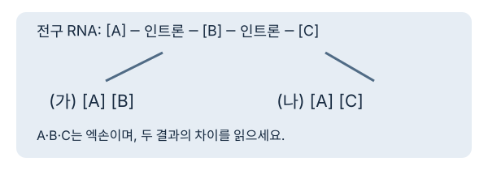
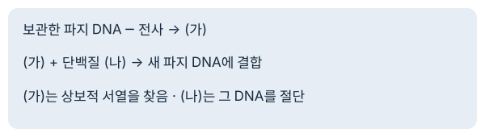

# 복습문제 19선 — 1015 수업 범위

기출 7개와 생성 변형 12개를 풀어 봐요. 변형은 기본 12개·심화 0개예요. 목표는 기본 9개·심화 3개였지만 최소 풀이 단계로 독립 검토하여 기본으로 분류했어요. 먼저 풀어 보고, 막히면 힌트를 열어 보세요.

> `복습문제_1015_Genomics_and_CRISPR.html`를 마크다운으로 옮겼어요. 원문, 힌트, 풀이는 접혀 있어요. 먼저 풀어 보고 펼쳐 보세요.

**목차**

- [B. 기출](#partB)
  - [P1. 미세배열의 용도](#p1)
  - [P2. 서열과 데이터베이스 분석](#p2)
  - [P3. CRISPR 응용의 구별](#p3)
  - [P4. 인간 유전체 프로젝트](#p4)
  - [P5. 표적 DNA를 찾아 자르는 도구](#p5)
  - [P6. 단백질체의 범위](#p6)
  - [P7. 생물정보학의 역할](#p7)
- [C. 변형 연습](#partC)
  - [P8. [변형] 미세배열과 측정 대상](#p8)
  - [P9. [변형] 단백질체와 유전자 수](#p9)
  - [P10. [변형] 엑손 연결 방식의 차이](#p10)
  - [P11. [변형] 표적 안내자와 절단 효소](#p11)
  - [P12. [변형] 조건이 바뀐 세포의 발현 비교](#p12)
  - [P13. [변형] 잘린 DNA의 복구 결과](#p13)
  - [P14. [변형] 서열 인식 길이와 특이성](#p14)
  - [P15. [변형] 생물정보학의 다른 이름](#p15)
  - [P16. [변형] 같은 유전체와 다른 단백질체](#p16)
  - [P17. [변형] 편집 결과를 함께 해석하기](#p17)
  - [P18. [변형] 체세포 편집의 효과와 한계](#p18)
  - [P19. [변형] 단백질을 암호화하지 않는 DNA](#p19)

## B. 기출

### P1. 미세배열의 용도

유전자미세배열은 다음 중 어디에 이용할 수 있는가?

- (1) 클로닝을 위한 인간 생식세포의 증식
- (2) 다수의 염색체로부터 DNA 서열 결정
- (3) 폐암세포로부터의 암호화 DNA와 정상 세포로부터의 암호화 DNA의 비교
- (4) 특정 환경 조건하에서 발현되는 단백질의 검색
- (5) 다수의 시료로부터 DNA 증폭

원문 정보 보기

기출 6강 합본 2번 (PDF 1쪽)

힌트 보기

각 세포의 RNA에서 만든 DNA가 칩에 얼마나 결합하는지를 비교해요.

풀이 보기

1. (1) 틀려요. 미세배열은 생식세포를 증식시키는 배양 기술이 아니에요.
2. (2) 틀려요. 미세배열은 알려진 서열에 대한 결합을 읽으며 염기 순서를 새로 결정하는 시퀀싱과 구별해요.
3. (3) 출제 의도로는 답이에요. RNA 유래 cDNA로 해석하면 폐암세포와 정상 세포의 유전자 발현을 비교할 수 있어요.
4. (4) 틀려요. 미세배열에서 직접 비교하는 것은 RNA에서 만든 DNA의 결합 신호이며 단백질 자체의 검색은 단백질체 분석과 구별해요.
5. (5) 틀려요. DNA 증폭은 PCR의 역할이에요.
6. 수업과의 연결: 1015 수업의 미세배열의 용도 개념을 [DNA 미세배열](정리노트_1015_Genomics_and_CRISPR.md#s2-array)에서 연결해요.

**정답:** (3)

원문의 “암호화 DNA”는 모호한 표현이에요. 수업에서 설명한 RNA 유래 DNA(cDNA)의 비교로 읽었을 때 인쇄 정답 (3)이 성립해요. 두 세포의 유전체 DNA 자체를 비교한다는 뜻으로 읽으면 이 보기만으로 발현 비교를 설명할 수 없어요.

---

### P2. 서열과 데이터베이스 분석

다음 중 유전체 서열에서 유전자를 발견하고 데이터베이스와 비교해 유전자 산물의 구조와 기능을 연구하는 학문은?

- (1) 분자생물학
- (2) 유전공학
- (3) 단백질체학
- (4) 생물정보학
- (5) 시스템 생물학

원문 정보 보기

기출 6강 합본 4번 (PDF 1쪽)

힌트 보기

서열 자료를 컴퓨터로 비교하는 학문을 떠올려요.

풀이 보기

1. (1) 틀려요. 분자생물학은 더 넓은 연구 분야이며 발문의 데이터베이스 비교를 가리키는 구체적 명칭은 아니에요.
2. (2) 틀려요. 유전공학은 유전자를 목적에 맞게 조작하는 기술과 연결해요.
3. (3) 틀려요. 단백질체학은 단백질 전체의 구성과 기능을 연구하는 데 초점을 두어요.
4. (4) 맞아요. 생물정보학은 컴퓨터와 데이터베이스로 서열을 비교하고 유전자 및 산물의 정보를 분석해요.
5. (5) 틀려요. 시스템 생물학은 구성 요소 간 상호작용을 통합해 생물을 시스템으로 연구하는 관점이에요.
6. 수업과의 연결: 1015 수업의 서열과 데이터베이스 분석 개념을 [생물정보학](정리노트_1015_Genomics_and_CRISPR.md#s2-bioinfo)에서 연결해요.

**정답:** (4)

---

### P3. CRISPR 응용의 구별

다음은 크리스퍼(CRISPR) 유전자 가위의 적용에 대한 예이다. 잘못된 것은?

- (1) T 세포 표면의 CCR5 수용체 유전자를 제거하여 HIV가 침입할 수 없도록 하여 AIDS 치료에 이용하였다
- (2) 담배에 반딧불이의 발광효소 유전자를 삽입하여 발광하도록 유전적으로 조작하였다
- (3) 폐암 환자의 면역세포에서 PD-1 유전자를 제거하여 다시 주입해 면역세포의 기능을 증진시켰다
- (4) 돼지 DNA에 존재하는 PERV 유전자를 제거하여 장기이식용 돼지의 효용성을 높였다
- (5) 근육발달을 억제하는 마이오스타틴 유전자를 제거하여 단백질 함량이 높은 슈퍼근육돼지를 만들었다

원문 정보 보기

기출 6강 합본 19번 (PDF 3쪽)

힌트 보기

외래 유전자를 넣는 일반적인 형질전환과 CRISPR를 적용한 사례를 구별해요.

풀이 보기

1. (1) 맞아요. 수업의 사례는 HIV 침입에 관여하는 CCR5를 없애 침입을 억제하려는 접근이에요.
2. (2) 틀려요. 발광 담배는 이전에 배운 외래 유전자 도입 사례이며 여기서 묻는 CRISPR 적용 사례와 구별해요.
3. (3) 맞아요. 강의노트 6장 p6은 면역세포의 PD-1 제거로 면역 억제를 줄이는 사례를 제시해요.
4. (4) 맞아요. 강의노트 6장 p6은 PERV 제거를 장기이식용 돼지의 사례로 제시해요.
5. (5) 맞아요. 근육 발달을 억제하는 마이오스타틴 기능을 없애 근육량을 늘리는 사례예요.
6. 수업과의 연결: 1015 수업의 CRISPR 응용의 구별 개념을 [CRISPR 응용](정리노트_1015_Genomics_and_CRISPR.md#s4-applications)에서 연결해요.

**정답:** (2)

보기 (1)은 수업 자료의 단순화된 사례 표현이에요. CCR5 제거만으로 모든 HIV 감염을 막거나 AIDS 완치를 보장한다는 뜻으로 일반화하지 않아요.

---

### P4. 인간 유전체 프로젝트

인간 유전체의 전체 염기서열은 ____________.

- (1) 사용된 기술은 다른 종에 적용할 수 없었다.
- (2) 예상치보다 훨씬 더 많은 유전자를 발견하였다.
- (3) 3조 개의 염기쌍이었다.
- (4) 중첩된 DNA 절편들의 염기서열을 결정하여 달성하였다.
- (5) 250,000개의 단백질-암호화 유전자를 발견하였다.

원문 정보 보기

기출 6강 합본 21번 (PDF 3쪽)

힌트 보기

전체를 한 번에 읽는 대신 절편을 읽고 겹치는 부분을 연결해요.

풀이 보기

1. (1) 틀려요. 서열 결정 기술은 다른 생물의 유전체에도 적용해요.
2. (2) 틀려요. 수업에서는 유전자 수가 예상보다 적었다고 설명했어요.
3. (3) 틀려요. 수업의 근삿값은 약 30억 염기쌍이며 3조 염기쌍이 아니에요.
4. (4) 맞아요. 짧은 DNA 절편의 서열을 읽고 겹치는 부분을 연결하여 전체 서열을 구성해요.
5. (5) 틀려요. 원문의 250,000개는 수업에서 다룬 약 2만~2만 5천 개보다 약 열 배 많아요.
6. 수업과의 연결: 1015 수업의 인간 유전체 프로젝트 개념을 [유전체와 기능](정리노트_1015_Genomics_and_CRISPR.md#s1-genome)에서 연결해요.

**정답:** (4)

---

### P5. 표적 DNA를 찾아 자르는 도구

________은 자르고 싶은 특정 유전자를 찾아 DNA를 잘라낼 수 있는 도구로 사용된다. 무엇에 관한 설명인가?

- (1) 헬리케이스
- (2) 크리스퍼 유전자 가위
- (3) 제한효소
- (4) DNA 중합효소
- (5) cDNA

원문 정보 보기

기출 6강 합본 22번 (PDF 3쪽)

힌트 보기

찾아가는 역할과 자르는 역할을 나누어 생각해요.

풀이 보기

1. (1) 틀려요. 헬리케이스는 DNA 두 가닥을 풀어 주는 효소예요.
2. (2) 맞아요. 크리스퍼 유전자 가위에서는 가이드 RNA가 표적을 찾고 Cas9이 DNA를 잘라요.
3. (3) 틀려요. 제한효소도 DNA를 자르지만 정해진 짧은 인식서열에 작용하며 발문의 원하는 유전자를 찾아 자르는 도구는 크리스퍼를 가리켜요.
4. (4) 틀려요. DNA 중합효소는 DNA를 합성하는 효소예요.
5. (5) 틀려요. cDNA는 RNA를 바탕으로 만든 DNA이며 자르는 도구가 아니에요.
6. 수업과의 연결: 1015 수업의 표적 DNA를 찾아 자르는 도구 개념을 [가이드 RNA와 Cas9](정리노트_1015_Genomics_and_CRISPR.md#s3-mechanism)에서 연결해요.

**정답:** (2)

---

### P6. 단백질체의 범위

다음 단백질체(proteome)에 대한 설명 중 잘못된 것은?

- (1) 진핵생물의 경우 유전체에 의해 암호화되어 있는 단백질의 수가 단백질을 암호화하고 있는 유전자의 수보다 많다
- (2) 단백질체학(proteomics)은 단백질체에 있는 단백질의 개수와 구조를 밝히는 학문이다
- (3) 세포 단백질체는 특수한 환경하의 특정 세포 유형에서 발견되는 단백질들의 집합체를 가리킨다
- (4) 단백질체(proteome)는 생물의 유전체에 의해 발현되는 특정 몇몇 단백질을 지칭한다
- (5) 단백질체학(proteomics)을 이용하여 약을 개발할 수 있다

원문 정보 보기

기출 6강 합본 29번 (PDF 4쪽)

힌트 보기

전체 집합인지 몇몇 단백질인지 살펴봐요.

풀이 보기

1. (1) 맞아요. 선택적 이어맞추기로 하나의 유전자에서 여러 단백질을 만들 수 있어요.
2. (2) 맞아요. 단백질체학은 단백질 집합의 구성과 구조 및 기능을 연구해요.
3. (3) 맞아요. 특정 세포와 조건에서 나타나는 단백질 전체가 세포 단백질체예요.
4. (4) 틀려요. 단백질체는 특정 몇몇이 아니라 해당 생물 또는 정해진 세포·조건에서의 단백질 전체를 가리켜요.
5. (5) 맞아요. 단백질의 기능과 질병 관련성을 이해하면 약물 개발에 활용할 수 있어요.
6. 수업과의 연결: 1015 수업의 단백질체의 범위 개념을 [단백질체](정리노트_1015_Genomics_and_CRISPR.md#s1-proteome)에서 연결해요.

**정답:** (4)

---

### P7. 생물정보학의 역할

다음 중 생물정보학에 대한 설명이 아닌 것은?

- (1) 생물정보학을 통해 진핵생물 유전체들이 예상보다 훨씬 많은 미지의 유전자를 가지고 있음을 확인하였다
- (2) 비록 진화적 기원이 먼 생물들일지라도 유사한 유전자를 가지고 있다는 것을 밝힘
- (3) 고도로 발달한 인간의 경우 다른 종들보다 훨씬 많은 단백질 암호화 유전자를 가진다고 증명
- (4) 생물학을 기반으로 수학, 컴퓨터 과학 등을 융합한 새로운 학문이다
- (5) 유전체의 컴퓨터 분석을 통해 단백질의 아미노산 서열을 알 수 있다

원문 정보 보기

기출 6강 합본 34번 (PDF 5쪽)

힌트 보기

새 유전자 발견과 인간의 유전자 수에 관한 예상 실패를 구별해요.

풀이 보기

1. (1) 맞아요. 많은 유전체 서열을 분석하면서 알려져 있지 않던 유전자 후보들을 찾을 수 있었어요.
2. (2) 맞아요. 생물정보학으로 먼 생물들 사이에서도 유전자 서열의 유사성을 비교할 수 있어요.
3. (3) 틀려요. 사람의 복잡성을 단백질 암호화 유전자 수가 다른 종보다 압도적으로 많다는 주장으로 설명할 수 없어요.
4. (4) 맞아요. 생물학 자료를 수학과 컴퓨터 과학으로 분석하는 융합 분야예요.
5. (5) 맞아요. 암호화 서열을 분석하면 유전암호에 따라 아미노산 서열을 추론할 수 있어요.
6. 수업과의 연결: 1015 수업의 생물정보학의 역할 개념을 [생물정보학](정리노트_1015_Genomics_and_CRISPR.md#s2-bioinfo)에서 연결해요.

**정답:** (3)

---

## C. 변형 연습

### P8. [변형] 미세배열과 측정 대상

유전자미세배열은 다음 중 어디에 이용할 수 있는가?

- (1) 배양 접시에서 난자의 세포 수를 늘리는 데 이용한다
- (2) DNA의 염기 순서를 처음부터 한 염기씩 결정하는 데 이용한다
- (3) 암세포와 정상 세포의 유전체 DNA에 암호화된 전체 염기 순서를 직접 해독하는 데 이용한다
- (4) 특정 환경에서 발현되는 여러 유전자의 RNA 양을 RNA 유래 DNA의 결합 신호로 비교하는 데 이용한다
- (5) DNA 중합효소 없이 표적 DNA를 대량 증폭하는 데 이용한다

원문 정보 보기

기출 6강 2번 발문에 정답을 바꾼 생성 변형이에요. 다루는 혼동: 미세배열과 측정 대상. 근거 토픽: DNA 미세배열.

힌트 보기

칩에 넣는 시료가 무엇에서 만들어졌는지 봐요.

풀이 보기

1. (1) 틀려요. 미세배열은 세포를 증식시키는 기술이 아니에요.
2. (2) 틀려요. 처음부터 염기 순서를 읽는 기술은 시퀀싱이에요.
3. (3) 틀려요. 발현용 미세배열은 전체 유전체 DNA의 염기 순서를 직접 해독하지 않아요.
4. (4) 맞아요. RNA를 DNA로 바꾸어 칩에 결합시키면 여러 유전자의 발현량을 비교할 수 있어요.
5. (5) 틀려요. 미세배열은 DNA 증폭 기술이 아니며 PCR에는 DNA 중합효소가 필요해요.
6. 원문 정답과 달라진 점: 원문 2번의 (3)은 암세포와 정상 세포의 RNA 유래 DNA 비교로 읽어 정답이지만, 이 변형의 (3)은 유전체 전체 서열의 직접 해독으로 바꾸어 틀렸고 (4)의 RNA 양 비교가 맞아요.
7. 수업과의 연결: 1015 수업의 미세배열과 측정 대상 개념을 [DNA 미세배열](정리노트_1015_Genomics_and_CRISPR.md#s2-array)에서 연결해요.

**정답:** (4)

---

### P9. [변형] 단백질체와 유전자 수

다음 단백질체(proteome)에 대한 설명 중 잘못된 것은?

- (1) 특정 세포의 단백질체는 그 세포에서 정해진 조건에 나타나는 단백질 전체를 가리킨다
- (2) 단백질 종류 수는 단백질을 암호화하는 유전자 수와 언제나 정확히 같다
- (3) 같은 유전체를 가진 세포들도 조건에 따라 단백질체가 달라질 수 있다
- (4) 단백질체는 관심 있는 단백질 몇 개만 골라 부르는 말이 아니다
- (5) 단백질체의 기능을 밝히는 연구는 치료 표적을 찾는 데 도움이 될 수 있다

원문 정보 보기

기출 6강 29번 발문에 정답을 바꾼 생성 변형이에요. 다루는 혼동: 단백질체와 유전자 수. 근거 토픽: 단백질체.

힌트 보기

유전자 하나와 단백질 하나를 항상 일대일로 묶을 수 있는지 봐요.

풀이 보기

1. (1) 맞아요. 단백질체는 정해진 생물·세포·조건에서의 전체 단백질 집합이에요.
2. (2) 틀려요. 선택적 이어맞추기로 한 유전자가 여러 단백질을 만들 수 있으므로 수가 반드시 같지는 않아요.
3. (3) 맞아요. 유전자 발현이 달라지면 같은 유전체에서도 다른 단백질 집합이 나타날 수 있어요.
4. (4) 맞아요. 단백질체의 핵심은 몇몇이 아니라 전체 집합이라는 점이에요.
5. (5) 맞아요. 단백질의 기능과 질병 관련성을 분석하면 약물 개발에 활용할 수 있어요.
6. 원문 정답과 달라진 점: 원문 29번은 몇몇 단백질이라는 (4)가 틀렸지만, 이 변형에서는 유전자와 단백질의 수가 반드시 같다는 (2)가 틀려요.
7. 수업과의 연결: 1015 수업의 단백질체와 유전자 수 개념을 [단백질체](정리노트_1015_Genomics_and_CRISPR.md#s1-proteome)에서 연결해요.

**정답:** (2)

---

### P10. [변형] 엑손 연결 방식의 차이

그림은 같은 전구 RNA가 두 방식으로 가공된 결과이다. (가)와 (나)의 차이를 설명하는 것은?

- (1) 두 결과는 DNA 복제 과정에서 서로 다른 염색체 수를 얻은 것이다
- (2) 인트론을 전혀 제거하지 않았기 때문에 두 결과가 생겼다
- (3) 선택적 이어맞추기 때문에 한 유전자에서 다른 성숙 RNA가 생길 수 있다
- (4) Cas9이 (가)의 단백질을 (나)의 DNA로 바꾸었다
- (5) 하나의 유전자에서는 한 종류의 성숙 RNA만 만들어진다는 증거이다

원문 정보 보기

원문 기출이 아닌 생성 변형이에요. 다루는 혼동: 엑손 연결 방식의 차이. 근거 토픽: 선택적 이어맞추기.

힌트 보기

두 결과에 공통인 A와 달라진 B·C를 비교해요.

풀이 보기

1. (1) 틀려요. 그림의 차이는 RNA에서 연결한 엑손 조합이며 염색체 수가 아니에요.
2. (2) 틀려요. 두 결과에는 인트론이 남아 있지 않고 엑손 조합이 달라요.
3. (3) 맞아요. 같은 전구 RNA의 A-B와 A-C 연결은 선택적 이어맞추기로 서로 다른 RNA가 생기는 예예요.
4. (4) 틀려요. Cas9은 DNA 절단 효소이며 이 RNA 연결 과정을 설명하지 않아요.
5. (5) 틀려요. 같은 전구 RNA에서 두 결과가 나왔으므로 한 종류만 생긴다는 주장과 반대예요.
6. 수업과의 연결: 1015 수업의 엑손 연결 방식의 차이 개념을 [선택적 이어맞추기](정리노트_1015_Genomics_and_CRISPR.md#s1-splicing)에서 연결해요.

**정답:** (3)

---

### P11. [변형] 표적 안내자와 절단 효소

그림에서 (가)와 (나)의 조합으로 옳은 것은?

- (1) (가) Cas9, (나) 가이드 RNA
- (2) (가) guide RNA, (나) Cas9
- (3) (가) DNA 중합효소, (나) 가이드 RNA
- (4) (가) 인트론, (나) 엑손
- (5) (가) 단백질체, (나) 유전체

원문 정보 보기

원문 기출이 아닌 생성 변형이에요. 다루는 혼동: 표적 안내자와 절단 효소. 근거 토픽: 가이드 RNA와 Cas9.

힌트 보기

전사 산물인지 단백질인지부터 구별해요.

풀이 보기

1. (1) 틀려요. 전사로 만들어지고 상보적 서열을 찾는 (가)는 Cas9 단백질이 아니에요.
2. (2) 맞아요. (가)는 guide RNA, 곧 가이드 RNA라는 같은 말이며 표적을 안내하고, (나)는 DNA를 자르는 Cas9이에요.
3. (3) 틀려요. (가)는 RNA이며 (나)는 RNA가 아닌 절단 단백질이에요.
4. (4) 틀려요. 엑손과 인트론은 이 그림의 안내자·절단 효소 쌍이 아니에요.
5. (5) 틀려요. 유전체와 단백질체는 전체 집합을 가리키며 여기의 역할 분담과 달라요.
6. 수업과의 연결: 1015 수업의 표적 안내자와 절단 효소 개념을 [가이드 RNA와 Cas9](정리노트_1015_Genomics_and_CRISPR.md#s3-mechanism)에서 연결해요.

**정답:** (2)

---

### P12. [변형] 조건이 바뀐 세포의 발현 비교

같은 개체에서 얻은 세포를 저온과 보통 온도에서 각각 키웠다. 유전체 DNA 서열은 같다고 확인되었다. 두 조건에서 어떤 유전자들의 RNA 양이 달라졌는지 한 번에 비교하려 할 때 가장 알맞은 방법은?

- (1) 두 세포의 염색체 수만 센다
- (2) 단백질 몇 개를 유전체라고 부른다
- (3) 미세배열로 RNA 유래 DNA의 결합 신호를 비교한다
- (4) DNA 절단 조각에 대한 정보 없이 Cas9만 넣는다
- (5) 두 조건의 세포가 같은 유전체이므로 실험 없이 RNA 양도 같다고 결론 내린다

원문 정보 보기

원문 기출이 아닌 생성 변형이에요. 다루는 혼동: 조건이 바뀐 세포의 발현 비교. 근거 토픽: DNA 미세배열.

힌트 보기

DNA 서열의 동일성과 RNA 발현량의 동일성은 따로 확인해요.

풀이 보기

1. (1) 틀려요. 염색체 수만으로 여러 유전자의 발현량 차이를 알 수 없어요.
2. (2) 틀려요. 용어를 바꾸는 일은 RNA 발현량을 측정하는 방법이 아니에요.
3. (3) 맞아요. 같은 유전체를 가진 세포도 환경에 따라 발현량이 달라질 수 있고 미세배열로 이를 비교해요.
4. (4) 틀려요. Cas9은 DNA를 자르는 효소이며 RNA 양의 동시 측정법이 아니에요.
5. (5) 틀려요. 유전체가 같아도 조건에 따라 유전자 발현은 달라질 수 있어요.
6. 수업과의 연결: 1015 수업의 조건이 바뀐 세포의 발현 비교 개념을 [DNA 미세배열](정리노트_1015_Genomics_and_CRISPR.md#s2-array)에서 연결해요.

**정답:** (3)

---

### P13. [변형] 잘린 DNA의 복구 결과

어떤 세포에서 표적 유전자를 CRISPR로 자른 뒤 DNA가 다시 연결되었다. 관찰해 보니 절단 부근에 염기 한 개가 빠졌고 단백질의 읽는 틀이 바뀌었다. 가장 타당한 설명은?

- (1) DNA가 다시 이어졌으므로 원래 단백질 기능은 반드시 보존된다
- (2) 절단 뒤 복구 과정의 결실이 읽는 틀을 바꾸어 유전자 기능을 망가뜨릴 수 있다
- (3) 가이드 RNA가 스스로 단백질로 바뀌었다
- (4) Cas9이 모든 엑손을 인트론으로 바꾸었다
- (5) 염기가 빠진 것은 단백질체에 DNA가 전혀 없기 때문이다

원문 정보 보기

원문 기출이 아닌 생성 변형이에요. 다루는 혼동: 잘린 DNA의 복구 결과. 근거 토픽: 절단 뒤 복구.

힌트 보기

다시 붙었다는 사실과 원래대로 붙었다는 사실을 구별해요.

풀이 보기

1. (1) 틀려요. 연결 여부와 원래 염기서열 및 기능의 회복은 별개이며 한 염기 결실로 읽는 틀이 바뀔 수 있어요.
2. (2) 맞아요. DNA가 다시 붙더라도 결실이 남으면 읽는 틀 이동으로 기능이 달라질 수 있어요.
3. (3) 틀려요. 가이드 RNA의 역할은 표적 안내이며 스스로 단백질이 되는 것이 아니에요.
4. (4) 틀려요. 관찰된 것은 한 염기의 결실이지 모든 엑손의 성격 변화가 아니에요.
5. (5) 틀려요. 단백질체의 정의는 여기의 DNA 복구 중 결실 원인을 설명하지 않아요.
6. 수업과의 연결: 1015 수업의 잘린 DNA의 복구 결과 개념을 [절단 뒤 복구](정리노트_1015_Genomics_and_CRISPR.md#s3-repair)에서 연결해요.

**정답:** (2)

---

### P14. [변형] 서열 인식 길이와 특이성

제한효소와 CRISPR의 표적 선택에 대한 설명 중 옳지 않은 것은?

- (1) 짧은 인식서열은 큰 유전체의 여러 위치에서 나타날 수 있다
- (2) 더 긴 서열을 기준으로 표적을 찾으면 우연히 일치하는 위치를 줄이는 데 도움이 된다
- (3) 가이드 RNA가 표적에 상보적으로 결합하는 것이 선택에 관여한다
- (4) 긴 서열을 인식하는 도구에서는 다른 위치가 잘리는 가능성이 완전히 사라진다
- (5) 수업에서는 제한효소의 짧은 인식서열과 가이드 RNA의 더 긴 표적 서열을 비교했다

원문 정보 보기

원문 기출이 아닌 생성 변형이에요. 다루는 혼동: 서열 인식 길이와 특이성. 근거 토픽: 표적 선택의 특이성.

힌트 보기

더 특이적이라는 말이 오류 가능성 0이라는 뜻인지 봐요.

풀이 보기

1. (1) 맞아요. 짧은 서열은 여러 위치에서 반복될 수 있으므로 절단 지점이 여럿일 수 있어요.
2. (2) 맞아요. 다른 조건이 같다면 긴 서열의 우연한 완전 일치는 더 드물어요.
3. (3) 맞아요. 가이드 RNA와 DNA의 상보성은 표적 선택에 관여해요.
4. (4) 틀려요. 부분적으로 비슷한 다른 서열에도 작용하는 오프 타깃이 있어 특이성이 높아도 위험이 0은 아니에요.
5. (5) 맞아요. 인식서열 길이 차이로 우연한 일치의 가능성을 비교한 수업 내용이에요.
6. 수업과의 연결: 1015 수업의 서열 인식 길이와 특이성 개념을 [표적 선택의 특이성](정리노트_1015_Genomics_and_CRISPR.md#s3-specificity)에서 연결해요.

**정답:** (4)

---

### P15. [변형] 생물정보학의 다른 이름

다음은 생명정보학을 설명한 것이다. 옳지 않은 것은?

- (1) 생물정보학과 같은 분야를 가리키는 이름으로 쓸 수 있다
- (2) 많은 DNA 서열을 컴퓨터 프로그램으로 비교할 수 있다
- (3) 서열 데이터베이스를 이용해 비슷한 유전자를 찾을 수 있다
- (4) 단백질을 암호화하는 서열을 분석해 아미노산 서열을 추론할 수 있다
- (5) 프로그램으로 서열 유사성을 계산하면 추가 실험 없이 모든 유전자의 실제 기능을 완전히 확정한다

원문 정보 보기

원문 기출이 아닌 생성 변형이에요. 다루는 혼동: 생물정보학의 다른 이름. 근거 토픽: 생물정보학.

힌트 보기

컴퓨터로 얻은 단서와 기능의 확정을 구별해요.

풀이 보기

1. (1) 맞아요. 수업에서는 생명정보학과 생물정보학을 같은 분야의 이름으로 사용했어요.
2. (2) 맞아요. 컴퓨터로 방대한 서열을 정리하고 비교하는 것이 핵심 역할이에요.
3. (3) 맞아요. 알려진 서열과 비교하여 유사한 유전자 후보를 찾을 수 있어요.
4. (4) 맞아요. 암호화 서열과 유전암호를 이용하면 아미노산 서열을 추론해요.
5. (5) 틀려요. 서열 유사성은 기능에 관한 단서이며 실제 기능을 모두 확정하려면 별도의 검증이 필요해요.
6. 수업과의 연결: 1015 수업의 생물정보학의 다른 이름 개념을 [생물정보학](정리노트_1015_Genomics_and_CRISPR.md#s2-bioinfo)에서 연결해요.

**정답:** (5)

---

### P16. [변형] 같은 유전체와 다른 단백질체

두 세포 A와 B의 유전체 DNA는 같다. A에서는 한 유전자의 엑손 1-2가 연결된 RNA와 단백질 X가, B에서는 같은 유전자의 엑손 1-3이 연결된 RNA와 단백질 Y가 검출되었다. 이 유전자의 RNA 총량은 두 세포에서 같았다. 다음 해석 중 가장 타당한 것은?

- (1) RNA 총량이 같으므로 X와 Y도 반드시 동일한 단백질이다
- (2) 유전체가 같다는 관찰은 두 종류의 RNA가 있다는 관찰과 양립할 수 없다
- (3) RNA 총량만 비교하면 두 세포의 엑손 조합 차이와 단백질 종류 차이까지 모두 배제할 수 있다
- (4) 선택적 이어맞추기로 같은 유전체에서도 다른 RNA와 단백질이 생길 수 있으며, RNA 총량만으로 단백질체가 같다고 판단할 수 없다
- (5) 단백질 X와 Y가 다르면 A와 B는 반드시 다른 개체에서 온 세포이다

원문 정보 보기

원문 기출이 아닌 생성 변형이에요. 다루는 혼동: 같은 유전체와 다른 단백질체. 근거 토픽: 선택적 이어맞추기.

힌트 보기

DNA의 동일성, RNA 양, RNA의 엑손 조합을 각각 구별해요.

풀이 보기

1. (1) 틀려요. RNA 총량은 엑손 조합 차이를 없애지 않으며 제시문에서 X와 Y는 서로 다른 단백질이에요.
2. (2) 틀려요. 같은 유전자도 선택적 이어맞추기로 여러 RNA를 만들 수 있어요.
3. (3) 틀려요. 총량만으로 RNA 서열 조합이나 단백질 종류를 모두 알 수 없어요.
4. (4) 맞아요. 같은 DNA → 다른 엑손 연결 → 다른 단백질로 이어지므로 총 RNA 양의 동일성만으로 단백질체의 동일성을 보장할 수 없어요.
5. (5) 틀려요. 같은 개체에서도 세포별 RNA 가공과 발현이 달라 다른 단백질을 만들 수 있어요.
6. 수업과의 연결: 1015 수업의 같은 유전체와 다른 단백질체 개념을 [선택적 이어맞추기](정리노트_1015_Genomics_and_CRISPR.md#s1-splicing)에서 연결해요.

**정답:** (4)

---

### P17. [변형] 편집 결과를 함께 해석하기

연구자가 표적 유전자를 자른 뒤 세 가지를 관찰했다. 표적 부위는 다시 연결되었으나 한 염기 결실로 읽는 틀이 바뀌었다. 유사한 서열을 가진 다른 위치도 잘렸다. 세포는 살아남았다. 옳지 않은 해석은?

- (1) 표적 DNA의 재연결이 원래 단백질 기능의 복원을 뜻하지는 않는다
- (2) 다른 위치의 절단은 오프 타깃에 해당할 수 있다
- (3) 세포가 살아남았으므로 표적 유전자의 기능도 보존되었고 다른 모든 유전자의 안전성도 증명되었다
- (4) 표적에서는 복구 중 생긴 결실로 단백질 기능이 달라질 수 있다
- (5) 가이드 RNA의 표적 선택, Cas9의 절단, 세포의 DNA 복구는 구별해서 판단해야 한다

원문 정보 보기

원문 기출이 아닌 생성 변형이에요. 다루는 혼동: 편집 결과를 함께 해석하기. 근거 토픽: 편집의 위험과 유전 범위.

힌트 보기

절단, 복구, 기능, 생존은 같은 결과가 아니에요.

풀이 보기

1. (1) 맞아요. 다시 연결되었어도 염기 결실이 남아 읽는 틀이 바뀌었어요.
2. (2) 맞아요. 의도한 위치 외의 유사 서열 절단은 오프 타깃으로 해석할 수 있어요.
3. (3) 틀려요. 표적의 읽는 틀 변화와 다른 위치 절단이 관찰되었으므로 생존만으로 기능 보존과 전체 안전성을 결론 낼 수 없어요.
4. (4) 맞아요. 한 염기 결실과 읽는 틀 변화는 기능 변화의 원인이 될 수 있어요.
5. (5) 맞아요. 안내와 절단, 절단 뒤 복구는 서로 다른 단계이므로 각 단계의 관찰을 연결해야 해요.
6. 수업과의 연결: 1015 수업의 편집 결과를 함께 해석하기 개념을 [편집의 위험과 유전 범위](정리노트_1015_Genomics_and_CRISPR.md#s4-risks)에서 연결해요.

**정답:** (3)

---

### P18. [변형] 체세포 편집의 효과와 한계

연구자가 환자의 성숙한 면역세포를 꺼내 CCR5 유전자를 편집한 뒤 다시 주입했다. 목표는 CCR5를 이용하는 HIV의 세포 침입을 줄이는 것이다. 아직 다른 위치 절단이나 CCR5의 다른 기능에 관한 검사는 끝나지 않았다. 수업의 원리를 모두 고려한 결론은?

- (1) 성숙한 체세포를 편집했으므로 환자의 모든 자손에게 편집이 반드시 전달된다
- (2) CCR5를 편집했으므로 모든 HIV 감염과 모든 부작용이 영구히 사라진다
- (3) 치료 목적의 편집이므로 표적 밖 절단 검사는 필요하지 않다
- (4) 체세포를 대상으로 하므로 생식세포를 바꾸었다고 볼 수 없고, 침입 억제 효과와 함께 오프 타깃 및 유전자 기능의 불확실성을 따로 확인해야 한다
- (5) Cas9을 사용했다면 원래 CCR5 서열과 단백질 기능은 반드시 완전히 유지된다

원문 정보 보기

원문 기출이 아닌 생성 변형이에요. 다루는 혼동: 체세포 편집의 효과와 한계. 근거 토픽: CRISPR 응용.

힌트 보기

어떤 세포를 바꾸었는지, 무엇을 억제하려는지, 무엇을 아직 모르는지를 나누어 연결해요.

풀이 보기

1. (1) 틀려요. 성숙한 체세포의 편집은 정자·난자의 유전자 편집과 구별하며 자손 전달을 전제할 수 없어요.
2. (2) 틀려요. 제시문의 목표는 특정 침입 경로의 억제이며 모든 감염이나 부작용의 소멸을 보장하지 않아요.
3. (3) 틀려요. 치료 목적이어도 의도하지 않은 위치의 절단 가능성을 확인해야 해요.
4. (4) 맞아요. 편집한 세포 유형 → CCR5 경로의 목표 효과 → 표적 밖 절단과 다른 기능의 위험을 연결해 판단해야 해요.
5. (5) 틀려요. 유전자 편집은 서열이나 기능을 바꿀 수 있고 단백질 기능의 완전한 유지를 보장하지 않아요.
6. 수업과의 연결: 1015 수업의 체세포 편집의 효과와 한계 개념을 [CRISPR 응용](정리노트_1015_Genomics_and_CRISPR.md#s4-applications)에서 연결해요.

**정답:** (4)

---

### P19. [변형] 단백질을 암호화하지 않는 DNA

수업에서 다룬 유전체에 관한 설명으로 옳은 것은?

- (1) 유전체에는 단백질을 암호화하는 부분만 포함된다
- (2) 프로모터는 단백질을 암호화하지 않아도 유전자 발현 조절에 중요할 수 있다
- (3) 단백질을 암호화하지 않는 모든 DNA는 기능이 없다는 사실이 이미 증명되었다
- (4) 사람의 복잡성은 유전자 수가 초파리의 수천 배라는 사실만으로 설명된다
- (5) 염기서열을 읽으면 모든 유전자의 기능도 자동으로 밝혀진다

원문 정보 보기

원문 기출이 아닌 생성 변형이에요. 다루는 혼동: 단백질을 암호화하지 않는 DNA. 근거 토픽: 유전체와 기능.

힌트 보기

단백질의 재료 정보와 발현을 조절하는 정보를 구별해요.

풀이 보기

1. (1) 틀려요. 유전체는 암호화 부분과 비암호화 부분을 포함하는 DNA 전체예요.
2. (2) 맞아요. 프로모터는 단백질의 코돈 서열이 아니어도 전사와 발현 조절에 중요한 서열이에요.
3. (3) 틀려요. 비암호화 조절 서열처럼 알려진 기능도 있고 아직 기능을 모르는 서열도 있어 모두 무기능이라고 할 수 없어요.
4. (4) 틀려요. 수업은 사람의 유전자 수가 예상보다 적으며 수만으로 복잡성을 단순 설명할 수 없다고 강조했어요.
5. (5) 틀려요. 서열을 읽는 일과 그 기능을 밝히는 연구는 구별해요.
6. 수업과의 연결: 1015 수업의 단백질을 암호화하지 않는 DNA 개념을 [유전체와 기능](정리노트_1015_Genomics_and_CRISPR.md#s1-genome)에서 연결해요.

**정답:** (2)

---

출처: 2023·2024 생명과학 기출(6강 합본). 정답은 인쇄된 답안지와 독립 판단을 대조했어요. 변형 연습은 수업 내용으로 만든 생성 문제예요.
