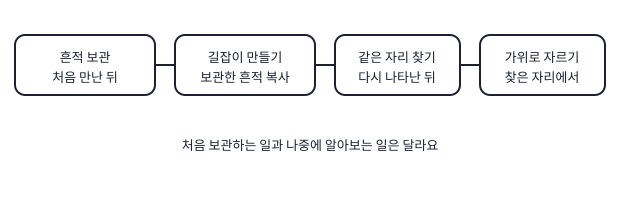
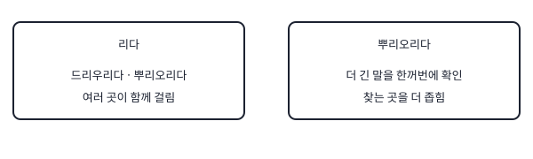
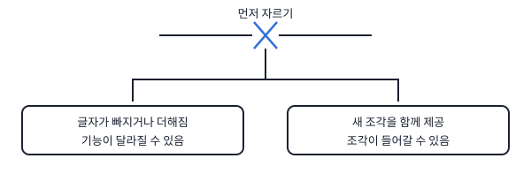
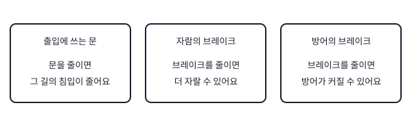
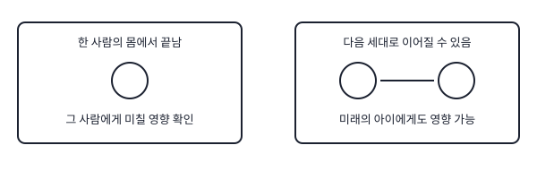

# 유전체 분석과 CRISPR — 5살도 이해하는 정리노트

이영만 교수님 생명과학 · 1015 수업 (6장 DNA 기술과 유전체학)

> `정리노트_1015_Genomics_and_CRISPR.html`를 마크다운으로 옮겼어요. 그림은 `figures_1015/` 폴더의 SVG, 위젯은 대표 설정의 정적 그림으로 바꿨어요. 수식은 `$…$` / `$$…$$`라서 GitHub, Obsidian, Typora에서 보여요.

**목차**

- [0. 돌리 복습과 오늘의 연결](#s0)
  - [핵 제공자와 난자 제공자를 구별해요](#s0-recap)
- [1. 유전체를 읽고 기능을 찾기](#s1)
  - [글자 지도와 뜻풀이: 구조·기능 유전체학](#s1-genome)
  - [유전자보다 단백질이 많은 이유](#s1-splicing)
  - [단백질체는 몇 개가 아닌 전체 집합이에요](#s1-proteome)
- [2. 많은 정보를 비교하고 함께 보기](#s2)
  - [생물정보학과 비교유전체학](#s2-bioinfo)
  - [DNA 미세배열로 발현량을 비교해요](#s2-array)
  - [시스템생물학과 유전정보의 책임](#s2-system)
- [3. CRISPR가 표적을 찾아 자르는 원리](#s3)
  - [기억 저장소·길잡이·가위의 역할](#s3-mechanism)
  - [짧은 말보다 긴 문장을 찾기](#s3-specificity)
  - [절단 뒤 수선이 편집 결과를 만들어요](#s3-repair)
- [4. 응용 사례와 위험의 경계](#s4)
  - [무엇을 없애고 무엇을 넣는가](#s4-applications)
  - [체세포와 배아 편집을 구별해요](#s4-risks)
- [5. 요약 · 예고](#s5)
  - [시험 직전 한 줄](#s5-cheatsheet)
  - [6장과 시험 범위의 마감](#s5-next)
  - [함께 보면 좋은 자료](#s5-links)

## 0. 돌리 복습과 오늘의 연결

### 핵 제공자와 난자 제공자를 구별해요

*1015 수업 · 6장 p4*

**정확히 말하면**

- 돌리는 핵이 제거된 난자에 젖샘 체세포의 핵을 넣는 체세포 핵치환으로 만들었어요.
- 전기 자극으로 분열을 유도하고 배아를 대리모의 자궁에 착상시켰어요.
- 핵 DNA는 핵 제공자와, 미토콘드리아 DNA는 난자 제공자와 대응해요.
- 대리모는 발달할 자궁 환경을 제공해요. 새끼를 낳았다고 핵 DNA도 대리모 것이 되는 것은 아니에요.

[1013 핵치환과 복제양 돌리](../../1013/정리노트_1013_PCR_and_DNA_Technology.html#s4-clone)

**페이지 요약**

핵·난자·임신 환경의 제공자를 따로 구별해요.

*용어*

- **핵 DNA** — 핵 제공자와 대응해요.
- **미토콘드리아 DNA** — 난자 제공자와 대응해요.

---

## 1. 유전체를 읽고 기능을 찾기

### 글자 지도와 뜻풀이: 구조·기능 유전체학

*1015 수업 · 6장 p5*

**쉽게 말하면**

책에 적힌 글자를 읽는 일과 그 글의 뜻을 아는 일은 달라요.

*같은 책을 두고 글자의 자리와 글의 뜻을 다르게 살펴요.*

**정확히 말하면**

유전체(genome)는 한 생물이 가진 전체 DNA의 유전정보예요. 수업에서 인간 유전체를 셀 때는 염색체 23개로 이루어진 한 세트의 DNA를 보았어요. 엄마와 아빠의 상동염색체 두 세트를 더한 체세포 전체 분량과 구별해요.

유전체학(genomics)은 유전자와 유전자 이외 DNA의 구조·기능을 연구해요. 구조유전체학(structural genomics)은 서열과 유전자 위치 등 구조를, 기능유전체학(functional genomics)은 서열과 유전자의 생물학적 역할을 연구해요.

인간 유전체 프로젝트(Human Genome Project)는 1990년에 시작해 2003년에 완성된 프로젝트예요. DNA의 염기 순서를 읽는 실험은 염기서열 결정, 시퀀싱(sequencing)이라고 해요. 읽은 뒤에도 어떤 부분이 유전자이며 무슨 일을 하는지 분석해야 해요.

수업의 한 세트 규모는 약 30억 염기쌍, 더 자세한 근삿값으로 약 32억 염기쌍이에요. 유전자 수는 약 2만~2만5천 개라는 별개의 수예요. 이 수는 연구 전 예상보다 적었어요. 서열 결정 기술은 사람에게만 쓰는 기술이 아니며, 수업에서는 대장균·효모·초파리·생쥐 등 다른 생물의 유전체도 읽었다고 설명했어요.

**교수님 말씀**

교수님은 엄마에게 물려받은 책 **23권**을 모두 베껴 썼어도 글의 의미는 따로 알아야 한다고 설명했어요.

> 어떤 글자가 적혀 있는지는 다 알았어. 근데 그 글자의 의미를 파악해야 되잖아.

처음보다 서열 읽기가 빨라지고 비용이 줄었다는 기술 변화도 소개했어요. 수업의 하루·약 1000달러는 기술 발전을 보여 주는 예시예요.

**꼭 기억해요**

약 30억~32억 **염기쌍**은 DNA 길이이며, 약 2만~2만5천 **유전자**는 개수예요. 3조 염기쌍이라고 바꾸지 않아요. “한 세트”를 두 부모에게서 받은 체세포의 모든 DNA 양과 혼동하지 않아요.

서열을 읽었다고 각 유전자의 기능이 모두 밝혀지는 것은 아니에요. 2003년 프로젝트 완성을 모르는 기능까지 모두 해결했다는 뜻으로 읽지 않아요.

**보충 · 수업에서 다루지 않았어요**

전체 DNA를 읽을 때는 여러 절편의 서열을 결정하고, 서로 겹치는 **중첩** 구간을 단서로 원래의 긴 서열을 재구성해요. 예를 들어 ACGT와 GTAA는 GT 구간을 겹쳐 ACGTAA로 이을 수 있어요. 이 재구성이 인간 유전체 프로젝트의 서열 완성 방법과 연결돼요.

출처: 교재 6장 p130·133(전체 유전체 서열 결정과 복습문제 5)

**페이지 요약**

책에 적힌 글자를 읽는 일과 그 글의 뜻을 아는 일은 달라요.

*용어*

- **유전체(genome)** — 전체 DNA 유전정보예요.
- **구조유전체학** — 서열과 위치를 밝혀요.
- **기능유전체학** — 서열의 역할을 밝혀요.

---

### 유전자보다 단백질이 많은 이유

*1015 수업 · 6장 p5*

**쉽게 말하면**

같은 조각 상자에서도 고르는 조각이 달라지면 다른 물건을 만들 수 있어요.

*같은 원본에서 두 가지 조합을 만들 수 있어요.*

**정확히 말하면**

진핵생물 유전자의 RNA 전사 산물에는 엑손(exon)과 인트론(intron)에 해당하는 구간이 있어요. 이어맞추기(splicing)에서 인트론을 제거하고 엑손을 이어요. 선택적 이어맞추기(alternative splicing)는 포함할 엑손의 조합이 달라져 하나의 유전자에서 서로 다른 성숙 mRNA를 만드는 과정이에요.

수업의 작은 예에서는 엑손 1·2를 잇는 경우와 1·3을 잇는 경우를 비교했어요. RNA 서열이 달라지면 다른 단백질이 만들어질 수 있어요. 따라서 유전자 하나가 언제나 단백질 한 종류만 만든다고 세면 단백질의 다양성을 설명하지 못해요.

프로모터(promoter)는 RNA 중합효소가 결합하여 전사를 시작하는 데 관여하는 조절 서열이에요. 단백질을 암호화하는 코돈이 아니어도 중요한 기능을 할 수 있어요.

**교수님 말씀**

> 결론적으로 하나의 유전자에서도 다른 단백질이 만들어진다는 얘기입니다.

교수님은 유전자 수에 비해 단백질 수가 많은 까닭을 앞 장의 선택적 이어맞추기와 연결했어요. 약 2만~2만5천 유전자와 약 10만 단백질이라는 수업의 비교는 종류가 늘어나는 원리를 보여 줘요.

**꼭 기억해요**

인트론이 DNA에만 있다는 표현은 피해야 해요. 전구 RNA에도 들어갔다가 제거돼요. 단백질을 암호화하는 구간이 전체 DNA의 약 1~2%라는 말은 **유전자 전체가 1~2%**라는 뜻이 아니에요. 유전자 안의 인트론도 큰 부분을 차지해요.

비암호화 DNA를 전부 쓸모없다고 단정하지 않아요. 프로모터가 반례예요. 인트론의 기능을 아직 모른다는 것과 모든 인트론이 무용하다는 것은 달라요.

**보충 · 수업에서 다루지 않았어요**

엑손은 이어맞추기 뒤 성숙 RNA에 남는 구간이라는 점을 먼저 구별해요. 단백질을 암호화하는 서열과 유전자 전체를 같은 길이로 세지 않아요. 교재는 단백질 암호화 서열이 전체 DNA의 2% 미만인 반면, 인트론이 약 24%라고 설명해요.

단백질 종류의 증가는 선택적 이어맞추기뿐 아니라 단백질 변형 과정의 차이와도 관련돼요. 같은 유전자 수라도 만드는 단백질 종류가 같다고 단정할 수 없어요.

출처: 교재 6장 p131(인간 유전체 서열의 특징)

**페이지 요약**

같은 조각 상자에서도 고르는 조각이 달라지면 다른 물건을 만들 수 있어요.

*용어*

- **선택적 이어맞추기** — 한 유전자에서 여러 엑손 조합을 만들어요.
- **인트론** — 전구 RNA에서 제거되는 구간이에요.
- **프로모터** — 전사 조절에 관여하는 DNA 서열이에요.

---

### 단백질체는 몇 개가 아닌 전체 집합이에요

*1015 수업 · 6장 p5*

**쉽게 말하면**

공장에서 일하는 모든 일꾼을 함께 살피면 누가 무슨 일을 하는지 알 수 있어요.

*전체 일꾼의 구성과 서로 하는 일을 함께 살펴요.*

**정확히 말하면**

단백질체(proteome)는 생물에서 발현되는 단백질의 전체 집합이에요. 이 집합을 연구하는 분야가 단백질체학(proteomics)이에요. 유전체가 전체 DNA 정보라면 단백질체는 실제로 만들어지는 단백질을 가리켜요.

교수님은 유전자 서열의 기능을 이해하려면 그 유전자로 만들어지는 단백질의 기능도 알아야 한다고 연결했어요. 유전자 서열을 읽는 일만으로 생명 활동의 모든 작동을 알 수 없기 때문이에요.

**교수님 말씀**

> 우리가 만들어 내는 단백질들이 어떤 기능을 가지고 있는지를 밝혀내야 되고

교수님은 단백질의 기능에는 아직 모르는 것이 많다고 강조했어요. “단백질체학의 시대”라는 말은 서열 이후의 기능 연구가 필요하다는 뜻이에요.

**꼭 기억해요**

단백질체를 단백질의 **개수 하나**로 정의하지 않아요. 어떤 단백질들이 있는지를 포함하는 전체 집합이에요. 유전체와 단백질체도 같은 물질이 아니에요.

모든 세포와 환경에서 단백질 구성이 고정된다고 생각하지 않아요. 어느 세포를 어떤 조건에서 조사했는지 함께 확인해야 해요.

**보충 · 수업에서 다루지 않았어요**

세포 단백질체(cellular proteome)는 **특정 세포**에서 특수한 **환경** 조건에 따라 발현되는 단백질들의 집합이에요. 같은 DNA 정보를 가진 세포라도 조건에 따라 필요한 단백질을 다르게 발현할 수 있어요.

단백질체학의 주요 과제는 단백질의 **개수와 구조**를 밝히는 일, 단백질 사이의 **상호작용**을 밝히는 일이에요. 상호작용이 세포의 기능에 어떻게 영향을 주는지 알아내면 특정 상호작용을 표적으로 삼는 **약물 개발**에도 연결할 수 있어요.

출처: 교재 6장 p131–132(단백질체학)

**페이지 요약**

공장에서 일하는 모든 일꾼을 함께 살피면 누가 무슨 일을 하는지 알 수 있어요.

*용어*

- **단백질체(proteome)** — 발현되는 전체 단백질의 집합이에요.
- **단백질체학(proteomics)** — 단백질의 구성·구조·상호작용을 연구해요.

---

## 2. 많은 정보를 비교하고 함께 보기

### 생물정보학과 비교유전체학

*1015 수업 · 6장 p5*

**쉽게 말하면**

아주 긴 글 여러 권을 비교하려면 빠르게 찾아 주는 도구가 필요해요.

*긴 글을 비교해 공통점과 차이를 찾아요.*

**정확히 말하면**

생물정보학(bioinformatics)은 생명정보학이라고도 불러요. 생물학과 컴퓨터과학을 함께 사용하여 생물학 자료를 저장·분석하는 분야예요. DNA 서열을 정리하고, 유전자 부위를 찾고, 두 서열의 유사도와 다른 위치를 비교하거나 염기서열을 아미노산 서열로 바꾸는 데 이용해요.

비교유전체학(comparative genomics)은 종 사이 또는 개체 사이의 유전체를 비교하여 공통점과 차이를 연구해요. 생물정보학은 이 비교에 쓰는 분석 수단을 제공할 수 있어요. 수업은 공개 서열·비교 도구를 이용할 수 있는 NCBI를 예로 들었어요.

인간의 유전자 수가 초파리보다 두 배쯤이라는 수업의 예는 복잡성과 유전자 수가 단순 비례하지 않음을 보여 줘요. 유전자 수가 비슷해도 조절 방식이나 만들어지는 단백질은 다를 수 있어요.

**교수님 말씀**

교수님은 “30억 쌍 네가 비교할래?”라고 물은 뒤 프로그램으로 비교하는 필요성을 설명했어요. 생물학자와 컴퓨터를 다루는 사람이 함께 공부하는 교집합에 비유했어요.

> 생물학하고 컴퓨터과학의 교집합이 생깁니다.

**꼭 기억해요**

서열 비교의 결과를 생물의 모든 특성이 같다는 뜻으로 확대하지 않아요. 유전자 수가 많다는 것만으로 생물이 반드시 더 복잡하다고 판정하지 않아요.

생물정보학은 컴퓨터 프로그램을 잘 짜는 것만을 뜻하지 않아요. 생물학적 질문을 분석할 자료와 계산 방법을 함께 다루는 분야예요. 비교유전체학이라는 질문과 그 질문을 푸는 계산 수단을 구분해요.

**보충 · 수업에서 다루지 않았어요**

생물정보학은 생물학 자료에 수학과 컴퓨터과학을 함께 이용해요. 교재는 유전체 분석으로 예전에 짐작했던 것보다 많은 미지의 유전자를 발견했다는 점과, 진화적으로 먼 생물들에서도 유사한 유전자를 공유할 수 있다는 점을 구별해 설명해요. 미지 유전자의 발견은 인간의 단백질 암호화 유전자 총수가 초기 예상보다 많았다는 뜻이 아니에요. 인간의 유전자 총수는 오히려 예상보다 적었어요.

출처: 교재 6장 p130(유전체 서열 분석·생물정보학)

**페이지 요약**

아주 긴 글 여러 권을 비교하려면 빠르게 찾아 주는 도구가 필요해요.

*용어*

- **생물정보학** — 컴퓨터로 생물학 자료를 분석해요.
- **비교유전체학** — 유전체 사이의 공통점과 차이를 연구해요.

---

### DNA 미세배열로 발현량을 비교해요

*1015 수업 · 6장 p5*

**쉽게 말하면**

많은 일의 주문서를 한 판에 모으면 어떤 일이 바쁜지 함께 비교할 수 있어요.

*같은 판의 여러 자리를 비교해 바쁜 일을 찾아요.*

**정확히 말하면**

DNA 미세배열(DNA microarray)은 여러 유전자의 서열을 칩의 서로 다른 자리에 고정해 두고 유전자 발현을 한꺼번에 비교하는 기술이에요. 수업에서는 RNA가 많이 만들어지는 유전자일수록 해당 위치에 더 많은 시료가 결합하는 관계를 설명했어요.

1. 조사할 세포에서 RNA를 추출해요.
2. RNA를 주형으로 DNA를 만들어요.
3. 만든 DNA를 여러 유전자 서열이 고정된 칩에 반응시켜요.
4. 상보적인 서열끼리 결합해 생긴 자리별 신호를 비교해요.

유전자 발현은 유전자의 정보를 이용해 RNA를 만드는 것을 말해요. 같은 유전자들을 가지고 있어도 세포나 환경 조건에 따라 각 유전자의 RNA 양은 달라질 수 있어요. 여러 유전자를 하나씩 조사하는 대신 미세배열로 한꺼번에 비교하면, 어떤 유전자의 발현이 증가하거나 감소했는지 찾을 수 있어요. 궁극적으로는 세포가 어떤 유전자를 얼마나 사용하는지 살펴, 세포나 조건에 따라 어떤 활동이 달라졌는지 파악할 단서를 얻는 거예요.

**교수님 말씀**

교수님은 유전자 한 개만 따로 조사하던 방식에서 여러 유전자를 한꺼번에 보는 방식으로 설명을 넓혔어요. 학생 한 명의 성적만 보는 것에 빗대고, 시트르산 회로에 관련된 유전자들의 변화를 함께 보는 예를 들었어요.

> 어떤 유전자가 얼마나 발현되는지를 한눈에 다 볼 수가 있어요.

**꼭 기억해요**

칩의 고정 DNA와 결합하는 시료는 세포에서 얻은 RNA를 바탕으로 만든 DNA예요. 세포의 DNA를 복제해 늘리는 PCR과 구별해요.

여기서 다루는 발현용 미세배열은 기준 DNA와 염기서열이 얼마나 비슷한지 점수를 매기는 실험이 아니에요. 칩의 고정 DNA는 시료가 어느 유전자에서 나온 것인지 구별하는 탐침이에요. 상보적인 서열끼리 붙는 성질을 이용하지만, 비교하는 핵심은 같은 유전자에 해당하는 시료의 조건별 결합 신호예요. 해당 RNA가 많으면 RNA에서 만든 DNA(cDNA)도 많아지고, 칩의 해당 자리에 더 많이 결합해 신호가 강해질 수 있어요.

미세배열의 발현 비교를 DNA의 염기 순서를 새로 읽는 서열 결정이라고 하지 않아요. 단백질 양을 직접 측정하는 방법도 아니에요. RNA 발현 신호가 강하다는 것만으로 단백질 양까지 그대로 확정하지 않아요.

**보충 · 수업에서 다루지 않았어요**

교재는 칩 위에 DNA 탐침을 고정하고 시료에서 전환된 DNA가 상보적인 탐침에 붙는 과정을 설명해요. 형광 신호를 이용하면 암세포와 정상 세포에서 얻은 시료처럼 서로 다른 조건의 유전자 발현을 비교할 수 있어요. 새 염기서열을 결정하거나 단백질을 직접 재는 실험이라는 보기를 가르는 기준이에요.

정상 세포와 암세포는 대체로 같은 유전자들을 가지고 있어도 각 유전자의 발현량은 다를 수 있어요. 가상의 예로, 정상 세포보다 암세포에서 유전자 A의 신호가 강하면 암세포에서 A의 RNA 양이 더 많다는 단서예요. 이 결과는 두 세포의 활동 차이를 연구하는 출발점이며, A가 암의 원인이라는 결론을 곧바로 증명하지는 않아요.

출처: 교재 6장 p131·133(DNA 유전자미세배열)

**페이지 요약**

여러 유전자의 RNA 양을 한꺼번에 비교해 세포가 어떤 유전자를 얼마나 사용하는지 살펴요.

*용어*

- **DNA 미세배열** — 여러 유전자의 발현을 동시에 비교해요.
- **상보적 결합** — 서로 짝이 맞는 서열끼리 결합해요.

---

### 시스템생물학과 유전정보의 책임

*1015 수업 · 6장 p5*

**쉽게 말하면**

일꾼 한 명뿐 아니라 서로 주고받으며 공장 전체가 움직이는 모습도 살펴야 해요.

*여럿이 영향을 주고받는 관계를 함께 살펴요.*

**정확히 말하면**

시스템생물학(systems biology)은 생물체를 하나의 시스템으로 보고 유전자·단백질·생화학 반응의 상호작용과 네트워크를 연구해요. 어떤 유전자가 있는지 따로 나열하는 것을 넘어, 한 부분의 변화가 다른 부분에 어떻게 영향을 주는지 살펴요.

생물정보학은 자료를 정리·비교하는 계산 수단이고 시스템생물학은 상호작용을 전체적으로 보는 연구 관점이에요. 생물정보학의 도구와 대규모 발현 자료를 시스템생물학 연구에 함께 이용할 수 있어요.

유전정보는 개인의 질병 위험과 관련된 민감한 개인정보예요. 종양억제유전자에 변이가 있으면 특정 암 위험이 증가할 수 있지만, 위험이 높다는 것이 반드시 암에 걸린다는 뜻은 아니에요.

**교수님 말씀**

교수님은 개별 유전자만이 아니라 “서로 어떻게 영향을 미치면서” 작동하는지 전체적으로 보아야 한다고 설명했어요.

> 유전정보도 개인정보입니다.

BRCA 변이와 보험회사의 관심을 예로 들어, 정보를 아는 것이 도움뿐 아니라 부담이나 차별 문제를 낳을 수 있다고 생각하게 했어요.

**꼭 기억해요**

시스템생물학과 생물정보학은 함께 쓰일 수 있지만 같은 정의가 아니에요. 네트워크의 작동을 연구하는 관점과 자료를 분석하는 방법을 구별해요.

종양억제유전자를 “경찰”이라고 부르는 비유는 기능을 잃을 때 위험이 커질 수 있다는 뜻이에요. 모든 종양억제유전자가 DNA를 직접 수선하는 것은 아니에요. 변이의 존재를 곧 질병 확정으로 읽지 않아요.

수업의 보험회사 사례를 특정 인물의 실제 가입 기록이나 현재의 보험 법률로 외우지 않아요. 이번 학습의 요점은 유전정보 보호와 동의·차별 문제예요.

**페이지 요약**

일꾼 한 명뿐 아니라 서로 주고받으며 공장 전체가 움직이는 모습도 살펴야 해요.

*용어*

- **시스템생물학** — 생명 요소의 상호작용을 전체적으로 연구해요.
- **유전정보** — 보호해야 할 개인정보예요.

---

## 3. CRISPR가 표적을 찾아 자르는 원리

### 기억 저장소·길잡이·가위의 역할

*1015 수업 · 6장 p6*

**쉽게 말하면**

작은 침입자가 다시 나타났을 때 알아보려면, 전에 만난 흔적을 보관해 두면 돼요.

그 흔적을 베낀 길잡이가 같은 자리를 찾으면, 가위가 그곳을 잘라요.

*보관된 흔적이 있어야 이 길잡이를 만들 수 있어요.*

**정확히 말하면**

CRISPR는 Clustered Regularly Interspaced Short Palindromic Repeats의 약자로, 주기적 간격으로 무리를 이룬 짧은 회문 반복서열을 뜻해요. 반복서열 사이에는 이전에 침입한 바이러스에서 유래한 DNA 조각이 저장될 수 있어요. CRISPR 자체는 DNA의 서열 영역이고, guide RNA와 Cas9을 포함하는 방어 시스템 전체와 구별해요.

박테리오파지(bacteriophage)는 세균을 감염시키는 바이러스예요. 요구르트 생산에 쓰는 유산균이 파지에 감염되면 대량 배양에 손해가 생겨요. 파지 감염 뒤 살아남은 유산균을 비교하면서 저장된 파지 서열과 방어 기능의 연결을 찾았어요.

1. 첫 감염에서 살아남은 세균에 파지 DNA 일부가 CRISPR 반복서열 사이에 보관돼요. 모든 감염 세균이 살아남아 저장한다는 뜻은 아니에요.
2. 보관된 DNA 서열을 전사해 guide RNA(가이드 RNA)를 만들어요. 새 바이러스가 먼저 길잡이를 만들어 줘야 시작하는 과정은 아니에요.
3. guide RNA가 Cas9 단백질과 결합해요. 같은 파지가 다시 들어오면 guide RNA가 표적 DNA의 상보적인 가닥에 결합해 위치를 안내해요.
4. Cas9이 안내된 DNA를 절단해 파지의 증식을 방해해요.

인공적인 유전자 편집에서는 원하는 DNA 서열에 맞게 guide RNA를 설계해요. 표적이 반드시 바이러스 DNA일 필요는 없어요. 보관된 파지 조각에서 길잡이를 만드는 자연 방어 원리를 실험 목적에 맞게 바꿔 쓰는 거예요.

**교수님 말씀**

> 누구를 잘라야 될지 가르쳐 주는 RNA가 가이드 RNA예요.

여행 가이드가 장소를 안내하듯 guide RNA는 절단할 위치를 안내해요. 회문은 ‘토마토’, ‘우영우’처럼 앞뒤를 되짚는 말에 빗대어 설명하셨어요.

발견의 흐름도 구별해요. 1987년 반복서열 발견, 2007년 유산균의 파지 저항성과 연결, 2012년 작동 원리 연구, 2020년 다우드나와 샤르팡티에의 노벨 화학상 수상으로 이어졌어요.

**꼭 기억해요**

- CRISPR는 저장되는 서열 영역, guide RNA는 상보적 결합으로 위치를 안내하는 분자, Cas9은 DNA를 자르는 단백질이에요. 셋의 역할을 서로 바꾸지 않아요.
- ‘Cas9은 무조건 자른다’는 수업 표현은 가위 역할을 강조한 비유예요. Cas9이 혼자 모든 DNA를 닥치는 대로 자른다는 뜻은 아니며, 이 수업 모형에서는 guide RNA의 안내와 표적 결합이 절단의 전제예요.
- 첫 저장과 재침입 때의 인식을 구별해요. 이 설명은 첫 감염에서 살아남아 파지 조각을 보관한 세균에서 시작해요. 저장 단계의 세부 효소 작용까지 수업에서 설명한 것은 아니에요.
- ‘세균은 바이러스의 천적’이라는 영상 표현보다 ‘박테리오파지가 세균을 감염시키고 세균은 방어 체계를 가진다’가 관계를 정확히 나타내요. 모든 세균이 이 방어 체계를 갖는다고 일반화하지 않아요.

**페이지 요약**

저장된 파지 서열로 만든 길잡이가 위치를 찾고 Cas9이 DNA를 잘라요.

*용어*

- **CRISPR** — 파지 유래 조각이 저장될 수 있는 반복서열 영역
- **guide RNA** — 표적 DNA와 상보적으로 결합해 위치를 안내하는 RNA
- **Cas9** — 안내된 표적 DNA를 절단하는 단백질

---

### 짧은 말보다 긴 문장을 찾기

*1015 수업 · 6장 p6*

**쉽게 말하면**

책에서 짧은 말만 찾으면 여러 곳이 걸리지만, 긴 말을 찾으면 원하는 곳을 좁히기 쉬워요.

*길게 확인해도 잘못 찾을 가능성까지 사라지지는 않아요.*

**정확히 말하면**

제한효소(restriction enzyme)는 대개 4~8개 염기쌍의 인식서열을 찾아 잘라요. EcoRI의 인식서열은 GAATTC로 6개 염기쌍이에요. 이 짧은 서열은 큰 유전체의 여러 위치에 나타날 수 있어요.

강의노트는 CRISPR-Cas9의 긴 인식을 21개 염기 서열로 설명해요. 이것은 **이 수업에서 사용하는 비교 모형**이에요. ‘모든 CRISPR 시스템의 길잡이는 언제나 정확히 21개 염기’라는 일반 법칙으로 외우지 않아요.

네 종류의 염기가 같은 확률로 서로 독립적으로 놓인다는 단순 모형에서, 길이 n인 특정 서열이 한 위치에서 우연히 일치할 확률은 다음과 같아요.

$$
P(\text{한 위치에서 일치})=\left(\frac{1}{4}\right)^n=\frac{1}{4^n}
$$

6개 서열은 약 4,096개 위치당 한 번이라는 기대 간격을 주고, 21개 서열은 훨씬 드물게 우연히 일치해요. 실제 DNA는 이 단순 무작위 모형과 다르므로 실제 절단 횟수를 이 식만으로 확정하지 않아요.

**교수님 말씀**

김소월의 시에서 ‘리다’를 모두 바꾸면 여러 구절이 바뀌어요. ‘뿌리오리다’를 찾으면 수업에서 든 구절의 한 자리를 더 정확히 고를 수 있어요. 이 비유는 짧은 인식서열과 긴 인식서열의 차이를 보여 줘요.

**꼭 기억해요**

- 영상의 ‘일치할 확률은 4의 21승’은 확률과 경우의 수를 섞은 표현이에요. 경우의 수는 $4^{21}$, 특정 서열과 일치할 확률은 그 역수 $1/4^{21}$이에요.
- 긴 서열을 인식해 특이성이 높다는 것과 off-target(오프 타깃)이 전혀 없다는 것은 달라요. 일부 염기가 다른 유사 서열에도 결합해 원치 않는 부위가 잘릴 수 있어요.
- ‘CRISPR는 반드시 한 군데만 자른다’고 단정하지 않아요. 표적 서열의 분포, 유사한 서열의 존재와 실제 결합 조건을 따져야 해요.

**페이지 요약**

긴 인식서열은 표적을 좁히지만 오프 타깃 가능성을 없애지는 못해요.

*핵심 식*

- 단순 무작위 모형의 일치 확률

  $$
  P=\frac{1}{4^n}
  $$

*용어*

- **EcoRI** — GAATTC를 인식하는 제한효소
- **off-target** — 원한 표적 이외의 부위에서 일어나는 작용

---

### 절단 뒤 수선이 편집 결과를 만들어요

*1015 수업 · 6장 p6*

**쉽게 말하면**

잘린 문장을 다시 붙일 때 글자가 빠지거나 더해지면 뜻이 바뀔 수 있어요.

다른 문장 조각을 함께 주면, 그 조각이 들어가도록 고칠 수도 있어요.

*자르는 일과 다시 붙이는 일은 구별해요.*

**정확히 말하면**

Cas9의 직접 역할은 DNA 절단이에요. 절단 후에는 세포의 DNA 복구 시스템이 작동해요. 따라서 최종 편집 결과는 절단뿐 아니라 복구 방식에도 달려 있어요.

1. 절단 부위를 다시 연결할 때 염기의 삽입(insertion) 또는 결실(deletion)이 생길 수 있어요. 이를 이용해 유전자 기능을 망가뜨리는 편집을 시도할 수 있어요.
2. 단백질 암호화 부위에서 읽는 묶음이 어긋나면 프레임시프트(frameshift)가 생겨요. 수업에서 든 염기 한 개의 삽입·결실이 이런 예예요.
3. 적절한 서열을 가진 DNA 조각을 함께 제공하면 복구 과정에서 그 조각이 들어가 원하는 서열로 바뀔 수 있어요. Cas9이 혼자 새 유전자를 붙이는 것은 아니에요.

**교수님 말씀**

> 다시 붙어 버리면 말짱 꽝이잖아요.

왜 DNA를 자르기만 해도 기능을 바꿀 수 있는지 던진 질문이에요. 다시 붙일 때 생기는 작은 서열 변화가 핵심이에요. 영상의 문서 잘라내기·붙여넣기 비유도 실제로는 세포의 복구 과정이 뒤따른다는 조건을 함께 기억해요.

**꼭 기억해요**

- 삽입·결실이 생길 수 있다는 설명을 ‘자르면 항상 기능이 없어진다’로 바꾸지 않아요. 변화 없이 복구되거나 기능을 보존하는 변화가 생길 수도 있어요.
- 프레임시프트는 단순히 ‘DNA가 잘림’의 다른 이름이 아니에요. 복구 뒤 암호화 서열을 읽는 틀이 달라지는 현상이에요.
- 외부 DNA 조각을 함께 주어 삽입을 유도하는 것과 기존 DNA를 절단하는 것은 서로 다른 단계예요. 원하는 교정이 자동으로 보장되지는 않아요.

**보충 · 수업에서 다루지 않았어요**

앞서 배운 코돈은 염기를 세 개씩 읽는 묶음이에요. 암호화 부위에서 순수하게 1개나 2개가 삽입·결실되면 뒤쪽 묶음이 어긋나지만, 3개 또는 3의 배수만큼 바뀌면 그 뒤의 읽는 틀은 유지돼요. 읽는 틀이 유지돼도 아미노산이 달라져 기능에 영향이 생길 수 있어요. 따라서 **모든 삽입·결실이 프레임시프트는 아니에요**.

출처: 교재 6장 p135 그림 b와 본문(복구 시 염기 삽입·결실), 이전 수업의 세 염기 코돈 원리를 적용한 보충 설명.

**페이지 요약**

Cas9이 자른 뒤 세포가 복구하는 과정에서 서열과 기능이 바뀔 수 있어요.

*용어*

- **삽입·결실** — 염기가 추가되거나 빠지는 서열 변화
- **프레임시프트** — 암호화 부위의 읽는 틀이 어긋나는 변화
- **복구** — 세포가 잘린 DNA를 수선하는 과정

---

## 4. 응용 사례와 위험의 경계

### 무엇을 없애고 무엇을 넣는가

*1015 수업 · 6장 p6*

**쉽게 말하면**

설명서에서 어떤 부분을 바꾸느냐에 따라 달라지는 성질도 달라요.

*바꾸는 부분의 원래 역할부터 확인해요.*

**정확히 말하면**

아래는 수업과 교재가 소개한 유전공학의 사례예요. 사례의 목적과 표적을 연결하고, 실제 치료의 현재 승인·안전 상태와는 구별해서 읽어요.

| 사례 | 바꾸는 대상 | 수업에서 연결한 효과 |
|---|---|---|
| HIV 세포 침입 억제 | CCR5 유전자 제거·기능 억제 | 세포 표면의 보조 수용체를 줄여 그 경로를 이용하는 HIV의 침입을 억제해요. |
| 슈퍼근육돼지 | 마이오스타틴(MSTN, myostatin) 유전자 기능 억제 | 근육 성장을 억제하는 작용을 줄여 근육량이 늘어날 수 있어요. |
| 식물 유전공학 | 담배 등 식물의 유전자 조작 | 수업 영상은 병 저항성 식물을 예로 들었어요. 이전 수업의 발광 담배는 발광효소 유전자를 넣은 별도의 예예요. |

CCR5는 바이러스 자체의 유전자가 아니라 사람 세포의 수용체를 만드는 유전자예요. 수업은 HIV가 도움 T세포의 CD4에 붙고, 세포 안으로 들어갈 때 CCR5 같은 보조 수용체를 이용하는 과정을 설명했어요. 이 경로를 차단하려는 것이 표적 선택의 이유예요.

근육 사례는 ‘억제하는 유전자를 없애서 기능을 줄인다’와 ‘새 유전자를 넣는다’를 구분하는 예예요. 마이오스타틴의 기능을 줄였다고 몸의 모든 세포가 근육세포로 바뀌는 것은 아니에요. 교재의 설명은 **근육 발달 억제의 완화**예요.

**교수님 말씀**

슈퍼근육돼지 사진을 두고 근육량이 늘어난 모습을 소개하셨어요. 설명의 중심은 근육을 만드는 조절과 억제하는 조절이 다르며, 억제 기능을 줄여도 성질이 달라질 수 있다는 점이에요.

영상에서는 병에 강한 작물, 잘 무르지 않는 토마토, 해충 저항성 곡식, 영양소를 보강한 쌀을 유전공학의 사례로 들었어요. 이 목록의 모든 사례가 CRISPR로 만들어졌다는 뜻은 아니에요.

**꼭 기억해요**

- ‘CCR5 제거’는 CCR5를 이용하는 HIV의 침입 경로를 겨냥한 설명이에요. 모든 HIV에 대한 완전한 면역이나 모든 사람의 감염 예방을 보장하는 문장으로 바꾸지 않아요.
- 마이오스타틴은 근육 발달을 억제하는 쪽이에요. 기능을 줄이면 근육량이 늘 수 있으므로 ‘근육을 늘리려면 마이오스타틴을 더 많이 발현시킨다’와 반대예요.
- 이 교재가 예로 든 담배의 발광은 CRISPR 편집 사례가 아니라 반딧불이의 발광효소 유전자를 도입한 고전적인 형질전환 사례예요. ‘유전공학을 이용했다’는 사실만으로 특정 편집 도구를 사용했다고 판정하지 않아요.
- 표적 단백질을 줄일 때 생기는 다른 영향도 확인해야 해요. 원하는 효과 한 가지가 있다는 것만으로 그 유전자를 없애도 안전하다고 결론내리지 않아요.

**보충 · 노트에 빠졌던 수업 내용**

다음 두 사례는 1015 수업의 말로 직접 풀어 설명하지 않았지만, 강의노트와 교재에는 있어요. 표적의 이름과 원래 기능을 연결해 구별해요.

| 표적 | 원래 무엇인가 | 제거·불활성화의 목적 |
|---|---|---|
| PERV | 돼지 내인성 레트로바이러스(porcine endogenous retrovirus)의 서열로, 돼지 세포 DNA 안에 있어요. | 장기이식용 돼지를 연구할 때 바이러스와 관련된 위험을 줄이려는 목적이에요. 교재 그림은 PERV를 불활성화한 세포의 핵을 핵이 제거된 난자에 옮기는 과정을 보여 줘요. |
| PD-1 | 면역세포의 활성을 억제하는 신호에 관여하는 단백질이에요. | 면역세포의 PD-1 유전자를 제거해 암세포가 이용하는 억제 신호를 줄이고, 암세포를 공격하는 반응을 높이려는 접근이에요. |

교재는 폐암 환자의 면역세포를 채취해 PD-1 유전자를 편집한 뒤 재주입한 연구 사례도 설명해요. 마이오스타틴을 불활성화한 돼지는 근육량과 단백질 함량 증가 사례로 소개해요. 이 설명은 교재에 실린 사례의 분류이며 현재 치료 결과나 승인 상태를 말하지 않아요.

PERV는 돼지 DNA 속 바이러스 서열, PD-1은 면역 억제와 관련된 표적, CCR5는 HIV 침입에 이용되는 보조 수용체, 마이오스타틴은 근육 발달 억제와 관련된 표적이에요. 표적을 제거한다는 행동이 같아도 목적은 달라요.

출처: 강의노트 6장 p6, 교재 6장 p128(발광 담배의 형질전환)·p136–137(마이오스타틴·PERV·PD-1 사례). PERV·PD-1의 세부 설명은 이번 STT에서 직접 설명되지 않았어요.

**페이지 요약**

제거할 표적의 원래 기능을 알아야 편집의 목적을 구별할 수 있어요.

*용어*

- **CCR5** — 일부 HIV의 세포 침입에 이용되는 보조 수용체
- **마이오스타틴** — 근육 발달을 억제하는 단백질
- **PERV / PD-1** — 각각 돼지 DNA 속 바이러스 서열 / 면역 억제 신호 관련 표적

---

### 체세포와 배아 편집을 구별해요

*1015 수업 · 6장 p6*

**쉽게 말하면**

내 몸 안에서 끝나는 변화와 다음 아이에게도 이어질 수 있는 변화는 영향의 범위가 달라요.

잘못 고친 곳이 없는지, 다른 역할까지 망가뜨리지 않는지 함께 살펴야 해요.

*변화가 이어지는 범위도 안전성 판단에 포함해요.*

**정확히 말하면**

| 편집 대상 | 영향 범위 | 살필 점 |
|---|---|---|
| 체세포(somatic cell) | 생식세포를 바꾸지 않는 체세포 편집은 원칙적으로 그 환자에게 영향을 주고 후손에게 유전되지 않아요. | 환자에게 생기는 부작용·효과와 동의가 중요해요. |
| 생식세포(germ-line cell) 또는 배아(embryo) | 바뀐 서열이 생식계열에 포함되어 출생과 생식으로 이어지면 후손에게 전달될 수 있어요. | 미래 세대의 동의, 장기적 영향과 되돌리기 어려움을 함께 고려해요. |

오프 타깃(off-target)은 원하는 서열 이외의 다른 부위가 잘리는 위험이에요. 비슷한 서열에 guide RNA가 결합하면 중요 유전자가 손상될 수 있어요. 정확히 표적을 잘랐더라도 그 유전자의 다른 기능을 모르고 있었다면 예상하지 못한 영향이 생길 수 있어요.

수업에서 소개한 배아 편집 논쟁은 ‘질병을 막으려는 목적이 있으면 다른 문제를 건너뛰어도 되는가’를 묻는 사례예요. 안전성, 본인과 미래 세대의 동의, 치료와 능력 강화의 경계, 접근 비용에 따른 형평성을 함께 논의해야 해요.

유전적 다양성(genetic diversity)은 한 집단 안의 유전적 차이예요. 같은 형질의 소수 품종을 넓게 재배해 다른 품종을 대체하면 작물 집단의 유전적 다양성이 줄어들 수 있어요. 수업의 제초제 내성 콩 사례에서는 주변 식물을 제거하는 재배 방식도 함께 생각해야 해요.

**교수님 말씀**

> 우리가 모르고 있는 게 너무 많습니다.

원하는 부위의 유전자가 가진 다른 기능, 비슷한 서열의 잘못된 절단을 함께 짚으셨어요. 기술이 빨리 발전하므로 충분한 의견 교환과 사회적 논의가 필요하다고 강조하셨어요.

**꼭 기억해요**

- 체세포 편집도 부작용 검토가 필요해요. 후손에게 유전되지 않는다는 사실은 그 환자에게 안전하다는 보장이 아니에요.
- 오프 타깃은 ‘잘못된 위치를 자름’이에요. 표적은 맞게 잘랐지만 그 유전자의 예상하지 못한 기능이 사라지는 위험과 구분해요.
- 배아 편집의 변화가 언제나 모든 후손에게 전달된다고 단정하지 않아요. 생식계열에 포함되고 다음 세대로 이어지는 조건이 있어요.
- 유전자 조작 그 자체가 반드시 유전적 다양성을 줄이는 것은 아니에요. 같은 품종의 대규모 대체 재배와 같은 조건을 붙여 판단해요. 주변 식물 종의 감소는 종다양성의 문제로도 구별해요.
- 키·외모 같은 성질의 강화를 질병 치료와 같은 문제로 묶지 않아요. 기술적으로 가능하다는 판단만으로 윤리적 허용이나 공평한 접근이 정해지지는 않아요.

**페이지 요약**

잘못된 절단과 미지의 기능을 살피고, 변화가 다음 세대에 이어지는지도 구별해요.

*용어*

- **체세포 편집** — 원칙적으로 편집한 환자에게 영향을 주는 편집
- **생식계열 편집** — 후손에게 전달될 가능성까지 고려하는 편집
- **오프 타깃** — 원하지 않은 다른 부위의 절단

---

## 5. 요약 · 예고

### 시험 직전 한 줄

| 주제 | 시험 직전 한 줄 |
|---|---|
| 유전체 | 한 세트의 전체 DNA를 보며, 사람은 약 30억~32억 염기쌍이라는 수업 추산을 사용해요. |
| 구조·기능 | 구조유전체학은 서열·배치, 기능유전체학은 유전자와 비암호화 영역의 기능을 연구해요. |
| 이어맞추기 | 선택적 이어맞추기로 한 유전자에서 서로 다른 RNA와 단백질이 나올 수 있어요. |
| 비암호화 | 단백질을 암호화하지 않는다는 말은 기능이 없다는 뜻이 아니에요. |
| 단백질체 | 특정 세포·조건에서 발현되는 단백질 전체 집합이며 몇몇 단백질만 뜻하지 않아요. |
| 정보·시스템 | 생물정보학은 계산으로 정보를 분석하고, 시스템생물학은 구성요소 간 상호작용을 연구해요. |
| 미세배열 | RNA에서 만든 DNA가 탐침에 결합하는 신호를 비교해 여러 유전자의 발현을 살펴요. |
| CRISPR | 저장된 파지 유래 정보로 만든 guide RNA가 표적을 안내하고 Cas9이 DNA를 잘라요. |
| 특이성 | 긴 표적 인식은 우연한 일치를 줄이지만 off-target 가능성을 없애지는 않아요. |
| 복구 | 절단 뒤 수선 과정에서 삽입·결실이나 서열 교체가 생길 수 있고, 결과는 확인해야 해요. |
| 응용 | 유전자를 넣는 기술과 기존 유전자를 불활성화하는 기술을 구별해요. |
| 위험 | 체세포 편집과 후손에게 전달될 수 있는 생식세포·배아 편집을 구분해요. |

---

### 6장과 시험 범위의 마감

> 이 정도 하면은 시험 범위 내용은 다 끝났습니다.

- 6장 p5 유전체 분석과 p6 CRISPR 응용 이슈까지 설명을 마쳤어요.
- 교수님은 응용 이슈도 시험 범위에 포함된다고 밝혔어요.
- 이번 전사본에 다음 장 수업이나 새 개념 예고는 없어요.
- PERV와 PD-1의 세부 사례는 강의노트·교재 보충으로 표시했어요. 직접 구두 설명이 없었다는 이유로 시험 제외라고 판단하지 않아요.

---

### 함께 보면 좋은 자료

- [1015 복습문제](복습문제_1015_Genomics_and_CRISPR.md)
- [1008: DNA 클로닝과 제한효소](../../1008/정리노트_1008_Gene_Regulation_and_DNA_Cloning.html#s5-cloning)
- [1013: PCR·DNA 기술과 동물 복제](../../1013/정리노트_1013_PCR_and_DNA_Technology.html#s4-clone)

---

출처: 이영만 교수님 강의노트(6장 p4–6) · 1015 수업 녹음 전사 · 『생명과학: 기초와 응용』 2판 6장 p130–137.
