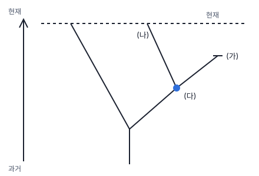
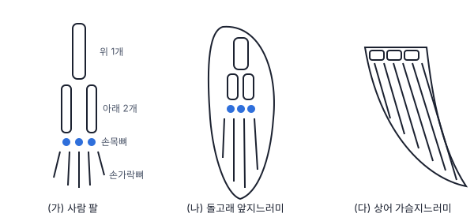

# 생명과학 복습 1027 문제설명

왼쪽 목차로 문항을 고르고, 오른쪽 문제를 보며 해설을 따라가요.

문제의 첫 줄부터 검산까지 설명해요.

**목차**

- [문항별 설명](#problems)
  - [P1. 상동 구조를 판단하는 기준](#p1)
  - [P2. 항생제 내성을 줄이는 전략](#p2)
  - [P3. 하디-바인베르크 조건이 아닌 것](#p3)
  - [P4. 동굴 가재의 눈자루](#p4)
  - [P5. HIV 약물 내성이 빠른 이유](#p5)
  - [P6. 라마르크 이론의 핵심](#p6)
  - [P7. 실험실 진화 연구에 알맞은 생물](#p7)
  - [P8. 상동적이라는 말의 의미](#p8)
  - [P9. 소진화의 예](#p9)
  - [P10. 개와 고양이 DNA가 더 비슷한 이유](#p10)
  - [P11. 진화사상 인물과 주장 짝짓기](#p11)
  - [P12. 맹장은 어떤 증거인가](#p12)
  - [P13. 집단유전학이 묻는 질문](#p13)
  - [P14. 계통수에서 끊긴 가지](#p14)
  - [P15. 진화를 가져오는 원리](#p15)
  - [P16. 바하마 생물의 가장 가까운 친척](#p16)
  - [P17. 현대적 종합론이 보탠 것](#p17)
  - [P18. 자연선택의 가장 직접적인 결과](#p18)
  - [P19. 기후변화에 빨리 적응한 새](#p19)
  - [P20. 가장 잘 살아남고 번식하는 개체](#p20)
  - [P21. 진화 연구로 틀린 것](#p21)
  - [P22. 인간과 침팬지가 공유하는 것](#p22)
  - [P23. 자연선택을 받는 변이](#p23)
  - [P24. 특정 환경에 잘 적응한 개체](#p24)
  - [P25. 모기에서 진화가 빠른 이유](#p25)
  - [P26. DDT를 뿌려도 늘어난 파리](#p26)
  - [P27. 진화의 증거로 적절하지 못한 것](#p27)
  - [P28. 다윈에게 가장 영향을 준 발견](#p28)
  - [P29. 집단의 진화적 변화가 아닌 것](#p29)
  - [P30. 다윈의 관찰과 추론 짝짓기](#p30)
  - [P31. 자연선택의 가장 직접적인 결과](#p31)
  - [P32. 진화 과정에 대한 설명](#p32)
  - [P33. 소진화의 예](#p33)
  - [P34. 자연선택을 받을 수 있는 특징](#p34)
  - [P35. 갈라파고스에서 다윈이 본 것](#p35)
  - [P36. 가장 잘 적응한 식물](#p36)
  - [P37. 다윈의 이론에 없는 주장](#p37)
  - [P38. 새로운 유전자의 원천](#p38)
  - [P39. 항생제 내성을 줄이는 전략](#p39)
  - [P40. 다윈 진화론의 의의](#p40)
  - [P41. 진화 연구에서 틀린 서술](#p41)
  - [P42. 다윈 이론에 없는 생각](#p42)
  - [P43. 날개·다리·지느러미의 공통점](#p43)
  - [P44. 평형 조건에서 자손세대 유전자형 빈도](#p44)
  - [P45. [변형] 하디-바인베르크 조건 고르기](#p45)
  - [P46. [변형] 종 수준으로 소진화 가르기](#p46)
  - [P47. [변형] 계통수의 세 위치 읽기](#p47)
  - [P48. [변형] 앞다리 뼈 배열로 상동과 상사 가르기](#p48)
  - [P49. [변형] 꽃 개체군의 대립유전자 빈도](#p49)
  - [P50. [변형] 다음 세대 이형접합자 수 예상](#p50)
  - [P51. [변형] '변형 혈통'이라는 표현](#p51)
  - [P52. [변형] 유전적 평형과 영가설](#p52)
  - [P53. [변형] 섬 딱정벌레의 몸 색 변화](#p53)
  - [P54. [변형] 진화의 증거와 예 짝짓기](#p54)
  - [P55. [변형] 영어 이름으로 보는 세 지질 이론](#p55)
  - [P56. [변형] 선택을 하는 주체](#p56)
  - [P57. [변형] 섬으로 날아온 나비와 평형](#p57)
  - [P58. [변형] 아미노산 차이로 갈라진 시기 추론](#p58)

## 문항별 설명

### P1. 상동 구조를 판단하는 기준

기출 7강 1 · [원 문제 보기](../%EB%B3%B5%EC%8A%B5%EB%AC%B8%EC%A0%9C_1027_Evolutionary_Thought_and_Microevolution.html#p1)

두 생물의 구조가 상동적인지 판단할 때 찾아야 하는 것은 무엇인가?

- (1) 그 구조는 두 생물에서 동일한 기능을 가져야 한다
- (2) 그 구조는 그 생물의 어떤 가까운 관계도 나타내지 말아야 한다
- (3) 그 구조는 뼈를 포함해야 한다
- (4) 그 구조는 두 생물에서 다른 위치에 있어야 한다
- (5) 그 구조는 두 생물에서 해부학적, 형태적으로 비슷해야 한다

기출 원문 보기

기출 7강 합본 1번 (PDF 1쪽)

#### 문제부터 읽어요

두 생물의 구조가 상동(homology)인지 판단할 때 무엇을 확인하는지 골라요. 핵심은 ‘무엇이 닮았을 때 상동이라고 부르는가’예요.

#### 이 문제를 봤을 때 떠올릴 개념과 공식

‘상동적’이라는 단서에서 비교해부학(비교형태학, comparative morphology)의 상동을 떠올려요. 상동은 공통조상에게서 그 형질의 유전자를 물려받았기 때문에 닮은 것이에요.

판단 기준은 **두 생물의 서로 대응하는 자리에 있는 구조가 해부학적·형태적으로 같은 구성 요소를 같은 배치로 가지는지**예요. 사람 팔·박쥐 날개·돌고래 앞지느러미가 상완골–척골·요골–수근골–손가락 배열을 공유하듯, 기능이 같은지는 기준이 아니에요.

관련 정리노트: [상동과 상사의 판단 기준](../%EC%A0%95%EB%A6%AC%EB%85%B8%ED%8A%B8_1027_Evolutionary_Thought_and_Microevolution.html#s2-homology)

#### 왜 이렇게 푸는지 함께 따라가요

(1) 틀려요. ‘동일한 기능’을 요구하지만, 박쥐 날개(날기)와 사람 팔은 기능이 달라도 상동이에요. 기능이 같아 닮는 경우는 오히려 상사(analogy)에서 흔해요.

(2) 틀려요. 상동은 공통조상을 공유한다는 증거라 가까운 관계를 보여 줘요. ‘어떤 가까운 관계도 나타내지 말아야’는 정의와 정반대예요.

(3) 틀려요. 앞다리 뼈 배열은 대표 예일 뿐이에요. 상동은 형질·기관 어디에나 쓰는 말이라 뼈가 꼭 있어야 한다는 조건은 없어요.

(4) 틀려요. 상동 구조는 두 생물의 서로 대응하는 같은 자리에 있어요. 앞다리는 둘 다 몸 앞쪽의 사지예요. ‘다른 위치’는 기준을 거꾸로 말해요.

(5) 맞아요. 대응하는 구조가 해부학적·형태적으로 비슷하다는 것, 곧 같은 구성 요소의 배치가 같다는 것이 상동을 판단하는 기준과 일치해요.

따라서 답은 (5)예요.

#### 완성 답과 검산

답 (5). 교재 그림 7.10은 돼지 앞다리·돌고래 앞지느러미·박쥐 날개가 쓰임은 달라도 같은 뼈를 같은 색으로 대응시켜 상동을 보여 줘요. 기능(1)·뼈의 유무(3)가 아니라 구조의 대응이 기준임이 이 그림과 맞아요.

**페이지 요약**

#### 판단 기준

상동은 대응 위치의 구조가 해부학적·형태적으로 같은 배치인지로 판단해요. 기능은 기준이 아니에요.

#### 결론

답 (5).

---

### P2. 항생제 내성을 줄이는 전략

기출 7강 2 · [원 문제 보기](../%EB%B3%B5%EC%8A%B5%EB%AC%B8%EC%A0%9C_1027_Evolutionary_Thought_and_Microevolution.html#p2)

여러 인간 질병을 일으키는 생물들 중에 세균의 항생제 내성은 이제 흔히 관찰된다. 다음 보기 중 이들 생물의 항생제 내성을 줄이는데 좋은 전략이 아닌 것은?

- (1) 지시한 대로 항생제를 사용하고, 약은 처방 받은 기간 내에 모두 먹는다
- (2) 병원체가 일으킬 수 있는 진화과정을 막아 자연선택을 방지한다
- (3) 전문적인 처방을 받지 않은 경우에는 항생제 사용을 자제한다
- (4) 세균 감염이 치료되지 않는 상황처럼 꼭 필요할 때에만 항생제를 사용한다
- (5) 질병을 치료하기 어려운 경우에는 한 가지 이상의 항생제를 사용할 수 있다

기출 원문 보기

기출 7강 합본 2번 (PDF 1쪽)

#### 문제부터 읽어요

세균의 항생제 내성(antibiotic resistance)을 줄이는 방법 가운데 **좋은 전략이 아닌 것**을 골라요. 각 보기가 실제로 할 수 있고 내성 세균이 골라지는 기회를 줄이는지 확인해요.

#### 이 문제를 봤을 때 떠올릴 개념과 공식

‘항생제 내성’에서 자연선택(natural selection)에 의한 적응을 떠올려요. 항생제를 치기 전부터 돌연변이로 생긴 내성 세균이 극소수 있고, 항생제가 내성 없는 세균을 죽이면 내성 세균만 분열해 비율이 늘어요. 교재 DDT 모기 실험과 같은 원리예요.

판단 기준은 두 가지예요. 첫째, 변이와 생존 차이를 만드는 환경이 있으면 자연선택은 저절로 일어나므로 **막을 수 없어요**. 둘째, 할 수 있는 것은 항생제로 내성 세균이 골라지는 기회(선택 압력)를 줄이는 것이에요.

관련 정리노트: [자연선택에 의한 적응과 항생제 내성](../%EC%A0%95%EB%A6%AC%EB%85%B8%ED%8A%B8_1027_Evolutionary_Thought_and_Microevolution.html#s2-evidence)

#### 왜 이렇게 푸는지 함께 따라가요

(1) 좋은 전략이라 답이 아니에요. 처방 기간을 다 채우면 덜 죽은 세균이 살아남아 다시 불어날 기회가 줄어요.

(2) 좋은 전략이 아니라 답이에요. ‘진화과정을 막아 자연선택을 방지한다’는 실행할 수 없는 목표예요. 내성 변이가 있고 항생제가 생존 차이를 만들면 선택은 저절로 일어나요. 줄일 수 있는 것은 선택의 반복이지 선택 자체가 아니에요.

(3) 좋은 전략이라 답이 아니에요. 처방 없는 사용을 자제하면 내성 세균이 골라지는 기회가 줄어요.

(4) 좋은 전략이라 답이 아니에요. 꼭 필요할 때만 쓰는 것도 선택 압력을 줄이는 방법이에요.

(5) 좋은 전략이라 답이 아니에요. 작용 방식이 다른 항생제를 함께 쓰면 두 약에 모두 견디는 세균이 나올 가능성이 낮아요. 이 병용 원리는 수업에서 다루지 않은 보충이에요.

좋은 전략이 아닌 것은 (2) 하나이므로 답은 (2)예요.

#### 완성 답과 검산

답 (2). 소거하면 (1)·(3)·(4)·(5)는 모두 내성 세균이 골라지는 기회를 줄이는 방향이고, (2)만 자연선택 자체를 없애겠다는 주장이에요. 교재 p.145 결론도 DDT 사용이 저항성 개체를 선호하는 자연선택을 ‘만들었다’고 적어, 약을 쓰는 한 선택이 일어남을 보여 줘요.

**페이지 요약**

#### 판단 기준

자연선택은 막을 수 없고, 항생제 선택 압력만 줄일 수 있어요.

#### 결론

좋은 전략이 아닌 것은 (2).

---

### P3. 하디-바인베르크 조건이 아닌 것

기출 7강 3 · [원 문제 보기](../%EB%B3%B5%EC%8A%B5%EB%AC%B8%EC%A0%9C_1027_Evolutionary_Thought_and_Microevolution.html#p3)

다음 중 하디-바인베르그 원리의 조건으로 틀린 것은?

- (1) 개체군의 크기는 무한하다
- (2) 다른 개체군으로부터의 유입은 차단된다
- (3) 자연선택이 존재한다
- (4) 개체군 내의 개체들은 무작위로 교배한다
- (5) 돌연변이가 일어나지 않는다

기출 원문 보기

기출 7강 합본 3번 (PDF 1쪽)

#### 문제부터 읽어요

하디-바인베르크 원리(Hardy–Weinberg principle)의 조건으로 **틀린 것**을 골라요. 다섯 조건과 하나씩 맞대어 보고 어긋나는 진술을 찾아요.

#### 이 문제를 봤을 때 떠올릴 개념과 공식

‘하디-바인베르크 원리의 조건’에서 다음 세대의 빈도를 확률로 계산하게 해 주는 다섯 조건을 떠올려요. 돌연변이 없음, 이동(유입) 없음, 개체군 크기가 무한함, 자연선택 없음(모든 유전자형이 똑같이 생존하고 번식), 무작위 교배예요.

판단 기준은 각 보기가 조건을 **‘없음/있음’ 방향까지 같게** 말하는지예요. 조건이 지켜지면 대립유전자 빈도가 세대가 지나도 변하지 않아요.

관련 정리노트: [하디-바인베르크의 다섯 조건](../%EC%A0%95%EB%A6%AC%EB%85%B8%ED%8A%B8_1027_Evolutionary_Thought_and_Microevolution.html#s3-hardy-weinberg)

#### 왜 이렇게 푸는지 함께 따라가요

(1) 조건과 일치해요. ‘개체군의 크기는 무한하다’는 다섯 조건 중 하나예요.

(2) 조건과 일치해요. ‘다른 개체군으로부터의 유입은 차단된다’는 이동 없음 조건이에요.

(3) 조건과 어긋나요. 조건은 자연선택이 *없는* 것인데 보기는 ‘존재한다’고 해요. 자연선택이 있으면 유리한 대립유전자의 빈도가 올라 평형이 깨져요.

(4) 조건과 일치해요. 무작위 교배여야 상자에서 공 두 개를 뽑는 확률 모델이 성립해요.

(5) 조건과 일치해요. ‘돌연변이가 일어나지 않는다’는 첫 조건이에요.

조건으로 틀린 진술은 (3) 하나이므로 답은 (3)이에요.

#### 완성 답과 검산

답 (3). 교재 p.149의 조건 4 ‘모든 유전자형은 똑같이 잘 생존하고 번식한다’는 곧 자연선택이 없다는 뜻이라 (3)과 반대예요. 나머지 넷은 조건 목록과 방향이 같아요.

**페이지 요약**

#### 판단 기준

다섯 조건: 돌연변이·이동·자연선택 없음, 무한 크기, 무작위 교배.

#### 결론

‘자연선택이 존재한다’는 반대 방향이라 답 (3).

---

### P4. 동굴 가재의 눈자루

기출 7강 4 · [원 문제 보기](../%EB%B3%B5%EC%8A%B5%EB%AC%B8%EC%A0%9C_1027_Evolutionary_Thought_and_Microevolution.html#p4)

어두운 동굴에 사는 가재의 한 종은 일반적인 하천에 서식하는 유연관계의 다른 종처럼 눈자루를 가지고 있으나 눈은 없다. 그러므로 동굴에 거주하는 가재의 눈자루는 ( ).

- (1) 진화적 오류이다
- (2) 우성 돌연변이이다
- (3) 상사기관이다
- (4) 진화론이 부정확함을 드러내는 증거이다
- (5) 흔적기관이다

기출 원문 보기

기출 7강 합본 4번 (PDF 1쪽)

#### 문제부터 읽어요

동굴 가재는 유연관계가 가까운 하천 가재처럼 눈자루를 가졌지만 눈은 없어요. 이 눈자루를 무엇이라고 부르는지 골라요. 핵심 조건은 ‘친척 종과 공유하는 구조’와 ‘기능(눈)을 잃음’이에요.

#### 이 문제를 봤을 때 떠올릴 개념과 공식

‘눈자루는 있으나 눈은 없다’에서 흔적기관(vestigial organ)을 떠올려요. 지금은 기능이 거의 없거나 크게 줄었지만 조상에게서 물려받은 구조의 흔적이에요. 교재는 뷔퐁(Buffon)이 흔적기관이 과거 조상 시대에는 기능을 했을 것이라고 말했다고 소개해요. 흔적기관은 수업 본문보다 강의노트 7장 p1에만 나온 보충이에요.

판단 기준은 **닮은 이유가 공통조상인지, 그 구조가 지금 기능을 하는지**예요. 공통조상에서 물려받았으면 상동 쪽이고, 그중 기능을 잃고 남은 것이면 흔적기관이에요.

관련 정리노트: [상동과 상사, 흔적기관 보충](../%EC%A0%95%EB%A6%AC%EB%85%B8%ED%8A%B8_1027_Evolutionary_Thought_and_Microevolution.html#s2-homology)

#### 왜 이렇게 푸는지 함께 따라가요

(1) 틀려요. 진화는 목표를 향한 설계가 아니라서 ‘오류’라는 판단 기준이 없어요. 물려받은 구조가 쓰이지 않은 채 남았을 뿐이에요.

(2) 틀려요. 지문에는 대립유전자의 우열을 판단할 교배 정보가 없어요. 눈자루는 친척 종과 공유하는 구조라 돌연변이 하나의 우열로 설명할 대상이 아니에요.

(3) 틀려요. 상사는 조상이 달라도 환경 때문에 닮은 것이에요. 이 눈자루는 유연관계가 있는 하천 가재와 공통조상에서 물려받은 구조라 기준이 상사에 맞지 않아요.

(4) 틀려요. 쓰이지 않는 구조가 남아 있다는 것은 공통조상에서 변해 왔음을 보여 주므로 오히려 진화의 증거예요.

(5) 맞아요. 친척 종과 공유하는 구조(공통조상)이면서 눈을 받치는 기능을 잃고 남았으므로 흔적기관의 정의와 일치해요.

따라서 답은 (5)예요.

#### 완성 답과 검산

답 (5). 교재 p.140의 뷔퐁 예(돼지의 땅에 닿지 않는 두 발가락)와 같은 구조예요. 친척과 공유하지만 그 생물에서는 기능이 없어진 부분이라는 두 조건이 눈자루에도 그대로 성립해요.

**페이지 요약**

#### 판단 기준

공통조상에게 물려받았지만 기능을 잃은 구조는 흔적기관이에요. 상사(다른 조상)와 구별해요.

#### 결론

답 (5).

---

### P5. HIV 약물 내성이 빠른 이유

기출 7강 5 · [원 문제 보기](../%EB%B3%B5%EC%8A%B5%EB%AC%B8%EC%A0%9C_1027_Evolutionary_Thought_and_Microevolution.html#p5)

항-HIV 약물의 저항성은 심각한 문제이다. 다음 진술 중 HIV 바이러스의 약물 내성이 매우 빠르게 나타나는 이유로 올바른 것은?

- (1) 바이러스가 혈액에 존재하기 때문에
- (2) 바이러스이기 때문에
- (3) T 세포에서 복제되므로
- (4) 전염성이 높기 때문에
- (5) 돌연변이율이 매우 높고, 한 세대가 짧기 때문에

기출 원문 보기

기출 7강 합본 5번 (PDF 1쪽)

#### 문제부터 읽어요

HIV의 약물 내성이 *매우 빠르게* 나타나는 이유를 골라요. 보기가 HIV에 대한 맞는 사실인지가 아니라, 내성이 빨리 생기는 속도를 설명하는지 따져요.

#### 이 문제를 봤을 때 떠올릴 개념과 공식

‘약물 내성’에서 자연선택에 의한 적응을 떠올려요. 약이 내성 없는 개체를 걸러 내고 미리 있던 내성 개체가 자손을 남겨 집단의 구성이 바뀌어요. 이 선택은 단시간에도 작동해요(DDT 모기).

판단 기준은 속도를 정하는 두 요소예요. 하나는 **내성 변이가 생기는 양**이고, 다른 하나는 **선택이 되풀이되는 빈도**예요. 돌연변이는 새로운 유전적 변이의 주요 근원이에요. 세대가 짧으면 같은 시간에 선택이 더 여러 번 반복돼요. HIV의 높은 돌연변이율이라는 구체적 사실은 수업 밖 보충이에요.

관련 정리노트: [자연선택에 의한 적응과 약물 내성](../%EC%A0%95%EB%A6%AC%EB%85%B8%ED%8A%B8_1027_Evolutionary_Thought_and_Microevolution.html#s2-evidence)

#### 왜 이렇게 푸는지 함께 따라가요

(1) 이유로 부적합해요. 혈액에 존재한다는 서식 장소는 변이의 양이나 세대 속도를 정하지 않아요.

(2) 이유로 부적합해요. ‘바이러스이다’라는 분류만으로는 속도를 설명하지 못해요. 바이러스마다 돌연변이율과 복제 속도가 달라요.

(3) 이유로 부적합해요. T 세포에서 복제된다는 것은 HIV에 대해 맞는 사실이지만, 변이의 양이나 선택의 반복 빈도와는 관계가 없어요.

(4) 이유로 부적합해요. 전염성은 사람 사이에 퍼지는 정도이고, 한 환자 몸속에서 내성 바이러스가 골라지는 속도와는 다른 문제예요.

(5) 이유로 적합해요. 높은 돌연변이율은 내성 변이의 재료를 많이 만들고, 짧은 세대는 약에 의한 선택을 짧은 시간에 여러 번 반복시켜요. 두 속도 요소를 모두 말해요.

따라서 답은 (5)예요.

#### 완성 답과 검산

답 (5). 교재 p.145의 DDT 실험에서 모기 집단이 1년 남짓 만에 저항성 집단으로 바뀐 것도 변이(처음 약 5%의 저항성 개체)와 여러 세대의 반복 선택으로 설명돼요. 같은 두 요소가 더 크게 작동하는 경우가 (5)예요.

**페이지 요약**

#### 판단 기준

내성 속도 = 변이의 양(돌연변이율) × 선택 반복 빈도(세대 길이).

#### 결론

답 (5). (3)은 사실이지만 이유가 아니에요.

---

### P6. 라마르크 이론의 핵심

기출 7강 7 · [원 문제 보기](../%EB%B3%B5%EC%8A%B5%EB%AC%B8%EC%A0%9C_1027_Evolutionary_Thought_and_Microevolution.html#p6)

지금은 폐기된 라마르크의 이론을 가장 잘 설명한 것은?

- (1) 현존하는 생명체는 과거에 가장 작 적응한 개체의 자손이다
- (2) 모든 생명체는 오늘날 보이는 모습으로 창조되었다
- (3) 생명체는 그들의 생애 동안 새로운 형질을 획득하고 이를 자손에게 물려준다
- (4) 지구의 나이는 매우 많고 그 동안 수 많은 변화를 거쳤다

기출 원문 보기

기출 7강 합본 7번 (PDF 1쪽)

#### 문제부터 읽어요

폐기된 라마르크(Lamarck) 이론을 가장 잘 설명한 보기를 골라요. 각 보기가 어느 인물·이론의 주장인지 짝지어 보면 돼요.

**문항 결함:** 보기 (1)의 ‘가장 작 적응한’은 원문 오타로 ‘가장 잘 적응한’으로 읽어요. 판정에는 영향이 없어요.

#### 이 문제를 봤을 때 떠올릴 개념과 공식

‘라마르크의 이론’에서 용불용설(use and disuse)과 획득형질의 유전(inheritance of acquired characteristics)을 떠올려요. 살면서 많이 쓴 기관이 발달하고, 생애 동안 얻은 형질이 자손에게 전해진다는 주장이에요. 자손에게 전해지는 것은 유전자인데 생애 중의 변화는 유전자를 바꾸지 않으므로 일반적으로 틀렸어요.

판단 기준은 **무엇이 바뀌고 어떻게 전해지는가**예요. 한 개체가 생애 동안 얻은 형질의 전달이면 라마르크, 원래 있던 변이 중 유리한 것이 남으면 다윈의 자연선택, 처음 모습 그대로면 창조설, 지구가 오래되어 서서히 변했다면 지질학의 점진주의·동일과정설이에요.

관련 정리노트: [라마르크의 용불용설과 획득형질](../%EC%A0%95%EB%A6%AC%EB%85%B8%ED%8A%B8_1027_Evolutionary_Thought_and_Microevolution.html#s0-lamarck)

#### 왜 이렇게 푸는지 함께 따라가요

(1) 라마르크의 설명으로 부적합해요. ‘가장 잘 적응한 개체의 자손’이 지금 생물이라는 것은 원래 있던 변이 중 유리한 것이 남는다는 다윈의 자연선택이에요.

(2) 라마르크의 설명으로 부적합해요. 처음 모습 그대로 창조되었다는 것은 종이 변하지 않는다는 창조설이에요. 라마르크는 오히려 생물이 변한다고 제안했어요.

(3) 라마르크의 설명으로 적합해요. ‘생애 동안 새로운 형질을 획득하고 자손에게 물려준다’는 획득형질의 유전 그대로예요. 이 메커니즘이 틀려 폐기되었어요.

(4) 라마르크의 설명으로 부적합해요. 지구가 매우 오래되었고 많은 변화를 거쳤다는 것은 점진주의·동일과정설 같은 지질학의 생각이에요.

따라서 답은 (3)이에요.

#### 완성 답과 검산

답 (3). 교재 p.140은 라마르크가 ‘동물들이 일생 동안 획득한 변이는 자손에게 유전된다’고 주장했다고 적어 (3)과 같아요. 나머지 세 보기는 각각 다윈·창조설·지질학자에게 짝지어져 라마르크 몫이 남지 않아요.

**페이지 요약**

#### 판단 기준

생애 중 얻은 형질의 전달 = 라마르크. 원래 있던 변이의 선택 = 다윈.

#### 결론

답 (3). 보기 (1) ‘가장 작’은 ‘가장 잘’의 오타예요.

---

### P7. 실험실 진화 연구에 알맞은 생물

기출 7강 10 · [원 문제 보기](../%EB%B3%B5%EC%8A%B5%EB%AC%B8%EC%A0%9C_1027_Evolutionary_Thought_and_Microevolution.html#p7)

실험실에서 진화의 과정을 연구할 수 있는 적당한 생명체를 찾고 있을 때, 다음 보기들 중 가장 중요하게 고려해야 할 점은?

- (1) 개체의 크기가 커야 한다
- (2) 세대 길이가 짧아야 한다
- (3) 조상의 완전한 화석이 존재해야 한다
- (4) 식물보다는 동물이어야 한다
- (5) 자손의 수가 비교적 적어야 한다

기출 원문 보기

기출 7강 합본 10번 (PDF 2쪽)

#### 문제부터 읽어요

실험실에서 진화 과정을 직접 연구할 생물을 고를 때 가장 중요한 조건을 골라요. 실험 기간 안에 진화적 변화를 관찰할 수 있게 해 주는 성질이 무엇인지 찾아요.

**인쇄 정답 오류:** 기출 합본(7강 10번)의 인쇄 정답은 (3)이지만, 교재·수업 근거와 정답 대조(key-check)의 판단은 (2)이고 이 카드의 정답도 (2)예요.

#### 이 문제를 봤을 때 떠올릴 개념과 공식

‘실험실에서 진화의 과정을 연구’에서 자연선택이 단시간에도 작동해 직접 관찰할 수 있다는 점을 떠올려요. 교재는 자연선택이 곤충의 살충제 내성처럼 때때로 단시간 동안 작동한다고 하고, DDT 모기 실험은 약 12~18개월 동안 집단이 저항성으로 바뀐 것을 보여 줘요.

판단 기준은 **살아 있는 개체군에서 정해진 실험 기간 안에 여러 세대가 지나 선택이 반복될 수 있는가**예요. 진화적 변화는 한 개체가 아니라 개체군에서 세대를 거듭하며 쌓이기 때문이에요.

관련 정리노트: [짧은 시간에 관찰되는 자연선택](../%EC%A0%95%EB%A6%AC%EB%85%B8%ED%8A%B8_1027_Evolutionary_Thought_and_Microevolution.html#s2-evidence)

#### 왜 이렇게 푸는지 함께 따라가요

(1) 부적합해요. 몸이 크면 실험실에서 많은 개체를 기르기 어렵고 세대도 대체로 길어져요. 크기는 세대 반복을 돕는 조건이 아니에요.

(2) 적합해요. 세대 길이가 짧으면 같은 실험 기간에 더 많은 세대가 지나 선택이 여러 번 반복되고, 대립유전자 빈도 변화를 관찰할 수 있어요. 기준을 직접 충족해요.

(3) 부적합해요. 인쇄 정답이지만 기준에 맞지 않아요. 화석 기록은 조상과 후손의 계통 관계를 보여 주는 과거의 증거이고, 실험실에서는 살아 있는 개체군의 세대 변화를 관찰해요. 조상의 화석이 있든 없든 실험 기간 안에 선택이 반복되는지는 달라지지 않아요. 게다가 ‘완전한’ 화석 기록을 실험 생물의 조건으로 걸 수도 없어요.

(4) 부적합해요. 동물이냐 식물이냐는 기준이 아니에요. 교재·수업의 대표 예에는 항생제 내성 세균도 있어요.

(5) 부적합해요. 자손이 많아야 변이가 다양하고 선택이 일어날 개체가 충분해요. ‘적어야 한다’는 기준과 반대 방향이에요.

따라서 답은 (2)예요.

#### 완성 답과 검산

답 (2). 교재 p.145 DDT 실험은 모기 세대가 짧아 1년 남짓 사이에 저항성 비율이 약 5%에서 75%로 바뀐 것을 측정해요. 이 실험에 조상 화석은 전혀 쓰이지 않으므로 (3)이 관찰 가능성을 정하지 않는다는 점도 함께 확인돼요.

#### 헷갈리기 쉬운 점

‘화석 = 진화의 증거’라는 연상 때문에 (3)을 고르기 쉬워요. 화석은 과거를 보여 주는 증거이고, 실험실 연구는 지금 살아 있는 개체군의 세대 변화를 본다는 점을 구별해요.

시험에서 인쇄 정답 (3)과 같은 답안을 만나면, 실험실 관찰은 세대 길이로 결정된다는 교재 p.144–145 근거를 들어 (2)로 답하고 이의를 제기할 근거로 남겨 두어요.

**페이지 요약**

#### 판단 기준

실험 기간 안에 여러 세대가 지나 선택이 반복되는가.

#### 결론

답 (2). 인쇄 정답 (3)은 오류예요. 화석은 실험 생물의 조건이 아니에요.

---

### P8. 상동적이라는 말의 의미

기출 7강 11 · [원 문제 보기](../%EB%B3%B5%EC%8A%B5%EB%AC%B8%EC%A0%9C_1027_Evolutionary_Thought_and_Microevolution.html#p8)

박쥐의 날개는 고양이의 앞발과 상동적이다. 상동적이라는 말의 의미는 무엇인가?

- (1) 박쥐와 고양이의 공통조상은 고양이 다리와 박쥐 날개에서 발견되는 유사한 골격 구조를 갖는 사지를 갖는다.
- (2) 박쥐와 고양이의 공통조상은 날개의 기능을 갖는 사지(limbs)를 갖는다
- (3) 박쥐와 고양이는 공통조상을 갖지 않는다
- (4) 두 구조는 같은 목적으로 사용된다
- (5) 박쥐 날개는 퇴화한 다리이다

기출 원문 보기

기출 7강 합본 11번 (PDF 2쪽)

#### 문제부터 읽어요

박쥐 날개와 고양이 앞발이 ‘상동적’이라는 말이 무엇을 뜻하는지 골라요. 공통조상이 무엇을 가졌고 두 후손이 무엇을 물려받았는지에 주목해요.

#### 이 문제를 봤을 때 떠올릴 개념과 공식

‘상동적’에서 상동(homology)을 떠올려요. 공통조상으로부터 그 형질의 유전자를 물려받았기 때문에 닮은 것이에요. 앞다리 예에서는 상완골–척골·요골–수근골–손가락의 배열이 물려받은 구조예요.

판단 기준은 **닮은 이유가 공통조상에서 물려받은 구조인지**, 그리고 **물려받은 것이 구조인지 기능인지**예요. 상동은 기능이 달라도 성립해요.

관련 정리노트: [상동의 뜻과 앞다리 뼈 배열](../%EC%A0%95%EB%A6%AC%EB%85%B8%ED%8A%B8_1027_Evolutionary_Thought_and_Microevolution.html#s2-homology)

#### 왜 이렇게 푸는지 함께 따라가요

(1) 맞아요. 공통조상이 이미 두 후손에서 보이는 것과 같은 골격 구조의 사지를 가졌다는 진술이에요. 두 후손이 그 구조를 물려받아 각각 날개와 앞발로 바꿔 썼다는 상동의 뜻과 일치해요.

(2) 틀려요. 공통조상의 사지가 ‘날개의 기능’을 가졌다고 해요. 물려받은 것은 뼈 구조이지 기능이 아니에요. 상동 판단은 공통조상의 기능을 요구하지 않아요.

(3) 틀려요. 상동은 공통조상을 공유하기 때문에 닮은 것이므로 ‘공통조상을 갖지 않는다’는 정의와 정반대예요.

(4) 틀려요. 날개는 날기, 앞발은 걷기처럼 쓰임이 달라요. ‘같은 목적’은 상동의 조건이 아니고, 기능 때문에 닮는 것은 상사 쪽 설명이에요.

(5) 틀려요. 날개는 기능을 잃은 흔적이 아니라 앞다리 구조가 날기에 맞게 바뀐 것이에요. ‘퇴화한 다리’는 흔적기관에 가까운 표현이라 상동의 뜻이 아니에요.

따라서 답은 (1)이에요.

#### 완성 답과 검산

답 (1). 교재 p.146은 4지를 가진 척추동물의 앞다리가 같은 구성 요소로 이루어진 앞다리를 가진 공통조상으로부터 진화했기 때문에 상동성이 있다고 적어요. 이 문장의 ‘공통조상이 같은 구성의 앞다리를 가졌다’가 (1)과 같은 내용이에요.

**페이지 요약**

#### 판단 기준

상동 = 공통조상이 가진 구조를 물려받아 닮음. 기능은 달라도 돼요.

#### 결론

답 (1).

---

### P9. 소진화의 예

기출 7강 12 · [원 문제 보기](../%EB%B3%B5%EC%8A%B5%EB%AC%B8%EC%A0%9C_1027_Evolutionary_Thought_and_Microevolution.html#p9)

소진화의 예가 될 수 있는 것은?

- (1) 개체군 안에서의 작은 유전적 변화로 인한 새 개체군 색깔의 작은 변화
- (2) 살아 있는 영장류와 인간 사이의 직접적인 진화연결고리
- (3) 갑작스러운 종의 절멸
- (4) 지표 근처와 깊은 암석층에서 발견된 화석들 사이의 형태적인 차이
- (5) 개체군의 모든 구성원을 제거하는 홍수

기출 원문 보기

기출 7강 합본 12번 (PDF 2쪽)

#### 문제부터 읽어요

소진화(microevolution)의 예가 될 수 있는 것을 골라요. 각 보기가 한 개체군 안의 유전적 변화인지, 종 수준 이상의 사건인지 나눠 봐요.

#### 이 문제를 봤을 때 떠올릴 개념과 공식

‘소진화’에서 현대적 종합론(modern synthesis)의 소진화·대진화 구분을 떠올려요. 소진화는 한 개체군이 겪는 소규모의 유전적 변화이고, 대진화(macroevolution)는 종의 출현과 갑작스런 소멸 같은 대규모 변화예요.

판단 기준은 두 단계예요. 첫째, **같은 종 안의 변화인지, 종이 새로 생기거나 사라지는 종 수준 이상의 변화인지** 봐요. 둘째, 개체군의 유전적 구성이 바뀌어 다음 세대로 이어지는지 봐요.

관련 정리노트: [소진화와 대진화를 가르는 종 수준](../%EC%A0%95%EB%A6%AC%EB%85%B8%ED%8A%B8_1027_Evolutionary_Thought_and_Microevolution.html#s2-synthesis)

#### 왜 이렇게 푸는지 함께 따라가요

(1) 소진화의 예로 적합해요. ‘개체군 안에서의 작은 유전적 변화’로 색깔이 달라졌으므로 같은 종 안에서 유전적 구성이 바뀐 변화예요. 핀치 부리 변화·항생제 내성과 같은 수준이에요.

(2) 부적합해요. 지금 살아 있는 영장류는 사람의 조상이 아니라 공통조상에서 갈라진 친척이라 ‘직접적인 연결고리’라는 표현부터 맞지 않아요. 종과 종 사이의 관계라 한 개체군 안의 변화도 아니에요.

(3) 부적합해요. 종의 절멸은 종이 사라지는 종 수준 이상의 사건이라 대진화에 속해요. 수업에서도 공룡 멸종을 대진화의 예로 들었어요.

(4) 부적합해요. 깊은 지층과 얕은 지층 화석의 형태 차이는 긴 시간에 걸친 종 수준 이상의 변화를 보여 주는 화석 기록이에요.

(5) 부적합해요. 홍수로 구성원이 모두 사라지면 유전적 구성이 바뀐 다음 세대가 남지 않아요. 개체군 안의 변화가 아니라 개체군의 소멸이에요.

따라서 답은 (1)이에요.

#### 완성 답과 검산

답 (1). 교재 p.146은 7.2절 제목을 ‘소진화: 개체군 안에서의 유전적 변화’로 두고, 개체군의 유전적 특성이 후대로 이어지는 변화라고 정의해요. 이 정의에 들어맞는 보기는 (1)뿐이고, (3)·(4)는 p.144의 대진화(갑작스런 소멸·대규모 변화) 쪽이에요.

**페이지 요약**

#### 판단 기준

같은 종·한 개체군 안의 유전적 변화면 소진화, 종의 출현·소멸이면 대진화.

#### 결론

답 (1).

---

### P10. 개와 고양이 DNA가 더 비슷한 이유

기출 7강 13 · [원 문제 보기](../%EB%B3%B5%EC%8A%B5%EB%AC%B8%EC%A0%9C_1027_Evolutionary_Thought_and_Microevolution.html#p10)

개와 고양이의 DNA는 고양이와 햄스터의 DNA 보다 더 유사하다. 이유는?

- (1) 고양이와 개는 햄스터보다 자식의 수가 적어서 DNA가 천천히 변한다
- (2) 고양이와 개의 공통 조상은 고양이와 햄스터의 공통 조상보다 더 최근에 생겼다
- (3) 고양이와 개는 육식동물로 유사한 영양을 섭취한다
- (4) 고양이의 후손과 개의 후손은 유사한 환경에서 진화하였다
- (5) 고양이와 개는 사람과 오랫동안 같이 살아와서 서로 유사하다

기출 원문 보기

기출 7강 합본 13번 (PDF 2쪽)

#### 문제부터 읽어요

개와 고양이의 DNA가 고양이와 햄스터의 DNA보다 더 비슷한 이유를 골라요. 비교 대상은 두 쌍(개–고양이, 고양이–햄스터)이고, 서열이 얼마나 비슷한지를 무엇이 정하는지 묻고 있어요.

#### 이 문제를 봤을 때 떠올릴 개념과 공식

‘DNA가 더 유사하다’에서 비교분자생물학(comparative molecular biology)의 증거를 떠올려요. 두 종이 갈라지면 서로 교배하지 않아 유전자를 교환하지 않고, 각자 생긴 돌연변이가 따로 쌓여요. 그래서 분기가 오래될수록 서열 차이가 커요. 사람의 사이토크롬 c(cytochrome c)가 침팬지와는 0개, 개와는 13개, 효모와는 56개 다른 것이 예예요.

판단 기준은 **두 종의 공통조상이 얼마나 최근인지**예요. 서열 차이가 적다 → 최근에 갈라졌다 → 공통조상이 더 최근이다로 읽어요. 같은 환경·먹이 때문에 닮는 것은 상사(analogy)의 논리라 서열 유사성의 이유가 아니에요.

관련 정리노트: [비교분자생물학과 분기 시점](../%EC%A0%95%EB%A6%AC%EB%85%B8%ED%8A%B8_1027_Evolutionary_Thought_and_Microevolution.html#s2-molecular)

#### 왜 이렇게 푸는지 함께 따라가요

(1) 이유로 부적합해요. 자식 수를 DNA 변화 속도의 원인으로 들지만, 서열 차이는 갈라진 뒤 흐른 시간으로 설명해요. 이 기준이 아닌 요인이라 두 쌍의 차이를 설명하지 못해요.

(2) 이유로 적합해요. 고양이–개의 공통조상이 고양이–햄스터의 공통조상보다 더 최근이면, 고양이와 개는 갈라진 뒤 각자 쌓은 돌연변이가 적어 서열이 더 비슷해요. 기준과 정확히 일치해요.

(3) 이유로 부적합해요. 비슷한 먹이(육식)는 생활 방식의 공통점이고, 먹이가 같다고 DNA 염기서열이 닮지는 않아요.

(4) 이유로 부적합해요. 비슷한 환경에서 닮아지는 것은 상사의 논리예요. DNA 서열의 유사성은 계통이 얼마나 가까운지를 보여 줘요.

(5) 이유로 부적합해요. 사람과 함께 산 것은 햄스터도 마찬가지이고, 함께 산다고 두 종의 DNA가 서로 닮아 가지도 않아요.

따라서 답은 (2)예요.

#### 완성 답과 검산

답 (2). 교재 p.146–147은 매우 근접한 종(인간과 유인원)은 아미노산 서열이 약간만 다르고, 인간과 효모처럼 더 먼 유연관계는 많은 차이를 나타낸다고 적어요. 같은 원리를 개–고양이(가까움)와 고양이–햄스터(멂)에 대입하면 (2)가 돼요.

**페이지 요약**

#### 판단 기준

서열 차이가 적을수록 최근에 갈라졌고, 공통조상이 더 최근이에요.

#### 결론

답 (2). 환경·먹이로 닮는 것은 상사의 논리예요.

---

### P11. 진화사상 인물과 주장 짝짓기

기출 7강 14 · [원 문제 보기](../%EB%B3%B5%EC%8A%B5%EB%AC%B8%EC%A0%9C_1027_Evolutionary_Thought_and_Microevolution.html#p11)

다음은 진화사상을 발전시킨 인물들에 대한 설명이다. 설명이 잘못 연결된 것은?

- (1) 허튼 – 특정 사건에 의해 큰 변화를 겪는 격변설을 주장
- (2) 퀴비에 – 각 화석들은 홍수나 지진과 같은 사건으로 죽은 생물들의 잔유물이라고 주장
- (3) 라마르크 – 획득형질의 유전을 주장
- (4) 뷔퐁 – 현재 사용하지 않는 흔적기관들이 과거에는 기능을 했었을 것이라고 언급
- (5) 러셀 윌리스 – 자연선택의 메커니즘을 독자적으로 발견

기출 원문 보기

기출 7강 합본 14번 (PDF 2쪽)

#### 문제부터 읽어요

인물 다섯 명과 주장을 짝지은 보기 중 **잘못 연결된 것**을 골라요. 주장 내용이 사실인지보다, 그 주장을 한 사람이 맞는지를 확인해요.

**문항 결함:** 원문의 ‘허튼’은 휴튼(Hutton), ‘윌리스’는 월리스(Wallace), ‘잔유물’은 잔여물을 뜻해요. 교재 7장 p.140도 퀴비에 설명에 ‘잔유물’이라고 적었고, p.141은 ‘휴튼’·‘월리스’로 적어요. 판정에는 영향이 없어요.

#### 이 문제를 봤을 때 떠올릴 개념과 공식

‘격변설’, ‘획득형질’, ‘흔적기관’, ‘자연선택’ 같은 주장 이름에서 다윈 이전·동시대 인물의 짝을 떠올려요.

판단 기준은 **주장과 주창자의 짝**이에요. 지질학에서는 격변설(catastrophism)=퀴비에, 점진주의(gradualism)=휴튼, 동일과정설(uniformitarianism)=라이엘이에요. 격변설은 큰 사건으로 갑자기, 점진주의는 오랜 시간 서서히 바뀐다는 정반대 주장이라 같은 사람이 둘 다 주장하지 않아요. 생물 쪽에서는 획득형질의 유전=라마르크, 흔적기관의 과거 기능=뷔퐁, 자연선택의 독자적 발견=월리스예요.

관련 정리노트: [격변설·점진주의·동일과정설과 뷔퐁 보충](../%EC%A0%95%EB%A6%AC%EB%85%B8%ED%8A%B8_1027_Evolutionary_Thought_and_Microevolution.html#s0-geology), [라마르크의 획득형질 유전](../%EC%A0%95%EB%A6%AC%EB%85%B8%ED%8A%B8_1027_Evolutionary_Thought_and_Microevolution.html#s0-lamarck), [월리스의 편지와 공동 발표](../%EC%A0%95%EB%A6%AC%EB%85%B8%ED%8A%B8_1027_Evolutionary_Thought_and_Microevolution.html#s1-beagle)

#### 왜 이렇게 푸는지 함께 따라가요

(1) 잘못 연결됐어요. 휴튼은 지층이 오랜 시간 서서히 만들어진다는 점진주의를 주장했고, 강의노트 7장 p1도 ‘휴튼의 점진주의 – 퀴비에의 격변설과 대조’라고 적어요. 격변설의 주창자는 퀴비에예요.

(2) 바르게 연결됐어요. 교재 p.140은 퀴비에가 화석을 홍수·지진 같은 사건으로 죽은 생물의 잔유물로 보고 격변설을 발전시켰다고 해요.

(3) 바르게 연결됐어요. 라마르크는 용불용설(use and disuse)과 함께, 살면서 얻은 형질이 자손에게 전해진다는 획득형질의 유전을 주장했어요.

(4) 바르게 연결됐어요. 수업에서는 다루지 않았지만 교재 p.140에서 뷔퐁은 기능 없어 보이는 흔적기관이 조상 시대에는 기능했을 것이라고 말한 인물이에요.

(5) 바르게 연결됐어요. 월리스는 다윈과 거의 같은 자연선택 이론을 따로 생각해 편지를 보냈고, 교재 p.141 그림 7.2도 두 사람이 독립적으로 자연선택의 메커니즘을 발견했다고 적어요.

잘못 연결된 것은 하나뿐이라 답은 (1)이에요.

#### 완성 답과 검산

답 (1). 거꾸로 ‘격변설’에서 사람을 찾으면 퀴비에가 나오고, 이 이름이 (2)에 이미 바르게 쓰여 있어요. 한 이론의 주창자가 두 보기에 겹칠 수 없으니 (1)의 짝이 틀렸다는 것과 맞아요.

#### 헷갈리기 쉬운 점

휴튼과 라이엘을 섞기 쉬워요. 점진주의를 처음 주장한 사람이 휴튼, 이를 동일과정설로 발전시킨 사람이 라이엘이에요. 시험에서 ‘허튼’, ‘윌리스’처럼 표기가 달라도 같은 인물로 읽고 짝만 판단해요.

**페이지 요약**

#### 떠올릴 개념·공식

격변설=퀴비에, 점진주의=휴튼, 동일과정설=라이엘, 획득형질=라마르크, 흔적기관=뷔퐁, 자연선택=다윈·월리스.

#### 결론

휴튼은 격변설과 반대인 점진주의를 주장했으므로 (1)이 잘못된 연결이에요.

---

### P12. 맹장은 어떤 증거인가

기출 7강 17 · [원 문제 보기](../%EB%B3%B5%EC%8A%B5%EB%AC%B8%EC%A0%9C_1027_Evolutionary_Thought_and_Microevolution.html#p12)

다음 관찰된 사항에 해당하는 진화론을 위한 증거로 맞는 것은?

“사람과 침팬지 모두 흔적형질인 맹장을 가지고 있다.”

- (1) 생물지리학
- (2) 화석기록
- (3) DNA의 유사성
- (4) 상동성

기출 원문 보기

기출 7강 합본 17번 (PDF 2쪽)

#### 문제부터 읽어요

“사람과 침팬지 모두 흔적형질인 맹장을 가진다”는 관찰이 진화의 증거 중 어느 종류인지 골라요. 무엇을 비교한 관찰인지(사는 곳, 화석, 서열, 몸의 구조)를 먼저 봐요.

#### 이 문제를 봤을 때 떠올릴 개념과 공식

‘두 종 모두’, ‘흔적형질’, ‘맹장’이라는 단서에서 살아 있는 두 종의 같은 몸 구조를 비교한 비교해부학(comparative anatomy) 증거를 떠올려요.

판단 기준은 **관찰이 비교한 대상**이에요. 지역별 분포를 비교하면 생물지리학(biogeography), 과거 생물의 유해를 보면 화석기록(fossil record), 염기·아미노산 서열을 비교하면 분자 증거, 같은 대응 구조를 공통조상에게서 물려받아 닮았으면 상동성(homology)이에요. 흔적기관(vestigial organ)은 지금은 기능이 거의 없지만 조상에게서 물려받은 구조라, 두 종이 함께 가지면 상동성의 증거가 돼요.

관련 정리노트: [상동과 상사, 흔적기관](../%EC%A0%95%EB%A6%AC%EB%85%B8%ED%8A%B8_1027_Evolutionary_Thought_and_Microevolution.html#s2-homology), [적응·화석·생물지리학의 증거](../%EC%A0%95%EB%A6%AC%EB%85%B8%ED%8A%B8_1027_Evolutionary_Thought_and_Microevolution.html#s2-evidence)

#### 왜 이렇게 푸는지 함께 따라가요

(1) 이 관찰의 답으로 부적합해요. 생물지리학은 어느 지역에 어떤 생물이 사는지를 비교하지만, 이 관찰에는 사는 곳에 대한 정보가 없어요.

(2) 부적합해요. 화석기록은 과거 생물이 남긴 흔적으로 변화를 보여 주는데, 이 관찰은 지금 살아 있는 사람과 침팬지의 기관을 비교했어요.

(3) 부적합해요. DNA의 유사성은 서열을 비교하는 분자 수준 증거예요. 맹장이라는 기관 구조는 서열 비교가 아니에요.

(4) 적합해요. 두 종이 같은 흔적 구조인 맹장을 함께 가진 것은 그 구조를 공통조상에게서 물려받았기 때문이므로 상동성의 증거예요.

따라서 답은 (4) 상동성이에요.

#### 완성 답과 검산

답 (4). 관찰에서 비교 대상만 남기면 ‘두 종의 같은 기관’이에요. 지역·화석·서열 비교가 하나도 없으니 (1)~(3)이 모두 빠지고 구조 비교인 (4)만 남아요. 강의노트 7장 p1도 흔적기관을 비교해부학의 질문으로 적었어요.

#### 헷갈리기 쉬운 점

맹장이 ‘기능이 없다’는 점 때문에 상동이 아니라고 생각하기 쉬워요. 상동은 기능이 같은지가 아니라 공통조상에게서 물려받았는지로 판단해요.

**페이지 요약**

#### 떠올릴 개념·공식

무엇을 비교했는지로 증거를 나눠요. 두 종의 같은 구조(흔적기관 포함)는 상동성이에요.

#### 결론

사람·침팬지 공통의 맹장은 공통조상에서 물려받은 구조라 답은 (4)예요.

---

### P13. 집단유전학이 묻는 질문

기출 7강 18 · [원 문제 보기](../%EB%B3%B5%EC%8A%B5%EB%AC%B8%EC%A0%9C_1027_Evolutionary_Thought_and_Microevolution.html#p13)

하디-바인베르그 법칙은 집단유전학의 일부로 이용된다. 다음 중 집단 유전학에 대한 질문으로 적합한 것은?

- (1) 두 집단의 구성원이 짝짓기 할 확률은 어떻게 되는가?
- (2) 품종의 범주에 대한 유전적 기초는 무엇인가?
- (3) 두 집단에서 생식력 있는 자손을 생산하는데 방해하는 것은 무엇인가?
- (4) 미래 세대에서 특정 유전형의 빈도는 어떻게 될 것인가?
- (5) 대립 유전자가 우성 또는 열성인가?

기출 원문 보기

기출 7강 합본 18번 (PDF 3쪽)

#### 문제부터 읽어요

하디-바인베르크 법칙을 쓰는 집단유전학이 다루기에 알맞은 질문을 골라요. 각 질문이 한 개체군 안의 빈도를 묻는지, 다른 분야의 문제를 묻는지 구별해요.

#### 이 문제를 봤을 때 떠올릴 개념과 공식

‘하디-바인베르크’, ‘집단유전학’에서 개체군 유전학(population genetics)의 질문을 떠올려요. 이 분야는 한 개체군의 유전자형 빈도(genotype frequency)와 대립유전자 빈도(allele frequency)를 다뤄요.

하디-바인베르크 원리(Hardy–Weinberg principle)는 돌연변이 없음, 이동 없음, 무한한 개체군, 자연선택 없음, 무작위 교배라는 조건에서 두 대립유전자의 빈도를 $p$, $q$라 할 때 다음 세대 유전자형 빈도를 $p^2$, $2pq$, $q^2$로 예측해요. 그래서 판단 기준은 **한 개체군에서 세대에 따른 빈도를 묻는 질문인가**예요.

관련 정리노트: [하디-바인베르크 원리가 묻는 질문](../%EC%A0%95%EB%A6%AC%EB%85%B8%ED%8A%B8_1027_Evolutionary_Thought_and_Microevolution.html#s3-hardy-weinberg), [유전자형 빈도와 대립유전자 빈도](../%EC%A0%95%EB%A6%AC%EB%85%B8%ED%8A%B8_1027_Evolutionary_Thought_and_Microevolution.html#s3-frequency)

#### 왜 이렇게 푸는지 함께 따라가요

(1) 부적합해요. 서로 다른 두 집단 구성원이 짝짓기할 확률을 묻는데, 하디-바인베르크는 한 개체군 안의 무작위 교배를 가정하고 그 개체군의 빈도를 계산해요.

(2) 부적합해요. 품종의 범주를 나누는 유전적 기초는 사람이 고른 형질의 특성을 묻는 질문이라, 개체군의 빈도가 세대에 따라 어떻게 되는지와 관계가 없어요.

(3) 부적합해요. 두 집단 사이에 생식력 있는 자손이 생기지 못하게 막는 요인은 두 집단이 다른 종으로 갈라졌는지를 묻는 질문이에요. 한 개체군의 빈도 문제가 아니에요.

(4) 적합해요. 미래 세대에서 특정 유전형(유전자형)의 빈도를 묻는 것은 정리노트가 정리한 개체군 유전학의 핵심 질문 그대로이고, $p^2$, $2pq$, $q^2$로 예측해요.

(5) 부적합해요. 대립유전자의 우열은 교배 실험으로 밝히는 멘델 유전학의 질문이에요. 하디-바인베르크 계산은 우열과 상관없이 빈도만 다뤄요.

따라서 답은 (4)예요.

#### 완성 답과 검산

답 (4). 다섯 질문 가운데 ‘빈도’라는 양이 들어간 것은 (4)뿐이에요. 하디-바인베르크 원리의 결론도 ‘세대가 계속되어도 대립유전자 빈도와 유전자형 빈도가 바뀌지 않는다’는 빈도에 대한 진술이라 (4)와 같은 대상을 다뤄요.

**페이지 요약**

#### 떠올릴 개념·공식

집단유전학은 한 개체군의 유전자형·대립유전자 빈도가 세대에 따라 어떻게 되는지를 물어요.

#### 결론

미래 세대의 유전자형 빈도를 묻는 (4)가 답이에요.

---

### P14. 계통수에서 끊긴 가지

기출 7강 19 · [원 문제 보기](../%EB%B3%B5%EC%8A%B5%EB%AC%B8%EC%A0%9C_1027_Evolutionary_Thought_and_Microevolution.html#p14)

아래 계통수에서 꼭대기까지 다다르지 않는 가지들이 나타내는 것은?

- (1) 1000년의 경과
- (2) 조상으로부터의 새로운 종의 기원
- (3) 현존하는 종들의 공통 조상
- (4) 현존하는 종
- (5) 멸절 종

기출 원문 보기

기출 7강 합본 19번 (PDF 3쪽)

#### 문제부터 읽어요

계통수 그림에서 맨 위 ‘Organisms observed today’ 선까지 닿지 못하고 중간에서 끝나는 가지가 무엇을 뜻하는지 골라요. 가지의 끝, 갈림점, 뿌리가 각각 무엇인지 구별해요.

#### 이 문제를 봤을 때 떠올릴 개념과 공식

‘계통수’, ‘꼭대기까지 다다르지 않는 가지’에서 다윈의 변형 혈통(descent with modification)을 나무 모양으로 그린 계통수(phylogenetic tree) 읽기를 떠올려요.

세로축은 시간이라 아래가 과거, 위가 현재예요. 판단 기준은 **그림의 어느 부분인가**예요. 맨 아래 뿌리는 공통조상, 가지가 갈라지는 갈림점은 새 계통이 나뉜 곳, 꼭대기까지 닿은 가지 끝은 현존하는 종, 현재 선에 닿기 전에 끝난 가지는 이어지지 못한 계통, 곧 멸종한 종이에요.

관련 정리노트: [변형 혈통과 계통수 읽기](../%EC%A0%95%EB%A6%AC%EB%85%B8%ED%8A%B8_1027_Evolutionary_Thought_and_Microevolution.html#s1-tree)

#### 왜 이렇게 푸는지 함께 따라가요

(1) 부적합해요. 시간은 세로축 전체가 나타내요. 가지가 중간에서 끝난다는 것은 시간이 얼마나 흘렀는지가 아니라 그 계통이 거기서 끊겼다는 뜻이에요.

(2) 부적합해요. 조상에서 새로운 종이 생기는 곳은 가지가 둘로 갈라지는 갈림점이에요. 더 갈라지지 않고 끝나 버린 가지 끝과 다른 부분이에요.

(3) 부적합해요. 현존하는 종들의 공통조상은 맨 아래 Common ancestor와 가지들이 합쳐지는 갈림점이에요.

(4) 부적합해요. 현존하는 종은 꼭대기 현재 선까지 닿은 가지 끝이에요. 질문의 가지는 그 선에 닿지 못했어요.

(5) 적합해요. 현재까지 이어지지 못하고 중간에서 끝난 가지는 후손을 남기지 못하고 사라진 계통, 곧 멸절(멸종) 종이에요.

따라서 답은 (5)예요.

#### 완성 답과 검산

답 (5). 그림의 부분과 보기를 하나씩 대응하면 세로축=(1), 갈림점=(2)·(3), 꼭대기 가지 끝=(4)이고, 남은 ‘중간에 끝난 가지 끝’에 대응하는 것은 (5)뿐이에요. 교재 7장 그림 7.7의 계통수 설명과 같은 읽기예요.

**페이지 요약**

#### 떠올릴 개념·공식

계통수에서 뿌리=공통조상, 갈림점=새 계통, 꼭대기 가지 끝=현존 종, 중간에 끝난 가지=멸종 종이에요.

#### 결론

현재 선에 닿지 못한 가지는 멸절 종이라 답은 (5)예요.

---

### P15. 진화를 가져오는 원리

기출 7강 20 · [원 문제 보기](../%EB%B3%B5%EC%8A%B5%EB%AC%B8%EC%A0%9C_1027_Evolutionary_Thought_and_Microevolution.html#p15)

진화라는 결과를 가져오는 원리는 다음 중 무엇인가?

- (1) 멸종
- (2) 세포변이
- (3) 자연선택
- (4) 지리적 변이

기출 원문 보기

기출 7강 합본 20번 (PDF 3쪽)

#### 문제부터 읽어요

‘진화라는 결과’를 일으키는 **원리(방법)**를 골라요. 보기 중 무엇이 결과나 재료이고 무엇이 개체군을 바꾸는 과정인지 나눠요.

#### 이 문제를 봤을 때 떠올릴 개념과 공식

‘진화를 가져오는 원리’에서 『종의 기원』의 정식 제목 ‘자연선택이라는 방법에 의한 종의 기원’을 떠올려요.

자연선택(natural selection)은 개체군 안에 변이가 있고, 그 변이가 유전되며, 그 환경에서 생존·번식에 유리한 개체가 자손을 더 남겨 개체군의 유전적 조성이 바뀌는 과정이에요. 판단 기준은 **그 보기가 개체군을 바꾸는 과정인가, 아니면 일어난 결과나 재료인가**예요. 진화적 변화는 개체가 아니라 개체군 수준에서 일어난다는 조건도 함께 확인해요.

관련 정리노트: [자연선택의 논리](../%EC%A0%95%EB%A6%AC%EB%85%B8%ED%8A%B8_1027_Evolutionary_Thought_and_Microevolution.html#s1-natural-selection)

#### 왜 이렇게 푸는지 함께 따라가요

(1) 부적합해요. 멸종은 계통수의 끊긴 가지처럼 진화 과정에서 일어난 결과예요. 개체군의 조성을 바꾸는 방법이 아니에요.

(2) 부적합해요. 한 개체의 세포가 바뀌는 것은 개체 수준의 일이에요. 진화적 변화는 개체군 수준에서 일어나므로 원리가 될 수 없어요.

(3) 적합해요. 유전되는 변이 가운데 생존·번식에 유리한 것이 다음 세대에 더 많이 남아 개체군이 바뀌는 과정이 자연선택이고, 다윈이 진화의 원리로 내세운 것이에요.

(4) 부적합해요. 지역마다 형질이 다른 지리적 변이는 선택이 작용할 재료이거나 진화가 남긴 결과예요. 변이가 있다는 것만으로는 개체군이 어느 쪽으로 바뀌는지 설명하지 못해요.

따라서 답은 (3) 자연선택이에요.

#### 완성 답과 검산

답 (3). 보기를 ‘결과’(멸종), ‘개체 수준의 변화’(세포변이), ‘재료·결과’(지리적 변이), ‘과정’(자연선택)으로 나누면 과정은 하나뿐이에요. 강의노트 7장 p2도 다윈 이론을 ‘개체군 내 변이 → 자연선택 → 성공적인 변이의 유전’이라는 단계 과정으로 적어요.

**페이지 요약**

#### 떠올릴 개념·공식

진화를 일으키는 방법은 자연선택이고, 멸종·지리적 변이는 결과나 재료예요.

#### 결론

개체군을 바꾸는 과정은 자연선택뿐이라 답은 (3)이에요.

---

### P16. 바하마 생물의 가장 가까운 친척

기출 7강 22 · [원 문제 보기](../%EB%B3%B5%EC%8A%B5%EB%AC%B8%EC%A0%9C_1027_Evolutionary_Thought_and_Microevolution.html#p16)

바하마는 대서양에 있는 군도인데, 대부분이 산호초로 이루어져 있다. 가장 가까운 대륙은 북아메리카이다. 그러나 정치적으로는 영국에 속한다. 다윈의 추리를 따르자면, 이들 섬에 살고 있는 조류와 다른 종들은 가장 가까운 친척이 다음 어디에 존재해야 한다고 했는가?

- (1) 북아메리카
- (2) 태평양 내에 비슷한 구성을 보이는 다른 섬
- (3) 영국
- (4) 대서양 내에 비슷한 위도에 존재하는 카나리아 제도 같은 섬

기출 원문 보기

기출 7강 합본 22번 (PDF 3쪽)

#### 문제부터 읽어요

바하마 섬 생물의 가장 가까운 친척이 어디에 있어야 하는지 다윈의 추리로 골라요. 지문에는 ‘가장 가까운 대륙은 북아메리카’와 ‘정치적으로 영국 소속’이라는 두 정보가 있으니, 어느 쪽이 기준인지 정해요.

#### 이 문제를 봤을 때 떠올릴 개념과 공식

‘섬’, ‘가장 가까운 대륙’에서 갈라파고스 종이 섬마다 조금씩 다르면서 가장 가까운 대륙의 종과 닮았다는 다윈의 관찰을 떠올려요.

섬 생물은 가까운 대륙에서 건너온 조상의 후손이 섬 환경에서 달라진 것이에요. 그래서 판단 기준은 **공통조상이 살던 곳, 곧 그 섬에서 가장 가까운 대륙**이에요. 정치적 소속이나 환경·위도가 비슷한 먼 섬은 기준이 아니에요. 다윈은 비슷한 환경이라도 다른 대륙에는 전혀 다른 종이 산다는 것도 관찰했어요.

관련 정리노트: [섬 생물의 가장 가까운 친척을 찾는 기준](../%EC%A0%95%EB%A6%AC%EB%85%B8%ED%8A%B8_1027_Evolutionary_Thought_and_Microevolution.html#s1-beagle)

#### 왜 이렇게 푸는지 함께 따라가요

(1) 적합해요. 지문에서 바하마의 가장 가까운 대륙은 북아메리카예요. 섬 생물의 조상은 그곳에서 건너왔으므로 가장 가까운 친척도 북아메리카에 있어야 해요.

(2) 부적합해요. 태평양의 다른 섬은 구성이 비슷해도 멀리 떨어져 조상이 건너올 경로가 아니에요. 환경이 닮아도 조상이 다르면 근연종이 아니에요.

(3) 부적합해요. 영국 소속은 사람이 정한 정치적 경계라 생물이 퍼져 나간 경로와 관계가 없어요.

(4) 부적합해요. 위도가 비슷하면 기후는 닮을 수 있지만, 카나리아 제도는 대서양 건너편에 멀리 떨어져 있어 공통조상이 가깝다는 근거가 되지 않아요.

따라서 답은 (1) 북아메리카예요.

#### 완성 답과 검산

답 (1). 교재 7장 p.144의 역사 생물지리학도 섬의 종들이 가까운 육지의 종과 닮은 것을 섬과 육지 종의 공통조상으로 설명해요. 보기 중 ‘가까운 육지’에 해당하는 것은 (1)뿐이에요.

#### 헷갈리기 쉬운 점

지문에 일부러 넣은 ‘영국’과 ‘비슷한 위도’에 끌리기 쉬워요. 친척 관계는 기후나 소속이 아니라 조상이 건너온 지리적 거리로 판단해요.

**페이지 요약**

#### 떠올릴 개념·공식

섬 생물의 가장 가까운 친척은 조상이 건너온 가장 가까운 대륙에 있어요.

#### 결론

바하마에서 가장 가까운 대륙은 북아메리카라 답은 (1)이에요.

---

### P17. 현대적 종합론이 보탠 것

기출 7강 24 · [원 문제 보기](../%EB%B3%B5%EC%8A%B5%EB%AC%B8%EC%A0%9C_1027_Evolutionary_Thought_and_Microevolution.html#p17)

"현대적 종합론“이 어떻게 유전학의 이해를 도울 수 있는가?”

- (1) 많은 형질에 대해 변이의 정도를 보여준다.
- (2) 각 개체가 얼마나 많은 자손을 생산할 수 있는지 보여준다.
- (3) 어떻게 형질이 다음 생물에게 전달이 되는지 보여준다.
- (4) DNA가 유전물질이라는 것을 보여준다.
- (5) 진화를 일으킬 수 있는 환경적 변화의 종류를 보여준다.

기출 원문 보기

기출 7강 합본 24번 (PDF 3쪽)

#### 문제부터 읽어요

현대적 종합론이 진화론에 무엇을 보태 ‘유전학의 이해’를 도왔는지 골라요. 다윈이 몰랐던 부분이 무엇이었는지가 열쇠예요. 발문의 따옴표가 어긋나 있지만 묻는 내용은 그대로 읽혀요.

**인쇄 정답 오류:** 기출 합본(7강 24번)의 인쇄 정답은 (4)지만, 강의노트·교재 근거와 정답 대조 기록으로 판단한 카드 정답은 (3)이에요.

#### 이 문제를 봤을 때 떠올릴 개념과 공식

‘현대적 종합론’, ‘유전학’에서 다윈진화론과 유전학의 괴리를 떠올려요. 강의노트 7장 p3은 ‘다윈은 멘델유전학을 알지 못했음’이라고 적어요.

현대적 종합론(modern synthesis)은 1930~1940년대에 멘델 유전학을 중심으로 개체군 유전학(population genetics)·생물지리학·비교형태학 등의 자료를 진화론과 합친 이론이에요. 그래서 판단 기준은 **다윈에게 없던 ‘형질이 다음 세대로 전달되는 방식’을 설명하는가**예요.

관련 정리노트: [현대적 종합론이 보탠 것](../%EC%A0%95%EB%A6%AC%EB%85%B8%ED%8A%B8_1027_Evolutionary_Thought_and_Microevolution.html#s2-synthesis)

#### 왜 이렇게 푸는지 함께 따라가요

(1) 부적합해요. 개체 사이에 변이가 있다는 것은 다윈이 이미 관찰해 자연선택의 출발점으로 삼은 내용이라, 종합론이 새로 보탠 유전학적 이해가 아니에요.

(2) 부적합해요. 개체가 자손을 얼마나 남기는지는 자연선택에서 생존·번식의 성공을 따지는 부분이에요. 형질이 어떻게 전달되는지와는 다른 질문이에요.

(3) 적합해요. 종합론은 멘델 유전학을 진화론에 합쳐, 자연선택이 고르는 변이가 대립유전자로 다음 세대에 전달되는 방식을 설명했어요. ‘다윈이 몰랐던 부분’이라는 기준에 그대로 맞아요.

(4) 인쇄 정답이지만 부적합해요. 교재 p.144의 현대적 종합론 설명은 멘델 유전학과 개체군 유전학의 결합만 말하고, DNA가 유전물질이라는 내용은 없어요. 정리노트도 종합론을 ‘DNA가 유전물질임을 밝힌 이론’으로 읽지 말라고 적어요. (수업 밖 보충) DNA가 유전물질이라는 사실은 진화론과 별개로 1940~1950년대 실험들로 밝혀졌어요.

(5) 부적합해요. 어떤 환경 변화가 선택을 일으키는지는 생태적 관찰 쪽의 문제라, 형질 전달 원리를 설명하는 유전학의 이해와 거리가 멀어요.

따라서 답은 (3)이에요.

#### 완성 답과 검산

답 (3), 인쇄 정답 (4)는 오류예요. 강의노트 7장 p3이 괴리의 원인을 ‘멘델유전학을 몰랐음’으로 적었으므로, 종합론이 메운 빈칸은 유전 방식이에요. 보기 중 유전 방식을 말하는 것은 (3)이고, (4)는 유전물질의 정체라 7장 근거 어디에도 종합론의 성과로 나오지 않아요. 정답 대조 기록(key-check)의 판단도 (3)이에요.

#### 헷갈리기 쉬운 점

‘유전학’이라는 말에 끌려 DNA를 고르기 쉬워요. 종합론의 핵심은 유전물질의 정체가 아니라 멘델식 유전으로 변이의 전달을 설명한 것이에요. 시험에서 같은 문항이 나오면 (3)의 근거(다윈이 몰랐던 멘델 유전학)를 기준으로 답하고, 채점이 인쇄 답 (4)로 되어 있으면 강의노트 7장 p3과 교재 p.144를 근거로 이의를 제기해요.

**페이지 요약**

#### 떠올릴 개념·공식

현대적 종합론은 다윈이 몰랐던 멘델 유전학을 합쳐 형질 전달 방식을 설명했어요.

#### 결론

답 (3). 인쇄 정답 (4) ‘DNA가 유전물질’은 종합론의 성과가 아니라 인쇄 정답 오류예요.

---

### P18. 자연선택의 가장 직접적인 결과

기출 7강 25 · [원 문제 보기](../%EB%B3%B5%EC%8A%B5%EB%AC%B8%EC%A0%9C_1027_Evolutionary_Thought_and_Microevolution.html#p18)

다음 중 한 개체군에서 자연선택의 가장 직접적인 결과는 무엇인가?

- (1) 어떤 대립유전자의 빈도가 변한다.
- (2) 그 개체군의 구성원들이 더 빠르게 번식하기 시작한다.
- (3) 환경이 변한다.
- (4) 새로운 대립유전자가 만들어진다.
- (5) 단백질이 기능을 잃는다.

기출 원문 보기

기출 7강 합본 25번 (PDF 4쪽)

#### 문제부터 읽어요

한 개체군에서 자연선택이 일어났을 때 **가장 직접적인 결과**를 골라요. 선택의 원인, 변이의 원천, 결과를 구별해야 해요.

#### 이 문제를 봤을 때 떠올릴 개념과 공식

‘자연선택’, ‘개체군’, ‘결과’에서 하디-바인베르크 평형의 조건 중 ‘자연선택 없음’이 깨지면 대립유전자 빈도가 바뀐다는 소진화의 정의를 떠올려요.

강의노트 7장 p5는 ‘자연선택은 적응도가 높은 개체를 선택 → 그 개체의 대립유전자의 빈도가 증가’라고 적어요. 판단 기준은 **선택이 이미 있는 대립유전자들의 빈도를 바꾸는가**예요. 새 대립유전자는 돌연변이(mutation)로 생기고, 환경은 누가 유리한지를 정하는 원인 쪽이에요.

관련 정리노트: [평형이 깨지면 소진화](../%EC%A0%95%EB%A6%AC%EB%85%B8%ED%8A%B8_1027_Evolutionary_Thought_and_Microevolution.html#s3-null), [자연선택의 논리](../%EC%A0%95%EB%A6%AC%EB%85%B8%ED%8A%B8_1027_Evolutionary_Thought_and_Microevolution.html#s1-natural-selection)

#### 왜 이렇게 푸는지 함께 따라가요

(1) 적합해요. 유리한 형질의 개체가 자손을 더 남기면 그 형질의 대립유전자가 다음 세대에 많아져요. 대립유전자 빈도 변화가 선택의 직접 결과이자 소진화예요.

(2) 부적합해요. 자연선택은 원래 더 잘 번식하던 개체의 비율을 늘릴 뿐, 구성원 모두가 번식을 더 빨리 시작하게 만드는 과정이 아니에요.

(3) 부적합해요. 환경 변화는 어떤 개체가 유리한지를 정하는 선택의 원인이에요. 결과와 원인의 방향이 거꾸로예요.

(4) 부적합해요. 새로운 대립유전자는 돌연변이로 생겨요. 자연선택은 이미 있는 대립유전자 가운데 무엇이 더 남을지를 정해요.

(5) 부적합해요. 단백질이 기능을 잃는 것은 돌연변이가 일으킬 수 있는 일이고, 자연선택의 일반적인 결과가 아니에요.

따라서 답은 (1)이에요.

#### 완성 답과 검산

답 (1). 보기를 원인(환경 변화), 변이의 원천(새 대립유전자, 단백질 기능 상실), 결과로 나누면 자연선택 뒤에 개체군에 남는 변화는 빈도 변화뿐이에요. 기출 7강 48번도 같은 내용이에요.

#### 헷갈리기 쉬운 점

‘자연선택이 새 형질을 만든다’로 읽기 쉬워요. 선택은 이미 있는 변이를 골라 비율을 바꾸고, 새 변이는 돌연변이가 만들어요.

**페이지 요약**

#### 떠올릴 개념·공식

자연선택은 적응도 높은 개체의 대립유전자 빈도를 높여요. 새 대립유전자는 돌연변이로 생겨요.

#### 결론

가장 직접적인 결과는 대립유전자 빈도의 변화라 답은 (1)이에요.

---

### P19. 기후변화에 빨리 적응한 새

기출 7강 29 · [원 문제 보기](../%EB%B3%B5%EC%8A%B5%EB%AC%B8%EC%A0%9C_1027_Evolutionary_Thought_and_Microevolution.html#p19)

갑작스러운 기후변화 이후에, 한 종의 새가 빠르게 적응했지만 다른 종은 그렇지 못했다. 빠르게 적응한 종에 대해 어떤 결론을 내릴 수 있는가?

- (1) 다른 종보다 더 많이 진화가 필요했다.
- (2) 새로운 환경에 적응할 대립유전자르 이미 가지고 있었다.
- (3) 천천히 적응하는 종보다 자손에게 더 많이 DNA를 전달해준다.
- (4) 적응하지 못한 종보다 더 천천히 번식했다.

기출 원문 보기

기출 7강 합본 29번 (PDF 4쪽)

#### 문제부터 읽어요

기후가 갑자기 바뀐 뒤 한 새 종은 빠르게 적응하고 다른 종은 그러지 못했어요. 빠르게 적응한 종에 대해 이 사실만으로 내릴 수 있는 결론을 골라요.

**문항 결함:** 보기 (2)의 ‘대립유전자르’는 ‘대립유전자를’의 오타예요. 판정에는 영향이 없어요.

#### 이 문제를 봤을 때 떠올릴 개념과 공식

‘갑작스러운 변화’, ‘빠르게 적응’에서 자연선택의 시작 조건을 떠올려요. 변이는 선택보다 먼저 있어요. 환경은 새 변이를 만들어 주지 않고, 이미 있는 변이 중 무엇이 더 많이 남을지를 정해요.

수업의 DDT 모기 예에서도 내성 모기는 약을 뿌리기 전부터 돌연변이로 극히 일부 있었고, 약이 그들을 골라 남겼어요. 그래서 판단 기준은 **빠른 적응이 가능하려면 개체군 안에 무엇이 미리 있어야 하는가**예요. 진화는 ‘필요’ 때문에 일어나지 않는다는 점도 함께 적용해요.

관련 정리노트: [자연선택의 시작 조건: 변이가 먼저](../%EC%A0%95%EB%A6%AC%EB%85%B8%ED%8A%B8_1027_Evolutionary_Thought_and_Microevolution.html#s1-natural-selection), [DDT 모기의 빠른 적응](../%EC%A0%95%EB%A6%AC%EB%85%B8%ED%8A%B8_1027_Evolutionary_Thought_and_Microevolution.html#s2-evidence)

#### 왜 이렇게 푸는지 함께 따라가요

(1) 틀려요. 진화가 ‘필요했다’는 설명은 필요에 따라 형질이 생긴다는 라마르크식 생각이에요. 변이는 필요하다고 생기지 않으므로 결론으로 쓸 수 없어요.

(2) 맞아요. 짧은 시간에 적응했다면 새 환경에 유리한 대립유전자를 가진 개체가 처음부터 개체군에 있었고, 선택이 그 비율을 키웠다고 볼 수 있어요. ‘변이가 선택보다 먼저’라는 기준에 맞는 결론이에요.

(3) 틀려요. 자손이 부모에게서 받는 DNA의 양이 적응 속도에 따라 많아지지 않아요. 빠른 적응을 가르는 것은 DNA의 양이 아니라 유리한 대립유전자가 있었는지예요.

(4) 틀려요. 번식이 느리면 세대가 천천히 바뀌어 선택이 반복될 기회가 줄어 오히려 적응이 늦어요. 빠르게 적응한 종의 특징과 반대예요.

따라서 답은 (2)예요.

#### 완성 답과 검산

답 (2). DDT 모기 예에 대입하면 ‘내성 모기가 이미 있었다’가 (2)와 같은 구조이고, 교재 그림 7.8의 살충제 내성도 18개월 정도의 짧은 기간에 일어난 선택이에요. 나머지 보기는 필요(1), DNA 양(3), 느린 번식(4)처럼 선택의 재료와 무관한 요인이라 소거돼요.

#### 헷갈리기 쉬운 점

‘환경이 바뀌어서 새 형질이 생겼다’로 생각하기 쉬워요. 환경은 고르는 쪽이고, 고를 대상은 이미 개체군 안에 있어야 해요.

**페이지 요약**

#### 떠올릴 개념·공식

자연선택은 이미 있는 변이에 작용해요. 변이는 필요하다고 생기지 않아요.

#### 결론

빠른 적응은 유리한 대립유전자를 이미 가졌다는 뜻이라 답은 (2)예요.

---

### P20. 가장 잘 살아남고 번식하는 개체

기출 7강 30 · [원 문제 보기](../%EB%B3%B5%EC%8A%B5%EB%AC%B8%EC%A0%9C_1027_Evolutionary_Thought_and_Microevolution.html#p20)

변화가 심한 조건에서 살고 있는 한 개체군에서, 가장 잘 살아남고 잘 번식하는 것은 어느 개체인가?

- (1) 가장 큰 개체
- (2) 다른 개체들과 가장 다른 개체
- (3) 가장 먹이를 잘 잡을 수 있는 개체
- (4) 환경에 가장 잘 적응하는 개체
- (5) 가장 빠르게 성장하는 개체

기출 원문 보기

기출 7강 합본 30번 (PDF 4쪽)

#### 문제부터 읽어요

조건이 심하게 변하는 곳의 개체군에서 가장 잘 살아남고 번식하는 개체를 골라요. ‘변화가 심한 조건’이라는 말 때문에 한 가지 형질이 늘 유리하다고 정할 수 없다는 점에 주목해요.

#### 이 문제를 봤을 때 떠올릴 개념과 공식

‘살아남고 번식하는’에서 자연선택이 고르는 기준인 적응도(fitness)를 떠올려요. 강의노트 7장 p2는 적응도를 ‘생존 × 번식’으로 적고, 자연선택이 적응형질(adaptive trait)을 선호한다고 해요.

자연에서는 사람이 아니라 그때의 환경이 고르므로, 같은 형질도 환경에 따라 유리하거나 불리해요. 판단 기준은 **그 보기가 환경과 상관없이 생존과 번식을 모두 보장하는가**예요. 크기·성장 속도·먹이 능력 같은 특정 형질 하나는 이 기준을 만족하지 못해요.

관련 정리노트: [자연선택의 논리: 환경이 고른다](../%EC%A0%95%EB%A6%AC%EB%85%B8%ED%8A%B8_1027_Evolutionary_Thought_and_Microevolution.html#s1-natural-selection), [인위선택과 자연선택의 고르는 주체](../%EC%A0%95%EB%A6%AC%EB%85%B8%ED%8A%B8_1027_Evolutionary_Thought_and_Microevolution.html#s1-influences)

#### 왜 이렇게 푸는지 함께 따라가요

(1) 부적합해요. 큰 몸은 먹이가 부족하거나 좁은 곳에 숨어야 하는 조건에서는 불리할 수 있어 환경에 따라 유불리가 바뀌어요.

(2) 부적합해요. 다른 개체와 다르다는 것 자체는 유리함이 아니에요. 그 차이가 그 환경에서 생존·번식에 도움이 될 때만 선택돼요.

(3) 부적합해요. 먹이를 잘 잡는 능력은 생존에 도움이 되는 형질 하나일 뿐이에요. 조건이 바뀌면 추위를 견디기나 숨기 같은 다른 형질이 더 중요해질 수 있어요.

(4) 적합해요. 그때의 환경에 가장 잘 적응한 개체는 정의상 그 환경에서 생존과 번식 모두에 유리한 개체라, 적응도 기준을 그대로 만족해요.

(5) 부적합해요. 빨리 자라도 일찍 죽거나 자손을 못 남기면 적응도가 낮아요. 성장 속도도 환경에 따라 유불리가 바뀌는 형질 하나예요.

따라서 답은 (4)예요.

#### 완성 답과 검산

답 (4). (1)·(3)·(5)는 특정 형질, (2)는 차이 자체라서 ‘어떤 환경에서는 불리할 수 있는가’를 물으면 모두 ‘그렇다’예요. 그렇지 않은 보기는 환경과의 관계로 정의된 (4)뿐이에요.

**페이지 요약**

#### 떠올릴 개념·공식

자연선택은 그때의 환경이 생존×번식(적응도)이 높은 개체를 고르는 과정이에요.

#### 결론

특정 형질 하나가 아니라 환경에 가장 잘 적응한 개체가 남으므로 답은 (4)예요.

---

### P21. 진화 연구로 틀린 것

기출 7강 31 · [원 문제 보기](../%EB%B3%B5%EC%8A%B5%EB%AC%B8%EC%A0%9C_1027_Evolutionary_Thought_and_Microevolution.html#p21)

다음의 진화연구들에 대한 설명 중 틀린 것은?

- (1) 생물학자들은 짧은 기간 동안 작동하는 진화과정을 조사하기 위하여 분자실험을 설계한다.
- (2) 생물학자들은 진화의 과정을 이해하기 위하여 진화의 결과물을 연구한다.
- (3) 생물학자들은 많은 종류의 종들이 작은 섬에 집단 서식하는 이유를 조사한다.
- (4) 생물학자들은 연관 생물들 사이의 상동기관의 변이를 연구한다.
- (5) 생물학자들은 부모가 생애 동안 획득한 특성들의 유전적 성질을 연구한다.

기출 원문 보기

기출 7강 합본 31번 (PDF 4쪽)

#### 문제부터 읽어요

생물학자가 하는 진화 연구 다섯 가지 중 **틀린 설명**을 골라요. 각 보기가 실제로 진화를 조사하는 방법인지, 이미 틀렸다고 정리된 생각을 연구의 전제로 삼는지를 봐요.

#### 이 문제를 봤을 때 떠올릴 개념과 공식

‘부모가 생애 동안 획득한 특성’이라는 표현에서 라마르크(Lamarck)의 획득형질의 유전(inheritance of acquired characteristics)을 떠올려요. 살면서 얻은 형질은 자손에게 물려주는 유전자를 바꾸지 않아서, 일반적으로 유전되지 않아요. 후성유전학(epigenetics) 관점의 단서가 있을 뿐 이 기본 원칙은 그대로예요.

판단 기준은 보기의 연구가 진화의 결과물(현생 생물·화석·분포·상동기관)이나 짧은 기간에 작동하는 자연선택을 조사하는지, 아니면 획득형질이 유전된다는 생각을 전제로 하는지예요.

관련 정리노트: [라마르크의 획득형질의 유전](../%EC%A0%95%EB%A6%AC%EB%85%B8%ED%8A%B8_1027_Evolutionary_Thought_and_Microevolution.html#s0-lamarck), [짧은 기간의 자연선택과 생물지리학 증거](../%EC%A0%95%EB%A6%AC%EB%85%B8%ED%8A%B8_1027_Evolutionary_Thought_and_Microevolution.html#s2-evidence)

#### 왜 이렇게 푸는지 함께 따라가요

(1) 맞는 설명이라 답이 아니에요. ‘짧은 기간 동안 작동하는 진화과정’은 DDT 저항성이나 항생제 내성처럼 짧은 시간에 관찰되는 자연선택이에요. 교재 7장 p.144는 자연선택이 때때로 단시간 동안 작동한다고 하고, 정리노트도 실험실에서 재현할 수 있다고 해요. 그 과정을 분자 수준에서 조사하도록 실험을 설계하는 것은 진화 연구에 해당해요.

(2) 맞는 설명이라 답이 아니에요. 진화 과정은 영상으로 남아 있지 않아서 수업에서는 정황 증거라고 했어요. 현생 생물·화석 같은 결과물을 비교해 과정을 거꾸로 추론하는 것이 바로 진화 연구 방법이에요.

(3) 맞는 설명이라 답이 아니에요. 어떤 지역에 어떤 생물이 사는지 묻는 것은 생물지리학이에요. 갈라파고스처럼 작은 섬들에 비슷하면서도 조금씩 다른 종이 모여 사는 이유가 그 대표적인 질문이에요.

(4) 맞는 설명이라 답이 아니에요. 연관 생물의 상동기관을 비교하는 것은 비교해부학(비교형태학)이에요. 공통조상에게서 물려받은 같은 배치가 기능에 따라 어떻게 달라졌는지를 봐요.

(5) 틀린 설명이에요. ‘부모가 생애 동안 획득한 특성들의 유전적 성질’은 획득형질이 유전된다는 것을 전제해요. 이것은 라마르크의 주장이고 일반적으로 틀렸으므로, 진화 연구가 다루는 유전 원리가 아니에요.

따라서 틀린 것을 묻는 이 문제의 답은 (5)예요.

#### 완성 답과 검산

답 (5). 소거해 보면 (1)은 자연선택에 의한 적응, (2)는 정황 증거 전반, (3)은 생물지리학, (4)는 비교해부학에 대응해요. 수업에서 배운 진화의 증거 분야에 들어가지 않는 보기는 다윈 이전의 라마르크 메커니즘을 전제한 (5) 하나뿐이에요. 교재 7장 p.144의 ‘다양한 분야의 연구가 진화의 증거를 제공한다’ 목록에도 획득형질의 유전은 없어요.

#### 헷갈리기 쉬운 점

후성유전학 단서 때문에 (5)를 맞는 연구로 볼 수 있을지 헷갈릴 수 있어요. 정리노트의 단서는 “100% 틀린 것은 아니다”라는 정도이고, 일반적으로 획득형질은 유전되지 않는다는 원칙은 바뀌지 않아요. 이 문항은 그 원칙을 묻고 있어요.

**페이지 요약**

#### 떠올릴 개념·공식

살면서 얻은 형질은 일반적으로 유전되지 않아요(라마르크의 획득형질 유전은 틀림).

#### 결론

(1)~(4)는 적응·결과물 비교·생물지리학·비교해부학 연구라 맞고, 획득형질 유전을 전제한 (5)가 틀린 설명이에요.

---

### P22. 인간과 침팬지가 공유하는 것

기출 7강 31-2 · [원 문제 보기](../%EB%B3%B5%EC%8A%B5%EB%AC%B8%EC%A0%9C_1027_Evolutionary_Thought_and_Microevolution.html#p22)

DNA 증거, 화석증거, 상동, 흔적기관은 모두 인간과 침팬지가 공유하는 이것에 대한 증거를 제공한다. 이것으로 가장 적절한 것은 무엇인가?

- (1) 원시형질
- (2) 공통조상
- (3) 골격
- (4) 파생형질
- (5) 후손

기출 원문 보기

기출 7강 합본 31번(두 번째로 인쇄된 31번) (PDF 4쪽)

#### 문제부터 읽어요

DNA·화석·상동·흔적기관이라는 서로 다른 네 증거가 모두 가리키는 ‘이것’, 곧 인간과 침팬지가 함께 가진 하나를 골라요.

#### 이 문제를 봤을 때 떠올릴 개념과 공식

‘여러 종류의 증거가 같은 대상을 가리킨다’는 단서에서 다윈의 변형 혈통(descent with modification)과 계통수를 떠올려요. 두 종이 비슷한 서열, 같은 배치의 구조, 같은 흔적기관을 함께 가지는 이유는 같은 조상에게서 갈라져 나왔기 때문이에요. 흔적기관도 조상에게서 물려받은 구조가 남은 것이라 공통조상의 증거예요.

판단 기준은 보기가 네 증거 모두를 한꺼번에 설명하는 원인인지, 아니면 일부 증거의 재료이거나 형질 하나에 그치는지예요. 원시형질(조상에게서 이어받은 형질)과 파생형질(갈라진 뒤 한 계통에서 새로 생긴 형질)은 이 노트 범위 밖의 계통분류 용어예요.

관련 정리노트: [계통수와 공통조상의 증거](../%EC%A0%95%EB%A6%AC%EB%85%B8%ED%8A%B8_1027_Evolutionary_Thought_and_Microevolution.html#s1-tree)

#### 왜 이렇게 푸는지 함께 따라가요

(1) 답으로 적합하지 않아요. 원시형질은 조상에게서 이어받은 형질 하나예요. 상동 구조나 흔적기관이 그런 형질의 예가 될 수는 있지만, 네 증거가 ‘증거를 제공하는 대상’은 형질 자체가 아니라 그 형질을 물려준 조상이에요.

(2) 적합해요. DNA 서열이 비슷하고, 화석이 둘의 관계를 보여 주고, 상동 구조와 흔적기관을 함께 가진다는 사실은 모두 인간과 침팬지가 한 공통조상에서 갈라졌다는 설명 하나로 함께 설명돼요.

(3) 적합하지 않아요. 골격은 상동이나 화석이 비교하는 재료 중 하나일 뿐이에요. DNA 증거는 골격에 대한 증거가 아니므로 네 증거를 모두 묶지 못해요.

(4) 적합하지 않아요. 파생형질은 갈라진 뒤 한 계통에서 새로 생긴 형질이에요. 두 종이 함께 가진 파생형질이 있더라도 그것 역시 둘의 공통조상에게서 생겨 물려받은 것이라, 네 증거가 최종적으로 가리키는 대상은 그 조상이에요.

(5) 적합하지 않아요. 인간과 침팬지는 공통조상의 후손 쪽이에요. 둘이 함께 가진 ‘후손’이 있다는 것은 계통수의 방향과 반대예요.

따라서 답은 (2) 공통조상이에요.

#### 완성 답과 검산

답 (2). 계통수에서 갈림점은 그 위로 갈라진 가지들의 공통조상을 나타내요(정리노트 계통수 읽기 표). 교재 7장 p.143 본문도 현재 모든 생물이 공통조상의 진화적 변화 과정(descent with modification)을 거친 혈통으로 생겼다고 설명해요. 인간과 침팬지의 가지를 아래로 따라가 만나는 한 점이 둘이 ‘공유하는 것’이고, 그 점은 형질·골격·후손이 아니라 조상이에요.

**페이지 요약**

#### 떠올릴 개념·공식

서열·화석·상동·흔적기관의 공유는 모두 같은 조상에게서 갈라졌다는 설명으로 묶여요.

#### 결론

네 증거를 모두 설명하는 원인은 공통조상, 답 (2)예요.

---

### P23. 자연선택을 받는 변이

기출 7강 32 · [원 문제 보기](../%EB%B3%B5%EC%8A%B5%EB%AC%B8%EC%A0%9C_1027_Evolutionary_Thought_and_Microevolution.html#p23)

다음의 변이 중 자연선택을 받는 것은?

- (1) 갈매기가 사람이 근처에 오면 먹이를 준다는 것을 배우는 것
- (2) 영양실조로 다리가 짧은 강아지가 다른 새끼보다 작은 구멍에 잘 기어들어 간다.
- (3) 점박이 털을 가지고 태어나 다른 새끼들보다 더 잘 숨을 수 있는 하이에나
- (4) 보기 모두 자연선택을 받는다.
- (5) 주인이 아래 가지를 잘라 줘서 땅에 사는 풍뎅이에 의해 피해를 입지 않은 나무

기출 원문 보기

기출 7강 합본 32번 (PDF 4쪽)

#### 문제부터 읽어요

네 가지 사례 중 자연선택(natural selection)을 받는 변이를 골라요. (4) ‘보기 모두’는 다른 보기를 먼저 판정한 뒤에 판단해요.

#### 이 문제를 봤을 때 떠올릴 개념과 공식

‘자연선택을 받는 변이’에서 자연선택의 재료를 떠올려요. 선택의 결과가 다음 세대의 비율 변화로 이어지려면 그 차이가 자손에게 유전돼야 해요. 살면서 생긴 차이는 유전되지 않아 다음 세대의 비율을 바꾸지 못해요.

판단 기준은 두 가지예요. 그 차이가 태어날 때부터 가진, 유전되는 차이인지 확인하고, 그 차이가 생존·번식에 영향을 주는지 봐요. 학습·영양·사람의 손질처럼 원인이 살면서 겪은 일이면 재료가 아니에요.

관련 정리노트: [자연선택의 재료가 되는 유전되는 변이](../%EC%A0%95%EB%A6%AC%EB%85%B8%ED%8A%B8_1027_Evolutionary_Thought_and_Microevolution.html#s1-natural-selection), [살면서 얻은 형질(획득형질)](../%EC%A0%95%EB%A6%AC%EB%85%B8%ED%8A%B8_1027_Evolutionary_Thought_and_Microevolution.html#s0-lamarck)

#### 왜 이렇게 푸는지 함께 따라가요

(1) 자연선택을 받지 않아요. 사람이 오면 먹이를 준다는 것을 ‘배우는 것’은 경험으로 얻은 행동이에요. 유전자를 바꾸지 않아 새끼에게 전해지지 않아요.

(2) 자연선택을 받지 않아요. 다리가 짧은 원인이 ‘영양실조’로 적혀 있어요. 작은 구멍에 잘 들어가는 이점이 있더라도 살면서 생긴 차이라 다음 세대의 비율을 바꾸지 못해요.

(3) 자연선택을 받아요. ‘점박이 털을 가지고 태어나’는 타고난 차이이고, 더 잘 숨으면 살아남아 번식할 기회가 커져요. 유전되는 차이와 생존 차이라는 두 조건을 모두 갖췄어요.

(4) 틀린 진술이에요. (1), (2), (5)가 유전되지 않는 차이이므로 ‘모두’는 성립하지 않아요.

(5) 자연선택을 받지 않아요. 피해를 입지 않은 이유가 주인이 가지를 ‘잘라 줘서’예요. 나무가 물려받은 성질이 아니라 사람이 만든 차이라 자손에게 전해지지 않아요.

따라서 답은 (3)이에요.

#### 완성 답과 검산

답 (3). 각 보기에서 차이의 원인이 되는 말에 표시하면 ‘배우는 것’(1), ‘영양실조’(2), ‘주인이 잘라 줘서’(5)는 살면서 생긴 원인이고, ‘태어나’(3)만 출생 때부터의 차이예요. 이 결과로 (4)도 제외되어 보기 하나만 남아요.

#### 헷갈리기 쉬운 점

(2)처럼 그 차이가 실제로 살아남는 데 도움이 되면 ‘선택된다’고 생각하기 쉬워요. 그 세대에서 유리해도 유전되지 않으면 다음 세대에는 같은 비율로 다시 시작해요. 유리한지보다 원인이 태생인지 환경인지를 먼저 확인해요.

**페이지 요약**

#### 떠올릴 개념·공식

유전되는, 타고난 변이만 자연선택의 재료예요.

#### 결론

학습·영양실조·가지치기는 살면서 생긴 차이라 제외, 타고난 점박이 털 (3)이 답이에요.

---

### P24. 특정 환경에 잘 적응한 개체

기출 7강 35 · [원 문제 보기](../%EB%B3%B5%EC%8A%B5%EB%AC%B8%EC%A0%9C_1027_Evolutionary_Thought_and_Microevolution.html#p24)

어느 특정 환경에 잘 적응한 개체에 대한 진술로 옳은 것은?

- (1) 다른 환경에서는 불리하다.
- (2) 다른 환경에서 잘 적응하기 위해 자발적으로 돌연변이를 일으킨다.
- (3) 모든 다른 환경에서도 잘 적응할 것이다.
- (4) 다른 환경에서는 잘 맞지 않을 수도 있다.

기출 원문 보기

기출 7강 합본 35번 (PDF 5쪽)

#### 문제부터 읽어요

어느 특정 환경에 잘 적응한 개체가 다른 환경에서는 어떨지 말한 진술 중 옳은 것을 골라요. 다른 환경의 결과를 단정하는지, 가능성으로 남기는지를 봐요.

#### 이 문제를 봤을 때 떠올릴 개념과 공식

‘특정 환경에 잘 적응한’에서 적응의 환경 의존성을 떠올려요. 형질이 유리한지는 그 환경에서 생존·번식으로 이어지는지로 정해지므로, 환경이 바뀌면 같은 형질의 유리함도 달라질 수 있어요. 또 변이는 선택보다 먼저 있고, 필요하다고 해서 새로 생기지 않아요.

판단 기준은 두 가지예요. (가) 다른 환경에서의 결과를 그 환경을 보지 않고 단정하는지, (나) 개체가 필요에 맞춰 변이를 만든다고 하는지 확인해요.

관련 정리노트: [환경에 따라 달라지는 유리함과 ‘변이가 먼저’](../%EC%A0%95%EB%A6%AC%EB%85%B8%ED%8A%B8_1027_Evolutionary_Thought_and_Microevolution.html#s1-natural-selection)

#### 왜 이렇게 푸는지 함께 따라가요

(1) 틀려요. ‘다른 환경에서는 불리하다’는 다른 환경이면 반드시 불리하다고 단정해요. 다른 섬에도 딱딱한 열매가 많다면 굵은 부리는 그대로 유리할 수 있으므로 기준 (가)에 어긋나요.

(2) 틀려요. ‘자발적으로 돌연변이를 일으킨다’는 개체가 필요에 맞춰 변이를 만든다는 뜻이에요. 변이는 선택 전에 이미 있고 환경은 그중에서 고를 뿐이라 기준 (나)에 어긋나요.

(3) 틀려요. ‘모든 다른 환경에서도 잘 적응할 것이다’는 유리함이 환경과 상관없다고 보는 표현이에요. 유리함은 환경마다 따로 정해지므로 기준 (가)에 어긋나요.

(4) 맞아요. ‘잘 맞지 않을 수도 있다’는 다른 환경의 결과를 단정하지 않고 가능성으로 남겨요. 환경이 바뀌면 유리함이 달라질 수 있다는 원리와 그대로 맞아요.

따라서 답은 (4)예요.

#### 완성 답과 검산

답 (4). (1)과 (3)은 서로 반대 방향으로 단정하지만, 둘 다 “다른 환경에서 어떨지는 그 환경을 봐야 안다”는 같은 원리에 걸려요. (2)는 다른 원리(변이가 선택보다 먼저)에 걸려요. 세 보기를 지우면 가능성으로 표현한 (4)만 남아요.

**페이지 요약**

#### 떠올릴 개념·공식

유리함은 환경에 따라 정해지고, 변이는 필요해서 생기지 않아요.

#### 결론

단정형 (1)(3)과 자발적 돌연변이 (2)를 제외하면 ‘수도 있다’의 (4)가 답이에요.

---

### P25. 모기에서 진화가 빠른 이유

기출 7강 36 · [원 문제 보기](../%EB%B3%B5%EC%8A%B5%EB%AC%B8%EC%A0%9C_1027_Evolutionary_Thought_and_Microevolution.html#p25)

다람쥐 개체군보다 모기 개체군에서 진화가 더 잘 일어나는 가장 중요한 이유는 무엇인가?

- (1) 모기는 피를 먹는다
- (2) 모기는 새끼를 낳기보다는 알을 낳는다.
- (3) 모기는 세대 간 기간이 짧다.
- (4) 모기는 돌연변이율이 높다.
- (5) 모기는 독성 화학물질에 노출되었다.

기출 원문 보기

기출 7강 합본 36번 (PDF 5쪽)

#### 문제부터 읽어요

다람쥐와 모기를 비교해 모기 개체군에서 진화가 더 잘 일어나는 ‘가장 중요한’ 이유를 골라요. 두 생물 사이에 일반적으로 성립하는 차이를 찾는 문제예요.

#### 이 문제를 봤을 때 떠올릴 개념과 공식

‘진화가 더 잘 일어나는’과 비교 대상(곤충과 포유류)에서 세대 사이 기간을 떠올려요. 자연선택은 살아남은 개체가 번식해 다음 세대로 넘어갈 때마다 결과가 한 번씩 쌓여요. 같은 기간이라면 한 세대가 짧은 생물일수록 선택이 더 여러 번 반복돼요.

이 연결은 수업에서 직접 다루지 않은 보충이에요. 정리노트 보충은 교재 7장 p.146(7.2 도입)과 p.145의 서술을 이어 이렇게 해석하고, 진화 속도를 비교할 때 먼저 세대 사이 기간을 보라고 해요.

판단 기준은 보기가 두 생물의 진화 속도 차이를 일반적으로 설명하는지, 그리고 그 차이에 근거가 있는지예요.

관련 정리노트: [짧은 기간에 관찰되는 자연선택과 세대 길이 보충](../%EC%A0%95%EB%A6%AC%EB%85%B8%ED%8A%B8_1027_Evolutionary_Thought_and_Microevolution.html#s2-evidence)

#### 왜 이렇게 푸는지 함께 따라가요

(1) 이유로 적합하지 않아요. 피를 먹는다는 먹이 습성은 어떤 형질이 유리할지에 영향을 줄 수 있지만, 선택이 반복되는 횟수를 정하지 않아요.

(2) 적합하지 않아요. 알을 낳는지 새끼를 낳는지는 번식 방식의 차이예요. 같은 기간에 지나는 세대 수가 바뀌지 않으면 선택 횟수도 그대로예요.

(3) 적합해요. 세대 간 기간이 짧으면 같은 기간에 더 많은 세대가 지나고, 선택이 더 많이 반복되어 유리한 형질의 비율이 빨리 늘어요.

(4) 가장 중요한 이유로는 적합하지 않아요. 돌연변이는 선택이 고를 변이의 원천이라 잦으면 변화에 도움이 될 수는 있어요. 하지만 문제에는 모기의 돌연변이율이 다람쥐보다 높다는 근거가 없고, 돌연변이율이 같아도 세대가 짧으면 진화가 빨라요.

(5) 적합하지 않아요. 독성 화학물질에 노출된 것은 무엇이 선택될지를 정하는 특정 환경 하나예요. 다람쥐보다 모기에서 진화가 일반적으로 더 잘 일어나는 이유는 되지 않아요.

따라서 답은 (3)이에요.

#### 완성 답과 검산

답 (3). 교재 그림 7.8에서 모기 개체군의 DDT 저항성 비율은 약 5%에서 1년 뒤 약 50%, 몇 달 뒤 약 75%로 바뀌었어요. 지나는 세대 수는 관찰 기간 ÷ 세대 길이이므로, 같은 기간에 세대가 긴 다람쥐는 선택이 반복될 기회가 훨씬 적어요.

**페이지 요약**

#### 떠올릴 개념·공식

선택은 세대마다 쌓이므로 세대가 짧으면 같은 기간에 진화가 빨라요(수업 밖 보충).

#### 결론

먹이·번식 방식·특정 환경은 속도의 일반적 이유가 아니고, 돌연변이율 차이는 근거가 없어요. 답 (3)이에요.

---

### P26. DDT를 뿌려도 늘어난 파리

기출 7강 37 · [원 문제 보기](../%EB%B3%B5%EC%8A%B5%EB%AC%B8%EC%A0%9C_1027_Evolutionary_Thought_and_Microevolution.html#p26)

한 도시에서 독성파리를 잡기 위해 DDT를 집중적으로 살포했다. 파리의 수는 즉시 빠르게 감소했다. 매년마다 그 도시는 반복적으로 살포했지만, 10년이 지난 뒤에 파리의 개체수는 점진적으로 증가했다. 다음 중 이에 대한 설명으로 가장 올바른 설명은?

- (1) DDT는 건조한 해에만 효과가 있다. 결국 건조한 해가 또 올 것이고, DDT는 다시 한번 이 도시의 파리를 대부분을 죽일 것이다.
- (2) DDT에 영향은 받지만 살아남은 몇몇 파리들에게 자손에게 전달되는 DDT 항체가 생겼다.
- (3) 다른 지역에서 파리들이 이주했고, DDT에 죽는 파리들을 대체했다.
- (4) DDT는 살아남은 파리들에서 새로운 돌연변이를 일으켰고 그 결과로 DDT에 저항성이 생겼다.
- (5) DDT가 대부분의 파리들을 죽이나, 자연적으로 저항성이 있는 몇몇 개체는 살아남아서, 그들의 자손에게 이러한 저항성을 물려주었다.

기출 원문 보기

기출 7강 합본 37번 (PDF 5쪽)

#### 문제부터 읽어요

DDT를 뿌리자 파리가 바로 줄었는데, 매년 다시 뿌렸는데도 10년 뒤에는 점점 늘었어요. 이 변화를 가장 잘 설명하는 진술을 골라요. 핵심 조건은 ‘반복 살포에도 점진적으로 증가’예요.

#### 이 문제를 봤을 때 떠올릴 개념과 공식

‘살충제를 반복해서 뿌렸는데 다시 늘었다’에서 살충제 저항성의 자연선택을 떠올려요. 저항성은 뿌리기 전에 돌연변이로 극소수에게 이미 있어요. DDT는 저항성 없는 개체를 죽이고, 살아남은 저항성 개체가 자손을 남기므로 뿌릴수록 저항성 비율이 커져요.

판단 기준은 두 가지예요. (가) 저항성이 살포 전부터 있었고 유전되는 차이인지, (나) 매년 살포가 계속되는 조건에서도 점진적인 증가를 설명하는지 확인해요.

관련 정리노트: [DDT 저항성 모기의 자연선택](../%EC%A0%95%EB%A6%AC%EB%85%B8%ED%8A%B8_1027_Evolutionary_Thought_and_Microevolution.html#s2-evidence)

#### 왜 이렇게 푸는지 함께 따라가요

(1) 틀려요. 지문에는 건조한 해라는 조건이 없어요. ‘매년’ 뿌렸는데도 ‘점진적으로’ 늘었다는 것은 해마다 효과가 들쭉날쭉한 것이 아니라 파리 집단의 구성이 한 방향으로 바뀌었다는 뜻이라 기준 (나)를 설명하지 못해요.

(2) 틀려요. DDT에 영향을 받은 뒤 ‘생겼다’는 것이 자손에게 전달된다는 설명은 살면서 얻은 형질의 유전이라 기준 (가)에 어긋나요. 곤충의 살충제 저항성을 항체로 설명하는 근거도 수업·교재에 없어요.

(3) 틀려요. 다른 지역에서 온 파리도 저항성이 없다면 매년 뿌리는 DDT에 똑같이 죽어요. 이주만으로는 반복 살포 속에서 개체수가 점점 늘어나는 경향을 설명하지 못해 기준 (나)를 충족하지 못해요.

(4) 틀려요. DDT가 살아남은 파리에게 새 돌연변이를 ‘일으켰다’는 것은 환경이 필요한 변이를 만들어 준다는 뜻이에요. 저항성 돌연변이는 살포 전에 이미 있었고, DDT는 누가 살아남을지를 갈랐을 뿐이라 기준 (가)에 어긋나요.

(5) 맞아요. ‘자연적으로 저항성이 있는 몇몇 개체’는 기준 (가)를, 이들이 ‘살아남아 자손에게 물려준’ 일이 해마다 반복되며 저항성 비율이 커지는 것은 기준 (나)를 충족해요.

따라서 답은 (5)예요.

#### 완성 답과 검산

답 (5). 교재 그림 7.8의 모기 실험은 처음에 약 5%만 저항성이라 95%가 죽고, 저항성 개체가 번식해 1년 뒤 약 50%, 몇 달 뒤 약 75%가 저항성이 되는 흐름이에요. 지문의 ‘즉시 빠르게 감소 → 반복 살포에도 점진적 증가’와 같은 모양이에요.

#### 헷갈리기 쉬운 점

(4)와 (5)에는 모두 돌연변이·저항성이라는 말이 나와요. 두 보기를 가르는 것은 저항성이 **언제** 생겼느냐예요. DDT를 뿌리기 전에 이미 있었으면 자연선택, DDT가 만들어 주었다고 하면 틀린 설명이에요.

**페이지 요약**

#### 떠올릴 개념·공식

살포 전부터 있던 저항성 개체가 살아남아 번식하면서 저항성 비율이 커져요.

#### 결론

날씨·획득형질·이주·DDT가 만든 돌연변이는 모두 제외되고 답은 (5)예요.

---

### P27. 진화의 증거로 적절하지 못한 것

기출 7강 38 · [원 문제 보기](../%EB%B3%B5%EC%8A%B5%EB%AC%B8%EC%A0%9C_1027_Evolutionary_Thought_and_Microevolution.html#p27)

진화적 변화에 대한 증거로 적절하지 못한 것은?

- (1) 주요 생물 그룹 안의 다른 종들은 초기 배아의 형태와 발생과정이 유사하다.
- (2) 시토크롬 c는 모든 진핵생물의 미토콘드리아 안에서 발견된다.
- (3) 상사형질은 그들의 공통조상으로부터 형질의 유전자를 함께 물려받았기 때문이다.
- (4) 화석은 조상 생물과 후손들의 상호적인 연속성을 증명한다.
- (5) 매우 관련 있는 종들은 그들의 단백질에서 매우 비슷한 아미노산 서열을 가진다.

기출 원문 보기

기출 7강 합본 38번 (PDF 5쪽)

#### 문제부터 읽어요

진화적 변화의 증거로 **적절하지 못한 것**을 골라요. 각 보기의 내용이 정의·사실에 맞는지와 진화의 증거로 쓰일 수 있는지를 함께 봐요.

#### 이 문제를 봤을 때 떠올릴 개념과 공식

보기가 배아(비교발생학), 시토크롬 c와 아미노산 서열(비교분자생물학), 상사형질(비교해부학), 화석으로 나뉘어 있어서 수업의 진화 증거 분야를 떠올려요.

특히 상동(homology)은 공통조상을 공유하기 때문에 비슷한 것이고, 교재는 공통조상으로부터 그 형질의 유전자를 물려받았기 때문이라고 설명해요. 상사(analogy)는 계열(조상)이 달라도 비슷한 환경 때문에 비슷해진 것이에요.

판단 기준은 보기 문장 자체가 정의·사실과 맞는지, 그리고 그 사실이 공통조상이나 변화 과정을 가리키는지예요.

관련 정리노트: [상동과 상사의 구별](../%EC%A0%95%EB%A6%AC%EB%85%B8%ED%8A%B8_1027_Evolutionary_Thought_and_Microevolution.html#s2-homology), [비교발생학과 시토크롬 c 비교](../%EC%A0%95%EB%A6%AC%EB%85%B8%ED%8A%B8_1027_Evolutionary_Thought_and_Microevolution.html#s2-molecular)

#### 왜 이렇게 푸는지 함께 따라가요

(1) 적절한 증거라 답이 아니에요. 주요 생물 그룹 안 종들의 초기 배아가 비슷하다는 것은 비교발생학의 증거예요. 교재 7장 p.146은 척추동물 배아의 유사성이 공통조상으로부터 진화했음을 나타낸다고 설명해요.

(2) 적절한 증거라 답이 아니에요. 교재 p.146의 비교분자생물학은 시토크롬 c(cytochrome c)가 모든 진핵생물의 미토콘드리아에 있다는 사실이 공통조상의 가설로 가장 쉽게 설명된다고 해요.

(3) 적절하지 못해요. ‘공통조상으로부터 형질의 유전자를 함께 물려받았기 때문’은 상동형질의 설명이에요. 상사형질은 펭귄·상어·돌고래의 유선형 몸처럼 계열이 달라도 비슷한 환경 때문에 닮은 형질이므로, 이 문장은 두 정의를 뒤바꾼 틀린 진술이에요.

(4) 적절한 증거라 답이 아니에요. 교재 p.144도 화석이 조상과 후손의 혈통에 대한 증거를 제공하여 상호간의 연속성을 증명한다고 적고, 시조새를 예로 들어요. 수업에서는 진화의 증거를 정황 증거라고 했으므로 ‘증명’은 센 표현이지만, 교재 서술과 같아 이 문제의 답으로 고를 보기는 아니에요.

(5) 적절한 증거라 답이 아니에요. 가까운 종일수록 아미노산 서열 차이가 작아요. 사람과의 시토크롬 c 차이는 침팬지 0개, 효모 56개예요.

따라서 적절하지 못한 것은 (3)이에요.

#### 완성 답과 검산

답 (3). 소거해 보면 (1), (2), (4), (5)는 교재 7장 p.144~147에 진화의 증거로 거의 같은 내용이 나와요. (3)은 이름만 ‘상동형질’로 바꾸면 교재 p.144의 옳은 문장이 되므로, 오류가 상동과 상사를 뒤바꾼 데 있다는 것이 확인돼요.

**페이지 요약**

#### 떠올릴 개념·공식

공통조상에게서 유전자를 물려받아 닮으면 상동, 조상이 달라도 환경 때문에 닮으면 상사예요.

#### 결론

배아·시토크롬 c·화석·아미노산 서열은 교재의 증거이고, 상사를 상동의 정의로 설명한 (3)이 답이에요.

---

### P28. 다윈에게 가장 영향을 준 발견

기출 7강 39 · [원 문제 보기](../%EB%B3%B5%EC%8A%B5%EB%AC%B8%EC%A0%9C_1027_Evolutionary_Thought_and_Microevolution.html#p28)

다음 중 찰스 다윈의 생각에 가장 영향을 미친 발견은 무엇인가?

- (1) 남아메이카 생물의 넓은 변이
- (2) 유럽과 남아메리카 생물간의 형태적 차이
- (3) 유럽과 남아메리카 생물간의 유사성
- (4) 갈라파고스 군도에서 섬에 따른 핀치새의 부리 차이

기출 원문 보기

기출 7강 합본 39번 (PDF 5쪽)

#### 문제부터 읽어요

다윈의 생각에 ‘가장’ 영향을 미친 발견 하나를 골라요.

**문항 결함:** (1)의 “남아메이카”는 “남아메리카”의 오타이고, 판정에는 영향이 없어요.

#### 이 문제를 봤을 때 떠올릴 개념과 공식

‘다윈의 생각에 영향을 미친 발견’에서 비글호 항해의 세 관찰을 떠올려요. 화석과 지금의 생물이 닮았고, 같은 지역에 사는 생물끼리 닮았고, 갈라파고스 군도의 종이 섬마다 조금씩 달랐어요. 그중 섬마다 부리가 다른 핀치는 같은 종이거나 매우 비슷한 종이었기 때문에, 대륙에서 건너온 한 종이 섬마다 다른 환경을 거치며 달라졌다는 추론으로 직접 이어졌어요.

판단 기준은 (가) 보기가 다윈이 실제로 관찰한 내용과 방향이 맞는지, (나) 한 조상의 후손이 환경에 따라 달라졌다는 생각으로 바로 이어지는지예요.

관련 정리노트: [비글호 항해와 갈라파고스 핀치의 관찰](../%EC%A0%95%EB%A6%AC%EB%85%B8%ED%8A%B8_1027_Evolutionary_Thought_and_Microevolution.html#s1-beagle)

#### 왜 이렇게 푸는지 함께 따라가요

(1) 가장 영향을 준 발견으로는 부적합해요. 남아메리카 생물에 변이가 넓다는 것만으로는 어느 조상에서 어떻게 갈라졌는지 비교할 틀이 없어서 기준 (나)로 바로 이어지지 않아요.

(2) 부적합해요. 생태가 비슷해도 다른 대륙의 생물과는 덜 닮았다는 것(뉴트리아와 비버)은 다윈의 관찰과 방향이 맞아 기준 (가)는 충족해요. 하지만 이것은 지역 분포의 패턴이고, 한 종이 환경마다 달라졌다는 추론으로 이어진 결정적 관찰은 핀치예요.

(3) 부적합해요. 다윈이 본 것은 반대로, 유럽과 남아메리카의 생물은 생태가 비슷해도 덜 닮았어요. 관찰 방향이 뒤집혀 기준 (가)부터 어긋나요.

(4) 적합해요. 같은 종이거나 매우 비슷한 핀치가 섬마다 부리 모양이 달랐다는 관찰은 대륙에서 온 한 종이 섬마다 다른 환경에 맞게 달라졌다는 추론으로 직접 이어져, 기준 (가)와 (나)를 모두 충족해요.

따라서 답은 (4)예요.

#### 완성 답과 검산

답 (4). 교재 7장 p.143도 다윈이 갈라파고스의 동식물을 남미 대륙 조상의 후손으로 보고, 각 종이 특정한 섬에 고립된 뒤 변화했다는 가설을 세웠다고 적어요. 섬마다의 차이에서 가설이 나왔다는 점이 (4)와 일치해요.

**페이지 요약**

#### 떠올릴 개념·공식

섬마다 부리가 다른 같은 계통의 핀치에서 ‘한 조상의 후손이 환경마다 달라졌다’는 추론이 나왔어요.

#### 결론

(3)은 관찰 방향이 반대이고 (1)(2)는 결정적 관찰이 아니에요. 답 (4)이며, (1)의 “남아메이카”는 판정과 무관한 오타예요.

---

### P29. 집단의 진화적 변화가 아닌 것

기출 7강 42 · [원 문제 보기](../%EB%B3%B5%EC%8A%B5%EB%AC%B8%EC%A0%9C_1027_Evolutionary_Thought_and_Microevolution.html#p29)

다음 중 집단내의 진화적 변화가 아닌 것은?

- (1) 대기 중 검댕이의 감소로 나방의 색깔이 변하는 것
- (2) 대장암으로 진단되는 사람의 수 증가
- (3) 살충제 저항성을 갖는 모기의 증가
- (4) 노출된 시간이 지날수록 항생제에 의해 죽는 박테리아의 수 감소
- (5) 20년 전보다 더 빠르게 자라는 뿌리를 갖는 건조한 기후의 식물

기출 원문 보기

기출 7강 합본 42번 (PDF 6쪽)

#### 문제부터 읽어요

다섯 가지 변화 중 **집단 내의 진화적 변화가 아닌 것**을 골라요. 각 사례에서 무엇의 수나 비율이 변했는지를 봐요.

#### 이 문제를 봤을 때 떠올릴 개념과 공식

‘집단 내의 진화적 변화’에서 소진화(microevolution)를 떠올려요. 진화적 변화는 개체가 아니라 개체군(집단) 수준에서 일어나요.

판단 기준은 “개체군의 유전적 구성이 바뀌어 다음 세대로 대물림되는가”예요. 어떤 특성을 가진 개체가 많아졌다는 사실만으로는 부족하고, 유전되는 형질의 비율이 바뀐 것이어야 해요. 정리노트의 예처럼 영양이 좋아져 키 큰 사람이 늘어난 것은 환경이 바뀐 것이라 진화적 변화로 보지 않아요.

관련 정리노트: [개체군 안의 진화적 변화를 판단하는 기준](../%EC%A0%95%EB%A6%AC%EB%85%B8%ED%8A%B8_1027_Evolutionary_Thought_and_Microevolution.html#s2-synthesis), [항생제 내성과 살충제 저항성](../%EC%A0%95%EB%A6%AC%EB%85%B8%ED%8A%B8_1027_Evolutionary_Thought_and_Microevolution.html#s2-evidence)

#### 왜 이렇게 푸는지 함께 따라가요

(1) 진화적 변화라 답이 아니에요. 검댕이 줄어 환경이 바뀌면 그 환경에서 덜 눈에 띄는 색의 나방이 더 살아남아 번식하고, 나방 집단의 색 비율이 세대를 거쳐 바뀌어요. 나방 사례는 수업에서 다루지 않았지만 같은 선택 원리로 판정해요.

(2) 진화적 변화가 아니에요. 늘어난 것은 ‘대장암으로 진단되는 사람의 수’라는 진단 건수예요. 진단 건수는 예를 들어 고령화·생활 습관·검진 확대처럼 유전되는 구성과 무관한 원인으로도 늘 수 있고, 유전 형질의 비율이 선택으로 바뀌어 대물림된다는 내용이 없어 기준을 충족하지 못해요.

(3) 진화적 변화라 답이 아니에요. 살충제가 저항성 없는 모기를 죽이고 저항성 모기가 번식해 저항성 비율이 대를 이어 커져요. 같은 종 안의 변화라 소진화예요.

(4) 진화적 변화라 답이 아니에요. 같은 항생제에 ‘죽는 박테리아의 수 감소’는 내성 세균이 살아남아 분열하면서 집단 속 내성 비율이 커졌다는 뜻이에요. 수업에서 든 소진화의 대표 예예요.

(5) 진화적 변화라 답이 아니에요. ‘20년 전보다’라는 비교는 여러 세대에 걸친 집단의 변화를 말하고, 건조한 기후에서 뿌리가 빨리 자라는 유전 형질을 가진 개체가 더 살아남아 그 비율이 커졌다고 읽는 것이 출제 의도예요. 지문이 유전 여부를 직접 밝히지는 않지만, 질병 진단 건수인 (2)와 달리 집단의 형질 변화를 다루고 있어요.

따라서 진화적 변화가 아닌 것은 (2)예요.

#### 완성 답과 검산

답 (2). 각 보기에서 ‘변한 것’만 적으면 나방 색의 비율(1), 저항성 모기의 비율(3), 내성 세균의 비율(4), 식물 뿌리 형질(5)은 집단이 가진 형질의 변화이고, (2)만 질병 진단 건수예요. 기준에 맞지 않는 보기는 하나뿐이에요.

**페이지 요약**

#### 떠올릴 개념·공식

진화적 변화는 개체군의 유전적 구성이 바뀌어 대물림되는 것이에요.

#### 결론

나방 색·저항성 모기·내성 세균·건조 기후 식물은 집단 형질의 변화이고, 진단 건수가 늘어난 (2)가 답이에요.

---

### P30. 다윈의 관찰과 추론 짝짓기

기출 7강 46 · [원 문제 보기](../%EB%B3%B5%EC%8A%B5%EB%AC%B8%EC%A0%9C_1027_Evolutionary_Thought_and_Microevolution.html#p30)

다음 보기 중, 자연선택과 진화에 대한 다윈의 관찰과 추론이 올바르게 연결된 것은?

- (1) 음식과 다른 자원들은 대부분의 개체군에게 제한되어 있다 → 유전적 특성들이 특정 개체를 더 오래 생존하고 번식하게 한다.
- (2) 많은 변이들이 다음 세대들에 유전되는 유전적 기반을 가진다 → 개체군 안의 개체들은 제한된 자원을 위해 경쟁한다.
- (3) 대부분의 생물들은 한 마리 또는 두 마리 이상의 자손을 낳는다 → 개체군 안의 개체들은 제한된 자원을 위해 경쟁한다.
- (4) 개체군들은 무한히 크기가 늘어나지 않는다 → 유전적 특성들이 특정 개체를 더 오래 생존하고 번식하게 한다.
- (5) 개체군들 안에서 개체들은 많은 특성들에 있어서 다양성을 나타낸다 → 개체군 안의 개체들은 제한된 자원을 위해 경쟁한다.

기출 원문 보기

기출 7강 합본 46번 (PDF 6쪽)

#### 문제부터 읽어요

다윈의 관찰 → 추론이 올바르게 연결된 보기를 골라요. 화살표 앞의 관찰에서 화살표 뒤의 추론이 실제로 나오는지를 봐요.

#### 이 문제를 봤을 때 떠올릴 개념과 공식

‘다윈의 관찰과 추론’에서 교재 표 7.1을 떠올려요. 관찰과 추론은 두 묶음으로 짝지어져요.

묶음 1: 자손을 많이 낳는다, 개체군은 무한히 커지지 않는다, 자원은 제한되어 있다 → 개체들은 제한된 자원을 위해 경쟁한다.

묶음 2: 개체들은 많은 특성에서 다양하다, 많은 변이가 유전된다 → 유전적 특성 때문에 어떤 개체가 더 오래 생존하고 번식한다.

판단 기준은 화살표 앞의 관찰이 속한 묶음의 추론이 화살표 뒤에 왔는지예요.

관련 정리노트: [다윈의 관찰과 추론의 짝](../%EC%A0%95%EB%A6%AC%EB%85%B8%ED%8A%B8_1027_Evolutionary_Thought_and_Microevolution.html#s1-natural-selection)

#### 왜 이렇게 푸는지 함께 따라가요

(1) 틀린 짝이에요. ‘자원이 제한되어 있다’는 묶음 1의 관찰이라 추론은 경쟁이어야 하는데, 뒤에 묶음 2의 생존·번식 추론이 왔어요.

(2) 틀린 짝이에요. ‘변이가 유전되는 기반을 가진다’는 묶음 2의 관찰이라 추론은 생존·번식의 차이여야 하는데, 뒤에 묶음 1의 경쟁이 왔어요.

(3) 올바른 짝이에요. ‘한 마리 또는 두 마리 이상의 자손을 낳는다’는 자손을 많이 낳는다는 묶음 1의 관찰이고, 뒤의 ‘제한된 자원을 위해 경쟁한다’도 묶음 1의 추론이에요.

(4) 틀린 짝이에요. ‘무한히 크기가 늘어나지 않는다’는 묶음 1의 관찰인데, 뒤에 묶음 2의 생존·번식 추론이 왔어요.

(5) 틀린 짝이에요. ‘많은 특성들에 있어서 다양성’은 묶음 2의 관찰인데, 뒤에 묶음 1의 경쟁이 왔어요.

따라서 답은 (3)이에요.

#### 완성 답과 검산

답 (3). 다섯 보기의 앞뒤 묶음 번호를 적으면 (1) 1→2, (2) 2→1, (3) 1→1, (4) 1→2, (5) 2→1이에요. 앞뒤 번호가 같은 보기는 (3) 하나뿐이에요.

#### 헷갈리기 쉬운 점

개체마다 다르니까 경쟁한다고 생각해 (5)를 고르기 쉬워요. 경쟁은 자손이 많은데 자원이 제한된다는 데서 나오고, 변이와 유전에서는 누가 더 살아남아 번식하는지가 나와요.

**페이지 요약**

#### 떠올릴 개념·공식

자손 과잉·개체군 크기 제한·자원 제한 → 경쟁, 변이·유전 → 생존·번식 차이.

#### 결론

앞뒤 묶음이 같은 짝은 자손 과잉 → 경쟁인 (3)이에요.

---

### P31. 자연선택의 가장 직접적인 결과

기출 7강 48 · [원 문제 보기](../%EB%B3%B5%EC%8A%B5%EB%AC%B8%EC%A0%9C_1027_Evolutionary_Thought_and_Microevolution.html#p31)

다음 중 한 개체군에서 자연선택의 가장 직접적인 결과는 무엇인가?

- (1) 환경이 변한다.
- (2) 어떤 대립유전자의 빈도가 변한다.
- (3) 새로운 대립유전자가 만들어진다.
- (4) 단백질인 기능을 잃는다.
- (5) 그 개체군의 구성원들이 빠르게 번식하기 시작한다.

기출 원문 보기

기출 7강 합본 48번 (PDF 6쪽)

#### 문제부터 읽어요

자연선택이 한 개체군에 일어났을 때 **바로** 생기는 변화가 무엇인지 골라요. 선택의 원인, 선택의 재료가 생기는 과정, 선택의 직접 결과를 나누어 보는 것이 핵심이에요.

**문항 결함:** 기출 합본 48번에는 인쇄 정답 표시가 없어 공식 답은 확인하지 못했어요. 같은 발문인 25번의 인쇄 답이 “어떤 대립유전자의 빈도가 변한다”예요. 또 (4)의 “단백질인”은 25번 보기대로 “단백질이”의 오타로 읽어요. 이 오타는 판정에 영향을 주지 않아요.

#### 이 문제를 봤을 때 떠올릴 개념과 공식

‘개체군’, ‘가장 직접적인 결과’라는 단서에서 자연선택(natural selection)이 일어나는 단위와 그 결과를 떠올려요. 자연선택은 그 환경에서 생존·번식에 유리한 유전 변이를 가진 개체가 자손을 더 많이 남기는 과정이에요.

개체군 유전학으로 바꾸어 말하면, 유전자형마다 남기는 자손 수가 다르니 다음 세대로 전해지는 대립유전자(allele)의 비율이 달라져요. 하디-바인베르크 평형의 “자연선택 없음” 조건이 깨진 것이에요.

판단 기준은 각 보기가 자연선택의 **원인**인지, 선택 전에 있어야 할 **재료(새 변이)**인지, 선택이 바로 바꾸는 **개체군의 대립유전자 빈도**인지예요.

관련 정리노트: [자연선택의 직접 결과와 소진화](../%EC%A0%95%EB%A6%AC%EB%85%B8%ED%8A%B8_1027_Evolutionary_Thought_and_Microevolution.html#s3-null), [자연선택의 논리와 변이의 시작 조건](../%EC%A0%95%EB%A6%AC%EB%85%B8%ED%8A%B8_1027_Evolutionary_Thought_and_Microevolution.html#s1-natural-selection)

#### 왜 이렇게 푸는지 함께 따라가요

(1) 틀려요. 환경은 어떤 변이가 유리한지 정하는 쪽, 곧 선택의 원인이에요. 자연선택이 일어난 결과로 환경이 바뀌는 것이 아니에요.

(2) 맞아요. 유리한 대립유전자를 가진 개체가 자손을 더 남기면 다음 세대 개체군에서 그 대립유전자의 비율이 곧바로 달라져요. 선택 → 빈도 변화로 바로 이어지는 유일한 보기예요.

(3) 틀려요. 새 대립유전자는 돌연변이(mutation)가 만들어요. 자연선택은 이미 있는 대립유전자 가운데 무엇이 더 남을지를 정할 뿐이라, 이것은 선택의 재료 쪽이에요.

(4) 틀려요. “단백질이 기능을 잃는다”는 돌연변이가 일으킬 수 있는 분자 수준의 사건이에요. 개체군의 비율 변화가 아니므로 자연선택의 직접 결과가 아니에요.

(5) 틀려요. 자연선택은 유리한 개체가 *상대적으로* 더 많이 번식하는 것이에요. 구성원 전체가 갑자기 빨리 번식하기 시작한다는 뜻이 아니고, 그렇게 되어도 대립유전자 비율이 바뀐다는 보장은 없어요.

따라서 답은 (2)예요. 공식 답은 확인되지 않았지만 25번 인쇄 답과 같아요.

#### 완성 답과 검산

답 (2).

강의노트 7장 p4는 하디-바인베르크 조건이 위배되면 “개체군의 대립유전자 빈도는 변화(소진화)”한다고 적고, 자연선택 없음이 그 조건 중 하나예요. 같은 내용인 기출 25번의 인쇄 답(①)도 대립유전자 빈도 변화예요. 원인(환경)·재료(새 대립유전자, 단백질 기능 상실)·무관한 진술(전체 번식 증가)을 빼면 (2)만 남아요.

#### 헷갈리기 쉬운 점

“자연선택이 새 대립유전자를 만든다”로 읽기 쉬워요. 새 변이는 돌연변이, 비율 변화는 자연선택이라고 역할을 나누어 기억해요. 시험에서 인쇄 정답이 없는 문항을 만나면 같은 발문의 25번과 수업 정리(빈도 변화 = 소진화)를 근거로 (2)를 골라요.

**페이지 요약**

#### 떠올릴 개념·공식

자연선택은 이미 있는 변이의 비율을 바꿔요. 새 변이는 돌연변이가 만들어요.

#### 결론

답 (2) 대립유전자 빈도 변화. 48번은 인쇄 정답 표시가 없어 공식 답 미확인이고, 같은 내용의 25번 인쇄 답과 같아요. (4) “단백질인”은 오타예요.

---

### P32. 진화 과정에 대한 설명

기출 7강 49 · [원 문제 보기](../%EB%B3%B5%EC%8A%B5%EB%AC%B8%EC%A0%9C_1027_Evolutionary_Thought_and_Microevolution.html#p32)

생물학적 진화의 과정에 대한 설명으로 옳지 않은 것은?

- (1) 과학적 증거에 의하여 지지 받지 못한다.
- (2) 모두 맞는 설명이다.
- (3) 여러 세대가 흐르면서 일어난다.
- (4) 집단 내 개체의 특징에 변화를 가져온다.
- (5) 매우 관련 있는 종들은 매우 비슷한 아미노산 서열을 가진다.

기출 원문 보기

기출 7강 합본 49번 (PDF 6~7쪽)

#### 문제부터 읽어요

생물학적 진화 과정에 대한 설명 가운데 **옳지 않은 것**을 골라요. 진술 하나하나의 참·거짓을 먼저 정하고, “모두 맞는 설명이다”는 다른 보기 판정이 끝난 뒤에 판단해요.

**문항 결함:** (1)이 틀린 설명이므로 (2) “모두 맞는 설명이다”도 글자 그대로는 옳지 않은 진술이 돼요. 인쇄 답은 (1)이고 출제 의도도 (1)이지만, 엄밀히는 (2)도 답이 될 수 있어요.

#### 이 문제를 봤을 때 떠올릴 개념과 공식

‘과학적 증거’, ‘여러 세대’, ‘집단 내 개체의 특징’, ‘아미노산 서열’이라는 단서에서 진화의 증거와 진화의 단위를 떠올려요.

첫째 기준은 증거의 유무예요. 자연선택에 의한 적응, 화석 기록, 생물지리학, 비교해부학, 비교발생학, 비교분자생물학의 여섯 분야가 진화를 뒷받침해요. 이 증거들은 직접 찍은 영상 같은 증거가 아니라 정황 증거이지만, “증거가 없다”는 뜻은 아니에요.

둘째 기준은 변하는 단위와 시간이에요. 진화는 한 개체의 일생이 아니라 여러 세대에 걸쳐 개체군(population)의 구성이 바뀌는 과정이에요. 셋째로, 최근에 갈라진 종일수록 따로 쌓인 돌연변이가 적어 단백질 서열이 비슷해요.

관련 정리노트: [진화의 증거와 정황 증거의 뜻](../%EC%A0%95%EB%A6%AC%EB%85%B8%ED%8A%B8_1027_Evolutionary_Thought_and_Microevolution.html#s2-evidence), [비교분자생물학의 서열 비교](../%EC%A0%95%EB%A6%AC%EB%85%B8%ED%8A%B8_1027_Evolutionary_Thought_and_Microevolution.html#s2-molecular)

#### 왜 이렇게 푸는지 함께 따라가요

(1) 틀린 설명이에요. 여섯 분야의 증거가 같은 결론을 가리키고, 진화를 부정하는 과학 논문은 없다고 배웠어요. 정황 증거를 “지지받지 못한다”로 바꾸면 틀려요. 옳지 않은 것을 묻는 질문의 답이에요.

(2) 출제 의도로는 답이 아니에요. 다만 (1)이 틀렸으니 “모두 맞는 설명이다”라는 진술 자체도 글자 그대로는 옳지 않아요. 엄밀히는 이 보기도 질문의 답이 될 수 있어요 — 이것이 이 문항의 결함이에요.

(3) 맞는 설명이에요. 선택은 세대가 바뀔 때마다 쌓이므로 진화는 여러 세대에 걸쳐 일어나요.

(4) 맞는 설명이에요. 세대가 지나면 집단 안에서 어떤 특징을 가진 개체의 비율이 바뀌어요. 한 개체의 몸이 바뀌는 것이 아니라 집단의 특징 분포가 바뀐다는 뜻으로 읽어요.

(5) 맞는 설명이에요. 사이토크롬 c(cytochrome c) 아미노산 차이가 사람–침팬지 0, 사람–효모 56처럼, 가까운 종일수록 서열이 비슷해요.

따라서 출제 의도의 답은 (1)이에요. 단 (2)도 글자 그대로는 옳지 않은 진술이에요.

#### 완성 답과 검산

답 (1), 인쇄 답과 같아요. (2)는 엄밀히 성립할 수 있다는 유보를 함께 남겨요.

교재 7장 p.144는 “다양한 분야의 연구가 진화적 변화에 대한 증거를 제공하였다”며 적응·화석·생물지리학·비교형태학을 들어 (1)이 틀렸음을 확인해 줘요. 맞는 진술 (3)·(4)·(5)를 빼면 남는 것은 (1)과, (1) 때문에 거짓이 되는 (2)예요.

#### 헷갈리기 쉬운 점

“모두 맞다” 보기는 다른 보기를 다 판정한 뒤 판단해요. 이 문항처럼 하나라도 틀린 보기가 있으면 “모두 맞다”도 거짓이 되어 답이 두 개처럼 보여요. 시험에서는 내용상 직접 틀린 진술인 (1)을 고르는 것이 인쇄 답이고, 이의가 가능하다는 점만 알아 두어요.

**페이지 요약**

#### 떠올릴 개념·공식

진화는 여섯 분야의 정황 증거로 지지되고, 여러 세대에 걸쳐 개체군 수준에서 일어나요.

#### 결론

출제 의도·인쇄 답 (1). (2) “모두 맞는 설명이다”도 (1) 때문에 글자 그대로는 옳지 않아 엄밀히는 답이 될 수 있어요.

---

### P33. 소진화의 예

기출 7강 50 · [원 문제 보기](../%EB%B3%B5%EC%8A%B5%EB%AC%B8%EC%A0%9C_1027_Evolutionary_Thought_and_Microevolution.html#p33)

다음 중 소진화의 예는?

- (1) HIV바이러스가 항 바이러스 약물에 대한 내성을 갖게 되었다.
- (2) 인간이 영장류 공통 조상으로부터 진화하였다.
- (3) 공룡에서 새가 진화하였다.
- (4) 육상식물은 조류로부터 진화하였다.
- (5) 사자와 호랑이가 고양이와 같은 공통 조상으로부터 진화하였다.

기출 원문 보기

기출 7강 합본 50번 (PDF 7쪽)

#### 문제부터 읽어요

다섯 변화 가운데 소진화(microevolution)의 예를 골라요. 변화가 같은 종 안에서 끝나는지, 새 종이나 새 무리가 생기는지를 보면 돼요.

#### 이 문제를 봤을 때 떠올릴 개념과 공식

‘소진화의 예’라는 단서에서 소진화와 대진화(macroevolution)를 가르는 기준을 떠올려요. 기준은 변화의 크기나 걸린 시간이 아니라 **종 수준**이에요.

소진화는 한 개체군 안의 작은 유전적 변화로, 종이 새로 생기지 않아요(수업 예: 핀치 부리 변화, 세균의 항생제 내성). 대진화는 종 수준 이상의 변화로, 새 종이나 큰 무리가 생기거나 사라져요(수업 예: 새 종의 탄생, 공룡의 멸종).

그래서 각 보기에서 “같은 종 안의 비율 변화인가, 한 조상에서 다른 종·무리가 생겨났는가”를 확인해요.

관련 정리노트: [소진화와 대진화의 구분 기준](../%EC%A0%95%EB%A6%AC%EB%85%B8%ED%8A%B8_1027_Evolutionary_Thought_and_Microevolution.html#s2-synthesis)

#### 왜 이렇게 푸는지 함께 따라가요

(1) 소진화의 예로 적합해요. 같은 HIV 개체군 안에서 약물 내성을 주는 변이의 비율이 늘어난 것이고, 새 종이 생기지 않았어요. 수업의 세균 항생제 내성 예와 같은 구조예요.

(2) 부적합해요. 영장류 공통 조상에서 인간이라는 새 종이 갈라져 나온 것이라 종 수준 이상의 대진화예요.

(3) 부적합해요. 공룡에서 새라는 새로운 무리가 생긴 것이므로 대진화예요. 시조새가 그 중간 화석이에요.

(4) 부적합해요. 여기서 조류는 새(鳥類)가 아니라 물속의 조류(藻類, algae)예요. 조류에서 육상식물이라는 큰 무리가 생긴 것이라 대진화예요.

(5) 부적합해요. 하나의 공통 조상에서 사자와 호랑이라는 서로 다른 종이 갈라졌으므로 대진화예요.

따라서 답은 (1)이에요.

#### 완성 답과 검산

답 (1).

“새 종·새 무리가 생겼는가”로 다시 세면 (2)~(5)는 모두 ‘예’, (1)만 ‘아니요’라 소진화는 하나뿐이에요. 강의노트 7장 p3의 정의(소진화: 개체군 내의 소규모 유전적 변화, 대진화: 종의 출현과 소멸 같은 대규모 패턴)와도 맞아요.

**페이지 요약**

#### 떠올릴 개념·공식

소진화와 대진화는 종 수준으로 나눠요. 같은 종 안 비율 변화는 소진화예요.

#### 결론

답 (1) HIV 약물 내성. 나머지는 새 종·새 무리가 생긴 대진화예요.

---

### P34. 자연선택을 받을 수 있는 특징

기출 7강 52 · [원 문제 보기](../%EB%B3%B5%EC%8A%B5%EB%AC%B8%EC%A0%9C_1027_Evolutionary_Thought_and_Microevolution.html#p34)

다음 중 자연선택을 따르게 되는 것은?

- (1) 유전자에 의해 제어되는 한, 이 모든 특징들은 자연선택을 따를 수 있다.
- (2) 신체 모양
- (3) 성장률
- (4) 효소 활성
- (5) 본능적 행동

기출 원문 보기

기출 7강 합본 52번 (PDF 7쪽)

#### 문제부터 읽어요

신체 모양·성장률·효소 활성·본능적 행동 가운데 무엇이 자연선택의 대상이 되는지 물어요. 특징의 *종류*가 기준인지, 다른 조건이 기준인지를 먼저 생각해요.

#### 이 문제를 봤을 때 떠올릴 개념과 공식

‘자연선택을 따르게 되는 것’이라는 단서에서 자연선택이 고를 수 있는 재료의 조건을 떠올려요. 다윈의 추론에서 필요한 것은 개체 사이의 변이, 그 변이의 유전, 그리고 그 변이에 따른 생존·번식 차이예요.

그래서 판단 기준은 특징이 겉모습인지 분자 수준인지 행동인지가 아니라 **유전되는가(유전자가 제어하는가)**예요. 교재 7장 p.143도 자연선택이 선호하는 적응형질(adaptive trait)을 “유전에 기반을 둔 특성”이라고 적어요. 살면서 얻은 차이는 유전되지 않아 재료가 아니에요.

관련 정리노트: [자연선택의 논리와 유전되는 변이](../%EC%A0%95%EB%A6%AC%EB%85%B8%ED%8A%B8_1027_Evolutionary_Thought_and_Microevolution.html#s1-natural-selection)

#### 왜 이렇게 푸는지 함께 따라가요

(1) 답으로 적합해요. “유전자에 의해 제어되는 한”이라는 조건이 바로 유전되는 변이라는 기준이고, 그 조건 아래에서는 (2)~(5)의 특징 모두 생존·번식 차이를 만들 수 있어요.

(2) 내용은 맞지만 답으로 부족해요. 유전되는 신체 모양도 자연선택을 받지만, 이것만 고르면 같은 조건을 만족하는 다른 특징을 빼게 돼요.

(3) 내용은 맞지만 답으로 부족해요. 유전되는 성장률도 자연선택의 대상이지만 이것 하나만 해당하는 것이 아니에요.

(4) 내용은 맞지만 답으로 부족해요. 효소는 유전자가 만드는 단백질이라 그 활성 차이도 선택받을 수 있지만, 이것 하나만 해당하지 않아요.

(5) 내용은 맞지만 답으로 부족해요. 본능적 행동도 유전된다면 선택받아요. 학습으로 배운 행동과는 구별해요.

(2)~(5)가 모두 같은 조건에서 해당하므로 이를 모두 묶은 (1)이 답이에요.

#### 완성 답과 검산

답 (1).

각 특징에 “유전되는가?”를 물으면 넷 모두 유전될 수 있으니 하나만 고를 근거가 없어요. 따라서 개별 보기 넷이 동시에 답인 상황을 하나로 묶은 (1)만 유일한 선택이 돼요. 기출 인쇄 답도 ①이에요.

#### 헷갈리기 쉬운 점

“눈에 보이는 몸 모양만 선택받는다”거나 “행동은 선택과 무관하다”로 생각하기 쉬워요. 기준은 특징의 종류가 아니라 유전 여부예요. 성형수술이나 학습처럼 살면서 얻은 형질만 대상에서 빠져요.

**페이지 요약**

#### 떠올릴 개념·공식

자연선택의 재료는 유전되는 변이예요. 특징의 종류는 상관없어요.

#### 결론

답 (1). (2)~(5)도 유전된다면 모두 해당하므로 그것을 묶은 (1)을 골라요.

---

### P35. 갈라파고스에서 다윈이 본 것

기출 7강 55 · [원 문제 보기](../%EB%B3%B5%EC%8A%B5%EB%AC%B8%EC%A0%9C_1027_Evolutionary_Thought_and_Microevolution.html#p35)

갈라파고스 군도에서의 어떤 관찰이 찰스 다윈으로 하여금 진화가 일어난다는 사실을 확신하게 했는가?

- (1) 인간 조상의 화석
- (2) 대륙에 따라 서로 다른 종들이 발견 됨
- (3) 군도 내 여러 섬에 사는 핀치새와 바다거북의 각각의 종들간의 유사성과 차이점
- (4) 섬 암석의 방사성 나이
- (5) 린네의 분류체계에 속하지 않는 동물의 존재

기출 원문 보기

기출 7강 합본 55번 (PDF 7쪽)

#### 문제부터 읽어요

장소가 **갈라파고스 군도 안**으로 정해져 있어요. 그곳에서 다윈이 진화를 확신하게 된 관찰을 골라요. 관찰 장소와 다윈 시대에 가능했던 방법인지도 함께 확인해요.

#### 이 문제를 봤을 때 떠올릴 개념과 공식

‘갈라파고스 군도’, ‘다윈’이라는 단서에서 비글호 항해의 관찰을 떠올려요. 군도는 섬들이 모여 있는 곳이에요.

다윈은 갈라파고스에서 섬마다 부리 모양이 조금씩 다른 핀치와 바다거북을 관찰했어요. 이들은 서로 닮았고 가장 가까운 대륙(남아메리카)의 종과도 닮았지만, 섬마다 조금씩 달랐어요. 그래서 대륙에서 건너온 한 무리의 후손이 섬마다 다른 환경에서 변했다고 추론했어요.

판단 기준은 두 가지예요. 관찰이 **군도 안 섬과 섬 사이**의 비교인지, 그리고 **살아 있는 생물의 닮음과 차이**를 본 것인지예요.

관련 정리노트: [비글호 항해와 갈라파고스의 관찰](../%EC%A0%95%EB%A6%AC%EB%85%B8%ED%8A%B8_1027_Evolutionary_Thought_and_Microevolution.html#s1-beagle)

#### 왜 이렇게 푸는지 함께 따라가요

(1) 틀려요. 다윈은 갈라파고스에서 인간 조상의 화석을 관찰하지 않았어요. 수업에서 다룬 화석 관찰은 남아메리카의 아르마딜로를 닮은 멸종 동물 화석이에요.

(2) 이 문제의 답으로 부적합해요. “비슷한 환경의 다른 대륙에는 다른 종이 산다”는 다윈의 관찰이기는 하지만 대륙끼리 비교한 것이라, 군도 안의 관찰이라는 조건에 맞지 않아요.

(3) 맞아요. 군도 안 여러 섬의 핀치·바다거북이 서로 닮았으면서도 섬마다 다른 점, 곧 살아 있는 생물의 유사성과 차이점이에요. 두 기준을 모두 만족해요.

(4) 틀려요. 방사성 동위원소로 암석 나이를 재는 방법은 다윈 시대에 쓰이지 않았어요(수업 밖 보충: 방사능은 다윈 사후에 발견됐어요). 또 생물을 관찰한 것도 아니에요.

(5) 틀려요. 다윈을 움직인 것은 분류할 수 없는 동물이 아니라 서로 닮았으면서 섬마다 조금씩 다른 생물들이었어요.

따라서 답은 (3)이에요.

#### 완성 답과 검산

답 (3).

교재 7장 p.142~143은 갈라파고스의 거북·바다이구아나 등을 소개하고, 다윈이 갈라파고스의 생물을 남미 대륙 조상의 후손이 각 섬에 고립된 뒤 변화한 것으로 보았다고 적어요. 섬마다의 차이를 근거로 한 (3)과 맞고, 장소·시대 조건을 어긴 (1)·(2)·(4)와 무관한 (5)를 빼면 (3)만 남아요.

**페이지 요약**

#### 떠올릴 개념·공식

갈라파고스 관찰의 핵심은 섬마다 닮았으면서도 조금씩 다른 핀치·거북이에요.

#### 결론

답 (3). (2)는 대륙 간 비교라 군도 안 관찰이 아니에요.

---

### P36. 가장 잘 적응한 식물

기출 7강 56 · [원 문제 보기](../%EB%B3%B5%EC%8A%B5%EB%AC%B8%EC%A0%9C_1027_Evolutionary_Thought_and_Microevolution.html#p36)

다음 중 가장 잘 적응하는 것은?

- (1) 모든 식물은 잘 적응한다.
- (2) 큰 잎을 갖는 식물
- (3) 적응도는 서식 환경에 대한 언급 없이 결정될 수 있다.
- (4) 큰 꽃을 갖는 식물
- (5) 깊은 뿌리를 갖는 식물

기출 원문 보기

기출 7강 합본 56번 (PDF 7쪽)

#### 문제부터 읽어요

“가장 잘 적응하는 것”을 물어요. 그런데 보기 어디에도 식물이 사는 환경이 나와 있지 않아요. 환경 없이 누가 가장 잘 적응했는지 정할 수 있는지가 이 문제의 핵심이에요.

**문항 결함:** 인쇄 답은 (3)인데, 원문 글자 그대로의 (3) “환경 언급 없이 결정될 *수 있다*”는 틀린 진술이라 엄밀히는 맞는 보기가 없어요. “결정될 수 *없다*”의 오타로 읽으면 (3)이 출제 의도예요.

#### 이 문제를 봤을 때 떠올릴 개념과 공식

‘적응’이라는 단서에서 자연선택이 고르는 기준을 떠올려요. 자연선택은 **그 환경에서** 생존과 번식에 유리한 형질을 남겨요. 강의노트 7장 p2는 이것을 “적응도(생존 × 번식)를 높이는 형질”이라고 적어요.

그래서 어떤 형질이 크거나 강하다는 것만으로 유리하다고 정할 수 없어요. 같은 형질도 환경이 바뀌면 유리함이 달라지므로, 적응 정도는 서식 환경을 빼고 정할 수 없어요. 수업 표현으로는 “자연선택은 환경이 고른다”예요.

판단 기준은 각 보기가 환경 조건 없이 적응을 단정하는지, 아니면 적응이 환경에 달려 있다는 원리를 말하는지예요.

관련 정리노트: [자연선택의 논리와 환경에 따른 유리함](../%EC%A0%95%EB%A6%AC%EB%85%B8%ED%8A%B8_1027_Evolutionary_Thought_and_Microevolution.html#s1-natural-selection)

#### 왜 이렇게 푸는지 함께 따라가요

(1) 틀려요. 개체마다 생존·번식 정도가 달라요. 모두 똑같이 잘 적응한다면 자연선택이 고를 차이가 없어요.

(2) 틀려요. 큰 잎이 햇빛이 약한 곳에서는 유리할 수 있지만 건조한 곳에서는 물을 많이 잃을 수 있어요. 환경을 말하지 않았으니 가장 잘 적응했다고 정할 수 없어요.

(3) 출제 의도상 답이에요. 다만 글자 그대로 “결정될 수 있다”는 원리와 반대인 틀린 진술이에요. 적응도는 환경에 따라 달라지므로 “결정될 수 없다”로 읽어야 이 문항의 핵심을 말하는 보기가 돼요.

(4) 틀려요. 큰 꽃도 어떤 환경에서는 유리하고 다른 환경에서는 아닐 수 있어 환경 없이 단정할 수 없어요.

(5) 틀려요. 깊은 뿌리는 건조한 곳에서 유리할 수 있지만 모든 환경에서 그런 것은 아니에요.

따라서 출제 의도의 답은 (3)이에요. 단 원문 그대로는 (3)도 틀린 진술이라 엄밀히 맞는 보기가 없어요.

#### 완성 답과 검산

출제 의도 답 (3), 인쇄 답과 같아요. 원문 그대로는 맞는 보기가 없다는 유보를 함께 남겨요.

(1)·(2)·(4)·(5)는 모두 환경 없이 적응을 단정해서 같은 이유로 제외돼요. 남은 (3)은 환경을 언급한 유일한 보기이고, 기출 30번(환경에 가장 잘 적응하는 개체가 가장 잘 살아남는다)과 같은 원리를 묻고 있어요. 교재 7장 p.143도 적응형질을 “그들이 처한 환경에서 잘 적응한 생물을 선호”한다고 환경과 묶어 설명해요.

#### 헷갈리기 쉬운 점

“큰 잎·큰 꽃·깊은 뿌리”처럼 좋아 보이는 형질을 고르기 쉬워요. 환경이 주어지지 않으면 어느 형질도 가장 유리하다고 말할 수 없어요. 시험에서는 (3)이 “없다”의 오타라고 보고 (3)을 고르되, 원문 그대로는 틀린 진술이라는 점에서 이의가 가능하다는 것을 알아 두어요.

**페이지 요약**

#### 떠올릴 개념·공식

적응도는 서식 환경에 따라 달라지므로 환경 없이는 정할 수 없어요.

#### 결론

출제 의도·인쇄 답 (3). 원문 “결정될 수 있다”는 글자 그대로 틀려 엄밀히는 맞는 보기가 없고, “없다”의 오타로 읽어야 (3)이에요.

---

### P37. 다윈의 이론에 없는 주장

기출 7강 57 · [원 문제 보기](../%EB%B3%B5%EC%8A%B5%EB%AC%B8%EC%A0%9C_1027_Evolutionary_Thought_and_Microevolution.html#p37)

다음 중 다윈의 이론에 포함되지 않는 것은?

- (1) 자연선택은 어떤 진화적 변화를 일으킨다.
- (2) 현존하는 모든 생물들은 조상종들로부터의 진화적 변이를 통하여 나타났다.
- (3) 자연선택은 적응형질들을 제거한다.
- (4) 자연선택은 선호형질들을 보존한다.
- (5) 오늘날 살아 있는 매우 많은 종들은 조상종들의 다양화가 원인이었다.

기출 원문 보기

기출 7강 합본 57번 (PDF 7쪽)

#### 문제부터 읽어요

다윈의 이론에 **포함되지 않는** 주장을 골라요. 각 진술이 다윈 이론의 내용과 맞는지 먼저 정하고, 맞지 않는 하나를 답으로 골라요.

#### 이 문제를 봤을 때 떠올릴 개념과 공식

‘자연선택’, ‘적응형질’, ‘조상종’이라는 단서에서 다윈 이론의 두 축을 떠올려요.

첫째는 자연선택이에요. 그 환경에서 생존·번식에 유리하고 유전되는 형질, 곧 적응형질(adaptive trait)을 가진 개체가 자손을 더 남겨서 그 형질이 세대를 거치며 보편화돼요. 자연선택은 유리한 형질을 남기고 불리한 변이를 줄여요.

둘째는 변형 혈통(descent with modification)이에요. 현재의 생물은 공통조상에서 조금씩 바뀌며 갈라져 나왔고, 그 모양이 계통수예요.

판단 기준은 각 진술이 이 두 축과 같은 방향인지예요. 특히 자연선택이 적응형질을 **남기는지, 없애는지**를 확인해요.

관련 정리노트: [자연선택이 남기는 것과 줄이는 것](../%EC%A0%95%EB%A6%AC%EB%85%B8%ED%8A%B8_1027_Evolutionary_Thought_and_Microevolution.html#s1-natural-selection), [변형 혈통과 계통수](../%EC%A0%95%EB%A6%AC%EB%85%B8%ED%8A%B8_1027_Evolutionary_Thought_and_Microevolution.html#s1-tree)

#### 왜 이렇게 푸는지 함께 따라가요

(1) 다윈 이론에 포함돼요. 자연선택은 개체군의 진화적 변화를 일으키는 방법이에요. 『종의 기원』 제목도 “자연선택이라는 방법에 의한” 종의 기원이에요.

(2) 포함돼요. 현존 생물이 조상종에서 조금씩 바뀌며 나타났다는 것은 변형 혈통의 내용이에요.

(3) 포함되지 않아요. 적응형질은 그 환경에서 생존·번식에 유리한 형질이므로 자연선택은 이를 가진 개체를 더 많이 남겨요. “제거한다”는 방향이 정반대예요. 제거되는 것은 불리한 변이예요.

(4) 포함돼요. 유리한 형질이 다음 세대로 더 많이 전해져 보존·보편화된다는 것이 자연선택이에요.

(5) 포함돼요. 한 조상종이 여러 종으로 갈라져 오늘날의 많은 종이 생겼다는 것은 계통수의 생각이에요.

질문이 포함되지 않는 것을 물으므로 답은 (3)이에요.

#### 완성 답과 검산

답 (3).

교재 7장 p.144는 다윈이 “자연선택이 비성공적인 변이들을 제거하고 다음 세대에는 성공적인 변이들만이 유전된다”고 설명했다고 적어요. 제거 대상은 비성공적 변이이므로 (3)은 이와 반대예요. 나머지 넷은 모두 이 설명이나 변형 혈통과 같은 방향이라 포함되지 않는 것은 하나뿐이에요.

**페이지 요약**

#### 떠올릴 개념·공식

자연선택은 적응형질을 남기고 불리한 변이를 줄여요. 생물은 공통조상에서 갈라져 나왔어요.

#### 결론

답 (3) “적응형질을 제거한다”는 방향이 반대라 다윈 이론에 없어요.

---

### P38. 새로운 유전자의 원천

기출 7강 58 · [원 문제 보기](../%EB%B3%B5%EC%8A%B5%EB%AC%B8%EC%A0%9C_1027_Evolutionary_Thought_and_Microevolution.html#p38)

한 개체군에서 새롭고 독특한 유전자가 생성될 수 있는 주요 원인은 무엇인가?

- (1) 대진화
- (2) 인위선택
- (3) 돌연변이
- (4) 획득형질
- (5) 바이러스 형질

기출 원문 보기

기출 7강 합본 58번 (PDF 7쪽)

#### 문제부터 읽어요

한 개체군에 **새롭고 독특한 유전자**, 곧 전에 없던 대립유전자가 생기는 주된 원인을 골라요. 이미 있는 것을 고르거나 섞는 과정과, 새것을 만드는 과정을 구별해요.

#### 이 문제를 봤을 때 떠올릴 개념과 공식

‘새롭고 독특한 유전자가 생성’이라는 단서에서 유전적 변이의 원천을 떠올려요. 한 형질을 정하는 대립유전자(allele)가 여러 종류인 것은 처음부터 있었던 것이 아니라 DNA가 바뀌어 생겼기 때문이에요.

판단 기준은 “**새 대립유전자를 만드는가, 이미 있는 것을 섞거나 고르는가**”예요. 돌연변이(mutation)는 DNA를 바꿔 새 대립유전자를 만들어요. 교차·재조합은 있는 것을 섞고, 선택은 있는 것 가운데 고를 뿐이에요.

관련 정리노트: [개체군 안의 변이와 그 원천](../%EC%A0%95%EB%A6%AC%EB%85%B8%ED%8A%B8_1027_Evolutionary_Thought_and_Microevolution.html#s3-variation)

#### 왜 이렇게 푸는지 함께 따라가요

(1) 틀려요. 대진화는 종 수준 이상의 변화를 가리키는 이름이에요. 새 대립유전자의 원인이 아니라 오랜 변화의 결과 쪽이에요.

(2) 틀려요. 인위선택(artificial selection)은 사람이 이미 있는 변이 가운데 원하는 형질을 고르는 것이라 새 유전자를 만들지 않아요.

(3) 맞아요. 돌연변이는 DNA를 바꿔 새로운 대립유전자를 만들어요. 기준에서 “새것을 만드는” 쪽에 해당하는 유일한 보기예요.

(4) 틀려요. 획득형질은 살면서 얻은 형질이 자손에게 전해진다는 라마르크의 생각이에요. 살면서 얻은 형질은 DNA에 새 대립유전자를 만들지 않아요.

(5) 틀려요. ‘바이러스 형질’은 수업에서 배운 유전적 변이의 원천이 아니고, 이 문항의 기준에 맞는 과정도 아니에요.

따라서 답은 (3)이에요.

#### 완성 답과 검산

답 (3).

강의노트 7장 p3은 유전적 변이의 생성을 “새로운 대립유전자의 생성(DNA의 소규모 돌연변이)”과 “현존 대립유전자의 재배열(유전적 재조합)”로 나눠요. ‘새로운’ 쪽에 이름이 붙은 것은 돌연변이뿐이고, p4도 “돌연변이가 새로운 유전적 변이를 만든다”고 적어요.

**페이지 요약**

#### 떠올릴 개념·공식

새 대립유전자는 돌연변이가 만들어요. 선택·재조합은 이미 있는 것을 고르거나 섞어요.

#### 결론

답 (3) 돌연변이.

---

### P39. 항생제 내성을 줄이는 전략

기출 7강 61 · [원 문제 보기](../%EB%B3%B5%EC%8A%B5%EB%AC%B8%EC%A0%9C_1027_Evolutionary_Thought_and_Microevolution.html#p39)

여러 인간 질병을 일으키는 생물들 중에 세균의 항생제 내성은 이제 흔히 관찰된다. 다음 보기 중 이들 생물의 항생제 내성을 줄이는데 좋은 전략이 아닌 것은?

- (1) 병원체가 일으킬 수 있는 진화과정을 막아 자연선택을 방지한다.
- (2) 질병을 치료하기 어려운 경우에는 한 가지 이상의 항생제를 사용할 수 있다.
- (3) 전문적인 처방을 받지 않은 경우에는 항생제 사용을 자제한다.
- (4) 지시한 대로 항생제를 사용하고, 약은 처방 받은 기간 내에 모두 먹는다.
- (5) 세균 감염이 치료되지 않는 상황처럼 꼭 필요할 때에만 항생제를 사용한다.

기출 원문 보기

기출 7강 합본 61번 (PDF 8쪽)

#### 문제부터 읽어요

세균의 항생제 내성을 줄이는 전략 가운데 **좋은 전략이 아닌 것**을 골라요. 각 보기가 실제로 할 수 있고 내성 세균이 골라질 기회를 줄이는지 판정한 뒤, 그렇지 않은 하나를 답으로 골라요.

#### 이 문제를 봤을 때 떠올릴 개념과 공식

‘항생제 내성’이라는 단서에서 자연선택에 의한 적응의 예를 떠올려요. 항생제를 쓰기 전에 이미 돌연변이로 생긴 내성 세균이 극소수 있고, 항생제를 칠수록 내성 없는 세균이 죽어 내성 세균의 비율이 커져요. 항생제가 내성을 만든 것이 아니라 이미 있던 내성 세균을 골라 남긴 거예요.

변이가 있고 생존 차이를 만드는 환경이 있으면 자연선택은 저절로 일어나므로 자연선택 자체를 막을 수는 없어요. 할 수 있는 것은 항생제 사용을 줄여 그 선택이 되풀이되는 기회를 줄이는 것이에요.

판단 기준은 각 전략이 **실현 가능한지**, 그리고 **내성 세균만 남는 선택의 기회를 줄이는지**예요.

관련 정리노트: [항생제 내성과 자연선택은 막을 수 없음](../%EC%A0%95%EB%A6%AC%EB%85%B8%ED%8A%B8_1027_Evolutionary_Thought_and_Microevolution.html#s2-evidence)

#### 왜 이렇게 푸는지 함께 따라가요

(1) 좋은 전략이 아니에요. 세균 개체군에는 돌연변이로 변이가 늘 생기고, 항생제가 있으면 내성 세균이 살아남는 선택이 저절로 일어나요. 진화 과정을 막아 자연선택을 “방지”한다는 것은 실현할 수 없는 전략이에요.

(2) 좋은 전략이에요. 서로 다른 항생제를 함께 쓰면 두 약에 모두 내성인 세균만 살아남을 수 있는데, 그런 세균은 훨씬 드물어요(수업 밖 보충: 병용 요법의 원리는 수업에서 다루지 않았고, 선택 원리로 추론한 판정이에요).

(3) 좋은 전략이에요. 처방 없는 불필요한 사용을 줄이면 내성 세균만 남는 선택의 기회가 줄어요.

(4) 좋은 전략이에요. 처방 기간을 다 채워 세균을 충분히 없애면, 중간에 끊어 덜 죽은 세균이 살아남아 번식할 기회가 줄어요(수업 밖 보충: 복용 기간 지키기는 일반 의학 권고예요).

(5) 좋은 전략이에요. 꼭 필요할 때만 쓰면 선택이 되풀이되는 횟수가 줄어요. 수업의 “항생제 사용을 줄이면 선택의 반복도 줄어든다”와 같아요.

좋은 전략이 아닌 것을 물으므로 답은 (1)이에요.

#### 완성 답과 검산

답 (1).

교재 7장 p.139는 항생제를 투여하면 “저항을 하는 성질이 조금이라도 있는 세균이 선호되는 환경이 조성”되어 저항성이 이후 세대에 퍼진다고 설명해요. 이 과정은 항생제를 쓰는 한 일어나므로, 선택 자체를 막는다는 (1)만 불가능한 전략이고 (2)~(5)는 모두 선택의 기회를 줄이는 쪽이에요.

#### 헷갈리기 쉬운 점

(1)은 “자연선택을 막으면 내성이 안 생긴다”는 점에서 그럴듯해 보여요. 하지만 자연선택은 변이와 생존 차이만 있으면 일어나는 과정이라 막을 대상이 아니에요. 줄일 수 있는 것은 선택이 반복되는 기회, 곧 항생제 사용이에요.

**페이지 요약**

#### 떠올릴 개념·공식

자연선택은 막을 수 없고, 항생제 사용을 줄여 선택의 반복을 줄일 수 있어요.

#### 결론

답 (1) 자연선택 방지는 실현할 수 없는 전략이에요.

---

### P40. 다윈 진화론의 의의

기출 7강 63 · [원 문제 보기](../%EB%B3%B5%EC%8A%B5%EB%AC%B8%EC%A0%9C_1027_Evolutionary_Thought_and_Microevolution.html#p40)

다음 보기 중, 다윈의 진화론이 가지는 의의로 보기 어려운 것은?

- (1) 유리한 형질들이 각 개체들이 선택하여 더 나은 방향으로 진화함을 설명하였다.
- (2) 생물의 다양성의 기원에 대하여 순수하게 물리적인 설명을 제공하였다.
- (3) 진화는 특정 환경에서 다른 생물들보다 더 기능을 잘하기 때문에 일어난다고 이해했다.
- (4) 진화는 여러 단계로 설명하고, 다음 세대에는 성공적인 변이가 유전됨을 보였다.
- (5) 진화는 개체가 아니라 개체군 단위에서 일어남을 인지하였다.

기출 원문 보기

기출 7강 합본 63번 (PDF 8쪽)

#### 문제부터 읽어요

다윈 진화론의 의의로 **보기 어려운 것**을 골라요. 각 보기가 다윈 이론의 차별성과 맞는지 먼저 판정하고, 맞지 않는 하나를 답으로 골라요.

#### 이 문제를 봤을 때 떠올릴 개념과 공식

‘다윈 진화론의 의의’라는 단서에서 강의노트 7장 p2의 다윈 이론의 차별성 네 가지를 떠올려요. (가) 생물 다양성의 기원을 순수하게 물리적으로 설명, (나) 진화는 개체가 아니라 개체군 수준에서 일어남, (다) 진화를 여러 단계(개체군 내 변이 → 자연선택 → 성공적 변이의 유전)로 설명, (라) 주어진 환경에서 특정 생물이 다른 개체보다 기능을 더 잘하기 때문에 진화가 일어남이에요.

판단 기준은 **누가 형질을 고르고, 무엇이 변하는가**예요. 다윈 이론에서 형질을 고르는 것은 개체 자신이 아니라 환경 속 생존·번식 차이이고, 변하는 것은 개체군이에요.

관련 정리노트: [다윈 이론의 차별성](../%EC%A0%95%EB%A6%AC%EB%85%B8%ED%8A%B8_1027_Evolutionary_Thought_and_Microevolution.html#s1-tree), [자연선택에서 변하는 단위](../%EC%A0%95%EB%A6%AC%EB%85%B8%ED%8A%B8_1027_Evolutionary_Thought_and_Microevolution.html#s1-natural-selection)

#### 왜 이렇게 푸는지 함께 따라가요

(1) 의의로 보기 어려워요. “각 개체들이 선택하여” 더 나은 방향으로 진화한다는 것은 개체가 스스로 형질을 고른다는 뜻이라 기준과 반대예요. 다윈 이론에서는 이미 있는 변이 가운데 환경이 유리한 것을 남기고, 변하는 것은 개체군이에요.

(2) 의의로 맞아요. 신의 창조 대신 자연에서 일어나는 과정으로 생물 다양성의 기원을 설명했다는 차별성 (가)예요.

(3) 의의로 맞아요. 특정 환경에서 다른 생물보다 기능을 더 잘하는 생물이 남아 진화가 일어난다는 차별성 (라)예요.

(4) 의의로 맞아요. 진화를 여러 단계로 설명하고 성공적인 변이가 다음 세대로 유전된다는 차별성 (다)예요.

(5) 의의로 맞아요. 진화가 개체가 아니라 개체군 단위에서 일어난다는 차별성 (나)예요.

의의로 보기 어려운 것을 물으므로 답은 (1)이에요.

#### 완성 답과 검산

답 (1).

교재 7장 p.144의 네 가지 특성 목록과 대조하면 (2)는 1번, (5)는 2번, (4)는 3번, (3)은 4번에 하나씩 대응해요. 어느 항목에도 대응하지 않는 보기는 (1)뿐이고, (1)은 오히려 진화 변화가 개체가 아니라 생물집단 안에서 일어난다는 2번과 충돌해요.

#### 헷갈리기 쉬운 점

“유리한 형질이 선택된다”는 말 자체는 맞아서 (1)을 맞는 보기로 읽기 쉬워요. 고르는 주체가 “각 개체”로 바뀐 부분이 틀린 지점이에요. 개체가 스스로 나아지려고 형질을 바꾼다는 생각은 오히려 라마르크식 설명에 가까워요.

**페이지 요약**

#### 떠올릴 개념·공식

다윈 이론의 차별성: 물리적 설명, 개체군 수준, 여러 단계, 환경에서 더 잘 기능하는 생물이 남음.

#### 결론

답 (1). 형질을 고르는 것은 개체가 아니라 환경이고, 변하는 것은 개체군이에요.

---

### P41. 진화 연구에서 틀린 서술

기출 7강 65 · [원 문제 보기](../%EB%B3%B5%EC%8A%B5%EB%AC%B8%EC%A0%9C_1027_Evolutionary_Thought_and_Microevolution.html#p41)

다음의 진화연구들에 대한 서술문 중 틀린 것은?

- (1) 생물학자들은 진화의 과정을 이해하기 위하여 진화의 결과물을 연구한다.
- (2) 생물학자들은 짧은 기간 동안 작동하는 진화과정을 조사하기 위하여 분자실험을 설계한다.
- (3) 생물학자들은 부모가 생애 동안 획득한 특성들의 유전적 성질을 연구한다.
- (4) 생물학자들은 연관 생물들 사이의 상동기관의 변이를 연구한다.
- (5) 생물학자들은 왜 많은 종류의 종들이 작은 섬에 집단 서식하는가를 조사한다.

기출 원문 보기

기출 7강 합본 65번 (PDF 8~9쪽)

#### 문제부터 읽어요

다섯 보기는 모두 “생물학자들은 ~을 연구한다”는 진화 연구의 서술이에요. 이 가운데 **틀린 것, 즉 실제 진화 연구가 아닌 것**을 하나 골라요.

#### 이 문제를 봤을 때 떠올릴 개념과 공식

‘부모가 생애 동안 획득한 특성’이라는 표현에서 라마르크(Lamarck)의 획득형질의 유전(inheritance of acquired characteristics)을 떠올려요. 살면서 늘인 목이나 성형수술처럼 생애 중에 얻은 형질은 유전자를 바꾸지 않으므로 일반적으로 자손에게 전해지지 않아요. 그래서 현대 진화 연구는 이것을 진화의 원리로 연구하지 않아요. [라마르크의 용불용설과 획득형질](../%EC%A0%95%EB%A6%AC%EB%85%B8%ED%8A%B8_1027_Evolutionary_Thought_and_Microevolution.html#s0-lamarck)

판단 기준은 각 보기가 수업에서 배운 진화의 증거·연구 방법(자연선택에 의한 적응의 관찰, 비교해부학, 생물지리학)에 해당하는지, 아니면 틀린 옛 이론을 전제로 하는지예요. [적응·화석·생물지리학의 증거](../%EC%A0%95%EB%A6%AC%EB%85%B8%ED%8A%B8_1027_Evolutionary_Thought_and_Microevolution.html#s2-evidence)

#### 왜 이렇게 푸는지 함께 따라가요

(1) 맞는 서술이에요. 화석, 현재 생물의 구조와 분포는 진화가 남긴 결과물이고, 이를 비교해 어떤 과정이 있었는지 거꾸로 추론하는 것이 진화 증거 연구의 기본 방식이에요.

(2) 맞는 서술이에요. 자연선택은 긴 시간이 꼭 필요하지 않아서, 세대가 짧은 세균의 항생제 내성처럼 짧은 기간 안에 실험실에서 재현하고 관찰할 수 있어요.

(3) 틀린 서술이에요. 부모가 생애 동안 얻은 특성이 유전된다는 것은 라마르크의 획득형질의 유전이고, 일반적으로 틀린 생각이에요. 자손에게 전해지는 것은 부모의 유전자라서 현대 진화 연구의 대상이 아니에요(후성유전학의 일부 예외는 기본 원칙을 바꾸지 않아요).

(4) 맞는 서술이에요. 연관된 생물의 상동기관을 비교하는 것은 비교해부학적 증거를 찾는 연구예요.

(5) 맞는 서술이에요. 갈라파고스처럼 작은 섬에 고유한 종이 많은 이유를 묻는 것은 어떤 지역에 어떤 생물이 사는지 연구하는 생물지리학의 질문이에요.

틀린 서술은 (3) 하나이므로 답은 (3)이에요.

#### 완성 답과 검산

답 (3). 수업의 진화 증거 목록(적응, 화석, 생물지리학, 비교해부학 등)과 대조하면 (1)(2)(4)(5)는 각각 한 증거 분야에 들어가고, (3)만 어느 증거에도 속하지 않고 라마르크 이론에 속해요. 기출 7강 65번 인쇄 답도 (3)이에요.

**페이지 요약**

#### 떠올릴 개념·공식

생애 중 얻은 형질은 유전되지 않아요(라마르크의 획득형질의 유전은 틀린 생각).

#### 검산

(1)(2)(4)(5)는 진화 증거 분야에 들어가고 (3)만 빠져요. 답 (3).

---

### P42. 다윈 이론에 없는 생각

기출 7강 66 · [원 문제 보기](../%EB%B3%B5%EC%8A%B5%EB%AC%B8%EC%A0%9C_1027_Evolutionary_Thought_and_Microevolution.html#p42)

다음의 어떤 생각이 다윈의 이론에 포함되지 않는가?

- (1) 현존하는 모든 생물들은 조상종들로부터의 진화적 변이를 통하여 나타났다.
- (2) 오늘날 살아 있는 매우 많은 종들은 조상종들의 다양화가 원인이었다.
- (3) 자연선택은 어떤 진화적 변화를 일으킨다.
- (4) 자연선택은 선호형질들을 보존한다.
- (5) 자연선택은 적응형질들을 제거한다.

기출 원문 보기

기출 7강 합본 66번 (PDF 9쪽)

#### 문제부터 읽어요

보기 다섯 개의 생각 가운데 **다윈의 이론에 포함되지 않는 것**을 골라요. 보기마다 다윈 이론과 같은 방향인지, 반대 방향인지를 봐요.

#### 이 문제를 봤을 때 떠올릴 개념과 공식

‘조상종’, ‘다양화’, ‘자연선택’이라는 표현에서 다윈 이론의 두 축을 떠올려요. 하나는 모든 생물이 공통조상에서 조금씩 바뀌며 갈라져 나왔다는 변형 혈통(descent with modification)이에요. [변형 혈통과 계통수](../%EC%A0%95%EB%A6%AC%EB%85%B8%ED%8A%B8_1027_Evolutionary_Thought_and_Microevolution.html#s1-tree)

다른 하나는 자연선택(natural selection)이에요. 그 환경에서 생존과 번식에 유리한 유전되는 변이를 가진 개체가 자손을 더 남겨, 유리한 형질이 개체군에 보편화돼요. 그래서 판단 기준은 “자연선택이 유리한 형질(적응형질)을 늘리는가, 줄이는가”예요. [자연선택의 논리](../%EC%A0%95%EB%A6%AC%EB%85%B8%ED%8A%B8_1027_Evolutionary_Thought_and_Microevolution.html#s1-natural-selection)

#### 왜 이렇게 푸는지 함께 따라가요

(1) 다윈 이론에 포함돼요. 현존 생물이 조상종에서 진화적 변이를 거쳐 나타났다는 것은 변형 혈통 그 자체예요.

(2) 다윈 이론에 포함돼요. 조상종이 여러 갈래로 다양해져 오늘날의 많은 종이 되었다는 것은 계통수가 나뭇가지처럼 갈라지는 모습이에요.

(3) 다윈 이론에 포함돼요. 다윈은 자연선택을 진화라는 결과를 일으키는 원리로 제시했어요.

(4) 다윈 이론에 포함돼요. 선호되는(유리한) 형질을 가진 개체가 더 살아남고 번식하므로 그 형질이 보존되고 늘어나요.

(5) 다윈 이론에 포함되지 않아요. 적응형질은 그 환경에서 생존과 번식에 유리한 형질이라 자연선택이 보존하고 늘려요. 자연선택으로 줄어드는 것은 불리한 형질이므로 이 보기는 다윈 이론과 정반대예요.

포함되지 않는 것은 (5)이므로 답은 (5)예요.

#### 완성 답과 검산

답 (5). (4)와 (5)를 나란히 놓으면 “유리한 형질을 보존한다”와 “유리한 형질을 제거한다”로 서로 모순이라 둘 중 하나만 다윈 이론일 수 있어요. 자연선택의 논리(유리한 변이를 가진 개체가 더 많은 자손을 남김)에 맞는 쪽은 (4)예요. 기출 7강 66번 인쇄 답도 (5)예요.

**페이지 요약**

#### 떠올릴 개념·공식

다윈 이론 = 변형 혈통 + 자연선택. 자연선택은 유리한(적응) 형질을 보존해요.

#### 검산

(4)와 (5)가 서로 모순이고 (5)가 반대 방향이에요. 답 (5).

---

### P43. 날개·다리·지느러미의 공통점

기출 7강 67 · [원 문제 보기](../%EB%B3%B5%EC%8A%B5%EB%AC%B8%EC%A0%9C_1027_Evolutionary_Thought_and_Microevolution.html#p43)

새들의 날개, 돼지의 다리, 고래의 지느러미는 어떤 예들인가?

- (1) 흔적기관
- (2) 상동기관
- (3) 획득형질
- (4) 인위선택
- (5) 동일과정설

기출 원문 보기

기출 7강 합본 67번 (PDF 9쪽)

#### 문제부터 읽어요

새의 날개, 돼지의 다리, 고래의 지느러미는 쓰임(날기, 걷기, 헤엄치기)이 모두 달라요. 이 셋을 한 묶음으로 부르는 용어를 골라요.

#### 이 문제를 봤을 때 떠올릴 개념과 공식

‘기능이 다른 척추동물의 앞다리 자리 구조’라는 단서에서 상동(homology)을 떠올려요. 상동기관은 공통조상에게서 같은 구조를 물려받아 비슷한 기관이에요. 판단 기준은 기능이 아니라 같은 구성 요소가 같은 순서로 배치되었는지예요. 척추동물 앞다리는 상완골 1개 → 척골·요골 2개 → 수근골(손목뼈) → 여러 갈래 손가락뼈 순서를 공유해요. [상동과 상사](../%EC%A0%95%EB%A6%AC%EB%85%B8%ED%8A%B8_1027_Evolutionary_Thought_and_Microevolution.html#s2-homology)

이 기준과 함께, 나머지 보기가 ‘기관의 종류’를 가리키는 말인지도 확인해요.

#### 왜 이렇게 푸는지 함께 따라가요

(1) 이 사례에 부적합해요. 흔적기관(vestigial organ)은 조상에게서는 기능했지만 지금은 기능이 거의 없어진 구조예요. 날개, 다리, 지느러미는 모두 지금도 제 기능을 해요.

(2) 이 사례에 적합해요. 세 기관은 쓰임이 달라도 상완골–척골·요골–수근골–손가락뼈의 같은 기본 골격을 공통조상에게서 물려받았으므로 상동기관이에요.

(3) 이 사례에 부적합해요. 획득형질은 한 개체가 생애 동안 얻은 형질이에요. 날개·다리·지느러미는 태어날 때부터 유전으로 갖는 구조예요.

(4) 이 사례에 부적합해요. 인위선택(artificial selection)은 사람이 원하는 형질을 골라 교배하는 과정의 이름이지 기관을 분류하는 말이 아니에요.

(5) 이 사례에 부적합해요. 동일과정설(uniformitarianism)은 과거에도 지금과 같은 지질 과정이 천천히 작용했다는 라이엘의 지질학 이론이라 생물 기관과 관계가 없어요.

답은 (2) 상동기관이에요.

#### 완성 답과 검산

답 (2). 보기 중 기관의 종류를 가리키는 말은 (1)과 (2)뿐이고, 셋 다 지금 기능을 하므로 (1)이 빠져 (2)만 남아요. 수업 예(돼지 앞다리, 돌고래 앞지느러미, 박쥐 날개, 사람 팔)와도 같은 묶음이고, 기출 7강 67번 인쇄 답도 (2)예요.

#### 헷갈리기 쉬운 점

“쓰임이 다르니 상사”라고 거꾸로 고르기 쉬워요. 상동·상사는 기능이 아니라 닮은 이유(공통조상이냐, 같은 환경이냐)로 나눠요. 기능이 달라도 뼈 배열이 같으면 상동이에요.

**페이지 요약**

#### 떠올릴 개념·공식

상동기관: 기능이 달라도 공통조상에게서 같은 뼈 배열(상완골–척골·요골–수근골–손가락)을 물려받음.

#### 검산

기관 종류는 (1)(2)뿐, 셋 다 기능하므로 흔적기관이 아니에요. 답 (2).

---

### P44. 평형 조건에서 자손세대 유전자형 빈도

기출 7강 68 · [원 문제 보기](../%EB%B3%B5%EC%8A%B5%EB%AC%B8%EC%A0%9C_1027_Evolutionary_Thought_and_Microevolution.html#p44)

개체군의 유전자형 빈도가 0.60 AA, 0.20 Aa, 0.20 aa이고 하디-바인베르그의 원리의 요구사항들이 적용된다면, 자손세대의 유전자형 빈도는 어떻게 될 것인가?

- (1) 0.60 AA, 0.20 Aa, 0.20 aa
- (2) 0.36 AA, 0.60 Aa, 0.04 aa
- (3) 0.49 AA, 0.42 Aa, 0.09 aa
- (4) 0.70 AA, 0.00 Aa, 0.30 aa
- (5) 0.64 AA, 0.32 Aa, 0.04 aa

기출 원문 보기

기출 7강 합본 68번 (PDF 9쪽)

#### 문제부터 읽어요

지금 세대의 유전자형 빈도는 AA 0.60, Aa 0.20, aa 0.20이에요. 하디-바인베르크 조건이 지켜질 때 한 번 교배한 **자손 세대의 유전자형 빈도**를 구해요.

#### 이 문제를 봤을 때 떠올릴 개념과 공식

‘하디-바인베르크의 요구사항이 적용된다’에서 하디-바인베르크 원리(Hardy–Weinberg principle)를 떠올려요. 다섯 조건(돌연변이 없음, 이동 없음, 개체군 크기 무한, 자연선택 없음, 무작위 교배)이 있으면 대립유전자 빈도 $p$, $q$는 그대로이고, 다음 세대 유전자형 빈도는 $p^2$, $2pq$, $q^2$가 돼요. 지금 세대가 평형 모양이 아니어도 다음 세대는 $p$, $q$만으로 정해져요. [하디-바인베르크 원리와 유전적 평형](../%EC%A0%95%EB%A6%AC%EB%85%B8%ED%8A%B8_1027_Evolutionary_Thought_and_Microevolution.html#s3-hardy-weinberg)

그래서 먼저 유전자형 빈도에서 대립유전자 빈도를 구해요. 이형접합 Aa에는 A가 하나뿐이라 절반만 더해요. $p = (AA\ \text{빈도}) + \tfrac{1}{2}(Aa\ \text{빈도})$. [유전자형 빈도와 대립유전자 빈도](../%EC%A0%95%EB%A6%AC%EB%85%B8%ED%8A%B8_1027_Evolutionary_Thought_and_Microevolution.html#s3-frequency)

#### 종이에 쓰는 첫 줄

$p = 0.60 + 0.20 \div 2 = 0.7$, $q = 0.20 + 0.20 \div 2 = 0.3$

#### 왜 이렇게 푸는지 함께 따라가요

먼저 $p = 0.7$, $q = 0.3$이므로 자손 세대는 $p^2 = 0.49$, $2pq = 2 \times 0.7 \times 0.3 = 0.42$, $q^2 = 0.09$여야 해요. 이 값과 보기를 비교해요.

(1) 틀려요. 지금 세대 값을 그대로 옮긴 것이에요. $0.60, 0.20, 0.20$은 $p^2, 2pq, q^2$ 모양이 아니라 평형이 아니므로, 무작위 교배 한 번 뒤에는 바뀌어요.

(2) 틀려요. AA 빈도 0.60을 $p$로 착각해 $0.6^2 = 0.36$, $0.4^2 = 0.04$를 만든 값이에요. 그렇게 해도 $2pq = 0.48$이라 0.60과 맞지 않아요.

(3) 맞아요. 위에서 구한 $p^2 = 0.49$, $2pq = 0.42$, $q^2 = 0.09$와 정확히 같아요.

(4) 틀려요. 대립유전자 빈도 0.7과 0.3을 유전자형 빈도 자리에 넣은 값이에요. 무작위 교배라면 A와 a가 만나는 Aa가 0이 될 수 없어요.

(5) 틀려요. Aa의 0.20을 모두 A로 세어 $p = 0.8$로 계산한 값($0.64, 0.32, 0.04$)이에요. Aa 한 개체에는 A가 하나뿐이라 절반만 더해야 해요.

답은 (3)이에요.

#### 완성 답과 검산

답 (3). 합이 $0.49 + 0.42 + 0.09 = 1$이고, 자손 세대에서 다시 $p$를 구하면 $0.49 + 0.42 \div 2 = 0.7$로 처음과 같아 대립유전자 빈도가 유지돼요. 수업 금어초 예(0.45, 0.50, 0.05 → 0.49, 0.42, 0.09)와도 같은 결과이고, 기출 7강 68번 인쇄 답도 (3)이에요.

#### 헷갈리기 쉬운 점

유전자형 빈도(개체 비율)와 대립유전자 빈도(대립유전자 비율)를 섞으면 (2)·(4)·(5) 같은 값이 나와요. “유전자형 빈도 → $p$, $q$ → $p^2$, $2pq$, $q^2$” 순서를 지켜요.

**페이지 요약**

#### 첫 줄

$p = 0.60 + 0.10 = 0.7$, $q = 0.3$

#### 결론

자손 = $p^2, 2pq, q^2$ = 0.49, 0.42, 0.09. 답 (3).

---

### P45. [변형] 하디-바인베르크 조건 고르기

생성 변형 s3-hardy-weinberg · [원 문제 보기](../%EB%B3%B5%EC%8A%B5%EB%AC%B8%EC%A0%9C_1027_Evolutionary_Thought_and_Microevolution.html#p45)

다음 중 하디-바인베르그 원리의 조건으로 틀린 것은?

- (1) 새로운 돌연변이가 생기지 않는다
- (2) 개체군의 크기가 매우 커서 무한하다고 볼 수 있다
- (3) 이웃 개체군과 개체가 자유롭게 드나든다
- (4) 모든 유전자형이 똑같이 살아남고 똑같이 번식한다
- (5) 개체들이 짝을 가리지 않고 무작위로 교배한다

기출 원문 보기

기출 7강 3번 발문에 정답을 바꾼 생성 변형이에요. 다루는 혼동: 하디-바인베르크 조건 다섯 가지. 근거 토픽: 하디-바인베르크 원리와 유전적 평형.

#### 문제부터 읽어요

기출 7강 3번과 같은 발문에 보기를 새로 만든 생성 변형이에요. 다섯 보기 가운데 **하디-바인베르크 원리의 조건으로 틀린 것**, 즉 조건에 어긋나는 것을 하나 골라요. 보기는 조건을 다른 말로 바꿔 썼으므로 원래 조건과 뜻을 맞춰 봐야 해요.

#### 이 문제를 봤을 때 떠올릴 개념과 공식

‘하디-바인베르크 원리의 조건’에서 다섯 조건을 떠올려요. 돌연변이 없음, 이동 없음(다른 개체군으로부터의 유입 없음, 폐쇄된 집단), 개체군 크기가 무한함, 자연선택 없음(모든 유전자형이 똑같이 생존하고 번식함), 무작위 교배예요. 이 조건들은 대립유전자가 든 ‘상자’의 비율이 바뀌거나 들어오거나 빠지지 않게 해 줘요. [하디-바인베르크 원리와 유전적 평형](../%EC%A0%95%EB%A6%AC%EB%85%B8%ED%8A%B8_1027_Evolutionary_Thought_and_Microevolution.html#s3-hardy-weinberg)

판단 기준은 각 보기가 다섯 조건 중 어느 것을 같은 뜻으로 말하는지, 아니면 그 조건을 뒤집었는지예요.

#### 왜 이렇게 푸는지 함께 따라가요

(1) 맞는 조건이에요. “새로운 돌연변이가 생기지 않는다”는 ‘돌연변이 없음’과 같은 뜻이에요.

(2) 맞는 조건이에요. “크기가 매우 커서 무한하다고 볼 수 있다”는 ‘개체군 크기가 무한함’과 같은 뜻이에요.

(3) 틀린 조건이에요. 개체가 이웃 개체군과 자유롭게 드나들면 대립유전자가 들어오거나 나가서 빈도가 바뀌어요. 조건은 ‘이동 없음’인 폐쇄된 집단이므로 이 보기는 조건을 뒤집은 것이에요.

(4) 맞는 조건이에요. 모든 유전자형이 똑같이 살아남고 번식하면 어떤 유전자형도 더 많은 자손을 남기지 못하므로 ‘자연선택 없음’과 같은 뜻이에요.

(5) 맞는 조건이에요. 짝을 가리지 않는 무작위 교배는 조건 그대로예요.

조건에 어긋나는 것은 (3)이므로 답은 (3)이에요.

#### 완성 답과 검산

답 (3). 다섯 조건과 보기를 하나씩 짝지으면 (1) 돌연변이, (2) 크기, (4) 자연선택, (5) 교배가 맞게 대응하고, 남은 ‘이동 없음’ 자리에 놓인 (3)만 반대 내용이에요. 설계표(variants.md p45)의 의도한 정답 “이동 있음 = 틀린 조건”과도 같아요.

#### 헷갈리기 쉬운 점

원문 기출 3번에서는 “자연선택이 존재한다”가 틀린 조건이었어요. 이 변형에서는 (4)가 ‘자연선택 없음’을 맞게 바꿔 쓴 보기라, 원문 답을 외워 (4)를 고르면 틀려요. 조건 이름이 아니라 내용을 대조해요.

**페이지 요약**

#### 떠올릴 개념·공식

HW 다섯 조건: 돌연변이 없음, 이동 없음, 크기 무한, 자연선택 없음, 무작위 교배.

#### 결론

개체가 드나드는 (3)이 ‘이동 없음’을 뒤집어요. 답 (3).

---

### P46. [변형] 종 수준으로 소진화 가르기

생성 변형 s2-synthesis · [원 문제 보기](../%EB%B3%B5%EC%8A%B5%EB%AC%B8%EC%A0%9C_1027_Evolutionary_Thought_and_Microevolution.html#p46)

소진화의 예가 될 수 있는 것은?

- (1) 한 조상 종에서 새로운 종이 생겨난다
- (2) 공룡처럼 큰 무리 전체가 멸종한다
- (3) 한 농경지의 해충 개체군에서 살충제에 저항성을 가진 개체의 비율이 높아진다
- (4) 새(조류)와 파충류가 공통조상에서 서로 다른 무리로 갈라진다
- (5) 한 종이 지리적으로 나뉜 뒤 서로 다른 두 종이 된다

기출 원문 보기

기출 7강 12번 발문에 정답을 바꾼 생성 변형이에요. 다루는 혼동: 소진화와 대진화(종 수준 기준). 근거 토픽: 현대적 종합론, 소진화와 대진화.

#### 문제부터 읽어요

기출 7강 12번 발문에 보기를 새로 만든 생성 변형이에요. 다섯 사례 가운데 **소진화의 예**가 되는 것을 골라요. 변화가 크냐 작으냐가 아니라 종이 새로 생기거나 사라지는지를 봐요.

#### 이 문제를 봤을 때 떠올릴 개념과 공식

‘소진화’에서 현대적 종합론의 소진화(microevolution)와 대진화(macroevolution) 구분을 떠올려요. 기준은 종 수준이에요. 소진화는 한 종의 개체군 안에서 유전적 구성이 바뀌는 변화(수업 예: 핀치 부리 변화, 세균의 항생제 내성)이고, 대진화는 새 종의 탄생이나 큰 무리의 멸종처럼 종 수준 이상의 변화예요. [현대적 종합론, 소진화와 대진화](../%EC%A0%95%EB%A6%AC%EB%85%B8%ED%8A%B8_1027_Evolutionary_Thought_and_Microevolution.html#s2-synthesis)

판단 기준은 두 가지예요. 같은 종 안의 변화인가, 그리고 유전되는 구성(대립유전자를 가진 개체의 비율)이 바뀌었는가예요.

#### 왜 이렇게 푸는지 함께 따라가요

(1) 소진화의 예로 부적합해요. 한 조상 종에서 새로운 종이 생기면 종이 새로 생긴 것이라 대진화예요.

(2) 소진화의 예로 부적합해요. 큰 무리 전체의 멸종은 종이 사라지는 변화로, 수업에서 대진화의 예로 든 공룡 멸종과 같아요.

(3) 소진화의 예로 적합해요. 한 해충 개체군(같은 종) 안에서 살충제 저항성을 가진 개체의 비율이 높아진 것이에요. 저항성은 유전되는 형질이라 개체군의 유전적 구성이 바뀌었고, 새 종은 생기지 않았어요. 수업의 DDT 모기·항생제 내성 예와 같은 원리예요.

(4) 소진화의 예로 부적합해요. 조류와 파충류처럼 큰 무리가 공통조상에서 갈라지는 것은 종 수준 이상의 계통 분기라 대진화예요.

(5) 소진화의 예로 부적합해요. 한 종이 두 종으로 나뉘면 새 종이 생긴 것이라 대진화예요.

같은 종 안의 변화는 (3)뿐이므로 답은 (3)이에요.

#### 완성 답과 검산

답 (3). 보기마다 “종 수가 바뀌었나”만 세어 보면 (1)(5)는 종이 늘고, (2)는 종이 줄고, (4)는 큰 무리가 갈라져요. 종 수가 그대로인 것은 (3) 하나예요. 설계표(variants.md p46)의 의도한 정답과도 같아요.

**페이지 요약**

#### 떠올릴 개념·공식

소진화 = 같은 종 개체군 안의 유전적 구성 변화, 대진화 = 종 수준 이상(새 종, 멸종, 큰 분기).

#### 결론

종 수가 그대로인 것은 해충의 저항성 비율 증가 (3)뿐이에요. 답 (3).

---

### P47. [변형] 계통수의 세 위치 읽기

생성 변형 s1-tree · [원 문제 보기](../%EB%B3%B5%EC%8A%B5%EB%AC%B8%EC%A0%9C_1027_Evolutionary_Thought_and_Microevolution.html#p47)

그림은 아래에서 위로 갈수록 현재에 가까워지는 계통수이다. (가)~(다)가 나타내는 것을 옳게 짝지은 것은?

- (1) (가) 공통조상, (나) 현존하는 종, (다) 멸종한 종
- (2) (가) 멸종한 종, (나) 현존하는 종, (다) 공통조상
- (3) (가) 현존하는 종, (나) 멸종한 종, (다) 공통조상
- (4) (가) 멸종한 종, (나) 공통조상, (다) 현존하는 종
- (5) (가) 공통조상, (나) 멸종한 종, (다) 현존하는 종

기출 원문 보기

원문 기출이 아닌 생성 변형이에요. 다루는 혼동: 계통수 읽기(가지 끝, 끊긴 가지, 갈림점). 근거 토픽: 변형 혈통과 계통수.

#### 문제부터 읽어요

새로 그린 계통수 그림을 읽는 생성 변형이에요. 아래가 과거, 위가 현재이고 점선이 현재 선이에요. (가)는 현재 선에 닿기 전에 끊긴 가지 끝, (나)는 현재 선까지 닿은 가지 끝, (다)는 가지가 둘로 갈라지는 점이에요. 세 위치가 각각 무엇을 나타내는지 옳게 짝지은 보기를 골라요.

#### 이 문제를 봤을 때 떠올릴 개념과 공식

‘계통수’와 ‘위로 갈수록 현재’에서 다윈의 변형 혈통(descent with modification)을 나뭇가지로 그린 계통수 읽는 법을 떠올려요. 세로축은 시간이에요. 현재(꼭대기)까지 닿은 가지 끝은 지금 살아 있는 현존 종, 도중에 끊긴 가지는 멸종한 종, 가지가 갈라지는 점은 그 위로 갈라진 가지들의 공통조상이에요. [변형 혈통과 계통수](../%EC%A0%95%EB%A6%AC%EB%85%B8%ED%8A%B8_1027_Evolutionary_Thought_and_Microevolution.html#s1-tree)

판단 기준은 각 위치가 ‘가지 끝’인지 ‘갈림점’인지, 가지 끝이라면 현재 선에 닿았는지예요.

#### 종이에 쓰는 첫 줄

(가) 끊긴 끝 → 멸종, (나) 현재 닿은 끝 → 현존, (다) 갈림점 → 공통조상

#### 왜 이렇게 푸는지 함께 따라가요

(1) 틀려요. (나) 현존하는 종은 맞지만, (가)는 가지의 끝이라 공통조상이 될 수 없고 (다)는 가지가 갈라지는 점이라 멸종한 종이 아니에요.

(2) 맞아요. 현재 선에 닿기 전에 끊긴 (가)는 멸종한 종, 현재 선까지 이어진 (나)는 현존하는 종, 두 가지가 갈라지는 (다)는 그 두 가지의 공통조상이에요.

(3) 틀려요. (다) 공통조상은 맞지만 (가)와 (나)가 뒤바뀌었어요. 현재 선에 닿은 쪽이 (나)라서 (나)가 현존하는 종이에요.

(4) 틀려요. (가) 멸종한 종은 맞지만 (나)는 갈림점이 아니라 가지 끝이고, (다)는 가지 끝이 아니라 갈림점이에요.

(5) 틀려요. 세 위치가 모두 어긋나요. (가)는 끝이라 공통조상이 아니고, (나)는 현재에 닿았으니 멸종이 아니고, (다)는 갈림점이라 현존 종이 아니에요.

답은 (2)예요.

#### 완성 답과 검산

답 (2). 그림에서 갈림점은 (다)와 뿌리 위쪽의 첫 갈림점 둘뿐이고, ‘공통조상’을 붙일 수 있는 표지는 (다)뿐이에요. 그러면 (다) = 공통조상인 보기는 (2)와 (3)만 남고, 현재 선에 닿은 것이 (나)이므로 (2)가 남아요. 설계표(variants.md p47)의 의도한 정답과도 같아요.

**페이지 요약**

#### 떠올릴 개념·공식

계통수: 현재까지 닿은 끝 = 현존 종, 끊긴 끝 = 멸종, 갈림점 = 공통조상.

#### 결론

(가) 멸종, (나) 현존, (다) 공통조상. 답 (2).

---

### P48. [변형] 앞다리 뼈 배열로 상동과 상사 가르기

생성 변형 s2-homology · [원 문제 보기](../%EB%B3%B5%EC%8A%B5%EB%AC%B8%EC%A0%9C_1027_Evolutionary_Thought_and_Microevolution.html#p48)

그림은 세 동물의 앞다리 뼈를 단순하게 나타낸 것이다. 이에 대한 설명으로 옳은 것만을 있는 대로 고른 것은?

- ㄱ. (가)와 (나)는 상동기관이다.
- ㄴ. (나)와 (다)는 모두 헤엄치는 데 쓰이므로 상동기관이다.
- ㄷ. 돌고래와 상어의 비슷한 유선형 몸과 지느러미 모양은 상사로 설명할 수 있다.

- (1) ㄱ
- (2) ㄴ
- (3) ㄱ, ㄴ
- (4) ㄱ, ㄷ
- (5) ㄱ, ㄴ, ㄷ

기출 원문 보기

원문 기출이 아닌 생성 변형이에요. 다루는 혼동: 상동과 상사(조상 기준). 근거 토픽: 상동과 상사.

#### 문제부터 읽어요

새로 그린 앞다리 뼈 그림을 쓰는 생성 변형 ㄱㄴㄷ형이에요. (가) 사람 팔과 (나) 돌고래 앞지느러미는 위 1개–아래 2개–손목뼈–손가락뼈 배열을 가지고, (다) 상어 가슴지느러미는 가는 줄 모양 뼈만 퍼져 있어 그 배열이 없어요. 진술 ㄱ, ㄴ, ㄷ을 각각 판정한 뒤 옳은 것만 고른 조합을 찾아요.

#### 이 문제를 봤을 때 떠올릴 개념과 공식

‘앞다리 뼈’, ‘상동기관’, ‘상사’라는 표현에서 비교해부학의 상동과 상사를 떠올려요. 상동(homology)은 공통조상에게서 같은 구조를 물려받아 비슷한 것이고, 판단 기준은 같은 구성 요소가 같은 순서로 배치되었는지예요. 기능이 같은지는 기준이 아니에요. 상사(analogy)는 조상 계열이 달라도 같은 환경 때문에 비슷해진 것으로, 수업에서는 펭귄·상어·돌고래의 유선형 몸을 예로 들었어요. [상동과 상사](../%EC%A0%95%EB%A6%AC%EB%85%B8%ED%8A%B8_1027_Evolutionary_Thought_and_Microevolution.html#s2-homology)

그래서 각 진술에서 “무엇을 근거로 상동·상사라고 했는가”를 확인해요. 뼈 배열이 근거면 상동 판단, 기능·겉모양의 유사가 근거면 상동 판단의 이유가 될 수 없어요.

#### 왜 이렇게 푸는지 함께 따라가요

ㄱ. 맞아요. (가)와 (나)는 위 1개(상완골), 아래 2개(척골·요골), 손목뼈, 손가락뼈의 같은 배열을 가져요. 쓰임(물건 잡기, 헤엄치기)이 달라도 같은 배열을 공통조상에게서 물려받았으므로 상동기관이에요.

ㄴ. 틀려요. (다)에는 위 1개–아래 2개 배열이 없어 (나)와 같은 구성 요소의 배치를 공유하지 않아요. “둘 다 헤엄치는 데 쓰인다”는 기능의 유사성이라 상동의 근거가 될 수 없어요.

ㄷ. 맞아요. 돌고래(포유류)와 상어(어류)는 조상 계열이 다르지만 둘 다 물속에서 헤엄치는 환경 때문에 유선형 몸과 지느러미 모양이 비슷해졌으므로 상사로 설명해요.

(1) 틀려요. ㄱ만 고르면 맞는 ㄷ이 빠져요.

(2) 틀려요. ㄴ은 틀린 진술이고, 맞는 ㄱ과 ㄷ이 모두 빠져요.

(3) 틀려요. 틀린 ㄴ이 들어가고 맞는 ㄷ이 빠져요.

(4) 맞아요. 옳은 진술 ㄱ과 ㄷ만 정확히 담았어요.

(5) 틀려요. 틀린 ㄴ까지 들어가요.

옳은 진술은 ㄱ, ㄷ이므로 답은 (4)예요.

#### 완성 답과 검산

답 (4). ㄴ이 틀렸으므로 ㄴ을 포함한 (2)(3)(5)가 먼저 빠지고, ㄷ이 맞으므로 ㄷ이 없는 (1)도 빠져 (4)만 남아요. 정리노트의 적용 예(사람 팔·돌고래 앞지느러미는 상동, 돌고래·상어 지느러미의 겉모양 유사는 상사)와도 같고, 설계표(variants.md p48)의 의도한 정답 ㄱ, ㄷ과도 같아요.

#### 헷갈리기 쉬운 점

(나)는 (가)와는 상동, (다)와는 상사 관계예요. 한 기관이 비교 상대에 따라 상동도 되고 상사도 될 수 있어요. “같은 쓰임 = 상동”으로 외우면 ㄴ에 걸려요.

**페이지 요약**

#### 떠올릴 개념·공식

상동은 같은 뼈 배열(공통조상), 상사는 다른 조상이 같은 환경에서 닮음. 기능이 같다는 것은 상동의 근거가 아니에요.

#### 결론

ㄱ 맞음, ㄴ 틀림, ㄷ 맞음 → 답 (4) ㄱ, ㄷ.

---

### P49. [변형] 꽃 개체군의 대립유전자 빈도

생성 변형 s3-frequency · [원 문제 보기](../%EB%B3%B5%EC%8A%B5%EB%AC%B8%EC%A0%9C_1027_Evolutionary_Thought_and_Microevolution.html#p49)

다음은 가상 자료이다. 어떤 식물 개체군 500개체에서 꽃 색은 불완전우성으로 정해지며, 유전자형별 개체 수는 표와 같다. 이 개체군에서 대립유전자 B의 빈도는?

| 표현형 | 붉은 꽃 | 분홍 꽃 | 흰 꽃 | 합 |
|---|---|---|---|---|
| 유전자형 | BB | BW | WW |  |
| 개체 수 | 320 | 160 | 20 | 500 |

- (1) 0.2
- (2) 0.32
- (3) 0.64
- (4) 0.8
- (5) 0.96

기출 원문 보기

원문 기출이 아닌 생성 변형이에요. 다루는 혼동: 대립유전자 총수는 개체 수 × 2. 근거 토픽: 유전자형 빈도와 대립유전자 빈도(0929 불완전우성과 장 섞기).

#### 문제부터 읽어요

가상 식물 개체군 500개체의 표를 쓰는 생성 변형 계산 문제예요. 유전자형별 개체 수가 BB 320, BW 160, WW 20일 때 구할 것은 유전자형 빈도가 아니라 **대립유전자 B의 빈도**예요.

#### 이 문제를 봤을 때 떠올릴 개념과 공식

‘대립유전자 B의 빈도’에서 대립유전자 빈도(allele frequency)를 떠올려요. 분모는 개체 수가 아니라 대립유전자 총수이고, 한 개체는 대립유전자를 두 개 가지므로 총수는 개체 수 × 2예요. 동형접합 BB는 B를 2개, 이형접합 BW는 1개, WW는 0개 가져요. 유전자형 빈도(genotype frequency)는 개체 비율이라 분모가 개체 수인 다른 값이에요. [유전자형 빈도와 대립유전자 빈도](../%EC%A0%95%EB%A6%AC%EB%85%B8%ED%8A%B8_1027_Evolutionary_Thought_and_Microevolution.html#s3-frequency)

불완전우성(incomplete dominance)이라 세 유전자형이 붉은·분홍·흰 꽃으로 따로 보이므로, 표의 개체 수를 그대로 유전자형별로 셀 수 있어요. [0929 불완전우성](../../0929/%EC%A0%95%EB%A6%AC%EB%85%B8%ED%8A%B8_0929_Heredity.html#s1-incomplete)

#### 종이에 쓰는 첫 줄

대립유전자 총수 $= 500 \times 2 = 1{,}000$, B 개수 $= 2 \times 320 + 160 = 800$

#### 왜 이렇게 푸는지 함께 따라가요

B의 빈도는 $800 \div 1{,}000 = 0.8$이에요. 이 값과 보기를 비교하고, 다른 값이 어떤 계산에서 나오는지 확인해요.

(1) 틀려요. 0.2는 W의 빈도예요. W 개수 $= 2 \times 20 + 160 = 200$, $200 \div 1{,}000 = 0.2$예요.

(2) 틀려요. BB 개체 수 320만 1,000으로 나눈 값이에요. BB 한 개체에는 B가 2개 있고, BW에도 B가 1개씩 있으므로 빠진 B가 많아요.

(3) 틀려요. 0.64는 BB의 유전자형 빈도($320 \div 500$)예요. 개체 비율이라 대립유전자 빈도가 아니에요.

(4) 맞아요. B 800개 ÷ 대립유전자 총수 1,000개 $= 0.8$이에요.

(5) 틀려요. B를 하나라도 가진 개체($320 + 160 = 480$)를 개체 수 500으로 나눈 값이에요. 개체 비율은 대립유전자 빈도가 아니에요.

답은 (4)예요.

#### 완성 답과 검산

답 (4). 다른 경로로 유전자형 빈도에서 구해도 $p = 0.64 + \tfrac{1}{2} \times 0.32 = 0.8$로 같아요. W의 빈도 0.2와 더하면 $0.8 + 0.2 = 1$이 되어 맞아요. 설계표(variants.md p49)의 의도한 정답 0.8과도 같아요.

**페이지 요약**

#### 첫 줄

총수 $500 \times 2 = 1{,}000$, B $= 2 \times 320 + 160 = 800$

#### 결론

B의 빈도 $= 0.8$. 답 (4).

---

### P50. [변형] 다음 세대 이형접합자 수 예상

생성 변형 s3-hardy-weinberg · [원 문제 보기](../%EB%B3%B5%EC%8A%B5%EB%AC%B8%EC%A0%9C_1027_Evolutionary_Thought_and_Microevolution.html#p50)

다음은 가상 자료이다. 어떤 개체군 1,000개체의 유전자형별 개체 수는 표와 같다. 하디-바인베르크 원리의 다섯 조건이 유지된다고 할 때, 다음 세대 2,000개체 가운데 Aa는 몇 개체로 예상되는가?

| 유전자형 | AA | Aa | aa | 합 |
|---|---|---|---|---|
| 개체 수 | 360 | 480 | 160 | 1,000 |

- (1) 480
- (2) 960
- (3) 720
- (4) 320
- (5) 1,200

기출 원문 보기

원문 기출이 아닌 생성 변형이에요. 다루는 혼동: 대립유전자 빈도 → 2pq → 개체 수로 이어지는 하디-바인베르크 계산. 근거 토픽: 하디-바인베르크 원리와 유전적 평형.

#### 문제부터 읽어요

가상 개체군 1,000개체(AA 360, Aa 480, aa 160)의 표를 쓰는 생성 변형 계산 문제예요. 다섯 조건이 유지될 때 **다음 세대 2,000개체 가운데 Aa의 개체 수**를 구해요. 다음 세대 개체 수가 이번 세대와 다르다는 점이 핵심 조건이에요.

#### 이 문제를 봤을 때 떠올릴 개념과 공식

‘다섯 조건이 유지된다’와 ‘다음 세대’에서 하디-바인베르크 원리(Hardy–Weinberg principle)를 떠올려요. 조건이 유지되면 대립유전자 빈도 $p$, $q$가 그대로이고 다음 세대 Aa의 빈도는 $2pq$예요. 빈도를 개체 수로 바꿀 때는 다음 세대의 전체 개체 수를 곱해요(수업: 0.49, 0.42, 0.09 × 1,000 = 490, 420, 90). [하디-바인베르크 원리와 유전적 평형](../%EC%A0%95%EB%A6%AC%EB%85%B8%ED%8A%B8_1027_Evolutionary_Thought_and_Microevolution.html#s3-hardy-weinberg)

그 전에 표에서 $p$, $q$를 구해야 해요. 대립유전자 총수는 개체 수 × 2이고, AA는 A를 2개, Aa는 1개 가져요. [유전자형 빈도와 대립유전자 빈도](../%EC%A0%95%EB%A6%AC%EB%85%B8%ED%8A%B8_1027_Evolutionary_Thought_and_Microevolution.html#s3-frequency)

#### 종이에 쓰는 첫 줄

A $= 2 \times 360 + 480 = 1{,}200$개, 총수 $2{,}000$개 → $p = 0.6$, $q = 0.4$

#### 왜 이렇게 푸는지 함께 따라가요

a $= 2 \times 160 + 480 = 800$개라 $q = 800 \div 2{,}000 = 0.4$로 $p + q = 1$이 맞아요. 다음 세대 Aa 빈도 $2pq = 2 \times 0.6 \times 0.4 = 0.48$, 개체 수는 $0.48 \times 2{,}000 = 960$이에요. 이 값과 보기를 비교해요.

(1) 틀려요. 이번 세대 Aa 개체 수 480을 그대로 옮긴 값이에요. 빈도 0.48은 유지되지만 다음 세대는 2,000개체라 개체 수는 두 배가 돼요.

(2) 맞아요. $2pq \times 2{,}000 = 0.48 \times 2{,}000 = 960$개체예요.

(3) 틀려요. $p^2 = 0.36$을 써서 구한 AA의 예상 수($0.36 \times 2{,}000 = 720$)예요.

(4) 틀려요. $q^2 = 0.16$을 써서 구한 aa의 예상 수($0.16 \times 2{,}000 = 320$)예요.

(5) 틀려요. 1,200은 이번 세대 A 대립유전자의 개수예요. 대립유전자 개수는 개체 수가 아니에요.

답은 (2)예요.

#### 완성 답과 검산

답 (2). 다음 세대 세 유전자형을 모두 세면 AA 720, Aa 960, aa 320으로 합이 2,000이 되어 맞아요. 이번 세대도 $360 : 480 : 160 = 0.36 : 0.48 : 0.16 = p^2 : 2pq : q^2$라 이미 평형이었으므로 빈도는 바뀌지 않고 개체 수만 두 배가 된다는 것과도 일치해요. 설계표(variants.md p50)의 의도한 정답 960과도 같아요.

#### 헷갈리기 쉬운 점

보기 (1)(3)(4)(5)는 모두 표나 계산 중간에 실제로 나오는 수라서 그럴듯해 보여요. “어떤 유전자형의 빈도인가($2pq$)”와 “어느 세대의 개체 수를 곱하는가(2,000)”를 끝까지 확인해요.

**페이지 요약**

#### 첫 줄

$p = 1{,}200 \div 2{,}000 = 0.6$, $q = 0.4$

#### 결론

$2pq = 0.48$, $0.48 \times 2{,}000 = 960$. 답 (2).

---

### P51. [변형] '변형 혈통'이라는 표현

생성 변형 s1-tree · [원 문제 보기](../%EB%B3%B5%EC%8A%B5%EB%AC%B8%EC%A0%9C_1027_Evolutionary_Thought_and_Microevolution.html#p51)

다윈이 '변형 혈통(descent with modification)'이라는 표현으로 설명하려 한 것은?

- (1) 모든 생물은 공통조상에서 조금씩 변하며 여러 갈래로 갈라져 내려왔다.
- (2) 생물이 자주 쓰는 기관은 발달하고, 그렇게 살면서 얻은 형질이 자손에게 전해진다.
- (3) 대홍수 같은 큰 천재지변이 일어날 때마다 많은 생물이 한꺼번에 멸종했다.
- (4) 과거의 지질 과정은 지금 관찰되는 과정과 같은 방식으로 서서히 일어났다.
- (5) 사람이 원하는 형질을 가진 개체끼리 골라 교배하면 품종이 달라진다.

기출 원문 보기

원문 기출이 아닌 생성 변형이에요. 다루는 혼동: 다윈의 표현 이름과 그것이 가리키는 현상(이름에서 현상으로). 근거 토픽: 변형 혈통과 계통수(s1-tree)

#### 문제부터 읽어요

'변형 혈통(descent with modification)'이라는 이름이 가리키는 현상을 골라요. 보기 다섯 개는 모두 진화 사상 단원에 나오는 생각이라 익숙하게 들려요. 각 보기가 *누구의 어떤 생각*인지 이름표를 붙이면 하나만 남아요.

#### 이 문제를 봤을 때 떠올릴 개념과 공식

이름을 글자대로 풀어요. descent는 '조상에서 이어 내려옴(혈통)', modification은 '조금씩 바뀜'이에요. 다윈은 '진화'라는 말 대신 이 표현을 써서, 지금의 모든 생물이 하나의 공통조상(common ancestor)에서 조금씩 바뀌며 이어져 나왔고 그 혈통이 나뭇가지처럼 여러 갈래로 갈라졌다고 설명했어요. 이 갈라짐을 그린 것이 계통수예요.

판단 기준은 두 가지예요. 보기가 **생물의 계보**(지질이나 품종 개량이 아니라)를 말하는지, 그리고 **공통조상에서 변하며 갈라져 내려옴**이라는 내용을 담는지 확인해요.

관련 정리노트: [변형 혈통과 계통수](../%EC%A0%95%EB%A6%AC%EB%85%B8%ED%8A%B8_1027_Evolutionary_Thought_and_Microevolution.html#s1-tree)

#### 왜 이렇게 푸는지 함께 따라가요

(1) '공통조상에서 조금씩 변하며 여러 갈래로 갈라져 내려왔다'는 생물 계보에 대한 설명이고, descent(이어 내려옴)와 modification(변함)을 그대로 담고 있어요. 두 기준을 모두 충족하므로 답으로 적합해요.

(2) '자주 쓰는 기관은 발달하고, 살면서 얻은 형질이 자손에게 전해진다'는 라마르크의 용불용설(use and disuse)과 획득형질의 유전이에요. 생물이 변한다는 말은 들어 있지만 공통조상에서의 갈라짐이 아니라 개체가 얻은 형질의 전달 방식을 말하므로 이 이름의 뜻으로는 부적합해요.

(3) '천재지변 때마다 많은 생물이 한꺼번에 멸종했다'는 퀴비에의 격변설(catastrophism)이에요. 멸종과 화석을 설명할 뿐, 조상에서 변하며 이어지는 계보를 말하지 않아 부적합해요.

(4) '과거의 지질 과정이 지금과 같은 방식으로 서서히 일어났다'는 라이엘의 동일과정설(uniformitarianism)이에요. 대상이 생물 계보가 아니라 지질이라서 첫 기준에서 탈락해요. 다윈에게 영향을 준 생각일 뿐이에요.

(5) '사람이 원하는 형질끼리 골라 교배하면 품종이 달라진다'는 인위선택(artificial selection)이에요. 다윈이 자연선택을 떠올리는 데 영향을 준 관찰이지만, 사람이 고르는 품종 개량 과정이지 모든 생물이 공통조상에서 갈라져 내려왔다는 내용이 아니라 부적합해요.

따라서 답은 (1)이에요.

#### 완성 답과 검산

답 (1). 다른 보기에 주인을 붙이면 (2) 라마르크, (3) 퀴비에, (4) 라이엘, (5) 인위선택으로 모두 다른 사람·다른 개념의 이름이 따로 있어요. 이름이 남지 않는 보기는 (1)뿐이고, 그 내용은 정리노트의 계통수 읽기(뿌리 = 공통조상, 갈림점 = 새 계통의 등장)와 그대로 겹쳐요.

**페이지 요약**

#### 떠올릴 개념

변형 혈통 = 공통조상에서 조금씩 변하며 갈라져 내려옴(계통수로 그림).

#### 결론

(2) 라마르크, (3) 격변설, (4) 동일과정설, (5) 인위선택을 지우면 답 (1).

---

### P52. [변형] 유전적 평형과 영가설

생성 변형 s3-null · [원 문제 보기](../%EB%B3%B5%EC%8A%B5%EB%AC%B8%EC%A0%9C_1027_Evolutionary_Thought_and_Microevolution.html#p52)

유전적 평형(하디-바인베르크 평형)에 대한 설명으로 옳지 않은 것은?

- (1) 다섯 가지 조건이 유지되면 대립유전자 빈도와 유전자형 빈도가 세대가 지나도 변하지 않는다.
- (2) 진화가 일어나지 않을 때의 기준이 되므로 영가설로 볼 수 있다.
- (3) 실제 자연 개체군에서는 다섯 가지 조건이 모두 지켜지기 어렵다.
- (4) 다섯 가지 조건 중 하나라도 깨지면 대립유전자 빈도가 바뀔 수 있다.
- (5) 평형 상태인 개체군에서는 대립유전자 빈도가 세대마다 변하므로 소진화가 활발하게 일어난다.

기출 원문 보기

원문 기출이 아닌 생성 변형이에요. 다루는 혼동: 유전적 평형은 진화가 없는 상태(영가설)이고, 평형이 깨져야 소진화예요. 근거 토픽: 영가설: 평형이 깨지면 소진화(s3-null)

#### 문제부터 읽어요

유전적 평형(하디-바인베르크 평형)에 대한 설명 가운데 **옳지 않은 것**을 골라요. 다섯 진술의 참·거짓을 먼저 판정하고, 틀린 진술 하나를 답으로 고르는 방향이에요.

#### 이 문제를 봤을 때 떠올릴 개념과 공식

'평형'이라는 단어에서 **빈도가 세대가 지나도 변하지 않는 상태**를 떠올려요. 돌연변이 없음, 이동 없음, 개체군 크기 무한, 자연선택 없음, 무작위 교배의 다섯 조건이 지켜지면 대립유전자 빈도 $p, q$와 유전자형 빈도 $p^2, 2pq, q^2$이 그대로 유지돼요.

소진화(microevolution)는 반대로 개체군 안의 대립유전자 빈도가 세대에 따라 **변하는 것**이에요. 그래서 평형은 '진화가 없다면 이렇게 된다'는 비교 기준, 곧 영가설(null hypothesis)로 쓰여요. 판단 기준은 각 진술이 '평형 = 빈도 불변 = 진화 없음', '조건이 깨짐 = 빈도 변화 가능 = 소진화'의 연결과 맞는지예요.

관련 정리노트: [영가설: 평형이 깨지면 소진화](../%EC%A0%95%EB%A6%AC%EB%85%B8%ED%8A%B8_1027_Evolutionary_Thought_and_Microevolution.html#s3-null), [하디-바인베르크 원리의 다섯 조건](../%EC%A0%95%EB%A6%AC%EB%85%B8%ED%8A%B8_1027_Evolutionary_Thought_and_Microevolution.html#s3-hardy-weinberg)

#### 왜 이렇게 푸는지 함께 따라가요

(1) 맞아요. '다섯 가지 조건이 유지되면 두 빈도가 변하지 않는다'는 평형의 정의 그대로예요. 수업의 꽃 예에서도 $p = 0.7$, $q = 0.3$과 0.49, 0.42, 0.09가 다음 세대에도 같았어요. 옳은 진술이라 답이 아니에요.

(2) 맞아요. 평형은 '진화가 일어나지 않을 때'의 빈도를 예측하므로, 실제 빈도가 이 예측에서 벗어나는지를 보는 기준, 곧 영가설이에요. 답이 아니에요.

(3) 맞아요. 자연에서는 돌연변이가 일어나고, 개체가 드나들고, 개체군 크기가 유한하고, 자연선택이 작용하고, 짝을 골라 교배해요. 다섯 조건을 모두 지키기 어렵다는 진술은 옳아서 답이 아니에요.

(4) 맞아요. 평형은 다섯 조건이 *모두* 지켜질 때만 보장되므로, 하나라도 깨지면 빈도가 바뀔 수 있어요. '바뀔 수 있다'로 가능성만 말한 표현도 정확해요. 답이 아니에요.

(5) 틀려요. '평형 상태'라고 해 놓고 '대립유전자 빈도가 세대마다 변한다'고 해서 평형의 정의(빈도 불변)와 정면으로 어긋나요. 평형에서는 빈도가 변하지 않으므로 소진화도 일어나지 않아요. 원인과 결과를 거꾸로 이은 진술이에요.

옳지 않은 진술은 (5) 하나이므로 답은 (5)예요.

#### 완성 답과 검산

답 (5). 소거로 확인하면 (1)~(4)는 모두 옳아 부정형 질문의 답 후보에서 빠지고, 틀린 진술은 정확히 하나 남아요. 또 (5)만 '평형'과 '빈도 변화'라는 서로 배타적인 두 상태를 한 문장에 넣고 있다는 점에서도 같은 결론이 나와요.

**페이지 요약**

#### 판단 기준

평형 = 빈도 불변 = 진화 없음(영가설). 조건이 하나라도 깨지면 빈도 변화 = 소진화.

#### 결론

'평형인데 빈도가 변해 소진화가 활발'은 모순이라 답 (5).

---

### P53. [변형] 섬 딱정벌레의 몸 색 변화

생성 변형 s1-natural-selection · [원 문제 보기](../%EB%B3%B5%EC%8A%B5%EB%AC%B8%EC%A0%9C_1027_Evolutionary_Thought_and_Microevolution.html#p53)

어느 섬의 딱정벌레 개체군에는 원래 밝은 색 개체와 어두운 색 개체가 섞여 있었고, 몸 색은 자손에게 유전된다. 화산 활동으로 섬에 어두운 바위가 많아진 뒤, 새가 바위 위에서 눈에 잘 띄는 딱정벌레를 더 많이 잡아먹었다. 20세대 뒤 이 개체군에서 어두운 색 개체의 비율이 크게 늘었다. 이 변화를 다윈의 자연선택으로 가장 알맞게 설명한 것은?

- (1) 각 딱정벌레가 어두운 바위에 맞추려고 애쓰는 동안 몸 색이 어두워졌고, 그렇게 바뀐 색이 자손에게 전해졌다.
- (2) 원래 있던 몸 색 변이 중 어두운 색 개체가 새에게 덜 잡아먹혀 더 많이 살아남고 자손을 더 많이 남겼으므로, 개체군에서 어두운 색 개체의 비율이 커졌다.
- (3) 어두운 색이 필요해지자 딱정벌레가 필요한 돌연변이를 스스로 일으켜 어두운 색 자손을 낳았다.
- (4) 밝은 색으로 태어난 한 딱정벌레가 일생 동안 점점 어두운 색으로 진화했다.
- (5) 어두운 바위 환경이 섬의 모든 딱정벌레 몸 색을 똑같이 어둡게 바꾸었다.

기출 원문 보기

원문 기출이 아닌 생성 변형이에요. 다루는 혼동: 개체가 변한다와 개체군이 변한다, 라마르크식 설명과 다윈식 설명. 근거 토픽: 자연선택의 논리(s1-natural-selection)

#### 문제부터 읽어요

섬의 딱정벌레 개체군에서 어두운 색 개체의 *비율*이 20세대 만에 늘었어요. 이 변화를 다윈의 자연선택으로 가장 알맞게 설명한 보기를 골라요. 지문의 단서는 세 가지예요. 밝은 색과 어두운 색이 **원래 섞여 있었고**, 몸 색은 **유전되며**, 새가 눈에 띄는 개체를 **더 많이 잡아먹었어요**.

#### 이 문제를 봤을 때 떠올릴 개념과 공식

'다윈의 자연선택(natural selection)'이라는 말에서 인과 순서를 떠올려요. 유전되는 변이가 개체군 안에 **먼저** 있음 → 그 환경에서 생존·번식에 차이가 생김 → 유리한 변이를 가진 개체가 자손을 더 많이 남김 → 다음 세대에서 그 형질의 비율이 커짐.

판단 기준은 세 가지예요. ① 변이가 환경 변화 전부터 있었다고 보는지(필요해서 생겼다고 보지 않는지), ② 살면서 얻은 형질이 아니라 타고난 유전 형질을 다루는지, ③ 바뀌는 단위를 한 개체가 아니라 개체군(population)의 비율로 보는지예요.

관련 정리노트: [자연선택의 논리](../%EC%A0%95%EB%A6%AC%EB%85%B8%ED%8A%B8_1027_Evolutionary_Thought_and_Microevolution.html#s1-natural-selection), 라마르크식 설명과의 차이는 [라마르크의 용불용설과 획득형질](../%EC%A0%95%EB%A6%AC%EB%85%B8%ED%8A%B8_1027_Evolutionary_Thought_and_Microevolution.html#s0-lamarck)

#### 왜 이렇게 푸는지 함께 따라가요

(1) 부적합해요. '애쓰는 동안 몸 색이 어두워졌고, 그렇게 바뀐 색이 자손에게 전해졌다'는 살면서 얻은 형질이 유전된다는 라마르크의 획득형질의 유전이에요. 기준 ②에 어긋나요. 살면서 생긴 차이는 유전자를 바꾸지 않아 다음 세대 비율을 바꾸지 못해요.

(2) 적합해요. '원래 있던 몸 색 변이'(기준 ①), '덜 잡아먹혀 더 많이 살아남고 자손을 더 많이 남김'(생존과 번식의 차이), '개체군에서 어두운 색 개체의 비율이 커짐'(기준 ③)이 모두 들어 있고, 지문이 몸 색은 유전된다고 했으니 기준 ②도 충족해요.

(3) 부적합해요. '필요해지자 필요한 돌연변이를 스스로 일으켰다'는 변이가 필요에 맞춰 생긴다고 봐요. 기준 ①에 어긋나고, 지문에서도 어두운 색 개체는 바위가 많아지기 전부터 있었어요. 환경은 변이를 만들지 않고 있는 변이 중 무엇이 남을지만 정해요.

(4) 부적합해요. '한 딱정벌레가 일생 동안 점점 어두운 색으로 진화했다'는 변하는 단위를 개체로 봐요. 기준 ③에 어긋나요. 한 개체는 타고난 색대로 살다 죽고, 변하는 것은 무리 속 개체들의 비율이에요.

(5) 부적합해요. '환경이 모든 딱정벌레를 똑같이 어둡게 바꾸었다'면 개체 사이에 생존·번식의 차이가 없어 선택이 일어날 수 없어요. 지문이 말한 것도 '모두'가 아니라 어두운 색 개체의 '비율' 증가예요.

따라서 답은 (2)예요.

#### 완성 답과 검산

답 (2). 같은 구조의 수업 사례에 대 보면 확인돼요. 정리노트의 DDT 모기 예에서도 내성 모기는 뿌리기 전부터 극소수 있었고, DDT는 그중 누가 살아남을지를 갈랐을 뿐이며, 결과는 집단 안 내성 비율의 증가였어요. 딱정벌레의 새와 어두운 바위가 DDT 자리에 들어가면 (2)와 같은 문장이 돼요.

#### 헷갈리기 쉬운 점

(1)과 (2)는 둘 다 '어두운 색이 늘었다'는 결과를 말해서 비슷해 보여요. 구별하는 질문은 *어두운 색이 언제 생겼는가*예요. 환경 변화 뒤에 개체 안에서 생겼다고 하면 라마르크식, 그 전부터 있던 변이가 더 많이 남았다고 하면 다윈식이에요.

**페이지 요약**

#### 판단 기준

이미 있던 유전 변이 → 생존·번식 차이 → 개체군 속 비율 변화.

#### 결론

획득형질(1)·필요한 돌연변이(3)·개체의 진화(4)·모두 똑같이 변함(5)을 지우면 답 (2).

---

### P54. [변형] 진화의 증거와 예 짝짓기

생성 변형 s2-molecular · [원 문제 보기](../%EB%B3%B5%EC%8A%B5%EB%AC%B8%EC%A0%9C_1027_Evolutionary_Thought_and_Microevolution.html#p54)

진화의 증거와 그 예를 잘못 짝지은 것은?

- (1) 화석 기록 — 깃털과 긴 꼬리를 함께 가진 시조새 화석
- (2) 생물지리학적 증거 — 남아메리카의 물가 설치류 뉴트리아가 유럽의 비버보다 남아메리카의 다른 설치류와 더 닮음
- (3) 비교발생학 — 사람과 여러 동물의 사이토크롬 c 아미노산 서열 비교
- (4) 비교해부학 — 사람 팔과 박쥐 날개의 같은 뼈 배열
- (5) 자연선택에 의한 적응 — DDT를 뿌린 뒤 저항성 모기 비율의 증가

기출 원문 보기

원문 기출이 아닌 생성 변형이에요. 다루는 혼동: 진화의 증거 종류와 각 증거가 비교하는 대상. 근거 토픽: 비교발생학과 비교분자생물학(s2-molecular)

#### 문제부터 읽어요

진화의 증거 이름과 그 예를 짝지은 다섯 보기 중 **잘못 짝지은 것**을 골라요. 각 짝이 맞는지 먼저 판정하고, 어긋난 짝 하나를 답으로 고르는 방향이에요.

#### 이 문제를 봤을 때 떠올릴 개념과 공식

증거 이름마다 **무엇을 비교하는지**가 정해져 있어요. 수업에서 배운 여섯 가지 증거를 비교 대상과 함께 적으면 이래요.

- 자연선택에 의한 적응: 짧은 기간 동안 집단 안 형질 비율의 변화
- 화석 기록: 과거 생물의 형태
- 생물지리학(biogeography): 지역에 따른 생물 분포
- 비교해부학: 성체 구조의 배치(상동기관)
- 비교발생학(comparative embryology): 배아 단계의 구조
- 비교분자생물학(comparative molecular biology): DNA 염기서열과 단백질의 아미노산 서열

판단 기준은 예가 비교하는 대상이 증거 이름의 비교 대상과 같은지예요.

관련 정리노트: [비교발생학과 비교분자생물학](../%EC%A0%95%EB%A6%AC%EB%85%B8%ED%8A%B8_1027_Evolutionary_Thought_and_Microevolution.html#s2-molecular), [적응·화석·생물지리학의 증거](../%EC%A0%95%EB%A6%AC%EB%85%B8%ED%8A%B8_1027_Evolutionary_Thought_and_Microevolution.html#s2-evidence), [상동과 상사](../%EC%A0%95%EB%A6%AC%EB%85%B8%ED%8A%B8_1027_Evolutionary_Thought_and_Microevolution.html#s2-homology)

#### 왜 이렇게 푸는지 함께 따라가요

(1) 맞게 짝지었어요. 시조새 화석은 깃털과 긴 꼬리를 함께 가진 과거 생물의 형태를 보여 주므로 화석 기록의 비교 대상과 같아요. 답이 아니에요.

(2) 맞게 짝지었어요. 뉴트리아가 비슷한 생활을 하는 유럽 비버보다 같은 남아메리카의 설치류와 닮았다는 것은 '어느 지역에 사는가'에 따른 닮음이에요. 같은 지역의 공통조상에서 갈라졌다는 생물지리학적 증거라 답이 아니에요(뉴트리아와 비버가 둘 다 물가 설치류지만 생김새가 다르다는 점을 보여 줘요).

(3) 잘못 짝지었어요. 사이토크롬 c(cytochrome c)의 아미노산 서열 비교는 분자의 서열을 비교하므로 비교분자생물학의 예예요. 비교발생학은 배아 단계의 구조를 비교하고, 그 예는 척삭동물의 배아가 모두 척삭(notochord)을 가진다는 것이에요. 비교 대상이 어긋나므로 이 보기가 답이에요.

(4) 맞게 짝지었어요. 사람 팔과 박쥐 날개는 상완골 하나, 척골·요골 둘, 수근골, 손가락뼈의 같은 배열을 가진 상동기관이고, 성체 구조의 배치를 비교하는 비교해부학의 예예요. 답이 아니에요.

(5) 맞게 짝지었어요. DDT를 뿌린 뒤 저항성 모기 비율이 커진 것은 짧은 기간 동안 집단의 형질 비율이 바뀐 것이라 자연선택에 의한 적응의 예예요. 답이 아니에요.

잘못 짝지은 것은 (3) 하나이므로 답은 (3)이에요.

#### 완성 답과 검산

답 (3). 거꾸로 예에서 증거 이름을 찾아도 같아요. 사이토크롬 c 비교는 교재 7장 p.147 그림 7.12에서 '종들 사이 아미노산 서열의 차이가 진화적 관계를 반영하는가'라는 분자 비교 연구로 실려 있어요. 비교발생학 칸에 들어갈 예(척삭동물 배아의 척삭)는 보기 어디에도 없어요.

**페이지 요약**

#### 판단 기준

증거마다 비교 대상: 발생학은 배아 구조, 분자생물학은 서열.

#### 결론

사이토크롬 c 서열 비교는 비교분자생물학이라 (3)이 잘못된 짝이에요.

---

### P55. [변형] 영어 이름으로 보는 세 지질 이론

생성 변형 s0-geology · [원 문제 보기](../%EB%B3%B5%EC%8A%B5%EB%AC%B8%EC%A0%9C_1027_Evolutionary_Thought_and_Microevolution.html#p55)

다음은 다윈 이전에 지층과 화석을 설명한 세 가지 생각에 대한 설명이다. 옳은 것만을 있는 대로 고른 것은?

- ㄱ. catastrophism은 지진이나 대홍수 같은 큰 천재지변으로 지질이 갑자기 바뀌면서 많은 생물이 한꺼번에 멸종했다고 본다.
- ㄴ. gradualism은 지층이 오랜 시간 동안 퇴적되고 깎이면서 서서히 만들어졌다고 본다.
- ㄷ. uniformitarianism은 과거에 지층을 만든 지질 과정이 지금 관찰되는 과정과 달랐다고 본다.

- (1) ㄱ
- (2) ㄴ
- (3) ㄱ, ㄴ
- (4) ㄱ, ㄷ
- (5) ㄱ, ㄴ, ㄷ

기출 원문 보기

원문 기출이 아닌 생성 변형이에요. 다루는 혼동: 격변설·점진주의·동일과정설의 주장과 이름(영어 이름에서 주장으로). 근거 토픽: 격변설·점진주의·동일과정설(s0-geology)

#### 문제부터 읽어요

세 지질 이론을 영어 이름으로 제시하고, 옳은 진술만 고른 조합을 찾아요. 먼저 영어 이름을 우리말 이론으로 바꾼 뒤 ㄱ, ㄴ, ㄷ을 하나씩 판정하고, 마지막에 조합 보기를 골라요.

#### 이 문제를 봤을 때 떠올릴 개념과 공식

영어 이름을 쪼개면 뜻이 보여요. catastrophe는 '큰 재앙'이라 catastrophism은 격변설(퀴비에), gradual은 '서서히'라 gradualism은 점진주의(휴튼), uniform은 '한결같은'이라 uniformitarianism은 동일과정설(라이엘)이에요.

판단 기준은 각 이론의 핵심 주장이에요. 격변설은 **큰 사건으로 갑자기** 지질이 바뀌고 많은 종이 멸종했다고, 점진주의는 **오랜 시간 서서히** 쌓이고 깎였다고, 동일과정설은 서서히 변하는 그 **과정이 과거와 현재에 같다**고 봐요.

관련 정리노트: [격변설·점진주의·동일과정설](../%EC%A0%95%EB%A6%AC%EB%85%B8%ED%8A%B8_1027_Evolutionary_Thought_and_Microevolution.html#s0-geology)

#### 왜 이렇게 푸는지 함께 따라가요

ㄱ. 맞아요. catastrophism(격변설)을 '큰 천재지변으로 지질이 갑자기 바뀌면서 많은 생물이 한꺼번에 멸종했다'고 설명했어요. 퀴비에가 화석을 멸종한 생물로 설명한 내용과 같아요.

ㄴ. 맞아요. gradualism(점진주의)을 '오랜 시간 퇴적되고 깎이면서 서서히 만들어졌다'고 설명했어요. 큰 사건 한 번이 아닌 느린 과정의 누적이라는 핵심과 같아요.

ㄷ. 틀려요. uniformitarianism(동일과정설)을 '과거의 지질 과정이 지금과 달랐다'고 설명했는데, 이 이론의 이름 자체가 '한결같음'이고 핵심 주장은 과거와 현재의 과정이 *같다*는 것이에요. 정반대로 뒤집은 진술이에요.

옳은 진술은 ㄱ, ㄴ이에요. 이제 조합을 봐요.

(1) ㄱ만 골라 옳은 ㄴ이 빠져 부적합해요.

(2) ㄴ만 골라 옳은 ㄱ이 빠져 부적합해요.

(3) ㄱ, ㄴ으로 옳은 진술과 정확히 일치해요.

(4) 틀린 진술 ㄷ이 들어 있어 부적합해요.

(5) 틀린 진술 ㄷ이 들어 있어 부적합해요.

따라서 답은 (3)이에요.

#### 완성 답과 검산

답 (3). 강의노트 7장 p1과 대조하면, 퀴비에의 격변설, ‘휴튼의 점진주의 이론: 지구는 천천히 변화, 퀴비에의 격변설과 대조’, ‘라이엘: 동일과정설 주장: 지질과정은 과거와 현재가 동일’로 적혀 있어요. 정리노트 s0-geology도 격변설을 천재지변으로 지질이 갑자기 변하며 많은 종이 멸종했다고 보는 이론으로 설명해요. ㄱ·ㄴ은 이 설명과 같고 ㄷ만 ‘동일’을 ‘달랐다’로 뒤집었으므로, 옳은 진술 ㄱ·ㄴ의 조합인 (3)이 답이에요.

#### 헷갈리기 쉬운 점

세 이론을 '갑자기 대 서서히'로만 나누면 점진주의와 동일과정설의 차이가 안 보여 ㄷ을 놓치기 쉬워요. 동일과정설은 속도만이 아니라 *과거와 현재의 과정이 같다*는 주장까지 더해요. 주창자도 퀴비에 = 격변설, 휴튼 = 점진주의, 라이엘 = 동일과정설로 엇갈리지 않게 짝지어요.

**페이지 요약**

#### 판단 기준

catastrophism 갑자기(퀴비에), gradualism 서서히(휴튼), uniformitarianism 과거와 현재의 과정이 같음(라이엘).

#### 결론

ㄱ·ㄴ 맞음, ㄷ은 '달랐다'로 뒤집혀 틀림 → 답 (3).

---

### P56. [변형] 선택을 하는 주체

생성 변형 s1-influences · [원 문제 보기](../%EB%B3%B5%EC%8A%B5%EB%AC%B8%EC%A0%9C_1027_Evolutionary_Thought_and_Microevolution.html#p56)

다윈에게 영향을 준 생각에 대한 설명으로 옳지 않은 것은?

- (1) 맬서스는 인구가 자원보다 빨리 늘어나므로 한정된 자원을 두고 경쟁이 생긴다고 보았다.
- (2) 사람이 원하는 형질을 가진 개끼리 골라 교배시켜 치와와 같은 품종을 만든 것은 인위선택이다.
- (3) 라이엘의 동일과정설은 오랜 시간에 걸쳐 조금씩 쌓이는 변화를 생각하게 해 주었다.
- (4) 인위선택에서는 환경이, 자연선택에서는 사람이 다음 세대에 남을 형질을 고른다.
- (5) 라마르크는 메커니즘은 틀렸지만 생물이 변할 수 있다는 생각을 처음 제안했다.

기출 원문 보기

원문 기출이 아닌 생성 변형이에요. 다루는 혼동: 인위선택과 자연선택에서 고르는 주체(사람과 환경). 근거 토픽: 인위선택과 맬서스의 인구론(s1-influences)

#### 문제부터 읽어요

다윈에게 영향을 준 생각들(맬서스, 인위선택, 라이엘, 라마르크)에 대한 설명 중 **옳지 않은 것**을 골라요. 각 진술의 참·거짓을 먼저 판정하고, 틀린 진술 하나를 답으로 골라요.

#### 이 문제를 봤을 때 떠올릴 개념과 공식

'다윈에게 영향을 준 생각'에서 네 갈래를 떠올려요. 맬서스(Malthus)의 인구론은 인구가 자원보다 빨리 늘어 경쟁이 생긴다는 생각, 인위선택(artificial selection)은 사람이 원하는 형질을 가진 개체끼리 교배시키는 것, 라이엘의 동일과정설은 오랜 시간의 점진적 변화, 라마르크는 생물이 변할 수 있다는 생각을 처음 내놓았다는 기여예요.

인위선택과 자연선택은 **누가 고르는가**로 구별해요. 인위선택은 사람이 원하는 형질을, 자연선택은 환경이 그곳에서 생존·번식에 유리한 형질을 골라요. 골라진 형질이 다음 세대에 많아진다는 결과는 같아요. 판단 기준은 각 진술의 주체와 내용이 이 대응과 맞는지예요.

관련 정리노트: [인위선택과 맬서스의 인구론](../%EC%A0%95%EB%A6%AC%EB%85%B8%ED%8A%B8_1027_Evolutionary_Thought_and_Microevolution.html#s1-influences)

#### 왜 이렇게 푸는지 함께 따라가요

(1) 맞아요. '인구가 자원보다 빨리 늘어나 한정된 자원을 두고 경쟁이 생긴다'는 맬서스 인구론의 내용 그대로예요. 다윈은 이것을 자연계의 생존 경쟁에 적용했어요. 답이 아니에요.

(2) 맞아요. '사람이 원하는 형질을 가진 개끼리 골라 교배시켜 품종을 만든 것'은 고르는 주체가 사람이므로 인위선택의 정의와 맞아요. 치와와, 닥스훈트 같은 개 품종이 수업 예예요. 답이 아니에요.

(3) 맞아요. 라이엘의 동일과정설은 지질이 오랜 시간 서서히 변한다고 봐서, 그 위의 생물도 서서히 변할 수 있다는 생각으로 이어졌어요. 답이 아니에요.

(4) 틀려요. '인위선택에서는 환경이, 자연선택에서는 사람이 고른다'는 주체를 서로 뒤바꿨어요. 인위선택이라는 이름 자체가 사람(인위)이 고른다는 뜻이고, 자연선택은 사람 없이 환경이 고르는 것이에요.

(5) 맞아요. 라마르크의 용불용설은 메커니즘으로는 틀렸지만, 종이 변하지 않는다고 믿던 때에 생물이 변할 수 있다는 생각을 처음 제안한 기여를 인정받아요. 답이 아니에요.

옳지 않은 진술은 (4) 하나이므로 답은 (4)예요.

#### 완성 답과 검산

답 (4). (2)와 (4)를 나란히 놓으면 바로 모순이 보여요. (2)는 사람이 골라 품종을 만든 것을 인위선택이라 했는데, (4)는 인위선택에서 환경이 고른다고 해요. 둘 중 하나는 틀려야 하고, 정리노트의 비교표(고르는 주체: 인위선택 사람, 자연선택 환경)와 맞는 것은 (2)예요.

**페이지 요약**

#### 판단 기준

고르는 주체: 인위선택은 사람, 자연선택은 환경.

#### 결론

주체가 뒤바뀐 (4)가 옳지 않은 진술이에요.

---

### P57. [변형] 섬으로 날아온 나비와 평형

생성 변형 s3-null · [원 문제 보기](../%EB%B3%B5%EC%8A%B5%EB%AC%B8%EC%A0%9C_1027_Evolutionary_Thought_and_Microevolution.html#p57)

가상의 한 섬에 사는 나비 개체군은 오랫동안 하디-바인베르크 평형 상태였다. 그런데 어느 해부터 이웃 섬의 나비가 해마다 바람을 타고 날아와 정착해 이 섬 나비와 교배했고, 이웃 섬 나비만 가지고 있던 대립유전자가 섬 개체군에 들어왔다. 이에 대한 설명으로 옳은 것만을 있는 대로 고른 것은? (단, 나머지 조건은 그대로라고 가정한다.)

- ㄱ. 하디-바인베르크 원리의 다섯 가지 조건 중 이동(유입)이 없어야 한다는 조건이 깨졌다.
- ㄴ. 평형을 가정하고 계산한 다음 세대의 대립유전자 빈도가 실제 빈도와 달라질 수 있다.
- ㄷ. 이 섬 개체군의 대립유전자 빈도가 바뀌었다면 소진화가 일어난 것이다.

- (1) ㄱ
- (2) ㄴ
- (3) ㄱ, ㄴ
- (4) ㄱ, ㄷ
- (5) ㄱ, ㄴ, ㄷ

기출 원문 보기

원문 기출이 아닌 생성 변형이에요. 다루는 혼동: 조건 위배에서 빈도 변화, 빈도 변화에서 소진화로 이어지는 연결. 근거 토픽: 영가설: 평형이 깨지면 소진화(s3-null)

#### 문제부터 읽어요

평형이던 섬의 나비 개체군에 이웃 섬 나비가 해마다 날아와 교배했고, 섬에 없던 대립유전자가 들어왔어요(나머지 조건은 그대로). 옳은 진술만 고른 조합을 찾아요. ㄱ은 *어떤 조건이 깨졌는지*, ㄴ은 *그 결과 예측이 어떻게 되는지*, ㄷ은 *빈도 변화를 무엇이라 부르는지*를 묻는 한 줄의 연결이에요.

#### 이 문제를 봤을 때 떠올릴 개념과 공식

'날아와 정착해 교배'라는 표현에서 하디-바인베르크 원리의 다섯 조건 중 **이동 없음**(다른 개체군으로부터의 유입 없음)을 떠올려요. 이 원리는 다섯 조건이 *모두* 지켜질 때만 다음 세대의 $p, q$가 그대로라고 예측해요.

조건이 하나라도 깨지면 평형이 깨져 대립유전자 빈도가 세대에 따라 변할 수 있고, 개체군 안의 이 빈도 변화가 소진화(microevolution)예요. 판단 기준은 조건 위배 → 평형 예측이 보장되지 않음 → 빈도 변화 = 소진화의 연결이 각 진술에서 맞게 쓰였는지예요.

관련 정리노트: [영가설: 평형이 깨지면 소진화](../%EC%A0%95%EB%A6%AC%EB%85%B8%ED%8A%B8_1027_Evolutionary_Thought_and_Microevolution.html#s3-null), 다섯 조건 목록은 [하디-바인베르크 원리와 유전적 평형](../%EC%A0%95%EB%A6%AC%EB%85%B8%ED%8A%B8_1027_Evolutionary_Thought_and_Microevolution.html#s3-hardy-weinberg)

#### 왜 이렇게 푸는지 함께 따라가요

ㄱ. 맞아요. 이웃 섬 개체가 들어와 이 섬 나비와 교배했으니 개체군이 닫혀 있지 않아요. 다섯 조건 중 '이동(유입) 없음'이 깨졌다는 판정이 정확해요.

ㄴ. 맞아요. 평형 계산은 다섯 조건을 전제로 하므로, 그중 하나가 깨지면 계산한 다음 세대 빈도가 실제와 같다고 보장할 수 없어요. 게다가 이 섬에 없던 대립유전자가 들어왔으니 그 빈도는 $0$에서 $0$보다 큰 값으로 바뀌어요. '달라질 수 있다'는 표현이 정확해요.

ㄷ. 맞아요. '대립유전자 빈도가 바뀌었다면'이라는 조건 아래 소진화라고 했어요. 소진화의 정의가 개체군 안 대립유전자 빈도의 변화이므로 그대로 맞아요. 새 종이 생기지 않아도 같은 종 개체군 안의 빈도 변화면 소진화예요.

옳은 진술은 ㄱ, ㄴ, ㄷ 모두예요. 이제 조합을 봐요.

(1) ㄱ만 골라 옳은 ㄴ, ㄷ이 빠져 부적합해요.

(2) ㄴ만 골라 옳은 ㄱ, ㄷ이 빠져 부적합해요.

(3) ㄱ, ㄴ만 골라 옳은 ㄷ이 빠져 부적합해요.

(4) ㄱ, ㄷ만 골라 옳은 ㄴ이 빠져 부적합해요.

(5) ㄱ, ㄴ, ㄷ으로 옳은 진술과 정확히 일치해요.

따라서 답은 (5)예요.

#### 완성 답과 검산

답 (5). 세 진술이 원인 → 결과 → 해석으로 이어지는지 거꾸로 확인해요. ㄷ의 소진화는 빈도 변화가 있어야 하고(ㄴ), 빈도 변화가 가능하려면 평형 조건이 깨져야 하며(ㄱ), 지문의 유입이 그 조건 위배예요. 한 고리도 끊기지 않으므로 셋 다 옳고, 이를 모두 담은 보기는 (5)뿐이에요.

#### 헷갈리기 쉬운 점

'소진화'를 새 종이 생기는 큰 변화로 생각하면 ㄷ을 빼고 (3)을 고르기 쉬워요. 소진화는 종이 바뀌지 않아도 한 개체군의 대립유전자 빈도가 바뀌는 것이에요.

**페이지 요약**

#### 판단 기준

유입 → '이동 없음' 위배 → 평형 예측이 보장되지 않음 → 빈도 변화 = 소진화.

#### 결론

ㄱ·ㄴ·ㄷ 모두 맞아 답 (5).

---

### P58. [변형] 아미노산 차이로 갈라진 시기 추론

생성 변형 s2-molecular · [원 문제 보기](../%EB%B3%B5%EC%8A%B5%EB%AC%B8%EC%A0%9C_1027_Evolutionary_Thought_and_Microevolution.html#p58)

다음은 가상의 단백질 X에 대해 사람과 네 종 가~라의 아미노산 서열을 비교한 가상 자료이다. 이 자료만으로 사람과 가장 최근에 공통조상에서 갈라졌다고 추론할 수 있는 종은?

| 비교한 종 | 가 | 나 | 다 | 라 |
|---|---|---|---|---|
| 사람과 다른 아미노산 수 | 2 | 30 | 9 | 15 |

- (1) 가
- (2) 나
- (3) 다
- (4) 라
- (5) 아미노산 서열의 차이로는 갈라진 시기를 추론할 수 없다.

기출 원문 보기

원문 기출이 아닌 생성 변형이에요. 다루는 혼동: 서열 차이 수와 갈라진 시기의 관계(차이가 적을수록 최근에 갈라짐). 근거 토픽: 비교발생학과 비교분자생물학(s2-molecular)

#### 문제부터 읽어요

가상의 단백질 X에서 사람과 다른 아미노산 수가 가 2, 나 30, 다 9, 라 15예요. **이 자료만으로** 사람과 가장 최근에 공통조상에서 갈라졌다고 추론할 수 있는 종을 골라요. 차이 수가 갈라진 시기와 어느 방향으로 연결되는지가 핵심이에요.

#### 이 문제를 봤을 때 떠올릴 개념과 공식

'아미노산 서열 비교'에서 비교분자생물학의 증거를 떠올려요. 두 종이 갈라지면(분기) 서로 교배하지 않아 유전자를 교환하지 않으므로, 각 종에서 생긴 돌연변이가 따로 쌓여요. 갈라진 지 오래될수록 쌓인 돌연변이가 많아 서열 차이가 커져요.

그래서 읽는 방향은 **차이가 적다 → 최근에 갈라졌다 → 공통조상이 더 최근이다**예요. 판단 기준은 표에서 차이 수가 가장 작은 종이 무엇인지예요.

관련 정리노트: [비교분자생물학: 서열 차이와 분기 시기](../%EC%A0%95%EB%A6%AC%EB%85%B8%ED%8A%B8_1027_Evolutionary_Thought_and_Microevolution.html#s2-molecular)

#### 종이에 쓰는 첫 줄

차이 작은 순: 가(2) &lt; 다(9) &lt; 라(15) &lt; 나(30) → 이 순서가 최근에 갈라진 순서.

#### 왜 이렇게 푸는지 함께 따라가요

(1) 가: 차이가 2개로 네 종 중 가장 적어요. 갈라진 뒤 각자 돌연변이가 쌓인 시간이 가장 짧았다는 뜻이라 사람과 가장 최근에 갈라졌다고 추론해요. 답으로 적합해요.

(2) 나: 차이가 30개로 가장 커요. 기준을 적용하면 오히려 사람과 가장 오래전에 갈라진 종이에요. '차이가 크면 가깝다'고 방향을 뒤집어 읽을 때 고르게 되는 보기라 부적합해요.

(3) 다: 차이 9개는 가의 2개보다 많아 가보다 먼저 갈라졌다고 봐요. 부적합해요.

(4) 라: 차이 15개는 다의 9개보다도 많아 다보다 먼저 갈라졌다고 봐요. 부적합해요.

(5) '아미노산 서열의 차이로는 갈라진 시기를 추론할 수 없다'는 틀린 진술이에요. 분기 뒤 각자 돌연변이가 쌓이므로 차이 수는 갈라진 순서를 반영하고, 이것이 비교분자생물학이 진화의 증거가 되는 이유예요. 부적합해요.

따라서 답은 (1) 가예요.

#### 완성 답과 검산

답 (1). 실제 자료로 읽는 방향을 확인해요. 교재 7장 p.147 그림 7.12의 사이토크롬 c 비교에서 사람과의 차이는 침팬지 0, 붉은털원숭이 1, 집개 13, 거북 31, 효모 56이고, 가까운 친척일수록 차이가 작아요. 같은 방향을 이 가상 표에 적용하면 최소값 2를 가진 가가 가장 최근에 갈라진 종이에요.

**페이지 요약**

#### 판단 기준

분기 뒤 돌연변이가 따로 쌓임 → 차이가 적을수록 최근에 갈라짐.

#### 첫 줄

가(2) &lt; 다(9) &lt; 라(15) &lt; 나(30).

#### 결론

차이 최소인 가, 답 (1).

---

원 문제·정리노트·PDF는 보존해요.
