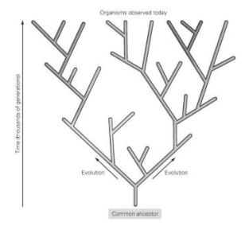
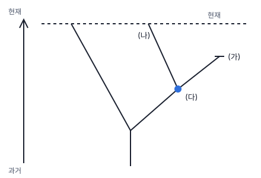
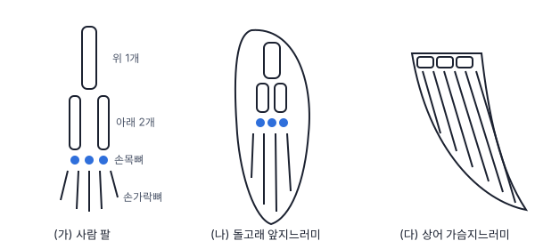

# 복습문제 58선 — 1027 수업 범위

기출 44개와 생성 변형 14개를 풀어 봐요. 변형은 기본 12개·심화 2개예요. 먼저 풀어 보고, 막히면 힌트를 열어 보세요.

> `복습문제_1027_Evolutionary_Thought_and_Microevolution.html`를 마크다운으로 옮겼어요. 원문, 힌트, 풀이는 접혀 있어요. 먼저 풀어 보고 펼쳐 보세요.

**목차**

- [B. 기출](#partB)
  - [P1. 상동 구조를 판단하는 기준](#p1)
  - [P2. 항생제 내성을 줄이는 전략](#p2)
  - [P3. 하디-바인베르크 조건이 아닌 것](#p3)
  - [P4. 동굴 가재의 눈자루](#p4)
  - [P5. HIV 약물 내성이 빠른 이유](#p5)
  - [P6. 라마르크 이론의 핵심](#p6)
  - [P7. 실험실 진화 연구에 알맞은 생물](#p7)
  - [P8. 상동적이라는 말의 의미](#p8)
  - [P9. 소진화의 예](#p9)
  - [P10. 개와 고양이 DNA가 더 비슷한 이유](#p10)
  - [P11. 진화사상 인물과 주장 짝짓기](#p11)
  - [P12. 맹장은 어떤 증거인가](#p12)
  - [P13. 집단유전학이 묻는 질문](#p13)
  - [P14. 계통수에서 끊긴 가지](#p14)
  - [P15. 진화를 가져오는 원리](#p15)
  - [P16. 바하마 생물의 가장 가까운 친척](#p16)
  - [P17. 현대적 종합론이 보탠 것](#p17)
  - [P18. 자연선택의 가장 직접적인 결과](#p18)
  - [P19. 기후변화에 빨리 적응한 새](#p19)
  - [P20. 가장 잘 살아남고 번식하는 개체](#p20)
  - [P21. 진화 연구로 틀린 것](#p21)
  - [P22. 인간과 침팬지가 공유하는 것](#p22)
  - [P23. 자연선택을 받는 변이](#p23)
  - [P24. 특정 환경에 잘 적응한 개체](#p24)
  - [P25. 모기에서 진화가 빠른 이유](#p25)
  - [P26. DDT를 뿌려도 늘어난 파리](#p26)
  - [P27. 진화의 증거로 적절하지 못한 것](#p27)
  - [P28. 다윈에게 가장 영향을 준 발견](#p28)
  - [P29. 집단의 진화적 변화가 아닌 것](#p29)
  - [P30. 다윈의 관찰과 추론 짝짓기](#p30)
  - [P31. 자연선택의 가장 직접적인 결과](#p31)
  - [P32. 진화 과정에 대한 설명](#p32)
  - [P33. 소진화의 예](#p33)
  - [P34. 자연선택을 받을 수 있는 특징](#p34)
  - [P35. 갈라파고스에서 다윈이 본 것](#p35)
  - [P36. 가장 잘 적응한 식물](#p36)
  - [P37. 다윈의 이론에 없는 주장](#p37)
  - [P38. 새로운 유전자의 원천](#p38)
  - [P39. 항생제 내성을 줄이는 전략](#p39)
  - [P40. 다윈 진화론의 의의](#p40)
  - [P41. 진화 연구에서 틀린 서술](#p41)
  - [P42. 다윈 이론에 없는 생각](#p42)
  - [P43. 날개·다리·지느러미의 공통점](#p43)
  - [P44. 평형 조건에서 자손세대 유전자형 빈도](#p44)
- [C. 변형 연습](#partC)
  - [P45. [변형] 하디-바인베르크 조건 고르기](#p45)
  - [P46. [변형] 종 수준으로 소진화 가르기](#p46)
  - [P47. [변형] 계통수의 세 위치 읽기](#p47)
  - [P48. [변형] 앞다리 뼈 배열로 상동과 상사 가르기](#p48)
  - [P49. [변형] 꽃 개체군의 대립유전자 빈도](#p49)
  - [P50. [변형] 다음 세대 이형접합자 수 예상](#p50)
  - [P51. [변형] '변형 혈통'이라는 표현](#p51)
  - [P52. [변형] 유전적 평형과 영가설](#p52)
  - [P53. [변형] 섬 딱정벌레의 몸 색 변화](#p53)
  - [P54. [변형] 진화의 증거와 예 짝짓기](#p54)
  - [P55. [변형] 영어 이름으로 보는 세 지질 이론](#p55)
  - [P56. [변형] 선택을 하는 주체](#p56)
  - [P57. [변형] 섬으로 날아온 나비와 평형](#p57)
  - [P58. [변형] 아미노산 차이로 갈라진 시기 추론](#p58)

## B. 기출

### P1. 상동 구조를 판단하는 기준

두 생물의 구조가 상동적인지 판단할 때 찾아야 하는 것은 무엇인가?

- (1) 그 구조는 두 생물에서 동일한 기능을 가져야 한다
- (2) 그 구조는 그 생물의 어떤 가까운 관계도 나타내지 말아야 한다
- (3) 그 구조는 뼈를 포함해야 한다
- (4) 그 구조는 두 생물에서 다른 위치에 있어야 한다
- (5) 그 구조는 두 생물에서 해부학적, 형태적으로 비슷해야 한다

원문 정보 보기

기출 7강 합본 1번 (PDF 1쪽)

힌트 보기

사람 팔과 박쥐 날개는 하는 일이 달라도 상동이에요. 기능 말고 무엇이 같은지 떠올려요.

풀이 보기

1. (1) 틀려요. 사람 팔, 박쥐 날개, 돌고래 앞지느러미는 기능이 서로 달라도 상동이에요. 기능이 같아 보이는 것은 오히려 상사에서 흔해요.
2. (2) 틀려요. 상동은 공통조상을 공유해서 닮은 것이라 가까운 관계를 나타내는 증거예요. 보기는 정반대로 말해요.
3. (3) 틀려요. 앞다리 뼈 배열은 대표적인 예일 뿐이에요. 상동은 형질·기관·성질 어디에나 쓰는 말이라 뼈가 꼭 있어야 하는 것은 아니에요.
4. (4) 틀려요. 상동 구조는 두 생물에서 서로 대응하는 같은 자리에 있어요. 앞다리는 둘 다 몸의 앞쪽 사지예요.
5. (5) 맞아요. 기능이 달라도 상완골 하나, 척골·요골 두 갈래, 수근골, 손가락뼈 순서처럼 해부학적 구조와 형태가 같으면 공통조상에서 물려받은 상동으로 판단해요.
6. 수업과의 연결: 1027 수업에서 교수님이 "상동 형질, 별 세 개"라고 강조한 앞다리 뼈 배열 예와 이어져요([상동과 상사](정리노트_1027_Evolutionary_Thought_and_Microevolution.md#s2-homology)).

**정답:** (5)

---

### P2. 항생제 내성을 줄이는 전략

여러 인간 질병을 일으키는 생물들 중에 세균의 항생제 내성은 이제 흔히 관찰된다. 다음 보기 중 이들 생물의 항생제 내성을 줄이는데 좋은 전략이 아닌 것은?

- (1) 지시한 대로 항생제를 사용하고, 약은 처방 받은 기간 내에 모두 먹는다
- (2) 병원체가 일으킬 수 있는 진화과정을 막아 자연선택을 방지한다
- (3) 전문적인 처방을 받지 않은 경우에는 항생제 사용을 자제한다
- (4) 세균 감염이 치료되지 않는 상황처럼 꼭 필요할 때에만 항생제를 사용한다
- (5) 질병을 치료하기 어려운 경우에는 한 가지 이상의 항생제를 사용할 수 있다

원문 정보 보기

기출 7강 합본 2번 (PDF 1쪽)

힌트 보기

항생제를 쓰는 순간 내성 세균만 살아남는 일이 생겨요. 이 일을 아예 없앨 수 있는지 생각해요.

풀이 보기

1. (1) 틀려요. 이건 좋은 전략이에요. 중간에 끊으면 덜 죽은 세균, 특히 내성에 가까운 세균이 살아남아 다시 불어나기 쉬워요.
2. (2) 맞아요. 이건 좋은 전략이 아니에요. 항생제를 쓰면 내성 없는 세균이 죽고 내성 세균이 남는 자연선택이 저절로 일어나요. 변이와 선택을 막을 방법은 없고, 할 수 있는 것은 선택 압력을 줄이는 것뿐이에요.
3. (3) 틀려요. 이건 좋은 전략이에요. 불필요한 사용을 줄이면 내성 세균을 고르는 기회가 줄어요.
4. (4) 틀려요. 이건 좋은 전략이에요. 꼭 필요할 때만 쓰는 것도 선택 압력을 줄이는 방법이에요.
5. (5) 틀려요. 이건 좋은 전략이에요. 작용이 다른 항생제를 함께 쓰면 두 약에 모두 견디는 세균이 나올 가능성이 훨씬 낮아요.
6. 수업과의 연결: 1027 수업에서 항생제를 칠수록 내성 세균만 분열해 내성 비율이 늘어난다고 한 자연선택에 의한 적응의 예와 이어져요([적응·화석·생물지리학의 증거](정리노트_1027_Evolutionary_Thought_and_Microevolution.md#s2-evidence)).

**정답:** (2)

---

### P3. 하디-바인베르크 조건이 아닌 것

다음 중 하디-바인베르그 원리의 조건으로 틀린 것은?

- (1) 개체군의 크기는 무한하다
- (2) 다른 개체군으로부터의 유입은 차단된다
- (3) 자연선택이 존재한다
- (4) 개체군 내의 개체들은 무작위로 교배한다
- (5) 돌연변이가 일어나지 않는다

원문 정보 보기

기출 7강 합본 3번 (PDF 1쪽)

힌트 보기

평형이 유지되려면 모든 유전자형이 똑같이 살아남아야 해요.

풀이 보기

1. (1) 틀려요. 개체군 크기가 무한하다는 것은 수업에서 든 다섯 조건 중 하나예요.
2. (2) 틀려요. 다른 개체군과 오가는 이동이 없는 닫힌 집단이어야 한다는 조건이에요.
3. (3) 맞아요. 조건은 자연선택이 없는 것, 곧 모든 유전자형이 똑같이 생존하고 번식하는 것이에요. 자연선택이 있으면 유리한 대립유전자의 빈도가 올라가 평형이 깨져요.
4. (4) 틀려요. 무작위 교배는 상자에서 공 두 개를 뽑는 확률 모델이 성립하게 하는 조건이에요.
5. (5) 틀려요. 빨간 꽃이 갑자기 파랗게 되지 않도록 돌연변이가 없어야 한다는 조건이에요.
6. 수업과의 연결: 1027 수업에서 교수님이 칠판에 적은 다섯 조건(돌연변이 없음, 이동 없음, 무한한 크기, 똑같이 생존, 무작위 교배)과 이어져요([하디-바인베르크 원리와 유전적 평형](정리노트_1027_Evolutionary_Thought_and_Microevolution.md#s3-hardy-weinberg)).

**정답:** (3)

---

### P4. 동굴 가재의 눈자루

어두운 동굴에 사는 가재의 한 종은 일반적인 하천에 서식하는 유연관계의 다른 종처럼 눈자루를 가지고 있으나 눈은 없다. 그러므로 동굴에 거주하는 가재의 눈자루는 ( ).

- (1) 진화적 오류이다
- (2) 우성 돌연변이이다
- (3) 상사기관이다
- (4) 진화론이 부정확함을 드러내는 증거이다
- (5) 흔적기관이다

원문 정보 보기

기출 7강 합본 4번 (PDF 1쪽)

힌트 보기

조상(하천 가재)에게서는 쓰이던 구조가 지금은 제 기능을 하지 못하고 남아 있어요.

풀이 보기

1. (1) 틀려요. 진화는 목표를 향한 설계가 아니라서 "오류"라는 판단 기준이 없어요. 조상에게 물려받은 구조가 쓰이지 않은 채 남은 것이에요.
2. (2) 틀려요. 문제 어디에도 대립유전자의 우열을 판단할 교배 정보가 없어요. 눈자루는 친척 종과 공유하는 구조라 돌연변이 하나로 설명할 대상이 아니에요.
3. (3) 틀려요. 상사는 조상이 달라도 환경 때문에 닮은 것이에요. 이 눈자루는 유연관계가 있는 하천 가재와 공통조상에서 물려받은 구조라 상동 쪽이에요.
4. (4) 틀려요. 쓰지 않는 구조가 남아 있는 것은 공통조상에서 변해 왔다는 것을 보여 주므로 오히려 진화의 증거예요.
5. (5) 맞아요. 조상에게서는 눈을 받치던 구조가 동굴에서는 기능을 잃고 흔적만 남았어요. 이런 구조를 흔적기관이라고 해요.
6. 수업과의 연결: 1027 수업의 비교해부학 증거(상동과 상사)와 정리노트의 보충 내용인 흔적기관(뷔퐁의 돼지 발가락 예)과 이어져요([상동과 상사](정리노트_1027_Evolutionary_Thought_and_Microevolution.md#s2-homology)).

**정답:** (5)

---

### P5. HIV 약물 내성이 빠른 이유

항-HIV 약물의 저항성은 심각한 문제이다. 다음 진술 중 HIV 바이러스의 약물 내성이 매우 빠르게 나타나는 이유로 올바른 것은?

- (1) 바이러스가 혈액에 존재하기 때문에
- (2) 바이러스이기 때문에
- (3) T 세포에서 복제되므로
- (4) 전염성이 높기 때문에
- (5) 돌연변이율이 매우 높고, 한 세대가 짧기 때문에

원문 정보 보기

기출 7강 합본 5번 (PDF 1쪽)

힌트 보기

내성 개체가 생기는 재료와 선택이 반복되는 속도, 두 가지를 떠올려요.

풀이 보기

1. (1) 틀려요. 사는 장소는 내성 변이가 얼마나 자주 생기고 얼마나 빨리 퍼지는지를 정하지 않아요.
2. (2) 틀려요. 바이러스라는 사실만으로는 이유가 되지 않아요. 바이러스마다 돌연변이율과 복제 속도가 달라 내성이 생기는 속도도 달라요.
3. (3) 틀려요. T 세포에서 복제되는 것은 맞는 사실이지만, 내성이 빨리 나타나는 이유인 변이의 양과 세대 속도와는 관계가 없어요.
4. (4) 틀려요. 전염성은 사람 사이에 퍼지는 정도예요. 한 환자 몸속에서 내성 바이러스가 골라지는 속도와는 다른 이야기예요.
5. (5) 맞아요. 돌연변이가 많이 생기면 내성 변이가 나올 재료가 많고, 세대가 짧으면 약이 내성 없는 바이러스를 걸러 내는 선택이 짧은 시간에 여러 번 반복돼요.
6. 수업과의 연결: 1027 수업에서 대립유전자는 돌연변이로 생긴다고 한 점, 그리고 DDT 내성 모기·항생제 내성 세균처럼 자연선택은 짧은 시간에도 관찰된다고 한 점과 이어져요([적응·화석·생물지리학의 증거](정리노트_1027_Evolutionary_Thought_and_Microevolution.md#s2-evidence)).

**정답:** (5)

---

### P6. 라마르크 이론의 핵심

지금은 폐기된 라마르크의 이론을 가장 잘 설명한 것은?

- (1) 현존하는 생명체는 과거에 가장 작 적응한 개체의 자손이다
- (2) 모든 생명체는 오늘날 보이는 모습으로 창조되었다
- (3) 생명체는 그들의 생애 동안 새로운 형질을 획득하고 이를 자손에게 물려준다
- (4) 지구의 나이는 매우 많고 그 동안 수 많은 변화를 거쳤다

원문 정보 보기

기출 7강 합본 7번 (PDF 1쪽)

힌트 보기

기린이 목을 늘였더니 길어졌고, 그 긴 목이 자식에게 전해졌다는 설명을 떠올려요.

풀이 보기

1. (1) 틀려요. 가장 잘 적응한 개체가 자손을 더 남긴다는 것은 다윈의 자연선택이에요. 보기의 "가장 작"은 원문 그대로 실은 것이고 "가장 잘"의 오타예요.
2. (2) 틀려요. 생물이 처음 모습 그대로 창조되어 변하지 않는다는 것은 다윈 이전의 불변 세계관이에요. 라마르크는 오히려 생물이 변한다고 처음 제안했어요.
3. (3) 맞아요. 살면서 얻은 형질이 자손에게 전해진다는 획득형질의 유전이 라마르크 이론의 핵심이에요. 성형수술로 바뀐 얼굴이 자식에게 가지 않듯 일반적으로는 틀린 생각이라 폐기되었어요.
4. (4) 틀려요. 지구가 오래되었고 서서히 많이 변했다는 것은 점진주의·동일과정설 같은 지질학의 생각이에요.
5. 수업과의 연결: 1027 수업에서 같은 기린 예로 라마르크의 용불용설과 다윈의 자연선택을 두 번 대비한 부분과 이어져요([라마르크의 용불용설과 획득형질](정리노트_1027_Evolutionary_Thought_and_Microevolution.md#s0-lamarck)).

**정답:** (3)

---

### P7. 실험실 진화 연구에 알맞은 생물

실험실에서 진화의 과정을 연구할 수 있는 적당한 생명체를 찾고 있을 때, 다음 보기들 중 가장 중요하게 고려해야 할 점은?

- (1) 개체의 크기가 커야 한다
- (2) 세대 길이가 짧아야 한다
- (3) 조상의 완전한 화석이 존재해야 한다
- (4) 식물보다는 동물이어야 한다
- (5) 자손의 수가 비교적 적어야 한다

원문 정보 보기

기출 7강 합본 10번 (PDF 2쪽)

힌트 보기

진화는 세대가 바뀌면서 개체군의 구성이 달라지는 거예요. 실험 기간 안에 그 변화를 보려면 무엇이 필요할지 생각해요.

풀이 보기

1. (1) 틀려요. 몸이 크면 기르기 어렵고 한 번에 많은 개체를 키우기 힘들어요. 실험실 진화 연구에는 세균처럼 작은 생물이 흔히 쓰여요.
2. (2) 맞아요. 진화적 변화는 세대를 거듭하며 개체군 수준에서 쌓여요. 세대가 짧아야 실험 기간 안에 선택이 여러 번 반복되어 대립유전자 빈도 변화를 볼 수 있어요.
3. (3) 틀려요. 화석은 과거의 변화를 보여 주는 증거이지 살아 있는 실험 생물을 고르는 기준이 아니에요. 게다가 화석 기록은 원래 불완전해서 완전한 화석을 조건으로 걸 수 없어요.
4. (4) 틀려요. 동물이냐 식물이냐는 기준이 아니에요. 수업의 예처럼 세균도 실험실에서 진화를 관찰하는 대표 생물이에요.
5. (5) 틀려요. 자손이 많아야 변이가 다양하고 선택이 일어날 개체가 충분해요. 다윈의 추론도 "생물은 자손을 많이 낳는다"에서 출발해요.
6. 수업과의 연결: 1027 수업에서 자연선택은 실험실에서 재현하고 직접 관찰할 수 있으며 DDT 내성 모기·항생제 내성 세균은 6~18개월이면 관찰된다고 한 부분과 이어져요([적응·화석·생물지리학의 증거](정리노트_1027_Evolutionary_Thought_and_Microevolution.md#s2-evidence)).

**정답:** (2)

인쇄된 답안지에는 (3)으로 표시되어 있지만 오류로 판단해요. 조상의 완전한 화석은 과거를 추정하는 자료일 뿐 실험실에서 진화를 관찰할 생물을 고르는 조건이 아니고, 화석 기록은 원래 불완전해요. 실험 기간 안에 여러 세대의 선택을 관찰하려면 세대 길이가 짧아야 하므로 (2)를 정답으로 둬요.

---

### P8. 상동적이라는 말의 의미

박쥐의 날개는 고양이의 앞발과 상동적이다. 상동적이라는 말의 의미는 무엇인가?

- (1) 박쥐와 고양이의 공통조상은 고양이 다리와 박쥐 날개에서 발견되는 유사한 골격 구조를 갖는 사지를 갖는다.
- (2) 박쥐와 고양이의 공통조상은 날개의 기능을 갖는 사지(limbs)를 갖는다
- (3) 박쥐와 고양이는 공통조상을 갖지 않는다
- (4) 두 구조는 같은 목적으로 사용된다
- (5) 박쥐 날개는 퇴화한 다리이다

원문 정보 보기

기출 7강 합본 11번 (PDF 2쪽)

힌트 보기

상동은 공통조상에게 물려받아서 닮았다는 뜻이에요. 조상에게서 물려받은 것은 기능일까요, 구조일까요?

풀이 보기

1. (1) 맞아요. 공통조상이 이미 상완골·척골·요골·손가락뼈 배열을 가진 사지를 가졌고, 두 후손이 그 구조를 물려받아 각각 날개와 앞발로 바꿔 썼다는 뜻이에요.
2. (2) 틀려요. 물려받은 것은 뼈 구조이지 날개의 기능이 아니에요. 공통조상의 사지가 날개였다면 고양이 앞발 쪽 변화를 설명하기 어려워요.
3. (3) 틀려요. 상동은 공통조상을 공유하기 때문에 닮은 것이라 정의와 정반대예요.
4. (4) 틀려요. 날개는 날기, 앞발은 걷기처럼 쓰임이 달라요. 상동은 기능이 달라도 구조가 같은 것이에요.
5. (5) 틀려요. 날개는 기능을 잃은 흔적이 아니라 앞다리 구조가 날기에 맞게 바뀐 것이에요. "퇴화"는 상동의 뜻이 아니에요.
6. 수업과의 연결: 1027 수업에서 돼지 앞다리, 돌고래 앞지느러미, 박쥐 날개, 사람 팔의 같은 뼈 구조를 최초의 척추동물에서 갈라져 나온 결과로 설명한 부분과 이어져요([상동과 상사](정리노트_1027_Evolutionary_Thought_and_Microevolution.md#s2-homology)).

**정답:** (1)

---

### P9. 소진화의 예

소진화의 예가 될 수 있는 것은?

- (1) 개체군 안에서의 작은 유전적 변화로 인한 새 개체군 색깔의 작은 변화
- (2) 살아 있는 영장류와 인간 사이의 직접적인 진화연결고리
- (3) 갑작스러운 종의 절멸
- (4) 지표 근처와 깊은 암석층에서 발견된 화석들 사이의 형태적인 차이
- (5) 개체군의 모든 구성원을 제거하는 홍수

원문 정보 보기

기출 7강 합본 12번 (PDF 2쪽)

힌트 보기

소진화와 대진화를 나누는 기준은 종 수준이에요. 종이 새로 생기거나 사라지지 않고 한 개체군 안에서 일어나는 변화를 찾아요.

풀이 보기

1. (1) 맞아요. 한 개체군 안의 작은 유전적 변화로 색깔 비율이 달라지는 것은 종 수준에 못 미치는 변화라 소진화예요. 핀치 부리 변화, 항생제 내성 획득과 같은 수준이에요.
2. (2) 틀려요. 지금 살아 있는 영장류는 사람의 조상이 아니라 공통조상에서 갈라진 친척이에요. 게다가 종과 종 사이의 관계라 종 수준 이상의 이야기예요.
3. (3) 틀려요. 종이 사라지는 것은 종 수준 이상의 사건이라 대진화에 속해요. 수업에서도 공룡 멸종을 대진화의 예로 들었어요.
4. (4) 틀려요. 깊은 지층과 얕은 지층의 화석 차이는 긴 시간에 걸친 종 수준 이상의 변화를 보여 주는 화석 기록이에요.
5. (5) 틀려요. 구성원이 모두 사라지면 다음 세대에 대립유전자 빈도가 달라진 개체군이 남지 않아요. 개체군 안의 유전적 조성 변화가 아니라 그 개체군의 소멸이에요.
6. 수업과의 연결: 1027 수업에서 교수님이 "종 수준 이상이면 큰 것"이라며 새로운 종의 탄생·공룡 멸종(대진화)과 핀치 부리·항생제 내성(소진화)을 구분한 부분과 이어져요([현대적 종합론, 소진화와 대진화](정리노트_1027_Evolutionary_Thought_and_Microevolution.md#s2-synthesis)).

**정답:** (1)

---

### P10. 개와 고양이 DNA가 더 비슷한 이유

개와 고양이의 DNA는 고양이와 햄스터의 DNA 보다 더 유사하다. 이유는?

- (1) 고양이와 개는 햄스터보다 자식의 수가 적어서 DNA가 천천히 변한다
- (2) 고양이와 개의 공통 조상은 고양이와 햄스터의 공통 조상보다 더 최근에 생겼다
- (3) 고양이와 개는 육식동물로 유사한 영양을 섭취한다
- (4) 고양이의 후손과 개의 후손은 유사한 환경에서 진화하였다
- (5) 고양이와 개는 사람과 오랫동안 같이 살아와서 서로 유사하다

원문 정보 보기

기출 7강 합본 13번 (PDF 2쪽)

힌트 보기

두 종이 갈라진 뒤에는 각자 따로 돌연변이가 쌓여요. 갈라진 지 오래될수록 DNA 차이가 어떻게 될지 생각해요.

풀이 보기

1. (1) 틀려요. DNA 차이는 자식 수가 아니라 두 계통이 갈라진 뒤 흐른 시간으로 설명해요. 이 보기는 고양이와 햄스터의 차이가 왜 큰지도 설명하지 못해요.
2. (2) 맞아요. 다른 종이 되면 교배하지 않아 유전자 교환이 없고 각자 돌연변이가 쌓여요. 개와 고양이는 더 최근에 갈라져서 쌓인 차이가 적어요. 사이토크롬 c에서 사람과 침팬지는 0, 개는 13, 효모는 56개 다른 것과 같은 원리예요.
3. (3) 틀려요. 먹이가 비슷하다고 DNA 염기서열 전체가 닮지는 않아요. 환경이나 생활 방식 때문에 닮는 것은 상사 쪽 설명이에요.
4. (4) 틀려요. 비슷한 환경에서 닮아지는 것은 상사의 논리예요. DNA 서열의 유사성은 계통이 얼마나 가까운지를 보여 줘요.
5. (5) 틀려요. 사람과 같이 산 것은 고양이와 햄스터도 마찬가지이고, 함께 산다고 두 종의 DNA가 서로 닮아 가지는 않아요.
6. 수업과의 연결: 1027 수업의 비교분자생물학 증거에서 최근에 분기했을수록 DNA와 아미노산 서열이 비슷하다고 한 사이토크롬 c 표와 이어져요([비교발생학과 비교분자생물학](정리노트_1027_Evolutionary_Thought_and_Microevolution.md#s2-molecular)).

**정답:** (2)

---

### P11. 진화사상 인물과 주장 짝짓기

다음은 진화사상을 발전시킨 인물들에 대한 설명이다. 설명이 잘못 연결된 것은?

- (1) 허튼 – 특정 사건에 의해 큰 변화를 겪는 격변설을 주장
- (2) 퀴비에 – 각 화석들은 홍수나 지진과 같은 사건으로 죽은 생물들의 잔유물이라고 주장
- (3) 라마르크 – 획득형질의 유전을 주장
- (4) 뷔퐁 – 현재 사용하지 않는 흔적기관들이 과거에는 기능을 했었을 것이라고 언급
- (5) 러셀 윌리스 – 자연선택의 메커니즘을 독자적으로 발견

원문 정보 보기

기출 7강 합본 14번 (PDF 2쪽)

힌트 보기

격변설은 '갑자기', 점진주의는 '서서히'예요. 허튼(휴튼)이 어느 쪽이었는지 떠올려 봐요.

풀이 보기

1. (1) 맞아요(잘못 연결된 설명이라 답이에요). 격변설을 주장한 사람은 퀴비에예요. 허튼(휴튼(Hutton))은 지층이 오랜 시간 서서히 쌓이고 깎인다는 점진주의를 주장했어요.
2. (2) 틀려요(바르게 연결됐어요). 퀴비에는 화석을 지진·대홍수 같은 천재지변으로 멸종한 생물의 흔적으로 보고 격변설을 세웠어요. 원문의 '잔유물'은 '잔여물'과 같은 뜻으로 읽어요.
3. (3) 틀려요(바르게 연결됐어요). 라마르크는 용불용설과 함께 살면서 얻은 형질이 자식에게 전해진다는 획득형질의 유전을 주장했어요.
4. (4) 틀려요(바르게 연결됐어요). 수업에서는 말하지 않았지만 교재에서 뷔퐁은 기능이 없어 보이는 흔적기관이 조상 시대에는 기능했을 것이라고 말한 인물이에요.
5. (5) 틀려요(바르게 연결됐어요). 월리스는 다윈과 거의 같은 자연선택 이론을 따로 떠올려 편지로 보냈고, 둘이 함께 발표했어요. 원문의 '윌리스'는 월리스(Wallace)를 가리켜요.
6. 수업과의 연결: 1027 수업에서 퀴비에의 격변설(갑자기)과 지질학자들의 점진주의(서서히), 라이엘의 동일과정설을 대비했어요. 교수님은 휴튼의 이름을 말하지 않았으니 강의노트로 짝을 확인해요. 정리노트 [격변설·점진주의·동일과정설](정리노트_1027_Evolutionary_Thought_and_Microevolution.md#s0-geology)와 이어져요.

**정답:** (1)

---

### P12. 맹장은 어떤 증거인가

다음 관찰된 사항에 해당하는 진화론을 위한 증거로 맞는 것은?

“사람과 침팬지 모두 흔적형질인 맹장을 가지고 있다.”

- (1) 생물지리학
- (2) 화석기록
- (3) DNA의 유사성
- (4) 상동성

원문 정보 보기

기출 7강 합본 17번 (PDF 2쪽)

힌트 보기

관찰한 것이 '어디에 사는가', '돌 속의 흔적', '염기서열', '몸의 같은 구조' 중 무엇인지 봐요.

풀이 보기

1. (1) 틀려요. 생물지리학은 어느 지역에 어떤 생물이 사는지(같은 지역 생물끼리 닮음)를 근거로 삼아요. 맹장은 사는 곳이 아니라 몸의 구조예요.
2. (2) 틀려요. 화석기록은 과거 생물이 남긴 유해·흔적으로 변화 과정을 보여 줘요. 지금 살아 있는 사람과 침팬지의 기관 비교와는 달라요.
3. (3) 틀려요. DNA의 유사성은 염기서열이나 아미노산 서열을 비교하는 분자 수준의 증거예요. 이 관찰은 서열이 아니라 기관을 비교했어요.
4. (4) 맞아요. 두 종이 같은 구조(맹장)를 가진 것은 공통조상에게서 물려받았기 때문이에요. 지금은 기능이 거의 없는 흔적기관도 공통조상을 보여 주는 상동의 예예요.
5. 수업과의 연결: 1027 수업에서 교수님은 "상동 형질, 별 세 개"라며 공통조상 때문에 비슷하면 상동이라고 강조했어요. 정리노트 [상동과 상사](정리노트_1027_Evolutionary_Thought_and_Microevolution.md#s2-homology)와 이어져요.

**정답:** (4)

---

### P13. 집단유전학이 묻는 질문

하디-바인베르그 법칙은 집단유전학의 일부로 이용된다. 다음 중 집단 유전학에 대한 질문으로 적합한 것은?

- (1) 두 집단의 구성원이 짝짓기 할 확률은 어떻게 되는가?
- (2) 품종의 범주에 대한 유전적 기초는 무엇인가?
- (3) 두 집단에서 생식력 있는 자손을 생산하는데 방해하는 것은 무엇인가?
- (4) 미래 세대에서 특정 유전형의 빈도는 어떻게 될 것인가?
- (5) 대립 유전자가 우성 또는 열성인가?

원문 정보 보기

기출 7강 합본 18번 (PDF 3쪽)

힌트 보기

하디-바인베르크 계산의 출력은 다음 세대의 p², 2pq, q²였어요. 그 출력이 무엇의 빈도인지 떠올려 봐요.

풀이 보기

1. (1) 틀려요. 하디-바인베르크는 한 개체군 안에서 무작위 교배를 가정하고 계산해요. 서로 다른 두 집단이 짝짓기할 확률을 구하는 도구가 아니에요.
2. (2) 틀려요. 품종은 사람이 원하는 형질로 골라 교배한 인위선택의 결과예요. 품종을 나누는 유전적 기초는 개체군의 빈도 변화를 다루는 질문이 아니에요.
3. (3) 틀려요. 두 집단 사이에 생식력 있는 자손이 생기지 못하게 막는 요인은 두 집단이 서로 다른 종으로 갈라졌는지를 묻는 질문이에요. 한 개체군 안의 빈도 문제가 아니에요.
4. (4) 맞아요. 집단유전학(개체군 유전학)은 개체군의 유전자형 빈도와 대립유전자 빈도가 세대마다 어떻게 되는지를 다뤄요. 하디-바인베르크로 다음 세대의 유전형(유전자형) 빈도 p², 2pq, q²를 예측해요.
5. (5) 틀려요. 한 대립유전자가 우성인지 열성인지는 교배 실험으로 밝히는 멘델 유전학의 질문이에요. 하디-바인베르크는 우열과 상관없이 빈도를 계산해요(수업 예의 불완전우성 꽃도 그대로 계산했어요).
6. 수업과의 연결: 1027 수업에서 교수님은 "하디-바인베르크 원리는 무조건 나옵니다, 시험에"라고 하며 자식 세대의 유전자형 빈도와 대립유전자 빈도를 구하는 것이 핵심이라고 했어요. 원문의 '유전형'은 유전자형과 같은 말이에요. 정리노트 [하디-바인베르크 원리와 유전적 평형](정리노트_1027_Evolutionary_Thought_and_Microevolution.md#s3-hardy-weinberg)과 이어져요.

**정답:** (4)

---

### P14. 계통수에서 끊긴 가지

아래 계통수에서 꼭대기까지 다다르지 않는 가지들이 나타내는 것은?

- (1) 1000년의 경과
- (2) 조상으로부터의 새로운 종의 기원
- (3) 현존하는 종들의 공통 조상
- (4) 현존하는 종
- (5) 멸절 종

원문 정보 보기

기출 7강 합본 19번 (PDF 3쪽)

힌트 보기

맨 위는 '오늘 관찰되는 생물'이에요. 거기까지 가지 못하고 끝난 가지는 어떤 운명이었을까요?

풀이 보기

1. (1) 틀려요. 세로축은 시간(수천 세대 단위)이지만, 가지가 중간에서 끝나는 것은 시간의 길이가 아니라 그 계통이 끊겼다는 뜻이에요.
2. (2) 틀려요. 조상에서 새로운 종이 생기는 곳은 가지가 둘로 갈라지는 분기점이에요. 끝나 버린 가지 끝이 아니에요.
3. (3) 틀려요. 현존하는 종들의 공통조상은 맨 아래 Common ancestor와 가지들이 합쳐지는 분기점이에요.
4. (4) 틀려요. 현존하는 종은 꼭대기(Organisms observed today)까지 다다른 가지 끝이에요.
5. (5) 맞아요. 오늘날까지 이어지지 못하고 중간에서 끝난 가지는 멸종한 종(멸절 종)이에요.
6. 수업과의 연결: 1027 수업에서 교수님은 다윈의 나무 낙서를 보여 주며 끊긴 가지는 멸종한 종, 가지 끝은 현존하는 종이라고 했어요. 정리노트 [변형 혈통과 계통수](정리노트_1027_Evolutionary_Thought_and_Microevolution.md#s1-tree)와 이어져요.

**정답:** (5)

---

### P15. 진화를 가져오는 원리

진화라는 결과를 가져오는 원리는 다음 중 무엇인가?

- (1) 멸종
- (2) 세포변이
- (3) 자연선택
- (4) 지리적 변이

원문 정보 보기

기출 7강 합본 20번 (PDF 3쪽)

힌트 보기

'결과'가 아니라 '원리(메커니즘)'를 묻고 있어요. 다윈 책 제목의 '방법에 의한'에 들어가는 말을 떠올려 봐요.

풀이 보기

1. (1) 틀려요. 멸종은 계통수의 끊긴 가지처럼 진화 과정에서 나타나는 결과예요. 개체군을 바꾸는 원리가 아니에요.
2. (2) 틀려요. 한 개체의 세포가 바뀌는 것은 개체 수준의 일이에요. 진화적 변화는 개체가 아니라 개체군 수준에서 일어나요.
3. (3) 맞아요. 변이가 있고 그 변이가 유전되며, 생존과 번식에 유리한 개체가 자손을 더 많이 남기면 개체군의 유전적 조성이 바뀌어요. 이것이 자연선택이고 다윈이 내세운 진화의 원리예요.
4. (4) 틀려요. 지역에 따라 형질이 다른 것은 자연선택이 작용할 재료(변이)의 한 모습이에요. 변이가 있다는 것만으로는 개체군이 어느 방향으로 바뀌는지 설명하지 못해요.
5. 수업과의 연결: 1027 수업에서 『종의 기원』의 정식 제목이 '자연선택이라는 방법에 의한 종의 기원에 관해서'라고 소개했고, 변이·유전·생존·번식으로 자연선택의 논리를 정리했어요. 정리노트 [자연선택의 논리](정리노트_1027_Evolutionary_Thought_and_Microevolution.md#s1-natural-selection)와 이어져요.

**정답:** (3)

---

### P16. 바하마 생물의 가장 가까운 친척

바하마는 대서양에 있는 군도인데, 대부분이 산호초로 이루어져 있다. 가장 가까운 대륙은 북아메리카이다. 그러나 정치적으로는 영국에 속한다. 다윈의 추리를 따르자면, 이들 섬에 살고 있는 조류와 다른 종들은 가장 가까운 친척이 다음 어디에 존재해야 한다고 했는가?

- (1) 북아메리카
- (2) 태평양 내에 비슷한 구성을 보이는 다른 섬
- (3) 영국
- (4) 대서양 내에 비슷한 위도에 존재하는 카나리아 제도 같은 섬

원문 정보 보기

기출 7강 합본 22번 (PDF 3쪽)

힌트 보기

갈라파고스 핀치는 어디에서 날아온 조상의 후손이라고 했나요? 섬 생물의 조상은 가장 가까운 육지에서 건너와요.

풀이 보기

1. (1) 맞아요. 섬 생물은 가장 가까운 대륙에서 건너온 조상이 섬 환경에 맞게 바뀐 후손이에요. 그래서 가장 가까운 친척은 바로 옆 대륙인 북아메리카에 있어야 해요.
2. (2) 틀려요. 환경 구성이 비슷한 먼 섬의 생물은 생태적으로 닮았을 수는 있어도 근연종은 아니에요. 다윈은 환경이 비슷해도 다른 대륙의 생물과는 다르다는 것을 관찰했어요.
3. (3) 틀려요. 어느 나라에 속하는지는 사람이 정한 정치적 경계일 뿐이에요. 생물이 퍼져 나간 경로와 상관없어요.
4. (4) 틀려요. 위도가 비슷하면 기후는 닮을 수 있지만, 멀리 떨어진 섬끼리는 공통조상이 가깝지 않아요. 친척 관계는 기후가 아니라 지리적 거리와 이동 경로가 정해요.
5. 수업과의 연결: 1027 수업에서 남미 물가 설치류 뉴트리아가 유럽의 비버가 아니라 같은 지역인 남미의 산에 사는 설치류와 닮았다는 다윈의 관찰을 들었어요. 정리노트 [비글호 항해와 갈라파고스의 관찰](정리노트_1027_Evolutionary_Thought_and_Microevolution.md#s1-beagle)과 이어져요.

**정답:** (1)

---

### P17. 현대적 종합론이 보탠 것

"현대적 종합론“이 어떻게 유전학의 이해를 도울 수 있는가?”

- (1) 많은 형질에 대해 변이의 정도를 보여준다.
- (2) 각 개체가 얼마나 많은 자손을 생산할 수 있는지 보여준다.
- (3) 어떻게 형질이 다음 생물에게 전달이 되는지 보여준다.
- (4) DNA가 유전물질이라는 것을 보여준다.
- (5) 진화를 일으킬 수 있는 환경적 변화의 종류를 보여준다.

원문 정보 보기

기출 7강 합본 24번 (PDF 3쪽)

힌트 보기

다윈 이론에 빠져 있던 조각이 무엇이었는지 떠올려 봐요. 종합론은 그 조각을 진화론에 끼워 넣었어요.

풀이 보기

1. (1) 틀려요. 개체마다 형질이 다르다는 변이는 다윈이 이미 관찰해 자연선택의 출발점으로 삼았어요. 종합론이 새로 보탠 것이 아니에요.
2. (2) 틀려요. 개체가 남기는 자손 수는 자연선택에서 생존·번식의 성공을 따지는 쪽의 이야기예요. 유전이 어떻게 일어나는지와는 다른 질문이에요.
3. (3) 맞아요. 다윈은 형질이 어떻게 유전되는지 몰랐어요. 현대적 종합론은 멘델 유전학을 진화론과 합쳐, 변이가 대립유전자로 다음 세대에 전달되는 방식을 설명했어요.
4. (4) 틀려요. DNA가 유전물질이라는 사실은 진화론과 별개로 유전물질의 정체를 찾는 실험들에서 밝혀졌어요. 현대적 종합론이 보여 준 내용이 아니에요.
5. (5) 틀려요. 어떤 환경 변화가 선택을 일으키는지는 생태학 쪽의 관찰이에요. 형질이 전달되는 원리를 밝히는 유전학의 이해와는 거리가 멀어요.
6. 수업과의 연결: 1027 수업에서 교수님은 다윈이 "멘델 유전학을 몰랐어요"라고 하며, 멘델 유전학 등이 진화론과 합쳐진 것이 현대적 종합론이라고 설명했어요. 정리노트 [현대적 종합론, 소진화와 대진화](정리노트_1027_Evolutionary_Thought_and_Microevolution.md#s2-synthesis)와 이어져요.

**정답:** (3)

인쇄된 답안지에는 (4)로 표시되어 있지만 오류로 판단해요. 현대적 종합론의 핵심은 다윈이 몰랐던 멘델 유전학을 진화론에 합쳐 형질이 다음 세대로 어떻게 전달되는지 설명한 것이고, DNA가 유전물질이라는 사실은 종합론이 아니라 별도의 실험으로 밝혀졌어요. 발문도 "종합론이 유전학의 이해를 돕는다"로 방향이 어색해서, 종합론이 유전학과 진화론을 어떻게 이었는지를 묻는 것으로 읽고 (3)을 답으로 두었어요.

---

### P18. 자연선택의 가장 직접적인 결과

다음 중 한 개체군에서 자연선택의 가장 직접적인 결과는 무엇인가?

- (1) 어떤 대립유전자의 빈도가 변한다.
- (2) 그 개체군의 구성원들이 더 빠르게 번식하기 시작한다.
- (3) 환경이 변한다.
- (4) 새로운 대립유전자가 만들어진다.
- (5) 단백질이 기능을 잃는다.

원문 정보 보기

기출 7강 합본 25번 (PDF 4쪽)

힌트 보기

하디-바인베르크 평형이 깨지면 무엇이 바뀐다고 했나요? 자연선택 없음은 그 다섯 조건 중 하나였어요.

풀이 보기

1. (1) 맞아요. 유리한 형질을 가진 개체가 자손을 더 남기면 그 형질의 대립유전자가 다음 세대에 더 많아져요. 개체군의 대립유전자 빈도가 바뀌는 것이 자연선택의 직접적인 결과(소진화)예요.
2. (2) 틀려요. 자연선택은 원래 번식을 더 잘하던 개체의 비율을 늘릴 뿐, 구성원 전체가 갑자기 더 빨리 번식하게 만들지 않아요.
3. (3) 틀려요. 환경 변화는 어떤 개체가 유리한지를 정하는 선택의 원인 쪽이에요. 자연선택의 결과가 아니에요.
4. (4) 틀려요. 새로운 대립유전자는 돌연변이로 생겨요. 자연선택은 이미 있는 대립유전자 중에서 고를 뿐 새로 만들지 않아요.
5. (5) 틀려요. 단백질이 기능을 잃는 것은 돌연변이가 일으킬 수 있는 일이에요. 자연선택의 일반적인 결과가 아니에요.
6. 수업과의 연결: 1027 수업 마지막에 하디-바인베르크 평형의 다섯 조건 중 하나라도 깨지면 대립유전자 빈도와 유전자형 빈도가 변하고, 그것이 소진화라고 정리했어요. 자연선택은 그 빈도 변화를 일으키는 원인 중 하나예요. 정리노트 [영가설: 평형이 깨지면 소진화](정리노트_1027_Evolutionary_Thought_and_Microevolution.md#s3-null)과 이어져요.

**정답:** (1)

---

### P19. 기후변화에 빨리 적응한 새

갑작스러운 기후변화 이후에, 한 종의 새가 빠르게 적응했지만 다른 종은 그렇지 못했다. 빠르게 적응한 종에 대해 어떤 결론을 내릴 수 있는가?

- (1) 다른 종보다 더 많이 진화가 필요했다.
- (2) 새로운 환경에 적응할 대립유전자르 이미 가지고 있었다.
- (3) 천천히 적응하는 종보다 자손에게 더 많이 DNA를 전달해준다.
- (4) 적응하지 못한 종보다 더 천천히 번식했다.

원문 정보 보기

기출 7강 합본 29번 (PDF 4쪽)

힌트 보기

DDT 모기에서 내성 모기는 DDT를 뿌린 뒤에 생겼나요, 처음부터 소수 있었나요?

풀이 보기

1. (1) 틀려요. 진화는 '필요하다'고 해서 일어나지 않아요. 필요에 따라 형질이 생긴다는 생각은 라마르크식 설명이에요.
2. (2) 맞아요. 자연선택은 이미 개체군 안에 있는 변이 중에서 골라요. 기후가 갑자기 바뀌었는데 빠르게 적응했다면, 새 환경에 유리한 대립유전자를 가진 개체가 처음부터 있었다는 뜻이에요. 원문의 '대립유전자르'는 '대립유전자를'의 오타예요.
3. (3) 틀려요. 자손이 부모에게서 받는 DNA의 양은 종에 따라 '더 많이' 달라지지 않아요. 적응 속도를 가르는 것은 DNA의 양이 아니라 유리한 대립유전자가 있었는지예요.
4. (4) 틀려요. 번식이 느리면 세대가 천천히 바뀌어 오히려 적응이 늦어요. 빠르게 적응한 종의 특징으로 맞지 않아요.
5. 수업과의 연결: 1027 수업의 DDT 내성 모기 예에서 처음부터 극소수 있던 내성 모기가 살아남아 비율이 커졌다고 했어요. 선택은 이미 있는 변이에 작용해요. 정리노트 [자연선택의 논리](정리노트_1027_Evolutionary_Thought_and_Microevolution.md#s1-natural-selection)와 이어져요.

**정답:** (2)

---

### P20. 가장 잘 살아남고 번식하는 개체

변화가 심한 조건에서 살고 있는 한 개체군에서, 가장 잘 살아남고 잘 번식하는 것은 어느 개체인가?

- (1) 가장 큰 개체
- (2) 다른 개체들과 가장 다른 개체
- (3) 가장 먹이를 잘 잡을 수 있는 개체
- (4) 환경에 가장 잘 적응하는 개체
- (5) 가장 빠르게 성장하는 개체

원문 정보 보기

기출 7강 합본 30번 (PDF 4쪽)

힌트 보기

누가 유리한지는 정해져 있지 않고 환경이 골라요. 어떤 환경에서도 통하는 기준을 찾아봐요.

풀이 보기

1. (1) 틀려요. 몸이 큰 것이 유리한지는 환경에 따라 달라요. 먹이가 부족하거나 좁은 곳에 숨어야 하면 큰 몸이 불리할 수도 있어요.
2. (2) 틀려요. 남과 다르다는 것만으로는 유리하지 않아요. 그 차이가 환경에서 생존과 번식에 도움이 될 때만 선택돼요.
3. (3) 틀려요. 먹이를 잘 잡는 능력은 생존에 도움이 되는 형질 하나일 뿐이에요. 조건이 심하게 바뀌면 다른 형질(추위를 견디기, 숨기 등)이 더 중요해질 수 있어요.
4. (4) 맞아요. 자연선택에서는 그때의 환경이 유리한 개체를 골라요. 환경에 가장 잘 적응한 개체가 살아남고 자손도 많이 남겨요.
5. (5) 틀려요. 빨리 자라는 것도 환경에 따라 유리하거나 불리할 수 있는 형질 하나예요. 빨리 자라도 일찍 죽거나 자손을 못 남기면 소용없어요.
6. 수업과의 연결: 1027 수업에서 교수님은 자연에서는 환경이 선택을 한다고 하며, 번식만 잘하고 일찍 죽어도, 오래 살고 자식을 못 낳아도 안 된다고 했어요. 정리노트 [자연선택의 논리](정리노트_1027_Evolutionary_Thought_and_Microevolution.md#s1-natural-selection)와 이어져요.

**정답:** (4)

---

### P21. 진화 연구로 틀린 것

다음의 진화연구들에 대한 설명 중 틀린 것은?

- (1) 생물학자들은 짧은 기간 동안 작동하는 진화과정을 조사하기 위하여 분자실험을 설계한다.
- (2) 생물학자들은 진화의 과정을 이해하기 위하여 진화의 결과물을 연구한다.
- (3) 생물학자들은 많은 종류의 종들이 작은 섬에 집단 서식하는 이유를 조사한다.
- (4) 생물학자들은 연관 생물들 사이의 상동기관의 변이를 연구한다.
- (5) 생물학자들은 부모가 생애 동안 획득한 특성들의 유전적 성질을 연구한다.

원문 정보 보기

기출 7강 합본 31번 (PDF 4쪽)

힌트 보기

라마르크가 기린의 목으로 설명한 생각을 떠올려요. 살면서 얻은 형질이 자식에게 전해질까요?

풀이 보기

1. (1) 맞아요. 옳은 설명이라 답이 아니에요. 항생제 내성 세균처럼 짧은 기간에 일어나는 진화는 실험실에서 재현하고 분자 수준에서 조사할 수 있어요.
2. (2) 맞아요. 옳은 설명이라 답이 아니에요. 오늘의 생물, 화석, 상동기관 같은 진화의 결과물을 비교해서 진화가 어떻게 일어났는지 거꾸로 추론해요.
3. (3) 맞아요. 옳은 설명이라 답이 아니에요. 갈라파고스 군도처럼 섬마다 비슷하면서 조금씩 다른 종이 모여 사는 이유를 묻는 것이 생물지리학의 질문이에요.
4. (4) 맞아요. 옳은 설명이라 답이 아니에요. 연관 생물의 상동기관이 기능에 따라 어떻게 달라졌는지 비교하는 것은 비교해부학의 연구 방법이에요.
5. (5) 틀려요. 그래서 답이에요. 부모가 생애 동안 획득한 특성이 유전된다는 것은 라마르크의 획득형질의 유전이고, 일반적으로 틀린 생각이에요. 진화 연구는 이것을 전제로 삼지 않아요(후성유전학으로 일부 전달되는 경우는 예외로만 다뤄요).
6. 수업과의 연결: 1027 수업에서 교수님이 성형수술로 예뻐져도 자식까지 예뻐지지 않는다는 예로 획득형질의 유전을 부정한 내용과 이어져요. [라마르크의 용불용설과 획득형질](정리노트_1027_Evolutionary_Thought_and_Microevolution.md#s0-lamarck)

**정답:** (5)

---

### P22. 인간과 침팬지가 공유하는 것

DNA 증거, 화석증거, 상동, 흔적기관은 모두 인간과 침팬지가 공유하는 이것에 대한 증거를 제공한다. 이것으로 가장 적절한 것은 무엇인가?

- (1) 원시형질
- (2) 공통조상
- (3) 골격
- (4) 파생형질
- (5) 후손

원문 정보 보기

기출 7강 합본 31번(두 번째로 인쇄된 31번) (PDF 4쪽)

힌트 보기

상동이 왜 생기는지 떠올려요. 같은 뿌리에서 갈라졌기 때문이에요.

풀이 보기

1. (1) 틀려요. 원시형질은 조상에게서 내려온 형질 하나를 가리키는 말이에요. 여러 증거가 함께 가리키는 것은 형질 하나가 아니라 그 형질을 물려준 조상이에요.
2. (2) 맞아요. DNA 서열이 비슷하고, 화석이 이어지고, 상동기관과 흔적기관이 같은 것은 모두 인간과 침팬지가 한 공통조상에서 갈라져 나왔기 때문이에요.
3. (3) 틀려요. 골격은 상동을 보여 주는 재료 가운데 하나일 뿐이에요. DNA 증거나 흔적기관이 골격의 증거가 되지는 않아요.
4. (4) 틀려요. 파생형질은 갈라진 뒤 한 계통에서 새로 생긴 형질이라서 여러 증거가 공통으로 가리키는 대상이 아니에요.
5. (5) 틀려요. 인간과 침팬지는 공통조상의 후손이에요. 두 종이 함께 갖는 후손이 있는 것이 아니에요.
6. 수업과의 연결: 1027 수업에서 하나의 공통조상에서 가지가 갈라지는 계통수와, “공통 조상을 공유하고 있기 때문에 유사하면 상동”이라는 정리와 이어져요. [변형 혈통과 계통수](정리노트_1027_Evolutionary_Thought_and_Microevolution.md#s1-tree)

**정답:** (2)

---

### P23. 자연선택을 받는 변이

다음의 변이 중 자연선택을 받는 것은?

- (1) 갈매기가 사람이 근처에 오면 먹이를 준다는 것을 배우는 것
- (2) 영양실조로 다리가 짧은 강아지가 다른 새끼보다 작은 구멍에 잘 기어들어 간다.
- (3) 점박이 털을 가지고 태어나 다른 새끼들보다 더 잘 숨을 수 있는 하이에나
- (4) 보기 모두 자연선택을 받는다.
- (5) 주인이 아래 가지를 잘라 줘서 땅에 사는 풍뎅이에 의해 피해를 입지 않은 나무

원문 정보 보기

기출 7강 합본 32번 (PDF 4쪽)

힌트 보기

자연선택은 다음 세대로 유전되는 변이에만 작용해요. 태어날 때부터 가진 형질을 찾아요.

풀이 보기

1. (1) 틀려요. 배워서 얻은 행동은 유전자에 새겨지지 않아 자식에게 유전되지 않아요.
2. (2) 틀려요. 영양실조로 짧아진 다리는 살면서 환경 때문에 생긴 형질이라 유전되지 않아요.
3. (3) 맞아요. 점박이 털은 태어날 때부터 가진 유전되는 형질이고, 잘 숨어서 살아남아 번식하면 그 형질이 다음 세대에 더 많아져요.
4. (4) 틀려요. (1), (2), (5)는 유전되지 않는 형질이라 자연선택의 재료가 될 수 없어요.
5. (5) 틀려요. 사람이 가지를 잘라 준 것은 그 나무가 살면서 겪은 일이라 자손에게 유전되지 않아요.
6. 수업과의 연결: 1027 수업에서 다윈의 추론으로 정리한 “개체군 안의 변이는 다음 세대로 유전된다”와, 연습해서 얻은 실력은 유전되지 않는다는 학자의 아들 예와 이어져요. [자연선택의 논리](정리노트_1027_Evolutionary_Thought_and_Microevolution.md#s1-natural-selection)

**정답:** (3)

---

### P24. 특정 환경에 잘 적응한 개체

어느 특정 환경에 잘 적응한 개체에 대한 진술로 옳은 것은?

- (1) 다른 환경에서는 불리하다.
- (2) 다른 환경에서 잘 적응하기 위해 자발적으로 돌연변이를 일으킨다.
- (3) 모든 다른 환경에서도 잘 적응할 것이다.
- (4) 다른 환경에서는 잘 맞지 않을 수도 있다.

원문 정보 보기

기출 7강 합본 35번 (PDF 5쪽)

힌트 보기

유리한 형질을 고르는 것은 환경이에요. 환경이 바뀌면 고르는 기준도 바뀔 수 있어요.

풀이 보기

1. (1) 틀려요. 다른 환경에서 반드시 불리한 것은 아니에요. 예를 들어 새 환경도 딱딱한 열매가 많다면 두꺼운 부리는 그대로 유리해요.
2. (2) 틀려요. 돌연변이는 필요하다고 일으킬 수 있는 것이 아니에요. 생물의 의지와 상관없이 무작위로 생기고, 환경은 이미 있는 변이 가운데서 골라요.
3. (3) 틀려요. 유리함은 그 환경에서만 정해져요. 딱딱한 열매가 많은 섬에서 유리한 두꺼운 부리가 다른 먹이가 많은 섬에서도 유리하다는 보장은 없어요.
4. (4) 맞아요. 적응은 특정 환경을 기준으로 한 것이라 다른 환경에서는 유리할 수도, 불리할 수도 있어요. 그래서 ‘수도 있다’가 정확한 표현이에요.
5. 수업과의 연결: 1027 수업에서 섬마다 열매가 달라 유리한 핀치 부리가 달랐다는 설명과, 자연에서는 환경이 선택을 한다는 말과 이어져요. [자연선택의 논리](정리노트_1027_Evolutionary_Thought_and_Microevolution.md#s1-natural-selection)

**정답:** (4)

---

### P25. 모기에서 진화가 빠른 이유

다람쥐 개체군보다 모기 개체군에서 진화가 더 잘 일어나는 가장 중요한 이유는 무엇인가?

- (1) 모기는 피를 먹는다
- (2) 모기는 새끼를 낳기보다는 알을 낳는다.
- (3) 모기는 세대 간 기간이 짧다.
- (4) 모기는 돌연변이율이 높다.
- (5) 모기는 독성 화학물질에 노출되었다.

원문 정보 보기

기출 7강 합본 36번 (PDF 5쪽)

힌트 보기

자연선택은 한 세대에 한 번씩 걸러요. 같은 기간에 거름망을 몇 번 통과할지 생각해요.

풀이 보기

1. (1) 틀려요. 무엇을 먹는지는 어떤 형질이 유리한지에 영향을 줄 뿐, 진화가 일어나는 속도를 정하는 이유가 아니에요.
2. (2) 틀려요. 알을 낳느냐 새끼를 낳느냐는 번식 방식일 뿐이에요. 속도를 정하는 것은 한 세대가 지나는 데 걸리는 시간이에요.
3. (3) 맞아요. 세대 간 기간이 짧으면 같은 기간에 더 많은 세대가 지나요. 그만큼 선택이 여러 번 반복되어 유리한 형질의 비율이 빨리 늘어요.
4. (4) 틀려요. 모기의 돌연변이율이 다람쥐보다 높다는 근거가 없어요. 돌연변이율이 같아도 세대가 짧으면 진화가 빨라요.
5. (5) 틀려요. 독성 화학물질은 어떤 형질을 고를지 정하는 한 가지 환경일 뿐이에요. 다람쥐에 견준 일반적인 이유는 세대 길이예요.
6. 수업과의 연결: 1027 수업에서 DDT 내성 모기가 1년 6개월 만에 늘어났다는 예처럼, 세대가 짧은 생물에서는 자연선택에 의한 적응을 짧은 기간에 관찰할 수 있다는 설명과 이어져요. [적응·화석·생물지리학의 증거](정리노트_1027_Evolutionary_Thought_and_Microevolution.md#s2-evidence)

**정답:** (3)

---

### P26. DDT를 뿌려도 늘어난 파리

한 도시에서 독성파리를 잡기 위해 DDT를 집중적으로 살포했다. 파리의 수는 즉시 빠르게 감소했다. 매년마다 그 도시는 반복적으로 살포했지만, 10년이 지난 뒤에 파리의 개체수는 점진적으로 증가했다. 다음 중 이에 대한 설명으로 가장 올바른 설명은?

- (1) DDT는 건조한 해에만 효과가 있다. 결국 건조한 해가 또 올 것이고, DDT는 다시 한번 이 도시의 파리를 대부분을 죽일 것이다.
- (2) DDT에 영향은 받지만 살아남은 몇몇 파리들에게 자손에게 전달되는 DDT 항체가 생겼다.
- (3) 다른 지역에서 파리들이 이주했고, DDT에 죽는 파리들을 대체했다.
- (4) DDT는 살아남은 파리들에서 새로운 돌연변이를 일으켰고 그 결과로 DDT에 저항성이 생겼다.
- (5) DDT가 대부분의 파리들을 죽이나, 자연적으로 저항성이 있는 몇몇 개체는 살아남아서, 그들의 자손에게 이러한 저항성을 물려주었다.

원문 정보 보기

기출 7강 합본 37번 (PDF 5쪽)

힌트 보기

저항성은 DDT를 뿌리기 전부터 일부 파리에 있었을까요, 뿌린 뒤에 생겼을까요?

풀이 보기

1. (1) 틀려요. 문제에 날씨 이야기가 없고, 매년 살포했는데도 개체수가 점점 늘어난 것은 파리 집단 자체가 바뀌었다는 뜻이에요.
2. (2) 틀려요. 살면서 생긴 것이 자손에게 전달된다는 설명은 획득형질의 유전이에요. 저항성은 DDT를 만나 새로 생긴 것이 아니라 원래 있던 유전적 차이예요.
3. (3) 틀려요. 다른 지역에서 온 파리도 저항성이 없다면 매년 뿌리는 DDT에 똑같이 죽어요. 그래서 10년 동안 점점 늘어난 것을 설명하지 못해요.
4. (4) 틀려요. 돌연변이는 DDT가 필요에 맞춰 만들어 주는 것이 아니에요. 저항성 돌연변이를 가진 극소수가 처음부터 있었고, DDT는 그 개체를 골라냈을 뿐이에요.
5. (5) 맞아요. 처음부터 저항성이 있던 소수가 살아남아 자손을 남기고, 살포가 반복될수록 저항성 개체의 비율이 커져요. 이것이 자연선택이에요.
6. 수업과의 연결: 1027 수업에서 처음에는 내성 모기가 극소수였지만 DDT를 칠수록 내성 없는 개체가 죽어 내성 비율이 커졌다는 설명과 이어져요. [적응·화석·생물지리학의 증거](정리노트_1027_Evolutionary_Thought_and_Microevolution.md#s2-evidence)

**정답:** (5)

---

### P27. 진화의 증거로 적절하지 못한 것

진화적 변화에 대한 증거로 적절하지 못한 것은?

- (1) 주요 생물 그룹 안의 다른 종들은 초기 배아의 형태와 발생과정이 유사하다.
- (2) 시토크롬 c는 모든 진핵생물의 미토콘드리아 안에서 발견된다.
- (3) 상사형질은 그들의 공통조상으로부터 형질의 유전자를 함께 물려받았기 때문이다.
- (4) 화석은 조상 생물과 후손들의 상호적인 연속성을 증명한다.
- (5) 매우 관련 있는 종들은 그들의 단백질에서 매우 비슷한 아미노산 서열을 가진다.

원문 정보 보기

기출 7강 합본 38번 (PDF 5쪽)

힌트 보기

공통조상에게서 물려받아 비슷한 것과, 조상이 달라도 환경 때문에 비슷해진 것의 이름을 구별해요.

풀이 보기

1. (1) 맞아요. 적절한 증거라 답이 아니에요. 척추동물 배아가 모두 척삭을 갖는 것처럼 초기 발생이 비슷한 것은 비교발생학의 증거예요.
2. (2) 맞아요. 적절한 증거라 답이 아니에요. 모든 진핵생물이 같은 단백질을 쓰는 것은 하나의 조상에서 물려받았다는 비교분자생물학의 증거예요.
3. (3) 틀려요. 그래서 답이에요. 공통조상에게서 물려받아 비슷한 것은 상동형질이에요. 상사형질은 펭귄, 상어, 돌고래의 유선형 몸처럼 조상이 달라도 환경 때문에 비슷해진 형질이에요.
4. (4) 맞아요. 적절한 증거라 답이 아니에요. 시조새처럼 조상과 후손 사이의 중간 형질을 보이는 화석은 화석 기록의 증거예요. 다만 진화의 증거는 직접 본 기록이 아닌 정황 증거라 ‘증명’은 센 표현이에요.
5. (5) 맞아요. 적절한 증거라 답이 아니에요. 최근에 갈라진 종일수록 아미노산 서열 차이가 적어요. 사람과 침팬지의 사이토크롬 c 차이는 0개예요.
6. 수업과의 연결: 1027 수업에서 “상동 형질, 별 세 개”라고 강조하고, 조상이 달라도 유사해지면 상사, 공통조상을 공유해 유사하면 상동으로 정리한 내용과 이어져요. [상동과 상사](정리노트_1027_Evolutionary_Thought_and_Microevolution.md#s2-homology)

**정답:** (3)

---

### P28. 다윈에게 가장 영향을 준 발견

다음 중 찰스 다윈의 생각에 가장 영향을 미친 발견은 무엇인가?

- (1) 남아메이카 생물의 넓은 변이
- (2) 유럽과 남아메리카 생물간의 형태적 차이
- (3) 유럽과 남아메리카 생물간의 유사성
- (4) 갈라파고스 군도에서 섬에 따른 핀치새의 부리 차이

원문 정보 보기

기출 7강 합본 39번 (PDF 5쪽)

힌트 보기

다윈이 한 종이 여러 환경에 맞게 갈라졌다고 추론하게 만든 새를 떠올려요.

풀이 보기

1. (1) 틀려요. (원문의 ‘남아메이카’는 ‘남아메리카’의 오타예요.) 남아메리카 생물의 변이도 관찰했지만, 한 조상에서 환경마다 다르게 적응했다는 생각으로 곧바로 이어진 발견은 핀치예요.
2. (2) 틀려요. 뉴트리아와 비버처럼 생태가 비슷해도 다른 대륙 생물과는 다르다는 것도 다윈의 관찰이지만, 이 문제가 묻는 ‘가장’ 영향을 준 발견은 섬마다 부리가 다른 핀치예요.
3. (3) 틀려요. 다윈이 본 것은 오히려 반대예요. 생태가 비슷해도 다른 대륙의 생물과는 닮지 않고 같은 지역의 생물끼리 닮았어요.
4. (4) 맞아요. 갈라파고스 군도의 핀치는 같은 종에 가까운데 섬마다 부리가 달랐어요. 그래서 다윈은 육지에서 온 한 종이 섬마다 환경에 맞게 적응했다고 추론했어요.
5. 수업과의 연결: 1027 수업에서 교수님이 핀치는 다 다른 종이 아니라 같은 종이고 부리 모양만 다르다고 여러 번 강조한 내용과 이어져요. [비글호 항해와 갈라파고스의 관찰](정리노트_1027_Evolutionary_Thought_and_Microevolution.md#s1-beagle)

**정답:** (4)

---

### P29. 집단의 진화적 변화가 아닌 것

다음 중 집단내의 진화적 변화가 아닌 것은?

- (1) 대기 중 검댕이의 감소로 나방의 색깔이 변하는 것
- (2) 대장암으로 진단되는 사람의 수 증가
- (3) 살충제 저항성을 갖는 모기의 증가
- (4) 노출된 시간이 지날수록 항생제에 의해 죽는 박테리아의 수 감소
- (5) 20년 전보다 더 빠르게 자라는 뿌리를 갖는 건조한 기후의 식물

원문 정보 보기

기출 7강 합본 42번 (PDF 6쪽)

힌트 보기

진화적 변화는 유전되는 형질을 가진 개체의 비율이 세대를 거쳐 바뀌는 것이에요. 환경이 유전되는 형질을 골라낸 경우가 아닌 것을 찾아요.

풀이 보기

1. (1) 맞아요. 진화적 변화라 답이 아니에요. 검댕이 줄어 나무껍질이 밝아지면 밝은 색 나방이 덜 잡아먹혀서 밝은 색 형질의 비율이 세대를 거쳐 늘어요.
2. (2) 틀려요. 그래서 답이에요. 진단되는 환자 수가 늘어나는 것은 생활 습관, 고령화, 검진 확대 같은 원인으로 설명돼요. 생존과 번식에 유리한 유전 형질이 골라져 비율이 늘어난 것이 아니에요.
3. (3) 맞아요. 진화적 변화라 답이 아니에요. 살충제가 저항성 없는 모기를 죽여 저항성 모기의 비율이 커진 자연선택이에요.
4. (4) 맞아요. 진화적 변화라 답이 아니에요. 항생제에 죽는 박테리아가 줄어드는 것은 내성 박테리아만 살아남아 분열하면서 내성 비율이 커졌다는 뜻이에요.
5. (5) 맞아요. 진화적 변화라 답이 아니에요. 건조한 기후에서 뿌리가 빨리 자라는 유전 형질을 가진 개체가 더 살아남아 그 형질이 흔해진 것이에요.
6. 수업과의 연결: 1027 수업에서 소진화의 예로 든 세균의 항생제 내성과, 진화적 변화는 개체가 아니라 집단 수준에서 일어난다는 강조와 이어져요. [현대적 종합론, 소진화와 대진화](정리노트_1027_Evolutionary_Thought_and_Microevolution.md#s2-synthesis)

**정답:** (2)

---

### P30. 다윈의 관찰과 추론 짝짓기

다음 보기 중, 자연선택과 진화에 대한 다윈의 관찰과 추론이 올바르게 연결된 것은?

- (1) 음식과 다른 자원들은 대부분의 개체군에게 제한되어 있다 → 유전적 특성들이 특정 개체를 더 오래 생존하고 번식하게 한다.
- (2) 많은 변이들이 다음 세대들에 유전되는 유전적 기반을 가진다 → 개체군 안의 개체들은 제한된 자원을 위해 경쟁한다.
- (3) 대부분의 생물들은 한 마리 또는 두 마리 이상의 자손을 낳는다 → 개체군 안의 개체들은 제한된 자원을 위해 경쟁한다.
- (4) 개체군들은 무한히 크기가 늘어나지 않는다 → 유전적 특성들이 특정 개체를 더 오래 생존하고 번식하게 한다.
- (5) 개체군들 안에서 개체들은 많은 특성들에 있어서 다양성을 나타낸다 → 개체군 안의 개체들은 제한된 자원을 위해 경쟁한다.

원문 정보 보기

기출 7강 합본 46번 (PDF 6쪽)

힌트 보기

다윈의 추론은 두 갈래예요. 많이 낳는데 자원은 제한됨 → 경쟁, 변이가 있고 유전됨 → 유리한 형질을 가진 개체가 더 살아남아 번식해요.

풀이 보기

1. (1) 틀려요. 자원이 제한되어 있다는 관찰에서 나오는 추론은 경쟁이에요. 유전적 특성이 생존과 번식을 돕는다는 추론은 변이와 유전의 관찰에서 나와요.
2. (2) 틀려요. 변이가 유전된다는 관찰에서 나오는 추론은 유리한 형질을 가진 개체가 더 많이 살아남아 번식한다는 것이에요. 경쟁은 자손 과잉과 자원 제한에서 나와요.
3. (3) 맞아요. 생물이 살아남을 수 있는 수보다 많은 자손을 낳는다는 관찰에서, 제한된 자원을 두고 경쟁한다는 추론이 나와요.
4. (4) 틀려요. 개체군이 무한히 늘지 않는다는 관찰은 자원이 제한되어 경쟁이 있다는 추론으로 이어져요. 유전적 특성에 대한 추론과는 짝이 아니에요.
5. (5) 틀려요. 개체마다 다양하다는 관찰은 유리한 형질을 가진 개체가 더 살아남는다는 추론의 재료예요. 경쟁이라는 추론은 자손 과잉과 자원 제한에서 나와요.
6. 수업과의 연결: 1027 수업에서 식물 종자와 물고기 알처럼 자손은 많지만 자원이 제한되어 경쟁이 생기고, 맬서스의 인구론이 자연계에도 똑같이 적용된다고 설명한 내용과 이어져요. [자연선택의 논리](정리노트_1027_Evolutionary_Thought_and_Microevolution.md#s1-natural-selection)

**정답:** (3)

---

### P31. 자연선택의 가장 직접적인 결과

다음 중 한 개체군에서 자연선택의 가장 직접적인 결과는 무엇인가?

- (1) 환경이 변한다.
- (2) 어떤 대립유전자의 빈도가 변한다.
- (3) 새로운 대립유전자가 만들어진다.
- (4) 단백질인 기능을 잃는다.
- (5) 그 개체군의 구성원들이 빠르게 번식하기 시작한다.

원문 정보 보기

기출 7강 합본 48번 (PDF 6쪽)

힌트 보기

자연선택은 이미 있는 변이 중 일부를 더 많이 남겨요. 그러면 개체군 안에서 무엇의 비율이 바뀔지 생각해 보세요.

풀이 보기

1. (1) 틀려요. 환경은 어떤 형질이 유리한지를 정하는 쪽이에요. 자연선택의 원인이 될 수는 있어도 결과는 아니에요.
2. (2) 맞아요. 유리한 대립유전자를 가진 개체가 자손을 더 많이 남기므로, 다음 세대 개체군에서 그 대립유전자의 빈도가 바로 달라져요.
3. (3) 틀려요. 새로운 대립유전자는 돌연변이로 생겨요. 자연선택은 이미 있는 대립유전자 가운데 무엇이 늘지를 고를 뿐이에요.
4. (4) 틀려요. 원문 '단백질인'은 '단백질이'로 읽어요. 단백질이 기능을 잃는 것은 돌연변이가 일으킬 수 있는 일이지 자연선택의 직접 결과가 아니에요.
5. (5) 틀려요. 자연선택은 유리한 형질을 가진 개체가 상대적으로 더 많이 번식하는 것이에요. 구성원 모두가 갑자기 빠르게 번식하기 시작한다는 뜻이 아니에요.
6. 수업과의 연결: 1027 수업은 하디-바인베르크 평형이 깨져 대립유전자 빈도가 변하는 것이 소진화이고, 자연선택은 그렇게 빈도를 바꾸는 원인 중 하나라고 정리했어요.

**정답:** (2)

이 문항은 인쇄된 답안지에 정답 표시가 없어요. 같은 내용인 25번 기출의 인쇄 답이 "어떤 대립유전자의 빈도가 변한다"이고, 자연선택의 직접 결과는 개체군의 대립유전자 빈도 변화이므로 (2)로 판단했어요.

---

### P32. 진화 과정에 대한 설명

생물학적 진화의 과정에 대한 설명으로 옳지 않은 것은?

- (1) 과학적 증거에 의하여 지지 받지 못한다.
- (2) 모두 맞는 설명이다.
- (3) 여러 세대가 흐르면서 일어난다.
- (4) 집단 내 개체의 특징에 변화를 가져온다.
- (5) 매우 관련 있는 종들은 매우 비슷한 아미노산 서열을 가진다.

원문 정보 보기

기출 7강 합본 49번 (PDF 6~7쪽)

힌트 보기

수업에서 진화의 증거를 몇 가지나 배웠는지 떠올려 보세요.

풀이 보기

1. (1) 틀린 설명이라 답이에요. 자연선택에 의한 적응, 화석 기록, 생물지리학, 비교해부학, 비교발생학, 비교분자생물학의 증거가 진화를 지지해요.
2. (2) 출제 의도로는 답이 아니지만, (1)이 틀린 설명이므로 '모두 맞는 설명이다'라는 진술 자체도 옳지 않아요. 발문이 '옳지 않은 것'을 물으므로 이 보기도 답이 될 수 있어요.
3. (3) 맞아요. 진화는 한 개체의 일생이 아니라 세대를 거치며 개체군의 유전적 조성이 바뀌는 과정이에요.
4. (4) 맞아요. 세대가 지나면 집단 안에서 어떤 특징을 가진 개체의 비율이 달라져요. 한 개체가 살면서 바뀌는 것은 아니에요.
5. (5) 맞아요. 최근에 갈라진 종일수록 따로 쌓인 돌연변이가 적어서 사이토크롬 c 같은 단백질의 아미노산 서열이 더 비슷해요.
6. 수업과의 연결: 교수님은 진화의 증거가 직접 증거가 아닌 정황 증거이지만, 진화를 부정하는 과학 논문은 한 편도 없다고 강조했어요.

**정답:** (1)

이 문항은 단일 정답 판정에 주의해요. (2) '모두 맞는 설명이다'는 (1)이 틀렸기 때문에 그 자체로 옳지 않은 진술이 되어, 글자 그대로 읽으면 (1)과 (2)가 모두 '옳지 않은 것'에 해당해요. 인쇄된 답과 출제 의도는 (1)이에요.

---

### P33. 소진화의 예

다음 중 소진화의 예는?

- (1) HIV바이러스가 항 바이러스 약물에 대한 내성을 갖게 되었다.
- (2) 인간이 영장류 공통 조상으로부터 진화하였다.
- (3) 공룡에서 새가 진화하였다.
- (4) 육상식물은 조류로부터 진화하였다.
- (5) 사자와 호랑이가 고양이와 같은 공통 조상으로부터 진화하였다.

원문 정보 보기

기출 7강 합본 50번 (PDF 7쪽)

힌트 보기

소진화와 대진화를 가르는 기준은 종 수준이에요. 새로운 종이나 더 큰 무리가 생겼는지 확인해 보세요.

풀이 보기

1. (1) 맞아요. 같은 HIV 개체군 안에서 내성을 주는 대립유전자의 빈도가 늘어난 것이에요. 새 종이 생긴 것이 아니므로 소진화예요.
2. (2) 틀려요. 공통 조상에서 인간이라는 새 종이 갈라져 나온 것이므로 종 수준 이상의 대진화예요.
3. (3) 틀려요. 공룡에서 새라는 새로운 무리가 생긴 것이므로 대진화예요. 시조새가 그 중간 화석이에요.
4. (4) 틀려요. 여기서 조류는 새가 아니라 물속의 조류(藻類, algae)예요. 조류에서 육상식물이라는 큰 무리가 생긴 것이므로 대진화예요.
5. (5) 틀려요. 하나의 공통 조상에서 사자와 호랑이라는 서로 다른 종이 갈라진 것이므로 대진화예요.
6. 수업과의 연결: 교수님은 핀치 부리 모양 변화와 세균의 항생제 내성 획득을 소진화의 예로, 새로운 종의 탄생을 대진화의 예로 들었어요.

**정답:** (1)

---

### P34. 자연선택을 받을 수 있는 특징

다음 중 자연선택을 따르게 되는 것은?

- (1) 유전자에 의해 제어되는 한, 이 모든 특징들은 자연선택을 따를 수 있다.
- (2) 신체 모양
- (3) 성장률
- (4) 효소 활성
- (5) 본능적 행동

원문 정보 보기

기출 7강 합본 52번 (PDF 7쪽)

힌트 보기

자연선택이 작용하려면 변이가 다음 세대로 유전되어야 해요. 어떤 종류의 특징인지는 상관이 있을까요?

풀이 보기

1. (1) 맞아요. 유전되는 변이라면 몸의 모양이든 행동이든 생존과 번식에 차이를 만들 수 있어요. 그래서 나머지 네 특징 모두 자연선택을 받을 수 있어요.
2. (2) 틀려요. 유전되는 신체 모양도 자연선택을 받지만, 이것만 고르면 다른 특징들을 빼게 돼요. 모두를 묶은 (1)이 더 완전한 답이에요.
3. (3) 틀려요. 유전되는 성장률도 자연선택을 받지만, 이것 하나만 해당하는 것이 아니에요.
4. (4) 틀려요. 효소는 유전자가 만드는 단백질이라 그 활성도 자연선택을 받을 수 있지만, 이것 하나만 해당하는 것이 아니에요.
5. (5) 틀려요. 유전되는 본능적 행동도 자연선택을 받지만, 이것 하나만 해당하는 것이 아니에요.
6. 수업과의 연결: 다윈의 추론에서 변이가 다음 세대로 유전되어야 유리한 형질이 보편화돼요. 성형수술처럼 살면서 얻은 형질은 유전되지 않아 자연선택으로 이어지지 않아요.

**정답:** (1)

---

### P35. 갈라파고스에서 다윈이 본 것

갈라파고스 군도에서의 어떤 관찰이 찰스 다윈으로 하여금 진화가 일어난다는 사실을 확신하게 했는가?

- (1) 인간 조상의 화석
- (2) 대륙에 따라 서로 다른 종들이 발견 됨
- (3) 군도 내 여러 섬에 사는 핀치새와 바다거북의 각각의 종들간의 유사성과 차이점
- (4) 섬 암석의 방사성 나이
- (5) 린네의 분류체계에 속하지 않는 동물의 존재

원문 정보 보기

기출 7강 합본 55번 (PDF 7쪽)

힌트 보기

군도는 섬들이 모인 곳이에요. 섬마다 부리가 조금씩 달랐던 새를 떠올려 보세요.

풀이 보기

1. (1) 틀려요. 다윈은 갈라파고스에서 인간 조상의 화석을 찾지 않았어요. 남미에서 본 화석도 아르마딜로를 닮은 멸종 동물의 화석이었어요.
2. (2) 틀려요. 이것은 대륙끼리 비교한 내용이에요. 문제는 갈라파고스 군도 안, 섬과 섬 사이에서 한 관찰을 묻고 있어요.
3. (3) 맞아요. 섬마다 핀치는 서로 닮았지만 부리 모양이 조금씩 달랐어요. 다윈은 육지에서 온 한 무리가 각 섬 환경에 맞게 변했다고 추론했어요.
4. (4) 틀려요. 방사성 동위원소로 암석의 나이를 재는 방법은 다윈이 살던 때에는 쓰이지 않았어요. 다윈의 확신은 살아 있는 생물을 관찰한 데서 나왔어요.
5. (5) 틀려요. 다윈을 움직인 것은 분류할 수 없는 동물이 아니라, 섬마다 닮았으면서도 조금씩 다른 생물들이었어요.
6. 수업과의 연결: 교수님은 핀치들이 같은(유사한) 종이고 섬마다 부리 모양만 다르다는 점을 여러 번 반복했어요. 딱딱한 열매가 많은 섬에서는 두꺼운 부리가 유리했어요.

**정답:** (3)

---

### P36. 가장 잘 적응한 식물

다음 중 가장 잘 적응하는 것은?

- (1) 모든 식물은 잘 적응한다.
- (2) 큰 잎을 갖는 식물
- (3) 적응도는 서식 환경에 대한 언급 없이 결정될 수 있다.
- (4) 큰 꽃을 갖는 식물
- (5) 깊은 뿌리를 갖는 식물

원문 정보 보기

기출 7강 합본 56번 (PDF 7쪽)

힌트 보기

어떤 형질이 유리한지는 누가 정할까요? 문제에 어떤 정보가 빠져 있는지 살펴보세요.

풀이 보기

1. (1) 틀려요. 개체마다 생존과 번식의 정도가 달라요. 모두 똑같이 잘 적응한다면 자연선택이 고를 차이가 없어요.
2. (2) 틀려요. 큰 잎이 유리한지는 서식 환경에 따라 달라요. 환경을 말하지 않았으니 이 식물이 가장 잘 적응했다고 정할 수 없어요.
3. (3) 출제 의도상 답이에요. 다만 원문 글자 그대로 '결정될 수 있다'는 틀린 진술이에요. 적응도는 환경에 따라 달라지므로 환경 언급 없이는 결정될 수 없어요. '결정될 수 없다'의 오타로 읽으면 이 문항의 핵심을 말하는 보기가 돼요.
4. (4) 틀려요. 큰 꽃도 어떤 환경에서는 유리하고 다른 환경에서는 아닐 수 있어요. 환경 없이 가장 잘 적응했다고 말할 수 없어요.
5. (5) 틀려요. 깊은 뿌리는 건조한 곳에서는 유리할 수 있지만 모든 환경에서 그런 것은 아니에요.
6. 수업과의 연결: 교수님은 인위선택은 사람이 고르고 자연선택은 환경이 고른다고 대비했어요. 고르는 환경을 모르면 누가 가장 잘 적응했는지도 말할 수 없어요.

**정답:** (3)

인쇄된 답안지는 (3)을 표시해요. 그러나 원문 (3) "적응도는 서식 환경에 대한 언급 없이 결정될 수 있다"는 글자 그대로 읽으면 틀린 진술이라, 엄밀히는 맞는 보기가 없어요. "결정될 수 없다"의 오타로 보고 출제 의도인 (3)을 답으로 두었어요.

---

### P37. 다윈의 이론에 없는 주장

다음 중 다윈의 이론에 포함되지 않는 것은?

- (1) 자연선택은 어떤 진화적 변화를 일으킨다.
- (2) 현존하는 모든 생물들은 조상종들로부터의 진화적 변이를 통하여 나타났다.
- (3) 자연선택은 적응형질들을 제거한다.
- (4) 자연선택은 선호형질들을 보존한다.
- (5) 오늘날 살아 있는 매우 많은 종들은 조상종들의 다양화가 원인이었다.

원문 정보 보기

기출 7강 합본 57번 (PDF 7쪽)

힌트 보기

자연선택은 생존과 번식에 유리한 형질을 어떻게 할까요? 남길까요, 없앨까요?

풀이 보기

1. (1) 맞아요. 다윈은 자연선택이 개체군의 진화적 변화를 일으키는 방법이라고 보았어요.
2. (2) 맞아요. 공통조상에서 조금씩 바뀌며 갈라졌다는 변형 혈통(descent with modification)의 생각이에요.
3. (3) 틀린 주장이라 답이에요. 적응형질은 그 환경에서 생존과 번식에 유리한 형질이에요. 자연선택은 이런 형질을 가진 개체를 더 많이 남기므로 적응형질을 제거하지 않고 퍼뜨려요.
4. (4) 맞아요. 유리하고 유전되는 형질이 다음 세대로 더 많이 전해져 보편화된다는 것이 자연선택이에요.
5. (5) 맞아요. 하나의 조상종이 여러 종으로 나뭇가지처럼 갈라진다는 계통수의 생각이에요.
6. 수업과의 연결: 교수님은 생존과 생식에 유리한 형질을 가진 개체가 자식을 더 많이 남겨 다음 세대의 유전적 조성이 달라진다고 설명했어요.

**정답:** (3)

---

### P38. 새로운 유전자의 원천

한 개체군에서 새롭고 독특한 유전자가 생성될 수 있는 주요 원인은 무엇인가?

- (1) 대진화
- (2) 인위선택
- (3) 돌연변이
- (4) 획득형질
- (5) 바이러스 형질

원문 정보 보기

기출 7강 합본 58번 (PDF 7쪽)

힌트 보기

대립유전자는 처음부터 있던 것이 아니에요. 무엇이 새 대립유전자를 만들까요?

풀이 보기

1. (1) 틀려요. 대진화는 종 수준 이상에서 일어나는 큰 변화의 이름이에요. 새 유전자가 생기는 원인이 아니에요.
2. (2) 틀려요. 인위선택은 이미 있는 변이 중에서 사람이 원하는 형질을 고르는 것이에요. 새 유전자를 만들지는 않아요.
3. (3) 맞아요. 대립유전자는 돌연변이로 생겨요. 돌연변이가 개체군에 새로운 유전적 변이를 더하는 근본 원천이에요.
4. (4) 틀려요. 살면서 얻은 획득형질은 유전자를 바꾸지 않아서 일반적으로 자손에게 전해지지 않아요.
5. (5) 틀려요. '바이러스 형질'은 수업에서 새 유전자의 원천으로 배운 개념이 아니에요.
6. 수업과의 연결: 교수님은 정원달팽이 색깔의 변이를 설명하며, 색깔을 정하는 대립유전자가 여러 개인 이유는 돌연변이로 생겼기 때문이라고 했어요.

**정답:** (3)

---

### P39. 항생제 내성을 줄이는 전략

여러 인간 질병을 일으키는 생물들 중에 세균의 항생제 내성은 이제 흔히 관찰된다. 다음 보기 중 이들 생물의 항생제 내성을 줄이는데 좋은 전략이 아닌 것은?

- (1) 병원체가 일으킬 수 있는 진화과정을 막아 자연선택을 방지한다.
- (2) 질병을 치료하기 어려운 경우에는 한 가지 이상의 항생제를 사용할 수 있다.
- (3) 전문적인 처방을 받지 않은 경우에는 항생제 사용을 자제한다.
- (4) 지시한 대로 항생제를 사용하고, 약은 처방 받은 기간 내에 모두 먹는다.
- (5) 세균 감염이 치료되지 않는 상황처럼 꼭 필요할 때에만 항생제를 사용한다.

원문 정보 보기

기출 7강 합본 61번 (PDF 8쪽)

힌트 보기

항생제를 쓰는 순간 내성 없는 세균이 죽고 내성 세균이 남아요. 이 과정 자체를 없앨 수 있을지 생각해 보세요.

풀이 보기

1. (1) 틀려요. 좋은 전략이 아니라서 답이에요. 세균 개체군에는 돌연변이로 변이가 늘 생기고, 항생제를 쓰면 내성 세균이 살아남는 자연선택이 저절로 일어나요. 할 수 있는 것은 선택이 일어날 기회를 줄이는 것뿐이에요.
2. (2) 맞아요. 좋은 전략이에요. 서로 다른 항생제를 함께 쓰면 두 약에 모두 내성인 세균만 살아남을 수 있는데, 그런 세균은 훨씬 드물어요.
3. (3) 맞아요. 좋은 전략이에요. 필요 없는 항생제 사용은 내성 세균만 남기는 선택의 기회를 늘려요.
4. (4) 맞아요. 좋은 전략이에요. 중간에 끊으면 덜 죽은 세균이 살아남아 번식하므로, 끝까지 먹어 세균을 충분히 없애야 해요.
5. (5) 맞아요. 좋은 전략이에요. 꼭 필요할 때만 쓰면 내성 세균이 선택될 기회가 줄어요.
6. 수업과의 연결: 교수님은 DDT를 칠수록 내성 없는 모기가 죽어 내성 모기의 비율이 커진다고 설명했고, 항생제 내성 세균도 같은 원리라고 했어요.

**정답:** (1)

---

### P40. 다윈 진화론의 의의

다음 보기 중, 다윈의 진화론이 가지는 의의로 보기 어려운 것은?

- (1) 유리한 형질들이 각 개체들이 선택하여 더 나은 방향으로 진화함을 설명하였다.
- (2) 생물의 다양성의 기원에 대하여 순수하게 물리적인 설명을 제공하였다.
- (3) 진화는 특정 환경에서 다른 생물들보다 더 기능을 잘하기 때문에 일어난다고 이해했다.
- (4) 진화는 여러 단계로 설명하고, 다음 세대에는 성공적인 변이가 유전됨을 보였다.
- (5) 진화는 개체가 아니라 개체군 단위에서 일어남을 인지하였다.

원문 정보 보기

기출 7강 합본 63번 (PDF 8쪽)

힌트 보기

다윈의 설명에서 형질을 고르는 쪽은 개체 자신일까요, 환경일까요?

풀이 보기

1. (1) 틀려요. 의의로 보기 어려워서 답이에요. 개체가 유리한 형질을 스스로 골라 더 나은 방향으로 바뀌는 것이 아니에요. 이미 있는 변이 가운데 환경이 유리한 것을 남기고, 변하는 것은 개체가 아니라 개체군이에요.
2. (2) 맞아요. 다윈은 생물 다양성의 기원을 신의 창조가 아니라 자연에서 일어나는 과정만으로 설명했어요.
3. (3) 맞아요. 특정 환경에서 더 잘 살아남고 번식하는 개체가 자손을 더 남기므로 진화가 일어난다고 보았어요.
4. (4) 맞아요. 강의노트의 다윈 이론 차별성에 나오는 내용으로, 진화를 여러 단계의 과정으로 설명하고 성공적인 변이가 다음 세대로 전해진다고 보았어요.
5. (5) 맞아요. 두꺼운 부리로 태어난 개체는 그대로 살다 죽고, 두꺼운 부리 개체가 많은 쪽으로 바뀌는 것은 개체군이에요.
6. 수업과의 연결: 교수님은 "진화적인 변화는 개체가 아니고 집단 수준에서 일어난다"를 학생에게 되물으며 여러 번 강조했어요.

**정답:** (1)

---

### P41. 진화 연구에서 틀린 서술

다음의 진화연구들에 대한 서술문 중 틀린 것은?

- (1) 생물학자들은 진화의 과정을 이해하기 위하여 진화의 결과물을 연구한다.
- (2) 생물학자들은 짧은 기간 동안 작동하는 진화과정을 조사하기 위하여 분자실험을 설계한다.
- (3) 생물학자들은 부모가 생애 동안 획득한 특성들의 유전적 성질을 연구한다.
- (4) 생물학자들은 연관 생물들 사이의 상동기관의 변이를 연구한다.
- (5) 생물학자들은 왜 많은 종류의 종들이 작은 섬에 집단 서식하는가를 조사한다.

원문 정보 보기

기출 7강 합본 65번 (PDF 8~9쪽)

힌트 보기

살면서 얻은 형질이 자식에게 전해진다는 생각은 누구의 주장이었는지 떠올려 봐요.

풀이 보기

1. (1) 맞아요. 화석, 지금 사는 생물의 구조와 분포 같은 진화의 결과물을 비교해 과정을 거꾸로 추론해요.
2. (2) 맞아요. 세균의 항생제 내성처럼 세대가 짧은 생물은 실험실에서 짧은 기간 안에 진화 과정을 직접 관찰할 수 있어요.
3. (3) 틀려요. 부모가 생애 동안 얻은 형질이 유전된다는 것은 라마르크의 획득형질의 유전이고, 일반적으로 틀린 생각이라 현대 진화 연구의 대상이 아니에요.
4. (4) 맞아요. 연관 생물의 상동기관 비교는 비교해부학적 증거를 찾는 연구예요.
5. (5) 맞아요. 갈라파고스 군도처럼 섬에 고유한 종이 많은 이유를 묻는 것은 생물지리학의 질문이에요.
6. 수업과의 연결: 1027 수업에서 기린의 목과 성형수술 예로 획득형질은 유전되지 않는다고 대비한 내용이에요([라마르크의 용불용설과 획득형질](정리노트_1027_Evolutionary_Thought_and_Microevolution.md#s0-lamarck)). 후성유전학으로 일부 예외가 있다는 단서도 함께 기억해요.

**정답:** (3)

---

### P42. 다윈 이론에 없는 생각

다음의 어떤 생각이 다윈의 이론에 포함되지 않는가?

- (1) 현존하는 모든 생물들은 조상종들로부터의 진화적 변이를 통하여 나타났다.
- (2) 오늘날 살아 있는 매우 많은 종들은 조상종들의 다양화가 원인이었다.
- (3) 자연선택은 어떤 진화적 변화를 일으킨다.
- (4) 자연선택은 선호형질들을 보존한다.
- (5) 자연선택은 적응형질들을 제거한다.

원문 정보 보기

기출 7강 합본 66번 (PDF 9쪽)

힌트 보기

자연선택에서 살아남아 자손에게 더 많이 전해지는 형질은 어떤 형질인지 생각해 봐요.

풀이 보기

1. (1) 틀려요. 공통조상에서 조금씩 변하며 내려왔다는 변형 혈통은 다윈 이론의 핵심이라 포함돼요.
2. (2) 틀려요. 조상종이 여러 갈래로 갈라져 오늘날의 다양한 종이 되었다는 계통수의 생각이라 포함돼요.
3. (3) 틀려요. 다윈은 자연선택을 진화적 변화를 일으키는 원리로 제시했으므로 포함돼요.
4. (4) 틀려요. 환경에 유리한 형질을 가진 개체가 더 살아남고 번식해 그 형질이 보존되므로 포함돼요.
5. (5) 맞아요. 적응형질은 그 환경에서 생존과 번식에 유리한 형질이라 자연선택이 보존하고 늘려요. 제거되는 것은 불리한 형질이므로 다윈의 이론과 반대예요.
6. 수업과의 연결: 1027 수업에서 변이·경쟁·유전·생존과 번식의 차이로 정리한 자연선택의 논리와 이어져요([자연선택의 논리](정리노트_1027_Evolutionary_Thought_and_Microevolution.md#s1-natural-selection)).

**정답:** (5)

---

### P43. 날개·다리·지느러미의 공통점

새들의 날개, 돼지의 다리, 고래의 지느러미는 어떤 예들인가?

- (1) 흔적기관
- (2) 상동기관
- (3) 획득형질
- (4) 인위선택
- (5) 동일과정설

원문 정보 보기

기출 7강 합본 67번 (PDF 9쪽)

힌트 보기

세 기관은 쓰임이 다르지만 안쪽 뼈의 배열이 어떤지 떠올려 봐요.

풀이 보기

1. (1) 틀려요. 흔적기관은 조상에게서는 기능했지만 지금은 기능이 거의 없어진 구조예요(강의노트 7장 p1). 날개, 다리, 지느러미는 모두 제 기능을 해요.
2. (2) 맞아요. 위에서부터 상완골 하나, 척골과 요골 두 개, 손목뼈, 손가락뼈 순의 같은 기본 구조를 공통조상에게서 물려받았으므로 상동기관이에요.
3. (3) 틀려요. 획득형질은 생애 동안 얻은 형질로, 라마르크가 유전된다고 주장한 개념이에요.
4. (4) 틀려요. 인위선택은 사람이 원하는 형질을 골라 교배하는 과정이지 기관의 종류가 아니에요.
5. (5) 틀려요. 동일과정설은 라이엘의 지질학 이론으로 생물 기관과 관계가 없어요.
6. 수업과의 연결: 교수님이 별 세 개로 강조한 상동이에요. 돼지 앞다리, 돌고래 앞지느러미, 박쥐 날개, 사람 팔이 같은 예로 나왔어요([상동과 상사](정리노트_1027_Evolutionary_Thought_and_Microevolution.md#s2-homology)).

**정답:** (2)

---

### P44. 평형 조건에서 자손세대 유전자형 빈도

개체군의 유전자형 빈도가 0.60 AA, 0.20 Aa, 0.20 aa이고 하디-바인베르그의 원리의 요구사항들이 적용된다면, 자손세대의 유전자형 빈도는 어떻게 될 것인가?

- (1) 0.60 AA, 0.20 Aa, 0.20 aa
- (2) 0.36 AA, 0.60 Aa, 0.04 aa
- (3) 0.49 AA, 0.42 Aa, 0.09 aa
- (4) 0.70 AA, 0.00 Aa, 0.30 aa
- (5) 0.64 AA, 0.32 Aa, 0.04 aa

원문 정보 보기

기출 7강 합본 68번 (PDF 9쪽)

힌트 보기

먼저 대립유전자 A의 빈도 p를 구해요. Aa는 A를 하나만 가지고 있어요.

풀이 보기

1. (1) 틀려요. 이 유전자형 빈도는 p², 2pq, q²의 모양이 아니어서 평형이 아니에요. 무작위 교배 한 번으로 p², 2pq, q²로 바뀌어요.
2. (2) 틀려요. AA 빈도 0.60을 p로 착각해 0.6²=0.36을 만든 값이에요. 그렇게 해도 2pq는 0.48이라 0.60과 맞지 않아요.
3. (3) 맞아요. p = 0.60 + 0.20 ÷ 2 = 0.7, q = 0.20 + 0.20 ÷ 2 = 0.3이에요. 자손은 p² = 0.49, 2pq = 0.42, q² = 0.09예요.
4. (4) 틀려요. 대립유전자 빈도 0.7과 0.3을 그대로 유전자형 빈도 자리에 넣은 값이에요. 무작위 교배라면 Aa가 0이 될 수 없어요.
5. (5) 틀려요. Aa의 0.20을 전부 A로 세어 p = 0.8로 계산한 값이에요. Aa 한 개체에는 A가 하나뿐이라 절반만 더해야 해요.
6. 수업과의 연결: 교수님이 금어초 예로 계산한 49%, 42%, 9%와 같은 값이 나와요. 시험에 무조건 나온다고 강조한 하디-바인베르크 계산이에요([하디-바인베르크 원리와 유전적 평형](정리노트_1027_Evolutionary_Thought_and_Microevolution.md#s3-hardy-weinberg)).

**정답:** (3)

---

## C. 변형 연습

### P45. [변형] 하디-바인베르크 조건 고르기

다음 중 하디-바인베르그 원리의 조건으로 틀린 것은?

- (1) 새로운 돌연변이가 생기지 않는다
- (2) 개체군의 크기가 매우 커서 무한하다고 볼 수 있다
- (3) 이웃 개체군과 개체가 자유롭게 드나든다
- (4) 모든 유전자형이 똑같이 살아남고 똑같이 번식한다
- (5) 개체들이 짝을 가리지 않고 무작위로 교배한다

원문 정보 보기

기출 7강 3번 발문에 정답을 바꾼 생성 변형이에요. 다루는 혼동: 하디-바인베르크 조건 다섯 가지. 근거 토픽: 하디-바인베르크 원리와 유전적 평형.

힌트 보기

다섯 조건을 하나씩 적어 두고, 보기를 그 목록과 맞춰 봐요. 조건은 모두 '빈도를 바꾸는 일이 없다'는 쪽이에요.

풀이 보기

1. (1) 맞아요. 조건 '돌연변이 없음'을 다른 말로 쓴 것이에요.
2. (2) 맞아요. 조건 '개체군 크기가 무한함'을 다른 말로 쓴 것이에요.
3. (3) 틀려요. 개체가 드나들면 대립유전자가 들어오거나 나가서 빈도가 바뀌어요. 조건은 '이동 없음(다른 개체군으로부터의 유입 없음)'인 닫힌 개체군이에요.
4. (4) 맞아요. 모든 유전자형이 똑같이 생존하고 번식한다는 것은 '자연선택 없음'과 같은 뜻이에요.
5. (5) 맞아요. 조건 '무작위 교배'를 다른 말로 쓴 것이에요.
6. 원문 정답과 달라진 점: 원문 3번은 '자연선택이 존재한다'가 틀린 조건이었지만, 이 변형에서는 자연선택 조건을 '모든 유전자형이 똑같이 살아남고 번식한다'는 맞는 표현으로 바꾸고, 이동 조건을 뒤집은 (3)을 틀린 조건으로 두었어요.
7. 수업과의 연결: 1027 수업에서 이동 없음을 '옆 집단에서 들어오거나 나가는 일이 없는 폐쇄 집단'으로 설명한 다섯 조건과 이어져요([하디-바인베르크 원리와 유전적 평형](정리노트_1027_Evolutionary_Thought_and_Microevolution.md#s3-hardy-weinberg)).

**정답:** (3)

---

### P46. [변형] 종 수준으로 소진화 가르기

소진화의 예가 될 수 있는 것은?

- (1) 한 조상 종에서 새로운 종이 생겨난다
- (2) 공룡처럼 큰 무리 전체가 멸종한다
- (3) 한 농경지의 해충 개체군에서 살충제에 저항성을 가진 개체의 비율이 높아진다
- (4) 새(조류)와 파충류가 공통조상에서 서로 다른 무리로 갈라진다
- (5) 한 종이 지리적으로 나뉜 뒤 서로 다른 두 종이 된다

원문 정보 보기

기출 7강 12번 발문에 정답을 바꾼 생성 변형이에요. 다루는 혼동: 소진화와 대진화(종 수준 기준). 근거 토픽: 현대적 종합론, 소진화와 대진화.

힌트 보기

변화가 같은 종 안에서 일어났는지, 종 수준 이상에서 일어났는지 봐요.

풀이 보기

1. (1) 틀려요. 새로운 종의 탄생은 종 수준 이상의 변화라 대진화예요.
2. (2) 틀려요. 큰 무리 전체의 멸종은 수업에서 대진화의 예로 든 공룡 멸종과 같아요.
3. (3) 맞아요. 같은 종의 개체군 안에서 저항성 대립유전자를 가진 개체의 비율이 바뀐 것이라 종 수준 아래의 소진화예요.
4. (4) 틀려요. 새(조류)와 파충류처럼 큰 무리가 공통조상에서 갈라지는 것은 종 수준 이상의 대진화예요.
5. (5) 틀려요. 한 종이 두 종으로 나뉘는 것은 새로운 종이 생기는 것이라 대진화예요.
6. 원문 정답과 달라진 점: 원문 12번은 '개체군 색깔의 작은 변화'가 정답이었지만, 이 변형에서는 해충 개체군의 살충제 저항성 비율 증가를 정답으로 바꾸었어요. 판별 기준(같은 종 안의 변화인가)은 같아요.
7. 수업과의 연결: 교수님이 종 수준을 기준으로 핀치 부리와 항생제 내성은 소진화, 새로운 종의 탄생과 공룡 멸종은 대진화로 나눈 내용이에요([현대적 종합론, 소진화와 대진화](정리노트_1027_Evolutionary_Thought_and_Microevolution.md#s2-synthesis)).

**정답:** (3)

---

### P47. [변형] 계통수의 세 위치 읽기

그림은 아래에서 위로 갈수록 현재에 가까워지는 계통수이다. (가)~(다)가 나타내는 것을 옳게 짝지은 것은?

- (1) (가) 공통조상, (나) 현존하는 종, (다) 멸종한 종
- (2) (가) 멸종한 종, (나) 현존하는 종, (다) 공통조상
- (3) (가) 현존하는 종, (나) 멸종한 종, (다) 공통조상
- (4) (가) 멸종한 종, (나) 공통조상, (다) 현존하는 종
- (5) (가) 공통조상, (나) 멸종한 종, (다) 현존하는 종

원문 정보 보기

원문 기출이 아닌 생성 변형이에요. 다루는 혼동: 계통수 읽기(가지 끝, 끊긴 가지, 갈림점). 근거 토픽: 변형 혈통과 계통수.

힌트 보기

먼저 시간 화살표 방향을 확인해요. 그다음 각 표시가 가지의 끝인지, 가지가 갈라지는 점인지 봐요.

풀이 보기

1. (1) 틀려요. (나)는 맞지만 (가)와 (다)가 뒤바뀌었어요. (가)는 가지의 끝이라 공통조상이 아니고, (다)는 가지가 갈라지는 점이라 멸종한 종이 아니에요.
2. (2) 맞아요. 현재 선에 닿기 전에 끊긴 (가)는 멸종한 종, 현재 선까지 이어진 (나)는 현존하는 종, 가지가 갈라지는 점 (다)는 두 가지의 공통조상이에요.
3. (3) 틀려요. (다)는 맞지만 (가)와 (나)가 뒤바뀌었어요. 현재 선에 닿은 쪽이 지금 살아 있는 종이에요.
4. (4) 틀려요. (가)는 맞지만 (나)와 (다)가 뒤바뀌었어요. 현재 선에 닿은 끝은 현존하는 종이고, 갈라지는 점이 공통조상이에요.
5. (5) 틀려요. 세 위치의 의미가 모두 어긋나요. 끊긴 끝은 멸종, 현재에 닿은 끝은 현존하는 종, 갈림점은 공통조상이에요.
6. 수업과의 연결: 교수님이 다윈의 나무 낙서를 보여 주며 '끊긴 가지는 멸종한 종, 가지 끝은 현존하는 종'이라고 설명한 계통수예요([변형 혈통과 계통수](정리노트_1027_Evolutionary_Thought_and_Microevolution.md#s1-tree)).

**정답:** (2)

---

### P48. [변형] 앞다리 뼈 배열로 상동과 상사 가르기

그림은 세 동물의 앞다리 뼈를 단순하게 나타낸 것이다. 이에 대한 설명으로 옳은 것만을 있는 대로 고른 것은?

- ㄱ. (가)와 (나)는 상동기관이다.
- ㄴ. (나)와 (다)는 모두 헤엄치는 데 쓰이므로 상동기관이다.
- ㄷ. 돌고래와 상어의 비슷한 유선형 몸과 지느러미 모양은 상사로 설명할 수 있다.

- (1) ㄱ
- (2) ㄴ
- (3) ㄱ, ㄴ
- (4) ㄱ, ㄷ
- (5) ㄱ, ㄴ, ㄷ

원문 정보 보기

원문 기출이 아닌 생성 변형이에요. 다루는 혼동: 상동과 상사(조상 기준). 근거 토픽: 상동과 상사.

힌트 보기

기능이 같은지가 아니라, 안쪽 뼈가 같은 순서로 배열되어 있는지 비교해요.

풀이 보기

1. ㄱ. 맞아요. (가)와 (나)는 위 1개, 아래 2개, 손목뼈, 손가락뼈의 같은 배열을 공통조상에게서 물려받았어요. 쓰임(물건 잡기, 헤엄치기)이 달라도 상동기관이에요.
2. ㄴ. 틀려요. (다)에는 위 1개, 아래 2개의 배열이 없어요. 둘 다 헤엄에 쓰인다는 기능의 유사성은 상동의 기준이 아니에요.
3. ㄷ. 맞아요. 돌고래(포유류)와 상어(어류)는 조상 계열이 다르지만 물속 환경 때문에 비슷한 모양이 되었으므로 상사예요.
4. (1) 틀려요. ㄱ만 고르면 상사를 설명한 ㄷ이 빠져요.
5. (2) 틀려요. ㄴ은 쓰임이 같다는 이유로 상동이라고 한 틀린 진술이고, 맞는 ㄱ과 ㄷ이 빠졌어요.
6. (3) 틀려요. ㄴ이 틀렸고 맞는 ㄷ이 빠졌어요.
7. (4) 맞아요. 같은 뼈 배열을 가진 (가)와 (나)는 상동기관이고(ㄱ), 돌고래와 상어의 비슷한 몸과 지느러미 모양은 상사예요(ㄷ).
8. (5) 틀려요. ㄴ은 기능의 유사성을 상동으로 착각한 진술이라 고르면 안 돼요.
9. 수업과의 연결: 교수님이 '조상이 달라도 유사해지면 상사, 공통조상을 공유해서 유사하면 상동'으로 정리하고 펭귄·상어·돌고래의 유선형 몸을 상사의 예로 든 내용이에요([상동과 상사](정리노트_1027_Evolutionary_Thought_and_Microevolution.md#s2-homology)).

**정답:** (4)

---

### P49. [변형] 꽃 개체군의 대립유전자 빈도

다음은 가상 자료이다. 어떤 식물 개체군 500개체에서 꽃 색은 불완전우성으로 정해지며, 유전자형별 개체 수는 표와 같다. 이 개체군에서 대립유전자 B의 빈도는?

| 표현형 | 붉은 꽃 | 분홍 꽃 | 흰 꽃 | 합 |
|---|---|---|---|---|
| 유전자형 | BB | BW | WW |  |
| 개체 수 | 320 | 160 | 20 | 500 |

- (1) 0.2
- (2) 0.32
- (3) 0.64
- (4) 0.8
- (5) 0.96

원문 정보 보기

원문 기출이 아닌 생성 변형이에요. 다루는 혼동: 대립유전자 총수는 개체 수 × 2. 근거 토픽: 유전자형 빈도와 대립유전자 빈도(0929 불완전우성과 장 섞기).

힌트 보기

개체마다 이 유전자의 대립유전자를 2개씩 가지고 있어요. 전체 대립유전자 수부터 구해요.

풀이 보기

1. (1) 틀려요. 0.2는 W의 빈도예요. W 개수 = 2 × 20 + 160 = 200, 200 ÷ 1,000 = 0.2예요.
2. (2) 틀려요. BB 개체 수 320을 전체 대립유전자 수 1,000으로 나눈 값이에요. BB 한 개체에는 B가 2개, BW에도 B가 1개 있어요.
3. (3) 틀려요. 0.64는 BB의 유전자형 빈도(320 ÷ 500)예요. 유전자형 빈도와 대립유전자 빈도는 다른 값이에요.
4. (4) 맞아요. 전체 대립유전자는 500 × 2 = 1,000개예요. B는 2 × 320 + 160 = 800개라 800 ÷ 1,000 = 0.8이에요.
5. (5) 틀려요. B를 하나라도 가진 개체(320 + 160 = 480)를 개체 수 500으로 나눈 값이에요. 개체 비율은 대립유전자 빈도가 아니에요.
6. 검산: B의 빈도 0.8과 W의 빈도 0.2를 더하면 1이에요.
7. 수업과의 연결: 1027 수업에서 금어초 1,000개체의 대립유전자 2,000개 중 Cᴿ 1,400개로 0.7을 구한 계산과 같은 방법이에요([유전자형 빈도와 대립유전자 빈도](정리노트_1027_Evolutionary_Thought_and_Microevolution.md#s3-frequency)). 꽃 색이 중간으로 나타나는 원리는 [0929 불완전우성](../../0929/정리노트_0929_Heredity.html#s1-incomplete)에서 다시 볼 수 있어요.

**정답:** (4)

---

### P50. [변형] 다음 세대 이형접합자 수 예상

다음은 가상 자료이다. 어떤 개체군 1,000개체의 유전자형별 개체 수는 표와 같다. 하디-바인베르크 원리의 다섯 조건이 유지된다고 할 때, 다음 세대 2,000개체 가운데 Aa는 몇 개체로 예상되는가?

| 유전자형 | AA | Aa | aa | 합 |
|---|---|---|---|---|
| 개체 수 | 360 | 480 | 160 | 1,000 |

- (1) 480
- (2) 960
- (3) 720
- (4) 320
- (5) 1,200

원문 정보 보기

원문 기출이 아닌 생성 변형이에요. 다루는 혼동: 대립유전자 빈도 → 2pq → 개체 수로 이어지는 하디-바인베르크 계산. 근거 토픽: 하디-바인베르크 원리와 유전적 평형.

힌트 보기

대립유전자 빈도 p, q를 먼저 구하고, 이형접합자의 빈도 2pq에 다음 세대 개체 수를 곱해요.

풀이 보기

1. 대립유전자 빈도: 전체 대립유전자는 1,000 × 2 = 2,000개예요. A는 2 × 360 + 480 = 1,200개라 p = 0.6, a는 2 × 160 + 480 = 800개라 q = 0.4예요. 조건이 유지되면 다음 세대에도 p와 q는 그대로예요.
2. (1) 틀려요. 이번 세대의 Aa 개체 수를 그대로 옮긴 값이에요. Aa의 빈도 2pq = 0.48은 유지되지만 다음 세대는 2,000개체라 0.48 × 2,000을 계산해야 해요.
3. (2) 맞아요. 2pq = 2 × 0.6 × 0.4 = 0.48이고, 0.48 × 2,000 = 960개체예요.
4. (3) 틀려요. p² = 0.36을 써서 AA의 예상 수(0.36 × 2,000)를 구한 값이에요.
5. (4) 틀려요. q² = 0.16을 써서 aa의 예상 수(0.16 × 2,000)를 구한 값이에요.
6. (5) 틀려요. 1,200은 이번 세대 A 대립유전자의 개수(2 × 360 + 480)예요. 개체 수가 아니에요.
7. 검산: 다음 세대 예상은 AA 720, Aa 960, aa 320으로 합이 2,000이에요. 이번 세대도 360 : 480 : 160 = 0.36 : 0.48 : 0.16이라 이미 평형 상태였어요.
8. 수업과의 연결: 교수님이 2세대 0.49, 0.42, 0.09를 1,000마리로 환산해 490, 420, 90마리라고 한 계산을 개체 수를 바꾸어 적용한 문제예요([하디-바인베르크 원리와 유전적 평형](정리노트_1027_Evolutionary_Thought_and_Microevolution.md#s3-hardy-weinberg)).

**정답:** (2)

---

### P51. [변형] '변형 혈통'이라는 표현

다윈이 '변형 혈통(descent with modification)'이라는 표현으로 설명하려 한 것은?

- (1) 모든 생물은 공통조상에서 조금씩 변하며 여러 갈래로 갈라져 내려왔다.
- (2) 생물이 자주 쓰는 기관은 발달하고, 그렇게 살면서 얻은 형질이 자손에게 전해진다.
- (3) 대홍수 같은 큰 천재지변이 일어날 때마다 많은 생물이 한꺼번에 멸종했다.
- (4) 과거의 지질 과정은 지금 관찰되는 과정과 같은 방식으로 서서히 일어났다.
- (5) 사람이 원하는 형질을 가진 개체끼리 골라 교배하면 품종이 달라진다.

원문 정보 보기

원문 기출이 아닌 생성 변형이에요. 다루는 혼동: 다윈의 표현 이름과 그것이 가리키는 현상(이름에서 현상으로). 근거 토픽: 변형 혈통과 계통수(s1-tree)

힌트 보기

이름을 쪼개 봐요. '혈통'은 조상에서 자손으로 이어지는 줄기이고, '변형'은 그 줄기를 따라 조금씩 바뀐다는 뜻이에요.

풀이 보기

1. (1) 맞아요. 하나의 공통조상에서 조금씩 바뀌며 갈라져 내려왔다는 뜻이에요. 이 갈라짐을 나뭇가지처럼 그린 것이 계통수예요.
2. (2) 틀려요. 라마르크의 용불용설과 획득형질의 유전이에요. 다윈이 아니라 라마르크의 설명이에요.
3. (3) 틀려요. 퀴비에의 격변설이에요. 화석을 천재지변에 의한 멸종으로 설명했어요.
4. (4) 틀려요. 라이엘의 동일과정설이에요. 생물의 계보가 아니라 지질의 변화를 설명한 생각이에요.
5. (5) 틀려요. 인위선택이에요. 다윈에게 영향을 준 생각이지만 '변형 혈통'이 가리키는 내용은 아니에요.
6. 이름 대응: '변형 혈통(descent with modification)'은 다윈이 '진화'라는 말 대신 쓴 표현이에요. '변화를 동반한 계승'이라고도 옮기고, 그림으로 나타낸 것이 계통수예요.
7. 수업과의 연결: 1027 수업에서 교수님이 다윈은 '진화'보다 '변형 혈통'이라는 말을 썼다고 하고, 끊긴 가지는 멸종한 종, 가지 끝은 현존하는 종으로 계통수를 읽었어요([변형 혈통과 계통수](정리노트_1027_Evolutionary_Thought_and_Microevolution.md#s1-tree)).

**정답:** (1)

---

### P52. [변형] 유전적 평형과 영가설

유전적 평형(하디-바인베르크 평형)에 대한 설명으로 옳지 않은 것은?

- (1) 다섯 가지 조건이 유지되면 대립유전자 빈도와 유전자형 빈도가 세대가 지나도 변하지 않는다.
- (2) 진화가 일어나지 않을 때의 기준이 되므로 영가설로 볼 수 있다.
- (3) 실제 자연 개체군에서는 다섯 가지 조건이 모두 지켜지기 어렵다.
- (4) 다섯 가지 조건 중 하나라도 깨지면 대립유전자 빈도가 바뀔 수 있다.
- (5) 평형 상태인 개체군에서는 대립유전자 빈도가 세대마다 변하므로 소진화가 활발하게 일어난다.

원문 정보 보기

원문 기출이 아닌 생성 변형이에요. 다루는 혼동: 유전적 평형은 진화가 없는 상태(영가설)이고, 평형이 깨져야 소진화예요. 근거 토픽: 영가설: 평형이 깨지면 소진화(s3-null)

힌트 보기

'평형'이라는 말이 무엇이 그대로라는 뜻인지 먼저 떠올려요. 그다음 소진화는 무엇이 변하는 일이었는지 비교해 봐요.

풀이 보기

1. (1) 맞아요. 수업의 꽃 예에서 p = 0.7, q = 0.3이 2세대, 3세대에도 그대로였고 0.49, 0.42, 0.09도 계속 같았어요.
2. (2) 맞아요. 하디-바인베르크 평형은 '진화가 일어나지 않는다'고 놓은 기준이에요. 실제 빈도가 이 예측에서 벗어나는지 보면 진화가 일어났는지 판단할 수 있어요.
3. (3) 맞아요. 자연에서는 돌연변이가 일어나고, 개체가 드나들고, 개체군 크기가 유한하고, 자연선택을 받고, 무작위로 교배하지 않아요.
4. (4) 맞아요. 조건이 하나라도 깨지면 평형이 깨져 대립유전자 빈도와 유전자형 빈도가 변할 수 있어요.
5. (5) 틀려요. 평형은 빈도가 변하지 않는 상태이고 소진화는 빈도가 변하는 일이라 한 문장 안에서 서로 모순돼요. 평형 상태에서는 소진화가 일어나지 않아요.
6. 이름 대응: 영가설(null hypothesis)은 '아무 변화도 없다'고 먼저 세워 두고 실제 자료와 비교하는 기준 가설이에요. 유전적 평형(하디-바인베르크 평형)이 진화에서 그 역할을 해요.
7. 수업과의 연결: 1027 수업 마지막에 교수님이 하디-바인베르크 평형은 진화가 일어나지 않는 조건, 곧 영가설이고 조건이 깨지면 소진화가 일어난다고 정리했어요([영가설: 평형이 깨지면 소진화](정리노트_1027_Evolutionary_Thought_and_Microevolution.md#s3-null)).

**정답:** (5)

---

### P53. [변형] 섬 딱정벌레의 몸 색 변화

어느 섬의 딱정벌레 개체군에는 원래 밝은 색 개체와 어두운 색 개체가 섞여 있었고, 몸 색은 자손에게 유전된다. 화산 활동으로 섬에 어두운 바위가 많아진 뒤, 새가 바위 위에서 눈에 잘 띄는 딱정벌레를 더 많이 잡아먹었다. 20세대 뒤 이 개체군에서 어두운 색 개체의 비율이 크게 늘었다. 이 변화를 다윈의 자연선택으로 가장 알맞게 설명한 것은?

- (1) 각 딱정벌레가 어두운 바위에 맞추려고 애쓰는 동안 몸 색이 어두워졌고, 그렇게 바뀐 색이 자손에게 전해졌다.
- (2) 원래 있던 몸 색 변이 중 어두운 색 개체가 새에게 덜 잡아먹혀 더 많이 살아남고 자손을 더 많이 남겼으므로, 개체군에서 어두운 색 개체의 비율이 커졌다.
- (3) 어두운 색이 필요해지자 딱정벌레가 필요한 돌연변이를 스스로 일으켜 어두운 색 자손을 낳았다.
- (4) 밝은 색으로 태어난 한 딱정벌레가 일생 동안 점점 어두운 색으로 진화했다.
- (5) 어두운 바위 환경이 섬의 모든 딱정벌레 몸 색을 똑같이 어둡게 바꾸었다.

원문 정보 보기

원문 기출이 아닌 생성 변형이에요. 다루는 혼동: 개체가 변한다와 개체군이 변한다, 라마르크식 설명과 다윈식 설명. 근거 토픽: 자연선택의 논리(s1-natural-selection)

힌트 보기

변한 것이 '한 마리의 몸'인지 '무리 안의 비율'인지 봐요. 어두운 색 개체가 언제부터 있었는지도 문제에서 확인해요.

풀이 보기

1. (1) 틀려요. 애써서 얻은 형질이 전해진다는 라마르크의 획득형질의 유전이에요. 살면서 바뀐 형질은 자손에게 유전되지 않아요.
2. (2) 맞아요. 변이가 원래 있었고, 생존과 번식에 차이가 생겼고, 몸 색이 유전되어, 개체군 안 비율이 바뀌었어요. 자연선택의 네 단계가 모두 들어 있어요.
3. (3) 틀려요. 돌연변이는 필요하다고 해서 골라 일어나지 않아요. 문제에서도 어두운 색 개체는 바위가 많아지기 전부터 있었어요.
4. (4) 틀려요. 진화는 개체가 아니라 개체군 수준에서 일어나요. 한 개체는 태어난 몸 색 그대로 살다 죽고, 바뀌는 것은 무리 안 개체들의 비율이에요.
5. (5) 틀려요. 모든 개체가 똑같이 바뀌었다면 생존과 번식의 차이가 없으니 자연선택이 아니에요. 문제에서 늘어난 것도 어두운 색 개체의 '비율'이에요.
6. 수업과의 연결: 1027 수업에서 교수님이 "진화적인 변화는 개체가 아니고 집단 수준에서 일어난다"고 되물으며 강조했고, 기린 목 예로 라마르크와 다윈의 설명을 대비했어요([자연선택의 논리](정리노트_1027_Evolutionary_Thought_and_Microevolution.md#s1-natural-selection)).

**정답:** (2)

---

### P54. [변형] 진화의 증거와 예 짝짓기

진화의 증거와 그 예를 잘못 짝지은 것은?

- (1) 화석 기록 — 깃털과 긴 꼬리를 함께 가진 시조새 화석
- (2) 생물지리학적 증거 — 남아메리카의 물가 설치류 뉴트리아가 유럽의 비버보다 남아메리카의 다른 설치류와 더 닮음
- (3) 비교발생학 — 사람과 여러 동물의 사이토크롬 c 아미노산 서열 비교
- (4) 비교해부학 — 사람 팔과 박쥐 날개의 같은 뼈 배열
- (5) 자연선택에 의한 적응 — DDT를 뿌린 뒤 저항성 모기 비율의 증가

원문 정보 보기

원문 기출이 아닌 생성 변형이에요. 다루는 혼동: 진화의 증거 종류와 각 증거가 비교하는 대상. 근거 토픽: 비교발생학과 비교분자생물학(s2-molecular)

힌트 보기

각 증거가 무엇을 들여다보는지 떠올려요. 배아를 보는지, 단백질 같은 분자를 보는지 구별해 봐요.

풀이 보기

1. (1) 맞아요. 시조새는 깃털이 있으면서 꼬리는 아직 긴 중간 형질을 보여 주는 화석이에요.
2. (2) 맞아요. 같은 지역에 사는 생물끼리 닮는 것은 그 지역의 공통조상에서 갈라졌기 때문이라는 생물지리학적 증거예요.
3. (3) 틀려요. 아미노산 서열 비교는 비교분자생물학의 증거예요. 비교발생학은 배아 단계를 비교하는 것으로, 척삭동물의 배아에 모두 척삭이 있다는 것이 예예요.
4. (4) 맞아요. 상완골 하나, 척골과 요골 둘, 수근골, 손가락뼈 순의 같은 배열은 상동기관으로 비교해부학의 증거예요.
5. (5) 맞아요. DDT를 칠수록 저항성 없는 모기가 죽어 저항성 모기 비율이 커지는 것은 짧은 시간에 관찰되는 자연선택에 의한 적응이에요.
6. 수업과의 연결: 1027 수업에서 교수님이 진화의 증거 여섯 가지를 차례로 설명하며 비교분자생물학의 예로 사이토크롬 c 아미노산 차이(침팬지 0, 효모 56)를 들었어요([비교발생학과 비교분자생물학](정리노트_1027_Evolutionary_Thought_and_Microevolution.md#s2-molecular)).

**정답:** (3)

---

### P55. [변형] 영어 이름으로 보는 세 지질 이론

다음은 다윈 이전에 지층과 화석을 설명한 세 가지 생각에 대한 설명이다. 옳은 것만을 있는 대로 고른 것은?

- ㄱ. catastrophism은 지진이나 대홍수 같은 큰 천재지변으로 지질이 갑자기 바뀌면서 많은 생물이 한꺼번에 멸종했다고 본다.
- ㄴ. gradualism은 지층이 오랜 시간 동안 퇴적되고 깎이면서 서서히 만들어졌다고 본다.
- ㄷ. uniformitarianism은 과거에 지층을 만든 지질 과정이 지금 관찰되는 과정과 달랐다고 본다.

- (1) ㄱ
- (2) ㄴ
- (3) ㄱ, ㄴ
- (4) ㄱ, ㄷ
- (5) ㄱ, ㄴ, ㄷ

원문 정보 보기

원문 기출이 아닌 생성 변형이에요. 다루는 혼동: 격변설·점진주의·동일과정설의 주장과 이름(영어 이름에서 주장으로). 근거 토픽: 격변설·점진주의·동일과정설(s0-geology)

힌트 보기

영어 이름을 쪼개 봐요. catastrophe는 '큰 재앙', gradual은 '서서히', uniform은 '한결같은'이라는 뜻이에요.

풀이 보기

1. ㄱ. 맞아요. 격변설은 천재지변으로 지질이 갑자기 바뀌어 많은 종이 멸종했다고 화석을 설명해요.
2. ㄴ. 맞아요. 점진주의는 오랜 시간 퇴적과 침식이 쌓여 지층이 서서히 만들어졌다고 봐요.
3. ㄷ. 틀려요. 동일과정설은 옛날에도 지금과 같은 과정이 같은 방식으로 서서히 작용했다고 봐요. '달랐다'는 정반대예요.
4. (1) 틀려요. ㄱ만 고르면 맞는 진술 ㄴ이 빠져요.
5. (2) 틀려요. ㄴ만 고르면 맞는 진술 ㄱ이 빠져요.
6. (3) 맞아요. 맞는 진술은 ㄱ과 ㄴ이고, ㄷ은 동일과정설의 핵심을 뒤집었어요.
7. (4) 틀려요. ㄷ이 들어 있어요. 동일과정설은 과거와 현재의 과정이 같다고 봐요.
8. (5) 틀려요. ㄷ이 들어 있어요. 세 이론이 모두 '갑자기와 서서히'만 다르다고 생각하면 ㄷ을 놓치기 쉬워요.
9. 이름 대응: catastrophism = 격변설(퀴비에), gradualism = 점진주의(휴튼), uniformitarianism = 동일과정설(라이엘)이에요.
10. 수업과의 연결: 1027 수업에서 교수님이 퀴비에와 지질학자의 가상 문답으로 격변설과 점진주의를 대비하고, 다윈이 비글호에서 라이엘의 『지질학 원리』를 읽었다고 했어요([격변설·점진주의·동일과정설](정리노트_1027_Evolutionary_Thought_and_Microevolution.md#s0-geology)).

**정답:** (3)

---

### P56. [변형] 선택을 하는 주체

다윈에게 영향을 준 생각에 대한 설명으로 옳지 않은 것은?

- (1) 맬서스는 인구가 자원보다 빨리 늘어나므로 한정된 자원을 두고 경쟁이 생긴다고 보았다.
- (2) 사람이 원하는 형질을 가진 개끼리 골라 교배시켜 치와와 같은 품종을 만든 것은 인위선택이다.
- (3) 라이엘의 동일과정설은 오랜 시간에 걸쳐 조금씩 쌓이는 변화를 생각하게 해 주었다.
- (4) 인위선택에서는 환경이, 자연선택에서는 사람이 다음 세대에 남을 형질을 고른다.
- (5) 라마르크는 메커니즘은 틀렸지만 생물이 변할 수 있다는 생각을 처음 제안했다.

원문 정보 보기

원문 기출이 아닌 생성 변형이에요. 다루는 혼동: 인위선택과 자연선택에서 고르는 주체(사람과 환경). 근거 토픽: 인위선택과 맬서스의 인구론(s1-influences)

힌트 보기

'인위'는 사람이 한다는 뜻이에요. 각 선택에서 누가 고르는지만 확인해 봐요.

풀이 보기

1. (1) 맞아요. 맬서스는 인구가 2배, 4배로 늘어나려 하지만 자원이 제한되어 경쟁이 생긴다고 보았고, 다윈은 이것을 자연계에 적용했어요.
2. (2) 맞아요. 짧은 다리 개끼리 계속 교배시키듯 사람이 원하는 형질을 골라 교배시키는 것이 인위선택이에요.
3. (3) 맞아요. 지질이 오랜 시간 서서히 변한다면 그 위의 생물도 서서히 변할 수 있다는 생각으로 이어졌어요.
4. (4) 틀려요. 주체가 뒤바뀌었어요. 인위선택은 사람이 고르고, 자연선택은 환경이 골라요.
5. (5) 맞아요. 그전에는 종이 변하지 않는다고 생각했으므로, 라마르크는 용불용설이라는 설명은 틀렸어도 '생물이 변한다'는 생각을 처음 내놓은 기여를 인정받아요.
6. 수업과의 연결: 1027 수업에서 교수님이 사람이 고르면 인위선택, 자연에서 환경이 고르면 자연선택이라고 하며 둘은 반대처럼 보여도 인위선택이 자연선택 이론에 큰 영향을 주었다고 했어요([인위선택과 맬서스의 인구론](정리노트_1027_Evolutionary_Thought_and_Microevolution.md#s1-influences)).

**정답:** (4)

---

### P57. [변형] 섬으로 날아온 나비와 평형

가상의 한 섬에 사는 나비 개체군은 오랫동안 하디-바인베르크 평형 상태였다. 그런데 어느 해부터 이웃 섬의 나비가 해마다 바람을 타고 날아와 정착해 이 섬 나비와 교배했고, 이웃 섬 나비만 가지고 있던 대립유전자가 섬 개체군에 들어왔다. 이에 대한 설명으로 옳은 것만을 있는 대로 고른 것은? (단, 나머지 조건은 그대로라고 가정한다.)

- ㄱ. 하디-바인베르크 원리의 다섯 가지 조건 중 이동(유입)이 없어야 한다는 조건이 깨졌다.
- ㄴ. 평형을 가정하고 계산한 다음 세대의 대립유전자 빈도가 실제 빈도와 달라질 수 있다.
- ㄷ. 이 섬 개체군의 대립유전자 빈도가 바뀌었다면 소진화가 일어난 것이다.

- (1) ㄱ
- (2) ㄴ
- (3) ㄱ, ㄴ
- (4) ㄱ, ㄷ
- (5) ㄱ, ㄴ, ㄷ

원문 정보 보기

원문 기출이 아닌 생성 변형이에요. 다루는 혼동: 조건 위배에서 빈도 변화, 빈도 변화에서 소진화로 이어지는 연결. 근거 토픽: 영가설: 평형이 깨지면 소진화(s3-null)

힌트 보기

먼저 다섯 조건 중 어느 것이 깨졌는지 찾고, 평형이 깨지면 무엇이 변하는지, 그 변화를 무엇이라 부르는지 차례로 이어 봐요.

풀이 보기

1. ㄱ. 맞아요. 다른 섬 개체가 들어와 교배했으니 '이동(유입) 없음' 조건이 깨졌어요.
2. ㄴ. 맞아요. 하디-바인베르크 계산은 다섯 조건이 모두 지켜질 때만 p, q가 그대로라고 예측해요. 게다가 섬에 없던 대립유전자가 들어왔으니 그 빈도는 0에서 0보다 큰 값으로 바뀌어요.
3. ㄷ. 맞아요. 평형이 깨져 개체군의 대립유전자 빈도가 바뀌는 것이 소진화예요. 새 종이 생기지 않아도 같은 종 안의 빈도 변화면 소진화예요.
4. (1) 틀려요. ㄱ에서 멈추면 조건이 깨진 결과(ㄴ)와 그 해석(ㄷ)을 놓쳐요.
5. (2) 틀려요. ㄴ만 고르면 원인인 조건 위배(ㄱ)와 해석(ㄷ)이 빠져요.
6. (3) 틀려요. ㄷ이 빠졌어요. 같은 종 개체군 안에서 대립유전자 빈도가 바뀌는 것이 바로 소진화예요.
7. (4) 틀려요. ㄴ이 빠졌어요. 조건이 깨졌다면 평형을 전제로 한 계산은 더 이상 맞는다고 보장할 수 없어요.
8. (5) 맞아요. 조건 위배(ㄱ) → 평형 예측이 깨짐(ㄴ) → 빈도 변화는 소진화(ㄷ)로 세 진술이 한 줄로 이어져요.
9. 수업과의 연결: 1027 수업에서 교수님이 조건 2를 옆 집단에서 들어오거나 나가는 일이 없는 폐쇄 집단으로 설명했고, 실제 자연에서는 이동이 무조건 있어 평형이 깨지고 소진화가 일어난다고 마무리했어요([영가설: 평형이 깨지면 소진화](정리노트_1027_Evolutionary_Thought_and_Microevolution.md#s3-null)).

**정답:** (5)

---

### P58. [변형] 아미노산 차이로 갈라진 시기 추론

다음은 가상의 단백질 X에 대해 사람과 네 종 가~라의 아미노산 서열을 비교한 가상 자료이다. 이 자료만으로 사람과 가장 최근에 공통조상에서 갈라졌다고 추론할 수 있는 종은?

| 비교한 종 | 가 | 나 | 다 | 라 |
|---|---|---|---|---|
| 사람과 다른 아미노산 수 | 2 | 30 | 9 | 15 |

- (1) 가
- (2) 나
- (3) 다
- (4) 라
- (5) 아미노산 서열의 차이로는 갈라진 시기를 추론할 수 없다.

원문 정보 보기

원문 기출이 아닌 생성 변형이에요. 다루는 혼동: 서열 차이 수와 갈라진 시기의 관계(차이가 적을수록 최근에 갈라짐). 근거 토픽: 비교발생학과 비교분자생물학(s2-molecular)

힌트 보기

두 종이 갈라진 뒤에는 서로 유전자를 주고받지 않아요. 시간이 지날수록 차이가 어떻게 될지 생각해 봐요.

풀이 보기

1. (1) 맞아요. 차이가 2개로 가장 적어요. 갈라진 뒤 각자 돌연변이가 쌓일 시간이 가장 짧았다는 뜻이므로 가장 최근에 갈라졌다고 추론해요.
2. (2) 틀려요. 차이가 30개로 가장 커서 오히려 가장 오래전에 갈라진 종이에요. 차이가 클수록 가깝다고 거꾸로 읽으면 이 보기를 고르게 돼요.
3. (3) 틀려요. 차이 9개는 가(2개)보다 많아서 가보다 더 일찍 갈라졌다고 봐요.
4. (4) 틀려요. 차이 15개는 다(9개)보다도 많아서 다보다 더 일찍 갈라졌다고 봐요.
5. (5) 틀려요. 갈라진 뒤에는 유전자 교환 없이 각자 돌연변이가 쌓이므로, 오래 갈라졌을수록 서열 차이가 커져요. 그래서 차이 수로 갈라진 순서를 추론할 수 있어요.
6. 정리: 차이가 적은 순서(가 2, 다 9, 라 15, 나 30)가 사람과 최근에 갈라진 순서예요.
7. 수업과의 연결: 1027 수업에서 교수님이 사이토크롬 c 아미노산 차이(침팬지 0, 붉은털원숭이 1, 개 13, 거북 21, 효모 56)로 최근에 갈라졌을수록 서열이 비슷하다고 설명했어요([비교발생학과 비교분자생물학](정리노트_1027_Evolutionary_Thought_and_Microevolution.md#s2-molecular)).

**정답:** (1)

---

출처: 2023·2024 생명과학 기출(7강 합본). 정답은 인쇄된 답안지와 독립 판단을 대조했고, 어긋난 곳은 풀이에 밝혔습니다. 변형 연습은 수업 내용으로 만든 생성 문제입니다.
