# 진화 사상과 하디-바인베르크 — 5살도 이해하는 정리노트

이영만 교수님 생명과학 · 1027 수업 (7장 진화 사상과 소진화)

> `정리노트_1027_Evolutionary_Thought_and_Microevolution.html`를 마크다운으로 옮겼어요. 그림은 `figures_1027/` 폴더의 SVG, 위젯은 대표 설정의 정적 그림으로 바꿨어요. 수식은 `$…$` / `$$…$$`라서 GitHub, Obsidian, Typora에서 보여요.

**목차**

- [0. 다윈 이전의 진화 사상](#s0)
  - [변하지 않는 세계관과 생물지리학의 질문](#s0-ladder)
  - [격변설·점진주의·동일과정설](#s0-geology)
  - [라마르크의 용불용설과 획득형질](#s0-lamarck)
- [1. 다윈의 여정과 자연선택](#s1)
  - [비글호 항해와 갈라파고스의 관찰](#s1-beagle)
  - [인위선택과 맬서스의 인구론](#s1-influences)
  - [자연선택의 논리](#s1-natural-selection)
  - [변형 혈통과 계통수](#s1-tree)
- [2. 현대적 종합론과 진화의 증거](#s2)
  - [현대적 종합론, 소진화와 대진화](#s2-synthesis)
  - [적응·화석·생물지리학의 증거](#s2-evidence)
  - [상동과 상사](#s2-homology)
  - [비교발생학과 비교분자생물학](#s2-molecular)
- [3. 소진화: 개체군의 변이와 하디-바인베르크](#s3)
  - [개체군 안의 변이와 그 원천](#s3-variation)
  - [유전자형 빈도와 대립유전자 빈도](#s3-frequency)
  - [하디-바인베르크 원리와 유전적 평형](#s3-hardy-weinberg)
  - [영가설: 평형이 깨지면 소진화](#s3-null)
- [4. 요약 · 예고](#s4)
  - [시험 직전 한 줄](#s4-cheatsheet)
  - [다음 수업 예고](#s4-next)
  - [함께 보면 좋은 자료](#s4-links)

## 0. 다윈 이전의 진화 사상

### 변하지 않는 세계관과 생물지리학의 질문

*1027 수업 · 7장 p1*

**쉽게 말하면**

아주 옛날 사람들은 모든 생물이 처음 만들어진 모습 그대로 바뀌지 않는다고 믿었어요.

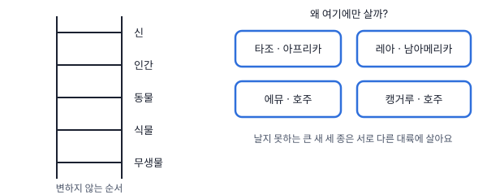

*왼쪽 사다리는 옛사람들이 세운 변하지 않는 순서이고, 오른쪽 상자들은 나중에 사람들이 던진 "왜 이 동물은 여기에만 살까?"라는 질문이에요.*

**정확히 말하면**

고대 그리스의 아리스토텔레스(Aristoteles)는 지구의 모든 것을 사다리 모양으로 간단히 분류했어요. 이것을 자연의 사다리라고 해요. 맨 아래가 무생물(무기물)이고, 그 위로 식물, 동물, 인간, 맨 위에 신이 놓여요.

14세기까지 유럽인들은 아리스토텔레스의 자연 분류에 성경의 창조설을 합쳐 생각했어요. 그래서 모든 생물은 신이 만들었고, 종은 변하지 않고, 사라지지 않고, 새로 생기지도 않는다고 믿었어요.

15~18세기에 과학이 발달하면서 이 생각에 질문이 생겼어요. 신이 모든 생물을 만들었다면 왜 캥거루는 호주에만 살까요? 날지 못하는 커다란 새인 타조는 아프리카, 레아는 남아메리카, 에뮤는 호주에만 살아요. 이렇게 어떤 지역에 어떤 생물이 사는지 연구하는 학문이 생물지리학(biogeography)이에요.

생물지리학자들이 던진 "왜 이 종은 이 지역에만 사는가"라는 질문은 종이 변하지 않는다는 생각을 흔드는 출발점이 되었어요. 다윈의 관찰과 추론은 [다윈의 항해](#s1-beagle) 쪽에서 이어져요.

**교수님 말씀**

교수님은 아리스토텔레스를 철학자이자 자연사 연구자이자 생물학자로 소개하면서, 오늘날로 치면 대학 총장 정도 되는 사람이라고 빗댔어요.

> 지금으로 따지면 거의 대학 총장 정도 되는 사람인데.

7·8장에서 다윈 이전에 어떤 이론이 있었는지는 "살짝 아시면 됩니다"라고 했어요.

**페이지 요약**

옛사람들은 종이 변하지도, 사라지지도, 새로 생기지도 않는다고 믿었고, 생물지리학의 "왜 여기에만 사는가" 질문이 그 믿음을 흔들었어요.

*용어*

- **자연의 사다리** — 아리스토텔레스의 분류로, 아래부터 무생물·식물·동물·인간·신 순서예요.
- **다윈 이전의 생물관** — 14세기까지 유럽인은 아리스토텔레스의 분류와 성경의 창조설을 합쳐, 모든 생물은 신이 만들었고 종은 변하거나 사라지거나 새로 생기지 않는다고 믿었어요.
- **생물지리학(biogeography)** — 어떤 지역에 어떤 생물이 사는지 연구해요. 캥거루는 호주에만, 날지 못하는 큰 새는 타조(아프리카)·레아(남아메리카)·에뮤(호주)처럼 지역마다 다르다는 질문을 던졌어요.

---

### 격변설·점진주의·동일과정설

*1027 수업 · 7장 p1*

**쉽게 말하면**

땅이 큰 사건으로 한순간에 바뀌었다는 생각과, 아주 오랫동안 조금씩 쌓이고 깎여 바뀌었다는 생각이 맞섰어요.

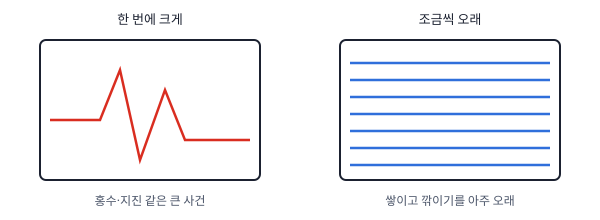

*왼쪽은 땅이 한 번에 크게 꺾이는 모습이고, 오른쪽은 얇은 층이 하나씩 오래 쌓이는 모습이에요.*

**정확히 말하면**

**격변설(catastrophism)**: 18세기 프랑스 과학자 퀴비에(Cuvier)가 화석을 설명하려고 내세운 이론이에요. 화석은 멸종한 생물이고, 지진·대홍수·지층 충돌 같은 천재지변으로 지질이 **갑자기** 변하면서 많은 종이 멸종했다고 봐요. 그래서 각 화석은 홍수나 지진 같은 사건으로 죽은 생물의 잔해라고 해석해요.

**점진주의(gradualism)**: 지질학자들의 반론이에요. 지층은 오랜 시간 퇴적되어 쌓이고, 수천만 년 동안 깎이면서 **서서히** 만들어진다고 봐요. 큰 사건 한 번이 아니라 느린 과정이 오래 계속된 결과라는 점에서 격변설과 정반대예요.

**동일과정설(uniformitarianism)**: 라이엘(Lyell)이 점진주의를 발전시킨 이론이에요. 옛날에도 서서히 변했고 지금도 같은 과정으로 서서히 변한다, 즉 과거와 현재의 지질 과정이 동일하다고 봐요.

라이엘이 쓴 『지질학 원리(Principles of Geology)』는 다윈이 비글호 항해 중에 읽은 책이에요. 지질이 서서히 변한다면 그 위에 사는 생물도 서서히 변할 수 있다는 생각으로 이어져 다윈에게 영향을 주었어요.

**교수님 말씀**

교수님은 퀴비에와 지질학자의 가상 문답으로 두 생각을 대비했어요.

> "왜 멸종했는데요?" "지진 나서 죽었겠지."

이어서 지질학자가 "그렇게 빨리 변하는 게 아니고 서서히 변해야 된다"라고 반박하는 장면으로 점진주의를 소개했고, 이를 발전시킨 사람이 라이엘이라고 했어요.

**꼭 기억해요**

- **세 이론의 차이를 섞기 쉬워요.** 격변설은 큰 사건으로 **갑자기**, 점진주의는 오랜 시간 **서서히**, 동일과정설은 서서히 변하는 그 과정이 **과거와 현재에 같다**는 주장이에요.
- **주창자를 엇갈리게 짝짓기 쉬워요.** 격변설은 퀴비에, 점진주의는 휴튼(Hutton), 동일과정설은 라이엘이에요. 휴튼은 격변설과 정반대인 점진주의를 주장했으므로 "휴튼(허튼)이 격변설을 주장했다"는 잘못된 연결이에요.
- **수업에서 빠진 이름이 있어요.** 교수님은 점진주의를 "발전시킨 사람이 라이엘"이라고만 하고 휴튼의 이름은 말하지 않았어요. 점진주의를 처음 주장한 사람(휴튼)과 그것을 동일과정설로 발전시킨 사람(라이엘)을 구분해요.

**보충 · 노트에 빠졌던 수업 내용**

강의노트 p1은 격변설 앞에 화석학의 질문 두 가지를 적어요. (1) 왜 지질층마다 다른 종류의 화석이 있는가? (2) 지금 존재하지 않는 생물의 화석은 무엇인가? 당시에는 종이 사라진다는 것, 즉 멸종을 인정하지 않았기 때문에 두 번째 질문이 특히 풀기 어려웠어요.

퀴비에의 격변설은 이 질문들에 대한 답이었어요. 지금 없는 생물의 화석은 멸종한 생물이고, 층마다 화석이 다른 것은 큰 사건이 일어날 때마다 그 시기의 생물이 사라졌기 때문이라고 설명했어요.

출처: 강의노트 7장 p1

**보충 · 노트에 빠졌던 수업 내용**

점진주의를 주장한 사람은 지질학자 휴튼(Hutton, 허튼으로도 써요)이에요. 휴튼은 오랜 시간 동안 느리고 계속적인 물리적 과정이 지구의 지질학적 특징을 만든다고 보았고, 이는 퀴비에의 격변설과 대조적이었어요. 라이엘은 휴튼의 생각을 지지해, 과거의 지질 과정이 지금 관찰되는 과정과 같다는 동일과정설로 발전시켰어요. 강의노트는 라이엘의 주장에 "지구는 수백만 년 이상의 나이"라는 점도 함께 적어요. 느린 과정만으로 지금의 땅이 만들어지려면 그만큼 긴 시간이 필요하기 때문이에요.

출처: 강의노트 7장 p1, 교재 7장 p.141

**보충 · 수업에서 다루지 않았어요**

교재는 프랑스 박물학자 뷔퐁(Buffon)이 흔적기관이 과거 조상 시대에는 기능을 했을 것이라고 말했다고 소개해요. 흔적기관이 무엇이고 진화의 증거로 어떻게 쓰이는지는 [상동과 상사](#s2-homology)에서 다뤄요.

출처: 교재 7장 p.140

**페이지 요약**

격변설은 큰 사건으로 갑자기, 점진주의는 오랜 시간 서서히 바뀐다고 보고, 라이엘의 동일과정설은 그 느린 과정이 과거와 현재에 같다고 봐요.

*용어*

- **격변설(catastrophism)** — 퀴비에가 화석을 설명하려고 주장했어요. 지진·대홍수 같은 천재지변으로 지질이 갑자기 변해 많은 종이 멸종했고, 화석은 그런 사건으로 죽은 생물의 잔해라고 봐요.
- **점진주의(gradualism)** — 지층이 오랜 시간 퇴적되고 깎이며 서서히 만들어진다는 지질학자들의 반론으로, 격변설과 정반대예요.
- **동일과정설(uniformitarianism)** — 라이엘이 점진주의를 발전시켜, 과거와 현재의 지질 과정이 같다고 봐요.
- **다윈과의 연결** — 다윈은 비글호에서 라이엘의 『지질학 원리』를 읽었고, 지질이 서서히 변하면 생물도 서서히 변할 수 있다는 생각이 영향을 주었어요.
- **짝 맞추기** — 격변설-퀴비에, 점진주의-휴튼, 동일과정설-라이엘이에요. 수업에서는 휴튼 이름 없이 라이엘만 말했어요.

- **(보충) 화석학의 질문** — 강의노트 p1은 지질층마다 화석이 다른 이유와 지금 없는 생물의 화석이 무엇인지를 물어요. 당시에는 멸종을 인정하지 않았고, 퀴비에의 격변설이 화석을 큰 사건으로 멸종한 생물로 설명하며 이 질문에 답했어요(강의노트 7장 p1).

- **(보충) 점진주의의 주창자와 지구 나이** — 점진주의는 휴튼(허튼)이 주장했고 퀴비에의 격변설과 대조돼요. 라이엘이 이를 지지해 동일과정설로 발전시켰고, 강의노트는 지구 나이를 수백만 년 이상으로 적어요(강의노트 7장 p1, 교재 p.141).

- **(보충) 뷔퐁과 흔적기관** — 교재에서 뷔퐁은 흔적기관이 과거 조상 시대에는 기능했을 것이라고 말한 인물이에요. 수업에서는 다루지 않았어요(교재 p.140).

---

### 라마르크의 용불용설과 획득형질

*1027 수업 · 7장 p1*

**쉽게 말하면**

기린이 살면서 쭉 늘인 목이 아기 기린에게 그대로 물려진다는 생각은 대부분 맞지 않아요.

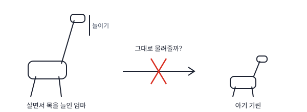

*엄마 기린이 살면서 늘인 목에서 아기 기린으로 가는 화살표에 엑스 표시를 했어요.*

**정확히 말하면**

라마르크(Lamarck)는 진화가 일어나는 방식으로 두 가지를 주장했어요.

1. **용불용설(use and disuse)**: 용(用)은 사용한다, 불용(不用)은 사용하지 않는다는 뜻이에요. 많이 쓰는 신체 기관은 발달하고, 쓰지 않는 기관은 약해진다고 봐요.
2. **획득형질의 유전(inheritance of acquired characteristics)**: 생물이 **살아 있는 동안 얻은 형질**이 자손에게 유전된다고 봐요.

기린 예로 보면, 원래 목이 짧던 기린이 높은 곳의 잎을 먹으려고 목을 계속 늘이다 보니 목이 길어졌고(용불용설), 그 긴 목이 자식에게 전해져 긴 목 기린이 태어났다는(획득형질의 유전) 설명이에요. 태어날 때는 짧았는데 살면서 길어진 목이 바로 획득형질이에요.

이 설명은 일반적으로 틀렸어요. 자손에게 전해지는 것은 부모가 물려준 유전자인데, 목을 늘이는 행동이나 성형수술은 그 유전자를 바꾸지 않기 때문이에요. 그래서 "살면서 얻은 형질이 자손에게 전해진다"는 생각은 라마르크 이론의 특징일 뿐, 오늘날 진화가 일어나는 원리로 쓰면 틀려요.

단서도 있어요. 후성유전학(epigenetics) 관점에서는 100% 틀린 것은 아니에요. 유전자(DNA 서열)가 바뀌지 않아도 DNA 메틸화나 히스톤 아세틸화 때문에 유전자가 발현되는 정도가 달라질 수 있고, 이런 상태가 유전될 수 있기 때문이에요. 메틸화와 아세틸화가 발현을 어떻게 바꾸는지는 [이전 노트의 염색질 구조와 유전자 발현](../../1008/정리노트_1008_Gene_Regulation_and_DNA_Cloning.html#s0-chromatin)에서 다시 볼 수 있어요. 그래도 "일반적으로 획득형질은 유전되지 않는다"가 기본 원칙이에요.

**라마르크의 기여**: 메커니즘은 틀렸지만, 그전까지 모두가 종은 변하지 않는다고 믿던 때에 **생물이 변할 수 있다**는 진화적 변화의 개념을 처음 제안했어요. 강의노트는 기여를 "모든 종은 시간에 따라 변화한다, 새로운 특성은 다음 세대로 넘어간다, 생물이 환경에 의해 변화한다"로 정리해요. 이 생각은 다윈의 진화론에 영향을 주었어요.

**같은 기린, 다윈식 설명**: 처음부터 목이 짧은 기린과 긴 기린이 섞여 있었어요. 짧은 목 기린은 잎을 먹지 못해 죽고 긴 목 기린만 살아남아 긴 목 자손을 낳았어요. 개체가 살면서 바뀌는 것이 아니라, 원래 있던 차이 중 살아남은 쪽이 자손을 남긴다는 점이 라마르크와 달라요. 자세한 논리는 [자연선택](#s1-natural-selection) 쪽에서 다뤄요.

**교수님 말씀**

교수님은 예전에는 라마르크를 "참 틀린 진화론을 제시한 사람"으로 많이 배웠다고 하면서, 획득형질이 유전되지 않는 예를 들었어요.

> 성형수술해서 예뻐졌는데 뭐 자식까지, 예뻐질 리가 없겠죠.

학자의 아들 예도 들었어요. 연습해서 공부를 잘하게 된 것이 자식에게 유전되는 게 아니라, 원래 머리가 좋은 유전자를 타고난 것이라는 설명이에요.

그러면서도 라마르크가 "헛소리만 한 건 아니고", 생물이 변할 수 있다는 이론을 제안한 점을 인정했어요.

**꼭 기억해요**

- **라마르크와 다윈을 같은 기린 예에서 섞기 쉬워요.** 라마르크는 한 기린이 살면서 목을 늘이고 그 목을 물려준다(용불용설·획득형질의 유전)고 보고, 다윈은 원래 목 길이가 다른 기린 중 긴 목이 살아남아 자손을 남긴다(자연선택)고 봐요.
- **주장과 인물을 바꿔 붙이기 쉬워요.** 판별 기준은 "무엇이 바뀌고 어떻게 전해지는가"예요. 라마르크는 한 개체가 생애 동안 얻은 형질이 자손에게 전달된다고 봐요. 다윈은 개체군에 원래 있던 변이 중 유리한 것이 자연선택으로 남는다고 봐요. 창조설은 종이 처음 만들어진 모습 그대로 변하지 않는다고 봐요. 지질학자(점진주의·동일과정설)는 지구가 아주 오래되었고 서서히 변해 왔다고 봐요. 예를 들어 "매일 달리기를 한 사슴의 새끼는 다리가 튼튼하게 태어난다"는 라마르크식, "원래 다리가 튼튼한 사슴이 포식자를 더 잘 피해 새끼를 더 많이 남긴다"는 다윈식 설명이에요(가상 사례).
- **후성유전 단서를 과장하기 쉬워요.** 후성유전학 때문에 "100% 틀린 것은 아니다"라는 단서가 붙을 뿐, 일반적으로 획득형질은 유전되지 않아요. 그래서 살면서 얻은 특성의 대물림을 진화의 기본 원리나 진화 연구의 전제로 삼는 설명은 틀린 설명이에요.
- **"틀린 이론"과 "기여 없음"은 달라요.** 라마르크의 메커니즘은 틀렸지만, 종이 변한다는 주장은 기여로 인정받아요.

**페이지 요약**

라마르크는 많이 쓴 기관이 발달하고 그렇게 살면서 얻은 형질이 유전된다고 했지만, 일반적으로 획득형질은 유전되지 않아요.

*용어*

- **용불용설(use and disuse)** — 쓰는 기관은 발달하고 쓰지 않는 기관은 약해진다는 라마르크의 주장이에요.
- **획득형질의 유전** — 생애 동안 얻은 형질이 자손에게 전해진다는 주장이에요. 기린이 늘인 목을 물려준다는 예가 대표적이에요. 물려주는 것은 유전자이고 행동·수술은 유전자를 바꾸지 않으므로 일반적으로 틀렸어요.
- **후성유전학(epigenetics) 단서** — DNA 서열이 그대로여도 DNA 메틸화·히스톤 아세틸화로 발현 정도가 달라지고 이것이 유전될 수 있어 "100% 틀린 것은 아니에요". 기본 원칙은 여전히 획득형질은 유전되지 않는다예요.
- **라마르크의 기여** — 종이 변하지 않는다고 믿던 시대에 생물이 변할 수 있다는 진화적 변화의 개념을 처음 제안해 다윈에게 영향을 주었어요.
- **라마르크 vs 다윈** — 라마르크는 한 개체가 살면서 바뀐 형질을 물려준다고 보고, 다윈은 원래 있던 차이 중 살아남은 개체가 자손을 남긴다고 봐요.
- **주장별 구분** — 한 개체가 생애 동안 얻은 형질의 전달은 라마르크, 원래 있던 변이 중 유리한 것이 자연선택으로 남음은 다윈, 종은 처음 모습 그대로라는 생각은 창조설, 지구는 오래되었고 서서히 변함은 지질학자의 생각이에요.

---

## 1. 다윈의 여정과 자연선택

### 비글호 항해와 갈라파고스의 관찰

*1027 수업 · 7장 p1 · 7장 p2*

**쉽게 말하면**

같은 동네에 사는 동물끼리는 한 집안 식구처럼 닮았어요.

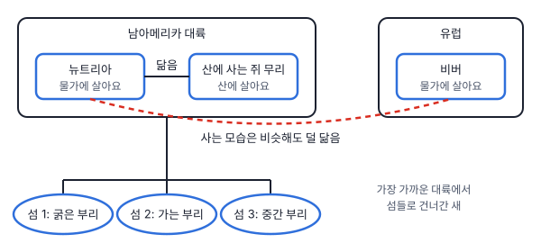

*섬의 새도 가장 가까운 큰 땅에서 건너왔고, 섬마다 부리가 조금씩 달라졌어요.*

**정확히 말하면**

다윈은 의대에 진학했지만 그만두었고, 성직자가 되려고 신학을 공부하면서 헨슬로 교수에게 식물학을 배웠어요. 그 뒤 피츠로이 선장의 말동무로 해군 조사선 **비글호**에 올라 1831~1836년, 약 5년 동안 세계를 일주했어요. 배에서 라이엘의 『지질학 원리』를 읽고 "지질이 서서히 변한다"는 생각에 감명받았어요([격변설·점진주의·동일과정설](#s0-geology)).

다윈의 관찰은 세 가지로 정리돼요.

1. **화석과 지금의 생물이 닮았어요.** 남아메리카에서 발견된, 아르마딜로와 닮은 멸종한 화석종(글립토돈으로 추정)은 지금 그 지역에 사는 아르마딜로의 조상으로 볼 수 있었어요.
2. **같은 지역에 사는 생물끼리 닮았어요.** 남아메리카의 물가 설치류 **뉴트리아**(긴 꼬리)는 생태가 비슷한 유럽의 물가 설치류 비버(두껍고 평평한 꼬리)보다 남아메리카의 산에 사는 설치류와 더 닮았어요. 같은 지역 생물들은 그 지역에 살던 공통조상에서 갈라져 나왔기 때문이에요. 거꾸로 비슷한 환경이라도 다른 대륙에는 전혀 다른 종이 살아요.
3. **갈라파고스 군도의 종이 섬마다 조금씩 달랐어요.** **군도**는 섬들이 모여 있는 곳이에요. 다윈은 **갈라파고스**에서 바다거북, 바다이구아나, 섬마다 부리 모양이 다른 **핀치**를 관찰했어요. 강의노트 p2 표현으로는 갈라파고스의 종이 "섬마다 약간씩 다르고, 가장 가까운 대륙의 종과 닮았다"예요.

다윈은 핀치 표본이 각각 다른 종이라고 생각했지만, 새 전문가는 모두 같은 핀치이거나 매우 유사한 종이라고 판정했어요. 그래서 다윈은 대륙에서 건너온 한 종의 후손이 섬마다 다른 환경을 거치며 조금씩 달라졌다고 추론했어요. 딱딱한 열매가 많은 섬에서는 두꺼운 부리가, 그렇지 않은 섬에서는 뾰족한 부리가 유리할 수 있어요. 이 원리는 [자연선택의 논리](#s1-natural-selection)에서 이어져요.

**섬 생물의 가장 가까운 친척을 찾는 기준**은 공통조상이 살던 곳, 곧 그 섬에서 **가장 가까운 대륙**이에요. 그 섬이 정치적으로 어느 나라에 속하는지, 멀리 떨어진 다른 섬이 비슷한 환경인지는 기준이 아니에요. 가상의 예로, 어떤 섬에서 가장 가까운 대륙은 A인데 정치적으로는 멀리 있는 나라 B에 속한다면, 다윈의 추리로는 그 섬 생물의 가까운 친척은 A 대륙에 있어야 해요.

다윈이 생물이 변한다고 확신하는 데 결정적이었던 것은 **갈라파고스 군도에서 섬마다 다른 핀치의 부리**, 그리고 군도 안 여러 섬의 핀치·바다거북 종들 사이의 **유사성과 차이점**이었어요. 이것은 살아 있는 생물의 닮음과 차이를 비교한 관찰이에요.

다윈은 돌아와 20년 동안 자료만 모으고 발표하지 않았어요. 그러다 **월리스**에게서 자기 연구와 거의 같은 내용의 편지를 받았어요. 월리스도 자연선택 이론을 독자적으로 생각하고 있었던 거예요. 두 사람은 함께 린네학회에 자연선택 이론을 발표했고, 이후 다윈이 1859년 『종의 기원』(On the Origin of Species by Means of Natural Selection, 자연선택이라는 방법에 의한 종의 기원에 관해서)을 냈어요. 처음에는 대부분 믿지 않았고 일부 과학자만 다윈을 따랐어요.

**교수님 말씀**

다윈의 집안을 "금수저라기보다는 금포크 집안"이라고 했어요. 아버지는 성공한 의사였고 외가는 웨지우드 가문이에요. 선장은 골수 창조론자여서 배 안에서 둘이 내내 싸웠다고 소개했어요.

뉴트리아는 한국에서 외래종이라 잡으면 포상금을 주던 그 동물이라고 짚었어요. 남아메리카 생물끼리 닮은 이유를 이렇게 정리했어요.

> 같은 지역에 사는 애들끼리는 닮았다. 왜? 공통조상에서 갈라져 나왔으니까.

관찰 가운데 갈라파고스를 "결정적"이라고 했고, 전문가의 판정을 이렇게 전했어요.

> 다윈아, 이거 전부 같은 핀치새인데?

20년 동안 발표하지 않은 이유는 비난을 받을까 걱정했기 때문이라고 했어요.

**꼭 기억해요**

**핀치를 "모두 다른 종"으로 착각하기 쉬워요.** 교수님 설명으로는 전문가가 같은 핀치이거나 유사한 종이라고 판정했고, 부리 모양이 섬마다 달랐어요. 그래서 "한 조상에서 섬마다 달라졌다"는 추론이 나왔어요.

**생태가 비슷하면 가까운 친척이라고 착각하기 쉬워요.** 물가에 사는 뉴트리아와 비버는 생활이 비슷해도 다른 대륙의 종이에요. 닮음을 정하는 것은 사는 지역, 곧 같은 지역의 공통조상이에요.

**섬 생물의 친척을 정치적 소속국이나 환경이 비슷한 먼 섬에서 찾기 쉬워요.** 바른 기준은 가장 가까운 대륙이에요.

**남아메리카 대륙의 관찰과 갈라파고스의 관찰을 섞기 쉬워요.** 화석과 현생 생물의 닮음, 유럽과 다른 남미 생물은 대륙에서 한 관찰이에요. 다윈에게 결정적이었던 것은 군도 안에서 섬마다 다른 핀치 부리와 종들의 유사성·차이점이에요.

**페이지 요약**

다윈은 비글호 항해에서 같은 지역 생물끼리 닮고, 갈라파고스 섬마다 핀치 부리가 다르다는 것을 보고 생물이 변한다고 추론했어요.

*용어*

- **비글호 항해** — 1831~1836년 약 5년의 세계 일주예요. 배에서 라이엘의 『지질학 원리』를 읽었어요.
- **화석과 현생 생물** — 아르마딜로와 닮은 멸종한 화석종(글립토돈으로 추정)을 지금 아르마딜로의 조상으로 보았어요.
- **같은 지역의 닮음** — 뉴트리아는 생태가 비슷한 유럽 비버가 아니라 남미의 산 설치류와 닮아요. 같은 지역의 공통조상에서 갈라졌기 때문이에요.
- **갈라파고스 군도(archipelago)** — 군도는 섬들이 모인 곳이에요. 바다거북, 바다이구아나, 섬마다 부리가 다른 핀치를 관찰했어요.
- **핀치의 판정** — 전문가는 같은(유사한) 핀치라고 판정했고, 다윈은 대륙에서 온 한 종의 후손이 섬 환경에 따라 달라졌다고 추론했어요.
- **섬 생물의 친척** — 가장 가까운 대륙의 종과 닮아요. 정치적 소속이나 환경이 비슷한 먼 섬은 기준이 아니에요.
- **결정적 관찰** — 갈라파고스 섬마다 다른 핀치 부리, 군도 안 핀치·바다거북 종들의 유사성과 차이점이에요.
- **월리스와 『종의 기원』** — 월리스도 자연선택을 독자적으로 생각해 둘이 린네학회에 함께 발표했고, 다윈은 1859년 『종의 기원』을 냈어요.

---

### 인위선택과 맬서스의 인구론

*1027 수업 · 7장 p2*

**쉽게 말하면**

사람이 고르면 개 품종이 달라지고, 자연에서는 사는 곳의 조건이 대신 골라요.

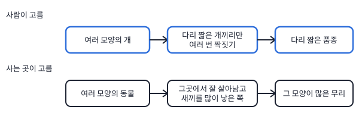

*누가 고르느냐가 다를 뿐, 고른 모습이 다음 세대에 많아지는 건 같아요.*

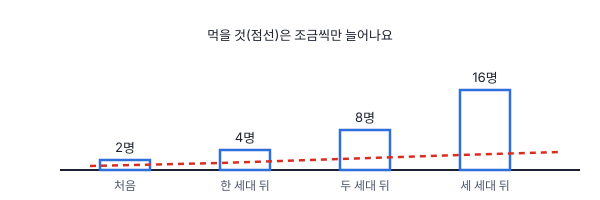

*사람 수는 두 배씩 늘려 하지만 먹을 것이 따라가지 못해, 모두가 살아남지 못하고 서로 다퉈요.*

**정확히 말하면**

다윈의 자연선택 이론에는 다윈 혼자만의 관찰 말고도 여러 생각이 영향을 주었어요. 점진주의와 라이엘의 동일과정설은 "지질이 서서히 변하면 그 위의 생물도 서서히 변할 수 있다"는 생각으로 이어졌고([격변설·점진주의·동일과정설](#s0-geology)), 라마르크는 종이 변한다는 생각을 먼저 내놓았어요([라마르크의 용불용설](#s0-lamarck)). 여기서는 나머지 두 영향인 인위선택과 맬서스를 정리해요.

**인위선택(artificial selection)**은 사람이 원하는 형질을 가진 개체끼리 선택적으로 교배시키는 것이에요. 다윈 시대 사람들은 소가 젖을 더 많이 내고 작물이 더 잘 자라도록 이런 교배를 했어요. 다리가 짧은 개끼리 교배하고, 그 새끼 중 다리가 짧은 개끼리 다시 교배하기를 되풀이하면 다리 짧은 품종이 만들어져요. **치와와**, 닥스훈트처럼 다양한 개 품종이 인위선택의 결과예요.

| 비교 | 인위선택 | 자연선택 |
|---|---|---|
| 고르는 주체 | 사람 | 환경 |
| 고르는 기준 | 사람이 원하는 형질 | 그 환경에서 생존·번식에 유리한 형질 |
| 재료 | 집단 안에 이미 있고 자손에게 유전되는 차이 |  |
| 결과 | 골라진 형질이 다음 세대에 더 많아짐 |  |

다윈은 사람이 하는 이 선택이 자연에서는 어떻게 일어나는지 고민했어요. 자연에서는 환경에 적응한 개체만 살아남아 교배하므로, 환경이 선택을 하는 셈이에요. 그래서 이름도 자연선택이 되었어요.

**맬서스의 인구론**은 강의노트 표현으로 "인구는 농업생산량보다 훨씬 빠르게 성장하여 개인들은 서로 경쟁한다"예요. 부부 두 명이 자식 네 명을 낳으면 다음 세대는 여덟 명이 되는 식으로 인구는 2의 n승으로 늘어나야 하지만, 실제로는 장애물과 제한이 있어 무한히 늘지 않아요. 사람들은 제한된 자원을 두고 **경쟁**하고, 일부만 살아남아요.

다윈은 맬서스의 생각을 생물에 적용했어요. 생물은 자손을 많이 낳지만 자원이 제한되어 있어 모두 살아남지 못하고, 개체들은 자원을 두고 경쟁해요. 이 경쟁이 [자연선택의 논리](#s1-natural-selection)의 출발점이에요.

**교수님 말씀**

인위선택은 다리 짧은 개를 모아 계속 교배하는 예로 설명했어요.

> 짧은 애들 다 모아가지고 계속 교배를 시켜. … 결국에는 치와와가 태어납니다.

두 선택의 관계는 이렇게 말했어요.

> 인위선택, 자연선택 서로 반대지만 … 엄청나게 영향을 줍니다.

맬서스는 부부 두 명이 네 명을 낳고, 한 세대 뒤 여덟 명이 되는 예로 설명했고 "자연계도 마찬가지다"라고 이었어요.

**꼭 기억해요**

**"서로 반대"를 원리까지 반대라고 착각하기 쉬워요.** 다른 것은 고르는 주체(사람 대 환경)예요. 이미 있는 유전되는 차이 가운데 골라진 것이 다음 세대에 늘어난다는 원리는 같아서, 인위선택이 자연선택 이론에 큰 영향을 주었어요.

**인위선택에서 사람이 새 형질을 만든다고 착각하기 쉬워요.** 사람은 원하는 형질을 가진 개체를 골라 교배시킬 뿐이에요.

**맬서스에서 무엇을 가져왔는지 헷갈리기 쉬워요.** 맬서스에게서 온 생각은 "늘어나려는 수와 제한된 자원 때문에 경쟁이 생긴다"예요. "후손은 조상을 닮는다", 곧 형질이 유전된다는 생각은 강의노트 7장 p2 표기로 '선택적 번식과 유전'(인위선택) 항목에 해당해요.

**페이지 요약**

인위선택은 사람이, 자연선택은 환경이 고르고, 맬서스의 인구론은 자원 제한이 경쟁을 낳는다는 생각을 다윈에게 주었어요.

*용어*

- **인위선택(artificial selection)** — 사람이 원하는 형질의 개체끼리 선택적으로 교배시키는 것이에요. 치와와·닥스훈트 같은 개 품종이 예예요.
- **인위선택과 자연선택** — 고르는 주체가 사람과 환경으로 달라요. 이미 있는 유전되는 차이 중 골라진 형질이 다음 세대에 많아진다는 원리는 같아 큰 영향을 주었어요.
- **맬서스의 인구론** — 인구는 2의 n승으로 늘려 하지만 식량 생산이 따라가지 못해 사람들은 제한된 자원을 두고 경쟁해요. 맬서스에게서 가져온 것은 경쟁이라는 생각이에요.
- **다윈의 적용** — 생물도 자손을 많이 낳지만 자원이 제한되어 모두 살아남지 못하고 경쟁해요.
- **다른 영향** — 점진주의·동일과정설(생물도 서서히 변할 수 있음)과 라마르크(종이 변한다는 생각)도 영향을 주었어요.

---

### 자연선택의 논리

*1027 수업 · 7장 p2*

**쉽게 말하면**

딱딱한 열매가 많은 섬에서는 굵은 부리를 타고난 새가 더 잘 먹고 새끼도 더 많이 남겨요.

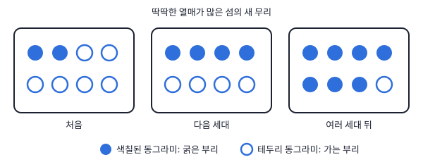

*한 마리의 부리가 굵어지는 게 아니라, 굵은 부리를 타고난 새의 새끼가 많아져 무리 속 비율이 바뀌어요.*

**정확히 말하면**

다윈은 섬마다 다른 핀치를 보고 "한 조상에서 나온 무리가 어떻게 바뀌는가"를 설명할 원리가 필요했어요. 그 원리가 **자연선택(natural selection)**이고, 진화라는 결과를 가져오는 원리예요. 『종의 기원』의 정식 제목도 "자연선택이라는 방법에 의한" 종의 기원이에요. 멸종이나 지역마다 다른 생물은 일어난 결과이고, 그 결과를 일으키는 방법이 자연선택이에요.

자연선택이 일어나는 단위는 **개체군(population)**이에요. 개체군은 같은 지역을 점유하는 같은 종 개체들의 모임이고, 집단이라고도 해요. 개체군 크기는 개체 수를 말해요.

다윈은 관찰에서 추론을 이끌었어요(교재 표 7.1). 어느 관찰에서 어느 추론이 나오는지 짝을 지켜야 해요.

| 관찰 | 추론 |
|---|---|
| 생물은 자손을 많이 낳아요(식물 종자, 물고기 알). 개체군은 무한히 커지지 않아요. 음식·서식지 같은 자원은 제한되어 있어요. | 개체군 안의 개체들은 제한된 자원을 두고 **경쟁**해요. |
| 개체군 안의 개체들은 여러 특성에서 서로 달라요(**변이**). 많은 변이는 다음 세대로 **유전**돼요. | 유전되는 특성 때문에 어떤 개체가 다른 개체보다 더 오래 **생존**하고 더 많이 **번식**해요. |
| 두 추론을 합치면, 유용하고 유전되는 형질이 세대를 거치며 더 보편화되어 개체군이 변해요. |  |

이 과정을 인과 순서로 쓰면 다음과 같아요.

1. 개체군 안에 이미 여러 변이가 있고, 그중 일부는 유전돼요. 예를 들어 한 섬의 핀치 무리에 가는 부리와 굵은 부리가 섞여 있어요.
2. 자손은 많이 태어나지만 자원이 제한되어 모두 살아남지 못하므로 경쟁이 생겨요.
3. 그 **환경**에서 생존과 번식에 유리한 변이를 가진 개체가 자식을 더 많이 남겨요. 딱딱한 열매가 많은 섬에서는 굵은 부리 핀치가 열매를 잘 깨 먹고 오래 살아 자식을 많이 남겨요.
4. 그 변이가 유전되므로 다음 세대에는 굵은 부리 핀치의 비율이 높아져요. 집단의 유전적 조성이 달라진 거예요.
5. 이것이 여러 세대 되풀이되면 유용하고 유전되는 형질이 개체군에 보편화돼요. 이것이 자연선택이에요.

**시작 조건: 변이는 선택보다 먼저 있어요.** 환경은 새 변이를 만들어 주지 않고, 이미 있는 변이 가운데 어떤 것이 더 많이 남을지를 정해요. 기린의 경우 다윈식 설명은 처음부터 목이 짧은 기린과 긴 기린이 함께 있었다는 데서 시작해요. 짧은 목 기린은 높은 잎을 못 먹어 죽고, 긴 목 기린이 살아남아 긴 목 자손을 낳았어요. 변이는 필요하다고 해서 생기지 않아요. 변이의 원천인 대립유전자는 돌연변이로 생겨요([개체군 안의 변이](#s3-variation)). 수업의 DDT 모기 예도 같아요. DDT가 저항성을 만들어 준 것이 아니라, 돌연변이로 생긴 저항성 모기가 뿌리기 전부터 극소수 있었고 그 비율이 커진 거예요([진화의 증거](#s2-evidence)). 환경이 바뀐 뒤 빨리 달라진 집단은 맞는 변이를 **이미 가지고 있던** 집단이에요.

**숨은 조건 1: 유전되는 변이만 자연선택을 받아요.** 살면서 생긴 차이는 자손에게 넘어가지 않아 다음 세대의 비율을 바꾸지 못해요. 예를 들어 추운 곳의 토끼 무리에서 태어날 때부터 털이 두꺼운 토끼의 차이는 자연선택의 재료가 되지만, 사람이 우리 안을 따뜻하게 해 줘서 겨울을 난 토끼의 차이는 자손에게 넘어가지 않아 재료가 되지 않아요([획득형질의 유전](#s0-lamarck)과 같은 구분이에요). 기준은 "유전되는가"이고, 유전자가 제어하는 특징이라면 겉모습에 한정되지 않고 종류와 관계없이 자연선택을 받을 수 있어요.

**숨은 조건 2: 유리함은 환경에 따라 달라져요.** 굵은 부리는 딱딱한 열매가 많은 섬에서 유리하고, 그렇지 않은 섬에서는 뾰족한 부리가 유리할 수 있어요. 같은 형질도 환경이 바뀌면 유리함이 달라질 수 있어서, 적응 정도는 서식 환경을 빼고 정할 수 없어요. 어떤 특징이 크거나 강하다는 것만으로 유리하다고 정하지 않고, 그 환경에서 생존과 번식으로 이어지는지가 기준이에요.

**숨은 조건 3: 생존과 번식이 함께 필요해요.** 오래 살아도 자식을 못 낳거나, 번식을 잘해도 일찍 죽으면 다음 세대에 그 형질을 많이 남기지 못해요. 교수님은 이것을 "생존만, 번식만 해서는 안 된다"로 설명했어요. 수업에서 말하지 않은 용어로, 강의노트 7장 p2 표기로는 "자연선택은 **적응형질(adaptive trait)**을 선호"하고 이는 "**적응도(생존 × 번식)**를 높이는 형질"이에요.

**바뀌는 것은 개체가 아니라 개체군이에요.** 굵은 부리로 태어난 핀치는 굵은 부리로 살다 죽고, 가는 부리로 태어난 핀치는 가는 부리로 살다 죽어요. 세대가 지나며 무리 속 비율이 바뀌는 거예요([변형 혈통과 계통수](#s1-tree)).

**자연선택이 남기는 것과 줄이는 것**을 거꾸로 읽지 않아요. 수업 설명대로 자연선택은 좋은 유전 형질을 다음 세대에 더 많이 남기고, 줄어드는 쪽은 그 환경에서 불리한 변이예요. 다윈은 관찰 끝에 자연선택으로 새로운 종이 생길 수밖에 없다고 생각했어요. 강의노트 7장 p2 표기로는 이것을 "자연선택에 의해 새로운 종이 분화됨", 곧 **진화적 분기(evolutionary divergence)**라고 적어요. 공통조상에서 여러 종이 갈라지는 모습은 [변형 혈통과 계통수](#s1-tree)에서 이어져요.

**교수님 말씀**

개체군 안의 변이를 교실에 빗댔어요. 수업을 잘 듣는 학생, 자는 학생, 게임하는 학생, 열심히 필기하는 학생이 섞여 있는 것처럼 개체들은 다양하다고 했어요.

> 좋은 유전 형질이 그다음 세대에 더 많아진다, 이게 바로 자연선택입니다.

> 생존만 해서는 안 되죠, 번식만 해서도 안 되죠.

쉬는 시간 뒤에는 자연선택의 논리를 일상에 적용했어요. 맛있는 열매 위치보다 뱀에 물릴 뻔한 기억을 오래 간직한 사람이 더 잘 살아남았으므로 나쁜 기억이 오래 남는 부정 편향이 흔해졌다고 했어요. 주변을 자주 돌아본 사람이 포식자를 피해 더 살아남았으므로 집중이 15분을 넘기 어렵다는 예도 들었어요. 두 예 모두 생존에 유리한 차이를 가진 쪽이 더 많이 남았다는 구조예요.

**꼭 기억해요**

**경쟁이 변이에서 나온다고 착각하기 쉬워요.** 경쟁은 "자손을 많이 낳는다, 개체군은 무한히 커지지 않는다, 자원이 제한된다"에서 추론해요. 변이와 유전에서는 "어떤 개체가 더 오래 생존하고 번식한다"를 추론해요.

**필요하니까 변이가 생긴다고 착각하기 쉬워요.** 변이는 선택 전에 이미 있어요. 환경은 있는 변이 가운데 무엇이 더 남을지만 정해요.

**살면서 생긴 차이도 자연선택을 받는다고 착각하기 쉬워요.** 살면서 생긴 차이는 유전되지 않아 다음 세대의 비율을 바꾸지 못해요. 타고난, 유전되는 차이만 자연선택을 받아요.

**"잘 적응했다"를 환경과 상관없는 성질로 착각하기 쉬워요.** 유리함은 그 환경에 따라 정해지므로, 다른 환경에서 어떨지는 그 환경을 봐야 알 수 있어요.

**오래 사는 것만, 많이 낳는 것만으로 충분하다고 착각하기 쉬워요.** 생존과 번식이 함께 높아야 다음 세대에 많이 남아요.

**자연선택이 유리한 형질을 없앤다고 거꾸로 읽기 쉬워요.** 자연선택은 유리한 형질을 보존하고, 불리한 변이가 줄어요.

**라마르크의 기린과 다윈의 기린을 섞기 쉬워요.** 라마르크는 목을 늘이려고 써서 길어진 목이 유전된다고 보았어요. 다윈은 처음부터 있던 긴 목 기린이 더 살아남아 자손을 남겼다고 보았어요.

**페이지 요약**

이미 있는 유전되는 변이 중 그 환경에서 생존과 번식에 유리한 것이 다음 세대에 더 많아져 개체군이 바뀌는 것이 자연선택이에요.

*용어*

- **자연선택(natural selection)** — 진화라는 결과를 가져오는 원리예요. 유용하고 유전되는 형질이 세대를 거치며 보편화되어 집단의 유전적 조성이 바뀌어요.
- **개체군(population)** — 같은 지역을 점유하는 같은 종 개체들의 모임(집단)이고, 크기는 개체 수예요. 변하는 단위는 개체가 아니라 개체군이에요.
- **관찰과 추론의 짝** — 자손 과잉·개체군 크기 제한·자원 제한에서 경쟁을 추론해요. 변이와 그 유전에서 생존·번식 차이를 추론해요.
- **인과 순서** — 유전되는 변이가 있음, 자원 제한으로 경쟁, 유리한 변이의 개체가 더 생존·번식, 다음 세대 비율 증가, 보편화로 이어져요.
- **변이가 먼저** — 환경은 변이를 만들지 않고 고르기만 해요. 다윈의 기린은 처음부터 긴 목과 짧은 목이 섞여 있었고, DDT 저항성 모기도 뿌리기 전부터 극소수 있었어요.
- **유전되는 변이만** — 살면서 생긴 차이는 유전되지 않아 재료가 아니에요. 유전자가 제어하는 특징이면 겉모습에 한정되지 않고 종류와 관계없이 대상이에요.
- **환경에 따른 유리함** — 같은 형질도 환경이 바뀌면 유리함이 달라질 수 있어 적응 정도는 서식 환경을 빼고 정할 수 없어요. 특징이 크거나 강한지가 아니라 그 환경에서 생존·번식으로 이어지는지가 기준이에요.
- **생존 × 번식** — 교수님 표현은 "생존만, 번식만 해서는 안 된다"예요. 강의노트 7장 p2 표기로는 자연선택이 적응도(생존 × 번식)를 높이는 적응형질(adaptive trait)을 선호한다고 적어요(수업에서 쓰지 않은 용어).
- **남기는 것과 줄이는 것** — 자연선택은 유리한 유전 형질을 더 많이 남기고 불리한 변이를 줄여요. 다윈은 자연선택으로 새 종이 생긴다고 보았고, 강의노트 7장 p2 표기로는 이를 진화적 분기(evolutionary divergence)라고 적어요.

---

### 변형 혈통과 계통수

*1027 수업 · 7장 p2*

**쉽게 말하면**

한 뿌리에서 갈라진 나뭇가지처럼, 지금의 여러 생물은 같은 조상에서 갈라져 나왔어요.

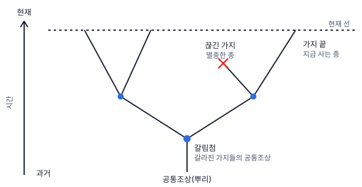

*꼭대기 선까지 닿은 가지 끝은 지금 사는 생물이고, 중간에 멈춘 가지는 사라진 무리예요.*

**정확히 말하면**

다윈은 '진화'라는 말보다 **변형 혈통(descent with modification)**이라는 말을 썼어요. 현재의 모든 생물은 하나의 **공통조상**에서 조금씩 바뀌며 이어진 혈통으로 생겼다는 뜻이에요. 환경에 따라 조금씩 달라진 종들이 새로 생기면서 나뭇가지처럼 여러 갈래로 갈라져요. 다윈은 이 모양을 실제로 나무 낙서로 그렸고, 지금 진화를 연구할 때 그리는 **계통수**가 이것이에요. 계통수의 '수(樹)'는 나무라는 뜻이에요.

계통수는 다음처럼 읽어요(교재 그림 7.7).

| 계통수의 부분 | 뜻 |
|---|---|
| 세로축 | 시간이에요. 아래가 과거, 위가 현재예요. |
| 맨 아래 뿌리 | 모든 가지의 공통조상이에요. |
| 갈림점(가지가 갈라지는 곳) | 한 계통이 둘 이상으로 나뉘어 새로운 계통이 나타난 곳이에요. 그 위로 갈라진 가지들의 공통조상을 나타내요. |
| 꼭대기(현재)까지 닿은 가지 끝 | 지금 살아 있는 현존 종이에요. |
| 꼭대기까지 닿지 않고 도중에 끊긴 가지 | **멸종**(멸절)한 종이나 집단이에요. |

여러 증거가 공통조상을 가리켜요. 사람과 침팬지는 DNA·단백질 서열이 매우 비슷하고, 상동 구조를 공유하며, 화석 기록도 둘의 관계를 보여 줘요. 이 증거들은 모두 사람과 침팬지가 **공통조상**을 공유한다는 설명을 뒷받침해요([진화의 증거](#s2-evidence)). 구조 증거의 종류는 [상동과 상사](#s2-homology)에서 다뤄요.

교수님이 짚은 **다윈 이론의 차별성**은 두 가지예요.

1. 생물 다양성의 기원을 순수하게 물리적으로 설명했어요. 신이 모든 생물을 만들었다는 설명 대신 자연에서 일어나는 과정으로 설명했어요.
2. 진화적 변화는 개체가 아니라 **집단 수준**(개체군 수준)에서 일어나요. 가는 부리 핀치가 많던 집단이 굵은 부리 핀치가 많은 집단으로 바뀌는 것이고, 한 개체의 부리가 바뀌는 것이 아니에요.

다윈 이론에서 형질을 고르는 것은 개체 자신이 아니라 그 환경에서의 생존·번식 차이이고, 변하는 것은 집단이에요([자연선택의 논리](#s1-natural-selection)).

다윈의 진화론은 대표적인 **귀납법**이에요. 연역법은 가설을 먼저 세우고 확인하는 방법이고, 귀납법은 관찰(경험)을 먼저 쌓아 결론을 이끄는 방법이에요. 다윈은 많은 관찰 끝에 자연선택으로 새로운 종이 생길 수밖에 없다는 생각에 이르렀어요.

**교수님 말씀**

계통수의 모양을 이렇게 설명했어요.

> 끊긴 거는 이제 멸종한 거고, 맨 끝에 가지는 지금 살아있는 … 종들

개체와 집단의 구분은 학생들에게 되묻고 여러 번 반복했어요.

> 개체가 변하는 게 아니고 개체군이 변하는 거죠. 집단이 변하는 겁니다.

> 다윈의 진화론은 대표적인 귀납법이에요.

이 정도로 관찰했다면 누구라도 그렇게 생각했을 것이라고 덧붙였어요.

**꼭 기억해요**

**개체가 변한다고 착각하기 쉬워요.** 굵은 부리로 태어난 개체는 굵은 부리로 살다 죽어요. 진화적 변화는 집단 수준에서 일어나요.

**개체가 유리한 형질을 고른다고 착각하기 쉬워요.** 고르는 것은 환경 속 생존·번식의 차이예요. 개체의 선택이나 의도가 아니에요.

**연역법과 귀납법을 바꾸기 쉬워요.** 연역법은 가설이 먼저, 귀납법은 관찰이 먼저예요. 다윈은 귀납법이에요.

**계통수의 부분을 바꿔 읽기 쉬워요.** 도중에 끊긴 가지는 멸종한 종이에요. 갈림점은 새 계통이 나뉜 곳이자 공통조상이고, 꼭대기 가지 끝은 현존 종이에요. 세로축은 시간이에요.

**보충 · 노트에 빠졌던 수업 내용**

강의노트에는 다윈 이론의 차별성이 네 가지로 적혀 있어요. 수업에서 말한 1·2(순수한 물리적 설명, 개체가 아닌 개체군 수준) 외에 다음 두 가지가 더 있어요.

(3) 진화를 여러 단계의 과정으로 설명했어요. 개체군 안에 변이가 있고, 자연선택이 일어나며, 성공적인 변이가 다음 세대로 유전돼요. 교재는 자연선택이 비성공적인 변이를 제거하고 성공적인 변이만 다음 세대로 유전된다고 풀어 써요.

(4) 진화는 주어진 환경에서 특정 생물이 다른 개체보다 기능을 더 잘하기 때문에 일어나요. 강의노트는 이 점이 라마르크와 같다고 적어요.

출처: 강의노트 7장 p2(다윈 이론의 차별성), 교재 7장 p.144

**페이지 요약**

다윈은 모든 생물이 공통조상에서 조금씩 바뀌며 갈라졌다는 변형 혈통을 주장했고, 이를 나무 모양의 계통수로 나타내요.

*용어*

- **변형 혈통(descent with modification)** — 현재 모든 생물은 공통조상에서 조금씩 바뀌며 이어진 혈통으로 생겼다는 다윈의 표현이에요.
- **계통수 읽기** — 세로축은 시간(아래 과거, 위 현재)이에요. 뿌리와 갈림점은 공통조상, 꼭대기까지 닿은 가지 끝은 현존 종, 도중에 끊긴 가지는 멸종한 종이에요.
- **공통조상의 증거** — DNA·단백질 서열, 상동 구조, 화석이 사람과 침팬지가 공통조상을 공유한다는 설명을 뒷받침해요.
- **다윈 이론의 차별성** — 생물 다양성의 기원을 순수하게 물리적으로 설명했고, 진화적 변화는 개체가 아닌 집단 수준에서 일어나요. 형질을 고르는 것은 개체가 아니라 환경 속 생존·번식 차이예요.
- **귀납법** — 관찰을 먼저 쌓아 결론을 이끄는 방법이에요. 가설이 먼저인 연역법과 달리 다윈의 진화론은 대표적인 귀납법이에요.

- **(보충) 차별성 3·4** — 강의노트에는 진화를 여러 단계(개체군 내 변이, 자연선택, 성공적 변이의 유전)로 설명한 점과, 특정 환경에서 더 기능을 잘하기 때문에 진화가 일어난다는 점(라마르크와 같음)도 적혀 있어요. 수업에서는 말하지 않았어요.

---

## 2. 현대적 종합론과 진화의 증거

### 현대적 종합론, 소진화와 대진화

*1027 수업 · 7장 p3*

**쉽게 말하면**

한 무리 안에서 모습이 조금 바뀌면 작은 진화, 새로운 종이 생기거나 사라지면 큰 진화예요.

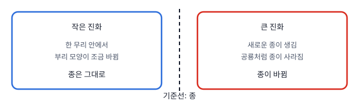

*크기나 걸린 시간이 아니라 종이 새로 생기거나 사라졌는지로 나눠요.*

**정확히 말하면**

다윈은 자연선택을 제시했지만, 형질이 구체적으로 어떻게 다음 세대로 전달되는지는 몰랐어요. **멘델 유전학**을 알지 못했기 때문이에요.

이후 멘델 유전학이 알려지고 생태학·생리학·유전학 같은 여러 분야가 발전하면서 진화론과 합쳐졌어요. 이렇게 모든 것을 종합해 진화론을 다시 세운 것이 **현대적 종합론**(modern synthesis)이에요. 그래서 현대적 종합론은 자연선택이 고르는 변이가 자손에게 어떻게 전달되는지를 유전학으로 설명할 수 있게 해 주었어요. 강의노트는 그 중심 분야로 개체군 유전학(population genetics)을 적었어요.

현대적 종합론은 진화를 **소진화**와 **대진화**로 나눠 설명해요. 둘을 가르는 기준은 **종 수준**이에요.

| 구분 | 소진화(micro, microevolution) | 대진화(macroevolution) |
|---|---|---|
| 뜻 | 한 개체군 안의 작은 유전적 변화예요. 종 수준까지 가지 않고 같은 종 안에서 일어나요. | 종 수준 이상의 변화예요. 강의노트는 종의 출현과 소멸 같은 대규모 패턴이라고 적었어요. |
| 수업 예 | 핀치 부리 모양 변화, 세균의 **항생제 내성** 획득 | 새로운 종의 탄생, 공룡의 멸종 |
| 판단 근거 | 종이 새로 생긴 것이 아니에요. | 종이 새로 생기거나 사라졌어요. |

새 사례를 판단할 때는 두 가지를 차례로 물어요. 첫째, 같은 종 안의 변화인지, 종이 새로 생기거나 사라지는 종 수준 이상의 변화인지 물어요. 예를 들어 한 호수의 물고기 무리에서 몸집이 큰 개체의 비율이 대를 이어 늘었다면 같은 종 안의 변화라 소진화예요. 한 조상 무리가 서로 다른 두 종으로 갈라졌다면 대진화예요.

둘째, **개체군 안의 진화적 변화**인지 판단할 때는 "개체군의 유전적 구성이 바뀌어 다음 세대로 대물림되는가"를 봐요. 어떤 특성을 가진 개체가 많아졌다는 사실만으로는 부족해요. 예를 들어 영양이 좋아져 한 도시에 키 큰 사람이 늘었다면, 유전되는 구성이 바뀐 것이 아니라 환경이 바뀐 것이라 진화적 변화로 보지 않아요.

항생제 내성과 살충제 저항성이 어떻게 자연선택의 증거가 되는지는 [적응·화석·생물지리학의 증거](#s2-evidence)에서, 개체군 안의 유전적 변화를 수로 확인하는 방법은 [영가설: 평형이 깨지면 소진화](#s3-null)에서 이어서 봐요.

**교수님 말씀**

교수님은 이름 때문에 헷갈리지 않도록 농담부터 했어요. 소진화의 '소'는 소(牛)가 아니라 작다(小, micro)는 뜻이에요.

> 소진화는 소가 진화하는 겁니다. 아닙니다.

이어서 "작고 큰의 기준은 뭐냐?"라고 되묻고 직접 답했어요.

> 종 수준 이상이면은 큰 겁니다.

교수님은 예 네 개로 구분했어요. 새 종의 탄생과 공룡 멸종은 대진화이고, 핀치 부리 변화와 세균의 항생제 내성은 "종이 탄생한 게 아니기 때문에" 소진화예요. 종이 정확히 무엇인지는 8장 첫 부분에서 다룬다고 미뤘어요.

**꼭 기억해요**

**소진화와 대진화를 변화의 크기나 걸린 시간으로 가르기 쉬워요.** 바른 기준은 종 수준이에요. 핀치 부리가 눈에 띄게 바뀌어도 새 종이 생기지 않았다면 소진화예요. 세균이 항생제 내성을 얻어도 같은 종이면 소진화예요.

**현대적 종합론이 무엇을 보탰는지 헷갈리기 쉬워요.** 다윈에게 없던 것은 형질이 다음 세대로 어떻게 전달되는지에 대한 이해였고, 현대적 종합론은 멘델 유전학을 진화론에 합쳐 이 부분을 채웠어요. DNA가 유전물질이라는 사실을 밝힌 이론으로 바꾸어 읽지 않아요.

**수가 늘었다는 것과 진화적 변화를 같은 것으로 보기 쉬워요.** 진화적 변화는 개체군의 유전적 구성이 대물림되며 바뀌는 것이에요. 어떤 특성을 가진 개체 수가 늘었다는 것만으로는 이 조건을 판단할 수 없어요.

강의노트 7장 p3에는 '점진적 변화 vs 돌연변이 등 급작스런 변화의 대립'과 '소진화의 점진적 축적이 대진화'라는 줄도 있지만, 수업에서는 설명하지 않았어요. 수업에서 준 판별 기준은 종 수준이에요.

**페이지 요약**

현대적 종합론은 다윈이 몰랐던 멘델 유전학을 진화론에 합쳤고, 소진화와 대진화는 종 수준을 기준으로 나눠요.

*용어*

- **현대적 종합론(modern synthesis)** — 다윈은 형질이 다음 세대로 전달되는 방식(멘델 유전학)을 몰랐어요. 멘델 유전학·생태학·생리학·유전학을 진화론과 합쳐, 변이가 자손에게 전달되는 방식을 설명하게 했어요. 강의노트는 중심 분야로 개체군 유전학을 적었어요. DNA가 유전물질임을 밝힌 이론은 아니에요.
- **소진화(microevolution)** — 한 개체군 안의 작은 유전적 변화로, 종 수준까지 가지 않아요. 수업 예: 핀치 부리 변화, 세균의 항생제 내성.
- **대진화(macroevolution)** — 종 수준 이상의 변화예요. 수업 예: 새 종의 탄생, 공룡의 멸종.
- **기준은 종 수준** — 변화의 크기나 시간이 아니라 종이 새로 생기거나 사라졌는지로 나눠요. 이름의 '소'는 작다(小)는 뜻이에요. 종의 정의는 8장에서 다뤄요.
- **진화적 변화의 판정** — 개체군의 유전적 구성이 바뀌어 다음 세대로 대물림되어야 해요. 어떤 특성을 가진 개체 수가 늘었다는 것만으로는 부족하고, 환경 때문에 늘어난 것(영양으로 키 큰 사람 증가)은 진화적 변화가 아니에요.
- **수업에서 설명하지 않은 줄** — 강의노트 p3의 '점진적 변화와 급작스런 변화의 대립', '소진화의 점진적 축적이 대진화'는 수업에서 설명하지 않았어요.

---

### 적응·화석·생물지리학의 증거

*1027 수업 · 7장 p3*

**쉽게 말하면**

약을 뿌릴수록 약에 강한 모기만 살아남아 새끼를 낳으니, 1년 남짓 만에 모기 무리가 약에 강한 모기로 바뀌어요.

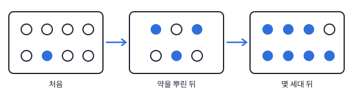

*색칠된 점은 약에 강한 모기, 테두리 동그라미는 약한 모기예요.*

**정확히 말하면**

다윈 이후 진화를 뒷받침하는 증거가 여러 분야에서 쏟아졌어요. 수업에서는 여섯 가지를 배웠어요. 이 토픽은 앞의 세 가지를 다루고, 비교해부학은 [상동과 상사](#s2-homology), 비교발생학과 비교분자생물학은 [비교발생학과 비교분자생물학](#s2-molecular)에서 다뤄요.

**(1) 자연선택에 의한 적응**: 자연선택은 긴 시간이 꼭 필요하지 않고 비교적 짧은 시간 안에도 관찰할 수 있어요. 교재의 **DDT**(살충제) 모기 예는 18개월(1년 6개월) 동안의 변화예요.

1. DDT를 뿌리기 전: 대부분의 모기는 DDT에 노출되면 죽어요. 돌연변이로 생긴, DDT에 죽지 않는 모기가 극히 일부 이미 있어요.
2. DDT를 뿌리면: 내성이 없는 모기는 죽고 내성이 있는 모기만 살아남아요.
3. 살아남은 내성 모기가 번식해 내성 형질을 다음 **세대**에 물려줘요.
4. DDT를 칠수록 이 과정이 반복되어 내성 모기의 비율이 커져요. 대부분 내성이 없던 집단이 대부분 내성이 있는 집단으로 바뀌어요.

여기서 DDT가 한 일은 이미 있던 내성 개체를 골라 남긴 것이에요. 내성은 DDT를 뿌리기 전에 돌연변이로 생겨 있었고, DDT는 그중 누가 살아남을지를 갈랐을 뿐이에요. 개체 하나의 몸이 약에 맞춰 바뀌는 것이 아니라, 살아남은 개체의 자손이 늘어 집단의 구성이 바뀌어요.

**항생제** 내성 세균도 같은 원리예요. 항생제를 치기 전에는 우연히 생긴 내성 돌연변이 세균이 극소수예요. 항생제를 계속 칠수록 내성 세균만 살아남아 분열하고 자손을 남기므로 내성 세균의 비율이 늘어나요. 백신이 듣지 않는 코로나19 변이 바이러스가 많아지는 것도 같은 자연선택이에요. 이런 내성 획득은 종이 바뀐 것이 아니므로 [소진화](#s2-synthesis)예요.

그래서 자연선택은 실험실에서 재현할 수 있고 직접 관찰할 수도 있어요. 변이가 있고 그 변이 사이에 생존 차이를 만드는 환경이 있으면 일어나는 과정이라, 자연선택 자체를 막을 수는 없어요. 다만 수업 원리대로 항생제를 칠수록 내성 세균만 남는 선택이 되풀이되므로, 항생제 사용을 줄이면 그 선택의 반복도 줄어들어요.

**(2) 화석 기록**: 화석을 보면 생물이 변해 온 과정을 직접 눈으로 볼 수 있어요. 새의 조상은 공룡으로 보며, 수업에서는 둘 다 큰 파충류 집단에 속한다고 했어요(공룡과 새를 한 계통으로 묶는 관점이에요). 그 중간에 **시조새**(Archaeopteryx)라는 중간 화석이 있어요.

| 공룡 | 시조새(중간) | 현재의 새 |
|---|---|---|
| 긴 꼬리, 두 다리로 걸음, 이빨이 있음 | 깃털이 있고 뼈에 구멍이 있지만(속이 빔) 꼬리는 아직 김 | 날기에 맞게 이빨이 없고, 뼈 속이 비었고, 꼬리가 짧고, 깃털이 있음 |

시조새가 두 무리의 중간 형질을 함께 가지므로, 공룡에서 새로 변해 온 과정을 추론할 수 있어요. 화석의 자세한 내용은 8장에서 나와요.

**(3) 생물지리학적 증거**(역사생물지리학): 생물지리학은 어떤 지역에 어떤 생물이 사는지 연구해요. 한마디로 "같은 지역에 사는 생물들끼리 닮았다"예요. 남미에 사는 생물은 자기들끼리 닮았고 영국의 생물과는 많이 달라요. 그 지역의 공통조상에서 갈라졌기 때문이에요. 갈라파고스 핀치도 육지에서 날아온 무리가 조금씩 변한 것이라 서로 닮았어요([비글호 항해와 갈라파고스의 관찰](#s1-beagle)).

**증거의 성격**: 이 증거들은 진화 과정을 CCTV로 찍은 것 같은 직접 증거가 아니라 **정황 증거**예요. 그래도 여러 분야의 증거가 같은 결론을 가리키고, 진화를 부정하는 과학 논문은 한 건도 없어요. 정황 증거라는 말을 "증거가 없다"나 "과학적으로 뒷받침되지 않는다"로 바꾸면 안 돼요.

**교수님 말씀**

자연선택은 오래 기다리지 않아도 볼 수 있다고 강조했어요.

> 한 6개월 정도면 됩니다. 이 책에서는 18개월, 1년 6개월이죠?

DDT 모기의 변화를 이렇게 정리했어요.

> 95%였던 저항성 없는 모기들이 나중에는 20%로 확 줄어들게 되죠.

진화를 둘러싼 논쟁에 대해서는 이렇게 말했어요.

> 진화가 아니라고 하는 논문은 이 세상에서 한 편도 없습니다.

"도저히 못 믿겠다"는 논쟁은 생명이 어떻게 탄생했느냐의 수준에서 나오는 것이지 자연선택과는 관련이 없다고 했어요. 지구에서 생명이 어떻게 탄생했는지는 아직 명확히 설명하지 못한다고도 덧붙였어요. 증거의 성격은 CCTV 비유로 설명했어요. 진화 과정을 찍어 둔 영상은 없으니 정황상의 증거라는 뜻이에요.

**보충 · 수업에서 다루지 않았어요**

**왜 세대가 짧은 생물에서 진화가 빨리 보일까요?** 교재는 자연선택이 한 세대에서 다음 세대로 넘어가며 개체군 안의 변이 양상을 바꾼다고 설명해요. 살아남은 개체가 번식해야 그 형질이 다음 세대에 퍼지므로, 선택의 결과는 세대가 바뀔 때마다 한 번씩 쌓여요. 그래서 같은 기간이라도 한 세대가 짧은 생물은 더 많은 세대를 거치고, 선택이 더 여러 번 반복되어 변화가 빨리 드러나요.

선택이 고를 재료인 변이의 원천은 돌연변이예요([개체군 안의 변이와 그 원천](#s3-variation)). 그래서 돌연변이가 자주 생기고 한 세대가 짧은 병원체일수록 약이 듣지 않는 변이가 나타나고 늘어나는 일이 빨라요.

예를 들어 한 해에 여러 세대를 거치는 작은 생물과 한 세대가 몇 년씩 걸리는 큰 동물을 같은 기간 지켜보면, 앞쪽에서 선택이 훨씬 많이 반복돼요. 그래서 진화를 짧은 기간에 관찰하려는 연구에는 세대가 짧은 생물이 알맞아요. 두 생물의 진화 속도를 비교할 때도 먼저 세대 사이 기간을 봐요.

교재는 세대 길이를 직접 비교하지 않아요. 위의 연결은 교재의 세 서술(선택은 세대마다 변이 양상을 바꿈, 저항성 개체가 저항성 유전자를 다음 세대로 전파, 저항성 세균이 이후 세대에 퍼짐)을 이은 해석이에요.

출처: 교재 7장 p.146(7.2 도입), p.145(그림 7.8), p.139(왜 중요한가)

**보충 · 수업에서 다루지 않았어요**

교재는 페니실린 사례를 들어요. 페니실린을 쓰기 시작한 지 4년 뒤인 1946년에 환자에게서 분리한 포도상구균(Staphylococcus)의 14%가 저항성이었고, 1950년에는 절반 이상이 저항성이었어요.

교재의 설명은 수업과 같아요. 일부 세균은 원래 항생제를 견딜 수 있는 유전 형질을 가지고 있고, 항생제를 투여하면 그런 세균이 유리한 환경이 돼요. 살아남은 세균이 번식해 저항성 유전자가 이후 세대에 퍼져요.

출처: 교재 7장 p.139

**보충 · 수업에서 다루지 않았어요**

교재 그림 7.8의 수치예요. 처음 DDT에 노출되었을 때는 모기의 약 5%만 저항성이었고 95%가 죽었어요. 1년 뒤에는 약 50%가 저항성이었고 같은 농도의 DDT가 약 50%만 죽였어요. 몇 달 더 지나서는 약 75%가 저항성이었고 같은 농도의 DDT가 약 25%만 죽였어요.

출처: 교재 7장 p.145 그림 7.8

**페이지 요약**

DDT·항생제 내성은 이미 있던 내성 개체가 골라져 남는 자연선택이고, 화석·생물지리학과 함께 진화의 정황 증거가 돼요.

*용어*

- **자연선택에 의한 적응** — 짧은 시간에도 관찰할 수 있어요(교재 DDT 예 18개월). 돌연변이로 생긴 내성 모기가 극소수 있음, DDT가 내성 없는 모기를 죽임, 내성 모기가 번식해 다음 세대에 물려줌, 반복될수록 내성 비율 증가.
- **DDT가 한 일** — 뿌리기 전에 돌연변이로 이미 있던 내성 개체를 골라 남겼을 뿐이에요. 개체의 몸이 약에 맞춰 바뀌는 것이 아니라 살아남은 개체의 자손이 늘어 집단의 구성이 바뀌어요.
- **항생제 내성** — 극소수 내성 세균만 살아남아 분열하므로 칠수록 내성 비율이 늘어요. 코로나19 변이 바이러스도 같아요. 종이 바뀌지 않으므로 소진화예요.
- **자연선택은 막을 수 없음** — 실험실 재현·직접 관찰이 가능한 과정이고, 변이와 생존 차이를 만드는 환경이 있으면 일어나 막을 수 없어요. 항생제 사용을 줄이면 내성 세균만 남는 선택의 반복이 줄어요.
- **화석 기록과 시조새** — 변화 과정을 직접 보여 줘요. 시조새는 깃털·속 빈 뼈와 아직 긴 꼬리를 함께 가진 공룡과 새의 중간 화석이에요.
- **생물지리학적 증거** — 같은 지역의 생물끼리 닮았어요. 그 지역의 공통조상에서 갈라졌기 때문이에요(남미 생물, 갈라파고스 핀치).
- **정황 증거** — CCTV 같은 직접 증거는 아니지만 진화를 부정하는 과학 논문은 없어요. 정황 증거는 "증거가 없다"는 뜻이 아니에요. 생명의 기원 문제는 자연선택과 별개예요.

- **(보충) 세대 길이와 진화 속도** — 선택은 세대가 바뀔 때마다 한 번씩 쌓이므로, 세대가 짧으면 같은 기간에 선택이 더 많이 반복돼 변화가 빨라요. 돌연변이가 잦으면 고를 변이도 많아요. 진화 속도를 비교하거나 짧은 기간에 진화를 관찰하려면 세대 사이 기간을 먼저 봐요. 교재가 직접 비교하지는 않고 교재 서술을 이은 해석이에요.

- **(보충) 페니실린 사례** — 사용 4년 뒤 1946년 포도상구균 14%, 1950년 절반 이상이 저항성이었어요. 원래 견디는 형질을 가진 세균이 살아남아 저항성 유전자를 이후 세대에 퍼뜨린 결과예요.

- **(보충) 그림 7.8 수치** — 저항성 모기는 처음 약 5%(95% 죽음), 1년 뒤 약 50%(50% 죽음), 몇 달 더 지나 약 75%(25%만 죽음)였어요.

---

### 상동과 상사

*1027 수업 · 7장 p3 · 7장 p1*

**쉽게 말하면**

닮은 이유가 같은 조상이면 한집안 닮음이고, 같은 곳에 살아서면 남남끼리 닮음이에요.

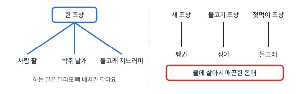

*왼쪽은 집안이 같아서, 오른쪽은 사는 곳이 같아서 닮았어요.*

**정확히 말하면**

진화의 네 번째 증거는 비교해부학적 증거예요(강의노트 표기는 비교형태학, comparative morphology). 생물의 형태를 비교하며, 공통조상에서 물려받은 같은 구성 요소의 배치가 비슷할 때 형태적으로 비슷한 두 종은 상동형질을 가진다고 해요. 그래서 상동을 판단할 때는 두 생물의 같은 대응 위치에 있는 구조를 비교해, **해부학적·형태적으로 같은 구성 요소가 같은 순서로 배치되어 있는지**를 봐요. 기능이 같은지는 판단 기준이 아니에요.

**상동(homology)**: 공통조상을 공유하기 때문에 비슷한 것이에요. 교재는 공통조상으로부터 이 형질의 유전자를 물려받았기 때문이라고 설명해요. 형질이면 상동형질, 기관이면 **상동기관**, 그런 성질은 상동성이라고 불러요.

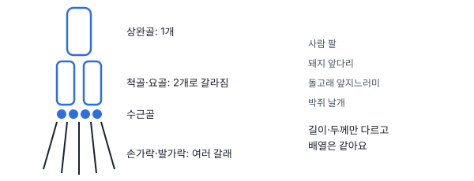

*상완골 1개, 척골·요골 2개, 수근골, 여러 갈래의 손가락 순서예요.*

수업 예: 돼지 앞다리(족발), 돌고래 앞지느러미, 박쥐 날개, 사람 팔은 걷기·헤엄치기·날기처럼 기능이 다르지만 기본 골격이 같아요. 맨 위에 **상완골**이 하나 있고, 그 밑이 척골과 요골 두 갈래로 갈라지고, 이어서 수근골, 그다음 손가락·발가락이 여러 갈래로 갈라져요. 길이나 두께는 달라도 기본 골격 구조는 똑같아요. 모두 척추동물이고 최초의 척추동물에서 갈라져 나와 공통조상을 공유하기 때문이에요.

같은 원리로 판단해요. 날개든 다리든 지느러미든, 앞다리 자리의 구조가 상완골–척골·요골–수근골–손가락 배열을 함께 가지면 기능이 달라도 상동기관이에요. 그 배열을 가진 공통조상에게서 물려받았기 때문이에요. 예를 들어 말의 앞다리와 두더지의 앞발도 이 배열을 공유한다면 상동기관으로 판단해요.

**상사(analogy)**: 계열(조상)이 달라도 환경 때문에 비슷해진 것이에요. 펭귄(조류), 상어(어류), 돌고래(포유류)는 갈래가 다른데도 물에 살다 보니 몸 전체가 헤엄치기 좋은 **유선형**이 되었어요. 직접적인 공통조상을 공유해서 닮은 것이 아니에요.

| 구분 | 닮은 이유 | 기능 | 수업 예 |
|---|---|---|---|
| 상동(homology) | 공통조상을 공유함(유전자를 물려받음) | 달라도 됨 | 사람 팔, 돼지 앞다리, 돌고래 앞지느러미, 박쥐 날개의 뼈 배열 |
| 상사(analogy) | 조상이 달라도 같은 환경 때문에 비슷해짐 | 비슷한 경우가 많음 | 펭귄·상어·돌고래의 유선형 몸 |

새 사례에 적용해 봐요. 사람 팔과 돌고래 앞지느러미는 상완골–척골·요골–수근골–손가락 배열을 함께 가지므로 상동이에요. 상어는 어류라 수업에서 이 뼈 배열을 확인한 예에 들지 않았어요. 돌고래 지느러미와 상어 지느러미가 겉모양이 닮은 것은 둘 다 물에서 헤엄치는 환경 때문이므로 상사로 판단해요.

**교수님 말씀**

교수님은 이 부분을 가장 세게 강조했어요.

> 상동 형질, 별 세 개.

> 아무리 강조해도 지나치지 않습니다. 상동.

휴대폰 비유를 들었어요. 삼성의 폴드 시리즈와 플립 시리즈는 같은 회사가 만들어서 비슷하니 상동이에요. 애플이 만들든 삼성이 만들든 접는 폰이 모두 접히는 모양인 것은 회사가 달라도 닮은 것이니 상사예요.

돼지 앞다리를 "족발 만들 때 쓰이고", 사람 팔은 "게임할 때 쓰든지"라고 기능이 다르다는 점을 웃으며 짚었어요. 마지막에는 이렇게 정리했어요.

> 조상이 달라도 유사해지면 상사, 공통 조상을 공유하고 있기 때문에 유사하면은 상동.

**꼭 기억해요**

**기능이 같으면 상동이라고 착각하기 쉬워요.** 상동과 상사를 가르는 것은 닮은 이유예요. 공통조상을 공유해서 닮았으면 상동, 조상이 다른데 환경 때문에 닮았으면 상사예요. 펭귄·상어·돌고래는 헤엄치는 기능이 같아도 상사이고, 돼지 앞다리와 박쥐 날개는 기능이 달라도 상동이에요.

**"상사형질은 공통조상으로부터 유전자를 함께 물려받았기 때문"이라는 문장은 틀려요.** 공통조상에게서 유전자를 물려받아 닮은 것은 상동의 설명이에요.

**교수님 표현과 강의노트 표현이 달라요.** 교수님은 '비교해부학'이라고 했고 강의노트는 '비교형태학'이라고 적었어요. 같은 항목이에요.

**보충 · 노트에 빠졌던 수업 내용**

강의노트 7장 p1은 비교해부학의 질문으로 "왜 쓸데없는 구조(흔적기관 등)가 존재하는가?"를 적었어요. **흔적기관**은 지금은 기능이 거의 없거나 크게 줄었지만, 조상에게서 물려받은 구조의 흔적이에요.

교재도 흔적기관이 과거 조상 시대에는 기능을 했을 것으로 설명해요. 진화로 보면 조상에게서 쓰이던 구조가 물려 내려오면서 쓰임이 줄어든 것이므로, 흔적기관은 공통조상의 증거예요.

그래서 두 종이 같은 흔적 구조를 함께 가지면, 그 구조를 공통조상에게서 물려받았다고 보아 상동성의 증거로 판단해요. 구조의 틀은 남았는데 본래 기능이 사라진 경우도 흔적기관이에요.

**흔적기관을 상사로 착각하기 쉬워요.** 상사는 조상이 다른 생물이 환경 때문에 닮는 것이에요. 흔적기관은 조상에게서 물려받은 구조가 남은 것이라 상동의 한 예예요.

출처: 강의노트 7장 p1, 교재 7장 p.140

**보충 · 수업에서 다루지 않았어요**

교재는 앞다리의 상동을 네 다리(4지)를 가진 척추동물 전체로 넓혀요. 4지 척추동물은 같은 구성 요소로 이루어진 앞다리를 가진 공통조상에서 진화했으므로, 앞다리가 상동성을 가져요. 그래서 새의 날개처럼 수업 예에 없던 4지 척추동물의 앞다리도 같은 배열을 가진 상동기관으로 봐요. 교재 그림 7.10은 돼지·돌고래·박쥐 앞다리의 상동 뼈를 같은 색으로 표시하고, 뼈 모양이 달라도 유사성이 분명하다고 설명해요.

출처: 교재 7장 p.146

**페이지 요약**

공통조상을 공유해서 닮으면 상동, 조상이 달라도 환경 때문에 닮으면 상사예요.

*용어*

- **상동(homology)** — 공통조상을 공유해(유전자를 물려받아) 비슷한 것이에요. 기능은 달라도 돼요. 형질·기관·성질에 따라 상동형질·상동기관·상동성이라 불러요.
- **앞다리 뼈 배열** — 상완골 1개, 척골·요골 2개, 수근골, 여러 갈래의 손가락 순서예요. 사람 팔·돼지 앞다리·돌고래 앞지느러미·박쥐 날개는 길이·두께만 다르고 배열이 같아요. 최초의 척추동물에서 갈라져 나왔기 때문이에요.
- **상동의 판단 기준** — 같은 대응 위치의 구조를 비교해, 공통조상에서 물려받은 같은 구성 요소의 배치가 비슷한지 봐요. 기능이 같은지는 기준이 아니에요. 날개·다리·지느러미라도 상완골–척골·요골–수근골–손가락 배열을 공유하면 상동기관이에요.
- **상사(analogy)** — 계열이 달라도 같은 환경 때문에 비슷해진 것이에요. 펭귄(조류)·상어(어류)·돌고래(포유류)의 유선형 몸. 돌고래와 상어 지느러미의 겉모양이 닮은 것도 상사예요.
- **폰 비유** — 삼성 폴드·플립 시리즈(같은 회사)는 상동, 애플과 삼성의 접는 폰(다른 회사)은 상사예요.
- **헷갈리는 문장** — "상사형질은 공통조상에게서 유전자를 물려받아서"는 틀려요. 그것은 상동이에요. 비교해부학과 비교형태학은 같은 항목이에요.

- **(보충) 흔적기관** — 지금은 기능이 거의 없지만 조상에게서 물려받은 구조의 흔적이에요(강의노트 p1). 조상 시대에는 기능을 했던 구조라 공통조상의 증거이자 상동의 한 예이고, 두 종이 같은 흔적 구조를 가지면 상동성의 증거예요. 틀만 남고 기능이 사라진 구조도 흔적기관이에요. 환경 때문에 다른 조상끼리 닮는 상사와 구별해요.

- **(보충) 4지 척추동물의 앞다리** — 교재는 4지 척추동물이 같은 구성 요소의 앞다리를 가진 공통조상에서 진화해 앞다리가 상동성을 가진다고 설명해요. 새의 날개처럼 수업 예에 없던 앞다리도 상동기관이에요.

---

### 비교발생학과 비교분자생물학

*1027 수업 · 7장 p3*

**쉽게 말하면**

갈라진 지 오래된 친척일수록 몸속 설명서의 글자가 더 많이 달라져 있어요.

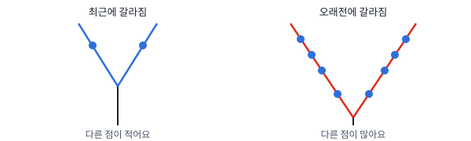

*색칠된 점은 갈라진 뒤 각자 따로 생긴 바뀐 글자예요.*

**정확히 말하면**

**비교발생학**적 증거: 인간(포유류)과 상어(어류)는 모두 척추동물이고, 척추동물은 척삭동물(chordates)이라는 더 큰 무리에 속해요. 척삭동물은 어린 **배아** 단계에서 반드시 **척삭**(notochord)이라는 구조를 가져요. 척삭은 유연한 기둥이에요. 사람도 배아 단계에서는 척삭을 가지며, 자라면서 척삭이 척추 디스크(원반)로 줄어들어요. 어류·양서류·파충류·조류·포유류의 배아를 비교하면 큰 차이가 없어요. 모두 척삭동물이라 적어도 배아 단계에서 기관을 만드는 구조가 비슷하다는 점이 공통조상의 증거예요.

**비교분자생물학**적 증거: DNA 염기서열과 단백질의 **아미노산 서열**을 비교해요. 최근에 분기했을수록 서열이 비슷해요. 수업에서는 사람의 **사이토크롬 c**(cytochrome c) 단백질과 다른 종의 것을 비교했어요.

| 사람과 비교한 종 | 침팬지 | 붉은털원숭이 | 개 | 거북 | 효모 |
|---|---|---|---|---|---|
| 사이토크롬 c 아미노산 차이 수 | 0 | 1 | 13 | 21 | 56 |

표의 수는 수업에서 교수님이 말한 값이에요. 교재 그림 7.12(p.147)는 거북 31이에요. 문제에 표가 주어지면 그 표의 수를 그대로 읽어 순서를 판단해요.

왜 오래전에 갈라질수록 차이가 커지는지는 다음 순서로 이어져요.

1. 한 조상 무리가 두 종으로 갈라져요(분기).
2. 다른 종이 되면 서로 교배하지 않아 유전자를 교환하지 않아요.
3. 그래서 각 종에서 따로 생긴 돌연변이가 상대에게 전해지지 않고 각자 쌓여요.
4. 시간이 갈수록 쌓인 돌연변이가 많아지므로, 분기한 시점이 오래될수록 서열 차이가 커요.

사람과 효모가 갈라진 시점은 사람과 개가 갈라진 시점보다 훨씬 오래되었고, 사람과 개가 갈라진 시점은 사람과 침팬지가 갈라진 시점보다 훨씬 오래되었어요. 표의 차이 수가 이 순서와 맞아요.

읽는 방향은 "차이가 적다, 최근에 갈라졌다, 공통조상이 더 최근이다"예요. 예를 들어 개와 고양이의 DNA가 고양이와 햄스터의 DNA보다 더 비슷하면, 고양이와 개의 공통조상이 고양이와 햄스터의 공통조상보다 더 최근이라는 뜻이에요. 한쪽이 다른 쪽에서 나왔다는 뜻도, 같은 환경에 살아서 비슷해졌다는 뜻도 아니에요. 가상의 예로 어떤 단백질의 차이가 사람과 A 사이 3개, B 사이 15개, C 사이 40개라면, 사람과 가장 최근에 갈라진 것은 A, 가장 오래전에 갈라진 것은 C예요.

여섯 증거는 비교하거나 관찰하는 대상이 각각 달라요.

| 증거 | 무엇을 보나 | 수업 예 |
|---|---|---|
| 자연선택에 의한 적응 | 짧은 기간 동안 집단의 형질 비율이 바뀌는 것 | DDT 내성 모기, 항생제 내성 세균([증거 토픽](#s2-evidence)) |
| 화석 기록 | 과거 생물의 형태와 중간 형질 | 시조새 |
| 생물지리학 | 지역별로 사는 생물의 분포와 닮음 | 남미 생물, 갈라파고스 핀치 |
| 비교해부학(비교형태학) | 성체 몸 구조의 배치 | 앞다리 뼈의 상동, 유선형의 상사([상동과 상사](#s2-homology)) |
| 비교발생학 | 배아 단계의 구조 | 척삭동물 배아의 척삭 |
| 비교분자생물학 | DNA 염기서열, 단백질 아미노산 서열 | 사이토크롬 c 아미노산 차이 |

**교수님 말씀**

척삭은 어렵게 생각하지 말라며 "그냥 유연한 기둥"이라고 했어요. 사람에게는 척추 디스크로 줄어들어 남는다고 설명했어요.

종이 갈라진 뒤 차이가 쌓이는 이유를 이렇게 말했어요.

> 너는 너고 나는 나다. 너는 너대로 돌연변이, 나는 나대로 돌연변이

사이토크롬 c는 사람과 침팬지가 "차이가 없어요, 그냥. 똑같애요"라고 했고, 붉은털원숭이 1개, 개 13개, 거북 21개, 효모 56개 차이라고 말했어요.

**페이지 요약**

배아의 척삭과 아미노산 서열의 차이는 공통조상을 보여 주고, 오래전에 갈라질수록 서열 차이가 커요.

*용어*

- **비교발생학** — 배아 단계를 비교해요. 척추동물은 척삭동물에 속하고, 척삭동물 배아는 반드시 척삭을 가져요. 어류~포유류의 배아는 큰 차이가 없어요.
- **척삭(notochord)** — 배아의 유연한 기둥이에요. 사람에게서는 자라며 척추 디스크(원반)로 줄어들어요.
- **비교분자생물학** — DNA 염기서열과 단백질 아미노산 서열을 비교해요. 최근에 분기했을수록 비슷해요.
- **사이토크롬 c 차이** — 사람 기준 침팬지 0, 붉은털원숭이 1, 개 13, 거북 21(교수님 수치, 교재 그림 7.12는 31), 효모 56이에요.
- **차이가 쌓이는 이유** — 종이 갈라지면 교배·유전자 교환이 없어 각자 돌연변이가 쌓여요. 그래서 분기가 오래될수록 차이가 커요.
- **읽는 방향** — 차이가 적을수록 최근에 갈라졌고 공통조상이 더 최근이에요. 개·고양이 DNA가 고양이·햄스터보다 비슷하면 고양이·개의 공통조상이 더 최근이에요. 한쪽이 다른 쪽에서 나왔다거나 같은 환경 때문이라는 뜻이 아니에요.
- **증거별 비교 대상** — 적응은 짧은 기간의 집단 형질 비율, 화석은 과거 형태, 생물지리학은 지역 분포, 비교해부학은 성체 구조 배치, 비교발생학은 배아 구조, 비교분자생물학은 서열을 봐요.

---

## 3. 소진화: 개체군의 변이와 하디-바인베르크

### 개체군 안의 변이와 그 원천

*1027 수업 · 7장 p3 · 7장 p4*

**쉽게 말하면**

같은 달팽이 무리 안에서도 껍데기 색과 무늬가 저마다 조금씩 달라요.

*위 줄은 차이가 많고, 아래 줄은 두 가지뿐이라 차이가 적어요.*

**정확히 말하면**

**변이(variation)**는 한 개체군 안의 개체들이 조금씩 다른 것이에요. 정원달팽이는 껍데기 색이 다양해서 변이의 폭이 넓어요. 바하마 육지달팽이는 껍데기가 오른쪽 또는 왼쪽으로 꼬이는 두 가지뿐이라 변이의 폭이 좁아요.

| 구분 | 모양 | 예 | 강의노트 표기 |
|---|---|---|---|
| **정성적 변이** | 몇 가지 종류로 딱 나뉘어요(불연속) | 혈액형 A형·B형, 색이 빨강·노랑 | 다형성(polymorphism): 두 개 이상의 불연속적인 형질 |
| **양적 변이** | 값이 이어져서 단계가 끊기지 않아요(연속) | 키(cm), 몸무게(kg) | 정량적 변이: 개체 사이의 점진적인 변이(사람의 키) |

**변이가 생기는 이유**는 색 같은 형질을 정하는 **대립유전자(allele)**가 여러 종류이기 때문이에요. 그 대립유전자들은 처음부터 있던 것이 아니에요.

1. **돌연변이(mutation)**: DNA가 바뀌어 *새로운* 대립유전자가 생겨요. 한 개체군에 새롭고 독특한 대립유전자가 생기는 주된 원인이 돌연변이예요.
2. **염색체 구조 변화와 수 변화**: 염색체가 크게 바뀌어 유전 정보의 배치가 달라져요.
3. **감수분열 때의 교차(crossing over)**: 상동염색체가 조각을 맞바꿔 이미 있던 대립유전자를 새로운 조합으로 섞어요([교차와 재조합 이전 노트](../../0922/정리노트_0922_Cell_Division_and_Heredity.html#s3-crossover)).

교수님은 그 밖에 유성생식의 유전적 다양성 세 가지 기작(교차, 독립 분배, 무작위 수정 — 뒤의 둘은 강의노트 7장 p4 표기로, 비상동염색체의 독립적인 분배와 정자·난자의 무작위 수정)도 있다고 했어요. 세 기작 모두 이미 있는 대립유전자를 새 조합으로 섞는 쪽이에요([교차와 재조합 이전 노트](../../0922/정리노트_0922_Cell_Division_and_Heredity.html#s3-crossover)).

원인을 고를 때의 기준은 "새 대립유전자를 *만드는가*, 이미 있는 것을 *섞거나 고르는가*"예요. 교차·재조합은 있는 대립유전자를 섞을 뿐이에요. 인위선택은 사람이 이미 있는 변이 가운데 고를 뿐이에요. 대진화는 종 수준 이상의 변화라서 새 대립유전자의 원인이 아니라 오랜 변화의 결과 쪽이에요. 획득형질은 살면서 얻은 형질이 자손에게 전해진다는 라마르크의 생각이고, DNA에 새 대립유전자를 만드는 과정이 아니에요.

**교수님 말씀**

달팽이 사진 두 장으로 변이의 폭을 비교했어요. 꼬임 방향이 두 가지뿐인 바하마 육지달팽이는 폭이 좁고, 색이 제각각인 정원달팽이는 폭이 넓다고 했어요.

> 그 대립유전자가 원래 처음부터 존재했겠느냐, 그건 아닐 거다. 돌연변이 때문에 생긴 거다.

정성적 변이와 양적 변이는 유전학 시간에 이미 했다고 하며 혈액형과 키·몸무게 예만 짚고 넘어갔어요.

**꼭 기억해요**

- **정성적 변이 ↔ 양적 변이**: 혈액형·색처럼 종류로 나뉘면 정성적 변이, 키·몸무게처럼 값이 이어지면 양적 변이예요. 강의노트는 양적 변이를 '정량적 변이', 불연속 형질을 '다형성'으로 적어요. 이름이 달라도 연속인지 불연속인지로 판별해요.
- **새로 만들기 ↔ 섞기**: 새 대립유전자를 만드는 것은 돌연변이예요. 교차는 있던 대립유전자의 조합만 바꿔요.

**페이지 요약**

개체군 안 개체들의 차이가 변이이고, 새 대립유전자는 돌연변이로 생겨요.

*용어*

- **변이(variation)** — 한 개체군 안 개체들이 조금씩 다른 것이에요. 정원달팽이 색은 폭이 넓고, 바하마 육지달팽이 꼬임 방향(두 가지)은 폭이 좁아요.
- **정성적 변이** — 혈액형·색처럼 불연속으로 나뉘는 변이예요. 강의노트의 '다형성'에 해당해요.
- **양적 변이** — 키·몸무게처럼 값이 연속인 변이예요. 강의노트의 '정량적 변이'예요.
- **돌연변이(mutation)** — 새롭고 독특한 대립유전자가 생기는 주된 원인이에요. 대진화·인위선택·획득형질은 새 대립유전자를 만들지 않아요.
- **교차와 염색체 변화** — 염색체 구조·수 변화와 감수분열 때의 교차도 변이를 늘려요. 교차는 이미 있는 대립유전자를 새 조합으로 섞을 뿐이에요. 독립 분배·무작위 수정(강의노트)도 이미 있는 대립유전자를 섞는 기작이에요.

---

### 유전자형 빈도와 대립유전자 빈도

*1027 수업 · 7장 p4*

**쉽게 말하면**

꽃 한 송이는 색 구슬을 두 개씩 들고 있어서, 꽃 1,000송이면 구슬은 2,000개예요.

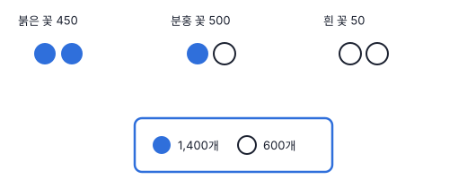

*색칠된 구슬이 2,000개 중 1,400개라서 열 개 중 일곱 개꼴이에요.*

**정확히 말하면**

개체군 유전학(population genetics)에서 알아야 할 개념은 두 가지예요.

- **유전자형 빈도(genotype frequency)**: 집단에서 그 유전자형(AA, Aa, aa 같은)을 가진 *개체*의 비율이에요. 분모는 개체 수예요.
- **대립유전자 빈도(allele frequency)**: 집단이 가진 그 유전자의 대립유전자 *전체 개수* 중에서 한 대립유전자가 차지하는 비율이에요. 분모는 대립유전자 총수예요.

**표현형**은 꽃 색처럼 겉으로 드러나는 형질이고, 유전자형은 어떤 대립유전자를 가졌는지예요. 교수님 예는 금어초 같은 **불완전우성** 꽃이라 $C^R C^R$은 붉은색, $C^R C^W$은 분홍색, $C^W C^W$은 흰색이에요([불완전우성 이전 노트](../../0929/정리노트_0929_Heredity.html#s1-incomplete)). 세 유전자형이 세 표현형으로 따로 보여서 꽃 색만 보고 유전자형별 개체 수를 셀 수 있어요.

| 유전자형(표현형) | 개체 수 | 유전자형 빈도 | $C^R$ 개수 | $C^W$ 개수 |
|---|---|---|---|---|
| $C^R C^R$ (붉은색) | 450 | 0.45 | 2 × 450 = 900 | 0 |
| $C^R C^W$ (분홍색) | 500 | 0.50 | 500 | 500 |
| $C^W C^W$ (흰색) | 50 | 0.05 | 0 | 2 × 50 = 100 |
| 합 | 1,000 | 1 | 1,400 | 600 |

1. **대립유전자 총수**: 한 개체는 상동염색체에 대립유전자를 두 개 가져요. 그래서 1,000개체 × 2 = 2,000개예요.
2. **$C^R$ 세기**: $C^R C^R$은 두 개씩, $C^R C^W$은 한 개씩 가져요. 2 × 450 + 500 = 1,400개예요.
3. **비율**: 2,000개 중 1,400개이므로 p = 0.7이에요. $C^W$은 2 × 50 + 500 = 600개, 600/2,000 = 0.3 = q예요. $p + q = 1$이에요.

개체 수 대신 유전자형 빈도만 주어져도 같은 값이 나와요. 동형접합은 그 대립유전자를 두 개, 이형접합은 한 개 가지므로 다음처럼 구해요.

$$
p = (AA\ \text{빈도}) + \tfrac{1}{2}(Aa\ \text{빈도})
$$

교수님 예에 넣으면 0.45 + 0.50 ÷ 2 = 0.7이에요. 다른 수치가 나와도 "대립유전자는 개체당 두 개"만 지키면 같은 방법으로 풀려요.

원래는 우성 대립유전자 빈도를 p, 열성 대립유전자 빈도를 q로 써요. 이 꽃은 불완전우성이라 우열이 없으므로 편의상 하나를 p, 다른 하나를 q로 놓았어요.

**교수님 말씀**

> 엄청 중요한 거는 개체군 유전학인데

> 이제부터 아주 중요해집니다. 하디-바인베르크 원리를 이해를 하고 적용시킬 수 있는 것이 목적입니다.

> 하디-바인베르크 원리는 무조건 나옵니다, 시험에.

대립유전자 총수를 학생들에게 "총 몇 개예요?"라고 되물은 뒤, 한 개체가 두 개씩 가지니 2,000개라고 짚었어요. 계산 자체는 더하기·나누기라 쉽다고 하면서 이렇게 덧붙였어요.

> 이게 기본이고 이제부터 얘기가 진짜 진행됩니다.

**꼭 기억해요**

- **유전자형 빈도 ↔ 대립유전자 빈도**: 유전자형 빈도는 그 *유전자형*을 가진 개체의 비율이에요(분모 1,000개체). 대립유전자 빈도는 대립유전자 개수의 비율이에요(분모 2,000개). 수업 중 유전자형 빈도를 "그 대립유전자를 가진 개체의 비율"처럼 말한 대목이 있었는데, 바른 뜻은 유전자형을 가진 개체의 비율이에요.
- **표현형 ↔ 유전자형**: 꽃 색은 표현형, $C^R C^W$ 같은 조합은 유전자형이에요.
- **대립유전자 총수**: 개체 수(1,000)로 나누면 틀려요. 개체 수 × 2(2,000)로 나눠요.
- **p와 q 정하기**: 불완전우성처럼 우열이 없으면 어느 쪽을 p로 놓아도 돼요. 편의상 정한 이름일 뿐이에요.

**페이지 요약**

유전자형 빈도는 개체의 비율, 대립유전자 빈도는 대립유전자 개수(개체 수 × 2)의 비율이에요.

*핵심 식*

- 대립유전자 빈도

  $$
  p = \frac{2 \times (AA\ \text{수}) + (Aa\ \text{수})}{2 \times \text{개체 수}}
  $$
- 빈도로 구하기

  $$
  p = (AA\ \text{빈도}) + \tfrac{1}{2}(Aa\ \text{빈도}), \quad p + q = 1
  $$

*용어*

- **유전자형 빈도(genotype frequency)** — 집단에서 그 유전자형을 가진 개체의 비율이에요. 예: 1,000개체 중 $C^R C^R$ 450이면 0.45예요.
- **대립유전자 빈도(allele frequency)** — 대립유전자 전체 개수 중 한 대립유전자의 비율이에요. 예: 2,000개 중 $C^R$ 1,400개라 p = 0.7, $C^W$ 600개라 q = 0.3이에요.
- **표현형 ↔ 유전자형** — 표현형은 겉으로 드러나는 형질(꽃 색), 유전자형은 가진 대립유전자 조합이에요. 불완전우성 꽃은 세 유전자형이 세 색으로 보여요.
- **p와 q** — 보통 우성을 p, 열성을 q로 써요. 우열이 없는 불완전우성에서는 편의상 정해요.

---

### 하디-바인베르크 원리와 유전적 평형

*1027 수업 · 7장 p4*

**쉽게 말하면**

빨간 공 7개, 흰 공 3개가 섞인 상자에서 공 두 개를 뽑는 것과 같아요.

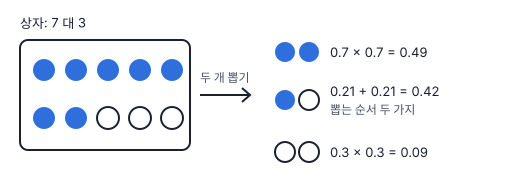

*색칠된 공은 빨간 공, 테두리만 있는 공은 흰 공이에요. 상자 속 비율이 그대로면 몇 번을 다시 뽑아도 결과 비율이 같아요.*

**정확히 말하면**

**왜 이런 계산을 하나요?** [유전자형 빈도와 대립유전자 빈도](#s3-frequency)는 지금 세대를 세면 바로 나와요. 진짜 문제는 이 개체군이 교배해 낳은 *다음 세대*의 빈도예요. 개체군 유전학이 묻는 질문은 "미래 세대에서 특정 유전자형의 빈도가 어떻게 될까"예요. 아무 조건 없이는 누가 죽고 누가 들어올지 몰라 다음 세대를 절대로 알 수 없어요.

**다섯 가지 조건**을 주면 확률로 계산할 수 있어요. 이것이 **하디-바인베르크 원리(Hardy–Weinberg principle)**예요. 하디는 수학자, 바인베르크는 의사였어요.

1. **돌연변이 없음**: 빨간 꽃이 갑자기 파랗게 되는 일이 없어요.
2. **이동 없음**(강의노트: 다른 개체군으로부터의 유입 없음): 옆 집단에서 꽃이 날아오거나 옆으로 나가지 않는 폐쇄된 집단이에요.
3. **개체군 크기가 무한함**: 왜 필요한지는 교수님이 복잡하다며 다음 수업에서 다룬다고 미뤘어요.
4. **자연선택 없음**: 모든 유전자형이 똑같이 생존하고 번식해요(교수님은 "똑같이 생존"으로, 강의노트는 "생존하고 번식"으로 적어요).
5. **무작위 교배**: 유전자형과 상관없이 아무렇게나 짝을 지어요.

**확률 모델로 바뀌는 원리**: 자손이 대립유전자 두 개를 물려받는 일은 개체군 전체의 대립유전자가 든 **상자**에서 공 두 개를 무작위로 뽑는 일과 같아요. 다섯 조건이 있어야 상자 속 공의 비율이 p : q로 고정되고(바뀌거나 들어오거나 빠지지 않음), 뽑기가 무작위가 돼요. p = 0.7, q = 0.3이면 다음 세대는 이렇게 돼요.

- $C^R C^R$ (붉은색) = $p^2$ = 0.7 × 0.7 = 0.49
- $C^R C^W$ (분홍색) = $pq + qp$ = 2pq = 2 × 0.7 × 0.3 = 0.42. 빨강을 먼저 뽑든 나중에 뽑든 분홍이 되므로 뽑는 순서 두 가지를 더해 2가 붙어요.
- $C^W C^W$ (흰색) = $q^2$ = 0.3 × 0.3 = 0.09

$$
p^2 + 2pq + q^2 = (p + q)^2 = 1
$$

1,000개체로 바꾸면 붉은색 490, 분홍색 420, 흰색 90개체예요.

**첫 세대가 평형이 아니어도 돼요.** 교수님 예의 1세대 유전자형 빈도는 0.45, 0.50, 0.05로 $p^2$, 2pq, $q^2$ 모양이 아니었어요. 그래도 다음 세대는 대립유전자 빈도(p = 0.7)만으로 0.49, 0.42, 0.09가 됐어요. 그래서 유전자형 빈도가 주어지면 그 값을 그대로 다음 세대 답으로 쓰지 말고, 먼저 p = (AA 빈도) + (Aa 빈도)의 절반으로 p와 q를 구한 뒤 $p^2$, 2pq, $q^2$를 계산해요. 대립유전자 빈도를 유전자형 빈도 자리에 그대로 옮겨 쓰는 것(Aa를 0으로 두는 식)도 틀린 방법이에요.

**다음 세대의 p, q는 다시 셀 필요가 없어요.** 490, 420, 90으로 다시 세어도 p = (2 × 490 + 420) / 2,000 = 0.7이 나와요. 상자 속 공은 열 번을 뽑든 백만 번을 뽑든 비율이 변하지 않기 때문이에요. p, q가 그대로면 $p^2$, 2pq, $q^2$도 그대로라 3세대, 4세대, 6세대도 0.49, 0.42, 0.09이고 p = 0.7, q = 0.3이에요.

이렇게 다섯 조건이 유지되는 한 대립유전자 빈도와 유전자형 빈도가 세대가 지나도 변하지 않는 상태를 **유전적 평형(genetic equilibrium)**, 곧 하디-바인베르크 평형이라고 해요. 이 평형이 왜 중요한지는 [영가설: 평형이 깨지면 소진화](#s3-null)에서 이어져요.

#### 직접 해 보기: 대립유전자 빈도와 다음 세대 *(정적 스냅샷 — 직접 조작은 HTML 버전)*

p 슬라이더를 움직이면 q와 다음 세대 유전자형 빈도 막대가 바뀌고, 세대 슬라이더를 움직여도 다섯 조건이 유지되면 값이 그대로예요.

이 모형에서는 **자손 1세대: p = 0.70, q = 0.30, AA 0.49 · Aa 0.42 · aa 0.09 (1세대와 같아요)**

범례: p: 색칠된 막대, 오른쪽 선과 색칠된 점 · q: 테두리 막대, 오른쪽 선과 테두리 점 · AA·Aa·aa: 강조색 테두리 막대(p², 2pq, q²)

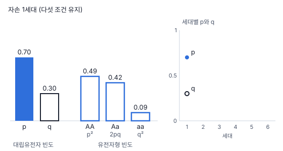

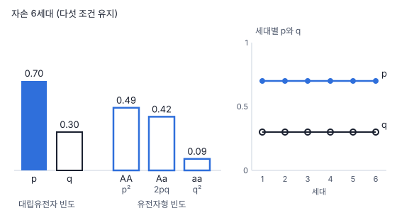

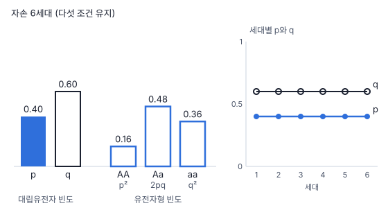

| 설정 | q | AA (p²) | Aa (2pq) | aa (q²) |
|---|---|---|---|---|
| p = 0.70, 자손 1세대 | 0.30 | 0.49 | 0.42 | 0.09 |
| p = 0.70, 자손 6세대 | 0.30 | 0.49 | 0.42 | 0.09 |
| p = 0.40, 자손 6세대 | 0.60 | 0.16 | 0.48 | 0.36 |

**교수님 말씀**

> 한 번만 제대로 들으세요.

다음 세대를 묻고는 조건 없이는 "절대로 알 수가 없죠"라고 한 뒤 다섯 조건을 하나씩 꽃 예로 풀었어요. 그리고 물려받기를 공 뽑기로 바꿨어요.

> 빨간 공, 흰 공이 7 대 3으로 섞여 있는 상자에서 공을 두 개를 뽑는 확률하고 똑같은 거예요.

두 번째 세대의 대립유전자 빈도를 되물은 뒤, 상자 속 공의 비율은 변하지 않으니 다시 구할 필요가 없다고 했어요. 여섯 번째 세대까지 "죽을 때까지 그대로 갑니다"라고 강조했어요.

**꼭 기억해요**

- **2pq의 2**: 분홍은 빨강-흰, 흰-빨강 두 순서로 뽑혀요. pq 하나만 쓰면 0.21로 절반이 돼요.
- **다음 세대 p, q를 다시 계산해야 하나**: 다섯 조건이 유지되면 다시 구하지 않아도 p, q는 그대로예요. 다시 세어도 같은 값이 나와요.
- **첫 세대 빈도를 그대로 다음 세대 답으로 쓰는 실수**: 첫 세대가 평형이 아니면 한 세대 무작위 교배 뒤 $p^2$, 2pq, $q^2$로 바뀌어요. p부터 구해요.
- **조건 표현이 달라도 같은 조건**: '이동 없음' = '다른 개체군으로부터의 유입 없음', '모든 유전자형이 똑같이 생존' = '자연선택 없음(똑같이 생존하고 번식)'이에요. 반대로 "자연선택이 존재한다", "개체가 이웃 개체군과 드나든다"는 조건이 아니라 조건이 깨진 상황이에요.
- **개체군 유전학이 묻는 것**: 한 개체군의 미래 세대에서 유전자형 빈도와 대립유전자 빈도가 어떻게 될지예요. 예를 들어 "지금 이 꽃밭에 흰 꽃이 몇 송이인가"는 현재를 세는 일이고, "몇 세대 뒤 흰 꽃 비율은 얼마일까"가 이 원리로 답하는 질문이에요.
- **평형에서 변하지 않는 것**: 강의 중 "대립유전자 빈도 또는 유전자의 빈도"라고 들린 부분은 대립유전자 빈도와 *유전자형* 빈도가 변하지 않는다는 뜻이에요.

**페이지 요약**

다섯 조건이 있으면 다음 세대는 공 뽑기 확률로 p², 2pq, q²가 되고, p와 q는 세대가 지나도 그대로예요(유전적 평형).

*핵심 식*

- 다음 세대 유전자형 빈도

  $$
  p^2 + 2pq + q^2 = (p + q)^2 = 1
  $$
- 교수님 예(p = 0.7)

  $$
  0.49 + 0.42 + 0.09 = 1
  $$

*용어*

- **하디-바인베르크 원리(Hardy–Weinberg principle)** — 조건 없이는 알 수 없는 다음 세대 빈도를, 다섯 조건을 두고 확률로 계산하는 모델이에요. 개체군 유전학의 질문은 미래 세대에서 특정 유전자형의 빈도가 어떻게 될까예요.
- **다섯 조건** — 돌연변이 없음, 이동(다른 개체군으로부터의 유입) 없음, 개체군 크기 무한, 자연선택 없음(모든 유전자형이 똑같이 생존·번식), 무작위 교배예요. "자연선택이 존재한다"는 조건이 아니에요. 크기가 무한해야 하는 이유는 다음 수업에서 다뤄요.
- **상자 모델과 2pq** — 물려받기는 7 대 3 상자에서 공 두 개 뽑기와 같아요. 분홍(이형접합)은 뽑는 순서가 두 가지라 2pq예요.
- **첫 세대가 평형이 아닐 때** — 유전자형 빈도에서 p = AA 빈도 + Aa 빈도의 절반을 먼저 구해요. 한 세대 무작위 교배 뒤 p², 2pq, q²가 돼요(0.45·0.50·0.05 → 0.49·0.42·0.09).
- **유전적 평형(genetic equilibrium)** — 다섯 조건이 유지되는 한 대립유전자 빈도와 유전자형 빈도가 세대마다 변하지 않는 상태예요. 다음 세대 p, q는 다시 셀 필요가 없어요.

---

### 영가설: 평형이 깨지면 소진화

*1027 수업 · 7장 p4*

**쉽게 말하면**

아무 일도 없으면 비율이 그대로라는 기준선을 먼저 그어 두는 거예요.

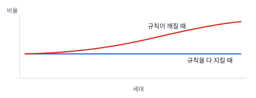

*진짜 자연에서는 규칙이 깨져서 선이 기준선을 벗어나요.*

**정확히 말하면**

**"이 계산을 왜 했을까?"** [하디-바인베르크 원리와 유전적 평형](#s3-hardy-weinberg)에서 본 평형은 **진화가 일어나지 않는 조건**이에요. 그래서 하디-바인베르크 평형을 **영가설(null hypothesis)**, 곧 "아무 변화도 없다면 이렇게 된다"는 비교 기준으로 써요.

실제 **자연계**에서는 다섯 조건이 하나도 맞지 않아요.

| 평형의 조건 | 자연계의 실제 |
|---|---|
| 돌연변이 없음 | 돌연변이는 늘 일어나요 |
| 이동 없음 | 개체의 이동이 있어요 |
| 개체군 크기 무한 | 개체군 크기는 무한할 수 없어요 |
| 자연선택 없음 | 자연선택을 받아요 |
| 무작위 교배 | 무작위가 아니라 골라서 교배해요 |

1. 다섯 조건 중 **하나라도** 깨지면 평형이 깨져요.
2. 평형이 깨진다는 것은 대립유전자 빈도와 유전자형 빈도가 세대에 따라 변한다는 뜻이에요.
3. 개체군 안의 이 빈도 변화가 바로 **소진화**예요. 그래서 하디-바인베르크 원리는 자연계에서 소진화가 반드시 일어난다는 것을 보여 줘요.

**자연선택과의 관계**: 자연선택은 평형을 깨는 원인 가운데 하나예요(조건 "자연선택 없음"이 깨짐). 유전자형마다 생존·번식이 다르면 다음 세대로 가는 대립유전자 비율이 달라지므로, 한 개체군에서 자연선택의 가장 직접적인 결과는 **어떤 대립유전자의 빈도가 변하는 것**이에요. 항생제를 칠수록 내성 세균만 분열해 자손을 남겨 내성 비율이 늘어나는 것이 그 예예요. 새 대립유전자는 돌연변이가 만들고, 자연선택은 이미 있는 대립유전자의 비율을 바꿔요. 세균 한 마리가 점점 강해지는 것이 아니라 개체군 안 내성 세균의 비율이 바뀌는 것이에요.

**가상의 예**: 평형이던 섬의 새 개체군에 이웃 섬 개체가 해마다 날아와 정착해 새 대립유전자를 들여온다고 해 봐요. "이동 없음" 조건이 깨졌으니 하디-바인베르크 식으로 계산한 다음 세대 빈도가 실제와 달라질 수 있어요. 실제로 대립유전자 빈도가 바뀌었다면 소진화가 일어난 것이에요.

**교수님 말씀**

> 이딴 걸 왜 했는데?

평형 계산을 마친 직후 이렇게 스스로 묻고, 이것이 진화가 일어나지 않는 조건, 곧 영가설이라고 답했어요. 이어 다섯 조건이 자연계에서 하나씩 깨지는 모습을 차례로 짚고 이렇게 마무리했어요.

> 실제 자연계에서는 무조건 소진화가 일어나게 된다라는 걸 얘기해 주는 게 하디-바인베르크 원리입니다.

**꼭 기억해요**

- **평형 ↔ 평형이 깨짐**: 평형은 빈도 불변 = 진화 없음(영가설)이에요. 평형이 깨져 빈도가 변하는 것이 소진화예요. "평형 상태라서 소진화가 활발하다"는 거꾸로 된 말이에요.
- **빈도 변화 = 소진화, 자연선택은 원인 중 하나**: 수업 끝에 "그게 바로 자연선택"이라고 들린 말은 평형이 깨지는 것이 곧 자연선택이라는 뜻이 아니에요. 빈도 변화가 소진화이고, 자연선택은 돌연변이·이동 같은 다른 조건 위배와 함께 그 원인 가운데 하나예요.
- **자연선택의 직접 결과**: 대립유전자 빈도의 변화예요. 새 대립유전자를 만드는 것은 돌연변이예요.
- **"하나라도"**: 다섯 조건이 모두 깨져야 평형이 깨지는 것이 아니에요. 하나만 깨져도 빈도가 바뀔 수 있어요.

**페이지 요약**

하디-바인베르크 평형은 진화가 없을 때의 기준(영가설)이고, 조건이 하나라도 깨져 빈도가 변하면 소진화예요.

*용어*

- **영가설(null hypothesis)** — 하디-바인베르크 평형은 진화가 일어나지 않는 조건이라, 실제 빈도와 비교하는 기준이 돼요.
- **자연계의 실제** — 돌연변이·이동이 있고, 크기가 유한하고, 자연선택을 받고, 골라서 교배해요. 다섯 조건이 하나도 맞지 않아요.
- **평형이 깨짐 = 소진화** — 조건이 하나라도 깨지면 대립유전자 빈도와 유전자형 빈도가 변하고, 이 개체군 안 빈도 변화가 소진화예요. 그래서 자연계에서는 소진화가 반드시 일어나요.
- **자연선택의 직접 결과** — 어떤 대립유전자의 빈도가 변해요(예: 항생제 내성 세균 비율 증가). 자연선택은 원인 중 하나이지 소진화 자체와 같은 말이 아니고, 새 대립유전자는 돌연변이가 만들어요.
- **조건 위배 예** — 이웃 섬 개체가 날아와 정착하면 이동 없음 조건이 깨져, 계산한 예측과 실제가 달라질 수 있어요. 빈도가 바뀌면 소진화예요.

---

## 4. 요약 · 예고

### 시험 직전 한 줄

*1027 수업 · 7장 p1–4*

| 주제 | 시험 직전 한 줄 |
|---|---|
| [자연의 사다리](#s0-ladder) | 아리스토텔레스는 무기물(무생물)·식물·동물·인간·신을 사다리처럼 순서 지었고, 이 생물관에서는 신이 만든 종이 변하지도, 사라지지도, 새로 생기지도 않아요. |
| [격변설](#s0-geology) | 퀴비에가 화석(멸종한 생물)을 설명하려고, 지진·대홍수 같은 천재지변으로 지질이 갑자기 바뀌어 많은 종이 멸종했다고 본 이론이에요. |
| [점진주의 vs 동일과정설](#s0-geology) | 점진주의(휴튼은 보충, 수업 외: 강의노트 p1)는 지층이 오랜 시간 퇴적·침식으로 서서히 만들어진다고 보고, 동일과정설(라이엘)은 그 지질 과정이 과거와 현재에 같다고 봐요. |
| [라마르크](#s0-lamarck) | 용불용설(쓰는 기관은 발달, 안 쓰면 약해짐)과 획득형질의 유전(살면서 얻은 형질이 자식에게 전달)은 일반적으로 틀렸지만, 서열은 그대로인 채 DNA 메틸화·히스톤 아세틸화로 바뀐 발현이 유전될 수 있는 후성유전 관점에서는 100% 틀린 것은 아니에요. 종이 변한다는 생각을 처음 제안한 것은 기여로 인정받아요. |
| [비글호·갈라파고스 핀치](#s1-beagle) | 같은 지역의 생물끼리 닮고(남미 뉴트리아는 생태가 비슷한 유럽 비버가 아니라 남미 설치류와 닮음), 핀치는 같은(유사한) 종인데 섬마다 부리 모양만 달라 육지에서 온 한 종이 섬 환경에 맞게 적응했다고 추론했어요. |
| [인위선택 vs 자연선택](#s1-influences) | 고르는 주체가 사람이면(원하는 형질끼리 교배, 개 품종) 인위선택, 환경이면 자연선택이에요. 둘 다 이미 있는 유전되는 변이 가운데 고르는 것이라 원리는 같아요. 주체는 다르지만 인위선택은 자연선택 이론에 큰 영향을 줬어요. |
| [맬서스](#s1-influences) | 인구는 2의 n승처럼 늘 수 있지만 자원 제한 때문에 무한히 늘지 못하고 경쟁이 생긴다는 인구론을, 다윈이 자연계의 생물에 적용했어요. |
| [자연선택 논리](#s1-natural-selection) | (1) 자손을 많이 낳고 (2) 자원이 제한되어 경쟁하며 (3) 개체 사이에 유전되는 변이가 있을 때 (4) 생존과 번식 둘 다에 유리한 형질을 가진 개체가 자손을 더 남겨 (5) 다음 세대 개체군의 유전적 조성이 바뀌어요. 바뀌는 단위는 개체가 아니라 개체군(같은 지역의 같은 종 개체들의 모임)이에요. |
| [변형 혈통·계통수](#s1-tree) | 공통조상에서 조금씩 변하며 갈라진다는 생각(descent with modification)을 나무로 그린 것이에요. 갈림점은 공통조상, 끊긴 가지는 멸종한 종, 가지 끝은 현존하는 종이에요. |
| [다윈 이론의 차별성](#s1-tree) | 수업에서는 (1) 생물 다양성의 기원을 순수하게 물리적으로 설명하고 (2) 진화적 변화가 개체가 아니라 개체군 수준에서 일어난다는 두 가지를 말했어요. 보충, 수업 외: 강의노트 p2에는 (3) 변이·자연선택·성공적 변이의 유전이라는 여러 단계 과정, (4) 주어진 환경에서 기능을 더 잘하는 생물 때문에 일어남(라마르크와 같은 점)도 있어요. 관찰을 먼저 한 귀납법이에요. |
| [현대적 종합론](#s2-synthesis) | 다윈은 유전이 어떻게 일어나는지(멘델 유전학)를 몰랐고, 진화론에 멘델 유전학·개체군 유전학을 비롯한 여러 분야를 합친 것이 현대적 종합론이에요. |
| [소진화 vs 대진화](#s2-synthesis) | 기준은 종 수준이에요. 같은 종 안 개체군의 유전적 변화(핀치 부리 모양, 세균의 항생제 내성)는 소진화, 종 수준 이상(새 종의 탄생, 공룡 멸종)은 대진화예요. |
| [진화의 증거 6가지](#s2-evidence) | 자연선택에 의한 적응(DDT 내성 모기, 짧은 기간에도 관찰), 화석 기록(시조새의 중간 형질), (역사)생물지리학, 비교해부학(강의노트: 비교형태학), 비교발생학(척삭동물 배아의 척삭), 비교분자생물학이에요. DDT가 내성을 만든 것이 아니라 원래 돌연변이로 있던 내성 개체의 비율이 커진 것이고, 모두 직접 증거가 아닌 정황 증거예요. |
| [상동 vs 상사](#s2-homology) | 기능·겉모양이 아니라 조상으로 가려요. 공통조상을 공유해서 비슷하면 상동(사람 팔·박쥐 날개·돌고래 앞지느러미, 기능이 달라도 뼈 구조가 같음), 조상이 달라도 환경 때문에 비슷해지면 상사(펭귄·상어·돌고래의 유선형)예요. 쓸모가 줄어든 흔적기관(보충, 수업 외: 강의노트 p1)도 조상의 구조가 남은 것이라 비교해부학 증거예요. |
| [비교분자](#s2-molecular) | 분기한 뒤에는 유전자 교환 없이 각자 돌연변이가 쌓이므로, 최근에 분기했을수록 DNA·아미노산 서열 차이가 작아요(사람과 사이토크롬 c 차이: 침팬지 0, 효모 56). |
| [변이](#s3-variation) | 정성적 변이는 불연속(혈액형, 색깔), 양적 변이는 연속(키, 몸무게; 강의노트: 정량적 변이)이에요. 정원달팽이 색깔은 변이 폭이 넓은 예, 바하마 육지달팽이 껍데기 꼬임 방향은 변이 폭이 좁은 예예요. 새 대립유전자의 원천은 돌연변이이고, 염색체 구조·수 변화와, 교차 같은 유성생식 기작도 변이를 더 다양하게 만들어요. |
| [유전자형 빈도 vs 대립유전자 빈도](#s3-frequency) | 유전자형 빈도는 그 유전자형을 가진 개체의 비율(450/1,000 = 0.45)이고, 대립유전자 빈도는 대립유전자 총수(개체 수 × 2 = 2,000) 중 그 대립유전자의 비율이에요($C^R$: (2×450 + 500)/2,000 = 0.7 = $p$, $p + q = 1$). |
| [하디-바인베르크 다섯 조건](#s3-hardy-weinberg) | 돌연변이 없음, 이동(다른 개체군과의 유입·유출) 없음, 개체군 크기 무한, 자연선택 없음(모든 유전자형이 똑같이 생존·번식), 무작위 교배가 모두 성립할 때만 평형을 이뤄요. |
| [$p^2$ · $2pq$ · $q^2$](#s3-hardy-weinberg) | 다섯 조건이 성립하면 다음 세대 유전자형 빈도는 $p^2$, $2pq$, $q^2$(합 $(p+q)^2 = 1$)이고, $2pq$의 2는 뽑는 순서가 두 가지라서예요. $p = 0.7$, $q = 0.3$이면 0.49, 0.42, 0.09이고, $p$와 $q$는 세대가 지나도 그대로라 다시 셀 필요가 없어요. |
| [평형 = 영가설](#s3-null) | 하디-바인베르크 평형은 다섯 조건이 지켜질 때 빈도가 세대를 거쳐도 변하지 않는 상태, 곧 진화가 일어나지 않는 기준(영가설)이에요. |
| [조건 위배 = 소진화](#s3-null) | 다섯 조건 중 하나라도 깨지면 대립유전자 빈도·유전자형 빈도가 변하고 그것이 소진화예요. 실제 자연계에서는 조건이 깨지므로 소진화가 일어나요. 자연선택은 조건 위배의 하나일 뿐, 평형이 깨진 것이 곧 자연선택은 아니에요. |

---

### 다음 수업 예고

*1027 수업 · 7장 p4–5*

수업은 하디-바인베르크 원리의 의미를 결론까지 말하고 끝났어요.

> 실제 자연계에서는 무조건 소진화가 일어난다는 걸 얘기해 주는 게 하디-바인베르크 원리입니다. 여기까지.

교수님이 따로 예고하지는 않았지만, 강의노트 진도상 다음 수업은 아래 순서로 이어져요.

- 7.2.3 소진화를 일으키는 요소들
- 돌연변이의 종류
- 유전자 확산
- 유전적 부동: 병목현상, 창시자 효과
- 자연선택: 상대적 적응도, 방향성 선택·안정화 선택·분단성 선택
- 성선택
- 선택적 교배와 근친교배
- 그다음 8장 대진화와 종분화(종의 정의는 8장 첫 부분에 나온다고 예고됨)
- 화석의 자세한 내용은 8장에서 다룬다고 미뤘어요.
- 개체군 크기가 무한해야 한다는 조건의 이유는 나중에 설명한다고 미뤘어요.

수업 공지

- 기말 범위에서 빠지는 것: 10·11장(식물 파트 전부), 16장, 12장의 근육계, 15장 맨 끝 일부
- 강의노트에 포함된 내용만 시험 범위에 들어가요. 시험 문제는 중간고사처럼 나와요.
- 12월 수업은 모두 동영상으로 대체되고, 대면 수업은 11월까지예요. 동영상 출석은 출석부의 보강 날짜에 반영되며 시청 기한은 나중에 공지해요.
- 11월 5일은 휴강이 아니에요(교수님이 휴강이라고 했다가 바로 정정함).

---

### 함께 보면 좋은 자료

*1027 수업 · 7장 p1–4*

- [1027 복습문제](복습문제_1027_Evolutionary_Thought_and_Microevolution.md)
- [1015: 지난 수업 6장 정리노트(유전체학과 CRISPR)](../../1015/정리노트_1015_Genomics_and_CRISPR.html#s5-links)

---

출처: 이영만 교수님 강의노트(7장 p1–4) · 1027 수업 녹음 전사 · 『생명과학: 기초와 응용』 2판 7장 p140–150.
