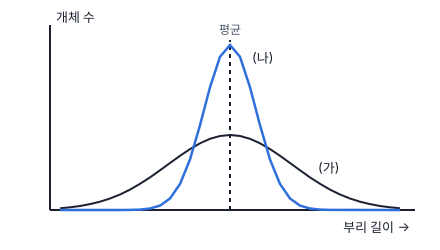
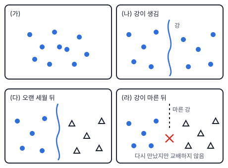

# 생명과학 복습 1029 문제설명

왼쪽 목차로 문항을 고르고, 오른쪽 문제를 보며 해설을 따라가요.

문제의 첫 줄부터 검산까지 설명해요.

**목차**

- [문항별 설명](#problems)
  - [P1. 유전적 부동으로 변한 집단](#p1)
  - [P2. 탈출한 도마뱀 몇 마리가 만든 집단](#p2)
  - [P3. 성선택이 일어나기 위한 조건](#p3)
  - [P4. 항생제 내성 세균 비율의 증가](#p4)
  - [P5. 대립유전자 빈도를 바꾸지 않는 것](#p5)
  - [P6. 산불 뒤 다람쥐와 감염 뒤 다람쥐](#p6)
  - [P7. 우연이 대립유전자 빈도를 바꾸는 현상](#p7)
  - [P8. 새로운 강한 자연선택이 가져올 수 있는 일](#p8)
  - [P9. 기린의 긴 목과 선택 유형](#p9)
  - [P10. 자연선택 직후의 개체군 다양성](#p10)
  - [P11. 상아가 짧아진 코끼리](#p11)
  - [P12. 가뭄 전후 핀치 부리 깊이 분포](#p12)
  - [P13. 우연이 바꾸는 대립유전자 빈도](#p13)
  - [P14. 인간 집단이 한 종인 이유](#p14)
  - [P15. 행동적 격리의 예 고르기](#p15)
  - [P16. 별개의 생물학적 종이 되는 조건](#p16)
  - [P17. 초파리 두 마리가 같은 종인지 검증하기](#p17)
  - [P18. 배수성이 생식적 격리를 만드는 방식](#p18)
  - [P19. 입 모양이 다른 두 송어 집단](#p19)
  - [P20. 아종을 가장 잘 설명한 것](#p20)
  - [P21. 이소적 종분화에서 지리적 분리가 하는 일](#p21)
  - [P22. 접합전 격리기구의 예](#p22)
  - [P23. 정상 잡종의 다음 세대가 약해지는 현상](#p23)
  - [P24. 서로 다른 아종인 두 집단](#p24)
  - [P25. 노새가 자손을 갖지 못하는 이유](#p25)
  - [P26. 파나마 지협의 놀래기를 나눈 요인](#p26)
  - [P27. 종분화 과정이 일어나는 순서](#p27)
  - [P28. 꽃 피는 시기가 다른 난초](#p28)
  - [P29. 대부분의 새 종이 생기는 조건](#p29)
  - [P30. 생물학적 종 개념이 종을 정의하는 근거](#p30)
  - [P31. 종간 교배를 연구할 짝 고르기](#p31)
  - [P32. 꽃 피는 시기가 다른 두 종](#p32)
  - [P33. 밤 길이가 다를 때 꽃 피는 근연종](#p33)
  - [P34. [변형] 산사태와 매, 무엇이 빈도를 바꿨나](#p34)
  - [P35. [변형] 폭풍에 실려 섬에 간 새들](#p35)
  - [P36. [변형] 평형이 깨진 1세대에서 다음 세대 계산하기](#p36)
  - [P37. [변형] 환자 비율로 역산한 뒤 이주가 바꾼 대립유전자 빈도](#p37)
  - [P38. [변형] 깨진 조건과 소진화 요인 짝짓기](#p38)
  - [P39. [변형] 부리 길이 분포가 바뀐 모양 읽기](#p39)
  - [P40. [변형] 자손 수 표로 상대적 적응도 구하기](#p40)
  - [P41. [변형] 긴 꼬리깃과 성선택](#p41)
  - [P42. [변형] 말라리아가 없는 곳의 낫모양 적혈구 대립유전자](#p42)
  - [P43. [변형] 행동적 격리 고르기](#p43)
  - [P44. [변형] 수정란이 생기기 전에 막히는 격리](#p44)
  - [P45. [변형] 생물학적 종 개념의 기준과 한계](#p45)
  - [P46. [변형] 염색체 수가 다른 두 종의 잡종](#p46)
  - [P47. [변형] 다른 종이 되었다고 말할 수 있는 단계](#p47)
  - [P48. [변형] 염색체 세트가 두 배가 된 식물](#p48)

## 문항별 설명

### P1. 유전적 부동으로 변한 집단

기출 7강 6 · [원 문제 보기](../%EB%B3%B5%EC%8A%B5%EB%AC%B8%EC%A0%9C_1029_Microevolution_and_Speciation.html#p1)

유전적 부동에 의해 변한 집단은 __________

- (1) 강한 성선택을 겪게 된다
- (2) 자연선택의 결과로 원래 형태로 되돌아간다
- (3) 변화는 우연의 결과이기 때문에 실제로 진화적 변화를 겪지 않는다
- (4) 진화한다
- (5) 언제나 작은 창시자 집단으로부터 출발한다

기출 원문 보기

기출 7강 합본 6번 (PDF 1쪽)

#### 문제부터 읽어요

유전적 부동 때문에 대립유전자 빈도가 바뀐 집단에 대해 **옳은 진술**을 하나 골라요. 핵심은 ‘원인이 우연이어도 진화라고 부르는가’예요.

#### 이 문제를 봤을 때 떠올릴 개념과 공식

‘유전적 부동에 의해 변한 집단’에서 두 정의를 떠올려요. 소진화(microevolution)는 한 집단의 대립유전자 빈도가 세대에 따라 변하는 것이에요. 이 정의에는 원인이 무엇이어야 한다는 조건이 없어요.

유전적 부동(genetic drift)은 우연한 사건으로 대립유전자 빈도가 무작위로 변하는 것이에요. 방향이 정해져 있지 않고, 작은 집단일수록 강해요. 강의노트 7장 p.4–5와 교재 p.149·151은 이것이 일어나는 대표 상황 두 가지를 들어요. 하나는 재해·질병 등으로 큰 집단이 급격히 줄어드는 병목현상(bottleneck)이고, 다른 하나는 소수가 새 지역에 새 집단을 세우는 창시자 효과(founder effect)예요.

판단 기준은 두 가지예요. 첫째, 빈도가 바뀌었다면 원인과 상관없이 진화로 판정해요. 둘째, 각 진술이 부동의 성질(우연, 방향 없음, 여러 상황에서 일어남)과 맞는지 확인해요.

관련 정리노트: [유전적 부동: 병목 현상과 창시자 효과](../%EC%A0%95%EB%A6%AC%EB%85%B8%ED%8A%B8_1029_Microevolution_and_Speciation.html#s0-drift), [소진화의 정의와 소진화 요인](../%EC%A0%95%EB%A6%AC%EB%85%B8%ED%8A%B8_1029_Microevolution_and_Speciation.html#s0-factors)

#### 왜 이렇게 푸는지 함께 따라가요

(1) 틀려요. 성선택(sexual selection)은 한쪽 성이 짝을 골라서 생기는 선택이에요. 부동은 짝 선택과 상관없는 우연한 빈도 변화이고, 표 7.3에서도 둘은 별개의 요인이에요. 부동이 일어났다고 성선택이 따라오지는 않아요.

(2) 틀려요. 부동에는 방향이 없어서 집단을 원래 상태로 되돌리는 힘이 없어요. 자연선택은 지금 환경에서 적응도가 높은 형질을 늘릴 뿐이고, 그 형질이 원래 형태라는 보장도 없어요. 한번 사라진 대립유전자는 다시 생기지 않는 한 돌아오지 않아요.

(3) 틀려요. 진화를 판정하는 기준은 대립유전자 빈도가 바뀌었는지예요. 원인이 우연이라는 점은 이 기준과 관계가 없어요. 빈도가 바뀌었으므로 진화적 변화가 일어난 거예요.

(4) 맞아요. 부동으로 대립유전자 빈도가 바뀌었으니 소진화의 정의를 그대로 충족해요. 소진화는 자연선택만으로 일어나는 것이 아니에요.

(5) 틀려요. 창시자 효과는 부동이 일어나는 한 가지 상황일 뿐이에요. 원래 살던 곳에서 큰 집단이 급감하는 병목현상도 부동이므로, 부동이 ‘언제나’ 작은 창시자 집단에서 시작되지는 않아요.

따라서 답은 (4)예요.

#### 완성 답과 검산

답 (4). 소거로 확인하면 (1)·(2)·(5)는 부동의 성질과 어긋나고, (3)은 진화의 정의와 어긋나요. 하나만 남아요. 교재 p.149도 7.2.3절 첫머리에서 유전적 부동을 대립유전자 빈도를 변화시키는 요인(소진화를 일으키는 요소)으로 나열해요.

#### 이 문항에서 하기 쉬운 실수

‘진화 = 더 잘 적응하게 되는 것’이라고 생각하면 (3)에 끌려요. 이 문제에서 진화는 빈도 변화라는 사실만 뜻하고, 좋아졌는지는 따지지 않아요.

**페이지 요약**

#### 판단 기준

소진화 = 대립유전자 빈도 변화(원인 조건 없음). 부동은 우연·무방향이고, 병목과 창시자 두 상황에서 일어나요.

#### 결론

빈도가 바뀌었으니 진화한 거예요. 답 (4). (5)는 병목현상을 빠뜨린 ‘언제나’예요.

---

### P2. 탈출한 도마뱀 몇 마리가 만든 집단

기출 7강 15 · [원 문제 보기](../%EB%B3%B5%EC%8A%B5%EB%AC%B8%EC%A0%9C_1029_Microevolution_and_Speciation.html#p2)

뉴욕의 롱 아일랜드에 있는 한 도마뱀 개체군은 이탈리아에 있는 한 집단으로부터 유래되었다. 수십 년 전에 애완동물로 팔려서 유입되었고, 이 중 몇몇은 교외에서 탈출하여 새로운 집단을 형성했다. 이는 무엇에 대한 예시인가?

- (1) 창시자 효과
- (2) 집단 병목현상
- (3) 돌연변이
- (4) 자연선택
- (5) 유전자 확산

기출 원문 보기

기출 7강 합본 15번 (PDF 2쪽)

#### 문제부터 읽어요

이탈리아 집단에서 온 도마뱀 가운데 *몇몇*이 탈출해 롱 아일랜드에 *새로운 집단*을 만들었어요. 이 사례에 해당하는 용어를 골라요.

#### 이 문제를 봤을 때 떠올릴 개념과 공식

‘몇몇이 탈출하여 새로운 집단을 형성’에서 유전적 부동이 일어나는 두 상황을 떠올려요. 강의노트 7장 p.5는 둘을 시간과 공간으로 구별해요.

병목현상(population bottleneck)은 **시간적으로** 한 집단의 크기가 급격히 줄어드는 경우예요. 창시자 효과(founder effect)는 **공간적으로** 적은 수의 개체가 멀리 떨어진 새 지역에서 새 집단을 시작하는 경우예요. 이때 창시자들의 치우친 유전적 조성이 새 집단에 그대로 남아요.

판단 기준은 세 가지예요. 원래 집단이 줄었는지, 소수가 떨어져 나가 **처음으로** 집단을 세웠는지, 이미 있는 두 집단 사이를 오갔는지 확인해요. 새 대립유전자가 생겼는지(돌연변이), 형질 때문에 살아남았는지(자연선택)도 확인해요.

관련 정리노트: [유전적 부동: 병목 현상과 창시자 효과](../%EC%A0%95%EB%A6%AC%EB%85%B8%ED%8A%B8_1029_Microevolution_and_Speciation.html#s0-drift), [유전자 확산과 창시자 효과의 구분](../%EC%A0%95%EB%A6%AC%EB%85%B8%ED%8A%B8_1029_Microevolution_and_Speciation.html#s0-factors)

#### 왜 이렇게 푸는지 함께 따라가요

(1) 이 사례에 적합해요. 큰 집단에서 몇 마리만 떨어져 나와 새 지역에서 새 집단을 처음 세웠어요. 새 집단의 유전적 조성은 그 몇 마리가 가진 대립유전자로 정해지므로 공간적 기준에 들어맞아요.

(2) 이 사례에 부적합해요. 병목현상이 되려면 한 집단이 그 자리에서 크게 줄어야 해요. 이탈리아 집단이 줄었다는 내용은 없고, 일부가 다른 곳으로 옮겨 갔을 뿐이에요.

(3) 이 사례에 부적합해요. 돌연변이는 DNA가 바뀌어 새 대립유전자가 생기는 것이에요. 지문에는 새 대립유전자가 생겼다는 내용이 없어요.

(4) 이 사례에 부적합해요. 자연선택이 되려면 어떤 형질 덕분에 더 살아남고 번식해야 해요. 탈출한 개체는 형질이 유리해서가 아니라 우연히 탈출했어요.

(5) 이 사례에 부적합해요. 유전자 확산(gene flow)은 이미 있는 집단 사이로 개체나 꽃가루·씨앗이 오가는 것이에요. 롱 아일랜드에는 섞여 들어갈 기존 도마뱀 집단이 없었고, 몇 마리가 새 집단을 처음 만들었어요.

따라서 답은 (1), 창시자 효과예요.

#### 완성 답과 검산

답 (1). 교재 7장 p.151은 창시자 효과를 적은 수의 개체가 먼 지역에 정착해 새 개체군을 시작하는 경우로 설명해요. 이때 새 개체군은 부모 개체군 유전적 변이의 작은 표본만 가져요. 지문의 ‘몇몇’, ‘새로운 집단 형성’이 이 두 요소와 일치해요.

#### 이 문항에서 하기 쉬운 실수

‘다른 곳으로 이동했다’는 말만 보고 (5) 유전자 확산을 고르기 쉬워요. 도착한 곳에 이미 집단이 있어 섞여 들어가면 유전자 확산이고, 빈 곳에서 소수가 새 집단을 세우면 창시자 효과예요.

**페이지 요약**

#### 판단 기준

병목 = 한 집단이 시간적으로 급감. 창시자 = 소수가 공간적으로 떨어져 새 집단을 시작. 유전자 확산 = 기존 집단 사이의 이동.

#### 결론

몇 마리가 새 지역에 새 집단을 세웠어요. 답 (1) 창시자 효과.

---

### P3. 성선택이 일어나기 위한 조건

기출 7강 16 · [원 문제 보기](../%EB%B3%B5%EC%8A%B5%EB%AC%B8%EC%A0%9C_1029_Microevolution_and_Speciation.html#p3)

성선택이 일어나기 위한 특징은?

- (1) 생존률이 증가해야 한다
- (2) 안정화 선택이 일어나야 한다
- (3) 생식력이 증가해야 한다
- (4) 수컷이어야 한다
- (5) 이성 중의 한 쪽이 결정한 선택으로 짝짓기에 영향을 미쳐야 한다

기출 원문 보기

기출 7강 합본 16번 (PDF 2쪽)

#### 문제부터 읽어요

성선택이 일어나려면 무엇이 있어야 하는지, 곧 성선택의 **성립 조건**을 골라요. 성선택의 결과나 흔한 예가 아니라 ‘이것이 없으면 성선택이 아니다’인 특징을 찾아요.

#### 이 문제를 봤을 때 떠올릴 개념과 공식

‘성선택이 일어나기 위한’에서 성선택(sexual selection)의 정의를 떠올려요. 이성 중 한쪽(자연계에서는 보통 암컷)이 마음에 드는 짝을 골라 교배하는 데서 생기는 선택이에요. 교재 7장 p.151은 이를 수컷과 암컷의 상호작용에 근거한 선택이라고 적어요.

선택받은 개체는 짝짓기 기회를 더 얻어 자식을 더 남겨요. 그래서 선택받은 형질의 대립유전자가 다음 세대에 많아져요. 공작 수컷의 큰 깃처럼 생존에는 불리한 형질도 이렇게 유지될 수 있어요.

판단 기준은 **고르는 쪽의 선택이 상대의 짝짓기 성공을 가르는가**예요. 생존률·생식력이 높아지는 것 자체, 자연선택의 다른 양상, 특정 성별 규칙은 조건이 아니에요.

관련 정리노트: [성선택과 성적이형성](../%EC%A0%95%EB%A6%AC%EB%85%B8%ED%8A%B8_1029_Microevolution_and_Speciation.html#s1-sexual)

#### 왜 이렇게 푸는지 함께 따라가요

(1) 조건으로 부적합해요. 성선택된 형질은 생존률을 오히려 낮출 수 있어요. 공작의 큰 깃은 포식자 눈에 잘 띄지만 짝으로 선택되기 때문에 남아요. 생존률 증가가 없어도 성선택은 일어나요.

(2) 조건으로 부적합해요. 안정화 선택(stabilizing selection)은 양 극단이 불리해 평균 근처만 남는 자연선택의 한 양상이에요. 짝 선택과는 다른 이야기이고, 성선택이 일어나는 데 필요한 단계가 아니에요.

(3) 조건으로 부적합해요. 성선택에서 달라지는 것은 짝으로 선택되느냐예요. 선택받은 결과 자식을 더 남길 수는 있지만, 개체의 생식력이 먼저 높아져야 성선택이 일어나는 것은 아니에요.

(4) 조건으로 부적합해요. 보통 암컷이 고르고 수컷이 선택받는 것은 흔한 경우일 뿐이에요. 판별의 핵심은 고르는 쪽과 선택받는 쪽의 관계이지 ‘수컷이어야 한다’는 성별 규칙이 아니에요.

(5) 조건으로 적합해요. 이성 중 한쪽이 짝을 고르고, 그 선택이 짝짓기 성공에 영향을 주는 것이 바로 정의의 핵심이에요. 수업에서 다룬 공작·사자 갈기 예가 모두 이 구조예요.

따라서 답은 (5)예요.

#### 완성 답과 검산

답 (5). 소거로 보면 (1)·(3)은 결과가 아니라 필요조건처럼 쓴 것이라 공작 예가 반례가 돼요. (2)는 다른 선택 양상이고, (4)는 흔한 경우를 규칙으로 바꾼 것이에요. 정의 그대로인 보기는 (5) 하나예요. 교재 p.151의 ‘수컷과 암컷의 상호작용에 근거한 선택’과도 일치해요.

#### 이 문항에서 하기 쉬운 실수

강의노트 7장 p.5는 성선택을 수컷과 암컷 사이의 선택(공작의 꼬리)과 같은 성 사이의 선택(사슴의 뿔)으로 나눠요. (5)의 ‘이성 중의 한 쪽’은 앞의 경우를 말해요. 그래도 다른 보기는 어떤 성선택의 조건도 아니라서, 이 문항의 답은 (5)로 정해져요.

**페이지 요약**

#### 판단 기준

성선택 = 한쪽 성의 짝 선택이 상대의 짝짓기 성공을 가름. 생존·생식력 증가나 수컷일 것은 조건이 아니에요.

#### 결론

답 (5). 공작 깃은 생존에 불리해도 선택받아 유지돼요.

---

### P4. 항생제 내성 세균 비율의 증가

기출 7강 28 · [원 문제 보기](../%EB%B3%B5%EC%8A%B5%EB%AC%B8%EC%A0%9C_1029_Microevolution_and_Speciation.html#p4)

1980년대, 모든 *Staphylococcus aureus* 의 1 % ~ 5 % 만이 항생제에 강한 내성을 보였다. 현재는 60 % ~ 70 % 가 내성을 보인다. 이것은 무엇에 대한 예시인가?

- (1) 인간의 안정화 선택
- (2) 인간의 방향성 선택
- (3) 세균의 분단성 선택
- (4) 세균의 안정화 선택
- (5) 세균의 방향성 선택

기출 원문 보기

기출 7강 합본 28번 (PDF 4쪽)

#### 문제부터 읽어요

황색포도상구균(*Staphylococcus aureus*) 가운데 항생제 내성균의 비율이 1980년대 1~5%에서 현재 60~70%로 늘었어요. 보기마다 **누가**(인간/세균)와 **어떤 선택 양상**이 짝지어져 있으니 두 가지를 모두 맞혀야 해요.

#### 이 문제를 봤을 때 떠올릴 개념과 공식

‘내성 비율이 늘었다’에서 자연선택과 그 세 양상을 떠올려요. 상대적 적응도(relative fitness)가 높은 개체의 대립유전자가 다음 세대에 많아져요.

판단은 두 단계예요. 첫째, **선택을 받아 빈도가 바뀐 집단**이 누구인지 정해요. 항생제를 쓴 사람은 선택 환경을 만든 쪽이고, 내성 비율이 바뀐 것은 세균 집단이에요. 둘째, 어떤 표현형이 늘었는지 봐요. 교재 7장 p.151 기준으로 한쪽 극단이 유리해 그쪽으로 이동하면 방향성 선택(directional selection)이에요. 중간이 유리해 양 극단이 줄면 안정화 선택(stabilizing selection), 중간이 불리해 양 극단이 남으면 분단성 선택(disruptive selection)이에요.

관련 정리노트: [상대적 적응도와 자연선택의 세 양상](../%EC%A0%95%EB%A6%AC%EB%85%B8%ED%8A%B8_1029_Microevolution_and_Speciation.html#s1-fitness)

#### 왜 이렇게 푸는지 함께 따라가요

(1) 이 사례에 부적합해요. 선택받은 집단이 사람이 아니라 세균이라서 첫 단계에서 탈락해요. 양상도 맞지 않아요. 내성 비율이 크게 늘어 집단이 한쪽으로 옮겨 갔으니 평균이 그대로인 안정화 선택이 아니에요.

(2) 이 사례에 부적합해요. ‘방향성’은 맞지만, 빈도가 변한 것은 사람이 아니라 세균 집단이에요.

(3) 이 사례에 부적합해요. 대상은 세균으로 맞아요. 하지만 분단성 선택은 중간이 줄어 양 극단이 함께 남는 경우예요. 여기서는 ‘내성 있음’이라는 한쪽만 늘었어요.

(4) 이 사례에 부적합해요. 대상은 맞지만, 안정화 선택이면 평균이 그대로이고 극단만 줄어야 해요. 내성 비율이 1~5%에서 60~70%로 바뀌어 집단 구성 자체가 이동했어요.

(5) 이 사례에 적합해요. 항생제가 있는 환경에서 내성 세균이 더 많이 살아남아 번식하므로, 세균 집단이 내성 쪽 한 방향으로 이동했어요. 수업 퀴즈에서도 이 경우를 분단성(다형화) 선택이 아니라 ‘없다가 있게 된 방향’으로 바뀐 방향성 선택이라고 정리했어요.

따라서 답은 (5), 세균의 방향성 선택이에요.

#### 완성 답과 검산

답 (5). 두 기준으로 표를 그리듯 거르면 ‘인간’이 들어간 (1)·(2)가 먼저 빠지고, 세균 셋 중 한쪽 극단의 증가에 맞는 양상은 방향성 하나예요. 강의노트 7장 p.3도 살충제 내성의 진화를 자연선택에 의한 적응의 예로 들어요. 교재 p.151의 방향성 선택은 선호되는 극단 쪽으로 형질이 바뀌는 경우로, 이 사례와 같은 구조예요.

**페이지 요약**

#### 판단 기준

먼저 빈도가 바뀐 집단은 세균이에요. 다음으로 한쪽 극단(내성)이 늘었으니 방향성 선택이에요.

#### 결론

답 (5) 세균의 방향성 선택. 사람은 선택 환경을 만든 쪽이에요.

---

### P5. 대립유전자 빈도를 바꾸지 않는 것

기출 7강 33 · [원 문제 보기](../%EB%B3%B5%EC%8A%B5%EB%AC%B8%EC%A0%9C_1029_Microevolution_and_Speciation.html#p5)

대립유전자 빈도를 변화시키는 요소가 아닌 것은?

- (1) 유전적 부동
- (2) 돌연변이
- (3) 선택적 교배
- (4) 획득형질
- (5) 자연선택

기출 원문 보기

기출 7강 합본 33번 (PDF 5쪽)

#### 문제부터 읽어요

다섯 보기 가운데 대립유전자 빈도를 **변화시키는 요소가 아닌 것**을 골라요. 부정형이므로 각 보기가 빈도를 바꾸는지 먼저 판정하고, 바꾸지 못하는 보기를 답으로 골라요.

**문항 결함:** (3) 선택적 교배도 교재 7장 p.151 표 7.3 기준으로는 ‘대립유전자 빈도에 직접 영향을 주지 않는다’고 적혀 있어 답이 될 여지가 있어요. 인쇄 답과 카드 답은 (4)이고, 어떤 해석에서도 빈도를 바꾸지 못하는 가장 확실한 답이 (4)예요.

#### 이 문제를 봤을 때 떠올릴 개념과 공식

‘대립유전자 빈도를 변화시키는 요소’에서 소진화 요인을 떠올려요. 하디-바인베르크(Hardy-Weinberg) 평형의 다섯 조건을 하나씩 뒤집으면 돌연변이, 유전자 확산, 유전적 부동, 자연선택, 선택적 교배가 나와요.

판단 기준은 **그 요소가 다음 세대로 전해지는 대립유전자의 수를 늘리거나 줄이는가**예요. 새 대립유전자를 만들거나(돌연변이), 우연히 일부만 남기거나(부동), 적응도가 높은 개체가 자식을 더 남기게 하면(자연선택) 빈도가 바뀌어요.

선택적 교배는 해석에 따라 판정이 갈려요. 수업은 성선택과 묶어, 특정 형질이 짝으로 더 선택되면 그 대립유전자가 늘어난다고 설명했어요. 반면 강의노트 7장 p.5는 선택적 교배가 *유전자형* 빈도에 영향을 줄 수 있다고 적어요. 그 예인 근친교배(inbreeding)는 동형접합자를 늘리고 이형접합자를 줄여요. 교재 표 7.3은 대립유전자 빈도에 직접 영향을 주지 않는다고 적어요.

획득형질은 생애 동안 얻은 특징이에요. 유전자를 바꾸지 않아 자손에게 전해지지 않으며, 라마르크의 획득형질 유전 설명이 틀린 이유도 여기에 있어요.

관련 정리노트: [조건이 깨지면 소진화: 돌연변이와 유전자 확산](../%EC%A0%95%EB%A6%AC%EB%85%B8%ED%8A%B8_1029_Microevolution_and_Speciation.html#s0-factors), [성선택과 선택적 교배](../%EC%A0%95%EB%A6%AC%EB%85%B8%ED%8A%B8_1029_Microevolution_and_Speciation.html#s1-sexual)

#### 왜 이렇게 푸는지 함께 따라가요

(1) 빈도를 바꾸는 요소예요. 그래서 답으로 고르지 않아요. 유전적 부동은 우연한 사건으로 일부 대립유전자만 다음 세대에 남기 때문에 빈도가 무작위로 변해요.

(2) 빈도를 바꾸는 요소예요. 그래서 답으로 고르지 않아요. 돌연변이는 DNA를 바꿔 새 대립유전자를 만들므로 대립유전자 구성이 달라져요.

(3) 출제 의도로는 빈도를 바꾸는 요소라서 답이 아니에요. 하지만 엄밀히는 답이 될 수도 있어요. 출제 의도는 수업의 설명처럼 특정 형질을 가진 개체가 짝으로 더 선택되어 자식을 더 남기는 경우로 본 것이고, 이때는 그 대립유전자가 늘어나요. 그러나 교재 표 7.3과 강의노트의 선택적 교배는 짝을 고르는 방식만 치우친 경우예요. 대립유전자의 개수는 그대로이고 짝짓는 조합만 바뀌므로 유전자형 빈도(동형접합자 증가·이형접합자 감소)가 바뀌어요. 이 정의로 읽으면 ‘대립유전자 빈도를 변화시키는 요소가 아닌 것’에 해당할 수 있어요. 교재 p.149 본문은 선택적 교배를 대립유전자 빈도를 변화시키는 요인 목록에 넣고 있어서 교재 안에서도 표현이 엇갈려요.

(4) 빈도를 바꾸지 못해요. 그래서 이 부정형 질문의 답으로 골라요. 획득형질은 유전되지 않으므로 다음 세대로 전해지는 대립유전자 수에 아무 영향을 주지 못해요. (3)과 달리 어느 해석에서도 판정이 바뀌지 않아요.

(5) 빈도를 바꾸는 요소예요. 그래서 답으로 고르지 않아요. 자연선택은 적응도가 높은 개체가 자식을 더 남기게 해 그 개체가 가진 대립유전자의 빈도를 높여요.

따라서 출제 의도와 인쇄 답은 (4)예요. (3)은 교재 표 7.3의 엄밀한 정의로 읽으면 함께 성립할 여지가 있어요.

#### 완성 답과 검산

답 (4)(인쇄 답과 같음). 소거로 보면 (1)·(2)·(5)는 교재 p.149와 표 7.3 모두에서 빈도를 바꾸는 요소예요. 남은 것은 (3)과 (4) 두 개예요. 그중 (4)는 유전되지 않으므로 어떤 기준에서도 빈도와 무관하고, (3)은 수업 설명(성선택과 같은 것)으로 읽느냐, 교재 표 7.3(직접 영향 없음)으로 읽느냐에 따라 판정이 달라져요. 그래서 유일하게 확실한 답은 (4)예요.

#### 이 문항에서 하기 쉬운 실수

시험에서 이 문항을 만나면 **(4) 획득형질**을 고르세요. 유전되지 않는다는 근거 하나로 해석 차이 없이 답이 정해지기 때문이에요. 이의 제기를 할 수 있다면 교재 p.151 표 7.3의 ‘선택적 교배는 대립유전자의 빈도에 직접 영향을 주지 않는다’를 근거로 (3)도 성립할 여지가 있다고 적어 두면 돼요.

선택적 교배와 성선택을 같은 것으로만 기억하면 ‘선택적 교배는 언제나 대립유전자 빈도를 바꾼다’고 착각하기 쉬워요. 특정 형질이 짝으로 더 많이 선택되면 대립유전자 빈도가 바뀌어요. 누구와 교배하느냐만 치우치면(근친교배) 유전자형 빈도가 바뀌어요. 두 경우를 나눠서 기억해요.

**페이지 요약**

#### 판단 기준

다음 세대로 전해지는 대립유전자 수를 바꾸는가. 획득형질은 유전되지 않아 어느 해석에서도 바꾸지 못해요.

#### 결론

답 (4)(인쇄 답). 문항 결함: (3) 선택적 교배는 교재 표 7.3 기준(대립유전자 빈도에 직접 영향 없음)이면 함께 성립할 여지가 있어요.

---

### P6. 산불 뒤 다람쥐와 감염 뒤 다람쥐

기출 7강 34 · [원 문제 보기](../%EB%B3%B5%EC%8A%B5%EB%AC%B8%EC%A0%9C_1029_Microevolution_and_Speciation.html#p6)

산불이나 홍수는 숲에 있는 다람쥐 집단의 90%를 죽인다. 남아있는 다람쥐들은 초기와 완전히 다른 집단으로 진화한다. 다른 숲에서는 세균 감염은 다람쥐의 90%를 죽이고, 남은 다람쥐는 또한 구별되는 집단으로 진화한다. 첫 번째 예시는 ( )이고 두 번째는 ( )이다. 괄호에 들어갈 가장 알맞은 용어가 순서대로 짝지어 진 것은?

- (1) 유전전 부동, 자연선택
- (2) 단속평형설, 수렴진화
- (3) 병목현상, 유전적 부동
- (4) 점진주의설, 단속평형설
- (5) 자연선택, 적응방산

기출 원문 보기

기출 7강 합본 34번 (PDF 5쪽)

#### 문제부터 읽어요

두 숲에서 모두 다람쥐의 90%가 죽고, 남은 집단이 달라졌어요. 첫 번째 숲은 *산불·홍수*, 두 번째 숲은 *세균 감염*이 원인이에요. 두 사례에 맞는 용어를 **순서대로** 짝지은 보기를 골라요. 죽은 비율은 같으니, 누가 죽었는지가 형질과 관계있었는지를 비교해요.

**문항 결함:** 보기 (1)의 ‘유전전 부동’은 ‘유전적 부동’의 오타예요. 뜻은 유전적 부동으로 읽으며, 답 (1)에는 영향이 없어요. 또 지문은 감염에서 살아남은 다람쥐가 형질(저항성) 때문에 살아남았는지 밝히지 않아요. 교재 p.149는 질병도 병목현상의 원인으로 들기 때문에 (3)도 성립할 여지가 있어요. 출제 의도상 분석 답은 (1)이에요.

#### 이 문제를 봤을 때 떠올릴 개념과 공식

‘90%를 죽인다’와 ‘남은 다람쥐가 다른 집단으로 진화’에서 대립유전자 빈도를 바꾸는 두 원인을 떠올려요. 하나는 유전적 부동(genetic drift)으로, 우연한 사건 때문에 빈도가 무작위로 변해요. 다른 하나는 자연선택(natural selection)으로, 적응도가 높은 개체가 더 살아남고 번식해 그 대립유전자가 늘어요.

판단 기준은 **생존이 형질과 상관있었는가**예요. 형질과 상관없이 무작위로 죽고 살면 부동이에요. 큰 집단이 한꺼번에 급감한 이 경우는 부동 중에서도 병목현상(bottleneck)이에요. 저항성처럼 특정 형질을 가진 개체가 더 살아남으면 자연선택이에요. 수업의 강의실 예로는 ‘이 줄만 남아’가 부동, ‘70점 이하는 나가’가 자연선택이에요.

단속평형설·수렴진화·점진주의설·적응방산은 다음 수업 범위의 용어라 여기서는 뜻을 따지지 않아요. 각 보기의 첫 칸이 첫 사례(우연한 대량 사망)와 맞는지만 보면 걸러져요.

관련 정리노트: [유전적 부동: 병목 현상과 창시자 효과](../%EC%A0%95%EB%A6%AC%EB%85%B8%ED%8A%B8_1029_Microevolution_and_Speciation.html#s0-drift), [상대적 적응도와 자연선택](../%EC%A0%95%EB%A6%AC%EB%85%B8%ED%8A%B8_1029_Microevolution_and_Speciation.html#s1-fitness)

#### 왜 이렇게 푸는지 함께 따라가요

(1) 두 칸 모두 적합해요. 산불·홍수는 어떤 형질을 가졌든 가리지 않고 죽이므로, 살아남은 10%는 운으로 남은 것이고 첫 칸은 유전적 부동이에요. 출제 의도는 세균 감염을 저항성에 따른 생존 차이로 본 것이에요(수업의 부동·선택 구분 기준). 그렇게 보면 저항성이 있는 다람쥐가 더 많이 살아남아 자손을 남기므로 두 번째 칸은 자연선택이에요.

(2) 첫 칸에서 부적합해요. 첫 사례는 우연한 대량 사망이라 부동으로 판정되는데, 이 보기의 첫 칸은 유전적 부동이나 그 한 경우가 아니에요.

(3) 첫 칸은 맞지만 두 번째 칸이 부적합해요. 첫 사례를 병목현상으로 본 것은 맞아요. 병목현상도 유전적 부동의 한 경우예요. 하지만 두 번째 사례를 유전적 부동이라고 하면 저항성에 따라 생존이 갈렸다는 점을 놓쳐요. 엄밀히 따지면 교재 p.149가 질병도 병목현상을 만드는 요소로 들어서, 감염이 형질과 무관하게 죽였다면 부동으로 볼 여지는 있어요. 그러나 이 문항은 두 사례를 대비시켜 ‘가장 알맞은’ 짝을 묻고, (3)은 두 칸이 모두 부동이라 두 사례를 구별하지 못해요. 그래서 (1)보다 덜 알맞아요.

(4) 첫 칸에서 부적합해요. (2)와 같은 이유로, 첫 칸이 우연한 대량 사망을 뜻하는 유전적 부동이 아니에요.

(5) 첫 칸에서 부적합해요. 산불은 잘 적응한 다람쥐를 골라 살려 두지 않으므로 첫 사례는 자연선택이 아니에요.

따라서 답은 (1), 유전적 부동(병목현상)과 자연선택이에요.

#### 완성 답과 검산

답 (1). 첫 칸 기준(우연한 대량 사망 = 부동)만으로 (2)·(4)·(5)가 빠지고, 남은 (1)과 (3)은 두 번째 칸에서 갈려요. 감염 생존이 형질(저항성)과 관련됐다고 보면 자연선택이라 (1)이 남아요. 감염이 형질과 무관하게 죽였다면 (3)도 성립할 여지가 있다는 유보는 그대로 남아요. 교재 p.149의 병목현상 설명(많은 개체가 죽어 일부 대립유전자가 제거됨)과 p.151의 자연선택 정의(다른 유전자형을 갖는 개체들의 다른 생존력)도 각 칸과 일치해요.

#### 이 문항에서 하기 쉬운 실수

(1)의 ‘유전전 부동’ 같은 오타가 보이면 낯선 용어라고 지우지 말고 가장 가까운 용어(유전적 부동)로 읽고 판정하세요. 필요하면 답안 옆에 ‘유전적 부동의 오타로 해석’이라고 적어 두면 돼요.

죽은 비율(90%)이 같다고 두 사례를 같은 원인으로 묶기 쉬워요. 비율이 아니라 **누가 죽었는지가 형질과 관계있었는지**로 구별해요. 그래서 질병이 문제에 나와도 ‘저항성 있는 개체가 더 살아남았다’는 구조면 자연선택, 무차별로 죽였다면 병목현상으로 판정해요.

**페이지 요약**

#### 판단 기준

생존이 형질과 무관하면 유전적 부동(병목), 형질(저항성)에 따라 갈리면 자연선택.

#### 결론

답 (1). ‘유전전 부동’은 유전적 부동의 오타(문항 결함). 분석 답 (1) / (3)은 감염이 형질과 무관한 사망이었다면 성립할 여지가 있어요.

---

### P7. 우연이 대립유전자 빈도를 바꾸는 현상

기출 7강 44 · [원 문제 보기](../%EB%B3%B5%EC%8A%B5%EB%AC%B8%EC%A0%9C_1029_Microevolution_and_Speciation.html#p7)

우연한 일들이 대립유전자의 빈도에 예상치 못한 변화를 초래하는 현상을 무엇이라고 부르는가?

- (1) 유전자 확산
- (2) 근친교배
- (3) 평형다형성
- (4) 유전적 부동
- (5) 안정화 선택

기출 원문 보기

기출 7강 합본 44번 (PDF 6쪽)

#### 문제부터 읽어요

‘*우연한* 일들이 대립유전자 빈도에 *예상치 못한* 변화를 일으키는 현상’의 이름을 골라요. 정의를 주고 용어를 찾는 문제이므로, 각 보기의 원인이 ‘우연’인지 확인해요.

#### 이 문제를 봤을 때 떠올릴 개념과 공식

‘우연한 일’과 ‘예상치 못한 변화’는 유전적 부동(genetic drift)의 정의에 쓰이는 표현이에요. 강의노트 7장 p.4는 유전적 부동을 “개체군 내 대립유전자 빈도의 예상치 못한 변화”라고 적고, 작은 개체군에서 흔하다고 해요.

판단 기준은 **각 현상이 빈도를 바꾸거나 유지하는 원인**이에요. 이동이면 유전자 확산, 짝을 고르는 방식이면 근친교배를 포함한 선택적 교배, 적응도 차이면 자연선택이에요. 여러 대립유전자가 함께 유지되는 것이면 평형 다형성이에요. 원인이 우연인 것만 이 정의에 맞아요.

관련 정리노트: [유전적 부동: 병목 현상과 창시자 효과](../%EC%A0%95%EB%A6%AC%EB%85%B8%ED%8A%B8_1029_Microevolution_and_Speciation.html#s0-drift), [불리한 대립유전자가 남는 이유와 평형 다형성](../%EC%A0%95%EB%A6%AC%EB%85%B8%ED%8A%B8_1029_Microevolution_and_Speciation.html#s1-balanced)

#### 왜 이렇게 푸는지 함께 따라가요

(1) 이 정의에 부적합해요. 유전자 확산(gene flow)은 개체나 꽃가루·씨앗이 집단 사이를 오가서 빈도가 바뀌는 것이에요. 원인이 우연한 사건이 아니라 이동이에요.

(2) 이 정의에 부적합해요. 근친교배(inbreeding)는 가까운 친척끼리 교배하는 선택적 교배의 한 형태예요. 짝짓는 방식이 원인이고, 동형접합자를 늘리고 이형접합자를 줄여 유전자형 빈도를 바꿔요.

(3) 이 정의에 부적합해요. 평형 다형성(balanced polymorphism)은 여러 대립유전자가 집단에 함께 유지되는 상태를 말해요. 예상치 못한 변화가 아니라 변이가 사라지지 않고 남는 것을 설명해요.

(4) 이 정의에 적합해요. 유전적 부동은 우연한 사건 때문에 일부 대립유전자만 다음 세대에 남아 빈도가 예측할 수 없게 변하는 현상이에요. 발문의 ‘우연’과 ‘예상치 못한’이 모두 들어맞아요.

(5) 이 정의에 부적합해요. 안정화 선택(stabilizing selection)은 양 극단이 불리해 평균 근처가 남는 자연선택의 양상이에요. 원인이 우연이 아니라 적응도 차이예요.

따라서 답은 (4), 유전적 부동이에요.

#### 완성 답과 검산

답 (4). 원인별로 다시 분류하면 이동 (1), 짝짓는 방식 (2), 유지 상태 (3), 적응도 차이 (5)이고, 우연은 (4) 하나예요. 교재 7장 p.149도 우연한 사건이 대립유전자 빈도를 예상치 못하게 변화시키는 현상을 유전적 부동이라 부른다고 적어 발문과 같은 표현이에요.

**페이지 요약**

#### 판단 기준

원인이 무엇인가: 이동(확산), 짝짓는 방식(근친교배), 유지(평형 다형성), 적응도(선택), 우연(부동).

#### 결론

우연 + 예상치 못한 빈도 변화 = 유전적 부동. 답 (4).

---

### P8. 새로운 강한 자연선택이 가져올 수 있는 일

기출 7강 47 · [원 문제 보기](../%EB%B3%B5%EC%8A%B5%EB%AC%B8%EC%A0%9C_1029_Microevolution_and_Speciation.html#p8)

어떤 개체군이 지금과는 다른 강력한 자연선택을 겪을 때, 무슨 일이 일어날 수 있는가?

- (1) 개체군이 멸종한다.
- (2) 가장 흔한 형태가 덜 일반적이게 되고, 덜 흔한 형태가 더 일반적이게 된다.
- (3) 생명체의 가장 일반적인 형태가 다른 형태로 대체된다.
- (4) 보기 모두 일어날 수 있다.
- (5) 변이가 감소하고 생명체가 더 비슷해진다.

기출 원문 보기

기출 7강 합본 47번 (PDF 6쪽)

#### 문제부터 읽어요

개체군이 지금과 *다른* 강한 자연선택을 겪을 때 **일어날 수 있는** 일을 골라요. ‘반드시 일어나는 일’이 아니라 ‘가능한 일’을 묻고, (4) ‘보기 모두’가 있으니 다른 보기를 하나씩 판정한 뒤 (4)를 판단해요.

#### 이 문제를 봤을 때 떠올릴 개념과 공식

‘다른 강력한 자연선택’에서 선택이 무엇을 바꾸는지 떠올려요. 자연선택은 적응도가 높은 개체의 대립유전자 빈도를 높여요. 교재 7장 p.151 표 7.3은 그 결과로 한 대립유전자가 다른 것을 대체하거나, 대립유전자 변이가 보존될 수 있다고 적어요.

결과는 선택 양상에 따라 달라요. 방향성 선택은 한쪽 극단이 유리해 평균이 그쪽으로 이동해요. 안정화 선택은 양 극단이 불리해 분포가 좁아지고 개체들이 비슷해져요. 새 환경에 맞는 변이가 집단에 없으면 살아남아 번식할 개체가 부족해 멸종할 수도 있어요(변이가 없으면 환경 변화에 적응하지 못할 수 있음).

판단 기준은 **각 결과를 만들어 내는 선택 양상이나 조건이 하나라도 있는가**예요. 있으면 ‘일어날 수 있는 일’이에요.

관련 정리노트: [상대적 적응도와 자연선택의 세 양상](../%EC%A0%95%EB%A6%AC%EB%85%B8%ED%8A%B8_1029_Microevolution_and_Speciation.html#s1-fitness)

#### 왜 이렇게 푸는지 함께 따라가요

(1) 내용상 일어날 수 있어요. 새 환경에 맞는 변이가 개체군 안에 없으면 대부분이 살아남지 못하거나 자식을 남기지 못해 멸종할 수 있어요. 다만 이것 하나만으로는 다른 가능한 결과가 빠지므로 단독 답으로는 부적합해요.

(2) 내용상 일어날 수 있어요. 방향성 선택으로 예전에 드물던 극단 쪽이 유리해지면, 흔하던 형태는 줄고 드물던 형태가 늘어요. 이것도 단독 답으로는 부적합해요.

(3) 내용상 일어날 수 있어요. 방향성 선택이 계속되면 평균 자체가 이동해, 가장 흔하던 형태가 다른 형태로 대체될 수 있어요. 표 7.3의 ‘한 대립유전자가 다른 것을 대체’와 같은 결과예요. 단독 답으로는 부적합해요.

(5) 내용상 일어날 수 있어요. 안정화 선택처럼 극단이 걸러지거나 덜 적합한 개체가 제거되면 변이가 줄고 개체들이 더 비슷해져요. 단독 답으로는 부적합해요.

(4) 이 문항의 답으로 적합해요. 위에서 (1), (2), (3), (5)가 각각 어떤 선택 양상이나 조건에서 모두 일어날 수 있다고 판정했으므로, ‘보기 모두 일어날 수 있다’가 가장 완전한 답이에요.

따라서 답은 (4)예요.

#### 완성 답과 검산

답 (4). 보기마다 그 결과를 만드는 경우를 하나씩 대응시켜 확인했어요. 멸종은 적응할 변이가 없을 때, (2)·(3)은 방향성 선택일 때, (5)는 안정화 선택일 때예요. 네 결과 모두 가능한 경우가 있으니 하나만 고르는 보기는 불완전해요. 교재 p.152 그림 7.15에서도 방향성 선택은 분포가 옮겨 가고 안정화 선택은 분포가 좁아져요.

#### 이 문항에서 하기 쉬운 실수

(1) 멸종은 ‘선택이 아니라 실패’라고 느껴 지우기 쉬워요. 발문은 일어날 수 있는 일을 묻고, 맞는 변이가 없으면 강한 선택 끝에 개체군이 사라질 수 있어요. (2)와 (5)가 서로 반대처럼 보여도 서로 다른 선택 양상에서 각각 가능한 결과예요.

**페이지 요약**

#### 판단 기준

각 결과를 만드는 경우가 있는가: 멸종(맞는 변이 없음), 흔한 형태의 감소·대체(방향성), 변이 감소(안정화).

#### 결론

(1)(2)(3)(5) 모두 가능하므로 답 (4).

---

### P9. 기린의 긴 목과 선택 유형

기출 7강 51 · [원 문제 보기](../%EB%B3%B5%EC%8A%B5%EB%AC%B8%EC%A0%9C_1029_Microevolution_and_Speciation.html#p9)

기린의 긴 목은 어떤 선택 유형인가?

- (1) 정답이 여러 개이다
- (2) 방향성 선택
- (3) 획득형질
- (4) 안정화 선택
- (5) 다양화 선택

기출 원문 보기

기출 7강 합본 51번 (PDF 7쪽)

#### 문제부터 읽어요

기린의 목이 길어진 것을 자연선택의 **어떤 양상**으로 분류하는지 골라요. 보기 중에는 선택 양상이 아닌 것도 섞여 있어요.

#### 이 문제를 봤을 때 떠올릴 개념과 공식

‘선택 유형’에서 연속적인 형질에 작용하는 자연선택의 세 양상을 떠올려요. 목 길이처럼 값이 연속인 형질은 평균이 가장 많은 종 모양 분포를 이뤄요.

판단 기준은 **어느 쪽 표현형이 유리해 분포가 어떻게 바뀌었는가**예요. 한쪽 극단이 유리해 평균이 그쪽으로 옮겨 가면 방향성 선택이에요. 가운데가 유리해 평균은 그대로이고 폭만 좁아지면 안정화 선택이에요. 가운데가 불리해 봉우리가 둘로 갈라지면 분단성 선택이고, 수업에서는 다형화 선택이라고도 불렀어요.

획득형질은 살면서 얻은 특징이 유전된다는 라마르크의 설명에 쓰는 말이에요. 선택 양상의 이름이 아니고, 획득형질은 유전되지 않아요.

관련 정리노트: [상대적 적응도와 자연선택의 세 양상](../%EC%A0%95%EB%A6%AC%EB%85%B8%ED%8A%B8_1029_Microevolution_and_Speciation.html#s1-fitness), [획득형질이 빈도를 바꾸지 못하는 이유](../%EC%A0%95%EB%A6%AC%EB%85%B8%ED%8A%B8_1029_Microevolution_and_Speciation.html#s0-factors)

#### 왜 이렇게 푸는지 함께 따라가요

(1) 이 사례에 부적합해요. 다른 보기를 판정해 보면 목 길이의 변화에 맞는 양상은 방향성 하나뿐이고, (3)은 선택 양상이 아니에요. 정답이 여러 개가 되지 않아요.

(2) 이 사례에 적합해요. 목이 긴 개체가 자식을 더 많이 남기면 목 길이 분포의 평균이 긴 쪽으로 옮겨 가요. 한쪽 극단(긴 목)이 유리한 방향성 선택이에요.

(3) 이 문항의 답으로 부적합해요. 획득형질은 선택 유형이 아니라, 목을 늘이려 애써 길어진 목이 자손에게 전해졌다는 라마르크식 설명에 쓰이는 말이에요. 획득형질은 유전되지 않으므로 기린 목의 진화를 설명하지도 못해요.

(4) 이 사례에 부적합해요. 안정화 선택이면 평균 목 길이는 그대로이고 극단만 줄어야 해요. 기린은 평균 자체가 긴 쪽으로 이동했어요.

(5) 이 사례에 부적합해요. ‘다양화 선택’은 수업·강의노트의 세 양상 이름에 없는 이름이에요. 분단성 선택처럼 중간이 불리해 두 무리로 갈라지는 경우를 뜻한다고 해도, 기린 목은 두 무리로 갈라지지 않고 한 방향으로 길어졌으므로 맞지 않아요.

따라서 답은 (2), 방향성 선택이에요.

#### 완성 답과 검산

답 (2). 교재 p.152 그림 7.15에서 ‘선택 후 분포가 한쪽으로 통째로 옮겨 감’은 (a) 방향성 선택뿐이에요. (b) 안정화는 좁아지고 (c) 분단성은 둘로 갈라져요. 기린 목은 (a)의 모양이에요. 선택 양상이 아닌 (3)을 빼면 후보가 셋이고, 그중 맞는 것이 하나이므로 (1)도 성립하지 않아요.

**페이지 요약**

#### 판단 기준

평균이 한쪽으로 이동하면 방향성, 폭만 좁아지면 안정화, 둘로 갈라지면 분단성(다형화). ‘다양화 선택’은 수업 이름에 없지만 갈라짐을 뜻한다고 해도 기린 목에는 맞지 않아요. 획득형질은 선택 양상이 아니에요.

#### 결론

목 길이 평균이 긴 쪽으로 이동했어요. 답 (2) 방향성 선택.

---

### P10. 자연선택 직후의 개체군 다양성

기출 7강 59 · [원 문제 보기](../%EB%B3%B5%EC%8A%B5%EB%AC%B8%EC%A0%9C_1029_Microevolution_and_Speciation.html#p10)

개체군에 자연선택이 작용하면, 직후의 개체군 다양성은 일반적으로 어떻게 될 것인가?

- (1) 변화 없다
- (2) 감소
- (3) 알 수 없다
- (4) 증가

기출 원문 보기

기출 7강 합본 59번 (PDF 7쪽)

#### 문제부터 읽어요

자연선택이 작용한 *직후*, 개체군의 다양성이 *일반적으로* 어떻게 되는지 골라요. ‘일반적으로’가 붙었으니 예외가 있어도 대표 경향을 답해요.

#### 이 문제를 봤을 때 떠올릴 개념과 공식

‘자연선택이 작용하면’에서 선택이 하는 일을 떠올려요. 자연선택은 이미 있는 변이 가운데 적응도가 낮은 표현형을 덜 남기게 해요. 새 대립유전자를 만드는 것은 돌연변이이지 선택이 아니에요.

판단 기준은 **선택이 표현형 분포의 어느 부분을 걸러 내는가**예요. 방향성 선택은 한쪽 극단을, 안정화 선택은 양 극단을 걸러 내므로 선택 직후 남은 개체들의 변이가 줄어요. 분단성 선택만 가운데를 걸러 내 양 극단이 남고 수업에서는 ‘다양해진다’고 했어요. 이것이 ‘일반적으로’가 붙은 이유가 되는 예외예요.

관련 정리노트: [상대적 적응도와 자연선택의 세 양상](../%EC%A0%95%EB%A6%AC%EB%85%B8%ED%8A%B8_1029_Microevolution_and_Speciation.html#s1-fitness)

#### 왜 이렇게 푸는지 함께 따라가요

(1) 부적합해요. 선택이 작용했다는 것은 덜 적합한 개체가 자식을 덜 남겼다는 뜻이에요. 그 표현형과 대립유전자가 줄어 개체군 구성이 바뀌므로 ‘변화 없다’가 아니에요.

(2) 적합해요. 세 양상 중 방향성·안정화 선택은 분포의 끝부분을 걸러 내 남은 개체의 변이를 줄여요. 선택은 기존 변이 중 일부를 제거할 뿐 새로 보태지 않으므로, 대표 경향은 감소예요.

(3) 부적합해요. 분단성 선택이라는 예외가 있어 양상마다 결과가 다르긴 해요. 하지만 발문은 ‘일반적으로’를 묻고, 덜 적합한 변이가 제거된다는 공통 경향이 있으므로 알 수 없다고 할 필요는 없어요.

(4) 일반적인 답으로는 부적합해요. 분단성 선택에서는 양 극단이 남아 다양해질 수 있지만 이것은 예외예요. 선택은 새 변이를 만들지 않으므로 일반적인 경향이 증가일 수는 없어요.

따라서 답은 (2), 감소예요.

#### 완성 답과 검산

답 (2). 세 양상을 세어 보면 감소가 둘(방향성, 안정화), 다양해짐이 하나(분단성)이고, 어느 양상도 새 변이를 만들지 않아요. 교재 p.151은 안정화 선택이 극단 표현형을 제거하면서 변이를 줄인다고 적고, p.152의 7.2.4절도 안정화 선택과 유전적 부동 앞에서 변이가 어떻게 유지되는지를 따로 묻고 있어요. 선택이 기본적으로 변이를 줄이는 쪽이라는 뜻이에요.

#### 이 문항에서 하기 쉬운 실수

분단성 선택의 ‘다양해진다’만 떠올리면 (4)나 (3)으로 흔들려요. ‘일반적으로’와 ‘직후’를 함께 읽어요. 선택 직후 남은 개체는 걸러진 나머지이므로 새 변이가 더해질 수 없고, 분단성 선택은 예외로 따로 기억해요.

**페이지 요약**

#### 판단 기준

선택은 기존 변이의 일부를 걸러 낼 뿐 새로 만들지 않아요. 방향성·안정화는 감소, 분단성은 예외예요.

#### 결론

일반적으로 다양성 감소. 답 (2).

---

### P11. 상아가 짧아진 코끼리

기출 7강 62 · [원 문제 보기](../%EB%B3%B5%EC%8A%B5%EB%AC%B8%EC%A0%9C_1029_Microevolution_and_Speciation.html#p11)

코끼리의 상아는 세계에서 가치가 가장 높은 상품 중 하나이다. 그 결과 지난 몇 세기 동안 큰 상아를 가지고 있는 수컷 아프리카 코끼리는 심하게 사냥 당해왔다. 오늘날 완전히 성장한 수컷 코끼리는 1900년대 초의 수컷 코끼리와 비교할 때 상당히 짧은 상아를 가지고 있다. 이것은 무엇에 대한 예시인가?

- (1) 안정화 선택
- (2) 방향성 선택
- (3) 분단성 선택
- (4) 정답이 여러 개이다
- (5) 역진화

기출 원문 보기

기출 7강 합본 62번 (PDF 8쪽)

#### 문제부터 읽어요

비교 대상은 **1900년대 초의 수컷 코끼리**와 **오늘날의 수컷 코끼리**예요. 핵심 조건은 큰 상아를 가진 수컷만 사냥당했다는 것이고, 그 결과 상아 길이의 평균이 짧아졌어요. 이 변화가 어떤 선택 양상의 예인지 골라요.

#### 이 문제를 봤을 때 떠올릴 개념과 공식

‘큰 상아를 가진 수컷이 사냥당했다’에서 어떤 표현형이 자식을 덜 남겼는지, 곧 **상대적 적응도(relative fitness)**가 낮은 쪽이 어디인지를 봐요. 사냥당한 수컷은 자식을 덜 남기므로 그 표현형의 적응도가 낮아져요.

판단 기준은 두 가지예요. 첫째, 적응도가 낮은 쪽이 분포의 **한쪽 끝인지, 양쪽 끝인지, 가운데인지**, 둘째, 그 결과 **평균이 옮겨 갔는지**예요. 한쪽 끝이 불리해 평균이 반대쪽으로 옮겨 가면 방향성 선택(directional selection), 양 끝이 불리해 평균은 그대로이고 폭만 좁아지면 안정화 선택(stabilizing selection), 가운데가 불리해 봉우리가 둘로 나뉘면 분단성 선택(disruptive selection)이에요.

관련 정리노트: [상대적 적응도와 자연선택의 세 양상](../%EC%A0%95%EB%A6%AC%EB%85%B8%ED%8A%B8_1029_Microevolution_and_Speciation.html#s1-fitness)

#### 왜 이렇게 푸는지 함께 따라가요

(1) 안정화 선택은 이 사례에 부적합해요. 안정화 선택이 되려면 아주 짧은 상아와 아주 큰 상아가 함께 불리해 평균이 그대로 남아야 해요. 지문에서 불리했던 것은 큰 상아 한쪽뿐이고 평균 길이가 짧아졌어요.

(2) 방향성 선택이 이 사례에 적합해요. 큰 상아라는 한쪽 끝의 수컷이 사냥으로 자식을 덜 남기니 적응도가 낮고, 상대적으로 짧은 상아를 가진 수컷의 대립유전자가 다음 세대에 더 많이 남아요. 그래서 오늘날 수컷의 평균 상아 길이가 짧은 쪽으로 옮겨 갔어요.

(3) 분단성 선택은 이 사례에 부적합해요. 분단성 선택이 되려면 중간 길이 상아가 불리해 아주 짧은 것과 아주 큰 것이 함께 남아야 해요. 지문에는 큰 상아도 사냥당했다고 나와 있어 큰 쪽 끝이 남는다는 조건이 깨져요.

(4) 틀려요. 이 보기는 다른 보기를 판정한 뒤에 정해요. (1), (3), (5)가 모두 부적합하고 (2) 하나만 맞으므로 정답이 여러 개라는 진술은 성립하지 않아요.

(5) 역진화는 부적합해요. 진화(소진화)는 대립유전자 빈도가 세대에 따라 변하는 것이고, 정해진 앞뒤 방향이 없어요. 상아가 짧아진 것도 짧은 상아 쪽 대립유전자의 빈도가 높아진 변화이므로, 형질이 작아졌다고 ‘거꾸로 간 진화’라고 부르지 않아요.

따라서 답은 (2) 방향성 선택이에요.

#### 완성 답과 검산

답 (2). 둘째 기준(평균 이동)으로 거꾸로 확인하면, 1900년대 초와 오늘의 평균 상아 길이가 달라졌으니 평균이 그대로인 안정화 선택은 빠져요. 남은 양상 중 한쪽 끝(큰 상아)만 줄어든 경우는 방향성 선택뿐이에요. 교재 7장 p.151도 방향성 선택을 현존하는 평균에서 선호되는 극단 쪽으로 형질의 방향을 바꾸는 선택으로 설명해요.

#### 여기서 헷갈리기 쉬워요

사냥은 사람이 했으니 자연선택 문제가 아니라고 생각하기 쉬워요. 이 문항이 묻는 것은 누가 선택했는지가 아니라 **어느 표현형이 덜 남았고 평균이 어떻게 움직였는지**라는 선택의 양상이에요. 양상은 분포 변화만 보고 판정해요.

**페이지 요약**

#### 떠올릴 개념·공식

적응도가 낮은 쪽이 한쪽 끝이고 평균이 옮겨 가면 방향성, 양 끝이면 안정화, 가운데면 분단성 선택이에요.

#### 결론

큰 상아 한쪽만 불리해 평균이 짧아졌으므로 (2) 방향성 선택이에요.

---

### P12. 가뭄 전후 핀치 부리 깊이 분포

기출 7강 64 · [원 문제 보기](../%EB%B3%B5%EC%8A%B5%EB%AC%B8%EC%A0%9C_1029_Microevolution_and_Speciation.html#p12)

그림을 참고하였을 때, 1976년에서 1978년으로 변화는 무엇을 나타내는가?

- (1) 방향성 선택
- (2) 지속적으로 사용한 방식에 따라 부리의 모양이 변한다.
- (3) 분단성 선택
- (4) 안정화 선택
- (5) 핀치 개체군은 진화적 변화의 결과로써 급격하게 커졌다.

기출 원문 보기

기출 7강 합본 64번 (PDF 8쪽)

#### 문제부터 읽어요

그래프의 가로축은 **부리 깊이(Bill depth, mm)**, 세로축은 **개체 수(Number of individuals)**예요. 비교할 것은 1976년 가뭄 전 분포와 1978년 가뭄 생존자 분포의 두 평균선이에요. 이 변화가 무엇을 나타내는지 골라요.

#### 이 문제를 봤을 때 떠올릴 개념과 공식

‘분포 그래프 두 개와 평균선’에서 자연선택의 세 양상을 떠올려요. 1978년 곡선은 가뭄에서 살아남은 새의 분포이므로, 어떤 부리 깊이를 가진 새가 더 많이 살아남았는지 보여 줘요.

판단 기준은 그래프에서 읽는 세 가지예요. 평균선이 **옮겨 갔는지**(방향성 선택), 평균은 그대로이고 **폭만 좁아졌는지**(안정화 선택), 봉우리가 **둘로 나뉘었는지**(분단성 선택)를 보고, 세로축 높이로 개체군 크기의 변화를 읽어요.

관련 정리노트: [상대적 적응도와 자연선택의 세 양상](../%EC%A0%95%EB%A6%AC%EB%85%B8%ED%8A%B8_1029_Microevolution_and_Speciation.html#s1-fitness), 용불용설은 [라마르크의 용불용설과 획득형질](../../1027/%EC%A0%95%EB%A6%AC%EB%85%B8%ED%8A%B8_1027_Evolutionary_Thought_and_Microevolution.html#s0-lamarck)

#### 왜 이렇게 푸는지 함께 따라가요

(1) 그래프에 맞아요. 가뭄 전 평균선은 약 9.5mm, 가뭄 생존자의 평균선은 약 10mm 남짓으로 오른쪽에 있어요. 봉우리 하나가 깊은 부리 쪽으로 옮겨 갔으니 한쪽 끝(깊은 부리)이 유리했던 방향성 선택이에요.

(2) 틀려요. 부리를 계속 쓴 방식대로 모양이 변하고 그것이 전해진다는 것은 용불용설과 획득형질의 유전이에요. 그래프는 한 마리의 부리가 변한 것을 보여 주지 않고, 원래 있던 부리 깊이 변이 가운데 깊은 쪽 개체가 더 많이 살아남은 분포를 보여 줘요.

(3) 그래프에 맞지 않아요. 분단성 선택이면 가운데가 줄어 양쪽에 봉우리가 두 개 생겨야 하는데, 1978년 분포도 봉우리가 하나예요.

(4) 그래프에 맞지 않아요. 안정화 선택이면 평균선은 제자리에 있고 분포 폭만 좁아져야 하는데, 여기서는 평균선 자체가 오른쪽으로 옮겨 갔어요.

(5) 틀려요. 세로축은 개체 수예요. 1976년 봉우리는 약 65마리 높이인데 1978년 봉우리는 약 10마리 높이라, 개체군은 커지지 않고 크게 줄었어요.

따라서 답은 (1) 방향성 선택이에요.

#### 완성 답과 검산

답 (1). 평균선 위치만 다시 읽으면 9.5mm 부근에서 10mm 부근으로 약 0.5mm 오른쪽으로 이동했어요. 평균이 움직인 것은 세 양상 중 방향성 선택뿐이고, 교재 7장 p.152 그림 7.15a의 ‘선택 전 → 선택 후’ 곡선이 한쪽으로 통째로 옮겨 간 모양과 같아요.

#### 여기서 헷갈리기 쉬워요

1978년 곡선이 훨씬 낮고 좁아 보여서 안정화 선택으로 읽기 쉬워요. 곡선이 낮아진 것은 개체 수가 줄었기 때문이에요. 양상은 곡선 크기가 아니라 **평균선의 위치와 봉우리 수**로 판정해요.

**페이지 요약**

#### 떠올릴 개념·공식

평균선이 옮겨 가면 방향성, 제자리이고 폭만 좁으면 안정화, 봉우리가 둘이면 분단성 선택이에요. 세로축은 개체 수예요.

#### 결론

평균 부리 깊이가 약 9.5mm에서 약 10mm로 옮겨 갔으므로 (1) 방향성 선택이에요.

---

### P13. 우연이 바꾸는 대립유전자 빈도

기출 7강 69 · [원 문제 보기](../%EB%B3%B5%EC%8A%B5%EB%AC%B8%EC%A0%9C_1029_Microevolution_and_Speciation.html#p13)

우연한 일등이 대립유전자의 빈도에 예상치 못한 변화를 초래하는 현상을 무엇이라고 부르는가?

- (1) 유전자 확산
- (2) 유전적 부동
- (3) 근친교배
- (4) 평형다형성
- (5) 안정화선택

기출 원문 보기

기출 7강 합본 69번 (PDF 9쪽)

#### 문제부터 읽어요

원인이 **우연한 일**이고, 결과가 **대립유전자 빈도의 예상치 못한 변화**인 현상의 이름을 골라요.

**문항 결함:** 발문의 ‘일등이’는 ‘일들이’의 오타예요. ‘우연한 일들이’로 읽으면 되고, 판정에는 영향이 없어요.

#### 이 문제를 봤을 때 떠올릴 개념과 공식

‘우연’과 ‘예상치 못한 변화’는 유전적 부동(genetic drift)의 정의에 그대로 들어 있는 말이에요. 강의노트 7장 p4는 유전적 부동을 ‘개체군 내 대립유전자 빈도의 예상치 못한 변화’로, 교재 7장 p.151 표 7.3은 ‘우연한 사건으로 인한 대립유전자 빈도의 무작위적인 변화’로 적어요. 개체군이 작을수록 영향이 커요.

판단 기준은 **빈도를 바꾸는 원인이 무엇인지**예요. 원인이 개체의 이동이면 유전자 확산(gene flow), 짝을 고르는 방식이면 선택적 교배(근친교배 포함), 적응도 차이면 자연선택, 우연이면 유전적 부동이에요. 평형다형성은 빈도가 변하는 현상이 아니라 여러 대립유전자가 유지되는 상태예요.

관련 정리노트: [유전적 부동: 병목 현상과 창시자 효과](../%EC%A0%95%EB%A6%AC%EB%85%B8%ED%8A%B8_1029_Microevolution_and_Speciation.html#s0-drift), 원인별 요인은 [조건이 깨지면 소진화: 돌연변이와 유전자 확산](../%EC%A0%95%EB%A6%AC%EB%85%B8%ED%8A%B8_1029_Microevolution_and_Speciation.html#s0-factors), 평형다형성은 [불리한 대립유전자가 남는 이유: 이형접합자 이점](../%EC%A0%95%EB%A6%AC%EB%85%B8%ED%8A%B8_1029_Microevolution_and_Speciation.html#s1-balanced)

#### 왜 이렇게 푸는지 함께 따라가요

(1) 유전자 확산은 이 정의에 부적합해요. 다른 집단에서 꽃가루·씨앗·개체가 들어오거나 나가서 빈도가 바뀌는 현상이라 원인이 우연이 아니라 이동이에요.

(2) 유전적 부동이 이 정의에 적합해요. 폭풍·지진 같은 우연한 사건으로 살아남거나 번식하는 개체가 형질과 상관없이 정해져, 대립유전자 빈도가 예상치 못하게 바뀌어요. 병목 현상과 창시자 효과가 대표적인 경우예요.

(3) 근친교배는 이 정의에 부적합해요. 가까운 친척끼리 교배하는 선택적 교배의 특별한 형태로, 원인이 짝을 고르는 방식이에요. 강의노트 7장 p5대로 동형접합자 빈도가 늘고 이형접합자 빈도가 줄어요.

(4) 평형다형성은 이 정의에 부적합해요. 이형접합자 이점처럼 선택이 작용해 두 가지 이상의 표현형(과 그 대립유전자)이 상당히 안정된 비율로 오래 유지되는 상태예요. 우연한 변화가 아니라 빈도가 붙잡혀 있는 쪽이에요.

(5) 안정화선택은 이 정의에 부적합해요. 양 극단 표현형의 적응도가 낮아 중간 개체가 더 많이 남는 자연선택이라, 원인이 우연이 아니라 적응도 차이예요.

따라서 답은 (2) 유전적 부동이에요.

#### 완성 답과 검산

답 (2). 보기마다 원인을 한 단어로 적어 보면 (1) 이동, (2) 우연, (3) 짝 고르기, (4) 선택에 의한 유지, (5) 적응도 차이예요. 발문의 원인인 ‘우연’과 일치하는 보기는 하나뿐이고, 강의노트 7장 p4의 정의 문구 ‘예상치 못한 변화’와도 그대로 맞아요. 발문의 ‘일등이’를 ‘일들이’로 읽어도 판정은 같아요.

#### 여기서 헷갈리기 쉬워요

시험에서 ‘일등이’처럼 오타가 있어도 문맥상 ‘우연한 일들’로 읽고 정의를 판단해요. 이 문항은 기출 7강 44번과 같은 내용이고 보기 순서만 달라요. 번호를 외우지 말고 ‘우연 → 유전적 부동’이라는 원인과 이름의 짝으로 골라요.

**페이지 요약**

#### 떠올릴 개념·공식

빈도 변화의 원인으로 가려요. 이동은 유전자 확산, 짝 고르기는 근친교배, 적응도 차이는 자연선택, 우연은 유전적 부동이에요.

#### 결론

우연한 일로 빈도가 예상치 못하게 변하는 것은 (2) 유전적 부동이에요. 발문 ‘일등이’는 ‘일들이’의 오타예요.

---

### P14. 인간 집단이 한 종인 이유

기출 8강 1 · [원 문제 보기](../%EB%B3%B5%EC%8A%B5%EB%AC%B8%EC%A0%9C_1029_Microevolution_and_Speciation.html#p14)

많은 혈통에 대한 증거에 의하면 인간 집단들은 구별되는 품종이 아니라는 것을 가리킨다. 생물학적 종 개념에 근거하여, 지역적 조건에 대한 적응이 발생했음에도 인간 집단들이 같은 종이라고 생각되는 이유는 무엇인가?

- (1) 각 인종은 진화계통수가 같은 집단이기 때문에
- (2) 다른 집단의 구성원들이 서로서로 교배를 할 수 있다
- (3) 자연선택이 인간의 모든 집단에 대해 같은 방법으로 일어난다
- (4) 피부색을 제외한 형질이 유사하다
- (5) 모든 DNA가 일치하기 때문에

기출 원문 보기

기출 8강 합본 1번 (PDF 1쪽)

#### 문제부터 읽어요

인간 집단들이 지역마다 적응해 형질이 달라졌는데도 **같은 종으로 보는 이유**를 골라요. 근거는 반드시 **생물학적 종 개념**이어야 해요.

#### 이 문제를 봤을 때 떠올릴 개념과 공식

‘생물학적 종 개념에 근거하여’라는 말에서 종을 가르는 기준을 떠올려요. 생물학적 종 개념(biological species concept)은 **자연 상태에서 서로 교배할 수 있고 생식력 있는 자손을 낳으면 같은 종**으로 봐요. 생김새·DNA·계통이 얼마나 비슷한지는 이 개념의 기준이 아니에요.

판단 기준은 보기가 내세운 근거가 **생식(교배) 여부인지**예요. 형태로 가르면 형태학적 종 개념, 진화 역사를 공유하는 가장 작은 무리로 가르면 계통발생적 종 개념이에요.

관련 정리노트: [종 개념과 아종](../%EC%A0%95%EB%A6%AC%EB%85%B8%ED%8A%B8_1029_Microevolution_and_Speciation.html#s2-species)

#### 왜 이렇게 푸는지 함께 따라가요

(1) 답으로 부적합해요. ‘진화계통수가 같은 집단’은 계통수의 가지와 공통조상을 기준으로 삼는 계통발생적 종 개념 쪽 근거예요. 생식 여부를 말하지 않아요.

(2) 답으로 적합해요. 다른 집단의 구성원끼리 서로 교배할 수 있다는 것은 생물학적 종 개념이 보는 생식 여부 그 자체예요. 지역 적응으로 형질이 달라도 교배해 자손을 이어 갈 수 있으면 같은 종이에요.

(3) 틀려요. 발문이 이미 ‘지역적 조건에 대한 적응이 발생했다’고 했으니, 자연선택은 지역마다 다르게 작용했어요. 또 선택 방식은 생물학적 종 개념의 기준이 아니에요.

(4) 답으로 부적합해요. 형질이 비슷한지로 판단하는 것은 형태학적 종 개념이에요. 생김새가 아주 다른 개끼리도 같은 종이고, 닮은 잠자리끼리도 다른 종일 수 있어요.

(5) 틀려요. 같은 종 안에서도 개체마다 DNA는 조금씩 달라요. 그런 변이가 있어야 지역마다 다른 적응도 일어날 수 있어요.

따라서 답은 (2)예요.

#### 완성 답과 검산

답 (2). 발문의 ‘적응이 발생했음에도’를 거꾸로 이용하면, 형질 차이와 선택 차이가 있다는 것을 인정한 셈이라 (3)·(4)·(5)처럼 비슷함을 근거로 한 보기는 발문과 충돌해요. 남은 (1)과 (2) 가운데 교재 8장 p.158의 정의 ‘자연적인 조건에서 교배하여 생식력 있는 자손’과 맞는 것은 교배를 말한 (2)뿐이에요.

**페이지 요약**

#### 떠올릴 개념·공식

생물학적 종 개념은 생김새·DNA·계통이 아니라 자연 상태에서 교배해 생식력 있는 자손을 낳는지로만 판단해요.

#### 결론

지역 적응이 있어도 서로 교배할 수 있으므로 같은 종이에요. 답은 (2)예요.

---

### P15. 행동적 격리의 예 고르기

기출 8강 2 · [원 문제 보기](../%EB%B3%B5%EC%8A%B5%EB%AC%B8%EC%A0%9C_1029_Microevolution_and_Speciation.html#p15)

다음 중 행동적 격리의 예는?

- (1) 말과 당나귀의 잡종은 불임이다
- (2) 매미의 어떤 종은 애벌레로 17년을 보낸 후 성체가 되어 교미를 한다
- (3) 몇 종의 데이지 꽃은 밤의 길이가 9시간보다 더 길 때에만 꽃을 피운다
- (4) 장미의 꽃가루는 나팔꽃의 난자에 의해 인식되지 못한다
- (5) 암컷 거미는 같은 종의 수컷이 독특한 방법으로 날개를 건드릴 때에만 교미를 한다

기출 원문 보기

기출 8강 합본 2번 (PDF 1쪽)

#### 문제부터 읽어요

다섯 사례 가운데 **행동적 격리**에 해당하는 것을 골라요. 사례마다 무엇이 두 종의 번식을 막는지 보고 격리 유형의 이름을 붙여요.

**문항 결함:** 보기 (5)의 거미 ‘날개’는 원문 표현 오류예요. 거미에게는 날개가 없어요. 판단의 핵심은 ‘같은 종 수컷의 독특한 신호에만 반응한다’는 부분이라 답에는 영향이 없어요.

#### 이 문제를 봤을 때 떠올릴 개념과 공식

‘행동적 격리’라는 이름에서 생식적 격리기구(reproductive isolating mechanism)의 분류를 떠올려요. 수정 전에 작용하는 접합 전 장벽(prezygotic barrier)은 생태적·시간적·행동적·기계적·배우자 격리, 수정 뒤에 작용하는 접합 후 장벽(postzygotic barrier)은 잡종 생존불능·잡종 불임·잡종 붕괴예요.

판단 기준은 **번식이 어디에서 막히는지**예요. 교배 시기가 어긋나면 시간적 격리, 구애 신호를 다른 종이 알아보지 못하면 행동적 격리(behavioral isolation), 정자·꽃가루와 난자가 서로 인식하지 못하면 배우자 격리, 잡종이 태어났지만 생식세포를 못 만들면 잡종 불임이에요. 교재 p.160은 행동적 격리를 종마다 다른 특수한 신호를 다른 종이 인식하지 못하는 것으로 설명해요.

관련 정리노트: [접합 전 장벽 다섯 가지](../%EC%A0%95%EB%A6%AC%EB%85%B8%ED%8A%B8_1029_Microevolution_and_Speciation.html#s2-prezygotic), 잡종 불임은 [접합 후 장벽: 잡종 생존불능·불임·붕괴](../%EC%A0%95%EB%A6%AC%EB%85%B8%ED%8A%B8_1029_Microevolution_and_Speciation.html#s2-postzygotic)

#### 왜 이렇게 푸는지 함께 따라가요

(1) 행동적 격리의 예로 부적합해요. 말과 당나귀는 교배해 노새가 태어나므로 수정은 이미 일어났어요. 그 잡종이 생식세포를 못 만드는 것은 접합 후 장벽인 잡종 불임이에요.

(2) 행동적 격리의 예로 부적합해요. 애벌레로 17년을 보내는 생활 주기 때문에 성체가 되어 교미하는 해가 다른 종과 어긋나요. 결과가 교배 시기 차이이므로 시간적 격리예요.

(3) 행동적 격리의 예로 부적합해요. 밤 길이가 9시간보다 길 때만 꽃을 피우면 꽃이 피는 시기가 그 조건으로 정해져 다른 종과 꽃가루받이 시기가 엇갈려요. 이것도 시간적 격리예요.

(4) 행동적 격리의 예로 부적합해요. 꽃가루는 도착했지만 나팔꽃 난자가 장미 꽃가루를 인식하지 못해 수정이 안 되는 것은 배우자 격리예요.

(5) 행동적 격리의 예로 적합해요. 암컷이 같은 종 수컷의 독특한 접촉 방식, 곧 종 고유의 구애 신호를 알아볼 때만 교미하므로 다른 종 수컷은 신호 단계에서 걸러져요. 엄밀히 보면 거미에게 날개가 없어 사실 서술로는 틀린 표현이지만, 이 문항이 묻는 격리 유형 판정은 ‘신호를 알아봐야 짝짓기한다’는 부분으로 정해져요.

따라서 답은 (5)예요.

#### 완성 답과 검산

답 (5). 다섯 사례를 유형으로 다시 분류하면 (1) 잡종 불임, (2)·(3) 시간적 격리, (4) 배우자 격리, (5) 행동적 격리라 행동적 격리는 하나뿐이에요. 교재 8장 p.160의 반딧불이 예처럼 암컷이 같은 종 수컷의 신호에만 반응한다는 구조가 (5)와 같아요. 다만 (5)의 거미 ‘날개’는 원문 표현 오류라는 유보는 그대로 남아요.

#### 여기서 헷갈리기 쉬워요

시험에서 (5)의 ‘날개’ 때문에 사실 오류가 있는 보기라며 빼기 쉬워요. 격리 유형을 묻는 문항에서는 사례의 구조(종 고유 신호에만 반응)로 판단하고, 생물 표현의 오류는 문항 결함으로 따로 생각해요. 꽃가루가 나오는 (4)는 꽃가루가 도착한 뒤 난자가 인식하지 못하는 것이라 배우자 격리이고, 매개 동물이 달라 꽃가루가 아예 가지 않는 기계적 격리와도 구별해요.

**페이지 요약**

#### 떠올릴 개념·공식

번식이 막히는 곳으로 가려요. 시기 차이는 시간적, 구애 신호를 못 알아보면 행동적, 난자가 정자·꽃가루를 인식 못 하면 배우자 격리, 불임 잡종은 접합 후 잡종 불임이에요.

#### 결론

같은 종 수컷의 고유 신호에만 반응하는 (5)가 행동적 격리예요. 거미 ‘날개’는 원문 표현 오류지만 판정에는 영향이 없어요.

---

### P16. 별개의 생물학적 종이 되는 조건

기출 8강 3 · [원 문제 보기](../%EB%B3%B5%EC%8A%B5%EB%AC%B8%EC%A0%9C_1029_Microevolution_and_Speciation.html#p16)

생물의 두 집단이 별개의 생물학적 종들로 간주되려면, 이들에 대한 설명으로 맞는 것은?

- (1) 공통조상이 달라야 한다
- (2) 외형적으로 서로 매우 달라야 한다
- (3) 서로 생식적으로 격리되어야 한다
- (4) 보기 모두 맞다
- (5) 생존 가능한 자손을 생산할 수 없어야 한다

기출 원문 보기

기출 8강 합본 3번 (PDF 1쪽)

#### 문제부터 읽어요

두 집단이 **별개의 생물학적 종**으로 간주되려면 반드시 갖춰야 하는 조건을 골라요. ‘간주되려면 ~해야 한다’이므로 모든 다른 종의 경우에 들어맞는 조건을 찾아요.

**문항 결함:** 보기 (5)는 생식적 격리가 나타나는 한 가지 극단적인 경우(살아남는 자손이 아예 없음)를 필수 조건처럼 써서 지나친 조건이에요. 읽기에 따라 맞는 말처럼 보일 수 있어요.

#### 이 문제를 봤을 때 떠올릴 개념과 공식

‘별개의 생물학적 종’에서 생물학적 종 개념을 떠올려요. 같은 종은 자연 상태에서 교배해 생식력 있는 자손을 낳는 무리이고, 다른 종 사이에는 생존·생식 가능한 자손을 막는 생물학적 장벽, 곧 **생식적 격리(reproductive isolation)**가 있어요.

판단 기준은 그 조건이 **모든 다른 종 쌍에 반드시 성립하는지**예요. 생식적 격리에는 아예 교배하지 못하는 접합 전 장벽뿐 아니라, 잡종이 살아 태어나도 불임인 잡종 불임 같은 접합 후 장벽도 들어가요. 그래서 ‘살아 있는 자손이 하나도 없어야 한다’는 필요조건이 아니에요.

관련 정리노트: [종 개념과 아종](../%EC%A0%95%EB%A6%AC%EB%85%B8%ED%8A%B8_1029_Microevolution_and_Speciation.html#s2-species), 노새의 경우는 [접합 후 장벽: 잡종 생존불능·불임·붕괴](../%EC%A0%95%EB%A6%AC%EB%85%B8%ED%8A%B8_1029_Microevolution_and_Speciation.html#s2-postzygotic)

#### 왜 이렇게 푸는지 함께 따라가요

(1) 틀려요. 종은 한 조상종이 갈라져 생기므로, 서로 다른 두 종도 거슬러 올라가면 공통조상을 공유해요. 이 조건대로라면 한 조상종에서 갈라져 나온 종들은 별개의 종이 될 수 없어, 종분화로 새 종이 생긴다는 것과 맞지 않아요.

(2) 틀려요. 외형 차이로 가르는 것은 형태학적 종 개념이에요. 생김새가 아주 다른 개 품종끼리도 같은 종이고, 비슷하게 생긴 잠자리끼리도 다른 종일 수 있으니 생물학적 종의 필수 조건이 아니에요.

(3) 맞아요. 생물학적 종 개념에서 두 집단이 다른 종이라는 것은 서로 교배하지 못하거나, 교배해도 생식력 있는 자손을 낳지 못한다는 뜻이에요. 이 둘을 모두 덮는 말이 생식적 격리이므로 모든 다른 종 쌍에 성립해요.

(4) 틀려요. 이 보기는 다른 보기를 판정한 뒤에 정해요. (1)과 (2)가 틀렸으니 보기가 모두 맞을 수 없어요.

(5) 필수 조건으로는 틀려요. 엄밀히는 맞을 수도 있어요 — 두 집단 사이에 살아남는 자손이 아예 나오지 않는다면 그 두 집단은 확실히 별개의 종이에요(충분조건). 하지만 말과 당나귀 사이의 노새는 살아 있는 자손인데도 불임이라, 말과 당나귀는 생존 가능한 자손을 낳는데도 별개의 종이에요. 그래서 ‘간주되려면 반드시 ~해야 한다’는 조건으로는 지나쳐요.

따라서 답은 (3)이에요.

#### 완성 답과 검산

답 (3). 노새를 반례로 (3)과 (5)를 다시 대 보면, 말과 당나귀는 노새가 불임이라 생식적으로 격리되어 (3)은 성립하지만, 살아 있는 노새가 태어나므로 (5)는 성립하지 않아요. 교재 8장 p.161도 노새를 잡종 불임의 예로 들고, 잡종 불임 자손은 자손을 남기지 못해 적응도가 0이라고 적어요. 모든 다른 종에 들어맞는 조건은 (3) 하나예요. (5)는 성립하면 다른 종이지만 반드시 성립하지는 않는 조건이라는 유보도 함께 남겨요.

#### 여기서 헷갈리기 쉬워요

시험에서 (5)처럼 ‘그러면 다른 종이긴 하다’는 보기를 만나면, 발문이 **반드시 필요한 조건**을 묻는지 확인해요. ‘~되려면 ~해야 한다’는 필요조건을 묻는 말이므로, 접합 전·접합 후 장벽을 모두 덮는 생식적 격리를 고르고, 일부 경우만 말하는 (5)는 지나친 조건으로 빼요. 잡종이 살아 태어나면 격리가 아니라고 보는 것도 같은 실수예요.

**페이지 요약**

#### 떠올릴 개념·공식

생물학적 종이 다르다는 것은 생식적 격리가 있다는 뜻이에요. 교배 불가와 불임 잡종을 모두 포함해요.

#### 결론

답은 (3)이에요. (5)는 성립하면 다른 종이지만 노새처럼 살아 있는 불임 잡종도 격리이므로 필수 조건으로는 지나쳐요.

---

### P17. 초파리 두 마리가 같은 종인지 검증하기

기출 8강 5 · [원 문제 보기](../%EB%B3%B5%EC%8A%B5%EB%AC%B8%EC%A0%9C_1029_Microevolution_and_Speciation.html#p17)

만약 여러분이 암컷 초파리와 수컷 초파리를 가지고 있다면, 어떻게 그들이 같은 종이라는 가설을 가장 간단하게 검증할 수 있겠는가?

- (1) 여러 먹이를 제공하고 같은 먹이를 선호하는지 확인한다
- (2) 서로에게 구애행동을 하는지 확인한다
- (3) 초파리들이 짝짓기 하는지, 그들의 자손 또한 짝짓기 할 수 있는지 확인한다
- (4) 초파리들이 같은 수의 염색체를 갖고 있는지 확인한다
- (5) 각 초파리의 아미노산 서열을 확인한다

기출 원문 보기

기출 8강 합본 5번 (PDF 1쪽)

#### 문제부터 읽어요

암컷 초파리와 수컷 초파리가 **같은 종이라는 가설**을 **가장 간단하게** 검증하는 방법을 골라요. 같은 종인지를 정하는 기준을 직접 확인하는 방법이어야 해요.

#### 이 문제를 봤을 때 떠올릴 개념과 공식

‘같은 종인지 검증’에서 생물학적 종 개념을 떠올려요. 교재 8장 p.158은 두 개체군이 교배하여 생식력 있는 자손을 만들고 이 자손들 또한 다음 세대를 만든다면 같은 종이라고 적어요. 생김새·먹이·분자 자료의 비슷함은 생식 여부를 직접 보여 주지 않아요.

판단 기준은 검증 방법이 **두 단계를 모두 확인하는지**예요. 첫째, 두 개체가 교배해 자손이 생기는지. 둘째, 그 자손이 다시 자손을 낳을 수 있는지(생식력). 둘째 단계가 빠지면 노새처럼 살아 있지만 불임인 잡종을 같은 종의 증거로 잘못 읽게 돼요.

관련 정리노트: [종 개념과 아종](../%EC%A0%95%EB%A6%AC%EB%85%B8%ED%8A%B8_1029_Microevolution_and_Speciation.html#s2-species)

#### 왜 이렇게 푸는지 함께 따라가요

(1) 검증 방법으로 부적합해요. 같은 먹이를 선호하는지는 생활 방식에 대한 정보일 뿐, 교배와 자손의 생식력을 하나도 확인하지 않아요. 먹이가 같은 다른 종도 있을 수 있어요.

(2) 검증 방법으로 부족해요. 구애행동을 하는지는 첫째 단계의 시작만 봐요. 구애가 통해도 수정이 안 되거나(배우자 격리) 자손이 불임이면(잡종 불임) 다른 종이므로, 구애만으로는 같은 종이라고 판정할 수 없어요.

(3) 검증 방법으로 적합해요. 짝짓기해 자손이 생기는지(첫째 단계)와 그 자손도 짝짓기해 번식할 수 있는지(둘째 단계)를 모두 확인하므로, 생물학적 종 개념의 기준을 그대로 시험해요.

(4) 검증 방법으로 부적합해요. 염색체 수는 간접 정보예요. 수가 같아도 교배나 자손의 생식력이 막힐 수 있으므로, 생식 여부를 직접 확인하지 않아요.

(5) 검증 방법으로 부적합해요. 같은 종 안에서도 개체마다 서열이 조금씩 달라 서열의 비슷함으로는 경계를 정하지 못하고, 교배 여부를 직접 보는 것보다 간단하지도 않아요.

따라서 답은 (3)이에요.

#### 완성 답과 검산

답 (3). 보기마다 ‘교배해 자손이 생기는가’, ‘그 자손이 다시 번식하는가’ 두 질문 중 몇 개를 확인하는지 세어 보면 (1)·(4)·(5)는 0개, (2)는 첫째 질문의 앞부분뿐, (3)은 2개예요. 두 질문을 모두 확인하는 보기는 (3) 하나예요.

#### 여기서 헷갈리기 쉬워요

‘짝짓기를 하는지’만 보고 끝내기 쉬워요. 생물학적 종 개념에서 같은 종의 증거는 **생식력 있는 자손**이라, 자손이 다시 번식하는지까지 봐야 해요. 동물원의 사자·호랑이처럼 새끼가 태어나도 그 새끼가 불임이면 다른 종이에요.

**페이지 요약**

#### 떠올릴 개념·공식

같은 종 검증은 교배해 자손이 생기는지와 그 자손이 다시 번식하는지를 모두 확인해야 해요.

#### 결론

두 단계를 모두 확인하는 (3)이 답이에요. 구애·먹이·염색체 수·서열은 생식 여부를 직접 보여 주지 않아요.

---

### P18. 배수성이 생식적 격리를 만드는 방식

기출 8강 7 · [원 문제 보기](../%EB%B3%B5%EC%8A%B5%EB%AC%B8%EC%A0%9C_1029_Microevolution_and_Speciation.html#p18)

배수성이 어떤 방식으로 생식적 격리를 야기하는가?

- (1) 생식세포에서 염색체의 수를 변하게 한다
- (2) 생식 시기를 변화시킨다
- (3) 생식 기관을 만드는 유전자의 지시를 변화시킨다
- (4) 개체가 살수 있는 서식지를 변화시킨다
- (5) 개체의 먹이 선호도를 변화시킨다

기출 원문 보기

기출 8강 합본 7번 (PDF 1쪽)

#### 문제부터 읽어요

배수성(polyploidy)이 **어떤 방식으로** 생식적 격리를 일으키는지, 곧 격리가 생기는 원인 단계를 골라요.

#### 이 문제를 봤을 때 떠올릴 개념과 공식

‘배수성’은 염색체 **세트 전체**의 수가 늘어난 상태예요(3n, 4n). 일부 염색체 수만 달라진 이수체와 달라요. 교재 8장 p.163은 배수성 개체가 부모 종의 개체와 교배하지 못하게 되어 종분화가 진행된다고 적고, 강의노트 8장 p2는 다배수성이 동물보다 식물에서 훨씬 흔하다고 적어요.

판단 기준은 격리의 원인이 **생식세포(배우자)의 염색체 수**에 있는지예요. 4n 개체가 감수분열하면 배우자가 2n이 되고, 이것이 원래 2n 집단의 n 배우자와 만나면 3n 자손이 생겨요. 3n은 세 세트 중 한 세트가 짝이 없어 정상 배우자를 거의 만들지 못하는 불임이에요. 시기·서식지·행동을 바꾸는 다른 격리와는 원인이 달라요.

관련 정리노트: [배수성: 한 세대 만의 종분화](../%EC%A0%95%EB%A6%AC%EB%85%B8%ED%8A%B8_1029_Microevolution_and_Speciation.html#s3-polyploidy), 3n 불임의 논리는 [접합 후 장벽: 잡종 생존불능·불임·붕괴](../%EC%A0%95%EB%A6%AC%EB%85%B8%ED%8A%B8_1029_Microevolution_and_Speciation.html#s2-postzygotic)

#### 첫 줄은 이렇게 써요

배우자의 염색체 세트 수부터 적어요. 4n 개체 → 배우자 2n, 원래 2n 개체 → 배우자 n. 그래서 $2n + n = 3n$ 자손이 생겨요.

#### 왜 이렇게 푸는지 함께 따라가요

(1) 맞아요. 배수체는 생식세포의 염색체 수가 원래 집단과 달라져(2n 대 n), 둘이 수정하면 짝이 맞지 않는 3n 자손이 생기고 이 자손이 불임이에요. 그래서 4n 개체는 원래 집단과 한 세대 만에 생식적으로 격리돼요.

(2) 틀려요. 생식 시기가 달라져 생기는 격리는 시간적 격리예요. 배수성이 바꾸는 것은 시기가 아니라 염색체 세트 수예요.

(3) 틀려요. 배수성은 특정 유전자의 내용(지시)을 바꾸는 변화가 아니라 염색체 세트 전체를 늘리는 변화예요. 격리의 원인도 생식 기관의 이상이 아니라 자손의 염색체 짝이 맞지 않는 데 있어요.

(4) 틀려요. 서식지가 달라져 만나지 못하는 것은 생태적 격리예요. 배수체는 같은 장소에 살면서 격리되므로 동소적 종분화의 예예요.

(5) 틀려요. 먹이 선호는 배수성과 관계가 없고, 격리의 원인인 3n 자손의 불임을 설명하지 못해요.

따라서 답은 (1)이에요.

#### 완성 답과 검산

답 (1). 교배 조합을 바꿔 다시 계산하면 4n × 4n은 2n 배우자끼리 만나 $2n + 2n = 4n$이 되어 모든 세트에 짝이 있으므로 번식할 수 있고, 4n × 2n만 $2n + n = 3n$이 되어 불임이에요. 결과가 배우자의 염색체 수에 따라서만 갈리므로, 격리의 원인이 생식세포의 염색체 수라는 (1)과 맞아요.

**페이지 요약**

#### 떠올릴 개념·공식

4n의 배우자는 2n, 2n의 배우자는 n이라 $2n + n = 3n$ 자손이 생기고, 3n은 짝 없는 세트 때문에 불임이에요.

#### 결론

배수성은 생식세포의 염색체 수를 바꿔 원래 집단과 한 세대 만에 격리시켜요. 답은 (1)이에요.

---

### P19. 입 모양이 다른 두 송어 집단

기출 8강 11 · [원 문제 보기](../%EB%B3%B5%EC%8A%B5%EB%AC%B8%EC%A0%9C_1029_Microevolution_and_Speciation.html#p19)

한 생물학자가 지난 25년 동안 몬타나 주의 두 송어 군집을 연구하고 있다. 이 두 집단은 하나의 공통 집단으로부터 생겨났다. 남쪽에 있는 집단은 약간 변형된 입 모양을 하고 있지만 북쪽에 위치하는 집단은 원래의 모습을 그대로 유지하고 있다. 새로운 입 모양은 남쪽 집단의 서식지에만 존재하는 먹이를 잡는 데 더 효과적이다. 어떤 설명이 두 송어 집단에서의 유전자 차이를 가장 잘 설명하는가?

- (1) 이러한 변이를 유발하는 돌연변이 유전자는 남쪽 집단에만 존재하였다
- (2) 남쪽 군집의 송어는 먹이에 따라 지속적으로 입을 사용하면서 입모양의 변화를 획득했다
- (3) 남쪽 집단에서 새로운 돌연변이는 새로운 먹이에 노출되면서 생겨났다
- (4) 북쪽 집단의 송어에서도 작은 빈도이지만 유사한 돌연변이가 존재한다. 다만 이러한 돌연변이를 갖는 것이 생존에 이점이 되지 않기 때문에 선택되지는 않았다

기출 원문 보기

기출 8강 합본 11번 (PDF 2쪽)

#### 문제부터 읽어요

두 송어 집단은 **하나의 공통 집단**에서 생겼어요. 남쪽 집단만 입 모양이 바뀌었고, 그 입 모양은 **남쪽 서식지에만 있는 먹이**를 잡는 데 유리해요. 두 집단의 유전자 차이를 가장 잘 설명하는 진술을 골라요.

#### 이 문제를 봤을 때 떠올릴 개념과 공식

‘한 공통 집단에서 나뉨’, ‘한쪽 환경에서만 유리한 형질’에서 자연선택이 집단마다 다르게 작용하는 상황을 떠올려요. 강의노트 8장 p2의 이소적 종분화 과정도 지리적 격리로 유전자 풀이 나뉜 뒤 각 유전자 풀에서 다른 돌연변이·자연선택·유전적 부동으로 대립유전자 빈도가 변한다고 적어요.

판단 기준은 세 가지예요. 첫째, 돌연변이는 필요해서가 아니라 **자발적으로** 생기고, 환경은 이미 있는 변이 가운데 무엇이 더 남을지만 정해요. 둘째, 살면서 얻은 형질(획득형질)은 유전되지 않아요. 셋째, 한 집단에서만 빈도가 높아진 이유는 그 환경에서의 **선택 차이**로 설명해야 해요.

관련 정리노트: [자연선택의 논리(변이는 선택보다 먼저 있음)](../../1027/%EC%A0%95%EB%A6%AC%EB%85%B8%ED%8A%B8_1027_Evolutionary_Thought_and_Microevolution.html#s1-natural-selection), [돌연변이의 자발성](../%EC%A0%95%EB%A6%AC%EB%85%B8%ED%8A%B8_1029_Microevolution_and_Speciation.html#s0-factors), [이소적 종분화: 지리적 격리 뒤의 생식적 격리](../%EC%A0%95%EB%A6%AC%EB%85%B8%ED%8A%B8_1029_Microevolution_and_Speciation.html#s3-allopatric), 획득형질은 [라마르크의 용불용설과 획득형질](../../1027/%EC%A0%95%EB%A6%AC%EB%85%B8%ED%8A%B8_1027_Evolutionary_Thought_and_Microevolution.html#s0-lamarck)

#### 왜 이렇게 푸는지 함께 따라가요

(1) 가장 좋은 설명으로는 부적합해요. 두 집단이 같은 공통 집단에서 나왔으니 그 변이가 처음부터 남쪽에만 있었다고 볼 근거가 지문에 없어요. 또 변이가 있었다는 것만으로는 남쪽에서 그 입 모양이 왜 많아졌는지, 곧 선택 차이를 설명하지 못해요.

(2) 틀려요. 입을 계속 써서 얻은 변화가 자손에게 전해진다는 것은 획득형질의 유전(용불용설)이에요. 살면서 얻은 형질은 유전자를 바꾸지 않아 두 집단의 유전자 차이를 만들 수 없어요.

(3) 틀려요. 새 먹이에 노출되어서 그에 맞는 돌연변이가 생긴다는 것은 돌연변이가 필요에 맞춰 생긴다는 생각이에요. 돌연변이는 자발적으로 생기고, 먹이는 이미 있는 변이 가운데 무엇이 유리한지만 정해요.

(4) 가장 좋은 설명으로 적합해요. 비슷한 변이가 두 집단 모두에 낮은 빈도로 있을 수 있고, 남쪽에서는 그 입 모양이 그곳 먹이를 잡는 데 유리해 자연선택으로 빈도가 높아졌어요. 북쪽에서는 이점이 없어 선택되지 않아 낮은 빈도로 남았어요. 두 집단의 차이를 변이와 서로 다른 선택으로 함께 설명해요.

따라서 답은 (4)예요.

#### 완성 답과 검산

답 (4). 세 기준으로 소거하면 (2)는 획득형질 유전, (3)은 필요에 따른 돌연변이라 기준 위반이고, (1)은 위반은 아니지만 선택 차이를 설명하지 못해요. 기준을 모두 지키면서 남쪽에서만 빈도가 높아진 이유까지 설명하는 보기는 (4) 하나예요. 이는 강의노트 8장 p2의 ‘각기 다른 유전자 풀에서 다른 자연선택으로 대립유전자 빈도가 변한다’는 단계와 같아요.

#### 여기서 헷갈리기 쉬워요

‘새 먹이에 노출되면서 돌연변이가 생겼다’는 (3)은 자연스럽게 들려서 고르기 쉬워요. 원인과 결과의 순서를 확인해요. 변이가 먼저 있고, 환경은 그중 무엇이 늘어날지를 정해요.

**페이지 요약**

#### 떠올릴 개념·공식

돌연변이는 자발적으로 생기고, 획득형질은 유전되지 않으며, 집단 사이 차이는 환경에 따른 선택 차이로 설명해요.

#### 결론

비슷한 변이가 양쪽에 있었지만 남쪽에서만 유리해 선택되었다는 (4)가 답이에요.

---

### P20. 아종을 가장 잘 설명한 것

기출 8강 12 · [원 문제 보기](../%EB%B3%B5%EC%8A%B5%EB%AC%B8%EC%A0%9C_1029_Microevolution_and_Speciation.html#p20)

다음 중 “아종(subspecies)”이라는 용어를 가장 잘 설명한 것은?

- (1) 원래 집단으로부터 이주해 온 집단
- (2) 특정 지역의 참나무와는 모양이 다른 도토리를 생산하는 다른 지역의 참나무 집단
- (3) 다른 개들에 비해 긴 털을 갖는 개
- (4) 호수 근처에 사는 토끼 집단과 먼 내륙 토끼와 교배하지 않는 토끼집단
- (5) 근처 개구리보다 더 크게 우는 개구리 집단

기출 원문 보기

기출 8강 합본 12번 (PDF 2쪽)

#### 문제부터 읽어요

‘아종(subspecies)’이라는 용어를 **가장 잘** 설명한 사례를 골라요. 사례가 아종의 정의를 이루는 요소를 모두 갖췄는지 확인해요.

#### 이 문제를 봤을 때 떠올릴 개념과 공식

강의노트 8장 p1은 아종을 ‘지리적으로 멀리 떨어진 개체군들 사이에서 표현형 변이가 나타날 때, 즉 종의 지역적 변이’로 적어요. 교재 8장 p.159도 떨어진 개체군들이 서로 다른 환경과 선택을 받아 표현형이 달라진 것을 아종으로 분류하고, 다른 아종끼리는 분포가 겹치는 곳에서 상호교배한다고 적어요.

판단 기준은 세 요소예요. 첫째, 단위가 개체가 아니라 **집단(개체군)**인지. 둘째, 그 집단이 **지리적으로 떨어진 지역**의 집단인지. 셋째, 같은 종 안에서 **표현형 차이**가 나타나는지예요. 아종은 같은 종이라 교배할 수 있어요.

관련 정리노트: [종 개념과 아종](../%EC%A0%95%EB%A6%AC%EB%85%B8%ED%8A%B8_1029_Microevolution_and_Speciation.html#s2-species)

#### 왜 이렇게 푸는지 함께 따라가요

(1) 아종의 설명으로 부적합해요. 원래 집단에서 이주해 왔다는 것은 집단의 이동만 말해요. 지역에 따라 표현형이 달라졌다는 셋째 요소가 없어요.

(2) 아종의 설명으로 적합해요. 참나무 집단(첫째 요소)이 특정 지역과 떨어진 다른 지역에 있고(둘째 요소), 같은 참나무인데 도토리 모양이 달라요(셋째 요소). 세 요소를 모두 갖춘 종의 지역적 변이예요.

(3) 아종의 설명으로 부적합해요. 털이 긴 개 한 마리는 개체 하나의 변이라 첫째 요소(집단 단위)를 충족하지 못해요.

(4) 아종의 설명으로 부적합해요. 호숫가와 먼 내륙이라 지리적으로 떨어진 집단이긴 하지만, 표현형이 어떻게 다른지는 말하지 않고 교배하지 않는다는 점을 특징으로 내세워요. 셋째 요소가 없고, 교배하지 않는 것을 집단의 특징으로 삼으면 오히려 생식적 격리 쪽 설명에 가까워요.

(5) 아종의 설명으로 부적합해요. 울음소리 크기라는 표현형 차이는 있지만 비교 대상이 ‘근처’ 개구리, 곧 같은 지역의 집단이라 둘째 요소(지리적으로 떨어짐)를 충족하지 못해요.

따라서 답은 (2)예요.

#### 완성 답과 검산

답 (2). 보기마다 빠진 요소를 적으면 (1) 표현형 차이, (3) 집단 단위, (4) 표현형 차이, (5) 지리적 거리가 빠지고, (2)만 빠진 요소가 없어요. 교재 8장 p.159 그림 8.2의 쥐뱀 아종도 북미 동쪽 지역마다 색과 줄무늬가 다른 집단이라, 같은 종 안의 지역별 표현형 차이라는 (2)의 구조와 같아요.

**페이지 요약**

#### 떠올릴 개념·공식

아종은 같은 종 안에서 지리적으로 떨어진 집단 사이에 나타나는 표현형 차이(종의 지역적 변이)이고, 교배할 수 있어요.

#### 결론

다른 지역의 참나무 집단이 다른 모양의 도토리를 만드는 (2)가 세 요소를 모두 갖춰 답이에요.

---

### P21. 이소적 종분화에서 지리적 분리가 하는 일

기출 8강 13 · [원 문제 보기](../%EB%B3%B5%EC%8A%B5%EB%AC%B8%EC%A0%9C_1029_Microevolution_and_Speciation.html#p21)

이소적 종분화 모델에서, 두 개체군의 지리적 분리는 __________________ .

- (1) 잡종 자손의 상대적 적응도를 떨어뜨린다
- (2) 두 개체군 사이에서 유전자 확산을 발생시킨다
- (3) 충분히 종분화를 진행시킬 수 있다
- (4) 종분화가 완전히 이루어진 뒤에 발생한다
- (5) 개체군 사이에서 유전자 확산을 방해한다

기출 원문 보기

기출 8강 합본 13번 (PDF 2쪽)

#### 문제부터 읽어요

이소적 종분화(allopatric speciation)에서 *지리적 분리 자체*가 두 개체군에 무슨 일을 하는지 골라요. 종분화 전체의 결과가 아니라, 분리라는 첫 사건이 직접 하는 일을 찾는 문제예요.

#### 이 문제를 봤을 때 떠올릴 개념과 공식

‘이소적’, ‘지리적 분리’에서 이소적 종분화의 순서를 떠올려요. 강의노트 8장 p2는 한 개체군이 지역적으로 격리된 아개체군으로 나뉘어 **유전자 흐름(gene flow, 유전자 확산)이 중단**되면서 새 종이 생긴다고 정의해요. 순서는 지리적 격리 → 유전자 풀(gene pool) 분리 → 각 집단에서 돌연변이·자연선택·유전적 부동으로 대립유전자 빈도 변화 → 생식적 격리로 종분화예요.

판단 기준은 두 가지예요. 하나는 **지리적 분리가 유전자 확산을 늘리는지 막는지**, 다른 하나는 **분리가 과정의 처음인지 끝인지, 그것만으로 종분화가 끝나는지**예요. 같은 종인지는 생식적 격리로 판정하므로, 떨어져 있을 뿐인 두 집단은 아직 같은 종이에요.

관련 정리노트: [이소적 종분화: 지리적 격리 뒤의 생식적 격리](../%EC%A0%95%EB%A6%AC%EB%85%B8%ED%8A%B8_1029_Microevolution_and_Speciation.html#s3-allopatric), [접합 후 장벽: 잡종 적응도 감소](../%EC%A0%95%EB%A6%AC%EB%85%B8%ED%8A%B8_1029_Microevolution_and_Speciation.html#s2-postzygotic)

#### 왜 이렇게 푸는지 함께 따라가요

(1) 틀려요. 잡종 자손의 적응도를 떨어뜨리는 것은 접합 후 장벽(postzygotic barrier)이 하는 일이에요. 떨어져 사는 동안에는 두 집단이 만나지 않아 잡종이 생길 기회가 없으므로, 지리적 분리가 직접 하는 일이 아니에요.

(2) 틀려요. 유전자 확산을 ‘발생시킨다’는 기준과 반대예요. 산·바다 같은 장벽은 개체가 오가는 것을 막아 유전자 확산을 끊어요.

(3) 틀려요. ‘충분히 종분화를 진행시킨다’는 것은 분리만으로 종분화가 완성된다는 뜻이에요. 분리 뒤 대립유전자 빈도가 따로 변하고, 다시 만나도 교배하지 못하는 생식적 격리가 생겨야 종분화예요. 분리는 출발점이지 충분조건이 아니에요.

(4) 틀려요. 순서 기준에 대입하면 지리적 분리는 맨 처음 단계예요. 종분화가 끝난 뒤에 일어나는 일이 아니에요.

(5) 맞아요. 지리적 분리가 하는 일은 개체군 사이의 유전자 확산을 막는 것이에요. 그래야 한쪽에서 생긴 변화가 다른 쪽으로 섞여 들지 않고 각 집단 안에 쌓여요.

따라서 답은 (5)예요.

#### 완성 답과 검산

답 (5). 교재 8장 p.162는 이소적 종분화를 두 단계로 설명해요. 첫 단계에서 지리적으로 분리되어 유전자 확산이 차단되고, 그 뒤 다른 돌연변이·자연선택·유전적 부동으로 차이가 쌓여 생식적으로 격리돼요. 첫 단계의 내용과 일치하는 보기는 (5) 하나이고, (1)은 교재 p.161이 접합 후 격리의 효과로 적은 ‘잡종 적응도 감소’예요.

#### 헷갈리기 쉬운 점

‘지리적으로 격리됐다 = 다른 종이 됐다’로 읽기 쉬워요. 막 갈라진 두 집단을 한곳에 모으면 아직 교배해 생식력 있는 자손을 낳을 수 있어요. 종분화의 판정 기준은 생식적 격리이고, 지리적 분리는 그 원인이에요.

**페이지 요약**

#### 판단 기준

지리적 분리는 이소적 종분화의 첫 단계로, 유전자 확산을 막아요. 종분화 완성은 생식적 격리가 생긴 뒤예요.

#### 결론

답 (5). (1)은 접합 후 장벽, (3)은 분리만으로 충분하다는 오류예요.

---

### P22. 접합전 격리기구의 예

기출 8강 14 · [원 문제 보기](../%EB%B3%B5%EC%8A%B5%EB%AC%B8%EC%A0%9C_1029_Microevolution_and_Speciation.html#p22)

다음 중 접합전 격리기구의 예는?

- (1) 한 종의 수컷 파리의 “날개 흔들기” 춤은 다른 종의 암컷을 설득하지 못한다
- (2) 잡종 배아는 완전히 발달할 수 없다
- (3) 암컷 포유류는 잡종 자손을 분만할 수 없다
- (4) 암말과 수컷당나귀 사이에서 태어난 노새는 불임이다
- (5) 잡종 식물은 단지 불임성 화분만을 생산한다

기출 원문 보기

기출 8강 합본 14번 (PDF 2쪽)

#### 문제부터 읽어요

다섯 사례 가운데 *접합 전* 격리기구의 예를 골라요. 사례마다 수정란(접합자)이 생기기 전에 막혔는지, 생긴 뒤에 문제가 났는지를 보면 돼요.

#### 이 문제를 봤을 때 떠올릴 개념과 공식

‘접합전’에서 생식적 격리(reproductive isolation)를 수정란이 생기는 시점으로 나눈 분류를 떠올려요. 접합 전 장벽(prezygotic barrier)은 수정란이 아예 생기지 않게 막아요(생태적·시간적·행동적·기계적·배우자 격리). 접합 후 장벽(postzygotic barrier)은 수정란은 생기지만 그 뒤 잡종이 죽거나(잡종 생존불능), 불임이거나(잡종 불임), 다음 세대에서 약해져요(잡종 붕괴). 수업에서는 같은 것을 ‘수정 전 격리 / 수정 후 격리’라고 불렀어요.

판단 기준은 **사례 속에 잡종(배아·새끼·식물)이 이미 존재하는가**예요. 잡종이 있으면 수정이 일어난 뒤이므로 접합 후 장벽이에요.

관련 정리노트: [접합 전 장벽 다섯 가지](../%EC%A0%95%EB%A6%AC%EB%85%B8%ED%8A%B8_1029_Microevolution_and_Speciation.html#s2-prezygotic), [접합 후 장벽: 잡종 생존불능·불임·붕괴](../%EC%A0%95%EB%A6%AC%EB%85%B8%ED%8A%B8_1029_Microevolution_and_Speciation.html#s2-postzygotic)

#### 왜 이렇게 푸는지 함께 따라가요

(1) 접합 전 격리의 예로 적합해요. 수컷의 ‘날개 흔들기’ 춤이라는 구애 신호를 다른 종 암컷이 받아들이지 않아 교미까지 가지 않아요. 잡종이 생기지 않았으니 수정 전에 막힌 것이고, 구애 신호 차이이므로 행동적 격리예요.

(2) 부적합해요. ‘잡종 배아’가 있다는 것은 이미 수정란이 생겼다는 뜻이에요. 발달 도중 멈추는 것은 접합 후 장벽인 잡종 생존불능이에요.

(3) 부적합해요. 암컷이 잡종 자손을 배고 있으므로 수정 뒤예요. 잡종이 태어나지 못하는 것도 잡종 생존불능 쪽의 접합 후 장벽이에요.

(4) 부적합해요. 노새는 말과 당나귀의 수정란에서 자란 잡종이에요. 노새가 자손을 남기지 못하는 것은 접합 후 장벽인 잡종 불임이에요.

(5) 부적합해요. 잡종 식물이 이미 자라 있으니 수정 뒤의 일이에요. 불임성 화분만 만드는 것은 잡종 불임이에요.

따라서 답은 (1)이에요.

#### 완성 답과 검산

답 (1). 소거로 세면 ‘잡종’이라는 말이 나오는 보기는 (2)(3)(4)(5) 네 개이고 모두 수정 뒤라 빠져요. 교재 8장 p.160의 표 8.1도 행동적 격리(서로 소통할 수 없는 종)를 접합 전, 잡종생존불능·잡종불임성을 접합 후로 나눠 같은 결과예요.

**페이지 요약**

#### 판단 기준

사례에 잡종이 이미 있으면 접합 후, 수정 자체가 안 일어나면 접합 전이에요.

#### 결론

답 (1), 구애 춤이 통하지 않는 행동적 격리예요.

---

### P23. 정상 잡종의 다음 세대가 약해지는 현상

기출 8강 17 · [원 문제 보기](../%EB%B3%B5%EC%8A%B5%EB%AC%B8%EC%A0%9C_1029_Microevolution_and_Speciation.html#p23)

어떤 초파리 종 사이의 교배실험에서 정상적인 잡종 자손이 태어났다. 이 자손이 만든 다음 자손들은 높은 빈도의 염색체 변이와 해로운 유전자 조합을 가지고 태어난다. 이것은 무엇에 대한 설명인가?

- (1) 잡종불임
- (2) 배수성
- (3) 잡종붕괴
- (4) 잡종 생존불능
- (5) 배우자 격리

기출 원문 보기

기출 8강 합본 17번 (PDF 3쪽)

#### 문제부터 읽어요

초파리 두 종 사이에서 *정상적인* 잡종이 태어났고, 문제는 그 잡종이 낳은 *다음 자손*에서 생겨요. 어느 세대에서 막히는지에 맞는 이름을 골라요.

#### 이 문제를 봤을 때 떠올릴 개념과 공식

‘잡종 자손’, ‘다음 자손들’에서 접합 후 장벽(postzygotic barrier)의 세 종류를 떠올려요. 셋은 멈추는 단계로 구별해요.

- 잡종 생존불능(hybrid inviability): 잡종이 배 발생 중이나 태어나자마자 죽어요.
- 잡종 불임(hybrid sterility): 1대 잡종은 건강하지만 정자·난자를 못 만들어요(노새).
- 잡종 붕괴(hybrid breakdown): 1대 잡종은 정상이고 번식도 하지만, 다음 세대부터 생존력·생식력이 떨어져요.

판단 기준은 **1대 잡종이 정상으로 태어나 자손을 남겼는가, 문제가 몇 대째에서 나타나는가**예요.

관련 정리노트: [접합 후 장벽: 잡종 생존불능·불임·붕괴](../%EC%A0%95%EB%A6%AC%EB%85%B8%ED%8A%B8_1029_Microevolution_and_Speciation.html#s2-postzygotic)

#### 왜 이렇게 푸는지 함께 따라가요

(1) 이 사례의 답으로 부적합해요. 잡종불임은 1대 잡종 자체가 자손을 남기지 못하는 경우인데, 이 사례의 잡종은 다음 자손까지 만들었어요.

(2) 부적합해요. 배수성(polyploidy)은 염색체 세트 전체가 늘어나는 현상으로, 한 세대 만에 새 종을 만들 수 있는 기작이에요. 잡종의 다음 세대가 약해지는 현상을 가리키는 이름이 아니에요.

(3) 적합해요. 1대 잡종은 정상이고 번식했지만, 그 자손 세대에서 염색체 변이와 해로운 유전자 조합이 많아졌어요. ‘1대 정상, 다음 세대부터 약해짐’이라는 잡종 붕괴의 조건과 일치해요.

(4) 부적합해요. 잡종 생존불능은 잡종 자체가 배 발생 중에 죽는 경우예요. 지문은 정상적인 잡종이 태어났다고 했어요.

(5) 부적합해요. 배우자 격리는 정자와 난자가 만나도 수정이 안 되는 접합 전 장벽이에요. 잡종이 이미 태어났으니 수정은 일어났어요.

따라서 답은 (3)이에요.

#### 완성 답과 검산

답 (3). 교재 8장 p.161–162는 잡종붕괴를 설명하면서 이 문항과 같은 예를 들어요. 초파리 종 사이 교배에서 정상 잡종이 생기지만, 그 자손들은 높은 빈도의 염색체 변이와 해로운 유전자 조합을 갖고 태어난다고 적었어요. 같은 페이지의 정의(F₁은 건강하고 생식력이 있을 수 있지만 F₂에서 생존력·생식력 감소)와도 맞아요.

#### 헷갈리기 쉬운 점

‘결국 대가 끊긴다’는 점만 보고 잡종불임과 섞기 쉬워요. 1대 잡종이 자손을 남기지 못하면 불임, 1대는 자손을 남겼는데 그다음 세대가 약해지면 붕괴예요.

**페이지 요약**

#### 판단 기준

배아 단계에서 죽음 → 생존불능, 1대가 불임 → 불임, 1대는 번식하고 다음 세대가 약함 → 붕괴.

#### 결론

정상 잡종의 다음 자손이 약해지므로 답은 (3) 잡종붕괴예요.

---

### P24. 서로 다른 아종인 두 집단

기출 8강 25 · [원 문제 보기](../%EB%B3%B5%EC%8A%B5%EB%AC%B8%EC%A0%9C_1029_Microevolution_and_Speciation.html#p24)

하이에나의 두 집단이 서로 다른 아종 일 때 다음 중 그 두 집단에 대한 설명으로 옳은 것은 무엇인가?

- (1) 두 집단의 진화계통수는 다르다
- (2) 두 집단의 표현형은 같다
- (3) 그들은 섭식이 다르다
- (4) 생식력 있는 자손을 생산할 수 있다
- (5) 그들의 교배 행동은 완전히 다르다

기출 원문 보기

기출 8강 합본 25번 (PDF 4쪽)

#### 문제부터 읽어요

하이에나의 두 집단이 *서로 다른 아종*이라는 조건만 주어졌어요. 이 조건에서 반드시 성립하는 설명을 골라요. 그럴 수도 있는 내용이 아니라 아종이라는 정의에서 따라 나오는 내용이어야 해요.

#### 이 문제를 봤을 때 떠올릴 개념과 공식

‘아종’에서 아종(subspecies)의 정의를 떠올려요. 강의노트 8장 p1은 아종을 지리적으로 멀리 떨어진 개체군들 사이에 나타나는 표현형 변이, 즉 **종의 지역적 변이**라고 적었어요. 아종은 종 아래의 단위라서 두 아종은 같은 종이에요.

같은 종인지는 생물학적 종 개념(biological species concept)으로 판단해요. 자연 상태에서 교배해 생식력 있는 자손을 낳으면 같은 종이에요. 그래서 판단 기준은 **‘같은 종이면서 지역에 따라 표현형이 조금 다르다’는 정의에서 무엇이 확실히 나오는가**예요.

관련 정리노트: [종 개념과 아종](../%EC%A0%95%EB%A6%AC%EB%85%B8%ED%8A%B8_1029_Microevolution_and_Speciation.html#s2-species)

#### 왜 이렇게 푸는지 함께 따라가요

(1) 틀려요. 두 아종은 같은 종 안의 지역 집단이에요. 별개의 종처럼 진화계통수가 다르다고 할 근거가 정의에 없어요.

(2) 틀려요. 아종은 지역 사이에 표현형 차이가 있을 때 붙이는 이름이에요. 표현형이 같다면 아종으로 나눌 이유가 없으니 정의와 반대예요.

(3) 틀려요. 아종을 나누는 기준은 지역에 따른 표현형 차이예요. 먹이가 다른지는 정의에 들어 있지 않아 아종이라는 사실만으로는 알 수 없어요.

(4) 맞아요. 아종은 같은 종이므로 생물학적 종 개념에 따라 서로 교배해 생식력 있는 자손을 낳을 수 있어요.

(5) 틀려요. 교배 행동이 완전히 달라 서로 짝짓지 않는다면 행동적 격리, 즉 생식적 격리가 생긴 것이라 다른 종으로 봐야 해요. 같은 종이라는 아종의 조건과 맞지 않아요.

따라서 답은 (4)예요.

#### 완성 답과 검산

답 (4). 교재 8장 p.159는 아종을 종의 지역적 변이로 소개하면서, 다른 아종의 개체들이 분포가 겹치는 지역에서는 상호교배하고 그 자손이 중간 형태의 표현형을 나타낸다고 적었어요. 교배해 자손을 남긴다는 (4)와 일치하고, 표현형이 같다는 (2)·교배 행동이 완전히 다르다는 (5)와는 맞지 않아요.

**페이지 요약**

#### 판단 기준

아종 = 같은 종 안의 지역적 표현형 변이. 같은 종이니 교배해 생식력 있는 자손을 낳아요.

#### 결론

답 (4). (5)처럼 교배하지 않으면 아종이 아니라 다른 종이에요.

---

### P25. 노새가 자손을 갖지 못하는 이유

기출 8강 26 · [원 문제 보기](../%EB%B3%B5%EC%8A%B5%EB%AC%B8%EC%A0%9C_1029_Microevolution_and_Speciation.html#p25)

노새가 자손을 갖지 못하는 이유는?

- (1) 난자와 정자를 만들지 못한다
- (2) 제대로 발생하기에는 염색체의 수가 너무 많다
- (3) 생식 기관이 발달하지 않는다
- (4) 매번 노새가 태어날 때마다 노새는 각각 서로 다른 종이다
- (5) 노새는 모두 수컷이다

기출 원문 보기

기출 8강 합본 26번 (PDF 4쪽)

#### 문제부터 읽어요

노새(말 × 당나귀)가 자손을 갖지 못하는 *이유*를 골라요. 노새의 몸 어디에서 번식이 막히는지를 찾는 문제예요.

#### 이 문제를 봤을 때 떠올릴 개념과 공식

‘노새’, ‘자손을 갖지 못한다’에서 접합 후 장벽 가운데 잡종 불임(hybrid sterility)을 떠올려요. 노새는 건강하게 자라지만 기능하는 배우자(정자·난자)를 만들지 못해요.

막히는 곳은 배우자를 만드는 감수분열이에요. 말은 $2n=64$라 배우자에 $n=32$, 당나귀는 $2n=62$라 $n=31$을 넣어 노새는 $32+31=63$개의 염색체를 가져요. 감수분열 때는 대응하는 염색체끼리 짝을 지어야 하는데, 두 부모 종에게서 온 염색체가 짝을 정상적으로 맞추지 못해 정상 배우자를 만들지 못해요. 수업에서는 이것을 63 = 31쌍 + 1로 단순화해, 4분염색체 31개를 만들고 짝 없는 1개가 남아 감수분열이 멈춘다고 설명했어요.

판단 기준은 **번식이 막히는 단계가 발생·기관·종 지위·성별 중 무엇이 아니라 배우자 형성인지**예요.

관련 정리노트: [접합 후 장벽: 노새가 불임인 이유](../%EC%A0%95%EB%A6%AC%EB%85%B8%ED%8A%B8_1029_Microevolution_and_Speciation.html#s2-postzygotic)

#### 왜 이렇게 푸는지 함께 따라가요

(1) 맞아요. 감수분열에서 두 부모 종의 염색체가 짝을 정상적으로 맞추지 못해 정상적인 난자와 정자를 만들지 못해요. 배우자 형성 단계에서 막힌다는 기준과 일치해요.

(2) 틀려요. 노새의 63개는 말(64개)보다 적고 당나귀(62개)보다 하나 많을 뿐이라 ‘너무 많다’고 할 수 없어요. 또 노새는 제대로 발생해 튼튼하게 자라요. 문제는 개수가 많은 것이 아니라 짝이 맞지 않는 것이에요.

(3) 틀려요. 노새도 암수에 맞는 생식 기관을 갖고 태어나요. 막히는 곳은 기관이 아니라 그 안에서 배우자를 만드는 감수분열이에요.

(4) 틀려요. 노새는 새로운 종이 아니라 말과 당나귀라는 두 종 사이의 잡종이에요. 태어날 때마다 서로 다른 종이 된다는 말은 종 개념과 맞지 않아요.

(5) 틀려요. 노새는 암컷도 수컷도 있어요. 암수가 다 있어도 둘 다 정상 배우자를 만들지 못하기 때문에 자손을 남기지 못해요.

따라서 답은 (1)이에요.

#### 완성 답과 검산

답 (1). 교재 8장 p.161은 잡종불임을 ‘부모 종의 염색체 수가 다르거나 구조가 다를 때 감수분열 시 적절한 쌍을 이루지 못하는’ 경우로 설명하고, 가장 잘 알려진 예로 암말($2n=64$)과 수컷당나귀($2n=62$) 사이의 노새를 들어요. 감수분열의 짝짓기 실패 → 기능하는 배우자 없음이라는 연결이 (1)과 같아요.

#### 헷갈리기 쉬운 점

63이 홀수라는 점만 외우면 ‘염색체 수가 짝수인 잡종은 번식할 수 있다’로 잘못 넓히기 쉬워요. 핵심은 두 부모 종의 염색체가 서로 짝을 정상적으로 맞추지 못한다는 점이라, 짝수 염색체 잡종도 짝이 맞지 않으면 불임일 수 있어요.

**페이지 요약**

#### 판단 기준

노새는 정상 발생하지만 감수분열에서 두 부모의 염색체가 짝을 맞추지 못해 정상 배우자를 못 만들어요(잡종 불임).

#### 결론

답 (1). 수가 ‘너무 많다’(2)가 아니라 짝이 안 맞는 것이 원인이에요.

---

### P26. 파나마 지협의 놀래기를 나눈 요인

기출 8강 29 · [원 문제 보기](../%EB%B3%B5%EC%8A%B5%EB%AC%B8%EC%A0%9C_1029_Microevolution_and_Speciation.html#p26)

파나마 지협의 놀래기는 두 가지 구별되는 종으로 나타난다. 어떤 요인이 이 두 종을 나누었는가?

- (1) 짝짓기 시간이 다르다
- (2) 다른 생활사를 갖는다
- (3) 파나마 지협의 융기로 인한 서식지의 분리
- (4) 다른 먹이를 먹는다
- (5) 성선택 방식이 다르다

기출 원문 보기

기출 8강 합본 29번 (PDF 4쪽)

#### 문제부터 읽어요

파나마 지협 양쪽에 사는 놀래기 두 종을 *처음 나눈* 요인을 골라요. 지금 두 종 사이에 있을 수 있는 차이가 아니라, 갈라지게 만든 출발점을 찾는 문제예요.

#### 이 문제를 봤을 때 떠올릴 개념과 공식

‘파나마 지협’, ‘놀래기’에서 강의노트 8장 p2가 이소적 종분화(allopatric speciation)의 증거로 든 사례를 떠올려요. 원래 태평양과 대서양이 이어진 바다였는데, 육지가 융기해 지협이 생기자 바다가 나뉘고 한 종이던 놀래기 무리가 양쪽으로 갈라졌어요. 서로 교류하지 못하는 동안 각 집단이 따로 변해 지금은 서로 다른 종이 살아요.

판단 기준은 **두 집단을 맨 처음 갈라놓은 것이 물리적 장벽인지, 갈라진 뒤에 생길 수 있는 차이인지**예요. 이소적 종분화에서는 지리적 격리가 먼저이고 다른 차이는 그 뒤에 쌓여요.

관련 정리노트: [이소적 종분화와 파나마 지협의 놀래기](../%EC%A0%95%EB%A6%AC%EB%85%B8%ED%8A%B8_1029_Microevolution_and_Speciation.html#s3-allopatric)

#### 왜 이렇게 푸는지 함께 따라가요

(1) 이 사례의 요인으로 부적합해요. 짝짓기 시간이 다른 것은 시간적 격리라는 접합 전 장벽이에요. 이 사례에서 두 집단을 처음 나눈 것은 시간 차이가 아니라 솟아오른 땅이에요.

(2) 부적합해요. 생활사 차이는 이 사례에서 두 종을 나눈 원인으로 제시되지 않아요. 갈라놓은 것은 지협이라는 물리적 장벽이에요.

(3) 적합해요. 지협의 융기로 바다가 나뉘어 서식지가 분리되었고, 그 때문에 같은 종의 놀래기가 오가지 못하게 되었어요. 물리적 장벽이 처음 두 집단을 갈랐다는 기준과 일치해요.

(4) 부적합해요. 먹이 차이는 이 사례에서 두 종을 나눈 요인이 아니에요. 출발점은 같은 종이던 집단이 바다 양쪽으로 나뉜 것이에요.

(5) 부적합해요. 성선택 방식의 차이는 갈라진 뒤에 행동적 격리로 이어질 수는 있지만, 이 사례에서 먼저 일어난 일은 땅에 의한 지리적 격리예요.

따라서 답은 (3)이에요.

#### 완성 답과 검산

답 (3). 교재 8장 p.162는 약 500만 년 전 지각 운동으로 파나마 지협이 융기하면서 이어져 있던 얕은 바다가 동쪽 태평양과 서쪽 대서양으로 나뉘었고, 이 사건으로 해양생물 개체군이 나뉘어 근연종들이 지금도 양쪽에 산다고 적었어요. 두 종을 나눈 요인은 서식지의 분리라는 (3)과 같아요.

**페이지 요약**

#### 판단 기준

이소적 종분화의 출발점은 물리적 장벽에 의한 지리적 격리예요. 다른 차이는 그 뒤에 쌓여요.

#### 결론

답 (3), 지협 융기로 인한 서식지 분리예요.

---

### P27. 종분화 과정이 일어나는 순서

기출 8강 32 · [원 문제 보기](../%EB%B3%B5%EC%8A%B5%EB%AC%B8%EC%A0%9C_1029_Microevolution_and_Speciation.html#p27)

다음 중 종분화 과정이 일어나는 순서로 가장 올바른 것은?

- (1) 유전적 불화합성 → 지리적 격리 → 진화적 변화
- (2) 지리적 격리 → 진화적 변화 → 생리적 격리
- (3) 진화적 변화 → 지리적 격리 → 생리적 격리
- (4) 시간적 격리 → 진화적 변화 → 지리적 격리
- (5) 생리적 격리 → 유전적 불화합성 → 지리적 격리

기출 원문 보기

기출 8강 합본 32번 (PDF 5쪽)

#### 문제부터 읽어요

종분화 과정의 세 단계를 일어나는 순서대로 바르게 놓은 보기를 골라요. 보기마다 무엇이 맨 앞, 가운데, 맨 끝에 왔는지 봐요.

**문항 결함:** 보기 (2)·(3)·(5)의 ‘생리적 격리’는 ‘생식적 격리’의 오기로 보여요(팩 정답 대조 기록). 생식적 격리로 읽어도 답 (2)는 그대로예요.

#### 이 문제를 봤을 때 떠올릴 개념과 공식

‘종분화 과정이 일어나는 순서’에서 강의노트 8장 p2의 이소적 종분화(allopatric speciation) 4단계를 떠올려요. 지리적 장벽으로 개체군이 나뉘고 → 유전자 풀(gene pool)이 분리되고 → 각 유전자 풀에서 돌연변이·자연선택·유전적 부동으로 대립유전자 빈도가 따로 변하고(진화적 변화) → 생식적 격리(reproductive isolation)로 종분화가 이루어져요.

판단 기준은 **원인(지리적 격리)이 맨 앞, 과정(진화적 변화)이 가운데, 결과(생식적 격리·유전적 불화합성)가 맨 끝**인지예요. 시간적 격리 같은 접합 전 장벽은 생식적 격리의 한 종류라서 결과 쪽에 속해요.

관련 정리노트: [이소적 종분화의 순서](../%EC%A0%95%EB%A6%AC%EB%85%B8%ED%8A%B8_1029_Microevolution_and_Speciation.html#s3-allopatric), [접합 전 장벽(시간적 격리)](../%EC%A0%95%EB%A6%AC%EB%85%B8%ED%8A%B8_1029_Microevolution_and_Speciation.html#s2-prezygotic)

#### 왜 이렇게 푸는지 함께 따라가요

(1) 틀려요. 유전적 불화합성(두 집단의 유전자가 맞지 않아 잡종이 잘 안 되는 상태)은 따로 변한 결과라 끝에 와야 하는데 맨 앞에 있어요. 진화적 변화가 맨 끝에 온 것도 순서가 뒤집혔어요.

(2) 맞아요. 지리적 격리(원인) → 진화적 변화(과정) → 마지막 단계(결과) 순서가 기준과 일치해요. 마지막의 ‘생리적 격리’는 생식적 격리로 읽어요. 엄밀히는 글자 그대로도 완전히 틀린 말은 아닐 수 있어요 — 교재 8장 p.161은 배우자 격리를 설명하며 종간 수정을 막는 ‘생리학적 불화합성’을 언급하므로, 생리적 차이도 생식적 격리의 한 형태가 될 수 있기 때문이에요. 다만 과정의 마지막 단계 이름은 생식적 격리예요.

(3) 틀려요. 진화적 변화가 지리적 격리보다 앞에 있어요. 나뉘기 전 한 집단 안에서 생긴 변화는 유전자 확산으로 다시 섞이므로, 이소적 종분화에서는 지리적 격리가 먼저예요.

(4) 틀려요. 시간적 격리는 생식적 격리의 한 종류(결과)인데 맨 앞에 있고, 원인인 지리적 격리가 맨 끝에 있어요.

(5) 틀려요. 결과인 생식적(생리적) 격리와 유전적 불화합성이 앞에 오고 원인인 지리적 격리가 맨 끝에 있어 순서가 완전히 뒤집혔어요.

따라서 답은 (2)예요.

#### 완성 답과 검산

답 (2). 소거로 보면 지리적 격리로 시작하는 보기는 (2) 하나뿐이에요. 교재 8장 p.162도 이소적 종분화를 ‘지리적으로 분리되어 유전자 확산 차단 → 다른 돌연변이·자연선택·유전적 부동으로 차이 축적 → 생식적으로 격리’의 두 단계로 적어 같은 순서예요. ‘생리적 격리’를 어떻게 읽든 (2)만 원인 → 과정 → 결과 순서라는 결론은 바뀌지 않아요.

#### 헷갈리기 쉬운 점

시험에서 ‘생리적 격리’를 보고 낯선 용어라 (2)를 버리기 쉬워요. 순서 문제는 용어 하나보다 원인 → 과정 → 결과의 배열로 판단하고, 같은 오기가 나오면 생식적 격리로 읽어 (2)를 고르세요. 채점에 문제가 생기면 강의노트 8장 p2의 4단계를 근거로 확인을 요청해요.

**페이지 요약**

#### 판단 기준

이소적 종분화 순서: 지리적 격리 → 진화적 변화(대립유전자 빈도 변화) → 생식적 격리.

#### 결론

답 (2). ‘생리적 격리’는 ‘생식적 격리’의 오기로 읽어요(문항 결함, 답 영향 없음).

---

### P28. 꽃 피는 시기가 다른 난초

기출 8강 36 · [원 문제 보기](../%EB%B3%B5%EC%8A%B5%EB%AC%B8%EC%A0%9C_1029_Microevolution_and_Speciation.html#p28)

재배되는 난초는 꽃이 피는 시기가 다르기 때문에, 야생에서 근연종과 절대 교배될 수 없다. 이는 ___의 예이다.

- (1) 행동적 격리
- (2) 기계적 격리
- (3) 배우자 격리
- (4) 생태적 격리
- (5) 시간적 격리

기출 원문 보기

기출 8강 합본 36번 (PDF 5쪽)

#### 문제부터 읽어요

재배 난초와 근연종이 교배되지 않는 이유는 *꽃이 피는 시기*가 다르기 때문이에요. 무엇이 달라서 막히는지에 맞는 격리 이름을 골라요.

#### 이 문제를 봤을 때 떠올릴 개념과 공식

‘절대 교배될 수 없다’, ‘꽃이 피는 시기’에서 수정 자체를 막는 접합 전 장벽(prezygotic barrier) 다섯 가지를 떠올려요. 다섯 가지는 **무엇이 달라서 막히는가**로 구별해요.

- 생태적 격리(ecological isolation): 사는 곳(서식지)
- 시간적 격리(temporal isolation): 교배·개화 시기
- 행동적 격리(behavioral isolation): 구애 신호·행동
- 기계적 격리(mechanical isolation): 생식기관·꽃의 구조
- 배우자 격리(gametic isolation): 정자·난자 표면 단백질

판단 기준은 지문에서 달라진 것이 이 다섯 가운데 어느 것인지예요.

관련 정리노트: [접합 전 장벽 다섯 가지](../%EC%A0%95%EB%A6%AC%EB%85%B8%ED%8A%B8_1029_Microevolution_and_Speciation.html#s2-prezygotic)

#### 왜 이렇게 푸는지 함께 따라가요

(1) 이 사례의 답으로 부적합해요. 행동적 격리는 구애 신호를 알아보지 못해 막히는 경우예요(반딧불이 빛 패턴). 지문에서 다른 것은 신호가 아니라 개화 시기예요.

(2) 부적합해요. 기계적 격리는 꽃 구조나 생식기관의 모양이 맞지 않아 막히는 경우예요. 지문은 구조 차이를 말하지 않아요.

(3) 부적합해요. 배우자 격리는 꽃가루와 난자가 만나도 표면 단백질이 맞지 않아 수정이 안 되는 경우예요. 이 사례는 피는 시기가 달라 꽃가루가 건너갈 때가 겹치지 않으니 만나기 전에 막혀요.

(4) 부적합해요. 생태적 격리는 서식지가 달라 만날 일이 없는 경우예요(초원의 사자, 숲의 호랑이). 지문에서 다른 것은 장소가 아니라 시기예요.

(5) 적합해요. 꽃이 피는 시기가 달라 꽃가루가 옮겨 갈 때가 서로 겹치지 않아요. ‘교배·개화 시기가 다르다’는 시간적 격리의 기준과 일치해요.

따라서 답은 (5)예요.

#### 완성 답과 검산

답 (5). 교재 8장 p.160은 시간적 격리를 같은 서식지에 살아도 다른 시기에 교배하는 경우로 정의하고, 꽃가루가 난세포로 옮겨지는 시기가 2월과 4월로 다른 캘리포니아 소나무 두 종을 예로 들어요. 개화 시기 차이로 교배가 안 되는 난초와 같은 구조예요.

**페이지 요약**

#### 판단 기준

접합 전 장벽은 무엇이 다른지로 구별해요: 장소 → 생태적, 시기 → 시간적, 신호 → 행동적, 구조 → 기계적, 배우자 단백질 → 배우자.

#### 결론

개화 시기가 다르므로 답은 (5) 시간적 격리예요.

---

### P29. 대부분의 새 종이 생기는 조건

기출 8강 37 · [원 문제 보기](../%EB%B3%B5%EC%8A%B5%EB%AC%B8%EC%A0%9C_1029_Microevolution_and_Speciation.html#p29)

단일 공통조상에서 유래한 두 산종의 기원에 대한 가장 인정받는 과학적 가설에 따르면 대부분의 산종은 ( ) 발생한다.

- (1) 조상종의 집단들이 서로 격리되었을 때
- (2) 자연선택이 없을 때
- (3) 조상들이 진화하기 시작할 때
- (4) 두 산종이 예전 종보다 오히려 낫다고 생각될 때
- (5) 많은 돌연변이가 일어날 때

기출 원문 보기

기출 8강 합본 37번 (PDF 5쪽)

#### 문제부터 읽어요

한 공통조상에서 두 종이 갈라져 나올 때, 가장 널리 인정되는 설명에 따르면 대부분의 새 종이 *어떤 조건에서* 생기는지 골라요.

**문항 결함:** 발문과 보기 (4)의 ‘산종’은 ‘신종(새로운 종)’의 오타예요(팩 정답 대조 기록). 판정에는 영향이 없어요.

#### 이 문제를 봤을 때 떠올릴 개념과 공식

‘단일 공통조상’, ‘두 신종의 기원’에서 종분화(speciation), 특히 이소적 종분화(allopatric speciation)를 떠올려요. 한 종이 두 종으로 갈라지려면 먼저 집단 사이의 유전자 확산(gene flow)이 끊겨야 해요. 섞이고 있는 집단에서는 한쪽에 생긴 변화가 다른 쪽으로 퍼져 하나의 유전자 풀로 남기 때문이에요. 격리된 뒤에는 돌연변이·자연선택·유전적 부동이 각 집단을 따로 바꾸고, 결국 생식적 격리가 생겨요.

판단 기준은 **보기의 조건이 유전자 확산을 끊는 ‘집단의 격리’인지**, 그리고 변화를 만드는 요인(돌연변이·자연선택)을 종분화의 출발 조건과 혼동하지 않았는지예요. 진화는 생물의 의도나 ‘더 낫다’는 판단으로 일어나지 않아요.

관련 정리노트: [이소적 종분화: 대부분의 새 종이 생기는 출발점](../%EC%A0%95%EB%A6%AC%EB%85%B8%ED%8A%B8_1029_Microevolution_and_Speciation.html#s3-allopatric)

#### 왜 이렇게 푸는지 함께 따라가요

(1) 맞아요. 조상종의 집단들이 서로 격리되면 유전자 확산이 끊기고, 각 집단이 따로 변해 새 종이 생겨요. 출발 조건이 ‘집단의 격리’라는 기준과 일치해요.

(2) 틀려요. 자연선택은 나뉜 집단의 대립유전자 빈도를 따로 바꾸는 힘 중 하나예요. 자연선택이 없어야 종이 생기는 것이 아니라 오히려 집단 사이 차이를 키우는 요인이에요.

(3) 틀려요. ‘조상들이 진화하기 시작할 때’라는 특정 시점은 종분화 조건이 아니에요. 집단 안에서 변화가 일어나도 집단끼리 계속 섞이면 유전자 확산 때문에 두 종으로 갈라지지 않아요.

(4) 틀려요. 새 종이 예전 종보다 ‘낫다고 생각될 때’ 생긴다는 것은 의도나 가치 판단으로 진화를 설명하는 것이에요. 새 종은 우월해서가 아니라 격리되어 따로 변하고 생식적으로 격리되어 생겨요.

(5) 틀려요. 돌연변이는 변이의 재료예요. 돌연변이가 많아도 집단끼리 섞이고 있으면 유전자 확산으로 퍼져 두 종으로 나뉘지 않으므로, 격리가 먼저 필요해요.

따라서 답은 (1)이에요.

#### 완성 답과 검산

답 (1). 교재 8장 p.162는 이소적 종분화를 아마도 큰 동물에서 가장 일반적인 종분화의 형태라고 소개하고, 첫 단계로 두 집단이 지리적으로 분리되어 유전자 확산이 차단된다고 적었어요. 그 뒤 다른 돌연변이·자연선택·유전적 부동으로 차이가 쌓이므로, (2)(5)의 요인은 격리 뒤에 작용하는 과정이고 출발 조건은 (1)이에요.

#### 헷갈리기 쉬운 점

‘산종’이라는 낯선 단어 때문에 문제를 건너뛰기 쉬워요. 시험에서 같은 오타가 나오면 ‘신종’으로 읽고 새 종이 생기는 조건, 곧 집단의 격리를 고르세요. ‘많은 돌연변이’(5)는 그럴듯하지만 격리 없이는 두 종으로 갈라지지 않아요.

**페이지 요약**

#### 판단 기준

새 종의 출발 조건은 조상종 집단의 격리(유전자 확산 차단)예요. 돌연변이·자연선택은 격리 뒤 차이를 만드는 과정이에요.

#### 결론

답 (1). ‘산종’은 ‘신종’의 오타예요(문항 결함, 답 영향 없음).

---

### P30. 생물학적 종 개념이 종을 정의하는 근거

기출 8강 40 · [원 문제 보기](../%EB%B3%B5%EC%8A%B5%EB%AC%B8%EC%A0%9C_1029_Microevolution_and_Speciation.html#p30)

생물학적 종 개념은 어떤 근거로 종을 정의하는가?

- (1) 행태학적 특징
- (2) 모든 보기가 해당된다.
- (3) 생화학적 특징
- (4) 행동적 특징
- (5) 생식적 특징

기출 원문 보기

기출 8강 합본 40번 (PDF 6쪽)

#### 문제부터 읽어요

생물학적 종 개념이 *무엇을 근거로* 종을 정하는지 골라요. 보기 (2) ‘모든 보기가 해당된다’는 나머지 보기를 먼저 판정한 뒤에 결정해요.

**문항 결함:** 보기 (1)의 ‘행태학적’은 ‘형태학적’의 오타예요(팩 정답 대조 기록). 어느 쪽으로 읽어도 답 (5)는 그대로예요.

#### 이 문제를 봤을 때 떠올릴 개념과 공식

‘생물학적 종 개념’에서 종 개념 세 가지를 떠올리고 각각의 기준을 구별해요. 형태학적 종 개념(morphological species concept)은 눈에 보이는 형태로, 생물학적 종 개념(biological species concept)은 생식 여부로, 계통발생적 종 개념(phylogenetic species concept)은 공통조상을 공유하는 가장 작은 무리로 종을 정해요.

생물학적 종 개념의 정의는 자연 상태에서 서로 교배해 생식력 있는 자손을 낳을 수 있으면 같은 종, 그렇지 못하면(생식적 격리) 다른 종이라는 것이에요. 판단 기준은 **그 보기가 ‘교배해 생식력 있는 자손을 낳는가’라는 생식적 특징인지**예요. 수업에서도 오로지 생식 여부로만 판단한다고 강조했어요.

관련 정리노트: [종 개념과 아종](../%EC%A0%95%EB%A6%AC%EB%85%B8%ED%8A%B8_1029_Microevolution_and_Speciation.html#s2-species)

#### 왜 이렇게 푸는지 함께 따라가요

(1) 근거로 부적합해요. ‘형태학적 특징’으로 읽으면 형태학적 종 개념의 기준이에요. 생물학적 종 개념에서는 닮은 잠자리가 다른 종이고 생김새가 아주 다른 개가 같은 종일 수 있어 형태는 기준이 아니에요. 오타를 글자 그대로 ‘행태(행동)’로 읽어도 아래 (4)와 같은 이유로 기준이 아니에요.

(3) 부적합해요. 생화학적 특징(분자 자료가 얼마나 비슷한지)은 생물학적 종 개념의 기준이 아니에요. 교배해 생식력 있는 자손을 낳는지를 묻지 않아요.

(4) 부적합해요. 행동 특징 자체는 기준이 아니에요. 행동 차이가 의미를 갖는 것은 그 때문에 서로 교배하지 못할 때(행동적 격리)이고, 그때도 판정 근거는 생식이 막혔다는 사실이에요.

(5) 적합해요. 자연 상태에서 교배해 생식력 있는 자손을 낳을 수 있는지, 곧 생식적 특징이 생물학적 종 개념의 근거예요.

(2) 부적합해요. 위 판정에서 (1)(3)(4)가 근거가 아니므로 모든 보기가 해당하지 않아요.

따라서 답은 (5)예요.

#### 완성 답과 검산

답 (5). 교재 8장 p.158은 두 개체군이 자연적으로 교배할 수 없거나 교배해도 생식력 있는 자손을 만들지 못하면 다른 종이라고 정의하고, 무성생식 생물이나 멸종한 생물처럼 이 개념을 쓸 수 없는 경우에는 종을 ‘형태학적이고 생화학적 범주’에서 정의해야 한다고 적었어요. 형태·생화학 기준이 생물학적 종 개념과 별개의 기준이라는 뜻이라 (1)(3)이 빠지고 (5)만 남아요.

#### 헷갈리기 쉬운 점

시험에서 ‘행태학적’ 같은 오타를 만나면 보기 뜻을 추측하느라 시간을 쓰기 쉬워요. 생물학적 종 개념 문제는 ‘생식’이 들어간 보기를 찾으면 되고, 오타 보기는 형태로 읽든 행동으로 읽든 기준이 아니에요. ‘모든 보기가 해당된다’는 하나라도 기준이 아닌 보기가 있으면 고르지 않아요.

**페이지 요약**

#### 판단 기준

생물학적 종 개념 = 자연 상태에서 교배해 생식력 있는 자손을 낳는가(생식적 특징)만 봐요. 형태·생화학·행동은 기준이 아니에요.

#### 결론

답 (5). ‘행태학적’은 ‘형태학적’의 오타예요(문항 결함, 답 영향 없음).

---

### P31. 종간 교배를 연구할 짝 고르기

기출 8강 41 · [원 문제 보기](../%EB%B3%B5%EC%8A%B5%EB%AC%B8%EC%A0%9C_1029_Microevolution_and_Speciation.html#p31)

여러분은 종간 교배를 공부하고 싶어한다. 다음 중 이를 연구하기에 가장 좋은 것은?

- (1) 사자와 호랑이
- (2) 녹색 피망과 빨간색 피망
- (3) 보기 모두 적합하다
- (4) 요크셰테리어와 푸들
- (5) 줄무늬 호랑이와 백호

기출 원문 보기

기출 8강 합본 41번 (PDF 6쪽)

#### 문제부터 읽어요

종간 교배(interspecific hybridization)는 **서로 다른 종 사이의 교배**예요. 다섯 쌍 가운데 두 무리가 정말 다른 종인 쌍을 골라요. 생김새나 색이 다르다는 것만으로는 다른 종인지 알 수 없어요.

#### 이 문제를 봤을 때 떠올릴 개념과 공식

‘종간’이라는 말에서 무엇을 같은 종으로 보는지, 곧 생물학적 종 개념(biological species concept)을 떠올려요. 자연 상태에서 서로 교배해 생식력 있는 자손(그 자손이 또 자손을 낳을 수 있음)을 낳으면 같은 종이고, 그렇지 않으면 생식적으로 격리된 다른 종이에요. 생김새·색깔 차이는 이 개념의 기준이 아니에요. [종 개념과 아종](../%EC%A0%95%EB%A6%AC%EB%85%B8%ED%8A%B8_1029_Microevolution_and_Speciation.html#s2-species)

판단 기준은 각 쌍이 **한 종 안의 품종·색 변이인지, 자연 상태에서 생식적으로 격리된 두 종인지**예요. 동물원처럼 사람이 함께 둔 상황에서 잡종이 나와도 ‘자연 상태’가 아니므로 같은 종의 근거가 되지 않아요.

#### 왜 이렇게 푸는지 함께 따라가요

(1) 이 연구에 적합해요. 사자(초원)와 호랑이(깊은 숲)는 자연 상태에서 서식지가 달라 만나지 않는 서로 다른 종이에요. 사육장에서 잡종이 태어나도 자연 상태의 교배가 아니고 그 잡종은 보통 건강하지 못하고 불임이에요. 다른 종 둘의 교배이므로 종간 교배를 살펴보기에 맞아요.

(2) 이 연구에 부적합해요. 녹색 피망과 빨간색 피망은 같은 종의 열매가 색만 다른 경우예요. 색 차이는 종을 가르는 기준이 아니므로 같은 종 안의 교배예요.

(3) 부적합해요. 이 보기는 나머지 판정 결과로 정해요. (2), (4), (5)가 모두 같은 종 안의 쌍이므로 ‘모두 적합하다’는 성립하지 않아요.

(4) 이 연구에 부적합해요. 요크셰테리어와 푸들은 크기와 모양이 많이 달라도 서로 교배해 생식력 있는 자손을 낳는 개(한 종)의 품종이에요. 수업의 ‘생김새가 아주 달라도 같은 종인 개’ 예와 같아요.

(5) 이 연구에 부적합해요. 백호는 털색이 다른 호랑이이고 줄무늬 호랑이와 같은 종이에요. 색 변이끼리의 교배라 종간 교배가 아니에요.

다른 종 두 무리인 쌍은 (1)뿐이므로 답은 (1)이에요.

#### 완성 답과 검산

답 (1). 쌍마다 ‘다른 점’을 적어 보면 (2) 열매 색, (4) 품종 모양, (5) 털색으로 모두 한 종 안의 표현형 차이이고, 생식 여부가 다른 쌍은 사자·호랑이뿐이에요. 교재 8장 p.160도 사자와 호랑이가 서식지가 달라 자연에서는 교배하지 않고 사육장에서만 잡종이 태어난다고 적어요. 기출 8강 41번 인쇄 답도 (1)이에요.

#### 헷갈리기 쉬운 점

“동물원에서 새끼가 태어나니 사자와 호랑이는 같은 종”이라고 보면 (1)을 지우게 돼요. 기준은 자연 상태이고, 잡종이 태어났다는 것은 오히려 두 종의 교배를 연구할 재료가 있다는 뜻이에요. 반대로 겉모습이 크게 다른 개 품종을 다른 종으로 보는 것도 같은 기준으로 막아요.

**페이지 요약**

#### 판단 기준

생물학적 종 개념: 자연 상태에서 교배해 생식력 있는 자손을 낳는가. 색·모양 차이는 기준이 아니에요.

#### 결론

피망 색, 개 품종, 백호는 한 종 안의 변이. 다른 종 쌍은 사자·호랑이뿐이라 답 (1).

---

### P32. 꽃 피는 시기가 다른 두 종

기출 8강 42 · [원 문제 보기](../%EB%B3%B5%EC%8A%B5%EB%AC%B8%EC%A0%9C_1029_Microevolution_and_Speciation.html#p32)

만일 호랑가시나무 속의 두 종이 다른 시기에 개화한다면 이들의 유전자 풀은 어떠한 기작에 의하여 분리된 채로 유지되는가?

- (1) 물리적 격리
- (2) 생태학적 격리
- (3) 생식체적 격리
- (4) 시간적 격리
- (5) 행동적 격리

기출 원문 보기

기출 8강 합본 42번 (PDF 6쪽)

#### 문제부터 읽어요

호랑가시나무 속의 두 종이 **서로 다른 시기에 꽃을 피워요**. 이 차이 때문에 두 유전자 풀(gene pool)이 섞이지 않는 격리의 이름을 골라요. 사는 곳이나 몸 구조가 다르다는 말은 없어요.

#### 이 문제를 봤을 때 떠올릴 개념과 공식

‘유전자 풀이 분리된 채로 유지’와 ‘다른 시기에 개화’에서 생식적 격리(reproductive isolation) 가운데 수정란이 생기기 전에 막는 접합 전 장벽(prezygotic barrier)을 떠올려요. 수업·강의노트의 이름은 다섯 가지예요. 생태적 격리(서식지가 다름), 시간적 격리(교배·개화 시기가 다름), 행동적 격리(구애 신호를 못 알아봄), 기계적 격리(생식 기관·꽃 구조가 맞지 않음), 배우자 격리(정자·난자 표면 단백질이 맞지 않음)예요. [접합 전 장벽 다섯 가지](../%EC%A0%95%EB%A6%AC%EB%85%B8%ED%8A%B8_1029_Microevolution_and_Speciation.html#s2-prezygotic)

판단 기준은 **무엇이 다르기 때문에 막히는지**(장소·시기·신호·구조·배우자 표면 단백질)예요. 보기에 다섯 이름 밖의 이름이 섞여 있으면 같은 말이라고 단정하지 않고, 수업에서 배운 이름과 지문의 원인이 맞는지로 판단해요.

#### 왜 이렇게 푸는지 함께 따라가요

(1) 이 사례의 답으로 부적합해요. ‘물리적 격리’는 수업·강의노트의 접합 전 장벽 다섯 이름에 없는 이름이에요. 이름이 무엇을 뜻하든, 지문에서 달라진 것은 구조나 장소가 아니라 개화 시기라서 시기를 가리키는 이름이 아니에요.

(2) 이 사례에 부적합해요. 생태(학)적 격리는 서식지가 달라 만나지 않는 경우예요. 지문은 두 종의 사는 곳이 다르다고 하지 않았어요.

(3) 이 사례의 답으로 부적합해요. ‘생식체적 격리’도 수업·강의노트의 다섯 이름에 없는 이름이에요. 수업에서 배운 이름 가운데 개화 시기 차이를 가리키는 것은 시간적 격리이고, 이 보기는 그 이름이 아니에요. 참고로 정자·난자가 만난 뒤 수정이 안 되는 배우자 격리라고 가정해도, 개화 시기가 다르면 꽃가루와 암술이 만날 기회부터 없으므로 이 사례와 맞지 않아요.

(4) 이 사례에 적합해요. 같은 곳에 있어도 꽃 피는 시기가 다르면 꽃가루가 다른 종의 꽃에 닿을 때가 없어요. 교배 시기 차이로 막히는 것이 시간적 격리(temporal isolation)이고, 그래서 두 유전자 풀이 섞이지 않아요.

(5) 이 사례에 부적합해요. 행동적 격리는 구애 행동·신호가 달라 상대를 알아보지 못하는 경우예요. 개화 시기는 구애 신호가 아니에요.

시기 차이를 가리키는 이름은 (4)뿐이므로 답은 (4) 시간적 격리예요.

#### 완성 답과 검산

답 (4). 다섯 보기 중 수업의 다섯 이름은 (2) 생태적, (4) 시간적, (5) 행동적 격리 셋이고, 이 가운데 원인이 ‘시기’인 것은 (4)뿐이에요. 교재 8장 p.160 표 8.1도 시간적 격리를 ‘다른 시기에 교배하는 종’으로 적고, 꽃가루가 날리는 때가 2월과 4월로 다른 소나무 두 종을 예로 들어요. 기출 8강 42번 인쇄 답도 (4)예요.

#### 헷갈리기 쉬운 점

낯선 이름이 보기에 나오면 뜻을 짐작해 수업의 어떤 격리와 같은 말이라고 정하기 쉬워요. 근거 없이 짐작하지 말고, 먼저 지문의 원인(여기서는 시기)을 정한 뒤 그 원인에 해당하는 수업의 이름이 보기에 있는지 찾아요.

**페이지 요약**

#### 판단 기준

접합 전 장벽 다섯 이름: 장소(생태적)·시기(시간적)·신호(행동적)·구조(기계적)·배우자 단백질(배우자).

#### 결론

개화 시기 차이 = 시간적 격리. ‘물리적’·‘생식체적’은 다섯 이름 밖이라 답이 아니에요. 답 (4).

---

### P33. 밤 길이가 다를 때 꽃 피는 근연종

기출 8강 43 · [원 문제 보기](../%EB%B3%B5%EC%8A%B5%EB%AC%B8%EC%A0%9C_1029_Microevolution_and_Speciation.html#p33)

어떤 식물 종은 밤의 길이가 10시간이 될 때 꽃이 핀다. 이 종의 근연종은 밤의 길이가 8시간일 때 꽃을 피운다. 종분화의 개념에서 볼 때 이것은 무엇에 대한 예시인가?

- (1) 시간적 격리
- (2) 기계적 격리
- (3) 생태적 격리
- (4) 배우자 격리
- (5) 행동적 격리

기출 원문 보기

기출 8강 합본 43번 (PDF 6쪽)

#### 문제부터 읽어요

한 종은 밤 길이가 10시간일 때, 근연종은 8시간일 때 꽃을 피워요. 두 종이 섞이지 않게 하는 이 차이가 **어떤 격리의 예**인지 골라요.

#### 이 문제를 봤을 때 떠올릴 개념과 공식

‘근연종’과 ‘종분화의 개념’에서 두 종 사이의 생식적 격리, 그중 수정란이 생기기 전에 막는 접합 전 장벽(prezygotic barrier) 다섯 가지를 떠올려요. 생태적(서식지), 시간적(교배·개화 시기), 행동적(구애 신호), 기계적(생식 기관·꽃 구조), 배우자(정자·난자 표면 단백질) 격리예요. [접합 전 장벽 다섯 가지](../%EC%A0%95%EB%A6%AC%EB%85%B8%ED%8A%B8_1029_Microevolution_and_Speciation.html#s2-prezygotic)

밤 길이는 계절에 따라 달라지므로, 꽃이 피는 밤 길이가 다르면 **꽃 피는 때**가 달라요. 판단 기준은 그 결과로 무엇이 달라졌는지예요. 시기 차이를 만든 원인이 낮·밤 길이여도 결과가 번식 시기 차이면 시간적 격리로 판단해요.

#### 왜 이렇게 푸는지 함께 따라가요

(1) 이 사례에 적합해요. 10시간 밤과 8시간 밤은 한 해 중 다른 때에 오므로 두 종의 개화 시기가 어긋나요. 꽃이 동시에 피지 않으니 꽃가루가 다른 종의 암술에 닿을 때가 없고, 이것이 교배 시기 차이로 막히는 시간적 격리예요.

(2) 이 사례에 부적합해요. 기계적 격리는 생식 기관이나 꽃 구조가 맞지 않아 교배가 안 되는 경우예요. 지문에는 꽃 구조 차이가 없고 꽃 피는 조건만 달라요.

(3) 이 사례에 부적합해요. 생태적 격리는 서식지가 달라 만나지 않는 경우인데, 지문은 두 종이 사는 곳이 다르다고 하지 않았어요.

(4) 이 사례에 부적합해요. 배우자 격리는 꽃가루(정자)와 난자가 만나도 표면 단백질이 맞지 않아 수정되지 않는 경우예요. 여기서는 개화 시기가 달라 만날 기회부터 없어요.

(5) 이 사례에 부적합해요. 행동적 격리는 구애 행동·신호가 달라 상대를 알아보지 못하는 경우예요. 밤 길이에 따른 개화는 구애 신호가 아니에요.

답은 (1) 시간적 격리예요.

#### 완성 답과 검산

답 (1). 지문의 차이를 ‘장소·시기·신호·구조·배우자 단백질’ 중 하나로 분류하면 밤 길이 → 개화 때로 ‘시기’예요. 앞 문항(기출 8강 42번)의 ‘다른 시기에 개화’와 같은 구조이고, 교재 8장 p.160 표 8.1의 시간적 격리 ‘다른 시기에 교배하는 종’과도 맞아요. 기출 8강 43번 인쇄 답도 (1)이에요.

#### 헷갈리기 쉬운 점

‘밤 길이’라는 환경 조건이 나오니 사는 환경이 다르다고 보고 생태적 격리를 고르기 쉬워요. 두 종이 같은 곳에 살아도 꽃 피는 때가 다르면 시간적 격리예요. 원인이 아니라 결과(시기 차이)로 이름을 정해요.

**페이지 요약**

#### 판단 기준

밤 길이 차이 → 개화 시기 차이. 결과가 시기 차이면 시간적 격리.

#### 결론

서식지·구조·배우자 단백질·신호 차이는 지문에 없어요. 답 (1).

---

### P34. [변형] 산사태와 매, 무엇이 빈도를 바꿨나

생성 변형 s0-drift · [원 문제 보기](../%EB%B3%B5%EC%8A%B5%EB%AC%B8%EC%A0%9C_1029_Microevolution_and_Speciation.html#p34)

다음은 어느 섬에 사는 들쥐 개체군에서 일어난 두 사건을 꾸민 가상 자료이다.

- (가) 큰 산사태가 섬의 한쪽 골짜기를 덮쳤다. 털색이나 몸 크기와 상관없이 그 골짜기에 있던 들쥐가 모두 죽어 개체의 80%가 사라졌고, 살아남은 들쥐들이 번식한 다음 세대의 대립유전자 빈도는 사건 전과 크게 달라졌다.
- (나) 섬의 바닥이 밝은 모래로 덮인 뒤, 어두운 털 들쥐가 밝은 털 들쥐보다 매에게 훨씬 자주 잡아먹혔다. 여러 세대가 지나자 어두운 털 대립유전자의 빈도가 낮아졌다.

(가)와 (나)에서 일어난 대립유전자 빈도 변화의 주된 원인을 옳게 짝지은 것은?

- (1) (가) 자연선택 — (나) 자연선택
- (2) (가) 자연선택 — (나) 유전적 부동
- (3) (가) 유전적 부동 — (나) 자연선택
- (4) (가) 유전적 부동 — (나) 유전적 부동
- (5) (가) 유전자 확산 — (나) 돌연변이

기출 원문 보기

원문 기출이 아닌 생성 변형이에요. 다루는 혼동: 자연선택(형질 때문에 살아남음)과 유전적 부동(우연히 살아남음)의 구분. 근거 토픽: 유전적 부동: 병목 현상과 창시자 효과.

#### 문제부터 읽어요

섬 들쥐 개체군의 두 사건이에요. (가)는 산사태로 한 골짜기의 들쥐가 털색·몸 크기와 상관없이 모두 죽은 경우, (나)는 밝은 모래 위에서 어두운 털 들쥐가 매에게 더 자주 잡아먹힌 경우예요. 두 사건에서 대립유전자 빈도를 바꾼 **주된 원인**을 각각 정해 짝을 골라요.

#### 이 문제를 봤을 때 떠올릴 개념과 공식

‘형질과 상관없이 모두 죽음’과 ‘털색에 따라 더 잡아먹힘’에서 유전적 부동(genetic drift)과 자연선택(natural selection)의 구분을 떠올려요. 유전적 부동은 우연한 사건으로 대립유전자 빈도가 변하는 것이고, 재해로 개체 수가 그 자리에서 급감한 뒤 우연히 남은 개체가 번식하는 병목 현상(population bottleneck)이 대표적인 경우예요. 자연선택은 형질에 따라 생존·번식이 달라져 유리한 형질의 대립유전자가 많아지는 것이에요. [유전적 부동: 병목 현상과 창시자 효과](../%EC%A0%95%EB%A6%AC%EB%85%B8%ED%8A%B8_1029_Microevolution_and_Speciation.html#s0-drift)

판단 기준은 **누가 살아남았는지가 형질과 관련 있는가**예요. 관련 없으면 부동, 관련 있으면 선택이에요. 개체가 다른 집단에서 들어오거나 나갔는지(유전자 확산), 새 대립유전자가 생겼는지(돌연변이)도 함께 확인해요.

#### 왜 이렇게 푸는지 함께 따라가요

먼저 두 사건을 판정해요. (가)는 털색·몸 크기와 상관없이 골짜기에 있던 개체가 죽었으니 생존이 형질과 무관한 우연이라 유전적 부동(병목 현상)이에요. (나)는 어두운 털이라는 형질 때문에 덜 살아남아 자손을 덜 남겼으니 자연선택이에요.

(1) 틀린 짝이에요. (나) 자연선택은 맞지만, (가)의 생존자는 형질이 유리해서가 아니라 산사태가 닿지 않은 곳에 있었을 뿐이라 자연선택이 아니에요.

(2) 틀린 짝이에요. 두 원인을 뒤바꿨어요. 형질과 무관한 (가)가 부동이고 털색에 따른 (나)가 선택이에요.

(3) 옳은 짝이에요. (가) 유전적 부동, (나) 자연선택이 위 판정과 같아요.

(4) 틀린 짝이에요. (가)는 부동이 맞지만, (나)는 털색에 따라 여러 세대 동안 꾸준히 생존이 달라졌으므로 우연이 아니라 자연선택이에요.

(5) 틀린 짝이에요. 두 사건 모두 다른 개체군에서 들쥐가 들어오거나 나간 일이 없어 유전자 확산이 아니고, 새 대립유전자가 생긴 것이 아니라 이미 있던 대립유전자의 빈도가 바뀌었으므로 돌연변이도 아니에요.

답은 (3)이에요.

#### 완성 답과 검산

답 (3). (가)=부동, (나)=선택인 조합은 다섯 보기 중 (3) 하나뿐이에요. 교재 7장 p.149도 병목 현상을 질병·굶주림 같은 요소로 많은 개체가 죽어 일부 대립유전자가 사라지는 유전적 부동으로 적고, p.151은 자연선택을 형질에 따른 생존·번식의 차이로 적어 같은 기준이에요. 설계표(variants.md p34)의 의도한 정답도 (3)이에요.

#### 헷갈리기 쉬운 점

“살아남은 개체가 다음 세대를 만들었으니 자연선택”이라고 보기 쉬워요. 살아남았다는 사실만으로는 선택이 아니에요. 살아남은 이유가 형질인지 우연(장소)인지를 먼저 물어요.

**페이지 요약**

#### 판단 기준

생존이 형질과 관련 있으면 자연선택, 형질과 무관한 우연이면 유전적 부동.

#### 결론

(가) 산사태 = 부동(병목 현상), (나) 털색 따라 포식 = 선택. 답 (3).

---

### P35. [변형] 폭풍에 실려 섬에 간 새들

생성 변형 s0-drift · [원 문제 보기](../%EB%B3%B5%EC%8A%B5%EB%AC%B8%EC%A0%9C_1029_Microevolution_and_Speciation.html#p35)

다음은 가상의 새 집단에 대한 가상 자료이다. 넓은 대륙에 수만 마리가 사는 새 집단이 있었다. 어느 해 폭풍에 실려 이 새 다섯 마리가 멀리 떨어진 빈 섬에 도착해 그곳에 정착했고, 그 뒤로 대륙과 섬 사이를 오가는 새는 없었다. 대륙 집단의 개체 수는 그대로 유지되었다. 처음 도착한 다섯 마리는 생존에 특별히 유리한 형질을 가진 개체가 아니었고, 섬과 대륙의 환경은 거의 같았다. 수십 세대 뒤 섬 집단의 대립유전자 빈도는 대륙 집단과 크게 달랐고, 대륙에 흔한 대립유전자 하나는 섬 집단에 아예 없었다. 이 현상을 가리키는 이름으로 가장 알맞은 것은?

- (1) 병목 현상
- (2) 창시자 효과
- (3) 자연선택
- (4) 유전자 확산
- (5) 유익돌연변이

기출 원문 보기

원문 기출이 아닌 생성 변형이에요. 다루는 혼동: 병목 현상(원래 집단이 그 자리에서 급감)과 창시자 효과(소수가 떨어져 나와 새 지역에서 새 집단을 시작)의 구분. 근거 토픽: 유전적 부동: 병목 현상과 창시자 효과.

#### 문제부터 읽어요

수만 마리 대륙 집단에서 새 다섯 마리만 폭풍에 실려 빈 섬에 정착했어요. 대륙 집단은 그대로였고, 다섯 마리는 특별히 유리한 형질이 없었고, 이후 오가는 새도 없었어요. 섬 집단의 대립유전자 빈도가 대륙과 크게 달라진 **현상의 이름**을 골라요.

#### 이 문제를 봤을 때 떠올릴 개념과 공식

‘소수가 떨어져 나와 새 지역에 정착’과 ‘유리한 형질이 아니었음’에서 우연에 의한 변화인 유전적 부동(genetic drift)을 떠올려요. 유전적 부동의 대표적인 두 경우를 구별해요. 병목 현상(population bottleneck)은 원래 집단이 그 자리에서 급감하는 경우이고, 창시자 효과(founder effect)는 큰 집단에서 적은 수가 공간적으로 떨어져 나와 새 지역에서 새 집단을 시작해, 창시자들이 우연히 가진 대립유전자가 새 집단의 조성을 정하는 경우예요. [유전적 부동: 병목 현상과 창시자 효과](../%EC%A0%95%EB%A6%AC%EB%85%B8%ED%8A%B8_1029_Microevolution_and_Speciation.html#s0-drift)

판단 기준은 두 가지예요. **원래 집단이 그 자리에서 줄었는가, 소수가 떠나 새 집단을 세웠는가**, 그리고 빈도 변화가 형질에 따른 생존 차이·이미 있는 집단 사이의 이동·새 대립유전자 때문인가예요.

#### 왜 이렇게 푸는지 함께 따라가요

(1) 이 사례에 부적합해요. 병목 현상은 원래 집단이 재해로 그 자리에서 크게 줄어야 하는데, 지문에서 대륙 집단의 개체 수는 그대로였어요.

(2) 이 사례에 적합해요. 큰 집단에서 떨어져 나온 다섯 마리가 빈 섬에서 새 집단을 시작했어요. 다섯 마리가 우연히 가진 대립유전자만 섬으로 갔으니, 대륙에 흔한 대립유전자가 섬에 아예 없는 것도 설명돼요. 이것이 창시자 효과이고 유전적 부동의 한 경우예요.

(3) 이 사례에 부적합해요. 자연선택이라면 형질에 따라 생존·번식이 달라야 하는데, 처음 온 새들은 유리한 형질을 가진 개체가 아니었고 섬과 대륙의 환경도 거의 같았어요.

(4) 이 사례에 부적합해요. 유전자 확산은 이미 있는 집단 사이로 개체가 오가며 대립유전자가 섞이는 것인데, 섬 집단이 생긴 뒤 오가는 새가 없었어요. 섬 집단이 달라진 이유는 시작한 개체 수가 아주 적었기 때문이에요.

(5) 이 사례에 부적합해요. 유익돌연변이는 새 대립유전자가 생기는 일인데, 지문의 변화는 대륙에 있던 대립유전자 하나가 섬에서 빠진 것이에요.

답은 (2) 창시자 효과예요.

#### 완성 답과 검산

답 (2). 소거로 확인하면, 형질과 무관하니 (3)·(5)가 빠지고, 이동이 없으니 (4)가 빠지고, 원래 집단이 줄지 않았으니 (1)이 빠져 (2)만 남아요. 교재 7장 p.151도 창시자 효과를 적은 수의 개체가 먼 지역에 정착해 새 개체군을 시작할 때 부모 개체군 유전적 변이의 작은 표본만 가지는 경우로 설명해 지문과 맞아요. 설계표(variants.md p35)의 의도한 정답도 (2)예요.

#### 헷갈리기 쉬운 점

“새가 다른 곳으로 이동했으니 유전자 확산”이라고 보기 쉬워요. 유전자 확산은 이미 있는 두 집단 사이를 계속 오가는 것이고, 소수가 한 번 떠나 새 집단을 세우면 창시자 효과예요. 또 둘 다 우연한 개체 수 감소라서 병목 현상과 섞이기 쉬운데, 원래 집단이 그 자리에서 줄었는지로 갈라요.

**페이지 요약**

#### 판단 기준

그 자리에서 급감 = 병목 현상, 소수가 떠나 새 집단 = 창시자 효과. 둘 다 유전적 부동.

#### 결론

대륙은 그대로, 다섯 마리가 섬에서 시작, 형질·이동·새 대립유전자 없음. 답 (2).

---

### P36. [변형] 평형이 깨진 1세대에서 다음 세대 계산하기

생성 변형 s0-hw-practice · [원 문제 보기](../%EB%B3%B5%EC%8A%B5%EB%AC%B8%EC%A0%9C_1029_Microevolution_and_Speciation.html#p36)

다음은 대립유전자 A와 a만 있는 어떤 개체군의 현재 세대 유전자형 빈도를 나타낸 가상 자료이다. 현재 세대는 유전적 평형이 깨진 상태이다.

| 유전자형 | AA | Aa | aa |
|---|---|---|---|
| 빈도 | 0.50 | 0.20 | 0.30 |

현재 세대의 개체들이 무작위로 교배하고 하디-바인베르크의 다섯 조건이 모두 성립한다면, 다음 세대의 유전자형 빈도(AA : Aa : aa)로 옳은 것은?

- (1) 0.50 : 0.20 : 0.30
- (2) 0.60 : 0.00 : 0.40
- (3) 0.25 : 0.50 : 0.25
- (4) 0.36 : 0.48 : 0.16
- (5) 0.16 : 0.48 : 0.36

기출 원문 보기

원문 기출이 아닌 생성 변형이에요. 다루는 혼동: 1세대가 평형이 깨진 상태로 주어질 때, 다음 세대는 1세대 값이 아니라 p², 2pq, q²로 계산한다는 것. 근거 토픽: 평형 계산의 함정과 열성 질환 역산.

#### 문제부터 읽어요

현재 세대 유전자형 빈도는 AA 0.50, Aa 0.20, aa 0.30이고, 문제는 이 세대가 **평형이 깨진 상태**라고 밝혀요. 이 개체들이 무작위로 교배하고 다섯 조건이 성립할 때 **다음 세대**의 유전자형 빈도를 구해요.

#### 이 문제를 봤을 때 떠올릴 개념과 공식

‘평형이 깨진 현재 세대’와 ‘다음 세대’에서 수업이 강조한 1세대의 함정을 떠올려요. 하디-바인베르크 원리(Hardy–Weinberg principle)에서 다음 세대로 넘어가는 것은 유전자형 빈도가 아니라 대립유전자 빈도 $p$(A), $q$(a)이고, 무작위 교배 뒤 유전자형 빈도는 $p^2$(AA), $2pq$(Aa), $q^2$(aa)가 돼요. 평형이 유지된다는 말은 다음 세대부터의 이야기라 현재 값이 그대로 가지 않아요. [평형 계산의 함정과 열성 질환 역산](../%EC%A0%95%EB%A6%AC%EB%85%B8%ED%8A%B8_1029_Microevolution_and_Speciation.html#s0-hw-practice)

그래서 순서는 **유전자형 빈도 → $p$, $q$ → $p^2$, $2pq$, $q^2$**예요. Aa 한 개체에는 A가 하나뿐이라 $p = f(AA) + \tfrac{1}{2}f(Aa)$로 Aa는 절반만 더해요.

#### 종이에 쓰는 첫 줄

$p = 0.50 + \tfrac{1}{2}(0.20) = 0.60$, $q = 0.30 + \tfrac{1}{2}(0.20) = 0.40$

#### 왜 이렇게 푸는지 함께 따라가요

$p = 0.60$, $q = 0.40$이므로 다음 세대는 $p^2 = 0.36$, $2pq = 2 \times 0.60 \times 0.40 = 0.48$, $q^2 = 0.16$이어야 해요. 이 값과 각 보기를 비교해요.

(1) 틀려요. 현재 세대 값 0.50 : 0.20 : 0.30을 그대로 옮겼어요. 이 값은 $p^2$, $2pq$, $q^2$ 모양(0.36 : 0.48 : 0.16)이 아니므로 무작위 교배 한 번 뒤에 바뀌어요.

(2) 틀려요. 대립유전자 빈도 0.60과 0.40을 유전자형 빈도 자리에 넣었어요. 무작위 교배에서는 A와 a가 만나 Aa가 생기므로 Aa가 0일 수 없어요.

(3) 틀려요. $p = q = 0.5$일 때의 값($0.5^2$, $2 \times 0.5 \times 0.5$, $0.5^2$)이에요. 이 개체군은 AA가 aa보다 많아 $p = 0.60$이에요.

(4) 맞아요. $p^2 = 0.36$, $2pq = 0.48$, $q^2 = 0.16$과 정확히 같아요.

(5) 틀려요. AA에 $q^2$, aa에 $p^2$를 넣어 $p$와 $q$를 뒤바꿨어요. A가 더 흔하므로 AA 빈도가 aa보다 커야 해요.

답은 (4)예요.

#### 완성 답과 검산

답 (4). 다시 계산해요. 합은 $0.36 + 0.48 + 0.16 = 1.00$이에요. 다음 세대에서 $p$를 다시 구하면 $0.36 + \tfrac{1}{2}(0.48) = 0.60$으로 현재 세대의 $p$와 같아 대립유전자 빈도가 유지되고, 유전자형 빈도만 0.50 : 0.20 : 0.30에서 바뀌었어요. 교재 7장 p.150도 자손 세대의 유전자형 빈도가 부모 세대와 다른 이유를 초기 개체군이 평형이 아니었기 때문이라고 적어요. 설계표(variants.md p36)의 의도한 정답도 (4)예요.

#### 헷갈리기 쉬운 점

“평형이 유지되니 그대로”라는 생각으로 (1)을 고르는 것이 수업에서 세 번 강조한 함정이에요. 유지되는 것은 $p$와 $q$이고, 유전자형 빈도는 다음 세대에 $p^2$, $2pq$, $q^2$ 모양으로 바뀐 뒤부터 유지돼요.

**페이지 요약**

#### 첫 줄

$p = 0.50 + 0.10 = 0.60$, $q = 0.30 + 0.10 = 0.40$

#### 결론

다음 세대 = $p^2 : 2pq : q^2$ = 0.36 : 0.48 : 0.16. 현재 값 그대로가 아니에요. 답 (4).

---

### P37. [변형] 환자 비율로 역산한 뒤 이주가 바꾼 대립유전자 빈도

생성 변형 s0-hw-practice · [원 문제 보기](../%EB%B3%B5%EC%8A%B5%EB%AC%B8%EC%A0%9C_1029_Microevolution_and_Speciation.html#p37)

다음은 가상의 섬 주민에 대한 가상 자료이다. 이 섬 주민 900명 중 9명이 열성 유전병 환자이다. 이 병은 열성 동형접합자(aa)에게만 나타나며, 이 집단은 이 유전자에 대해 하디-바인베르크 평형 상태라고 가정한다. 이후 유전자형이 모두 AA인 100명이 다른 섬에서 이주해 와 이 섬의 주민은 1,000명이 되었다. 이주 직후 이 섬 집단에서 대립유전자 a의 빈도는?

- (1) 0.01
- (2) 0.1
- (3) 0.09
- (4) 0.18
- (5) 약 0.095

기출 원문 보기

원문 기출이 아닌 생성 변형이에요. 다루는 혼동: 환자 비율(q²)과 대립유전자 빈도(q)의 구분, 그리고 이주(유전자 흐름)가 들어온 대립유전자 수만큼 빈도를 바꾼다는 것(대립유전자는 한 사람당 2개). 근거 토픽: 평형 계산의 함정과 열성 질환 역산.

#### 문제부터 읽어요

섬 주민 900명 중 9명이 열성 유전병(aa) 환자이고, 이 집단은 평형이라고 가정해요. 그 뒤 모두 AA인 100명이 이주해 1,000명이 되었어요. **이주 직후** 대립유전자 a의 빈도를 구해요. 환자 비율이 아니라 대립유전자의 비율을 묻는다는 점을 놓치지 않아요.

#### 이 문제를 봤을 때 떠올릴 개념과 공식

‘열성 동형접합자에게만 나타남’과 ‘평형 가정’에서 열성 질환 역산을 떠올려요. 평형이면 환자(aa) 비율이 곧 $q^2$이고, $q$는 그 제곱근이에요. [평형 계산의 함정과 열성 질환 역산](../%EC%A0%95%EB%A6%AC%EB%85%B8%ED%8A%B8_1029_Microevolution_and_Speciation.html#s0-hw-practice)

‘다른 섬에서 이주’에서는 하디-바인베르크의 ‘이동 없음’ 조건이 깨진 유전자 흐름(gene flow, 정리노트의 유전자 확산과 같은 말)을 떠올려요. 이주 직후 빈도는 들어온 개체까지 합쳐 대립유전자 개수를 다시 세고, 전체 대립유전자 수(개체 수 × 2)로 나눠 구해요. [조건이 깨지면 소진화: 돌연변이와 유전자 확산](../%EC%A0%95%EB%A6%AC%EB%85%B8%ED%8A%B8_1029_Microevolution_and_Speciation.html#s0-factors) 한 사람이 대립유전자를 2개씩 가진다는 세는 방법은 1027 수업 내용이에요. [유전자형 빈도와 대립유전자 빈도](../../1027/%EC%A0%95%EB%A6%AC%EB%85%B8%ED%8A%B8_1027_Evolutionary_Thought_and_Microevolution.html#s3-frequency)

#### 종이에 쓰는 첫 줄

$q^2 = \dfrac{9}{900} = 0.01$이므로 $q = \sqrt{0.01} = 0.1$

#### 왜 이렇게 푸는지 함께 따라가요

이주 전 900명의 대립유전자는 $900 \times 2 = 1{,}800$개이고, 그중 a는 $1{,}800 \times 0.1 = 180$개예요. 이주한 100명은 모두 AA라 a를 하나도 더하지 않고 A만 $100 \times 2 = 200$개를 더해요. 이주 뒤 전체 대립유전자는 $1{,}000 \times 2 = 2{,}000$개이므로 a의 빈도는 $\dfrac{180}{2{,}000} = 0.09$예요. 이 값과 보기를 비교해요.

(1) 틀려요. 0.01은 이주 전 환자 비율 $q^2$이에요. 대립유전자 빈도는 그 제곱근이고, 이주 뒤 값도 아니에요.

(2) 틀려요. 0.1은 이주 전의 $q$예요. a 개수는 180개 그대로인데 A만 가진 사람들이 들어와 전체 대립유전자 수가 늘었으므로 a의 빈도는 낮아져야 해요.

(3) 맞아요. $\dfrac{180}{2{,}000} = 0.09$와 같아요.

(4) 틀려요. a 180개를 개체 수 1,000으로 나눈 값이에요. 한 사람이 대립유전자를 2개씩 가지므로 분모는 2,000이어야 해요.

(5) 틀려요. 이주한 100명의 대립유전자를 한 사람당 1개씩만 세어 $\dfrac{180}{1{,}800 + 100} \approx 0.095$를 얻은 값이에요. AA인 사람은 A를 2개 가지므로 200개를 더해야 해요.

답은 (3)이에요.

#### 완성 답과 검산

답 (3). 다른 경로로 다시 계산해요. A의 개수는 이주 전 $1{,}800 - 180 = 1{,}620$개에 이주자 200개를 더해 $1{,}820$개이고, $p = \dfrac{1{,}820}{2{,}000} = 0.91$이에요. $p + q = 0.91 + 0.09 = 1$로 맞아요. 비율로 보면 원래 주민이 전체 대립유전자의 $\dfrac{1{,}800}{2{,}000} = 0.9$를 차지하므로 $q = 0.1 \times 0.9 = 0.09$로도 같아요. 설계표(variants.md p37)의 의도한 정답도 (3)이에요.

#### 헷갈리기 쉬운 점

계산 중에 나오는 0.01($q^2$), 0.1(이주 전 $q$), 180(a 개수)이 모두 보기에 숨어 있어요. 단계마다 지금 구한 값이 유전자형 비율인지, 대립유전자 비율인지, 개수인지 이름을 붙여 적으면 섞이지 않아요.

**페이지 요약**

#### 첫 줄

$q^2 = 9/900 = 0.01$ → $q = 0.1$

#### 결론

a 180개 그대로, 전체 대립유전자 $1{,}000 \times 2 = 2{,}000$개. $q = 180/2{,}000 = 0.09$. 답 (3).

---

### P38. [변형] 깨진 조건과 소진화 요인 짝짓기

생성 변형 s0-factors · [원 문제 보기](../%EB%B3%B5%EC%8A%B5%EB%AC%B8%EC%A0%9C_1029_Microevolution_and_Speciation.html#p38)

하디-바인베르크 평형의 조건과, 그 조건이 깨졌을 때 대립유전자 빈도를 바꾸는 소진화 요인을 짝지은 것으로 옳지 않은 것은?

- (1) 새로운 돌연변이가 생기지 않는다 → 돌연변이
- (2) 다른 개체군과 개체가 드나들지 않는다 → 유전자 흐름
- (3) 개체군의 크기가 무한히 크다 → 유전적 부동
- (4) 모든 개체가 똑같이 살아남고 똑같이 번식한다 → 자연선택
- (5) 개체들이 짝을 가리지 않고 무작위로 교배한다 → 유전자 흐름

기출 원문 보기

원문 기출이 아닌 생성 변형이에요. 다루는 혼동: 평형의 다섯 조건과, 조건을 뒤집어 얻는 소진화 요인의 대응. 근거 토픽: 조건이 깨지면 소진화: 돌연변이와 유전자 확산.

#### 문제부터 읽어요

각 보기는 ‘하디-바인베르크 평형 조건 → 그 조건이 깨질 때의 소진화 요인’ 짝이에요. 다섯 짝 가운데 **옳지 않게 짝지은 것**을 하나 골라요.

#### 이 문제를 봤을 때 떠올릴 개념과 공식

‘조건이 깨졌을 때 대립유전자 빈도를 바꾸는 요인’에서 하디-바인베르크 원리의 다섯 조건을 하나씩 뒤집으면 소진화(microevolution) 요인이 된다는 대응을 떠올려요. 돌연변이 없음 ↔ 돌연변이, 이동 없음 ↔ 유전자 확산, 개체군 크기 무한 ↔ 유전적 부동, 자연선택 없음 ↔ 자연선택, 무작위 교배 ↔ 선택적 교배(성선택)예요. [조건이 깨지면 소진화: 돌연변이와 유전자 확산](../%EC%A0%95%EB%A6%AC%EB%85%B8%ED%8A%B8_1029_Microevolution_and_Speciation.html#s0-factors)

용어 대응: 이 문제의 **유전자 흐름**은 정리노트의 **유전자 확산**과 같은 말이에요. 둘 다 gene flow의 번역이고, 정리노트와 강의노트 8장 p1–2에도 두 표현이 함께 쓰여요. 다른 개체군과 개체·꽃가루·씨앗이 드나드는 이동을 가리켜요.

판단 기준은 각 보기의 조건이 다섯 조건 중 어느 것인지 정한 뒤, 오른쪽 요인이 **바로 그 조건을 뒤집은 요인**인지예요.

#### 왜 이렇게 푸는지 함께 따라가요

(1) 옳은 짝이에요. ‘새로운 돌연변이가 생기지 않는다’는 돌연변이 없음 조건이고, 이것이 깨지면 새 대립유전자가 생기므로 요인은 돌연변이예요.

(2) 옳은 짝이에요. ‘다른 개체군과 개체가 드나들지 않는다’는 이동 없음 조건이고, 이것이 깨져 대립유전자가 들어오거나 나가면 요인은 유전자 흐름(유전자 확산)이에요.

(3) 옳은 짝이에요. ‘개체군의 크기가 무한히 크다’가 깨져 작은 개체군이 되면 우연한 사건만으로 빈도가 크게 흔들리므로 요인은 유전적 부동이에요.

(4) 옳은 짝이에요. ‘모든 개체가 똑같이 살아남고 똑같이 번식한다’는 자연선택 없음 조건이에요. 이것이 깨져 형질에 따라 자손 수가 달라지면 요인은 자연선택이에요.

(5) 옳지 않은 짝이에요. ‘짝을 가리지 않고 무작위로 교배한다’가 깨지면 짝을 골라 교배하는 선택적 교배(성선택)가 일어나요. 유전자 흐름은 (2)의 이동 없음이 깨질 때의 요인이라, 같은 개체군 안에서 짝을 고르는 일과 대응하지 않아요.

옳지 않게 짝지은 것을 묻는 부정형이므로 답은 (5)예요.

#### 완성 답과 검산

답 (5). 다섯 조건과 다섯 요인은 일대일로 대응하는데, 보기에는 유전자 흐름이 (2)와 (5)에 두 번 나오고 선택적 교배는 한 번도 나오지 않아요. 이동 조건과 맞는 (2)가 남고 (5)가 어긋난 짝이에요. 교재 7장 p.151 표 7.3도 소진화 요소를 돌연변이·유전자 확산·유전적 부동·자연선택·선택적 교배 다섯으로 적고, 선택적 교배를 ‘배우자의 표현형과 유전자형에 따른 배우자의 선택’으로 정의해요. 설계표(variants.md p38)의 의도한 정답도 (5)예요.

#### 헷갈리기 쉬운 점

‘교배’와 ‘흐름’이 모두 대립유전자가 옮겨 가는 일처럼 들려 (5)를 맞는 짝으로 보기 쉬워요. 유전자 흐름은 개체군 **사이**의 이동이고, 무작위 교배가 깨지는 것은 한 개체군 **안**에서 누구와 짝짓느냐의 문제예요.

**페이지 요약**

#### 판단 기준

조건 뒤집기: 돌연변이 없음–돌연변이, 이동 없음–유전자 흐름(=유전자 확산), 무한 크기–유전적 부동, 자연선택 없음–자연선택, 무작위 교배–선택적 교배(성선택).

#### 결론

무작위 교배가 깨지면 선택적 교배이지 유전자 흐름이 아니에요. 답 (5).

---

### P39. [변형] 부리 길이 분포가 바뀐 모양 읽기

생성 변형 s1-fitness · [원 문제 보기](../%EB%B3%B5%EC%8A%B5%EB%AC%B8%EC%A0%9C_1029_Microevolution_and_Speciation.html#p39)

그림은 어느 새 개체군에서 부리 길이에 따른 개체 수 분포가 여러 세대 동안 (가)에서 (나)로 바뀐 것을 나타낸 가상 자료이다. 이 기간 동안 개체군은 수천 마리로 크게 유지되었고, 짝을 고를 때 부리 길이는 영향을 주지 않았다.

(가)에서 (나)로의 변화를 가장 잘 설명하는 것은?

- (1) 방향성 선택
- (2) 안정화 선택
- (3) 다형화 선택
- (4) 유전적 부동
- (5) 성선택

기출 원문 보기

원문 기출이 아닌 생성 변형이에요. 다루는 혼동: 자연선택의 세 양상 판별(평균이 이동함, 평균은 그대로이고 폭이 좁아짐, 봉우리가 둘이 됨). 근거 토픽: 상대적 적응도와 자연선택의 세 양상.

#### 문제부터 읽어요

그림은 부리 길이에 따른 개체 수 분포가 (가)에서 (나)로 바뀐 모습이에요. 개체군은 수천 마리로 컸고, 짝을 고를 때 부리 길이는 영향이 없었어요. 분포 모양의 변화를 **가장 잘 설명하는 이름**을 골라요.

#### 이 문제를 봤을 때 떠올릴 개념과 공식

‘부리 길이’처럼 값이 연속으로 이어지는 형질의 분포가 바뀌었다는 그림에서 자연선택의 세 양상을 떠올려요. 방향성 선택(directional selection)은 한쪽 극단이 불리해 평균이 한쪽으로 옮겨 가요. 안정화 선택(stabilizing selection)은 양쪽 극단이 모두 불리해 평균은 그대로이고 폭이 좁아지며 높아져요. 분단성 선택(disruptive selection)은 중간이 불리해 봉우리가 둘로 나뉘어요. [상대적 적응도와 자연선택의 세 양상](../%EC%A0%95%EB%A6%AC%EB%85%B8%ED%8A%B8_1029_Microevolution_and_Speciation.html#s1-fitness)

용어 대응: 보기의 **다형화 선택**은 정리노트의 **분단성 선택**과 같은 말이에요. 정리노트의 세 양상 표가 분단성 선택의 다른 이름으로 다형화 선택을 적고 있고, 수업에서도 이 이름으로 불렀어요.

판단 기준은 그림에서 **평균(봉우리) 위치가 옮겨 갔는가, 폭이 좁아졌는가, 봉우리가 몇 개인가**예요. 선택이 아닌 보기(유전적 부동, 성선택)는 지문의 개체군 크기·짝 고르기 조건으로 확인해요.

#### 왜 이렇게 푸는지 함께 따라가요

먼저 그림을 읽어요. (나)의 봉우리는 (가)와 같은 점선 평균 위치에 있고 하나뿐이에요. 대신 더 높고 좁아져서 부리가 아주 짧거나 아주 긴 개체가 거의 사라졌어요.

(1) 이 변화에 부적합해요. 방향성 선택이면 봉우리(평균)가 짧은 쪽이나 긴 쪽으로 옮겨 가야 하는데, (나)의 평균은 (가)와 같은 위치예요.

(2) 이 변화에 적합해요. 평균은 그대로이고 양 극단이 함께 줄어 분포가 홀쭉해졌어요. 양쪽 극단이 모두 불리할 때의 안정화 선택이에요.

(3) 이 변화에 부적합해요. 다형화 선택(분단성 선택)은 중간이 불리해 봉우리가 둘로 갈라지는 경우인데, (나)는 오히려 가운데가 더 많아진 봉우리 하나예요.

(4) 이 변화에 부적합해요. 유전적 부동은 우연에 의한 변화라 작은 개체군에서 크게 나타나요. 이 개체군은 수천 마리로 컸고, 양 극단만 고르게 줄어든 모양은 형질에 따른 선택을 보여 줘요.

(5) 이 변화에 부적합해요. 성선택은 짝을 고르는 기준이 된 형질의 빈도가 변하는 경우인데, 지문에서 부리 길이는 짝 고르기에 영향을 주지 않았어요.

답은 (2) 안정화 선택이에요.

#### 완성 답과 검산

답 (2). 그림의 세 특징(평균 그대로, 폭 감소, 봉우리 하나)을 세 양상과 하나씩 맞추면 평균 이동이 없어 방향성이 빠지고, 봉우리가 하나라 분단성(다형화)이 빠져 안정화만 남아요. 교재 7장 p.152 그림 7.15 b도 안정화 선택 뒤 곡선이 더 높고 좁아진다고 적고, p.151은 양 극단의 표현형을 제거하는 예로 출생 체중을 들어요. 설계표(variants.md p39)의 의도한 정답도 (2)예요.

#### 헷갈리기 쉬운 점

(나)가 (가)보다 훨씬 높아져서 “무언가 한쪽으로 크게 변했다”며 방향성 선택을 고르기 쉬워요. 높이가 아니라 봉우리의 가로 위치(평균)를 봐요. 곡선이 높아진 것은 극단의 개체가 줄고 평균 근처 개체가 많아졌기 때문이에요.

**페이지 요약**

#### 판단 기준

평균 이동 = 방향성, 평균 그대로·폭 감소 = 안정화, 봉우리 둘 = 분단성(=다형화).

#### 결론

(나)는 같은 평균, 좁고 높은 봉우리 하나. 큰 개체군·짝 고르기 무관이라 부동·성선택도 아니에요. 답 (2).

---

### P40. [변형] 자손 수 표로 상대적 적응도 구하기

생성 변형 s1-fitness · [원 문제 보기](../%EB%B3%B5%EC%8A%B5%EB%AC%B8%EC%A0%9C_1029_Microevolution_and_Speciation.html#p40)

다음은 같은 개체군에 사는 가상 동물 네 마리가 일생 동안 남긴 자손 수와 산 기간을 나타낸 가상 자료이다. 개체군에서 자손을 가장 많이 남긴 개체는 이 네 마리 중에 있다.

| 개체 | A | B | C | D |
|---|---|---|---|---|
| 일생 동안 남긴 자손 수 | 12 | 3 | 6 | 0 |
| 산 기간(년) | 3 | 4 | 2 | 9 |

개체 B의 상대적 적응도와 그 판단 근거로 옳은 것은?

- (1) 3 — 자기가 남긴 자손 수가 곧 상대적 적응도이다.
- (2) 0.5 — B의 자손 수를 C의 자손 수(6)와 비교한다.
- (3) 0.25 — 자손을 가장 많이 남긴 A(12)를 1.0으로 놓고 3/12를 계산한다.
- (4) 약 0.44 — 가장 오래 산 D(9년)를 1.0으로 놓고 4/9를 계산한다.
- (5) 0.75 — 자손 수 3을 산 기간 4년으로 나누어 1년에 남긴 자손 수로 비교한다.

기출 원문 보기

원문 기출이 아닌 생성 변형이에요. 다루는 혼동: 상대적 적응도는 자손을 가장 많이 남긴 개체에 대한 자식 수의 비율이며, 생존 기간과는 무관하다는 것. 근거 토픽: 상대적 적응도와 자연선택의 세 양상.

#### 문제부터 읽어요

네 마리가 일생 동안 남긴 자손 수는 A 12, B 3, C 6, D 0이고, 산 기간은 A 3년, B 4년, C 2년, D 9년이에요. 자손을 가장 많이 남긴 개체는 이 넷 중에 있어요. **B의 상대적 적응도 값과 그 판단 근거**가 모두 옳은 보기를 골라요.

#### 이 문제를 봤을 때 떠올릴 개념과 공식

‘상대적 적응도’에서 상대적 적응도(relative fitness)의 정의를 떠올려요. 한 개체가 남긴 생존한 자식 수를 같은 개체군의 다른 개체와 비교한 값이고, 흔히 자식을 가장 많이 남긴 개체를 1.0으로 놓고 비율로 나타내요. 자연선택이 바꾸는 것은 다음 세대의 대립유전자 빈도이고 대립유전자는 자식을 통해서만 전해지므로, 오래 사는 것이나 부는 기준이 아니에요. [상대적 적응도와 자연선택의 세 양상](../%EC%A0%95%EB%A6%AC%EB%85%B8%ED%8A%B8_1029_Microevolution_and_Speciation.html#s1-fitness)

그래서 확인할 것은 두 가지예요. **기준 개체가 자손을 가장 많이 남긴 개체인가**, 그리고 **계산에 자손 수만 썼는가**(산 기간을 섞지 않았는가)예요.

#### 종이에 쓰는 첫 줄

기준 = 자손이 가장 많은 A(12) = 1.0, B의 상대적 적응도 $= \dfrac{3}{12} = 0.25$

#### 왜 이렇게 푸는지 함께 따라가요

(1) 틀려요. 3은 B가 남긴 자손의 절대 수예요. 상대적 적응도는 비교한 값이라 기준 개체의 자손 수로 나눠야 하므로 값과 근거가 모두 맞지 않아요.

(2) 틀려요. C(6)는 자손을 가장 많이 남긴 개체가 아니에요. $\dfrac{3}{6} = 0.5$는 B와 C 사이의 비이지 B의 상대적 적응도가 아니에요.

(3) 맞아요. 자손을 가장 많이 남긴 A(12)를 1.0으로 놓고 $\dfrac{3}{12} = 0.25$를 계산했어요. 기준 개체와 계산에 쓴 값이 모두 정의와 맞아요.

(4) 틀려요. 산 기간을 기준으로 $\dfrac{4}{9}$를 계산했어요. D는 가장 오래 살았지만 자손이 0이라 상대적 적응도가 0이에요. 오래 사는 것은 적응도의 기준이 아니에요.

(5) 틀려요. 1년당 자손 수 $\dfrac{3}{4} = 0.75$처럼 산 기간을 섞었어요. 상대적 적응도는 일생 동안 남긴 자손 수만으로 비교해요.

답은 (3)이에요.

#### 완성 답과 검산

답 (3). 네 마리를 모두 다시 계산하면 A $= \dfrac{12}{12} = 1.0$, B $= \dfrac{3}{12} = 0.25$, C $= \dfrac{6}{12} = 0.5$, D $= \dfrac{0}{12} = 0$이에요. 가장 오래 산 D가 가장 낮아, 산 기간과 적응도가 무관함이 표에서도 드러나요. 교재 7장 p.151도 상대적 적응도를 한 개체가 만든 생존한 자손 수를 다른 개체와 비교한 것으로 정의해요. 설계표(variants.md p40)의 의도한 정답도 (3)이에요.

#### 헷갈리기 쉬운 점

표에 산 기간이 함께 있으면 계산에 써야 할 것처럼 보여요. 수업의 흥부·놀부 예처럼 부·건강·수명은 상관없고 자식 수만 세요. 산 기간 줄은 (4)·(5)의 함정을 만들기 위한 자료예요.

**페이지 요약**

#### 첫 줄

기준 A(12) = 1.0, B = 3/12 = 0.25

#### 결론

상대적 적응도 = 최다 자손 개체 대비 자손 수. 산 기간은 쓰지 않아요. 답 (3).

---

### P41. [변형] 긴 꼬리깃과 성선택

생성 변형 s1-sexual · [원 문제 보기](../%EB%B3%B5%EC%8A%B5%EB%AC%B8%EC%A0%9C_1029_Microevolution_and_Speciation.html#p41)

가상의 새 종에서 수컷만 아주 긴 꼬리깃을 가지며, 암컷은 꼬리깃이 긴 수컷을 짝으로 고른다. 긴 꼬리깃은 눈에 잘 띄어 수컷이 매에게 더 자주 잡아먹힌다. 이 사례를 바탕으로 한 성선택에 대한 설명으로 옳지 않은 것은?

- (1) 자연계에서는 보통 암컷이 짝이 될 수컷을 고른다.
- (2) 암컷이 꼬리깃이 긴 수컷을 계속 고르면 긴 꼬리깃 대립유전자의 빈도가 다음 세대에 늘어난다.
- (3) 이런 선택이 이어지면 암수의 생김새 차이가 커진다.
- (4) 성선택으로 커진 형질은 언제나 생존에도 유리하다.
- (5) 꼬리깃이 긴 수컷이 짝을 더 많이 얻으면 자식을 더 많이 남겨 상대적 적응도가 높아진다.

기출 원문 보기

원문 기출이 아닌 생성 변형이에요. 다루는 혼동: 성선택 형질은 생존에 불리해도 유지된다는 점과 성적이형성. 근거 토픽: 성선택과 성적이형성.

#### 문제부터 읽어요

수컷만 긴 꼬리깃을 가지고, 암컷이 긴 꼬리깃 수컷을 고르며, 그 꼬리깃 때문에 수컷이 매에게 더 자주 잡아먹히는 가상의 새 사례예요. 이 사례로 본 성선택 설명 가운데 **옳지 않은 것**을 골라요. 다섯 보기의 참·거짓을 먼저 판정하고, 틀린 진술 하나를 답으로 골라요.

#### 이 문제를 봤을 때 떠올릴 개념과 공식

‘암컷이 꼬리깃이 긴 수컷을 짝으로 고른다’에서 성선택(sexual selection)을 떠올려요. 성선택은 이성 중 한쪽(자연계에서는 보통 암컷)이 짝을 골라 교배하면서 생기는 선택이에요. 선택받은 수컷이 자식을 더 많이 남기므로 그 형질의 대립유전자 빈도가 다음 세대에 늘어나요.

판단 기준은 **그 형질이 무엇을 높이는가**예요. 성선택 형질은 짝짓기 성공을 높이는 형질이지, 생존을 높이는 형질이라는 보장은 없어요. 상대적 적응도(relative fitness)는 생존과 생식을 합쳐 다음 세대에 남긴 자식 수로 매기므로, 생존에 손해가 있어도 짝을 더 얻어 자식을 더 남기면 적응도가 높을 수 있어요. 또 한쪽 성의 특정 형질만 계속 골라지면 암수 생김새 차이, 즉 성적이형성(sexual dimorphism)이 커져요.

관련 정리노트: [성선택과 성적이형성](../%EC%A0%95%EB%A6%AC%EB%85%B8%ED%8A%B8_1029_Microevolution_and_Speciation.html#s1-sexual), [상대적 적응도](../%EC%A0%95%EB%A6%AC%EB%85%B8%ED%8A%B8_1029_Microevolution_and_Speciation.html#s1-fitness)

#### 왜 이렇게 푸는지 함께 따라가요

(1) 맞는 진술이에요. 성선택에서 고르는 쪽은 자연계에서 보통 암컷이고, 이 사례도 암컷이 수컷을 골라요. 답으로 고르지 않아요.

(2) 맞는 진술이에요. 긴 꼬리깃 수컷이 짝을 더 얻으면 그 수컷의 대립유전자가 자식에게 더 많이 전해지므로, 다음 세대에 긴 꼬리깃 대립유전자의 빈도가 늘어나요.

(3) 맞는 진술이에요. 암컷이 수컷의 꼬리깃만 계속 고르면 그 형질이 수컷에게만 쌓여 암수 생김새 차이가 커져요. 이것이 성적이형성이에요.

(4) 틀린 진술이에요. ‘언제나 생존에도 유리하다’는 문제 속 사례와 바로 어긋나요. 긴 꼬리깃은 눈에 잘 띄어 매에게 더 자주 잡아먹히므로 생존에는 불리해요. 성선택 형질은 짝짓기 성공을 높이기 때문에 유지되는 것이고, 공작 수컷의 깃도 같은 경우예요.

(5) 맞는 진술이에요. 상대적 적응도는 남긴 자식 수로 따지므로, 일찍 잡아먹히는 손해가 있어도 짝을 더 얻어 자식을 더 남기면 적응도가 높아져요.

옳지 않은 것을 물으므로 답은 (4)예요.

#### 완성 답과 검산

답 (4). 틀린 진술은 (4) 하나뿐이고 나머지 넷은 모두 맞아요.

교재 7장 p.151–152는 성선택이 수컷의 ‘쓸모없어 보이는’ 화려한 구조를 만들고 암수 차이인 성적이형성의 원인이라고 적어요. 강의노트 7장 p5도 성선택을 성적이형성의 원인으로 적어요. 쓸모없어 보여도 유지된다는 서술은 ‘언제나 생존에 유리’와 맞지 않아요.

**페이지 요약**

#### 판단 기준

성선택 형질은 짝짓기 성공을 높여요. 생존에 불리해도 자식을 더 남기면 적응도가 높아요.

#### 결론

답 (4). 긴 꼬리깃이 매에게 잘 잡히는 것 자체가 ‘언제나 생존에 유리’의 반례예요.

---

### P42. [변형] 말라리아가 없는 곳의 낫모양 적혈구 대립유전자

생성 변형 s1-balanced · [원 문제 보기](../%EB%B3%B5%EC%8A%B5%EB%AC%B8%EC%A0%9C_1029_Microevolution_and_Speciation.html#p42)

말라리아가 흔한 지역에 살던 가상의 사람 집단이 말라리아가 없는 지역으로 옮겨 가 여러 세대를 살았다. 이 집단에는 정상 헤모글로빈 대립유전자 A와 낫모양 적혈구 대립유전자 S가 있다. 이 집단에 대한 설명으로 옳지 않은 것은?

- (1) 원래 지역에서 AS의 상대적 적응도가 가장 높았던 것은 S 하나로 말라리아 저항성이 생기고 빈혈은 SS보다 약했기 때문이며, 이것이 이형접합자 이점이다.
- (2) 말라리아가 없어도 AS가 계속 가장 높은 상대적 적응도를 가지므로 S의 빈도가 그대로 유지된다.
- (3) S는 증상이 약한 AS 개체 안에 남아 다음 세대로 전해질 수 있어 한 세대 만에 모두 사라지지는 않는다.
- (4) 여러 세대가 지나면 이 집단의 S 빈도는 점점 낮아질 것으로 예상된다.
- (5) 자연선택은 대립유전자 자체가 아니라 빈혈이나 말라리아 저항성 같은 개체의 표현형에 작용한다.

기출 원문 보기

원문 기출이 아닌 생성 변형이에요. 다루는 혼동: 이형접합자 이점은 말라리아라는 환경 조건이 있을 때만 성립한다는 점. 근거 토픽: 불리한 대립유전자가 남는 이유: 이형접합자 이점, 0929 불완전우성과 낫모양적혈구.

#### 문제부터 읽어요

말라리아가 흔한 곳에 살던 집단이 말라리아가 **없는** 곳으로 옮겨 여러 세대를 살았어요. 대립유전자는 정상 A와 낫모양 적혈구 S예요. 이 집단에 대한 설명으로 **옳지 않은 것**을 골라요. 환경이 바뀌었다는 조건이 핵심이에요.

#### 이 문제를 봤을 때 떠올릴 개념과 공식

‘말라리아’와 ‘낫모양 적혈구 대립유전자 S’에서 이형접합자 이점(heterozygote advantage)을 떠올려요. 이형접합자의 상대적 적응도가 두 동형접합자보다 높아 불리한 대립유전자도 유지되는 경우예요. 말라리아 지역에서 AA는 빈혈은 없지만 말라리아 위험이 크고, SS는 심한 빈혈이 있고, AS는 빈혈이 약하면서(불완전우성) S 하나로 말라리아 저항성이 있어 가장 유리해요.

판단 기준은 **AS의 이점이 어떤 환경 조건에서 나오는가**예요. AS가 AA보다 나은 이유는 말라리아 저항성뿐이라, 말라리아가 없으면 그 이점이 사라지고 빈혈이라는 손해만 남아요. 적응도는 같은 유전자형이라도 환경에 따라 달라져요.

또 하나 쓸 원리는 S가 한 번에 사라지지 않는 이유예요. 사람은 이배체라 S가 증상이 약한 AS 안에 섞여 전해질 수 있고, 자연선택은 대립유전자를 직접 보는 것이 아니라 표현형에 작용해요.

관련 정리노트: [불리한 대립유전자가 남는 이유: 이형접합자 이점](../%EC%A0%95%EB%A6%AC%EB%85%B8%ED%8A%B8_1029_Microevolution_and_Speciation.html#s1-balanced), AS의 약한 빈혈은 [불완전우성과 낫모양적혈구](../../0929/%EC%A0%95%EB%A6%AC%EB%85%B8%ED%8A%B8_0929_Heredity.html#s1-incomplete)

#### 왜 이렇게 푸는지 함께 따라가요

(1) 맞는 진술이에요. 원래 지역에는 말라리아가 있었으므로 AS가 저항성과 약한 빈혈을 함께 가져 적응도가 가장 높았어요. 이형접합자의 적응도가 가장 높은 경우를 이형접합자 이점이라고 하니 정의와도 맞아요.

(2) 틀린 진술이에요. ‘말라리아가 없어도 AS가 계속 가장 높은 적응도’라는 부분이 조건과 어긋나요. AS의 이점은 말라리아 저항성에서 나왔으므로, 말라리아가 없으면 빈혈이 없는 AA가 가장 유리해져요. 그래서 S의 빈도는 그대로 유지되지 않고 줄어드는 쪽으로 가요.

(3) 맞는 진술이에요. 이배체라서 S는 증상이 약한 AS 개체 안에 실려 다음 세대로 전해질 수 있어요. 그래서 선택이 S를 한 세대 만에 모두 없애지는 못해요.

(4) 맞는 진술이에요. 새 환경에서는 AA가 가장 유리하고 AS·SS는 빈혈 때문에 불리하므로, 세대가 거듭될수록 S 빈도가 점점 낮아질 것으로 예상해요. 수업에서 아프리카보다 미국의 S 빈도가 낮다고 한 것과 같은 논리예요.

(5) 맞는 진술이에요. 선택받는 것은 빈혈 정도나 말라리아 저항성 같은 개체의 표현형이고, 대립유전자 빈도는 그 결과로 바뀌어요.

옳지 않은 것을 물으므로 답은 (2)예요.

#### 완성 답과 검산

답 (2). 틀린 진술은 (2) 하나예요.

교재 7장 p.153은 이형접합자가 말라리아에 더 큰 저항성을 가지므로 **말라리아가 일어나기 쉬운 지역에서** 정상 동형접합자보다 높은 적응도를 가진다고, 조건을 붙여 적어요. 같은 쪽의 그림 7.16도 S의 분포가 말라리아 분포와 겹친다고 보여 줘요. 조건이 사라진 곳에서도 AS가 가장 유리하다는 (2)는 이 서술과 맞지 않아요.

#### 헷갈리기 쉬운 점

(3)과 (4)가 서로 반대처럼 보여 둘 중 하나를 틀렸다고 고르기 쉬워요. (3)은 ‘한 세대 만에 모두 사라지지 않는다’, (4)는 ‘여러 세대에 걸쳐 점점 낮아진다’라서 함께 성립해요. 줄어드는 속도와 방향을 따로 읽어요.

**페이지 요약**

#### 판단 기준

AS의 이점은 말라리아가 있을 때만 성립해요. 말라리아가 없으면 AA가 가장 유리해요.

#### 결론

답 (2). S는 AS 안에 숨어 천천히 줄어들 뿐, 빈도가 그대로 유지되지는 않아요.

---

### P43. [변형] 행동적 격리 고르기

생성 변형 s2-prezygotic · [원 문제 보기](../%EB%B3%B5%EC%8A%B5%EB%AC%B8%EC%A0%9C_1029_Microevolution_and_Speciation.html#p43)

다음 중 행동적 격리의 예는?

- (1) 두 종의 도롱뇽 중 한 종은 개울가에, 다른 종은 숲속 땅 위에 살아 서로 만날 일이 거의 없다
- (2) 같은 숲에 사는 두 종의 개구리 중 한 종은 이른 봄에, 다른 종은 초여름에 짝짓기를 한다
- (3) 반딧불이 수컷은 종마다 다른 빛 깜빡임 패턴을 내고, 암컷은 자기 종의 패턴에만 반응한다
- (4) 두 종의 곤충은 암수의 생식기 구조가 서로 맞지 않아 짝짓기가 이루어지지 않는다
- (5) 두 종의 성게가 같은 바다에 정자와 난자를 뿌려도, 정자 표면 단백질이 다른 종 난자의 수용체와 맞지 않아 수정되지 않는다

기출 원문 보기

기출 8강 2번 발문에 정답을 바꾼 생성 변형이에요. 다루는 혼동: 접합 전 장벽 다섯 가지(생태적·시간적·행동적·기계적·배우자 격리)의 판별. 근거 토픽: 접합 전 장벽 다섯 가지.

#### 문제부터 읽어요

다섯 보기는 모두 두 종이 섞이지 못하는 사례예요. 그중 **행동적 격리**에 해당하는 사례 하나를 골라요. 보기마다 무엇이 교배를 막는지 찾아 이름을 붙이면 돼요.

#### 이 문제를 봤을 때 떠올릴 개념과 공식

‘행동적 격리’라는 이름에서 접합 전 장벽(prezygotic barrier) 다섯 가지를 떠올려요. 모두 수정란이 생기기 전에 막는 장벽이고, 교수님 말대로 이름의 한국말 뜻에 내용이 들어 있어요.

판단 기준은 **무엇이 달라서 막히는가**예요. 사는 곳(서식지)이 다르면 생태적 격리, 번식 시기가 다르면 시간적 격리, 구애 신호를 다른 종이 알아보지 못하면 행동적 격리(behavioral isolation), 생식기관 같은 몸 구조가 맞지 않으면 기계적 격리, 정자와 난자의 표면 단백질이 맞지 않으면 배우자 격리예요.

관련 정리노트: [접합 전 장벽 다섯 가지](../%EC%A0%95%EB%A6%AC%EB%85%B8%ED%8A%B8_1029_Microevolution_and_Speciation.html#s2-prezygotic)

#### 왜 이렇게 푸는지 함께 따라가요

(1) 이 사례에는 부적합해요. 개울가와 숲속 땅 위처럼 사는 곳이 달라 만날 일이 없는 것이라 생태적 격리예요. 신호를 주고받는 단계까지 가지도 않아요.

(2) 이 사례에는 부적합해요. 같은 숲에 살아 만날 수는 있지만 이른 봄과 초여름으로 짝짓기 시기가 어긋나는 것이라 시간적 격리예요.

(3) 행동적 격리에 해당해요. 수컷의 빛 깜빡임 패턴이 구애 신호이고, 암컷이 자기 종 패턴에만 반응하므로 다른 종의 신호를 알아보지 못해 짝짓기가 시작되지 않아요. ‘신호를 못 알아봄’ 기준을 그대로 충족해요.

(4) 이 사례에는 부적합해요. 암수의 생식기 구조가 물리적으로 맞지 않는 것이라 기계적 격리예요.

(5) 이 사례에는 부적합해요. 정자와 난자가 실제로 만났는데도 표면 단백질과 수용체가 맞지 않아 수정이 안 되는 것이라 배우자 격리예요.

따라서 행동적 격리의 예는 (3)이에요.

#### 완성 답과 검산

답 (3). 다섯 보기가 접합 전 장벽 다섯 가지에 하나씩 대응하고, 행동적 격리에 대응하는 것은 (3)뿐이에요.

교재 8장 p.160의 표 8.1은 행동적 격리를 ‘서로 소통할 수 없는 종’으로 적고, 같은 쪽 그림 8.3은 반딧불이 수컷이 종마다 다른 섬광 패턴을 내고 암컷은 같은 종의 신호에만 반응한다고 설명해요. (3)과 같은 내용이에요.

#### 헷갈리기 쉬운 점

(5)의 성게처럼 ‘알아보지 못한다’는 말이 배우자 격리에도 쓰여 행동적 격리와 섞이기 쉬워요. 알아보지 못하는 주체가 개체(구애 신호)인지, 세포(정자·난자의 표면 단백질)인지로 구별해요.

**페이지 요약**

#### 판단 기준

무엇이 막는지로 이름을 붙여요: 서식지 생태적, 시기 시간적, 신호 행동적, 구조 기계적, 배우자 표면 단백질 배우자 격리.

#### 결론

답 (3). 반딧불이 빛 패턴은 구애 신호라 행동적 격리예요.

---

### P44. [변형] 수정란이 생기기 전에 막히는 격리

생성 변형 s2-prezygotic · [원 문제 보기](../%EB%B3%B5%EC%8A%B5%EB%AC%B8%EC%A0%9C_1029_Microevolution_and_Speciation.html#p44)

다음 중 접합전 격리기구의 예는?

- (1) 두 종의 개구리 사이에서 생긴 잡종 수정란은 발생 도중 대부분 죽는다
- (2) 두 종 사이에서 태어난 잡종 동물은 건강하게 자라지만 정자나 난자를 만들지 못한다
- (3) 두 종의 잡종 1세대는 자손을 낳지만, 그 자손 세대부터 생존력과 생식력이 점점 떨어진다
- (4) 두 종의 꽃은 모양이 달라 한 종은 벌새가, 다른 종은 벌이 꽃가루를 옮기므로 두 종 사이에 꽃가루가 건너가지 않는다
- (5) 4n 식물과 2n 식물 사이에서 생긴 3n 식물은 감수분열을 마치지 못해 씨를 맺지 못한다

기출 원문 보기

기출 8강 14번 발문에 정답을 바꾼 생성 변형이에요. 다루는 혼동: 접합 전 장벽과 접합 후 장벽의 경계(수정란이 생기는가). 근거 토픽: 접합 전 장벽 다섯 가지, 접합 후 장벽: 잡종 생존불능·불임·붕괴.

#### 문제부터 읽어요

다섯 보기는 모두 두 종이 섞이지 못하는 사례예요. 그중 **접합전 격리기구**, 즉 수정란이 생기기 전에 막는 사례를 골라요. 보기마다 수정란이 이미 생겼는지부터 확인하면 돼요.

#### 이 문제를 봤을 때 떠올릴 개념과 공식

발문의 ‘접합전 격리기구’는 강의노트의 접합 전 장벽(prezygotic barrier), 수업에서 말한 ‘수정 전 격리’와 같은 말이에요. 접합자(zygote)는 수정란이라는 뜻이에요.

판단 기준은 **수정란이 생겼는가**예요. 수정란 자체가 생기지 않으면 접합 전 장벽(생태적·시간적·행동적·기계적·배우자 격리)이고, 수정란은 생겼지만 잡종이 죽거나(잡종 생존불능), 자라도 생식세포를 못 만들거나(잡종 불임), 다음 세대부터 약해지면(잡종 붕괴) 접합 후 장벽(postzygotic barrier)이에요. 잡종 배아·잡종 개체·잡종 자손이 등장하면 수정은 이미 일어난 거예요.

관련 정리노트: [접합 전 장벽 다섯 가지](../%EC%A0%95%EB%A6%AC%EB%85%B8%ED%8A%B8_1029_Microevolution_and_Speciation.html#s2-prezygotic), [접합 후 장벽: 잡종 생존불능·불임·붕괴](../%EC%A0%95%EB%A6%AC%EB%85%B8%ED%8A%B8_1029_Microevolution_and_Speciation.html#s2-postzygotic)

#### 왜 이렇게 푸는지 함께 따라가요

(1) 접합 전 장벽이 아니에요. ‘잡종 수정란’이 이미 생겼고 발생 도중 죽는 것이라 접합 후 장벽인 잡종 생존불능이에요.

(2) 접합 전 장벽이 아니에요. 잡종 동물이 태어나 건강하게 자랐으므로 수정은 일어났어요. 정자나 난자를 만들지 못하는 것은 접합 후 장벽인 잡종 불임이에요.

(3) 접합 전 장벽이 아니에요. 잡종 1세대가 자손까지 낳은 뒤 그 자손 세대부터 약해지는 것이라 접합 후 장벽인 잡종 붕괴예요.

(4) 접합 전 장벽에 해당해요. 꽃 모양 차이 때문에 한 종은 벌새가, 다른 종은 벌이 꽃가루를 옮겨 두 종 사이에 꽃가루가 건너가지 않아요. 꽃가루가 다른 종의 꽃에 가지 않으니 수정란이 아예 생기지 않아요. 꽃 구조 때문에 매개 동물이 달라지는 경우라 접합 전 장벽 가운데 기계적 격리예요.

(5) 접합 전 장벽이 아니에요. 4n 식물과 2n 식물 사이에서 3n 식물이 이미 생겼으므로 수정란은 생긴 뒤의 일이에요. 3n이 씨를 맺지 못하는 것은 노새와 같은 논리로 염색체 짝이 정상적으로 맞지 않아 정상 배우자를 못 만드는, 접합 후 단계의 불임이에요.

수정란이 생기기 전에 막는 사례를 물으므로 답은 (4)예요.

#### 완성 답과 검산

답 (4). 수정란이 생기지 않는 보기는 (4) 하나이고, 나머지 넷은 모두 잡종 수정란·잡종 개체·잡종 자손·3n 개체가 등장해요.

교재 8장 p.161은 물파리아재비 두 종(*Mimulus lewisii*는 뒝벌, *M. cardinalis*는 벌새)이 꽃 구조 차이로 서로 다른 꽃가루매개자를 유혹한다고 하며 이것을 기계적 격리로 분류해요. (4)와 같은 구조예요.

#### 헷갈리기 쉬운 점

(5)는 ‘감수분열을 마치지 못한다’는 표현 때문에 수정 전의 문제처럼 보일 수 있어요. 감수분열을 못 하는 주체가 이미 태어난 3n 식물이라는 점을 먼저 확인해요. 수정란이 생긴 뒤의 일이므로 접합 전 장벽이 아니에요.

**페이지 요약**

#### 판단 기준

수정란이 생기지 않으면 접합 전, 잡종·3n 같은 수정 결과가 등장하면 접합 후 장벽이에요.

#### 결론

답 (4). 꽃 구조 차이로 매개 동물이 갈려 꽃가루가 건너가지 않는 기계적 격리예요.

---

### P45. [변형] 생물학적 종 개념의 기준과 한계

생성 변형 s2-species · [원 문제 보기](../%EB%B3%B5%EC%8A%B5%EB%AC%B8%EC%A0%9C_1029_Microevolution_and_Speciation.html#p45)

생물학적 종 개념에 대한 설명으로 옳지 않은 것은?

- (1) 사자와 호랑이는 동물원에서 잡종을 낳을 수 있어도, 자연 상태에서는 서로 교배하지 않으므로 다른 종이다.
- (2) 생김새가 매우 다른 두 품종의 개도 서로 교배해 생식력 있는 자손을 낳으므로 같은 종이다.
- (3) 생김새가 매우 비슷한 두 잠자리라도 자연 상태에서 서로 교배하지 않으면 다른 종이다.
- (4) 세균처럼 무성생식만 하는 생물에는 적용하기 어렵다.
- (5) 화석으로만 남은 멸종 생물의 종을 나눌 때 가장 쓰기 좋은 기준이다.

기출 원문 보기

원문 기출이 아닌 생성 변형이에요. 다루는 혼동: 생물학적 종 개념의 기준(자연 상태의 교배, 생식력 있는 자손)과 한계(무성생식, 화석). 근거 토픽: 종 개념과 아종.

#### 문제부터 읽어요

생물학적 종 개념에 대한 설명 가운데 **옳지 않은 것**을 골라요. 앞의 세 보기는 기준을 사례에 적용한 것이고, 뒤의 두 보기는 이 개념을 쓰기 어려운 경우(한계)를 말해요.

#### 이 문제를 봤을 때 떠올릴 개념과 공식

‘생물학적 종 개념(biological species concept)’에서 그 정의를 떠올려요. 자연 상태에서 서로 교배해 생식력 있는 자손(그 자손도 다시 자손을 낳을 수 있음)을 낳으면 같은 종이고, 그렇지 않으면 생식적으로 격리된 다른 종이에요.

판단 기준은 두 가지예요. 첫째, **판정 근거가 자연 상태의 교배와 생식력 있는 자손인가**예요. 사람이 만든 짝짓기나 생김새의 닮음은 기준이 아니에요. 둘째, **교배 여부를 확인할 수 있는 생물인가**예요. 교배를 하지 않는 무성생식 생물이나, 교배를 시켜 볼 수 없는 화석 속 멸종 생물에는 이 개념을 적용하기 어려워요.

관련 정리노트: [종 개념과 아종](../%EC%A0%95%EB%A6%AC%EB%85%B8%ED%8A%B8_1029_Microevolution_and_Speciation.html#s2-species)

#### 왜 이렇게 푸는지 함께 따라가요

(1) 맞는 진술이에요. 기준은 자연 상태라서 동물원에서 잡종이 나와도 판정에 쓰지 않아요. 사자는 초원, 호랑이는 깊은 숲에 살아 자연에서는 교배하지 않으므로 다른 종이에요.

(2) 맞는 진술이에요. 생김새가 아주 달라도 서로 교배해 생식력 있는 자손을 낳으면 같은 종이에요. 생김새로 가르는 형태학적 종 개념과 다른 점이에요.

(3) 맞는 진술이에요. 생김새가 비슷해도 자연 상태에서 교배하지 않으면 생식적으로 격리된 다른 종이에요. 수업의 잠자리 예와 같아요.

(4) 맞는 진술이에요. 세균처럼 무성생식만 하는 생물은 원래 교배를 하지 않으므로 교배 여부로 종을 나눌 수 없어요.

(5) 틀린 진술이에요. 화석으로만 남은 멸종 생물은 교배를 시켜 볼 수 없어서, 이 개념이 가장 쓰기 좋은 경우가 아니라 쓰기 어려운 경우예요. (4)의 무성생식 생물과 함께 이 개념의 한계로 꼽혀요.

옳지 않은 것을 물으므로 답은 (5)예요.

#### 완성 답과 검산

답 (5). 틀린 진술은 (5) 하나예요.

강의노트 8장 p1은 생물학적 종 개념이 ‘무성생식 생물, 멸종한 종에 적용 어려움’이라고 적어요. 교재 8장 p.158도 멸종 생물의 생식 습관을 알지 못하므로 생물학적 종 개념을 적용할 수 없다고 하고, 같은 쪽에서 화석의 종 분류에는 형태학적 기준을 쓴다고 적어요. (5)는 이 서술과 정반대예요.

**페이지 요약**

#### 판단 기준

자연 상태에서 교배해 생식력 있는 자손을 낳는가로만 판정해요. 무성생식 생물과 화석 멸종 생물에는 적용하기 어려워요.

#### 결론

답 (5). 화석은 교배를 확인할 수 없어 이 개념의 한계예요.

---

### P46. [변형] 염색체 수가 다른 두 종의 잡종

생성 변형 s2-postzygotic · [원 문제 보기](../%EB%B3%B5%EC%8A%B5%EB%AC%B8%EC%A0%9C_1029_Microevolution_and_Speciation.html#p46)

가상의 동물 종 X는 2n=40, 종 Y는 2n=38이다. X와 Y를 교배하면 건강한 잡종이 태어난다. 수업의 노새 설명처럼 잡종의 감수분열에서 비슷한 염색체끼리 짝을 짓는다고 단순하게 가정할 때, 이 잡종에 대한 설명으로 옳은 것은?

- (1) 잡종의 체세포는 두 부모의 염색체를 모두 합친 78개의 염색체를 가진다.
- (2) 잡종은 염색체 39개를 가지며, 4분염색체 19개를 만든 뒤 1개가 짝이 없어 감수분열이 진행되지 않으므로 잡종 불임이 나타난다.
- (3) 잡종은 39개의 염색체로 4분염색체 20개를 정상적으로 만들어 생식세포를 만들 수 있다.
- (4) 두 종의 정자와 난자가 만나지 못해 수정란이 생기지 않는다.
- (5) 잡종 1세대는 정상적으로 자손을 낳지만, 손자 세대부터 생존력이 떨어진다.

기출 원문 보기

원문 기출이 아닌 생성 변형이에요. 다루는 혼동: 잡종 불임의 원리(짝 없는 염색체 때문에 감수분열이 멈춤)와 다른 장벽. 근거 토픽: 접합 후 장벽: 잡종 생존불능·불임·붕괴, 0922 4분염색체와 중기 배열.

#### 문제부터 읽어요

종 X는 $2n=40$, 종 Y는 $2n=38$이고, 둘 사이에서 건강한 잡종이 태어났어요. 수업의 노새 설명처럼 잡종의 감수분열에서 비슷한 염색체끼리 짝을 짓는다고 단순하게 가정해요. 이 잡종에 대한 **옳은** 설명을 골라요. 잡종의 염색체 수와 짝 수를 직접 세는 문제예요.

#### 이 문제를 봤을 때 떠올릴 개념과 공식

‘염색체 수가 다른 두 종의 건강한 잡종’에서 노새를 떠올려요. 말($2n=64$)의 배우자 $n=32$와 당나귀($2n=62$)의 배우자 $n=31$이 만나 노새는 63개를 가져요. 감수분열 전기에는 비슷한 염색체끼리 짝을 지어 4분염색체(tetrad)를 만들어야 다음 단계로 가는데, 63개는 31쌍과 짝 없는 1개라서 수업에서는 감수분열이 멈춘다고 설명했어요.

판단 기준은 세 가지예요. 첫째, 잡종은 부모 각각에게서 **배우자(n) 하나씩**을 받으므로 염색체 수는 두 부모 n의 합이에요. 둘째, 4분염색체 수는 짝지을 수 있는 쌍의 수예요. 셋째, 수정란이 생겼는지와 1대 잡종이 자손을 남기는지로 잡종 불임(hybrid sterility)을 다른 장벽과 구별해요.

이 ‘감수분열이 멈춘다’는 수업의 단순화예요. 핵심은 두 부모 종의 염색체가 짝을 정상적으로 맞추지 못해 정상적인 정자·난자를 만들지 못한다는 점이에요.

관련 정리노트: [접합 후 장벽: 잡종 생존불능·불임·붕괴](../%EC%A0%95%EB%A6%AC%EB%85%B8%ED%8A%B8_1029_Microevolution_and_Speciation.html#s2-postzygotic), 짝을 짓는 단계는 [4분염색체와 중기 배열](../../0922/%EC%A0%95%EB%A6%AC%EB%85%B8%ED%8A%B8_0922_Cell_Division_and_Heredity.html#s2-tetrad)

#### 종이에 쓰는 첫 줄

X 배우자 $40 \div 2 = 20$, Y 배우자 $38 \div 2 = 19$, 잡종 $20 + 19 = 39$

$39 = 19 \times 2 + 1$ → 4분염색체 19개, 짝 없는 염색체 1개

#### 왜 이렇게 푸는지 함께 따라가요

(1) 틀려요. 78은 두 부모의 체세포 수($40+38$)를 더한 값이에요. 잡종은 체세포가 아니라 배우자를 하나씩 받으므로 $20+19=39$개예요.

(2) 맞아요. 염색체 39개, 4분염색체 19개, 짝 없는 1개가 첫 줄의 계산과 모두 일치해요. 짝이 정상적으로 맞지 않아 정상 생식세포를 만들지 못하므로 잡종 불임이에요. 노새($63 = 31 \times 2 + 1$)와 같은 논리예요.

(3) 틀려요. 4분염색체 20개를 만들려면 20쌍, 즉 염색체 40개가 있어야 해요. 39개로는 19쌍까지만 만들 수 있어 ‘20개를 정상적으로’는 성립하지 않아요.

(4) 틀려요. 문제에서 건강한 잡종이 태어났으므로 수정은 이미 일어났어요. 수정란이 생기지 않는 것은 접합 전 장벽의 설명이에요.

(5) 틀려요. 1대 잡종은 번식하고 손자 세대부터 약해지는 것은 잡종 붕괴예요. 이 잡종은 1대부터 정상 생식세포를 만들지 못해 자손을 남기지 못해요.

따라서 옳은 설명은 (2)예요.

#### 완성 답과 검산

답 (2).

거꾸로 세어 확인해요. 4분염색체 19개는 염색체 38개를 쓰고, $39 - 38 = 1$개가 남아요. 노새에 같은 방식을 적용하면 $63 - 31 \times 2 = 1$개가 남아 수업 설명과 같은 결과예요.

교재 8장 p.161은 잡종불임을 부모 종의 염색체 수가 다르거나 구조가 다를 때 감수분열에서 적절한 쌍을 이루지 못하는 것으로 설명하고, 암말($2n=64$)과 수탕나귀($2n=62$) 사이의 노새를 예로 들어요.

#### 헷갈리기 쉬운 점

불임의 원인을 ‘39가 홀수라서’로만 외우기 쉬워요. 정리노트와 교재의 핵심은 두 종의 염색체가 짝을 정상적으로 맞추지 못한다는 점이라, 염색체 수가 짝수인 잡종도 짝이 맞지 않으면 불임일 수 있어요. 홀수 계산은 이 문제의 단순화한 가정에서 짝이 안 맞는 것을 보여 주는 한 방법이에요.

**페이지 요약**

#### 첫 줄

배우자 20 + 19 = 39, 39 = 19쌍 + 1개.

#### 결론

답 (2). 짝이 정상적으로 맞지 않아 정상 생식세포를 못 만드는 잡종 불임이에요(수업의 단순화).

---

### P47. [변형] 다른 종이 되었다고 말할 수 있는 단계

생성 변형 s3-allopatric · [원 문제 보기](../%EB%B3%B5%EC%8A%B5%EB%AC%B8%EC%A0%9C_1029_Microevolution_and_Speciation.html#p47)

그림은 가상의 한 동물 집단에 일어난 일을 (가)→(나)→(다)→(라) 시간 순서로 나타낸 것이다. 두 집단이 서로 다른 종이 되었다고 판정할 수 있는 단계와 그 근거를 옳게 짝지은 것은?

- (1) (나), 두 집단이 강으로 지리적으로 나뉘었으므로
- (2) (다), 두 집단의 생김새가 서로 달라졌으므로
- (3) (라), 다시 만나도 서로 교배하지 않아 생식적 격리가 확인되므로
- (4) (나), 두 집단 사이의 유전자 확산이 늘어났으므로
- (5) 어느 단계에서도 판정할 수 없다

기출 원문 보기

원문 기출이 아닌 생성 변형이에요. 다루는 혼동: 지리적 격리는 원인이고 다른 종이 되었는지는 생식적 격리로 판정한다는 점. 근거 토픽: 이소적 종분화: 지리적 격리 뒤의 생식적 격리.

#### 문제부터 읽어요

그림의 네 칸은 시간 순서예요. (가) 한 무리가 모여 살아요. (나) 가운데에 강이 생겨 두 무리로 나뉘어요. (다) 오랜 세월 뒤 왼쪽은 둥근 점 그대로, 오른쪽은 세모로 바뀌었어요. (라) 강이 마른 뒤 두 무리가 다시 가까이 만났지만 교배하지 않아요. 두 집단이 **다른 종이 되었다고 판정할 수 있는 단계와 그 근거**가 함께 맞는 보기를 골라요.

#### 이 문제를 봤을 때 떠올릴 개념과 공식

‘강이 생겨 둘로 나뉨 → 오랜 세월 → 다시 만남’이라는 흐름에서 이소적 종분화(allopatric speciation)를 떠올려요. 강의노트의 순서는 지리적 격리 → 유전자 풀 분리 → 각 무리에서 대립유전자 빈도가 따로 변함 → 생식적 격리로 종분화예요.

판단 기준은 **생물학적 종 개념으로 판정하는가**예요. 다른 종인지는 자연 상태에서 교배해 생식력 있는 자손을 낳는지로 정해요. 지리적 격리는 유전자 확산(gene flow)을 끊는 원인일 뿐이고, 생김새 차이는 형태 기준이에요. 판정은 두 무리가 다시 만날 기회가 있을 때 교배하지 않는 것, 즉 생식적 격리(reproductive isolation)가 확인될 때 해요.

관련 정리노트: [이소적 종분화: 지리적 격리 뒤의 생식적 격리](../%EC%A0%95%EB%A6%AC%EB%85%B8%ED%8A%B8_1029_Microevolution_and_Speciation.html#s3-allopatric), 판정 기준은 [종 개념과 아종](../%EC%A0%95%EB%A6%AC%EB%85%B8%ED%8A%B8_1029_Microevolution_and_Speciation.html#s2-species)

#### 왜 이렇게 푸는지 함께 따라가요

(1) 틀려요. 단계와 근거가 짝지어지지 않아요. (나)에서 생긴 것은 지리적 격리이고, 막 갈라진 두 무리는 다시 모으면 교배할 수 있으므로 아직 같은 종이에요. 지리적 격리는 종분화의 원인이지 판정 근거가 아니에요.

(2) 틀려요. (다)의 근거는 생김새가 달라졌다는 것인데, 이것은 형태 기준이에요. 생물학적 종 개념은 생김새가 아니라 교배 여부로 판정하고, (다)에서는 강이 아직 있어 교배 여부를 확인할 수 없어요.

(3) 맞아요. (라)에서 강이 말라 두 무리가 다시 만날 기회가 생겼는데도 교배하지 않으므로, 생식적 격리가 확인돼요. 생물학적 종 개념의 판정 근거와 그 근거가 드러난 단계가 함께 맞아요.

(4) 틀려요. 근거가 사실과 반대예요. 강이 생기면 두 무리 사이의 개체 이동이 막혀 유전자 확산은 늘지 않고 끊겨요.

(5) 틀려요. (라)에서 다시 만나도 교배하지 않는다는 사실이 그림에 나타나므로 생물학적 종 개념으로 판정할 수 있어요.

따라서 답은 (3)이에요.

#### 완성 답과 검산

답 (3). 단계와 근거가 모두 맞는 보기는 (3) 하나예요. (1)·(2)는 단계마다 일어난 일은 맞게 읽었지만 근거가 종 판정 기준이 아니고, (4)는 근거가 틀렸고, (5)는 판정 가능성을 부정했어요.

교재 8장 p.162의 그림 8.5도 같은 흐름이에요. 빙하의 이동으로 집단이 나뉘고, 유전자 확산이 없어 독립적으로 진화한 뒤, 빙하가 녹아 다시 접촉해도 서로 교배하지 않는 마지막 단계에서 두 종으로 분기했다고 보여 줘요.

#### 헷갈리기 쉬운 점

(다)처럼 생김새가 확연히 달라지면 이미 다른 종이라고 고르기 쉬워요. 생김새가 다른 개 품종도 같은 종이듯, 형태 차이만으로는 판정하지 않아요. ‘다시 만났을 때 교배하는가’를 보여 주는 칸을 찾아요.

**페이지 요약**

#### 판단 기준

지리적 격리는 원인, 생김새 차이는 형태 기준이에요. 다른 종 판정은 다시 만났을 때의 생식적 격리로 해요.

#### 결론

답 (3). (라)에서 다시 만나도 교배하지 않아 생식적 격리가 확인돼요.

---

### P48. [변형] 염색체 세트가 두 배가 된 식물

생성 변형 s3-polyploidy · [원 문제 보기](../%EB%B3%B5%EC%8A%B5%EB%AC%B8%EC%A0%9C_1029_Microevolution_and_Speciation.html#p48)

가상의 식물 종(2n=12)에서 DNA 복제 뒤 세포가 나뉘지 않아 염색체가 24개(4n)인 개체가 하나 생겼다. 이에 대한 설명으로 옳은 것만을 있는 대로 고른 것은?

- ㄱ. 4n 개체가 만든 배우자는 염색체를 12개 가진다.
- ㄴ. 4n 개체와 원래의 2n 개체 사이에서 생긴 자손은 염색체 18개(3n)를 가지며, 감수분열 때 짝이 맞지 않는 세트가 있어 불임이다.
- ㄷ. 4n 개체끼리 교배하면 생식력 있는 4n 자손을 낳을 수 있다.

- (1) ㄱ
- (2) ㄴ
- (3) ㄱ, ㄴ
- (4) ㄴ, ㄷ
- (5) ㄱ, ㄴ, ㄷ

기출 원문 보기

원문 기출이 아닌 생성 변형이에요. 다루는 혼동: 배수체 형성과 3n 불임으로 한 세대 만에 생식적 격리가 생기는 과정. 근거 토픽: 배수성: 한 세대 만의 종분화, 1001 한 개의 오류와 세트 전체의 증가.

#### 문제부터 읽어요

$2n=12$인 식물에서 DNA 복제 뒤 세포가 나뉘지 않아 염색체 24개($4n$)인 개체 하나가 생겼어요. 진술 ㄱ은 4n 개체의 배우자 염색체 수, ㄴ은 4n × 원래 2n 자손의 염색체 수와 생식력, ㄷ은 4n끼리 교배한 자손의 생식력을 말해요. **옳은 진술만 모두** 고른 조합을 골라요.

#### 이 문제를 봤을 때 떠올릴 개념과 공식

‘염색체 세트가 두 배(4n)’에서 배수성(polyploidy)을 떠올려요. 특정 염색체 하나의 수가 달라지는 이수성과 달리, 염색체 세트 전체가 늘어난 상태예요. 이 식물은 한 세트가 $n=6$개예요.

판단 기준은 두 가지예요. 첫째, **배우자는 감수분열로 염색체 수가 절반**이 되고, 자손의 수는 두 배우자의 합이에요. 둘째, **자손의 모든 세트가 짝을 지을 수 있는가**예요. 세트 수가 짝수(4n)면 모두 짝을 지어 감수분열할 수 있고, 3n은 한 세트가 짝이 없어요. 수업에서는 이를 ‘감수분열이 진행되지 않는다’로 단순화했어요. 핵심은 짝이 정상적으로 맞지 않아 정상 배우자를 거의 만들지 못한다(불임)는 점이고, 노새와 같은 논리예요.

관련 정리노트: [배수성: 한 세대 만의 종분화](../%EC%A0%95%EB%A6%AC%EB%85%B8%ED%8A%B8_1029_Microevolution_and_Speciation.html#s3-polyploidy), 세트 전체의 증가는 [한 개의 오류와 세트 전체의 증가](../../1001/%EC%A0%95%EB%A6%AC%EB%85%B8%ED%8A%B8_1001_Chromosome_Changes_and_DNA_Replication.html#s1-polyploidy)

#### 종이에 쓰는 첫 줄

한 세트 $n = 12 \div 2 = 6$ / 4n 배우자 $24 \div 2 = 12$ (= 2n) / 2n 배우자 $12 \div 2 = 6$ (= n)

$4n \times 2n$: $12 + 6 = 18 = 3 \times 6$ → 3n, $4n \times 4n$: $12 + 12 = 24$ → 4n

#### 왜 이렇게 푸는지 함께 따라가요

ㄱ. 맞아요. 감수분열은 염색체 수를 절반으로 줄이므로 24개인 4n 개체의 배우자는 12개예요. 4n의 배우자는 2n이라는 점과 같은 결과예요.

ㄴ. 맞아요. 4n의 배우자 12개와 원래 2n의 배우자 6개가 만나 18개이고, 한 세트가 6개이므로 3n이에요. 3n은 세 세트 가운데 한 세트가 짝이 없어 짝이 정상적으로 맞지 않으므로, 정상 배우자를 만들지 못해 불임이에요.

ㄷ. 맞아요. 4n끼리는 12개 배우자끼리 만나 24개(4n) 자손이 되고, 네 세트가 모두 짝을 지을 수 있어 다시 감수분열해 배우자를 만들 수 있어요. 그래서 생식력 있는 4n 자손을 낳을 수 있어요.

옳은 진술은 ㄱ, ㄴ, ㄷ 모두예요. 이제 보기를 대조해요.

(1) 틀려요. ㄱ만 골라 맞는 ㄴ, ㄷ이 빠졌어요.

(2) 틀려요. ㄴ만 골라 맞는 ㄱ, ㄷ이 빠졌어요.

(3) 틀려요. 4n끼리 생식력 있는 자손을 낳는다는 ㄷ이 빠졌어요.

(4) 틀려요. 4n 배우자가 12개라는 ㄱ이 빠졌어요.

(5) 맞아요. ㄱ, ㄴ, ㄷ으로 옳은 진술 조합과 정확히 일치해요.

따라서 답은 (5)예요.

#### 완성 답과 검산

답 (5) ㄱ, ㄴ, ㄷ.

세트 단위로 다시 세어 확인해요. 4n 배우자는 2세트, 2n 배우자는 1세트라 $2+1=3$세트(3n, $3 \times 6 = 18$개)이고, 4n끼리는 $2+2=4$세트(4n, 24개)예요. 염색체 개수로 센 첫 줄과 같은 결과예요.

세 진술을 합치면 4n 개체는 원래 2n 집단과는 생식력 있는 자손을 낳지 못하고 4n끼리는 번식하므로, 한 세대 만에 생식적으로 격리돼요. 교재 8장 p.163도 식물의 배수성이 대규모 유전적 변화로 배수성 개체가 부모 종과 교배하지 못하게 하여 종분화를 진행시킨다고 적어요.

**페이지 요약**

#### 첫 줄

4n 배우자 12(2n), 2n 배우자 6(n). 4n × 2n → 18(3n), 4n × 4n → 24(4n).

#### 결론

답 (5). 3n은 짝이 정상적으로 맞지 않아 불임(수업의 단순화), 4n끼리는 번식해 한 세대 만에 생식적 격리가 생겨요.

---

원 문제·정리노트·PDF는 보존해요.
