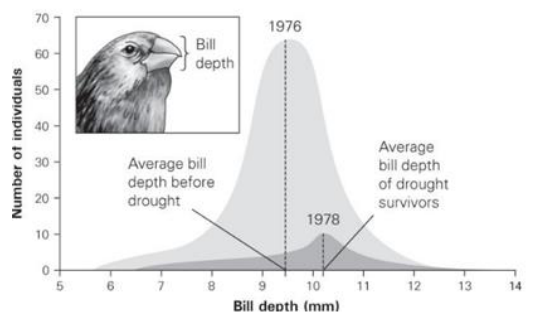
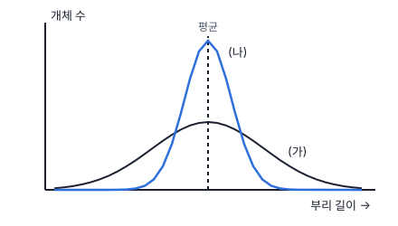
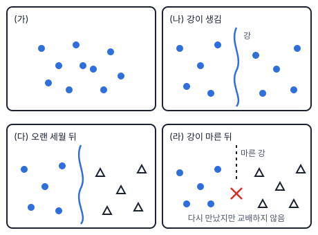

# 복습문제 48선 — 1029 수업 범위

기출 33개(7강 13개·8강 20개)와 생성 변형 15개를 풀어 봐요. 변형 연습은 기본 14개·심화 1개예요. 먼저 풀어 보고, 막히면 힌트를 열어 보세요.

> `복습문제_1029_Microevolution_and_Speciation.html`를 마크다운으로 옮겼어요. 원문, 힌트, 풀이는 접혀 있어요. 먼저 풀어 보고 펼쳐 보세요.

**목차**

- [B. 기출](#partB)
  - [P1. 유전적 부동으로 변한 집단](#p1)
  - [P2. 탈출한 도마뱀 몇 마리가 만든 집단](#p2)
  - [P3. 성선택이 일어나기 위한 조건](#p3)
  - [P4. 항생제 내성 세균 비율의 증가](#p4)
  - [P5. 대립유전자 빈도를 바꾸지 않는 것](#p5)
  - [P6. 산불 뒤 다람쥐와 감염 뒤 다람쥐](#p6)
  - [P7. 우연이 대립유전자 빈도를 바꾸는 현상](#p7)
  - [P8. 새로운 강한 자연선택이 가져올 수 있는 일](#p8)
  - [P9. 기린의 긴 목과 선택 유형](#p9)
  - [P10. 자연선택 직후의 개체군 다양성](#p10)
  - [P11. 상아가 짧아진 코끼리](#p11)
  - [P12. 가뭄 전후 핀치 부리 깊이 분포](#p12)
  - [P13. 우연이 바꾸는 대립유전자 빈도](#p13)
  - [P14. 인간 집단이 한 종인 이유](#p14)
  - [P15. 행동적 격리의 예 고르기](#p15)
  - [P16. 별개의 생물학적 종이 되는 조건](#p16)
  - [P17. 초파리 두 마리가 같은 종인지 검증하기](#p17)
  - [P18. 배수성이 생식적 격리를 만드는 방식](#p18)
  - [P19. 입 모양이 다른 두 송어 집단](#p19)
  - [P20. 아종을 가장 잘 설명한 것](#p20)
  - [P21. 이소적 종분화에서 지리적 분리가 하는 일](#p21)
  - [P22. 접합전 격리기구의 예](#p22)
  - [P23. 정상 잡종의 다음 세대가 약해지는 현상](#p23)
  - [P24. 서로 다른 아종인 두 집단](#p24)
  - [P25. 노새가 자손을 갖지 못하는 이유](#p25)
  - [P26. 파나마 지협의 놀래기를 나눈 요인](#p26)
  - [P27. 종분화 과정이 일어나는 순서](#p27)
  - [P28. 꽃 피는 시기가 다른 난초](#p28)
  - [P29. 대부분의 새 종이 생기는 조건](#p29)
  - [P30. 생물학적 종 개념이 종을 정의하는 근거](#p30)
  - [P31. 종간 교배를 연구할 짝 고르기](#p31)
  - [P32. 꽃 피는 시기가 다른 두 종](#p32)
  - [P33. 밤 길이가 다를 때 꽃 피는 근연종](#p33)
- [C. 변형 연습](#partC)
  - [P34. [변형] 산사태와 매, 무엇이 빈도를 바꿨나](#p34)
  - [P35. [변형] 폭풍에 실려 섬에 간 새들](#p35)
  - [P36. [변형] 평형이 깨진 1세대에서 다음 세대 계산하기](#p36)
  - [P37. [변형] 환자 비율로 역산한 뒤 이주가 바꾼 대립유전자 빈도](#p37)
  - [P38. [변형] 깨진 조건과 소진화 요인 짝짓기](#p38)
  - [P39. [변형] 부리 길이 분포가 바뀐 모양 읽기](#p39)
  - [P40. [변형] 자손 수 표로 상대적 적응도 구하기](#p40)
  - [P41. [변형] 긴 꼬리깃과 성선택](#p41)
  - [P42. [변형] 말라리아가 없는 곳의 낫모양 적혈구 대립유전자](#p42)
  - [P43. [변형] 행동적 격리 고르기](#p43)
  - [P44. [변형] 수정란이 생기기 전에 막히는 격리](#p44)
  - [P45. [변형] 생물학적 종 개념의 기준과 한계](#p45)
  - [P46. [변형] 염색체 수가 다른 두 종의 잡종](#p46)
  - [P47. [변형] 다른 종이 되었다고 말할 수 있는 단계](#p47)
  - [P48. [변형] 염색체 세트가 두 배가 된 식물](#p48)

## B. 기출

### P1. 유전적 부동으로 변한 집단

유전적 부동에 의해 변한 집단은 __________

- (1) 강한 성선택을 겪게 된다
- (2) 자연선택의 결과로 원래 형태로 되돌아간다
- (3) 변화는 우연의 결과이기 때문에 실제로 진화적 변화를 겪지 않는다
- (4) 진화한다
- (5) 언제나 작은 창시자 집단으로부터 출발한다

원문 정보 보기

기출 7강 합본 6번 (PDF 1쪽)

힌트 보기

소진화를 무엇의 변화로 정의했는지 떠올려요. 변화의 원인이 우연인지는 정의에 들어 있지 않아요.

풀이 보기

1. (1) 틀려요. 성선택은 한쪽 성이 짝을 골라 일어나는 선택이에요. 유전적 부동은 우연에 의한 빈도 변화라서 성선택을 일으키는 원인이 아니에요.
2. (2) 틀려요. 유전적 부동은 방향이 없는 우연한 변화예요. 원래 형태로 되돌려 놓는 힘이 없고, 구슬 병 예처럼 한번 사라진 대립유전자는 다시 돌아오지 않아요.
3. (3) 틀려요. 진화(소진화)는 집단의 대립유전자 빈도가 변하는 것이에요. 원인이 우연이어도 빈도가 바뀌었다면 진화가 일어난 거예요.
4. (4) 맞아요. 유전적 부동으로 대립유전자 빈도가 바뀌었으니 그 집단은 진화한 거예요. 소진화는 자연선택만으로 일어나지 않아요.
5. (5) 틀려요. 창시자 효과는 유전적 부동의 한 경우일 뿐이에요. 폭풍이나 지진으로 큰 집단이 갑자기 줄어드는 병목 현상도 유전적 부동이라서 "언제나" 창시자 집단에서 출발하지는 않아요.
6. 수업과의 연결: 1029 수업에서 소진화는 자연선택만으로 일어나지 않고, 생존·생식에 유리한 형질이 아니어도 우연히 늘어날 수 있다고 한 유전적 부동 설명과 이어져요([유전적 부동: 병목 현상과 창시자 효과](정리노트_1029_Microevolution_and_Speciation.md#s0-drift)).

**정답:** (4)

---

### P2. 탈출한 도마뱀 몇 마리가 만든 집단

뉴욕의 롱 아일랜드에 있는 한 도마뱀 개체군은 이탈리아에 있는 한 집단으로부터 유래되었다. 수십 년 전에 애완동물로 팔려서 유입되었고, 이 중 몇몇은 교외에서 탈출하여 새로운 집단을 형성했다. 이는 무엇에 대한 예시인가?

- (1) 창시자 효과
- (2) 집단 병목현상
- (3) 돌연변이
- (4) 자연선택
- (5) 유전자 확산

원문 정보 보기

기출 7강 합본 15번 (PDF 2쪽)

힌트 보기

이탈리아의 원래 집단은 그대로 있고, 몇 마리만 새 땅에서 집단을 시작했어요. 큰 집단이 갑자기 줄어든 경우와 무엇이 다른지 생각해요.

풀이 보기

1. (1) 맞아요. 큰 집단에서 떨어져 나온 적은 수의 개체가 새 지역에 새 집단을 만들었어요. 이때 몇몇 창시자의 유전자가 새 집단의 유전적 조성을 결정하는 것이 창시자 효과예요.
2. (2) 틀려요. 병목현상은 재해 같은 사건으로 한 집단의 개체 수가 시간적으로 급감하는 경우예요. 여기서는 원래 집단이 줄어든 것이 아니라 소수가 공간적으로 떨어져 나왔어요.
3. (3) 틀려요. 돌연변이는 DNA 염기서열이 바뀌어 새 대립유전자가 생기는 것이에요. 문제에는 새 대립유전자가 생겼다는 내용이 없어요.
4. (4) 틀려요. 탈출한 개체들은 형질이 유리해서 고른 것이 아니라 우연히 탈출한 것이에요. 적응한 개체가 더 많이 살아남는 자연선택과는 달라요.
5. (5) 틀려요. 유전자 확산은 이미 있는 집단 사이에서 개체나 종자가 오가며 빈도를 바꾸는 것이에요. 여기서는 기존 집단에 섞여 든 것이 아니라 몇 마리가 새로운 집단을 처음 만들었어요.
6. 수업과의 연결: 1029 수업에서 마션 영상으로 든 예(화성에 닥스훈트와 치와와만 데려가면 그곳 개는 모두 다리가 짧아짐)와, 병목 현상은 시간적·창시자 효과는 공간적이라는 구분과 이어져요([유전적 부동: 병목 현상과 창시자 효과](정리노트_1029_Microevolution_and_Speciation.md#s0-drift)).

**정답:** (1)

---

### P3. 성선택이 일어나기 위한 조건

성선택이 일어나기 위한 특징은?

- (1) 생존률이 증가해야 한다
- (2) 안정화 선택이 일어나야 한다
- (3) 생식력이 증가해야 한다
- (4) 수컷이어야 한다
- (5) 이성 중의 한 쪽이 결정한 선택으로 짝짓기에 영향을 미쳐야 한다

원문 정보 보기

기출 7강 합본 16번 (PDF 2쪽)

힌트 보기

공작 수컷의 화려한 깃은 살아남는 데는 불리해요. 그래도 깃이 남은 까닭이 누가 무엇을 했기 때문인지 떠올려요.

풀이 보기

1. (1) 틀려요. 성선택된 형질은 생존에 오히려 불리할 수 있어요. 공작 수컷의 화려한 깃은 포식자 눈에 잘 띄지만 암컷에게 선택되기 때문에 남아요.
2. (2) 틀려요. 안정화 선택은 양 극단이 불리해 평균 근처만 남는 자연선택의 한 양상이에요. 성선택이 일어나는 데 필요한 조건이 아니에요.
3. (3) 틀려요. 성선택의 핵심은 자식을 낳는 능력 자체가 아니라 짝으로 선택되느냐예요. 선택받은 개체가 짝짓기 기회를 더 얻을 뿐, 생식력이 먼저 늘어나야 하는 것은 아니에요.
4. (4) 틀려요. 수업에서도 자연계에서는 "보통" 암컷이 수컷을 고른다고 했어요. 성선택의 조건은 어느 한쪽 성의 선택이지, 특정 성이 수컷이어야 한다는 것이 아니에요.
5. (5) 맞아요. 한쪽 성이 좋아하는 이성을 골라 짝짓기하면 선택된 형질의 대립유전자가 다음 세대에 많아져요. 이것이 성선택이에요.
6. 수업과의 연결: 1029 수업에서 성선택은 좋아하는 이성을 골라 교배하는 것이고, 공작 깃처럼 생존에 불리해도 암컷에게 선택되어 유지된다고 한 설명과 이어져요([성선택과 성적이형성](정리노트_1029_Microevolution_and_Speciation.md#s1-sexual)).

**정답:** (5)

---

### P4. 항생제 내성 세균 비율의 증가

1980년대, 모든 *Staphylococcus aureus* 의 1 % ~ 5 % 만이 항생제에 강한 내성을 보였다. 현재는 60 % ~ 70 % 가 내성을 보인다. 이것은 무엇에 대한 예시인가?

- (1) 인간의 안정화 선택
- (2) 인간의 방향성 선택
- (3) 세균의 분단성 선택
- (4) 세균의 안정화 선택
- (5) 세균의 방향성 선택

원문 정보 보기

기출 7강 합본 28번 (PDF 4쪽)

힌트 보기

빈도가 바뀐 것은 누구의 집단인지, 그리고 내성 쪽 분포가 어느 방향으로 움직였는지 봐요.

풀이 보기

1. (1) 틀려요. 내성 비율이 바뀐 것은 세균 집단이에요. 사람은 항생제를 써서 선택 환경을 만든 쪽이고, 안정화 선택처럼 평균이 그대로인 변화도 아니에요.
2. (2) 틀려요. 한쪽으로 바뀐 것은 맞지만, 선택을 받아 빈도가 변한 것은 사람이 아니라 세균 집단이에요.
3. (3) 틀려요. 분단성 선택은 중간이 불리해 양 극단이 남아 피크가 두 개가 되는 경우예요. 여기서는 내성이 있는 한쪽만 늘었어요.
4. (4) 틀려요. 안정화 선택은 평균은 그대로이고 극단이 사라지는 경우예요. 여기서는 내성 쪽으로 평균 자체가 이동했어요.
5. (5) 맞아요. 항생제가 있는 환경에서 내성 세균이 더 많이 살아남아 자손을 남기므로, 세균 집단이 내성이 있는 한쪽 방향으로 이동했어요. 이것이 세균의 방향성 선택이에요.
6. 수업과의 연결: 1029 수업 퀴즈에서 항생제 내성 획득을 다형화 선택이라고 한 답을, 교수님이 없다가 있게 된 것은 있는 방향으로 바뀐 것이라며 방향성 선택으로 고친 장면과 이어져요([상대적 적응도와 자연선택의 세 양상](정리노트_1029_Microevolution_and_Speciation.md#s1-fitness)).

**정답:** (5)

---

### P5. 대립유전자 빈도를 바꾸지 않는 것

대립유전자 빈도를 변화시키는 요소가 아닌 것은?

- (1) 유전적 부동
- (2) 돌연변이
- (3) 선택적 교배
- (4) 획득형질
- (5) 자연선택

원문 정보 보기

기출 7강 합본 33번 (PDF 5쪽)

힌트 보기

빈도가 바뀌려면 바뀐 것이 자손에게 전달되어야 해요. 생애 동안 얻은 특징이 유전자에 남는지 생각해요.

풀이 보기

1. (1) 틀려요. 유전적 부동은 우연한 사건으로 대립유전자 빈도가 바뀌는 것이라 빈도를 바꾸는 요소예요.
2. (2) 틀려요. 돌연변이는 DNA 염기서열을 바꿔 새 대립유전자를 만들므로 대립유전자 빈도를 바꿔요.
3. (3) 출제 의도로는 답이 아니지만, 교재 기준으로는 답이 될 수 있어요. 수업에서는 성선택을 선택적 교배와 같은 것으로 묶어, 특정 형질의 수컷만 선택되면 그 대립유전자가 다음 세대에 많아진다고 설명했어요. 출제 의도는 이 설명을 따라 선택적 교배를 빈도를 바꾸는 요소로 본 거예요. 하지만 교재 표 7.3은 선택적 교배가 대립유전자 빈도를 직접 바꾸지 않는다고 정리하고, 강의노트도 근친교배가 유전자형 빈도(동형접합자 증가, 이형접합자 감소)에 영향을 준다고만 적어요. 짝을 고르는 것만으로는 집단 안의 대립유전자 수가 늘거나 줄지 않고 조합만 바뀌기 때문이에요.
4. (4) 맞아요. 획득형질은 생애 동안 얻은 특징이라 유전자를 바꾸지 않고 자손에게 전달되지 않아요. 그래서 어떤 해석으로 봐도 대립유전자 빈도를 바꾸는 요소가 아니에요.
5. (5) 틀려요. 자연선택은 적응한 개체가 자식을 더 많이 남기게 해 그 형질의 대립유전자 빈도를 높여요.
6. 수업과의 연결: 1029 수업에서 하디-바인베르크 평형 조건을 뒤집으면 돌연변이, 이동, 작은 개체군(유전적 부동), 자연선택, 선택적 교배가 소진화 요인이 된다고 정리한 내용과 이어져요. 획득형질은 1027 수업에서 배운 라마르크의 설명이에요([조건이 깨지면 소진화: 돌연변이와 유전자 확산](정리노트_1029_Microevolution_and_Speciation.md#s0-factors)).

**정답:** (4)

이 문항은 답이 하나로 정해지지 않는 모호한 문항이에요. 인쇄된 답과 출제 의도는 (4)예요. 하지만 교재 표 7.3 기준(선택적 교배는 대립유전자 빈도에 직접 영향을 주지 않음)으로 읽으면 (3)도 "대립유전자 빈도를 변화시키는 요소가 아닌 것"으로 성립해요. (4) 획득형질은 유전되지 않으므로 어느 기준으로 봐도 빈도를 바꾸지 않아요. 그래서 가장 확실한 답인 (4)를 정답으로 둬요.

---

### P6. 산불 뒤 다람쥐와 감염 뒤 다람쥐

산불이나 홍수는 숲에 있는 다람쥐 집단의 90%를 죽인다. 남아있는 다람쥐들은 초기와 완전히 다른 집단으로 진화한다. 다른 숲에서는 세균 감염은 다람쥐의 90%를 죽이고, 남은 다람쥐는 또한 구별되는 집단으로 진화한다. 첫 번째 예시는 ( )이고 두 번째는 ( )이다. 괄호에 들어갈 가장 알맞은 용어가 순서대로 짝지어 진 것은?

- (1) 유전전 부동, 자연선택
- (2) 단속평형설, 수렴진화
- (3) 병목현상, 유전적 부동
- (4) 점진주의설, 단속평형설
- (5) 자연선택, 적응방산

원문 정보 보기

기출 7강 합본 34번 (PDF 5쪽)

힌트 보기

산불은 다람쥐의 형질을 보고 죽이지 않아요. 세균 감염은 어떤 다람쥐를 더 많이 살려 둘지 생각해요.

풀이 보기

1. (1) 맞아요. 산불·홍수는 형질과 상관없이 무작위로 죽이므로 살아남은 10%는 운으로 남은 것이고, 이것은 유전적 부동이에요(병목 현상). 세균 감염은 저항성이 있는 다람쥐가 더 많이 살아남아 자손을 남겼다고 보면(출제 의도) 자연선택이에요.
2. (2) 틀려요. 첫 번째 사례는 우연한 대량 사망에 의한 유전적 부동인데, 이 보기의 첫 용어는 유전적 부동이 아니에요.
3. (3) 틀려요. 첫 번째를 병목현상으로 본 것은 맞아요(병목 현상도 유전적 부동이에요). 출제 의도는 두 번째 사례를 감염에 대한 저항성에 따라 생존이 갈린 경우로 본 것이라, 그렇게 보면 우연이 아니라 자연선택이에요. 다만 지문이 저항성을 직접 밝히지는 않고, 교재 p.149는 질병도 병목현상의 원인으로 들어요. 그래도 두 사례를 대비시킨 문항이라 출제 의도에 더 알맞은 것은 (1)이에요.
4. (4) 틀려요. 첫 번째 사례는 우연한 대량 사망에 의한 유전적 부동인데, 이 보기의 첫 용어는 유전적 부동이 아니에요.
5. (5) 틀려요. 산불은 잘 적응한 다람쥐를 골라 살려 두지 않아요. 첫 번째 사례는 자연선택이 아니라 유전적 부동이에요.
6. 수업과의 연결: 1029 수업에서 "70점 이하는 나가"는 자연선택, "이 줄만 남아"는 유전적 부동이라고 대비한 강의실 예와 이어져요([유전적 부동: 병목 현상과 창시자 효과](정리노트_1029_Microevolution_and_Speciation.md#s0-drift)).

**정답:** (1)

보기 (1)의 "유전전 부동"은 "유전적 부동"의 오타예요. 원문 글자 그대로 실었어요.

---

### P7. 우연이 대립유전자 빈도를 바꾸는 현상

우연한 일들이 대립유전자의 빈도에 예상치 못한 변화를 초래하는 현상을 무엇이라고 부르는가?

- (1) 유전자 확산
- (2) 근친교배
- (3) 평형다형성
- (4) 유전적 부동
- (5) 안정화 선택

원문 정보 보기

기출 7강 합본 44번 (PDF 6쪽)

힌트 보기

소진화 요인 가운데 정의에 "우연"이라는 말이 들어가는 것은 하나뿐이에요.

풀이 보기

1. (1) 틀려요. 유전자 확산은 개체나 종자가 이동(유입·유출)해서 빈도가 바뀌는 것이에요. 원인이 우연한 사건이 아니라 이동이에요.
2. (2) 틀려요. 근친교배는 가까운 친척끼리 교배하는 선택적 교배로, 동형접합자를 늘려 유전자형 빈도를 바꿔요. 우연한 사건 때문에 생기는 변화가 아니에요.
3. (3) 틀려요. 평형다형성은 한쪽 대립유전자가 많아지면 불리해지는 식으로 여러 대립유전자가 평형을 이루며 유지되는 것이에요. 예상치 못한 변화가 아니라 유지를 설명해요.
4. (4) 맞아요. 유전적 부동은 우연한 사건 때문에 대립유전자 빈도가 변하는 것이에요. 작은 집단일수록 그 영향이 커요.
5. (5) 틀려요. 안정화 선택은 양 극단이 불리해 평균 근처가 남는 자연선택의 한 양상이에요. 우연이 아니라 적응도 차이로 일어나요.
6. 수업과의 연결: 1029 수업에서 유전적 부동을 우연한 사건 때문에 대립유전자 빈도가 변하는 것이라고 정의하고, 병 입구의 구슬 몇 개만 남는 구슬 병으로 보여 준 설명과 이어져요([유전적 부동: 병목 현상과 창시자 효과](정리노트_1029_Microevolution_and_Speciation.md#s0-drift)).

**정답:** (4)

---

### P8. 새로운 강한 자연선택이 가져올 수 있는 일

어떤 개체군이 지금과는 다른 강력한 자연선택을 겪을 때, 무슨 일이 일어날 수 있는가?

- (1) 개체군이 멸종한다.
- (2) 가장 흔한 형태가 덜 일반적이게 되고, 덜 흔한 형태가 더 일반적이게 된다.
- (3) 생명체의 가장 일반적인 형태가 다른 형태로 대체된다.
- (4) 보기 모두 일어날 수 있다.
- (5) 변이가 감소하고 생명체가 더 비슷해진다.

원문 정보 보기

기출 7강 합본 47번 (PDF 6쪽)

힌트 보기

발문은 "일어날 수 있는가"를 물어요. 선택이 어느 쪽으로 작용하느냐에 따라 가능한 결과를 하나씩 따져요.

풀이 보기

1. (1) 틀려요. 이 일도 일어날 수 있지만, 이것 하나만 고르면 다른 가능성이 빠져요. 새 환경에 맞는 변이가 개체군 안에 없으면 살아남아 자식을 남기는 개체가 없어 멸종할 수 있어요.
2. (2) 틀려요. 이 일도 일어날 수 있지만, 이것 하나만 고르면 다른 가능성이 빠져요. 방향성 선택으로 드물던 극단 쪽이 유리해지면, 흔하던 형태는 줄고 드물던 형태가 흔해질 수 있어요.
3. (3) 틀려요. 이 일도 일어날 수 있지만, 이것 하나만 고르면 다른 가능성이 빠져요. 방향성 선택에서는 평균 자체가 이동하므로, 가장 흔하던 형태가 다른 형태로 바뀔 수 있어요.
4. (4) 맞아요. 선택이 어떻게 작용하느냐에 따라 (1), (2), (3), (5)가 모두 일어날 수 있어요.
5. (5) 틀려요. 이 일도 일어날 수 있지만, 이것 하나만 고르면 다른 가능성이 빠져요. 안정화 선택처럼 극단이 제거되거나 덜 적합한 개체가 걸러지면 변이가 줄고 개체들이 더 비슷해질 수 있어요.
6. 수업과의 연결: 1029 수업에서 방향성 선택은 평균이 이동하고 안정화 선택은 분포가 홀쭉해진다고 비교한 설명, 유전적 다양성이 줄수록 멸종 확률이 높아진다는 설명과 이어져요([상대적 적응도와 자연선택의 세 양상](정리노트_1029_Microevolution_and_Speciation.md#s1-fitness)).

**정답:** (4)

---

### P9. 기린의 긴 목과 선택 유형

기린의 긴 목은 어떤 선택 유형인가?

- (1) 정답이 여러 개이다
- (2) 방향성 선택
- (3) 획득형질
- (4) 안정화 선택
- (5) 다양화 선택

원문 정보 보기

기출 7강 합본 51번 (PDF 7쪽)

힌트 보기

목이 긴 쪽 한 극단이 계속 유리했다면 목 길이 분포의 평균이 어떻게 움직일지 생각해요.

풀이 보기

1. (1) 틀려요. 목 길이는 긴 쪽 한 방향으로만 이동했으므로 세 양상 가운데 하나로 정해져요.
2. (2) 맞아요. 목이 긴 개체가 자식을 더 많이 남기면 목 길이 분포의 평균이 긴 쪽으로 이동해요. 한쪽 극단이 유리한 방향성 선택이에요.
3. (3) 틀려요. 획득형질은 선택 유형이 아니에요. 목을 늘이려 애써 길어진 목이 자손에게 전해졌다는 라마르크식 설명에 쓰이는 말이고, 획득형질은 유전되지 않아요.
4. (4) 틀려요. 안정화 선택은 양 극단이 불리해 평균은 그대로이고 분포만 홀쭉해지는 경우예요. 기린 목은 평균 자체가 긴 쪽으로 이동했어요.
5. (5) 틀려요. ‘다양화 선택’은 수업·강의노트의 세 양상 이름에 없는 이름이에요. 분단성(다형화) 선택처럼 중간이 불리해 봉우리가 둘로 갈라지는 경우를 뜻한다고 해도, 기린 목은 두 무리로 갈라지지 않고 한 방향으로 길어졌으므로 맞지 않아요.
6. 수업과의 연결: 1029 수업에서 세 양상은 이름에 답이 들어 있다며, 한쪽 극단의 적응도가 낮으면 평균 자체가 한쪽으로 이동한다고 한 방향성 선택 설명과 이어져요. 기린 목의 라마르크식 설명은 1027 수업 내용이에요([상대적 적응도와 자연선택의 세 양상](정리노트_1029_Microevolution_and_Speciation.md#s1-fitness)).

**정답:** (2)

---

### P10. 자연선택 직후의 개체군 다양성

개체군에 자연선택이 작용하면, 직후의 개체군 다양성은 일반적으로 어떻게 될 것인가?

- (1) 변화 없다
- (2) 감소
- (3) 알 수 없다
- (4) 증가

원문 정보 보기

기출 7강 합본 59번 (PDF 7쪽)

힌트 보기

자연선택은 덜 적합한 개체를 걸러 내요. 걸러진 뒤 남은 개체들이 더 다양해질지 더 비슷해질지 생각해요.

풀이 보기

1. (1) 틀려요. 덜 적합한 개체는 자식을 적게 남기므로 그 형질의 대립유전자가 줄어요. 개체군의 구성은 바뀌어요.
2. (2) 맞아요. 방향성 선택은 한쪽 극단을, 안정화 선택은 양 극단을 걸러 내므로 남은 개체들의 변이가 줄어요. 다만 분단성 선택은 중간이 걸러지고 양 극단이 남아 두 무리로 다양해질 수 있는 예외라서, 발문에 "일반적으로"가 붙어 있어요.
3. (3) 틀려요. 양상마다 결과가 조금씩 다르긴 하지만, 덜 적합한 형질이 제거된다는 일반적인 경향은 감소로 말할 수 있어요.
4. (4) 틀려요. 자연선택은 이미 있는 변이 가운데 일부를 남길 뿐 새 변이를 만들지 않아요. 새 대립유전자는 돌연변이로 생겨요.
5. 수업과의 연결: 1029 수업에서 안정화 선택은 분포가 홀쭉해져 극단이 사라지고, 분단성(다형화) 선택은 피크가 두 개가 되어 다양해진다고 비교한 설명과 이어져요([상대적 적응도와 자연선택의 세 양상](정리노트_1029_Microevolution_and_Speciation.md#s1-fitness)).

**정답:** (2)

---

### P11. 상아가 짧아진 코끼리

코끼리의 상아는 세계에서 가치가 가장 높은 상품 중 하나이다. 그 결과 지난 몇 세기 동안 큰 상아를 가지고 있는 수컷 아프리카 코끼리는 심하게 사냥 당해왔다. 오늘날 완전히 성장한 수컷 코끼리는 1900년대 초의 수컷 코끼리와 비교할 때 상당히 짧은 상아를 가지고 있다. 이것은 무엇에 대한 예시인가?

- (1) 안정화 선택
- (2) 방향성 선택
- (3) 분단성 선택
- (4) 정답이 여러 개이다
- (5) 역진화

원문 정보 보기

기출 7강 합본 62번 (PDF 8쪽)

힌트 보기

사냥으로 사라진 쪽이 상아 길이 분포의 한쪽 끝인지, 양 끝인지, 가운데인지 먼저 봐요.

풀이 보기

1. (1) 틀려요. 안정화 선택은 양 극단이 모두 불리해서 평균은 그대로 두고 분포만 홀쭉해지는 경우예요. 여기서는 큰 상아 한쪽만 불리했고 평균 상아 길이가 짧아졌어요.
2. (2) 맞아요. 큰 상아를 가진 수컷이 사냥당해 자식을 덜 남기니 상대적 적응도가 낮아졌어요. 짧은 상아 쪽 대립유전자가 다음 세대에 더 많이 남아 평균이 짧은 쪽으로 이동했으니 방향성 선택이에요.
3. (3) 틀려요. 분단성 선택은 가운데가 불리해서 양 극단이 남고 봉우리가 두 개가 되는 경우예요. 중간 길이 상아가 사라졌다는 정보는 없어요.
4. (4) 틀려요. 평균이 한쪽으로 이동한 변화는 세 양상 가운데 방향성 선택 하나에만 맞아요.
5. (5) 틀려요. 상아가 짧아진 것도 대립유전자 빈도가 바뀐 소진화예요. 진화에는 정해진 앞뒤 방향이 없어서 형질이 작아지는 쪽으로 바뀌어도 '거꾸로 가는 진화'라고 부르지 않아요.
6. 수업과의 연결: 1029 수업에서 꼬리 길이 분포의 한쪽 끝이 불리하면 평균 자체가 옮겨 간다고 한 방향성 선택과, "없다가 있게 된 것은 있는 방향으로 바뀐 것"이라고 정정한 항생제 내성 퀴즈와 이어져요([상대적 적응도와 자연선택의 세 양상](정리노트_1029_Microevolution_and_Speciation.md#s1-fitness)).

**정답:** (2)

---

### P12. 가뭄 전후 핀치 부리 깊이 분포

그림을 참고하였을 때, 1976년에서 1978년으로 변화는 무엇을 나타내는가?

- (1) 방향성 선택
- (2) 지속적으로 사용한 방식에 따라 부리의 모양이 변한다.
- (3) 분단성 선택
- (4) 안정화 선택
- (5) 핀치 개체군은 진화적 변화의 결과로써 급격하게 커졌다.

원문 정보 보기

기출 7강 합본 64번 (PDF 8쪽)

힌트 보기

두 곡선의 평균선(점선) 위치를 비교해요. 봉우리가 옮겨 갔는지, 홀쭉해졌는지, 둘로 갈라졌는지 봐요.

풀이 보기

1. (1) 맞아요. 가뭄 전 평균 부리 깊이는 약 9.5mm, 가뭄에서 살아남은 새의 평균은 약 10mm 남짓이에요. 봉우리 하나가 깊은 부리 쪽으로 옮겨 갔으니 방향성 선택이에요.
2. (2) 틀려요. 부리를 많이 써서 생긴 변화가 자식에게 전해진다는 것은 용불용설과 획득형질의 유전이에요. 그림은 원래 있던 부리 깊이 변이 가운데 깊은 쪽 개체가 더 많이 살아남은 결과를 보여 줘요.
3. (3) 틀려요. 분단성 선택이면 가운데가 줄고 양쪽 끝에 봉우리 두 개가 생겨야 해요. 1978년 분포도 봉우리가 하나예요.
4. (4) 틀려요. 안정화 선택이면 평균선은 그대로이고 분포만 좁아져야 해요. 여기서는 평균선 자체가 오른쪽으로 옮겨 갔어요.
5. (5) 틀려요. 세로축은 개체 수예요. 1978년 곡선은 1976년보다 훨씬 낮아서 개체군은 커진 것이 아니라 크게 줄었어요.
6. 수업과의 연결: 1029 수업에서 정규분포의 한쪽이 불리하면 평균 자체가 옮겨 가고, 안정화 선택은 평균은 그대로 분포만 홀쭉해진다고 대비한 설명과 이어져요([상대적 적응도와 자연선택의 세 양상](정리노트_1029_Microevolution_and_Speciation.md#s1-fitness)). (2)의 용불용설은 1027 수업 내용이에요([용불용설](../../1027/정리노트_1027_Evolutionary_Thought_and_Microevolution.html#s0-lamarck)).

**정답:** (1)

---

### P13. 우연이 바꾸는 대립유전자 빈도

우연한 일등이 대립유전자의 빈도에 예상치 못한 변화를 초래하는 현상을 무엇이라고 부르는가?

- (1) 유전자 확산
- (2) 유전적 부동
- (3) 근친교배
- (4) 평형다형성
- (5) 안정화선택

원문 정보 보기

기출 7강 합본 69번 (PDF 9쪽)

힌트 보기

발문의 핵심 낱말은 '우연'이에요. 잘나서가 아니라 운으로 살아남는 경우를 떠올려요.

풀이 보기

1. (1) 틀려요. 유전자 확산은 다른 집단에서 종자나 개체가 들어오거나 나가면서 대립유전자 빈도가 바뀌는 것이에요. 원인이 우연이 아니라 이동이에요.
2. (2) 맞아요. 유전적 부동은 폭풍·지진 같은 우연한 사건으로 대립유전자 빈도가 바뀌는 현상이에요. 병목 현상과 창시자 효과가 대표적이고, 작은 집단일수록 영향이 커요.
3. (3) 틀려요. 근친교배는 가까운 친척끼리 교배하는 비무작위 교배예요. 우연이 아니라 짝을 고르는 방식 때문에 동형접합자가 늘고 이형접합자가 줄어요.
4. (4) 틀려요. 평형다형성은 한쪽이 많아지면 그쪽이 불리해져 여러 대립유전자가 평형을 이루며 유지되는 것이에요. 예상치 못한 우연한 변화가 아니라 선택이 빈도를 붙잡아 두는 상태예요.
5. (5) 틀려요. 안정화선택은 양 극단이 불리해서 평균 쪽 개체가 더 많이 살아남는 자연선택이에요. 적응도 차이 때문에 생기는 변화라 우연과는 달라요.
6. 수업과의 연결: 1029 수업에서 "70점 이하는 나가"는 자연선택, "이 줄만 남아"는 유전적 부동이라고 대비한 강의실 예와 구슬 병·마션 예와 이어져요([유전적 부동: 병목 현상과 창시자 효과](정리노트_1029_Microevolution_and_Speciation.md#s0-drift)).

**정답:** (2)

발문의 "일등이"는 "일들이"의 오타로 보여요. 문제는 원문 그대로 실었어요.

---

### P14. 인간 집단이 한 종인 이유

많은 혈통에 대한 증거에 의하면 인간 집단들은 구별되는 품종이 아니라는 것을 가리킨다. 생물학적 종 개념에 근거하여, 지역적 조건에 대한 적응이 발생했음에도 인간 집단들이 같은 종이라고 생각되는 이유는 무엇인가?

- (1) 각 인종은 진화계통수가 같은 집단이기 때문에
- (2) 다른 집단의 구성원들이 서로서로 교배를 할 수 있다
- (3) 자연선택이 인간의 모든 집단에 대해 같은 방법으로 일어난다
- (4) 피부색을 제외한 형질이 유사하다
- (5) 모든 DNA가 일치하기 때문에

원문 정보 보기

기출 8강 합본 1번 (PDF 1쪽)

힌트 보기

발문이 '생물학적 종 개념에 근거하여'라고 기준을 정해 줬어요. 그 개념이 무엇 하나만 보는지 떠올려요.

풀이 보기

1. (1) 틀려요. 진화 역사를 공유하는지로 나누는 것은 계통발생적 종 개념 쪽 생각이에요. 생물학적 종 개념의 기준이 아니에요.
2. (2) 맞아요. 생물학적 종 개념은 자연 상태에서 교배해 생식력 있는 자손을 낳으면 같은 종으로 봐요. 지역마다 적응한 형질이 달라도 인간 집단끼리는 서로 교배할 수 있어요.
3. (3) 틀려요. 발문부터 지역적 조건에 대한 적응이 일어났다고 했어요. 자연선택은 지역마다 다르게 작용했고, 같은 종인지는 선택 방식이 아니라 교배 가능성으로 정해요.
4. (4) 틀려요. 형질이 비슷한지로 판단하는 것은 형태학적 종 개념이에요. 생김새가 매우 다른 개 두 마리도 같은 종이고, 비슷하게 생긴 잠자리 두 마리도 다른 종일 수 있어요.
5. (5) 틀려요. 같은 종 안에서도 개체마다 DNA는 조금씩 달라요. 이 변이가 있어야 자연선택도 일어나요.
6. 수업과의 연결: 1029 수업에서 "중요한 거는 생물학적 종 개념입니다. 오로지 생식 여부로만 판단"이라고 강조하고 잠자리와 개 예로 형태학적 종 개념과 대비한 설명과 이어져요([종 개념과 아종](정리노트_1029_Microevolution_and_Speciation.md#s2-species)).

**정답:** (2)

---

### P15. 행동적 격리의 예 고르기

다음 중 행동적 격리의 예는?

- (1) 말과 당나귀의 잡종은 불임이다
- (2) 매미의 어떤 종은 애벌레로 17년을 보낸 후 성체가 되어 교미를 한다
- (3) 몇 종의 데이지 꽃은 밤의 길이가 9시간보다 더 길 때에만 꽃을 피운다
- (4) 장미의 꽃가루는 나팔꽃의 난자에 의해 인식되지 못한다
- (5) 암컷 거미는 같은 종의 수컷이 독특한 방법으로 날개를 건드릴 때에만 교미를 한다

원문 정보 보기

기출 8강 합본 2번 (PDF 1쪽)

힌트 보기

행동적 격리는 구애 신호를 서로 알아보지 못해 짝짓기가 안 되는 경우예요. 각 보기가 '언제', '어떤 구조', '어떤 신호' 중 무엇을 말하는지 나눠요.

풀이 보기

1. (1) 틀려요. 노새처럼 잡종이 태어났지만 생식세포를 못 만드는 것은 접합 후 장벽인 잡종 불임이에요.
2. (2) 틀려요. 17년이라는 생활 주기 때문에 교미하는 시기가 다른 종과 어긋나는 것은 시간적 격리예요.
3. (3) 틀려요. 밤 길이 조건에 따라 꽃 피는 시기가 정해지면 다른 종과 꽃가루받이 시기가 엇갈려요. 이것도 시간적 격리예요.
4. (4) 틀려요. 꽃가루(정자 쪽)와 난자가 서로 알아보지 못해 수정이 안 되는 것은 배우자 격리예요.
5. (5) 맞아요. 암컷이 같은 종 수컷의 독특한 구애 신호에만 반응해 교미하는 것은 행동적 격리예요. 판단의 핵심은 종마다 다른 구애 신호를 알아봐야 짝짓기한다는 점이에요.
6. 수업과의 연결: 1029 수업에서 반딧불이의 빛 패턴과 옥상 프러포즈 예로 설명한 행동적 격리, 봄꽃과 가을꽃의 시간적 격리, 열쇠와 자물쇠 같은 배우자 격리와 이어져요([접합 전 장벽 다섯 가지](정리노트_1029_Microevolution_and_Speciation.md#s2-prezygotic)).

**정답:** (5)

보기 (5)의 "날개"는 원문 표현 오류로 보여요. 거미에게는 날개가 없어요. 문제는 원문 그대로 실었고, 같은 종 수컷의 독특한 구애 신호에만 반응한다는 핵심은 그대로이므로 답은 (5)예요.

---

### P16. 별개의 생물학적 종이 되는 조건

생물의 두 집단이 별개의 생물학적 종들로 간주되려면, 이들에 대한 설명으로 맞는 것은?

- (1) 공통조상이 달라야 한다
- (2) 외형적으로 서로 매우 달라야 한다
- (3) 서로 생식적으로 격리되어야 한다
- (4) 보기 모두 맞다
- (5) 생존 가능한 자손을 생산할 수 없어야 한다

원문 정보 보기

기출 8강 합본 3번 (PDF 1쪽)

힌트 보기

노새를 떠올려요. 노새는 살아서 태어나지만 말과 당나귀는 다른 종이에요.

풀이 보기

1. (1) 틀려요. 종은 공통조상에서 갈라져 생겨요. 다른 두 종도 거슬러 올라가면 공통조상을 공유하므로 이 조건은 기준이 될 수 없어요.
2. (2) 틀려요. 외형으로 나누는 것은 형태학적 종 개념이에요. 생김새가 매우 다른 개들도 같은 종이고, 비슷한 잠자리도 다른 종일 수 있어요.
3. (3) 맞아요. 생물학적 종 개념에서 두 집단이 다른 종이려면 자연 상태에서 교배하지 못하거나, 교배해도 생식력 있는 자손을 낳지 못해야 해요. 이것이 생식적 격리예요.
4. (4) 틀려요. (1)과 (2)가 틀렸으므로 모두 맞을 수 없어요.
5. (5) 틀려요. 지나친 조건이에요. 노새는 생존 가능한 자손이지만 불임이어서 말과 당나귀는 다른 종이에요. 생존하는 잡종이 나와도 그 잡종이 생식력이 없으면 생식적 격리예요.
6. 수업과의 연결: 1029 수업에서 생물학적 종 개념을 "교배가 가능하고 생식력 있는 자손을 낳으면 같은 종"으로 정의하고, 노새의 잡종 불임을 접합 후 장벽으로 설명한 내용과 이어져요([종 개념과 아종](정리노트_1029_Microevolution_and_Speciation.md#s2-species)).

**정답:** (3)

(5)는 얼핏 그럴듯하지만, 살아 있어도 불임인 잡종(노새)까지 생식적 격리에 들어가므로 별개 종의 조건으로는 지나치게 좁아요. 그래서 생식적 격리 전체를 말한 (3)이 답이에요.

---

### P17. 초파리 두 마리가 같은 종인지 검증하기

만약 여러분이 암컷 초파리와 수컷 초파리를 가지고 있다면, 어떻게 그들이 같은 종이라는 가설을 가장 간단하게 검증할 수 있겠는가?

- (1) 여러 먹이를 제공하고 같은 먹이를 선호하는지 확인한다
- (2) 서로에게 구애행동을 하는지 확인한다
- (3) 초파리들이 짝짓기 하는지, 그들의 자손 또한 짝짓기 할 수 있는지 확인한다
- (4) 초파리들이 같은 수의 염색체를 갖고 있는지 확인한다
- (5) 각 초파리의 아미노산 서열을 확인한다

원문 정보 보기

기출 8강 합본 5번 (PDF 1쪽)

힌트 보기

생물학적 종 개념의 두 단계, 교배가 되는지와 그 자손이 생식력이 있는지를 둘 다 확인하는 보기를 찾아요.

풀이 보기

1. (1) 틀려요. 먹이 선호는 사는 곳·생활 방식에 관한 정보일 뿐이에요. 먹이가 같아도 다른 종일 수 있어 같은 종인지 판정하지 못해요.
2. (2) 틀려요. 구애행동은 교배의 첫 단계일 뿐이에요. 구애를 해도 수정이 안 되거나 자손이 불임이면 다른 종이므로 이것만으로는 부족해요.
3. (3) 맞아요. 짝짓기로 자손이 생기고, 그 자손도 다시 짝짓기해 번식할 수 있으면 생식력 있는 자손을 낳은 것이에요. 생물학적 종 개념의 기준을 그대로 확인하는 방법이에요.
4. (4) 틀려요. 염색체 수는 간접 정보예요. 생물학적 종 개념은 염색체 수가 아니라 실제로 생식력 있는 자손이 나오는지로 판단해요.
5. (5) 틀려요. 같은 종 안에서도 개체마다 유전 정보가 조금씩 달라요. 서열이 비슷한지 비교하는 것은 교배 여부를 직접 보는 것보다 간단하지도 않고 생식 여부를 판정하지도 못해요.
6. 수업과의 연결: 1029 수업에서 "오로지 생식 여부로만 판단"한다고 한 생물학적 종 개념과, 동물원의 사자·호랑이 잡종처럼 자식이 나와도 불임이면 다른 종이라고 한 설명과 이어져요([종 개념과 아종](정리노트_1029_Microevolution_and_Speciation.md#s2-species)).

**정답:** (3)

---

### P18. 배수성이 생식적 격리를 만드는 방식

배수성이 어떤 방식으로 생식적 격리를 야기하는가?

- (1) 생식세포에서 염색체의 수를 변하게 한다
- (2) 생식 시기를 변화시킨다
- (3) 생식 기관을 만드는 유전자의 지시를 변화시킨다
- (4) 개체가 살수 있는 서식지를 변화시킨다
- (5) 개체의 먹이 선호도를 변화시킨다

원문 정보 보기

기출 8강 합본 7번 (PDF 1쪽)

힌트 보기

4n 식물이 만드는 배우자의 염색체 수와, 그것이 원래 2n 식물의 배우자와 만났을 때 생기는 자손을 따라가 봐요.

풀이 보기

1. (1) 맞아요. 4n 식물은 감수분열로 2n 배우자를 만들어요. 이것이 2n 식물의 n 배우자와 만나면 3n 자손이 되고, 3n은 짝 없는 염색체 세트 때문에 감수분열을 못 해 불임이에요. 그래서 4n은 원래 집단과 한 세대 만에 생식적으로 격리돼요.
2. (2) 틀려요. 생식 시기가 달라지는 것은 시간적 격리예요. 배수성은 시기가 아니라 염색체 세트 수를 바꿔요.
3. (3) 틀려요. 배수성은 특정 유전자의 내용을 바꾸는 것이 아니라 염색체 세트 전체의 수를 늘리는 변화예요.
4. (4) 틀려요. 서식지가 달라지는 것은 생태적 격리예요. 배수체는 같은 장소에 살면서도 격리되므로 동소적 종분화의 예예요.
5. (5) 틀려요. 먹이 선호는 배수성과 관계없어요. 격리의 원인은 3n 잡종이 불임이라는 점이에요.
6. 수업과의 연결: 1029 수업에서 "매우 강력한 동소적 종분화의 메커니즘"이라고 두 번 강조한 배수성, 그리고 3n이 불임인 이유를 노새와 같은 논리로 설명한 내용과 이어져요([배수성: 한 세대 만의 종분화](정리노트_1029_Microevolution_and_Speciation.md#s3-polyploidy)).

**정답:** (1)

---

### P19. 입 모양이 다른 두 송어 집단

한 생물학자가 지난 25년 동안 몬타나 주의 두 송어 군집을 연구하고 있다. 이 두 집단은 하나의 공통 집단으로부터 생겨났다. 남쪽에 있는 집단은 약간 변형된 입 모양을 하고 있지만 북쪽에 위치하는 집단은 원래의 모습을 그대로 유지하고 있다. 새로운 입 모양은 남쪽 집단의 서식지에만 존재하는 먹이를 잡는 데 더 효과적이다. 어떤 설명이 두 송어 집단에서의 유전자 차이를 가장 잘 설명하는가?

- (1) 이러한 변이를 유발하는 돌연변이 유전자는 남쪽 집단에만 존재하였다
- (2) 남쪽 군집의 송어는 먹이에 따라 지속적으로 입을 사용하면서 입모양의 변화를 획득했다
- (3) 남쪽 집단에서 새로운 돌연변이는 새로운 먹이에 노출되면서 생겨났다
- (4) 북쪽 집단의 송어에서도 작은 빈도이지만 유사한 돌연변이가 존재한다. 다만 이러한 돌연변이를 갖는 것이 생존에 이점이 되지 않기 때문에 선택되지는 않았다

원문 정보 보기

기출 8강 합본 11번 (PDF 2쪽)

힌트 보기

두 집단은 한 공통 집단에서 나왔어요. 변이가 어디에 있었는지보다, 어느 환경에서 그 변이가 유리했는지를 생각해요.

풀이 보기

1. (1) 틀려요. 두 집단이 같은 공통 집단에서 나왔으니 변이가 처음부터 한쪽에만 있었다고 볼 근거가 없어요. 또 변이가 있다는 것만으로는 왜 남쪽에서만 늘었는지 설명하지 못해요.
2. (2) 틀려요. 입을 많이 써서 생긴 변화가 자손에게 전해진다는 것은 획득형질의 유전(용불용설)이에요. 살면서 얻은 형질은 유전되지 않아요.
3. (3) 틀려요. 돌연변이는 필요에 맞춰 생기지 않고 자발적으로 생겨요. 새 먹이에 노출됐다고 그에 맞는 돌연변이가 만들어지는 것이 아니에요.
4. (4) 맞아요. 비슷한 변이는 두 집단 모두에 낮은 빈도로 있을 수 있어요. 남쪽에서는 그 입 모양이 그곳 먹이를 잡는 데 유리해 자연선택으로 빈도가 높아졌고, 북쪽에서는 이점이 없어 선택되지 않았어요.
5. 수업과의 연결: 1029 수업에서 지리적으로 나뉜 집단에 세월이 지나며 돌연변이가 쌓이고 서로 다른 환경에서 다르게 선택된다고 한 이소적 종분화의 흐름과, 유익한 돌연변이가 자연선택으로 늘어난다는 설명과 이어져요([이소적 종분화: 지리적 격리 뒤의 생식적 격리](정리노트_1029_Microevolution_and_Speciation.md#s3-allopatric)).

**정답:** (4)

---

### P20. 아종을 가장 잘 설명한 것

다음 중 “아종(subspecies)”이라는 용어를 가장 잘 설명한 것은?

- (1) 원래 집단으로부터 이주해 온 집단
- (2) 특정 지역의 참나무와는 모양이 다른 도토리를 생산하는 다른 지역의 참나무 집단
- (3) 다른 개들에 비해 긴 털을 갖는 개
- (4) 호수 근처에 사는 토끼 집단과 먼 내륙 토끼와 교배하지 않는 토끼집단
- (5) 근처 개구리보다 더 크게 우는 개구리 집단

원문 정보 보기

기출 8강 합본 12번 (PDF 2쪽)

힌트 보기

아종은 같은 종 안에서 지역에 따라 조금 달라진 집단이에요. '지역이 다른가', '집단인가', '여전히 교배할 수 있는가'를 확인해요.

풀이 보기

1. (1) 틀려요. 이주해 온 것은 유전자 확산을 일으키는 이동일 뿐이에요. 지역에 따라 표현형이 달라졌다는 내용이 없어요.
2. (2) 맞아요. 같은 참나무 종인데 지리적으로 떨어진 지역의 집단이 다른 모양의 도토리를 만들어요. 종의 지역적 변이이므로 아종의 설명에 가장 잘 맞아요.
3. (3) 틀려요. 털이 긴 개 한 마리는 개체 하나의 변이예요. 아종은 개체가 아니라 지역에 따라 달라진 집단을 말해요.
4. (4) 틀려요. 아종은 함께 두면 서로 교배할 수 있는 집단이에요. 교배하지 않는다는 점을 특징으로 내세우면 아종이 아니라 생식적 격리 쪽 설명에 가까워요.
5. (5) 틀려요. 근처, 곧 같은 지역의 집단과 울음소리 크기가 다르다는 것은 지리적으로 떨어진 지역의 변이가 아니에요. 짝을 부르는 소리가 달라지는 것은 오히려 행동적 격리와 이어지는 차이예요.
6. 수업과의 연결: 1029 수업에서 아종을 지역적으로 멀리 떨어져 오래 지나 약간 달라졌지만 함께 두면 교배가 가능한 집단으로 설명한 내용과 이어져요([종 개념과 아종](정리노트_1029_Microevolution_and_Speciation.md#s2-species)).

**정답:** (2)

---

### P21. 이소적 종분화에서 지리적 분리가 하는 일

이소적 종분화 모델에서, 두 개체군의 지리적 분리는 __________________ .

- (1) 잡종 자손의 상대적 적응도를 떨어뜨린다
- (2) 두 개체군 사이에서 유전자 확산을 발생시킨다
- (3) 충분히 종분화를 진행시킬 수 있다
- (4) 종분화가 완전히 이루어진 뒤에 발생한다
- (5) 개체군 사이에서 유전자 확산을 방해한다

원문 정보 보기

기출 8강 합본 13번 (PDF 2쪽)

힌트 보기

지리적 분리가 종분화의 시작인지 끝인지, 그리고 나뉜 두 집단 사이에 무엇이 오가지 못하게 되는지 생각해요.

풀이 보기

1. (1) 틀려요. 잡종 자손의 적응도가 떨어지는 것은 생식적 격리(접합 후 장벽)가 이미 생긴 뒤의 일이에요. 떨어져 사는 동안에는 잡종이 생길 기회조차 없으니 지리적 분리가 직접 하는 일이 아니에요.
2. (2) 틀려요. 정반대예요. 산이나 바다 같은 장벽으로 나뉘면 개체가 오가지 못해 유전자 확산이 끊겨요.
3. (3) 틀려요. 지리적 분리만으로는 종분화가 끝나지 않아요. 나뉜 뒤 각 집단의 대립유전자 빈도가 따로 변하고, 다시 만나도 교배하지 못하는 생식적 격리가 생겨야 종분화예요.
4. (4) 틀려요. 순서가 거꾸로예요. 이소적 종분화에서 지리적 분리는 맨 처음 단계이고, 종분화는 그 뒤에 진행돼요.
5. (5) 맞아요. 강의노트 정의처럼 이소적 종분화는 한 개체군이 지역적으로 격리된 아개체군으로 나뉘어 유전자 흐름이 중단되면서 시작돼요. 유전자 확산이 막혀야 두 집단이 섞이지 않고 따로 변할 수 있어요.
6. 수업과의 연결: 1029 수업에서 교수님이 지리적으로 격리됐다고 무조건 종분화가 일어나는 게 아니고 생식적 격리가 돼야 한다고 강조한 내용과 이어져요([이소적 종분화: 지리적 격리 뒤의 생식적 격리](정리노트_1029_Microevolution_and_Speciation.md#s3-allopatric)).

**정답:** (5)

---

### P22. 접합전 격리기구의 예

다음 중 접합전 격리기구의 예는?

- (1) 한 종의 수컷 파리의 “날개 흔들기” 춤은 다른 종의 암컷을 설득하지 못한다
- (2) 잡종 배아는 완전히 발달할 수 없다
- (3) 암컷 포유류는 잡종 자손을 분만할 수 없다
- (4) 암말과 수컷당나귀 사이에서 태어난 노새는 불임이다
- (5) 잡종 식물은 단지 불임성 화분만을 생산한다

원문 정보 보기

기출 8강 합본 14번 (PDF 2쪽)

힌트 보기

접합 전 격리는 수정란이 생기기 전에 막히는 경우예요. 보기에 '잡종'이 등장하면 이미 수정이 된 뒤라는 뜻이에요.

풀이 보기

1. (1) 맞아요. 수컷의 구애 춤(신호)을 다른 종 암컷이 알아보지 못해 교미까지 가지 않아요. 수정 전에 막히는 행동적 격리이므로 접합 전 격리예요.
2. (2) 틀려요. 잡종 배아가 있다는 것은 이미 수정이 됐다는 뜻이에요. 발달 도중 죽는 것은 접합 후 장벽인 잡종 생존불능이에요.
3. (3) 틀려요. 잡종 자손을 배고 있다는 것은 수정 뒤라는 뜻이에요. 잡종이 태어나지 못하는 것도 잡종 생존불능 쪽, 즉 접합 후 장벽이에요.
4. (4) 틀려요. 노새는 말과 당나귀의 수정란에서 태어난 잡종이에요. 노새가 자손을 못 남기는 것은 접합 후 장벽인 잡종 불임이에요.
5. (5) 틀려요. 잡종 식물이 이미 자라 있으니 수정 뒤의 일이에요. 불임성 화분만 만드는 것은 잡종 불임이에요.
6. 수업과의 연결: 1029 수업의 CC 비유에서 옥상에서 혼자 춤추는 프러포즈를 상대가 이해하지 못하면 행동적 격리라고 한 설명과 이어져요([접합 전 장벽 다섯 가지](정리노트_1029_Microevolution_and_Speciation.md#s2-prezygotic)).

**정답:** (1)

---

### P23. 정상 잡종의 다음 세대가 약해지는 현상

어떤 초파리 종 사이의 교배실험에서 정상적인 잡종 자손이 태어났다. 이 자손이 만든 다음 자손들은 높은 빈도의 염색체 변이와 해로운 유전자 조합을 가지고 태어난다. 이것은 무엇에 대한 설명인가?

- (1) 잡종불임
- (2) 배수성
- (3) 잡종붕괴
- (4) 잡종 생존불능
- (5) 배우자 격리

원문 정보 보기

기출 8강 합본 17번 (PDF 3쪽)

힌트 보기

1대 잡종은 멀쩡하게 태어났고 자손도 만들었어요. 문제가 그다음 세대에서 생겼다는 점에 주목해요.

풀이 보기

1. (1) 틀려요. 잡종 불임은 1대 잡종 자체가 자손을 남기지 못하는 경우예요(노새). 여기서는 잡종이 다음 자손까지 만들었어요.
2. (2) 틀려요. 배수성은 염색체 세트 전체가 늘어나(4n 등) 한 세대 만에 새 종이 생길 수 있는 기작이에요. 잡종의 다음 세대가 약해지는 현상을 가리키는 이름이 아니에요.
3. (3) 맞아요. 1대 잡종은 정상이고 번식도 하지만, 그 자손 세대에서 염색체 이상과 해로운 유전자 조합이 늘어 생존력과 생식력이 떨어져요. 이것이 잡종 붕괴예요.
4. (4) 틀려요. 잡종 생존불능은 수정 뒤 배 발생 중이나 태어나자마자 잡종이 죽는 경우예요. 여기서는 정상적인 잡종이 태어났어요.
5. (5) 틀려요. 배우자 격리는 정자와 난자 표면 단백질이 맞지 않아 수정 자체가 안 되는 접합 전 장벽이에요. 이미 잡종이 생겼으니 해당하지 않아요.
6. 수업과의 연결: 1029 수업에서 교수님이 잡종이 손자까지는 낳지만 세대를 거듭할수록 약해져 결국 대가 끊긴다고 설명한 잡종 붕괴와 이어져요([접합 후 장벽: 잡종 생존불능·불임·붕괴](정리노트_1029_Microevolution_and_Speciation.md#s2-postzygotic)).

**정답:** (3)

---

### P24. 서로 다른 아종인 두 집단

하이에나의 두 집단이 서로 다른 아종 일 때 다음 중 그 두 집단에 대한 설명으로 옳은 것은 무엇인가?

- (1) 두 집단의 진화계통수는 다르다
- (2) 두 집단의 표현형은 같다
- (3) 그들은 섭식이 다르다
- (4) 생식력 있는 자손을 생산할 수 있다
- (5) 그들의 교배 행동은 완전히 다르다

원문 정보 보기

기출 8강 합본 25번 (PDF 4쪽)

힌트 보기

아종은 '다른 종'이 아니라 같은 종 안의 지역 차이예요. 생물학적 종 개념에서 같은 종이면 무엇이 가능한지 떠올려요.

풀이 보기

1. (1) 틀려요. 아종은 같은 종 안의 지역적 변이예요. 두 집단은 별개의 종으로 갈라진 것이 아니라 같은 종에 함께 속하므로 진화계통이 서로 다르다고 할 근거가 없어요.
2. (2) 틀려요. 아종은 지리적으로 떨어진 개체군 사이에 표현형 변이가 나타날 때 쓰는 말이에요. 표현형이 같다면 아종으로 나눌 이유가 없어요.
3. (3) 틀려요. 아종을 나누는 기준은 지역에 따른 표현형 차이이지 먹이가 아니에요. 아종이라는 사실만으로는 섭식이 다른지 알 수 없어요.
4. (4) 맞아요. 아종은 같은 종이므로 생물학적 종 개념에 따라 서로 교배해 생식력 있는 자손을 낳을 수 있어요. 교수님도 아종은 멀리 떨어져 살다 약간 달라졌지만 함께 두면 교배가 된다고 했어요.
5. (5) 틀려요. 교배 행동이 완전히 달라 서로 짝짓지 않는다면 행동적 격리, 즉 생식적 격리가 생긴 것이라 다른 종으로 봐야 해요. 아종과 맞지 않아요.
6. 수업과의 연결: 1029 수업에서 생김새가 아주 달라도 같은 종인 개의 예와, 떨어져 살아 약간 달라졌지만 교배가 되는 아종 설명과 이어져요([종 개념과 아종](정리노트_1029_Microevolution_and_Speciation.md#s2-species)).

**정답:** (4)

---

### P25. 노새가 자손을 갖지 못하는 이유

노새가 자손을 갖지 못하는 이유는?

- (1) 난자와 정자를 만들지 못한다
- (2) 제대로 발생하기에는 염색체의 수가 너무 많다
- (3) 생식 기관이 발달하지 않는다
- (4) 매번 노새가 태어날 때마다 노새는 각각 서로 다른 종이다
- (5) 노새는 모두 수컷이다

원문 정보 보기

기출 8강 합본 26번 (PDF 4쪽)

힌트 보기

노새는 말과 당나귀에게서 염색체를 하나씩 받았어요. 감수분열 때 두 부모의 염색체가 짝을 제대로 맞추지 못하면 어떤 세포를 만들 수 없을까요?

풀이 보기

1. (1) 맞아요. 노새는 말(2n=64)의 배우자 n=32와 당나귀(2n=62)의 배우자 n=31이 합쳐져 염색체가 63개예요. 감수분열 때 두 부모에게서 온 염색체가 짝을 정상적으로 맞추지 못해 정상 배우자(정자·난자)를 만들지 못해요. 수업에서는 이것을 63 = 31쌍 + 1로 단순화해, 4분염색체 31개를 만들고 1개가 남아 감수분열이 멈춘다고 설명했어요. 이것이 잡종 불임이에요.
2. (2) 틀려요. 노새의 63개는 말(64개)보다 적고 당나귀(62개)보다 하나 많을 뿐이라 '너무 많다'고 할 수 없어요. 문제는 개수가 아니라 두 부모의 염색체가 짝을 정상적으로 맞추지 못해 정상 배우자를 만들지 못하는 것이고, 노새 자체는 제대로 발생해 튼튼하게 자라요.
3. (3) 틀려요. 노새도 암수에 맞는 생식 기관을 갖고 태어나요. 막히는 곳은 기관이 아니라 그 안에서 배우자를 만드는 감수분열 단계예요.
4. (4) 틀려요. 노새는 새로운 종이 아니라 말과 당나귀라는 두 종 사이의 잡종이에요. 태어날 때마다 서로 다른 종이 된다는 말은 종 개념과 맞지 않아요.
5. (5) 틀려요. 노새는 암컷도 있고 수컷도 있어요. 암수가 다 있어도 둘 다 정상적인 배우자를 만들지 못하기 때문에 자손을 못 남겨요.
6. 수업과의 연결: 1029 수업에서 교수님이 노새의 염색체 63개 중 31쌍이 4분염색체를 만들고 1개가 남아 감수분열이 멈춘다고 설명한 잡종 불임과 이어져요([접합 후 장벽: 잡종 생존불능·불임·붕괴](정리노트_1029_Microevolution_and_Speciation.md#s2-postzygotic)).

**정답:** (1)

---

### P26. 파나마 지협의 놀래기를 나눈 요인

파나마 지협의 놀래기는 두 가지 구별되는 종으로 나타난다. 어떤 요인이 이 두 종을 나누었는가?

- (1) 짝짓기 시간이 다르다
- (2) 다른 생활사를 갖는다
- (3) 파나마 지협의 융기로 인한 서식지의 분리
- (4) 다른 먹이를 먹는다
- (5) 성선택 방식이 다르다

원문 정보 보기

기출 8강 합본 29번 (PDF 4쪽)

힌트 보기

원래 태평양과 대서양은 이어져 있었어요. 무엇이 생기면서 같은 물고기가 오가지 못하게 됐는지 떠올려요.

풀이 보기

1. (1) 틀려요. 짝짓기 시간이 다른 것은 시간적 격리 이야기예요. 파나마 놀래기에서 처음 두 집단을 나눈 것은 시간 차이가 아니라 솟아오른 땅이었어요.
2. (2) 틀려요. 생활사 차이는 이 사례에서 두 종을 나눈 원인으로 제시되지 않아요. 두 집단을 갈라놓은 것은 물리적 장벽이에요.
3. (3) 맞아요. 태평양과 대서양이 이어져 있다가 파나마 지협이 솟아올라 바다가 나뉘자 같은 종의 놀래기가 오가지 못하게 됐어요. 오랜 시간 따로 변하면서 두 종으로 갈라진 이소적 종분화의 증거예요.
4. (4) 틀려요. 먹이 차이는 이 사례에서 두 종을 나눈 요인이 아니에요. 같은 종이던 집단이 바다 양쪽으로 나뉜 것이 출발점이에요.
5. (5) 틀려요. 성선택 방식의 차이는 행동적 격리와 이어질 수는 있지만, 파나마 놀래기에서 먼저 일어난 일은 땅에 의한 지리적 격리예요.
6. 수업과의 연결: 1029 수업에서 교수님이 파나마 지협이 융기해 바다가 나뉘자 한 종의 물고기가 교류하지 못해 새 종으로 분기했다고 설명한 이소적 종분화와 이어져요([이소적 종분화: 지리적 격리 뒤의 생식적 격리](정리노트_1029_Microevolution_and_Speciation.md#s3-allopatric)).

**정답:** (3)

---

### P27. 종분화 과정이 일어나는 순서

다음 중 종분화 과정이 일어나는 순서로 가장 올바른 것은?

- (1) 유전적 불화합성 → 지리적 격리 → 진화적 변화
- (2) 지리적 격리 → 진화적 변화 → 생리적 격리
- (3) 진화적 변화 → 지리적 격리 → 생리적 격리
- (4) 시간적 격리 → 진화적 변화 → 지리적 격리
- (5) 생리적 격리 → 유전적 불화합성 → 지리적 격리

원문 정보 보기

기출 8강 합본 32번 (PDF 5쪽)

힌트 보기

이소적 종분화는 먼저 나뉘고, 따로 변하고, 마지막에 서로 짝을 지어도 자손을 남기지 못하게 되는 흐름이에요.

풀이 보기

1. (1) 틀려요. 유전적 불화합성(두 집단의 유전자가 맞지 않아 잡종이 잘 안 되는 상태)은 따로 변한 결과로 나중에 생겨요. 맨 앞에 올 수 없고, 진화적 변화가 마지막에 오는 것도 거꾸로예요.
2. (2) 맞아요. 강의노트 순서대로 지리적 격리로 유전자 풀이 나뉘고, 각 집단에서 돌연변이·자연선택·유전적 부동으로 대립유전자 빈도가 변한 뒤(진화적 변화), 마지막에 생식적 격리가 생겨 종분화가 이루어져요. 보기의 '생리적 격리'는 '생식적 격리'로 읽어요.
3. (3) 틀려요. 이소적 종분화에서는 지리적 격리가 먼저예요. 나뉘기 전에 한 집단 안에서 생긴 변화는 유전자 확산으로 다시 섞여 버려요.
4. (4) 틀려요. 시간적 격리는 접합 전 장벽, 즉 생식적 격리의 한 종류라서 과정의 끝 쪽에 와야 해요. 지리적 격리가 마지막에 오는 것도 이소적 종분화 순서와 맞지 않아요.
5. (5) 틀려요. 순서가 완전히 뒤집혔어요. 생식적 격리와 유전적 불화합성은 따로 변한 결과이고, 지리적 격리가 시작이에요.
6. 수업과의 연결: 1029 수업에서 지리적 격리 뒤 돌연변이가 쌓이고 생식적으로 달라져야 새 종이 된다고 한 이소적 종분화 흐름(강의노트의 4단계)과 이어져요([이소적 종분화: 지리적 격리 뒤의 생식적 격리](정리노트_1029_Microevolution_and_Speciation.md#s3-allopatric)).

**정답:** (2)

원문 보기 (2)의 "생리적 격리"는 "생식적 격리"의 오기로 보여요. 원문 그대로 실었고, 생식적 격리로 읽어도 정답은 (2) 그대로예요.

---

### P28. 꽃 피는 시기가 다른 난초

재배되는 난초는 꽃이 피는 시기가 다르기 때문에, 야생에서 근연종과 절대 교배될 수 없다. 이는 ___의 예이다.

- (1) 행동적 격리
- (2) 기계적 격리
- (3) 배우자 격리
- (4) 생태적 격리
- (5) 시간적 격리

원문 정보 보기

기출 8강 합본 36번 (PDF 5쪽)

힌트 보기

'꽃이 피는 시기'가 핵심이에요. 같은 곳에 있어도 번식하는 때가 다르면 어떤 격리일까요?

풀이 보기

1. (1) 틀려요. 행동적 격리는 구애 신호나 행동이 달라 짝을 알아보지 못하는 경우예요(반딧불이의 빛 패턴). 개화 시기와는 관계없어요.
2. (2) 틀려요. 기계적 격리는 생식기관이나 꽃의 구조가 맞지 않아 교배가 안 되는 경우예요. 여기서 다른 것은 구조가 아니라 시기예요.
3. (3) 틀려요. 배우자 격리는 꽃가루(정자)와 난자가 만나도 표면 단백질이 맞지 않아 수정이 안 되는 경우예요. 개화 시기가 달라 만나지도 못하는 상황과 달라요.
4. (4) 틀려요. 생태적 격리는 서식지가 달라 만날 일이 없는 경우예요(초원의 사자와 숲의 호랑이). 서식지가 아니라 시기가 다른 이 상황과 맞지 않아요.
5. (5) 맞아요. 꽃이 피는 시기가 달라 꽃가루가 오가는 때가 겹치지 않으므로 시간적 격리예요. 교수님이 든 봄꽃과 가을꽃 예와 같은 경우예요.
6. 수업과의 연결: 1029 수업에서 같은 곳에 살아도 교배 시기가 다르면 시간적 격리라며 봄꽃과 가을꽃을 예로 든 접합 전 장벽 설명과 이어져요([접합 전 장벽 다섯 가지](정리노트_1029_Microevolution_and_Speciation.md#s2-prezygotic)).

**정답:** (5)

---

### P29. 대부분의 새 종이 생기는 조건

단일 공통조상에서 유래한 두 산종의 기원에 대한 가장 인정받는 과학적 가설에 따르면 대부분의 산종은 ( ) 발생한다.

- (1) 조상종의 집단들이 서로 격리되었을 때
- (2) 자연선택이 없을 때
- (3) 조상들이 진화하기 시작할 때
- (4) 두 산종이 예전 종보다 오히려 낫다고 생각될 때
- (5) 많은 돌연변이가 일어날 때

원문 정보 보기

기출 8강 합본 37번 (PDF 5쪽)

힌트 보기

한 종이 두 종으로 갈라지려면 먼저 두 집단 사이에 무엇이 끊겨야 하는지 생각해요.

풀이 보기

1. (1) 맞아요. 새 종은 조상종의 집단들이 서로 격리돼 유전자 확산이 끊긴 뒤, 각 집단이 따로 변하면서 생겨요. 지리적 격리에서 출발하는 이소적 종분화가 이 경우예요.
2. (2) 틀려요. 자연선택은 나뉜 집단의 대립유전자 빈도를 바꾸는 힘 중 하나예요. 자연선택이 없어야 종이 생기는 것이 아니라 오히려 종분화를 돕는 요인이에요.
3. (3) 틀려요. '진화하기 시작하는 때'라는 특정 시점은 따로 없어요. 한 집단 안에서 변화가 생겨도 집단끼리 계속 섞이면 유전자 확산 때문에 두 종으로 갈라지지 않아요.
4. (4) 틀려요. 진화는 누가 더 낫다고 생각하는 쪽으로 가는 것이 아니에요. 새 종은 조상보다 우월해서가 아니라 생식적으로 격리돼서 생겨요.
5. (5) 틀려요. 돌연변이는 변이의 재료일 뿐이에요. 돌연변이가 많아도 집단끼리 섞이고 있으면 유전자 확산으로 퍼져 두 종으로 나뉘지 않아요.
6. 수업과의 연결: 1029 수업에서 파나마 지협처럼 집단이 나뉘어 교류하지 못한 뒤 돌연변이가 쌓여 새 종이 된다고 한 이소적 종분화 설명과 이어져요([이소적 종분화: 지리적 격리 뒤의 생식적 격리](정리노트_1029_Microevolution_and_Speciation.md#s3-allopatric)).

**정답:** (1)

원문 발문의 "산종"은 "신종"(새로운 종)의 오타로 보여요. 원문 그대로 실었고, 정답 판단에는 영향이 없어요.

---

### P30. 생물학적 종 개념이 종을 정의하는 근거

생물학적 종 개념은 어떤 근거로 종을 정의하는가?

- (1) 행태학적 특징
- (2) 모든 보기가 해당된다.
- (3) 생화학적 특징
- (4) 행동적 특징
- (5) 생식적 특징

원문 정보 보기

기출 8강 합본 40번 (PDF 6쪽)

힌트 보기

교수님은 생물학적 종 개념이 오로지 한 가지로만 판단한다고 했어요. 닮았는지가 아니라 무엇을 할 수 있는지 떠올려요.

풀이 보기

1. (1) 틀려요. 생김새 같은 형태 특징으로 종을 나누는 것은 형태학적 종 개념이에요. 생물학적 종 개념에서는 잠자리처럼 닮아도 다른 종이고, 개처럼 생김새가 아주 달라도 같은 종일 수 있어요.
2. (2) 틀려요. 생물학적 종 개념은 형태·생화학·행동 특징을 기준으로 삼지 않으므로 모든 보기가 해당하지는 않아요.
3. (3) 틀려요. 생화학적 특징은 생물학적 종 개념의 기준이 아니에요. 이 개념은 오로지 생식 여부로 판단해요.
4. (4) 틀려요. 행동 특징 자체는 기준이 아니에요. 행동 차이가 의미를 갖는 것은 그 때문에 서로 교배하지 못할 때(행동적 격리)뿐이고, 그때도 판단 기준은 생식이에요.
5. (5) 맞아요. 생물학적 종 개념은 자연 상태에서 서로 교배해 생식력 있는 자손을 낳을 수 있는지, 즉 생식적 특징으로 종을 정해요.
6. 수업과의 연결: 1029 수업에서 교수님이 생물학적 종 개념이 중요하고 오로지 생식 여부로만 판단한다고 강조한 내용과 이어져요([종 개념과 아종](정리노트_1029_Microevolution_and_Speciation.md#s2-species)).

**정답:** (5)

원문 보기 (1)의 "행태학적"은 "형태학적"의 오타로 보여요. 원문 그대로 실었고, 형태학적으로 읽어도 정답 판단은 같아요.

---

### P31. 종간 교배를 연구할 짝 고르기

여러분은 종간 교배를 공부하고 싶어한다. 다음 중 이를 연구하기에 가장 좋은 것은?

- (1) 사자와 호랑이
- (2) 녹색 피망과 빨간색 피망
- (3) 보기 모두 적합하다
- (4) 요크셰테리어와 푸들
- (5) 줄무늬 호랑이와 백호

원문 정보 보기

기출 8강 합본 41번 (PDF 6쪽)

힌트 보기

종간 교배는 서로 다른 종 사이의 교배예요. 생김새가 달라 보여도 같은 종인 짝을 먼저 지워 봐요.

풀이 보기

1. (1) 맞아요. 사자(초원)와 호랑이(깊은 숲)는 자연 상태에서 만나 교배하지 않는 다른 종이에요. 동물원에서는 잡종이 태어나지만 건강하지 못하고 불임이라서, 다른 종 사이의 교배를 살펴보기에 알맞아요.
2. (2) 틀려요. 녹색 피망과 빨간색 피망은 같은 종의 열매가 색만 다른 것이에요. 같은 종끼리의 교배라 종간 교배가 아니에요.
3. (3) 틀려요. (2), (4), (5)는 모두 같은 종 안의 차이라서 보기 모두가 적합하지는 않아요.
4. (4) 틀려요. 요크셰테리어와 푸들은 생김새가 많이 달라도 서로 교배해 생식력 있는 자손을 낳는 같은 종(개)의 품종이에요. 생김새가 달라도 같은 종이라는 수업 예와 같아요.
5. (5) 틀려요. 백호는 털색이 다른 호랑이일 뿐 같은 종이에요. 줄무늬 호랑이와의 교배는 같은 종 안의 교배예요.
6. 수업과의 연결: 1029 수업에서 생물학적 종 개념은 자연 상태에서 교배하고 생식력 있는 자손을 낳는지로만 판단한다고 했고, 동물원에서 잡종이 나와도 사자와 호랑이는 다른 종이라고 강조했어요([종 개념과 아종](정리노트_1029_Microevolution_and_Speciation.md#s2-species)).

**정답:** (1)

---

### P32. 꽃 피는 시기가 다른 두 종

만일 호랑가시나무 속의 두 종이 다른 시기에 개화한다면 이들의 유전자 풀은 어떠한 기작에 의하여 분리된 채로 유지되는가?

- (1) 물리적 격리
- (2) 생태학적 격리
- (3) 생식체적 격리
- (4) 시간적 격리
- (5) 행동적 격리

원문 정보 보기

기출 8강 합본 42번 (PDF 6쪽)

힌트 보기

두 종을 갈라놓는 것이 장소인지, 시기인지, 신호인지, 구조인지 하나만 골라 봐요. 문제에 바뀐 것은 '언제 꽃이 피는가'예요.

풀이 보기

1. (1) 틀려요. 접합 전 장벽 다섯 가지에 '물리적 격리'라는 이름은 없어요. 구조가 맞지 않는 기계적 격리나 땅이 갈라지는 지리적 격리를 떠올렸다 해도, 이 문제는 구조나 장소가 아니라 개화 시기가 달라요.
2. (2) 틀려요. 생태(학)적 격리는 사는 곳(서식지)이 달라 만나지 못하는 경우예요. 이 두 종은 사는 곳이 아니라 꽃 피는 시기가 달라요.
3. (3) 틀려요. 생식체(배우자) 격리는 정자와 난자 같은 배우자가 만나도 표면 단백질이 맞지 않아 수정되지 않는 경우예요. 개화 시기가 다르면 배우자가 만날 기회부터 없어요.
4. (4) 맞아요. 같은 곳에 살아도 꽃이 피는 시기가 다르면 꽃가루가 다른 종의 꽃으로 건너갈 때가 없어요. 교배 시기가 달라 막히는 것이 시간적 격리이고, 그래서 두 유전자 풀이 섞이지 않아요.
5. (5) 틀려요. 행동적 격리는 구애 행동이나 신호가 달라 서로 알아보지 못하는 경우로, 주로 동물에서 일어나요. 개화 시기 차이는 행동 신호 문제가 아니에요.
6. 수업과의 연결: 1029 수업에서 시간적 격리를 봄꽃과 가을꽃처럼 같은 곳에 살아도 교배 시기가 다른 경우로 설명했어요([접합 전 장벽 다섯 가지](정리노트_1029_Microevolution_and_Speciation.md#s2-prezygotic)).

**정답:** (4)

---

### P33. 밤 길이가 다를 때 꽃 피는 근연종

어떤 식물 종은 밤의 길이가 10시간이 될 때 꽃이 핀다. 이 종의 근연종은 밤의 길이가 8시간일 때 꽃을 피운다. 종분화의 개념에서 볼 때 이것은 무엇에 대한 예시인가?

- (1) 시간적 격리
- (2) 기계적 격리
- (3) 생태적 격리
- (4) 배우자 격리
- (5) 행동적 격리

원문 정보 보기

기출 8강 합본 43번 (PDF 6쪽)

힌트 보기

밤 길이가 10시간인 때와 8시간인 때는 한 해 중 서로 다른 계절이에요. 결국 두 종은 무엇이 달라졌을까요?

풀이 보기

1. (1) 맞아요. 밤 길이는 계절에 따라 달라지므로, 꽃이 피는 밤 길이가 다르면 두 종의 개화 시기가 달라요. 꽃이 동시에 피지 않으니 꽃가루가 오갈 수 없고, 교배 시기가 달라 막히는 시간적 격리예요.
2. (2) 틀려요. 기계적 격리는 생식기관이나 꽃의 구조가 맞지 않아 교배가 안 되는 경우예요. 문제에는 구조 차이가 아니라 꽃 피는 조건(시기) 차이만 나와요.
3. (3) 틀려요. 생태적 격리는 사는 곳(서식지)이 달라 만나지 못하는 경우예요. 두 종의 서식지가 다르다는 말은 없어요.
4. (4) 틀려요. 배우자 격리는 배우자가 만나도 표면 단백질이 맞지 않아 수정되지 않는 경우예요. 여기서는 꽃이 다른 때 피어 배우자가 만날 기회부터 없어요.
5. (5) 틀려요. 행동적 격리는 구애 행동이나 신호가 달라 상대를 알아보지 못하는 경우예요. 꽃이 피는 밤 길이 차이는 행동 신호가 아니에요.
6. 수업과의 연결: 1029 수업에서 같은 곳에 살아도 봄꽃과 가을꽃처럼 교배 시기가 다르면 시간적 격리라고 설명한 것과 이어져요([접합 전 장벽 다섯 가지](정리노트_1029_Microevolution_and_Speciation.md#s2-prezygotic)).

**정답:** (1)

---

## C. 변형 연습

### P34. [변형] 산사태와 매, 무엇이 빈도를 바꿨나

다음은 어느 섬에 사는 들쥐 개체군에서 일어난 두 사건을 꾸민 가상 자료이다.

- (가) 큰 산사태가 섬의 한쪽 골짜기를 덮쳤다. 털색이나 몸 크기와 상관없이 그 골짜기에 있던 들쥐가 모두 죽어 개체의 80%가 사라졌고, 살아남은 들쥐들이 번식한 다음 세대의 대립유전자 빈도는 사건 전과 크게 달라졌다.
- (나) 섬의 바닥이 밝은 모래로 덮인 뒤, 어두운 털 들쥐가 밝은 털 들쥐보다 매에게 훨씬 자주 잡아먹혔다. 여러 세대가 지나자 어두운 털 대립유전자의 빈도가 낮아졌다.

(가)와 (나)에서 일어난 대립유전자 빈도 변화의 주된 원인을 옳게 짝지은 것은?

- (1) (가) 자연선택 — (나) 자연선택
- (2) (가) 자연선택 — (나) 유전적 부동
- (3) (가) 유전적 부동 — (나) 자연선택
- (4) (가) 유전적 부동 — (나) 유전적 부동
- (5) (가) 유전자 확산 — (나) 돌연변이

원문 정보 보기

원문 기출이 아닌 생성 변형이에요. 다루는 혼동: 자연선택(형질 때문에 살아남음)과 유전적 부동(우연히 살아남음)의 구분. 근거 토픽: 유전적 부동: 병목 현상과 창시자 효과.

힌트 보기

사건마다 '살아남은 들쥐가 어떤 형질 덕분에 살아남았나?'를 물어봐요. 형질과 상관없으면 운이에요.

풀이 보기

1. (1) 틀려요. (나)는 자연선택이 맞지만, (가)에서 살아남은 들쥐는 형질이 유리해서가 아니라 산사태가 닿지 않은 곳에 있었을 뿐이에요. 형질과 무관한 생존은 자연선택이 아니에요.
2. (2) 틀려요. 두 원인을 뒤바꿨어요. (가)는 털색·몸 크기와 상관없는 우연한 생존이고, (나)는 털색이라는 형질에 따라 살아남는 정도가 달라진 경우예요.
3. (3) 맞아요. (가)는 형질과 상관없는 재해로 개체 수가 급감한 뒤 우연히 남은 개체들이 다음 세대를 만들었으니 유전적 부동(그중 병목 현상)이에요. (나)는 어두운 털이 매에게 잘 띄어 덜 살아남고 자손을 덜 남겼으니 자연선택이에요.
4. (4) 틀려요. (가)는 유전적 부동이 맞지만, (나)는 털색에 따라 생존이 꾸준히 달라졌어요. 형질 때문에 생긴 생존 차이는 우연이 아니라 자연선택이에요.
5. (5) 틀려요. 두 사건 모두 다른 개체군에서 들쥐가 들어오거나 나간 일(유전자 확산)도, 새 대립유전자가 생긴 일(돌연변이)도 없어요. 원래 있던 대립유전자의 빈도가 바뀌었을 뿐이에요.
6. 수업과의 연결: 1029 수업에서 "70점 이하는 나가"는 자연선택이고 "이 줄만 남아"는 유전적 부동이라고 대비한 강의실 예와 같은 판별이에요([유전적 부동: 병목 현상과 창시자 효과](정리노트_1029_Microevolution_and_Speciation.md#s0-drift)).

**정답:** (3)

---

### P35. [변형] 폭풍에 실려 섬에 간 새들

다음은 가상의 새 집단에 대한 가상 자료이다. 넓은 대륙에 수만 마리가 사는 새 집단이 있었다. 어느 해 폭풍에 실려 이 새 다섯 마리가 멀리 떨어진 빈 섬에 도착해 그곳에 정착했고, 그 뒤로 대륙과 섬 사이를 오가는 새는 없었다. 대륙 집단의 개체 수는 그대로 유지되었다. 처음 도착한 다섯 마리는 생존에 특별히 유리한 형질을 가진 개체가 아니었고, 섬과 대륙의 환경은 거의 같았다. 수십 세대 뒤 섬 집단의 대립유전자 빈도는 대륙 집단과 크게 달랐고, 대륙에 흔한 대립유전자 하나는 섬 집단에 아예 없었다. 이 현상을 가리키는 이름으로 가장 알맞은 것은?

- (1) 병목 현상
- (2) 창시자 효과
- (3) 자연선택
- (4) 유전자 확산
- (5) 유익돌연변이

원문 정보 보기

원문 기출이 아닌 생성 변형이에요. 다루는 혼동: 병목 현상(원래 집단이 그 자리에서 급감)과 창시자 효과(소수가 떨어져 나와 새 지역에서 새 집단을 시작)의 구분. 근거 토픽: 유전적 부동: 병목 현상과 창시자 효과.

힌트 보기

원래 대륙 집단은 줄었나요, 그대로인가요? 새 집단은 몇 마리로 어디에서 시작했나요?

풀이 보기

1. (1) 틀려요. 병목 현상은 재해 같은 사건으로 원래 집단이 그 자리에서 크게 줄고 남은 소수가 다시 번식하는 경우예요. 여기서는 대륙 집단의 개체 수가 그대로였어요.
2. (2) 맞아요. 큰 집단에서 떨어져 나온 다섯 마리가 새 지역에서 새 집단을 시작했으니, 이 창시자들이 우연히 가진 대립유전자가 섬 집단의 유전적 조성을 정했어요. 대륙에 흔한 대립유전자가 섬에 없는 것도 처음 온 다섯 마리가 그 대립유전자를 갖고 있지 않았기 때문이에요. 이것이 창시자 효과(founder effect)이고, 유전적 부동의 한 경우예요.
3. (3) 틀려요. 처음 온 새들은 생존에 유리한 형질을 가진 개체가 아니었고 환경도 거의 같아서, 형질에 따른 생존 차이로 빈도가 바뀐 것이 아니에요. 우연을 적응으로 착각한 오답이에요.
4. (4) 틀려요. 유전자 확산은 이미 있는 집단 사이로 개체가 들어오거나 나가서 빈도가 섞이며 바뀌는 것이에요. 여기서는 섬 집단이 생긴 뒤 오가는 새가 없었고, 섬 집단이 대륙과 달라진 이유는 시작한 개체 수가 아주 적었기 때문이에요.
5. (5) 틀려요. 새 대립유전자가 생긴 것이 아니라, 대륙에 있던 대립유전자 하나가 섬에서 빠졌어요. 돌연변이로는 이 결과를 설명할 수 없어요.
6. 수업과의 연결: 1029 수업에서 마션 영상의 화성에 데려간 닥스훈트·치와와 예로 설명한 창시자 효과, 그리고 병목 현상은 '그 자리에서 급감', 창시자 효과는 '소수가 떨어져 나와 새 집단'이라는 대비와 이어져요([유전적 부동: 병목 현상과 창시자 효과](정리노트_1029_Microevolution_and_Speciation.md#s0-drift)).

**정답:** (2)

---

### P36. [변형] 평형이 깨진 1세대에서 다음 세대 계산하기

다음은 대립유전자 A와 a만 있는 어떤 개체군의 현재 세대 유전자형 빈도를 나타낸 가상 자료이다. 현재 세대는 유전적 평형이 깨진 상태이다.

| 유전자형 | AA | Aa | aa |
|---|---|---|---|
| 빈도 | 0.50 | 0.20 | 0.30 |

현재 세대의 개체들이 무작위로 교배하고 하디-바인베르크의 다섯 조건이 모두 성립한다면, 다음 세대의 유전자형 빈도(AA : Aa : aa)로 옳은 것은?

- (1) 0.50 : 0.20 : 0.30
- (2) 0.60 : 0.00 : 0.40
- (3) 0.25 : 0.50 : 0.25
- (4) 0.36 : 0.48 : 0.16
- (5) 0.16 : 0.48 : 0.36

원문 정보 보기

원문 기출이 아닌 생성 변형이에요. 다루는 혼동: 1세대가 평형이 깨진 상태로 주어질 때, 다음 세대는 1세대 값이 아니라 p², 2pq, q²로 계산한다는 것. 근거 토픽: 평형 계산의 함정과 열성 질환 역산.

힌트 보기

먼저 현재 세대에서 대립유전자 빈도 p(A)와 q(a)를 구해요. Aa 개체는 A와 a를 하나씩 가지고 있어요.

풀이 보기

1. 계산: p = AA + Aa의 절반 = 0.50 + 0.10 = 0.60, q = aa + Aa의 절반 = 0.30 + 0.10 = 0.40이에요(p + q = 1 확인). 다음 세대는 p² = 0.36, 2pq = 2 × 0.60 × 0.40 = 0.48, q² = 0.16이에요(합 1.00).
2. (1) 틀려요. 현재 세대 값을 그대로 옮긴 함정이에요. 평형이 유지된다는 것은 다음 세대부터 p², 2pq, q²가 바뀌지 않는다는 뜻이지, 깨져 있던 현재 값이 그대로 간다는 뜻이 아니에요.
3. (2) 틀려요. 대립유전자 빈도 p = 0.60, q = 0.40을 유전자형 빈도처럼 적었어요. 무작위 교배를 하면 A와 a가 만나 Aa가 생기므로 Aa가 0이 될 수 없어요.
4. (3) 틀려요. p = q = 0.5라고 가정했을 때의 값이에요. 이 개체군은 AA가 aa보다 많아 p가 0.60이에요.
5. (4) 맞아요. p = 0.60, q = 0.40에서 p² = 0.36, 2pq = 0.48, q² = 0.16이에요.
6. (5) 틀려요. p와 q를 뒤바꿔 AA에 q², aa에 p²를 넣었어요. A가 더 흔하므로 AA 빈도가 aa보다 커야 해요.
7. 수업과의 연결: 1029 수업에서 교수님이 첫 번째 세대는 평형이 깨져 있다고 가정하고 문제를 낸다며, 1세대 값을 그대로 쓰면 틀린다고 세 번 강조한 함정과 이어져요([평형 계산의 함정과 열성 질환 역산](정리노트_1029_Microevolution_and_Speciation.md#s0-hw-practice)).

**정답:** (4)

---

### P37. [변형] 환자 비율로 역산한 뒤 이주가 바꾼 대립유전자 빈도

다음은 가상의 섬 주민에 대한 가상 자료이다. 이 섬 주민 900명 중 9명이 열성 유전병 환자이다. 이 병은 열성 동형접합자(aa)에게만 나타나며, 이 집단은 이 유전자에 대해 하디-바인베르크 평형 상태라고 가정한다. 이후 유전자형이 모두 AA인 100명이 다른 섬에서 이주해 와 이 섬의 주민은 1,000명이 되었다. 이주 직후 이 섬 집단에서 대립유전자 a의 빈도는?

- (1) 0.01
- (2) 0.1
- (3) 0.09
- (4) 0.18
- (5) 약 0.095

원문 정보 보기

원문 기출이 아닌 생성 변형이에요. 다루는 혼동: 환자 비율(q²)과 대립유전자 빈도(q)의 구분, 그리고 이주(유전자 흐름)가 들어온 대립유전자 수만큼 빈도를 바꾼다는 것(대립유전자는 한 사람당 2개). 근거 토픽: 평형 계산의 함정과 열성 질환 역산.

힌트 보기

먼저 이주 전 집단에서 환자 비율로 q를 구해요. 그다음 a 대립유전자의 개수를 세고, 이주 뒤 전체 대립유전자 개수(한 사람당 2개)로 나눠요.

풀이 보기

1. 계산: 이주 전 환자 비율 q² = 9/900 = 0.01이므로 q = 0.1이에요. 이주 전 주민 900명의 대립유전자는 900 × 2 = 1,800개이고, 그중 a는 1,800 × 0.1 = 180개예요. 이주해 온 100명은 모두 AA라 a를 하나도 가져오지 않고 A만 200개를 더해요. 이주 뒤 전체 대립유전자는 1,000 × 2 = 2,000개이므로 a의 빈도는 180/2,000 = 0.09예요.
2. (1) 틀려요. 0.01은 이주 전 환자(aa) 비율 q²이에요. 대립유전자 빈도 q를 구하려면 제곱근을 취해야 해요.
3. (2) 틀려요. 0.1은 이주 전의 q예요. 이주로 A만 가진 사람들이 들어오면 a의 개수는 그대로인데 전체 대립유전자 수가 늘어서 a의 빈도가 낮아져요. 이동(유전자 흐름)은 대립유전자 빈도를 바꾸는 소진화 요인이에요.
4. (3) 맞아요. a는 180개 그대로이고 전체 대립유전자가 2,000개가 되어 180/2,000 = 0.09예요.
5. (4) 틀려요. a 180개를 개체 수 1,000으로 나눈 값이에요. 한 사람은 대립유전자를 2개씩 가지므로 전체 대립유전자 수 2,000으로 나눠야 해요.
6. (5) 틀려요. 이주한 100명의 대립유전자를 한 사람당 1개씩만 세어 180/1,900 ≈ 0.095를 얻은 값이에요. AA인 사람은 A를 2개 가지므로 200개를 더해야 해요.
7. 수업과의 연결: 1029 수업의 열성 질환 역산(환자 비율 = q², 제곱근으로 q)과, 옆 동네에서 종자가 날아오면 대립유전자 빈도가 바뀐다고 설명한 유전자 흐름(유전자 확산)을 이은 문제예요([평형 계산의 함정과 열성 질환 역산](정리노트_1029_Microevolution_and_Speciation.md#s0-hw-practice), [조건이 깨지면 소진화: 돌연변이와 유전자 확산](정리노트_1029_Microevolution_and_Speciation.md#s0-factors)). 대립유전자를 한 사람당 2개로 세는 방법은 1027 수업에서 배웠어요([유전자형 빈도와 대립유전자 빈도](../../1027/정리노트_1027_Evolutionary_Thought_and_Microevolution.html#s3-frequency)).

**정답:** (3)

---

### P38. [변형] 깨진 조건과 소진화 요인 짝짓기

하디-바인베르크 평형의 조건과, 그 조건이 깨졌을 때 대립유전자 빈도를 바꾸는 소진화 요인을 짝지은 것으로 옳지 않은 것은?

- (1) 새로운 돌연변이가 생기지 않는다 → 돌연변이
- (2) 다른 개체군과 개체가 드나들지 않는다 → 유전자 흐름
- (3) 개체군의 크기가 무한히 크다 → 유전적 부동
- (4) 모든 개체가 똑같이 살아남고 똑같이 번식한다 → 자연선택
- (5) 개체들이 짝을 가리지 않고 무작위로 교배한다 → 유전자 흐름

원문 정보 보기

원문 기출이 아닌 생성 변형이에요. 다루는 혼동: 평형의 다섯 조건과, 조건을 뒤집어 얻는 소진화 요인의 대응. 근거 토픽: 조건이 깨지면 소진화: 돌연변이와 유전자 확산.

힌트 보기

조건 하나를 뒤집으면 그것이 곧 요인이에요. 각 보기의 조건을 '반대로' 말해 보고 오른쪽 이름과 맞는지 확인해요.

풀이 보기

1. 같은 말: 이 문제의 '유전자 흐름'은 정리노트의 '유전자 확산(gene flow)'과 같은 말이에요. 다른 개체군과 개체(대립유전자)가 드나드는 이동을 가리켜요.
2. (1) 맞아요. 돌연변이가 생기지 않는다는 조건이 깨지면 염기서열이 바뀌어 새 대립유전자가 생기고 빈도가 달라져요. 요인은 돌연변이예요.
3. (2) 맞아요. 드나듦이 없다는 조건이 깨지면 다른 개체군에서 대립유전자가 들어오거나(유입) 나가서(유출) 빈도가 바뀌어요. 요인은 유전자 흐름(유전자 확산)이에요.
4. (3) 맞아요. 개체군이 무한히 크다는 조건이 깨지면, 작은 개체군에서는 우연한 사건만으로 빈도가 크게 바뀌어요. 요인은 유전적 부동이에요.
5. (4) 맞아요. 모든 개체가 똑같이 살아남고 번식한다는 것은 자연선택이 없다는 뜻이에요. 이 조건이 깨져 형질에 따라 자손 수가 달라지면 요인은 자연선택이에요.
6. (5) 틀려요. 무작위 교배가 깨지면 짝을 골라 교배하는 선택적 교배(성선택)가 일어나요. 유전자 흐름은 (2)의 '드나듦 없음'이 깨질 때의 요인이라, 같은 개체군 안에서 짝을 고르는 일과는 관계가 없어요.
7. 수업과의 연결: 1029 수업에서 다섯 조건을 뒤집으면 돌연변이, 이동(유전자 흐름), 작은 개체군(유전적 부동), 자연선택, 비무작위(선택적) 교배라는 소진화 요인이 된다고 정리했어요([조건이 깨지면 소진화: 돌연변이와 유전자 확산](정리노트_1029_Microevolution_and_Speciation.md#s0-factors)).

**정답:** (5)

---

### P39. [변형] 부리 길이 분포가 바뀐 모양 읽기

그림은 어느 새 개체군에서 부리 길이에 따른 개체 수 분포가 여러 세대 동안 (가)에서 (나)로 바뀐 것을 나타낸 가상 자료이다. 이 기간 동안 개체군은 수천 마리로 크게 유지되었고, 짝을 고를 때 부리 길이는 영향을 주지 않았다.

(가)에서 (나)로의 변화를 가장 잘 설명하는 것은?

- (1) 방향성 선택
- (2) 안정화 선택
- (3) 다형화 선택
- (4) 유전적 부동
- (5) 성선택

원문 정보 보기

원문 기출이 아닌 생성 변형이에요. 다루는 혼동: 자연선택의 세 양상 판별(평균이 이동함, 평균은 그대로이고 폭이 좁아짐, 봉우리가 둘이 됨). 근거 토픽: 상대적 적응도와 자연선택의 세 양상.

힌트 보기

두 선을 비교할 때 두 가지만 봐요. 봉우리(평균)의 위치가 옮겨 갔나요? 분포의 폭은 넓어졌나요, 좁아졌나요?

풀이 보기

1. 그림 읽기: (나)의 봉우리는 (가)와 같은 평균 위치에 있고, 봉우리는 하나예요. 대신 폭이 좁아져 부리가 아주 짧거나 아주 긴 개체가 거의 사라졌어요.
2. (1) 틀려요. 방향성 선택이면 한쪽 극단이 불리해져 봉우리(평균) 자체가 한쪽으로 옮겨 가요. 그림에서는 평균 위치가 그대로예요.
3. (2) 맞아요. 평균은 그대로이고 양 극단이 모두 줄어 분포가 홀쭉해졌어요. 양 극단이 모두 불리할 때 일어나는 안정화 선택이에요.
4. (3) 틀려요. 다형화 선택은 수업에서 말한 분단성 선택(disruptive selection)과 같은 말이에요. 중간이 불리해 봉우리가 두 개로 갈라지는 경우인데, (나)는 오히려 가운데가 더 많아진 봉우리 하나예요.
5. (4) 틀려요. 유전적 부동은 우연에 의한 변화라 작은 개체군에서 크게 나타나요. 이 개체군은 수천 마리로 컸고, 양 극단만 고르게 줄어든 일정한 모양은 형질에 따른 선택을 보여 줘요.
6. (5) 틀려요. 성선택은 짝을 고르는 기준이 된 형질의 빈도가 변하는 경우인데, 문제에서 짝을 고를 때 부리 길이는 영향을 주지 않았다고 했어요.
7. 수업과의 연결: 1029 수업에서 출생 체중이 너무 작아도 너무 커도 사망률이 높은 예를 안정화 선택으로 풀었고, 방향성 선택은 평균이 이동하고 안정화 선택은 평균은 그대로 폭이 줄어든다고 대비했어요([상대적 적응도와 자연선택의 세 양상](정리노트_1029_Microevolution_and_Speciation.md#s1-fitness)).

**정답:** (2)

---

### P40. [변형] 자손 수 표로 상대적 적응도 구하기

다음은 같은 개체군에 사는 가상 동물 네 마리가 일생 동안 남긴 자손 수와 산 기간을 나타낸 가상 자료이다. 개체군에서 자손을 가장 많이 남긴 개체는 이 네 마리 중에 있다.

| 개체 | A | B | C | D |
|---|---|---|---|---|
| 일생 동안 남긴 자손 수 | 12 | 3 | 6 | 0 |
| 산 기간(년) | 3 | 4 | 2 | 9 |

개체 B의 상대적 적응도와 그 판단 근거로 옳은 것은?

- (1) 3 — 자기가 남긴 자손 수가 곧 상대적 적응도이다.
- (2) 0.5 — B의 자손 수를 C의 자손 수(6)와 비교한다.
- (3) 0.25 — 자손을 가장 많이 남긴 A(12)를 1.0으로 놓고 3/12를 계산한다.
- (4) 약 0.44 — 가장 오래 산 D(9년)를 1.0으로 놓고 4/9를 계산한다.
- (5) 0.75 — 자손 수 3을 산 기간 4년으로 나누어 1년에 남긴 자손 수로 비교한다.

원문 정보 보기

원문 기출이 아닌 생성 변형이에요. 다루는 혼동: 상대적 적응도는 자손을 가장 많이 남긴 개체에 대한 자식 수의 비율이며, 생존 기간과는 무관하다는 것. 근거 토픽: 상대적 적응도와 자연선택의 세 양상.

힌트 보기

상대적 적응도의 기준(1.0)은 누구일까요? 오래 산 것은 계산에 들어가는지도 생각해 봐요.

풀이 보기

1. 계산: 자손을 가장 많이 남긴 A(12마리)를 1.0으로 놓아요. B는 3 ÷ 12 = 0.25예요. 같은 방법으로 C는 0.5, D는 0이고, 산 기간은 계산에 쓰지 않아요.
2. (1) 틀려요. 3은 B가 남긴 자손의 절대 수예요. 상대적 적응도는 남과 비교한 값이라 기준 개체의 자손 수로 나누어야 해요.
3. (2) 틀려요. 기준은 아무 개체가 아니라 자손을 가장 많이 남긴 개체예요. C(6)는 가장 많이 남긴 개체가 아니라서 C와 비교한 0.5는 B의 상대적 적응도가 아니에요.
4. (3) 맞아요. 자손을 가장 많이 남긴 A를 1.0으로 놓으면 B는 3/12 = 0.25예요.
5. (4) 틀려요. D는 가장 오래 살았지만 자손을 하나도 남기지 못해 상대적 적응도가 0이에요. 오래 사는 것 자체는 적응도가 아니고, 자손 수만 따져요.
6. (5) 틀려요. 1년에 남긴 자손 수처럼 산 기간을 섞으면 안 돼요. 상대적 적응도는 일생 동안 다음 세대에 남긴 자식 수만으로 비교해요.
7. 수업과의 연결: 1029 수업에서 놀부가 부자여도 자식이 1명이면 자식 10명인 흥부(1.0)에 비해 상대적 적응도가 0.1이라며, 돈·행복·건강과 무관하게 무조건 자식 수라고 강조한 예와 이어져요([상대적 적응도와 자연선택의 세 양상](정리노트_1029_Microevolution_and_Speciation.md#s1-fitness)).

**정답:** (3)

---

### P41. [변형] 긴 꼬리깃과 성선택

가상의 새 종에서 수컷만 아주 긴 꼬리깃을 가지며, 암컷은 꼬리깃이 긴 수컷을 짝으로 고른다. 긴 꼬리깃은 눈에 잘 띄어 수컷이 매에게 더 자주 잡아먹힌다. 이 사례를 바탕으로 한 성선택에 대한 설명으로 옳지 않은 것은?

- (1) 자연계에서는 보통 암컷이 짝이 될 수컷을 고른다.
- (2) 암컷이 꼬리깃이 긴 수컷을 계속 고르면 긴 꼬리깃 대립유전자의 빈도가 다음 세대에 늘어난다.
- (3) 이런 선택이 이어지면 암수의 생김새 차이가 커진다.
- (4) 성선택으로 커진 형질은 언제나 생존에도 유리하다.
- (5) 꼬리깃이 긴 수컷이 짝을 더 많이 얻으면 자식을 더 많이 남겨 상대적 적응도가 높아진다.

원문 정보 보기

원문 기출이 아닌 생성 변형이에요. 다루는 혼동: 성선택 형질은 생존에 불리해도 유지된다는 점과 성적이형성. 근거 토픽: 성선택과 성적이형성.

힌트 보기

성선택의 기준은 짝을 얻느냐예요. 짝을 얻는 데 유리한 것과 오래 살아남는 데 유리한 것을 따로 생각해요.

풀이 보기

1. (1) 맞아요. 수업에서도 자연계에서는 보통 암컷이 수컷을 선택한다고 했어요.
2. (2) 맞아요. 선택된 수컷의 대립유전자가 다음 세대에 더 많이 전해지므로 대립유전자 빈도가 변해요.
3. (3) 맞아요. 암컷이 수컷의 특정 형질만 고르면 수컷에게만 그 형질이 커져 성적이형성(sexual dimorphism)이 커져요.
4. (4) 틀려요. 이 문제의 긴 꼬리깃처럼, 또 공작 수컷의 화려한 깃처럼 포식자에게 잘 띄어 생존에는 불리한 형질도 짝을 얻는 데 유리하면 유지돼요. 반례가 문제 속에 있으므로 '언제나'는 성립하지 않아요.
5. (5) 맞아요. 상대적 적응도는 다음 세대에 남긴 자식 수로 따지므로, 일찍 잡아먹히는 일이 있어도 짝을 더 많이 얻어 자식을 더 남기면 적응도가 높아요.
6. 수업과의 연결: 교수님이 공작의 깃을 포식자에게 광고하는 셈이지만 암컷에게 선택되려고 존재한다고 설명한 성선택과 이어져요([성선택과 성적이형성](정리노트_1029_Microevolution_and_Speciation.md#s1-sexual)).

**정답:** (4)

---

### P42. [변형] 말라리아가 없는 곳의 낫모양 적혈구 대립유전자

말라리아가 흔한 지역에 살던 가상의 사람 집단이 말라리아가 없는 지역으로 옮겨 가 여러 세대를 살았다. 이 집단에는 정상 헤모글로빈 대립유전자 A와 낫모양 적혈구 대립유전자 S가 있다. 이 집단에 대한 설명으로 옳지 않은 것은?

- (1) 원래 지역에서 AS의 상대적 적응도가 가장 높았던 것은 S 하나로 말라리아 저항성이 생기고 빈혈은 SS보다 약했기 때문이며, 이것이 이형접합자 이점이다.
- (2) 말라리아가 없어도 AS가 계속 가장 높은 상대적 적응도를 가지므로 S의 빈도가 그대로 유지된다.
- (3) S는 증상이 약한 AS 개체 안에 남아 다음 세대로 전해질 수 있어 한 세대 만에 모두 사라지지는 않는다.
- (4) 여러 세대가 지나면 이 집단의 S 빈도는 점점 낮아질 것으로 예상된다.
- (5) 자연선택은 대립유전자 자체가 아니라 빈혈이나 말라리아 저항성 같은 개체의 표현형에 작용한다.

원문 정보 보기

원문 기출이 아닌 생성 변형이에요. 다루는 혼동: 이형접합자 이점은 말라리아라는 환경 조건이 있을 때만 성립한다는 점. 근거 토픽: 불리한 대립유전자가 남는 이유: 이형접합자 이점, 0929 불완전우성과 낫모양적혈구.

힌트 보기

AS가 유리했던 이유가 무엇이었는지 먼저 적어요. 그 이유가 새 지역에서도 남아 있는지 확인해요.

풀이 보기

1. (1) 맞아요. 말라리아 지역에서 AA는 말라리아 위험이, SS는 심한 빈혈이 있지만, AS는 약한 빈혈(불완전우성)에 말라리아 저항성까지 있어 적응도가 가장 높았어요. 이형접합자의 적응도가 가장 높은 것이 이형접합자 이점이에요.
2. (2) 틀려요. AS의 이점은 말라리아 저항성에서 나왔어요. 말라리아가 없으면 저항성은 쓸모가 없고 약한 빈혈만 남으므로, 빈혈이 없는 AA가 가장 유리해져요. 그래서 S의 빈도는 유지되지 않고 줄어드는 쪽으로 가요.
3. (3) 맞아요. 사람은 이배체라 S는 증상이 약한 AS 안에 섞여 전해질 수 있어요. 선택이 S를 한 번에 없애지 못하는 이유예요.
4. (4) 맞아요. AA가 가장 유리하고 AS와 SS는 빈혈 때문에 불리하므로 세대가 거듭될수록 S가 줄어들 것으로 예상해요. 수업의 '아프리카보다 미국에서 S 빈도가 낮은 이유'와 같은 논리예요.
5. (5) 맞아요. 수업에서 자연선택은 유전자가 아니라 표현형에 작용한다고 강조했어요.
6. 수업과의 연결: 교수님이 S 빈도와 말라리아 분포가 일치한다고 한 이형접합자 이점이에요([불리한 대립유전자가 남는 이유: 이형접합자 이점](정리노트_1029_Microevolution_and_Speciation.md#s1-balanced)). AS의 약한 빈혈은 0929에 배운 불완전우성 사례와 이어져요([불완전우성과 낫모양적혈구](../../0929/정리노트_0929_Heredity.html#s1-incomplete)).

**정답:** (2)

---

### P43. [변형] 행동적 격리 고르기

다음 중 행동적 격리의 예는?

- (1) 두 종의 도롱뇽 중 한 종은 개울가에, 다른 종은 숲속 땅 위에 살아 서로 만날 일이 거의 없다
- (2) 같은 숲에 사는 두 종의 개구리 중 한 종은 이른 봄에, 다른 종은 초여름에 짝짓기를 한다
- (3) 반딧불이 수컷은 종마다 다른 빛 깜빡임 패턴을 내고, 암컷은 자기 종의 패턴에만 반응한다
- (4) 두 종의 곤충은 암수의 생식기 구조가 서로 맞지 않아 짝짓기가 이루어지지 않는다
- (5) 두 종의 성게가 같은 바다에 정자와 난자를 뿌려도, 정자 표면 단백질이 다른 종 난자의 수용체와 맞지 않아 수정되지 않는다

원문 정보 보기

기출 8강 2번 발문에 정답을 바꾼 생성 변형이에요. 다루는 혼동: 접합 전 장벽 다섯 가지(생태적·시간적·행동적·기계적·배우자 격리)의 판별. 근거 토픽: 접합 전 장벽 다섯 가지.

힌트 보기

보기마다 무엇이 교배를 막는지 한 단어로 적어 봐요. 장소, 시기, 신호, 구조, 정자와 난자 가운데 어느 것인지 보면 돼요.

풀이 보기

1. (1) 틀려요. 사는 곳(서식지)이 달라 만나지 못하는 것이라 생태적 격리예요.
2. (2) 틀려요. 같은 곳에 살아도 짝짓기 시기가 달라 막히는 것이라 시간적 격리예요.
3. (3) 맞아요. 구애 신호(빛 패턴)가 종마다 달라 다른 종의 신호를 알아보지 못하는 것이라 행동적 격리예요.
4. (4) 틀려요. 생식기관의 물리적 구조가 맞지 않는 것이라 기계적 격리예요.
5. (5) 틀려요. 배우자(정자와 난자)의 표면 단백질이 맞지 않아 수정이 안 되는 것이라 배우자 격리예요.
6. 원문 정답과 달라진 점: 원문 2번은 수컷 거미가 독특하게 날개를 건드리는 구애가 정답이었지만, 이 변형에서는 반딧불이의 빛 신호가 정답이에요. 나머지 보기도 생태적·시간적·기계적·배우자 격리를 하나씩 맡도록 새로 썼어요.
7. 수업과의 연결: 교수님이 "한국말만 알면 뜻이 다 들어 있다"고 한 접합 전 다섯 가지와 반딧불이 빛 패턴 예와 이어져요([접합 전 장벽 다섯 가지](정리노트_1029_Microevolution_and_Speciation.md#s2-prezygotic)).

**정답:** (3)

---

### P44. [변형] 수정란이 생기기 전에 막히는 격리

다음 중 접합전 격리기구의 예는?

- (1) 두 종의 개구리 사이에서 생긴 잡종 수정란은 발생 도중 대부분 죽는다
- (2) 두 종 사이에서 태어난 잡종 동물은 건강하게 자라지만 정자나 난자를 만들지 못한다
- (3) 두 종의 잡종 1세대는 자손을 낳지만, 그 자손 세대부터 생존력과 생식력이 점점 떨어진다
- (4) 두 종의 꽃은 모양이 달라 한 종은 벌새가, 다른 종은 벌이 꽃가루를 옮기므로 두 종 사이에 꽃가루가 건너가지 않는다
- (5) 4n 식물과 2n 식물 사이에서 생긴 3n 식물은 감수분열을 마치지 못해 씨를 맺지 못한다

원문 정보 보기

기출 8강 14번 발문에 정답을 바꾼 생성 변형이에요. 다루는 혼동: 접합 전 장벽과 접합 후 장벽의 경계(수정란이 생기는가). 근거 토픽: 접합 전 장벽 다섯 가지, 접합 후 장벽: 잡종 생존불능·불임·붕괴.

힌트 보기

보기마다 수정란(접합자)이 이미 생겼는지부터 확인해요. 생기기 전에 막힌 것만 골라요.

풀이 보기

1. 먼저 이름을 맞춰요. 발문의 '접합전 격리기구'는 강의노트의 '접합 전 장벽', 수업에서 교수님이 말한 '수정 전 격리'와 같은 말이에요. 모두 수정란 자체가 생기지 않게 막는 장벽이에요.
2. (1) 틀려요. 수정란은 이미 생겼고 발생 중에 죽는 것이라 접합 후 장벽인 잡종 생존불능이에요.
3. (2) 틀려요. 잡종이 태어났으므로 수정은 일어났어요. 생식세포를 못 만드는 것은 접합 후 장벽인 잡종 불임이에요.
4. (3) 틀려요. 잡종이 자손까지 낳은 뒤 세대를 거듭하며 쇠퇴하는 것이라 접합 후 장벽인 잡종 붕괴예요.
5. (4) 맞아요. 꽃의 구조 차이 때문에 수분 매개자가 달라 꽃가루가 건너가지 못하므로 수정 자체가 일어나지 않아요. 이것은 접합 전 장벽인 기계적 격리예요. 수업의 미물루스 두 종(벌, 벌새) 예와 같은 구조예요.
6. (5) 틀려요. 수정란이 생긴 뒤의 문제예요. 4n과 2n 사이 3n 자손은 노새와 같은 논리로 짝이 맞지 않아 정상 배우자를 못 만드는 접합 후 단계의 불임이에요.
7. 원문 정답과 달라진 점: 원문 14번은 수컷 파리의 날개 흔들기 춤(행동적 격리)이 정답이었지만, 이 변형에서는 꽃 구조 차이로 매개자가 갈리는 기계적 격리가 정답이에요. 오답은 모두 수정란이 생긴 뒤의 문제로 새로 썼어요.
8. 수업과의 연결: 교수님이 수정 전 격리는 수정란 자체가 안 생기는 경우, 수정 후 격리는 수정란은 생기지만 그 뒤에 문제가 생기는 경우라고 나눈 기준과 이어져요([접합 전 장벽 다섯 가지](정리노트_1029_Microevolution_and_Speciation.md#s2-prezygotic)).

**정답:** (4)

---

### P45. [변형] 생물학적 종 개념의 기준과 한계

생물학적 종 개념에 대한 설명으로 옳지 않은 것은?

- (1) 사자와 호랑이는 동물원에서 잡종을 낳을 수 있어도, 자연 상태에서는 서로 교배하지 않으므로 다른 종이다.
- (2) 생김새가 매우 다른 두 품종의 개도 서로 교배해 생식력 있는 자손을 낳으므로 같은 종이다.
- (3) 생김새가 매우 비슷한 두 잠자리라도 자연 상태에서 서로 교배하지 않으면 다른 종이다.
- (4) 세균처럼 무성생식만 하는 생물에는 적용하기 어렵다.
- (5) 화석으로만 남은 멸종 생물의 종을 나눌 때 가장 쓰기 좋은 기준이다.

원문 정보 보기

원문 기출이 아닌 생성 변형이에요. 다루는 혼동: 생물학적 종 개념의 기준(자연 상태의 교배, 생식력 있는 자손)과 한계(무성생식, 화석). 근거 토픽: 종 개념과 아종.

힌트 보기

이 개념은 생김새가 아니라 교배해서 생식력 있는 자손을 낳는지만 봐요. 그 확인이 불가능한 생물이 무엇인지 떠올려요.

풀이 보기

1. (1) 맞아요. 기준은 자연 상태예요. 사자는 초원, 호랑이는 깊은 숲에 살아 자연에서는 만나지 않고, 동물원 잡종도 건강하지 못하고 불임이에요.
2. (2) 맞아요. 생김새가 달라도 생식력 있는 자손을 낳으면 같은 종이에요. 형태로 판단하는 형태학적 종 개념과 다른 점이에요.
3. (3) 맞아요. 생김새가 비슷해도 자연에서 교배하지 않으면 다른 종이에요. 수업의 잠자리 예와 같아요.
4. (4) 맞아요. 무성생식 생물은 교배를 하지 않으므로 교배 여부로 종을 나눌 수 없어요.
5. (5) 틀려요. 멸종해 화석으로만 남은 생물은 교배를 확인할 수 없어요. 그래서 화석은 무성생식 생물과 함께 이 개념의 한계로 꼽혀요.
6. 수업과의 연결: 교수님이 "오로지 생식 여부로만 판단하는 겁니다"라고 강조한 생물학적 종 개념과 그 한계(세균, 화석)예요([종 개념과 아종](정리노트_1029_Microevolution_and_Speciation.md#s2-species)).

**정답:** (5)

---

### P46. [변형] 염색체 수가 다른 두 종의 잡종

가상의 동물 종 X는 2n=40, 종 Y는 2n=38이다. X와 Y를 교배하면 건강한 잡종이 태어난다. 수업의 노새 설명처럼 잡종의 감수분열에서 비슷한 염색체끼리 짝을 짓는다고 단순하게 가정할 때, 이 잡종에 대한 설명으로 옳은 것은?

- (1) 잡종의 체세포는 두 부모의 염색체를 모두 합친 78개의 염색체를 가진다.
- (2) 잡종은 염색체 39개를 가지며, 4분염색체 19개를 만든 뒤 1개가 짝이 없어 감수분열이 진행되지 않으므로 잡종 불임이 나타난다.
- (3) 잡종은 39개의 염색체로 4분염색체 20개를 정상적으로 만들어 생식세포를 만들 수 있다.
- (4) 두 종의 정자와 난자가 만나지 못해 수정란이 생기지 않는다.
- (5) 잡종 1세대는 정상적으로 자손을 낳지만, 손자 세대부터 생존력이 떨어진다.

원문 정보 보기

원문 기출이 아닌 생성 변형이에요. 다루는 혼동: 잡종 불임의 원리(짝 없는 염색체 때문에 감수분열이 멈춤)와 다른 장벽. 근거 토픽: 접합 후 장벽: 잡종 생존불능·불임·붕괴, 0922 4분염색체와 중기 배열.

힌트 보기

잡종은 각 부모의 정자나 난자 하나씩을 받아요. 먼저 X와 Y의 배우자 염색체 수(n)를 구해요.

풀이 보기

1. 먼저 수를 세요. X의 배우자는 40÷2=20개, Y의 배우자는 38÷2=19개이므로 잡종은 20+19=39개를 가져요. 39는 홀수라 모두 짝을 지을 수 없어요. 19쌍(38개)이 짝을 지으면 1개가 남아요.
2. (1) 틀려요. 잡종은 부모의 체세포(2n)가 아니라 배우자(n) 하나씩을 받아요. 40+38을 더하면 안 되고 20+19=39개예요.
3. (2) 맞아요. 감수분열 전기에 4분염색체 19개를 만들고 나면 1개가 짝이 없어 감수분열이 멈춰요. 정자나 난자를 못 만드니 잡종 불임이에요. 노새(63개 = 31쌍 + 1개)와 같은 논리예요.
4. (3) 틀려요. 4분염색체 20개를 만들려면 상동 짝이 20쌍, 즉 40개가 있어야 해요. 39개로는 19쌍밖에 만들 수 없어요.
5. (4) 틀려요. 건강한 잡종이 태어났으므로 수정은 이미 일어났어요. 수정란이 안 생기는 것은 접합 전 장벽이에요.
6. (5) 틀려요. 잡종 1세대가 번식하고 그 뒤 세대가 쇠퇴하는 것은 잡종 붕괴예요. 이 잡종은 1세대부터 생식세포를 만들지 못해요.
7. 수업과의 연결: 교수님이 말(64)과 당나귀(62)의 노새가 63개라 짝 없는 1개 때문에 감수분열이 멈춘다고 설명한 잡종 불임이에요([접합 후 장벽: 잡종 생존불능·불임·붕괴](정리노트_1029_Microevolution_and_Speciation.md#s2-postzygotic)). 짝을 짓는 4분염색체는 0922에 배웠어요([4분염색체와 중기 배열](../../0922/정리노트_0922_Cell_Division_and_Heredity.html#s2-tetrad)).

**정답:** (2)

---

### P47. [변형] 다른 종이 되었다고 말할 수 있는 단계

그림은 가상의 한 동물 집단에 일어난 일을 (가)→(나)→(다)→(라) 시간 순서로 나타낸 것이다. 두 집단이 서로 다른 종이 되었다고 판정할 수 있는 단계와 그 근거를 옳게 짝지은 것은?

- (1) (나), 두 집단이 강으로 지리적으로 나뉘었으므로
- (2) (다), 두 집단의 생김새가 서로 달라졌으므로
- (3) (라), 다시 만나도 서로 교배하지 않아 생식적 격리가 확인되므로
- (4) (나), 두 집단 사이의 유전자 확산이 늘어났으므로
- (5) 어느 단계에서도 판정할 수 없다

원문 정보 보기

원문 기출이 아닌 생성 변형이에요. 다루는 혼동: 지리적 격리는 원인이고 다른 종이 되었는지는 생식적 격리로 판정한다는 점. 근거 토픽: 이소적 종분화: 지리적 격리 뒤의 생식적 격리.

힌트 보기

칸마다 '나뉨', '생김새 변화', '다시 만났을 때 교배 여부' 가운데 무엇이 일어났는지 적어요. 생물학적 종 개념의 기준이 드러나는 칸을 찾아요.

풀이 보기

1. 먼저 칸마다 일어난 일을 읽어요. (가)는 한 집단, (나)는 강 때문에 둘로 나뉨, (다)는 강 양쪽 무리가 각각 달라짐(둥근 점과 세모), (라)는 강이 마른 뒤 다시 만났지만 교배하지 않음이에요.
2. (1) 틀려요. (나)에서 생긴 것은 지리적 격리예요. 지리적 격리는 종분화의 원인일 뿐, 그것만으로 다른 종이 되었다고 판정하지 않아요.
3. (2) 틀려요. 생김새가 달라진 것은 형태 기준이에요. 생물학적 종 개념은 생김새가 아니라 교배해서 생식력 있는 자손을 낳는지로 판단해요.
4. (3) 맞아요. 다시 만나 교배할 기회가 생겼는데도 교배하지 않으므로 생식적 격리가 생긴 것이 확인돼요. 이때 비로소 두 집단을 다른 종으로 판정할 수 있어요.
5. (4) 틀려요. 강이 생기면 두 집단 사이의 개체 이동이 막혀 유전자 확산은 늘지 않고 끊겨요.
6. (5) 틀려요. (라)에서 교배하지 않는다는 사실이 드러나므로 생물학적 종 개념으로 판정할 수 있어요.
7. 수업과의 연결: 교수님이 "지리적으로 격리됐다고 해서 무조건 종 분화가 일어나는 게 아니죠"라며 생식적 격리가 있어야 종분화라고 거듭 말한 이소적 종분화예요([이소적 종분화: 지리적 격리 뒤의 생식적 격리](정리노트_1029_Microevolution_and_Speciation.md#s3-allopatric)).

**정답:** (3)

---

### P48. [변형] 염색체 세트가 두 배가 된 식물

가상의 식물 종(2n=12)에서 DNA 복제 뒤 세포가 나뉘지 않아 염색체가 24개(4n)인 개체가 하나 생겼다. 이에 대한 설명으로 옳은 것만을 있는 대로 고른 것은?

- ㄱ. 4n 개체가 만든 배우자는 염색체를 12개 가진다.
- ㄴ. 4n 개체와 원래의 2n 개체 사이에서 생긴 자손은 염색체 18개(3n)를 가지며, 감수분열 때 짝이 맞지 않는 세트가 있어 불임이다.
- ㄷ. 4n 개체끼리 교배하면 생식력 있는 4n 자손을 낳을 수 있다.

- (1) ㄱ
- (2) ㄴ
- (3) ㄱ, ㄴ
- (4) ㄴ, ㄷ
- (5) ㄱ, ㄴ, ㄷ

원문 정보 보기

원문 기출이 아닌 생성 변형이에요. 다루는 혼동: 배수체 형성과 3n 불임으로 한 세대 만에 생식적 격리가 생기는 과정. 근거 토픽: 배수성: 한 세대 만의 종분화, 1001 한 개의 오류와 세트 전체의 증가.

힌트 보기

배우자는 염색체 수가 체세포의 절반이에요. 4n과 2n 개체의 배우자 수를 각각 구한 뒤 더해 봐요.

풀이 보기

1. ㄱ. 맞아요. 감수분열은 염색체 수를 절반으로 줄이므로 4n(24개) 개체의 배우자는 12개(2n)예요.
2. ㄴ. 맞아요. 원래 2n(12개) 개체의 배우자는 6개(n)예요. 12+6=18개이고 한 세트가 6개이므로 3n이에요. 3n은 4분염색체를 만들 때 한 세트가 짝이 없어 감수분열이 진행되지 않으므로 불임이에요.
3. ㄷ. 맞아요. 4n끼리는 12개(2n) 배우자끼리 수정해 24개(4n) 자손이 되고, 4n은 세트가 짝수라 모두 짝을 지을 수 있어 다시 감수분열할 수 있어요.
4. (1) 틀려요. ㄴ과 ㄷ도 맞는 진술이에요.
5. (2) 틀려요. ㄱ의 배우자 수 계산과 ㄷ의 4n끼리 번식도 맞아요.
6. (3) 틀려요. 4n끼리는 생식력 있는 자손을 낳을 수 있으므로 ㄷ도 맞아요.
7. (4) 틀려요. 4n의 배우자가 12개라는 ㄱ도 맞아요.
8. (5) 맞아요. ㄱ, ㄴ, ㄷ이 모두 맞아요. 4n은 원래 2n 집단과는 생식력 있는 자손을 못 낳고 4n끼리는 번식하므로, 단 한 세대 만에 생식적으로 격리돼요.
9. 수업과의 연결: 교수님이 식물에서 "매우 강력한 동소적 종분화의 메커니즘"이라고 두 번 말한 배수성이에요([배수성: 한 세대 만의 종분화](정리노트_1029_Microevolution_and_Speciation.md#s3-polyploidy)). 특정 염색체 하나의 변화(이수성)와 세트 전체의 증가(배수성)의 구분은 1001에 배웠어요([한 개의 오류와 세트 전체의 증가](../../1001/정리노트_1001_Chromosome_Changes_and_DNA_Replication.html#s1-polyploidy)).

**정답:** (5)

---

출처: 2023·2024 생명과학 기출(7강 합본, 8강 합본). 정답은 인쇄된 답안지와 독립 판단을 대조했고, 어긋난 곳은 풀이에 밝혔습니다. 변형 연습은 수업 내용으로 만든 생성 문제입니다.
