# 소진화의 요인과 종분화 — 5살도 이해하는 정리노트

이영만 교수님 생명과학 · 1029 수업 (7장 소진화 · 8장 종분화)

> `정리노트_1029_Microevolution_and_Speciation.html`를 마크다운으로 옮겼어요. 그림은 `figures_1029/` 폴더의 SVG, 위젯은 대표 설정의 정적 그림으로 바꿨어요. 수식은 `$…$` / `$$…$$`라서 GitHub, Obsidian, Typora에서 보여요.

**목차**

- [0. [7장] 평형 계산과 소진화를 일으키는 요소](#s0)
  - [지난 수업 복습](#s0-recap)
  - [평형 계산의 함정과 열성 질환 역산](#s0-hw-practice)
  - [조건이 깨지면 소진화: 돌연변이와 유전자 확산](#s0-factors)
  - [유전적 부동: 병목 현상과 창시자 효과](#s0-drift)
- [1. [7장] 자연선택의 양상, 성선택, 남아 있는 변이](#s1)
  - [상대적 적응도와 자연선택의 세 양상](#s1-fitness)
  - [성선택과 성적이형성](#s1-sexual)
  - [불리한 대립유전자가 남는 이유: 이형접합자 이점](#s1-balanced)
- [2. [8장] 종이란 무엇인가와 생식적 격리](#s2)
  - [종 개념과 아종](#s2-species)
  - [접합 전 장벽 다섯 가지](#s2-prezygotic)
  - [접합 후 장벽: 잡종 생존불능·불임·붕괴](#s2-postzygotic)
- [3. [8장] 종분화의 지리학](#s3)
  - [이소적 종분화: 지리적 격리 뒤의 생식적 격리](#s3-allopatric)
  - [동소적 종분화: 사과파리](#s3-sympatric)
  - [배수성: 한 세대 만의 종분화](#s3-polyploidy)
- [4. 요약 · 예고](#s4)
  - [시험 직전 한 줄](#s4-cheatsheet)
  - [다음 수업 예고](#s4-next)
  - [함께 보면 좋은 자료](#s4-links)

## 0. [7장] 평형 계산과 소진화를 일으키는 요소

### 지난 수업 복습

*1029 수업 · 7장 p4*

**정확히 말하면**

- **하디-바인베르크 원리**: 돌연변이 없음, 이동 없음, 개체군 크기 무한, 자연선택 없음, 무작위 교배의 다섯 조건이 맞으면 대립유전자 빈도와 유전자형 빈도가 세대가 지나도 변하지 않아요.
- 꽃 색 예(붉은색 450, 분홍색 500, 흰색 50개체)에서 붉은색 대립유전자 빈도 p = 0.7, 흰색 대립유전자 빈도 q = 0.3이에요.
- 다음 세대 유전자형 빈도는 붉은색 p² = 0.49, 분홍색 2pq = 0.42, 흰색 q² = 0.09예요. p와 q가 그대로라 3세대, 4세대, 5세대도 같은 비율이고, 이 상태가 **유전적 평형**이에요.
- 다섯 조건 중 하나라도 깨지면 대립유전자 빈도가 변해요. 이것이 이번 수업의 소진화 요인으로 이어져요.

지난 수업 정리: [하디-바인베르크 원리와 유전적 평형](../../1027/정리노트_1027_Evolutionary_Thought_and_Microevolution.html#s3-hardy-weinberg)

**페이지 요약**

다섯 조건이 맞으면 p, q와 p², 2pq, q²가 세대가 지나도 그대로인 유전적 평형이 돼요.

*핵심 식*

- 다음 세대 유전자형 빈도

  $$
  p^2 + 2pq + q^2 = 1
  $$

*용어*

- **하디-바인베르크 원리** — 돌연변이·이동·자연선택이 없고 크기가 무한하며 무작위 교배하는 집단에서는 대립유전자 빈도와 유전자형 빈도가 바뀌지 않아요.
- **유전적 평형** — p, q가 그대로라 p², 2pq, q²도 세대마다 같은 상태예요. 꽃 색 예는 0.49, 0.42, 0.09가 계속 유지돼요.

---

### 평형 계산의 함정과 열성 질환 역산

*1029 수업 · 7장 p4*

**쉽게 말하면**

첫 번째 짝은 누가 손으로 정해 둔 짝이라서, 제비뽑기로 다시 짝을 지으면 모양이 달라질 수 있어요.

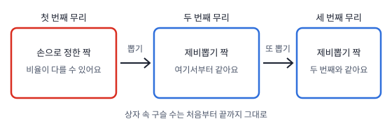

*구슬은 그대로라서 두 번째부터는 몇 번을 다시 뽑아도 짝 비율이 같고, 첫 번째만 달라요.*

**정확히 말하면**

**"평형이 유지된다"는데 왜 1세대와 2세대가 다를까요?** 평형이 유지된다는 말은 2세대부터의 이야기예요. 문제 속 **1세대**는 다섯 조건 아래에서 무작위 교배로 태어났다는 보장이 없어요. 그래서 1세대 유전자형 빈도는 p², 2pq, q² 모양이 아닐 수 있고, 교수님 표현으로 1세대는 **평형이 깨진 상태**에서 출발한다고 가정해요.

다음 세대로 넘어가는 것은 1세대의 유전자형 빈도가 아니라 대립유전자 빈도(p, q)예요. 무작위 교배는 집단 전체의 대립유전자에서 두 개씩 무작위로 짝을 짓는 일과 같아서, 2세대 유전자형 빈도는 p와 q만으로 p², 2pq, q²가 돼요. 2세대부터는 유전자형 빈도가 이미 이 모양이고 p, q도 변하지 않으니 3세대, 4세대도 같아요. 그래서 "평형"과 "1세대와 2세대가 다름"은 서로 모순이 아니에요.

**계산 순서(새 예)**: 1세대 유전자형 빈도가 AA 0.70, Aa 0.20, aa 0.10이고 하디-바인베르크 조건이 적용된다고 해 봐요.

1. 1세대에서 대립유전자 빈도를 먼저 구해요. p = (AA 빈도) + (Aa 빈도의 절반) = 0.70 + 0.10 = 0.80, q = (aa 빈도) + (Aa 빈도의 절반) = 0.10 + 0.10 = 0.20이에요.
2. 2세대 유전자형 빈도는 p² = 0.64, 2pq = 2 × 0.80 × 0.20 = 0.32, q² = 0.04예요.
3. 1세대(0.70, 0.20, 0.10)와 다르므로 "1세대 값 그대로"를 고르면 틀려요. 3세대부터는 0.64, 0.32, 0.04가 계속돼요.

**열성 질환에서 거꾸로 구하기**: 열성 질환은 **열성 동형접합자**(aa)만 환자이고 AA와 Aa는 환자가 아니에요. 집단이 하디-바인베르크 평형이라고 가정하면 환자 비율이 곧 q²예요. 환자가 400명 중 1명인 새 예로 따라가 봐요.

1. 환자 비율 = q² = 1/400 = 0.0025
2. q = √0.0025 = 0.05 (환자 비율에 제곱근을 씌워요)
3. p = 1 − q = 0.95
4. **보인자**(이형접합자 Aa, 열성 대립유전자를 가졌지만 환자가 아닌 사람) = 2pq = 2 × 0.95 × 0.05 = 0.095, 약 9.5%예요. AA = p² = 0.9025예요.

환자는 400명 중 1명뿐인데 보인자는 약 10명 중 1명꼴이에요. 열성 대립유전자 대부분이 증상이 없는 이형접합자 안에 있기 때문이에요.

**평형 가정이 꼭 필요한 이유**: "aa 빈도 = q²"는 유전자형이 p², 2pq, q² 모양일 때만 성립해요. 위 첫 예의 1세대처럼 평형이 깨진 집단에서는 aa 빈도가 0.10인데 q²는 0.04로 서로 달라요. 그래서 환자 비율에서 q를 구하는 계산은 "이 집단은 평형"이라는 가정 위에서만 할 수 있어요.

**교수님 말씀**

1세대를 그대로 쓰는 함정을 세 번 반복해 강조했어요.

> 유전적 평형이 유지가 됐다고 해서 첫 번째 세대와 그대로 같다고 풀면 문제를 못 풉니다.

> 첫 번째 세대는 깨져 있다는 가정을 하고 문제를 내는 거에요, 항상.

예로 교재 연습문제를 들었어요. 유전자형 빈도 0.6, 0.2, 0.2인 세대에 하디-바인베르크 요구사항이 적용될 때 자손 세대를 묻는데, "그대로 0.6, 0.2, 0.2"인 보기를 고르면 안 된다고 했어요.

열성 질환 예는 1만 명 중 1명이 환자인 경우였어요. q² = 0.0001이니 q = 0.01, p = 0.99이고, Aa는 2 × 0.99 × 0.01로 구해요. 교수님은 이 계산이 "**10초** 만에 풀려야 되는데"라고 했어요. 반대로 p = 0.4이면 q = 0.6, q² = 0.36이라 10만 명 중 3만 6천 명이 열성 동형접합자라는 예도 들었어요.

> 이 공식을 자유롭게 적용을 할 줄 알아야 됩니다.

이런 문제가 나올 테니 몇 가지 문제를 연습하라고 했어요.

**꼭 기억해요**

- **착각**: "평형이 유지된다"니까 자손 세대 유전자형 빈도는 1세대 값 그대로다. **바른 구분**: 평형은 2세대부터예요. 1세대 유전자형 빈도에서 p, q를 먼저 구하고 p², 2pq, q²로 다음 세대를 계산해요.
- **착각**: 환자 비율이 곧 q다. **바른 구분**: 환자 비율은 열성 동형접합자의 유전자형 빈도인 q²예요. q는 그 제곱근이라 400명 중 1명이면 q = 0.0025가 아니라 0.05예요.
- **착각**: 보인자와 환자는 같다. **바른 구분**: 보인자는 이형접합자 Aa로 2pq, 환자는 aa로 q²예요.
- **착각**: 환자 비율만 알면 언제나 q²로 풀 수 있다. **바른 구분**: 집단이 평형이라는 가정이 있어야 aa 빈도를 q²로 볼 수 있어요.
- 교수님의 "항상"은 문제를 그렇게 낸다는 뜻이에요. 1세대가 이미 p², 2pq, q² 모양이면 2세대와 같게 나오니, 같다고 고르기 전에도 p, q를 구해 확인해요.

**페이지 요약**

1세대는 평형이 깨진 상태로 출발하므로 p, q를 먼저 구해 다음 세대를 계산하고, 열성 질환은 평형을 가정해 q²에서 거꾸로 구해요.

*핵심 식*

- 1세대에서 p 구하기

  $$
  p = f(AA) + \tfrac{1}{2} f(Aa)
  $$
- 환자 비율에서 q 구하기

  $$
  q = \sqrt{q^2},\quad p = 1 - q
  $$
- 보인자 빈도

  $$
  f(Aa) = 2pq
  $$

*용어*

- **1세대의 함정** — 평형 유지는 2세대부터예요. 1세대 유전자형 빈도는 p², 2pq, q² 모양이 아닐 수 있어 그대로 다음 세대 답으로 쓰면 틀려요. 넘어가는 것은 p, q예요.
- **열성 동형접합자(aa)** — 열성 질환의 환자예요. 평형을 가정하면 환자 비율 = q²이고, q는 그 제곱근이에요.
- **보인자(Aa)** — 열성 대립유전자를 가진 이형접합자로 환자가 아니에요. 빈도는 2pq이고 평형 가정이 필요해요. 환자가 드물어도 보인자는 훨씬 많아요.

---

### 조건이 깨지면 소진화: 돌연변이와 유전자 확산

*1029 수업 · 7장 p4–5*

**쉽게 말하면**

구슬 병의 약속 다섯 개 중 하나만 깨져도 다음 병의 구슬 비율이 바뀌어요.

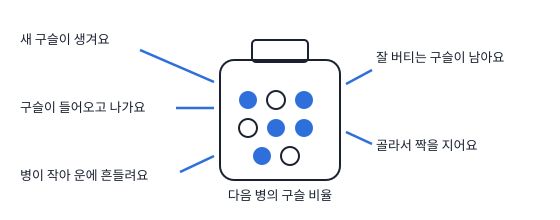

*다섯 가지 중 어느 일이 일어나도 병 속 구슬 비율이 달라져요.*

**정확히 말하면**

[하디-바인베르크 원리](#s0-recap)의 다섯 조건은 소진화가 일어나지 않는 조건이에요. 하나라도 깨지면 평형이 깨져 대립유전자 빈도와 유전자형 빈도가 변해요. 한 집단의 대립유전자 빈도가 세대에 따라 변하는 것이 **소진화**(microevolution)예요. 그래서 조건을 하나씩 뒤집으면 소진화를 일으키는 요인이 나와요.

| 깨진 평형 조건 | 소진화 요인 | 대립유전자 빈도를 바꾸는 방식 |
|---|---|---|
| 돌연변이 없음 | 돌연변이 | DNA에 새 대립유전자가 생겨 새로운 유전적 변이를 만들어요. |
| 이동 없음(다른 개체군으로부터의 유입 없음) | 유전자 확산 = 유전자 흐름 | 다른 집단에서 대립유전자가 들어오거나 나가요. |
| 개체군 크기 무한 | 유전적 부동 | 크기가 유한하고 작을수록 우연한 사건으로 빈도가 크게 흔들려요. |
| 자연선택 없음 | 자연선택 | 잘 생존하고 번식하는 개체의 대립유전자가 다음 세대에 많아져요. |
| 무작위 교배 | 선택적 교배(성선택) | 수업은 성선택과 묶어, 특정 형질이 짝으로 더 선택되면 그 대립유전자가 늘어난다고 설명했어요. 근친교배처럼 누구와 교배하느냐만 치우치면 유전자형 빈도(동형접합자 증가·이형접합자 감소)가 바뀌어요([보충](#s0-factors-supp-1)). |

유전적 부동은 [유전적 부동: 병목 현상과 창시자 효과](#s0-drift), 자연선택은 [상대적 적응도와 자연선택의 세 양상](#s1-fitness), 선택적 교배와 성선택은 [성선택과 성적이형성](#s1-sexual)에서 자세히 다뤄요.

**돌연변이(mutation)**는 DNA 염기서열이 변하는 것이고 자발적으로 일어나요. 자외선이나 여러 화학물질은 돌연변이를 더 많이 일어나게 할 수 있어요. 돌연변이는 생존·생식에 주는 효과에 따라 세 가지로 나눠요.

- **유해돌연변이**: 해로운 돌연변이예요.
- **중립돌연변이(neutral mutation)**: 해도 득도 없는 돌연변이예요. 대부분의 돌연변이는 유해하거나 중립이에요.
- **유익돌연변이**: 어쩌다 생존·생식에 도움이 되는 돌연변이예요. 이런 개체가 자손을 더 많이 남겨 자연선택으로 그 대립유전자가 늘어나요.

돌연변이 자체는 새 대립유전자를 만들어 빈도를 바꿔요. 그 대립유전자가 많아지느냐 줄어드느냐는 그다음에 자연선택 같은 다른 요인이 정해요.

**유전자 확산(gene flow)**은 **유전자 흐름**이라고도 하며, 하디-바인베르크의 "이동 없음" 조건이 깨진 경우예요. 꽃가루나 씨앗의 확산, 개체의 이주처럼 이미 있는 집단 사이로 대립유전자가 옮겨 가요. 들어오는 것(유입)과 빠져나가는 것(유출) 모두 유전자 확산이에요. 이동해 온 개체가 번식하면 다른 집단의 대립유전자가 새로 들어오므로, 유전자 확산은 새로운 유전적 변이를 개체군에 도입해요.

**이주 직후의 빈도 구하기**: 들어온 개체까지 합쳐 대립유전자 개수를 다시 세고, 전체 대립유전자 수(개체 수 × 2)로 나눠요. 지난 수업의 대립유전자 빈도 계산과 같은 방법이에요.

**빈도를 바꾸지 않는 것**: 살면서 얻은 형질, 곧 획득형질은 유전되지 않아요. 그래서 다음 세대의 대립유전자 빈도를 바꾸지 못하고 소진화 요인이 아니에요. 지난 수업의 [라마르크의 획득형질 유전](../../1027/정리노트_1027_Evolutionary_Thought_and_Microevolution.html#s0-lamarck) 설명이 틀린 이유와 같아요.

**교수님 말씀**

> 소진화가 결국 대립유전자 빈도 변화를 얘기하는 것이기 때문에

다섯 조건의 반대가 곧 소진화를 일으키는 요인이라고 정리했어요. 돌연변이가 일어나고, 이동하고, 개체군 크기가 정해져 있고, 자연선택이 일어나고, 무작위가 아니라 선택적으로 교배하면 소진화가 일어나요.

**오타 비유**: 보고서나 카톡에 **오타**가 나도 대부분 알아들어요. 이것이 중립돌연변이예요. '감사합니다'를 '감사하다'로 보내 실례가 되면 유해돌연변이예요. 오타가 났는데 오히려 더 좋은 표현이 되면 유익돌연변이예요.

**바람에 날려 온 종자**: 옆 동네의 빨간 꽃 종자가 바람에 날려 오면 빨간색이 많아져요. 거꾸로 흰 꽃 종자가 태풍에 날려 사라져도 대립유전자 빈도가 변해요. 둘 다 유전자 확산이에요.

**꼭 기억해요**

- **착각**: 살면서 얻은 형질(획득형질)도 대립유전자 빈도를 바꾼다. **바른 구분**: 획득형질은 유전되지 않아 빈도를 바꾸지 못해요. 빈도와 무관한 것을 고를 때 가장 확실한 기준이에요. 돌연변이, 유전자 확산, 유전적 부동, 자연선택은 빈도를 바꾸는 요인이에요.
- **착각**: 선택적 교배는 어떤 경우든 대립유전자 빈도를 바꾼다. **바른 구분**: 수업은 성선택과 묶어, 특정 형질이 짝으로 더 선택되면 그 대립유전자가 늘어난다고 설명했어요. 근친교배처럼 누구와 교배하느냐만 치우치면 유전자형 빈도(동형접합자 증가·이형접합자 감소)가 바뀌고, 교재는 이때 대립유전자 빈도에 직접 영향은 없다고 적어요.
- **착각**: 몇 개체가 다른 곳으로 옮겨 간 일은 모두 유전자 확산이다. **바른 구분**: 이미 있는 두 집단 사이로 개체·꽃가루·씨앗이 오가면 유전자 확산이에요. 큰 집단에서 몇 개체만 떨어져 나와 새 지역에 새 집단을 세우면 [창시자 효과](#s0-drift)(유전적 부동)예요.
- **착각**: 돌연변이는 대부분 이롭다. **바른 구분**: 대부분 유해하거나 중립이에요. 어쩌다 생긴 유익돌연변이를 늘리는 것은 자연선택이에요.
- 조건과 요인의 짝을 거꾸로도 확인해요. 돌연변이 – 돌연변이 없음, 유전자 흐름 – 이동 없음, 유전적 부동 – 무한 크기, 자연선택 – 자연선택 없음, 선택적 교배 – 무작위 교배예요.

**보충 · 노트에 빠졌던 수업 내용**

**선택적 교배와 근친교배**: 강의노트는 "선택적 교배가 유전자형 빈도에 영향을 줄 수 있다"고 적고, 그 특별한 형태로 근친교배(inbreeding)를 들어요. 근친교배는 유전적으로 비슷한 친척끼리 교배하는 것이에요. 친척은 같은 대립유전자를 가진 경우가 많아 동형접합자의 빈도가 증가하고 이형접합자의 빈도가 감소하며, 그래서 열성 표현형이 자주 나타나요.

교재 표 7.3은 선택적 교배가 "직접적으로 대립유전자의 빈도에 영향을 주지 않지만 보통 유전자 평형을 막는다"고 적어요. 즉 근친교배는 대립유전자의 짝짓는 방식을 바꿔 유전자형 빈도를 p², 2pq, q²에서 벗어나게 해요. 수업에서 말한 성선택처럼 특정 형질을 가진 개체가 짝으로 더 많이 선택되어 자손을 더 남기는 경우는 그 대립유전자 빈도가 변해요([성선택과 성적이형성](#s1-sexual)). 근친교배는 수업에서 말하지 않았어요.

출처: 강의노트 7장 p5(선택적 교배와 근친교배, 동형접합자 증가·이형접합자 감소), 교재 7장 p.151 표 7.3(선택적 교배는 대립유전자 빈도에 직접 영향 없음)·p.152(근친교배 설명)

**보충 · 노트에 빠졌던 수업 내용**

**치사돌연변이**: 강의노트는 유해돌연변이 아래에 치사돌연변이를 적어요. 이름 그대로 개체를 죽음에 이르게 하는 유해돌연변이이고, 강의노트는 유해돌연변이가 집단 내 빈도가 감소한다고 적어요. 수업에서는 말하지 않았어요.

출처: 강의노트 7장 p4

**페이지 요약**

하디-바인베르크 조건 하나가 깨질 때마다 그에 맞는 요인이 대립유전자 빈도를 바꿔 소진화가 일어나요.

*용어*

- **소진화(microevolution)** — 한 집단의 대립유전자 빈도가 세대에 따라 변하는 것이에요. 평형 조건 중 하나라도 깨지면 일어나요.
- **조건과 요인의 짝** — 돌연변이 없음 – 돌연변이, 이동 없음 – 유전자 확산(유전자 흐름), 무한 크기 – 유전적 부동, 자연선택 없음 – 자연선택, 무작위 교배 – 선택적 교배(성선택). 선택적 교배는 수업에서 성선택과 묶어 설명했어요.
- **돌연변이(mutation)** — DNA 염기서열의 자발적 변화로 새 대립유전자를 만들어요. 자외선·화학물질이 빈도를 높여요. 대부분 유해하거나 중립이에요.
- **유해·중립·유익돌연변이** — 유해는 해로워요. 중립은 해도 득도 없어요(오타를 알아듣는 경우). 유익은 생존·생식에 도움이 되어 자연선택으로 늘어나요.
- **유전자 확산(gene flow)** — 유전자 흐름이라고도 해요. 이미 있는 집단 사이로 꽃가루·씨앗·개체가 들어오거나 나가 빈도를 바꾸고 새 변이를 들여와요. 이주 직후 빈도는 대립유전자 개수를 다시 세어 개체 수 × 2로 나눠요. 소수가 새 지역에 새 집단을 세우는 창시자 효과와 구별해요.
- **획득형질** — 유전되지 않으므로 대립유전자 빈도를 바꾸지 못해 소진화 요인이 아니에요.

- **(보충) 근친교배** — 강의노트의 선택적 교배의 특별한 형태로, 동형접합자 빈도를 늘리고 이형접합자 빈도를 줄여요. 교재 표 7.3은 선택적 교배가 대립유전자 빈도에 직접 영향을 주지 않고 유전자 평형을 막는다고 적어요. 근친교배는 유전자형 빈도만 바꾸고, 성선택처럼 특정 형질이 짝으로 더 선택되면 대립유전자 빈도가 바뀌어요. 수업에서는 다루지 않았어요.

- **(보충) 치사돌연변이** — 강의노트가 유해돌연변이 아래 적은 개체를 죽게 하는 돌연변이로, 유해돌연변이는 집단 내 빈도가 줄어요. 수업에서는 다루지 않았어요.

---

### 유전적 부동: 병목 현상과 창시자 효과

*1029 수업 · 7장 p4–5*

**쉽게 말하면**

잘나서가 아니라 운이 좋아서 남은 몇 개의 구슬이 다음 무리의 모습을 정해요.

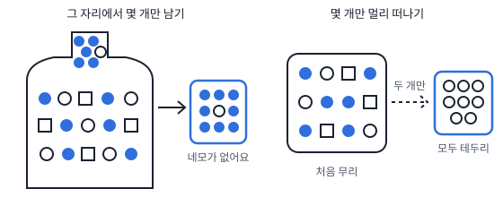

*병 입구 근처 구슬만 운 좋게 남으면 다시 커진 무리에 네모 구슬이 없고, 테두리 구슬 두 개만 멀리 떠나면 새 무리가 모두 테두리 구슬이 돼요.*

**정확히 말하면**

**유전적 부동(genetic drift)**은 **우연**한 사건 때문에 대립유전자 빈도가 변하는 현상이에요. 강의노트는 "개체군 내 대립유전자 빈도의 예상치 못한 변화"라고 적어요. 부동(浮動)은 뜰 부(浮)와 움직일 동(動)으로, 떠서 이리저리 움직인다는 뜻이에요.

**우연인데 왜 진화인가요?** 소진화는 한 집단의 대립유전자 빈도가 세대에 따라 변하는 것이에요. 정의에 원인 조건은 없으므로, 빈도가 바뀌었다면 원인이 우연이어도 그 집단은 진화한 것이에요. 소진화는 자연선택만으로 일어나지 않아요. 생존·생식에 유리한 형질이 아니어도 우연히 많아질 수 있어요.

**왜 작은 개체군에서 강한가요?** 다음 세대는 부모 세대의 대립유전자 중 일부만 뽑혀 이어지는 것과 같아요. 많이 뽑으면 원래 비율에 가깝지만, 적게 뽑으면 우연히 한쪽이 몰리기 쉬워요. 그래서 개체군 크기가 유한하고 작을수록 유전적 부동이 잘 일어나고, 충분히 크면 영향이 작아요. 하디-바인베르크 조건 "개체군 크기 무한"이 깨진 경우가 바로 이것이에요.

#### 직접 해 보기: 집단 크기와 유전적 부동 *(정적 스냅샷 — 직접 조작은 HTML 버전)*

개체 수와 세대 수를 바꾸면, A 대립유전자 빈도 0.5에서 출발한 반복 집단 5개가 우연만으로 어떻게 흔들리는지 보여요. 자연선택·돌연변이·이동은 없고, 매 세대 부모 세대의 빈도대로 대립유전자 2N개를 무작위로 다시 뽑아요.

고정된 시드의 난수로 그린 결과: **개체 10마리, 50세대 뒤 5개 집단 중 A가 고정되거나 소실된 집단 5개(고정 3, 소실 2), A 빈도 범위 0.00~1.00**

범례: 반복 집단 5개의 A 대립유전자 빈도 · 점선: 출발 빈도 0.5 · 오른쪽 끝 테두리 원: 빈도가 1(A 고정) 또는 0(A 소실)에 닿은 집단

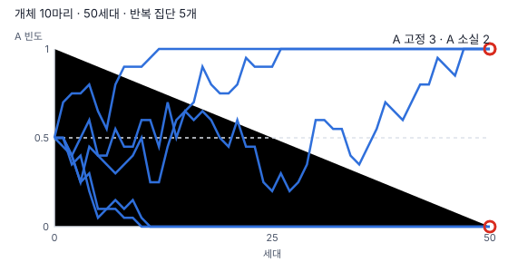

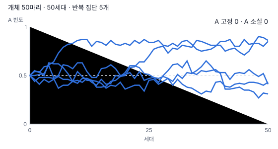

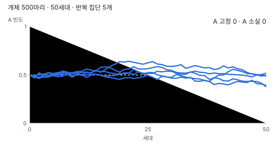

| 설정 | 50세대 뒤 A 빈도(집단 5개) | 고정·소실된 집단 |
|---|---|---|
| 개체 10마리, 50세대 | 0.00, 1.00, 0.00, 1.00, 1.00 | 5개(고정 3, 소실 2) |
| 개체 50마리, 50세대 | 0.31, 0.41, 0.43, 0.86, 0.85 | 0개(고정 0, 소실 0) |
| 개체 500마리, 50세대 | 0.50, 0.39, 0.38, 0.52, 0.49 | 0개(고정 0, 소실 0) |

개체 10마리 집단은 몇십 세대 안에 A 빈도가 0이나 1에 닿아요. 빈도 0은 그 대립유전자가 사라진 것(소실), 빈도 1은 하나만 남은 것(고정)이에요. 같은 출발점인데 어떤 집단은 고정되고 어떤 집단은 소실되므로 방향이 정해진 변화가 아니에요. 500마리 집단은 같은 세대 동안 0.5 근처에서 조금만 흔들려요.

**왜 유전적 다양성을 줄이나요?** 우연히 뽑히지 않은 대립유전자는 집단에서 사라지고, 돌연변이나 유전자 확산이 없으면 다시 생기지 않아요. 그래서 유전적 부동은 보통 **유전적 다양성**(변이)을 줄여요. 다양성이 줄면 병이나 환경 변화에 모두 같이 약해져 멸종 확률이 높아져요. 결국 개체군 크기가 작으면 유전적 부동 영향을 많이 받고, 다양성이 떨어져 쉽게 멸종해요.

유전적 부동이 일어나는 대표적인 두 상황이 있어요.

1. **병목 현상(population bottleneck)**: 폭풍, 지진 같은 자연재해나 사냥으로 그 자리에서 개체 수가 *시간적으로* 급격히 줄어요. 살아남은 소수는 형질이 뛰어나서가 아니라 우연히 살아남았어요. 이들이 다시 번식해 개체 수가 회복되어도 일부 대립유전자는 이미 사라졌고, 바뀐 유전적 조성이 그대로 유지돼요.
2. **창시자 효과(founder effect)**: 큰 집단에서 적은 수의 개체가 *공간적으로* 떨어져 나와 멀리 떨어진 새 지역에서 새 집단을 시작해요. 창시자들의 유전자가 새 집단의 유전적 조성을 정하므로, 새 집단은 원래 집단과 조성이 크게 달라요.

병목 현상과 창시자 효과는 둘 다 유전적 부동의 한 경우예요. 그 자리에서 급감했든 소수가 떠나 새로 시작했든, 우연으로 대립유전자 빈도가 바뀌었다면 유전적 부동이에요.

**자연선택과 가르는 기준**: 누가 살아남았는지가 형질과 관련 있는지 봐요.

- 산불, 홍수, 폭풍처럼 형질과 상관없이 한꺼번에 많이 죽으면 유전적 부동(병목 현상)이에요.
- 세균 감염처럼 저항성이 있는 개체가 더 많이 살아남으면, 형질에 따라 생존이 달라진 것이므로 자연선택이에요.
- 짝으로 선택되는 형질에 따라 자손 수가 달라지면 성선택이에요([성선택과 성적이형성](#s1-sexual)).

**보전**의 의미: 강의노트는 멸종위기종을 보존할 때 개체 수뿐 아니라 유전적 다양성도 회복해 주어야 한다고 적어요. 교수님은 작은 집단에 다른 지역의 개체를 데려와 교배시켜 유전적 다양성을 높인다고 설명했어요. 이것은 일부러 유전자 확산을 일으키는 셈이에요.

**교수님 말씀**

**이름**: "부동이 뭐니?"라고 묻고, 부동산도 부동자세도 아니라 뜰 부(浮), 움직일 동(動)이라고 했어요. 갑자기 떠서 움직이며 확 바뀐다는 뜻이에요.

**구슬 병**: 병 속 **구슬**이 개체군이고 파란색, 흰색, 가끔 오렌지색이 섞여 있어요. 폭풍으로 다 죽고 병 입구의 파란 구슬 다섯 개와 흰 구슬 한 개만 살아남았어요. 이들이 다시 번식하면 새 집단은 거의 파란색이고 오렌지색은 아예 없어요. 이것이 병목 현상이에요.

> 얘네들이 잘나서 잘 산 게 아니고 하필이면은 병목 근처에 있다 보니까 살아남은 거야.

**영화 마션**(영상 자료): 지구의 개는 다리 긴 개부터 짧은 개까지 다양해요. 화성 개척자가 하필 닥스훈트와 치와와만 데려가면 시간이 지나 화성의 개는 모두 다리가 짧아요. 적응이나 자연선택이 아니라 처음 간 개가 우연히 그랬을 뿐이고, 이것이 창시자 효과예요. 영상은 "시작이 운명을 결정"한다고 정리했어요.

**강의실 비유**: "70점 이하는 들어오지 마"는 공부한 학생만 남으니 자연선택이에요. "이 줄만 남고 나머지는 나가"는 우연히 그 자리에 앉은 학생이 남으니 유전적 부동이에요. 성비가 대략 1 대 1인 50명 반에서 한 줄만 남기면 8 대 2처럼 크게 바뀔 수 있어요. 5,000명 수업에서 1,000명을 남기면 거의 5 대 5로 유지돼요. 차이는 집단 크기 때문이에요.

> 유전적 다양성이 보통 줄어듭니다. 변이가 줄어들어요.

**아일랜드 감자 대기근**: 감자를 무성생식으로 재배해 유전적으로 다양하지 않았고, 병이 돌자 모두 죽었어요. 다양했다면 한두 개는 살아남았을 거라고 했어요. **아프리카 치타**도 숫자가 크게 줄어 쉽게 멸종할 위기라고 했어요.

**꼭 기억해요**

- **착각**: 살아남은 개체는 환경에 적응한 개체다. **바른 구분**: 형질 때문에 살아남으면 자연선택, 형질과 상관없이 운으로 살아남으면 유전적 부동이에요(70점 기준과 줄 남기기, 마션의 다리 짧은 개).
- **착각**: 우연히 빈도가 바뀐 것은 진화가 아니다. **바른 구분**: 대립유전자 빈도가 변했으면 원인이 우연이어도 소진화, 곧 진화예요.
- **착각**: 병목 현상과 창시자 효과는 같은 말이다. **바른 구분**: 병목 현상은 그 자리에서 재해 등으로 개체 수가 시간적으로 급감한 경우, 창시자 효과는 소수가 공간적으로 떨어져 나와 새 지역에 새 집단을 만든 경우예요. 둘 다 유전적 부동의 하위 개념이에요.
- **착각**: 유전적 부동은 한 가지 상황에서만 일어난다. **바른 구분**: 병목 현상과 창시자 효과는 둘 다 유전적 부동의 한 경우예요. "항상", "언제나" 같은 표현이 붙은 설명은 다른 경우가 없는지 확인해요.
- **착각**: 유전적 부동은 유전적 다양성을 늘린다. **바른 구분**: 우연히 대립유전자가 사라지므로 보통 줄여요. 새 변이를 들여오는 것은 유전자 확산과 돌연변이예요.
- **착각**: 유전적 부동은 큰 집단에서도 똑같이 강하다. **바른 구분**: 작은 개체군일수록 영향이 크고, 충분히 큰 집단에서는 영향이 작아요.
- **정의로 가르기**: 우연한 사건으로 대립유전자 빈도가 예상치 못하게 변하는 것이 유전적 부동이에요. 기존 집단 사이의 개체·꽃가루 이동은 [유전자 확산](#s0-factors), 친척끼리의 교배는 근친교배, 여러 대립유전자가 서로 균형을 이뤄 함께 유지되는 것은 [평형 다형성](#s1-balanced), 중간 표현형이 가장 유리한 선택은 [안정화 선택](#s1-fitness)이에요.

**페이지 요약**

유전적 부동은 우연한 사건으로 대립유전자 빈도가 바뀌는 소진화이고, 작은 개체군에서 강하며 유전적 다양성을 줄여요.

*용어*

- **유전적 부동(genetic drift)** — 우연한 사건으로 대립유전자 빈도가 예상치 못하게 변하는 것이에요. 원인이 우연이어도 빈도가 변했으므로 소진화예요. 형질 때문에 살아남는 자연선택·성선택과 달라요.
- **집단 크기 효과** — 적은 수에서 다음 세대를 뽑을수록 한쪽으로 몰리기 쉬워, 작은 개체군일수록 영향이 크고 충분히 큰 집단에서는 작아요. 부동은 방향이 정해지지 않아 같은 출발점에서도 고정(빈도 1)되거나 소실(빈도 0)될 수 있어요.
- **유전적 다양성 감소** — 우연히 사라진 대립유전자는 돌연변이·유전자 확산 없이는 돌아오지 않아 변이가 줄고, 멸종 확률이 높아져요.
- **병목 현상** — 유전적 부동의 한 경우예요. 그 자리에서 재해·사냥 등으로 개체 수가 시간적으로 급감하고 우연히 남은 소수가 번식해, 회복 뒤에도 바뀐 조성이 유지돼요. 산불·홍수처럼 형질과 무관한 대량 사망이 해당해요.
- **창시자 효과(founder effect)** — 병목 현상과 마찬가지로 유전적 부동의 한 경우예요. 큰 집단에서 소수가 공간적으로 떨어져 나와 새 지역에 새 집단을 세우면 창시자의 유전자가 새 집단 조성을 정해요. 기존 집단 사이의 이동인 유전자 확산과 달라요.
- **부동과 자연선택 가르기** — 생존이 형질과 무관하면 부동, 감염 저항성처럼 형질에 따라 생존이 달라지면 자연선택이에요.
- **보전** — 멸종위기종은 개체 수뿐 아니라 유전적 다양성도 회복해야 하며, 다른 지역 개체를 데려와 교배시켜 다양성을 높여요.

---

## 1. [7장] 자연선택의 양상, 성선택, 남아 있는 변이

### 상대적 적응도와 자연선택의 세 양상

*1029 수업 · 7장 p5*

**쉽게 말하면**

자연은 돈이나 행복이 아니라 다음 세대에 아이를 남들보다 얼마나 많이 남겼는지로 점수를 매겨요.

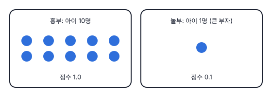

*가장 많이 남긴 흥부를 1.0으로 놓고 견주면 놀부는 0.1이에요.*

**정확히 말하면**

**상대적 적응도(relative fitness)**는 한 개체가 남긴 생존한 **자식 수**를 같은 개체군의 다른 개체와 비교한 값이에요. 강의노트는 생존과 생식의 두 요소로 이루어진다고 적어요. 자연선택은 적응도가 높은 개체를 선택하고, 그 결과 그 개체가 가진 대립유전자의 빈도가 다음 세대에 높아져요.

왜 오래 사는 것이나 부가 아니라 자식 수일까요? 자연선택이 바꾸는 것은 다음 세대의 대립유전자 빈도이고, 대립유전자는 자식을 통해서만 다음 세대로 전해지기 때문이에요. 오래 살아도 자식을 남기지 못하면 다음 세대에 기여하는 대립유전자는 없어요. 생존이 중요한 이유도 살아남아야 자식을 남길 수 있기 때문이에요.

왜 ‘상대적’일까요? 빈도는 전체 중 비율이에요. 가상의 예로 모든 개체가 똑같이 자식 10마리를 남기면 비율은 그대로라 빈도도 그대로예요. 남보다 더 많이 남겨야 그 대립유전자의 비율이 커져요. 그래서 집단에서 자식을 가장 많이 남긴 개체를 1.0으로 놓고 비교하기도 해요. 자식 10명인 **흥부**가 1.0이면 자식 1명인 놀부는 0.1이에요.

자연선택이 작용하는 대상은 대립유전자 자체가 아니라 개체의 **표현형**이에요(이 점이 왜 중요한지는 [불리한 대립유전자가 남는 이유: 이형접합자 이점](#s1-balanced)에서 이어져요). 꼬리 길이처럼 값이 연속으로 이어지는 정량적 형질(양적 형질)은 개체 수를 그리면 가운데 **평균**이 가장 많은 종 모양(정규분포)이 돼요. 어느 쪽 표현형의 적응도가 낮은지에 따라 이 분포가 세 가지로 바뀌어요.

| 양상 | 적응도가 낮은 쪽 | 평균 | 분포 모양 |
|---|---|---|---|
| **방향성 선택(directional selection)** | 한쪽 극단(예: 짧은 꼬리). 반대쪽 극단이 유리 | 유리한 쪽으로 이동 | 봉우리 하나가 통째로 옮겨 감 |
| **안정화 선택(stabilizing selection)** | 양쪽 극단 모두 | 그대로 | 폭이 좁아지고 높아짐(극단이 사라짐) |
| **분단성 선택(disruptive selection)**, 다른 이름 **다형화 선택** | 중간 | 그대로일 수 있음 | 봉우리가 둘로 나뉨(아주 짧은 쪽과 아주 긴 쪽), 다양해짐 |

새 사례는 다음 순서로 판별해요.

1. 변이를 가진 채 선택을 받는 집단이 누구인지 정해요. 항생제 사례라면 사람이 아니라 세균 집단이에요.
2. 어떤 표현형이 늘고 어떤 표현형이 줄었는지 봐요. 늘어난 쪽이 한쪽 극단인지, 가운데인지, 양 극단인지 확인해요.
3. 평균이 한쪽으로 옮겨 갔으면 방향성, 평균은 그대로인데 폭만 줄었으면 안정화, 가운데가 줄어 봉우리가 둘이면 분단성이에요.

**항생제 내성**: 항생제를 쓰면 내성이 있는 세균이 더 많이 살아남아 번식해요. 그 결과 내성 개체의 비율이 늘었다면 집단 전체가 ‘내성 있음’이라는 한쪽 끝으로 옮겨 간 것이므로 방향성 선택이에요. 수업 퀴즈의 표현으로는 내성이 없다가 있게 된, 있는 방향으로 바뀐 경우예요. 질병처럼 특정 표현형만 살아남게 하는 사건도 같은 방식으로 판별해요. 반대로 산불처럼 표현형과 상관없이 우연히 개체가 죽는 경우는 선택이 아니라 [유전적 부동: 병목 현상과 창시자 효과](#s0-drift)예요.

**출생 체중**: 너무 작은 아기와 너무 큰 아기가 모두 사망률이 높으면 평균 체중인 아기가 더 잘 살아남아요. 양 극단이 줄어드니 안정화 선택이에요.

#### 직접 해 보기: 선택 양상과 꼬리 길이 분포 *(정적 스냅샷 — 직접 조작은 HTML 버전)*

선택 양상을 고르고 세대 수(선택이 쌓인 정도)를 늘리면, 점선인 선택 전 곡선 위에 실선인 선택 후 곡선이 겹쳐 그려져 평균 이동, 폭 감소, 봉우리 분리가 보여요.

이 가상 모형에서는 **방향성 선택, 3세대 뒤: 평균 10.0 cm에서 12.7 cm로, 표준편차 3.0 cm에서 3.0 cm로, 봉우리 1개에서 1개로**

범례: 선택 전: 점선 곡선과 점선 평균선 · 선택 후: 강조색 실선 곡선과 강조색 점선 평균선

자식이 부모의 꼬리 길이를 그대로 닮는다고 단순화하고, 세대마다 같은 적응도 차이를 곱한 가상 모형이에요. 두 곡선 아래 넓이는 같게 맞췄어요(전체 개체를 1로 본 비율).

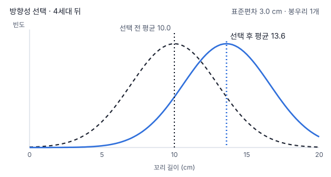

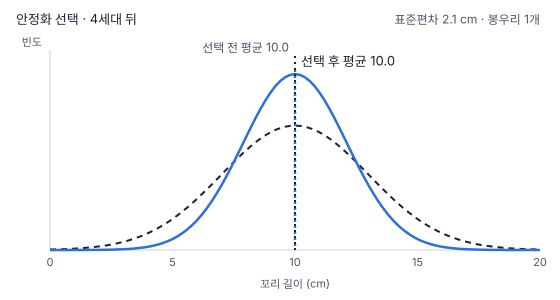

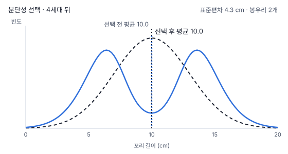

| 설정 (선택 전 평균 10.0 cm, 표준편차 3.0 cm, 봉우리 1개) | 선택 후 평균 | 선택 후 표준편차 | 봉우리 수 |
|---|---|---|---|
| 방향성 선택, 0세대 | 10.0 cm | 3.0 cm | 1개 |
| 방향성 선택, 2세대 | 11.8 cm | 3.0 cm | 1개 |
| 방향성 선택, 4세대 | 13.6 cm | 3.0 cm | 1개 |
| 방향성 선택, 6세대 | 15.4 cm | 3.0 cm | 1개 |
| 안정화 선택, 2세대 | 10.0 cm | 2.4 cm | 1개 |
| 안정화 선택, 4세대 | 10.0 cm | 2.1 cm | 1개 |
| 안정화 선택, 6세대 | 10.0 cm | 1.9 cm | 1개 |
| 분단성 선택, 1세대 | 10.0 cm | 3.4 cm | 2개 |
| 분단성 선택, 4세대 | 10.0 cm | 4.3 cm | 2개 |
| 분단성 선택, 6세대 | 10.0 cm | 4.7 cm | 2개 |

**교수님 말씀**

교수님은 흥부와 놀부 영상으로 상대적 적응도를 설명했어요. 놀부가 아무리 부자여도 자식이 1명이면 자식 10명인 흥부에 비해 0.1밖에 안 되고, 세대가 지나면 마을이 흥부의 유전자로 채워진다는 내용이에요.

> 돈이 많다, 행복하다, 건강하다 이런 거 다 필요 없고 무조건 자식 수.

세 양상은 “이 단어 속에 답이 다 들어 있습니다”라고 했어요. 꼬리 길이로 비유하며, 짧은 꼬리가 인기가 없으면 평균 자체가 한쪽으로 변하고, 짧은 꼬리도 긴 꼬리도 싫으면 그래프가 홀쭉해지고, 둘 다 귀여우면 봉우리가 두 개가 된다고 설명했어요.

항생제 내성 퀴즈에서 한 학생이 다형화 선택이라고 답하자, 교수님은 “없다가 있게 된 거”, 즉 있는 방향으로 바뀐 것이므로 방향성 선택이라고 정정했어요. 출생 체중 퀴즈의 답은 극단이 사라지는 안정화 선택이었어요.

**꼭 기억해요**

- **항생제 내성 획득을 분단성(다형화) 선택으로 착각하기 쉬워요.** 분단성은 가운데가 불리해 양 극단 두 무리가 남는 경우예요. 내성 세균이 늘어난 것은 집단이 한쪽 끝으로 옮겨 간 것이라 방향성 선택이에요.
- **항생제를 사람이 썼으니 사람의 선택이라고 착각하기 쉬워요.** 사람은 환경(항생제)을 만들었을 뿐 살아남을 세균을 골라 번식시키지 않았어요. 선택을 받는 것은 세균 집단이고, 내성 개체가 더 많이 번식한 자연선택이에요.
- **안정화 선택과 방향성 선택을 헷갈리기 쉬워요.** 안정화 선택은 평균이 변하지 않고 분포 폭이 줄어요. 방향성 선택은 평균 자체가 이동해요.
- **적응도를 오래 살거나 강하거나 부유한 정도로 착각하기 쉬워요.** 적응도는 다른 개체와 비교한 자식 수예요. 생존은 자식을 남기기 위한 조건으로만 들어가요.
- **개체 수가 줄었으니 선택이 아니라고 착각하기 쉬워요.** 선택이 일어나면 불리한 개체가 죽어 전체 수가 줄 수 있어요. 양상은 개체 수가 아니라 분포의 평균과 모양이 어떻게 바뀌었는지로 판별해요.

**보충 · 수업에서 다루지 않았어요**

**자연선택 직후의 다양성.** 자연선택은 덜 적합한 표현형을 줄이므로 일반적으로 개체군 안의 다양성(변이)이 줄어요. 교재는 안정화 선택이 맨 가장자리 표현형을 제거하면서 유전자형과 표현형의 변이를 줄인다고 쓰고, 자연선택의 효과를 “한 대립유전자가 다른 것을 대체할 수 있다”고 정리해요. 예외는 분단성 선택이에요. 극단 표현형을 만드는 대립유전자가 더 흔해져 양 극단이 남고 다형성이 촉진돼요. 같은 표에는 대립유전자 변이가 보존될 수도 있다고 적혀 있어요([불리한 대립유전자가 남는 이유: 이형접합자 이점](#s1-balanced)).

**환경이 바뀌어 새롭고 강한 선택이 오면.** 아래 일은 모두 일어날 수 있어요. 어느 하나만 반드시 일어나는 것은 아니에요.

- 새 환경에 맞는 변이가 부족하면 적응하지 못해 개체 수가 줄고 멸종할 수 있어요. 교재는 변이가 없으면 환경 변화에 적응할 수 없을 수도 있다고 써요.
- 방향성 선택이면 평균이 옮겨 가므로, 전에 흔하던 형태가 드물어지고 전에 드물던 형태가 흔해져요.
- 불리한 형태가 제거되면 변이가 줄어 개체들이 서로 비슷해질 수 있어요.

출처: 교재 7장 p.151(보존의 의미, 방향성·안정화·분단성 선택, 표 7.3), p.152 그림 7.15 설명

**보충 · 수업에서 다루지 않았어요**

**새 사례에 정의 적용하기.** 교재는 방향성 선택을 표현형 스펙트럼의 한쪽 끝 개체들이 가장 높은 상대적 적응도를 가질 때 평균에서 선호되는 극단 쪽으로 형질이 옮겨 가는 것이라고 정의해요. 이 정의만으로 아래 사례를 판별할 수 있어요.

- **선택받는 것은 그 집단이에요**: 교재 7장 도입은 항생제가 저항성이 조금이라도 있는 세균이 선호되는 환경을 만들고, 살아남은 세균이 그 유전자를 다음 세대에 퍼뜨린다고 설명해요. 환경을 만든 쪽이 아니라 변이를 가진 채 더 많이 또는 덜 번식하는 집단을 기준으로 판단해요.
- **한쪽 극단의 선호·제거는 방향성이에요**: 한쪽 극단이 더 많은 자식을 남기거나(선호), 반대로 한쪽 극단만 자식을 남기지 못하면(제거) 평균이 다른 쪽으로 옮겨 가요. 그 극단을 없애는 원인이 사람의 사냥 같은 것이어도, 사람이 남길 개체를 골라 번식시킨 것이 아니면 기준은 같아요.
- **획득형질 설명은 선택 유형이 아니에요**: 살면서 쓰다 보니 형질이 변했고 그 변화가 자식에게 전해졌다는 설명은 라마르크식 생각이에요([1027 라마르크](../../1027/정리노트_1027_Evolutionary_Thought_and_Microevolution.html#s0-lamarck)). 같은 결과라도 원래 그 형질을 가졌던 개체가 더 많이 남았다는 설명만 선택이에요.

**분포 그래프 읽기.** 같은 집단을 두 시점에 잰 분포 그래프는 가로축이 형질 값, 세로축이 개체 수예요. 아래는 핀치의 부리 깊이를 가뭄 전과 가뭄 생존자로 나눠 그리는 문항 그래프의 구조만 옮긴 모식도예요(곡선 모양과 위치는 설명용이고 실제 측정값이 아니에요).

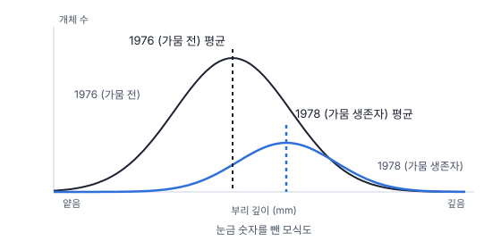

*생존자 곡선은 낮아 개체 수가 줄었고, 평균선은 부리가 깊은 쪽으로 옮겨 갔어요.*

- 두 평균선의 위치를 비교해요. 생존자 평균이 한쪽(부리가 깊은 쪽)으로 옮겨 갔으므로 방향성 선택이에요.
- 곡선의 높이(넓이)를 비교해요. 생존자 곡선이 훨씬 작으므로 개체 수는 오히려 줄었어요. 개체 수가 늘었다고 읽으면 틀려요.
- “부리를 쓰는 방식에 따라 부리가 변해서 자식에게 전해졌다”는 획득형질 설명이에요. 그래프는 원래 부리가 깊었던 개체가 더 많이 살아남았다는 것을 보여 줄 뿐이에요.

출처: 교재 7장 p.139(항생제 내성 도입), p.151(방향성 선택 정의), p.152 그림 7.15(분포 그래프 읽기). 라마르크는 1027 수업. 핀치 부리 깊이 자료 자체는 교재 7장과 강의노트에서 찾지 못해 수치 없는 모식도로만 그렸어요.

**페이지 요약**

적응도는 남보다 자식을 얼마나 많이 남겼는가이고, 어느 표현형이 불리한지에 따라 분포가 세 가지로 바뀌어요.

*용어*

- **상대적 적응도(relative fitness)** — 다른 개체와 비교한 생존한 자식 수예요. 대립유전자는 자식으로만 전해지므로 부·수명이 아니라 자식 수로 매기고, 남보다 많아야 빈도가 올라가요. 가장 많이 남긴 개체를 1.0으로 놓기도 해요(흥부 1.0, 놀부 0.1).
- **선택의 대상** — 자연선택은 대립유전자 자체가 아니라 표현형에 작용해요.
- **방향성 선택(directional selection)** — 한쪽 극단이 불리하고 반대쪽이 유리해 평균이 한쪽으로 이동해요. 예: 항생제 내성 세균 증가.
- **안정화 선택(stabilizing selection)** — 양 극단이 불리해 평균은 그대로, 분포 폭이 좁아져요. 예: 너무 작거나 큰 출생 체중의 높은 사망률.
- **분단성 선택(disruptive selection)** — 다형화 선택이라고도 해요. 중간이 불리해 봉우리가 둘이 되고 다양해져요.
- **판별 순서** — 선택받는 집단(세균 집단 등)을 정하고, 늘어난 쪽이 한쪽 끝·가운데·양 끝 중 어디인지 보고, 평균 이동·폭 감소·봉우리 둘로 나눠요. 개체 수 감소만으로 양상을 정하지 않아요.
- **헷갈리는 짝** — 항생제 내성 획득은 분단성이 아니라 방향성이에요. 항생제를 쓴 사람이 고른 것이 아니라 세균 집단에 일어난 자연선택이에요. 표현형과 무관한 우연한 죽음(산불)은 유전적 부동이에요.

- **(보충) 선택 뒤 다양성과 강한 선택** — 자연선택 직후 다양성은 덜 적합한 형질이 제거되어 일반적으로 줄고, 분단성 선택은 양 극단이 남는 예외예요. 강하고 새로운 선택에서는 적응하지 못하면 멸종할 수도, 흔하던 형태가 드물어지고 드문 형태가 흔해질 수도, 변이가 줄어 비슷해질 수도 있어요(교재 기준).

- **(보충) 새 사례와 분포 그래프** — 선택받는 것은 변이를 가진 그 집단이고, 한쪽 극단이 선호되거나 제거되면 평균이 옮겨 가는 방향성 선택이에요. 쓰다 보니 변했다는 획득형질 설명은 선택 유형이 아니에요. 두 시점 분포 그래프는 평균선의 이동으로 양상을, 곡선 크기로 개체 수 변화를 읽어요. 핀치 그래프는 수치 없는 모식도로만 다뤘어요.

---

### 성선택과 성적이형성

*1029 수업 · 7장 p5*

**쉽게 말하면**

짝을 고르는 쪽이 좋아하는 모습은 다음 세대에 점점 많아져요.

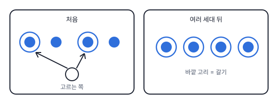

*고르는 쪽이 갈기 있는 수컷만 고르면, 여러 세대 뒤에는 수컷 대부분이 갈기를 가져요.*

**정확히 말하면**

**성선택(sexual selection)**은 이성 중 한쪽이 마음에 드는 짝을 골라 교배하는 데서 생기는 선택이에요. 교수님은 이를 **선택적 교배**와 같은 말로 묶어 설명했어요. 자연계에서는 보통 **암컷**이 수컷을 골라요.

성선택이 일어나는 조건은 한쪽 성의 선택이 상대 개체의 짝짓기 성공을 가르는 것이에요. 선택받은 개체는 자식을 더 많이 남기고 선택받지 못한 개체는 자식을 덜 남기므로, 선택받은 형질을 만드는 대립유전자가 다음 세대에 많아져요. 즉 **대립유전자 빈도**가 변해 소진화가 일어나요.

- 조건은 생존률이나 생식력이 높아지는 것 자체가 아니에요. 고르는 쪽의 선호가 짝짓기 성공의 차이를 만드는 것이에요.
- 조건은 ‘수컷이어야 한다’는 성별 규칙도 아니에요. 보통 암컷이 고르고 수컷이 선택받는다는 것은 흔한 경우이고, 판별의 핵심은 고르는 쪽과 선택받는 쪽의 관계예요.

**성적이형성(sexual dimorphism)**은 암수의 모양이 달라지는 현상이에요. di는 ‘둘’, morphism은 ‘형태’라는 뜻이에요. 암컷이 특정 형질만 계속 고르면 그 형질이 수컷에게만 쌓여 암수 차이가 점점 커져요. 강의노트는 성선택을 성적이형성의 원인으로 적어요.

- 사자의 **갈기**: 수컷에게만 있어요. 암컷이 갈기 있는 수컷과만 교배하면 태어난 수컷이 모두 갈기를 갖게 돼요.
- **공작**: 화려하게 펼치는 깃(강의노트의 ‘공작의 꼬리’)도 수컷에게만 있어요.
- 사람: 교수님은 여성이 몸집 큰 남성을 선호한 결과 남성이 대체로 더 크다고 설명했어요.

성선택 형질은 생존에 불리할 수 있어요. 공작 수컷의 큰 깃은 움직이기에 거추장스럽고 포식자 눈에 잘 띄어요. 그래도 그 형질이 짝짓기 성공을 높여 자식 수를 늘리면, 상대적 적응도는 자식 수로 매기므로 그 대립유전자가 퍼져요([상대적 적응도와 자연선택의 세 양상](#s1-fitness)).

**교수님 말씀**

성선택과 선택적 교배는 “둘의 차이까지 구별할 필요는 없고”라고 했어요. 남자가 여자 옷을 입으면 엄청 작다며 사람의 몸집 차이를 성선택의 결과로 들었어요.

라이언 킹을 예로 “갈기 있는 애가 킹이냐 퀸이냐?”라고 묻고, 답은 수컷이라고 했어요. 이어서 암수 모양 차이가 같아지는지, 비슷해지는지, 달라지는지를 묻고, 특정 형질만 고르니 차이가 점점 커진다고 답했어요.

공작의 큰 깃은 생존에는 도움이 안 되고 오히려 포식자에게 광고하는 셈이라고 했어요.

> 얘들아, 나 좀 잡아먹어 볼래?

**꼭 기억해요**

- **성선택과 선택적 교배를 강의노트에서도 같은 항목으로 착각하기 쉬워요.** 교수님은 둘을 묶어 말했지만, 강의노트에서 성선택은 자연선택 항목 아래에 있고 선택적 교배·근친교배는 별도 항목이에요. 근친교배는 수업에서 다루지 않았어요.
- **성선택이 일어나면 암수가 비슷해진다고 착각하기 쉬워요.** 한쪽 성의 특정 형질만 골라지므로 암수 차이가 커져요. 이것이 성적이형성이에요.
- **성선택 형질은 생존에도 유리하다고 착각하기 쉬워요.** 공작의 깃처럼 생존에는 불리할 수 있어요. 남는 이유는 짝짓기 성공으로 자식을 더 많이 남기기 때문이에요.
- **성선택의 조건을 ‘생존률·생식력 증가’나 ‘수컷일 것’으로 착각하기 쉬워요.** 조건은 이성 중 한쪽(보통 암컷)의 선택이 짝짓기 성공에 영향을 주는 것이에요.
- **공작의 ‘날개’라고 기억하기 쉬워요.** 교수님은 날개라고 말했지만 강의노트는 ‘공작의 꼬리’라고 적어요. 펼치는 것은 날개가 아니라 꼬리 쪽 깃이에요.

**보충 · 노트에 빠졌던 수업 내용**

강의노트는 성선택을 두 가지로 나눠요. 하나는 수컷과 암컷 사이의 선택이고 예가 공작의 꼬리예요. 다른 하나는 같은 성 사이의 선택이고 예가 사슴의 뿔이에요. 같은 성 사이의 선택은 고르는 쪽이 이성이 아니라 같은 성 개체 사이에서 일어난다는 점에서 공작 예와 달라요. 뿔이 이 선택에서 어떻게 쓰이는지는 수업과 강의노트에 설명이 없어요.

출처: 강의노트 7장 p5

**보충 · 노트에 빠졌던 수업 내용**

강의노트는 성선택을 자연선택 항목 아래에 두고, 선택적 교배와 근친교배는 “선택적 교배가 유전자형 빈도에 영향을 줄 수 있다”는 별도 항목으로 둬요. 자세한 내용은 [조건이 깨지면 소진화: 돌연변이와 유전자 확산](#s0-factors)에 정리했어요.

출처: 강의노트 7장 p5

**페이지 요약**

한쪽 성(보통 암컷)이 짝을 고르면 선택받은 형질의 대립유전자가 많아지고 암수 차이가 커져요.

*용어*

- **성선택(sexual selection)** — 이성 중 한쪽(보통 암컷)이 짝을 골라 교배하는 데서 생기는 선택이에요. 교수님은 선택적 교배와 묶어 말했어요. 강의노트는 둘을 별도 항목으로 둬요. 조건은 그 선택이 짝짓기 성공을 가르는 것이고, 생존률·생식력 증가 자체나 ‘수컷일 것’이 아니에요.
- **결과** — 선택받은 형질의 대립유전자가 다음 세대에 많아져 대립유전자 빈도가 변해요.
- **성적이형성(sexual dimorphism)** — 암수 모양이 달라지는 현상(di 둘, morphism 형태)이에요. 한쪽 성의 특정 형질만 골라지므로 차이가 커지고, 성선택이 원인이에요. 예: 사자 갈기, 공작 깃, 사람 몸집.
- **생존과의 관계** — 공작 깃처럼 생존에 불리해도 짝짓기 성공으로 자식 수가 늘면 유지돼요.

- **(보충) 같은 성 사이의 선택** — 강의노트는 성선택을 수컷과 암컷 사이(공작의 꼬리)와 같은 성 사이(사슴의 뿔)로 나눠요. 뿔의 쓰임은 수업·강의노트에 설명이 없어요.

- **(보충) 강의노트의 항목 구분** — 강의노트는 성선택을 자연선택 아래에, 선택적 교배·근친교배를 유전자형 빈도에 영향을 주는 별도 항목으로 둬요.

---

### 불리한 대립유전자가 남는 이유: 이형접합자 이점

*1029 수업 · 강의노트 7장에 없음*

**쉽게 말하면**

바뀐 정보를 하나만 가진 사람이 모기 병이 흔한 곳에서 가장 잘 살아남으면, 그 정보는 사라지지 않고 남아요.

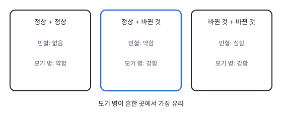

*강조색 테두리 칸의 사람이 가장 잘 살아남아서 바뀐 정보도 함께 다음 세대로 전해져요.*

**정확히 말하면**

자연선택이나 성선택이 계속되면 한쪽 대립유전자만 남고 불리하거나 매력 없는 대립유전자는 완전히 사라질 것 같아요. 실제로는 사라지지 않고 유지되는 경우가 많아요. 수업에서는 두 가지 이유를 들었어요.

**이유 1. 이배체이기 때문이에요.** 사람은 상동염색체를 쌍으로 가지는 **이배체**라서 한 유전자좌에 대립유전자가 두 개 있어요. 자연선택은 유전자를 직접 보는 것이 아니라 **표현형**에 작용해요. 완전우성에서 **이형접합자**(Aa)는 우성 동형접합자(AA)와 표현형이 같아요. 그래서 열성 동형접합자(aa)가 불리해도, 열성 대립유전자 a는 우성 대립유전자에 가려진 채 이형접합자 안에서 선택을 피해 살아남아요.

수업의 열성 질환 예로 확인하면, 환자(aa)가 1만 명 중 1명이면 q = 0.01이고 이형접합자 빈도는 2pq = 2 × 0.99 × 0.01 ≈ 0.0198이에요(평형 가정, [평형 계산의 함정과 열성 질환 역산](#s0-hw-practice)). 이형접합자는 a를 하나씩, 환자는 둘씩 가지므로 a의 약 99%가 표현형이 정상인 이형접합자 안에 있어요. 선택이 환자를 줄여도 a 대부분은 선택이 보지 못하는 곳에 있는 셈이에요.

**이유 2. 평형 다형성이에요.** **평형 다형성**(balanced polymorphism)은 여러 형태(폴리모피즘, polymorphism)의 대립유전자가 한쪽으로 쏠리지 않고 평형을 유지하는 것이에요. 교수님은 한쪽이 많아지면 그쪽이 불리해지고 다른 쪽이 다시 많아지는 식으로 평형이 유지된다고 설명했어요. 그 이유 중 하나가 **이형접합자 이점**(heterozygote advantage)으로, 이형접합자의 상대적 적응도가 두 동형접합자보다 높은 경우예요.

대표 예는 **낫모양 적혈구** 빈혈증이에요. 헤모글로빈 유전자의 염기 하나가 바뀐 S 대립유전자 때문에 생기는 병이고, 바뀐 헤모글로빈이 적혈구 모양과 산소 운반에 영향을 주는 원리는 [0929 불완전우성과 낫모양적혈구](../../0929/정리노트_0929_Heredity.html#s1-incomplete)에서 배웠어요. 정상 대립유전자를 A라고 하면 세 유전자형은 다음과 같아요.

| 유전자형 | 빈혈 | 말라리아 | 말라리아가 흔한 곳에서의 적응도 |
|---|---|---|---|
| AA | 없음 | 저항성 없음, 걸릴 위험 높음 | 말라리아로 일찍 죽을 수 있음 |
| AS | 약함(불완전 우성) | 저항성 있음(S 하나로 충분) | 가장 높음 |
| SS | 심함 | 저항성 있음 | 빈혈로 일찍 죽을 수 있음 |

S는 빈혈을 일으켜 적응도를 떨어뜨리는 대립유전자인데도, 가장 유리한 AS 안에 실려 계속 다음 세대로 전해져요. 그래서 완전히 사라지지 않아요.

**숨은 조건: AS의 이점은 말라리아가 있어야 성립해요.** AS가 AA보다 유리한 이유는 말라리아 저항성뿐이에요. 말라리아가 없는 지역에서는 AA가 말라리아로 손해 보는 일이 없으므로 S가 주는 이점이 사라지고, S는 빈혈이라는 손해만 남아요. 적응도는 같은 유전자형이라도 환경에 따라 달라져요.

1. 말라리아는 **모기**가 옮겨요. 말라리아 열원충은 사람의 적혈구와 모기의 장(소화관)을 오가며 살아요. 감염된 사람의 피를 빤 모기가 건강한 사람을 물면 옮아요.
2. 모기는 물(웅덩이)이 많고 따뜻한 곳에서 잘 살아요. 아프리카가 미국보다 이런 조건이라 말라리아가 더 유행해요.
3. 말라리아가 유행하는 곳에서는 S를 가진 사람(특히 AS)이 더 오래 살아남아 자식을 더 많이 남겨요. 그래서 S 빈도가 높아지고, 말라리아 분포와 S 빈도가 높은 지역이 겹쳐요.
4. 그래서 같은 흑인이라도 아프리카에서는 S 빈도가 높고 미국에서는 낮아요. 인종 자체가 아니라 말라리아라는 환경 조건이 차이를 만들어요.

**교수님 말씀**

> 자연선택은 유전자를 보는 게 아닙니다. 표현형을 봅니다.

AA는 빈혈증에는 안 걸리지만 말라리아로 일찍 죽을 수 있고, SS는 말라리아에는 안 걸리지만 빈혈로 일찍 죽는다며 “제일 좋은 사람이 A-S네요”라고 정리했어요.

퀴즈로 “왜 같은 흑인인데 아프리카 대륙에는 S 대립유전자 빈도가 높고, 미국에는 낮을까?”를 묻고 답은 말라리아라고 했어요. 인간을 가장 많이 죽인 동물 1위가 모기라는 이야기도 다시 꺼냈어요.

**꼭 기억해요**

- **이형접합자 안에 숨는 것을 열성 동형접합자라고 착각하기 쉬워요.** 교수님도 말하다가 고쳐 말했어요. 이형접합자 안에 숨는 것은 열성 대립유전자예요. 열성 동형접합자(aa)는 표현형이 드러나므로 선택을 받아요.
- **AS의 우열 관계를 하나로 정하려다 헷갈리기 쉬워요.** 빈혈 정도로 보면 AS는 중간인 불완전 우성이에요. 말라리아 저항성은 S 하나만 있어도 생겨요. 어떤 형질을 보느냐에 따라 우열 관계가 다르게 보여요.
- **S가 ‘좋은 대립유전자’라서 남는다고 착각하기 쉬워요.** SS는 여전히 심한 빈혈이에요. S가 남는 이유는 말라리아 지역에서 이형접합자 AS의 적응도가 가장 높기 때문이에요.
- **AS가 어디서나 유리하다고 착각하기 쉬워요.** 말라리아가 없는 지역에서는 AS의 이점이 사라져요. 그래서 미국에서는 S 빈도가 낮아요.
- **S가 특정 인종만 가진 대립유전자라고 착각하기 쉬워요.** 같은 흑인이라도 사는 곳의 말라리아 유행 여부에 따라 S 빈도가 달라요.

**페이지 요약**

선택은 표현형에 작용해서 열성 대립유전자가 이형접합자 안에 숨고, 말라리아 지역에서는 AS가 가장 유리해 S가 남아요.

*용어*

- **이배체와 표현형 선택** — 이배체라 대립유전자가 두 개이고, 자연선택은 표현형에 작용해요. 이형접합자는 우성 동형접합자와 표현형이 같아 열성 대립유전자가 그 안에 숨어 선택을 피해요. 숨는 것은 열성 동형접합자가 아니라 열성 대립유전자예요. 드문 열성 대립유전자(q = 0.01)는 약 99%가 이형접합자 안에 있어요.
- **평형 다형성(balanced polymorphism)** — 여러 대립유전자가 한쪽으로 쏠리지 않고 평형을 유지하는 것이에요. 한쪽이 많아지면 불리해지고 다른 쪽이 다시 많아지는 식이에요.
- **이형접합자 이점(heterozygote advantage)** — 이형접합자의 상대적 적응도가 가장 높아 불리한 대립유전자도 유지되는 경우예요.
- **낫모양 적혈구와 말라리아** — AA는 빈혈 없음·말라리아 위험, SS는 심한 빈혈·저항성, AS는 약한 빈혈(불완전 우성)·저항성(S 하나로 충분)이라 말라리아 지역에서 AS가 가장 유리해요.
- **숨은 조건** — AS의 이점은 말라리아가 있어야 성립해요. 말라리아는 모기가 옮기고(원충이 적혈구와 모기 장을 오감), 모기가 잘 사는 따뜻하고 웅덩이 많은 아프리카에서 유행해 S 빈도가 높아요. 말라리아가 없는 미국에서는 이점이 사라져 S 빈도가 낮아요. 인종이 아니라 환경이 차이를 만들어요.

---

## 2. [8장] 종이란 무엇인가와 생식적 격리

### 종 개념과 아종

*1029 수업 · 8장 p1*

**쉽게 말하면**

생김새가 아니라, 서로 짝이 되어 새끼를 낳고 그 새끼도 커서 새끼를 낳을 수 있는지로 같은 무리인지 정해요.

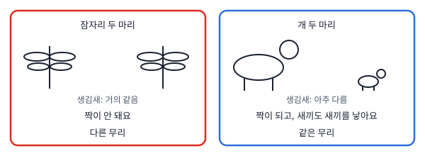

*닮은 잠자리는 다른 무리이고, 달라 보이는 개는 같은 무리예요.*

**정확히 말하면**

8장은 **종분화(speciation)**를 다뤄요. 강의노트는 종분화를 한 종이 두 종 이상으로 갈라지는 과정이라고 적었어요. 그러려면 먼저 '종(種, 씨 종)'이 무엇인지 정해야 해요. 종을 가르는 기준은 세 가지로 소개됐어요.

| 개념 | 무엇으로 가르나 | 수업에서 짚은 점 |
|---|---|---|
| **형태학적 종 개념**(morphological species concept) | 눈에 보이는 형태·해부학적 특징 | 분류학의 아버지 린네가 쓴 방법이에요. 린네는 눈으로 본 형태만으로 판단했어요. |
| **생물학적 종 개념**(biological species concept) | 생식 여부만 | 가장 중요하다고 강조했어요. 아래에서 자세히 봐요. |
| **계통발생적 종 개념**(phylogenetic species concept) | 진화 역사를 공유하는가 | 계통수의 가장 작은 가지 하나, 즉 공통조상을 공유하는 가장 작은 무리예요. 실제 종보다 조금 작아 개체군에 가까운 개념이에요. "이런 게 있구나" 정도만 알면 된다고 했어요. |

**생물학적 종 개념**의 정의는 이래요. **자연 상태**에서 서로 교배가 가능하고, 낳은 자손이 또 자손을 낳을 수 있는 **생식력 있는 자손**을 낳으면 같은 종이에요. 아예 교배를 못 하거나, 자손을 낳아도 그 자손이 불임이면 다른 종이에요. 그래서 이 개념의 근거는 생식적 특징이에요. 생김새나 분자 자료가 얼마나 비슷한지는 이 개념의 기준이 아니에요.

조건 두 개가 왜 다 필요한지는 반례로 보면 연결돼요.

1. **'자연 상태'가 빠지면**: 사자와 호랑이는 동물원에서 함께 두면 새끼가 태어나요. 이것까지 세면 둘을 같은 종이라고 해야 해요. 하지만 자연에서는 사자는 초원에, 호랑이는 깊은 숲에 살아 만날 일이 없어요. 자연에서 두 무리의 유전자가 실제로 섞이는지를 묻는 것이므로, 사람이 억지로 만든 짝짓기는 기준이 되지 않아요.
2. **'생식력 있는 자손'이 빠지면**: 말과 당나귀 사이에서는 노새가 태어나 오래 살아요. "자손이 태어난다"까지만 보면 말과 당나귀가 같은 종이 돼요. 하지만 노새는 정자·난자를 만들지 못하는 불임이라, 두 부모의 유전자가 노새에서 멈추고 다음 세대로 이어지지 않아요. 그래서 살아 있는 잡종이 태어나도 그 잡종이 불임이면 두 무리는 다른 종이에요([접합 후 장벽: 잡종 생존불능·불임·붕괴](#s2-postzygotic)).

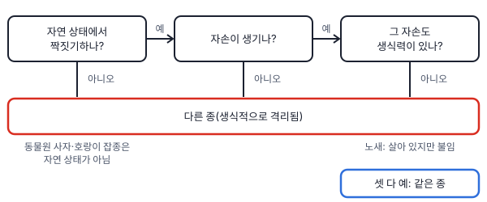

*세 질문 중 하나라도 '아니오'이면 생식적으로 격리된 다른 종이에요.*

이 정의에서 바로 따라 나오는 판단이 있어요.

- **같은 종인지 확인하려면** 자연 상태에서 교배해 생식력 있는 자손을 낳는지, 즉 그 자손이 다시 자손을 낳는지까지 봐요. 생김새·먹이·분자 자료가 비슷한지는 생식 여부를 직접 보여 주지 않아요.
- **두 무리가 같은 종인 이유를 물으면** 답의 근거는 서로 교배해 생식력 있는 자손을 낳을 수 있다는 점이에요. 사는 지역에 따라 생김새가 조금 달라도 이 조건을 만족하면 같은 종이에요.
- **두 무리가 별개의 생물학적 종이 되려면** 생식적으로 격리되어야 해요. 기준은 생식이지, 조상이나 겉모습이 얼마나 다른지가 아니에요. 잡종이 살아서 태어나더라도 그 잡종이 불임이면 생식적 격리가 있는 거예요. 그래서 "살아 있는 자손이 아예 안 나와야 다른 종"이라고 하면 지나친 조건이에요.
- **같은 종 안의 품종·색 변이와 서로 다른 종을 구별해요.** 수업의 사자와 호랑이는 서로 다른 종이라 둘의 교배는 종간 교배예요. 개 품종끼리처럼 한 종 안에서 모습이 다른 무리끼리의 교배는 종간 교배가 아니에요.

생물학적 종 개념에도 한계가 있어요. 세균처럼 **무성생식**을 하는 생물은 원래 교배를 하지 않으니 적용할 수 없어요. 화석만 남은 **멸종한 종**도 교배를 시켜 볼 수 없으니 적용할 수 없어요.

**아종(subspecies)**은 강의노트 정의로 지리적으로 멀리 떨어진 개체군들 사이에 나타나는 표현형 변이, 즉 종의 지역적 변이예요. 넓은 지역에 떨어져 오래 살면서 색깔 같은 특징이 조금 달라졌지만, 같은 종이라 함께 두면 교배해 생식력 있는 자손을 낳을 수 있어요. 아종은 한 개체의 특징이 아니라 지리적으로 떨어진 개체군 사이의 표현형 차이예요. 또 같은 종이므로, 서로 교배하지 못하는 무리라면 아종이 아니라 생식적으로 격리된 경우예요.

**교수님 말씀**

교수님은 '종'이 씨앗 종(種) 자라고 짚고 시작했어요. 학교 종의 종도, 노비 종의 종도 아니에요.

린네는 다윈 이전에 분류를 시도한 분류학의 아버지이고, 지금도 그 분류 체계를 써요. 그렇지만 진화론자가 아니라 "골수 창조론자"였다고 했어요.

잠자리와 개 사진으로 형태와 생식을 대비했어요. 모양은 비슷해도 교배가 안 되면 다른 종이라는 거예요.

> 중요한 거는 생물학적 종 개념입니다. 오로지 생식 여부로만 판단하는 겁니다.

개와 늑대가 같은 종이라는 예도 들었어요. 품종이 다를 뿐이고, 품종을 아종이라고도 한다고 말했어요.

**꼭 기억해요**

**생김새가 비슷하면 같은 종, 다르면 다른 종이라고 생각하기 쉬워요.** 생물학적 종 개념에서는 반대 사례가 둘 다 있어요. 닮은 잠자리 두 마리는 교배가 안 되어 다른 종이고, 크기와 모양이 아주 다른 개 두 마리는 교배가 되어 같은 종이에요. 린네의 분류는 형태 기준이라 생물학적 종 개념에 기초한 것이 아니에요.

**동물원에서 새끼가 태어났으니 같은 종이라고 보기 쉬워요.** 기준은 자연 상태예요. 사자와 호랑이는 동물원에서 새끼가 태어나도 자연에서는 만나지 않고, 그 새끼는 보통 건강하지 못하고 불임이라 다른 종이에요.

**잡종이 살아서 태어나면 격리가 아니라고 보기 쉬워요.** 자손이 생식력까지 있어야 같은 종이에요. 살아 있어도 불임인 잡종(노새)이 나오면 생식적 격리예요.

**교수님이 품종·아종·변종을 같은 말처럼 섞어 썼어요.** 시험에서는 강의노트 정의를 써요. 아종은 지리적으로 떨어진 개체군 사이의 표현형 차이(종의 지역적 변이)이고, 다른 아종끼리도 교배해 생식력 있는 자손을 낳을 수 있어요. 개 품종처럼 사람이 골라 기른 차이와는 엄밀히 같은 개념이 아니에요.

**생물학적 종 개념이 모든 생물에 쓰인다고 보기 쉬워요.** 종 개념은 여러 가지이고, 생물학적 종 개념은 무성생식 생물과 멸종한 종(화석)에는 적용할 수 없어요.

**페이지 요약**

생물학적 종 개념은 자연 상태에서 교배해 생식력 있는 자손을 낳는지, 즉 생식 여부로만 종을 가르고, 생김새는 기준이 아니에요.

*용어*

- **종분화(speciation)** — 강의노트 정의: 한 종이 두 종 이상으로 갈라지는 과정이에요.
- **형태학적 종 개념** — 눈에 보이는 형태로 종을 가르는 방법으로, 린네가 썼어요. 린네의 분류는 형태 기준이라 생물학적 종 개념에 기초하지 않아요.
- **생물학적 종 개념** — 자연 상태에서 교배가 가능하고 생식력 있는 자손을 낳으면 같은 종이에요. 교배를 못 하거나 자손이 불임이면 다른 종이에요. 근거는 생식적 특징이고, 생김새나 분자 자료의 비슷함은 기준이 아니에요.
- **왜 '자연 상태'인가** — 동물원의 사자·호랑이 잡종까지 세면 다른 종이 같은 종이 돼요. 자연에서 실제로 유전자가 섞이는지를 묻는 기준이에요.
- **왜 '생식력 있는 자손'인가** — 노새는 살아 있지만 불임이라 유전자가 다음 세대로 이어지지 않아요. 살아 있는 잡종이 나와도 불임이면 다른 종이에요.
- **판별 적용** — 같은 종인지는 교배해 자손이 다시 자손을 낳는지까지 봐서 판단해요. 같은 종인 근거는 서로 교배해 생식력 있는 자손을 낳는다는 점이고, 별개의 종이 되는 조건은 생식적 격리예요. 살아 있지만 불임인 잡종이 나와도 격리예요. 같은 종 안의 품종·색 변이와 서로 다른 종(사자·호랑이)을 구별해요.
- **한계** — 무성생식 생물(세균)과 멸종한 종(화석)에는 적용할 수 없어요.
- **계통발생적 종 개념** — 진화 역사를 공유하는 가장 작은 무리(계통수의 가장 작은 가지)로, 개체군에 가까워요. "이런 게 있구나" 정도로 알면 돼요.
- **아종(subspecies)** — 지리적으로 떨어진 개체군 사이의 표현형 차이(종의 지역적 변이)예요. 같은 종이라 다른 아종끼리 교배해 생식력 있는 자손을 낳을 수 있어요. 한 개체의 특징이나 서로 교배하지 못하는 무리는 아종이 아니에요. 교수님의 품종·변종 혼용 대신 이 정의를 써요.
- **형태와 종은 어긋날 수 있음** — 닮은 잠자리 두 마리는 다른 종, 아주 다른 개 두 마리는 같은 종이에요.

---

### 접합 전 장벽 다섯 가지

*1029 수업 · 8장 p1–2*

**쉽게 말하면**

다른 무리끼리는 아기씨가 아예 생기지 않도록 막는 벽이 다섯 가지 있어요.

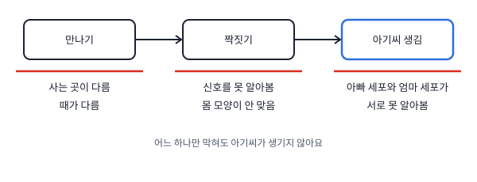

*못 만나거나, 만나도 짝이 안 되거나, 짝이 되어도 세포끼리 못 알아보면 막혀요.*

**정확히 말하면**

**생식적 격리(reproductive isolation)**는 다른 종 사이에 교배가 안 되거나, 교배해도 생식력 있는 자손을 낳지 못하게 하는 장벽이에요. 생물학적 종 개념에서 두 무리가 다른 종인 이유가 바로 이것이에요. 생식적 격리는 수정란(접합자)이 생기는지를 기준으로 둘로 나눠요.

- **접합 전 장벽(prezygotic barrier)**: 수정란 자체가 생기지 않아요. 아예 만나지 못하거나, 정자와 난자를 같이 두어도 수정이 안 돼요.
- **접합 후 장벽(postzygotic barrier)**: 수정란은 생기지만 그 뒤에 문제가 생겨요([접합 후 장벽: 잡종 생존불능·불임·붕괴](#s2-postzygotic)).

수업에서는 '수정 전 격리 / 수정 후 격리'라고 불렀고, 강의노트에는 '접합 전 장벽 / 접합 후 장벽'이라고 적혀 있어요. 같은 말이에요. 접합 전 장벽은 다섯 가지이고, 교수님 말대로 이름의 한국말 뜻에 내용이 다 들어 있어요.

| 이름 | 무엇이 달라서 막히나 | 수업 예 |
|---|---|---|
| **생태적 격리**(ecological isolation) | 사는 곳(서식지)이 달라 만날 일이 없어요. | 사자는 초원, 호랑이는 깊은 숲에 살아요. |
| **시간적 격리**(temporal isolation) | 같은 곳에 살아도 교배 시기가 달라요. | 봄에 피는 꽃과 가을에 피는 꽃은 꽃가루와 암술이 만날 일이 없어요. |
| **행동적 격리**(behavioral isolation) | 구애 행동(신호)이 종마다 달라 다른 종의 신호를 알아보지 못해요. | **반딧불이**는 종마다 빛을 내는 패턴이 달라요. 금조가 참새 앞에서 춤춰도 참새는 알아듣지 못해요. |
| **기계적 격리**(mechanical isolation) | 생식 기관 같은 몸 구조의 물리적 차이로 교배가 안 돼요. | 생쥐와 코끼리, 맞물려야 교미하는 곤충의 생식 기관, 매개 동물이 다른 꽃 |
| **배우자 격리**(gametic isolation) | 정자와 난자가 만나도 표면 단백질이 맞지 않아 수정이 안 돼요. | 여러 종의 개구리 정자가 섞인 연못에서도 같은 종끼리만 수정돼요. |

식물의 기계적 격리는 꽃 구조에서 시작해요. 식물의 교배는 꽃가루가 암술머리에 앉는 꽃가루받이(수분)이고, 많은 꽃은 곤충·박쥐·벌새 같은 매개 동물이 꽃가루를 옮겨 줘요. 시각이 발달한 새가 매개하는 꽃은 화려한 빨간색이 많고, 곤충이 매개하는 꽃은 냄새로 유혹하는 경우가 많아요. 미물루스 루이시(*Mimulus lewisii*)는 넓은 꽃을 가져 벌이 매개하고, 빨간 미물루스 카르디날리스(*M. cardinalis*)는 벌새가 매개해요. 꽃 구조 때문에 매개 동물이 달라지니 두 종은 각자 자기 종끼리만 수분돼요.

배우자 격리는 열쇠와 자물쇠처럼 작동해요. 개구리는 체외 수정을 해서, 암컷이 물속에 알을 뿌리면 수컷이 그 위에 정자를 뿌려요. 한 연못에 여러 종의 정자가 섞여 있어도, 난자 표면의 수용체 단백질과 정자 표면의 단백질이 딱 맞는 같은 종끼리만 수정이 일어나요.

새 사례는 "무엇이 수정을 막는가"를 물어 이름을 고르면 돼요.

- 사는 장소(서식지)가 달라 만나지 않으면 생태적 격리예요(사자·호랑이).
- 번식·개화 시기가 어긋나면 시간적 격리예요(봄꽃·가을꽃). 시기를 어긋나게 만든 원인이 생활사의 길이든, 낮·밤 길이에 따라 꽃 피는 때가 정해지는 것이든, 결과가 시기 차이면 시간적 격리예요.
- 구애 신호나 구애 동작을 다른 종이 알아보지 못하면 행동적 격리예요(반딧불이 빛 패턴, 금조의 춤).
- 생식 기관·꽃 같은 몸의 구조가 맞지 않거나, 꽃 구조 때문에 매개 동물이 달라지면 기계적 격리예요(생쥐·코끼리, 미물루스 두 종).
- 정자·난자가 만나도 표면 단백질이 맞지 않아 수정이 안 되면 배우자 격리예요(개구리 체외 수정). 식물에서도 꽃가루가 정자를 난자에게 전해야 수정되므로, 다른 종의 꽃가루·정자를 난자가 인식하지 못하면 배우자 격리예요.

**교수님 말씀**

> 한국말만 알면은 뜻이 다 들어 있단다.

교수님은 대학 **CC**(캠퍼스 커플) 이야기로 세 가지를 이었어요.

- 졸업 후 한 사람이 부산으로 직장을 가 멀어지고 헤어지면 생태적 격리라고 했어요.
- 수원으로 돌아와 옆집에 살아도 한 사람이 밤에 일하고 낮에 자서 데이트할 시간이 없으면 시간적 격리예요.
- 성호관 옥상에서 혼자 춤추는 프러포즈를 상대가 알아듣지 못하면 행동적 격리예요.

사자와 호랑이 이야기로는 이렇게 말했어요.

> 싸울 일이 없다. 만나야 싸우지.

동물원에서는 둘 사이에 새끼가 나오지만 보통 건강하지 못하고 불임이라며 다시 강조했어요.

> 자연 상태에서의 이야기입니다, 자연 상태.

구애는 보통 수컷이 하고 암컷이 선택하며, 그 구애 신호가 종마다 다르다고 했어요. '배우자'에는 "좀 배우자" 말장난을 붙이고, 정자와 난자를 뜻한다고 바로 짚었어요.

**꼭 기억해요**

**생태적 격리를 지리적 격리와 같은 것으로 보기 쉬워요.** 교수님은 생태적 격리를 "지리적으로 다른 장소에서 살고 있기 때문에"라고 설명하고 부산·수원 예를 들었어요. 하지만 생태적 격리는 같은 지역 안에서도 사는 곳(서식지)이 달라 만나지 않는 경우예요. 사자(초원)와 호랑이(숲)처럼 서식지 차이로 정리해요. 산·바다 같은 지리적 장벽으로 개체군이 갈라지는 지리적 격리는 이소적 종분화의 원인이에요([이소적 종분화: 지리적 격리 뒤의 생식적 격리](#s3-allopatric)).

**기계적 격리의 '기계'를 진짜 기계로 읽기 쉬워요.** 물리적·구조적 차이, 즉 생식 기관이나 꽃 구조의 차이예요. 꽃과 매개 동물 예는 "꽃 구조 때문에 매개 동물이 달라진다"는 연결로 기계적 격리에 들어가요.

**배우자 격리의 '배우자'를 결혼 상대로 읽기 쉬워요.** 배우자는 정자와 난자예요. 구애 신호를 못 알아보는 것은 행동적 격리이고, 정자·꽃가루와 난자가 표면 단백질을 인식하지 못하는 것이 배우자 격리예요.

**꽃가루가 관련되면 모두 같은 격리로 보기 쉬워요.** 매개 동물이 달라 꽃가루가 다른 종 꽃에 아예 가지 않으면 기계적 격리예요. 개화 시기가 달라 꽃가루와 암술이 만날 때가 없으면 시간적 격리예요. 꽃가루가 도착했는데 난자가 인식하지 못하면 배우자 격리예요.

**시기 차이의 원인이 다양하면 다른 격리로 보기 쉬워요.** 생활사의 길이든 낮·밤 길이에 따른 개화든, 결과가 "번식 시기가 다르다"면 시간적 격리예요.

**사자·호랑이 잡종이 동물원에서 나오니 같은 종이라고 보기 쉬워요.** 기준은 자연 상태이고, 그 잡종은 건강하지 못하고 불임이에요.

**접합 전과 접합 후를 섞기 쉬워요.** 접합 전은 수정란이 생기지 않는 경우, 접합 후는 수정란은 생기는 경우예요. 잡종이 불임이거나 잡종 배아가 발달하지 못하는 것은 수정란이 생긴 뒤의 일이라 접합 전 장벽의 예가 아니에요.

**이름은 수업과 강의노트의 다섯 개로 판단해요.** 뜻이 비슷해 보이는 다른 이름을 보면 같은 말이라고 단정하지 말고, 설명된 원인이 장소·시기·신호·구조·배우자 표면 단백질 중 무엇인지로 판단해요.

**보충 · 수업에서 다루지 않았어요**

교재는 수업 예 말고도 같은 기준이 적용되는 예를 더 들어요. 시간적 격리의 예로, 분포가 겹치는 초파리 두 종(*Drosophila persimilis*, *D. pseudoobscura*)은 한 종은 아침에, 다른 종은 오후에 교배해요. 캘리포니아의 소나무 두 종도 꽃가루가 날리는 때가 2월과 4월로 달라 서로 격리돼요. 행동적 격리의 예로는 암컷 새가 수컷의 울음소리·깃털 색·춤을 보고 짝을 알아본다고 적었어요. 배우자 격리에 대해서는 체외 수정하는 해양 무척추동물의 정자와 난자가 같은 종의 표면 단백질만 인지하고, 어떤 식물 종도 종간 수정을 막는 비슷한 생리적 불화합성을 보인다고 적었어요.

출처: 교재 8장 p.160–161

**페이지 요약**

접합 전 장벽은 수정란 자체가 생기지 않게 막는 생식적 격리로, 생태적·시간적·행동적·기계적·배우자 격리의 다섯 가지예요.

*용어*

- **생식적 격리(reproductive isolation)** — 다른 종 사이에 교배가 안 되거나, 해도 생식력 있는 자손을 못 낳게 하는 장벽이에요. 수정란이 생기는지로 접합 전과 접합 후로 나눠요.
- **접합 전 장벽(prezygotic barrier)** — 수정란이 생기지 않아요. 수업의 '수정 전 격리'와 같은 말이에요. 접합 후 장벽('수정 후 격리')은 수정란은 생겨요.
- **생태적 격리** — 서식지가 달라 만나지 않아요(사자 초원, 호랑이 숲). 지리적 장벽에 의한 지리적 격리(이소적 종분화의 원인)와 구별해요.
- **시간적 격리** — 같은 곳에 살아도 교배·개화 시기가 달라요(봄꽃과 가을꽃). 원인이 생활사 길이든 낮·밤 길이에 따른 개화든, 결과가 시기 차이면 시간적 격리예요.
- **행동적 격리** — 구애 신호·동작이 종마다 달라 다른 종이 알아보지 못해요(반딧불이 빛 패턴, 금조의 춤).
- **기계적 격리** — 생식 기관·꽃 같은 물리적 구조 차이예요. 꽃 구조에 따라 매개 동물이 달라지는 것도 여기에 들어가요(미물루스 루이시는 벌, 카르디날리스는 벌새).
- **배우자 격리** — 배우자는 정자·난자예요. 난자 표면 수용체 단백질과 정자 표면 단백질이 열쇠와 자물쇠처럼 맞아야 수정돼요(체외 수정 개구리). 다른 종의 꽃가루·정자를 난자가 인식하지 못하면 배우자 격리예요.
- **이름 판단** — "무엇이 수정을 막는가"(장소·시기·신호·구조·배우자 표면 단백질)로 골라요. 수업·강의노트에 없는 비슷한 이름을 동의어로 단정하지 않아요.
- **자연 상태 기준** — 사자·호랑이는 동물원에서 새끼가 나와도 자연에서는 만나지 않고, 그 새끼는 건강하지 못하고 불임이에요.

- **(보충) 교재의 추가 예** — 교재 8장 p.160–161의 예예요. 교배 시간대가 아침·오후로 다른 초파리 두 종, 꽃가루가 날리는 달이 다른 소나무 두 종은 시간적 격리예요. 수컷의 울음소리·깃털·춤으로 짝을 알아보는 암컷 새는 행동적 격리예요. 해양 무척추동물의 표면 단백질 인지와 식물의 종간 수정 불화합성은 배우자 격리예요.

---

### 접합 후 장벽: 잡종 생존불능·불임·붕괴

*1029 수업 · 8장 p2*

**쉽게 말하면**

아기씨가 생겨도, 아기가 일찍 죽거나, 자라도 아기를 못 낳거나, 손주 대에서 약해져 끊기면 두 무리는 결국 섞이지 못해요.

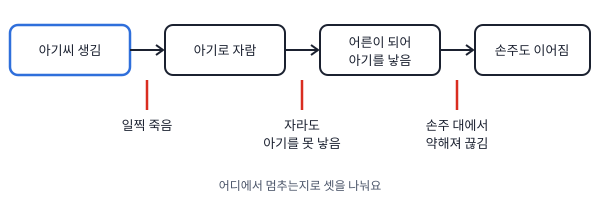

*어느 단계에서 멈추는지에 따라 이름이 달라져요.*

**정확히 말하면**

**접합 후 장벽(postzygotic barrier)**은 다른 종의 정자와 난자가 수정해 수정란(접합자)까지는 생겼지만, 그 뒤 과정에 문제가 생겨 두 종이 섞이지 못하는 경우예요. 수업에서는 '수정 후 격리'라고도 불렀어요. 세 가지는 멈추는 단계로 구별해요.

| 이름 | 어디서 멈추나 | 수업 예·설명 |
|---|---|---|
| **잡종 생존불능**(reduced hybrid viability) | 잡종이 살아남지 못해요. | 배 발생 동안 배아 단계에서 죽거나, 태어나자마자 죽어요. |
| **잡종 불임**(hybrid sterility) | 잡종(1대)이 건강하게 자라도 정자·난자를 만들지 못해 자손을 남기지 못해요. | **노새**(말 × 당나귀) |
| **잡종 붕괴**(hybrid breakdown) | 1대 잡종은 정상이고 자손도 낳지만, 다음 세대부터 생존력·생식력이 떨어져 결국 대가 끊겨요. | "**손자**까지 봤는데" 세대가 지날수록 약해져 끊기는 경우 |

**노새가 불임인 이유**는 감수분열의 짝짓기 단계에서 막히기 때문이에요. 아래는 수업에서 단순화해 설명한 방식이에요. 감수분열 전기에는 비슷한 염색체끼리 짝을 지어 **4분염색체**(2가 염색체)를 만들어야 다음 단계로 나아갈 수 있어요. 4분염색체가 무엇인지는 [4분염색체 이전 노트](../../0922/정리노트_0922_Cell_Division_and_Heredity.html#s2-tetrad)에서 다시 볼 수 있어요.

1. 말은 2n = 64라 정자·난자에 n = 32개를 넣고, 당나귀는 2n = 62라 n = 31개를 넣어요.
2. 둘이 수정해 태어난 노새의 염색체는 32 + 31 = **63**개예요. 노새는 이 상태로 건강하게 자라요.
3. 노새가 정자나 난자를 만들려고 감수분열을 시작하면, 말과 당나귀는 다른 종이라 정확한 상동염색체는 없지만 비슷한 염색체끼리 모아 4분염색체를 만들어요.
4. 63개로는 31쌍(4분염색체 31개)을 만들고 1개가 남아요. 염색체 수가 홀수라 이 1개는 짝이 없어요.
5. 짝 없는 염색체 때문에 감수분열이 멈추고, 정자와 난자가 만들어지지 않아요. 그래서 노새는 불임이에요.

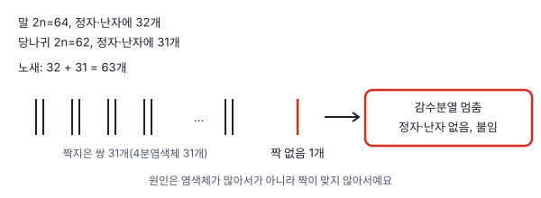

*63개는 31쌍과 짝 없는 1개라 감수분열이 끝나지 못해요.*

이 설명의 핵심은 홀수라는 점보다, 두 부모 종의 염색체가 서로 짝을 정상적으로 맞추지 못해 정상적인 정자·난자를 만들지 못한다는 점이에요. 그래서 염색체 수가 짝수인 잡종이라도 짝이 맞지 않으면 불임일 수 있어요.

잡종 불임과 잡종 붕괴는 "1대 잡종이 자손을 남기는가"로 갈라요. 노새처럼 1대 잡종이 정자·난자를 못 만들면 잡종 불임이에요. 1대 잡종은 정상으로 태어나 자손을 낳았는데, 그다음 세대부터 약해져 대가 끊긴다면 1대는 번식한 것이므로 잡종 붕괴예요.

**교수님 말씀**

교수님은 접합 후 격리를 처음 소개할 때 손자 이야기를 했어요.

> 우리 언제 손자 볼 수 있니? 손자는 무슨 손자, 끝.

노새는 잘 달리는 말과 힘센 당나귀를 합치려고 만든 일종의 하이브리드라고 했어요. 노새가 돌잔치를 하고 늙어 죽을 때까지 잘 살아도 자식은 못 남긴다는 거예요. "놀아야겠다, 그래서 노새"는 농담이고, 실제로는 한자에서 온 말이라고 스스로 바로잡았어요.

잡종 붕괴는 이렇게 그렸어요. 드디어 손자를 봤는데도 같은 종이 되는 건 아니라는 거예요.

> 세대가 지나갈수록 점점 빌빌해지더니 결국에는 대가 끊깁니다.

**꼭 기억해요**

**노새가 불임인 이유를 "염색체 수가 너무 많아서"라고 보기 쉬워요.** 원인은 수가 많은 것이 아니라 짝이 맞지 않는 것이에요. 63 = 31쌍 + 짝 없는 1개라 감수분열이 멈추고 정자·난자를 만들지 못해요. 교수님 말 중 "32는 31 + 1이니까"는 앞뒤가 맞지 않는 말실수이고, 바른 계산은 63 = 31쌍(62개) + 1개예요.

**잡종 불임과 잡종 붕괴를 섞기 쉬워요.** 잡종 불임은 1대 잡종이 자손을 못 남겨요(노새). 잡종 붕괴는 1대 잡종은 정상이고 자손(손자)까지 낳지만, 다음 세대부터 약해져 대가 끊겨요.

**잡종 생존불능의 이름이 흔들렸어요.** 교수님이 "생존 치사라고 부르는 거 같아"라고 말했지만, 강의노트 용어는 '잡종 생존불능'이에요. 배아 단계에서 죽거나 태어나자마자 죽는 경우예요.

**접합 후 장벽을 접합 전 장벽과 섞기 쉬워요.** 세 가지 모두 수정란은 이미 생긴 뒤의 일이에요. 잡종 배아가 발달하지 못함, 잡종 불임, 다음 세대의 쇠퇴는 접합 후 장벽이에요.

**페이지 요약**

접합 후 장벽은 수정란은 생기지만 잡종이 죽거나(생존불능), 자손을 못 남기거나(불임), 다음 세대부터 약해져 끊기는(붕괴) 경우예요.

*용어*

- **접합 후 장벽(postzygotic barrier)** — 수정란(접합자)은 생기지만 이후 과정에 문제가 생겨 두 종이 섞이지 못해요. 수업의 '수정 후 격리'와 같은 말이에요.
- **잡종 생존불능** — 잡종이 배 발생 중 배아 단계에서 죽거나 태어나자마자 죽어요. 교수님이 말한 '생존 치사' 대신 이 용어를 써요.
- **잡종 불임** — 1대 잡종이 자라도 정자·난자를 만들지 못해 자손을 못 남겨요. 예는 노새(말 × 당나귀)예요.
- **노새가 불임인 이유** — 말 n=32 + 당나귀 n=31 = 63개예요. 감수분열 전기에 비슷한 염색체끼리 4분염색체 31개를 만들고 1개가 짝이 없어 감수분열이 멈추고, 정자·난자가 안 만들어져요(수업의 단순화한 설명). 핵심은 두 부모의 염색체가 짝을 정상적으로 맞추지 못한다는 점이라, 염색체가 많아서가 아니고 짝수라도 짝이 안 맞으면 불임일 수 있어요.
- **잡종 붕괴** — 1대 잡종은 정상이고 자손(손자)도 낳지만, 다음 세대부터 생존력·생식력이 떨어져 결국 대가 끊겨요.
- **불임과 붕괴의 구분** — 1대 잡종이 자손을 남기지 못하면 불임, 1대는 번식하고 그 뒤 세대가 쇠퇴하면 붕괴예요.

---

## 3. [8장] 종분화의 지리학

### 이소적 종분화: 지리적 격리 뒤의 생식적 격리

*1029 수업 · 8장 p2*

**쉽게 말하면**

바다 한가운데에 땅이 솟아 물고기 무리가 둘로 갈리면, 두 무리는 오랫동안 만나지 못해 조금씩 달라져요.

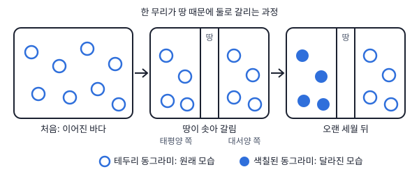

*다시 만나도 서로 짝을 짓지 않을 만큼 달라져야 비로소 다른 무리가 된 거예요.*

**정확히 말하면**

**이소적 종분화(allopatric speciation)**는 한 개체군이 지리적으로 떨어진 아개체군으로 나뉘어 유전자 흐름이 끊기고, 그 결과 새 종이 생기는 종분화예요(강의노트 8장 p2). 이소(異所)는 "다른 장소"라는 뜻이에요.

**왜 지리적 격리만으로는 종분화가 아닐까요?** 같은 종인지 다른 종인지는 [생물학적 종 개념](#s2-species)으로 판정해요. 자연 상태에서 교배해 생식력 있는 자손을 낳으면 같은 종이에요. 땅이나 강이 두 무리를 갈라놓으면 서로 만나지 못할 뿐이에요. 막 갈라진 두 무리를 다시 한곳에 모으면 여전히 교배해 생식력 있는 자손을 낳을 수 있으므로 아직 같은 종이에요. 그래서 **지리적 격리**는 종분화의 원인(출발점)이고, 종분화를 판정하는 기준은 **생식적 격리**예요.

**그러면 지리적 격리는 무엇을 할까요?** 집단 사이의 **유전자 확산(gene flow, 유전자 흐름)**을 막아요. 두 무리가 오가며 교배하는 동안에는 한쪽에서 생긴 새 대립유전자도 교배를 통해 다른 쪽으로 퍼져서, 두 무리가 하나의 유전자 풀(gene pool)을 함께 써요. 유전자 확산이 끊기면 한쪽에서 생긴 변화가 다른 쪽으로 넘어가지 못하고 그 무리 안에만 쌓여요. 강의노트는 이 과정을 다음 순서로 적었어요.

1. 지리적 장벽이 생겨 개체군이 나뉘어요. 강의노트는 이 단계를 "지리적 장벽과 생물 이동 능력의 상대적 차이"로 적었어요. 장벽이 그 생물에게 건너기 어려운 것이어야 실제로 무리가 갈라져요.
2. 지리적 격리 뒤 두 무리의 유전자 풀이 분리돼요. 유전자 확산이 멈춘 거예요.
3. 각기 다른 유전자 풀에서 서로 다른 돌연변이, 자연선택, 유전적 부동이 일어나 대립유전자 빈도가 따로따로 변해요. 이것이 진화적 변화예요.
4. 차이가 쌓여 다시 만나도 교배하지 않거나 생식력 있는 자손을 낳지 못하게 되면(생식적 격리), 그때 종분화가 일어난 거예요.

순서를 줄이면 **지리적 격리, 진화적 변화(대립유전자 빈도 변화), 생식적 격리**예요. 지리적 격리는 종분화가 끝난 뒤에 생기는 일이 아니라 맨 처음에 일어나요.

**증거: 파나마 지협의 놀래기.** 북미와 남미를 잇는 파나마 지협(Isthmus of Panama)은 원래 없었고, 그 자리는 태평양과 대서양이 이어진 바다였어요. 육지가 융기해 지협이 생기자 바다가 완전히 나뉘었고, 원래 한 종이던 물고기 무리도 태평양 쪽과 대서양 쪽으로 갈라져 서로 교류하지 못하게 됐어요. 세월이 지나며 돌연변이가 쌓여 지금은 양쪽에 서로 다른 놀래기(wrasse) 종이 살아요(교수님은 "물고기", 강의노트는 "놀래기"로 적었어요). 두 종을 처음 나눈 요인은 지협의 융기로 생긴 **서식지의 분리, 곧 지리적 격리**예요. 이소적 종분화에서 맨 먼저 일어나는 일은 땅·바다 같은 장벽이 집단을 물리적으로 갈라놓는 것이고, 두 집단 사이의 다른 차이들은 갈라진 뒤에 쌓여요.

또 다른 예로 교수님은 한 식물 집단 사이에 빙하가 녹아 강이 생긴 경우를 들었어요. 강 때문에 교류가 끊기고, 오랜 세월 돌연변이가 쌓여 생식적으로 달라지면 나중에 다시 만나도 섞이지 않아요. 이것이 이소적 종분화예요.

**대부분의 새 종은 언제 생길까요?** 수업의 예는 모두 한 조상종의 집단들이 서로 교배하지 않는 무리로 **격리되는** 데서 시작해요. 파나마와 빙하는 땅과 강이, [사과파리](#s3-sympatric)는 다른 나무에서의 끼리끼리 교배가, [배수성](#s3-polyploidy)은 염색체 수 차이가 무리를 나눠요. 새 종이 생기는 출발점은 조상종의 집단들이 서로 격리되는 것이에요. 격리된 뒤에는 돌연변이, 자연선택, 유전적 부동이 각 집단을 따로 바꿔요. 종분화는 이런 과정이 낳는 결과이고, 생물이 의도해서 일어나는 일이 아니에요.

**갈라진 두 무리가 서로 다른 형질을 갖게 되는 이유.** 갈라진 뒤의 차이도 [자연선택의 논리](../../1027/정리노트_1027_Evolutionary_Thought_and_Microevolution.html#s1-natural-selection)로 설명해요. 핵심은 변이가 선택보다 먼저 있고, 환경은 변이를 만들지 않고 이미 있는 변이 가운데 무엇이 더 많이 남을지만 정한다는 것이에요. 가상의 예로 한 물고기 집단이 남쪽과 북쪽으로 갈렸고, 남쪽에만 있는 먹이를 잡기에 입 모양이 조금 다른 변이가 유리하다고 해 봐요.

1. 공통 조상 집단 안에 그 입 모양을 만드는 변이가 이미 낮은 빈도로 있었어요. 두 집단은 그 조상 집단에서 갈라졌으므로 처음에는 양쪽 모두 그 변이를 낮은 빈도로 가지고 있어요.
2. 남쪽에서는 그 변이를 가진 개체가 먹이를 더 잘 잡아 더 많이 생존하고 번식해요. 그래서 세대가 지나며 남쪽 집단에서 그 변이의 빈도가 높아져요.
3. 북쪽에는 그 먹이가 없어 그 변이가 생존에 이점이 되지 않으므로 선택되지 않고 낮은 빈도로 남아요. 북쪽 집단은 원래 모습을 대부분 유지해요.

판단 기준은 자연선택의 재료가 **이미 있던, 유전되는 변이**라는 점이에요. 살면서 사용해 생긴 차이는 유전되지 않으므로(획득형질의 유전) 다음 세대의 비율을 바꾸지 못해요. 환경은 필요한 변이를 만들어 주지 않고, 이미 있는 변이 가운데 무엇이 더 남을지를 정해요.

**교수님 말씀**

파나마를 예로 들며, 원래 태평양과 대서양이 뚫려 있어 물이 섞였는데 육지가 융기하면서 바다가 완전히 나뉘었다고 했어요. 그 뒤 돌연변이가 쌓여 "너는 너, 나는 나" 새로운 종으로 분기했다고 설명했어요.

> 지리적으로 격리됐다고 해서 무조건 종 분화가 일어나는 게 아니죠.

> 생식적 격리가 돼야만 종 분화가 일어나는 겁니다.

빙하가 녹아 생긴 강의 예에서도 "서로 만난다 하더라도 생식적으로 격리가 있어 버리면" 섞일 수 없다고 같은 기준을 다시 강조했어요.

**꼭 기억해요**

**지리적 격리를 종분화 그 자체로 착각하기 쉬워요.** 지리적 격리는 원인이고, 종분화의 판정 기준은 생식적 격리예요. 갈라져 있기만 하고 다시 만났을 때 교배해 생식력 있는 자손을 낳으면 아직 같은 종이에요. 교수님이 여러 번 되풀이한 내용이에요.

**지리적 분리가 하는 일과 나중에 생기는 일을 섞기 쉬워요.** 지리적 격리의 일은 두 집단 사이의 유전자 확산을 끊는 것이에요. 잡종이 약하거나 불임이 되는 것([접합 후 장벽](#s2-postzygotic))은 갈라진 뒤 차이가 쌓여서 나중에 나타나는 생식적 격리의 한 모습이에요.

**종분화 순서를 뒤바꾸기 쉬워요.** 지리적 격리가 먼저이고, 그다음 진화적 변화(대립유전자 빈도 변화), 마지막이 생식적 격리예요. 지리적 격리가 종분화가 끝난 뒤에 일어나는 것이 아니에요.

**지리적 격리와 생태적 격리를 섞기 쉬워요.** 교수님은 [생태적 격리](#s2-prezygotic)를 "지리적으로 다른 장소"라고 말하며 부산·수원 예를 들었어요. 생태적 격리는 사자(초원)와 호랑이(깊은 숲)처럼 사는 서식지가 달라 만나지 않는 접합 전 장벽이에요. 지리적 격리는 산·바다·강 같은 장벽이 한 개체군을 갈라놓는 일이고, 이소적 종분화의 출발점이에요.

**"파나마 운하"와 "파나마 지협"을 섞기 쉬워요.** 교수님은 "파나마 운하"로 말을 꺼냈지만, 바다를 가른 것은 땅이 솟아 생긴 지협이에요. 운하는 사람이 판 물길이에요.

**갈라진 집단의 새 형질이 쓰면서 생기거나 필요해서 생겼다고 착각하기 쉬워요.** 공통 조상에게서 받은 변이가 양쪽에 낮은 빈도로 있었고, 그 변이가 유리한 환경에서만 자연선택으로 늘어나요. 다른 쪽 집단에도 그 변이는 낮은 빈도로 남아 있을 수 있어요.

**페이지 요약**

지리적 격리로 유전자 확산이 끊긴 집단들이 따로 변하다가 생식적 격리가 생기면 이소적 종분화예요. 지리적 격리는 원인이고 판정 기준은 생식적 격리예요.

*용어*

- **이소적 종분화(allopatric speciation)** — 한 개체군이 지리적으로 떨어진 아개체군으로 나뉘어 유전자 흐름이 끊기고 새 종이 생기는 종분화예요.
- **지리적 격리의 역할** — 집단 사이의 유전자 확산을 끊어 유전자 풀을 나눠요. 분리만으로 종분화가 끝나지 않고, 잡종이 약해지는 접합 후 장벽은 갈라진 뒤 쌓인 차이로 나중에 나타나요.
- **판정 기준** — 생물학적 종 개념에 따라, 다시 만나도 교배하지 않거나 생식력 있는 자손을 못 낳는 생식적 격리가 생겨야 종분화예요.
- **순서** — 지리적 격리, 유전자 풀 분리, 서로 다른 돌연변이·자연선택·유전적 부동에 의한 대립유전자 빈도 변화, 생식적 격리 순이에요.
- **파나마 지협의 놀래기** — 지협이 융기해 태평양과 대서양이 나뉘자 한 종이던 물고기 무리가 갈라졌어요. 두 종을 나눈 요인은 서식지의 분리(지리적 격리)예요.
- **새 종이 생기는 조건** — 대부분의 새 종은 조상종의 집단들이 서로 격리될 때 생겨요. 격리 뒤 돌연변이·자연선택·유전적 부동이 각 집단을 따로 바꿔요.
- **갈라진 집단의 형질 차이** — 공통 조상 집단의 변이가 양쪽에 낮은 빈도로 있었고, 그 변이가 유리한 환경에서만 자연선택으로 늘어나요. 재료는 이미 있던 유전되는 변이이고, 사용으로 생긴 차이는 유전되지 않으며 환경은 변이를 만들지 않고 골라요.
- **생태적 격리와 구분** — 생태적 격리는 서식지가 달라 만나지 않는 접합 전 장벽이고, 지리적 격리는 장벽이 개체군을 갈라놓는 이소적 종분화의 출발점이에요.

---

### 동소적 종분화: 사과파리

*1029 수업 · 8장 p2*

**쉽게 말하면**

같은 동네에 살아도 어떤 파리는 산사나무에서만, 어떤 파리는 사과나무에서만 지내면 짝을 짓는 때가 어긋나요.

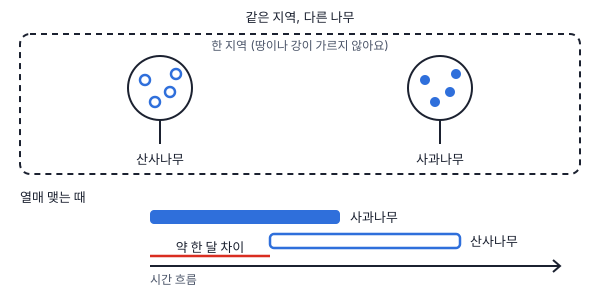

*그래서 끼리끼리만 짝을 짓고, 아직 완전히 다른 무리가 된 것은 아니에요.*

**정확히 말하면**

**동소적 종분화(sympatric speciation)**는 한 지리적 지역에 사는 개체군 안에서 일어나는 종분화예요. 생식적 격리가 한 개체군 안의 하위 집단 사이에서 **지리적 격리 없이** 생겨요(강의노트 8장 p2). 동소(同所)는 "같은 장소"라는 뜻이에요.

**같은 장소인데 어떻게 갈라질까요?** [이소적 종분화](#s3-allopatric)에서는 땅이나 강이 유전자 확산을 막았어요. 같은 장소에서는 그런 장벽이 없으므로, 하위 집단끼리만 교배하게 만드는 다른 이유가 있어야 유전자 확산이 줄어들어요. 교수님은 "여러 가지 이유가 있다"며 그 하나로 사과파리를 들었어요. 강의노트는 이 경우를 **서식지 분화**(habitat differentiation)라는 표제로 묶었어요.

1. 이 파리들은 평생 한 나무에서 살아요. 그 나무에서 자라고, 교배도 그 나무의 열매 위에서 해요.
2. 원래는 북미 토착 **산사나무**(hawthorn)의 열매를 먹고 사는 파리였어요.
3. 북미에 사과나무가 들어오자 파리 일부가 사과나무로 옮겨 가 사과나무 열매에서 살기 시작했어요.
4. 두 나무는 열매 맺는 시기가 약 한 달 차이 나요. 교배를 열매 위에서 하므로 교배 시기도 어긋나요. 교수님은 이것을 **시간적 격리**로 설명했어요.
5. 그래서 사과나무 파리는 사과나무 파리끼리, 산사나무 파리는 산사나무 파리끼리만 교배해요. 같은 지역에 있지만 나무 선호 차이 때문에 두 집단 사이의 유전자 확산이 줄어드는 거예요.
6. 오랜 시간이 지나 돌연변이가 쌓여 생식적 격리가 생기면 다른 종이 될 수 있어요. 하지만 **아직은 다른 종이 아니에요**. 강의노트도 "동소 종분화가 진행 중"이라고 적었어요.

사과나무와 산사나무가 다르다는 것은 같은 지역 안에서 쓰는 서식지(나무)가 다르다는 뜻이에요. 산이나 바다가 두 집단을 갈라놓은 지리적 격리가 아니므로 이 예는 동소적 종분화로 분류해요.

**교수님 말씀**

파리의 일생을 사람에 빗댔어요. 이 나무에서 자라 학교 다니고, 결혼하고, 자식 낳고 죽는다고 했어요. 사과나무가 들어오자 일부 파리가 "나 저쪽으로 한번 가 볼까?" 하고 옮겨 갔다고 설명했어요.

> 오, 사과나무 더 좋은데? 아니 나 여기서 살아야겠다.

> 아직은 다른 종이 안 됐답니다.

**꼭 기억해요**

**사과파리를 어떤 격리로 볼지 자료마다 표현이 달라요.** 교수님은 열매 시기가 약 한 달 차이 나서 교배 시기가 어긋난다는 **시간적 격리**로 설명했어요. 시간적 격리는 수정 전에 작용하는 [접합 전 장벽](#s2-prezygotic)이에요. 강의노트 8장 p2는 이 예를 "**서식지 분화**" 표제 아래 두고 "생식에 대한 **접합 후 장벽**"이라고 적었어요. 두 설명은 장벽이 작용하는 단계가 서로 달라요. 이 노트는 어느 쪽이 맞다고 정하지 않아요. 두 자료가 함께 말하는 것은 같은 지역에서 숙주 나무가 갈라져(서식지 분화) 끼리끼리 교배하고, 아직 종분화가 진행 중이라는 점이에요.

**사과파리가 이미 다른 종이 되었다고 착각하기 쉬워요.** 사과파리는 **진행 중**인 종분화예요. 끼리끼리 교배하고 있을 뿐이고, 생식적 격리가 완성되어야 다른 종이 돼요.

**같은 장소에 살면 종분화가 일어날 수 없다고 착각하기 쉬워요.** 동소적 종분화는 지리적 격리 없이 일어나요. 나무 선호, 교배 시기, [배수성](#s3-polyploidy) 같은 이유로 같은 장소에서도 하위 집단 사이의 교배가 줄거나 막힐 수 있어요.

**다른 나무에 사는 것을 지리적 격리로 착각하기 쉬워요.** 두 나무는 같은 지역 안에 있어요. 이것은 서식지 분화이고, 이소적 종분화를 일으키는 지리적 격리와 달라요.

**보충 · 수업에서 다루지 않았어요**

교재는 사과파리를 동소적 종분화의 동물 모델 가운데 가장 잘 연구된 예로 소개해요. 원래 숙주식물은 북아메리카 동쪽의 산사나무였고, 각 숙주종의 개체가 다른 숙주종의 구성원보다 자기 숙주종의 구성원과 더 많이 교배한다면 숙주종 사이에 생식적 격리가 발달할 수 있다고 적었어요. 교재는 이것이 어떤 종류의 장벽인지는 밝히지 않았어요.

서식지 차이로 보면 이 노트의 [생태적 격리](#s2-prezygotic) 정의(같은 지역 안에서 서식지가 달라 만나지 않음)와도 닿아요. 다만 이 노트는 사과파리의 격리 유형을 하나로 확정하지 않아요.

출처: 교재 8장 p.163–164

**보충 · 노트에 빠졌던 수업 내용**

강의노트에는 사과나무가 약 200년 전에 도입되었고, 일부 집단이 "더 빨리 성숙하는 사과나무"를 먹는다고 적혀 있어요. 두 나무의 열매가 익는 시기가 다르다는 점에서 교수님의 "열매 시기 약 한 달 차이" 설명과 같은 방향이에요. 수업에서는 이 수치와 표현을 말하지 않았어요.

출처: 1029 수업, 강의노트 8장 p2

**페이지 요약**

같은 지역에서 지리적 격리 없이 하위 집단 사이에 생식적 격리가 생기는 것이 동소적 종분화이고, 사과파리는 그 진행 중인 예예요.

*용어*

- **동소적 종분화(sympatric speciation)** — 한 지리적 지역에 사는 개체군 안에서, 지리적 격리 없이 하위 집단 사이에 생식적 격리가 생겨 일어나는 종분화예요.
- **사과파리** — 평생 한 나무에서 살고 열매 위에서 교배해요. 북미 토착 산사나무에 살던 파리 일부가 들어온 사과나무로 옮겨 갔고, 열매 시기가 약 한 달 차이 나 끼리끼리 교배해요.
- **진행 중** — 사과파리는 아직 다른 종이 아니에요. 돌연변이가 쌓여 생식적 격리가 생겨야 다른 종이 돼요.
- **격리 종류의 자료 차이** — 교수님은 시간적 격리(접합 전 장벽)로, 강의노트는 서식지 분화 아래 "접합 후 장벽"으로 적었어요. 이 노트는 어느 쪽인지 정하지 않고, 공통점은 같은 지역의 숙주 나무 차이로 끼리끼리 교배한다는 것이에요.
- **서식지 분화와 지리적 격리** — 같은 지역 안에서 쓰는 나무가 다른 것은 서식지 분화예요. 장벽이 개체군을 갈라놓는 지리적 격리와 달라요.

- **(보충) 교재의 사과파리** — 교재는 숙주종마다 자기 숙주종 구성원과 더 많이 교배하면 생식적 격리가 발달할 수 있다고만 적고 장벽 종류는 밝히지 않아요. 서식지 차이로 보면 생태적 격리 정의와도 닿지만 격리 유형은 확정하지 않아요.

- **(보충) 강의노트의 도입 시기** — 강의노트에는 사과나무가 약 200년 전 도입되었고 일부 집단이 더 빨리 성숙하는 사과나무를 먹는다고 적혀 있어, 열매 시기 차이 설명과 같은 방향이에요.

---

### 배수성: 한 세대 만의 종분화

*1029 수업 · 8장 p2*

**쉽게 말하면**

식물 하나가 실수로 유전 정보 묶음을 두 배로 갖게 되면, 원래 무리와 낳은 아이는 묶음의 짝이 맞지 않아 아이를 못 낳아요.

*두 배가 된 식물끼리는 짝이 맞아서, 곧바로 원래 무리와 다른 새 무리가 생겨요.*

**정확히 말하면**

**배수성(polyploidy)**은 염색체 **세트 전체**가 늘어난 상태예요. 3n, 4n처럼 세트가 통째로 많아진 개체를 **배수체**(polyploid)라고 해요. 이와 달리 **이수체**(aneuploid)는 세트 전체가 아니라 일부 염색체의 수만 달라진 개체예요. 다운 증후군(2n+1)이 이수체의 예예요. 두 개념은 염색체 변화 단원에서 배웠어요([1001 정리노트의 배수성](../../1001/정리노트_1001_Chromosome_Changes_and_DNA_Replication.html#s1-polyploidy)).

강의노트 8장 p2는 다배수성(polyploidy)이 "동물보다 **식물**에서 훨씬 더 흔함"이라고 적었어요. 교수님은 배수성을 식물에서 매우 강력한 [동소적 종분화](#s3-sympatric) 메커니즘이라고 두 번 강조했어요. 땅이나 강이 갈라놓지 않아도 같은 장소에서 일어나요.

**어떻게 한 세대 만에 다른 종이 될까요?** [생물학적 종 개념](#s2-species)에서 다른 종인지는 교배해 생식력 있는 자손을 낳는지로 판정해요. 배수체는 원래 집단과 교배해도 생식력 있는 자손을 낳지 못하므로, 돌연변이가 오래 쌓이기를 기다리지 않고 곧바로 생식적 격리가 생겨요. 과정을 순서대로 보면 다음과 같아요.

1. 보통 이 식물들은 나도, 가족도, 교배 상대도 모두 2n이에요. 그런데 한 개체가 DNA를 복제한 뒤 세포분열을 하지 않아 4n이 되었어요. 배수체가 생기는 구체적 기작은 복잡하다며 수업에서는 이 예만 들었어요.
2. 4n 개체가 감수분열하면 염색체 수가 반으로 줄어 **배우자(정자·난자)가 2n**이 돼요. 원래 집단의 2n 개체가 만드는 배우자는 n이에요.
3. 4n의 2n 배우자와 원래 집단의 n 배우자가 수정하면 **3n** 자손이 생겨요.
4. 3n 자손이 감수분열을 하려고 비슷한 염색체끼리 짝지어 4분염색체(tetrad)를 만들 때, 세 세트 가운데 두 세트는 짝이 맞지만 나머지 한 세트는 짝이 없어요. 수업에서는 이것을 "감수분열이 진행되지 않는다"로 단순화해 설명했어요. 핵심은 세 세트가 짝을 정상적으로 맞추지 못해, 감수분열이 일어나더라도 염색체 수가 고르지 않은 배우자가 생겨 정상 자손을 거의 남기지 못한다(불임)는 것이에요.
5. 4n 개체와 원래 2n 집단은 교배해도 생식력 있는 자손을 남기지 못해요. 생식적 격리가 생겨, 4n 개체는 **단 한 세대** 만에 원래 집단과 다른 종이 돼요.
6. 어쩌다 4n이 된 다른 개체가 있으면, 4n끼리는 2n 배우자끼리 수정해 4n 자손을 낳아요. 이 4n 자손은 모든 세트가 짝이 있어 다시 감수분열을 할 수 있으므로, 4n 개체들끼리는 하나의 종이 될 수 있어요.

**배수성이 생식적 격리를 일으키는 방식은 생식세포(배우자)의 염색체 수가 달라지는 것**이에요. 배수체는 원래 집단과 만나 교배하더라도 그 자손의 염색체 세트가 짝이 맞지 않아 불임이 돼요. 이 점에서 교배 상대를 만나는 일 자체가 줄어드는 [사과파리](#s3-sympatric) 예와 구별돼요.

3n이 불임인 이유는 [접합 후 장벽](#s2-postzygotic)의 노새와 같은 논리예요. 수업에서는 노새가 염색체 63개 가운데 31쌍을 짓고 1개가 짝이 없어 감수분열이 멈춘다고 설명했어요. 3n은 짝이 없는 것이 염색체 한 세트 전체이고, 두 경우 모두 짝이 맞지 않는 염색체 때문에 정상 배우자를 거의 만들지 못해요.

[이소적 종분화](#s3-allopatric)가 오랜 세월 돌연변이가 쌓여야 하는 것과 달리, 배수성은 한 세대 안에 생식적 격리를 만들어요. 그래서 "강력한" 메커니즘이라고 불러요.

**교수님 말씀**

2n 식물 가족을 사람처럼 그렸어요. 나도, 엄마·아빠도, 약혼자도 2n인데, DNA를 복제해 놓고 세포분열을 "까먹어 버려서" 나만 4n이 되었다고 했어요. 4n이 감수분열하니 "정자인데도 2n"이 되고, 약혼자의 n과 만나 3n 자식이 태어난다고 설명했어요.

> 매우 강력한 동소적 종분화의 메커니즘이다, 식물에서.

> 중요한 거는 배수체가 됐으면은 다른 종이 될 수가 있다는 겁니다.

> 엄마, 아빠, 가족, 약혼녀, 친구들, 안녕. 나는 다른 종이다.

**꼭 기억해요**

**이수체와 배수체를 섞기 쉬워요.** 이수체는 일부 염색체의 수만 달라진 개체예요(2n+1, 다운 증후군). 배수체는 염색체 세트 전체가 늘어난 개체예요(3n, 4n).

**4n × 2n과 4n × 4n의 결과를 섞기 쉬워요.** 4n × 2n은 2n 배우자와 n 배우자가 만나 3n 자손이 되고, 한 세트가 짝이 없어 불임이에요. 4n × 4n은 2n 배우자끼리 만나 4n 자손이 되고, 감수분열이 가능해 번식할 수 있어요.

**3n이 왜 불임인지 놓치기 쉬워요.** 노새와 같은 논리예요. 짝 없는 염색체가 생기면 4분염색체 형성 때 짝이 정상적으로 맞지 않아요. 수업은 이를 "감수분열이 멈춘다"로 단순화했고, 감수분열이 일어나더라도 염색체 수가 고르지 않은 배우자가 생겨 정상 자손을 거의 못 남겨요.

**배수성이 격리를 만드는 방식을 정확히 잡아요.** 배수성이 격리를 만드는 방식은 배우자의 염색체 수가 달라지는 것이에요. 그래서 원래 집단과 교배해도 자손이 불임이 돼요.

**배수성에도 지리적 격리가 필요하다고 착각하기 쉬워요.** 배수성은 같은 장소에서 일어나는 동소적 종분화이고, 오랜 세월이 아니라 한 세대 만에 생식적 격리를 만들어요.

**페이지 요약**

배수체는 배우자의 염색체 수가 달라져 원래 집단과의 자손이 불임이 되므로, 단 한 세대 만에 다른 종이 될 수 있어요. 식물에서 흔하고 강력한 동소적 종분화 메커니즘이에요.

*용어*

- **배수성(polyploidy)** — 염색체 세트 전체가 늘어난 상태예요(3n, 4n). 동물보다 식물에서 훨씬 흔하고, 식물에서 매우 강력한 동소적 종분화 메커니즘이에요.
- **배수체와 이수체** — 배수체는 세트 전체가 늘어난 개체(3n, 4n)이고, 이수체는 일부 염색체 수만 달라진 개체(2n+1, 다운 증후군)예요.
- **4n이 되는 예** — 2n 개체가 DNA를 복제한 뒤 세포분열을 하지 않으면 4n이 돼요. 4n의 배우자는 2n이에요.
- **4n × 2n** — 2n 배우자 + n 배우자로 3n 자손이 생겨요. 세 세트가 짝을 정상적으로 맞추지 못해, 감수분열이 일어나더라도 염색체 수가 고르지 않은 배우자가 생겨 정상 자손을 거의 못 남기므로 불임이에요(노새와 같은 논리, 수업은 "감수분열이 멈춘다"로 단순화).
- **4n × 4n** — 2n 배우자끼리 만나 4n 자손이 되고, 모든 세트가 짝이 있어 감수분열이 가능하므로 4n끼리 한 종이 될 수 있어요.
- **격리 방식과 속도** — 배우자(생식세포)의 염색체 수가 달라져 원래 집단과의 자손이 불임이 되므로 생식적 격리가 생겨요. 지리적 격리 없이 한 세대 만에 일어나요.

---

## 4. 요약 · 예고

### 시험 직전 한 줄

*1029 수업 · 7장 p4–5, 8장 p1–2*

| 주제 | 시험 직전 한 줄 |
|---|---|
| [하디-바인베르크 계산 함정](#s0-hw-practice) | 문제는 1세대가 평형이 깨진 상태로 출발한다고 가정해요. "평형 조건이 적용되면 다음 세대는?"에 1세대 유전자형 빈도를 그대로 쓰면 틀리고, 1세대에서 p, q를 먼저 구한 뒤 p², 2pq, q²로 2세대를 계산해요. 평형 유지는 2세대부터의 이야기예요. |
| [열성 질환 역산](#s0-hw-practice) | 집단이 평형이라고 가정할 때, 열성 동형접합자(aa)만 환자이므로 환자 비율 = q²예요. 1만 명 중 1명이면 q² = 0.0001이고, 제곱근을 취해 q = 0.01, p = 0.99, 보인자(Aa) = 2pq = 2 × 0.99 × 0.01, AA = p²예요. q²(환자 비율)와 q(대립유전자 빈도)를 섞지 않아요. |
| [다섯 조건과 소진화 요인](#s0-factors) | 다섯 조건 중 하나라도 깨지면 빈도가 변해 소진화가 일어나요. 조건을 뒤집은 것이 요인이에요: 돌연변이 없음은 돌연변이, 이동 없음은 유전자 확산(gene flow), 무한 크기는 작은 집단의 유전적 부동, 자연선택 없음은 자연선택, 무작위 교배는 비무작위(선택적) 교배로 뒤집혀요. 선택적 교배는 수업에서 성선택과 묶어 대립유전자 빈도를 바꾼다고 설명했고, 강의노트의 근친교배는 유전자형 빈도에 영향을 줘 동형접합자를 늘리고 이형접합자를 줄여요(수업에서는 다루지 않음). |
| [돌연변이 세 종류](#s0-factors) | 돌연변이는 DNA 염기서열의 자발적 변화이고(자외선·화학물질이 빈도를 높임) 대부분 유해하거나 중립이에요. 생존·생식에 도움이 되면 유익돌연변이이고 자연선택으로 자손이 늘어요. 생기면 대립유전자 빈도가 변해요. |
| [유전자 확산](#s0-factors) | 다른 집단과의 이동으로 대립유전자 빈도가 바뀌는 것이에요. 옆 동네 빨간 꽃 종자가 날아오면 빨간 대립유전자가 늘고(유입), 흰 종자가 날아가면 줄어요(유출). 들어오는 것과 나가는 것 둘 다 유전자 확산이에요. |
| [유전적 부동](#s0-drift) | 형질의 유리함과 상관없이 우연한 사건으로 대립유전자 빈도가 변하는 것이에요. 집단이 작을수록 영향이 크고, 보통 유전적 다양성을 줄여 작은 집단을 멸종에 취약하게 만들어요(보전: 다른 지역 개체를 데려와 교배). 우연이어도 빈도가 변했으면 진화(소진화)예요. |
| [병목 현상 vs 창시자 효과](#s0-drift) | 둘 다 유전적 부동이에요. 병목 현상은 폭풍·지진·사냥 같은 사건으로 그 자리의 개체 수가 급감하고 우연히 남은 소수가 다시 번식하는 것(수가 회복돼도 조성은 달라지고 일부 대립유전자는 사라짐), 창시자 효과는 큰 집단에서 소수가 떨어져 나와 새 지역에 새 집단을 만들어 창시자들의 유전자가 조성을 정하는 것이에요. |
| [자연선택 vs 유전적 부동](#s0-drift) | 판별 기준은 "그 형질 때문에 남았나, 우연히 남았나"예요. "70점 이하는 나가"처럼 형질에 따라 남으면 자연선택, "이 줄만 남아"처럼 형질과 무관하게 남으면 유전적 부동이에요. 마션의 짧은 다리 개처럼 처음 온 개체가 우연히 그랬던 것은 적응이 아니에요. |
| [상대적 적응도](#s1-fitness) | 남과 비교해 자식(자기 유전자)을 다음 세대에 얼마나 많이 남기는가예요. 돈·행복·건강이 아니라 자식 수로만 재고, 가장 많이 남긴 개체를 1.0으로 놓고 비교해요(흥부 자식 10명 = 1.0이면 1명인 놀부 = 0.1). |
| [방향성 · 안정화 · 분단성 선택](#s1-fitness) | 정량적 형질 분포에서 한쪽 극단이 불리하면 방향성 선택(평균이 한쪽으로 이동, 예: 항생제 내성 획득), 양 극단이 모두 불리하면 안정화 선택(평균은 그대로, 분포 폭이 좁아짐, 예: 너무 작거나 큰 출생 체중의 높은 사망률), 중간이 불리하면 분단성(다형화) 선택(봉우리가 둘)이에요. 내성 획득은 분단성이 아니라 방향성 선택이에요. |
| [성선택](#s1-sexual) | 짝을 골라 교배하는 것으로, 자연계에서는 보통 암컷이 수컷을 골라요. 선택받는 형질의 대립유전자가 늘어 빈도가 변하고, 공작 수컷의 화려한 깃처럼 생존에 불리해도 유지되며, 암수 차이가 커진 성적이형성(사자 갈기는 수컷만)이 생겨요. |
| [불리한 대립유전자가 남는 이유](#s1-balanced) | 자연선택은 표현형에 작용하므로 열성 대립유전자는 이형접합자 안에 숨어 남아요(이배체성). 이형접합자 이점은 말라리아가 있는 지역에서만 성립해요: AS는 약한 빈혈(불완전 우성)이지만 S 하나로 말라리아 저항성이 생겨 적응도가 가장 높으므로 S가 사라지지 않고, 말라리아가 유행하는 아프리카에서 S 빈도가 높고 미국에서는 낮아요. |
| [형태학적 vs 생물학적 종 개념](#s2-species) | 형태학적 종 개념은 눈으로 본 형태만으로 판단해요. 생물학적 종 개념은 생식 여부만 보아, 자연 상태에서 교배해 생식력 있는 자손을 낳으면 같은 종이에요(닮은 잠자리 두 마리는 다른 종, 전혀 다른 개 두 마리는 같은 종). 동물원의 사자·호랑이 잡종은 자연 상태가 아니고 불임이라 다른 종이에요. 무성생식 생물(세균)과 멸종한 종(화석)에는 쓸 수 없어요. |
| [아종](#s2-species) | 강의노트 정의로는 지리적으로 떨어진 개체군 사이에 나타나는 표현형 변이, 곧 종의 지역적 변이예요. 같은 종이므로 만나면 교배해 생식력 있는 자손을 낳을 수 있어요. 다른 종이 아니라 같은 종 안의 구분이에요. |
| [접합 전 격리 다섯](#s2-prezygotic) | 수정란 자체가 생기지 않는 격리예요. 생태적(사는 곳이 달라 못 만남, 사자·호랑이), 시간적(교배 시기가 다름, 봄꽃·가을꽃), 행동적(구애 신호가 다름, 반딧불이), 기계적(기계가 아니라 생식기관·꽃 구조의 물리적 차이), 배우자(정자·난자 표면 단백질이 맞지 않아 수정 안 됨) 격리예요. |
| [접합 후 격리 셋](#s2-postzygotic) | 수정란은 생기지만 그 뒤에 문제가 생기는 격리예요. 잡종 생존불능(발생 중이나 태어나자마자 죽음), 잡종 불임(노새: 63개 염색체가 감수분열에서 짝이 정상적으로 맞지 않아 정상 배우자를 못 만듦), 잡종 붕괴(1대는 번식하지만 세대를 거듭하며 생존력·생식력이 떨어져 대가 끊김)예요. 불임은 1대가 자손을 못 남기고, 붕괴는 1대는 남겨요. |
| [이소적 종분화](#s3-allopatric) | 다른 장소에 갈라져 생기는 종분화예요(파나마 지협 융기로 나뉜 물고기). 지리적 격리는 원인일 뿐이고, 갈라진 뒤 돌연변이가 쌓여 생식적 격리가 생겨야 종분화라고 판정해요. 지리적 격리만으로는 종분화가 아니에요. |
| [동소적 종분화: 사과파리](#s3-sympatric) | 같은 장소에 살면서 일어나는 종분화예요. 산사나무 파리 일부가 사과나무로 옮겨 열매 시기 약 한 달 차이로 끼리끼리 교배하지만(교수님은 시간적 격리로 설명했고, 강의노트는 서식지 분화 항목에 "생식에 대한 접합 후 장벽"이라고 적어 자료 사이에 차이가 있어요. 어느 쪽으로 확정하지 않아요), 아직 다른 종이 아닌 진행 중인 종분화예요. |
| [배수성: 한 세대 만의 종분화](#s3-polyploidy) | 식물에서 매우 강력한 동소적 종분화 기작이에요. 2n이 복제 후 분열하지 않아 4n이 되면, 4n × 2n의 3n 자손은 감수분열에서 짝이 정상적으로 맞지 않아 정상 배우자를 못 만들므로 불임이고 4n × 4n은 4n 자손을 낳으므로, 4n은 단 한 세대 만에 원래 2n과 다른 종이 돼요. 배수체(3n, 4n, 세트 전체 증가)와 이수체(2n+1, 일부 염색체)는 달라요. |

---

### 다음 수업 예고

*1029 수업 · 8장 p2–6*

수업은 8.1 종분화의 배수성까지 마치고, 절이 끝나는 곳에서 깔끔하게 끝났어요.

> 같은 장소에 산다 하더라도 새로운 종으로 분화를 할 수가 있다. 여기까지가 종분화였고, 나머지는 대진화인데 다음 시간에 하겠습니다.

7장은 여기까지예요. 교수님은 7장을 (1) 다윈 이전 사상, (2) 다윈에 영향을 준 사상, (3) 다윈의 주장, (4) 다윈 이후 진화의 정의, (5) 소진화 요인, (6) 하디-바인베르크 원리 순서로 정리하라고 했어요.

다음 시간에는 대진화가 이어져요(강의노트 진도 기준).

- 8.2 고생물학과 대진화
- 화석기록
- 상대 연대와 방사성 연대측정, 반감기
- 지질시대와 캄브리아기 대폭발
- 판구조론과 판게아
- 수렴진화
- 진화의 경향, 단속 평형과 점진주의
- 적응방산
- 멸종과 대멸종
- 진화발달생물학, 호미오 유전자
- 8.3 생물의 분류와 계통
- 계통수
- 이명법
- 분류 계급
- 계통 형질

---

### 함께 보면 좋은 자료

*1029 수업 · 7장 p4–5, 8장 p1–2*

- [1029 복습문제](복습문제_1029_Microevolution_and_Speciation.md)
- [1027: 지난 수업 정리노트(진화 사상과 소진화, 하디-바인베르크 원리)](../../1027/정리노트_1027_Evolutionary_Thought_and_Microevolution.html#s4-links)
- [0929: 불완전우성과 낫모양적혈구(이형접합자 이점의 바탕)](../../0929/정리노트_0929_Heredity.html#s1-incomplete)
- [0922: 4분염색체와 중기 배열(노새와 3n이 불임인 이유의 바탕)](../../0922/정리노트_0922_Cell_Division_and_Heredity.html#s2-tetrad)
- [1001: 한 개의 오류와 세트 전체의 증가(이수체와 배수체)](../../1001/정리노트_1001_Chromosome_Changes_and_DNA_Replication.html#s1-polyploidy)

---

출처: 이영만 교수님 강의노트(7장 p4–5, 8장 p1–2) · 수업 녹음 전사(1029) · 『생명과학: 기초와 응용』 2판 7장·8장.
