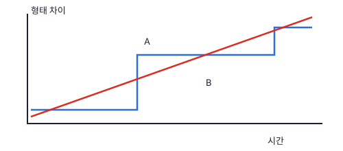
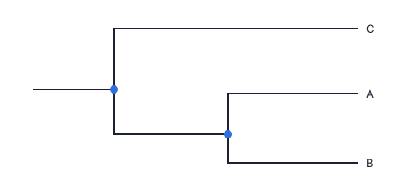

# 생명과학 복습 1103 문제설명

왼쪽 목차로 문항을 고르고, 오른쪽 문제를 보며 해설을 따라가요.

문제의 첫 줄부터 검산까지 설명해요.

**목차**

- [문항별 설명](#problems)
  - [P1. 인간의 진화계통을 재건하는 자료](#p1)
  - [P2. 먼 계통 사이에 생긴 유사한 적응](#p2)
  - [P3. 방사성 탄소와 화석의 상대적 나이](#p3)
  - [P4. 화석 기록의 정보와 한계](#p4)
  - [P5. 수렴진화의 정의](#p5)
  - [P6. 점진주의와 단속평형의 증거](#p6)
  - [P7. 선인장과 대극의 유사성](#p7)
  - [P8. 대멸종 뒤 다양성의 변화](#p8)
  - [P9. 공룡 멸종 뒤 포유류의 분화](#p9)
  - [P10. 방사성 연대측정의 기준 비율](#p10)
  - [P11. 분자 계통과 금빛 정수리 패턴](#p11)
  - [P12. 계통 분기와 지층의 상대연대](#p12)
  - [P13. 분류계급의 포함 관계](#p13)
  - [P14. 진화적 분지과정의 명칭](#p14)
  - [P15. 새 증거와 분류 체계의 수정](#p15)
  - [P16. 계통수 뿌리의 의미](#p16)
  - [P17. 공통조상에서 물려받은 특성](#p17)
  - [P18. 남세균과 진핵생물의 구분](#p18)
  - [P19. 린네 분류가 유지되는 이유](#p19)
  - [P20. 독수리와 박쥐 앞다리의 상동](#p20)
  - [P21. 균류와 가장 가까운 선택 집단](#p21)
  - [P22. 영역부터 종까지의 순서](#p22)
  - [P23. 가장 좁은 선택 분류군](#p23)
  - [P24. [변형] 두 시료의 나이 차이](#p24)
  - [P25. [변형] 퇴적층 사이의 시간](#p25)
  - [P26. [변형] 사건의 순서](#p26)
  - [P27. [변형] 다른 계통의 같은 모양](#p27)
  - [P28. [변형] 살아남은 가지의 착시](#p28)
  - [P29. [변형] 두 변화 패턴](#p29)
  - [P30. [변형] 새 생태적 지위](#p30)
  - [P31. [변형] 대멸종의 구별](#p31)
  - [P32. [변형] 발생 조절의 변화](#p32)
  - [P33. [변형] 분류 계급 쌍둥이](#p33)
  - [P34. [변형] 분류 폭 쌍둥이](#p34)
  - [P35. [변형] 가지 끝의 위치와 친연관계](#p35)
  - [P36. [변형] 분석 재료와 측정 대상](#p36)

## 문항별 설명

### P1. 인간의 진화계통을 재건하는 자료

기출 7강 9 · [원 문제 보기](../%EB%B3%B5%EC%8A%B5%EB%AC%B8%EC%A0%9C_1103_Macroevolution_and_Taxonomy.html#p1)

고생물학자들이 인간의 진화계통을 확인하는데 사용하는 방법은 무엇인가?

- (1) 화석화 된 화분의 구조
- (2) 보기 모두 사용한다
- (3) 화석화 된 배설물 연구
- (4) 골격의 구조
- (5) 화석의 연대측정

기출 원문 보기

기출 7강 합본 9번 (PDF 2쪽)

#### 문제를 먼저 읽어요

화석으로 인간의 계통을 재건할 때 쓸 수 있는 자료를 묻고 있어요. 몸의 모양을 직접 비교하는 자료뿐 아니라 과거 환경과 시간 순서를 알려 주는 자료도 사용할 수 있는지 확인해요.

#### 이 문제를 봤을 때 떠올릴 개념과 공식

판단 기준은 ‘자료가 연구에 어떤 정보를 주는가’예요. 골격은 몸의 구조와 유사성을, 화분은 주변 식생과 기후를, 배설물은 먹이와 생활 방식을, 연대는 사건의 선후를 알려 줄 수 있어요. 환경 자료가 골격과 똑같이 혈연관계를 직접 증명한다는 뜻은 아니에요. 여러 자료가 서로 다른 역할로 계통 연구에 쓰일 수 있어요.

관련 정리노트: [인간의 진화계통을 재건하는 자료의 판단 기준](../%EC%A0%95%EB%A6%AC%EB%85%B8%ED%8A%B8_1103_Macroevolution_and_Taxonomy.html#s0-dating)

#### 왜 이렇게 푸는지 함께 따라가요

(1) 내용상 사용할 수 있어요. 화석화된 화분의 구조로 당시 식물과 서식환경을 추정하면 인간 조상이 살던 환경을 재건하는 데 도움이 돼요. 인간의 골격 형질을 직접 잰 자료와는 역할이 달라요.

(2) 다른 네 보기를 확인한 뒤 선택해요. (1) 환경, (3) 먹이·생활, (4) 골격 형질, (5) 시간 순서라는 자료가 모두 연구에 쓰일 수 있으므로 ‘모두 사용’이 결과적으로 맞아요.

(3) 내용상 사용할 수 있어요. 화석화된 배설물인 분화석(coprolite)의 내용물은 먹이와 생태의 단서가 되어 인간 조상의 생활환경 연구에 쓰여요.

(4) 내용상 사용할 수 있어요. 골격에서 대응하는 뼈의 모양과 배치를 비교하면 조상과 후손의 형태적 관계를 검토할 수 있어요.

(5) 내용상 사용할 수 있어요. 화석의 연대는 각 형태가 언제 존재했는지 제약하므로 가능한 계통의 시간 순서를 검토하게 해요.

따라서 답은 (2)이에요.

#### 완성 답과 검산

답은 (2)예요. 교재8 p164에서 몸의 잔해뿐 아니라 행동·생태의 간접 단서와 연대 정보를 함께 제공한다고 확인했어요. 다른 네 보기 모두 자료로 쓰일 수 있어 ‘모두 사용한다’를 선택해요.

**페이지 요약**

#### 판단 기준과 답

골격=구조, 화분=환경, 배설물=먹이, 연대=시간 순서예요. 네 자료를 모두 쓸 수 있으므로 답은 (2)예요.

---

### P2. 먼 계통 사이에 생긴 유사한 적응

기출 7강 21 · [원 문제 보기](../%EB%B3%B5%EC%8A%B5%EB%AC%B8%EC%A0%9C_1103_Macroevolution_and_Taxonomy.html#p2)

서로 연관이 먼 생물들 간에 외형적으로 유사한 적응 형태를 보이는 것을 무엇이라 하는가?

- (1) 상동형질
- (2) 수렴진화
- (3) 획득형질
- (4) 인위선택
- (5) 대진화

기출 원문 보기

기출 7강 합본 21번 (PDF 3쪽)

#### 문제를 먼저 읽어요

‘먼 계통’이 ‘비슷한 적응 형태’를 보이는 현상에 가장 구체적으로 맞는 이름을 골라요.

#### 이 문제를 봤을 때 떠올릴 개념과 공식

수렴진화(convergent evolution)의 판별 기준은 가까운 공통조상에서 같은 형질을 그대로 물려받은 유사성인가, 먼 계통에서 비슷한 환경에 적응하며 독립적으로 생긴 유사성인가예요. 상동형질은 공통 유래, 수렴진화는 독립적인 비슷한 적응에 초점을 맞춰요.

관련 정리노트: [먼 계통 사이에 생긴 유사한 적응의 판단 기준](../%EC%A0%95%EB%A6%AC%EB%85%B8%ED%8A%B8_1103_Macroevolution_and_Taxonomy.html#s1-convergence)

#### 왜 이렇게 푸는지 함께 따라가요

(1) 이 사례의 이름으로 부적합해요. 상동형질은 비교하는 구조가 공통조상에서 유래한 경우예요. 지문의 핵심은 먼 계통에서 비슷한 적응이 나타난다는 점이에요.

(2) 적합해요. 연관이 먼 계통에서 비슷한 환경에 유리한 형태가 독립적으로 진화해 닮아지는 양상을 수렴진화라고 해요.

(3) 부적합해요. 획득형질은 개체가 일생 동안 환경이나 사용 등에 의해 얻은 특성을 가리켜요. 여러 계통의 적응적 유사성이 생긴 진화 과정을 이름 붙인 말이 아니에요.

(4) 부적합해요. 인위선택(artificial selection)은 사람이 원하는 형질의 번식 개체를 고르는 과정이에요. 지문에는 사람에 의한 번식 선택이 없어요.

(5) 정의 자체가 틀린 것은 아니지만 이 현상의 가장 구체적인 이름으로 부적합해요. 대진화는 종 수준 이상의 큰 진화 양상을 아우르는 넓은 범주이고, 지문이 제시한 독립적인 유사 적응의 이름은 수렴진화예요.

따라서 답은 (2)이에요.

#### 완성 답과 검산

답은 (2)예요. 교재8 p166–167의 상어·펭귄·돌고래 사례도 서로 먼 계통에서 물속 이동에 유리한 체형이 비슷해진다는 같은 구조예요. 공통 유래라는 상동의 기준과 구분해도 (2)가 남아요.

**페이지 요약**

#### 판단 기준과 답

먼 계통의 독립적인 유사 적응이 기준이에요. 이 현상의 구체적 이름은 수렴진화이므로 답은 (2)예요.

---

### P3. 방사성 탄소와 화석의 상대적 나이

기출 7강 23 · [원 문제 보기](../%EB%B3%B5%EC%8A%B5%EB%AC%B8%EC%A0%9C_1103_Macroevolution_and_Taxonomy.html#p3)

당신은 인간 조상의 다양한 화석을 조사하고 있다. 화석에서 발견되는 불안정한 방사성 탄소의 방사능량이 상대적으로 가장 많은 것은?

- (1) Homo habilis
- (2) Australopithecus garhi
- (3) Homo neanderthalensis
- (4) Paranthropus robustus
- (5) Ardepithecus ramidus

기출 원문 보기

기출 7강 합본 23번 (PDF 3쪽)

#### 문제를 먼저 읽어요

그림의 시간축에서 각 인간 계통이 존재한 시기를 비교해 방사성 탄소가 상대적으로 많이 남을 대상을 고르려는 문제예요.

**문항 결함:** 시료의 양·초기 C-14 비율·보존 상태가 제시되지 않았어요. 또한 그림의 수십만~수백만 년 시기는 C-14의 일반적 유효 측정 범위를 크게 넘어요. 인쇄 의도답은 (3)이지만 실제 방사능량의 유일한 순위를 이 그림만으로 정할 수는 없어요.

#### 이 문제를 봤을 때 떠올릴 개념과 공식

새 탄소의 유입이 끊긴 뒤에는 C-14가 반감기 5,730년을 따라 줄어요. 같은 초기 비율과 비교 가능한 시료량·보존 조건에서라면 더 최근 시료일수록 C-14 잔존비율이 커요. 먼저 그림의 ‘현재’와 과거의 방향을 찾고, 각 가지가 현재에 얼마나 가까운 시기까지 표시되는지 비교해요. 종 이름의 암기보다 시간축 판독이 기준이에요. 실제 방사능량은 남은 방사성 원자 수에 좌우되므로 나이뿐 아니라 시료량도 필요해요.

관련 정리노트: [방사성 탄소와 화석의 상대적 나이의 판단 기준](../%EC%A0%95%EB%A6%AC%EB%85%B8%ED%8A%B8_1103_Macroevolution_and_Taxonomy.html#s0-dating)

#### 왜 이렇게 푸는지 함께 따라가요

(1) 출제 의도에서는 제외해요. 그림의 Homo habilis 가지는 네안데르탈인보다 과거에 끝나요. 초기 조건이 같다는 단순 모형에서는 더 오래 붕괴해 잔존비율이 작다고 보지만 실제 시료의 방사능량을 이 정보만으로 확정하지는 못해요.

(2) 출제 의도에서는 제외해요. Australopithecus garhi는 그림에서 더 오래된 시기의 가지예요. 동일 초기 조건이라면 최근 쪽인 (3)보다 C-14가 적게 남는 방향이지만 수백만 년 시료를 C-14로 정밀 비교한다는 뜻은 아니에요.

(3) 인쇄 의도상 선택해요. 그림에서 Homo neanderthalensis가 다섯 선택지 중 현재에 가장 가까운 쪽에 표시돼요. ‘더 최근→덜 붕괴’라는 단순 원리를 적용한 답이에요. 다만 특정 시료의 연대와 양이 없고 C-14의 검출 한계도 있어 실제 측정값의 엄밀한 유일 답은 아니에요.

(4) 출제 의도에서는 제외해요. Paranthropus robustus의 가지가 (3)보다 오래된 쪽에 있으므로 같은 초기 조건의 잔존비율 모형에서는 더 작게 보아요. 시료량 차이까지 배제한 실제 방사능량 비교는 불가능해요.

(5) 출제 의도에서는 제외해요. 그림에서 가장 오래된 쪽인 Ardipithecus ramidus에 해당하는 선택지예요. 원문의 Ardepithecus는 철자 오류로 보존되었어요. 같은 조건의 잔존비율에서는 오래될수록 작지만 실제 C-14 검출을 보장하지 않아요.

인쇄 의도상 답은 (3)이에요.

#### 완성 답과 검산

인쇄 의도답은 (3)예요. 그림의 시간축에서 네안데르탈인 가지가 가장 현재에 가까운지 다시 확인했어요. 교재8 p166 표는 C-14의 유효 범위를 약 7만 년 미만으로 제시하므로, 이 그림의 오래된 계통들을 실제 방사능량으로 확정 순위화했다는 결론은 내리지 않아요.

#### 헷갈리는 조건을 구별해요

시험에서는 출제 의도가 그림의 최근성 비교임을 확인하고 (3)을 고르되, 실제 실험 해석을 묻는다면 시료량·초기 비율·오염과 보존·검출 한계가 필요하다고 적어요. ‘최근 종’이라는 사실과 ‘내 손의 시료가 더 최근에 죽었다’는 사실도 같지 않아요.

**페이지 요약**

#### 판단 기준과 답

그림상 최근성을 적용한 인쇄 의도답은 (3)이에요. 실제 방사능량은 시료량·초기 조건이 없고 C-14 유효 범위도 넘어 이 그림만으로 유일하게 정할 수 없어요.

---

### P4. 화석 기록의 정보와 한계

기출 7강 26 · [원 문제 보기](../%EB%B3%B5%EC%8A%B5%EB%AC%B8%EC%A0%9C_1103_Macroevolution_and_Taxonomy.html#p4)

화석 기록은 _______________.

- (1) 과거 생물의 생리 또는 행동에 대한 증거를 제공하지 못한다.
- (2) 지역적인 분포를 하는 희귀종에 대한 풍부한 자료를 제공한다,
- (3) 단속평형설을 지지하나 점진주위설은 지지하지 않는다.
- (4) 과거에 살았던 모든 생물들에 대하여 동등하게 좋은 자료를 제공한다.
- (5) 과거의 생명체에 관한 직접적인 증거를 제공한다.

기출 원문 보기

기출 7강 합본 26번 (PDF 4쪽)

#### 문제를 먼저 읽어요

화석 기록으로 무엇을 알 수 있고, 어떤 생물이 얼마나 잘 보존되는지의 한계를 함께 판단해요.

#### 이 문제를 봤을 때 떠올릴 개념과 공식

화석은 과거 생물의 몸이나 활동이 남은 직접 증거예요. 몸의 잔해는 형태를, 발자국·배설물 같은 흔적은 행동·먹이를 간접 추론하게 해요. 모든 개체가 같은 확률로 화석이 되지는 않으므로 보존 편향을 확인해요. 진화 속도는 점진주의와 단속평형 두 양상 모두 나타날 수 있어요.

관련 정리노트: [화석 기록의 정보와 한계의 판단 기준](../%EC%A0%95%EB%A6%AC%EB%85%B8%ED%8A%B8_1103_Macroevolution_and_Taxonomy.html#s0-dating)

[두 형태 변화 양상](../%EC%A0%95%EB%A6%AC%EB%85%B8%ED%8A%B8_1103_Macroevolution_and_Taxonomy.html#s2-tempo)도 함께 확인해요.

#### 왜 이렇게 푸는지 함께 따라가요

(1) 틀린 진술이므로 제외해요. 발자국의 배열은 이동과 무리 행동, 배설물 내용은 먹이의 단서를 줄 수 있어요. 직접 행동을 촬영하지 못했다는 사실이 행동의 증거가 전혀 없다는 뜻은 아니에요.

(2) 일반적인 설명으로 틀려 제외해요. 수가 적고 지역이 제한된 종은 화석으로 보존되고 발견될 기회도 제한될 수 있어요. 희귀종이라는 조건이 풍부한 기록을 보장하지 않아요.

(3) 틀린 진술이므로 제외해요. 일부 화석 계열은 긴 정체와 비교적 짧은 변화를, 다른 계열은 점진적 변화를 보여 줄 수 있어요. 기록 전체가 한 모델만 지지한다고 배제할 수 없어요. 원문의 ‘점진주위설’은 점진주의설을 가리켜요.

(4) 틀린 진술이므로 제외해요. 단단한 구조의 유무, 퇴적·보존 환경 등에 따라 화석화 가능성이 달라요. 모든 생물에 동등하게 좋은 자료라는 주장은 보존 편향을 무시해요.

(5) 맞는 진술이므로 선택해요. 뼈나 이빨, 몸의 자국과 활동 흔적이 실제 남아 있다는 사실은 과거 생물의 존재에 관한 직접 증거예요. 그 증거로부터 생태를 추론할 수 있어요.

따라서 답은 (5)이에요.

#### 완성 답과 검산

답은 (5)예요. 교재8 p164에서 화석은 과거 생물의 직접 증거이면서 행동·생태의 간접 단서를 준다고 확인했어요. ‘직접 증거’와 ‘모든 해석을 직접 관찰함’을 구분하면 (1)과 (5)가 모순 없이 판별돼요.

**페이지 요약**

#### 판단 기준과 답

화석 자체는 과거 생물의 직접 증거이고 행동·생태도 간접 추론할 수 있어요. 보존 편향은 있으므로 답은 (5)예요.

---

### P5. 수렴진화의 정의

기출 7강 27 · [원 문제 보기](../%EB%B3%B5%EC%8A%B5%EB%AC%B8%EC%A0%9C_1103_Macroevolution_and_Taxonomy.html#p5)

서로 연관이 먼 생물들 간에 외형적으로 유사한 적응 형태를 보이는 것을 무엇이라 하는가?

- (1) 상동형질
- (2) 수렴진화
- (3) 획득형질
- (4) 인위선택
- (5) 대진화

기출 원문 보기

기출 7강 합본 27번 (PDF 4쪽)

#### 문제를 먼저 읽어요

먼 계통의 비슷한 적응을 가리키는 이름을 고르는 문항이에요. 유사성이 공통 유래인지 독립적인 적응인지 구별해요.

#### 이 문제를 봤을 때 떠올릴 개념과 공식

비교 기준은 유사한 형질이 생긴 경로예요. 공통조상에서 물려받은 대응 구조는 상동이고, 먼 계통이 비슷한 환경에서 독립적으로 닮은 적응은 수렴진화(convergent evolution)예요. 넓은 분류 이름보다 지문이 설명한 구체적인 양상의 이름을 선택해요.

관련 정리노트: [수렴진화의 정의의 판단 기준](../%EC%A0%95%EB%A6%AC%EB%85%B8%ED%8A%B8_1103_Macroevolution_and_Taxonomy.html#s1-convergence)

#### 왜 이렇게 푸는지 함께 따라가요

(1) 사례에 부적합해요. 상동형질은 해당 형질의 공통 유래가 기준인데, 지문은 먼 계통의 적응적 유사성이라는 다른 기준을 제시해요.

(2) 사례에 적합해요. 먼 계통에서도 비슷한 선택 환경에서 유리한 형태가 독립적으로 생겨 닮을 수 있어요. 그 양상의 이름이 수렴진화예요.

(3) 사례에 부적합해요. 획득형질은 개체가 살면서 얻은 특성을 뜻해요. 지문에서 비교한 것은 한 개체의 일생 변화가 아니라 계통들 사이의 적응 형태예요.

(4) 사례에 부적합해요. 인위선택은 사람이 번식 개체를 선택하는 일이지만, 지문에는 선택 주체인 사람이나 육종 조건이 없어요.

(5) 범주의 정의는 틀리지 않지만 이 물음의 가장 직접적인 이름은 아니에요. 대진화는 종 수준 이상의 다양한 진화 양상을 포함해요. 먼 계통의 독립적인 유사 적응이라는 구체적인 단서는 (2)를 가리켜요.

따라서 답은 (2)이에요.

#### 완성 답과 검산

답은 (2)예요. 상어·펭귄·돌고래의 유선형도 어류·조류·포유류라는 먼 계통 사이의 유사 적응이므로 같은 이름을 적용해요. 공통 유래 형질과 바꾸어 읽지 않았는지 확인했어요.

**페이지 요약**

#### 판단 기준과 답

비슷한 환경에서 먼 계통이 독립적으로 유사한 적응을 보이면 수렴진화예요. 가장 구체적인 답은 (2)예요.

---

### P6. 점진주의와 단속평형의 증거

기출 7강 40 · [원 문제 보기](../%EB%B3%B5%EC%8A%B5%EB%AC%B8%EC%A0%9C_1103_Macroevolution_and_Taxonomy.html#p6)

대진화의 관점에서 볼 때, 형태학적인 변화에 대한 설명 중 옳은 것은?

- (1) 단속평형설을 형태적인 진화는 연속적인 변화의 축적이라고 주장한다.
- (2) 점진주의설에 따르면 급진적인 종 분화 기관이 존재한다.
- (3) 형태학적 변화의 속도는 하나의 가설로 설명될 수 있다.
- (4) 현재 단속평형설과 점진주의설은 모두 각각의 증거로 지지되고 있다.
- (5) 현재 발견된 화석의 대부분의 증거는 점진주의설을 지지한다.

기출 원문 보기

기출 7강 합본 40번 (PDF 5쪽)

#### 문제를 먼저 읽어요

형태 변화의 시간 양상에 관한 **옳은 진술**을 골라요. 모델의 이름과 변화 패턴이 맞게 연결됐는지 확인해요.

#### 이 문제를 봤을 때 떠올릴 개념과 공식

점진주의(gradualism)는 작은 변화가 오랫동안 누적되는 양상이에요. 단속평형(punctuated equilibrium)은 긴 형태적 정체와 종분화에 연결된 비교적 짧은 변화가 반복되는 양상이에요. ‘빠르다’는 지질학적 시간 기준이며, 계열마다 양상이 달라 두 모델이 자연계에서 모두 나타날 수 있어요.

관련 정리노트: [점진주의와 단속평형의 증거의 판단 기준](../%EC%A0%95%EB%A6%AC%EB%85%B8%ED%8A%B8_1103_Macroevolution_and_Taxonomy.html#s2-tempo)

#### 왜 이렇게 푸는지 함께 따라가요

(1) 틀려서 제외해요. ‘연속적인 변화의 축적’은 점진주의의 핵심이에요. 이를 단속평형의 정의로 붙여 두 모델을 바꿨어요.

(2) 틀려서 제외해요. 점진주의는 긴 시간의 작은 변화 누적이에요. 원문의 ‘기관’은 문맥상 ‘기간’으로 읽어도 급격한 분화 구간을 강조한 부분이 모델과 맞지 않아요.

(3) 틀려서 제외해요. 모든 계통의 변화 속도가 동일한 한 가지 패턴으로만 나타나는 것은 아니에요. 두 양상이 서로 다른 계열에서 관찰될 수 있어요.

(4) 맞아서 선택해요. 두 모델을 지지하는 화석 증거가 각각 있으며, 계열마다 나타나는 시간 양상이 달라요. 어느 하나만 전 생물에 적용된다는 주장을 하지 않아요.

(5) 틀려서 제외해요. 교재 p169는 많은 계열에서 긴 형태적 정체와 짧은 변화가 관찰됨을 설명하며 대부분의 기록을 점진주의로 묶지 않아요. 일부 점진적 사례가 존재함과 대부분이 한 모델을 지지함은 다른 주장예요.

따라서 답은 (4)이에요.

#### 완성 답과 검산

답은 (4)예요. 교재8 p169에서 두 이론이 변화 경로의 두 극단이며 유형과 속도는 계열마다 다르다는 설명을 확인했어요. 모델을 바꾼 (1)(2), 하나만 인정한 (3)(5)를 소거하면 (4)가 남아요.

**페이지 요약**

#### 판단 기준과 답

점진주의=오랜 작은 변화 누적, 단속평형=긴 정체와 짧은 변화예요. 두 양상의 증거가 있으므로 답은 (4)예요.

---

### P7. 선인장과 대극의 유사성

기출 7강 41 · [원 문제 보기](../%EB%B3%B5%EC%8A%B5%EB%AC%B8%EC%A0%9C_1103_Macroevolution_and_Taxonomy.html#p7)

다음 중 수렴진화에 의해 설명될 수 있는 형질은 무엇인가?

- (1) 말라리아가 창궐하는 지역에서 겸상 적혈구 빈혈증은 일반적으로 나타난다.
- (2) 아일랜드 혈통은 빨간머리를 갖는다.
- (3) 미국 아미시에서는 엘리스 반 클레벨트 증후군이 많이 발병한다.
- (4) 아메리카의 선인장은 아프리카에 사는 대극과 형태적으로 거의 동일하다.
- (5) 푸카푸카섬의 원주민은 키가 작다.

기출 원문 보기

기출 7강 합본 41번 (PDF 6쪽)

#### 문제를 먼저 읽어요

다섯 사례 중 먼 계통들이 비슷한 환경에서 독립적으로 닮아진 적응을 찾는 문제예요. 한 집단에서 특정 형질이 흔한 것과 구별해요.

#### 이 문제를 봤을 때 떠올릴 개념과 공식

수렴진화의 판별에는 ‘서로 먼 두 계통’과 ‘독립적으로 비슷해진 적응 형질’이라는 두 단서가 필요해요. 한 집단에서 어떤 대립유전자가 흔하다는 사실만으로 수렴이라고 할 수 없어요. 말라리아 지역의 낫모양적혈구 대립유전자 유지는 환경에 따른 이형접합자 이점, 소수 창시자의 유전자 조성에 따른 아미시 사례는 창시자 효과와 구별해요.

관련 정리노트: [선인장과 대극의 유사성의 판단 기준](../%EC%A0%95%EB%A6%AC%EB%85%B8%ED%8A%B8_1103_Macroevolution_and_Taxonomy.html#s1-convergence)

이전 수업: [창시자 효과](../../1029/%EC%A0%95%EB%A6%AC%EB%85%B8%ED%8A%B8_1029_Microevolution_and_Speciation.html#s0-drift)와 [말라리아 환경의 이형접합자 이점](../../1029/%EC%A0%95%EB%A6%AC%EB%85%B8%ED%8A%B8_1029_Microevolution_and_Speciation.html#s1-balanced).

#### 왜 이렇게 푸는지 함께 따라가요

(1) 수렴 사례로 부적합해요. 말라리아가 흔한 환경에서는 낫모양적혈구 대립유전자를 하나 가진 이형접합자가 상대적으로 유리해 대립유전자가 유지될 수 있어요. 먼 두 계통이 닮는 비교가 아니라 집단 안 유전자형의 적응도와 빈도에 관한 사례예요.

(2) 수렴 사례로 부적합해요. 한 인간 집단의 머리색 빈도만 제시했어요. 두 먼 계통이나 독립적인 유사 적응이 제시되지 않아, 이 문장만으로 그 기준을 충족하지 않아요. 집단 구성원 모두가 같은 머리색이라는 일반화도 하지 않아요.

(3) 수렴 사례로 부적합해요. 작은 창시자 집단이 지닌 유전자 조성이 후손 집단의 질환 빈도에 영향을 준 창시자 효과 사례예요. 먼 계통의 독립적인 유사 형질과는 비교 대상이 달라요.

(4) 수렴 사례로 적합해요. 선인장과 대극은 서로 먼 식물 계열인데 건조한 환경에 유리한 다육질 외형을 독립적으로 갖추어 닮았어요. 두 계통·비슷한 적응이라는 단서를 모두 충족해요.

(5) 수렴 사례로 부적합해요. 한 섬 집단의 키라는 특징만으로는 먼 두 계통의 독립적 유사성을 비교할 수 없어요. 이 문장만으로 작은 키가 생긴 원인까지 확정할 필요도 없어요.

따라서 답은 (4)이에요.

#### 완성 답과 검산

답은 (4)예요. 네 오답은 모두 한 집단의 형질·유전자 빈도에 관한 진술이고, (4)만 서로 먼 두 식물 계열을 비교해요. 이전 노트의 창시자 효과·이형접합자 이점과 비교해도 수렴의 두 단서와 구별돼요.

**페이지 요약**

#### 판단 기준과 답

먼 두 계통+독립적인 유사 적응을 찾으면 선인장과 대극인 (4)예요. 한 집단의 형질 빈도만으로 수렴이라고 하지 않아요.

---

### P8. 대멸종 뒤 다양성의 변화

기출 7강 43 · [원 문제 보기](../%EB%B3%B5%EC%8A%B5%EB%AC%B8%EC%A0%9C_1103_Macroevolution_and_Taxonomy.html#p8)

형태학적, 생물다양성 관점에서 볼 때 대진화의 경향성에 대한 설명으로 틀린 것은?

- (1) 생물종이 환경의 변화에 적응하지 못하여 사라지는 것을 배경멸절이라고 한다.
- (2) 형태적인 복잡성이 증가한다.
- (3) 포유류의 폭발적인 적응방산은 공룡의 쇠퇴가 주원인이다.
- (4) 대멸종을 거치면 생물다양성은 지속적으로 감소한다.
- (5) 일반적으로 생물은 크기가 증가했다.

기출 원문 보기

기출 7강 합본 43번 (PDF 6쪽)

#### 문제를 먼저 읽어요

대진화의 경향에 관한 **틀린 진술**을 고르라는 방향이에요.

**문항 결함:** (2)의 ‘복잡성이 증가한다’에는 경향이라는 조건이 빠져 모든 계통의 법칙처럼 읽힐 수 있어요. (1)의 환경 부적응만으로 배경멸종과 대멸종이 구분되지도 않아요. 인쇄 의도답은 (4)이지만 다른 보기의 엄밀한 해석에는 주의가 필요해요.

#### 이 문제를 봤을 때 떠올릴 개념과 공식

대멸종은 배경 수준을 크게 넘는 규모와 지질학적으로 짧은 기간이 기준이에요. 대멸종 직후 종 수는 줄지만 생존 계통이 빈 생태적 지위를 이용하면 적응방산으로 다양성이 회복될 수 있어요. 몸 크기와 복잡성 증가는 자료에서 관찰되는 경향일 수 있으나 모든 계통이 따라야 하는 필연적 방향은 아니에요.

관련 정리노트: [대멸종 뒤 다양성의 변화의 판단 기준](../%EC%A0%95%EB%A6%AC%EB%85%B8%ED%8A%B8_1103_Macroevolution_and_Taxonomy.html#s2-extinction)

[크기·복잡성의 경향과 예외](../%EC%A0%95%EB%A6%AC%EB%85%B8%ED%8A%B8_1103_Macroevolution_and_Taxonomy.html#s2-trends), [멸종 뒤 적응방산](../%EC%A0%95%EB%A6%AC%EB%85%B8%ED%8A%B8_1103_Macroevolution_and_Taxonomy.html#s2-radiation)을 구별해요.

#### 왜 이렇게 푸는지 함께 따라가요

(1) 출제 의도에서는 평상시의 종 소멸을 뜻해 맞는 설명으로 취급해요. 그러나 환경 변화에 적응하지 못했다는 원인만으로 배경멸종을 정의하면 부족해요. 큰 규모의 환경 재앙도 멸종을 만들므로 규모·기간이 추가돼야 해요.

(2) 경향을 말하는 뜻이면 맞는 보기로 취급하지만, 엄밀히는 조건이 빠졌어요. 교재는 복잡성 증가 경향과 동시에 단순화·퇴화의 사례도 설명해요. 모든 생물이 반드시 복잡해진다는 명제로 읽으면 틀릴 수 있어요.

(3) 수업 맥락에서 맞는 설명으로 취급해 제외해요. 비조류 공룡의 쇠퇴 후 빈 생태적 지위와 자원이 포유류의 다양한 분화 기회가 되었어요. 포유류가 그때 처음 생겼다거나 유일한 원인이었다고 확장하지 않아요.

(4) 인쇄 의도상 틀린 진술로 선택해요. 대멸종 직후 감소와 이후 영구적인 지속 감소는 달라요. 생존 집단이 적응방산하면 종 다양성은 다시 증가할 수 있어 ‘지속적으로 감소’가 맞지 않아요.

(5) 일반적인 경향이라는 한정 아래에서는 맞는 설명으로 취급해 제외해요. 교재는 여러 계열의 크기 증가를 설명하지만 작아진 곁가지도 보여 줘요. ‘일반적으로’라는 표현을 필연적 크기 증가 법칙으로 바꾸지 않아요.

인쇄 의도상 답은 (4)이에요.

#### 완성 답과 검산

인쇄 의도답은 (4)예요. 교재8 p171의 ‘생물다양성의 반복적인 증가’에서 멸종 뒤 기회와 다양화가 나타남을 확인했어요. 다만 (2)를 보편 명제로 읽거나 (1)을 완전한 정의로 읽으면 문제가 있으므로, 엄밀히 (4)만 틀렸다고 단정하지 않아요.

#### 헷갈리는 조건을 구별해요

시험에서는 제목의 ‘경향성’이라는 맥락으로 (2)(5)를 읽고, 대멸종 뒤 영구 감소를 주장한 (4)을 의도답으로 선택해요. 서술형이라면 복잡성·크기는 예외가 있는 경향이며 배경멸종은 규모와 기간까지 구분해야 한다는 유보를 함께 적어요.

**페이지 요약**

#### 판단 기준과 답

인쇄 의도답은 (4): 대멸종 뒤 적응방산으로 다양성이 회복될 수 있어요. (2)는 보편 법칙이 아닌 경향으로 읽고, (1)의 환경 부적응만으로 배경멸종이 정의되지는 않아요.

---

### P9. 공룡 멸종 뒤 포유류의 분화

기출 7강 45 · [원 문제 보기](../%EB%B3%B5%EC%8A%B5%EB%AC%B8%EC%A0%9C_1103_Macroevolution_and_Taxonomy.html#p9)

공룡이 멸종되고 난 후, 포유류 동물 종의 수는 급격히 증가하였다. 이런 현상은 무엇의 예인가?

- (1) 적응방산
- (2) 인위선택
- (3) 점진진화
- (4) 수렴진화
- (5) 판구조론

기출 원문 보기

기출 7강 합본 45번 (PDF 6쪽)

#### 문제를 먼저 읽어요

비조류 공룡 멸종 뒤 포유류의 종 수가 늘어난 진화 양상에 가장 알맞은 이름을 골라요. 개체 한 마리의 성장이나 단순한 개체 수 증가를 묻는 것이 아니에요.

#### 이 문제를 봤을 때 떠올릴 개념과 공식

적응방산(adaptive radiation)은 한 조상 계열에서 여러 종이 갈라져 서로 다른 생태적 지위를 이용하는 다양화예요. 대멸종 후 빈 서식지·먹이 자원은 생존 계통에 새로운 기회를 줄 수 있어요. 여러 종으로 다양해지는 방향인지, 서로 먼 계통이 비슷해지는 방향인지 비교하면 적응방산과 수렴진화를 구별할 수 있어요.

관련 정리노트: [공룡 멸종 뒤 포유류의 분화의 판단 기준](../%EC%A0%95%EB%A6%AC%EB%85%B8%ED%8A%B8_1103_Macroevolution_and_Taxonomy.html#s2-radiation)

#### 왜 이렇게 푸는지 함께 따라가요

(1) 이 현상에 적합해 선택해요. 공룡 멸종 후 포유류가 새 서식지와 먹이 자원을 이용하며 여러 종으로 갈라졌다는 수업 사례는 적응방산이에요.

(2) 부적합해요. 인위선택은 사람이 번식시킬 개체를 고르는 과정이에요. 지문은 사람의 육종이 아니라 멸종 뒤 자연적인 다양화를 설명해요.

(3) 부적합해요. 점진진화는 작은 형태 변화가 긴 시간 동안 누적되는 시간 양상이에요. 지문이 직접 강조한 것은 종 수와 생태적 다양화이지 변화 속도의 기록이 아니에요.

(4) 부적합해요. 수렴진화는 먼 계통이 유사한 적응을 갖추어 닮는 과정이에요. 여기서는 포유류 계통이 다양한 종으로 갈라지는 방향이 핵심이에요.

(5) 부적합해요. 판구조론은 지표 암석판의 이동을 설명하는 지질학 이론이에요. 판 이동이 종분화에 영향을 줄 수는 있지만 이 종 다양화 현상 자체의 이름은 아니에요.

따라서 답은 (1)이에요.

#### 완성 답과 검산

답은 (1)이에요. 교재8 p169는 중생대 후기 공룡 쇠퇴 뒤 포유류의 급격한 적응방산을 직접 예로 들어요. 종 수의 증가를 ‘서로 다른 지위의 여러 종 형성’으로 읽었는지 확인하면 나머지 모델 이름과 구분돼요.

**페이지 요약**

#### 판단 기준과 답

한 계통에서 여러 종이 다른 생태적 지위를 이용하며 다양해지면 적응방산이에요. 포유류 사례의 답은 (1)이에요.

---

### P10. 방사성 연대측정의 기준 비율

기출 7강 53 · [원 문제 보기](../%EB%B3%B5%EC%8A%B5%EB%AC%B8%EC%A0%9C_1103_Macroevolution_and_Taxonomy.html#p10)

화석의 연대측정에 대한 설명 중 잘못 된 것은?

- (1) 생명체가 죽은 이후로 14C는 일정한 속도로 붕괴한다.
- (2) 반감기란 방사성 동위원소의 반이 붕괴하는 데 걸리는 시간을 의미한다.
- (3) 방사성 동위원소를 이용하여 화석의 절대연령 추정이 가능하다.
- (4) 화석에 존재하는 14C/14N의 비를 결정하여 화석의 연대를 결정한다.
- (5) 각 지층에서 아래쪽에서 위쪽으로 발견되는 화석의 순서는 상대적인 연대를 나타낸다.

기출 원문 보기

기출 7강 합본 53번 (PDF 7쪽)

#### 문제를 먼저 읽어요

화석 연대측정에 대한 **잘못된 진술**을 골라요. 어떤 동위원소 비를 쓰는지와 ‘일정 속도’의 의미를 나누어 확인해요.

#### 이 문제를 봤을 때 떠올릴 개념과 공식

수업의 방사성 탄소 연대측정은 C-14/C-12 비를 생전 기준과 비교해요. C-14는 N-14로 붕괴하지만, 안정한 탄소 C-12를 기준으로 쓰는 이유와 붕괴 산물의 이름을 혼동하면 안 돼요. 반감기는 잔존량의 절반이 붕괴하는 시간이에요. 일정한 것은 원자당 붕괴 확률·반감기이며 매년 같은 개수가 사라진다는 뜻이 아니에요. 지층 순서는 뒤집힘·교란이 없는 정상 퇴적 조건에서 상대 나이의 자료예요.

관련 정리노트: [방사성 연대측정의 기준 비율의 판단 기준](../%EC%A0%95%EB%A6%AC%EB%85%B8%ED%8A%B8_1103_Macroevolution_and_Taxonomy.html#s0-dating)

#### 왜 이렇게 푸는지 함께 따라가요

(1) 수업의 뜻으로 맞아 제외해요. ‘일정한 속도’는 동일한 반감기 또는 원자당 일정한 붕괴 확률을 뜻해요. 예를 들어 한 반감기에 100개에서 50개, 다음에는 50개에서 25개가 되어 사라지는 개수는 줄어요.

(2) 맞아 제외해요. 방사성 동위원소의 남은 양을 반으로 줄이는 데 필요한 시간이 반감기예요. 매 반감기에 처음 양의 절반을 빼는 방식이 아니에요.

(3) 맞아 제외해요. 적절한 반감기의 동위원소와 시료 조건을 선택하면 경과 시간을 연수로 추정할 수 있어요. 모든 화석을 C-14 하나로 측정할 수 있다는 주장은 아니에요.

(4) 수업의 방법에 맞지 않아 선택해요. 표준 비교는 C-14/C-12인데 이 보기는 C-14/N-14로 바꾸었어요. N-14가 붕괴 산물인 것은 맞지만, 시료에 원래 있던 질소 등을 구별하지 않은 그 비를 곧바로 수업의 기준으로 쓸 수는 없어요.

(5) 정상 퇴적 조건에서 맞아 제외해요. 아래층부터 위층으로 쌓이면 아래 화석이 상대적으로 오래된 순서가 돼요. 뒤집힘·재퇴적 등 교란까지 무시하고 임의의 토양 깊이로 절대 나이를 정한다는 뜻은 아니에요.

따라서 답은 (4)이에요.

#### 완성 답과 검산

답은 (4)예요. 교재8 p164에서 측정 비가 C-14/C-12임을, p166에서 반감기를 거듭할수록 잔존비율이 1/2·1/4·1/8이 됨을 확인했어요. 따라서 (1)을 ‘같은 개수 소실’로 오독해 오답으로 고르지 않아요.

**페이지 요약**

#### 판단 기준과 답

수업의 기준 비는 C-14/C-12이므로 답은 (4)예요. 일정 붕괴는 일정한 확률·반감기이지 매년 같은 개수 소실이 아니에요.

---

### P11. 분자 계통과 금빛 정수리 패턴

기출 7강 60 · [원 문제 보기](../%EB%B3%B5%EC%8A%B5%EB%AC%B8%EC%A0%9C_1103_Macroevolution_and_Taxonomy.html#p11)

위의 그림과 같은 형태를 기본으로 한 계통수에서, 정수리 부분의 무늬와 색깔 패턴은 새들의 종을 나누는데 이용되는 특징이다. DNA 분석을 통해 흰정수리참새와 금빛정수리참새가 서로 더 가까운 하나의 다른 계통임을 새롭게 알게 되었다. 그러면, 흰목참새와 금빛정수리참새의 머리에 함께 존재하는 금빛 색깔 패턴은 무엇으로 설명할 수 있는가?

- (1) 세포 내 공생
- (2) 수렴진화
- (3) 적응방산
- (4) 성선택
- (5) 유전적 부동

기출 원문 보기

기출 7강 합본 60번 (PDF 8쪽)

#### 문제를 먼저 읽어요

형태로 만든 옛 계통도보다 DNA로 새로 확인한 계통 관계를 기준으로 두 새의 금빛 패턴을 해석해요.

**문항 결함:** 가장 가까운 쌍이 아니라는 사실만으로 금빛 패턴의 독립 발생이 확정되지는 않아요. 조상 형질의 보존과 다른 계통에서의 소실도 가능해요. 인쇄 의도답은 (2)이지만 제공된 정보만으로 수렴진화를 유일하게 입증하지는 못해요.

#### 이 문제를 봤을 때 떠올릴 개념과 공식

수렴진화는 비교하는 유사 형질이 먼 계통에서 독립적으로 생겼다는 설명이에요. 먼저 새 DNA 정보가 가까운 쌍을 흰정수리참새와 금빛정수리참새로 묶는지 확인해요. 금빛 패턴을 공유하는 흰목참새와 금빛정수리참새가 그 가까운 쌍과 다르다는 점이 출제 의도의 단서예요. 그러나 유사 형질이 조상에도 있었는지, 어느 가지에서 생기거나 소실됐는지 알아야 독립 기원을 엄밀히 판정할 수 있어요.

관련 정리노트: [분자 계통과 금빛 정수리 패턴의 판단 기준](../%EC%A0%95%EB%A6%AC%EB%85%B8%ED%8A%B8_1103_Macroevolution_and_Taxonomy.html#s1-convergence)

#### 왜 이렇게 푸는지 함께 따라가요

(1) 이 현상의 설명으로 부적합해요. 세포내공생은 한 세포가 다른 세포 내부에 정착해 함께 사는 관계인데, 지문은 두 새의 색깔 패턴과 계통을 비교해요.

(2) 인쇄 의도상 적합해 선택해요. DNA 계통과 금빛 패턴의 분포가 단순히 일치하지 않으므로 두 계통의 독립적인 유사성을 설명하는 수렴진화를 묻는 의도예요. 다만 공통조상에 금빛이 있었고 다른 가지에서 소실됐을 가능성을 배제하지 않아 독립 발생이 확정된 것은 아니에요.

(3) 이 물음의 답으로 부적합해요. 적응방산은 공통조상에서 여러 종이 다른 생태적 지위로 다양해지는 양상이에요. 지문에는 먹이·서식지 분화나 그런 다양화 자료가 없고, 공유 금빛 패턴의 유래를 묻고 있어요.

(4) 근거가 없어 답으로 선택하지 않아요. 성선택으로 설명하려면 금빛 형질이 짝 선택이나 짝짓기 성공에 영향을 준다는 자료가 필요해요. 금빛이 있다는 사실만으로 그 기능을 확정할 수 없어요.

(5) 근거가 없어 답으로 선택하지 않아요. 유전적 부동은 우연에 의한 대립유전자 빈도 변화예요. 이 문항은 집단 크기나 빈도의 우연한 변화를 제시하지 않으므로 특정 기작으로 단정할 자료가 없어요.

인쇄 의도상 답은 (2)이에요.

#### 완성 답과 검산

인쇄 의도답은 (2)예요. 원 그림만 따라가지 않고 문장의 새 DNA 정보에서 가까운 쌍을 다시 확인했어요. 교재8 p172의 공통 유래와 독립 적응 구별에 비추면, 조상 형질의 보존·소실을 배제하지 않은 상태여서 (2)를 유일하게 입증했다고 말할 수는 없어요.

#### 헷갈리는 조건을 구별해요

시험에서는 ‘DNA 관계와 다르게 공유되는 형태’라는 출제 단서로 (2)를 고르되, 설명에서는 독립 발생을 가정한 의도답임을 밝혀요. 실제 계통 연구에서는 더 많은 비교종의 형질 상태와 조상 상태 추정으로 보존·소실 가설도 함께 비교해야 해요.

**페이지 요약**

#### 판단 기준과 답

인쇄 의도답은 (2) 수렴진화예요. DNA의 가까운 쌍과 금빛 공유 쌍이 다르지만, 조상 형질의 보존·다른 가지의 소실도 가능해 독립 기원이 유일하게 증명된 것은 아니에요.

---

### P12. 계통 분기와 지층의 상대연대

기출 8강 8 · [원 문제 보기](../%EB%B3%B5%EC%8A%B5%EB%AC%B8%EC%A0%9C_1103_Macroevolution_and_Taxonomy.html#p12)

위 그림을 보고 답하시오. 다음 중 공통조상이 비교적 얕은 토양에서 발견 될 화석이라고 예상되는 두 그룹은 어느 것인가?

- (1) 세균과 고세균
- (2) 식물과 원생생물
- (3) 동물과 식물
- (4) 원생생물과 세균
- (5) 균류와 고세균

기출 원문 보기

기출 8강 합본 8번 (PDF 1쪽)

#### 문제를 먼저 읽어요

제공된 계통도에서 가장 최근의 공통조상을 공유하는 선택쌍을 찾아, 정상 퇴적된 지층의 상대 깊이와 연결해요. 같은 지역의 교란되지 않은 지층과 비슷한 보존 조건을 가정한 물음이에요.

#### 이 문제를 봤을 때 떠올릴 개념과 공식

두 가지 끝에서 뿌리 쪽으로 거슬러 가 처음 만나는 분기점이 그 두 집단의 공통조상이에요. 주어진 시간축에서 더 최근의 분기점인지 비교해요. 정상 퇴적·뒤집힘 없음·재퇴적 없음이라는 조건에서는 최근 화석을 더 얕은 층에서 기대할 수 있어요. 계통수의 화면상 좌우 위치나 임의의 선 길이만으로 연대를 읽지 않고, 그림에 주어진 시간 방향과 분기 관계를 함께 보아요. 실제 자연계의 최신 계통을 암기해 그림을 바꿔 읽는 문항은 아니에요.

관련 정리노트: [계통 분기와 지층의 상대연대의 판단 기준](../%EC%A0%95%EB%A6%AC%EB%85%B8%ED%8A%B8_1103_Macroevolution_and_Taxonomy.html#s3-phylogeny)

#### 왜 이렇게 푸는지 함께 따라가요

(1) 이 그림에서는 답으로 부적합해요. 세균과 고세균 가지를 뿌리로 따라가면 동물·식물 쌍보다 훨씬 오래된 분기점에서 만나요. 정상 퇴적 모형에서 상대적으로 더 깊은 층을 기대할 조상이에요.

(2) 이 그림에서는 부적합해요. 원생생물 가지는 식물·동물이 갈라지는 분기보다 먼저 분리돼요. 식물과 원생생물의 공통분기점을 동물·식물의 공통분기점보다 최근으로 읽으면 순서가 뒤집혀요.

(3) 이 그림의 의도에 적합해 선택해요. 동물과 식물을 거슬러 만나는 분기점은 다른 선택쌍들의 공통분기점보다 현재 쪽이에요. 같은 정상 퇴적·보존 조건이라면 그 조상의 화석이 상대적으로 얕은 층에 있을 것을 기대해요.

(4) 이 그림에서는 부적합해요. 세균 가지와 원생생물 가지가 합쳐지는 점은 나무의 오래된 뿌리 쪽이에요. 원생생물이 그림에 아래쪽에 있다고 최근 조상쌍이 되는 것은 아니에요.

(5) 이 그림에서는 부적합해요. 균류와 고세균의 가지를 따라가면 진핵생물 내부의 동물·식물 분기보다 이전 지점에서 만나요. 따라서 제시쌍 중 가장 최근의 공통조상이라는 조건을 충족하지 않아요.

따라서 답은 (3)이에요.

#### 완성 답과 검산

답은 (3)이에요. 각 선택쌍의 두 가지를 직접 뿌리 쪽으로 따라가 공통분기점을 다시 표시하면 동물·식물 쌍이 가장 현재 쪽에 남아요. 이 최근성을 얕은 층과 연결하는 결론은 정상 퇴적·동일 지역·보존 조건 아래의 기대이며 모든 실제 지층의 깊이를 보장하는 법칙은 아니에요.

#### 헷갈리는 조건을 구별해요

주어진 도식에서의 답과 실제 모든 생물군의 최신 계통을 구별해요. 지층이 뒤집히거나 재퇴적되었거나 서로 다른 지역을 비교하면 깊이만으로 나이를 정할 수 없어요.

**페이지 요약**

#### 판단 기준과 답

주어진 그림의 가장 최근 공통분기점은 동물·식물 쌍이므로 답은 (3)이에요. 얕은 층의 기대는 정상 퇴적·같은 지역·보존 조건 아래에서만 연결해요.

---

### P13. 분류계급의 포함 관계

기출 8강 9 · [원 문제 보기](../%EB%B3%B5%EC%8A%B5%EB%AC%B8%EC%A0%9C_1103_Macroevolution_and_Taxonomy.html#p13)

다음 분류 체계 중, 개체를 가장 많이 포함하는 넓은 범위에서 좁아지는 순서로 나열한 것은?

- (1) 계, 영역, 문
- (2) 과, 목, 강
- (3) 강, 과, 종
- (4) 계, 종, 속
- (5) 문, 계, 속

기출 원문 보기

기출 8강 합본 9번 (PDF 2쪽)

#### 문제가 무엇을 묻나요?

넓은 분류군부터 좁은 분류군으로 가는 순서를 골라요. 계급 일부가 빠져 있어도 순서만 맞으면 돼요.

#### 이 문제를 봤을 때 떠올릴 개념과 공식

분류계급(taxonomic hierarchy)은 작은 집합이 큰 집합 안에 포함되는 체계예요. 큰 순서는 역(영역)·계·문·강·목·과·속·종이에요. 보기의 각 계급을 이 줄에서 찾아, 뒤로 갈수록 오른쪽으로만 이동하는지 확인해요.

[종 이름은 두 단어이고 분류는 여러 층이에요](../%EC%A0%95%EB%A6%AC%EB%85%B8%ED%8A%B8_1103_Macroevolution_and_Taxonomy.html#s3-naming)에서 이 기준을 확인해요.

#### 왜 이렇게 푸는지 함께 따라가요

(1) “계, 영역, 문”를 보아요. 틀려요. 영역은 계보다 넓으므로 첫 두 계급의 순서가 반대예요.

(2) “과, 목, 강”를 보아요. 틀려요. 강이 목보다 넓고 목이 과보다 넓으므로 좁은 쪽에서 넓어지는 순서예요.

(3) “강, 과, 종”를 보아요. 맞아요. 강은 과보다 넓고 과는 종보다 넓으므로 범위가 줄어드는 순서예요.

(4) “계, 종, 속”를 보아요. 틀려요. 종은 속보다 좁으므로 뒤의 순서가 반대예요.

(5) “문, 계, 속”를 보아요. 틀려요. 계가 문보다 넓으므로 첫 두 계급의 순서가 반대예요.

따라서 답은 (3)이에요.

#### 완성 답과 검산

교재 8장 p.172의 계급 도식에서 강 아래 목·과·속·종이 들어가는 것을 확인했어요. 강에서 과로, 과에서 종으로 갈 때마다 범위가 줄어드는 (3)만 조건을 만족해요.

**페이지 요약**

#### 판단 기준과 결론

큰 순서는 역·계·문·강·목·과·속·종이에요. 강·과·종은 이 방향을 지켜 답 (3)이에요.

---

### P14. 진화적 분지과정의 명칭

기출 8강 10 · [원 문제 보기](../%EB%B3%B5%EC%8A%B5%EB%AC%B8%EC%A0%9C_1103_Macroevolution_and_Taxonomy.html#p14)

생물군의 진화적인 분지과정을 무엇이라 부르는가?

- (1) 외군
- (2) 영역
- (3) 계통
- (4) 분류학
- (5) 분류

기출 원문 보기

기출 8강 합본 10번 (PDF 2쪽)

#### 문제가 무엇을 묻나요?

생물군이 진화하면서 갈라져 온 역사 자체의 이름을 물어요. 분류 작업과 구별해요.

#### 이 문제를 봤을 때 떠올릴 개념과 공식

계통(phylogeny)은 생물군의 진화 역사와 분지 관계예요. 계통수는 그것을 그린 그림이고, 분류학(taxonomy)은 생물을 동정·명명·배열하는 분야예요. 지문이 역사·관계를 묻는지, 배열하는 작업이나 계급을 묻는지 구별해요.

[계통수는 진화사의 가설을 그려요](../%EC%A0%95%EB%A6%AC%EB%85%B8%ED%8A%B8_1103_Macroevolution_and_Taxonomy.html#s3-phylogeny)에서 이 기준을 확인해요.

#### 왜 이렇게 푸는지 함께 따라가요

(1) “외군”를 보아요. 이 질문의 답으로는 제외해요. 외군은 비교 대상 집단 밖의 기준 집단이에요.

(2) “영역”를 보아요. 이 질문의 답으로는 제외해요. 영역은 계보다 높은 분류계급이에요.

(3) “계통”를 보아요. 맞아요. 계통은 생물군의 진화 역사와 분지 관계를 뜻해요.

(4) “분류학”를 보아요. 이 질문의 답으로는 제외해요. 분류학은 생물을 동정하고 이름 붙이고 배열하는 분야예요.

(5) “분류”를 보아요. 이 질문의 답으로는 제외해요. 분류는 생물을 분류군으로 배열하는 행위예요.

따라서 답은 (3)이에요.

#### 완성 답과 검산

강의노트 8장 p.5는 계통을 진화사의 재건과 연결하고, 분류를 동정·이름 붙이기·배열과 연결해요. 역사에 해당하는 답은 (3) 계통이에요.

**페이지 요약**

#### 판단 기준과 결론

진화 역사와 분지 관계는 계통이에요. 분류학이라는 작업 분야와 구별하여 (3)을 골라요.

---

### P15. 새 증거와 분류 체계의 수정

기출 8강 15 · [원 문제 보기](../%EB%B3%B5%EC%8A%B5%EB%AC%B8%EC%A0%9C_1103_Macroevolution_and_Taxonomy.html#p15)

현재의 생물 분류 체계는 만약 ________ 하면 바뀔 가능성이 있다. 비교적 짧은 시간 내에 가능할거라고 생각되 는 가장 합리적인 주장은?

- (1) 새로운 생명체가 진화하면
- (2) 원시 동물의 더 많은 종류가 발견되면
- (3) 미토콘드리아와 엽록체가 다시 독립된 생명체로 돌아가면
- (4) 더 많은 종들이 멸종되면
- (5) 존재하는 종들의 진화의 역사에 대해서 더 많은 정보들이 이용 가능해지면

기출 원문 보기

기출 8강 합본 15번 (PDF 2쪽)

#### 문제가 무엇을 묻나요?

분류 체계가 비교적 짧은 시간에 바뀔 가장 합리적이고 직접적인 이유를 골라요. 가능한 사건을 모두 고르는 문제는 아니에요.

#### 이 문제를 봤을 때 떠올릴 개념과 공식

현대 분류는 생물의 진화적 유연관계를 반영하려는 가설이에요. 생물 자체가 새로 진화하지 않아도, DNA·화석 등에서 얻은 관계의 증거가 달라지면 분류를 수정할 수 있어요. 각 보기가 관계를 더 잘 알게 되는 직접적인 이유인지 확인해요.

[계통수는 진화사의 가설을 그려요](../%EC%A0%95%EB%A6%AC%EB%85%B8%ED%8A%B8_1103_Macroevolution_and_Taxonomy.html#s3-phylogeny)에서 이 기준을 확인해요.

#### 왜 이렇게 푸는지 함께 따라가요

(1) 새로운 생명체의 진화 자체는 종 목록을 늘릴 수 있지만, 지문은 비교적 짧은 기간에 기존 분류를 고치는 가장 직접적 이유를 물어요. 따라서 (5)보다 적합하지 않아요.

(2) 새로운 원시 동물의 발견도 관계 정보를 준다면 분류 수정에 기여할 수 있어요. 다만 발견만으로 어느 관계가 어떻게 바뀌는지는 제시하지 않아, 진화사 정보 증가를 직접 말한 (5)보다 덜 포괄적이에요.

(3) 미토콘드리아와 엽록체가 독립 생물로 돌아간다는 가정은 이 문제의 짧은 기간에 대한 근거가 없어요. 새 관계 증거만으로도 분류가 바뀔 수 있으므로 필요하지 않은 가정이에요.

(4) 종들이 멸종하면 종 수는 줄 수 있지만 그 사실만으로 기존 종들의 공통조상 관계가 새로 밝혀지는 것은 아니에요. 분류 수정의 가장 직접적 근거로는 부적합해요.

(5) 존재하는 종들의 진화사에 관한 정보가 늘어나면 기존에 잘못 추론한 관계를 수정할 수 있어요. 분류가 관계의 가설이라는 기준에 직접 맞아 선택해요.

따라서 답은 (5)이에요.

#### 완성 답과 검산

교재 8장 p.171은 새로운 자료를 모을 때 계통수를 고친다고 설명해요. 생물의 장기적 변화나 단순한 종 수 감소보다, 관계에 관한 정보가 늘어난다는 (5)가 분류 수정에 직접 연결돼요.

**페이지 요약**

#### 판단 기준과 결론

분류는 진화 관계에 대한 가설이에요. 진화사 정보의 증가가 직접적인 수정 이유이므로 (5)예요.

---

### P16. 계통수 뿌리의 의미

기출 8강 16 · [원 문제 보기](../%EB%B3%B5%EC%8A%B5%EB%AC%B8%EC%A0%9C_1103_Macroevolution_and_Taxonomy.html#p16)

계통수에서 가장 처음 갈라지는 줄기가 나타내는 것은 무엇인가?

- (1) 가장 복잡한 구조를 가진 구성원
- (2) 계통에서 멸종된 구성원
- (3) 가장 많은 화석에서 발견된 생물
- (4) 주어진 계통수에서 모든 생물의 가장 초기의 공통조상
- (5) 그 계통에서 가장 진화적인 구성원

기출 원문 보기

기출 8강 합본 16번 (PDF 2쪽)

#### 문제가 무엇을 묻나요?

출제 의도는 계통수의 뿌리가 무엇을 나타내는지 확인하는 것이에요.

**문항 결함:** 발문은 “처음 갈라지는 줄기”라고 했지만 의도답은 뿌리의 뜻이에요. 첫 분기에서 나온 한 가지와 나무 전체의 뿌리는 구별해야 해요.

#### 이 문제를 봤을 때 떠올릴 개념과 공식

뿌리(root)는 뿌리가 있는 계통수 전체의 출발점으로, 그 나무에 표시된 생물들의 공통조상을 나타내요. 분기점은 조상 계열이 갈라지는 관계이고 가지는 그 계열이에요. 뿌리와 첫 분기에서 나온 가지는 같은 말이 아니에요. 어느 것이 더 복잡하거나 더 진화했는지는 분기 순서만으로 정하지 않아요.

[계통수는 진화사의 가설을 그려요](../%EC%A0%95%EB%A6%AC%EB%85%B8%ED%8A%B8_1103_Macroevolution_and_Taxonomy.html#s3-phylogeny)에서 이 기준을 확인해요.

#### 왜 이렇게 푸는지 함께 따라가요

(1) 구조의 복잡함은 이 나무에서 가장 먼저 갈라졌는지로 정하지 않아요. 뿌리가 나타내는 공통조상 관계와 다른 기준이므로 제외해요.

(2) 가지가 멸종했는지는 시간축과 가지가 끝난 지점 등을 보아야 해요. 첫 분기라는 표현만으로 멸종을 알 수 없으므로 제외해요.

(3) 발견된 화석의 개수는 보존·발견 조건에도 달려요. 전체 공통조상을 뜻하는 뿌리의 의미가 아니므로 제외해요.

(4) 뿌리를 묻는 출제 의도로 읽으면 나무 전체 생물들의 가장 초기 공통조상이라는 설명이 맞아 의도답이에요. 그러나 엄밀히 첫 분기에서 나온 한 가지를 가리킨다면 그 가지 자체는 전체 공통조상이 아니므로, 발문 그대로의 유일 정답이라고 단정하지 않아요.

(5) “가장 진화적”이라는 우열 순위는 계통수 분기 순서가 나타내는 정보가 아니에요. 따라서 제외해요.

출제 의도상 답은 (4)예요. 뿌리로 해석할 때의 답이며, 첫 분기에서 나온 한 가지를 그대로 전체 공통조상이라고 할 수는 없어요.

#### 완성 답과 검산

뿌리에서 모든 끝 가지로 이어지는지를 거꾸로 따라가면 전체 공통조상이라는 뜻을 확인할 수 있어요. 따라서 출제 의도상 (4)예요. 다만 원문의 “처음 갈라지는 줄기”를 문자 그대로 첫 분기의 한 가지라고 읽으면 전체 공통조상이라고 단정할 수 없어요.

#### 시험에서는 이렇게 구별해요

같은 발문을 만나면 출제 의도에 맞춰 (4)를 고르되, 개념 설명에서는 “뿌리=전체 공통조상”이라고 써요. 다른 계통수 문제에서 첫 분기 가지를 전체 조상으로 바꾸어 읽지는 않아요.

**페이지 요약**

#### 판단 기준과 결론

의도답은 (4), 뿌리의 전체 공통조상이에요. 첫 분기에서 나온 한 가지 자체를 전체 조상과 동일시하면 안 돼요.

---

### P17. 공통조상에서 물려받은 특성

기출 8강 18 · [원 문제 보기](../%EB%B3%B5%EC%8A%B5%EB%AC%B8%EC%A0%9C_1103_Macroevolution_and_Taxonomy.html#p17)

계통분류학의 관점에서 볼 때, 가장 최근의 공통조상에서 유래된 모든 종들은 ( )는 원리에 근거하여 만들어 진다.

- (1) 덜 연관된 종보다 더 유사하지 않다
- (2) 화석으로 발견된다
- (3) 모두 동일하다
- (4) 동일한 DNA 서열을 지닌다
- (5) 그 조상에서 진화된 특성을 공유한다

기출 원문 보기

기출 8강 합본 18번 (PDF 3쪽)

#### 문제가 무엇을 묻나요?

가장 최근의 공통조상에서 유래한 종들을 묶을 수 있는 근거를 골라요. 후손들이 완전히 같아야 하는지를 확인하는 문제는 아니에요.

#### 이 문제를 봤을 때 떠올릴 개념과 공식

공통조상에서 생겨 후손에게 전달된 형질은 계통 관계의 증거예요. 공유 파생특성(shared derived character)은 그 조상 계열에서 새로 나타나 후손에게 이어진 특징이에요. 공유하는 특징이 있다는 것과 모든 형질·DNA가 동일하다는 것은 달라요.

[계통수는 진화사의 가설을 그려요](../%EC%A0%95%EB%A6%AC%EB%85%B8%ED%8A%B8_1103_Macroevolution_and_Taxonomy.html#s3-phylogeny)에서 이 기준을 확인해요.

#### 왜 이렇게 푸는지 함께 따라가요

(1) “덜 연관된 종보다 더 유사하지 않다”를 보아요. 틀려요. 공통조상에서 물려받은 특성은 유연관계를 판단하는 단서예요.

(2) “화석으로 발견된다”를 보아요. 틀려요. 공통조상의 후손 모두가 화석으로 발견될 필요는 없어요.

(3) “모두 동일하다”를 보아요. 틀려요. 후손들은 분화하면서 서로 달라질 수 있어요.

(4) “동일한 DNA 서열을 지닌다”를 보아요. 틀려요. 공통조상이 있어도 이후 변이가 축적되므로 DNA 전체가 동일하지 않아요.

(5) “그 조상에서 진화된 특성을 공유한다”를 보아요. 맞아요. 공통조상에서 유래한 특성을 공유하는 관계가 계통분류의 근거예요.

따라서 답은 (5)이에요.

#### 완성 답과 검산

노트의 공통조상 가지 모형에서 후손마다 새 변이가 더해져도 조상에서 물려받은 특징을 함께 가질 수 있어요. 따라서 전체 동일성을 요구하는 (3)·(4)를 배제하고, 형질의 공유를 말한 (5)를 확인해요.

**페이지 요약**

#### 판단 기준과 결론

조상 유래 특성을 공유하는 것이 기준이에요. 모든 형질·DNA가 같다는 뜻이 아니므로 답 (5)이에요.

---

### P18. 남세균과 진핵생물의 구분

기출 8강 21 · [원 문제 보기](../%EB%B3%B5%EC%8A%B5%EB%AC%B8%EC%A0%9C_1103_Macroevolution_and_Taxonomy.html#p18)

아래 그룹 중에서, 다른 그룹들과 비교하여 가장 다른 그룹은 무엇인가?

- (1) 균류
- (2) 편모충류
- (3) 동물류
- (4) 남세균류
- (5) 식물류

기출 원문 보기

기출 8강 합본 21번 (PDF 3쪽)

#### 문제가 무엇을 묻나요?

다섯 집단 중 나머지 넷과 가장 크게 구별되는 집단을 골라요. 같은 이름의 어미보다 세포와 영역의 구분을 봐요.

#### 이 문제를 봤을 때 떠올릴 개념과 공식

수업의 3역(domain)은 세균역·고세균역·진핵생물역이에요. 동물·식물·균류·여기서 말한 편모충류는 진핵생물이고, 남세균(cyanobacteria)은 광합성하는 세균이에요. 각 보기를 원핵/진핵과 영역에 배치한 뒤 혼자 다른 쪽인 집단을 찾아요.

[종 이름은 두 단어이고 분류는 여러 층이에요](../%EC%A0%95%EB%A6%AC%EB%85%B8%ED%8A%B8_1103_Macroevolution_and_Taxonomy.html#s3-naming)에서 이 기준을 확인해요.

#### 왜 이렇게 푸는지 함께 따라가요

(1) “균류”를 보아요. 이 질문의 답으로는 제외해요. 균류는 다른 세 진핵 집단과 마찬가지로 진핵생물역이에요.

(2) “편모충류”를 보아요. 이 질문의 답으로는 제외해요. 여기의 편모충류는 원생생물에 해당하는 진핵생물이에요.

(3) “동물류”를 보아요. 이 질문의 답으로는 제외해요. 동물류는 진핵생물역이에요.

(4) “남세균류”를 보아요. 맞아요. 남세균류는 세균역의 원핵생물이고 나머지는 진핵생물역이므로 가장 구별돼요.

(5) “식물류”를 보아요. 이 질문의 답으로는 제외해요. 식물류는 진핵생물역이에요.

따라서 답은 (4)이에요.

#### 완성 답과 검산

보기들을 세면 진핵생물역이 균류·편모충류·동물류·식물류의 네 집단이고, 세균역이 남세균류 하나예요. 4대1로 나뉘므로 답은 (4)예요.

**페이지 요약**

#### 판단 기준과 결론

네 집단은 진핵생물역, 남세균만 세균역이에요. 따라서 (4)를 골라요.

---

### P19. 린네 분류가 유지되는 이유

기출 8강 27 · [원 문제 보기](../%EB%B3%B5%EC%8A%B5%EB%AC%B8%EC%A0%9C_1103_Macroevolution_and_Taxonomy.html#p19)

오늘날 생물학자들이 사용하는 표준 분류 체계는 생물체들을 유사한 물리적 특성에 따라 분류한다. 이러한 분류 시스템은 린네에 의해 처음 개발되었다. 그 시대에는 물리적 특성 이외에 유사한 서식지, 유사한 먹이 사냥, 유사한 행동 등 다른 특성을 이용하여 생물을 분류하는 것도 가능하였다. 왜 린네의 분류 체계가 현대 생물학에서도 유효 한가?

- (1) 린네의 분류 체계는 라틴어를 사용하였으므로
- (2) 린네는 유명한 과학자이고 그의 영향력이 오늘날에도 유효하므로
- (3) 린네의 분류 체계가 지구상의 모든 분류군을 설명할 수 있으므로
- (4) 린네의 체계가 가장 간단하므로
- (5) 공유된 특성에 근거한 분류는 생물체 간의 진화적 관계를 나타내기 때문

기출 원문 보기

기출 8강 합본 27번 (PDF 4쪽)

#### 문제가 무엇을 묻나요?

린네 분류 체계가 지금도 생물학적으로 유효한 이유를 물어요. 명성이나 사용 언어가 근거인지는 따로 구별해요.

#### 이 문제를 봤을 때 떠올릴 개념과 공식

공통조상에서 물려받은 형질은 종들의 유연관계를 반영할 수 있어요. 비슷한 형질을 기준으로 묶는 계층이 이런 관계 정보를 담는다면 유용해요. 단, 수렴진화도 유사성을 만들 수 있으므로 겉모습만으로 모든 관계가 확정되는 것은 아니고 분자 자료 등을 함께 보아요.

[종 이름은 두 단어이고 분류는 여러 층이에요](../%EC%A0%95%EB%A6%AC%EB%85%B8%ED%8A%B8_1103_Macroevolution_and_Taxonomy.html#s3-naming)에서 이 기준을 확인해요.

#### 왜 이렇게 푸는지 함께 따라가요

(1) “린네의 분류 체계는 라틴어를 사용하였으므로”를 보아요. 틀려요. 공통 명명 언어는 편리하지만 분류의 생물학적 타당성 자체의 이유는 아니에요.

(2) “린네는 유명한 과학자이고 그의 영향력이 오늘날에도 유효하므로”를 보아요. 틀려요. 과학자의 명성보다 분류가 실제 관계를 반영하는지가 중요해요.

(3) “린네의 분류 체계가 지구상의 모든 분류군을 설명할 수 있으므로”를 보아요. 틀려요. 모든 분류군을 완벽하게 설명하기 때문에 고정되는 체계는 아니며 새 증거에 따라 수정돼요.

(4) “린네의 체계가 가장 간단하므로”를 보아요. 틀려요. 간단하다는 점만으로 진화 관계를 잘 나타낸다고 할 수 없어요.

(5) “공유된 특성에 근거한 분류는 생물체 간의 진화적 관계를 나타내기 때문”를 보아요. 맞아요. 공통조상에서 물려받은 특성에 기반한 유사성이 진화 관계를 반영할 수 있기 때문이에요.

따라서 답은 (5)이에요.

#### 완성 답과 검산

교재 8장 p.172는 린네의 계급 체계를 진화적 분류에 적용할 수 있고, 같은 속은 일반적으로 더 최근 공통조상을 공유한다고 설명해요. 관계라는 생물학적 근거를 제시한 (5)가 답이에요.

**페이지 요약**

#### 판단 기준과 결론

공유 형질에 기반한 계층이 진화 관계를 반영할 수 있어 기본 틀이 유효해요. 답은 (5)예요.

---

### P20. 독수리와 박쥐 앞다리의 상동

기출 8강 31 · [원 문제 보기](../%EB%B3%B5%EC%8A%B5%EB%AC%B8%EC%A0%9C_1103_Macroevolution_and_Taxonomy.html#p20)

진화적 관점으로 볼 때, 위 그림에서 가장 중요한 요점은?

- (1) 날개는 뼈로 구성된다.
- (2) 모든 척추동물은 뼈를 갖는다.
- (3) 종은 다르지만 뼈의 상대적인 구조가 유사하다.
- (4) 모든 척추동물은 사지를 갖는다.
- (5) 손가락 뼈는 일반적으로 얇다.

기출 원문 보기

기출 8강 합본 31번 (PDF 5쪽)

#### 문제가 무엇을 묻나요?

그림의 독수리와 박쥐에서 대응하는 뼈를 비교해요. 눈에 보이는 사실 중에서도 진화적 관계를 가장 잘 보여 주는 요점을 골라요.

#### 이 문제를 봤을 때 떠올릴 개념과 공식

상동성(homology)의 기준은 비교하는 구조가 공통조상에서 유래했는지예요. 앞다리의 상박골·요골·척골·손가락 뼈가 같은 상대적 배열로 대응하면 공통 기원을 지지해요. 날개로 비행한다는 기능과 앞다리뼈의 유래는 비교 단위가 달라요.

[같이 닮은 이유가 같지는 않아요](../%EC%A0%95%EB%A6%AC%EB%85%B8%ED%8A%B8_1103_Macroevolution_and_Taxonomy.html#s1-convergence)에서 이 기준을 확인해요.

#### 왜 이렇게 푸는지 함께 따라가요

(1) 그림의 날개에 뼈가 있다는 관찰은 맞지만, 날개는 피부·깃털 등도 포함해요. 공통조상을 지지하는 핵심은 단순한 뼈의 존재보다 두 종에서의 대응 배열이므로 답으로는 제외해요.

(2) 그림은 독수리와 박쥐 두 종을 비교하므로 “모든 척추동물”에 대한 일반 명제를 입증하지 않아요. 척추동물에는 연골 골격 계통도 있으므로 이 주장을 그림의 핵심으로 고르지 않아요.

(3) 두 그림에서 상박골, 요골·척골, 손가락 뼈의 상대적 위치가 대응해요. 같은 앞다리 구조의 공통 기원을 지지한다는 상동 기준에 맞아 선택해요.

(4) 물고기처럼 사지가 없는 척추동물도 있으므로 모든 척추동물이 사지를 갖는다는 진술은 틀려요. 두 날개 그림으로 그 전체 범위를 일반화할 수도 없어요.

(5) 손가락 뼈의 얇기는 모양의 한 특성일 뿐, 두 종의 뼈가 어떻게 대응하여 같은 기원을 지지하는지를 설명하지 않아요. 가장 중요한 진화적 요점으로는 제외해요.

따라서 답은 (3)이에요.

#### 완성 답과 검산

그림에서 몸 가까운 상박골부터 요골·척골과 손가락 뼈까지 양쪽을 짝지어 보아도 대응하는 구조가 보여요. 뼈의 존재나 얇기보다 상대 배치의 유사성을 말한 (3)이 공통 기원의 핵심 증거예요.

**페이지 요약**

#### 판단 기준과 결론

독수리·박쥐 앞다리뼈의 상대 배치가 대응해 상동을 보여 줘요. 진화적 요점은 (3)이에요.

---

### P21. 균류와 가장 가까운 선택 집단

기출 8강 33 · [원 문제 보기](../%EB%B3%B5%EC%8A%B5%EB%AC%B8%EC%A0%9C_1103_Macroevolution_and_Taxonomy.html#p21)

다음 중 균류와 가장 가까운 그룹은 어느 것인가?

- (1) 그람양성균
- (2) 남세균
- (3) 동물류
- (4) 세균영역
- (5) 고세균영역

기출 원문 보기

기출 8강 합본 33번 (PDF 5쪽)

#### 문제가 무엇을 묻나요?

선택지 중 균류와 진화적으로 가장 가까운 집단을 골라요. 식물처럼 움직이지 않는다는 겉모습만으로 정하지 않아요.

#### 이 문제를 봤을 때 떠올릴 개념과 공식

계통의 가까움은 더 최근 공통조상을 공유하는 관계예요. 균류는 진핵생물역에 속해요. 교재 9장 p.196은 키틴과 DNA 염기서열 등의 증거로 균류가 다른 진핵생물보다 동물에 가깝다고 설명해요. 현재 계통 비교에 필요한 수업 밖 보충이며, 나머지 보기들은 세균 또는 고세균이에요.

[rRNA 서열은 생물을 비교하는 공통 표지예요](../%EC%A0%95%EB%A6%AC%EB%85%B8%ED%8A%B8_1103_Macroevolution_and_Taxonomy.html#s3-rrna)에서 이 기준을 확인해요.

#### 왜 이렇게 푸는지 함께 따라가요

(1) “그람양성균”를 보아요. 이 질문의 답으로는 제외해요. 그람양성균은 세균역으로 균류와의 공통조상이 동물보다 오래되었어요.

(2) “남세균”를 보아요. 이 질문의 답으로는 제외해요. 남세균도 세균역이에요.

(3) “동물류”를 보아요. 맞아요. 교재 9장 p.196에서 DNA 염기서열 등의 증거로 균류가 다른 진핵생물보다 동물에 더 가깝다고 설명해요. 나머지 선택지는 원핵생물이에요.

(4) “세균영역”를 보아요. 이 질문의 답으로는 제외해요. 세균역 전체는 진핵생물인 균류와 더 먼 관계예요.

(5) “고세균영역”를 보아요. 이 질문의 답으로는 제외해요. 고세균역도 동물류보다 균류와 먼 선택지예요.

따라서 답은 (3)이에요.

#### 완성 답과 검산

교재 9장 p.196의 9.5.2 첫 문단에서 “균류가 다른 진핵생물보다는 동물에 더 가깝다”는 내용을 직접 대조했어요. 동물류라는 (3)이 맞고, 원핵생물인 나머지 넷과 구별돼요.

**페이지 요약**

#### 판단 기준과 결론

균류와 동물류는 진핵생물이며 가까운 계통이에요. 교재9 p.196에 근거하여 (3)을 골라요.

---

### P22. 영역부터 종까지의 순서

기출 8강 34 · [원 문제 보기](../%EB%B3%B5%EC%8A%B5%EB%AC%B8%EC%A0%9C_1103_Macroevolution_and_Taxonomy.html#p22)

다음 중 분류 체계를 큰 범위부터 작은 범위로 올바르게 나열한 것은?

- (1) 계, 종, 문, 영역
- (2) 영역, 계, 문, 종
- (3) 문, 계, 영역, 종
- (4) 과, 계, 종, 영역
- (5) 종, 문, 영역, 계

기출 원문 보기

기출 8강 합본 34번 (PDF 5쪽)

#### 문제가 무엇을 묻나요?

분류 범위가 큰 것부터 작은 것으로 나열된 보기를 찾아요. 사이 계급을 생략해도 포함 방향을 지키면 돼요.

#### 이 문제를 봤을 때 떠올릴 개념과 공식

영역(domain)은 계보다 넓고, 계는 문보다 넓어요. 전체 큰 순서는 영역·계·문·강·목·과·속·종이에요. 보기에 적힌 각 계급이 뒤로 갈수록 이 줄의 오른쪽으로 가는지 확인해요.

[종 이름은 두 단어이고 분류는 여러 층이에요](../%EC%A0%95%EB%A6%AC%EB%85%B8%ED%8A%B8_1103_Macroevolution_and_Taxonomy.html#s3-naming)에서 이 기준을 확인해요.

#### 왜 이렇게 푸는지 함께 따라가요

(1) “계, 종, 문, 영역”를 보아요. 틀려요. 영역이 가장 넓고 종이 가장 좁으므로 이 순서는 뒤섞였어요.

(2) “영역, 계, 문, 종”를 보아요. 맞아요. 영역 안에 계, 계 안에 문, 그 아래 여러 계급을 거쳐 종이 포함돼요.

(3) “문, 계, 영역, 종”를 보아요. 틀려요. 계가 문보다 넓고 영역이 계보다 넓아요.

(4) “과, 계, 종, 영역”를 보아요. 틀려요. 과는 계보다 좁고 영역은 가장 넓어요.

(5) “종, 문, 영역, 계”를 보아요. 틀려요. 종이 가장 좁으므로 첫 위치부터 맞지 않아요.

따라서 답은 (2)이에요.

#### 완성 답과 검산

교재 8장 p.172의 포함 도식으로 영역 안에 계, 그 안에 문과 더 작은 계급들이 들어가는 것을 확인해요. (2)의 영역·계·문·종만 넓은 쪽에서 좁은 쪽으로 계속 이동해요.

**페이지 요약**

#### 판단 기준과 결론

큰 순서는 영역·계·문·강·목·과·속·종이에요. 일부를 생략한 (2)도 방향을 지켜요.

---

### P23. 가장 좁은 선택 분류군

기출 8강 39 · [원 문제 보기](../%EB%B3%B5%EC%8A%B5%EB%AC%B8%EC%A0%9C_1103_Macroevolution_and_Taxonomy.html#p23)

가장 유사한 구성원을 갖는 분류 집단은?

- (1) 계
- (2) 속
- (3) 강
- (4) 문
- (5) 목

기출 원문 보기

기출 8강 합본 39번 (PDF 6쪽)

#### 문제가 무엇을 묻나요?

주어진 다섯 계급 가운데 구성원들이 가장 유사할 것으로 기대되는 계급을 골라요. 종이 보기에서 빠졌다는 점을 확인해요.

#### 이 문제를 봤을 때 떠올릴 개념과 공식

분류계급의 범위가 좁을수록 일반적으로 더 가까운 구성원을 묶어요. 큰 순서는 계·문·강·목·과·속·종이며, 같은 속(genus)의 종들은 더 넓은 계급의 구성원보다 일반적으로 최근의 공통조상을 공유해요. 보기 안에서 가장 좁은 계급을 골라요.

[종 이름은 두 단어이고 분류는 여러 층이에요](../%EC%A0%95%EB%A6%AC%EB%85%B8%ED%8A%B8_1103_Macroevolution_and_Taxonomy.html#s3-naming)에서 이 기준을 확인해요.

#### 왜 이렇게 푸는지 함께 따라가요

(1) “계”를 보아요. 이 질문의 답으로는 제외해요. 계는 여러 문을 포함하는 넓은 분류군이에요.

(2) “속”를 보아요. 이 질문의 답으로 선택해요. 제시된 선택지 중 속이 가장 좁아서 구성원들이 일반적으로 가장 유사해요.

(3) “강”를 보아요. 이 질문의 답으로는 제외해요. 강은 여러 목과 과와 속을 포함해요.

(4) “문”를 보아요. 이 질문의 답으로는 제외해요. 문은 여러 강을 포함하는 넓은 분류군이에요.

(5) “목”를 보아요. 이 질문의 답으로는 제외해요. 목은 여러 과와 속을 포함하므로 속보다 넓어요.

따라서 답은 (2)이에요.

#### 완성 답과 검산

선택지를 좁은 쪽부터 다시 배열하면 속·목·강·문·계예요. 속보다 작은 종은 보기에 없으므로 (2) 속을 고른 것이 맞아요.

**페이지 요약**

#### 판단 기준과 결론

보기 중 가장 좁은 계급이 속이에요. 일반적으로 가장 유사한 구성원을 묶으므로 답 (2)이에요.

---

### P24. [변형] 두 시료의 나이 차이

생성 변형 s0-dating · [원 문제 보기](../%EB%B3%B5%EC%8A%B5%EB%AC%B8%EC%A0%9C_1103_Macroevolution_and_Taxonomy.html#p24)

같은 초기 탄소 동위원소 비율을 가졌던 시료 A와 B가 폐쇄된 채 보존되었다. 현재 초기 대비 탄소-14 비율은 A가 50%, B가 12.5%이다. 반감기를 5,730년으로 두면 B는 A보다 얼마나 오래되었는가?

- (1) 2,865년
- (2) 5,730년
- (3) 11,460년
- (4) 17,190년
- (5) 22,920년

기출 원문 보기

원문 기출이 아닌 생성 변형이에요. 다루는 혼동: 두 시료의 나이 차이. 근거 토픽: s0-dating. 새 조건 적용

#### 문제가 무엇을 묻나요?

A와 B 각각의 나이를 구한 뒤 B에서 A를 빼요. 초기 비율이 같고 사후 새 탄소가 들어오지 않았다는 조건이 있어요.

#### 이 문제를 봤을 때 떠올릴 개념과 공식

반감기(half-life)는 남은 방사성 동위원소가 절반이 되는 데 걸리는 시간이에요. 초기 대비 남은 비율은 반감기 한 번에 1/2, 두 번에 1/4, 세 번에 1/8이 돼요. 탄소-14의 반감기 5,730년에 각 시료의 반감기 횟수를 곱하고, 두 경과 시간의 차이를 계산해요.

[화석의 나이는 무엇을 재서 알아낼까요?](../%EC%A0%95%EB%A6%AC%EB%85%B8%ED%8A%B8_1103_Macroevolution_and_Taxonomy.html#s0-dating)에서 이 기준을 확인해요.

#### 첫 줄을 써 봐요

A: 100%에서50%까지1회, B: 100%에서50%,25%,12.5%까지3회예요. 구할 값은 B의 나이에서 A의 나이를 뺀 값이에요.

#### 왜 이렇게 푸는지 함께 따라가요

(1) 2,865년은 5,730년의 절반이에요. 하지만 남은 비율 차이는 A 1/2와 B 1/8 사이의 두 반감기이므로 이 값은 맞지 않아요.

(2) 5,730년은 한 반감기의 차이예요. A의 50%에서 한 번 더 지나면25%여야 하므로 B의12.5%와 맞지 않아요.

(3) A의50%는1회, B의12.5%는3회예요. 차이는(3−1)×5,730=11,460년으로 이 보기를 선택해요.

(4) 17,190년은 B의 사후 경과 시간3×5,730이에요. A도 이미5,730년 지났으므로 B의 나이 전체를 두 시료의 차이로 쓰면 안 돼요.

(5) 22,920년은4×5,730으로 네 반감기예요. 차이가네 번이면 A50%의1/16인3.125%가 B에 남아야 하므로12.5% 조건과 맞지 않아요.

따라서 B는 A보다 11,460년 오래되었고, 답은 (3)이에요.

#### 완성 답과 검산

다른 경로로 비율끼리 비교하면 B/A=12.5/50=1/4예요. A 상태에서 두 번 더 반감기가 지난 비율이므로 차이는 2×5,730=11,460년이에요. 각 나이 17,190−5,730으로 계산한 결과와 같아요.

**페이지 요약**

#### 판단 기준과 결론

A는1회, B는3회 반감기예요. 나이 차이는2회×5,730=11,460년이므로 답 (3)이에요.

---

### P25. [변형] 퇴적층 사이의 시간

생성 변형 s0-dating · [원 문제 보기](../%EB%B3%B5%EC%8A%B5%EB%AC%B8%EC%A0%9C_1103_Macroevolution_and_Taxonomy.html#p25)

뒤집히지 않은 퇴적층 속 화석의 아래에는 8천만 년 전 화산재층, 위에는 6천만 년 전 화산재층이 있다. 두 화산재층은 퇴적 당시 형성되었고 연대가 정확하다. 가장 적절한 해석은?

- (1) 화석은 정확히 7천만 년 전 것이다.
- (2) 화석은 6천만~8천만 년 전 사이에 퇴적되었다.
- (3) 화석은 6천만 년 전보다 최근 것이다.
- (4) 화석의 탄소-14로 이 구간을 정밀하게 측정한다.
- (5) 아래층이 위층보다 최근에 쌓였다.

기출 원문 보기

원문 기출이 아닌 생성 변형이에요. 다루는 혼동: 퇴적층 사이의 시간. 근거 토픽: s0-dating. 새 조건 적용

#### 문제를 어떻게 읽을까요?

뒤집히지 않은 지층에서 화석층이 두 화산재층 사이에 있어요. 아래의 8천만 년과 위의 6천만 년으로 화석층의 퇴적 시기 범위를 물어요.

#### 이 문제를 봤을 때 떠올릴 개념과 공식

지층이 정상적으로 쌓였고 화산재가 퇴적 당시 형성되었다는 조건을 먼저 확인해요. 아래층은 먼저, 위층은 나중에 생겨요. 화석층은 아래층 형성 뒤이면서 위층 형성 전이어야 해요. “몇 년 전”의 숫자는 클수록 더 오래됐다는 뜻이에요. 두 경계 연대가 있어도 층이 쌓인 속도는 알 수 없으므로 정확한 중간 나이를 계산하지 않아요. 탄소-14는 수천만 년 전의 연대를 정밀 측정하는 시계로 적합하지 않아요.

관련 정리노트: [연대측정과 정상 퇴적 순서](../%EC%A0%95%EB%A6%AC%EB%85%B8%ED%8A%B8_1103_Macroevolution_and_Taxonomy.html#s0-dating)

#### 왜 이렇게 푸는지 함께 따라가요

(1) 틀려요. 층 사이에 있다는 사실은 6천만~8천만 년이라는 범위를 줄 뿐이에요. 퇴적 속도가 일정하거나 화석층이 시간상 중앙이라는 조건이 없으므로 정확히 7천만 년이라고 할 수 없어요.

(2) 맞아요. 화석층은 먼저 생긴 아래 8천만 년 전 층보다 나중이고, 뒤에 생긴 위 6천만 년 전 층보다 먼저예요. 따라서 두 연대 사이인 6천만~8천만 년 전 범위에 들어 이 보기를 선택해요.

(3) 틀려요. 6천만 년 전 위층은 화석층 위에 나중에 쌓였어요. 화석층은 그보다 오래됐어야 하므로 “더 최근”이라는 방향이 반대예요.

(4) 틀려요. 탄소-14는 반감기가 약 5,730년이라 이 정도 오래된 시료에서는 남은 양이 지나치게 적어요. 이 문제의 범위는 화산재층 연대와 층의 순서로 제한해요.

(5) 틀려요. 뒤집히지 않았다는 조건에서 아래층이 먼저 쌓여 더 오래돼요. “아래가 최근”은 주어진 정상 퇴적 순서와 반대예요.

따라서 답은 (2)이에요.

#### 완성 답과 검산

가장 최근의 허용 경계를 위층 6천만 년, 가장 오래된 허용 경계를 아래층 8천만 년으로 다시 표시해도 6천만~8천만 년이에요. (1)은 근거 없는 한 시점, (3)·(5)는 선후 역전, (4)는 측정 시계의 한계에 걸려 (2)만 남아요.

**페이지 요약**

#### 판단 기준과 답

정상 퇴적 순서와 두 경계 연대로 범위를 정해요. 정확한 중간값은 알 수 없어요. 답 (2), 6천만~8천만 년 전이에요.

---

### P26. [변형] 사건의 순서

생성 변형 s0-geologic · [원 문제 보기](../%EB%B3%B5%EC%8A%B5%EB%AC%B8%EC%A0%9C_1103_Macroevolution_and_Taxonomy.html#p26)

지구 생명의 큰 흐름을 오래된 사건부터 나열한 것은?

- (1) 진핵생물 출현, 원핵생물 출현, 캄브리아기 대폭발
- (2) 원핵생물 출현, 진핵생물 출현, 캄브리아기 대폭발
- (3) 캄브리아기 대폭발, 원핵생물 출현, 진핵생물 출현
- (4) 백악기 대멸종, 페름기 대멸종, 진핵생물 출현
- (5) 진핵생물 출현, 백악기 대멸종, 페름기 대멸종

기출 원문 보기

원문 기출이 아닌 생성 변형이에요. 다루는 혼동: 사건의 순서. 근거 토픽: s0-geologic. 새 조건 적용

#### 문제를 어떻게 읽을까요?

세 생명 사건의 나열 순서가 오래된 것부터 맞는지 확인해요. 뒤의 보기는 페름기와 백악기 대멸종의 순서도 함께 물어요.

#### 이 문제를 봤을 때 떠올릴 개념과 공식

수업의 큰 틀에서 시생이언에는 초기 원핵생물, 원생이언에는 진핵생물, 현생이언 시작 무렵에는 캄브리아기 대폭발을 연결해요. 따라서 원핵생물 출현이 먼저이고, 진핵생물 출현 뒤에 동물군의 폭발적 다양화가 와요. 멸종 순서는 고생대 말 페름기, 그보다 뒤의 중생대 말 백악기예요. 이름이 비슷한 사건을 시대의 큰 경계에 붙여 판정해요.

관련 정리노트: [생명 사건과 지질시대 순서](../%EC%A0%95%EB%A6%AC%EB%85%B8%ED%8A%B8_1103_Macroevolution_and_Taxonomy.html#s0-geologic)

#### 왜 이렇게 푸는지 함께 따라가요

(1) 틀려요. 첫 두 사건의 순서가 바뀌었어요. 원핵생물 계열이 먼저 존재했고 그 뒤에 진핵생물이 출현했어요.

(2) 맞아요. 원핵생물 출현, 진핵생물 출현, 캄브리아기 대폭발의 순서가 시생·원생·현생이라는 큰 시간 흐름과 일치해요.

(3) 틀려요. 캄브리아기 대폭발이 생명 최초 출현은 아니에요. 그 전에 이미 원핵생물과 진핵생물이 오랫동안 존재했어요.

(4) 틀려요. 백악기 말 멸종은 페름기 말보다 뒤예요. 진핵생물 출현도 두 멸종보다 훨씬 앞이라 전체 나열이 오래된 순서와 맞지 않아요.

(5) 틀려요. 진핵생물 출현을 앞에 둔 점은 맞지만 뒤의 두 멸종 순서를 뒤집었어요. 페름기 말이 백악기 말보다 먼저예요.

따라서 답은 (2)이에요.

#### 완성 답과 검산

교재 p.165 지질 시간 표에서 원핵생물 시기 뒤에 진핵세포 기원, 그 뒤 현생이언 캄브리아기를 확인했어요. 페름기는 고생대 끝, 백악기는 중생대 끝이라는 표의 위치로도 (4)·(5)를 제외해 답 (2)를 확인해요.

**페이지 요약**

#### 판단 기준과 답

원핵생물, 진핵생물, 캄브리아기 대폭발 순서예요. 페름기 말 멸종이 백악기 말보다 먼저예요. 답 (2).

---

### P27. [변형] 다른 계통의 같은 모양

생성 변형 s1-convergence · [원 문제 보기](../%EB%B3%B5%EC%8A%B5%EB%AC%B8%EC%A0%9C_1103_Macroevolution_and_Taxonomy.html#p27)

상어와 돌고래의 유선형 몸에 관한 설명으로 옳지 않은 것은?

- (1) 물속 이동이라는 비슷한 선택 환경과 연결할 수 있다.
- (2) 유선형이라는 유사성은 수렴진화의 사례로 설명된다.
- (3) 돌고래는 포유류이고 상어는 어류이다.
- (4) 유선형만으로 두 동물이 가장 가까운 친척이라고 결론 내릴 수 있다.
- (5) 형질의 유사성을 볼 때 기능과 공통조상에서의 유래를 구별해야 한다.

기출 원문 보기

원문 기출이 아닌 생성 변형이에요. 다루는 혼동: 다른 계통의 같은 모양. 근거 토픽: s1-convergence. 새 조건 적용

#### 문제를 어떻게 읽을까요?

상어와 돌고래가 닮았다는 관찰에서 어떤 결론까지 낼 수 있는지 물어요. **옳지 않은 설명** 하나를 골라요.

#### 이 문제를 봤을 때 떠올릴 개념과 공식

물속에서 움직이는 비슷한 기능이 서로 다른 계열에서 독립적으로 유리해질 수 있어요. 이것이 수렴진화(convergent evolution)예요. 겉모습이 닮았다는 사실과 그 형질을 공통조상에서 물려받았다는 주장은 별개예요. 상동성은 공통조상에서의 형질 유래, 상사성은 독립적인 유사 적응을 기준으로 구별해요. 상어는 어류, 돌고래는 포유류라는 분류도 함께 대조해요.

관련 정리노트: [상동·상사와 수렴진화의 기준](../%EC%A0%95%EB%A6%AC%EB%85%B8%ED%8A%B8_1103_Macroevolution_and_Taxonomy.html#s1-convergence)

#### 왜 이렇게 푸는지 함께 따라가요

(1) 내용상 맞아 제외해요. 두 동물은 모두 물속을 이동하므로 유선형이 물의 저항과 관련해 유리할 수 있다는 공통 선택 환경을 연결할 수 있어요.

(2) 내용상 맞아 제외해요. 서로 다른 어류·포유류 계열이 물속 이동에 적합한 유선형을 독립적으로 갖춘 유사성은 수렴진화의 사례예요.

(3) 내용상 맞아 제외해요. 비슷한 체형은 계통 분류가 같다는 뜻이 아니며, 상어는 어류이고 돌고래는 포유류예요.

(4) 틀린 설명이므로 선택해요. 유선형은 독립적으로 비슷해질 수 있어요. 형질 하나의 외형만으로 두 동물이 “가장 가까운” 친척이라고 결론 내리면 수렴과 공통 유래를 혼동한 것이에요.

(5) 내용상 맞아 제외해요. 같은 기능을 한다는 유사성인지, 공통조상에서 유래한 구조인지 따로 확인해야 상사성과 상동성을 바르게 판단할 수 있어요.

따라서 답은 (4)이에요.

#### 완성 답과 검산

교재 p.166–167의 해양 척추동물 비교는 상어·펭귄·돌고래의 유사한 외형을 서로 먼 계열의 수렴으로 제시해요. 이 반례 하나로 유선형만으로 최단 근연성을 확정한 (4)의 추론을 배제할 수 있어요. 나머지 네 문장은 이 기준과 충돌하지 않아요.

**페이지 요약**

#### 판단 기준과 답

유사한 기능적 체형은 독립적으로 진화할 수 있어요. 겉모습 하나로 가장 가까운 친척을 확정한 (4)가 틀려요.

---

### P28. [변형] 살아남은 가지의 착시

생성 변형 s2-trends · [원 문제 보기](../%EB%B3%B5%EC%8A%B5%EB%AC%B8%EC%A0%9C_1103_Macroevolution_and_Taxonomy.html#p28)

현생 생물 계열에서는 몸집이 커졌으나, 멸종한 여러 곁가지에서는 작아진 화석도 발견되었다. 옳은 해석은?

- (1) 진화에는 모든 계열을 크게 만드는 추진력이 있다.
- (2) 작아진 화석은 반드시 측정 오류이다.
- (3) 현생 계열 하나의 변화가 전체 계통의 필연적 방향을 뜻하지 않는다.
- (4) 멸종한 가지는 진화 연구에서 제외해야 한다.
- (5) 환경이 달라져도 선택 방향은 바뀔 수 없다.

기출 원문 보기

원문 기출이 아닌 생성 변형이에요. 다루는 혼동: 살아남은 가지의 착시. 근거 토픽: s2-trends. 새 조건 적용

#### 문제를 어떻게 읽을까요?

지금 살아남은 가지는 커졌지만 멸종한 가지에는 작아진 사례도 있어요. 이 두 자료를 함께 설명하는 해석을 골라요.

#### 이 문제를 봤을 때 떠올릴 개념과 공식

한 계통의 진화 경향과 전체 진화의 보편 법칙을 구별해요. “모든 계열은 커진다”라는 보편 명제는 작아진 진짜 계열 하나만 있어도 성립하지 않아요. 화석은 멸종한 가지의 과거 변화를 보여 주므로 살아남은 계열과 함께 비교해야 해요. 자연선택에서 유리한 형질은 환경에 따라 달라지므로 방향이 고정된다고 가정하지 않아요.

관련 정리노트: [한 계열의 경향과 전체 계통](../%EC%A0%95%EB%A6%AC%EB%85%B8%ED%8A%B8_1103_Macroevolution_and_Taxonomy.html#s2-trends)

#### 왜 이렇게 푸는지 함께 따라가요

(1) 틀려요. 멸종한 곁가지에서 작아진 사례가 있다는 조건이 “모든 계열을 크게 만든다”는 보편적 추진력과 충돌해요.

(2) 틀려요. 기존 기대와 다른 크기의 화석이 나왔다고 반드시 측정 오류라고 할 수 없어요. 실제로 여러 방향의 변화가 있었다는 증거일 가능성을 검토해야 해요.

(3) 맞아요. 한 생존 계열의 몸집 증가는 그 계열의 경향이고, 작아진 곁가지까지 포함한 전체 계통은 더 다양해요. 일부의 경향을 필연적 전체 방향으로 확장하지 않는 이 해석이 자료를 모두 설명해요.

(4) 틀려요. 멸종한 가지를 빼면 작아진 계열이라는 반례와 과거 다양성 정보가 사라져요. 전체 진화 경향을 검토하는 데 오히려 필요한 자료예요.

(5) 틀려요. 환경이 바뀌면 크기의 유불리도 달라질 수 있어 선택 방향이 바뀔 수 있어요. 바뀔 수 없다고 고정할 근거가 없어요.

따라서 답은 (3)이에요.

#### 완성 답과 검산

교재 p.168–169의 말 계통 설명은 직선적 한 줄 대신 여러 크기·발가락·이빨을 가진 분지를 비교해요. 그 자료 구조와 동일하게 생존 가지와 멸종 가지를 함께 넣어도 성립하는 것은 (3)이에요.

**페이지 요약**

#### 판단 기준과 답

생존한 한 가지의 경향은 전체의 필연적 방향이 아니에요. 반대 방향의 멸종 가지도 증거로 포함하는 (3)이 맞아요.

---

### P29. [변형] 두 변화 패턴

생성 변형 s2-tempo · [원 문제 보기](../%EB%B3%B5%EC%8A%B5%EB%AC%B8%EC%A0%9C_1103_Macroevolution_and_Taxonomy.html#p29)

그림에서 A와 B의 시간에 따른 형태 변화 패턴을 모형에 올바르게 대응한 것은?

- (1) A 점진주의 / B 단속평형
- (2) A punctuated equilibrium / B gradualism
- (3) A와 B 모두 진화가 없음
- (4) A는 한 개체가 평생 변하는 과정만 뜻함
- (5) B는 반드시 목표를 향한 진보임

기출 원문 보기

원문 기출이 아닌 생성 변형이에요. 다루는 혼동: 두 변화 패턴. 근거 토픽: s2-tempo. 점진 모형 → gradualism / 변화의 시간적 분포

#### 문제를 어떻게 읽을까요?

세로축은 형태 차이, 가로축은 시간이에요. A의 계단 모양과 B의 계속 기울어진 모양을 읽고 영어 모형 이름까지 대응해요.

#### 이 문제를 봤을 때 떠올릴 개념과 공식

수평으로 오래 이어지는 구간은 형태 차이가 거의 변하지 않는 정체 구간이에요. 여기에 상대적으로 짧은 변화 구간이 끼면 단속평형(punctuated equilibrium)과 대응해요. 긴 시간 동안 차이가 계속 누적되면 점진주의(gradualism)예요. 축은 계열의 장기적 형태 변화이며 개체 하나의 성장이나 진화의 우열을 측정한 것이 아니에요.

관련 정리노트: [단속평형과 점진주의의 변화 패턴](../%EC%A0%95%EB%A6%AC%EB%85%B8%ED%8A%B8_1103_Macroevolution_and_Taxonomy.html#s2-tempo)

#### 왜 이렇게 푸는지 함께 따라가요

(1) 틀려요. A에는 긴 수평 정체 구간과 짧은 변화 구간이 있고 B에는 지속적인 누적 변화가 보여요. A를 점진주의, B를 단속평형으로 붙이면 패턴이 서로 뒤바뀌어요.

(2) 맞아요. A의 긴 정체와 짧은 변화는 punctuated equilibrium, 즉 단속평형이에요. B의 장기간 지속되는 변화는 gradualism, 즉 점진주의예요. 두 모양과 두 명칭이 모두 맞게 대응해요.

(3) 틀려요. A도 짧은 구간에서 형태 차이가 증가하고 B도 시간이 흐르며 차이가 증가해요. 수평인 구간이 일부 있다는 사실을 전체 진화가 없다는 뜻으로 바꾸면 안 돼요.

(4) 틀려요. 축과 모형은 계열의 지질학적 장기 변화를 다뤄요. 한 개체가 자라며 변한 과정만을 뜻하는 성장 그래프라는 조건이 없어요.

(5) 틀려요. B가 연속적으로 변한다는 사실은 변화 속도의 양상일 뿐이에요. “반드시 목표를 향한 진보”라는 방향·가치 판단을 추가할 근거가 없어요.

따라서 답은 (2)이에요.

#### 완성 답과 검산

명칭을 가리고 모양만 다시 확인했어요. A에는 긴 수평 부분이 두 번 이상 있고 B는 기울어진 선이라, 모양 기준으로도 A=단속평형·B=점진주의예요. 교재 p.169의 두 속도 모형 정의와 영어 대응이 같아 답은 (2)예요.

**페이지 요약**

#### 판단 기준과 답

A의 정체와 짧은 변화는 단속평형(punctuated equilibrium), B의 계속 누적되는 변화는 점진주의(gradualism)예요. 답 (2).

---

### P30. [변형] 새 생태적 지위

생성 변형 s2-radiation · [원 문제 보기](../%EB%B3%B5%EC%8A%B5%EB%AC%B8%EC%A0%9C_1103_Macroevolution_and_Taxonomy.html#p30)

대멸종 뒤 한 조상 계열에서 먹이와 서식지가 다른 여러 종이 생겨났다. 이 현상을 가장 잘 부르는 말은?

- (1) 배경 멸종
- (2) adaptive radiation
- (3) 개체의 성장
- (4) 모든 종의 단일 종 통합
- (5) 진화의 중단

기출 원문 보기

원문 기출이 아닌 생성 변형이에요. 다루는 혼동: 새 생태적 지위. 근거 토픽: s2-radiation. 현상 → adaptive radiation / 풀이에서 적응방산이라는 한국어와 대응

#### 문제를 어떻게 읽을까요?

하나의 조상 계열이 여러 종으로 갈라졌고 먹이·서식지도 달라졌어요. “종 수”와 “생태적 지위”의 변화를 함께 이름 붙여요.

#### 이 문제를 봤을 때 떠올릴 개념과 공식

적응방산(adaptive radiation)의 기준은 공통조상에서 여러 종이 나와 서로 다른 생태적 지위를 이용하는 것이에요. 먹이와 서식지가 다르다는 조건이 다른 지위를, 여러 종이 생겼다는 조건이 종의 다양화를 뜻해요. 단순 개체 성장이나 개체 수 증가, 이미 있던 종의 소멸과 구별해요. 대멸종 뒤 열린 공간은 방산의 기회가 될 수 있지만 항상 모든 계열이 성공한다는 뜻은 아니에요.

관련 정리노트: [공통조상과 생태적 지위의 적응방산](../%EC%A0%95%EB%A6%AC%EB%85%B8%ED%8A%B8_1103_Macroevolution_and_Taxonomy.html#s2-radiation)

#### 왜 이렇게 푸는지 함께 따라가요

(1) 이 사례의 답으로 부적합해요. 배경 멸종은 평상시에도 종이 사라지는 현상이에요. 지문이 이름 붙이려는 결과는 여러 새 종의 형성이므로 소멸 정의와 다르지요.

(2) 이 사례에 적합해요. adaptive radiation은 적응방산이에요. 한 조상에서 나온 여러 종이 다른 먹이와 서식지를 이용한다는 세 조건이 모두 정의와 맞아요.

(3) 부적합해요. 개체의 성장은 한 개체의 크기나 발달 상태 변화예요. 지문은 한 개체가 아니라 여러 종과 지위의 형성이에요.

(4) 부적합해요. 하나의 계열에서 여러 종으로 갈라졌다고 했으므로 종들이 단일 종으로 합쳐진다는 통합과 방향이 반대예요.

(5) 부적합해요. 새 종이 생기고 적응 지위가 달라졌으므로 진화가 계속된 결과예요. 중단이라는 이름으로 그 변화를 설명할 수 없어요.

따라서 답은 (2)이에요.

#### 완성 답과 검산

정의의 세 요소를 따로 세어도 공통조상 1계열, 후손 여러 종, 생태적 지위 여러 종류가 모두 있어요. 교재 p.169의 적응방산과 같은 관계이며 다른 네 용어는 대상이나 변화 방향이 달라 답 (2)예요.

**페이지 요약**

#### 판단 기준과 답

한 조상 계열이 여러 종·여러 지위로 다양화하면 adaptive radiation, 적응방산이에요. 답 (2).

---

### P31. [변형] 대멸종의 구별

생성 변형 s2-extinction · [원 문제 보기](../%EB%B3%B5%EC%8A%B5%EB%AC%B8%EC%A0%9C_1103_Macroevolution_and_Taxonomy.html#p31)

대멸종에 관한 설명으로 옳지 않은 것은?

- (1) 평상시에도 배경 멸종은 일어난다.
- (2) 대멸종은 비교적 짧은 지질학적 기간에 많은 종이 사라지는 사건이다.
- (3) 백악기 말 소행성 충돌 가설에는 경계층 이리듐과 충돌구가 근거가 된다.
- (4) 대멸종 뒤 비어진 생태적 지위는 생존 계열의 다양화 기회가 될 수 있다.
- (5) 대멸종 뒤에는 생물다양성이 다시 증가할 수 없다.

기출 원문 보기

원문 기출이 아닌 생성 변형이에요. 다루는 혼동: 대멸종의 구별. 근거 토픽: s2-extinction. 새 조건 적용

#### 문제를 어떻게 읽을까요?

배경멸종·대멸종의 정의, 충돌 증거, 멸종 뒤 다양성 변화를 함께 물어요. **옳지 않은 설명**을 골라요.

#### 이 문제를 봤을 때 떠올릴 개념과 공식

대멸종은 평상시 배경률을 크게 넘는 종 소멸이 비교적 짧은 지질 시간에 일어나는 사건이에요. 사건의 근거를 묻는 보기에서는 관찰 흔적과 가설을 연결해요. 멸종 뒤 열린 생태적 지위에서는 살아남은 계열이 적응방산할 수 있어요. “기회가 될 수 있다”와 “회복이 불가능하다”는 서로 다른 가능성 주장이라 구별해서 읽어요.

관련 정리노트: [멸종의 기준과 이후 다양화](../%EC%A0%95%EB%A6%AC%EB%85%B8%ED%8A%B8_1103_Macroevolution_and_Taxonomy.html#s2-extinction)

#### 왜 이렇게 푸는지 함께 따라가요

(1) 내용상 맞아 제외해요. 배경멸종은 큰 재난이 없는 평상시에도 일어나는 종의 소멸이므로 대멸종만 멸종이라고 하지는 않아요.

(2) 내용상 맞아 제외해요. 지질학적으로 짧은 기간과 많은 종의 소멸은 대멸종의 정의에 맞아요. 여기서 짧음은 인간의 며칠이라는 뜻이 아니에요.

(3) 내용상 맞아 제외해요. 경계층의 이리듐 농축은 외계 물질 유입과, 충돌구는 실제 큰 충돌 흔적과 연결돼 백악기 말 충돌 가설을 지지해요.

(4) 내용상 맞아 제외해요. 기존 생물의 소멸로 자원과 지위가 비면 살아남은 계열의 여러 후손이 그 자리를 이용할 기회가 될 수 있어요. 모든 생존 계열의 성공을 보장한다는 문장은 아니에요.

(5) 틀린 설명이므로 선택해요. 멸종 직후 다양성이 줄어도 이후 살아남은 계열의 종분화와 적응방산으로 다시 늘 수 있어요. 포유류의 다양화가 회복 불가능이라는 주장에 대한 반례예요.

따라서 답은 (5)이에요.

#### 완성 답과 검산

교재 p.171의 생물다양성 그래프는 큰 감소 뒤 다시 증가하는 구간을 보여 줘요. 따라서 “다시 증가할 수 없다”는 (5)는 관찰된 회복과 충돌해요. (1)~(4)는 정의·증거·가능성을 구별하면 모두 성립해요.

**페이지 요약**

#### 판단 기준과 답

대멸종은 큰 다양성 감소지만 뒤의 회복을 막는 법칙은 아니에요. 증가가 불가능하다고 한 (5)가 틀려요.

---

### P32. [변형] 발생 조절의 변화

생성 변형 s3-evodevo · [원 문제 보기](../%EB%B3%B5%EC%8A%B5%EB%AC%B8%EC%A0%9C_1103_Macroevolution_and_Taxonomy.html#p32)

호미오 유전자의 변화가 체형 변화와 연결될 수 있는 이유로 가장 적절한 것은?

- (1) 몸속의 모든 물질을 직접 만드는 유전자이기 때문이다.
- (2) 다른 발생 관련 유전자의 발현을 조절하는 전사인자를 암호화할 수 있기 때문이다.
- (3) DNA 염기서열과 관계없이 후천적 운동량만 기록하기 때문이다.
- (4) 모든 변화가 반드시 더 복잡한 체형을 만들기 때문이다.
- (5) 몸의 위치 정보와 발생 과정에 전혀 관여하지 않기 때문이다.

기출 원문 보기

원문 기출이 아닌 생성 변형이에요. 다루는 혼동: 발생 조절의 변화. 근거 토픽: s3-evodevo. 새 조건 적용

#### 문제를 어떻게 읽을까요?

호미오 유전자 변화에서 몸의 형태 변화까지 어떤 중간 작용이 이어지는지 물어요. 직접 재료와 조절 역할을 구별해요.

#### 이 문제를 봤을 때 떠올릴 개념과 공식

호미오 유전자(homeotic gene)는 발생에서 몸 부위의 형성 등을 조절하는 유전자예요. 수업의 핵심 경로는 조절 유전자 발현으로 전사인자가 만들어지고, 그 단백질이 다른 발생 관련 유전자의 발현을 조절해 구조 형성에 영향을 주는 것이에요. 무엇을 직접 만드는지, 어떤 유전자의 발현을 바꾸는지, 그 효과가 시간·위치와 관련되는지 확인해요.

관련 정리노트: [호미오 유전자와 전사 조절](../%EC%A0%95%EB%A6%AC%EB%85%B8%ED%8A%B8_1103_Macroevolution_and_Taxonomy.html#s3-evodevo)

#### 왜 이렇게 푸는지 함께 따라가요

(1) 틀려요. 호미오 유전자는 모든 몸 물질을 직접 합성하는 만능 유전자가 아니에요. 조절 단백질을 통해 다른 유전자들의 작동을 바꾼다는 단계가 있어요.

(2) 맞아요. 전사인자를 암호화해 다른 발생 유전자의 발현을 조절할 수 있어요. 조절 유전자 변화가 여러 표적의 시간·위치별 발현에 영향을 주면 체형도 달라질 수 있으므로 인과가 연결돼요.

(3) 틀려요. 유전자는 DNA에 담긴 유전정보예요. 후천적 운동량만 기록하고 DNA 염기서열과 무관하다는 설명은 유전자의 물질과 작용을 잘못 바꾸었어요.

(4) 틀려요. 발생 조절이 달라졌다는 사실만으로 모든 변화가 더 복잡한 몸을 만든다고 결론 내릴 수 없어요. 잘못된 위치의 구조 형성 등 여러 결과가 가능해 복잡성 증가는 필연적 결과가 아니에요.

(5) 틀려요. 몸의 어느 부위에서 어떤 구조가 형성되는지와 관련된 조절이 핵심이에요. 위치 정보와 발생에 전혀 관여하지 않는다는 주장은 역할을 정반대로 설명해요.

따라서 답은 (2)이에요.

#### 완성 답과 검산

교재 p.171은 다른 형성 유전자의 발현을 조절하는 전사인자를 암호화한다는 관계를 설명해요. 유전자·조절 단백질·표적 발현·몸 구조라는 단계가 끊기지 않는 보기는 (2)뿐이에요.

**페이지 요약**

#### 판단 기준과 답

호미오 유전자는 전사인자 산물을 통해 다른 발생 유전자 발현을 조절할 수 있어요. 직접 모든 몸 재료를 만드는 역할과 구별하면 답 (2)예요.

---

### P33. [변형] 분류 계급 쌍둥이

생성 변형 s3-naming · [원 문제 보기](../%EB%B3%B5%EC%8A%B5%EB%AC%B8%EC%A0%9C_1103_Macroevolution_and_Taxonomy.html#p33)

다음 분류 체계 중, 개체를 가장 많이 포함하는 넓은 범위에서 좁아지는 순서로 나열한 것은?

- (1) 강, 종, 과
- (2) 목, 강, 문
- (3) 계, 문, 강
- (4) 과, 속, 목
- (5) 영역, 종, 계

기출 원문 보기

원문 기출이 아닌 생성 변형이에요. 다루는 혼동: 분류 계급 쌍둥이. 근거 토픽: s3-naming. 기출 8강 9 발문 그대로, 정답 개념 강·과·종 → 계·문·강

#### 문제를 어떻게 읽을까요?

기출 발문을 유지하고 보기를 새로 쓴 **생성 쌍둥이 문제**예요. 포함 범위가 큰 쪽에서 작은 쪽으로 계속 좁아지는 순서를 골라요.

#### 이 문제를 봤을 때 떠올릴 개념과 공식

큰 범위부터의 분류계급은 영역(역), 계, 문, 강, 목, 과, 속, 종이에요. 각 보기에 등장한 항목만 이 줄 위에 놓고 왼쪽에서 오른쪽으로 점점 좁아지는지 확인해요. 중간 계급을 생략해도 괜찮지만 도중에 다시 넓어지면 조건에 맞지 않아요.

관련 정리노트: [분류계급의 포함 범위](../%EC%A0%95%EB%A6%AC%EB%85%B8%ED%8A%B8_1103_Macroevolution_and_Taxonomy.html#s3-naming)

#### 왜 이렇게 푸는지 함께 따라가요

(1) 부적합해요. 강에서 종으로는 좁아지지만, 종 다음 과는 다시 넓어져요. 끝까지 좁아지는 순서가 아니에요.

(2) 부적합해요. 목보다 강이 넓고 강보다 문이 넓어요. 좁아지는 것이 아니라 넓어지는 순서예요.

(3) 적합해요. 계 안에 문이 포함되고, 문 안에 강이 포함돼요. 계·문·강은 계속 큰 범위에서 작은 범위로 좁아져요.

(4) 부적합해요. 과에서 속으로 좁아진 뒤, 목으로 크게 넓어져요. 목은 과보다도 넓으므로 마지막 방향이 틀려요.

(5) 부적합해요. 영역에서 종으로 좁아진 뒤 계로 다시 넓어져요. 가장 좁은 종을 가운데 넣은 것이 문제예요.

따라서 답은 (3)이에요.

#### 완성 답과 검산

교재 p.172의 중첩된 분류계급을 넓은 순서로 다시 읽으면 영역·계·문·강·목·과·속·종이에요. (3)의 세 항목만 그 순서를 그대로 유지하고 나머지는 역전이 있어요. 원문 답 내용을 외우지 않고 새 보기를 대조한 결과예요.

**페이지 요약**

#### 판단 기준과 답

넓은 순서는 영역·계·문·강·목·과·속·종이에요. 계속 좁아지는 계·문·강인 (3)을 선택해요.

---

### P34. [변형] 분류 폭 쌍둥이

생성 변형 s3-naming · [원 문제 보기](../%EB%B3%B5%EC%8A%B5%EB%AC%B8%EC%A0%9C_1103_Macroevolution_and_Taxonomy.html#p34)

가장 유사한 구성원을 갖는 분류 집단은?

- (1) 속
- (2) 종
- (3) 강
- (4) 문
- (5) 목

기출 원문 보기

원문 기출이 아닌 생성 변형이에요. 다루는 혼동: 분류 폭 쌍둥이. 근거 토픽: s3-naming. 기출 8강 39 발문 그대로, 원문 속 → 새 보기 종

#### 문제를 어떻게 읽을까요?

기출의 질문을 유지하고 선택지를 바꾼 **생성 쌍둥이 문제**예요. 현재 보기 중 분류 범위가 가장 좁아 구성원들이 가장 유사한 단위를 찾아요.

#### 이 문제를 봤을 때 떠올릴 개념과 공식

이 수업의 분류계급에서 종이 가장 기본적이고 좁은 단위이며, 여러 종이 모여 속, 속이 모여 과, 그 위로 목·강·문으로 넓어져요. 서로 같은 계급 수준의 실제 생물 종 수를 세는 문제가 아니라, 주어진 계급의 포함 폭을 비교하는 질문이에요. 보기에서 가장 좁은 계급을 고르되, 원문에서 무엇이 답이었는지와 새 보기의 답을 구별해요.

관련 정리노트: [분류계급의 포함 범위](../%EC%A0%95%EB%A6%AC%EB%85%B8%ED%8A%B8_1103_Macroevolution_and_Taxonomy.html#s3-naming)

#### 왜 이렇게 푸는지 함께 따라가요

(1) 부적합해요. 속은 유사한 여러 종을 묶는 단위예요. 지금 보기에는 더 좁은 종이 있으므로 속을 고를 수 없어요.

(2) 적합해요. 종은 제시된 속·목·강·문보다 좁은 기본 단위예요. 그 단위 안의 구성원들이 가장 유사하다는 상대적 분류 기준에 맞아요.

(3) 부적합해요. 강은 여러 목을 포함하는 큰 단위예요. 종보다 훨씬 넓은 계통과 특성을 포함하므로 가장 좁은 비교 단위가 아니에요.

(4) 부적합해요. 문은 여러 강을 포함해 강보다도 넓어요. 제시된 계급 중 가장 유사한 구성원을 찾는 기준과 반대쪽이에요.

(5) 부적합해요. 목은 여러 과·속·종을 포함하는 더 넓은 단위예요. 종이 있는 현재 보기에서는 가장 좁을 수 없어요.

따라서 답은 (2)이에요.

#### 완성 답과 검산

작은 순서로 종·속·과·목·강·문을 다시 나열해도 맨 앞은 종이에요. 교재 p.172 중첩도에서도 종이 가장 안쪽이므로 답은 (2)예요. 원문에 종이 없을 때 속이 답이던 이유도 이 상대 비교 기준으로 설명돼요.

**페이지 요약**

#### 판단 기준과 답

현재 선택지에 종이 있으므로 속보다 좁은 종을 골라요. 답 (2)이며 원문 답 개념을 그대로 복사하면 안 돼요.

---

### P35. [변형] 가지 끝의 위치와 친연관계

생성 변형 s3-phylogeny · [원 문제 보기](../%EB%B3%B5%EC%8A%B5%EB%AC%B8%EC%A0%9C_1103_Macroevolution_and_Taxonomy.html#p35)

주어진 계통수에 대한 설명으로 옳지 않은 것은? 가지의 길이는 시간을 뜻하지 않는다.

- (1) A와 B는 C와의 공통조상보다 더 최근 공통조상을 공유한다.
- (2) A와 B는 서로 자매 계통이다.
- (3) A, B, C는 뿌리 쪽 공통조상을 공유한다.
- (4) A와 C의 공통조상은 A와 B의 공통조상보다 더 최근이다.
- (5) 가지 끝의 위아래 위치 자체는 진화의 우열을 뜻하지 않는다.

기출 원문 보기

원문 기출이 아닌 생성 변형이에요. 다루는 혼동: 가지 끝의 위치와 친연관계. 근거 토픽: s3-phylogeny. 문자 위치 바뀐 나무 / 최근 공통조상이라는 불변 기준

#### 문제를 어떻게 읽을까요?

그림에서 C는 먼저 갈라지고 A·B는 나중의 같은 분기점에서 갈라져요. **옳지 않은 설명**을 찾되 가지 길이는 시간 눈금으로 쓰지 않아요.

#### 이 문제를 봤을 때 떠올릴 개념과 공식

두 가지 끝에서 뿌리 방향으로 선을 따라가 처음 만나는 분기점을 찾아요. A와 B는 오른쪽의 같은 점에서 만나고, A와 C 또는 B와 C는 그보다 뿌리에 가까운 왼쪽 점에서 만나요. 더 최근 공통조상을 공유하는 두 계통을 서로 자매 계통(sister lineages)이라 해요. 가지 끝의 위아래 배치는 우열이나 생물 자체의 오래됨을 나타내지 않으며, 이 그림의 선 길이로 몇 년 차이인지 계산할 수도 없어요.

관련 정리노트: [계통수 공통조상 판독](../%EC%A0%95%EB%A6%AC%EB%85%B8%ED%8A%B8_1103_Macroevolution_and_Taxonomy.html#s3-phylogeny)

#### 왜 이렇게 푸는지 함께 따라가요

(1) 내용상 맞아 제외해요. A·B는 오른쪽 분기점에서 먼저 만나지만 둘과 C의 관계는 더 왼쪽 뿌리 쪽 점까지 가야 만나요. 따라서 A·B가 더 최근 공통조상을 공유해요.

(2) 내용상 맞아 제외해요. A와 B는 같은 최근 분기점에서 직접 갈라진 두 계통이므로 자매 계통의 정의에 맞아요.

(3) 내용상 맞아 제외해요. C의 선과 A·B의 선은 왼쪽 분기점에서 합쳐지고 뿌리로 이어져요. 세 계통 전체에 공통조상이 있다는 판독이 맞아요.

(4) 틀린 설명이므로 선택해요. A·C의 공통조상은 왼쪽 뿌리 쪽 분기점이고 A·B는 오른쪽 분기점이에요. A·C 쪽이 더 오래된 조상이므로 “더 최근”이라는 관계가 뒤집혔어요.

(5) 내용상 맞아 제외해요. C가 위에 있고 B가 아래에 있다는 화면상의 배치만으로 누가 더 진화했는지 정하지 않아요. 판별 기준은 연결된 분기점의 관계예요.

따라서 답은 (4)이에요.

#### 완성 답과 검산

그림을 반대로 뿌리부터 읽어도 먼저 C 계통과 A·B 계통이 나뉘고, 그다음 A와 B가 갈라져요. 이 순서는 (1)·(2)·(3)과 맞고 A·C를 더 최근이라 한 (4)와만 충돌해요. 선의 길이와 위아래 위치를 사용하지 않아도 답 (4)를 얻어요.

**페이지 요약**

#### 판단 기준과 답

끝에서 공통 분기점까지 따라가면 A·B의 조상이 A·C보다 최근이에요. 관계를 반대로 쓴 (4)가 틀려요.

---

### P36. [변형] 분석 재료와 측정 대상

생성 변형 s3-rrna · [원 문제 보기](../%EB%B3%B5%EC%8A%B5%EB%AC%B8%EC%A0%9C_1103_Macroevolution_and_Taxonomy.html#p36)

세균의 동정을 위해 rRNA 유전자를 PCR로 증폭하고 서열을 비교한다. 옳지 않은 것은?

- (1) rRNA는 리보솜을 구성하는 RNA이다.
- (2) PCR로 증폭하는 rRNA 유전자는 DNA 구간이다.
- (3) 비교하는 염기서열은 생물 사이의 진화적 관계를 추정하는 자료가 된다.
- (4) 리보솜이라는 공통 구조와 비교적 보존된 서열이 비교에 유용하다.
- (5) PCR 장치가 세균의 이름을 직접 측정하며 서열 비교는 불필요하다.

기출 원문 보기

원문 기출이 아닌 생성 변형이에요. 다루는 혼동: 분석 재료와 측정 대상. 근거 토픽: s3-rrna. 새 조건 적용

#### 문제를 어떻게 읽을까요?

rRNA라는 RNA, 이를 암호화한 DNA, PCR 증폭, 서열 비교와 이름 추정의 단계를 구별해요. **옳지 않은 설명**을 골라요.

#### 이 문제를 봤을 때 떠올릴 개념과 공식

rRNA는 리보솜의 RNA이고 rRNA 유전자는 그 RNA를 만드는 정보를 담은 DNA 구간이에요. 이 문제에서 PCR은 그 DNA의 양을 늘리는 단계예요. 이후 염기서열을 읽고 이미 알려진 서열과 일치·차이를 비교해 어떤 세균인지 추정해요. 따라서 재료의 양을 늘리는 장치와 종의 이름을 해석하는 비교 과정을 구별해요. 공통으로 존재하며 비교적 보존된 표지라야 서로 대응되는 서열을 비교하기 좋아요.

관련 정리노트: [rRNA·DNA·PCR·서열 비교](../%EC%A0%95%EB%A6%AC%EB%85%B8%ED%8A%B8_1103_Macroevolution_and_Taxonomy.html#s3-rrna)

#### 왜 이렇게 푸는지 함께 따라가요

(1) 내용상 맞아 제외해요. rRNA의 r은 리보솜과 연결되는 RNA라는 뜻이며, 실제로 리보솜을 구성해요. RNA와 그 유전자 DNA를 구별한 올바른 설명이에요.

(2) 내용상 맞아 제외해요. 문제는 rRNA 자체를 PCR하는 것이 아니라 rRNA를 암호화한 유전자 구간을 증폭한다고 했어요. 그 구간은 DNA예요.

(3) 내용상 맞아 제외해요. 서열의 일치와 차이는 공통 유래와 변화를 추론하는 분자 형질 자료예요. 이런 자료를 다른 근거와 함께 생물 관계 추정에 사용할 수 있어요.

(4) 내용상 맞아 제외해요. 리보솜이라는 널리 공유되는 구조 덕분에 대응 표지를 찾을 수 있고 비교적 보존된 서열은 깊은 계통 비교에 도움이 돼요.

(5) 틀린 설명이므로 선택해요. PCR은 특정 DNA를 복사해 늘려요. 세균 이름을 직접 측정하지 않으므로, 서열을 읽고 참조 서열과 비교하는 해석 단계를 생략할 수 없어요.

따라서 답은 (5)이에요.

#### 완성 답과 검산

교재 p.173은 PCR로 특정 DNA 지역의 복제를 늘려 비교할 수 있고, rRNA 서열 비교가 3영역 분류에 쓰였다고 설명해요. 장치가 이름을 직접 읽는다는 (5)는 재료 증폭과 계통 해석을 하나로 섞으므로 틀려요. (1)~(4)는 그 과정의 서로 다른 올바른 요소예요.

**페이지 요약**

#### 판단 기준과 답

rRNA는 RNA, PCR 표적인 rRNA 유전자는 DNA예요. 증폭 뒤 서열 비교로 동정을 추정하므로 이름을 직접 잰다는 (5)가 틀려요.

---

원 문제·정리노트·PDF는 보존해요.
