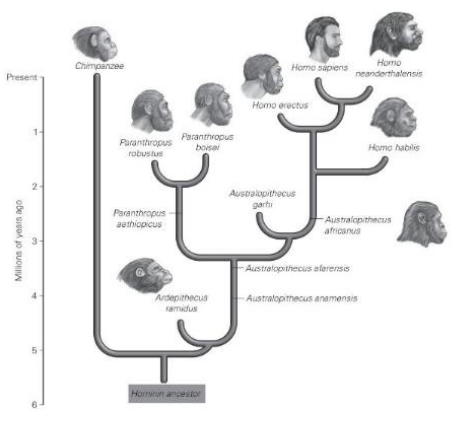
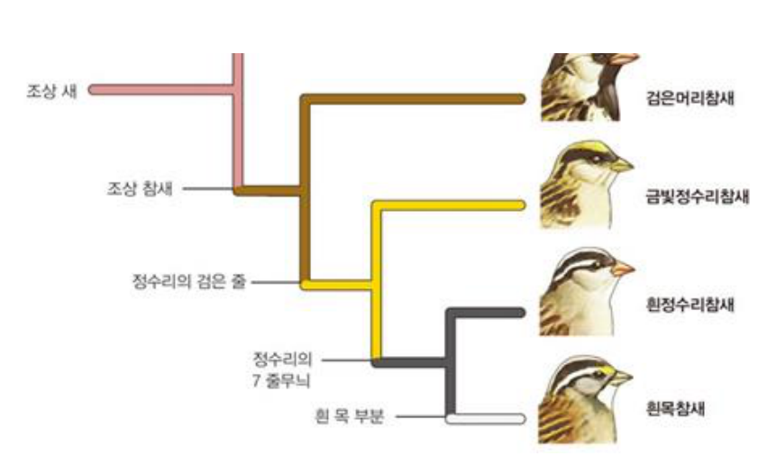
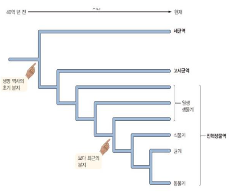
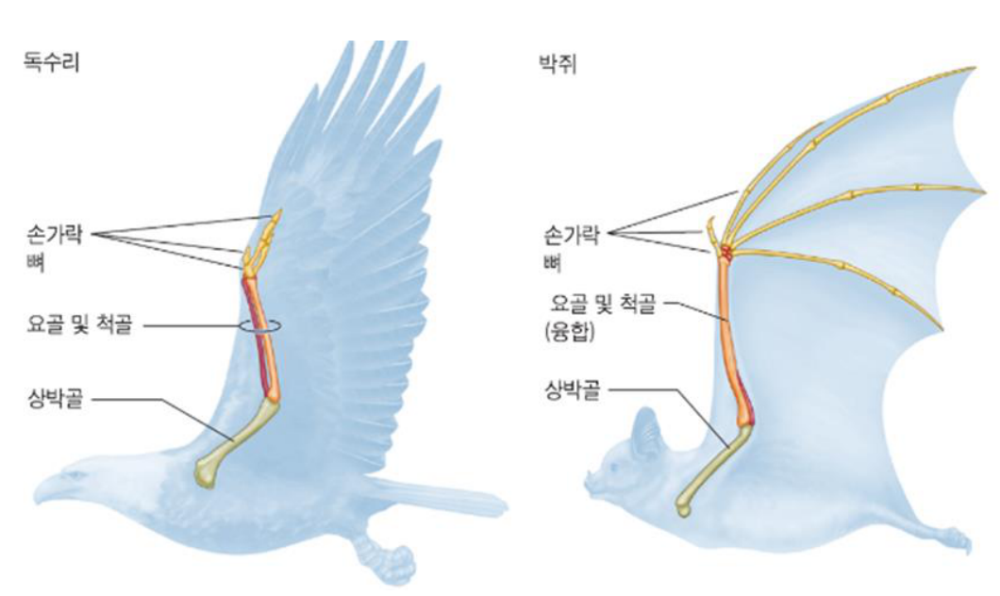
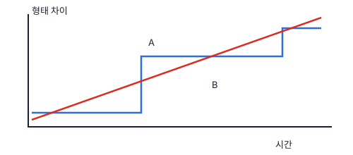
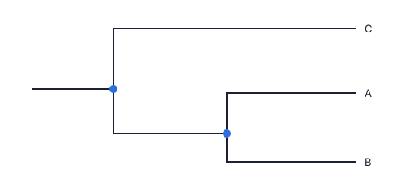

# 복습문제 36선 — 1103 수업 범위

기출 23개(7강 11개·8강 12개)와 생성 변형 13개를 풀어 봐요. 변형 연습은 기본 13개·심화 0개예요. 먼저 풀어 보고, 막히면 힌트를 열어 보세요.

> `복습문제_1103_Macroevolution_and_Taxonomy.html`를 마크다운으로 옮겼어요. 원문, 힌트, 풀이는 접혀 있어요. 먼저 풀어 보고 펼쳐 보세요.

**목차**

- [B. 기출](#partB)
  - [P1. 인간의 진화계통을 재건하는 자료](#p1)
  - [P2. 먼 계통 사이에 생긴 유사한 적응](#p2)
  - [P3. 방사성 탄소와 화석의 상대적 나이](#p3)
  - [P4. 화석 기록의 정보와 한계](#p4)
  - [P5. 수렴진화의 정의](#p5)
  - [P6. 점진주의와 단속평형의 증거](#p6)
  - [P7. 선인장과 대극의 유사성](#p7)
  - [P8. 대멸종 뒤 다양성의 변화](#p8)
  - [P9. 공룡 멸종 뒤 포유류의 분화](#p9)
  - [P10. 방사성 연대측정의 기준 비율](#p10)
  - [P11. 분자 계통과 금빛 정수리 패턴](#p11)
  - [P12. 계통 분기와 지층의 상대연대](#p12)
  - [P13. 분류계급의 포함 관계](#p13)
  - [P14. 진화적 분지과정의 명칭](#p14)
  - [P15. 새 증거와 분류 체계의 수정](#p15)
  - [P16. 계통수 뿌리의 의미](#p16)
  - [P17. 공통조상에서 물려받은 특성](#p17)
  - [P18. 남세균과 진핵생물의 구분](#p18)
  - [P19. 린네 분류가 유지되는 이유](#p19)
  - [P20. 독수리와 박쥐 앞다리의 상동](#p20)
  - [P21. 균류와 가장 가까운 선택 집단](#p21)
  - [P22. 영역부터 종까지의 순서](#p22)
  - [P23. 가장 좁은 선택 분류군](#p23)
- [C. 변형 연습](#partC)
  - [P24. [변형] 두 시료의 나이 차이](#p24)
  - [P25. [변형] 퇴적층 사이의 시간](#p25)
  - [P26. [변형] 사건의 순서](#p26)
  - [P27. [변형] 다른 계통의 같은 모양](#p27)
  - [P28. [변형] 살아남은 가지의 착시](#p28)
  - [P29. [변형] 두 변화 패턴](#p29)
  - [P30. [변형] 새 생태적 지위](#p30)
  - [P31. [변형] 대멸종의 구별](#p31)
  - [P32. [변형] 발생 조절의 변화](#p32)
  - [P33. [변형] 분류 계급 쌍둥이](#p33)
  - [P34. [변형] 분류 폭 쌍둥이](#p34)
  - [P35. [변형] 가지 끝의 위치와 친연관계](#p35)
  - [P36. [변형] 분석 재료와 측정 대상](#p36)

## B. 기출

### P1. 인간의 진화계통을 재건하는 자료

고생물학자들이 인간의 진화계통을 확인하는데 사용하는 방법은 무엇인가?

- (1) 화석화 된 화분의 구조
- (2) 보기 모두 사용한다
- (3) 화석화 된 배설물 연구
- (4) 골격의 구조
- (5) 화석의 연대측정

원문 정보 보기

기출 7강 합본 9번 (PDF 2쪽)

힌트 보기

인간의 진화계통을 재건하는 자료의 판별 기준을 떠올려 보세요.

풀이 보기

1. (1) 맞아요. 화석화된 화분은 당시 식생과 환경을 알려 계통 연구의 맥락을 제공해요.
2. (2) 맞아요. 화분·배설물·골격·연대 자료를 함께 이용할 수 있으므로 이 보기가 답이에요.
3. (3) 맞아요. 화석화된 배설물은 먹이와 생활 방식에 관한 자료를 제공해요.
4. (4) 맞아요. 골격의 형태는 인간 계통의 유연관계를 비교하는 중요한 형질이에요.
5. (5) 맞아요. 화석의 연대는 계통의 시간 순서를 재건하는 자료예요.
6. 수업과의 연결: 1103 수업의 [인간의 진화계통을 재건하는 자료](정리노트_1103_Macroevolution_and_Taxonomy.md#s0-dating)와 연결돼요.

**정답:** (2)

---

### P2. 먼 계통 사이에 생긴 유사한 적응

서로 연관이 먼 생물들 간에 외형적으로 유사한 적응 형태를 보이는 것을 무엇이라 하는가?

- (1) 상동형질
- (2) 수렴진화
- (3) 획득형질
- (4) 인위선택
- (5) 대진화

원문 정보 보기

기출 7강 합본 21번 (PDF 3쪽)

힌트 보기

먼 계통 사이에 생긴 유사한 적응의 판별 기준을 떠올려 보세요.

풀이 보기

1. (1) 틀려요. 상동형질의 유사성은 공통조상에서 물려받은 구조에 근거해요.
2. (2) 맞아요. 먼 계통에서 비슷한 환경의 선택으로 유사한 적응이 독립적으로 나타나는 것은 수렴진화예요.
3. (3) 틀려요. 개체가 생애 중 얻은 형질을 뜻하는 말로 이 진화 양상을 설명하지 못해요.
4. (4) 틀려요. 사람이 번식할 개체를 고르는 과정이에요.
5. (5) 틀려요. 대진화는 종 수준 이상의 큰 진화 양상을 통틀어 말하므로 더 구체적인 답은 수렴진화예요.
6. 수업과의 연결: 1103 수업의 [먼 계통 사이에 생긴 유사한 적응](정리노트_1103_Macroevolution_and_Taxonomy.md#s1-convergence)와 연결돼요.

**정답:** (2)

---

### P3. 방사성 탄소와 화석의 상대적 나이

당신은 인간 조상의 다양한 화석을 조사하고 있다. 화석에서 발견되는 불안정한 방사성 탄소의 방사능량이 상대적으로 가장 많은 것은?

- (1) Homo habilis
- (2) Australopithecus garhi
- (3) Homo neanderthalensis
- (4) Paranthropus robustus
- (5) Ardepithecus ramidus

원문 정보 보기

기출 7강 합본 23번 (PDF 3쪽)

힌트 보기

방사성 탄소와 화석의 상대적 나이의 판별 기준을 떠올려 보세요.

풀이 보기

1. (1) 틀려요. 제시된 계통도에서 Homo habilis는 네안데르탈인보다 과거의 계통이에요.
2. (2) 틀려요. 제시된 계통도에서 Australopithecus garhi는 네안데르탈인보다 오래되었어요.
3. (3) 맞아요. 그림에서 선택지 중 현재에 가장 가까운 Homo neanderthalensis가 가장 최근이므로 남은 방사성 탄소가 상대적으로 많다고 판단해요.
4. (4) 틀려요. Paranthropus robustus는 네안데르탈인보다 오래된 화석으로 표시되어 있어요.
5. (5) 틀려요. 그림에서 Ardepithecus ramidus는 선택지 중 오래된 쪽에 위치해요.
6. 수업과의 연결: 1103 수업의 [방사성 탄소와 화석의 상대적 나이](정리노트_1103_Macroevolution_and_Taxonomy.md#s0-dating)와 연결돼요.

**정답:** (3)

남은 탄소의 비교는 시료량·초기 비율 등 조건이 같다는 학습용 단순화예요. 아주 오래된 화석은 탄소-14가 검출 한계 아래여서 실제 연대는 다른 방법으로 측정해요. 원문 보기 “Ardepithecus”는 Ardipithecus의 표기 오류예요.

출제 의도상 답은 (3)이에요. 하지만 원문 조건만으로 개별 시료의 실제 방사능량 순위를 유일하게 확정할 수는 없어요.

---

### P4. 화석 기록의 정보와 한계

화석 기록은 _______________.

- (1) 과거 생물의 생리 또는 행동에 대한 증거를 제공하지 못한다.
- (2) 지역적인 분포를 하는 희귀종에 대한 풍부한 자료를 제공한다,
- (3) 단속평형설을 지지하나 점진주위설은 지지하지 않는다.
- (4) 과거에 살았던 모든 생물들에 대하여 동등하게 좋은 자료를 제공한다.
- (5) 과거의 생명체에 관한 직접적인 증거를 제공한다.

원문 정보 보기

기출 7강 합본 26번 (PDF 4쪽)

힌트 보기

화석 기록의 정보와 한계의 판별 기준을 떠올려 보세요.

풀이 보기

1. (1) 틀려요. 발자국·분화석 등은 행동이나 먹이에 관한 단서도 줄 수 있어요.
2. (2) 틀려요. 희귀종과 제한된 지역의 생물은 화석으로 남을 가능성이 작아 자료가 충분하지 않을 수 있어요.
3. (3) 틀려요. 단속평형과 점진적 변화 모두 증거가 있으며 화석 기록이 한 모델만 지지하는 것은 아니에요.
4. (4) 틀려요. 화석화 조건과 생물의 구조 등에 따라 보존 정도가 달라 자료가 편향돼요.
5. (5) 맞아요. 화석은 과거 생물의 몸이나 활동이 남은 직접적인 증거예요.
6. 수업과의 연결: 1103 수업의 [화석 기록의 정보와 한계](정리노트_1103_Macroevolution_and_Taxonomy.md#s2-tempo)와 연결돼요.

**정답:** (5)

---

### P5. 수렴진화의 정의

서로 연관이 먼 생물들 간에 외형적으로 유사한 적응 형태를 보이는 것을 무엇이라 하는가?

- (1) 상동형질
- (2) 수렴진화
- (3) 획득형질
- (4) 인위선택
- (5) 대진화

원문 정보 보기

기출 7강 합본 27번 (PDF 4쪽)

힌트 보기

수렴진화의 정의의 판별 기준을 떠올려 보세요.

풀이 보기

1. (1) 틀려요. 상동은 공통조상에서 유래한 유사성이에요.
2. (2) 맞아요. 연관이 먼 생물에서 외형적으로 유사한 적응이 독립적으로 나타나는 과정이에요.
3. (3) 틀려요. 생애 중 획득한 형질이라는 설명은 제시된 계통 간 유사성을 설명하지 못해요.
4. (4) 틀려요. 사람이 특정 형질을 가진 개체를 선택해 번식시키는 과정이에요.
5. (5) 틀려요. 종 수준 이상 진화의 큰 범주이며 이 현상에 대한 직접적인 이름은 수렴진화예요.
6. 수업과의 연결: 1103 수업의 [수렴진화의 정의](정리노트_1103_Macroevolution_and_Taxonomy.md#s1-convergence)와 연결돼요.

**정답:** (2)

---

### P6. 점진주의와 단속평형의 증거

대진화의 관점에서 볼 때, 형태학적인 변화에 대한 설명 중 옳은 것은?

- (1) 단속평형설을 형태적인 진화는 연속적인 변화의 축적이라고 주장한다.
- (2) 점진주의설에 따르면 급진적인 종 분화 기관이 존재한다.
- (3) 형태학적 변화의 속도는 하나의 가설로 설명될 수 있다.
- (4) 현재 단속평형설과 점진주의설은 모두 각각의 증거로 지지되고 있다.
- (5) 현재 발견된 화석의 대부분의 증거는 점진주의설을 지지한다.

원문 정보 보기

기출 7강 합본 40번 (PDF 5쪽)

힌트 보기

점진주의와 단속평형의 증거의 판별 기준을 떠올려 보세요.

풀이 보기

1. (1) 틀려요. 연속적인 작은 변화의 누적은 점진주의의 설명이에요.
2. (2) 틀려요. 짧은 변화 구간과 긴 정체의 반복은 단속평형의 설명이에요.
3. (3) 틀려요. 계통과 시기에 따라 다른 변화 속도가 나타나므로 하나의 모델로만 설명하지 않아요.
4. (4) 맞아요. 두 모델을 지지하는 증거가 모두 있고 계통별 양상이 달라요.
5. (5) 틀려요. 강의에서는 발견된 증거 대부분이 점진주의만 지지한다고 결론짓지 않았어요.
6. 수업과의 연결: 1103 수업의 [점진주의와 단속평형의 증거](정리노트_1103_Macroevolution_and_Taxonomy.md#s2-tempo)와 연결돼요.

**정답:** (4)

---

### P7. 선인장과 대극의 유사성

다음 중 수렴진화에 의해 설명될 수 있는 형질은 무엇인가?

- (1) 말라리아가 창궐하는 지역에서 겸상 적혈구 빈혈증은 일반적으로 나타난다.
- (2) 아일랜드 혈통은 빨간머리를 갖는다.
- (3) 미국 아미시에서는 엘리스 반 클레벨트 증후군이 많이 발병한다.
- (4) 아메리카의 선인장은 아프리카에 사는 대극과 형태적으로 거의 동일하다.
- (5) 푸카푸카섬의 원주민은 키가 작다.

원문 정보 보기

기출 7강 합본 41번 (PDF 6쪽)

힌트 보기

선인장과 대극의 유사성의 판별 기준을 떠올려 보세요.

풀이 보기

1. (1) 틀려요. 말라리아 환경에서 특정 유전자형이 유리한 현상은 이형접합자 이점과 관련돼요.
2. (2) 틀려요. 특정 집단의 형질 빈도만으로 먼 두 계통의 독립적 유사 적응을 뜻하지 않아요.
3. (3) 틀려요. 아미시 집단의 높은 빈도는 작은 창시자 집단과 유전적 부동으로 설명하는 사례예요.
4. (4) 맞아요. 먼 계통인 선인장과 대극이 비슷한 건조 환경에 적응하여 유사한 외형을 보이는 사례예요.
5. (5) 틀려요. 한 집단의 키 특징만으로 먼 계통 사이의 유사 적응을 설명하지 못해요.
6. 수업과의 연결: 1103 수업의 [선인장과 대극의 유사성](정리노트_1103_Macroevolution_and_Taxonomy.md#s1-convergence)와 연결돼요.

**정답:** (4)

---

### P8. 대멸종 뒤 다양성의 변화

형태학적, 생물다양성 관점에서 볼 때 대진화의 경향성에 대한 설명으로 틀린 것은?

- (1) 생물종이 환경의 변화에 적응하지 못하여 사라지는 것을 배경멸절이라고 한다.
- (2) 형태적인 복잡성이 증가한다.
- (3) 포유류의 폭발적인 적응방산은 공룡의 쇠퇴가 주원인이다.
- (4) 대멸종을 거치면 생물다양성은 지속적으로 감소한다.
- (5) 일반적으로 생물은 크기가 증가했다.

원문 정보 보기

기출 7강 합본 43번 (PDF 6쪽)

힌트 보기

대멸종 뒤 다양성의 변화의 판별 기준을 떠올려 보세요.

풀이 보기

1. (1) 맞아요. 평상시에도 환경 변화와 생존·번식 실패로 배경멸종이 일어나요.
2. (2) 맞아요. 복잡성이 증가하는 경향은 있지만 모든 계통에 강제되는 법칙은 아니에요.
3. (3) 맞아요. 공룡의 쇠퇴 뒤 빈 생태적 기회가 포유류의 적응방산에 기여했어요.
4. (4) 틀려요. 대멸종 직후 다양성은 감소하지만 이후 적응방산으로 다시 증가할 수 있어요.
5. (5) 맞아요. 크기 증가가 흔한 경향일 수 있지만 크기가 줄어드는 계통도 있어요.
6. 수업과의 연결: 1103 수업의 [대멸종 뒤 다양성의 변화](정리노트_1103_Macroevolution_and_Taxonomy.md#s2-extinction)와 연결돼요.

**정답:** (4)

출제 의도상 답은 (4)이에요. 보기 (2)와 (5)는 경향성이라는 발문 맥락에서 읽어요. 모든 계열에 반드시 성립하는 법칙으로 해석하면 이 보기들도 틀릴 수 있어요. 보기 (1)의 배경멸종도 원인 하나가 아니라 평상시의 규모·속도를 기준으로 구별해요.

---

### P9. 공룡 멸종 뒤 포유류의 분화

공룡이 멸종되고 난 후, 포유류 동물 종의 수는 급격히 증가하였다. 이런 현상은 무엇의 예인가?

- (1) 적응방산
- (2) 인위선택
- (3) 점진진화
- (4) 수렴진화
- (5) 판구조론

원문 정보 보기

기출 7강 합본 45번 (PDF 6쪽)

힌트 보기

공룡 멸종 뒤 포유류의 분화의 판별 기준을 떠올려 보세요.

풀이 보기

1. (1) 맞아요. 빈 생태적 지위를 차지하면서 포유류가 다양한 종으로 분화한 것은 적응방산이에요.
2. (2) 틀려요. 사람이 번식 개체를 고른 현상이 아니에요.
3. (3) 틀려요. 형태 변화의 속도에 관한 설명이며 여러 종의 생태적 다양화를 직접 가리키지 않아요.
4. (4) 틀려요. 먼 계통 사이의 유사한 적응이 아니라 한 계통의 다양한 분화예요.
5. (5) 틀려요. 지각 판의 이동을 설명하는 이론이에요.
6. 수업과의 연결: 1103 수업의 [공룡 멸종 뒤 포유류의 분화](정리노트_1103_Macroevolution_and_Taxonomy.md#s2-radiation)와 연결돼요.

**정답:** (1)

---

### P10. 방사성 연대측정의 기준 비율

화석의 연대측정에 대한 설명 중 잘못 된 것은?

- (1) 생명체가 죽은 이후로 14C는 일정한 속도로 붕괴한다.
- (2) 반감기란 방사성 동위원소의 반이 붕괴하는 데 걸리는 시간을 의미한다.
- (3) 방사성 동위원소를 이용하여 화석의 절대연령 추정이 가능하다.
- (4) 화석에 존재하는 14C/14N의 비를 결정하여 화석의 연대를 결정한다.
- (5) 각 지층에서 아래쪽에서 위쪽으로 발견되는 화석의 순서는 상대적인 연대를 나타낸다.

원문 정보 보기

기출 7강 합본 53번 (PDF 7쪽)

힌트 보기

방사성 연대측정의 기준 비율의 판별 기준을 떠올려 보세요.

풀이 보기

1. (1) 맞아요. 일정한 붕괴 확률과 반감기를 따른다는 뜻이에요. 남은 양과 무관하게 매년 같은 개수가 사라진다는 뜻은 아니에요.
2. (2) 맞아요. 반감기는 남아 있는 방사성 동위원소의 절반이 붕괴하는 데 걸리는 시간이에요.
3. (3) 맞아요. 방사성 동위원소의 붕괴와 적절한 조건을 이용해 절대연대를 추정할 수 있어요.
4. (4) 틀려요. 수업에서 배운 탄소 연대측정은 안정한 탄소-12에 대한 탄소-14 비율을 기준으로 하므로, 탄소-14/질소-14를 쓴 이 보기가 출제 의도상 답이에요.
5. (5) 맞아요. 뒤집힘·교란이 없는 지층에서는 아래쪽이 먼저 쌓였으므로 상대적 연대를 비교할 수 있어요.
6. 수업과의 연결: 1103 수업의 [방사성 연대측정의 기준 비율](정리노트_1103_Macroevolution_and_Taxonomy.md#s0-dating)와 연결돼요.

**정답:** (4)

탄소-14는 질소-14로 붕괴하지만, 외부 질소의 유입과 초기 질소의 양 등 조건을 무시하고 화석의 탄소-14/질소-14 비율을 그대로 일반적인 탄소 연대측정 기준으로 쓰지는 않아요.

---

### P11. 분자 계통과 금빛 정수리 패턴

위의 그림과 같은 형태를 기본으로 한 계통수에서, 정수리 부분의 무늬와 색깔 패턴은 새들의 종을 나누는데 이용되는 특징이다. DNA 분석을 통해 흰정수리참새와 금빛정수리참새가 서로 더 가까운 하나의 다른 계통임을 새롭게 알게 되었다. 그러면, 흰목참새와 금빛정수리참새의 머리에 함께 존재하는 금빛 색깔 패턴은 무엇으로 설명할 수 있는가?

- (1) 세포 내 공생
- (2) 수렴진화
- (3) 적응방산
- (4) 성선택
- (5) 유전적 부동

원문 정보 보기

기출 7강 합본 60번 (PDF 8쪽)

힌트 보기

분자 계통과 금빛 정수리 패턴의 판별 기준을 떠올려 보세요.

풀이 보기

1. (1) 틀려요. 세포가 다른 세포 안에 정착하여 함께 살아가는 현상이 아니에요.
2. (2) 맞아요. DNA 계통에서 가장 가까운 쌍이 아닌 두 새의 금빛 패턴은 수렴진화로 설명할 수 있어요.
3. (3) 틀려요. 여러 생태적 지위로 종들이 분화했다는 사실 자체를 묻지 않아요.
4. (4) 틀려요. 금빛 패턴이 짝짓기 성공을 높인다는 조건은 주어지지 않았어요.
5. (5) 틀려요. 우연한 대립유전자 빈도 변화만으로 이 계통 간 유사성을 특정할 근거가 없어요.
6. 수업과의 연결: 1103 수업의 [분자 계통과 금빛 정수리 패턴](정리노트_1103_Macroevolution_and_Taxonomy.md#s1-convergence)와 연결돼요.

**정답:** (2)

출제 의도상 수렴진화가 답이지만, 가까운 두 종이 아닌 두 종에 무늬가 있다는 사실만으로 독립적 발생을 확정할 수는 없어요. 조상형질의 보존과 다른 계통에서의 소실 가능성도 있어요.

---

### P12. 계통 분기와 지층의 상대연대

위 그림을 보고 답하시오. 다음 중 공통조상이 비교적 얕은 토양에서 발견 될 화석이라고 예상되는 두 그룹은 어느 것인가?

- (1) 세균과 고세균
- (2) 식물과 원생생물
- (3) 동물과 식물
- (4) 원생생물과 세균
- (5) 균류와 고세균

원문 정보 보기

기출 8강 합본 8번 (PDF 1쪽)

힌트 보기

계통 분기와 지층의 상대연대의 판별 기준을 떠올려 보세요.

풀이 보기

1. (1) 틀려요. 그림에서 세균과 고세균이 만나는 조상은 훨씬 오래된 분기점이에요.
2. (2) 틀려요. 그림의 원생생물 가지와 식물이 만나는 분기점은 동물·식물의 공통조상보다 오래되었어요.
3. (3) 맞아요. 주어진 그림에서 동물과 식물의 공통조상은 선택지의 다른 쌍보다 현재에 가까우므로, 정상적으로 쌓인 지층에서는 상대적으로 얕은 층이 예상돼요.
4. (4) 틀려요. 세균과 원생생물의 공통조상은 그림에서 가장 오래된 쪽에 있어요.
5. (5) 틀려요. 균류와 고세균의 공통조상은 동물·식물의 공통조상보다 과거의 분기점이에요.
6. 수업과의 연결: 1103 수업의 [계통 분기와 지층의 상대연대](정리노트_1103_Macroevolution_and_Taxonomy.md#s3-phylogeny)와 연결돼요.

**정답:** (3)

정답은 제시된 나무의 분기 순서를 읽은 결과예요. 실제 화석이 반드시 발견된다는 보장이 아니며, 동물과 식물이 생명 전체에서 가장 가까운 쌍이라는 뜻도 아니에요.

---

### P13. 분류계급의 포함 관계

다음 분류 체계 중, 개체를 가장 많이 포함하는 넓은 범위에서 좁아지는 순서로 나열한 것은?

- (1) 계, 영역, 문
- (2) 과, 목, 강
- (3) 강, 과, 종
- (4) 계, 종, 속
- (5) 문, 계, 속

원문 정보 보기

기출 8강 합본 9번 (PDF 2쪽)

힌트 보기

분류계급의 포함 관계의 판별 기준을 떠올려 보세요.

풀이 보기

1. (1) 틀려요. 영역은 계보다 넓으므로 첫 두 계급의 순서가 반대예요.
2. (2) 틀려요. 강이 목보다 넓고 목이 과보다 넓으므로 좁은 쪽에서 넓어지는 순서예요.
3. (3) 맞아요. 강은 과보다 넓고 과는 종보다 넓으므로 범위가 줄어드는 순서예요.
4. (4) 틀려요. 종은 속보다 좁으므로 뒤의 순서가 반대예요.
5. (5) 틀려요. 계가 문보다 넓으므로 첫 두 계급의 순서가 반대예요.
6. 수업과의 연결: 1103 수업의 [분류계급의 포함 관계](정리노트_1103_Macroevolution_and_Taxonomy.md#s3-naming)와 연결돼요.

**정답:** (3)

---

### P14. 진화적 분지과정의 명칭

생물군의 진화적인 분지과정을 무엇이라 부르는가?

- (1) 외군
- (2) 영역
- (3) 계통
- (4) 분류학
- (5) 분류

원문 정보 보기

기출 8강 합본 10번 (PDF 2쪽)

힌트 보기

진화적 분지과정의 명칭의 판별 기준을 떠올려 보세요.

풀이 보기

1. (1) 틀려요. 외군은 비교 대상 집단 밖의 기준 집단이에요.
2. (2) 틀려요. 영역은 계보다 높은 분류계급이에요.
3. (3) 맞아요. 계통은 생물군의 진화 역사와 분지 관계를 뜻해요.
4. (4) 틀려요. 분류학은 생물을 동정하고 이름 붙이고 배열하는 분야예요.
5. (5) 틀려요. 분류는 생물을 분류군으로 배열하는 행위예요.
6. 수업과의 연결: 1103 수업의 [진화적 분지과정의 명칭](정리노트_1103_Macroevolution_and_Taxonomy.md#s3-phylogeny)와 연결돼요.

**정답:** (3)

---

### P15. 새 증거와 분류 체계의 수정

현재의 생물 분류 체계는 만약 ________ 하면 바뀔 가능성이 있다. 비교적 짧은 시간 내에 가능할거라고 생각되 는 가장 합리적인 주장은?

- (1) 새로운 생명체가 진화하면
- (2) 원시 동물의 더 많은 종류가 발견되면
- (3) 미토콘드리아와 엽록체가 다시 독립된 생명체로 돌아가면
- (4) 더 많은 종들이 멸종되면
- (5) 존재하는 종들의 진화의 역사에 대해서 더 많은 정보들이 이용 가능해지면

원문 정보 보기

기출 8강 합본 15번 (PDF 2쪽)

힌트 보기

새 증거와 분류 체계의 수정의 판별 기준을 떠올려 보세요.

풀이 보기

1. (1) 틀려요. 새로운 종의 진화는 장기적으로 일어날 수 있지만 비교적 짧은 기간의 분류 수정에 대한 가장 직접적인 설명은 아니에요.
2. (2) 틀려요. 발견 자체보다 그 생물들이 다른 생물과 맺는 계통 관계에 대한 정보가 핵심이에요.
3. (3) 틀려요. 소기관의 독립을 가정할 필요가 없고 가까운 시기의 합리적 근거도 아니에요.
4. (4) 틀려요. 종의 멸종만으로 기존 생물들의 계통 관계가 바뀌는 것은 아니에요.
5. (5) 맞아요. 새로운 서열과 화석 등으로 진화 역사를 더 알게 되면 그 관계를 반영하도록 분류를 수정할 수 있어요.
6. 수업과의 연결: 1103 수업의 [새 증거와 분류 체계의 수정](정리노트_1103_Macroevolution_and_Taxonomy.md#s3-phylogeny)와 연결돼요.

**정답:** (5)

---

### P16. 계통수 뿌리의 의미

계통수에서 가장 처음 갈라지는 줄기가 나타내는 것은 무엇인가?

- (1) 가장 복잡한 구조를 가진 구성원
- (2) 계통에서 멸종된 구성원
- (3) 가장 많은 화석에서 발견된 생물
- (4) 주어진 계통수에서 모든 생물의 가장 초기의 공통조상
- (5) 그 계통에서 가장 진화적인 구성원

원문 정보 보기

기출 8강 합본 16번 (PDF 2쪽)

힌트 보기

계통수 뿌리의 의미의 판별 기준을 떠올려 보세요.

풀이 보기

1. (1) 틀려요. 가지가 갈라지는 순서가 구조의 복잡함 순위를 뜻하지 않아요.
2. (2) 틀려요. 처음 갈라졌다는 것만으로 멸종했다고 판단할 수 없어요.
3. (3) 틀려요. 화석이 얼마나 많이 발견되는지는 뿌리의 뜻이 아니에요.
4. (4) 맞아요. 출제 의도는 계통수의 뿌리가 그 나무에 포함된 생물 전체의 공통조상을 나타낸다는 것이에요.
5. (5) 틀려요. 현존 생물 중 더 진화한 구성원이라는 순위를 뜻하지 않아요.
6. 수업과의 연결: 1103 수업의 [계통수 뿌리의 의미](정리노트_1103_Macroevolution_and_Taxonomy.md#s3-phylogeny)와 연결돼요.

**정답:** (4)

발문의 “처음 갈라지는 줄기”는 뿌리를 가리킨다는 출제 의도로 해석해요. 엄밀히 말해 첫 분기에서 나온 가지와 전체 나무의 뿌리는 구별해야 해요.

---

### P17. 공통조상에서 물려받은 특성

계통분류학의 관점에서 볼 때, 가장 최근의 공통조상에서 유래된 모든 종들은 ( )는 원리에 근거하여 만들어 진다.

- (1) 덜 연관된 종보다 더 유사하지 않다
- (2) 화석으로 발견된다
- (3) 모두 동일하다
- (4) 동일한 DNA 서열을 지닌다
- (5) 그 조상에서 진화된 특성을 공유한다

원문 정보 보기

기출 8강 합본 18번 (PDF 3쪽)

힌트 보기

공통조상에서 물려받은 특성의 판별 기준을 떠올려 보세요.

풀이 보기

1. (1) 틀려요. 공통조상에서 물려받은 특성은 유연관계를 판단하는 단서예요.
2. (2) 틀려요. 공통조상의 후손 모두가 화석으로 발견될 필요는 없어요.
3. (3) 틀려요. 후손들은 분화하면서 서로 달라질 수 있어요.
4. (4) 틀려요. 공통조상이 있어도 이후 변이가 축적되므로 DNA 전체가 동일하지 않아요.
5. (5) 맞아요. 공통조상에서 유래한 특성을 공유하는 관계가 계통분류의 근거예요.
6. 수업과의 연결: 1103 수업의 [공통조상에서 물려받은 특성](정리노트_1103_Macroevolution_and_Taxonomy.md#s3-phylogeny)와 연결돼요.

**정답:** (5)

---

### P18. 남세균과 진핵생물의 구분

아래 그룹 중에서, 다른 그룹들과 비교하여 가장 다른 그룹은 무엇인가?

- (1) 균류
- (2) 편모충류
- (3) 동물류
- (4) 남세균류
- (5) 식물류

원문 정보 보기

기출 8강 합본 21번 (PDF 3쪽)

힌트 보기

남세균과 진핵생물의 구분의 판별 기준을 떠올려 보세요.

풀이 보기

1. (1) 틀려요. 균류는 다른 세 진핵 집단과 마찬가지로 진핵생물역이에요.
2. (2) 틀려요. 여기의 편모충류는 원생생물에 해당하는 진핵생물이에요.
3. (3) 틀려요. 동물류는 진핵생물역이에요.
4. (4) 맞아요. 남세균류는 세균역의 원핵생물이고 나머지는 진핵생물역이므로 가장 구별돼요.
5. (5) 틀려요. 식물류는 진핵생물역이에요.
6. 수업과의 연결: 1103 수업의 [남세균과 진핵생물의 구분](정리노트_1103_Macroevolution_and_Taxonomy.md#s3-rrna)와 연결돼요.

**정답:** (4)

---

### P19. 린네 분류가 유지되는 이유

오늘날 생물학자들이 사용하는 표준 분류 체계는 생물체들을 유사한 물리적 특성에 따라 분류한다. 이러한 분류 시스템은 린네에 의해 처음 개발되었다. 그 시대에는 물리적 특성 이외에 유사한 서식지, 유사한 먹이 사냥, 유사한 행동 등 다른 특성을 이용하여 생물을 분류하는 것도 가능하였다. 왜 린네의 분류 체계가 현대 생물학에서도 유효 한가?

- (1) 린네의 분류 체계는 라틴어를 사용하였으므로
- (2) 린네는 유명한 과학자이고 그의 영향력이 오늘날에도 유효하므로
- (3) 린네의 분류 체계가 지구상의 모든 분류군을 설명할 수 있으므로
- (4) 린네의 체계가 가장 간단하므로
- (5) 공유된 특성에 근거한 분류는 생물체 간의 진화적 관계를 나타내기 때문

원문 정보 보기

기출 8강 합본 27번 (PDF 4쪽)

힌트 보기

린네 분류가 유지되는 이유의 판별 기준을 떠올려 보세요.

풀이 보기

1. (1) 틀려요. 공통 명명 언어는 편리하지만 분류의 생물학적 타당성 자체의 이유는 아니에요.
2. (2) 틀려요. 과학자의 명성보다 분류가 실제 관계를 반영하는지가 중요해요.
3. (3) 틀려요. 모든 분류군을 완벽하게 설명하기 때문에 고정되는 체계는 아니며 새 증거에 따라 수정돼요.
4. (4) 틀려요. 간단하다는 점만으로 진화 관계를 잘 나타낸다고 할 수 없어요.
5. (5) 맞아요. 공통조상에서 물려받은 특성에 기반한 유사성이 진화 관계를 반영할 수 있기 때문이에요.
6. 수업과의 연결: 1103 수업의 [린네 분류가 유지되는 이유](정리노트_1103_Macroevolution_and_Taxonomy.md#s3-naming)와 연결돼요.

**정답:** (5)

---

### P20. 독수리와 박쥐 앞다리의 상동

진화적 관점으로 볼 때, 위 그림에서 가장 중요한 요점은?

- (1) 날개는 뼈로 구성된다.
- (2) 모든 척추동물은 뼈를 갖는다.
- (3) 종은 다르지만 뼈의 상대적인 구조가 유사하다.
- (4) 모든 척추동물은 사지를 갖는다.
- (5) 손가락 뼈는 일반적으로 얇다.

원문 정보 보기

기출 8강 합본 31번 (PDF 5쪽)

힌트 보기

독수리와 박쥐 앞다리의 상동의 판별 기준을 떠올려 보세요.

풀이 보기

1. (1) 맞는 관찰이지만 답은 아니에요. 뼈가 있다는 사실보다 대응하는 뼈의 구조적 유사성이 공통조상의 증거예요.
2. (2) 출제 의도로는 답이 아니에요. 그림은 두 생물만 보여 주고 모든 척추동물의 골격을 비교하지 않아요.
3. (3) 맞아요. 두 종에서 상박골·요골·척골·손가락 뼈가 대응하므로 앞다리 뼈의 상동을 보여 줘요.
4. (4) 틀려요. 모든 척추동물이 사지를 갖는 것은 아니며 물고기처럼 사지가 없는 집단도 있어요.
5. (5) 출제 의도로는 답이 아니에요. 뼈가 얇다는 관찰보다 뼈의 상대적 배치와 공통 기원이 진화적 요점이에요.
6. 수업과의 연결: 1103 수업의 [독수리와 박쥐 앞다리의 상동](정리노트_1103_Macroevolution_and_Taxonomy.md#s1-convergence)와 연결돼요.

**정답:** (3)

---

### P21. 균류와 가장 가까운 선택 집단

다음 중 균류와 가장 가까운 그룹은 어느 것인가?

- (1) 그람양성균
- (2) 남세균
- (3) 동물류
- (4) 세균영역
- (5) 고세균영역

원문 정보 보기

기출 8강 합본 33번 (PDF 5쪽)

힌트 보기

균류와 가장 가까운 선택 집단의 판별 기준을 떠올려 보세요.

풀이 보기

1. (1) 틀려요. 그람양성균은 세균역으로 균류와의 공통조상이 동물보다 오래되었어요.
2. (2) 틀려요. 남세균도 세균역이에요.
3. (3) 맞아요. 교재 9장 p.196에서 DNA 염기서열 등의 증거로 균류가 다른 진핵생물보다 동물에 더 가깝다고 설명해요. 나머지 선택지는 원핵생물이에요.
4. (4) 틀려요. 세균역 전체는 진핵생물인 균류와 더 먼 관계예요.
5. (5) 틀려요. 고세균역도 동물류보다 균류와 먼 선택지예요.
6. 수업과의 연결: 1103 수업의 [균류와 가장 가까운 선택 집단](정리노트_1103_Macroevolution_and_Taxonomy.md#s3-rrna)와 연결돼요.

**정답:** (3)

---

### P22. 영역부터 종까지의 순서

다음 중 분류 체계를 큰 범위부터 작은 범위로 올바르게 나열한 것은?

- (1) 계, 종, 문, 영역
- (2) 영역, 계, 문, 종
- (3) 문, 계, 영역, 종
- (4) 과, 계, 종, 영역
- (5) 종, 문, 영역, 계

원문 정보 보기

기출 8강 합본 34번 (PDF 5쪽)

힌트 보기

영역부터 종까지의 순서의 판별 기준을 떠올려 보세요.

풀이 보기

1. (1) 틀려요. 영역이 가장 넓고 종이 가장 좁으므로 이 순서는 뒤섞였어요.
2. (2) 맞아요. 영역 안에 계, 계 안에 문, 그 아래 여러 계급을 거쳐 종이 포함돼요.
3. (3) 틀려요. 계가 문보다 넓고 영역이 계보다 넓아요.
4. (4) 틀려요. 과는 계보다 좁고 영역은 가장 넓어요.
5. (5) 틀려요. 종이 가장 좁으므로 첫 위치부터 맞지 않아요.
6. 수업과의 연결: 1103 수업의 [영역부터 종까지의 순서](정리노트_1103_Macroevolution_and_Taxonomy.md#s3-naming)와 연결돼요.

**정답:** (2)

---

### P23. 가장 좁은 선택 분류군

가장 유사한 구성원을 갖는 분류 집단은?

- (1) 계
- (2) 속
- (3) 강
- (4) 문
- (5) 목

원문 정보 보기

기출 8강 합본 39번 (PDF 6쪽)

힌트 보기

가장 좁은 선택 분류군의 판별 기준을 떠올려 보세요.

풀이 보기

1. (1) 틀려요. 계는 여러 문을 포함하는 넓은 분류군이에요.
2. (2) 맞아요. 제시된 선택지 중 속이 가장 좁아서 구성원들이 일반적으로 가장 유사해요.
3. (3) 틀려요. 강은 여러 목과 과와 속을 포함해요.
4. (4) 틀려요. 문은 여러 강을 포함하는 넓은 분류군이에요.
5. (5) 틀려요. 목은 여러 과와 속을 포함하므로 속보다 넓어요.
6. 수업과의 연결: 1103 수업의 [가장 좁은 선택 분류군](정리노트_1103_Macroevolution_and_Taxonomy.md#s3-naming)와 연결돼요.

**정답:** (2)

---

## C. 변형 연습

### P24. [변형] 두 시료의 나이 차이

같은 초기 탄소 동위원소 비율을 가졌던 시료 A와 B가 폐쇄된 채 보존되었다. 현재 초기 대비 탄소-14 비율은 A가 50%, B가 12.5%이다. 반감기를 5,730년으로 두면 B는 A보다 얼마나 오래되었는가?

- (1) 2,865년
- (2) 5,730년
- (3) 11,460년
- (4) 17,190년
- (5) 22,920년

원문 정보 보기

원문 기출이 아닌 생성 변형이에요. 다루는 혼동: 두 시료의 나이 차이. 근거 토픽: s0-dating. 새 조건 적용

힌트 보기

비율을 반감기 횟수로 변환 → 두 나이 차이 계산

풀이 보기

1. (1) 반감기 절반이 아니라 두 번의 차이예요.
2. (2) 한 번 차이면 비율이 두 배 차이여야 해요.
3. (3) A는 한 번, B는 세 번의 반감기이므로 두 반감기, 11,460년 차이예요.
4. (4) 세 번의 차이가 아니에요.
5. (5) 네 반감기의 시간이며 두 시료의 나이 차이가 아니에요.
6. 수업과의 연결: 1103 수업의 [두 시료의 나이 차이 관련 개념](정리노트_1103_Macroevolution_and_Taxonomy.md#s0-dating)을 적용해요.

**정답:** (3)

---

### P25. [변형] 퇴적층 사이의 시간

뒤집히지 않은 퇴적층 속 화석의 아래에는 8천만 년 전 화산재층, 위에는 6천만 년 전 화산재층이 있다. 두 화산재층은 퇴적 당시 형성되었고 연대가 정확하다. 가장 적절한 해석은?

- (1) 화석은 정확히 7천만 년 전 것이다.
- (2) 화석은 6천만~8천만 년 전 사이에 퇴적되었다.
- (3) 화석은 6천만 년 전보다 최근 것이다.
- (4) 화석의 탄소-14로 이 구간을 정밀하게 측정한다.
- (5) 아래층이 위층보다 최근에 쌓였다.

원문 정보 보기

원문 기출이 아닌 생성 변형이에요. 다루는 혼동: 퇴적층 사이의 시간. 근거 토픽: s0-dating. 새 조건 적용

힌트 보기

아래층과 위층의 선후관계 → 연대 구간

풀이 보기

1. (1) 가운데 층이라고 시간도 정확한 중간값인 것은 아니에요.
2. (2) 아래층 형성 뒤, 위층 형성 전에 퇴적되므로 두 연대 사이예요.
3. (3) 위층보다 먼저 퇴적되었어요.
4. (4) 탄소-14는 이처럼 오래된 시료에 적합하지 않아요.
5. (5) 교란 없는 퇴적 순서에서는 아래가 더 오래되었어요.
6. 수업과의 연결: 1103 수업의 [퇴적층 사이의 시간 관련 개념](정리노트_1103_Macroevolution_and_Taxonomy.md#s0-dating)을 적용해요.

**정답:** (2)

---

### P26. [변형] 사건의 순서

지구 생명의 큰 흐름을 오래된 사건부터 나열한 것은?

- (1) 진핵생물 출현, 원핵생물 출현, 캄브리아기 대폭발
- (2) 원핵생물 출현, 진핵생물 출현, 캄브리아기 대폭발
- (3) 캄브리아기 대폭발, 원핵생물 출현, 진핵생물 출현
- (4) 백악기 대멸종, 페름기 대멸종, 진핵생물 출현
- (5) 진핵생물 출현, 백악기 대멸종, 페름기 대멸종

원문 정보 보기

원문 기출이 아닌 생성 변형이에요. 다루는 혼동: 사건의 순서. 근거 토픽: s0-geologic. 새 조건 적용

힌트 보기

이언과 대표 사건 대응

풀이 보기

1. (1) 원핵생물이 진핵생물보다 먼저예요.
2. (2) 시생이언의 원핵생물, 원생이언의 진핵생물, 현생이언의 대폭발 순서예요.
3. (3) 대폭발 이전에도 오랫동안 생명이 있었어요.
4. (4) 페름기 대멸종이 백악기 대멸종보다 먼저예요.
5. (5) 페름기와 백악기의 순서가 거꾸로예요.
6. 수업과의 연결: 1103 수업의 [사건의 순서 관련 개념](정리노트_1103_Macroevolution_and_Taxonomy.md#s0-geologic)을 적용해요.

**정답:** (2)

---

### P27. [변형] 다른 계통의 같은 모양

상어와 돌고래의 유선형 몸에 관한 설명으로 옳지 않은 것은?

- (1) 물속 이동이라는 비슷한 선택 환경과 연결할 수 있다.
- (2) 유선형이라는 유사성은 수렴진화의 사례로 설명된다.
- (3) 돌고래는 포유류이고 상어는 어류이다.
- (4) 유선형만으로 두 동물이 가장 가까운 친척이라고 결론 내릴 수 있다.
- (5) 형질의 유사성을 볼 때 기능과 공통조상에서의 유래를 구별해야 한다.

원문 정보 보기

원문 기출이 아닌 생성 변형이에요. 다루는 혼동: 다른 계통의 같은 모양. 근거 토픽: s1-convergence. 새 조건 적용

힌트 보기

공통 환경에 대한 적응 → 친연관계 단정 배제

풀이 보기

1. (1) 비슷한 환경의 선택이 비슷한 적응을 낳을 수 있어요.
2. (2) 계통이 다른 생물의 유사한 적응이에요.
3. (3) 체형이 비슷해도 분류군은 달라요.
4. (4) 체형은 독립적으로 비슷해질 수 있어 최근 공통조상을 단정할 수 없어요.
5. (5) 유사한 기능과 공통 유래는 다른 판단 기준이에요.
6. 수업과의 연결: 1103 수업의 [다른 계통의 같은 모양 관련 개념](정리노트_1103_Macroevolution_and_Taxonomy.md#s1-convergence)을 적용해요.

**정답:** (4)

---

### P28. [변형] 살아남은 가지의 착시

현생 생물 계열에서는 몸집이 커졌으나, 멸종한 여러 곁가지에서는 작아진 화석도 발견되었다. 옳은 해석은?

- (1) 진화에는 모든 계열을 크게 만드는 추진력이 있다.
- (2) 작아진 화석은 반드시 측정 오류이다.
- (3) 현생 계열 하나의 변화가 전체 계통의 필연적 방향을 뜻하지 않는다.
- (4) 멸종한 가지는 진화 연구에서 제외해야 한다.
- (5) 환경이 달라져도 선택 방향은 바뀔 수 없다.

원문 정보 보기

원문 기출이 아닌 생성 변형이에요. 다루는 혼동: 살아남은 가지의 착시. 근거 토픽: s2-trends. 새 조건 적용

힌트 보기

곁가지의 반례 → 필연적 경향 주장 배제

풀이 보기

1. (1) 크기 증가는 필연적 법칙이 아니에요.
2. (2) 화석은 다양한 경향이 존재했다는 증거일 수 있어요.
3. (3) 전체 분지와 멸종까지 보아야 하며 생존한 계열만 보면 편향돼요.
4. (4) 멸종한 가지도 과거 다양성과 경향을 보여 줘요.
5. (5) 환경 변화로 유리한 형질이 달라질 수 있어요.
6. 수업과의 연결: 1103 수업의 [살아남은 가지의 착시 관련 개념](정리노트_1103_Macroevolution_and_Taxonomy.md#s2-trends)을 적용해요.

**정답:** (3)

---

### P29. [변형] 두 변화 패턴

그림에서 A와 B의 시간에 따른 형태 변화 패턴을 모형에 올바르게 대응한 것은?

- (1) A 점진주의 / B 단속평형
- (2) A punctuated equilibrium / B gradualism
- (3) A와 B 모두 진화가 없음
- (4) A는 한 개체가 평생 변하는 과정만 뜻함
- (5) B는 반드시 목표를 향한 진보임

원문 정보 보기

원문 기출이 아닌 생성 변형이에요. 다루는 혼동: 두 변화 패턴. 근거 토픽: s2-tempo. 점진 모형 → gradualism / 변화의 시간적 분포

힌트 보기

그래프의 정체 구간 확인 → 모형 대응

풀이 보기

1. (1) 두 패턴의 대응이 바뀌었어요.
2. (2) punctuated equilibrium은 단속평형, gradualism은 점진주의예요. A는 긴 정체와 짧은 변화, B는 장기간의 누적 변화예요.
3. (3) 둘 다 형태적 변화가 있는 모형이에요.
4. (4) 그림은 계열의 장기 변화이며 한 개체의 성장도가 아니에요.
5. (5) 변화 속도 모형이 목표나 필연적 진보를 뜻하지 않아요.
6. 수업과의 연결: 1103 수업의 [두 변화 패턴 관련 개념](정리노트_1103_Macroevolution_and_Taxonomy.md#s2-tempo)을 적용해요.

**정답:** (2)

---

### P30. [변형] 새 생태적 지위

대멸종 뒤 한 조상 계열에서 먹이와 서식지가 다른 여러 종이 생겨났다. 이 현상을 가장 잘 부르는 말은?

- (1) 배경 멸종
- (2) adaptive radiation
- (3) 개체의 성장
- (4) 모든 종의 단일 종 통합
- (5) 진화의 중단

원문 정보 보기

원문 기출이 아닌 생성 변형이에요. 다루는 혼동: 새 생태적 지위. 근거 토픽: s2-radiation. 현상 → adaptive radiation / 풀이에서 적응방산이라는 한국어와 대응

힌트 보기

공통 조상·다양한 지위·여러 종 → adaptive radiation

풀이 보기

1. (1) 평상시 종이 사라지는 현상과 달라요.
2. (2) adaptive radiation은 적응방산이에요. 하나의 조상 계열에서 서로 다른 생태적 지위를 차지하는 여러 종으로 다양화되었어요.
3. (3) 개체 크기의 변화가 아니라 여러 종의 형성이에요.
4. (4) 분화가 일어났으므로 통합이 아니에요.
5. (5) 새 종 형성은 진화가 계속된 결과예요.
6. 수업과의 연결: 1103 수업의 [새 생태적 지위 관련 개념](정리노트_1103_Macroevolution_and_Taxonomy.md#s2-radiation)을 적용해요.

**정답:** (2)

---

### P31. [변형] 대멸종의 구별

대멸종에 관한 설명으로 옳지 않은 것은?

- (1) 평상시에도 배경 멸종은 일어난다.
- (2) 대멸종은 비교적 짧은 지질학적 기간에 많은 종이 사라지는 사건이다.
- (3) 백악기 말 소행성 충돌 가설에는 경계층 이리듐과 충돌구가 근거가 된다.
- (4) 대멸종 뒤 비어진 생태적 지위는 생존 계열의 다양화 기회가 될 수 있다.
- (5) 대멸종 뒤에는 생물다양성이 다시 증가할 수 없다.

원문 정보 보기

원문 기출이 아닌 생성 변형이에요. 다루는 혼동: 대멸종의 구별. 근거 토픽: s2-extinction. 새 조건 적용

힌트 보기

배경률·규모·방산 관계 대조

풀이 보기

1. (1) 평상시 종 소멸과 대규모 사건을 구별해요.
2. (2) 규모와 기간을 함께 보는 정의예요.
3. (3) 서로 다른 관찰 증거가 충돌 가설을 지지해요.
4. (4) 기회가 열릴 수 있지만 모든 생존종의 성공이 보장되는 것은 아니에요.
5. (5) 생존 계열의 적응방산으로 다양성이 회복될 수 있어요.
6. 수업과의 연결: 1103 수업의 [대멸종의 구별 관련 개념](정리노트_1103_Macroevolution_and_Taxonomy.md#s2-extinction)을 적용해요.

**정답:** (5)

---

### P32. [변형] 발생 조절의 변화

호미오 유전자의 변화가 체형 변화와 연결될 수 있는 이유로 가장 적절한 것은?

- (1) 몸속의 모든 물질을 직접 만드는 유전자이기 때문이다.
- (2) 다른 발생 관련 유전자의 발현을 조절하는 전사인자를 암호화할 수 있기 때문이다.
- (3) DNA 염기서열과 관계없이 후천적 운동량만 기록하기 때문이다.
- (4) 모든 변화가 반드시 더 복잡한 체형을 만들기 때문이다.
- (5) 몸의 위치 정보와 발생 과정에 전혀 관여하지 않기 때문이다.

원문 정보 보기

원문 기출이 아닌 생성 변형이에요. 다루는 혼동: 발생 조절의 변화. 근거 토픽: s3-evodevo. 새 조건 적용

힌트 보기

조절 유전자 → 발현 변화 → 발생 형태 변화

풀이 보기

1. (1) 모든 물질의 직접 합성을 뜻하지 않아요.
2. (2) 조절 유전자의 변화가 여러 발생 유전자의 발현과 구조 형성에 영향을 줄 수 있어요.
3. (3) 발생 조절 유전자는 유전 정보이며 운동 기록계가 아니에요.
4. (4) 변화가 복잡성 증가를 보장하지 않아요.
5. (5) 몸의 구조와 위치에 따른 발생 조절에 관여해요.
6. 수업과의 연결: 1103 수업의 [발생 조절의 변화 관련 개념](정리노트_1103_Macroevolution_and_Taxonomy.md#s3-evodevo)을 적용해요.

**정답:** (2)

---

### P33. [변형] 분류 계급 쌍둥이

다음 분류 체계 중, 개체를 가장 많이 포함하는 넓은 범위에서 좁아지는 순서로 나열한 것은?

- (1) 강, 종, 과
- (2) 목, 강, 문
- (3) 계, 문, 강
- (4) 과, 속, 목
- (5) 영역, 종, 계

원문 정보 보기

원문 기출이 아닌 생성 변형이에요. 다루는 혼동: 분류 계급 쌍둥이. 근거 토픽: s3-naming. 기출 8강 9 발문 그대로, 정답 개념 강·과·종 → 계·문·강

힌트 보기

분류계급의 포함 순서 대조

풀이 보기

1. (1) 강에서 종으로 좁아졌다가 과로 다시 넓어져요.
2. (2) 목보다 강과 문이 더 넓어요.
3. (3) 계 안에 문, 문 안에 강이 포함돼요.
4. (4) 목은 과보다 넓어 중간 방향이 뒤집혀요.
5. (5) 종 뒤에 계가 와서 다시 넓어져요.
6. 수업과의 연결: 1103 수업의 [분류 계급 쌍둥이 관련 개념](정리노트_1103_Macroevolution_and_Taxonomy.md#s3-naming)을 적용해요.

**정답:** (3)

원문 정답과 달라진 점: 기출 8강 9 발문 그대로, 정답 개념 강·과·종 → 계·문·강이에요.

---

### P34. [변형] 분류 폭 쌍둥이

가장 유사한 구성원을 갖는 분류 집단은?

- (1) 속
- (2) 종
- (3) 강
- (4) 문
- (5) 목

원문 정보 보기

원문 기출이 아닌 생성 변형이에요. 다루는 혼동: 분류 폭 쌍둥이. 근거 토픽: s3-naming. 기출 8강 39 발문 그대로, 원문 속 → 새 보기 종

힌트 보기

제시 계급의 상대 폭 비교

풀이 보기

1. (1) 속보다 종이 더 좁은 단위예요.
2. (2) 선택지에서 종이 가장 좁은 분류계급이에요.
3. (3) 강은 과·목·종보다 넓어요.
4. (4) 문은 강보다도 넓어요.
5. (5) 목은 과와 종보다 넓어요.
6. 수업과의 연결: 1103 수업의 [분류 폭 쌍둥이 관련 개념](정리노트_1103_Macroevolution_and_Taxonomy.md#s3-naming)을 적용해요.

**정답:** (2)

원문 정답과 달라진 점: 기출 8강 39 발문 그대로, 원문 속 → 새 보기 종이에요.

---

### P35. [변형] 가지 끝의 위치와 친연관계

주어진 계통수에 대한 설명으로 옳지 않은 것은? 가지의 길이는 시간을 뜻하지 않는다.

- (1) A와 B는 C와의 공통조상보다 더 최근 공통조상을 공유한다.
- (2) A와 B는 서로 자매 계통이다.
- (3) A, B, C는 뿌리 쪽 공통조상을 공유한다.
- (4) A와 C의 공통조상은 A와 B의 공통조상보다 더 최근이다.
- (5) 가지 끝의 위아래 위치 자체는 진화의 우열을 뜻하지 않는다.

원문 정보 보기

원문 기출이 아닌 생성 변형이에요. 다루는 혼동: 가지 끝의 위치와 친연관계. 근거 토픽: s3-phylogeny. 문자 위치 바뀐 나무 / 최근 공통조상이라는 불변 기준

힌트 보기

분기점 추적 → 배치와 친연관계 구별

풀이 보기

1. (1) A와 B를 잇는 분기점이 더 최근이에요.
2. (2) 같은 최근 분기점에서 갈라지는 두 계통이에요.
3. (3) 세 가지를 뿌리 방향으로 따라가면 합쳐져요.
4. (4) A와 C는 더 뿌리 쪽 분기점에서 만나므로 오히려 더 오래된 공통조상을 공유해요.
5. (5) 분기 관계가 중요하며 화면 배치는 우열 기준이 아니에요.
6. 수업과의 연결: 1103 수업의 [가지 끝의 위치와 친연관계 관련 개념](정리노트_1103_Macroevolution_and_Taxonomy.md#s3-phylogeny)을 적용해요.

**정답:** (4)

---

### P36. [변형] 분석 재료와 측정 대상

세균의 동정을 위해 rRNA 유전자를 PCR로 증폭하고 서열을 비교한다. 옳지 않은 것은?

- (1) rRNA는 리보솜을 구성하는 RNA이다.
- (2) PCR로 증폭하는 rRNA 유전자는 DNA 구간이다.
- (3) 비교하는 염기서열은 생물 사이의 진화적 관계를 추정하는 자료가 된다.
- (4) 리보솜이라는 공통 구조와 비교적 보존된 서열이 비교에 유용하다.
- (5) PCR 장치가 세균의 이름을 직접 측정하며 서열 비교는 불필요하다.

원문 정보 보기

원문 기출이 아닌 생성 변형이에요. 다루는 혼동: 분석 재료와 측정 대상. 근거 토픽: s3-rrna. 새 조건 적용

힌트 보기

준비물 DNA·증폭·서열측정·동정 해석 구별

풀이 보기

1. (1) rRNA와 이를 암호화한 DNA 유전자를 구별해요.
2. (2) DNA 구간을 증폭한 뒤 염기 순서를 읽는 과정이에요.
3. (3) 관찰한 서열 유사성을 다른 근거와 함께 해석해요.
4. (4) 비교할 공통 대상이 있고 변화가 너무 빠르지 않은 점이 도움이 돼요.
5. (5) PCR은 DNA를 늘리고, 읽은 서열을 참조 자료와 비교해 동정을 추정해요.
6. 수업과의 연결: 1103 수업의 [분석 재료와 측정 대상 관련 개념](정리노트_1103_Macroevolution_and_Taxonomy.md#s3-rrna)을 적용해요.

**정답:** (5)

---

출처: 2023·2024 생명과학 기출(7강·8강 합본). 정답은 인쇄된 답안지와 독립 판단을 대조했어요. 원문 결함과 다른 해석 가능성은 풀이에 밝혔어요. 변형 연습은 수업 내용으로 만든 생성 문제예요.
