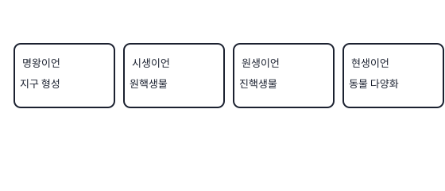
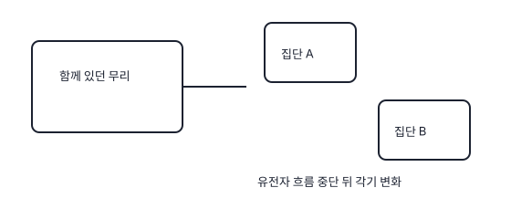
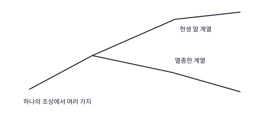
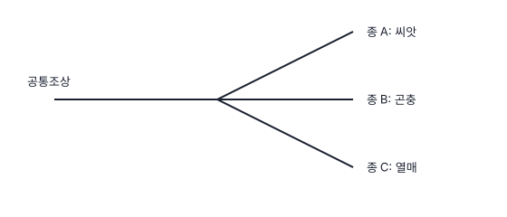
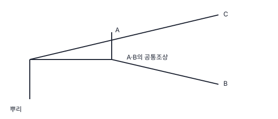

# 대진화와 생물 분류 — 5살도 이해하는 정리노트

이영만 교수님 생명과학 · 1103 수업 (8장 대진화와 종분화 p3–6)

> `정리노트_1103_Macroevolution_and_Taxonomy.html`를 마크다운으로 옮겼어요. 그림은 `figures_1103/` 폴더의 SVG, 위젯은 대표 설정의 정적 그림으로 바꿨어요. 수식은 `$…$` / `$$…$$`라서 GitHub, Obsidian, Typora에서 보여요.

**목차**

- [0. 화석과 지질시대](#s0)
  - [화석의 나이는 무엇을 재서 알아낼까요?](#s0-dating)
  - [지구 역사는 큰 사건의 순서로 기억해요](#s0-geologic)
- [1. 지각 변화와 적응](#s1)
  - [움직이는 대륙은 서식지와 연결을 바꿔요](#s1-plates)
  - [같이 닮은 이유가 같지는 않아요](#s1-convergence)
- [2. 대진화의 양상](#s2)
  - [진화는 정해진 목표를 향해 가지 않아요](#s2-trends)
  - [점진주의와 단속평형은 변화의 시간 양상이에요](#s2-tempo)
  - [빈 생태적 자리는 적응방산의 기회가 돼요](#s2-radiation)
  - [배경멸종과 대멸종은 규모와 속도가 달라요](#s2-extinction)
- [3. 발생과 생물 분류](#s3)
  - [몸을 만드는 유전자를 지휘하는 유전자](#s3-evodevo)
  - [계통수는 진화사의 가설을 그려요](#s3-phylogeny)
  - [종 이름은 두 단어이고 분류는 여러 층이에요](#s3-naming)
  - [rRNA 서열은 생물을 비교하는 공통 표지예요](#s3-rrna)
- [4. 요약 · 예고](#s4)
  - [시험 직전 한눈에](#s4-cheatsheet)
  - [다음 시간 예고](#s4-next)
  - [함께 보면 좋은 자료](#s4-links)

## 0. 화석과 지질시대

### 화석의 나이는 무엇을 재서 알아낼까요?

*1103 수업 · 8장 p3*

**쉽게 말하면**

살아 있을 때는 새 재료를 받아들이지만, 죽고 나면 남은 재료만 줄어들어요. 절반씩 줄어드는 시계와 땅의 쌓인 순서를 함께 읽어요.

**정확히 말하면**

동위원소는 **원자번호(양성자 수)는 같고 질량수는 다른** 원자예요. 일부 동위원소는 방사선을 내며 다른 원자로 붕괴해요. 방사성 연대측정법(radiometric dating)은 남은 동위원소의 양이나 비율을 재고, 알려진 붕괴 속도로 경과 시간을 추정하는 방법이에요.

반감기(half-life)는 방사성 동위원소의 양이 절반이 되는 데 걸리는 시간이에요. C-14는 질소-14로 붕괴하고 반감기는 5,730년이에요. 살아 있는 생물은 광합성과 먹이 섭취 등으로 탄소를 계속 교환해요. 죽으면 새 탄소의 유입이 멈추고 C-14가 붕괴하므로 C-14/C-12 비율이 줄어요. 이 비율을 살아 있을 때의 기준과 비교하면 죽은 뒤 지난 시간을 추정할 수 있어요.

| 남은 C-14의 비율 | 지난 반감기 | 경과 시간 |
|---|---|---|
| 50% | 1번 | 5,730년 |
| 25% | 2번 | 11,460년 |
| 12.5% | 3번 | 17,190년 |

오래 지나 C-14가 너무 적어지면 정확하게 재기 어려워요. 따라서 C-14로 공룡 시대의 화석이나 지구 자체의 나이를 직접 재지 않아요. 더 오래된 지층은 반감기가 긴 다른 동위원소로 연대를 잰 화성암층과 비교해요.

퇴적암은 여러 시기의 입자가 쌓여 생겨요. 입자 하나의 형성 시기와 퇴적층이 쌓인 시기는 달라, 입자를 직접 잰 값을 화석 나이로 단정할 수 없어요. 변형·뒤집힘이 없는 지층에서는 아래가 더 오래됐다는 순서로 상대 연대를 정하고, 위아래 화성암층과 화석층의 형성 순서를 확인하고 그 연대를 알면 사이 화석의 연대 범위를 좁혀요.

비교 연습으로 6.25%는 반감기 네 번이므로 22,920년이에요. 25%가 남은 시료와 비교하면 두 반감기, 즉 11,460년 더 오래됐어요. 가상 예에서 정상 퇴적된 아래 화산재층이 1억 2천만 년, 위 화산재층이 1억 년 전이면 그 사이 화석층은 1억~1억 2천만 년 전 범위로 제한해요.

**교수님 말씀**

벽지를 한 겹 벗기면 더 오래된 벽지가 나온다는 비유로 지층 순서를 설명하셨어요. 반감기 비율 계산은 주관식으로 묻기 좋지만 출제 확정은 아니라고 하셨어요. 쥐라기 공원 사례에서는 PCR로 남은 DNA 조각의 양을 늘려도 사라진 전체 유전정보가 복원되지는 않는다고 짚으셨어요.

**꼭 기억해요**

반감기가 한 번 지날 때마다 **처음 양의 절반씩 빼는 것이 아니라 현재 남은 양의 절반**이 남아요. 25%는 반감기 두 번이에요. 상대 연대는 앞뒤 순서이고, 절대 연대는 수치로 추정한 나이예요. 탄소-14의 14는 원자번호가 아니라 질량수예요.

**보충 · 수업에서 다루지 않았어요**

생전 C-14 비율을 기준으로 삼고 사후 탄소 교환이 거의 없다고 가정한 계산이에요. 실제 시료에서는 오염과 기준 비율 변동을 고려해요. 수업의 “위아래 화강암”은 단순히 화강암이 가까이 있다는 뜻이 아니라, 화석층과 형성 순서를 확인한 화성암층으로 연대를 제한한다는 뜻으로 읽어요. 관입한 암석을 무조건 아래가 오래됐다는 순서에 넣으면 안 돼요.

출처: 교재 8장 p.164, 강의노트 8장 p3

**보충 · 수업에서 다루지 않았어요**

화석의 골격과 이빨은 형태와 먹이의 단서를, 화석화된 화분은 주변 식생과 기후의 단서를 제공해요. 분화석(화석화된 배설물)은 먹이의 단서이고, 발자국 화석은 이동·무리 행동의 단서가 될 수 있어요. 연대 자료는 선후관계를 정하는 데 쓰여요. 따라서 화석에서 형태뿐 아니라 과거의 행동·생태도 간접 추론할 수 있어요. 다만 모든 개체가 화석이 되지는 않으며 보존 편향이 있어요. 드문 종이나 연한 몸은 기록이 적을 수 있어 화석 기록의 빈칸을 곧바로 생물의 부재로 단정하지 않아요.

출처: 교재 8장 p.164, p.169

**페이지 요약**

화석의 나이는 동위원소의 붕괴 속도와 지층의 쌓인 순서를 함께 이용해 추정해요.

*용어*

- **측정 원리** — C-14/C-12 비율을 생전 기준과 비교해 죽은 뒤의 경과 시간을 추정해요. 탄소 유입 중단 뒤의 붕괴가 시계가 돼요.
- **동위원소와 연대의 종류** — 동위원소는 원자번호가 같고 질량수가 달라요. 상대 연대는 선후 순서, 절대 연대는 수치로 추정한 나이예요.
- **반감기** — 5,730년마다 남은 C-14가 절반이 돼요. 25%는 11,460년, 12.5%는 17,190년이에요.
- **오래된 화석** — C-14는 매우 오래된 화석에 부적합해요. 정상 퇴적층의 순서와 연대가 확인된 인접 화성암층을 함께 이용해요.
- **DNA 증폭의 한계** — PCR은 남은 조각을 늘릴 뿐 잃어버린 전체 유전정보를 복구하지 않아요.
- **새 수치에 적용** — 6.25%는 네 반감기인 22,920년으로 25% 시료보다 11,460년 오래돼요. 정상 퇴적된 위아래 화산재층의 연대로 사이 화석층의 범위를 정해요.

- **(보충) 연대 해석의 조건** — 생전 기준·사후 탄소 교환 조건이 필요한 추정이에요. 화성암은 화석층과의 실제 형성 순서를 확인해 연대 범위를 제한해요.

- **(보충) 화석 자료가 알려 주는 것** — 골격·이빨은 형태/먹이, 화분은 식생/기후, 분화석은 먹이, 발자국은 행동, 연대는 선후관계의 단서예요. 보존 편향 때문에 기록이 적다는 사실만으로 생물의 부재를 단정하지 않아요.

---

### 지구 역사는 큰 사건의 순서로 기억해요

*1103 수업 · 8장 p3*

**쉽게 말하면**

긴 이야기의 처음에는 아주 작은 생물만 있었어요. 훨씬 뒤에 여러 동물이 늘고, 큰 멸종을 거치며 지금의 세상이 되었어요.

**정확히 말하면**

큰 순서는 **명왕이언, 시생이언, 원생이언, 현생이언**이에요. 이언(eon)은 지구 역사를 크게 나눈 단위예요. 지구의 나이는 약 46억 년이며, 현생이언의 시작인 캄브리아기는 약 5억 4천만 년 전으로 지구 역사에서 비교적 늦어요.

| 구간 | 수업에서 연결한 큰 사건 |
|---|---|
| 명왕이언(Hadean) | 지구 형성 초기의 뜨겁고 불안정한 환경 |
| 시생이언(Archean) | 최초의 원핵생물, 이후 광합성 생물 등장 |
| 원생이언(Proterozoic) | 산소 축적과 진핵생물, 뒤이어 다세포 생물 |
| 현생이언(Phanerozoic) | 캄브리아기 대폭발 이후 고생대·중생대·신생대 |

남세균(cyanobacteria)의 산소 발생 광합성에서는 물이 전자를 제공하고 산소가 나와요. 초기의 산소가 적은 환경에서 살던 혐기성 생물에게 산소는 손상을 주기도 했어요. 일부는 산소 없는 서식지에 남고, 산소를 이용하는 호흡도 확산했어요. 남세균은 원핵생물이며 세균역에 속해요.

현생이언의 고생대는 캄브리아기 대폭발로 시작해 페름기 말 대멸종으로 끝나요. 캄브리아기 대폭발은 실제 폭발이 아니라 많은 동물 계열이 비교적 짧은 지질 시간에 다양해진 사건이에요. 고생대에는 해양 동물이 다양해지고 식물과 동물이 육지로 진출했어요. 중생대는 삼첩기·쥐라기·백악기로 나뉘고 백악기 말 대멸종으로 끝나요. 신생대에는 포유류가 다양해지고 훨씬 뒤에 인류가 나타나요.

고생대의 기는 캄브리아기·오르도비스기·실루리아기·데본기·석탄기·페름기 순서로 나열했어요. 신생대는 자료에서 제3기·제4기라는 전통적 구분을 사용해요. 세부 기 전체보다 큰 사건을 우선하라는 수업의 강조를 구별해요. 원생이언 후기의 “연한 몸의 동물”은 오늘날 연체동물문만을 가리키는 말이 아니에요.

**교수님 말씀**

지구 역사를 한 번의 수업으로 줄이면 인류의 등장은 수업이 거의 끝날 때예요. 교수님은 세세한 연대보다 **시생이언의 생명, 원생이언의 진핵생물, 캄브리아기 대폭발, 페름기·백악기 대멸종, 신생대 인류**의 순서를 기억하라고 강조하셨어요.

**꼭 기억해요**

최초의 생명 출현, 진핵생물 출현, 동물의 폭발적 다양화는 같은 사건이 아니에요. 산소가 생겼다고 모든 혐기성 생물이 전멸한 것도 아니에요. “어류·양서류·파충류·포유류”는 큰 등장 순서를 단순화한 말이며 현재 생물들이 한 줄로 차례차례 변했다는 뜻은 아니에요.

**보충 · 노트에 빠졌던 수업 내용**

수업에서는 명왕/시생 경계를 약 40억 년 전, 시생/원생 경계를 약 25억 년 전으로 말했어요. 강의노트에는 각각 38억·24억 년 전, 교재 표에는 38억·25억 년 전으로 적혀 있어요. 서로 다른 근삿값을 섞어 하나의 정밀한 표처럼 외우지 말고, 이 수업에서는 큰 사건의 순서를 우선해요. 초기 환경을 “생명이 절대 살 수 없었다”로 확정하기보다 초기 지구가 매우 불안정했다는 설명으로 읽어요.

출처: 1103 수업, 강의노트 8장 p3, 교재 8장 p.165

**페이지 요약**

지질시대는 생물의 등장, 산소 증가, 대멸종 같은 큰 사건을 시간 순서로 연결해 기억해요.

*용어*

- **이언의 순서** — 명왕이언 다음 시생이언의 원핵생물, 원생이언의 진핵생물, 현생이언의 캄브리아기 대폭발을 연결해요.
- **산소의 증가** — 세균역의 남세균은 물에서 전자를 얻는 광합성으로 산소를 내요. 혐기성 생물 일부에는 독성이지만 산소 호흡에는 기회가 돼요.
- **현생이언** — 고생대는 캄브리아기부터 페름기 말까지, 중생대는 삼첩기·쥐라기·백악기, 뒤이어 신생대예요.
- **멸종과 등장** — 페름기 말·백악기 말 대멸종 이후 계열의 구성이 달라져요. 포유류 다양화와 인류는 신생대의 큰 사건이에요.
- **범위와 표현** — 수업은 고생대의 여섯 기와 신생대 제3기·제4기도 나열했지만 큰 사건의 순서를 우선해요. 원생이언의 연한 몸 동물은 특정 연체동물문 전체와 같지 않아요.

- **(보충) 연대 표의 차이** — 수업은 약 40억·25억 년, 강의노트는 38억·24억 년, 교재는 38억·25억 년 경계를 써요. 정밀 연대가 아닌 큰 사건 순서를 우선해요.

---

## 1. 지각 변화와 적응

### 움직이는 대륙은 서식지와 연결을 바꿔요

*1103 수업 · 8장 p3*

**쉽게 말하면**

땅이 모이면 바다에서 먼 곳이 생겨요. 다시 갈라지면 함께 살던 무리도 떨어져 서로 다르게 변할 수 있어요.

**정확히 말하면**

판구조론(plate tectonics)은 지표의 큰 암석판이 맨틀 위에서 움직인다는 설명이에요. 대륙은 그 판의 일부이고, 판의 움직임에 따른 대륙이동으로 위치와 연결이 달라져요. 판은 서로 벌어지기도 하고 충돌하기도 해요.

고생대 말에는 여러 대륙이 초대륙 판게아(Pangea)로 모였어요. 넓어진 내륙은 바다에서 멀어져 건조해지는 등 서식지와 기후가 바뀔 수 있어요. 화산 활동이나 기후 변화도 생물의 생존에 영향을 줘요.

대륙이 갈라지면서 개체군 사이의 이동과 유전자 흐름이 끊기면 각 집단에서 변이가 다르게 축적될 수 있어요. 충분히 분화해 생식적 격리가 생기면 이소적 종분화가 이루어져요. **땅이 갈라졌다는 사실만으로 즉시 다른 종이 되는 것은 아니에요.**

**교수님 말씀**

판게아 내륙은 바다가 너무 멀어 수분이 부족해진다는 비유로 건조화를 설명하셨어요. 같이 살던 무리가 대륙의 분리로 헤어지면 이소적 종분화가 가능하다고 연결하셨어요.

**꼭 기억해요**

판게아 형성은 대륙의 합쳐짐이고, 이소적 종분화와 연결한 예는 이후의 지리적 분리예요. 지리적 장벽의 효과는 생물의 이동 능력에 따라서도 달라요.

**페이지 요약**

대륙이 이동하면 서식 환경과 집단 사이의 연결이 바뀌어 종분화의 기회가 생길 수 있어요.

*용어*

- **대륙이동의 효과** — 판의 이동은 서식지·기후를 바꾸고 대륙을 합치거나 갈라요. 판게아 내륙은 바다에서 멀어 건조해질 수 있어요.
- **종분화의 조건** — 분리 뒤 유전자 흐름 중단과 집단별 변화, 생식적 격리가 이어져야 이소적 종분화가 이루어져요. 분리만으로 즉시 새 종이 되지는 않아요.

---

### 같이 닮은 이유가 같지는 않아요

*1103 수업 · 8장 p3–4*

**쉽게 말하면**

서로 먼 친척도 같은 곳에서 살다 보면 비슷한 모양이 유리할 수 있어요. 겉모습만 보고 가까운 친척이라고 정하지 않아요.

**정확히 말하면**

수렴진화(convergent evolution)는 연관이 먼 계열이 비슷한 환경에서 비슷한 적응을 독립적으로 갖게 되는 과정이에요. 상어는 어류, 펭귄은 조류, 돌고래는 포유류인데, 물에서 헤엄치는 데 유리한 유선형 체형이 서로 닮았어요.

상사성(analogy)은 공통조상에서 그 형질을 물려받았기 때문이 아니라 독립적으로 비슷해진 유사성이에요. 상동성(homology)은 공통조상에서 유래한 구조나 형질의 유사성이에요. **상사성은 유사성의 성격이고, 수렴진화는 그 유사성을 만든 진화 과정**이에요.

판별할 때는 “이 생물들이 공통조상을 공유하는가?”만 묻지 말고, **비교하는 바로 그 형질이 공통조상에서 유래했는가**를 물어요. 모든 생명체는 먼 공통조상을 공유할 수 있지만 모든 유사 형질이 상동인 것은 아니에요.

**교수님 말씀**

상어·펭귄·돌고래의 유선형은 비슷한 물 환경에 대한 적응으로 설명하셨어요. “이런 유사성 자체는 상사성, 이렇게 진화하는 것은 수렴진화”라고 구별하셨어요.

**꼭 기억해요**

유사한 기능을 수행한다는 사실만으로 상동이라고 판단하지 않아요. 공통조상으로부터의 유래와 비교 단위를 확인해요. 생물이 필요를 느껴 스스로 몸을 바꾸었다는 뜻도 아니에요.

**보충 · 수업에서 다루지 않았어요**

독수리와 박쥐의 앞다리는 뼈의 상대적 배치라는 구조에서 공통조상으로부터 이어진 상동 구조예요. 한편 비행용 날개로서의 기능적 적응은 각 계열에서 독립적으로 진화한 상사적 측면이 있어요. 같은 두 동물을 비교해도 앞다리뼈의 유래와 비행 기능을 혼동하면 안 돼요.

출처: 교재 8장 p.172의 공통조상 유래와 독립 적응 구별, 기출 8강 31의 앞다리뼈 도식

**보충 · 수업에서 다루지 않았어요**

선인장과 대극처럼 먼 식물 계열이 건조한 환경에서 비슷한 다육질 모습을 독립적으로 갖춘 것은 수렴진화의 예예요. 반면 이전 수업의 아미시 집단은 소수 창시자의 우연한 유전자 조성으로 새 집단 빈도가 달라진 창시자 효과예요. 말라리아 유행 지역에서 낫모양 적혈구 대립유전자의 이형접합자가 두 동형접합자보다 유리한 것은 이형접합자 이점이에요. 뒤의 두 예는 먼 계열의 형질이 독립적으로 닮는 수렴진화와 달라요.

출처: 기출 7강 41의 사례와 강의노트 8장 p3–4의 수렴 기준; [1029 창시자 효과](../../1029/정리노트_1029_Microevolution_and_Speciation.html#s0-drift), [1029 이형접합자 이점](../../1029/정리노트_1029_Microevolution_and_Speciation.html#s1-balanced)

**페이지 요약**

생물이 닮은 이유를 알려면 비슷한 환경에 따로 적응했는지, 공통조상에게서 특징을 물려받았는지 구별해야 해요.

*용어*

- **과정과 결과** — 수렴진화는 먼 계열에서 비슷한 적응이 독립적으로 생기는 과정이고, 그 결과의 기능적 유사성이 상사성이에요.
- **비교 예** — 상어·펭귄·돌고래의 유선형은 물속 이동에 대한 비슷한 적응이에요. 겉모습이 비슷해도 각각 어류·조류·포유류예요.
- **상동성** — 비교하는 형질이 공통조상에서 유래했는지가 기준이에요. 기능의 일치만으로 정하지 않아요.

- **(보충) 같은 날개도 비교 대상에 따라 달라요** — 독수리·박쥐 앞다리뼈의 상대적 구조는 상동, 독립적인 비행용 날개 적응은 상사적 측면이에요. 구조의 유래와 기능을 구별해요.

- **(보충) 이전 개념과의 구별** — 먼 계열인 선인장·대극의 독립적인 다육질 적응은 수렴이에요. 아미시의 창시자 효과는 소수의 우연한 유전자 조성, 말라리아 지역의 이형접합자 이점은 AS의 상대적 적응도로 구별해요.

---

## 2. 대진화의 양상

### 진화는 정해진 목표를 향해 가지 않아요

*1103 수업 · 8장 p4*

**쉽게 말하면**

지금 남은 가지 하나만 보면 나무가 한쪽으로만 자란 것처럼 보여요. 사라진 가지까지 보면 여러 방향으로 갈라졌다는 것을 알 수 있어요.

**정확히 말하면**

대진화(macroevolution)는 종 수준을 넘는 큰 진화 양상을 다뤄요. 말의 화석을 연구한 Marsh는 몸집이 커지고 발가락 수가 줄며, 부드러운 잎보다 단단한 풀을 먹는 데 알맞게 이빨이 변하는 경향에 주목했어요.

하지만 더 많은 화석은 크기·발가락 수·이빨 구조가 다양한 여러 가지를 보여 줘요. 현생 말로 이어지는 한 계열의 변화만 전체 진화의 필연적 방향으로 여길 수 없어요. 다른 방향으로 변한 많은 계열은 멸종했어요.

특정 표현형을 향해 밀어붙이는 내재적 추진력이 있는 것이 아니에요. 진화는 유전되는 변이와 환경 사이의 상호작용의 결과예요. 환경이 달라지면 유리했던 특징도 달라져 경향이 멈추거나 반대로 바뀔 수 있어요. 몸집의 증가는 관찰되는 경향일 수 있지만 보편 법칙은 아니에요.

**교수님 말씀**

현생 말로 이어지는 “딱 한 계열”만 보고 말이 무조건 커진다고 생각하면 안 된다고 설명하셨어요. 멸종한 계열에는 오히려 작아진 말도 있었다고 짚으셨어요.

**꼭 기억해요**

진화를 “더 크고 더 우월하게 되는 진보”로 읽지 않아요. 살아남은 가지와 사라진 가지를 모두 봐야 하고, 변화의 유불리는 환경에 달려 있어요.

**보충 · 노트에 빠졌던 수업 내용**

강의노트는 형태학적 복잡성 증가도 관찰되는 경향이지만 모든 계열의 의무적인 방향은 아니라고 설명해요. 어떤 환경에서는 구조가 단순해지는 퇴화도 나타날 수 있어요. 몸의 복잡성이 높아지는 것을 진화의 필연적 목표나 우열 기준으로 삼지 않아요.

출처: 강의노트 8장 p4, 교재 8장 p.169

**페이지 요약**

말의 진화는 목표를 향한 한 줄의 변화가 아니라, 여러 계열이 갈라지고 일부가 멸종한 역사예요.

*용어*

- **한 계열과 전체** — Marsh가 본 말의 몸집·발가락·이빨 경향은 전체 말의 필연적 일직선 진화를 뜻하지 않아요. 화석은 여러 가지와 멸종을 보여 줘요.
- **진화의 방향** — 정해진 형질을 향한 내재적 추진력은 없어요. 환경과 변이의 상호작용으로 경향이 바뀌며 크기 증가도 보편 법칙이 아니에요.

- **(보충) 복잡성의 경향과 예외** — 복잡성 증가는 보편적 진화 법칙이 아니에요. 환경에 따라 구조가 단순해지는 퇴화도 나타나므로 복잡성을 목표나 우열로 보지 않아요.

---

### 점진주의와 단속평형은 변화의 시간 양상이에요

*1103 수업 · 8장 p4*

**쉽게 말하면**

조금씩 꾸준히 달라지는 길도 있고, 오랫동안 비슷하다가 짧은 구간에 많이 달라지는 길도 있어요. 얼마나 빨리 달라지는지를 비교해요.

**정확히 말하면**

점진주의(gradualism)는 작은 형태 변화가 긴 시간 동안 점차 누적되는 양상이에요. 단속평형(punctuated equilibrium)은 오랜 형태적 정체 사이에 지질학적으로 짧은 변화 구간이 끼며, 그 변화가 종분화와 연결되는 양상이에요.

비교 대상은 주로 화석에서 보이는 **형태 변화의 시간적 양상**이에요. 자연계에는 두 양상이 모두 관찰될 수 있고 계열마다 달라요. 한 모델이 모든 생물에 적용되고 다른 모델은 틀렸다고 정하지 않아요.

**교수님 말씀**

아르바이트로 조금씩 돈을 모으는 것은 점진주의, 로또로 큰돈이 한 번에 생기는 것은 단속평형에 빗대셨어요. 비유는 변화의 시간 양상을 설명하기 위한 것이에요.

**꼭 기억해요**

단속평형의 “급격함”은 **지질학적 시간에 비해 짧다**는 뜻이에요. 개체 하나가 하룻밤에 다른 종으로 바뀌거나 진화가 멈춘다는 뜻은 아니에요. 형태가 안정적으로 보이는 시기에도 유전적 변화가 전혀 없다고 단정하지 않아요.

**페이지 요약**

점진주의는 작은 변화의 오랜 누적, 단속평형은 긴 정체와 지질학적으로 짧은 변화가 번갈아 나타나는 양상이에요.

*용어*

- **점진주의** — 작은 형태 변화가 긴 시간에 걸쳐 누적되는 양상이에요.
- **단속평형** — 긴 형태적 정체와 종분화에 연결된 지질학적으로 짧은 변화 구간이 번갈아 보여요.
- **판별 한계** — 두 양상은 계열에 따라 나타나요. “짧다”는 지질 시간 기준이며 개체의 순간적 변신이 아니에요.

---

### 빈 생태적 자리는 적응방산의 기회가 돼요

*1103 수업 · 8장 p4–5*

**쉽게 말하면**

한 조상에게서 나온 후손들이 서로 다른 먹이와 장소를 이용하며 여러 갈래로 나뉘어요. 경쟁하던 생물이 사라지면 새 기회가 열릴 수 있어요.

**정확히 말하면**

적응방산(adaptive radiation)은 한 조상 계열에서 여러 종이 생겨 서로 다른 생태적 기능이나 생태적 지위를 차지하는 진화 양상이에요. 단순히 개체 수가 늘거나 같은 종이 멀리 퍼지는 것만으로는 적응방산이 아니에요.

갈라파고스 핀치는 공통조상의 후손들이 섬마다 다른 먹이 조건에 적응해 부리 형태와 종이 다양해진 예예요. 지리적 분리와 이소적 종분화가 적응방산에 참여할 수 있어요. 적응방산은 그 결과의 다양화 양상이고, 이소적 종분화는 새 종이 생기는 지리적 방식이에요.

백악기 말 공룡의 큰 감소 뒤 포유류는 열려진 여러 서식지와 자원을 이용하며 다양해졌어요. 대멸종은 기존 다양성을 줄이지만 살아남은 계열에는 새로운 적응지대를 열 수 있어요. 육상 식물의 확산 뒤 동물이 새로운 육상 환경과 먹이를 이용한 것도 수업의 예예요.

**교수님 말씀**

대기업이 사라진 자리를 여러 작은 기업이 차지하는 것처럼, 공룡이 줄어든 뒤 포유류에게 다양한 자리가 열렸다는 비유를 드셨어요. 핀치의 섬별 부리 차이도 연결하셨어요.

**꼭 기억해요**

생물이 좋은 자리를 찾아 “원해서” 새 종이 되었다는 뜻은 아니에요. 유전되는 변이에 서로 다른 환경의 선택이 작용하고 생식적 격리가 누적되는 과정을 생략하지 않아요. 대멸종 직후 모든 계열이 곧바로 번성한다는 법칙도 아니에요.

**보충 · 노트에 빠졌던 수업 내용**

강의노트에서 공룡 멸종 뒤 포유류 방산을 설명하면서 “고생대 말”이라고 적힌 부분은 시대 표기의 오류예요. 백악기는 중생대의 마지막이며, 뒤에 신생대가 시작돼요. 공룡이 “모두” 사라졌다는 말은 새 계열을 제외한 비조류 공룡의 멸종으로 읽어요. 수업에서도 조류가 파충류 계통에 포함된다고 언급했어요.

출처: 강의노트 8장 p3–5, 1103 수업, 교재 8장 p.165·169

**페이지 요약**

새로운 생태적 기회가 열리면 한 공통조상에서 다양한 종이 갈라져 서로 다른 자원을 이용할 수 있어요.

*용어*

- **정의와 경계** — 공통조상에서 여러 종이 갈라져 다른 생태적 지위를 차지하는 것이 적응방산이에요. 개체 수 증가나 단순한 이동과 달라요.
- **대표 예** — 갈라파고스 핀치의 먹이·부리 다양화, 백악기 말 이후 포유류의 다양화가 예예요.
- **멸종과 연결** — 대멸종은 다양성을 줄이지만 살아남은 계열에 서식지·자원 기회를 열 수 있어요. 지리적 격리를 통한 종분화는 가능한 과정 중 하나예요.

- **(보충) 시대 표기 정정** — 포유류 방산을 연결할 경계는 고생대 말이 아니라 중생대 백악기 말이에요. 공룡 멸종은 비조류 공룡의 멸종으로 읽어요.

---

### 배경멸종과 대멸종은 규모와 속도가 달라요

*1103 수업 · 8장 p4–5*

**쉽게 말하면**

평소에도 자리가 조금씩 비지만, 짧은 동안 아주 많은 자리가 한꺼번에 비는 때가 있어요. 원인과 흔적을 함께 살펴봐요.

**정확히 말하면**

배경멸종(background extinction)은 평상시에도 낮은 비율로 종이 사라지는 것이에요. 대멸종(mass extinction)은 지질학적으로 비교적 짧은 기간에 배경멸종률을 크게 넘는 많은 종이 사라지는 사건이에요. 지구 역사에서 다섯 번의 큰 대멸종을 구별하며, 수업에서는 페름기 말과 백악기 말을 자세히 설명했어요.

| 사건 | 수업에서 강조한 원인과 근거 |
|---|---|
| 페름기 말 | 시베리아의 대규모 화산 활동, 온실가스 증가와 온난화, 해양 환경 악화 |
| 백악기 말 | 소행성 충돌, 경계층의 이리듐, 멕시코 유카탄반도의 칙술루브 충돌 흔적 |

페름기 말에는 대규모 분출과 탄소 방출이 기후·서식지를 크게 바꾸는 경로를 배웠어요. 백악기 말에는 거대한 충돌로 잔해와 먼지가 퍼지고 기후가 교란되어 많은 생물군이 영향을 받은 경로를 배웠어요. 충돌의 단서는 지구 표면에서는 드물지만 운석에는 상대적으로 많은 이리듐이 경계 지층에 집중된 점과 칙술루브 충돌구예요.

과학적 추론에서는 **관찰한 흔적**(이리듐 농축·충돌구)과 **그 흔적에서 추론한 사건**(큰 충돌), **생물학적 결과**(서식지·먹이망 교란과 멸종)를 연결해요. 모든 멸종의 원인이 운석인 것은 아니에요. 멸종과 뒤이은 적응방산이 반복되면서 생물다양성도 오르내려요.

**교수님 말씀**

평소 한두 명의 결석은 배경멸종, 태풍 때문에 많은 학생이 함께 결석하는 것은 대멸종에 빗대셨어요. 석유 탐사에서 충돌 흔적을 발견한 일화는 서로 다른 증거가 충돌 가설을 뒷받침한다는 예로 들으셨어요.

**꼭 기억해요**

대멸종은 모든 생물이 사라진 사건이 아니에요. 페름기 말과 백악기 말의 원인을 바꾸어 외우지 않아요. 영상에 나온 멸종 비율·온도·충돌 크기의 여러 숫자를 하나의 확정 수치로 묶지 말고 사건과 인과 경로를 우선해요.

**보충 · 노트에 빠졌던 수업 내용**

강의노트의 다섯 사건 이름은 오르도비스기 말·데본기 후기·페름기 말·삼첩기 말·백악기 말이에요. 수업에서는 다섯 번이라는 수와 그중 페름기·백악기 사건을 설명했으며, 전체 목록은 강의노트 보충으로 구별해요.

강의노트는 페름기 말의 해양 무산소, 황화수소 방출과 오존층 약화·자외선 증가도 환경 악화 경로로 제시해요. 이것들을 “오존층 파괴가 곧 온난화의 원인”이라는 한 줄로 합치지 않아요. 영상의 “초대륙이 열을 막아 반드시 폭발했다”는 비유는 복잡한 화산 활동 원인의 완전한 설명으로 단정하지 않아요. 인간 활동과 관련한 제6의 대멸종 가능성은 강의노트의 추가 문제 제기예요.

출처: 강의노트 8장 p4–5, 1103 수업

**페이지 요약**

멸종은 평소에도 일어나지만, 짧은 지질 시간에 평소보다 훨씬 많은 종이 사라지면 대멸종이에요.

*용어*

- **구별 기준** — 배경멸종은 평상시의 낮은 종 소멸, 대멸종은 짧은 지질 시간에 배경률을 크게 넘는 종 소멸이에요. 모든 생물의 전멸은 아니에요.
- **페름기 말** — 시베리아 대규모 화산 활동과 온실가스 증가가 기후·해양 환경을 악화시키는 경로예요.
- **백악기 말** — 이리듐 경계층과 칙술루브 충돌구가 큰 충돌의 증거예요. 충돌 뒤 환경과 먹이망 교란이 멸종으로 연결돼요.

- **(보충) 자료의 인과와 범위** — 강의노트의 다섯 사건은 오르도비스기 말·데본기 후기·페름기 말·삼첩기 말·백악기 말이에요. 수업에서는 그중 페름기·백악기를 자세히 설명했어요. 페름기 말의 해양 무산소·유독성 물질·오존층 변화는 환경 악화의 여러 경로예요. 영상 비유를 단일 확정 원인으로 보지 않으며 제6의 대멸종은 추가 문제 제기예요.

---

## 3. 발생과 생물 분류

### 몸을 만드는 유전자를 지휘하는 유전자

*1103 수업 · 8장 p5*

**쉽게 말하면**

건물을 짓는 일꾼과 어느 자리에서 무엇을 지을지 지시하는 관리자는 달라요. 지시가 나오는 자리가 달라지면 만들어지는 몸의 모양도 달라질 수 있어요.

**정확히 말하면**

진화발달생물학(evo-devo)은 배 발생을 조절하는 유전자의 진화적 변화가 몸의 체형과 체제를 어떻게 바꾸는지 연구해요. 수업의 “진화발생생물학”과 같은 분야예요. 배 발생은 수정란에서 개체가 형성되어 가는 과정이에요.

호미오 유전자(homeotic genes)는 발생 과정에서 몸의 구조와 부위의 정체성 결정에 관여하는 조절 유전자예요. 여러 종류가 있고, 수업에서는 다른 몸 형성 유전자의 발현을 조절하는 전사인자(transcription factor)를 암호화한다는 점을 강조했어요.

가상 예로 손가락 형성에 A·B·C 유전자의 작용이 필요하다고 해 봐요. 호미오 유전자에서 만들어진 조절 단백질은 표적 유전자들의 발현을 조절해요. 전사 조절은 RNA 중합효소가 프로모터에서 전사를 시작하는 과정과 연결돼요. 표적 유전자들이 적절한 때와 위치에서 작동해야 정상적인 구조가 만들어져요. 조절 유전자의 발현 위치가 바뀌면 머리에 다리 같은 구조가 생기는 큰 형태 변화도 가능해요.

**교수님 말씀**

몸을 만드는 유전자를 일꾼, 호미오 유전자를 관리자에 빗대셨어요. 전사인자는 복사집 아저씨를 돕는 아르바이트생이라고 지난 수업과 연결하셨어요.

**꼭 기억해요**

호미오 유전자가 곧 손가락 재료나 팔다리 자체가 되는 것은 아니에요. 조절 단백질을 통해 다른 유전자들의 발현을 지휘한다는 단계를 구별해요. 모든 전사인자를 호미오 유전자라고 부르지도 않아요.

**페이지 요약**

발생 조절 유전자가 다른 유전자의 작동 시기와 위치를 바꾸면 몸의 구조도 달라질 수 있어요.

*용어*

- **분야의 질문** — 진화발달생물학은 발생 조절 유전자의 변화가 체형·체제를 바꾸는 관계를 연구해요.
- **지휘와 실행** — 호미오 유전자는 전사인자를 암호화해 표적 유전자 발현을 조절해요. 그 유전자가 직접 팔다리 재료가 되는 것은 아니에요.
- **때와 위치** — 전사 조절은 RNA 중합효소·프로모터와 연결돼요. 조절 신호의 시간·위치가 달라지면 만들어지는 몸 구조가 달라질 수 있어요.

---

### 계통수는 진화사의 가설을 그려요

*1103 수업 · 8장 p5–6*

**쉽게 말하면**

갈라지는 길을 거슬러 가면 함께 출발한 자리를 찾을 수 있어요. 생김새만 줄 세우는 대신 친척 관계의 지도를 그려요.

**정확히 말하면**

계통(phylogeny)은 생물군의 진화 역사예요. 계통수(phylogenetic tree)는 가지와 분기점으로 그 역사를 나타내는 가설이에요.

계통생물학의 두 큰 목표는 진화사를 재건하는 것과 종을 분류하는 것이에요. 분류학(taxonomy)은 생물을 동정하고 이름 붙이며 분류상의 위치에 배열하는 일이에요. 동정(identification)은 해당 생물이 무엇인지 확인하는 과정이에요. 형태·행동·분자 자료를 함께 보며 새로운 정보가 생기면 분류 가설도 수정할 수 있어요.

**교수님 말씀**

동정은 ID 카드처럼 “이 생물이 누구인지” 파악하는 것이라고 설명하셨어요. 독버섯과 식용종의 구별, 유용한 종의 보전, 생태계 관계 파악이 정확한 분류를 필요로 한다는 예를 들으셨어요.

**꼭 기억해요**

계통은 진화 역사이고 분류는 동정·명명·배열의 작업이에요. 가까운 생물들이 조상에서 물려받은 특징을 공유할 수 있지만 DNA가 전부 동일한 것은 아니에요. 겉모습의 유사성에는 수렴진화도 섞일 수 있어요.

**보충 · 수업에서 다루지 않았어요**

두 끝의 가지를 거슬러 올라가 만나는 지점이 두 계열의 공통조상을 나타내요. 더 최근의 공통조상을 공유할수록 진화적으로 가까운 관계예요. 뿌리가 있는 나무의 뿌리는 그 계통수에 포함된 모든 생물의 공통조상을 나타내요. 가지가 처음 갈라지는 위치와 “가장 진화한 생물”을 혼동하지 않아요. 현재 살아 있는 생물이 그림 왼쪽이나 아래에 있다는 이유로 다른 현생 생물의 직접 조상이라고 할 수 없어요.

공유 파생특성은 공통조상에서 새로 나타나 후손에게 이어진 특징이에요. 현재의 형태 유사성만이 아니라 형질의 유래를 비교해야 해요. 기출의 단순화된 세균·고세균·원생생물·식물·동물 나무에서는 선택쌍 중 동물과 식물의 공통조상이 더 최근인지를 분기점으로 확인해요. 같은 지역에서 정상적으로 쌓여 교란되지 않은 지층과 보존 조건을 가정하면 더 최근에 살던 조상 화석은 상대적으로 얕은 층을 기대할 수 있어요. 계통수의 가로 배치나 선 길이를 연대 눈금 없이 시간으로 읽지는 않아요.

출처: 교재 8장 p.164·171–174, 기출 8강 8의 주어진 계통도

**페이지 요약**

계통수는 생물의 진화 관계를 나타내며, 새로운 증거로 그 관계를 다시 해석하면 분류도 달라질 수 있어요.

*용어*

- **계통과 분류** — 계통은 진화 역사, 분류학은 동정·이름 붙이기·배열이에요. 동정은 생물이 무엇인지 확인하는 과정이에요.
- **가설의 수정** — 형태·행동·분자 자료로 관계를 추론하며 새로운 진화사 정보가 생기면 분류도 바뀔 수 있어요.
- **공유와 차이** — 공통조상에서 물려받은 특징을 공유해도 모든 DNA가 같지는 않아요. 비슷한 겉모습만으로 근연성을 확정하지 않아요.

- **(보충) 문제 그림에서 관계와 지층을 읽기** — 가지를 거슬러 만나는 공통조상이 더 최근일수록 가까운 관계예요. 뿌리는 전체 생물의 공통조상이에요. 가지의 좌우·아래 위치만으로 현생 생물을 직접 조상이나 더 진화한 생물로 정하지 않아요. 공유 파생특성은 공통조상에서 유래한 특징이에요. 정상 퇴적·동일 지역·보존을 가정할 때만 최근 조상 화석과 얕은 층을 연결해요.

---

### 종 이름은 두 단어이고 분류는 여러 층이에요

*1103 수업 · 8장 p6*

**쉽게 말하면**

이름 두 부분을 함께 써야 한 생물을 정확히 부를 수 있어요. 작은 상자들을 큰 상자 안에 차례로 넣듯 분류해요.

**정확히 말하면**

린네가 발전시킨 이명법(binomial nomenclature)은 **속(genus) 이름과 종소명(specific epithet)**의 두 부분으로 종을 명명해요. *Homo sapiens*에서 *Homo*는 속, *sapiens*는 종소명이며 두 단어 전체가 종의 학명이에요. 속 첫 글자만 대문자, 종소명은 소문자이며 두 단어 모두 이탤릭체로 써요.

작은 범위부터 큰 범위의 순서는 **종·속·과·목·강·문·계·역**이에요. 역은 영역(domain)이라고도 해요. 큰 범위부터 묻는다면 역·계·문·강·목·과·속·종으로 거꾸로 읽어요. 같은 속에 포함된 종은 일반적으로 서로 가까운 관계이고, 더 큰 분류군으로 갈수록 더 넓고 다양한 생물을 포함해요.

수업의 3역 체계는 세균역·고세균역·진핵생물역이에요. 진핵생물역 안에 동물계·식물계·균계·원생생물계를 두는 교재의 수업용 체계를 사용해요. 균류, 동물, 식물, 편모충 같은 원생생물은 이 체계에서 진핵생물역에 속하고 남세균은 세균역이에요.

린네는 주로 형태 형질로 분류했지만 오늘날은 형태·생리·행동·분자 자료를 함께 써요. 공유 특성에 따른 계층이 진화적 관계의 정보를 담을 수 있어 린네의 기본 틀을 발전시켜 활용해요. 겉모습이 비슷한 개구리도 구애 울음이 다르면 수정 전의 행동적 격리가 종 구별의 근거가 될 수 있어요.

**교수님 말씀**

교수님은 *Homo sapiens*의 H만 대문자라는 점과 이탤릭체를 반복하셨어요. 울음소리를 이용한 구애의 차이를 물으며 행동적 격리라고 확인하셨어요.

**꼭 기억해요**

종소명 하나만을 완전한 종 이름으로 쓰지 않아요. “과·목·강”은 좁은 쪽에서 넓은 쪽이고, 큰 범위에서 작은 범위를 묻는 문제에서는 순서를 뒤집어야 해요. 울음이 다르다는 사실은 맥락과 다른 증거를 함께 보아야 하며 모든 소리 차이를 곧 새 종이라고 하지는 않아요.

**페이지 요약**

종의 학명은 속과 종소명 두 단어로 쓰고, 분류계급은 종에서 역까지 작은 무리를 큰 무리로 묶어요.

*용어*

- **학명 쓰기** — Homo sapiens의 두 단어 전체가 종 이름이에요. 속 첫 글자는 대문자, 종소명은 소문자, 전체는 이탤릭체예요.
- **분류계급** — 작은 순서는 종·속·과·목·강·문·계·역이에요. 큰 순서는 반대이며, 같은 속의 생물은 더 큰 분류군보다 일반적으로 서로 비슷해요.
- **3역과 계** — 세균·고세균·진핵생물의 3역을 구별해요. 수업 체계의 동물·식물·균류·원생생물은 진핵생물역, 남세균은 세균역이에요.
- **분류 자료** — 현대 분류는 형태·생리·행동·분자를 종합해요. 구애 신호가 맞지 않아 교미가 막히면 수정 전의 행동적 격리예요.

---

### rRNA 서열은 생물을 비교하는 공통 표지예요

*1103 수업 · 8장 p6*

**쉽게 말하면**

누구인지 알아볼 때 몸 전체 대신 얼굴처럼 비교할 공통 부분을 볼 수 있어요. 여러 생물에 있는 같은 부분의 글자 순서를 비교해 친척 관계를 추정해요.

**정확히 말하면**

rRNA는 리보솜을 구성하는 RNA예요. rRNA 유전자는 그 RNA를 만드는 정보를 담은 DNA 구간이에요. 형태만으로 구별하기 어려운 생물은 이런 분자 자료를 비교해 동정과 진화 관계 추론에 이용해요. 전체 유전체를 언제나 전부 읽어야 하는 것은 아니에요.

좋은 공통 표지는 널리 존재해 서로 대응되는 부분을 비교할 수 있어야 해요. rRNA는 모든 세포성 생물의 리보솜과 연결되고, 비교적 진화 속도가 느리며 종 사이 이동이 상대적으로 적어 깊은 계통 비교에 유용하다고 수업에서 설명했어요.

실제 비교에서는 rRNA 유전자 DNA의 해당 영역을 PCR로 증폭한 뒤 염기서열을 읽고, 알려진 생물의 서열과 비교할 수 있어요. 직접 얻는 자료는 **염기서열과 그 일치·차이**이고, 여기서 어떤 생물에 가까운지 추정해요. PCR은 비교할 재료의 양을 늘리는 단계이지, 모양이나 종 이름을 직접 측정하는 단계가 아니에요.

우즈(Woese)는 rRNA 염기서열 비교에 기초해 세균역·고세균역·진핵생물역의 구별을 제시했어요. 고세균은 세균역의 다른 이름이 아니며, 진핵생물역의 동물·식물·균류 등과도 구별하는 영역이에요.

**교수님 말씀**

유명한 사람을 알아볼 때 머리부터 발끝까지 다 확인하지 않고 얼굴을 본다는 비유로 표지 유전자 비교를 설명하셨어요. 전체 DNA 대신 어떤 공통 유전자를 고를지가 중요하다고 짚으셨어요.

**꼭 기억해요**

rRNA는 RNA이고 rRNA 유전자는 DNA예요. 둘을 같은 물질로 부르지 않아요. “한 유전자만 보면 된다”는 말은 공통 표지를 쓸 수 있다는 취지이지, 표지 하나로 모든 종을 언제나 확정한다는 뜻은 아니에요. 서열 유사도와 다른 형태·행동 자료를 함께 해석해요.

**보충 · 수업에서 다루지 않았어요**

균류는 분자 자료에 근거할 때 식물보다 동물과 더 가까운 관계예요. 세균·남세균·고세균과 비교해도 동물은 균류와 함께 진핵생물역 안에 있다는 점을 구별해요. 이 관계는 현재 계통 비교에 필요한 보충이며 9장의 균류 분류·생리 상세를 배운 것으로 세지는 않아요.

출처: 교재 9장 p.196, 9.5.2 첫 문단

**페이지 요약**

여러 생물에 공통으로 존재하는 rRNA 유전자의 염기서열을 비교하면 진화 관계를 추정할 수 있어요.

*용어*

- **물질 구별** — rRNA는 리보솜의 RNA, rRNA 유전자는 그것을 암호화한 DNA예요. 보통 PCR로 늘리는 비교 재료는 해당 DNA 구간이에요.
- **표지 선택** — 널리 존재하고 비교적 천천히 변하며 종간 이동이 상대적으로 적은 공통 표지라 깊은 관계 비교에 유용해요.
- **측정과 추론** — PCR로 재료를 늘린 뒤 염기서열의 일치·차이를 얻고 동정과 관계를 추정해요. 표지 하나가 모든 종을 항상 확정하지는 않아요.
- **3역** — 우즈의 rRNA 비교는 세균역·고세균역·진핵생물역의 구분을 뒷받침해요.

- **(보충) 현재 계통 비교를 위한 한 가지 관계** — 균류는 식물보다 동물과 가까워요. 세균·고세균과 달리 동물과 균류는 진핵생물역에 속해요. 현재 관계 비교용 보충이며 9장 상세 학습은 아니에요.

---

## 4. 요약 · 예고

### 시험 직전 한눈에

| 주제 | 시험 직전 한 줄 |
|---|---|
| 화석 연대 | C-14 반감기 5,730년, 25%는 11,460년; 사후 교환이 거의 없다는 조건을 확인해요. |
| 지질시대 | 시생이언 원핵생물, 원생이언 진핵생물, 현생이언 캄브리아기 대폭발; 페름기 말·백악기 말 경계를 구별해요. |
| 대륙과 종 | 분리로 유전자 흐름이 끊긴 뒤 생식적 격리까지 누적되어야 종분화예요. |
| 수렴과 상동 | 비슷한 환경의 독립 적응은 수렴·상사, 해당 형질의 공통조상 유래는 상동이에요. |
| 진화 경향 | 살아남은 한 계열의 경향을 보편적인 목표·진보로 일반화하지 않아요. |
| 변화 속도 | 점진주의는 긴 시간의 누적, 단속평형은 긴 정체와 짧은 지질 시간의 변화예요. |
| 적응방산 | 공통조상에서 여러 종이 갈라져 다른 생태적 지위를 차지해요. 단순 개체 수 증가와 달라요. |
| 멸종 | 배경률을 넘는 짧은 기간 큰 감소가 대멸종; 페름기는 화산, 백악기는 충돌 증거를 연결해요. |
| 발생 조절 | 호미오 유전자의 조절 단백질이 표적 유전자 발현을 지휘하고 몸의 구조 변화와 연결돼요. |
| 계통수 | 공통조상의 최근성으로 근연성을 읽어요. 나무의 뿌리는 전체의 공통조상이에요. |
| 이명법·계급 | 속+종소명 모두 이탤릭체, 속 첫 글자만 대문자; 작은 순서는 종·속·과·목·강·문·계·역이에요. |
| rRNA 비교 | 유전자 DNA 증폭과 서열 비교로 관계를 추정해요. rRNA 자체와 DNA 유전자를 구별해요. |

---

### 다음 시간 예고

- 9장 생물다양성에서 세균·고세균·진핵생물의 여러 무리를 살펴볼 예정이에요.
- 이번 수업은 8장 분류와 rRNA 비교까지 마쳤어요. 교수님은 “9장은 다음 시간에”라고 마무리하셨어요.

---

### 함께 보면 좋은 자료

- [이번 수업 복습문제](복습문제_1103_Macroevolution_and_Taxonomy.md)
- [지난 수업의 종분화와 생식적 격리](../../1029/정리노트_1029_Microevolution_and_Speciation.html#s3-allopatric)

---

출처: 이영만 교수님 강의노트(8장 p3–6) · 수업 녹음 전사(1103) · 『생명과학: 기초와 응용』 2판 8장.
