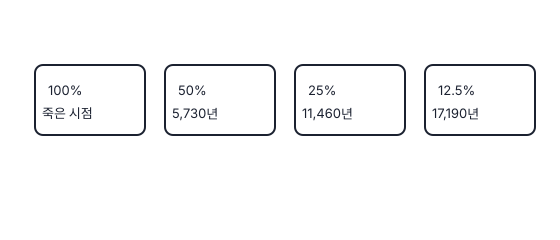
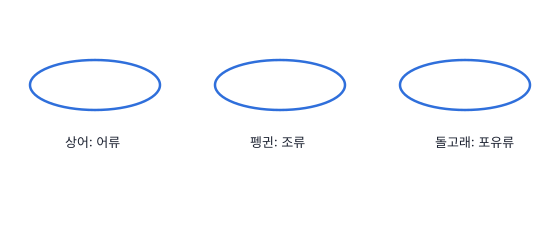
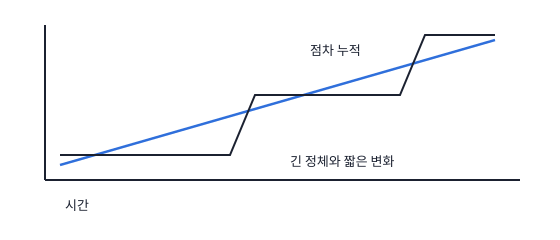
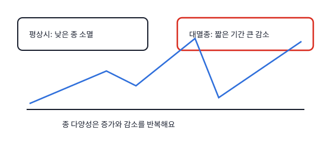
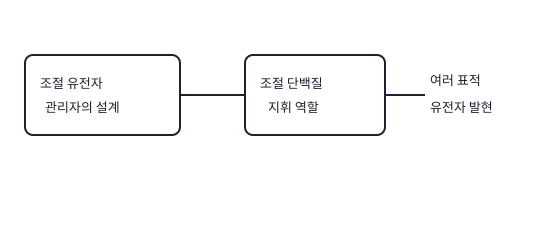
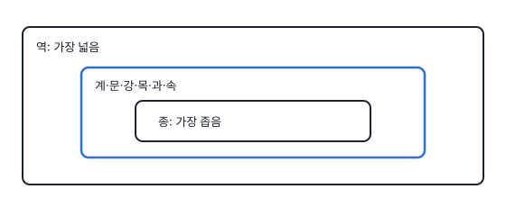
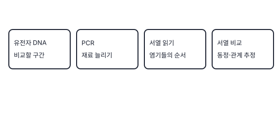

# 대진화와 생물 분류 — 5살도 이해하는 정리노트

이영만 교수님 생명과학 · 1103 수업 (8장 대진화와 종분화 p3–6)

> `정리노트_1103_Macroevolution_and_Taxonomy.html`를 마크다운으로 옮겼어요. 그림은 `figures_1103/` 폴더의 SVG, 위젯은 대표 설정의 정적 그림으로 바꿨어요. 수식은 `$…$` / `$$…$$`라서 GitHub, Obsidian, Typora에서 보여요.

**목차**

- [0. 화석과 지질시대](#s0)
  - [화석의 나이는 무엇을 재서 알아낼까요?](#s0-dating)
  - [지구 역사는 큰 사건의 순서로 기억해요](#s0-geologic)
- [1. 지각 변화와 적응](#s1)
  - [움직이는 대륙은 서식지와 연결을 바꿔요](#s1-plates)
  - [같이 닮은 이유가 같지는 않아요](#s1-convergence)
- [2. 대진화의 양상](#s2)
  - [진화는 정해진 목표를 향해 가지 않아요](#s2-trends)
  - [점진주의와 단속평형은 변화의 시간 양상이에요](#s2-tempo)
  - [빈 생태적 자리는 적응방산의 기회가 돼요](#s2-radiation)
  - [배경멸종과 대멸종은 규모와 속도가 달라요](#s2-extinction)
- [3. 발생과 생물 분류](#s3)
  - [몸을 만드는 유전자를 지휘하는 유전자](#s3-evodevo)
  - [계통수는 진화사의 가설을 그려요](#s3-phylogeny)
  - [종 이름은 두 단어이고 분류는 여러 층이에요](#s3-naming)
  - [rRNA 서열은 생물을 비교하는 공통 표지예요](#s3-rrna)
- [4. 요약 · 예고](#s4)
  - [시험 직전 한눈에](#s4-cheatsheet)
  - [다음 시간 예고](#s4-next)
  - [함께 보면 좋은 자료](#s4-links)

## 0. 화석과 지질시대

### 화석의 나이는 무엇을 재서 알아낼까요?

*1103 수업 · 8장 p3*

**쉽게 말하면**

남은 양을 보고 시간이 얼마나 흘렀는지 읽는 시계예요.

**정확히 말하면**

**동위원소** = 원자번호(양성자 수)는 같고 질량수는 다른 원자

**방사성 연대측정법(radiometric dating)** = 남은 방사성 동위원소의 양이나 비율을 재고, 알려진 붕괴 속도로 경과 시간을 추정하는 방법

**반감기(half-life)** = 방사성 동위원소의 양이 절반이 되는 데 걸리는 시간

일부 동위원소는 방사선을 내며 다른 원자로 붕괴해요. C-14는 질소-14로 붕괴하며 반감기는 5,730년이에요.

1. 생전: 광합성·먹이 섭취 등으로 탄소 교환
2. 사후: 새 탄소 유입 중단과 C-14 붕괴
3. 시료의 C-14/C-12 비율 측정과 생전 기준 비교
4. 죽은 뒤 지난 시간 추정

| 남은 C-14의 비율 | 지난 반감기 | 경과 시간 |
|---|---|---|
| 50% | 1번 | 5,730년 |
| 25% | 2번 | 11,460년 |
| 12.5% | 3번 | 17,190년 |
| 6.25% | 4번 | 22,920년 |

남은 비율이 1/2의 몇 제곱인지 세고, 그 횟수에 반감기 5,730년을 곱해요.

시간이 너무 지나 C-14가 적어지면 비율을 정확히 재기 어려워요. 공룡 시대의 화석이나 지구 자체의 나이를 이 방법으로 직접 재지 않아요.

**오래된 퇴적층의 화석 연대를 좁힐 때**

1. **지층의 순서 확인:** 변형·뒤집힘이 없으면 아래가 위보다 오래됐어요.
2. **화성암 연대 측정:** 화석층 위아래에서 형성 순서를 확인한 화성암층을 반감기가 긴 동위원소로 재요.
3. **화석 연대 범위 추정:** 화석층은 두 층의 나이 사이에 놓여요.

더 자세히

계산 예: C-14가 6.25% 남은 시료는 25% 남은 시료보다 두 반감기, 즉 11,460년 더 오래됐어요.

가상 예: 정상 퇴적된 아래 화산재층이 1억 2천만 년 전, 위 화산재층이 1억 년 전이라면 사이 화석층은 1억~1억 2천만 년 전이에요.

반감기 계산과 지층으로 연대 범위를 좁히는 방법을 [학습만화](../%ED%95%99%EC%8A%B5%EB%A7%8C%ED%99%94_1103_Macroevolution_and_Taxonomy.html#s0-dating)에서 그림과 대화로 구별해 보세요.

**꼭 기억해요**

| 묻는 것 | 틀리기 쉬운 답 | 맞는 답 |
|---|---|---|
| 매 반감기에 줄어드는 양 | ~~처음 양의 절반~~ | 그때 남은 양의 절반 |
| 탄소-14의 14 | ~~원자번호~~ | 질량수 |
| 상대 연대 | ~~수치로 추정한 나이(절대 연대)~~ | 지층·사건의 앞뒤 순서 |
| 퇴적암 입자의 연대 | ~~그 입자와 함께 묻힌 화석의 나이~~ | 입자 자체가 형성된 시기 |

퇴적암에는 서로 다른 시기에 생긴 입자가 쌓여 있어요. 교수님은 반감기 비율 계산이 주관식으로 묻기 좋다고 하셨어요. 출제를 예고하신 것은 아니에요.

교수님 말씀

교수님은 겹쳐 붙인 벽지를 벗기면 더 오래된 벽지가 나오는 상황에 지층 순서를 빗대셨어요.

쥐라기 공원 사례에서는 PCR로 남은 DNA 조각을 늘려도 사라진 전체 유전정보를 복원할 수는 없다고 짚으셨어요.

남은 C-14 비율과 경과 시간의 관계를 [반감기 시계](../%EC%9D%B8%ED%84%B0%EB%A0%89%ED%8B%B0%EB%B8%8C_01_%EB%B0%98%EA%B0%90%EA%B8%B0_%EC%8B%9C%EA%B3%84.html)에서 재생하고 두 시료를 비교해 보세요.

**보충 · 수업에서 다루지 않았어요**

생전 C-14 비율을 기준으로 삼고 사후 탄소 교환이 거의 없다고 가정한 계산이에요. 실제 시료에서는 오염과 기준 비율 변동을 고려해요. 수업의 “위아래 화강암”은 단순히 화강암이 가까이 있다는 뜻이 아니라, 화석층과 형성 순서를 확인한 화성암층으로 연대를 제한한다는 뜻으로 읽어요. 관입한 암석을 무조건 아래가 오래됐다는 순서에 넣으면 안 돼요.

출처: 교재 8장 p.164, 강의노트 8장 p3

**보충 · 수업에서 다루지 않았어요**

화석의 골격과 이빨은 형태와 먹이의 단서를, 화석화된 화분은 주변 식생과 기후의 단서를 제공해요. 분화석(화석화된 배설물)은 먹이의 단서이고, 발자국 화석은 이동·무리 행동의 단서가 될 수 있어요. 연대 자료는 선후관계를 정하는 데 쓰여요. 따라서 화석에서 형태뿐 아니라 과거의 행동·생태도 간접 추론할 수 있어요. 다만 모든 개체가 화석이 되지는 않으며 보존 편향이 있어요. 드문 종이나 연한 몸은 기록이 적을 수 있어 화석 기록의 빈칸을 곧바로 생물의 부재로 단정하지 않아요.

출처: 교재 8장 p.164, p.169

**페이지 요약**

화석의 나이는 동위원소의 붕괴 속도와 지층의 쌓인 순서를 함께 이용해 추정해요.

*용어*

- **측정 원리** — C-14/C-12 비율을 생전 기준과 비교해 죽은 뒤의 경과 시간을 추정해요. 탄소 유입 중단 뒤의 붕괴가 시계가 돼요.
- **동위원소와 연대의 종류** — 동위원소는 원자번호가 같고 질량수가 달라요. 상대 연대는 선후 순서, 절대 연대는 수치로 추정한 나이예요.
- **반감기** — 5,730년마다 남은 C-14가 절반이 돼요. 25%는 11,460년, 12.5%는 17,190년이에요.
- **오래된 화석** — C-14는 매우 오래된 화석에 부적합해요. 정상 퇴적층의 순서와 연대가 확인된 인접 화성암층을 함께 이용해요.
- **DNA 증폭의 한계** — PCR은 남은 조각을 늘릴 뿐 잃어버린 전체 유전정보를 복구하지 않아요.
- **새 수치에 적용** — 6.25%는 네 반감기인 22,920년으로 25% 시료보다 11,460년 오래돼요. 정상 퇴적된 위아래 화산재층의 연대로 사이 화석층의 범위를 정해요.

- **(보충) 연대 해석의 조건** — 생전 기준·사후 탄소 교환 조건이 필요한 추정이에요. 화성암은 화석층과의 실제 형성 순서를 확인해 연대 범위를 제한해요.

- **(보충) 화석 자료가 알려 주는 것** — 골격·이빨은 형태/먹이, 화분은 식생/기후, 분화석은 먹이, 발자국은 행동, 연대는 선후관계의 단서예요. 보존 편향 때문에 기록이 적다는 사실만으로 생물의 부재를 단정하지 않아요.

---

### 지구 역사는 큰 사건의 순서로 기억해요

*1103 수업 · 8장 p3*

**쉽게 말하면**

긴 이야기에서 몇 번의 큰 장면을 골라 이야기가 흘러간 순서를 기억해요.

**정확히 말하면**

**이언(eon)** = 지구 역사를 크게 나눈 시간 단위

지구의 나이는 약 46억 년이에요. 약 5억 4천만 년 전 시작된 캄브리아기는 지구 역사에서 비교적 늦어요.

| 이언(오래된 순서) | 수업에서 연결한 큰 사건 |
|---|---|
| 명왕이언(Hadean) | 지구 형성 초기의 뜨겁고 불안정한 환경 |
| 시생이언(Archean) | 최초의 원핵생물, 뒤이어 광합성 생물 |
| 원생이언(Proterozoic) | 산소 축적, 진핵생물과 뒤이은 다세포 생물 |
| 현생이언(Phanerozoic) | 캄브리아기 대폭발로 시작 |

1. 남세균(cyanobacteria): 물에서 전자를 얻는 광합성으로 산소 방출
2. 산소의 축적
3. 혐기성 생물 일부에 손상 · 일부는 무산소 서식지에 잔존 · 산소 호흡 확산

남세균은 세균역의 원핵생물이에요.

**현생이언을 세 구간으로 읽을 때**

| 시대(오래된 순서) | 주요 변화 | 끝 경계 |
|---|---|---|
| 고생대 | 캄브리아기의 동물 계열 다양화, 해양 동물의 다양화와 식물·동물의 육상 진출 | 페름기 말 대멸종 |
| 중생대 | 삼첩기·쥐라기·백악기 | 백악기 말 대멸종 |
| 신생대 | 포유류의 다양화와 훨씬 뒤 인류의 등장 | 현재까지 이어짐 |

더 자세히

고생대의 기: 캄브리아기·오르도비스기·실루리아기·데본기·석탄기·페름기.

신생대는 자료에서 제3기·제4기라는 전통적 구분을 써요.

생명·진핵생물·동물 다양화의 서로 다른 등장 시점을 [학습만화](../%ED%95%99%EC%8A%B5%EB%A7%8C%ED%99%94_1103_Macroevolution_and_Taxonomy.html#s0-geologic)에서 그림과 대화로 구별해 보세요.

**꼭 기억해요**

| 묻는 것 | 틀리기 쉬운 답 | 맞는 답 |
|---|---|---|
| 캄브리아기 대폭발 | ~~생명 또는 진핵생물의 첫 출현, 혹은 실제 폭발~~ | 많은 동물 계열이 비교적 짧은 지질 시간에 다양해진 사건 |
| 산소가 축적된 뒤의 혐기성 생물 | ~~모두 전멸~~ | 무산소 서식지에 남은 생물도 있음 |
| 어류·양서류·파충류·포유류의 순서 | ~~현재 생물이 한 줄로 변한 순서~~ | 큰 등장 순서를 단순화한 배열 |
| 원생이언 후기의 연한 몸 동물 | ~~오늘날의 연체동물문~~ | 몸이 연한 동물에 대한 설명 |

교수님은 세부 연대나 기 이름보다 표에 나온 큰 사건의 순서를 강조하셨어요.

교수님 말씀

교수님은 지구 역사를 수업 한 번으로 줄이면 인류는 거의 끝날 때 나온다고 비유하셨어요.

**보충 · 노트에 빠졌던 수업 내용**

수업에서는 명왕/시생 경계를 약 40억 년 전, 시생/원생 경계를 약 25억 년 전으로 말했어요. 강의노트에는 각각 38억·24억 년 전, 교재 표에는 38억·25억 년 전으로 적혀 있어요. 서로 다른 근삿값을 섞어 하나의 정밀한 표처럼 외우지 말고, 이 수업에서는 큰 사건의 순서를 우선해요. 초기 환경을 “생명이 절대 살 수 없었다”로 확정하기보다 초기 지구가 매우 불안정했다는 설명으로 읽어요.

출처: 1103 수업, 강의노트 8장 p3, 교재 8장 p.165

**페이지 요약**

지질시대는 생물의 등장, 산소 증가, 대멸종 같은 큰 사건을 시간 순서로 연결해 기억해요.

*용어*

- **이언의 순서** — 명왕이언 다음 시생이언의 원핵생물, 원생이언의 진핵생물, 현생이언의 캄브리아기 대폭발을 연결해요.
- **산소의 증가** — 세균역의 남세균은 물에서 전자를 얻는 광합성으로 산소를 내요. 혐기성 생물 일부에는 독성이지만 산소 호흡에는 기회가 돼요.
- **현생이언** — 고생대는 캄브리아기부터 페름기 말까지, 중생대는 삼첩기·쥐라기·백악기, 뒤이어 신생대예요.
- **멸종과 등장** — 페름기 말·백악기 말 대멸종 이후 계열의 구성이 달라져요. 포유류 다양화와 인류는 신생대의 큰 사건이에요.
- **범위와 표현** — 수업은 고생대의 여섯 기와 신생대 제3기·제4기도 나열했지만 큰 사건의 순서를 우선해요. 원생이언의 연한 몸 동물은 특정 연체동물문 전체와 같지 않아요.

- **(보충) 연대 표의 차이** — 수업은 약 40억·25억 년, 강의노트는 38억·24억 년, 교재는 38억·25억 년 경계를 써요. 정밀 연대가 아닌 큰 사건 순서를 우선해요.

---

## 1. 지각 변화와 적응

### 움직이는 대륙은 서식지와 연결을 바꿔요

*1103 수업 · 8장 p3*

**쉽게 말하면**

살던 곳이 움직이면 건너갈 수 있던 길도 사라질 수 있어요.

**정확히 말하면**

**판구조론(plate tectonics)** = 대륙의 바탕을 이루는 지표의 큰 암석판이 맨틀 위에서 움직인다는 설명

판은 벌어지기도 하고 충돌하기도 해요. 판의 움직임에 따른 대륙이동은 대륙의 위치와 연결을 바꿔요.

1. 고생대 말 대륙의 결합: 초대륙 판게아(Pangea)
2. 바다에서 먼 내륙 확대
3. 기후·서식지 변화: 내륙이 건조해질 수 있음

화산 활동이나 기후 변화도 생물의 생존에 영향을 줘요.

1. 대륙이 갈라져 개체군 사이에 장벽 형성
2. 이동과 유전자 흐름 중단
3. 각 집단의 변이가 서로 다르게 축적
4. 생식적 격리가 생길 경우 이소적 종분화

대륙 분리와 생식적 격리가 완성된 종분화를 [학습만화](../%ED%95%99%EC%8A%B5%EB%A7%8C%ED%99%94_1103_Macroevolution_and_Taxonomy.html#s1-plates)에서 그림과 대화로 구별해 보세요.

**꼭 기억해요**

| 묻는 것 | 틀리기 쉬운 답 | 맞는 답 |
|---|---|---|
| 판게아 형성 | ~~대륙의 분리~~ | 대륙의 결합 |
| 땅이 갈라졌을 때 | ~~즉시 이소적 종분화~~ | 이동 능력에 따라 장벽의 효과가 다름; 생식적 격리가 관건 |

교수님 말씀

> 일단 판게아가 형성이 되면은 모든 대륙이 하나로 합쳐지니까 바다가 멀어지잖아, 바다.

같은 바다가 이동 능력에 따라 다른 장벽이 되는 과정을 [대륙 분리와 종분화 모형](../%EC%9D%B8%ED%84%B0%EB%A0%89%ED%8B%B0%EB%B8%8C_02_%EB%8C%80%EB%A5%99_%EB%B6%84%EB%A6%AC%EC%99%80_%EC%A2%85%EB%B6%84%ED%99%94.html)에서 비교해 보세요.

**페이지 요약**

대륙이 이동하면 서식 환경과 집단 사이의 연결이 바뀌어 종분화의 기회가 생길 수 있어요.

*용어*

- **대륙이동의 효과** — 판의 이동은 서식지·기후를 바꾸고 대륙을 합치거나 갈라요. 판게아 내륙은 바다에서 멀어 건조해질 수 있어요.
- **종분화의 조건** — 분리 뒤 유전자 흐름 중단과 집단별 변화, 생식적 격리가 이어져야 이소적 종분화가 이루어져요. 분리만으로 즉시 새 종이 되지는 않아요.

---

### 같이 닮은 이유가 같지는 않아요

*1103 수업 · 8장 p3–4*

**쉽게 말하면**

서로 먼 친척인데도 겉모습이 비슷할 수 있어요.

**정확히 말하면**

**수렴진화(convergent evolution)** = 먼 계열이 비슷한 환경에서 비슷한 적응을 독립적으로 갖는 과정

| 비교 기준 | 상사성(analogy) | 상동성(homology) |
|---|---|---|
| 형질의 유래 | 독립적인 적응 | 비교하는 형질 자체를 공통조상에서 물려받음 |
| 기능이 비슷할 때 | 비슷한 환경에서 비슷한 기능으로 수렴한 결과일 수 있음 | 기능이 비슷하다는 사실만으로는 판별 불가 |

상어는 어류, 펭귄은 조류, 돌고래는 포유류예요. 물에서 헤엄치기 유리한 유선형 체형을 각 계열이 갖게 된 사례예요.

아주 먼 공통조상은 공유할 수 있어요. 이때의 판별 단위는 생물 전체의 족보가 아니라 지금 비교하는 형질이에요.

닮은 형질의 독립 적응과 공통조상 유래를 [학습만화](../%ED%95%99%EC%8A%B5%EB%A7%8C%ED%99%94_1103_Macroevolution_and_Taxonomy.html#s1-convergence)에서 그림과 대화로 구별해 보세요.

**꼭 기억해요**

| 묻는 것 | 틀리기 쉬운 답 | 맞는 답 |
|---|---|---|
| 닮게 된 과정 / 닮음 자체 | ~~상사성 / 수렴진화~~ | 수렴진화 / 상사성 |
| 같은 기능을 하는 구조 | ~~무조건 상동~~ | 그 구조의 유래를 확인 |
| 비슷한 환경에서 비슷해진 이유 | ~~필요를 느껴 스스로 몸을 변경~~ | 독립적인 적응 |

교수님 말씀

> 이런 유사성 자체는 상사성이라고 하는 것이고 이런 진화는 수렴 진화라고 한다

**보충 · 수업에서 다루지 않았어요**

독수리와 박쥐의 앞다리는 뼈의 상대적 배치라는 구조에서 공통조상으로부터 이어진 상동 구조예요. 한편 비행용 날개로서의 기능적 적응은 각 계열에서 독립적으로 진화한 상사적 측면이 있어요. 같은 두 동물을 비교해도 앞다리뼈의 유래와 비행 기능을 혼동하면 안 돼요.

출처: 교재 8장 p.172의 공통조상 유래와 독립 적응 구별, 기출 8강 31의 앞다리뼈 도식

**보충 · 수업에서 다루지 않았어요**

선인장과 대극처럼 먼 식물 계열이 건조한 환경에서 비슷한 다육질 모습을 독립적으로 갖춘 것은 수렴진화의 예예요. 반면 이전 수업의 아미시 집단은 소수 창시자의 우연한 유전자 조성으로 새 집단 빈도가 달라진 창시자 효과예요. 말라리아 유행 지역에서 낫모양 적혈구 대립유전자의 이형접합자가 두 동형접합자보다 유리한 것은 이형접합자 이점이에요. 뒤의 두 예는 먼 계열의 형질이 독립적으로 닮는 수렴진화와 달라요.

출처: 기출 7강 41의 사례와 강의노트 8장 p3–4의 수렴 기준; [1029 창시자 효과](../../1029/정리노트_1029_Microevolution_and_Speciation.html#s0-drift), [1029 이형접합자 이점](../../1029/정리노트_1029_Microevolution_and_Speciation.html#s1-balanced)

**페이지 요약**

생물이 닮은 이유를 알려면 비슷한 환경에 따로 적응했는지, 공통조상에게서 특징을 물려받았는지 구별해야 해요.

*용어*

- **과정과 결과** — 수렴진화는 먼 계열에서 비슷한 적응이 독립적으로 생기는 과정이고, 그 결과의 기능적 유사성이 상사성이에요.
- **비교 예** — 상어·펭귄·돌고래의 유선형은 물속 이동에 대한 비슷한 적응이에요. 겉모습이 비슷해도 각각 어류·조류·포유류예요.
- **상동성** — 비교하는 형질이 공통조상에서 유래했는지가 기준이에요. 기능의 일치만으로 정하지 않아요.

- **(보충) 같은 날개도 비교 대상에 따라 달라요** — 독수리·박쥐 앞다리뼈의 상대적 구조는 상동, 독립적인 비행용 날개 적응은 상사적 측면이에요. 구조의 유래와 기능을 구별해요.

- **(보충) 이전 개념과의 구별** — 먼 계열인 선인장·대극의 독립적인 다육질 적응은 수렴이에요. 아미시의 창시자 효과는 소수의 우연한 유전자 조성, 말라리아 지역의 이형접합자 이점은 AS의 상대적 적응도로 구별해요.

---

## 2. 대진화의 양상

### 진화는 정해진 목표를 향해 가지 않아요

*1103 수업 · 8장 p4*

**쉽게 말하면**

나무를 보려면 지금 남은 가지와 이미 떨어진 가지를 함께 살펴봐요.

**정확히 말하면**

**대진화(macroevolution)** = 종 수준을 넘는 큰 진화 양상

| 비교 기준 | Marsh가 주목한 현생 말로 이어지는 계열 | 여러 말 계열의 화석 |
|---|---|---|
| 몸집 | 증가 | 여러 크기; 작아진 계열도 존재 |
| 발가락 | 수 감소 | 발가락 수가 다양한 계열 |
| 이빨 | 부드러운 잎보다 단단한 풀을 먹는 데 맞는 방향으로 변화 | 이빨 구조가 다양한 계열 |

여러 방향으로 변한 계열 중 많은 수가 멸종했어요. 정해진 형질로 밀어붙이는 내재적 추진력 없이, 유전되는 변이와 환경이 상호작용해 진화가 일어나요. 환경이 바뀌면 유리한 특징도 달라져 경향이 멈추거나 반대로 갈 수 있어요.

한 계열의 진화 경향과 보편적 목표를 [학습만화](../%ED%95%99%EC%8A%B5%EB%A7%8C%ED%99%94_1103_Macroevolution_and_Taxonomy.html#s2-trends)에서 그림과 대화로 구별해 보세요.

**꼭 기억해요**

| 묻는 것 | 틀리기 쉬운 답 | 맞는 답 |
|---|---|---|
| 현생 말로 이어진 몸집 증가 | ~~모든 말 계열이 따른 변화~~ | 살아남은 한 계열에서 보인 경향 |
| 진화의 기준 | ~~더 크고 더 우월해지는 진보~~ | 환경에 따라 달라지는 특징의 유불리 |

교수님 말씀

> 네가 말한 것은 딱 한 계열만 보여 주는 거고, 지금 살아 있는 말 계통만 보여 주는 거고

**보충 · 노트에 빠졌던 수업 내용**

강의노트는 형태학적 복잡성 증가도 관찰되는 경향이지만 모든 계열의 의무적인 방향은 아니라고 설명해요. 어떤 환경에서는 구조가 단순해지는 퇴화도 나타날 수 있어요. 몸의 복잡성이 높아지는 것을 진화의 필연적 목표나 우열 기준으로 삼지 않아요.

출처: 강의노트 8장 p4, 교재 8장 p.169

**페이지 요약**

말의 진화는 목표를 향한 한 줄의 변화가 아니라, 여러 계열이 갈라지고 일부가 멸종한 역사예요.

*용어*

- **한 계열과 전체** — Marsh가 본 말의 몸집·발가락·이빨 경향은 전체 말의 필연적 일직선 진화를 뜻하지 않아요. 화석은 여러 가지와 멸종을 보여 줘요.
- **진화의 방향** — 정해진 형질을 향한 내재적 추진력은 없어요. 환경과 변이의 상호작용으로 경향이 바뀌며 크기 증가도 보편 법칙이 아니에요.

- **(보충) 복잡성의 경향과 예외** — 복잡성 증가는 보편적 진화 법칙이 아니에요. 환경에 따라 구조가 단순해지는 퇴화도 나타나므로 복잡성을 목표나 우열로 보지 않아요.

---

### 점진주의와 단속평형은 변화의 시간 양상이에요

*1103 수업 · 8장 p4*

**쉽게 말하면**

화석을 여러 장의 사진처럼 펼치고 장면 사이를 비교해요.

**정확히 말하면**

| 비교 기준 | 점진주의(gradualism) | 단속평형(punctuated equilibrium) |
|---|---|---|
| 주된 형태 변화 | 작은 형태 변화의 꾸준한 누적 | 긴 형태적 정체 사이의 변화 |
| 변화의 시간 양상 | 긴 시간에 걸친 누적 | 종분화와 연결된 지질학적으로 짧은 구간 |

비교 대상은 주로 화석 기록에 나타나는 형태 변화예요. 자연에서는 계열에 따라 두 양상이 모두 관찰될 수 있어요.

형태 변화의 시간 양상과 개체의 갑작스러운 변신을 [학습만화](../%ED%95%99%EC%8A%B5%EB%A7%8C%ED%99%94_1103_Macroevolution_and_Taxonomy.html#s2-tempo)에서 그림과 대화로 구별해 보세요.

**꼭 기억해요**

| 묻는 것 | 틀리기 쉬운 답 | 맞는 답 |
|---|---|---|
| 단속평형에서 ‘급격한’ 변화 | ~~개체가 하룻밤에 다른 종으로 변하는 일~~ | 지질학적으로 짧은 변화 |
| 형태가 정체된 시기 | ~~유전적 변화와 진화의 완전한 중단~~ | 형태가 안정적으로 보이는 시기 |

교수님 말씀

교수님은 아르바이트로 조금씩 돈을 모으는 상황을 점진주의, 로또로 큰돈이 한 번에 생기는 상황을 단속평형에 빗대셨어요.

**페이지 요약**

점진주의는 작은 변화의 오랜 누적, 단속평형은 긴 정체와 지질학적으로 짧은 변화가 번갈아 나타나는 양상이에요.

*용어*

- **점진주의** — 작은 형태 변화가 긴 시간에 걸쳐 누적되는 양상이에요.
- **단속평형** — 긴 형태적 정체와 종분화에 연결된 지질학적으로 짧은 변화 구간이 번갈아 보여요.
- **판별 한계** — 두 양상은 계열에 따라 나타나요. “짧다”는 지질 시간 기준이며 개체의 순간적 변신이 아니에요.

---

### 빈 생태적 자리는 적응방산의 기회가 돼요

*1103 수업 · 8장 p4–5*

**쉽게 말하면**

전에 쓰기 힘들던 자리와 먹이가 새로 열릴 수 있어요.

**정확히 말하면**

**적응방산(adaptive radiation)** = 한 조상 계열에서 여러 종이 생겨 서로 다른 생태적 기능이나 생태적 지위를 차지하는 양상

1. 갈라파고스 핀치의 공통조상
2. 섬마다 다른 먹이 조건
3. 유전되는 변이에 서로 다른 선택이 작용
4. 부리 형태와 종의 다양화

지리적 분리 뒤 생식적 격리가 누적되는 이소적 종분화는 새 종이 생기는 한 방식이에요. 이 과정이 적응방산에 참여할 수 있어요.

1. 백악기 말 대멸종으로 다양성 감소: 공룡 계열의 큰 감소
2. 살아남은 계열에 여러 서식지와 자원이 열릴 가능성
3. 열린 적응지대를 이용한 포유류의 다양화

더 자세히

수업에서는 육상 식물의 확산 뒤 동물이 새로운 육상 환경과 먹이를 이용한 사례도 들었어요.

개체 수 증가와 여러 종·생태적 지위로의 방산을 [학습만화](../%ED%95%99%EC%8A%B5%EB%A7%8C%ED%99%94_1103_Macroevolution_and_Taxonomy.html#s2-radiation)에서 그림과 대화로 구별해 보세요.

**꼭 기억해요**

| 묻는 것 | 틀리기 쉬운 답 | 맞는 답 |
|---|---|---|
| 적응방산 | ~~같은 종의 개체 수 증가나 지리적 확산~~ | 여러 종으로 갈라져 생태적 지위가 다양해짐 |
| 적응방산에서 새 종이 생긴 이유 | ~~좋은 자리를 원해서 새 종으로 변화~~ | 환경의 선택과 생식적 격리의 누적 |
| 대멸종 직후의 계열 | ~~모든 계열이 바로 번성~~ | 살아남은 일부 계열에 새 기회가 열릴 수 있음 |

교수님 말씀

교수님은 공룡이 줄어든 뒤 열린 기회를 큰 기업이 사라진 자리를 여러 작은 기업이 차지하는 상황에 빗대셨어요.

공통조상에서 여러 종이 갈라지는 양상과 같은 종의 개체 수 증가를 [적응방산 비교 모형](../%EC%9D%B8%ED%84%B0%EB%A0%89%ED%8B%B0%EB%B8%8C_03_%EC%A0%81%EC%9D%91%EB%B0%A9%EC%82%B0%EA%B3%BC_%EA%B0%9C%EC%B2%B4_%EC%88%98.html)에서 재생해 보세요.

**보충 · 노트에 빠졌던 수업 내용**

강의노트에서 공룡 멸종 뒤 포유류 방산을 설명하면서 “고생대 말”이라고 적힌 부분은 시대 표기의 오류예요. 백악기는 중생대의 마지막이며, 뒤에 신생대가 시작돼요. 공룡이 “모두” 사라졌다는 말은 새 계열을 제외한 비조류 공룡의 멸종으로 읽어요. 수업에서도 조류가 파충류 계통에 포함된다고 언급했어요.

출처: 강의노트 8장 p3–5, 1103 수업, 교재 8장 p.165·169

**페이지 요약**

새로운 생태적 기회가 열리면 한 공통조상에서 다양한 종이 갈라져 서로 다른 자원을 이용할 수 있어요.

*용어*

- **정의와 경계** — 공통조상에서 여러 종이 갈라져 다른 생태적 지위를 차지하는 것이 적응방산이에요. 개체 수 증가나 단순한 이동과 달라요.
- **대표 예** — 갈라파고스 핀치의 먹이·부리 다양화, 백악기 말 이후 포유류의 다양화가 예예요.
- **멸종과 연결** — 대멸종은 다양성을 줄이지만 살아남은 계열에 서식지·자원 기회를 열 수 있어요. 지리적 격리를 통한 종분화는 가능한 과정 중 하나예요.

- **(보충) 시대 표기 정정** — 포유류 방산을 연결할 경계는 고생대 말이 아니라 중생대 백악기 말이에요. 공룡 멸종은 비조류 공룡의 멸종으로 읽어요.

---

### 배경멸종과 대멸종은 규모와 속도가 달라요

*1103 수업 · 8장 p4–5*

**쉽게 말하면**

평소와 다른 일이 있었는지 남은 흔적을 살펴봐요.

**정확히 말하면**

| 비교 기준 | 배경멸종(background extinction) | 대멸종(mass extinction) |
|---|---|---|
| 종 소멸률 | 평상시의 낮은 비율 | 배경멸종률보다 훨씬 큰 비율 |
| 시간 양상 | 일상적으로 이어지는 소멸 | 비교적 짧은 지질 시간에 집중 |

지구 역사에는 다섯 번의 큰 대멸종이 있었어요. 수업에서는 페름기 말과 백악기 말을 자세히 다뤘어요.

| 비교 기준 | 페름기 말 | 백악기 말 |
|---|---|---|
| 사건 | 시베리아의 대규모 화산 활동 | 소행성 충돌 |
| 환경 변화 | 탄소 방출과 온실가스 증가, 온난화와 해양 환경 악화 | 잔해와 먼지 확산, 기후·서식지·먹이망 교란 |

**백악기 말: 어떤 흔적을 어떻게 읽을까요?**

1. 경계 지층의 이리듐 농축과 멕시코 유카탄반도의 칙술루브 충돌구 관찰
2. 큰 소행성 충돌 추론
3. 환경 교란과 여러 생물군의 멸종을 연결

이리듐은 지구 표면에는 드물고 운석에는 상대적으로 많아 충돌의 단서가 돼요. 멸종과 뒤이은 적응방산이 반복되면서 생물다양성도 오르내려요.

멸종의 관찰 흔적·추론 사건·생물학적 결과를 [학습만화](../%ED%95%99%EC%8A%B5%EB%A7%8C%ED%99%94_1103_Macroevolution_and_Taxonomy.html#s2-extinction)에서 그림과 대화로 구별해 보세요.

**꼭 기억해요**

| 묻는 것 | 틀리기 쉬운 답 | 맞는 답 |
|---|---|---|
| 대멸종의 범위 | ~~모든 생물의 전멸~~ | 많은 종의 소멸 |
| 페름기 말 / 백악기 말 사건 | ~~소행성 충돌 / 대규모 화산 활동~~ | 대규모 화산 활동 / 소행성 충돌 |
| 두 대멸종의 원인 | ~~둘 다 운석 충돌~~ | 사건마다 다른 흔적과 인과 경로를 확인 |

영상 속 멸종 비율·온도·충돌 크기는 여러 수치가 나오므로 하나의 확정값으로 묶기보다 사건과 인과 경로를 기억해요.

교수님 말씀

교수님은 평소 한두 명의 결석을 배경멸종, 태풍 때문에 많은 학생이 함께 결석하는 일을 대멸종에 빗대셨어요.

석유 탐사에서 충돌 흔적을 발견한 일화도 서로 다른 증거가 충돌 가설을 뒷받침하는 예로 들으셨어요.

**보충 · 노트에 빠졌던 수업 내용**

강의노트의 다섯 사건 이름은 오르도비스기 말·데본기 후기·페름기 말·삼첩기 말·백악기 말이에요. 수업에서는 다섯 번이라는 수와 그중 페름기·백악기 사건을 설명했으며, 전체 목록은 강의노트 보충으로 구별해요.

강의노트는 페름기 말의 해양 무산소, 황화수소 방출과 오존층 약화·자외선 증가도 환경 악화 경로로 제시해요. 이것들을 “오존층 파괴가 곧 온난화의 원인”이라는 한 줄로 합치지 않아요. 영상의 “초대륙이 열을 막아 반드시 폭발했다”는 비유는 복잡한 화산 활동 원인의 완전한 설명으로 단정하지 않아요. 인간 활동과 관련한 제6의 대멸종 가능성은 강의노트의 추가 문제 제기예요.

출처: 강의노트 8장 p4–5, 1103 수업

**페이지 요약**

멸종은 평소에도 일어나지만, 짧은 지질 시간에 평소보다 훨씬 많은 종이 사라지면 대멸종이에요.

*용어*

- **구별 기준** — 배경멸종은 평상시의 낮은 종 소멸, 대멸종은 짧은 지질 시간에 배경률을 크게 넘는 종 소멸이에요. 모든 생물의 전멸은 아니에요.
- **페름기 말** — 시베리아 대규모 화산 활동과 온실가스 증가가 기후·해양 환경을 악화시키는 경로예요.
- **백악기 말** — 이리듐 경계층과 칙술루브 충돌구가 큰 충돌의 증거예요. 충돌 뒤 환경과 먹이망 교란이 멸종으로 연결돼요.

- **(보충) 자료의 인과와 범위** — 강의노트의 다섯 사건은 오르도비스기 말·데본기 후기·페름기 말·삼첩기 말·백악기 말이에요. 수업에서는 그중 페름기·백악기를 자세히 설명했어요. 페름기 말의 해양 무산소·유독성 물질·오존층 변화는 환경 악화의 여러 경로예요. 영상 비유를 단일 확정 원인으로 보지 않으며 제6의 대멸종은 추가 문제 제기예요.

---

## 3. 발생과 생물 분류

### 몸을 만드는 유전자를 지휘하는 유전자

*1103 수업 · 8장 p5*

**쉽게 말하면**

같은 일꾼들이 있어도 지시를 받는 자리가 바뀌면 다른 곳에 물건을 만들어요.

**정확히 말하면**

**배 발생** = 수정란에서 개체가 형성되는 과정

**진화발달생물학(evo-devo)** = 배 발생을 조절하는 유전자의 진화적 변화가 체형과 체제를 어떻게 바꾸는지 연구하는 분야

**호미오 유전자(homeotic genes)** = 발생 과정에서 몸의 구조와 부위의 정체성 결정에 관여하는 여러 조절 유전자

1. 호미오 유전자 발현
2. 조절 단백질인 전사인자(transcription factor) 생성
3. 표적 유전자 발현의 시기·위치 조절
4. 그에 따른 몸의 구조 형성

전사 조절은 RNA 중합효소가 프로모터에서 전사를 시작하는 과정과 연결돼요. 가상의 예에서 손가락을 만드는 데 A·B·C 유전자가 필요하다면, 세 유전자가 알맞은 때와 자리에서 작동해야 손가락이 정상적으로 만들어져요. 조절 유전자의 발현 위치가 바뀌면 머리에 다리가 생기는 것처럼 구조 자체가 달라질 수 있어요.

더 자세히

수업의 ‘진화발생생물학’은 진화발달생물학과 같은 분야를 가리켜요.

조절 유전자·조절 단백질·표적 발현의 단계를 [학습만화](../%ED%95%99%EC%8A%B5%EB%A7%8C%ED%99%94_1103_Macroevolution_and_Taxonomy.html#s3-evodevo)에서 그림과 대화로 구별해 보세요.

**꼭 기억해요**

| 묻는 것 | 틀리기 쉬운 답 | 맞는 답 |
|---|---|---|
| 호미오 유전자가 하는 일 | ~~손가락 재료나 팔다리 자체 형성~~ | 조절 단백질을 통한 표적 유전자 발현 조절 |
| 전사인자와 호미오 유전자의 관계 | ~~모든 전사인자가 호미오 유전자~~ | 호미오 유전자가 전사인자를 암호화 |

교수님 말씀

교수님은 몸을 만드는 유전자를 일꾼, 호미오 유전자를 관리자에 빗대셨어요. 전사인자는 복사집 아저씨를 돕는 아르바이트생이라고 지난 수업과 연결하셨어요.

**페이지 요약**

발생 조절 유전자가 다른 유전자의 작동 시기와 위치를 바꾸면 몸의 구조도 달라질 수 있어요.

*용어*

- **분야의 질문** — 진화발달생물학은 발생 조절 유전자의 변화가 체형·체제를 바꾸는 관계를 연구해요.
- **지휘와 실행** — 호미오 유전자는 전사인자를 암호화해 표적 유전자 발현을 조절해요. 그 유전자가 직접 팔다리 재료가 되는 것은 아니에요.
- **때와 위치** — 전사 조절은 RNA 중합효소·프로모터와 연결돼요. 조절 신호의 시간·위치가 달라지면 만들어지는 몸 구조가 달라질 수 있어요.

---

### 계통수는 진화사의 가설을 그려요

*1103 수업 · 8장 p5–6*

**쉽게 말하면**

갈라진 길을 거슬러 함께 출발한 자리를 찾아요.

**정확히 말하면**

**계통(phylogeny)** = 생물군의 진화 역사

**계통수(phylogenetic tree)** = 가설로 세운 진화 역사를 가지와 분기점으로 나타낸 그림

**분류학(taxonomy)** = 생물을 동정·명명하고 분류상의 위치에 배열하는 일

**동정(identification)** = 해당 생물이 무엇인지 확인하는 과정

계통생물학의 두 목표는 진화사를 재건하고 종을 분류하는 것이에요. 형태·행동·분자 자료를 함께 보고, 새 정보가 나오면 분류 가설을 고칠 수 있어요.

계통수의 그림 배치와 공통조상의 최근성을 [학습만화](../%ED%95%99%EC%8A%B5%EB%A7%8C%ED%99%94_1103_Macroevolution_and_Taxonomy.html#s3-phylogeny)에서 그림과 대화로 구별해 보세요.

**꼭 기억해요**

| 묻는 것 | 틀리기 쉬운 답 | 맞는 답 |
|---|---|---|
| 생물군의 진화 역사 | ~~분류학~~ | 계통 |
| 가까운 생물의 DNA | ~~전부 같음~~ | 공통조상에서 물려받은 특징이 있어도 차이는 남음 |
| 겉모습이 닮은 생물 | ~~항상 가까운 친척~~ | 수렴진화 가능성도 확인 |

교수님 말씀

교수님은 동정을 ID 카드로 ‘이 생물이 누구인지’ 확인하는 일에 빗대셨어요. 독버섯과 식용종의 구별, 유용한 종의 보전과 생태계 관계 파악에 정확한 분류가 필요하다고 설명하셨어요.

**보충 · 수업에서 다루지 않았어요**

두 끝의 가지를 거슬러 올라가 만나는 지점이 두 계열의 공통조상을 나타내요. 더 최근의 공통조상을 공유할수록 진화적으로 가까운 관계예요. 뿌리가 있는 나무의 뿌리는 그 계통수에 포함된 모든 생물의 공통조상을 나타내요. 가지가 처음 갈라지는 위치와 “가장 진화한 생물”을 혼동하지 않아요. 현재 살아 있는 생물이 그림 왼쪽이나 아래에 있다는 이유로 다른 현생 생물의 직접 조상이라고 할 수 없어요.

공유 파생특성은 공통조상에서 새로 나타나 후손에게 이어진 특징이에요. 현재의 형태 유사성만이 아니라 형질의 유래를 비교해야 해요. 기출의 단순화된 세균·고세균·원생생물·식물·동물 나무에서는 선택쌍 중 동물과 식물의 공통조상이 더 최근인지를 분기점으로 확인해요. 같은 지역에서 정상적으로 쌓여 교란되지 않은 지층과 보존 조건을 가정하면 더 최근에 살던 조상 화석은 상대적으로 얕은 층을 기대할 수 있어요. 계통수의 가로 배치나 선 길이를 연대 눈금 없이 시간으로 읽지는 않아요.

출처: 교재 8장 p.164·171–174, 기출 8강 8의 주어진 계통도

**페이지 요약**

계통수는 생물의 진화 관계를 나타내며, 새로운 증거로 그 관계를 다시 해석하면 분류도 달라질 수 있어요.

*용어*

- **계통과 분류** — 계통은 진화 역사, 분류학은 동정·이름 붙이기·배열이에요. 동정은 생물이 무엇인지 확인하는 과정이에요.
- **가설의 수정** — 형태·행동·분자 자료로 관계를 추론하며 새로운 진화사 정보가 생기면 분류도 바뀔 수 있어요.
- **공유와 차이** — 공통조상에서 물려받은 특징을 공유해도 모든 DNA가 같지는 않아요. 비슷한 겉모습만으로 근연성을 확정하지 않아요.

- **(보충) 문제 그림에서 관계와 지층을 읽기** — 가지를 거슬러 만나는 공통조상이 더 최근일수록 가까운 관계예요. 뿌리는 전체 생물의 공통조상이에요. 가지의 좌우·아래 위치만으로 현생 생물을 직접 조상이나 더 진화한 생물로 정하지 않아요. 공유 파생특성은 공통조상에서 유래한 특징이에요. 정상 퇴적·동일 지역·보존을 가정할 때만 최근 조상 화석과 얕은 층을 연결해요.

---

### 종 이름은 두 단어이고 분류는 여러 층이에요

*1103 수업 · 8장 p6*

**쉽게 말하면**

작은 상자를 큰 상자 안에 차례로 넣듯 무리를 묶어요.

**정확히 말하면**

**이명법(binomial nomenclature)** = 린네가 발전시킨, 속(genus) 이름과 종소명(specific epithet)으로 종 이름을 쓰는 방법

| 비교 기준 | 속 이름 | 종소명 |
|---|---|---|
| *Homo sapiens*의 예 | *Homo* | *sapiens* |
| 대소문자 | 첫 글자만 대문자 | 모두 소문자 |
| 글꼴 | 이탤릭체 | 이탤릭체 |

**분류계급: 좁은 범위부터** = 종·속·과·목·강·문·계·역

같은 속의 종은 일반적으로 서로 가까워요. 큰 분류군으로 갈수록 더 넓고 다양한 생물을 포함해요. 넓은 범위부터 묻는다면 역에서 종까지 거꾸로 읽어요.

| 수업에서 구별한 3역 | 소속의 예 |
|---|---|
| 세균역 | 남세균 |
| 고세균역 | 세균역, 진핵생물역과 구별 |
| 진핵생물역 | 수업용 체계의 동물계·식물계·균계·원생생물계(편모충 등) |

| 비교 기준 | 린네의 분류 | 오늘날의 분류 |
|---|---|---|
| 사용한 자료 | 주로 형태 형질 | 형태·생리·행동·분자 자료 |
| 공유 특성에 따른 계층 | 분류의 기본 틀 | 그 틀을 발전시켜 진화적 관계 정보 반영 |

더 자세히

역은 영역(domain)이라고도 해요.

학명 두 단어와 분류계급의 포함 관계를 [학습만화](../%ED%95%99%EC%8A%B5%EB%A7%8C%ED%99%94_1103_Macroevolution_and_Taxonomy.html#s3-naming)에서 그림과 대화로 구별해 보세요.

**꼭 기억해요**

| 묻는 것 | 틀리기 쉬운 답 | 맞는 답 |
|---|---|---|
| 종의 온전한 학명 | ~~*sapiens* 하나~~ | 두 단어 전체 |
| 과·목·강을 넓은 범위부터 배열 | ~~과·목·강~~ | 강·목·과 |
| 겉모습이 비슷한 개구리의 구애 울음 차이 | ~~소리가 다르면 언제나 다른 종~~ | 교미가 막히는 맥락이면 수정 전의 행동적 격리 단서 |

교수님은 학명의 대소문자와 이탤릭체 표기를 반복해 강조하셨어요.

교수님 말씀

교수님은 올림피아드에서 학명을 이탤릭체로 쓰지 않아 감점받은 사례를 말씀하셨어요.

**페이지 요약**

종의 학명은 속과 종소명 두 단어로 쓰고, 분류계급은 종에서 역까지 작은 무리를 큰 무리로 묶어요.

*용어*

- **학명 쓰기** — Homo sapiens의 두 단어 전체가 종 이름이에요. 속 첫 글자는 대문자, 종소명은 소문자, 전체는 이탤릭체예요.
- **분류계급** — 작은 순서는 종·속·과·목·강·문·계·역이에요. 큰 순서는 반대이며, 같은 속의 생물은 더 큰 분류군보다 일반적으로 서로 비슷해요.
- **3역과 계** — 세균·고세균·진핵생물의 3역을 구별해요. 수업 체계의 동물·식물·균류·원생생물은 진핵생물역, 남세균은 세균역이에요.
- **분류 자료** — 현대 분류는 형태·생리·행동·분자를 종합해요. 구애 신호가 맞지 않아 교미가 막히면 수정 전의 행동적 격리예요.

---

### rRNA 서열은 생물을 비교하는 공통 표지예요

*1103 수업 · 8장 p6*

**쉽게 말하면**

겉모습이 비슷한 두 사람도 글 속의 특징을 비교해 구별하듯 살펴봐요.

**정확히 말하면**

**rRNA** = 리보솜을 구성하는 RNA

**rRNA 유전자** = 그 RNA의 정보를 담은 DNA 구간

교수님은 전체 유전체를 언제나 다 읽을 필요는 없고 적합한 공통 표지를 고르는 것이 중요하다고 하셨어요. rRNA는 모든 세포성 생물의 리보솜과 연결돼 대응되는 서열을 비교할 수 있어요. 비교적 천천히 변하고 종 사이 이동이 상대적으로 적어 깊은 계통 비교에 유용해요.

1. **비교 재료 준비:** rRNA 유전자 DNA에서 대응하는 구간을 골라 PCR로 증폭해요.
2. **직접 확인하는 자료:** 그 구간의 염기서열을 읽고 알려진 생물과 얼마나 일치하거나 다른지 비교해요.
3. **궁극적인 질문:** 어떤 생물인지 동정하거나 어떤 생물에 더 가까운지를 추정해요.

우즈(Woese)는 rRNA 염기서열 비교를 바탕으로 세균역·고세균역·진핵생물역의 구별을 제시했어요.

rRNA·유전자 DNA·PCR·서열 비교를 [학습만화](../%ED%95%99%EC%8A%B5%EB%A7%8C%ED%99%94_1103_Macroevolution_and_Taxonomy.html#s3-rrna)에서 그림과 대화로 구별해 보세요.

**꼭 기억해요**

| 묻는 것 | 틀리기 쉬운 답 | 맞는 답 |
|---|---|---|
| PCR로 증폭하는 재료 | ~~리보솜의 rRNA 자체~~ | rRNA 정보를 담은 유전자 DNA 구간 |
| PCR이 하는 일 | ~~종 이름을 직접 측정~~ | 서열을 읽을 재료의 양 늘리기 |
| 공통 표지 한 개가 알려 주는 것 | ~~모든 종의 이름과 관계를 언제나 확정~~ | 동정·관계의 단서; 형태·행동 자료와 함께 해석 |
| 고세균역 | ~~세균역의 다른 이름~~ | 세균역과 진핵생물역에서 구별되는 역 |

교수님 말씀

교수님은 유명한 사람을 알아볼 때 머리부터 발끝까지 모두 보는 대신 얼굴을 보는 일에 표지 비교를 빗대셨어요.

**보충 · 수업에서 다루지 않았어요**

균류는 분자 자료에 근거할 때 식물보다 동물과 더 가까운 관계예요. 세균·남세균·고세균과 비교해도 동물은 균류와 함께 진핵생물역 안에 있다는 점을 구별해요. 이 관계는 현재 계통 비교에 필요한 보충이며 9장의 균류 분류·생리 상세를 배운 것으로 세지는 않아요.

출처: 교재 9장 p.196, 9.5.2 첫 문단

**페이지 요약**

여러 생물에 공통으로 존재하는 rRNA 유전자의 염기서열을 비교하면 진화 관계를 추정할 수 있어요.

*용어*

- **물질 구별** — rRNA는 리보솜의 RNA, rRNA 유전자는 그것을 암호화한 DNA예요. 보통 PCR로 늘리는 비교 재료는 해당 DNA 구간이에요.
- **표지 선택** — 널리 존재하고 비교적 천천히 변하며 종간 이동이 상대적으로 적은 공통 표지라 깊은 관계 비교에 유용해요.
- **측정과 추론** — PCR로 재료를 늘린 뒤 염기서열의 일치·차이를 얻고 동정과 관계를 추정해요. 표지 하나가 모든 종을 항상 확정하지는 않아요.
- **3역** — 우즈의 rRNA 비교는 세균역·고세균역·진핵생물역의 구분을 뒷받침해요.

- **(보충) 현재 계통 비교를 위한 한 가지 관계** — 균류는 식물보다 동물과 가까워요. 세균·고세균과 달리 동물과 균류는 진핵생물역에 속해요. 현재 관계 비교용 보충이며 9장 상세 학습은 아니에요.

---

## 4. 요약 · 예고

### 시험 직전 한눈에

| 주제 | 시험 직전 한 줄 |
|---|---|
| 화석 연대 | C-14 반감기 5,730년, 25%는 11,460년; 사후 교환이 거의 없다는 조건을 확인해요. |
| 지질시대 | 시생이언 원핵생물, 원생이언 진핵생물, 현생이언 캄브리아기 대폭발; 페름기 말·백악기 말 경계를 구별해요. |
| 대륙과 종 | 분리로 유전자 흐름이 끊긴 뒤 생식적 격리까지 누적되어야 종분화예요. |
| 수렴과 상동 | 비슷한 환경의 독립 적응은 수렴·상사, 해당 형질의 공통조상 유래는 상동이에요. |
| 진화 경향 | 살아남은 한 계열의 경향을 보편적인 목표·진보로 일반화하지 않아요. |
| 변화 속도 | 점진주의는 긴 시간의 누적, 단속평형은 긴 정체와 짧은 지질 시간의 변화예요. |
| 적응방산 | 공통조상에서 여러 종이 갈라져 다른 생태적 지위를 차지해요. 단순 개체 수 증가와 달라요. |
| 멸종 | 배경률을 넘는 짧은 기간 큰 감소가 대멸종; 페름기는 화산, 백악기는 충돌 증거를 연결해요. |
| 발생 조절 | 호미오 유전자의 조절 단백질이 표적 유전자 발현을 지휘하고 몸의 구조 변화와 연결돼요. |
| 계통수 | 공통조상의 최근성으로 근연성을 읽어요. 나무의 뿌리는 전체의 공통조상이에요. |
| 이명법·계급 | 속+종소명 모두 이탤릭체, 속 첫 글자만 대문자; 작은 순서는 종·속·과·목·강·문·계·역이에요. |
| rRNA 비교 | 유전자 DNA 증폭과 서열 비교로 관계를 추정해요. rRNA 자체와 DNA 유전자를 구별해요. |

---

### 다음 시간 예고

- 9장 생물다양성에서 세균·고세균·진핵생물의 여러 무리를 살펴볼 예정이에요.
- 이번 수업은 8장 분류와 rRNA 비교까지 마쳤어요. 교수님은 “9장은 다음 시간에”라고 마무리하셨어요.

---

### 함께 보면 좋은 자료

- [이번 수업 복습문제](복습문제_1103_Macroevolution_and_Taxonomy.md)
- [지난 수업의 종분화와 생식적 격리](../../1029/정리노트_1029_Microevolution_and_Speciation.html#s3-allopatric)

---

출처: 이영만 교수님 강의노트(8장 p3–6) · 수업 녹음 전사(1103) · 『생명과학: 기초와 응용』 2판 8장.
