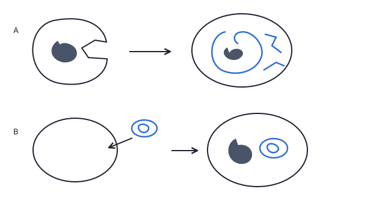
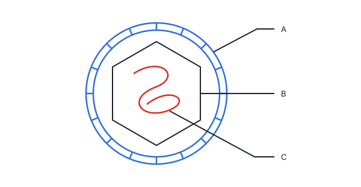

# 생명과학 복습 1105 문제설명

왼쪽 목차로 문항을 고르고, 오른쪽 문제를 보며 해설을 따라가요.

문제의 첫 줄부터 검산까지 설명해요.

**목차**

- [문항별 설명](#problems)
  - [P1. 바이러스의 독립 대사](#p1)
  - [P2. 높은 염분의 서식지](#p2)
  - [P3. 세균 그림과 DNA 형태](#p3)
  - [P4. 산소발생형 광독립영양](#p4)
  - [P5. 산소를 내는 광합성](#p5)
  - [P6. 핵막을 기준으로 구별하기](#p6)
  - [P7. 원인 세균에 맞는 항생제](#p7)
  - [P8. 원핵과 진핵 분류 경계](#p8)
  - [P9. [변형] 아미노산 검출로 어디까지 말할 수 있을까](#p9)
  - [P10. [변형] 정보를 저장하는 분자가 촉매도 한다면](#p10)
  - [P11. [변형] 그림의 두 과정과 공생의 증거](#p11)
  - [P12. [변형] 모여 살기와 역할 나누기](#p12)
  - [P13. [변형] 표에서 에너지와 탄소를 따로 읽기](#p13)
  - [P14. [변형] 빛 없이 이산화탄소로 몸을 만드는 미생물](#p14)
  - [P15. [변형] 바이러스와 세균의 구조 구별](#p15)
  - [P16. [변형] 핵의 유무로 네 무리와 하나를 나누기](#p16)
  - [P17. [변형] 그림 속 세 겹을 구별하기](#p17)
  - [P18. [변형] 방출만 억제하면 무엇이 달라질까](#p18)
  - [P19. [변형] 단순한 구조와 숙주 의존성](#p19)
  - [P20. [변형] 같은 빛을 받아도 산소 결과가 다른 이유](#p20)

## 문항별 설명

### P1. 바이러스의 독립 대사

기출 9강 1 · [원 문제 보기](../%EB%B3%B5%EC%8A%B5%EB%AC%B8%EC%A0%9C_1105_Origin_of_Life_and_Prokaryotes.html#p1)

바이러스(virus)에 대한 설명 중 옳지 않은 것은?

- (1) 생활사에 필요한 에너지를 생산하는 대사시스템을 갖추고 있다
- (2) 외피 또는 캡시드라고 불리는 단백질의 층으로 둘러싸여 있다
- (3) 바이러스의 핵산은 DNA이거나 RNA로 되어 있다
- (4) 바이러스에 감염되면 항생제나 다른 세균감염에 사용되는 치료법으로 효과를 볼 수 없다
- (5) 살아 있는 세포에 감염하는 생물학적 입자를 말한다

기출 원문 보기

기출 9강 합본 1번 (PDF 1쪽)

#### 문제를 먼저 읽어요

각 보기가 바이러스의 실제 성질과 맞는지 판단한 뒤, **옳지 않은 설명을 하나 고르는 문제**예요. 맞는 설명은 내용상 참이어도 이번 문제의 답으로 선택하지 않아요.

#### 이 문제를 봤을 때 떠올릴 개념과 공식

“바이러스”라는 단서에서는 **정보를 가진 입자와 독립적으로 활동하는 세포의 차이**를 떠올려요. 바이러스는 핵산 유전체를 단백질 껍질인 캡시드(capsid)가 감싼 입자예요. 유전체는 종류에 따라 DNA 또는 RNA이고, 독립적으로 에너지를 생산하거나 단백질을 합성할 세포 장치를 갖추지 않아 숙주세포(host cell)에 의존해요.

따라서 대사 장치를 스스로 갖췄다는 주장인지, 기본 구조·감염 대상을 설명한 것인지 나누어 확인해요. 항생제(antibiotic)의 세균 표적과 바이러스 증식 과정도 구별해요.

관련 정리노트: [바이러스의 구조와 숙주 의존성](../%EC%A0%95%EB%A6%AC%EB%85%B8%ED%8A%B8_1105_Origin_of_Life_and_Prokaryotes.html#s3-structure), [항생제와 항바이러스 표적의 차이](../%EC%A0%95%EB%A6%AC%EB%85%B8%ED%8A%B8_1105_Origin_of_Life_and_Prokaryotes.html#s3-infection)

#### 왜 이렇게 푸는지 함께 따라가요

(1) “에너지를 생산하는 대사시스템을 갖추고 있다”는 부분이 틀려요. 바이러스에는 혼자 에너지를 만들어 생활할 독립 대사 체계가 없고, 감염한 세포의 체계를 이용해야 해요. 없는 장치를 있다고 했으므로 부정형 질문의 답으로 선택해요.

(2) “단백질의 층으로 둘러싸여 있다”는 내용은 맞아요. 여기서 캡시드와 함께 쓰인 외피는 단백질 껍질인 coat를 가리켜요. 일부 바이러스에만 있는 지질 외피(envelope)와는 재료가 달라요. 이 문장의 재료가 단백질로 명시되어 있으므로 맞는 구조 설명이며 답에서는 제외해요.

(3) “핵산은 DNA이거나 RNA”는 맞아요. 바이러스의 유전체 종류는 DNA형과 RNA형으로 나뉘므로 둘 중 하나일 수 있다는 표현이 기준과 맞아요. 한 입자에 두 종류가 모두 필요하다는 주장도 아니어서 답에서는 제외해요.

(4) 항생제처럼 세균을 표적으로 하는 치료법이 바이러스 자체에 효과가 없다는 뜻으로 읽으면 맞아요. 세균의 구조·기능을 겨냥한 약이 바이러스의 증식 단계를 그대로 막지는 못해요. 바이러스에 작용하는 항바이러스제가 전혀 없다는 뜻으로 넓혀 읽지 않고 답에서는 제외해요.

(5) “살아 있는 세포에 감염하는 생물학적 입자”는 맞아요. 바이러스는 감염한 세포의 장치를 이용하여 증식하므로, 감염 대상이 살아 있는 세포라는 설명이 숙주 의존성과 맞아요. 따라서 답에서는 제외해요.

따라서 옳지 않은 설명을 고르는 답은 (1)이에요.

#### 완성 답과 검산

답은 (1)이에요. 구조와 숙주 이용을 설명한 (2)·(3)·(5)는 서로 양립하고, 세균 표적 치료와 구별한 (4)도 그 특성과 맞아요. 이 네 보기를 제외하면 독립적인 에너지 생산 장치를 가졌다고 한 (1)이 남아요.

**페이지 요약**

바이러스는 핵산과 단백질 캡시드를 가지지만 독립적인 에너지 생산 대사계는 없어요. 옳지 않은 설명의 답은 (1)이고, (2)의 외피는 단백질 coat라는 문맥으로 읽어요.

---

### P2. 높은 염분의 서식지

기출 9강 3 · [원 문제 보기](../%EB%B3%B5%EC%8A%B5%EB%AC%B8%EC%A0%9C_1105_Origin_of_Life_and_Prokaryotes.html#p2)

어떤 생물이 높은 염분의 물 속에서 살 수 있다고 기록되어 있다. 이 생물은 다음 중 어느 범주에 속할 가능성이 가장 높은가?

- (1) 바이러스
- (2) 동물계
- (3) 고세균영역
- (4) 원생생물계
- (5) 균류

기출 원문 보기

기출 9강 합본 3번 (PDF 1쪽)

#### 문제를 먼저 읽어요

“높은 염분의 물”이 서식지 단서예요. 그 조건과 가장 잘 연결되는 대표적인 생물 범주를 고르면 돼요. 모든 개체의 분류를 염분 하나만으로 확정하라는 질문은 아니에요.

#### 이 문제를 봤을 때 떠올릴 개념과 공식

매우 짠 환경이라는 단서에서 **극호염성(extreme halophily)**을 떠올려요. 염분이 높은 조건에 적응한 대표적인 미생물 무리가 고세균(Archaea)에 있어요. 고세균은 세균과 다른 영역이지만 핵막으로 둘러싸인 핵이 없는 원핵생물이에요.

판단 기준은 보기가 진핵생물이냐는 사실 하나가 아니라, **고염 환경에 적응한 대표 무리를 포함하는 범주인지**예요. 다른 범주에도 염분을 견디는 생물이 있을 수 있으므로 “가능성이 가장 높다”는 비교를 유지해요.

관련 정리노트: [고세균의 서식지와 분류 경계](../%EC%A0%95%EB%A6%AC%EB%85%B8%ED%8A%B8_1105_Origin_of_Life_and_Prokaryotes.html#s2-archaea)

#### 왜 이렇게 푸는지 함께 따라가요

(1) 바이러스는 살아 있는 숙주세포의 장치를 이용하는 입자예요. 높은 염분에서 스스로 생활하는 대표 세포 생물을 찾는 이 비교에서는 극호염성 고세균보다 적합한 범주가 아니므로 제외해요.

(2) 동물계는 핵을 가진 진핵생물의 범주예요. “동물이 전혀 염분을 견디지 못한다”가 아니라, 고염 환경의 대표 미생물 무리라는 단서가 동물계를 가리키지는 않으므로 제외해요.

(3) 고세균영역에는 매우 짠 염호 등에서 자라는 극호염성 무리가 있어요. 지문의 염분 조건이 그 대표 서식 조건과 연결되므로, 주어진 범주 가운데 가장 적합한 답으로 선택해요.

(4) 원생생물계는 전통적으로 핵을 가진 다양한 생물을 묶은 범주예요. 고염 환경의 대표 미생물이라는 이 문제의 단서는 극호염성 고세균에 더 직접적으로 연결되므로 제외해요.

(5) 균류는 진핵생물의 한 무리예요. 일부 균류가 염분을 견딜 수 있더라도, 지문이 요구하는 고염 환경의 전형적 범주를 고르는 비교에서는 고세균영역이 더 적합하므로 제외해요.

따라서 가장 가능성이 높은 범주는 (3) 고세균영역이에요.

#### 완성 답과 검산

답은 (3)이에요. 단서를 거꾸로 확인하면 극호염성 고세균의 대표 서식지는 염분이 매우 높은 물이에요. 다만 이 대응은 가장 그럴듯한 범주를 고르는 근거이지, 짠 곳에 사는 생물은 예외 없이 모두 고세균이라는 증명은 아니에요.

**페이지 요약**

매우 짠 환경과 대표적인 극호염성 고세균을 연결하면 답은 (3)이에요. 서식지 하나가 모든 개체의 분류를 확정하지는 않아요.

---

### P3. 세균 그림과 DNA 형태

기출 9강 4 · [원 문제 보기](../%EB%B3%B5%EC%8A%B5%EB%AC%B8%EC%A0%9C_1105_Origin_of_Life_and_Prokaryotes.html#p3)

위 그림은 특정생물집단의 일반적인 모습을 나타낸 것이다. 그 집단의 설명으로 잘못된 것은?

- (1) 다른 생물집단보다 훨씬 짧은 세대기간을 가지고 있어서 많은 돌연변이가 발생한다
- (2) 일부는 독립영양생물이지만 또 다른 일부는 종속영양생물이기도 하다
- (3) 대부분은 유전체로서 선형의 DNA를 지닌다
- (4) 핵이 아닌 핵과 유사한 핵양체라는 구조를 지닌다
- (5) 일부는 화학영양생물이지만 또 다른 일부는 광영양생물이기도 하다

기출 원문 보기

기출 9강 합본 4번 (PDF 1쪽)

#### 문제를 먼저 읽어요

사진에는 둥근 모양·막대 모양·나선 모양의 세균이 보이고, 그 집단의 특징 중 **잘못된 설명을 고르는 문제**예요.

**문항 결함:** (1)의 “다른 생물집단보다 훨씬 짧다”는 비교 범위가 넓어요. 출제 의도는 전형적인 원핵생물과 진핵생물의 비교이며, 모든 생물 사이의 예외 없는 법칙이나 복제 한 번당 높은 오류율을 뜻하지 않아요.

#### 이 문제를 봤을 때 떠올릴 개념과 공식

사진의 세 모양을 단서로 원핵생물의 구조와 영양방식을 확인해요. 구균(coccus)은 둥글고, 간균(bacillus)은 막대 모양, 나선균(spirillum)은 나선 모양이에요. 이 모양만으로 개별 종의 DNA를 측정한 것은 아니며, 문제는 집단의 전형적인 특징을 묻고 있어요.

구조에서는 **주 염색체의 환형 DNA**와 **핵막 없는 핵양체(nucleoid)**를 확인해요. 영양에서는 탄소원에 따른 독립·종속과 에너지원에 따른 광·화학을 서로 다른 기준으로 적용해요. 세대기간은 같은 시간 동안 생기는 세대·복제 기회와 연결하되, 복제당 돌연변이율과 구별해요.

관련 정리노트: [원핵생물의 DNA·핵양체·세대기간](../%EC%A0%95%EB%A6%AC%EB%85%B8%ED%8A%B8_1105_Origin_of_Life_and_Prokaryotes.html#s2-structure), [에너지원과 탄소원의 두 분류축](../%EC%A0%95%EB%A6%AC%EB%85%B8%ED%8A%B8_1105_Origin_of_Life_and_Prokaryotes.html#s2-nutrition)

#### 왜 이렇게 푸는지 함께 따라가요

(1) 출제 의도상 맞는 쪽으로 읽지만 비교 범위에 주의해야 해요. 원핵생물은 전형적으로 진핵생물보다 세대기간이 짧아, 같은 시간에 복제·변이 발생·선택 기회가 더 많아질 수 있어요. 그렇다고 모든 다른 생물보다 언제나 짧거나 DNA 한 번의 복제당 오류율이 반드시 더 높은 것은 아니에요. 이 한정을 붙여 답에서는 제외해요.

(2) “일부는 독립영양, 또 일부는 종속영양”은 맞아요. CO₂ 같은 무기탄소를 쓰는 종류와 외부 유기물에서 탄소를 얻는 종류가 모두 있으므로 집단 전체의 대사 다양성과 맞아요. 같은 세균 한 개가 두 유형을 반드시 모두 해야 한다는 말이 아니어서 제외해요.

(3) “대부분은 유전체로서 선형 DNA”는 틀려요. 전형적인 세균의 주 염색체는 끝이 연결된 환형 DNA로 설명하므로, 대부분이 선형이라는 관계가 반대예요. 모든 세균에 예외가 없다는 주장 없이도 이 전형적 구조 비교에서 선택할 수 있어요.

(4) “핵이 아닌 … 핵양체”는 맞아요. 핵양체는 DNA가 모인 영역이지만 그 둘레를 핵막이 닫고 있지는 않아요. 핵이 없다는 점과 DNA가 존재한다는 점을 함께 만족하는 구조이므로 제외해요.

(5) “일부는 화학영양, 또 일부는 광영양”은 맞아요. 화학물질의 반응으로 에너지를 얻는 종류와 빛에서 얻는 종류가 모두 있으므로 에너지원에 따른 집단의 다양성과 맞아요. (2)의 탄소원 분류와도 충돌하지 않아 제외해요.

따라서 출제 의도상 잘못된 설명의 답은 (3)이에요. (1)의 넓은 비교 표현은 한정해서 읽어야 해요.

#### 완성 답과 검산

출제 의도상 답은 (3)이에요. 구조 기준으로 다시 묶으면 핵막 없는 핵양체인 (4)와 환형 주 염색체가 서로 맞고, 선형이라고 한 (3)은 그 기준과 어긋나요. (2)와 (5)는 서로 다른 영양 분류축의 다양성을 말해요. 다만 (1)은 전형적인 원핵·진핵 비교라는 한정을 붙일 때 받아들여요. 그래서 (3)은 출제 의도에 따른 답이며, (1)의 넓은 표현까지 아무 제한 없이 옳다고 확정한 것은 아니에요.

#### 헷갈릴 때 이렇게 구별해요

시험에서는 전형적인 세균의 환형 주 염색체를 기준으로 (3)을 고르되, (1)을 “모든 생물보다 세대가 짧고 복제당 오류율도 높다”라고 외우지 않아요. 세대 수 증가와 한 번의 복제 오류율은 서로 다른 비교예요.

**페이지 요약**

출제 의도상 답은 (3): 세균의 주 염색체는 전형적으로 환형이에요. (1)은 원핵·진핵의 전형적 세대기간 비교로 한정하며, 모든 생물 사이의 법칙이나 높은 복제당 오류율은 아니에요.

---

### P4. 산소발생형 광독립영양

기출 9강 11 · [원 문제 보기](../%EB%B3%B5%EC%8A%B5%EB%AC%B8%EC%A0%9C_1105_Origin_of_Life_and_Prokaryotes.html#p4)

__________ 은 산소발생형 광독립영양생물이다.

- (1) 그람음성세균
- (2) 클라미디아
- (3) 남세균
- (4) 프로테오박테리아
- (5) 나선균

기출 원문 보기

기출 9강 합본 11번 (PDF 2쪽)

#### 문제를 먼저 읽어요

빈칸에는 **빛을 이용하고, 스스로 탄소를 고정하며, 산소까지 방출하는** 세균 무리의 이름이 들어가야 해요. 단순히 광합성을 할 수 있다는 조건보다 좁은 질문이에요.

#### 이 문제를 봤을 때 떠올릴 개념과 공식

광독립영양(photoautotrophy)은 두 기준의 조합이에요. 광은 빛이라는 에너지원, 독립은 CO₂ 같은 무기탄소라는 탄소원을 뜻해요. 여기에 “산소발생형”이 붙으면 **물에서 전자를 얻는 과정에서 산소가 나오는지**까지 확인해요.

남세균(cyanobacteria)이 그 대표 무리예요. 물을 쓰지 않는 비산소발생형 광합성과 구별하고, 세포벽을 분류한 이름만으로 대사 유형을 결정하지 않아요.

관련 정리노트: [남세균의 물 이용과 산소 발생](../%EC%A0%95%EB%A6%AC%EB%85%B8%ED%8A%B8_1105_Origin_of_Life_and_Prokaryotes.html#s1-oxygen), [광독립영양의 에너지원·탄소원](../%EC%A0%95%EB%A6%AC%EB%85%B8%ED%8A%B8_1105_Origin_of_Life_and_Prokaryotes.html#s2-nutrition)

#### 왜 이렇게 푸는지 함께 따라가요

(1) 그람음성세균은 세포벽·외막의 특징과 염색 결과에 따라 묶는 범주예요. 그 이름만으로 빛·CO₂·산소 방출이라는 대사 조건을 모두 정할 수는 없으므로 빈칸의 대표 명칭으로는 부적합해요. 그람음성 세균 중에는 광합성 종류가 전혀 없다는 뜻은 아니에요.

(2) 클라미디아는 숙주세포 안에서 증식하는 세균이에요. 지문의 산소발생형 광독립영양이라는 대사 특징을 대표하는 무리가 아니므로 부적합해요. 세포 내 기생이라는 생활 방식과 광합성의 재료·산물을 구별해요.

(3) 남세균은 빛을 에너지원으로, CO₂를 탄소원으로 이용하며 물에서 전자를 얻을 때 산소를 방출해요. 광·독립·산소발생형의 세 조건을 모두 연결할 수 있어 빈칸에 적합해요.

(4) 프로테오박테리아는 여러 대사를 포함하는 큰 무리예요. 일부 광합성 종류가 있다는 것만으로 이 무리 전체를 산소발생형 광독립영양이라는 빈칸과 동일시할 수 없어요. 이 조건을 대표하는 명칭은 남세균이므로 제외해요.

(5) 나선균은 이 비교에서 산소발생형 광독립영양을 대표하는 무리가 아니에요. 나선이라는 모양·분류 단서가 물 이용과 산소 방출이라는 대사 기준을 대신하지 못하므로 제외해요.

따라서 빈칸의 답은 (3) 남세균이에요.

#### 완성 답과 검산

답은 (3)이에요. 남세균을 넣고 세 조건을 다시 읽으면 빛에서 에너지 획득, CO₂에서 탄소 획득, 물 분해에서 산소 방출이 모두 맞아요. 다른 보기의 세포벽 분류·기생 생활·큰 분류군·모양 정보만으로는 이 세 조건을 대표하는 이름이 정해지지 않아요.

**페이지 요약**

광은 에너지원, 독립은 탄소원, 산소발생은 물 분해를 확인해요. 세 조건을 만족하는 대표 무리는 (3) 남세균이에요.

---

### P5. 산소를 내는 광합성

기출 9강 13 · [원 문제 보기](../%EB%B3%B5%EC%8A%B5%EB%AC%B8%EC%A0%9C_1105_Origin_of_Life_and_Prokaryotes.html#p5)

진정세균영역영역의 분류군 중에서 산소를 발생시키는 광합성을 수행하는 것은?

- (1) 남세균
- (2) 녹색세균
- (3) 그람양성세균
- (4) 프로테오박테리아
- (5) 나선균

기출 원문 보기

기출 9강 합본 13번 (PDF 2쪽)

#### 문제를 먼저 읽어요

세균 무리 가운데 **산소를 발생시키는 광합성**을 대표하는 이름을 골라요.

**문항 결함:** 원문 발문의 “진정세균영역영역”은 “영역”을 두 번 쓴 중복 오기예요. 별도의 분류 이름이 아니라 진정세균영역의 분류군을 묻는 말로 읽어요.

#### 이 문제를 봤을 때 떠올릴 개념과 공식

“산소를 발생시키는 광합성”에서는 빛을 받는다는 사실보다 **전자를 어디서 얻는지**를 확인해요. 남세균은 물을 전자공여체(electron donor)로 쓰고, 명반응에서 물을 분해할 때 산소를 내놓아요. 반면 수업에서 든 녹색세균은 황을 포함하는 다른 재료를 이용하는 비산소발생형 광합성의 예예요.

따라서 광합성 여부만 같다고 묶지 말고, 물 이용과 산소 방출의 연결로 두 유형을 나누어요.

관련 정리노트: [물을 쓰는 광합성과 산소 발생](../%EC%A0%95%EB%A6%AC%EB%85%B8%ED%8A%B8_1105_Origin_of_Life_and_Prokaryotes.html#s1-oxygen), [녹색세균과 남세균의 비교](../%EC%A0%95%EB%A6%AC%EB%85%B8%ED%8A%B8_1105_Origin_of_Life_and_Prokaryotes.html#s2-groups)

#### 왜 이렇게 푸는지 함께 따라가요

(1) 남세균은 물을 전자공여체로 사용하며 물의 분해에서 산소를 방출해요. 지문이 묻는 산소발생형 광합성의 대표 무리에 해당하므로 선택해요.

(2) 녹색세균은 광합성을 하지만, 수업에서 든 예는 물 대신 황을 포함하는 물질을 이용하는 비산소발생형이에요. 빛을 쓴다는 공통점만으로 산소가 나오는 것은 아니므로 이 질문의 답에서는 제외해요.

(3) 그람양성세균은 그람 염색과 세포벽 특징을 기준으로 나눈 이름이에요. 그 분류 기준은 물을 이용하여 산소를 내는 광합성의 기준과 다르고, 수업에서도 그 산소발생형 대표로 제시한 무리가 아니므로 제외해요.

(4) 프로테오박테리아에는 다양한 대사를 하는 세균이 포함돼요. 큰 무리에 광합성 사례가 포함된다는 사실과, 산소발생형을 대표하는 특정 무리라는 판단은 달라요. 이 비교에서 물 유래 산소 방출에 대응하는 답은 남세균이므로 제외해요.

(5) 나선균이라는 이름은 이 질문이 요구한 산소발생형 광합성의 대표가 아니에요. 나선 모양의 존재를 물 분해라는 대사 과정의 증거로 바꿀 수 없으므로 제외해요.

따라서 산소발생형 광합성 무리를 고르는 답은 (1) 남세균이에요.

#### 완성 답과 검산

답은 (1)이에요. 가장 헷갈리는 (2)와 비교해도 남세균은 물을 쓰며 산소를 내고, 수업의 녹색세균 예는 다른 전자공여체를 써 산소를 내지 않는다는 차이가 남아요. 발문의 “영역영역”이라는 중복 오기는 이 물질·산물의 판단을 바꾸지 않아요.

#### 헷갈릴 때 이렇게 구별해요

중복된 “영역영역”을 새로운 분류 용어로 외우지 않아요. 실제 시험에서는 진정세균영역의 무리를 묻는 말로 읽고, 산소 발생을 물의 분해와 연결해 선택해요.

**페이지 요약**

원문의 “영역영역”은 중복 오기예요. 산소발생형은 물을 전자공여체로 쓰는지 판단하며 답은 (1) 남세균이에요. 광합성 세균이 모두 산소를 내는 것은 아니에요.

---

### P6. 핵막을 기준으로 구별하기

기출 9강 18 · [원 문제 보기](../%EB%B3%B5%EC%8A%B5%EB%AC%B8%EC%A0%9C_1105_Origin_of_Life_and_Prokaryotes.html#p6)

원핵생물과 진핵생물의 차이점은 무엇인가?

- (1) 원핵생물은 단일 세포이지만 진핵생물은 다세포이다
- (2) 원핵생물은 분리된 DNA를 갖는 핵을 가지지 않는다
- (3) 원핵생물은 질병을 야기시키지만 진핵생물은 그렇지 않다
- (4) 원핵생물은 DNA가 없다
- (5) 원핵생물은 리보솜을 가지지 않지만 진핵생물은 가지고 있다

기출 원문 보기

기출 9강 합본 18번 (PDF 2쪽)

#### 문제를 먼저 읽어요

원핵생물과 진핵생물을 안정적으로 구별하는 특징을 골라요. DNA가 있느냐가 아니라 **DNA가 핵막 안에 분리되어 있느냐**를 비교하는 문제예요.

#### 이 문제를 봤을 때 떠올릴 개념과 공식

원핵(prokaryote)과 진핵(eukaryote)을 비교한다는 단서에서는 **핵막으로 둘러싸인 핵의 유무**를 확인해요. 원핵세포에도 DNA는 있지만 핵막 없이 핵양체(nucleoid) 영역에 모여 있어요. 진핵세포는 핵막이 핵의 DNA와 세포질을 구분해요.

리보솜(ribosome)은 단백질을 합성하는 구조로 두 세포 유형에 모두 있어요. 단세포·다세포 여부나 질병을 일으키는지는 핵막 유무와 별개의 기준이에요. 따라서 세포 수나 병원성으로 핵의 분류를 대신하지 않아요.

관련 정리노트: [핵양체와 진핵·원핵의 구별](../%EC%A0%95%EB%A6%AC%EB%85%B8%ED%8A%B8_1105_Origin_of_Life_and_Prokaryotes.html#s2-structure), [진핵세포의 핵막과 소기관](../%EC%A0%95%EB%A6%AC%EB%85%B8%ED%8A%B8_1105_Origin_of_Life_and_Prokaryotes.html#s1-endosymbiosis)

#### 왜 이렇게 푸는지 함께 따라가요

(1) 원핵생물이 단세포라는 점을 진핵생물은 모두 다세포라는 주장과 묶어 놓았어요. 진핵생물에도 단세포가 있으므로 이 대조는 전체 진핵생물에 적용되지 않아요. 세포 수를 핵막 유무의 대신 기준으로 쓸 수 없어 틀린 설명이며 선택하지 않아요.

(2) “분리된 DNA를 갖는 핵을 가지지 않는다”는 표현은 DNA를 핵막 안에 따로 보관하는 핵이 없다는 뜻이에요. 원핵세포의 DNA는 핵양체에 있으므로 핵 부재와 DNA 존재가 함께 성립해요. 핵막 유무라는 구별 기준에 맞는 설명이어서 선택해요.

(3) 원핵생물은 질병을 일으키고 진핵생물은 그렇지 않다는 대조는 틀려요. 예를 들어 유산균처럼 유익하게 이용하는 원핵생물도 있어 원핵생물 전체를 병원성으로 묶을 수 없어요. 질병 여부는 핵막 유무와 다른 성질이므로 제외해요.

(4) “원핵생물은 DNA가 없다”는 설명은 틀려요. 없는 것은 DNA를 둘러싼 핵막이고, DNA 자체는 핵양체에 존재해요. 구조의 경계가 없는 것과 그 안에 있을 물질이 없는 것을 혼동했으므로 제외해요.

(5) 원핵생물에 리보솜이 없다는 설명은 틀려요. 원핵세포도 단백질을 만들어야 하므로 리보솜을 가져요. 진핵세포에도 있다는 사실만 맞고 원핵에는 없다는 대조가 성립하지 않아 제외해요.

따라서 원핵·진핵의 차이를 올바르게 설명한 답은 (2)예요.

#### 완성 답과 검산

답은 (2)예요. 원핵세포의 구성물을 따로 세어도 DNA와 리보솜은 둘 다 존재하므로 (4)·(5)는 제외돼요. 단세포 진핵생물과 유익한 세균이라는 반례는 (1)·(3)의 대조를 깨뜨려요. 남은 (2)는 DNA를 둘러싼 핵막의 부재를 설명해요.

**페이지 요약**

원핵·진핵은 핵막으로 둘러싸인 핵의 유무로 구별하므로 답은 (2)예요. 원핵세포에도 DNA와 리보솜이 있고, 진핵생물이 모두 다세포인 것은 아니에요.

---

### P7. 원인 세균에 맞는 항생제

기출 9강 20 · [원 문제 보기](../%EB%B3%B5%EC%8A%B5%EB%AC%B8%EC%A0%9C_1105_Origin_of_Life_and_Prokaryotes.html#p7)

항생제를 사용하거나 처방할 때의 최선의 선택은?

- (1) 처방 받은 약이 아직 남아있는데도 상태가 좋아졌다고 느껴지면 항생제의 투약을 멈춘다
- (2) ‘항균’으로 표시된 비누를 고른다
- (3) 문제를 일으킨 세균의 종류를 확인 후 그에 맞게 처방한다
- (4) 현재 앓고 있지 않은 감염이라 할지라도 예방하기 위해 약을 처방 받고 투여한다
- (5) 원래 사용하던 양이 효과가 없을 때 투약량을 계속해서 증가시킨다

기출 원문 보기

기출 9강 합본 20번 (PDF 3쪽)

#### 문제를 먼저 읽어요

항생제를 선택하거나 사용하는 여러 행동 중 **원인 세균을 겨냥하는 합리적인 기준에 맞는 선택**을 찾아요. 개인의 처방을 바꾸는 지침을 만드는 문제가 아니라, 제시된 선택들의 근거를 비교하는 문제예요.

#### 이 문제를 봤을 때 떠올릴 개념과 공식

항생제(antibiotic)는 세균을 죽이거나 생장을 억제하지만 모든 세균과 모든 약의 조합에서 효과가 같지는 않아요. 따라서 **문제를 일으킨 세균과 약의 효과를 맞추는지**를 판단 기준으로 삼아요.

세균 집단에 내성 차이가 있으면 약에 견딘 세균이 상대적으로 살아남고 증식하여 비율이 높아질 수 있어요. 이것이 자연선택(natural selection)이므로, 효과를 확인하지 않은 노출이나 자의적인 사용 변화가 원인 확인을 대신하지 못해요. 실제 사용은 처방한 의료진의 지시에 따르는 조건으로 읽어요.

관련 정리노트: [항생제의 표적 선택과 내성의 자연선택](../%EC%A0%95%EB%A6%AC%EB%85%B8%ED%8A%B8_1105_Origin_of_Life_and_Prokaryotes.html#s2-toxins)

#### 왜 이렇게 푸는지 함께 따라가요

(1) “상태가 좋아졌다고 느끼면 멈춘다”는 행동은 증상의 느낌만을 기준으로 해요. 원인 세균에 맞춘 치료나 처방된 사용 방법을 확인하는 기준이 아니므로 이 문제의 최선의 선택으로는 부적합해요. 중단 여부를 스스로 결정하라는 뜻으로 읽지 않아요.

(2) 항균 비누를 고르는 것은 생활용품의 표시를 확인하는 행동이에요. 어떤 세균이 감염을 일으켰고 어떤 항생제가 적합한지 정하는 과정은 아니므로, 항생제 처방의 최선 기준을 묻는 답으로는 부적합해요.

(3) “세균의 종류를 확인 후 그에 맞게 처방한다”는 행동은 원인을 확인하고 그 세균에 맞는 약을 선택한다는 기준과 직접 맞아요. 일률적인 투여나 양의 증가보다 표적과 효과를 확인하는 선택이므로 가장 적합해요.

(4) 현재 원인 감염을 확인하지 않고 예방만을 이유로 약을 받겠다는 선택은 이 문항에서 적절한 표적 치료의 기준이 아니에요. 불필요한 약물 노출도 내성 선택에 연결될 수 있어 부적합해요. 의학적으로 적응증이 있는 예방 투여까지 모두 잘못이라는 뜻은 아니에요.

(5) 효과가 없을 때 양을 계속 늘리는 행동은 원인이나 약에 대한 반응을 다시 확인하지 않아요. 양의 증가 자체가 맞는 세균 표적을 보장하지 못하므로 부적합해요. 임의 증량 대신 처방한 의료진의 판단을 따르는 조건과 구별해요.

따라서 제시된 행동 가운데 가장 적합한 답은 (3)이에요.

#### 완성 답과 검산

답은 (3)이에요. 다섯 선택에서 “원인을 확인하고 그에 맞는 약을 고르는 단계가 있는가”만 다시 확인하면 (3)에만 그 연결이 명시되어 있어요. 다른 보기는 증상 느낌·상품 표시·막연한 예방·양의 증가를 그 기준 대신 사용해요. 이 소거는 필요한 예방요법이나 개별 처방 자체를 부정하지 않아요.

**페이지 요약**

원인 세균과 약의 효과를 맞추는 기준에 가장 적합한 답은 (3)이에요. 임의 중단·증량이 그 기준을 대신하지 않으며, 필요한 예방 투여 전체를 부정하는 문제는 아니에요.

---

### P8. 원핵과 진핵 분류 경계

기출 9강 23 · [원 문제 보기](../%EB%B3%B5%EC%8A%B5%EB%AC%B8%EC%A0%9C_1105_Origin_of_Life_and_Prokaryotes.html#p8)

아래 그룹 중에서, 다른 그룹들과 비교하여 가장 다른 그룹은 무엇인가?

- (1) 고세균영역
- (2) 원생생물
- (3) 동물계
- (4) 식물계
- (5) 균류

기출 원문 보기

기출 9강 합본 23번 (PDF 3쪽)

#### 문제를 먼저 읽어요

보기 다섯 집단을 같은 기준으로 나누어, 나머지 넷과 다른 한 집단을 골라요. 이 비교에서는 **핵막으로 둘러싸인 핵이 있는지**가 네 집단과 한 집단을 가르는 기준이에요.

#### 이 문제를 봤을 때 떠올릴 개념과 공식

고세균영역과 전통적인 네 진핵생물 집단이 나란히 제시되었으므로 원핵(prokaryote)·진핵(eukaryote)의 경계를 떠올려요. 고세균은 핵막이 없는 원핵생물이에요. 원생생물·동물·식물·균류는 이 수업의 전통적인 분류에서 모두 진핵생물로 다뤄요.

“영역”과 “계”라는 이름 끝의 글자만 비교하지 말고, 각 집단의 세포가 핵막을 가지는지 확인해요. 세포가 하나인지 여럿인지나 병을 일으키는지는 이 비교의 공통 기준이 아니에요.

관련 정리노트: [세 영역과 전통적 진핵생물 집단의 경계](../%EC%A0%95%EB%A6%AC%EB%85%B8%ED%8A%B8_1105_Origin_of_Life_and_Prokaryotes.html#s2-archaea)

#### 왜 이렇게 푸는지 함께 따라가요

(1) 고세균영역은 핵막으로 둘러싸인 핵이 없는 원핵생물이에요. 다른 네 집단은 이 비교에서 핵을 가진 진핵생물이므로, 핵막 유무의 기준에서 혼자 다른 집단으로 선택해요.

(2) 원생생물은 전통적인 분류에서 진핵생물에 속해요. 핵막을 가진다는 기준이 동물·식물·균류와 같으므로 나머지 넷 중 혼자 다른 집단의 답은 아니에요.

(3) 동물계는 진핵생물에 속해 핵막으로 구분된 핵을 가져요. 이 성질은 원생생물·식물·균류와 같고 고세균과 다르므로 선택하지 않아요.

(4) 식물계 역시 진핵생물 집단이에요. 광합성 여부를 기준으로 새로 나누는 문제가 아니라 핵막 유무를 공통 기준으로 삼으므로, 다른 진핵 세 집단과 함께 묶여 선택하지 않아요.

(5) 균류도 핵막을 가진 진핵생물이에요. 세포 수나 먹이 획득 방식이 다른 보기와 다를 수 있어도, 지금 적용한 핵막 기준에서는 세 진핵 집단과 같으므로 선택하지 않아요.

따라서 핵막 유무로 네 집단과 구별되는 답은 (1) 고세균영역이에요.

#### 완성 답과 검산

답은 (1)이에요. 핵막이 없는 쪽에는 고세균영역 하나가, 핵막이 있는 쪽에는 원생생물·동물·식물·균류 네 집단이 놓여요. 같은 기준으로 나눈 결과가 1 대 4이므로 선택을 확인할 수 있어요.

**페이지 요약**

핵막 유무라는 같은 기준을 적용하면 고세균만 원핵생물이고 나머지 네 집단은 진핵생물이에요. 따라서 답은 (1)이에요.

---

### P9. [변형] 아미노산 검출로 어디까지 말할 수 있을까

생성 변형 s0-miller · [원 문제 보기](../%EB%B3%B5%EC%8A%B5%EB%AC%B8%EC%A0%9C_1105_Origin_of_Life_and_Prokaryotes.html#p9)

연구자가 밀러-유레이 실험을 본떠 수소·메탄·암모니아·수증기를 넣고 방전과 냉각을 반복했어요. 실험 뒤 **아미노산 검출**은 확인했지만 세포 구조나 자기 복제는 확인하지 못했어요. 결과에 대한 해석으로 옳지 않은 것을 골라요.

- (1) 특정 조건에서 생체 유기물이 비생물적으로 합성될 가능성을 보여 줘요.
- (2) 실험에서 얻은 작은 분자가 세포의 구성 재료가 될 수 있어요.
- (3) 살아 있는 세포의 기원을 설명하려면 막 형성과 복제 같은 추가 단계를 검토해야 해요.
- (4) 아미노산이 검출되었으므로 살아 있는 최초의 세포를 만든 것이 확실해요.
- (5) 실험의 기체 조성과 에너지 공급 조건을 결과 해석에 함께 고려해야 해요.

기출 원문 보기

원문 기출이 아닌 생성 변형이에요. 다루는 혼동: 아미노산 검출로 어디까지 말할 수 있을까. 근거 토픽: [s0-miller](../%EC%A0%95%EB%A6%AC%EB%85%B8%ED%8A%B8_1105_Origin_of_Life_and_Prokaryotes.html#s0-miller).

#### 문제를 먼저 읽어요

확인한 것은 아미노산이고, 확인하지 못한 것은 세포 구조와 자기 복제예요. 이 증거의 범위를 넘어선 **옳지 않은 해석을 고르는 문제**예요.

#### 이 문제를 봤을 때 떠올릴 개념과 공식

실험 결과를 묻는 단서에서는 **직접 검출한 물질**과 **그 결과로 말할 수 있는 범위**를 먼저 나누어요. 아미노산(amino acid)은 단백질을 만드는 작은 재료예요. 재료가 생겼다는 사실은 막으로 구획되고 유전정보를 복제하는 세포가 생겼다는 사실보다 좁아요.

판단 기준은 “이 결론에 필요한 관찰을 실제로 했는가”예요. 밀러-유레이 실험은 특정 기체 조성과 에너지 공급 조건에서 유기물의 비생물적 합성 가능성을 보여 줘요. 넣은 메탄도 유기물이므로 모든 입력이 무기물이었다고 바꾸어 설명하지 않아요.

관련 정리노트: [밀러-유레이 실험의 측정 결과와 결론 한계](../%EC%A0%95%EB%A6%AC%EB%85%B8%ED%8A%B8_1105_Origin_of_Life_and_Prokaryotes.html#s0-miller), [생명 재료와 원시세포의 차이](../%EC%A0%95%EB%A6%AC%EB%85%B8%ED%8A%B8_1105_Origin_of_Life_and_Prokaryotes.html#s0-protocell)

#### 왜 이렇게 푸는지 함께 따라가요

(1) 비생물적 합성의 “가능성”을 보여 준다는 해석은 맞아요. 생물을 넣어 키운 결과가 아니라 주어진 혼합물·방전·냉각 조건에서 아미노산을 얻었으므로, 생물 없이 재료가 만들어질 수 있다는 범위의 결론이에요. 부정형의 답에서는 제외해요.

(2) 얻은 작은 분자가 세포의 재료가 될 수 있다는 해석은 맞아요. 아미노산은 단백질의 구성 재료이므로 생명 재료와 연결할 근거가 있어요. 재료가 곧 완성된 세포라는 주장이 아니어서 제외해요.

(3) 막 형성과 복제 같은 추가 단계를 검토해야 한다는 해석은 맞아요. 지문에서 그 단계는 확인하지 못했다고 했으므로, 살아 있는 세포의 기원까지 설명하려면 아직 검토할 조건이 남아요. 증거의 빈틈을 인정한 설명이어서 제외해요.

(4) 아미노산 검출만으로 “살아 있는 최초의 세포를 만든 것이 확실하다”는 해석은 틀려요. 세포 구조와 자기 복제는 확인하지 못했으므로, 그 결론에 필요한 증거가 빠져 있어요. 재료의 합성을 세포의 완성으로 확대한 주장이므로 답으로 선택해요.

(5) 기체 조성과 에너지 공급 조건을 함께 고려해야 한다는 해석은 맞아요. 이 결과는 그 조건에서 얻었으므로, 어떤 조건에서도 같은 결과가 난다거나 실제 과거 대기 전체가 그 조성이었다고 넓힐 수 없어요. 결론의 성립 조건을 남긴 설명이어서 제외해요.

따라서 증거의 범위를 넘은 해석, 즉 옳지 않은 설명의 답은 (4)예요.

#### 완성 답과 검산

답은 (4)예요. 결론에서 필요한 증거를 거꾸로 확인하면, (4)의 “살아 있는 세포”에는 막으로 된 구조와 복제 체계 같은 추가 관찰이 필요해요. 지문은 이를 확인하지 못했다고 명시했어요. 나머지 보기들은 재료·가능성·추가 과제·조건의 수준에 머물러 결과와 충돌하지 않아요.

**페이지 요약**

검출한 아미노산과 확인하지 못한 세포·복제를 구별해요. 재료 검출만으로 살아 있는 세포의 완성을 확정한 (4)가 옳지 않은 해석이에요.

---

### P10. [변형] 정보를 저장하는 분자가 촉매도 한다면

생성 변형 s0-rna · [원 문제 보기](../%EB%B3%B5%EC%8A%B5%EB%AC%B8%EC%A0%9C_1105_Origin_of_Life_and_Prokaryotes.html#p10)

초기 생명에서 유전정보를 읽어 촉매 단백질을 만들려면 이미 복잡한 합성 장치가 필요하다는 문제가 있어요. 그런데 어떤 RNA는 정보를 담는 동시에 화학 반응을 촉매해요. 이 발견이 RNA 우선 가설을 지지하는 이유로 가장 알맞은 것을 골라요.

- (1) RNA가 촉매 기능을 가지므로 초기 생명에는 유전정보가 전혀 필요하지 않았기 때문이에요.
- (2) 하나의 분자 종류가 정보와 촉매 역할을 함께 맡을 수 있어 단백질 촉매가 먼저 있어야 한다는 부담을 줄이기 때문이에요.
- (3) 촉매성 RNA의 발견만으로 현대 세포 전체를 실험실에서 완성했기 때문이에요.
- (4) 리보자임은 RNA를 감싼 단백질 껍질이므로 단백질 우선 가설만 지지하기 때문이에요.
- (5) 현재 모든 생물의 유전정보가 DNA 없이 RNA에만 저장되기 때문이에요.

기출 원문 보기

원문 기출이 아닌 생성 변형이에요. 다루는 혼동: 정보를 저장하는 분자가 촉매도 한다면. 근거 토픽: [s0-rna](../%EC%A0%95%EB%A6%AC%EB%85%B8%ED%8A%B8_1105_Origin_of_Life_and_Prokaryotes.html#s0-rna).

#### 문제를 먼저 읽어요

먼저 복잡한 단백질 합성 장치가 있어야 한다는 시작의 문제와, 일부 RNA가 정보·촉매 두 역할을 한다는 발견을 연결해요. RNA 우선 가설을 **지지하는 이유**를 고르며, 가설 전체를 증명했다는 주장을 고르는 것은 아니에요.

#### 이 문제를 봤을 때 떠올릴 개념과 공식

정보를 저장하는 일과 반응을 돕는 일은 다른 역할이에요. RNA는 염기서열에 정보를 담을 수 있고, 일부 RNA는 반응 속도를 높이는 촉매(catalyst)로 작용해요. 촉매 기능을 가진 RNA가 리보자임(ribozyme)이에요.

**한 종류의 분자가 두 역할을 함께 할 수 있다면** 처음부터 별도의 단백질 촉매와 그 단백질을 만들 복잡한 체계가 모두 완성되어 있어야 한다는 부담이 줄어들어요. 이것이 RNA 우선 가설의 실마리예요. 두 기능이 가능하다는 근거와 완전한 자기 복제·현대 세포 전체의 재현은 구별해서 판단해요.

관련 정리노트: [RNA의 정보·촉매 기능과 시작의 문제](../%EC%A0%95%EB%A6%AC%EB%85%B8%ED%8A%B8_1105_Origin_of_Life_and_Prokaryotes.html#s0-rna)

#### 왜 이렇게 푸는지 함께 따라가요

(1) “유전정보가 전혀 필요하지 않았다”는 이유는 맞지 않아요. RNA의 촉매 기능은 반응을 돕는 능력이고, 무엇을 복제하고 전달할지라는 정보의 역할을 없애지는 않아요. 지문은 정보와 촉매를 함께 맡는 가능성을 말하므로 제외해요.

(2) “정보와 촉매 역할을 함께 맡아 … 부담을 줄인다”는 이유는 적합해요. RNA 자체가 정보와 반응 촉진을 연결할 수 있으면, 촉매를 단백질로만 먼저 마련해야 하는 문제가 완화돼요. 발견된 두 기능이 가설의 시작 문제를 어떻게 돕는지 설명하므로 선택해요.

(3) “현대 세포 전체를 실험실에서 완성했다”는 이유는 맞지 않아요. 관찰은 촉매성 RNA의 존재이지 막·대사·정보 전달을 모두 갖춘 현대 세포의 완성이 아니에요. 지지 근거를 완전한 재현으로 확대한 주장이므로 제외해요.

(4) 리보자임을 “RNA를 감싼 단백질 껍질”이라고 한 정의부터 틀려요. 리보자임은 RNA 자체가 촉매로 작용하는 경우예요. 단백질 껍질의 존재를 근거로 단백질 우선 가설만 지지하는 발견이 아니므로 제외해요.

(5) “현재 모든 생물의 유전정보가 DNA 없이 RNA에만 저장된다”는 주장은 틀려요. 현재 세포 생물의 주된 장기 유전정보 저장물질은 DNA예요. 초기 RNA의 가능성에 관한 가설과 현재 세포의 정보 저장 방식을 같은 것으로 바꿨으므로 제외해요.

따라서 RNA 우선 가설을 지지하는 이유의 답은 (2)예요.

#### 완성 답과 검산

답은 (2)예요. 출발 문제인 “단백질 촉매를 만들 복잡한 체계가 먼저 필요하다”에 돌아가 보면, 별도의 단백질이 없어도 RNA가 촉매 역할을 할 수 있다는 점이 부담을 줄여요. (2)만 이 문제와 발견을 직접 연결해요. 나머지는 정보를 없애거나, 관찰 범위를 넘거나, RNA의 정의·현재 저장물질을 바꾸어요.

**페이지 요약**

RNA의 정보 저장과 리보자임의 촉매 기능을 연결하면 답은 (2)예요. 초기 체계의 시작 부담을 줄이는 근거이며 완전한 세포나 자동 자기 복제의 입증은 아니에요.

---

### P11. [변형] 그림의 두 과정과 공생의 증거

생성 변형 s1-endosymbiosis · [원 문제 보기](../%EB%B3%B5%EC%8A%B5%EB%AC%B8%EC%A0%9C_1105_Origin_of_Life_and_Prokaryotes.html#p11)

그림은 세포 내부 구조가 생기는 서로 다른 두 모형 A, B를 보여 줘요. 어떤 소기관에서 별도의 환형 DNA와 세균형 리보솜이 발견되었어요. 그림과 이 증거를 연결한 설명으로 가장 알맞은 것을 골라요.

*두 모형의 경계와 작은 구조가 이동한 경로를 읽어요.*

- (1) A는 별도의 세균이 들어오는 과정이며 환형 DNA는 A만 지지해요.
- (2) B는 세포 경계가 안으로 접히기만 하는 과정이며 별도의 생물은 관여하지 않아요.
- (3) B는 별도의 세균이 들어와 남는 과정이며 그 소기관의 환형 DNA와 세균형 리보솜은 세포내공생설을 지지해요.
- (4) A에서 생긴 내부막은 모두 독립 세균이었으므로 자체 환형 DNA를 반드시 가져요.
- (5) A와 B는 모두 세포막의 접힘만 나타내므로 소기관의 기원을 구별할 수 없어요.

기출 원문 보기

원문 기출이 아닌 생성 변형이에요. 다루는 혼동: 그림의 두 과정과 공생의 증거. 근거 토픽: [s1-endosymbiosis](../%EC%A0%95%EB%A6%AC%EB%85%B8%ED%8A%B8_1105_Origin_of_Life_and_Prokaryotes.html#s1-endosymbiosis).

#### 문제가 무엇을 묻는지 읽어요

그림의 경계가 어떻게 바뀌는지 읽은 뒤, 별도 환형 DNA와 세균형 리보솜이라는 두 관찰을 어느 과정에 연결할지 판단해요.

#### 이 문제를 봤을 때 떠올릴 개념과 공식

막의 함입(invagination)은 원래 세포막이 안으로 접혀 내부막이 되는 과정이에요. 세포내공생(endosymbiosis)은 따로 살던 세균이 다른 세포 안에 들어와 소화되지 않고 함께 살아가는 과정이에요. 따라서 그림에서는 **기존 경계의 접힘인지, 바깥의 별도 세포가 들어오는지**를 먼저 확인해요.

환형 DNA(circular DNA)는 끝이 이어진 고리 모양 DNA예요. 미토콘드리아·엽록체의 자체 환형 DNA와 세균형 리보솜(ribosome)은 독립 세균의 흔적으로 해석할 수 있어요. 단순히 막이 있다는 사실보다 이 두 성질을 함께 가진다는 것이 세균 기원을 더 직접적으로 지지해요.

관련 정리노트: [막 함입과 세포내공생의 구별](../%EC%A0%95%EB%A6%AC%EB%85%B8%ED%8A%B8_1105_Origin_of_Life_and_Prokaryotes.html#s1-endosymbiosis)

#### 왜 이렇게 푸는지 함께 따라가요

(1) A를 별도 세균의 진입으로 읽은 부분이 틀려요. A의 왼쪽 세포에서는 경계선 자체가 안으로 접히고, 오른쪽에는 내부막이 생겨요. 바깥의 별도 세균이 들어오는 B와 다르므로 환형 DNA가 A만 지지한다는 연결도 성립하지 않아요.

(2) B를 경계의 접힘만으로 설명한 부분이 틀려요. B에서는 큰 세포 바깥의 작은 타원 구조가 화살표를 따라 안으로 들어오고, 오른쪽 세포 안에도 작은 타원 구조가 남아 있어요. 별도 세포의 유입을 생략할 수 없어요.

(3) 그림과 증거를 모두 맞게 연결해요. B의 바깥 세균이 들어와 남는 모습은 공생 모형이고, 들어온 세균의 흔적으로 해석할 수 있는 자체 환형 DNA와 세균형 리보솜이 그 모형을 지지해요. 따라서 이 설명이 답으로 적합해요.

(4) A의 내부막을 모두 독립 세균으로 본 전제가 틀려요. A는 기존 세포막의 접힘이므로 내부막마다 세균의 유전체가 새로 생겨야 할 이유가 없어요. 실제로 핵막·소포체를 미토콘드리아·엽록체처럼 자체 환형 DNA를 가진 구조로 취급하지 않아요.

(5) 두 그림 모두 막 접힘뿐이라는 설명이 틀려요. A에는 경계의 접힘이, B에는 별도 작은 세포의 유입이 그려져 있어요. 두 모형은 구별되며, 제시된 DNA·리보솜 증거는 B에 더 직접적으로 대응해요.

따라서 답은 (3)이에요.

#### 완성 답과 검산

다른 기원 모형에 증거를 바꾸어 대입해 봐요. 막의 접힘만으로는 세균과 닮은 별도 유전체·리보솜을 함께 설명하기 어렵지만, 세균의 유입과 공생은 두 단서를 함께 설명해요. 그림 경로와 분자 증거를 모두 만족하는 보기는 (3)이에요.

**페이지 요약**

기준: 경계의 접힘과 별도 세균의 진입을 구별하고 자체 환형 DNA·세균형 리보솜을 연결해요. 결론: 공생 모형 B를 지지하므로 답은 (3)이에요.

---

### P12. [변형] 모여 살기와 역할 나누기

생성 변형 s1-multicell · [원 문제 보기](../%EB%B3%B5%EC%8A%B5%EB%AC%B8%EC%A0%9C_1105_Origin_of_Life_and_Prokaryotes.html#p12)

세포 집단 X에서는 비슷한 세포들이 모여 살며 모두 같은 일을 해요. 집단 Y에서는 일부 세포는 수축하고 다른 세포는 자극을 전달하도록 구조와 기능이 특수화되었어요. 두 집단을 비교한 설명으로 가장 알맞은 것을 골라요.

- (1) Y는 세포의 분화와 역할 분담을 보여 주며, 단순히 모여 사는 X보다 분화한 다세포체의 특징이 뚜렷해요.
- (2) X와 Y 모두 세포 수가 많으므로 분화 정도와 관계없이 완전히 같은 조직 구성을 가져요.
- (3) Y의 서로 다른 세포는 기능이 다르므로 반드시 서로 다른 종이에요.
- (4) X는 여러 세포가 모였으므로 각 세포의 유전물질이 모두 사라져요.
- (5) 세포가 수축이나 자극 전달에 특수화되는 현상은 분화와 관련이 없어요.

기출 원문 보기

원문 기출이 아닌 생성 변형이에요. 다루는 혼동: 모여 살기와 역할 나누기. 근거 토픽: [s1-multicell](../%EC%A0%95%EB%A6%AC%EB%85%B8%ED%8A%B8_1105_Origin_of_Life_and_Prokaryotes.html#s1-multicell).

#### 문제가 무엇을 묻는지 읽어요

두 집단 모두 여러 세포로 이루어졌지만, Y에는 서로 다른 역할이 제시되어 있어요. 이 차이를 설명하는 진술을 찾아요.

#### 이 문제를 봤을 때 떠올릴 개념과 공식

분화(differentiation)는 세포가 구조와 기능에서 특수화되는 과정이에요. **세포가 몇 개냐보다 서로 다른 일을 맡도록 특수화되었느냐**를 확인해요. 이 문제의 X는 비슷한 세포들이 같은 일을 하는 단순 군체 모형이고, Y는 수축과 자극 전달을 나누어 맡아요.

같은 다세포생물 안에서도 세포가 서로 다른 기능으로 분화할 수 있어요. 역할이 다르다는 사실을 서로 다른 종이라는 뜻으로 바꾸지 않으며, 세포들이 모였다는 이유만으로 유전물질이 사라진다고 보지도 않아요. 실제 군체의 분화 정도는 다양하므로 모든 군체가 언제나 분화가 전혀 없다는 규칙을 만들지는 않아요.

관련 정리노트: [군체·세포 분화·역할 분담](../%EC%A0%95%EB%A6%AC%EB%85%B8%ED%8A%B8_1105_Origin_of_Life_and_Prokaryotes.html#s1-multicell)

#### 왜 이렇게 푸는지 함께 따라가요

(1) 내용상 맞아요. Y에서는 수축 세포와 자극 전달 세포가 서로 다른 기능에 특수화되어 있어 분화의 기준을 충족해요. X의 단순한 세포 모임과 구별되는 역할 분담을 설명하므로 답으로 선택해요.

(2) 내용상 틀려요. 두 집단의 공통점은 세포가 여럿이라는 것뿐이에요. Y에는 기능 특수화가 있고 X에는 없다고 했으므로 세포 수만으로 조직 구성이 완전히 같다고 결론낼 수 없어요.

(3) 내용상 틀려요. 세포 기능의 차이는 같은 생물 안에서 일어난 분화로도 설명돼요. 근육세포와 신경세포가 다른 일을 한다고 서로 다른 종이 되는 것은 아니므로, Y의 역할 차이만으로 종 차이를 확정할 수 없어요.

(4) 내용상 틀려요. X가 세포들의 모임이라는 조건은 각 세포의 유전물질 소실을 뜻하지 않아요. 세포가 모이는 현상과 유전정보가 없어지는 현상은 별개의 일이에요.

(5) 내용상 틀려요. 수축이나 자극 전달을 맡도록 구조와 기능이 특수화되는 것이 바로 분화예요. 지문에 제시한 Y의 특징을 분화와 무관하다고 했으므로 기준과 반대예요.

따라서 답은 (1)이에요.

#### 완성 답과 검산

세포 수라는 공통점을 잠시 빼고 기능만 비교해도 X는 같은 일, Y는 서로 다른 일을 해요. 따라서 차이를 설명하는 말은 세포 수 증가가 아니라 분화·역할 분담이에요. 이를 진술한 (1)만 남아요.

**페이지 요약**

기준: 세포 수가 아니라 기능의 특수화를 확인해요. 결론: Y는 분화와 역할 분담을 보이므로 답은 (1)이에요.

---

### P13. [변형] 표에서 에너지와 탄소를 따로 읽기

생성 변형 s2-nutrition · [원 문제 보기](../%EB%B3%B5%EC%8A%B5%EB%AC%B8%EC%A0%9C_1105_Origin_of_Life_and_Prokaryotes.html#p13)

다음 표는 세 미생물이 생장할 때 사용하는 자원을 보여 줘요. 표를 근거로 **X의 영양방식**을 골라요.

| 미생물 | 에너지원 | 탄소원 |
|---|---|---|
| X | 빛 | 외부에서 공급한 유기물 |
| Y | 빛 | 이산화탄소 |
| Z | 화학물질 | 외부에서 공급한 유기물 |

- (1) 광독립영양
- (2) 화학독립영양
- (3) 화학종속영양
- (4) 표만으로 광영양인지 화학영양인지 판단할 수 없어요.
- (5) 광종속영양

기출 원문 보기

원문 기출이 아닌 생성 변형이에요. 다루는 혼동: 표에서 에너지와 탄소를 따로 읽기. 근거 토픽: [s2-nutrition](../%EC%A0%95%EB%A6%AC%EB%85%B8%ED%8A%B8_1105_Origin_of_Life_and_Prokaryotes.html#s2-nutrition).

#### 문제가 무엇을 묻는지 읽어요

표의 X행에서 두 열을 따로 읽어 영양방식 이름을 조합해요. Y나 Z의 분류를 묻는 문제는 아니에요.

#### 이 문제를 봤을 때 떠올릴 개념과 공식

에너지원(energy source)은 활동에 쓸 에너지를 어디서 얻는지예요. 빛이면 광영양(photo-), 화학물질의 산화이면 화학영양(chemo-)으로 구별해요. 탄소원(carbon source)은 몸의 유기물을 만들 탄소가 어디서 오는지예요. 이산화탄소 같은 무기탄소이면 독립영양(autotrophy), 외부 유기물이면 종속영양(heterotrophy)이에요.

**앞부분은 에너지원, 뒷부분은 탄소원**으로 정해요. 표에서 X의 에너지원은 빛, 탄소원은 외부 유기물이에요. 빛을 쓴다고 탄소까지 이산화탄소에서 얻는다고 추정하면 두 분류축을 섞게 돼요.

관련 정리노트: [에너지원과 탄소원의 두 분류축](../%EC%A0%95%EB%A6%AC%EB%85%B8%ED%8A%B8_1105_Origin_of_Life_and_Prokaryotes.html#s2-nutrition)

#### 왜 이렇게 푸는지 함께 따라가요

(1) 이 사례에는 부적합해요. 광독립영양(photoautotrophy)은 빛을 에너지원으로, 이산화탄소 같은 무기탄소를 탄소원으로 써요. X는 빛을 쓰는 점만 맞고 유기물에서 탄소를 얻으므로 해당하지 않아요. 표에서는 Y에 맞는 이름이에요.

(2) 이 사례에는 부적합해요. 화학독립영양(chemoautotrophy)은 화학물질의 산화에서 에너지를 얻고 무기탄소에서 탄소를 얻어요. X의 빛·유기물이라는 두 조건 모두와 맞지 않아요. 용어 자체가 틀린 것이 아니라 X의 분류명이 아니에요.

(3) 이 사례에는 부적합해요. 화학종속영양(chemoheterotrophy)은 화학물질에서 에너지, 유기물에서 탄소를 얻어요. X는 탄소원만 같고 에너지원은 빛이므로 해당하지 않아요. 표에서는 Z에 맞는 이름이에요.

(4) 내용상 틀려요. 표의 에너지원 열에 X는 빛을 이용한다고 명시되어 있으므로 광영양인지 결정할 정보가 이미 있어요. 화학영양 여부를 추가 실험해야만 구분할 상황이 아니에요.

(5) 이 사례에 적합해요. X의 빛은 광영양, 외부 유기물은 종속영양에 각각 대응해요. 두 기준을 합치면 광종속영양(photoheterotrophy)이므로 답으로 선택해요.

따라서 답은 (5)이에요.

#### 완성 답과 검산

표의 다른 행과 교차 확인해요. X와 Y는 빛을 쓴다는 점이 같지만 탄소원이 달라 광영양 안에서 독립·종속이 갈려요. X와 Z는 유기물 탄소원이 같지만 에너지원이 달라 광·화학이 갈려요. 두 비교를 동시에 만족하는 X의 이름은 (5) 광종속영양이에요.

**페이지 요약**

기준: 빛/화학물질은 에너지원, 무기탄소/유기물은 탄소원이에요. 결론: X는 빛+유기물이므로 (5) 광종속영양이에요.

---

### P14. [변형] 빛 없이 이산화탄소로 몸을 만드는 미생물

생성 변형 s2-nutrition · [원 문제 보기](../%EB%B3%B5%EC%8A%B5%EB%AC%B8%EC%A0%9C_1105_Origin_of_Life_and_Prokaryotes.html#p14)

미생물 M은 빛이 없는 환경에서 무기물의 산화로 에너지를 얻어요. 몸을 구성하는 탄소는 이산화탄소에서 얻고 외부 유기물을 탄소원으로 쓰지 않아요. M의 영양방식으로 가장 알맞은 것을 골라요.

- (1) 광독립영양
- (2) 화학독립영양
- (3) 광종속영양
- (4) 화학종속영양
- (5) 탄소원이 제시되지 않아 영양방식을 분류할 수 없어요.

기출 원문 보기

원문 기출이 아닌 생성 변형이에요. 다루는 혼동: 빛 없이 이산화탄소로 몸을 만드는 미생물. 근거 토픽: [s2-nutrition](../%EC%A0%95%EB%A6%AC%EB%85%B8%ED%8A%B8_1105_Origin_of_Life_and_Prokaryotes.html#s2-nutrition).

#### 문제가 무엇을 묻는지 읽어요

미생물 M이 에너지를 얻는 반응과 몸을 만드는 탄소의 출처가 모두 주어져 있어요. 두 조건에 동시에 맞는 분류명을 찾아요.

#### 이 문제를 봤을 때 떠올릴 개념과 공식

무기물의 산화는 화학반응에서 에너지를 얻는다는 단서이므로 화학영양(chemotrophy)으로 연결해요. 몸의 탄소를 이산화탄소에서 얻는다는 단서는 독립영양(autotrophy)으로 연결해요. **무기물에서 에너지를 얻는지와 무기탄소로 몸을 만드는지는 서로 다른 질문**이에요.

광/화학은 에너지, 독립/종속은 탄소에 적용해요. 빛이 없다는 이유만으로 종속영양이라고 하지 않아요. M은 빛 없이도 화학반응 에너지를 써 이산화탄소로부터 자신의 유기물을 만들 수 있는 조건이에요.

관련 정리노트: [화학영양과 독립영양을 따로 판단하기](../%EC%A0%95%EB%A6%AC%EB%85%B8%ED%8A%B8_1105_Origin_of_Life_and_Prokaryotes.html#s2-nutrition)

#### 왜 이렇게 푸는지 함께 따라가요

(1) 이 사례에는 부적합해요. 광독립영양은 이산화탄소를 탄소원으로 쓴다는 점은 M과 같지만, 에너지를 빛에서 얻어야 해요. M은 무기물의 산화에서 에너지를 얻으므로 앞부분의 광이 맞지 않아요.

(2) 이 사례에 적합해요. 무기물의 산화에서 얻은 에너지는 화학영양, 이산화탄소에서 얻은 탄소는 독립영양에 대응해요. 따라서 화학독립영양(chemoautotrophy)이 두 조건을 모두 만족해요.

(3) 이 사례에는 부적합해요. 광종속영양은 빛에서 에너지, 외부 유기물에서 탄소를 얻는 유형이에요. M은 화학반응에서 에너지를 얻고 이산화탄소에서 탄소를 얻으므로 두 축 모두 달라요.

(4) 이 사례에는 부적합해요. 화학종속영양은 화학반응 에너지를 쓴다는 점은 맞지만 유기물 탄소원을 필요로 해요. M은 외부 유기물을 탄소원으로 쓰지 않는다고 했으므로 종속영양에 해당하지 않아요.

(5) 내용상 틀려요. 지문은 몸을 구성하는 탄소를 이산화탄소에서 얻는다고 분명히 말해요. 탄소원이 빠진 것이 아니므로 이 정보를 이용해 독립영양 여부까지 판단할 수 있어요.

따라서 답은 (2)이에요.

#### 완성 답과 검산

선택한 이름을 조건으로 다시 풀어 써 봐요. 화학독립영양은 화학반응 에너지와 무기탄소를 뜻하고, 지문의 무기물 산화·이산화탄소와 각각 일치해요. 한쪽 조건만 맞는 (1)·(4)는 제외되고 두 조건이 맞는 (2)가 남아요.

**페이지 요약**

기준: 무기물 산화는 화학에너지, 이산화탄소는 무기탄소예요. 결론: 두 축을 합치면 (2) 화학독립영양이에요.

---

### P15. [변형] 바이러스와 세균의 구조 구별

생성 변형 s3-structure · [원 문제 보기](../%EB%B3%B5%EC%8A%B5%EB%AC%B8%EC%A0%9C_1105_Origin_of_Life_and_Prokaryotes.html#p15)

바이러스(virus)에 대한 설명 중 옳지 않은 것은?

- (1) 자체적으로 에너지를 생산하는 독립적인 대사시스템을 갖추지 못해요.
- (2) 유전물질을 감싸는 단백질 구조를 캡시드라고 해요.
- (3) 유전체로 DNA 또는 RNA를 가져요.
- (4) 세포벽의 펩티도글리칸이 모든 바이러스의 기본 구조를 이루어요.
- (5) 세균을 표적으로 하는 항생제는 바이러스 자체를 제거하는 치료제가 아니에요.

기출 원문 보기

기출 9강 1번 발문에 정답을 바꾼 생성 변형이에요. 다루는 혼동: 바이러스와 세균의 구조. 근거 토픽: [s3-structure](../%EC%A0%95%EB%A6%AC%EB%85%B8%ED%8A%B8_1105_Origin_of_Life_and_Prokaryotes.html#s3-structure).

#### 문제가 무엇을 묻는지 읽어요

**옳지 않은 설명 하나**를 찾아요. 바이러스의 구성 성분과 독립 대사 여부를 확인하고, 세균의 구조를 바이러스에 옮겨 놓은 진술이 있는지 비교해요.

#### 이 문제를 봤을 때 떠올릴 개념과 공식

바이러스(virus)는 핵산 유전체를 단백질 캡시드(capsid)가 감싼 비세포성 입자예요. 유전체는 종류에 따라 DNA 또는 RNA이고, 독립적인 에너지 생산 대사계와 리보솜을 갖춘 세포는 아니에요. 일부에 숙주 유래 지질 외피가 있어도 이 기본 구분은 바뀌지 않아요.

펩티도글리칸(peptidoglycan)은 세균의 전형적인 세포벽 성분이에요. **바이러스의 핵산·캡시드와 세균의 세포벽을 같은 구조로 보지 않는 것**이 기준이에요. 항생제의 세균 표적도 바이러스의 기본 구조와 다르므로 항생제가 바이러스 자체를 제거한다고 연결하지 않아요.

관련 정리노트: [바이러스의 핵산·캡시드와 세균 세포벽](../%EC%A0%95%EB%A6%AC%EB%85%B8%ED%8A%B8_1105_Origin_of_Life_and_Prokaryotes.html#s3-structure)

#### 왜 이렇게 푸는지 함께 따라가요

(1) 내용상 맞아요. 바이러스는 숙주세포의 기능에 의존하며 자체 에너지 생산 대사시스템을 독립적으로 갖추지 못해요. 옳은 설명이므로 부정형 질문의 답으로는 선택하지 않아요.

(2) 내용상 맞아요. 핵산을 둘러싸는 단백질 껍질이 캡시드예요. 구성 물질과 보호 대상이 정의에 맞으므로 제외해요.

(3) 내용상 맞아요. 바이러스의 유전체는 종류에 따라 DNA 또는 RNA예요. DNA만 가능하다고 제한하지 않은 올바른 설명이므로 제외해요.

(4) 내용상 틀려요. 펩티도글리칸 세포벽은 세균의 구조이며, 핵산과 캡시드로 이루어진 바이러스의 기본 구조가 아니에요. 일부 바이러스의 지질 외피도 세균의 세포벽으로 바뀌지 않으므로 이 보기를 선택해요.

(5) 내용상 맞아요. 세균을 표적으로 하는 항생제는 바이러스 자체를 제거하는 약이 아니에요. 바이러스의 특정 증식 단계를 막는 항바이러스제와는 구별되는 설명이므로 제외해요.

옳지 않은 진술을 묻고 있으므로, 틀린 진술인 (4)을 답으로 골라요.

#### 완성 답과 검산

구조 목록으로 교차 확인해요. 바이러스에 적용되는 것은 핵산·단백질 캡시드이고, 독립 에너지 생산계나 세균의 펩티도글리칸 벽을 추가하지 않아요. 이 기준에 어긋나는 진술은 (4) 하나이며, 질문은 틀린 진술을 묻으므로 답은 (4)이에요.

**페이지 요약**

기준: 바이러스의 핵산·캡시드와 세균의 펩티도글리칸 벽을 구별해요. 결론: 틀린 설명을 고르는 답은 (4)이에요.

---

### P16. [변형] 핵의 유무로 네 무리와 하나를 나누기

생성 변형 s2-archaea · [원 문제 보기](../%EB%B3%B5%EC%8A%B5%EB%AC%B8%EC%A0%9C_1105_Origin_of_Life_and_Prokaryotes.html#p16)

아래 그룹 중에서, 다른 그룹들과 비교하여 가장 다른 그룹은 무엇인가?

- (1) 효모
- (2) 대장균
- (3) 남세균
- (4) 유산균
- (5) 메탄생성균

기출 원문 보기

기출 9강 23번 발문에 정답을 바꾼 생성 변형이에요. 다루는 혼동: 고세균과 진핵생물의 구별. 근거 토픽: [s2-archaea](../%EC%A0%95%EB%A6%AC%EB%85%B8%ED%8A%B8_1105_Origin_of_Life_and_Prokaryotes.html#s2-archaea).

#### 문제가 무엇을 묻는지 읽어요

주어진 다섯 무리를 핵막으로 둘러싸인 핵의 유무에 따라 비교해요. 단세포인지, 이름에 균이 들어가는지로만 나누지 않아요.

#### 이 문제를 봤을 때 떠올릴 개념과 공식

원핵생물(prokaryote)은 핵막으로 둘러싸인 핵이 없고, 진핵생물(eukaryote)은 그런 핵을 가져요. 세균(Bacteria)과 고세균(Archaea)은 서로 다른 영역이지만 이 구조 기준에서는 둘 다 원핵생물이에요. 따라서 **각 보기의 영역과 핵 유무를 확인한 뒤 넷과 하나로 나누어지는지** 봐요.

효모는 단세포 균류이며 진핵생물이에요. 대장균·남세균·유산균은 세균, 메탄생성균은 고세균이에요. 고세균이 일부 분자 기작에서 진핵생물과 닮았다고 해서 핵막을 가진다는 뜻은 아니에요.

관련 정리노트: [세균·고세균·진핵생물의 경계](../%EC%A0%95%EB%A6%AC%EB%85%B8%ED%8A%B8_1105_Origin_of_Life_and_Prokaryotes.html#s2-archaea)

#### 왜 이렇게 푸는지 함께 따라가요

(1) 이 비교의 답으로 적합해요. 효모는 균류에 속하는 진핵생물로 핵막에 둘러싸인 핵이 있어요. 나머지 네 보기의 원핵 구조와 대비되어 하나를 이루어요.

(2) 이 비교의 답으로 부적합해요. 대장균은 세균 영역의 원핵생물이에요. 남세균·유산균뿐 아니라 고세균인 메탄생성균과도 핵막으로 둘러싸인 핵이 없다는 성질을 공유하므로 네 무리 쪽에 놓여요.

(3) 이 비교의 답으로 부적합해요. 남세균은 광합성을 하지만 세균 영역의 원핵생물이에요. 광합성 여부가 아니라 핵 유무가 비교 기준이므로 나머지 원핵생물과 묶여요.

(4) 이 비교의 답으로 부적합해요. 유산균은 세균 영역의 원핵생물이에요. 이름이 균으로 끝난다는 이유로 진핵생물인 효모와 같은 균류로 분류하지 않아요.

(5) 이 비교의 답으로 부적합해요. 메탄생성균은 고세균이라 세균과 영역은 다르지만 핵막으로 둘러싸인 핵이 없어요. 핵 유무 기준에서는 다른 세균 세 보기와 함께 원핵생물로 묶여요.

따라서 답은 (1)이에요.

#### 완성 답과 검산

이름 대신 두 칸에 넣어 세어 봐요. 핵 있음에는 효모 1개, 핵 없음에는 대장균·남세균·유산균·메탄생성균 4개가 들어가요. 넷과 다른 하나는 효모이므로 답은 (1)이에요. 원래 쌍둥이의 발문을 기억하기보다 이번 보기의 구성을 적용한 결과예요.

**페이지 요약**

기준: 세균·고세균은 원핵, 균류는 진핵이에요. 결론: 핵이 있는 효모 하나가 나머지 네 원핵생물과 달라 (1)이 답이에요.

---

### P17. [변형] 그림 속 세 겹을 구별하기

생성 변형 s3-structure · [원 문제 보기](../%EB%B3%B5%EC%8A%B5%EB%AC%B8%EC%A0%9C_1105_Origin_of_Life_and_Prokaryotes.html#p17)

그림은 숙주에서 나온 뒤의 한 바이러스를 나타내요. 표지 A, B, C에 대한 설명 중 옳지 않은 것을 골라요.

*선 끝이 가리키는 구조를 기준으로 A, B, C를 구별해요.*

- (1) A는 지질 이중층으로 된 경계이며 B와는 다른 구조예요.
- (2) B는 유전물질을 둘러싼 단백질 캡시드예요.
- (3) A는 바이러스가 숙주와 무관하게 스스로 합성해 갖춘 세포막이에요.
- (4) C는 이 바이러스의 DNA 또는 RNA 유전체를 나타내요.
- (5) A 같은 외피를 가진 바이러스도 독립적인 세포 생물은 아니에요.

기출 원문 보기

원문 기출이 아닌 생성 변형이에요. 다루는 혼동: 그림 속 세 겹을 구별하기. 근거 토픽: [s3-structure](../%EC%A0%95%EB%A6%AC%EB%85%B8%ED%8A%B8_1105_Origin_of_Life_and_Prokaryotes.html#s3-structure).

#### 문제가 무엇을 묻는지 읽어요

**옳지 않은 설명 하나**를 찾아요. 그림에서 A·B·C의 연결선 끝을 따라 구조를 먼저 구별한 뒤, 그 물질과 기원을 확인해요.

#### 이 문제를 봤을 때 떠올릴 개념과 공식

캡시드(capsid)는 핵산을 감싸는 단백질 껍질이에요. 지질 외피(envelope)는 일부 바이러스의 캡시드 바깥에 있는 막으로 숙주세포의 막에서 유래해요. 둘 다 바깥에서 보호해 보일 수 있지만 재료와 기원이 달라요.

이 그림에서는 **바깥 두 원의 경계 → 안쪽 다각형 층 → 중심의 굽은 선** 순으로 읽어요. A의 선 끝은 바깥 경계, B는 안쪽 층, C는 중심 선을 가리켜요. 구조에 막이 하나 더 있다고 독립 에너지 생산계나 리보솜을 가진 세포가 되는 것은 아니에요.

관련 정리노트: [지질 외피·단백질 캡시드·핵산의 위치](../%EC%A0%95%EB%A6%AC%EB%85%B8%ED%8A%B8_1105_Origin_of_Life_and_Prokaryotes.html#s3-structure)

#### 왜 이렇게 푸는지 함께 따라가요

(1) 내용상 맞아요. A는 가장 바깥의 두 원으로 표시된 지질 이중층이고, B는 그 안쪽의 다각형 단백질층이에요. 위치와 물질이 서로 다르다는 설명이므로 부정형 질문에서는 제외해요.

(2) 내용상 맞아요. B의 연결선은 핵산 바깥의 다각형 층에서 시작해요. 이 층은 유전물질을 감싼 단백질 캡시드이므로 정의와 그림이 맞아요.

(3) 내용상 틀려요. A는 숙주에서 방출될 때 얻은 지질 외피로 해석해야 해요. 바이러스가 숙주와 무관하게 자체 세포막을 독립 합성했다고 한 부분이 외피의 기원과 어긋나므로 이 보기를 선택해요.

(4) 내용상 맞아요. C는 중심의 굽은 선으로 나타낸 핵산 유전체예요. 바이러스 종류에 따라 DNA 또는 RNA일 수 있으므로 두 가능성을 남긴 설명이 맞아요.

(5) 내용상 맞아요. A 같은 외피의 존재는 독립적인 세포 구조·대사·단백질 합성 장치를 뜻하지 않아요. 숙주 의존성이 유지되므로 독립적인 세포 생물이 아니라는 설명을 제외해요.

옳지 않은 진술을 묻고 있으므로, 틀린 진술인 (3)을 답으로 골라요.

#### 완성 답과 검산

A를 잠시 가리고도 B와 C에서 바이러스의 기본 구조인 단백질 껍질과 핵산을 찾을 수 있어요. A는 여기에 더해진 숙주 유래 막이지 새로운 독립 세포의 근거가 아니에요. 다른 네 설명은 이 구조 구분과 맞고, A의 기원을 바꾼 (3)만 틀려요.

**페이지 요약**

기준: A는 숙주 유래 지질 외피, B는 단백질 캡시드, C는 핵산이에요. 결론: A를 독립 합성한 세포막이라고 한 (3)이 틀린 설명이에요.

---

### P18. [변형] 방출만 억제하면 무엇이 달라질까

생성 변형 s3-infection · [원 문제 보기](../%EB%B3%B5%EC%8A%B5%EB%AC%B8%EC%A0%9C_1105_Origin_of_Life_and_Prokaryotes.html#p18)

인플루엔자 바이러스에 이미 감염된 세포에 약물 R을 처리했어요. 이 실험에서는 R이 **뉴라미니다아제의 방출 관련 기능만 억제**하고, 수용체 결합과 세포 안의 핵산 복제에는 영향을 주지 않는다고 가정해요. 약물 처리 뒤 예상으로 가장 알맞은 것을 골라요.

- (1) 이미 감염된 세포의 핵산 복제는 즉시 멈추고 다른 세포로의 확산은 증가해요.
- (2) 이미 감염된 세포 안의 핵산 복제는 이어질 수 있지만 다른 세포로의 확산은 줄어들어요.
- (3) 이미 감염된 세포의 핵산 복제는 계속되고 다른 세포로의 확산도 반드시 증가해요.
- (4) 수용체 결합이 직접 차단되므로 이미 감염된 세포에서 유전체가 즉시 사라져요.
- (5) 핵산 복제와 수용체 결합이 정상이므로 방출 억제 여부는 확산에 영향을 주지 않아요.

기출 원문 보기

원문 기출이 아닌 생성 변형이에요. 다루는 혼동: 방출만 억제하면 무엇이 달라질까. 근거 토픽: [s3-infection](../%EC%A0%95%EB%A6%AC%EB%85%B8%ED%8A%B8_1105_Origin_of_Life_and_Prokaryotes.html#s3-infection).

#### 문제가 무엇을 묻는지 읽어요

이미 감염된 세포에서 약물의 표적은 방출 관련 기능뿐이에요. 현재 세포 안의 핵산 복제와 다음 세포로의 확산을 서로 다른 결과로 판단해요.

#### 이 문제를 봤을 때 떠올릴 개념과 공식

바이러스 증식에는 수용체 결합을 통한 침입, 세포 안의 유전체 복제, 새 입자의 방출처럼 서로 다른 단계가 있어요. 인플루엔자의 뉴라미니다아제(neuraminidase)는 새 입자가 세포 표면에서 떨어져 나오는 데 관여하므로 억제하면 다음 세포로 퍼지는 것이 줄어들 수 있어요.

이 문제에서는 **바뀌지 않았다고 명시한 단계와 억제한 단계를 먼저 분리**해요. 수용체 결합·핵산 복제는 직접 영향을 받지 않고 방출만 억제돼요. 따라서 방출의 저하를 핵산 복제의 즉시 중지나 유전체 소실로 확대하지 않아요.

관련 정리노트: [침입·핵산 복제·방출을 분리해 판단하기](../%EC%A0%95%EB%A6%AC%EB%85%B8%ED%8A%B8_1105_Origin_of_Life_and_Prokaryotes.html#s3-infection)

#### 왜 이렇게 푸는지 함께 따라가요

(1) 내용상 틀려요. 핵산 복제가 즉시 멈춘다는 부분은 복제에 영향을 주지 않는다는 조건과 어긋나요. 방출이 억제되는데 다른 세포로의 확산이 증가한다는 부분도 표적 단계의 예상과 맞지 않아요.

(2) 내용상 맞아요. 약물은 복제 단계를 직접 막지 않아 이미 감염된 세포 안의 핵산 복제가 이어질 수 있어요. 반면 새 입자의 방출이 제한되면 다른 세포에 도달해 감염시킬 기회가 줄어들어요. 두 조건을 동시에 만족하므로 선택해요.

(3) 내용상 틀려요. 복제가 계속될 수 있다는 부분만으로 확산 증가가 따라오지는 않아요. 현재 세포에서 입자를 만드는 단계와 다음 세포로 나가는 단계 사이에 방출 억제가 있으므로 반드시 증가한다는 결론을 낼 수 없어요.

(4) 내용상 틀려요. 수용체 결합은 정상이라고 주어졌으므로 직접 차단된다는 전제부터 잘못됐어요. 방출 효소의 억제는 이미 들어 있는 유전체를 즉시 제거하는 과정도 아니에요.

(5) 내용상 틀려요. 복제와 수용체 결합이 정상이더라도 새 입자가 현재 세포에서 나오는 단계가 제한되면 다음 감염이 줄어들어요. 확산에는 앞 단계뿐 아니라 방출도 필요하므로 영향을 주지 않는다고 할 수 없어요.

따라서 답은 (2)이에요.

#### 완성 답과 검산

새 입자 한 개의 이동 경로를 따라 확인해요. 현재 세포 안에서 핵산이 늘어나는 것과 그 입자가 밖으로 나와 다음 세포에 도달하는 것은 연속된 다른 단계예요. 앞 단계가 가능해도 출구가 제한되면 뒤의 확산은 감소하므로, 두 결과를 구별한 (2)가 답이에요.

**페이지 요약**

기준: 복제에는 직접 영향이 없고 방출만 억제된다는 조건을 유지해요. 결론: 세포 내 복제는 가능하지만 확산은 줄어들 수 있어 (2)가 답이에요.

---

### P19. [변형] 단순한 구조와 숙주 의존성

생성 변형 s3-evolution · [원 문제 보기](../%EB%B3%B5%EC%8A%B5%EB%AC%B8%EC%A0%9C_1105_Origin_of_Life_and_Prokaryotes.html#p19)

바이러스에 관한 다음 진술 중 **틀린 진술만** 묶은 것을 골라요.

- ㄱ. 바이러스는 구조가 단순하므로 반드시 세포보다 먼저 나타난 최초의 생명체예요.
- ㄴ. 바이러스는 증식할 때 숙주세포의 장치를 이용해요.
- ㄷ. 바이러스는 숙주 리보솜 없이 스스로 단백질을 합성해요.

- (1) ㄱ
- (2) ㄴ
- (3) ㄱ, ㄴ
- (4) ㄱ, ㄷ
- (5) ㄴ, ㄷ

기출 원문 보기

원문 기출이 아닌 생성 변형이에요. 다루는 혼동: 단순한 구조와 숙주 의존성. 근거 토픽: [s3-evolution](../%EC%A0%95%EB%A6%AC%EB%85%B8%ED%8A%B8_1105_Origin_of_Life_and_Prokaryotes.html#s3-evolution).

#### 문제가 무엇을 묻는지 읽어요

**틀린 진술만 모두 묶은 보기**를 골라요. ㄱ·ㄴ·ㄷ의 참과 거짓을 먼저 정하고, 그 다음 조합의 누락과 잘못 포함한 진술을 확인해요.

#### 이 문제를 봤을 때 떠올릴 개념과 공식

구조가 단순하다는 것은 구성 요소가 적다는 설명이지 기원 순서의 직접 증거는 아니에요. 바이러스가 세포보다 먼저 생겼다고 결론내리려면 단순함 외에 다른 근거가 필요해요. 수업에서는 세포성 DNA·RNA 절편에서 유래했을 가능성을 소개했지만 모든 바이러스의 기원을 확정한 것은 아니에요.

바이러스는 단백질 합성에 필요한 자체 리보솜(ribosome)을 갖추지 않아 숙주세포(host cell)의 리보솜을 이용해요. 바이러스가 유전물질이나 일부 효소를 가진다는 사실도 독립적인 단백질 합성계를 갖췄다는 뜻은 아니에요. **단순함이 기원 순서를 보장하는지, 증식과 단백질 합성에 숙주 장치가 필요한지**를 각각 확인해요.

관련 정리노트: [단순함·기원 추론과 숙주 의존성](../%EC%A0%95%EB%A6%AC%EB%85%B8%ED%8A%B8_1105_Origin_of_Life_and_Prokaryotes.html#s3-evolution)

#### 왜 이렇게 푸는지 함께 따라가요

ㄱ. 내용상 틀려요. 단순한 구조만으로 세포보다 먼저라는 시간 순서가 증명되지는 않아요. 숙주에 의존하는 증식과 세포 절편 유래 가능성까지 고려하면 반드시 최초 생명이라고 확정한 결론은 성립하지 않아요.

ㄴ. 내용상 맞아요. 바이러스는 독립적인 세포 장치가 없어 숙주세포의 장치를 이용해 증식해요. 틀린 진술을 고르는 문제이므로 ㄴ은 조합에서 제외해야 해요.

ㄷ. 내용상 틀려요. 단백질 합성에는 리보솜이 필요하지만 바이러스에는 자체 리보솜이 없어요. 따라서 숙주 리보솜 없이 스스로 단백질을 합성한다는 주장은 맞지 않아요.

(1) 조합으로는 부적합해요. ㄱ은 틀린 진술이지만 ㄷ도 틀렸어요. ㄱ만 적으면 틀린 진술을 모두 포함하지 못해요.

(2) 조합으로는 부적합해요. ㄴ은 숙주 의존성을 올바르게 설명한 참 진술이에요. 틀린 진술을 고르는 질문의 선택 대상이 아니에요.

(3) 조합으로는 부적합해요. ㄱ은 포함해야 하지만 ㄴ은 참이므로 빼야 해요. 또한 거짓인 ㄷ이 빠져 있어요.

(4) 조합으로 적합해요. 거짓으로 판정한 ㄱ·ㄷ을 모두 포함하고 참인 ㄴ은 제외해요. 따라서 틀린 진술만 묶으라는 요구에 맞아요.

(5) 조합으로는 부적합해요. 거짓인 ㄷ은 맞게 포함했지만 참인 ㄴ을 넣었고, 거짓인 ㄱ을 빠뜨렸어요.

틀린 진술은 ㄱ·ㄷ이고 이를 모두 묶은 답은 (4)이에요.

#### 완성 답과 검산

거짓 진술을 번호와 무관하게 다시 세면 ㄱ·ㄷ 두 개예요. 참인 ㄴ이 들어간 (2)·(3)·(5)를 먼저 지우고, ㄷ을 빠뜨린 (1)을 지워도 (4)만 남아요. 이는 앞의 진술 판정과 같은 조합이에요.

**페이지 요약**

기준: 단순함은 최초 생명의 증명이 아니며 단백질 합성에는 숙주 리보솜이 필요해요. 결론: ㄱ·ㄷ이 거짓이므로 답은 (4)이에요.

---

### P20. [변형] 같은 빛을 받아도 산소 결과가 다른 이유

생성 변형 s1-oxygen · [원 문제 보기](../%EB%B3%B5%EC%8A%B5%EB%AC%B8%EC%A0%9C_1105_Origin_of_Life_and_Prokaryotes.html#p20)

광합성 원핵생물 P와 Q에 같은 양의 빛을 비춰요. P는 물을, Q는 황화수소를 전자공여체로 사용하며, 처리 전에는 P만 산소를 방출했어요. 약물 S는 **P의 물 분해만 직접 억제**하고 Q의 전자공여 과정과 두 생물의 빛 이용에는 직접 영향을 주지 않는다고 가정해요. 처리 뒤 예상으로 가장 알맞은 것을 골라요.

- (1) 빛이 같으므로 P의 물 분해가 억제되어도 P의 산소 방출량은 반드시 그대로예요.
- (2) Q도 빛을 이용하므로 S를 처리하면 반드시 물 분해로 전환해 산소를 방출해요.
- (3) P의 산소 방출은 줄어들고, Q는 황화수소 이용 경로가 유지되며 산소 방출로 전환하지 않아요.
- (4) P의 산소 방출은 늘어나고, Q의 황화수소 이용은 약물의 직접 표적이므로 멈춰요.
- (5) P와 Q는 모두 광합성하므로 전자공여체와 관계없이 산소 방출이 똑같이 증가해요.

기출 원문 보기

원문 기출이 아닌 생성 변형이에요. 다루는 혼동: 같은 빛을 받아도 산소 결과가 다른 이유. 근거 토픽: [s1-oxygen](../%EC%A0%95%EB%A6%AC%EB%85%B8%ED%8A%B8_1105_Origin_of_Life_and_Prokaryotes.html#s1-oxygen).

#### 문제가 무엇을 묻는지 읽어요

빛 조건은 같지만 P와 Q의 전자공여체가 달라요. 약물이 직접 억제하는 과정은 P의 물 분해뿐이라는 가정을 유지하고 두 생물의 결과를 각각 판단해요.

#### 이 문제를 봤을 때 떠올릴 개념과 공식

전자공여체(electron donor)는 전자를 내어 주는 물질이에요. 산소발생형 광합성은 물에서 전자를 얻으며, 물이 분해되는 과정에서 산소를 방출해요. 빛은 이 과정에 필요한 에너지를 제공하지만 방출되는 산소의 직접 재료와는 구별돼요.

이 문제의 P는 물을, Q는 황화수소를 전자공여체로 사용해요. **산소의 직접 기원이 되는 물 분해가 약물 표적인지**를 먼저 확인해요. 그 다음 Q의 전자공여 과정은 건드리지 않는다는 조건을 적용해요. P의 특정 단계가 막힌 것을 Q의 경로 전환으로 확대하지 않아요.

관련 정리노트: [빛의 에너지와 물의 전자공여 역할](../%EC%A0%95%EB%A6%AC%EB%85%B8%ED%8A%B8_1105_Origin_of_Life_and_Prokaryotes.html#s1-oxygen)

#### 왜 이렇게 푸는지 함께 따라가요

(1) 내용상 틀려요. 빛이 같아도 P에서 산소를 내놓는 물 분해가 억제되었어요. 에너지 공급이 유지된다는 사실만으로 직접 표적인 산소 생성 단계의 감소를 상쇄할 수 없으므로 산소 방출이 반드시 같지는 않아요.

(2) 내용상 틀려요. Q가 빛을 쓴다는 조건은 전자공여체가 물이라는 뜻이 아니에요. Q는 황화수소를 계속 이용하며 그 과정은 약물의 직접 영향을 받지 않으므로 물 분해·산소 방출로 반드시 전환한다고 할 수 없어요.

(3) 내용상 맞아요. P는 산소를 발생시키는 물 분해가 억제되어 산소 방출이 줄어들어요. Q는 황화수소 이용 과정이 직접 영향을 받지 않으므로 기존 비산소발생 경로를 유지해요. 두 조건을 함께 반영한 설명이므로 선택해요.

(4) 내용상 틀려요. P의 물 분해를 억제하면 산소 방출이 늘어날 근거가 없어요. 또한 Q의 황화수소 이용은 직접 표적이 아니라고 했으므로 멈춘다는 설명은 실험 조건과 반대예요.

(5) 내용상 틀려요. 빛을 쓰는 광합성이라는 공통점만으로 산소 방출을 같게 볼 수 없어요. P와 Q는 전자공여체가 달라 처리 전부터 산소 방출 여부가 달랐고, 처리도 물 분해만 선택적으로 억제해요.

따라서 답은 (3)이에요.

#### 완성 답과 검산

산소의 출처에서 거꾸로 확인해요. P의 산소 방출은 물 분해에 연결되므로 그 단계 억제와 함께 감소해야 해요. Q에서는 산소를 새로 내는 물 분해 경로가 추가되지 않았어요. 따라서 P의 감소와 Q의 경로 유지를 함께 남기는 (3)이 답이에요.

**페이지 요약**

기준: 산소 방출은 물 분해에 연결되고 약물은 그 단계만 직접 억제해요. 결론: P의 산소 감소·Q의 기존 경로 유지이므로 답은 (3)이에요.

---

원 문제·정리노트·PDF는 보존해요.
