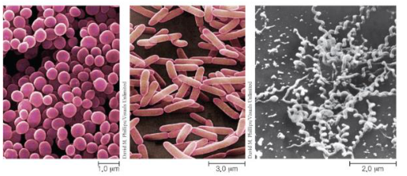
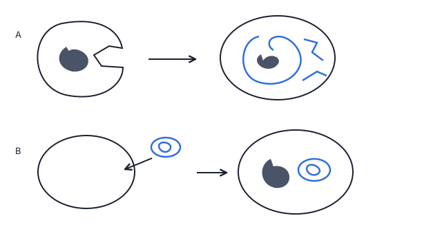
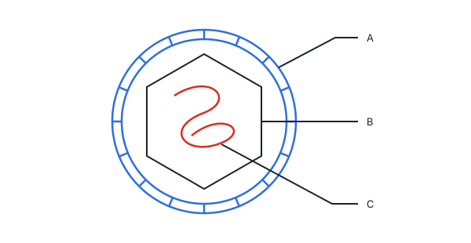

# 복습문제 20선 — 1105 수업 범위

기출 8개와 생성 변형 12개를 풀어 봐요. 변형은 기본 8개·심화 4개예요. 먼저 풀고 막히면 힌트를 열어 보세요.

> `복습문제_1105_Origin_of_Life_and_Prokaryotes.html`를 마크다운으로 옮겼어요. 원문, 힌트, 풀이는 접혀 있어요. 먼저 풀어 보고 펼쳐 보세요.

**목차**

- [B. 기출](#partB)
  - [P1. 바이러스의 독립 대사](#p1)
  - [P2. 높은 염분의 서식지](#p2)
  - [P3. 세균 그림과 DNA 형태](#p3)
  - [P4. 산소발생형 광독립영양](#p4)
  - [P5. 산소를 내는 광합성](#p5)
  - [P6. 핵막을 기준으로 구별하기](#p6)
  - [P7. 원인 세균에 맞는 항생제](#p7)
  - [P8. 원핵과 진핵 분류 경계](#p8)
- [C. 변형 연습](#partC)
  - [P9. [변형] 아미노산 검출로 어디까지 말할 수 있을까](#p9)
  - [P10. [변형] 정보를 저장하는 분자가 촉매도 한다면](#p10)
  - [P11. [변형] 그림의 두 과정과 공생의 증거](#p11)
  - [P12. [변형] 모여 살기와 역할 나누기](#p12)
  - [P13. [변형] 표에서 에너지와 탄소를 따로 읽기](#p13)
  - [P14. [변형] 빛 없이 이산화탄소로 몸을 만드는 미생물](#p14)
  - [P15. [변형] 바이러스와 세균의 구조 구별](#p15)
  - [P16. [변형] 핵의 유무로 네 무리와 하나를 나누기](#p16)
  - [P17. [변형] 그림 속 세 겹을 구별하기](#p17)
  - [P18. [변형] 방출만 억제하면 무엇이 달라질까](#p18)
  - [P19. [변형] 단순한 구조와 숙주 의존성](#p19)
  - [P20. [변형] 같은 빛을 받아도 산소 결과가 다른 이유](#p20)

## B. 기출

### P1. 바이러스의 독립 대사

바이러스(virus)에 대한 설명 중 옳지 않은 것은?

- (1) 생활사에 필요한 에너지를 생산하는 대사시스템을 갖추고 있다
- (2) 외피 또는 캡시드라고 불리는 단백질의 층으로 둘러싸여 있다
- (3) 바이러스의 핵산은 DNA이거나 RNA로 되어 있다
- (4) 바이러스에 감염되면 항생제나 다른 세균감염에 사용되는 치료법으로 효과를 볼 수 없다
- (5) 살아 있는 세포에 감염하는 생물학적 입자를 말한다

원문 정보 보기

기출 9강 합본 1번 (PDF 1쪽)

힌트 보기

혼자 ATP를 만드는 체계가 있는지, 숙주세포가 필요한지를 확인해요.

풀이 보기

1. (1) 틀려요. 바이러스는 독립적으로 ATP를 생산하는 대사 체계를 갖추지 않아 숙주세포에 의존해요.
2. (2) 맞아요. 여기서 외피는 원문이 캡시드와 함께 부르는 단백질 coat를 뜻해요. 숙주 유래 지질 외피(envelope)와 구별해요.
3. (3) 맞아요. 바이러스 유전체는 종류에 따라 DNA 또는 RNA예요.
4. (4) 맞아요. 항생제의 세균 표적은 바이러스에 없어서 바이러스 자체의 증식을 억제하는 치료법과 구별해요.
5. (5) 맞아요. 바이러스는 살아 있는 숙주세포를 감염시키는 입자예요.

**정답:** (1)

수업과의 연결: [바이러스의 독립 대사](정리노트_1105_Origin_of_Life_and_Prokaryotes.md#s3-structure)에서 판단 기준을 확인해요.

---

### P2. 높은 염분의 서식지

어떤 생물이 높은 염분의 물 속에서 살 수 있다고 기록되어 있다. 이 생물은 다음 중 어느 범주에 속할 가능성이 가장 높은가?

- (1) 바이러스
- (2) 동물계
- (3) 고세균영역
- (4) 원생생물계
- (5) 균류

원문 정보 보기

기출 9강 합본 3번 (PDF 1쪽)

힌트 보기

높은 염분에 적응한 대표적인 원핵생물 집단을 떠올려요.

풀이 보기

1. (1) 이 사례의 답으로는 부적합해요. 바이러스는 세포가 아니며 높은 염분에서 독립 대사를 하는 원핵생물의 예가 아니에요.
2. (2) 부적합해요. 동물계는 진핵생물이며, 극호염성 원핵생물을 가리키는 대표 범주가 아니에요.
3. (3) 가장 적합해요. 고세균에는 매우 높은 염분에서 자라는 극호염성 무리가 있어요. 다만 염분만으로 모든 개체의 분류를 확정할 수는 없어요.
4. (4) 부적합해요. 원생생물은 진핵생물이고, 제시된 극단적 염분의 전형적 예는 고세균이에요.
5. (5) 부적합해요. 균류는 진핵생물이고, 제시된 극호염성의 대표 범주가 아니에요.

**정답:** (3)

수업과의 연결: [높은 염분의 서식지](정리노트_1105_Origin_of_Life_and_Prokaryotes.md#s2-archaea)에서 판단 기준을 확인해요.

---

### P3. 세균 그림과 DNA 형태

위 그림은 특정생물집단의 일반적인 모습을 나타낸 것이다. 그 집단의 설명으로 잘못된 것은?

- (1) 다른 생물집단보다 훨씬 짧은 세대기간을 가지고 있어서 많은 돌연변이가 발생한다
- (2) 일부는 독립영양생물이지만 또 다른 일부는 종속영양생물이기도 하다
- (3) 대부분은 유전체로서 선형의 DNA를 지닌다
- (4) 핵이 아닌 핵과 유사한 핵양체라는 구조를 지닌다
- (5) 일부는 화학영양생물이지만 또 다른 일부는 광영양생물이기도 하다

원문 정보 보기

기출 9강 합본 4번 (PDF 1쪽)

힌트 보기

사진의 세 가지 모양과, 전형적인 세균 염색체의 모양을 각각 확인해요.

풀이 보기

1. (1) 출제 의도로는 맞아요. 짧은 세대시간은 같은 시간에 더 많은 세대를 거치게 해 변이와 선택이 누적될 기회를 늘려요. 개별 복제당 돌연변이율이 반드시 더 높다는 뜻은 아니에요.
2. (2) 맞아요. 원핵생물에는 CO2를 탄소원으로 쓰는 독립영양과 유기물을 쓰는 종속영양이 모두 있어요.
3. (3) 틀려요. 전형적인 세균의 주 염색체는 선형보다 환형 DNA로 설명해요. 그림은 세균의 대표 모양을 보여 줘요.
4. (4) 맞아요. 핵막으로 둘러싸인 핵 대신 DNA가 모인 핵양체가 있어요.
5. (5) 맞아요. 에너지원은 화학물질 또는 빛일 수 있어요. 에너지원과 탄소원은 별개 기준이에요.

**정답:** (3)

수업과의 연결: [세균 그림과 DNA 형태](정리노트_1105_Origin_of_Life_and_Prokaryotes.md#s2-structure)에서 판단 기준을 확인해요.

---

### P4. 산소발생형 광독립영양

__________ 은 산소발생형 광독립영양생물이다.

- (1) 그람음성세균
- (2) 클라미디아
- (3) 남세균
- (4) 프로테오박테리아
- (5) 나선균

원문 정보 보기

기출 9강 합본 11번 (PDF 2쪽)

힌트 보기

빛과 CO2를 이용하는 것에 더해 물을 분해할 때 무엇이 나오는지 확인해요.

풀이 보기

1. (1) 부적합해요. 그람음성이라는 세포벽 분류만으로 산소발생형 광독립영양을 특정하지 못해요.
2. (2) 부적합해요. 클라미디아는 세포 내 기생 세균이며 제시된 산소발생 광합성의 대표가 아니에요.
3. (3) 적합해요. 남세균은 빛을 에너지원으로, CO2를 탄소원으로 쓰고 물에서 전자를 얻을 때 산소를 방출해요.
4. (4) 부적합해요. 프로테오박테리아는 다양한 대사를 포함하는 큰 그룹으로, 이 문항의 산소발생형 광합성 대표는 남세균이에요.
5. (5) 부적합해요. 나선균이라는 무리는 제시된 산소발생형 광합성의 대표가 아니에요.

**정답:** (3)

수업과의 연결: [산소발생형 광독립영양](정리노트_1105_Origin_of_Life_and_Prokaryotes.md#s1-oxygen)에서 판단 기준을 확인해요.

---

### P5. 산소를 내는 광합성

진정세균영역영역의 분류군 중에서 산소를 발생시키는 광합성을 수행하는 것은?

- (1) 남세균
- (2) 녹색세균
- (3) 그람양성세균
- (4) 프로테오박테리아
- (5) 나선균

원문 정보 보기

기출 9강 합본 13번 (PDF 2쪽)

힌트 보기

물을 전자공여체로 쓰는 광합성과 황을 쓰는 광합성을 구별해요.

풀이 보기

1. (1) 적합해요. 남세균은 물을 전자공여체로 이용하므로 산소가 발생해요.
2. (2) 부적합해요. 수업의 녹색세균은 황을 이용하는 산소 비발생형 광합성의 예예요.
3. (3) 부적합해요. 수업에서 소개한 그람양성세균 사례는 산소발생형 광합성의 대표가 아니에요.
4. (4) 부적합해요. 다양한 대사의 큰 그룹이지만 제시된 산소발생형 대표는 남세균이에요.
5. (5) 부적합해요. 나선균은 이 문항이 묻는 산소발생형 광합성의 대표가 아니에요.

**정답:** (1)

원문 발문의 “영역영역”은 중복 오기이며, 진정세균영역을 뜻해요.

수업과의 연결: [산소를 내는 광합성](정리노트_1105_Origin_of_Life_and_Prokaryotes.md#s1-oxygen)에서 판단 기준을 확인해요.

---

### P6. 핵막을 기준으로 구별하기

원핵생물과 진핵생물의 차이점은 무엇인가?

- (1) 원핵생물은 단일 세포이지만 진핵생물은 다세포이다
- (2) 원핵생물은 분리된 DNA를 갖는 핵을 가지지 않는다
- (3) 원핵생물은 질병을 야기시키지만 진핵생물은 그렇지 않다
- (4) 원핵생물은 DNA가 없다
- (5) 원핵생물은 리보솜을 가지지 않지만 진핵생물은 가지고 있다

원문 정보 보기

기출 9강 합본 18번 (PDF 2쪽)

힌트 보기

DNA의 유무보다 DNA를 둘러싼 핵막의 유무를 확인해요.

풀이 보기

1. (1) 틀려요. 진핵생물에는 단세포도 있어요. 단세포/다세포만으로 원핵/진핵을 구분하지 못해요.
2. (2) 맞아요. DNA를 세포질과 분리하는 핵막이 원핵생물에는 없어요. DNA 자체는 핵양체에 존재해요.
3. (3) 틀려요. 원핵생물이 모두 병원성인 것도 아니며 진핵생물 중에도 병을 일으키는 종류가 있어요.
4. (4) 틀려요. 원핵생물에도 유전정보를 저장하는 DNA가 있어요.
5. (5) 틀려요. 원핵생물에도 단백질을 합성하는 리보솜이 있어요.

**정답:** (2)

수업과의 연결: [핵막을 기준으로 구별하기](정리노트_1105_Origin_of_Life_and_Prokaryotes.md#s2-structure)에서 판단 기준을 확인해요.

---

### P7. 원인 세균에 맞는 항생제

항생제를 사용하거나 처방할 때의 최선의 선택은?

- (1) 처방 받은 약이 아직 남아있는데도 상태가 좋아졌다고 느껴지면 항생제의 투약을 멈춘다
- (2) ‘항균’으로 표시된 비누를 고른다
- (3) 문제를 일으킨 세균의 종류를 확인 후 그에 맞게 처방한다
- (4) 현재 앓고 있지 않은 감염이라 할지라도 예방하기 위해 약을 처방 받고 투여한다
- (5) 원래 사용하던 양이 효과가 없을 때 투약량을 계속해서 증가시킨다

원문 정보 보기

기출 9강 합본 20번 (PDF 3쪽)

힌트 보기

원인 세균에 맞는 표적 선택과 불필요한 노출을 줄이는 원리를 적용해요.

풀이 보기

1. (1) 부적합해요. 상태가 좋아졌다는 느낌만으로 처방을 임의로 중단하는 것은 문항이 묻는 적절한 표적 치료 기준이 아니에요.
2. (2) 부적합해요. 항균 비누 선택은 어떤 원인 세균에 어떤 치료제가 맞는지를 확인하는 과정이 아니에요.
3. (3) 적합해요. 원인 세균을 확인해 그에 맞는 항생제를 선택하면 불필요한 광범위 노출을 줄일 수 있어요.
4. (4) 부적합해요. 현재 원인 감염 확인 없이 예방만을 이유로 무분별하게 투여하면 내성 선택을 늘릴 수 있어요. 이 보기는 의학적 적응증이 있는 예방요법 일반을 부정하는 뜻이 아니에요.
5. (5) 부적합해요. 효과가 없다는 이유만으로 투약량을 계속 늘리는 것은 원인·감수성을 확인하는 표적 치료가 아니에요.

**정답:** (3)

수업과의 연결: [원인 세균에 맞는 항생제](정리노트_1105_Origin_of_Life_and_Prokaryotes.md#s2-toxins)에서 판단 기준을 확인해요.

---

### P8. 원핵과 진핵 분류 경계

아래 그룹 중에서, 다른 그룹들과 비교하여 가장 다른 그룹은 무엇인가?

- (1) 고세균영역
- (2) 원생생물
- (3) 동물계
- (4) 식물계
- (5) 균류

원문 정보 보기

기출 9강 합본 23번 (PDF 3쪽)

힌트 보기

다섯 집단을 핵막이 있는 집단과 없는 집단으로 나눠요.

풀이 보기

1. (1) 이 비교의 답이에요. 고세균은 원핵생물이라 핵막으로 둘러싸인 핵이 없어요. 나머지 네 집단은 전통적인 진핵생물 분류예요.
2. (2) 이 비교의 답이 아니에요. 원생생물은 전통적인 진핵생물 집단이에요.
3. (3) 이 비교의 답이 아니에요. 동물계는 진핵생물에 속해요.
4. (4) 이 비교의 답이 아니에요. 식물계는 진핵생물에 속해요.
5. (5) 이 비교의 답이 아니에요. 균류는 진핵생물에 속해요.

**정답:** (1)

수업과의 연결: [원핵과 진핵 분류 경계](정리노트_1105_Origin_of_Life_and_Prokaryotes.md#s2-archaea)에서 판단 기준을 확인해요.

---

## C. 변형 연습

### P9. [변형] 아미노산 검출로 어디까지 말할 수 있을까

연구자가 밀러-유레이 실험을 본떠 수소·메탄·암모니아·수증기를 넣고 방전과 냉각을 반복했어요. 실험 뒤 **아미노산 검출**은 확인했지만 세포 구조나 자기 복제는 확인하지 못했어요. 결과에 대한 해석으로 옳지 않은 것을 골라요.

- (1) 특정 조건에서 생체 유기물이 비생물적으로 합성될 가능성을 보여 줘요.
- (2) 실험에서 얻은 작은 분자가 세포의 구성 재료가 될 수 있어요.
- (3) 살아 있는 세포의 기원을 설명하려면 막 형성과 복제 같은 추가 단계를 검토해야 해요.
- (4) 아미노산이 검출되었으므로 살아 있는 최초의 세포를 만든 것이 확실해요.
- (5) 실험의 기체 조성과 에너지 공급 조건을 결과 해석에 함께 고려해야 해요.

원문 정보 보기

원문 기출이 아닌 생성 변형이에요. 다루는 혼동: 아미노산 검출로 어디까지 말할 수 있을까. 근거 토픽: [s0-miller](정리노트_1105_Origin_of_Life_and_Prokaryotes.md#s0-miller).

힌트 보기

검출한 물질과 확인하지 않은 생명 현상을 따로 적어 봐요.

풀이 보기

1. (1) 맞아요. 생물 없이 아미노산이 만들어졌다는 결과는 비생물적 합성의 가능성을 지지해요.
2. (2) 맞아요. 아미노산은 단백질 같은 세포 구성 물질을 만드는 재료예요.
3. (3) 맞아요. 아미노산만으로 막·대사·유전정보 복제까지 갖춘 세포가 완성되지는 않아요.
4. (4) 틀려요. 아미노산 검출만 확인했고 세포 구조나 자기 복제를 확인하지 않았으므로 살아 있는 세포를 만들었다고 단정할 수 없어요.
5. (5) 맞아요. 실험 결과는 해당 기체 조성과 에너지 공급 조건에서 얻은 결과로 해석해야 해요.
6. 수업과의 연결: 밀러-유레이 실험은 유기물 합성과 생명 탄생을 구별하며 읽어요. [정리노트에서 다시 봐요.](정리노트_1105_Origin_of_Life_and_Prokaryotes.md#s0-miller)

**정답:** (4)

---

### P10. [변형] 정보를 저장하는 분자가 촉매도 한다면

초기 생명에서 유전정보를 읽어 촉매 단백질을 만들려면 이미 복잡한 합성 장치가 필요하다는 문제가 있어요. 그런데 어떤 RNA는 정보를 담는 동시에 화학 반응을 촉매해요. 이 발견이 RNA 우선 가설을 지지하는 이유로 가장 알맞은 것을 골라요.

- (1) RNA가 촉매 기능을 가지므로 초기 생명에는 유전정보가 전혀 필요하지 않았기 때문이에요.
- (2) 하나의 분자 종류가 정보와 촉매 역할을 함께 맡을 수 있어 단백질 촉매가 먼저 있어야 한다는 부담을 줄이기 때문이에요.
- (3) 촉매성 RNA의 발견만으로 현대 세포 전체를 실험실에서 완성했기 때문이에요.
- (4) 리보자임은 RNA를 감싼 단백질 껍질이므로 단백질 우선 가설만 지지하기 때문이에요.
- (5) 현재 모든 생물의 유전정보가 DNA 없이 RNA에만 저장되기 때문이에요.

원문 정보 보기

원문 기출이 아닌 생성 변형이에요. 다루는 혼동: 정보를 저장하는 분자가 촉매도 한다면. 근거 토픽: [s0-rna](정리노트_1105_Origin_of_Life_and_Prokaryotes.md#s0-rna).

힌트 보기

리보자임이 수행하는 역할과 RNA가 담을 수 있는 정보를 연결해 봐요.

풀이 보기

1. (1) 틀려요. 촉매 기능이 생겨도 유전정보의 저장과 전달이라는 문제는 남아요.
2. (2) 맞아요. RNA는 정보 분자와 촉매 분자의 역할을 함께 맡을 가능성이 있어 초기 체계의 형성을 설명하는 데 도움이 돼요.
3. (3) 틀려요. 촉매성 RNA의 존재는 가설을 지지하는 근거이지 현대 세포 전체를 재현했다는 결과가 아니에요.
4. (4) 틀려요. 리보자임은 촉매 기능을 하는 RNA 자체를 뜻해요.
5. (5) 틀려요. 현재 세포 생물은 유전정보를 주로 DNA에 저장하며 RNA 우선 가설은 초기 단계에 관한 설명이에요.
6. 수업과의 연결: 리보자임의 촉매 기능은 RNA가 정보와 촉매를 함께 담당했을 가능성과 이어져요. [정리노트에서 다시 봐요.](정리노트_1105_Origin_of_Life_and_Prokaryotes.md#s0-rna)

**정답:** (2)

---

### P11. [변형] 그림의 두 과정과 공생의 증거

그림은 세포 내부 구조가 생기는 서로 다른 두 모형 A, B를 보여 줘요. 어떤 소기관에서 별도의 환형 DNA와 세균형 리보솜이 발견되었어요. 그림과 이 증거를 연결한 설명으로 가장 알맞은 것을 골라요.

*두 모형의 경계와 작은 구조가 이동한 경로를 읽어요.*

- (1) A는 별도의 세균이 들어오는 과정이며 환형 DNA는 A만 지지해요.
- (2) B는 세포 경계가 안으로 접히기만 하는 과정이며 별도의 생물은 관여하지 않아요.
- (3) B는 별도의 세균이 들어와 남는 과정이며 그 소기관의 환형 DNA와 세균형 리보솜은 세포내공생설을 지지해요.
- (4) A에서 생긴 내부막은 모두 독립 세균이었으므로 자체 환형 DNA를 반드시 가져요.
- (5) A와 B는 모두 세포막의 접힘만 나타내므로 소기관의 기원을 구별할 수 없어요.

원문 정보 보기

원문 기출이 아닌 생성 변형이에요. 다루는 혼동: 그림의 두 과정과 공생의 증거. 근거 토픽: [s1-endosymbiosis](정리노트_1105_Origin_of_Life_and_Prokaryotes.md#s1-endosymbiosis).

힌트 보기

경계가 이어져 접히는 모형과 바깥의 작은 구조가 안으로 들어가는 모형을 구별해 봐요.

풀이 보기

1. (1) 틀려요. A에는 바깥 세균의 진입이 아니라 세포 경계가 안으로 접히는 모습이 그려져 있어요.
2. (2) 틀려요. B에서는 바깥에 있던 작은 세균이 세포 안에 들어간 뒤에도 별도 구조로 남아요.
3. (3) 맞아요. B의 별도 세균 유입 모형은 자체 환형 DNA와 세균형 리보솜을 가진 소기관의 세균 기원과 잘 맞아요.
4. (4) 틀려요. A 같은 막 함입으로 생긴 내부막이라고 해서 자체 환형 DNA를 가져야 하는 것은 아니에요.
5. (5) 틀려요. A의 막 접힘과 B의 별도 세균 진입은 그림에서 구별되며 서로 다른 기원 설명이에요.
6. 수업과의 연결: 미토콘드리아·엽록체의 세포내공생설은 핵막·소포체의 막 함입 모형과 구별해요. [정리노트에서 다시 봐요.](정리노트_1105_Origin_of_Life_and_Prokaryotes.md#s1-endosymbiosis)

**정답:** (3)

---

### P12. [변형] 모여 살기와 역할 나누기

세포 집단 X에서는 비슷한 세포들이 모여 살며 모두 같은 일을 해요. 집단 Y에서는 일부 세포는 수축하고 다른 세포는 자극을 전달하도록 구조와 기능이 특수화되었어요. 두 집단을 비교한 설명으로 가장 알맞은 것을 골라요.

- (1) Y는 세포의 분화와 역할 분담을 보여 주며, 단순히 모여 사는 X보다 분화한 다세포체의 특징이 뚜렷해요.
- (2) X와 Y 모두 세포 수가 많으므로 분화 정도와 관계없이 완전히 같은 조직 구성을 가져요.
- (3) Y의 서로 다른 세포는 기능이 다르므로 반드시 서로 다른 종이에요.
- (4) X는 여러 세포가 모였으므로 각 세포의 유전물질이 모두 사라져요.
- (5) 세포가 수축이나 자극 전달에 특수화되는 현상은 분화와 관련이 없어요.

원문 정보 보기

원문 기출이 아닌 생성 변형이에요. 다루는 혼동: 모여 살기와 역할 나누기. 근거 토픽: [s1-multicell](정리노트_1105_Origin_of_Life_and_Prokaryotes.md#s1-multicell).

힌트 보기

세포의 개수보다 구성 세포들이 서로 다른 일을 하도록 특수화되었는지 확인해 봐요.

풀이 보기

1. (1) 맞아요. Y의 수축 세포와 자극 전달 세포는 구조와 기능의 특수화인 분화를 보여 줘요.
2. (2) 틀려요. 세포 수가 많다는 사실만으로 역할 분담이나 조직 구성이 같다고 말할 수 없어요.
3. (3) 틀려요. 같은 다세포생물 안에서도 같은 종의 세포가 서로 다른 기능으로 분화할 수 있어요.
4. (4) 틀려요. 세포가 모여 사는 군체를 만든다고 각 세포의 유전물질이 없어지는 것은 아니에요.
5. (5) 틀려요. 특정 기능을 맡도록 세포의 구조와 기능이 특수화되는 것이 분화예요.
6. 수업과의 연결: 군체에서 분화한 다세포생물로의 설명에서 핵심은 모이는 것과 역할을 나누는 것의 차이예요. [정리노트에서 다시 봐요.](정리노트_1105_Origin_of_Life_and_Prokaryotes.md#s1-multicell)

**정답:** (1)

---

### P13. [변형] 표에서 에너지와 탄소를 따로 읽기

다음 표는 세 미생물이 생장할 때 사용하는 자원을 보여 줘요. 표를 근거로 **X의 영양방식**을 골라요.

| 미생물 | 에너지원 | 탄소원 |
|---|---|---|
| X | 빛 | 외부에서 공급한 유기물 |
| Y | 빛 | 이산화탄소 |
| Z | 화학물질 | 외부에서 공급한 유기물 |

- (1) 광독립영양
- (2) 화학독립영양
- (3) 화학종속영양
- (4) 표만으로 광영양인지 화학영양인지 판단할 수 없어요.
- (5) 광종속영양

원문 정보 보기

원문 기출이 아닌 생성 변형이에요. 다루는 혼동: 표에서 에너지와 탄소를 따로 읽기. 근거 토픽: [s2-nutrition](정리노트_1105_Origin_of_Life_and_Prokaryotes.md#s2-nutrition).

힌트 보기

X의 에너지원 열과 탄소원 열에서 각각 하나씩 분류한 뒤 두 이름을 합쳐 봐요.

풀이 보기

1. (1) 틀려요. 광독립영양은 빛을 쓰면서 이산화탄소 같은 무기탄소를 탄소원으로 이용하는 경우이며 표에서는 Y에 해당해요.
2. (2) 틀려요. X의 에너지원은 화학물질이 아니라 빛이고 탄소원도 외부 유기물이에요.
3. (3) 틀려요. 화학종속영양은 화학물질에서 에너지를 얻고 유기물에서 탄소를 얻는 경우이며 표에서는 Z에 해당해요.
4. (4) 틀려요. X의 에너지원이 빛이라고 표에 명시되어 있으므로 광영양으로 판단할 수 있어요.
5. (5) 맞아요. 빛에서 에너지를 얻으므로 광영양이고 외부 유기물에서 탄소를 얻으므로 종속영양이에요.
6. 수업과의 연결: 빛을 이용한다는 조건만으로 독립영양이라고 정하지 않고 에너지원과 탄소원을 따로 확인해요. [정리노트에서 다시 봐요.](정리노트_1105_Origin_of_Life_and_Prokaryotes.md#s2-nutrition)

**정답:** (5)

---

### P14. [변형] 빛 없이 이산화탄소로 몸을 만드는 미생물

미생물 M은 빛이 없는 환경에서 무기물의 산화로 에너지를 얻어요. 몸을 구성하는 탄소는 이산화탄소에서 얻고 외부 유기물을 탄소원으로 쓰지 않아요. M의 영양방식으로 가장 알맞은 것을 골라요.

- (1) 광독립영양
- (2) 화학독립영양
- (3) 광종속영양
- (4) 화학종속영양
- (5) 탄소원이 제시되지 않아 영양방식을 분류할 수 없어요.

원문 정보 보기

원문 기출이 아닌 생성 변형이에요. 다루는 혼동: 빛 없이 이산화탄소로 몸을 만드는 미생물. 근거 토픽: [s2-nutrition](정리노트_1105_Origin_of_Life_and_Prokaryotes.md#s2-nutrition).

힌트 보기

에너지를 얻는 방식과 몸을 이루는 탄소를 얻는 방식을 각각 확인해 봐요.

풀이 보기

1. (1) 틀려요. 독립영양인 점은 맞지만 에너지원이 빛이 아니므로 광독립영양은 아니에요.
2. (2) 맞아요. 화학물질의 산화에서 에너지를 얻고 이산화탄소를 탄소원으로 쓰므로 화학독립영양이에요.
3. (3) 틀려요. M은 빛에서 에너지를 얻지 않으며 유기물을 탄소원으로 쓰지도 않아요.
4. (4) 틀려요. 화학영양인 점은 맞지만 유기물이 아니라 이산화탄소에서 탄소를 얻으므로 종속영양은 아니에요.
5. (5) 틀려요. 이산화탄소가 탄소원이라고 명확히 제시되어 있어 독립영양으로 판단할 수 있어요.
6. 수업과의 연결: 화학영양인지 광영양인지는 에너지로, 독립영양인지 종속영양인지는 탄소로 구별해요. [정리노트에서 다시 봐요.](정리노트_1105_Origin_of_Life_and_Prokaryotes.md#s2-nutrition)

**정답:** (2)

---

### P15. [변형] 바이러스와 세균의 구조 구별

바이러스(virus)에 대한 설명 중 옳지 않은 것은?

- (1) 자체적으로 에너지를 생산하는 독립적인 대사시스템을 갖추지 못해요.
- (2) 유전물질을 감싸는 단백질 구조를 캡시드라고 해요.
- (3) 유전체로 DNA 또는 RNA를 가져요.
- (4) 세포벽의 펩티도글리칸이 모든 바이러스의 기본 구조를 이루어요.
- (5) 세균을 표적으로 하는 항생제는 바이러스 자체를 제거하는 치료제가 아니에요.

원문 정보 보기

기출 9강 1번 발문에 정답을 바꾼 생성 변형이에요. 다루는 혼동: 바이러스와 세균의 구조. 근거 토픽: [s3-structure](정리노트_1105_Origin_of_Life_and_Prokaryotes.md#s3-structure).

힌트 보기

바이러스는 세포인지, 펩티도글리칸은 어느 생물의 구조인지 비교해 봐요.

풀이 보기

1. (1) 맞아요. 바이러스는 독립적인 에너지 생산 대사 체계 없이 숙주에 의존해요.
2. (2) 맞아요. 캡시드는 유전체를 둘러싼 단백질 껍질이에요.
3. (3) 맞아요. 바이러스 유전체는 종류에 따라 DNA 또는 RNA예요.
4. (4) 틀려요. 바이러스에는 세균의 펩티도글리칸 세포벽이 기본 구조로 존재하지 않아요.
5. (5) 맞아요. 항생제의 세균 표적과 바이러스의 증식 과정은 다르므로 항생제가 바이러스 자체를 제거하지는 않아요.
6. 원문 정답과 달라진 점: 원문에서 틀린 대사시스템 주장은 여기서 옳게 고쳤어요. 새로 틀린 설명은 펩티도글리칸을 바이러스의 기본 구조라고 한 (4)예요.
7. 수업과의 연결: 바이러스의 핵산·캡시드와 세균의 펩티도글리칸 세포벽을 구별해요. [정리노트에서 다시 봐요.](정리노트_1105_Origin_of_Life_and_Prokaryotes.md#s3-structure)

**정답:** (4)

---

### P16. [변형] 핵의 유무로 네 무리와 하나를 나누기

아래 그룹 중에서, 다른 그룹들과 비교하여 가장 다른 그룹은 무엇인가?

- (1) 효모
- (2) 대장균
- (3) 남세균
- (4) 유산균
- (5) 메탄생성균

원문 정보 보기

기출 9강 23번 발문에 정답을 바꾼 생성 변형이에요. 다루는 혼동: 고세균과 진핵생물의 구별. 근거 토픽: [s2-archaea](정리노트_1105_Origin_of_Life_and_Prokaryotes.md#s2-archaea).

힌트 보기

분류 기준을 핵막으로 둘러싸인 핵의 유무로 잡고, 세균과 고세균을 함께 비교해 봐요.

풀이 보기

1. (1) 맞아요. 효모는 진핵생물인 균류이며 나머지 네 보기는 핵막으로 둘러싸인 핵이 없는 원핵생물이에요.
2. (2) 틀려요. 대장균은 세균 영역의 원핵생물로 나머지 세 원핵생물과 핵의 유무가 같아요.
3. (3) 틀려요. 남세균은 광합성을 하는 세균이며 핵막으로 둘러싸인 핵이 없는 원핵생물이에요.
4. (4) 틀려요. 유산균은 세균 영역의 원핵생물로 효모 같은 진핵생물과 구별돼요.
5. (5) 틀려요. 메탄생성균은 고세균이지만 세균과 마찬가지로 핵막으로 둘러싸인 핵이 없는 원핵생물이에요.
6. 원문 정답과 달라진 점: 원문에서는 네 진핵생물 무리와 다른 고세균영역이 답이었어요. 여기서는 메탄생성균을 포함한 네 원핵생물과 다른 진핵생물인 효모가 답이에요.
7. 수업과의 연결: 고세균과 세균은 서로 다른 영역이지만 둘 다 원핵생물이라는 공통점을 가져요. [정리노트에서 다시 봐요.](정리노트_1105_Origin_of_Life_and_Prokaryotes.md#s2-archaea)

**정답:** (1)

---

### P17. [변형] 그림 속 세 겹을 구별하기

그림은 숙주에서 나온 뒤의 한 바이러스를 나타내요. 표지 A, B, C에 대한 설명 중 옳지 않은 것을 골라요.

*선 끝이 가리키는 구조를 기준으로 A, B, C를 구별해요.*

- (1) A는 지질 이중층으로 된 경계이며 B와는 다른 구조예요.
- (2) B는 유전물질을 둘러싼 단백질 캡시드예요.
- (3) A는 바이러스가 숙주와 무관하게 스스로 합성해 갖춘 세포막이에요.
- (4) C는 이 바이러스의 DNA 또는 RNA 유전체를 나타내요.
- (5) A 같은 외피를 가진 바이러스도 독립적인 세포 생물은 아니에요.

원문 정보 보기

원문 기출이 아닌 생성 변형이에요. 다루는 혼동: 그림 속 세 겹을 구별하기. 근거 토픽: [s3-structure](정리노트_1105_Origin_of_Life_and_Prokaryotes.md#s3-structure).

힌트 보기

바깥 지질 경계와 그 안의 단백질층을 구분하고 지질 경계가 어디서 왔는지 떠올려 봐요.

풀이 보기

1. (1) 맞아요. 가장 바깥의 A는 지질 외피이며 안쪽 단백질층 B와 물질과 위치가 달라요.
2. (2) 맞아요. 다각형 층을 가리키는 B는 핵산을 둘러싼 단백질 캡시드예요.
3. (3) 틀려요. A는 숙주 막에서 유래한 지질 외피이며 바이러스가 숙주와 무관하게 독립 합성한 세포막이 아니에요.
4. (4) 맞아요. 중심의 굽은 선을 가리키는 C는 바이러스의 유전정보를 담은 핵산이에요.
5. (5) 맞아요. 숙주 유래 외피가 있어도 바이러스에 독립적인 세포 구조와 에너지 생산 체계가 생기는 것은 아니에요.
6. 수업과의 연결: 외피는 숙주 막에서 유래할 수 있고 캡시드는 단백질 껍질이라는 차이를 그림 위치와 연결해요. [정리노트에서 다시 봐요.](정리노트_1105_Origin_of_Life_and_Prokaryotes.md#s3-structure)

**정답:** (3)

---

### P18. [변형] 방출만 억제하면 무엇이 달라질까

인플루엔자 바이러스에 이미 감염된 세포에 약물 R을 처리했어요. 이 실험에서는 R이 **뉴라미니다아제의 방출 관련 기능만 억제**하고, 수용체 결합과 세포 안의 핵산 복제에는 영향을 주지 않는다고 가정해요. 약물 처리 뒤 예상으로 가장 알맞은 것을 골라요.

- (1) 이미 감염된 세포의 핵산 복제는 즉시 멈추고 다른 세포로의 확산은 증가해요.
- (2) 이미 감염된 세포 안의 핵산 복제는 이어질 수 있지만 다른 세포로의 확산은 줄어들어요.
- (3) 이미 감염된 세포의 핵산 복제는 계속되고 다른 세포로의 확산도 반드시 증가해요.
- (4) 수용체 결합이 직접 차단되므로 이미 감염된 세포에서 유전체가 즉시 사라져요.
- (5) 핵산 복제와 수용체 결합이 정상이므로 방출 억제 여부는 확산에 영향을 주지 않아요.

원문 정보 보기

원문 기출이 아닌 생성 변형이에요. 다루는 혼동: 방출만 억제하면 무엇이 달라질까. 근거 토픽: [s3-infection](정리노트_1105_Origin_of_Life_and_Prokaryotes.md#s3-infection).

힌트 보기

약물이 건드리지 않은 단계는 그대로 두고, 새 바이러스가 다른 세포로 퍼지는 데 필요한 단계를 찾아봐요.

풀이 보기

1. (1) 틀려요. 핵산 복제에는 영향을 주지 않는다는 조건과 맞지 않으며 방출 억제는 확산 증가를 뜻하지 않아요.
2. (2) 맞아요. 복제 단계는 유지될 수 있지만 방출이 억제되면 다른 세포를 감염시킬 기회가 줄어들어요.
3. (3) 틀려요. 핵산 복제가 이어질 수 있어도 방출 억제 때문에 다른 세포로의 확산이 반드시 증가하지는 않아요.
4. (4) 틀려요. 수용체 결합은 영향을 받지 않는다고 가정했고 방출 효소 억제만으로 유전체가 즉시 사라지는 것도 아니에요.
5. (5) 틀려요. 복제와 결합이 정상이더라도 방출 단계가 막히면 다음 세포로의 확산이 제한돼요.
6. 수업과의 연결: 침입·복제·방출은 서로 다른 표적이므로 방출 억제와 세포 내 복제 지속 가능성을 함께 판단해요. [정리노트에서 다시 봐요.](정리노트_1105_Origin_of_Life_and_Prokaryotes.md#s3-infection)

**정답:** (2)

---

### P19. [변형] 단순한 구조와 숙주 의존성

바이러스에 관한 다음 진술 중 **틀린 진술만** 묶은 것을 골라요.

- ㄱ. 바이러스는 구조가 단순하므로 반드시 세포보다 먼저 나타난 최초의 생명체예요.
- ㄴ. 바이러스는 증식할 때 숙주세포의 장치를 이용해요.
- ㄷ. 바이러스는 숙주 리보솜 없이 스스로 단백질을 합성해요.

- (1) ㄱ
- (2) ㄴ
- (3) ㄱ, ㄴ
- (4) ㄱ, ㄷ
- (5) ㄴ, ㄷ

원문 정보 보기

원문 기출이 아닌 생성 변형이에요. 다루는 혼동: 단순한 구조와 숙주 의존성. 근거 토픽: [s3-evolution](정리노트_1105_Origin_of_Life_and_Prokaryotes.md#s3-evolution).

힌트 보기

구조가 단순하다는 사실로 탄생 순서를 확정할 수 있는지, 단백질 합성에 어떤 세포 장치가 필요한지 확인해 봐요.

풀이 보기

1. ㄱ은 틀려요. 구조가 단순하다는 사실만으로 기원의 순서를 확정할 수 없고 바이러스의 증식은 숙주에 의존해요.
2. ㄴ은 맞아요. 바이러스는 독립적인 세포가 아니며 증식할 때 숙주세포의 장치를 이용해요.
3. ㄷ은 틀려요. 바이러스는 자체 리보솜으로 단백질을 합성하지 못하므로 숙주 리보솜을 이용해야 해요.
4. (1) 틀려요. ㄱ은 틀린 진술이지만 숙주 리보솜 없이 단백질을 만든다는 ㄷ도 틀렸으므로 빠져 있어요.
5. (2) 틀려요. ㄴ은 증식 과정의 숙주 의존성을 설명한 옳은 진술이에요.
6. (3) 틀려요. ㄱ은 틀렸지만 ㄴ은 옳으며 틀린 ㄷ이 빠져 있어요.
7. (4) 맞아요. 단순함만으로 최초 생명이라고 단정한 ㄱ과 숙주 리보솜 없이 단백질을 만든다는 ㄷ이 모두 틀렸어요.
8. (5) 틀려요. ㄷ은 틀렸지만 ㄴ은 옳으며 틀린 ㄱ이 빠져 있어요.
9. 수업과의 연결: 교수님은 USB의 단순함이 PC보다 먼저 생겼다는 뜻은 아니라는 비유로 바이러스의 숙주 의존성을 설명했어요. [정리노트에서 다시 봐요.](정리노트_1105_Origin_of_Life_and_Prokaryotes.md#s3-evolution)

**정답:** (4)

---

### P20. [변형] 같은 빛을 받아도 산소 결과가 다른 이유

광합성 원핵생물 P와 Q에 같은 양의 빛을 비춰요. P는 물을, Q는 황화수소를 전자공여체로 사용하며, 처리 전에는 P만 산소를 방출했어요. 약물 S는 **P의 물 분해만 직접 억제**하고 Q의 전자공여 과정과 두 생물의 빛 이용에는 직접 영향을 주지 않는다고 가정해요. 처리 뒤 예상으로 가장 알맞은 것을 골라요.

- (1) 빛이 같으므로 P의 물 분해가 억제되어도 P의 산소 방출량은 반드시 그대로예요.
- (2) Q도 빛을 이용하므로 S를 처리하면 반드시 물 분해로 전환해 산소를 방출해요.
- (3) P의 산소 방출은 줄어들고, Q는 황화수소 이용 경로가 유지되며 산소 방출로 전환하지 않아요.
- (4) P의 산소 방출은 늘어나고, Q의 황화수소 이용은 약물의 직접 표적이므로 멈춰요.
- (5) P와 Q는 모두 광합성하므로 전자공여체와 관계없이 산소 방출이 똑같이 증가해요.

원문 정보 보기

원문 기출이 아닌 생성 변형이에요. 다루는 혼동: 같은 빛을 받아도 산소 결과가 다른 이유. 근거 토픽: [s1-oxygen](정리노트_1105_Origin_of_Life_and_Prokaryotes.md#s1-oxygen).

힌트 보기

빛이라는 에너지원과 전자를 주는 물질을 구별하고, 산소가 어떤 물질의 분해에서 나오는지 떠올려 봐요.

풀이 보기

1. (1) 틀려요. 산소는 물 분해와 연결되므로 빛이 같아도 물 분해를 억제하면 P의 산소 방출은 줄어들어요.
2. (2) 틀려요. 빛을 이용한다는 사실만으로 전자공여체가 물로 바뀌지 않으며 Q의 기존 경로는 영향을 받지 않는다고 했어요.
3. (3) 맞아요. P는 산소를 내는 물 분해가 억제되지만 Q는 약물의 직접 표적이 아닌 황화수소 이용 경로를 유지해요.
4. (4) 틀려요. P의 물 분해 억제는 산소 방출 증가와 맞지 않고 Q의 전자공여 과정은 직접 영향을 받지 않는다고 했어요.
5. (5) 틀려요. 모든 광합성이 산소를 내지는 않으며 물과 황화수소 중 무엇을 전자공여체로 쓰는지가 결과를 구별해요.
6. 수업과의 연결: 남세균의 물 이용 광합성과 산소를 내지 않는 다른 세균의 광합성을 전자공여체 기준으로 비교해요. [정리노트에서 다시 봐요.](정리노트_1105_Origin_of_Life_and_Prokaryotes.md#s1-oxygen)

**정답:** (3)

---

출처: 2023·2024 생명과학 기출(9강 합본). 인쇄 정답과 독립 판단을 대조했어요. 변형 연습은 수업 내용으로 만든 생성 문제예요.
