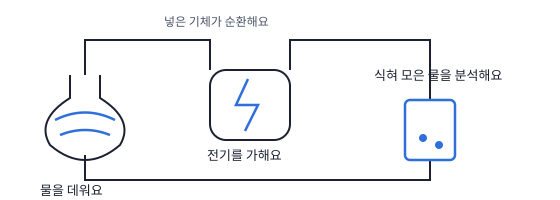
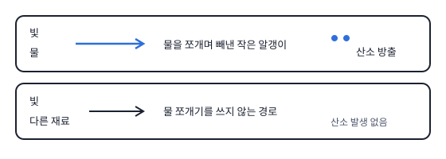
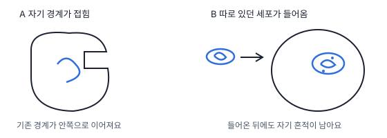
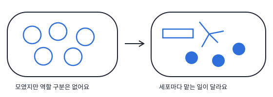
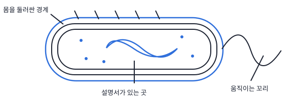
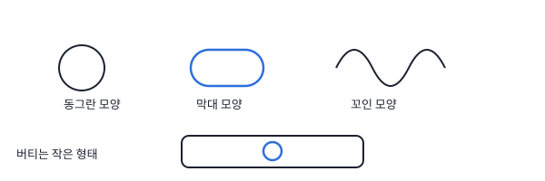
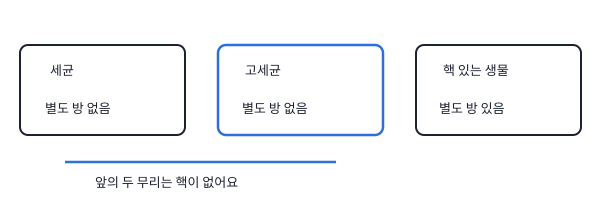
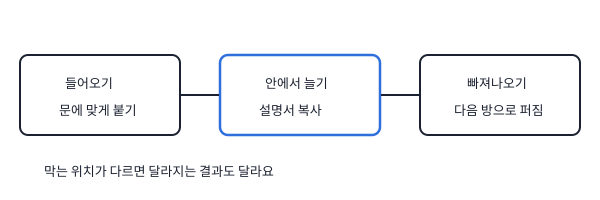
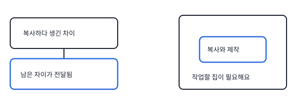

# 생명의 기원·원핵생물·바이러스 — 5살도 이해하는 정리노트

이영만 교수님 생명과학 · 1105 수업 (9장 p1–3)

> `정리노트_1105_Origin_of_Life_and_Prokaryotes.html`를 마크다운으로 옮겼어요. 그림은 `figures_1105/` 폴더의 SVG, 위젯은 대표 설정의 정적 그림으로 바꿨어요. 수식은 `$…$` / `$$…$$`라서 GitHub, Obsidian, Typora에서 보여요.

**목차**

- [1. 생명은 어떻게 시작했을까](#s0)
  - [실험에서 나온 것은 생명이 아니라 유기물](#s0-miller)
  - [작은 분자에서 막으로 둘러싸인 공간으로](#s0-protocell)
  - [정보와 촉매를 함께 맡을 수 있는 RNA](#s0-rna)
- [2. 세포가 복잡해진 과정](#s1)
  - [남세균이 물을 쓰자 산소가 생겼어요](#s1-oxygen)
  - [삼킨 세균이 소기관이 되었다는 증거](#s1-endosymbiosis)
  - [같이 살기에서 역할 나누기로](#s1-multicell)
- [3. 세균과 고세균을 구별하는 기준](#s2)
  - [작은 세포의 필수 장비](#s2-structure)
  - [에너지원과 탄소원은 서로 다른 질문](#s2-nutrition)
  - [세균의 여러 무리와 오래 버티는 형태](#s2-groups)
  - [독소와 항생제 내성은 다른 문제](#s2-toxins)
  - [고세균도 핵이 없는 세포예요](#s2-archaea)
- [4. 바이러스는 왜 숙주가 필요할까](#s3)
  - [유전물질을 감싼 입자](#s3-structure)
  - [침입·복제·방출의 서로 다른 표적](#s3-infection)
  - [빠른 변이와 숙주 의존성](#s3-evolution)
- [5. 요약 · 예고](#s4)
  - [시험 직전 한 장 요약](#s4-cheatsheet)
  - [다음 시간 예고](#s4-next)
  - [함께 보면 좋은 자료](#s4-links)

## 1. 생명은 어떻게 시작했을까

### 실험에서 나온 것은 생명이 아니라 유기물

*1105 수업 · 9장 p1*

**쉽게 말하면**

지금은 처음 생명이 생기던 때를 직접 볼 수 없어요. 당시 일어났을 법한 일을 작은 장치에서 시험했어요.

*장치는 모인 물을 다시 데우면서 반응을 여러 번 이어 가요.*

**정확히 말하면**

**오파린-할데인 가설**은 초기 지구에 산소가 적고 수소·메탄·암모니아·수증기가 많은 **환원 조건**이 있었다고 제안했어요.

**환원** = 전자를 받는 과정. 환원성 물질은 다른 물질에 전자를 줄 수 있음

1. **입력** 밀러-유레이(Miller–Urey) 실험에서 물을 가열해 수증기를 만들고 수소·메탄·암모니아와 순환시켰어요. 전기 방전으로 번개의 에너지를 흉내 냈어요.
2. **직접 측정** 약 일주일 동안 순환·냉각한 뒤 모은 용액의 성분을 분석했어요. 색 변화가 아닌 성분 분석으로 **아미노산(amino acid)** 같은 간단한 유기물을 확인했어요.

이 실험이 묻는 것은 생물의 몸과 주변에 공통으로 있는 원소가 어떻게 생명 재료가 되는가예요. 자연에서 최초의 복제 가능한 세포가 어떻게 탄생했는지까지 알려면 이후 단계도 설명해야 해요.

다른 환경과 반응 조건

환원적인 **심해 열수구(hydrothermal vent)**도 후보예요. 운석에서 아미노산이 발견돼 일부 재료가 우주에서 왔을 가능성도 있지만, 최초 합성의 질문은 남아요.

수업 영상은 유리에서 나온 규산염이 반응에 영향을 줄 수 있고 초기 지구 암석 성분과도 연결할 수 있다는 해석을 소개했어요. 용기 자체도 반응 조건이 될 수 있는 예예요.

실험의 입력·측정·결론을 구별하는 방법을 [학습만화](../%ED%95%99%EC%8A%B5%EB%A7%8C%ED%99%94_1105_Origin_of_Life_and_Prokaryotes.html#s0-miller)에서 장면으로 비교해 보세요.

**꼭 기억해요**

| 묻는 것 | 틀리기 쉬운 답 | 맞는 답 |
|---|---|---|
| 아미노산 검출로 지지되는 결론 | ~~살아 있는 세포의 생성~~ | 가정한 조건에서 간단한 유기물이 비생물적으로 합성될 가능성 |
| 반응에 넣은 기체 | ~~모두 무기물~~ | 메탄은 유기물 |
| 가정한 환원 대기의 지위 | ~~실제 초기 대기 전체의 확정 조성~~ | 실험에 사용한 가정 |
| 열수구·우주 유입·규산염 | ~~생명 탄생의 입증된 경로~~ | 연구 가설 또는 수업 영상이 소개한 해석 |
| 규산염이 반응에 관여할 가능성 | ~~실험 결과 전체가 무효~~ | 용기·광물의 영향을 반응 조건으로 점검 |
| 자연선택을 관찰하면 확인되는 범위 | ~~최초 생명 탄생의 모든 단계~~ | 관찰한 집단의 변화. 생명 기원의 단계는 별도 검증 대상 |

교수님 말씀

교수님은 탄소·산소·질소·수소 등 생물과 비생물이 공유하는 물질을 설명하며 몸의 원소를 “별에서 온 원자”라고 표현했어요.

> 생명까지는 아니고, 유기물까지 나왔다.

**페이지 요약**

밀러-유레이 실험은 가정한 환경에서 생명 재료가 생길 가능성을 보여 주었지만 생명 자체를 만들지는 않았어요.

*용어*

- **실험의 입력과 측정** — 수소·메탄·암모니아·수증기에 전기 에너지를 가하고 순환·냉각한 뒤 용액을 분석해 아미노산을 검출했어요. 메탄은 유기물이므로 입력 전체를 무기물이라고 부르지 않아요.
- **환원 조건** — 환원은 전자를 받는 과정이고 환원성 물질은 전자를 줄 수 있어요. 실험에 가정한 환원 대기를 실제 초기 대기의 확정 조성과 동일시하지 않아요.
- **결론의 범위** — 간단한 유기물의 비생물적 합성 가능성을 지지해요. 살아 있는 세포의 생성이나 실제 탄생 경로를 입증하지는 않아요. 자연선택의 관찰 가능성과 생명 기원의 확정 여부는 구별해요.
- **다른 환경과 남은 질문** — 환원적인 심해 열수구와 운석을 통한 재료 유입도 제안되어요. 우주에서 재료가 왔더라도 최초 합성의 문제는 남아요.
- **반응 조건의 점검** — 소개된 규산염 사례처럼 용기·광물도 반응에 영향을 줄 수 있어요. 그 역할은 소개된 해석이며 실제 생명 탄생의 확정 증거는 아니에요. 그 영향 가능성이 곧 실험 전체의 무효를 뜻하지도 않아요.

---

### 작은 분자에서 막으로 둘러싸인 공간으로

*1105 수업 · 9장 p1*

**쉽게 말하면**

구슬을 실에 꿰는 일과 여러 재료를 한 그릇에 담는 일은 달라요.

*오른쪽처럼 경계가 닫히면 안에 든 재료가 한곳에 머물러요.*

**정확히 말하면**

1. 간단한 유기물의 형성
2. 거대분자(macromolecule)의 조립
3. 막으로 내부와 외부를 구획
4. 유전물질 복제와 분열이 가능한 세포의 출현

아미노산을 연결하면 폴리펩티드가, 뉴클레오타이드를 연결하면 DNA나 RNA가 돼요. 교수님은 **진흙** 속 금속 이온을 아미노산 연결의 촉매로 설명했어요.

물과 어울리는 인지질 머리가 물을 향하고 물을 피하는 꼬리가 서로 마주 보면 **인지질 이중층(phospholipid bilayer)**이 자가 조립될 수 있어요. 이중층이 닫힌 소낭은 안팎을 나눠 재료와 반응이 한곳에 유지될 공간을 만들어요.

**원시세포(protocell)** = 경계와 내부 물질을 가진 초기 세포의 모형

유전정보 복제 이어 보기

복제 문제는 [정보와 촉매를 함께 맡을 수 있는 RNA](#s0-rna)에서 이어져요.

분자 연결과 막 형성, 복제를 구별하는 방법을 [학습만화](../%ED%95%99%EC%8A%B5%EB%A7%8C%ED%99%94_1105_Origin_of_Life_and_Prokaryotes.html#s0-protocell)에서 장면으로 비교해 보세요.

인지질의 머리와 꼬리가 향하는 쪽을 돌려 보고 소낭이 닫히는 과정을 [인지질과 원시세포 모형](../%EC%9D%B8%ED%84%B0%EB%A0%89%ED%8B%B0%EB%B8%8C_01_%EC%9D%B8%EC%A7%80%EC%A7%88%EA%B3%BC_%EC%9B%90%EC%8B%9C%EC%84%B8%ED%8F%AC.html)에서 재생해 보세요.

**꼭 기억해요**

| 묻는 것 | 틀리기 쉬운 답 | 맞는 답 |
|---|---|---|
| 작은 유기물 검출 | ~~DNA·RNA·단백질까지 조립된 증거~~ | 고분자 조립에 필요한 재료의 형성 |
| 금속 이온의 촉매 작용 | ~~모든 재료가 조건 없이 고분자로 조립~~ | 조건에 따라 아미노산 연결에 도움 |
| 닫힌 소낭의 의미 | ~~유전정보 복제와 세대 유지까지 가능한 세포~~ | 구획화 모형. 복제·분열 체계가 더 필요 |

이 흐름은 세포 출현에 필요한 단계를 보여 줘요. 최초 생명이 실제로 거친 구체적인 경로는 아직 다 밝혀지지 않았어요.

교수님 말씀

> 유기물만 생긴다고 해서 DNA, RNA, 단백질이 만들어지는 건 아니죠

**페이지 요약**

생명 재료가 연결되고 막 안에 모이는 과정에 유전정보의 복제 체계가 더해져야 세포의 출현을 설명할 수 있어요.

*용어*

- **거대분자 조립** — 아미노산은 폴리펩티드로, 뉴클레오타이드는 DNA·RNA로 연결돼요. 작은 재료의 합성과 큰 분자의 조립은 다른 단계예요.
- **진흙과 촉매** — 수업에서는 진흙의 금속 이온이 조건에 따라 분자 연결을 도울 수 있다고 설명했어요. 모든 거대분자의 무조건적인 완성을 뜻하지 않아요.
- **인지질 이중층** — 물과 어울리는 머리는 물 쪽, 물을 피하는 꼬리는 서로 마주 보며 자가 조립해요. 닫힌 소낭은 내부와 외부를 나눠 물질을 모아요.
- **원시세포와 살아 있는 세포** — 구획화된 소낭만으로 생명이 완성되지는 않아요. 유전정보 복제와 세포 분열을 통해 세대를 이어 갈 체계가 더 필요하며 구체적인 탄생 경로는 미확정이에요.

---

### 정보와 촉매를 함께 맡을 수 있는 RNA

*1105 수업 · 9장 p1–2*

**쉽게 말하면**

처음 기록을 복사하려면 도구가 필요해요. 그런데 그 도구를 만들려면 기록이 먼저 있어야 한다면 어떻게 시작할까요?

*그림 가운데는 아직 일들이 나뉘기 전의 모습을 상상한 거예요.*

**정확히 말하면**

**RNA 우선 가설(RNA-first hypothesis)**에서는 초기 RNA가 염기서열에 정보를 담고, 일부 RNA는 촉매로 작용해 RNA 합성이나 **자기 복제(self-replication)**를 도왔을 가능성을 제안해요. 단백질 효소가 완성되기 전에도 정보의 저장과 복제가 시작될 여지를 설명해요.

**리보자임(ribozyme)** = 촉매 기능을 가진 RNA

교수님은 RNA의 OH기와 반응성을 정보의 장기 보존 문제와 연결했어요. 현재 세포에서는 상대적으로 안정적인 **DNA**가 유전정보를 저장하고 RNA와 단백질이 정보 발현에 참여해요.

초기 생명은 복잡한 진핵세포보다 원핵세포에 가까운 단순한 형태였을 것으로 수업에서 설명했어요.

수업에서 소개한 다른 가설과 근사 연대

수업은 단백질 우선 가설도 소개했어요.

강의노트는 지구 형성 약 46억 년 전, 최초 원시세포 약 36억 년 전, 오래된 원핵생물 화석 약 35억 년 전으로 제시해요. 수업에서는 최초 세포를 약 36억~37억 년 전으로 설명했어요. 둘 다 근사값이에요.

RNA의 두 기능과 가설의 범위를 구별하는 방법을 [학습만화](../%ED%95%99%EC%8A%B5%EB%A7%8C%ED%99%94_1105_Origin_of_Life_and_Prokaryotes.html#s0-rna)에서 장면으로 비교해 보세요.

**꼭 기억해요**

| 묻는 것 | 틀리기 쉬운 답 | 맞는 답 |
|---|---|---|
| 촉매 역할을 하는 분자의 재료 | ~~모두 단백질~~ | 일부 RNA도 가능 |
| RNA의 촉매 기능이 보여 주는 범위 | ~~모든 RNA가 재료 없이 완전한 자기 복제 가능~~ | 초기 복제를 도왔을 가능성. 최초 복제의 조건과 경로는 미확정 |
| RNA 우선 가설이 다루는 시기 | ~~현재 세포의 주된 장기 정보 저장~~ | 초기 생명의 정보·촉매 체계 |
| DNA가 상대적으로 안정적이라는 뜻 | ~~DNA는 전혀 변하지 않음~~ | 장기 저장에 유리한 상대적 안정성 |

교수님 말씀

> 유전 물질은 좀 점잖아야 되죠.

교수님이 장기 정보 보존에 필요한 안정성을 강조하며 쓴 표현이에요.

**페이지 요약**

RNA가 정보 저장과 반응 촉진을 함께 맡을 수 있다는 점이, 최초 정보 체계의 시작을 설명하는 가설의 실마리예요.

*용어*

- **시작의 문제** — 단백질 효소를 만들 정보 체계와 그 체계를 작동시킬 효소가 서로 필요한 듯한 문제를 RNA의 두 기능으로 완화해요.
- **리보자임** — 촉매 기능을 가진 RNA예요. 모든 촉매가 단백질인 것은 아니며 모든 RNA가 촉매인 것도 아니에요.
- **RNA 우선 가설** — 정보 저장과 RNA 생성 과정의 촉매 작용이 초기 RNA에서 함께 가능했을 수 있다는 설명이에요. 모든 RNA의 자동적인 완전 자기 복제가 입증되었다는 뜻은 아니에요.
- **DNA의 역할** — 수업에서는 RNA의 OH기와 큰 반응성을 대비하며, 상대적으로 안정적인 DNA가 장기 정보 저장을 맡게 되었을 가능성을 설명했어요. 단백질 우선 가설도 소개되어 탄생 경로는 미확정이에요. 현재 세포의 주된 장기 저장물질은 DNA이며 상대적 안정성은 전혀 변하지 않는다는 뜻이 아니에요.
- **초기 세포와 근사 연대** — 단순한 원핵세포형 생명으로 설명해요. 강의노트는 지구 형성 약 46억 년 전, 최초 원시세포 약 36억 년 전, 오래된 원핵생물 화석 약 35억 년 전을 제시해요. 최초 세포의 정확한 날짜를 확정한 것은 아니에요.

---

## 2. 세포가 복잡해진 과정

### 남세균이 물을 쓰자 산소가 생겼어요

*1105 수업 · 9장 p2*

**쉽게 말하면**

햇빛으로 움직이는 장치도 무엇을 넣느냐에 따라 결과가 달라져요.

*그림에서 두 종류의 미생물이 빛 외에 무엇을 쓰는지 살펴봐요.*

**정확히 말하면**

초기 지구는 산소가 부족했어요. 수업에서는 초기 세포가 에너지를 얻는 방법을 발효나 산소를 쓰지 않는 호흡과 연결했어요.

| 비교 기준 | 산소발생형 | 비산소발생형의 수업 예 |
|---|---|---|
| 예 | 남세균(cyanobacteria) | 황을 포함한 물질을 쓰는 광합성 세균 |
| 에너지원 | 빛 | 빛 |
| 전자공여체 | 물 | 예: 황화수소 |
| 산소 방출 | 명반응의 물 분해로 발생 | 물 분해에 의한 산소 발생 없음 |

빛은 에너지를 제공하고, 물은 **전자**를 제공해요. 남세균이 **광독립영양생물**인 것은 에너지원이 빛이고 탄소원이 이산화탄소이기 때문이에요.

**스트로마톨라이트(stromatolite)** = 광합성 미생물의 활동과 퇴적물이 관련된 층상 구조. 오래된 광합성 세균의 흔적

강의노트는 물을 쓰는 광합성의 출현을 약 30억 년 전으로 제시해요. 생성된 산소의 대기 축적은 이후 산소를 이용하는 호흡이 발달할 환경과 이어져요.

가령 물을 쓰는 미생물과 황화수소를 쓰는 미생물에서 물 분해만 억제하면 물을 쓰던 쪽의 산소 발생이 줄어요. 황화수소를 쓰는 쪽은 여전히 산소를 방출하지 않아요.

에너지원과 전자공여체를 구별하는 방법을 [학습만화](../%ED%95%99%EC%8A%B5%EB%A7%8C%ED%99%94_1105_Origin_of_Life_and_Prokaryotes.html#s1-oxygen)에서 장면으로 비교해 보세요.

**꼭 기억해요**

| 묻는 것 | 틀리기 쉬운 답 | 맞는 답 |
|---|---|---|
| 빛을 쓰는 세균의 구별 기준 | ~~모두 남세균이며 산소를 방출~~ | 전자공여체가 물인지 확인 |
| 산소를 방출하는 단계 | ~~캘빈 회로~~ | 명반응의 물 분해 |
| 스트로마톨라이트에서 보는 흔적 | ~~세균 한 개의 몸 화석~~ | 미생물의 활동과 관련된 퇴적 구조 |
| 광합성의 등장·흔적·대기 산소 축적 | ~~암석 구멍만으로 정한 하나의 정확한 날짜~~ | 각각 따로 판단. 출현 직후 대기 전체가 바뀐 것은 아님 |

교수님 말씀

> 물에서 전자가 떨어지니까 명반응이죠

교수님은 남세균의 산소 방출을 앞서 배운 광합성의 명반응과 연결했어요.

**페이지 요약**

남세균의 산소발생형 광합성은 물에서 전자를 얻으며 산소를 내놓고, 모든 광합성이 이 경로를 쓰는 것은 아니에요.

*용어*

- **남세균과 영양 방식** — 세균에 속하는 산소발생형 광독립영양생물이에요. 빛을 에너지원으로, 이산화탄소를 탄소원으로 사용해요.
- **산소의 직접 기원** — 명반응에서 전자공여체인 물이 분해되며 산소가 나와요. 빛의 역할과 물의 역할을 구별해요. 캘빈 회로 자체가 산소를 방출하는 것은 아니에요.
- **다른 광합성 경로** — 황화수소 등 다른 전자공여체를 쓰는 비산소발생형은 빛을 사용해도 물의 분해로 산소를 방출하는 경로가 아니에요.
- **조건 변화의 적용** — 물 분해만 억제하면 물을 쓰던 경로의 산소 생성이 줄어요. 다른 전자공여체를 쓰던 경로가 산소발생형으로 자동 전환되지는 않아요.
- **초기 에너지 이용** — 산소가 부족했던 초기 환경은 발효·무산소 호흡과 연결해 설명해요.
- **스트로마톨라이트와 산소 축적** — 미생물 활동과 관련된 층상 퇴적 구조예요. 강의노트의 물 이용 광합성 출현은 약 30억 년 전이라는 근사 설명이며, 광합성 출현·화석 기록·대기 산소 축적을 같은 날짜로 합치지 않아요. 산소 증가는 산소 호흡의 발달과 연결돼요.

---

### 삼킨 세균이 소기관이 되었다는 증거

*1105 수업 · 9장 p2*

**쉽게 말하면**

집 안에 방을 만드는 방법과, 따로 살던 이웃이 그 집으로 들어오는 과정은 달라요.

*들어온 세포가 남긴 흔적이 무엇인지가 두 설명을 가르는 단서예요.*

**정확히 말하면**

진핵세포에서는 핵막이 DNA와 세포질을 구분해요. 수업은 이 세포 안의 막 구조가 어디서 왔는지 두 과정으로 비교했어요.

| 비교 기준 | A 막의 함입 | B 세포내공생설(endosymbiotic theory) |
|---|---|---|
| 일어난 일 | 기존 세포막이 안으로 접혀 내부막 형성 | 삼킨 별도 세균을 소화하지 않고 함께 생활 |
| 설명하는 구조 | 핵막·소포체·골지체 등 내부막 | 미토콘드리아(mitochondrion)·엽록체(chloroplast) |
| 기원과 범위 | 숙주의 기존 세포막 | 산소 호흡 세균이 미토콘드리아의 조상. 엽록체 계통에서는 이후 남세균과 추가 공생 |

- **환형 DNA(circular DNA)** 두 소기관의 자체 DNA는 수업에서 세균의 고리형 DNA와 비교했어요. 핵의 선형 염색체와 구별되는 단서예요.
- **리보솜(ribosome)과 rRNA** 두 소기관의 단백질 합성에 쓰이는 리보솜은 크기와 rRNA 서열이 세균형에 가까워요. 진핵세포질의 리보솜과 구별돼요.
- **현재 관찰되는 공생** 삼켜진 세균이 다른 세포 안에서 살아남는 사례와 남세균을 닮은 엽록체가 공생의 가능성을 뒷받침해요.

별도 DNA와 세균형 리보솜이 함께 관찰되는 것은, 숙주의 막이 접혔다는 A보다 세균이 들어왔다는 B에 더 직접적인 증거예요.

막의 함입과 세포내공생의 증거를 구별하는 방법을 [학습만화](../%ED%95%99%EC%8A%B5%EB%A7%8C%ED%99%94_1105_Origin_of_Life_and_Prokaryotes.html#s1-endosymbiosis)에서 장면으로 비교해 보세요.

서로 다른 세균이 미토콘드리아와 엽록체로 이어지는 흐름과 내부의 증거를 [세포내 공생 모형](../%EC%9D%B8%ED%84%B0%EB%A0%89%ED%8B%B0%EB%B8%8C_02_%EC%84%B8%ED%8F%AC%EB%82%B4_%EA%B3%B5%EC%83%9D%EA%B3%BC_%EC%86%8C%EA%B8%B0%EA%B4%80.html)에서 살펴보세요.

**꼭 기억해요**

| 묻는 것 | 틀리기 쉬운 답 | 맞는 답 |
|---|---|---|
| 막성 소기관의 기원 | ~~막이 있으니 모두 삼킨 세균에서 유래~~ | 막 함입과 세포내공생을 구별 |
| 엽록체를 갖는 범위 | ~~모든 진핵세포~~ | 광합성 세균과의 추가 공생이 일어난 계통 |
| 소기관에 자체 리보솜이 있다는 뜻 | ~~세포 밖에서 모든 기능을 혼자 수행~~ | 세포 안에서 일부 단백질 합성 가능 |
| 현재 관찰한 공생 사례 | ~~과거 공생 사건을 직접 본 증거~~ | 공생이 일어날 가능성을 뒷받침 |

교수님 말씀

교수님은 린 마굴리스(Lynn Margulis)의 주장이 처음에는 거절되었지만 축적된 증거로 널리 받아들여졌다고 소개했어요. DNA를 꺼내 본다고 상상하며 핵의 DNA는 긴 선, 세균과 두 소기관의 DNA는 고무줄 같은 고리로 비유했어요.

**페이지 요약**

미토콘드리아·엽록체의 세균과 닮은 DNA·리보솜은 세포내공생을 지지하며, 핵막·소포체를 설명하는 막 함입과 구별돼요.

*용어*

- **진핵세포의 특징** — 핵막이 DNA와 세포질을 구분하고 막성 소기관을 가져요.
- **두 기원 설명** — 그림 A는 기존 세포막의 함입으로 핵막·소포체 같은 내부막을 설명해요. 그림 B는 별도 세균이 들어와 살아남는 공생으로 미토콘드리아·엽록체의 기원을 설명해요.
- **공생 상대와 결과** — 산소 호흡 세균은 미토콘드리아, 이후 남세균형 광합성 세균은 엽록체의 조상으로 설명해요. 모든 진핵세포에 엽록체가 있다는 뜻은 아니에요.
- **세균과 닮은 증거** — 두 소기관의 자체 환형 DNA, 세균형 리보솜의 크기와 rRNA 서열이 세균 기원을 지지해요. 핵의 선형 염색체 및 진핵세포질의 리보솜과 구별해요.
- **관찰과 해석의 범위** — 현재 다른 세포 안에서 세균이 살아가는 사례도 공생의 가능성을 뒷받침해요. 여러 증거의 일치가 핵심이며 과거 사건을 직접 본 것은 아니에요.
- **독립성의 한계** — 소기관 내부에서 일부 단백질을 합성할 수 있다는 사실은 세포 밖의 완전한 독립 생활을 뜻하지 않아요. 모든 막성 소기관을 세균 기원으로 일반화하지 않아요.

---

### 같이 살기에서 역할 나누기로

*1105 수업 · 9장 p2*

**쉽게 말하면**

모두 같은 일을 하는 모임에서도, 서로 다른 일을 맡은 모임에서도 여럿이 함께 있어요.

*오른쪽의 다른 모양은 역할이 나뉘었음을 나타내는 그림 속 약속이에요.*

**정확히 말하면**

처음의 진핵생물은 단세포였어요. 수업에서는 같은 종의 세포가 모여 사는 **군체(colony)**에서 다세포성이 발달했을 가능성을 설명했어요.

**분화(differentiation)** = 세포가 구조와 기능에서 특수화되는 과정

| 비교 기준 | 수업의 단순 군체 모형 | 분화된 다세포(multicellular) 체계 |
|---|---|---|
| 구성 세포의 역할 | 비슷한 세포에 뚜렷한 역할 분담 없음 | 서로 다른 기능에 특수화된 세포 |
| 예시 | 같은 일을 하는 세포가 모인 모형 | 일부는 운동, 일부는 다른 기능을 맡은 모형 |

분화된 세포가 협력하면 신경세포의 자극 전달, 근육세포의 수축, 몸 경계의 보호처럼 한 세포가 혼자 하기 어려운 기능을 함께 수행해요.

세포 수와 역할 분담을 구별하는 방법을 [학습만화](../%ED%95%99%EC%8A%B5%EB%A7%8C%ED%99%94_1105_Origin_of_Life_and_Prokaryotes.html#s1-multicell)에서 장면으로 비교해 보세요.

**꼭 기억해요**

| 묻는 것 | 틀리기 쉬운 답 | 맞는 답 |
|---|---|---|
| 분화 여부를 가르는 단서 | ~~세포 수 증가·겉모양의 차이만으로 판정~~ | 주어진 구조·기능 조건에서 실제로 역할이 나뉘는지 확인 |
| 군체에 대한 일반화 | ~~어느 군체에도 분화가 전혀 없음~~ | 수업 모형에는 뚜렷한 분화가 없고 실제 군체의 분화 정도는 다양 |
| 역할이 특수화되는 이유 | ~~세포가 의도적으로 직업을 골랐기 때문~~ | 특수화된 세포의 협력이 기능의 범위를 넓히고 적응에 유리할 수 있음 |
| 다세포성 발달의 해석 | ~~모든 진핵생물의 필수 경로이며 단세포생물은 미완성~~ | 수업에서 소개한 가능한 경로. 모든 세부 과정이 밝혀진 것은 아님 |

교수님 말씀

> 나는 이걸 하고 너는 이걸 하고.

교수님이 기능의 특수화를 역할 나누기에 빗댄 표현이에요.

**페이지 요약**

세포가 함께 모이는 것에 더해 서로 다른 기능으로 분화하고 협력하는 과정이 다세포성의 발달을 설명해요.

*용어*

- **군체** — 수업의 단순 군체 모형은 같은 종의 비슷한 세포들이 모이고 뚜렷한 역할 분담이 없는 경우예요. 실제 군체 전체가 언제나 분화가 없다는 절대 규칙은 아니에요.
- **분화** — 세포가 구조·기능에서 특수화되는 과정이에요. 신경세포의 자극 전달·근육세포의 수축처럼 역할 차이를 확인해요.
- **판별 기준** — 여러 세포라는 수만으로는 부족해요. 같은 역할의 세포 수 증가와 서로 다른 기능으로의 특수화를 구별하며, 모양뿐 아니라 제시된 기능 조건을 읽어요.
- **다세포성의 발달** — 분화한 세포의 협력은 단세포 혼자보다 수행 가능한 기능의 범위를 넓힐 수 있어요. 계획에 따른 선택이나 모든 단세포의 필연적인 진화 방향을 뜻하지 않으며 세부 기원 경로는 미확정이에요.

---

## 3. 세균과 고세균을 구별하는 기준

### 작은 세포의 필수 장비

*1105 수업 · 9장 p2*

**쉽게 말하면**

작은 텐트에도 생활에 꼭 필요한 물건은 들어 있어요.

*안쪽의 작은 점은 몸에 필요한 물건을 만드는 자리를 나타내요.*

**정확히 말하면**

**원핵생물(prokaryote)** = 핵막으로 둘러싸인 핵이 없는 세포로 이루어진 생물

원핵세포는 일반적으로 진핵세포보다 작고 내부 구조가 단순해요. 대부분은 주 염색체로 환형 DNA를 갖고, 미토콘드리아·엽록체·소포체·골지체 같은 막성 소기관은 없어요.

**핵양체(nucleoid)** = 원핵세포의 DNA가 단백질과 함께 모인 영역

- **리보솜(ribosome)** 단백질 합성
- **세포막(원형질막)** 세포 안팎의 경계
- **세포벽** 전형적인 세균에서는 펩티도글리칸(peptidoglycan). 식물은 셀룰로스
- **외막과 협막(capsule)** 일부 세균의 외막은 세포벽 바깥에 있고, 협막은 바깥쪽의 별도 보호층
- **섬모와 편모(flagellum)** 수업에서 섬모라 부른 짧은 부착 구조는 표면에 붙는 데, 편모는 헤엄치는 데 쓰임

겉모양에 따른 이름

둥근 구균(coccus), 막대 모양 간균(bacillus), 나선 모양 나선균(spirillum)으로 크게 구별할 수 있어요.

원핵세포의 필수 구조와 선택적 구조를 구별하는 방법을 [학습만화](../%ED%95%99%EC%8A%B5%EB%A7%8C%ED%99%94_1105_Origin_of_Life_and_Prokaryotes.html#s2-structure)에서 장면으로 비교해 보세요.

**꼭 기억해요**

| 묻는 것 | 틀리기 쉬운 답 | 맞는 답 |
|---|---|---|
| 핵막이 없는 세포의 생명 활동 | ~~DNA와 리보솜이 없어 생명 활동을 못 함~~ | DNA는 핵양체에 모이고 리보솜으로 단백질 합성 |
| 펩티도글리칸 벽 | ~~고세균에도 전형적인 성분~~ | 세균의 전형적인 벽 성분 |
| 협막·외막·섬모·편모 | ~~모든 세균의 필수 구조~~ | 종류에 따라 갖추는 구조 |

교수님 말씀

교수님은 원핵세포를 꼭 필요한 물건을 챙긴 텐트에 비유했어요. DNA와 리보솜은 텐트 속 필수품, 협막은 갑옷, 편모는 헤엄치는 꼬리라고 설명했어요.

**보충 · 수업에서 다루지 않았어요**

원핵생물은 전형적으로 진핵생물보다 세대기간이 짧아요. 모든 원핵생물과 모든 다른 생물 사이에 예외 없이 성립하는 비교는 아니에요. 세대기간이 짧으면 같은 시간 동안 더 많은 세대와 복제 기회가 지나가요. 그 결과 집단에서 변이가 생기고 선택될 기회가 많아질 수 있어요. 이것만으로 DNA를 한 번 복제할 때의 돌연변이율 자체가 더 높다고 결론내리지는 않아요.

원핵·진핵을 가르는 기준은 핵막으로 둘러싸인 핵의 유무예요. 진핵생물에는 단세포도 있으므로, 원핵은 단세포이고 진핵은 모두 다세포라는 대조는 성립하지 않아요.

출처: 교재 9장 p.182(세대기간과 유전적 변이, 최초 진핵생물의 단세포성)

**페이지 요약**

원핵세포는 핵막 없이도 유전정보를 보관하고 단백질을 만들며 살아가요.

*용어*

- **핵양체** — 핵막 없이 DNA가 모인 영역이며, 원핵세포에도 DNA와 단백질 합성 리보솜이 있어요.
- **크기와 내부 구조** — 원핵세포는 일반적으로 진핵세포보다 작고 내부 구조가 단순하며, 미토콘드리아·엽록체·소포체·골지체 같은 막성 소기관은 없어요.
- **DNA 형태** — 대부분의 원핵생물 주 염색체는 환형이며, 핵이 없다는 말은 DNA가 없다는 뜻이 아니에요.
- **바깥 구조** — 세포막은 경계, 펩티도글리칸은 전형적인 세균 벽 성분, 협막은 일부 세균의 추가 보호층이에요. 외막과 협막은 같은 것이 아니에요.
- **부속 구조** — 섬모는 부착, 편모는 이동에 연결해요. 모든 세균이 이 구조를 모두 갖는 것은 아니에요.
- **모양 분류** — 구균은 둥글고, 간균은 막대 모양, 나선균은 나선 모양이에요.

- **(보충) 세대 수와 핵 유무** — 원핵생물은 전형적으로 진핵생물보다 세대기간이 짧지만 모든 생물 사이의 예외 없는 비교는 아니에요. 짧은 세대기간은 같은 시간에 더 많은 세대와 복제 기회를 거치게 하므로 변이가 생기고 선택될 기회가 많아질 수 있어요. 이것이 복제당 돌연변이율 자체가 높다는 뜻은 아니에요. 핵막 유무가 원핵·진핵의 기준이며, 단세포 진핵생물도 있어요.

---

### 에너지원과 탄소원은 서로 다른 질문

*1105 수업 · 9장 p2*

**쉽게 말하면**

몸을 움직일 힘과 몸을 지을 재료가 같은 곳에서 올 수도, 다른 곳에서 올 수도 있어요.

*두 질문에 하나씩 답하면 살아가는 방식을 네 가지로 나눌 수 있어요.*

**정확히 말하면**

**에너지원** = 활동에 쓸 에너지를 얻는 출처. 광은 빛, 화학은 화학물질의 반응을 가리킴

**탄소원** = 몸을 구성할 탄소의 출처. 독립영양은 CO₂ 등 무기탄소, 종속영양은 다른 생물이 만든 유기물 이용

| 비교 기준 | 광독립영양 (photoautotrophy) | 화학독립영양 (chemoautotrophy) | 광종속영양 (photoheterotrophy) | 화학종속영양 (chemoheterotrophy) |
|---|---|---|---|---|
| 에너지원 | 빛 | 화학물질의 산화 | 빛 | 화학물질의 산화 |
| 탄소원 | 이산화탄소(CO₂) | 이산화탄소(CO₂) | 유기물 | 유기물 |
| 수업의 예 | 식물, 남세균 | 일부 세균 | 일부 세균 | 동물, 많은 세균 |

식물은 빛에너지를 이용하고 캘빈 회로로 CO₂를 고정해요. 동물은 먹은 유기물에서 탄소와 화학에너지를 함께 얻어요.

예를 들어 빛을 받아도 유기물에서 탄소를 얻는 미생물은 광종속영양이에요. 무기물을 산화해 에너지를 얻고 CO₂로 유기물을 만드는 미생물은 화학독립영양이에요.

에너지의 출처와 탄소의 출처를 따로 묻는 방법을 [학습만화](../%ED%95%99%EC%8A%B5%EB%A7%8C%ED%99%94_1105_Origin_of_Life_and_Prokaryotes.html#s2-nutrition)에서 장면으로 비교해 보세요.

**꼭 기억해요**

| 묻는 것 | 틀리기 쉬운 답 | 맞는 답 |
|---|---|---|
| 영양 유형을 정하는 기준 | ~~빛이나 CO₂ 중 하나만으로 두 축을 모두 판정~~ | 에너지원과 탄소원을 따로 확인 |
| 세균 집단에서 볼 수 있는 영양 유형 | ~~세균 한 종이 네 유형을 모두 수행~~ | 집단 전체에 다양한 유형이 존재 |

교수님 말씀

교수님은 세균이 몸속부터 구름 속까지 널리 분포한다고 설명했어요. 세균 집단의 대사가 다양해서 기름을 분해하는 세균처럼 유용한 사례를 찾을 수 있다고 연결했어요.

**페이지 요약**

영양 유형은 에너지를 얻는 방식과 탄소를 얻는 방식을 따로 확인해 결정해요.

*용어*

- **두 분류축** — 광·화학은 에너지원, 독립·종속은 탄소원을 나타내요. 빛을 쓴다는 정보만으로 독립영양을 결정할 수 없어요.
- **광독립영양** — 빛에서 에너지를 얻고 CO₂에서 탄소를 얻어요. 식물과 남세균이 예예요.
- **화학독립영양** — 화학반응에서 에너지를 얻고 CO₂에서 탄소를 얻어요.
- **광종속영양** — 빛에서 에너지를 얻어도 탄소를 유기물에서 얻으면 이 범주예요.
- **화학종속영양** — 화학반응에서 에너지를 얻고 유기물에서 탄소를 얻어요. 동물이 예예요.
- **대사 다양성** — 세균 전체에는 네 영양 유형이 모두 있으며, 다양한 대사는 기름 분해 같은 활용과 연결돼요.

---

### 세균의 여러 무리와 오래 버티는 형태

*1105 수업 · 9장 p3*

**쉽게 말하면**

겉모양이 비슷한 작은 생물도 살아가는 방식은 무척 달라요.

*오른쪽은 몇 가지 겉모양과는 별개로 어려운 때를 버티는 모습을 그렸어요.*

**정확히 말하면**

rRNA 염기서열을 비교하면 세균을 여러 무리로 나눌 수 있어요. 그람양성·음성은 그람 염색과 세포벽 구조로 구별해요.

**내생포자(endospore)** = 일부 세균이 불리한 환경에서 유전물질을 보호하는 휴면 형태

1. 환경 악화
2. 내생포자 형성
3. 건조·열 등 불리한 조건에 대한 높은 저항성
4. 조건이 좋아지면 다시 성장·분열

탄저균(Bacillus anthracis)은 내생포자를 만들어요. 클라미디아는 숙주세포 안에서 증식하는 세포 내 기생 세균이에요.

세균 무리와 수업에서 든 사례

- **프로테오박테리아** 대장균, 질소고정세균, 임질균, 헬리코박터 등을 포함하는 다양한 큰 무리
- **녹색세균** 수업에서는 물 대신 황을 이용해 산소를 내놓지 않는 광합성을 설명
- **남세균** 물을 전자공여체로 이용해 산소를 방출하는 광합성
- **그람양성세균** 탄저균, 스타필로코커스, 스트렙토코커스, 락토바실루스가 예. 그람(Gram)은 사람 이름
- **나선균** 매독을 일으키는 세균이 예

락토바실루스(Lactobacillus)는 유산균의 예예요. 황색포도상구균(Staphylococcus aureus)은 피부에 살다가 면역 상태 등의 조건이 바뀌면 감염을 일으킬 수 있어요. 스트렙토코커스에는 충치와 관련된 종류도 있어요.

세균의 분류와 생존·증식을 구별하는 방법을 [학습만화](../%ED%95%99%EC%8A%B5%EB%A7%8C%ED%99%94_1105_Origin_of_Life_and_Prokaryotes.html#s2-groups)에서 장면으로 비교해 보세요.

**꼭 기억해요**

| 묻는 것 | 틀리기 쉬운 답 | 맞는 답 |
|---|---|---|
| 내생포자를 만드는 효과 | ~~새 개체 수 증가~~ | 원래 세균의 생존 |
| 내생포자의 저항성 | ~~모든 멸균 조건에서도 생존~~ | 조건에 따라 높은 저항성 |
| 숙주세포 안에서 증식하는 클라미디아의 분류 | ~~바이러스~~ | 세균 |

교수님은 세균 분류표의 세부 이름을 모두 외울 필요는 없다고 강조했어요.

교수님 말씀

교수님은 피부의 황색포도상구균이 평소에는 친구처럼 지내다가 조건에 따라 적이 될 수 있다고 비유했어요.

**페이지 요약**

세균은 대사와 생활 방식이 다양하고, 일부는 휴면 구조로 불리한 환경을 견뎌요.

*용어*

- **세균 무리** — 프로테오박테리아·녹색세균·남세균·그람양성세균·나선균·클라미디아를 예로 살펴봤어요. 세부 분류표 전체를 외우라는 강조는 아니었어요.
- **광합성 비교** — 수업에서 든 녹색세균은 황을 이용하는 비산소성 광합성의 예이고, 남세균은 물을 이용해 산소를 발생시키는 예예요.
- **생활 속 예** — 락토바실루스는 유산균이며, 황색포도상구균은 피부에 있다가 조건에 따라 감염을 일으킬 수 있어요. 세균 전체가 병원성인 것은 아니에요.
- **클라미디아** — 숙주세포 안에서 증식하는 세균으로, 세포 내 기생만으로 바이러스라고 판단할 수 없어요.
- **내생포자** — 일부 세균이 불리한 환경을 버티는 저항성 높은 휴면 구조예요. 조건이 좋아지면 다시 성장하며, 모든 멸균을 견딘다는 뜻은 아니에요.

---

### 독소와 항생제 내성은 다른 문제

*1105 수업 · 9장 p3*

**쉽게 말하면**

병을 일으키는 물질을 치우는 일과 그 물질을 만든 생물을 없애는 일은 달라요.

*왼쪽에서 만들어진 물질과 오른쪽에서 살아남는 생물을 서로 구별해 봐요.*

**정확히 말하면**

세균은 독소를 통해 병을 일으킬 수 있어요.

| 비교 기준 | 외독소(exotoxin) | 내독소(endotoxin) |
|---|---|---|
| 성분 | 독성 단백질 | 일부 세균의 외막을 이루는 지질다당류(LPS)의 성분 |
| 밖에 나오는 경로 | 세균이 분비 | 세균이 죽어 용균될 때 방출될 수 있음 |

클로스트리디움 보툴리눔(Clostridium botulinum)이 분비하는 **보툴리눔 독소**는 근육을 마비시키는 외독소예요. 호흡근육이 영향을 받으면 매우 위험해요.

**항생제(antibiotic)** = 세균을 죽이거나 생장을 억제하는 물질

세균 집단에 유전적 차이가 있을 때 항생제는 선택압이 돼요. 내성은 세균이 약의 작용을 견디는 성질이고, 아래처럼 집단의 내성 비율이 바뀌는 과정이 **자연선택(natural selection)**이에요.

1. 감수성 세균의 사멸 또는 생장 억제
2. 내성 세균의 상대적으로 높은 생존
3. 생존 세균 증식
4. 집단 내 내성 비율 증가

항생제 남용은 내성 세균이 선택되는 문제를 키울 수 있어요.

보툴리눔 독소의 다른 활용

근육을 마비시키는 작용은 독소를 정제하고 양을 조절한 의료용 제제에도 이용돼요.

독소의 성격과 내성 선택을 구별하는 방법을 [학습만화](../%ED%95%99%EC%8A%B5%EB%A7%8C%ED%99%94_1105_Origin_of_Life_and_Prokaryotes.html#s2-toxins)에서 장면으로 비교해 보세요.

**꼭 기억해요**

| 묻는 것 | 틀리기 쉬운 답 | 맞는 답 |
|---|---|---|
| 내독소의 ‘내’ | ~~세균 내부에 저장해 두었다가 분비~~ | 외막 성분 |
| 세균을 죽였을 때 | ~~이미 만들어진 독소도 전부 제거~~ | 독소 제거 여부는 별도로 확인 |
| 항생제 내성이 생기는 대상 | ~~항생제를 쓰는 사람~~ | 항생제에 노출된 세균 집단의 내성 비율 증가 |
| 약을 쓴 뒤 내성 세균이 늘어나는 이유 | ~~세균이 약에 맞춰 의도적으로 돌연변이를 만듦~~ | 유전적 차이에 따른 선택 |
| 슈퍼박테리아 | ~~항생제가 항상 전혀 듣지 않는 세균~~ | 여러 항생제에 내성을 가진 세균을 가리키는 말 |

교수님은 질병으로 알려진 세균이 세균 전체의 일부라고 강조했어요.

교수님 말씀

교수님은 음식물을 끓여 세균을 죽여도 이미 만들어진 독소가 남을 수 있는 사례를 들었어요.

**보충 · 수업에서 다루지 않았어요**

항생제 선택에서는 문제를 일으킨 세균의 종류와 약에 대한 반응을 확인해 그에 맞는 약을 고르는 것이 기준이에요. 모든 세균에 같은 약을 쓰거나 양을 계속 늘리는 방식으로 판단하지 않아요. 처방된 사용 방법은 처방한 의료진의 지시에 따라야 하며, 증상이 나아졌다는 느낌만으로 임의로 중단하거나 용량을 늘리는 선택과 구별해요. 여기서는 약의 선택과 사용이 내성의 선택압에 연결된다는 원리를 배우는 거예요.

출처: 교재 9장 p.184(부적절한 투약 중단·남용과 내성 선택)·기출 9강 20번(원인 세균에 맞춘 항생제 선택과 사용 판단)

**페이지 요약**

세균 독소는 숙주에 해를 주는 물질이고, 항생제 내성은 세균 집단에서 선택될 수 있는 성질이에요.

*용어*

- **독소 구별** — 외독소는 밖으로 분비되는 독성 단백질, 내독소는 일부 세균 외막의 지질다당류 성분이에요. 내독소는 용균 때 방출될 수 있어요.
- **보툴리눔 독소** — 근육 마비를 일으키는 외독소이며 호흡근육에도 영향을 줄 수 있어요. 정제·조절된 의료용 제제로도 활용돼요.
- **가열과 독소** — 세균을 줄이는 것과 이미 생긴 독소를 없애는 것은 다른 문제여서, 끓였다는 사실만으로 안전을 보장하지 못해요.
- **항생제와 자연선택** — 항생제는 세균을 죽이거나 생장을 억제해요. 내성 세균이 상대적으로 살아남아 증식하면 집단의 내성 비율이 높아져요.
- **내성의 주체** — 항생제 내성은 세균의 성질이며, 사람이 약에 익숙해지는 현상이 아니에요.
- **선택과 돌연변이** — 항생제 환경에서 내성 변이가 살아남아 선택되는 것이지, 필요에 맞춰 의도적으로 돌연변이가 생기는 것은 아니에요.
- **범위 주의** — 모든 세균이 질병을 일으키는 것은 아니에요. 여러 항생제에 내성을 가진 세균을 모든 항생제가 반드시 무효인 세균이라고 단정하지 않아요.

- **(보충) 표적에 맞는 항생제** — 원인 세균과 약의 반응에 맞춰 선택하고 처방 지시에 따라 사용해요. 임의 중단이나 용량 증가는 그 선택 기준을 대신하지 못해요. 교재와 기출의 사용 판단을 위한 보충이에요.

---

### 고세균도 핵이 없는 세포예요

*1105 수업 · 9장 p3*

**쉽게 말하면**

집 안의 구조가 닮았다고 모두 같은 집안은 아니에요.

*어떤 종류가 다른 집단과 한 묶음으로 그려졌는지 보세요.*

**정확히 말하면**

워즈(Carl Woese)는 **rRNA** 염기서열을 비교해 고세균을 세균과 구별했어요. 핵막의 유무는 세포 구조의 분류 기준이고, rRNA는 영역과 계통을 가르는 근거예요.

| 비교 기준 | 세균(Bacteria) | 고세균(Archaea) | 진핵생물(Eukarya) |
|---|---|---|---|
| 핵막으로 둘러싸인 핵 | 없음. 원핵생물 | 없음. 원핵생물 | 있음 |
| 막·벽 또는 분자 기작 | 전형적인 벽 성분은 펩티도글리칸 | 세균과 다른 막 지질·벽. 단백질 합성 등 일부 기작은 진핵생물과 유사 | 일부 분자 기작이 고세균과 유사 |
| 수업의 예 | 대장균·산소를 발생시키는 남세균 | 메탄생성균 | 원생생물계·식물계·균류계·동물계. 단세포인 효모도 균류에 해당 |

**호염성과 호열성** = 각각 짠 환경과 뜨거운 환경을 선호하는 성질. ‘극’은 매우 강한 조건을 가리킴

**극호염(extreme halophile)·극호열(hyperthermophile)** = 각각 매우 짠 환경과 매우 뜨거운 환경을 선호

**메탄생성균(methanogen)** = 산소가 없는 늪이나 동물의 장 등에서 메탄을 만드는 고세균

1. 수업의 예에서 수소가 전자를 제공
2. CO₂가 전자를 받음
3. 메탄 생성

사람은 포도당에서 전자를 얻고 산소에 전달하므로 전자 주개와 받개가 달라요. 동물의 장에서 나온 메탄은 온실가스예요.

**아스가르드(Asgard) 고세균**은 진핵생물과의 가까운 관계를 연구하는 데 중요해요.

서식지·연구·이름의 예

- 온천·열수구·염호에서 사는 고세균이 대표적인 예예요.
- 수업은 소의 장에서 생긴 메탄 배출과 기후를 연결하고, 이를 줄이는 사료 연구를 소개했어요.
- 일부 호열성 고세균의 열에 안정한 DNA 중합효소는 PCR 같은 연구에 쓰여요.
- 아스가르드의 로키·헤임달·토르·오딘 등은 북유럽 신화에서 이름을 따왔어요.

핵의 유무와 영역 분류를 구별하는 방법을 [학습만화](../%ED%95%99%EC%8A%B5%EB%A7%8C%ED%99%94_1105_Origin_of_Life_and_Prokaryotes.html#s2-archaea)에서 장면으로 비교해 보세요.

**꼭 기억해요**

| 묻는 것 | 틀리기 쉬운 답 | 맞는 답 |
|---|---|---|
| 핵의 유무나 겉모양만으로 본 고세균 | ~~핵이 없어 세균과 같은 영역 또는 핵처럼 보이는 부분 때문에 진핵생물~~ | 핵막을 가진 핵은 없고 rRNA 근거로 구별되는 고세균영역 |
| 전통적인 진핵생물의 네 계 중 고세균 위치 | ~~네 계 중 하나~~ | 3영역 체계에서 별도 영역 |
| 고세균의 대표 서식지 | ~~모두 극한 환경에서만 서식하며 장소로 분류 확정~~ | 매우 짠 곳이면 극호염 고세균이 유력한 예이지만 분류에는 추가 근거 필요 |
| 메탄생성균과 남세균 | ~~둘 다 세균영역~~ | 메탄생성균은 고세균영역, 남세균은 세균영역 |

교수님은 유리고세균·크렌고세균·코르고세균 같은 세부 분류명보다 메탄생성균을 기억하라고 강조했어요.

교수님 말씀

교수님은 새로운 종과 새로운 문을 찾는 차이를 학과와 단과대학을 새로 만드는 차이에 비유했어요. 아스가르드 영상은 미생물의 분자 자료와 관찰로 진핵생물의 기원을 연구하는 사례였어요.

**페이지 요약**

고세균은 핵이 없는 원핵생물이지만, 분자적 특징에 따라 세균과 다른 영역으로 구별해요.

*용어*

- **3영역** — 세균·고세균·진핵생물로 나누며 rRNA 비교가 구별의 근거예요. 세균과 고세균은 핵이 없지만 서로 다른 영역이에요.
- **분자 기작과 핵** — 고세균은 단백질 합성 같은 일부 분자 기작에서 세균보다 진핵생물과 유사하지만, 핵막으로 둘러싸인 핵은 없는 원핵생물이에요.
- **분류 경계** — 전통적인 원생생물계·식물계·균류계·동물계는 진핵생물에 속해요. 효모도 단세포 균류이므로 진핵생물이며, 메탄생성균은 원핵 고세균이에요.
- **막과 서식지** — 고세균의 지질막·세포벽은 세균과 달라요. 극호염은 매우 짠 곳, 극호열은 매우 뜨거운 곳을 뜻하지만 고세균 모두를 극한 환경 생물로 한정하지 않아요.
- **메탄생성균** — 산소가 없는 늪이나 동물의 장 등에 살며 메탄을 만들어요. 수업의 예에서는 H₂가 전자를 주고 CO₂가 받아 메탄이 생겨요.
- **메탄과 환경** — 메탄은 온실가스예요. 소의 장내 메탄 생성과 가스 배출은 메탄 배출을 줄이는 사료 연구와 연결돼요.
- **연구와 활용** — 아스가르드 고세균은 진핵생물 기원 연구에 연결되지만 핵이 있다는 뜻은 아니에요. 일부 호열성 고세균의 내열성 효소는 연구에 활용돼요.

---

## 4. 바이러스는 왜 숙주가 필요할까

### 유전물질을 감싼 입자

*1105 수업 · 9장 p3*

**쉽게 말하면**

책에 조립법이 적혀 있어도 책 혼자서 물건을 만들 수는 없어요.

*그림의 가운데부터 바깥으로 서로 다른 재료가 놓여 있어요.*

**정확히 말하면**

**바이러스(virus)** = 살아 있는 세포에 감염해 숙주세포의 장치로 증식하는 비세포성 입자

바이러스는 자체 에너지 대사시스템과 단백질을 만드는 리보솜이 없어요. 독립적인 세균 세포에서 보는 펩티도글리칸 벽도 없어요.

- **C 핵산(nucleic acid)** 유전체는 바이러스 종류에 따라 DNA 또는 RNA. 각각 단일가닥 또는 이중가닥이어서 네 유형이 있음
- **B 캡시드(capsid)** 유전체를 감싸는 단백질 껍질
- **A 지질 외피(envelope)** 일부 바이러스가 숙주세포에서 나올 때 얻는 막. 캡시드 바깥에 위치

**박테리오파지(bacteriophage), 줄여서 파지(phage)** = 세균에 감염하는 바이러스

수업에서 본 복합형 파지는 머리에 DNA가 있고 꼬리가 세균 표면에 닿아요. 바이러스의 숙주는 동물·식물·세균 등으로 다양해요.

캡시드 형태의 예

담배모자이크바이러스(TMV)는 단백질이 나선형으로 배열된 예예요. 정이십면체 같은 다면체 형태도 있어요.

유전정보와 복제 장치의 차이를 [USB와 바이러스 학습만화](../%ED%95%99%EC%8A%B5%EB%A7%8C%ED%99%94_1105_Origin_of_Life_and_Prokaryotes.html#s3-structure)에서 비교해 보세요.

**꼭 기억해요**

| 묻는 것 | 틀리기 쉬운 답 | 맞는 답 |
|---|---|---|
| 한 바이러스 입자에 있는 유전체 | ~~단일·이중가닥 DNA와 RNA를 모두 가짐~~ | 바이러스 종류에 따른 한 유형 |
| 교재에서 ‘외피’라고 번역하는 층 | ~~어디에나 있는 같은 지질막~~ | 재료로 구별. coat는 단백질 캡시드, envelope는 일부에 있는 지질막 |
| 핵산이나 외피가 있다는 뜻 | ~~혼자 대사하고 증식하는 독립적인 세포~~ | 증식에는 숙주세포의 장치가 필요 |
| 독립적인 대사계가 없다는 뜻 | ~~바이러스 효소도 하나도 없음~~ | 일부는 복제 효소를 암호화하거나 입자 안에 보유 |
| 바이러스가 감염하는 대상 | ~~모두 사람에게 병을 일으킴~~ | 숙주가 바이러스 종류에 따라 다름 |

교수님 말씀

교수님은 바이러스를 USB에 비유했어요. USB를 컴퓨터에 꽂아 파일을 복사하듯 바이러스도 숙주의 장치를 써요. 박테리오파지의 머리는 조종석, 꼬리는 세균에 닿는 장치처럼 설명했어요.

**페이지 요약**

바이러스는 유전정보를 보호하는 입자이며, 독립적인 세포 장치가 없어 숙주에 의존해요.

*용어*

- **세포와의 차이** — 바이러스는 세포 구조·독립적인 에너지 생산계·리보솜이 없어요. 숙주세포의 장치를 이용해야 증식해요.
- **기본 구조** — 핵산 유전체를 단백질 캡시드가 감싸요. 유전체는 바이러스에 따라 DNA 또는 RNA이며, 단일가닥 또는 이중가닥일 수 있어요.
- **A·B·C 판독** — A는 일부 바이러스의 숙주 유래 지질 외피, B는 단백질 캡시드, C는 핵산이에요. 지질 외피와 단백질 껍질을 구별해요.
- **외피라는 말** — coat를 뜻하는 문장에서는 단백질 껍질을 가리킬 수 있어요. 지질막 envelope를 뜻하는지 재료와 문맥으로 판별해요.
- **형태와 숙주** — 나선형·다면체형·복합형 등 모양은 다양해요. 박테리오파지는 세균을 감염시키는 바이러스이며, 수업의 예는 머리에 DNA가 있고 꼬리로 세균에 접촉해요.
- **세균과 구별** — 바이러스에 세균의 펩티도글리칸 세포벽을 붙이지 않아요. 모든 바이러스가 사람에게 질병을 일으키는 것도 아니에요.
- **효소의 범위** — 독립적인 대사계가 없다는 말은 바이러스에 효소가 전혀 없다는 뜻이 아니에요.

---

### 침입·복제·방출의 서로 다른 표적

*1105 수업 · 9장 p3*

**쉽게 말하면**

문을 막는 것과 복사기를 멈추는 것과 출구를 막는 것은 달라요.

*그림의 세 장면은 같은 방 안팎에서 이어지는 일이에요.*

**정확히 말하면**

항바이러스제는 침입, 유전체 복제, 새 입자의 방출처럼 증식에 필요한 특정 단계를 방해할 수 있어요.

1. **침입** 바이러스가 세포 표면의 맞는 수용체(receptor)에 붙어 감염이 시작돼요. 코로나19 바이러스에는 ACE2, HIV에는 도움 T세포의 CD4와 CCR5 같은 공동수용체가 관여해요. 필요한 결합이나 진입을 막으면 새 세포 감염을 억제할 수 있어요.
2. **유전체 복제** 중합효소가 뉴클레오타이드(nucleotide)를 재료로 핵산을 합성해요. 재료와 닮은 물질이 들어가면 핵산 합성이 방해되어 DNA나 RNA가 늘어나는 단계가 억제돼요.
3. **방출** 인플루엔자의 뉴라미니다아제(neuraminidase)는 새 입자가 세포 표면과의 결합에서 떨어져 나오는 데 관여해요. 이를 억제하면 새 입자가 다른 세포로 퍼지는 것이 줄 수 있어요.

가상 실험에서 수용체 결합과 세포 안 핵산 복제는 정상이고 뉴라미니다아제만 억제됐다고 해 봐요. 세포 안에서 복제가 계속돼도 방출이 줄면 다음 세포로의 확산은 줄어들 수 있어요.

침입·복제·방출의 표적과 결과를 구별하는 방법을 [학습만화](../%ED%95%99%EC%8A%B5%EB%A7%8C%ED%99%94_1105_Origin_of_Life_and_Prokaryotes.html#s3-infection)에서 장면으로 비교해 보세요.

침입·복제·방출 중 막는 단계를 바꾸고 세포 안과 밖의 결과를 [바이러스 증식 억제 모형](../%EC%9D%B8%ED%84%B0%EB%A0%89%ED%8B%B0%EB%B8%8C_03_%EB%B0%94%EC%9D%B4%EB%9F%AC%EC%8A%A4_%EC%A6%9D%EC%8B%9D%EA%B3%BC_%EB%8B%A8%EA%B3%84%EB%B3%84_%EC%96%B5%EC%A0%9C.html)에서 비교해 보세요.

**꼭 기억해요**

| 묻는 것 | 틀리기 쉬운 답 | 맞는 답 |
|---|---|---|
| 바이러스 감염 억제의 표적 | ~~항생제로 바이러스를 직접 치료~~ | 항생제는 세균 표적. 항바이러스제는 바이러스 증식의 특정 단계 표적 |
| 바이러스가 침입할 수 있는 세포 | ~~살아 있는 세포라면 어디나 감염~~ | 맞는 수용체와 필요한 추가 진입 조건을 가진 세포 |
| 뉴라미니다아제 억제의 직접 효과 | ~~침입과 핵산 복제까지 모두 정지~~ | 인플루엔자 방출 억제. 모든 바이러스가 이 효소를 쓰는 것은 아님 |
| 뉴클레오타이드와 닮은 물질의 작용 | ~~바이러스 유전체를 가위처럼 직접 절단~~ | 핵산 합성 방해 |
| 감기와 독감의 원인 | ~~둘 다 같은 병원체~~ | 감기는 여러 바이러스가 원인이 될 수 있고 독감은 인플루엔자가 원인 |

교수님 말씀

교수님은 바이러스와 수용체를 열쇠와 자물쇠, 방출 효소를 가위에 빗댔어요. 뉴클레오타이드와 닮은 물질은 중합효소가 재료로 착각하는 상황에 비유했어요.

**보충 · 노트에 빠졌던 수업 내용**

자나미비르(zanamivir)는 인플루엔자 바이러스의 뉴라미니다아제를 억제해 새 바이러스 입자의 방출을 방해하는 예예요. 여기서는 약의 이름을 방출 단계의 표적과 연결해 기억해요. 서로 다른 단계에 작용하는 약들을 모두 같은 기전으로 묶지 않아요.

출처: 1105 수업·교재 9장 p.186(자나미비르의 방출 억제)

**페이지 요약**

바이러스 증식의 어느 단계를 막았는지에 따라 세포 안의 복제와 다음 감염에 미치는 영향이 달라져요.

*용어*

- **약의 표적** — 항생제는 바이러스 자체를 억제하는 약이 아니에요. 항바이러스제는 침입·유전체 복제·방출 같은 특정 단계를 방해할 수 있어요.
- **침입** — 바이러스와 맞는 수용체가 관여해요. 코로나19 바이러스의 ACE2, HIV의 CD4와 공동수용체 CCR5를 예로 들었어요. 수용체 하나만으로 모든 감염 조건을 확정하지 않아요.
- **방출** — 인플루엔자의 뉴라미니다아제는 새 입자가 떨어져 나오는 데 관여해요. 이를 억제하면 다른 세포로 퍼지는 것이 줄어들 수 있어요.
- **복제** — 뉴클레오타이드와 비슷한 물질은 복제 재료처럼 작용해 핵산 합성을 방해할 수 있어요. 핵산을 직접 잘라 제거하는 것과는 달라요.
- **단계별 판단** — 침입·세포 내 복제가 정상이고 방출만 억제되면 현재 세포의 복제는 계속될 수 있지만 다른 세포로의 확산은 줄어들 수 있어요.
- **범위** — 감기는 여러 바이러스가 원인이 될 수 있고, 독감의 원인은 인플루엔자예요. 특정 바이러스의 방출 기전을 모든 바이러스에 적용하지 않아요.

- **(보충) 자나미비르의 표적** — 수업과 교재의 자나미비르는 인플루엔자의 뉴라미니다아제를 억제해 방출을 방해하는 예예요. 침입·복제 억제 약과 표적 단계를 구별해요.

---

### 빠른 변이와 숙주 의존성

*1105 수업 · 9장 p3*

**쉽게 말하면**

같은 글을 여러 번 베껴 쓰면 일부 실수는 다음 사본에도 남을 수 있어요.

*왼쪽은 베껴 쓴 글의 차이, 오른쪽은 그 글을 베껴 쓸 수 있는 장소에 관한 그림이에요.*

**정확히 말하면**

많은 RNA 바이러스(RNA virus)는 복제 정확도가 낮고 오류를 고치는 교정(proofreading)이 제한적이에요. 복제 오류가 **돌연변이(mutation)**로 남아 다음 세대로 전달되면 새로운 변이가 생길 수 있어요.

**인플루엔자에서 유전변이가 표면에 영향을 줄 때**

1. 유전변이
2. 표면 단백질이 달라질 수 있음
3. 기존 항체의 인식·효과가 낮아질 수 있음

수업에서는 이 원리를 독감 유행형과 백신 대상이 달라지는 이유와 연결했어요.

외형이 단순해도 바이러스가 증식하려면 **숙주세포(host cell)**의 장치가 필요해요.

수업에서 소개한 기원 가설은 세포가 먼저 존재했고, 세포의 DNA나 RNA 절편이 단백질에 둘러싸여 밖으로 나와 바이러스로 진화했을 가능성을 제안해요.

복제 오류와 숙주 의존성, 기원 가설을 구별하는 방법을 [학습만화](../%ED%95%99%EC%8A%B5%EB%A7%8C%ED%99%94_1105_Origin_of_Life_and_Prokaryotes.html#s3-evolution)에서 장면으로 비교해 보세요.

**꼭 기억해요**

| 묻는 것 | 틀리기 쉬운 답 | 맞는 답 |
|---|---|---|
| RNA 바이러스의 복제 교정 | ~~어느 종류에도 교정 기능이 전혀 없음~~ | 많은 종류에서 제한적이며 종류별 차이가 있음 |
| 돌연변이가 생겼을 때 | ~~모든 변이가 퍼지고 더 위험해지며 기존 면역은 모두 무효~~ | 변이의 발생, 집단 확산, 위험도와 면역 효과는 각각 판단 |
| 핵산을 가진 바이러스의 단백질 합성 | ~~자기 리보솜으로 합성~~ | 숙주세포의 리보솜 이용 |
| 단순한 구조에서 추론할 수 있는 기원 | ~~반드시 세포보다 먼저 등장~~ | 숙주 의존성도 고려. 과거의 기원은 가설로 설명 |

교수님 말씀

교수님은 오류 교정 기능을 백스페이스에 비유했어요. 또 USB가 단순하다고 컴퓨터보다 먼저 만들어졌다고 판단할 수 없듯 바이러스의 구조만으로 등장 순서를 판단할 수 없다고 설명했어요.

**보충 · 수업에서 다루지 않았어요**

교재는 바이러스가 세포성 DNA나 RNA 절편에서 진화했을 가능성이 있다고 표현해요. 따라서 이 설명을 모든 바이러스의 단 하나의 기원이 확정됐다는 뜻으로 읽지 않아요. 현재 숙주에 의존한다는 사실은 기원 가설을 생각할 때 필요한 조건이지만, 그것만으로 과거의 경로 전체를 직접 관찰하거나 입증한 것은 아니에요. 이번 자료만으로 RNA 바이러스 종류별 교정장치의 유무를 모두 판정할 수도 없어요.

출처: 교재 9장 p.186(바이러스 기원을 가능성으로 제시; RNA 변이에 대한 설명)

**페이지 요약**

많은 RNA 바이러스의 빠른 변이와 바이러스의 숙주 의존성은 서로 다른 특징이에요.

*용어*

- **복제 정확도** — 많은 RNA 바이러스에서는 복제의 정확도가 낮고 교정이 제한적이어서 돌연변이가 남기 쉬워요. 모든 RNA 바이러스가 같다고 일반화하지 않아요.
- **변이의 영향** — 인플루엔자 유전변이는 표면 단백질을 바꿔 기존 항체의 인식과 효과를 낮출 수 있어요. 모든 변이가 같은 결과를 내는 것은 아니에요.
- **숙주 의존** — 단순한 구조만으로 최초 생명이라고 결론내릴 수 없어요. 바이러스는 숙주세포의 리보솜과 단백질 합성 장치를 이용해요.
- **기원 가설** — 세포의 DNA·RNA 절편이 단백질에 싸여 전파됐다는 설명은 세포가 먼저 존재했다고 보는 가설이에요.

- **(보충) 기원과 일반화의 한계** — 세포성 DNA·RNA 절편에서 나왔다는 설명은 가능성을 제시한 기원 가설이며, 단일 기원이 확정됐다는 뜻이 아니에요. 이번 자료는 RNA 바이러스 종류별 교정장치를 전수 비교하지 않아요.

---

## 5. 요약 · 예고

### 시험 직전 한 장 요약

각 질문의 판단 기준과 결론의 범위를 나누는 방법을 [학습만화](../%ED%95%99%EC%8A%B5%EB%A7%8C%ED%99%94_1105_Origin_of_Life_and_Prokaryotes.html#s4-cheatsheet)에서 장면으로 비교해 보세요.

| 주제 | 시험 직전 한 줄 |
|---|---|
| 기원 실험 | 밀러-유레이 실험은 가정한 환원 조건에서 아미노산 등 유기물이 만들어질 가능성을 보였어요. 살아 있는 세포를 만든 실험은 아니에요. |
| 원시세포 | 작은 분자 합성·거대분자 조립·막 구획화·정보 복제는 구별되는 과제예요. 막이 생겼다는 사실만으로 생명의 모든 조건이 충족되지는 않아요. |
| RNA | 리보자임은 촉매 RNA예요. 정보 저장과 촉매라는 두 기능이 RNA 우선 가설의 근거지만 모든 RNA가 스스로 완전 복제한다는 뜻은 아니에요. |
| 산소 | 남세균이 물에서 전자를 얻는 광합성을 하면 산소가 방출돼요. 산소의 직접적인 기원은 CO2가 아닌 물이에요. |
| 세포내공생 | 미토콘드리아·엽록체의 환형 DNA와 세균형 리보솜·rRNA는 세균 기원을 뒷받침해요. 핵막·소포체의 막 함입 모형과 구별해요. |
| 다세포 | 수업 모형에서 군체는 세포들이 모여 사는 상태이고, 다세포성의 핵심은 분화한 세포의 역할 분담이에요. |
| 핵의 경계 | 세균·고세균은 핵막이 없는 원핵생물이에요. DNA와 리보솜은 있으며, 원핵생물이 모두 병원성인 것은 아니에요. |
| 영양 분류 | 에너지원이 빛이면 광영양, 화학물질이면 화학영양이에요. 탄소원이 CO2면 독립영양, 다른 생물의 유기물이면 종속영양이에요. |
| 세균의 독소 | 외독소는 분비되는 독성 단백질이고, 내독소는 일부 세균 외막의 지질다당류예요. 세균이 죽는 것과 독소가 사라지는 것은 같은 사건이 아니에요. |
| 내성 | 항생제 노출은 내성 변이를 가진 세균을 선택할 수 있어요. 세균이 필요에 따라 목표를 정해 변이하는 것은 아니에요. |
| 고세균 | 고세균은 별도 영역의 원핵생물이에요. 극한 환경에 사는 무리가 있으며 메탄생성균은 산소가 없는 곳에서 메탄을 만들어요. 모든 고세균이 극한 환경에만 사는 것은 아니에요. |
| 바이러스 | 유전체와 캡시드가 기본이고 일부는 숙주 유래 지질 외피가 있어요. 세포 구조·독립 대사·스스로 하는 단백질 합성 없이 숙주에 의존해요. |
| 항바이러스 표적 | 침입·유전체 복제·방출은 서로 다른 단계예요. 방출을 막는다고 이미 감염된 세포 안의 모든 복제가 즉시 멈추는 것은 아니에요. |
| 변이와 기원 | 많은 RNA 바이러스는 복제 오류가 축적되기 쉬워요. 바이러스가 단순하다는 사실만으로 숙주세포보다 먼저 생겼다고 결론 내릴 수 없어요. |

---

### 다음 시간 예고

- 이번 수업은 9장 p3의 바이러스 기원까지 마쳤어요.
- 다음 범위는 p4부터 이어지는 원생생물과 진핵생물의 다양성이에요.
- 식물·균류·동물의 세부 특징은 아직 배우지 않았어요.

---

### 함께 보면 좋은 자료

- [이번 수업 복습문제 20선](복습문제_1105_Origin_of_Life_and_Prokaryotes.md)
- [지난 수업의 분류·계통·rRNA](../../1103/정리노트_1103_Macroevolution_and_Taxonomy.html#s3-rrna)

---

출처: 이영만 교수님 강의노트(9장 p1–3) · 수업 녹음 전사(1105) · 『생명과학: 기초와 응용』 2판 9장.
