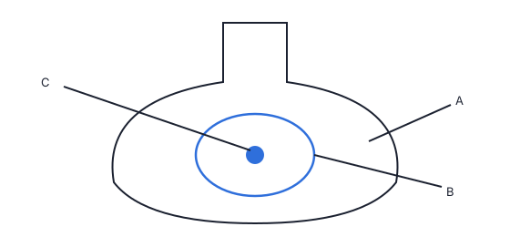
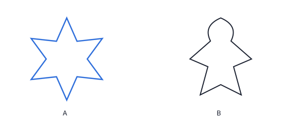

# 생명과학 복습 1110 문제설명

왼쪽 목차로 문항을 고르고, 오른쪽 문제를 보며 해설을 따라가요.

문제의 첫 줄부터 검산까지 설명해요.

**목차**

- [문항별 설명](#problems)
  - [P1. 균류와 가까운 계통](#p1)
  - [P2. 분류 체계의 변화](#p2)
  - [P3. 동물의 일반적 성질](#p3)
  - [P4. 속씨식물의 특징과 화석](#p4)
  - [P5. 동물매개 수분과 꽃](#p5)
  - [P6. 분자 계통수의 큰 흐름](#p6)
  - [P7. 해조류와 육상식물의 공통점](#p7)
  - [P8. 동물의 대칭 구조](#p8)
  - [P9. 분해자 생물군](#p9)
  - [P10. 오염 토양의 생물학적 처리](#p10)
  - [P11. 균류는 밖에서 분해한 뒤 흡수해요](#p11)
  - [P12. 육상 생식을 가능하게 한 양막류](#p12)
  - [P13. 척삭과 뼈의 공통 범위를 구별해요](#p13)
  - [P14. 균류와 동물의 공통 영양 방식](#p14)
  - [P15. 원생생물의 다양성과 문항의 범위](#p15)
  - [P16. 균근에서 오가는 물질의 방향](#p16)
  - [P17. 사람류를 가르는 두발 보행](#p17)
  - [P18. 겉씨식물도 꽃가루와 종자를 가져요](#p18)
  - [P19. [변형] 물을 내보내는 주머니](#p19)
  - [P20. [변형] 물색과 생물군 구별](#p20)
  - [P21. [변형] 관다발과 종자로 찾기](#p21)
  - [P22. [변형] 꽃의 부분과 발달 결과](#p22)
  - [P23. [변형] 서로에게 가해진 선택압](#p23)
  - [P24. [변형] 균류 먹이 획득 쌍둥이](#p24)
  - [P25. [변형] 표지 물질의 두 방향 이동](#p25)
  - [P26. [변형] 자르는 면의 수](#p26)
  - [P27. [변형] 육상 생식의 조건](#p27)
  - [P28. [변형] 영장류와 사람류 쌍둥이](#p28)
  - [P29. [변형] 두 종류 증거의 결론](#p29)
  - [P30. [변형] 포유류의 공통점과 예외](#p30)

## 문항별 설명

### P1. 균류와 가까운 계통

기출 9강 2 · [원 문제 보기](../%EB%B3%B5%EC%8A%B5%EB%AC%B8%EC%A0%9C_1110_Protists_Plants_Fungi_and_Animals.html#p1)

다음 보기들 중 균류와 가장 가까운 그룹은 어느 것인가?

- (1) 동물계
- (2) 고세균영역
- (3) 진정세균영역
- (4) 식물계
- (5) 원생생물계

기출 원문 보기

기출 9강 합본 2번 (PDF 1쪽)

#### 문제를 내 말로 읽어요

균류와 가장 가까운 집단을 다섯 보기에서 골라요. 겉모습이나 먹는 방식이 아니라 공통 조상의 관계를 비교해요.

#### 이 문제를 봤을 때 떠올릴 개념과 공식

‘가장 가까운 그룹’은 두 집단이 공유하는 최근 공통 조상을 확인하라는 뜻이에요. 균류와 동물은 진핵생물 안의 가까운 후편모생물 계통이에요. 고세균·진정세균은 원핵생물의 서로 다른 영역이고, 식물은 균류보다 먼 진핵 계통이에요. 원생생물계는 여러 계통을 넓게 묶은 이름이라 하나의 단일한 비교 가지가 아니에요.

관련 정리노트: [세 영역과 균류·동물의 계통 비교](../%EC%A0%95%EB%A6%AC%EB%85%B8%ED%8A%B8_1110_Protists_Plants_Fungi_and_Animals.html#s0-recap), [원생생물의 다양한 계통](../%EC%A0%95%EB%A6%AC%EB%85%B8%ED%8A%B8_1110_Protists_Plants_Fungi_and_Animals.html#s0-diversity)

#### 왜 이렇게 푸는지 함께 따라가요

(1) 동물계는 적합해요. 균류와 동물이 후편모생물 계통의 가까운 가지이므로 보기 중 최근 공통 조상으로 비교할 상대예요.

(2) 고세균영역은 부적합해요. 진핵생물인 균류와 달리 원핵생물 영역이므로 동물보다 가까운 보기로 고를 수 없어요.

(3) 진정세균영역도 부적합해요. 원핵생물의 또 다른 영역이며 균류·동물의 가까운 진핵 가지가 아니에요.

(4) 식물계는 부적합해요. 같은 진핵생물이라도 균류와 동물의 계통 관계가 균류와 식물의 관계보다 가까워요.

(5) 원생생물계는 부적합해요. 여러 진핵 계통의 묶음이라 특정한 하나의 최근 공통 조상 가지로 동물계와 비교하기 어려워요.

따라서 보기 중 가장 가까운 집단은 동물계, 답은 (1)이에요.

#### 완성 답과 검산

답 (1). 원핵 영역 둘을 제외하고 진핵 보기만 남겨 다시 보면, 식물은 균류·동물의 가까운 분기 밖에 있고 원생생물계는 단일 가지가 아니에요. 동물계만 한 집단으로 근연 관계를 나타내요.

**페이지 요약**

#### 판단 기준

가까움은 공유하는 최근 공통 조상으로 판단해요. 균류와 동물은 가까운 진핵 계통이에요.

#### 결론·확인

원핵 두 영역과 단일 계통이 아닌 원생생물계, 더 먼 식물계를 제외하면 답은 (1) 동물계예요.

---

### P2. 분류 체계의 변화

기출 9강 5 · [원 문제 보기](../%EB%B3%B5%EC%8A%B5%EB%AC%B8%EC%A0%9C_1110_Protists_Plants_Fungi_and_Animals.html#p2)

생명체에 대한 분류 체계는 시간이 지남에 따라 어떻게 변화해왔는가?

- (1) 처음에 생명체는 동물 또는 식물로 분류되었다. 최근에는 5 생물계의 분류 체계가 변화되었다
- (2) 과학자들은 항상 생명체를 5 생물계로 분류해왔다. 그러나 각 계에 해당하는 종의 배치는 변화되어 왔다
- (3) 약 50년 전의 5 생물계 분류 체계는 최근에 몇 개의 영역이 서로 합쳐지며 3개의 영역으로 대체되었다
- (4) 18세기 린네에 의해 제정된 분류 체계가 최근 과학자들에 의해 새로이 도입되었다
- (5) 모든 생물계는 최근에 진핵생물로 재 분류된 원생생물을 제외하고는 모두 같다

기출 원문 보기

기출 9강 합본 5번 (PDF 1쪽)

#### 문제를 내 말로 읽어요

옛 두 계·다섯 계 분류와 현대 세 영역 분류가 어떻게 이어졌는지 판단해요.

**인쇄 정답 오류:** 인쇄 답은 (3)이지만, 분류 단계와 변화 과정을 대조하면 카드의 정정 답은 (1)이에요.

#### 이 문제를 봤을 때 떠올릴 개념과 공식

‘분류 체계가 변화’했다는 말에서는 시기마다 생물을 나눈 기준과 분류 단계가 무엇인지 확인해요. 초기에는 식물·동물의 큰 구분이 쓰였고, 뒤에는 세균·원생생물·균류 등을 가르는 다섯 계가 쓰였어요. 분자 자료를 반영한 세 영역은 세균·고세균·진핵생물이며, 영역은 계보다 큰 분류 단계예요. 다섯 계의 일부 영역들이 단순히 합쳐져 세 영역이 된 것은 아니에요.

관련 정리노트: [두 계·다섯 계와 세 영역의 경계](../%EC%A0%95%EB%A6%AC%EB%85%B8%ED%8A%B8_1110_Protists_Plants_Fungi_and_Animals.html#s0-recap)

#### 왜 이렇게 푸는지 함께 따라가요

(1) 맞아요. 처음의 동물·식물 구분 뒤에 다섯 계 분류가 쓰였고 그 체계도 다시 바뀌었으므로 역사적 큰 흐름에 부합해요. 문장은 거칠지만 ‘변화해 왔다’는 질문에 맞아요.

(2) 틀려요. ‘항상 5 생물계’라는 부분은 초기 두 계 분류가 있었다는 사실과 충돌해요.

(3) 틀려요. 다섯 계는 계 단계이고 세 영역은 그보다 큰 단계예요. ‘몇 개의 영역이 서로 합쳐지며’ 세 영역으로 대체됐다는 기작은 분류 단계를 혼동해요. 인쇄 답이지만 그대로 옳다고 할 수 없어요.

(4) 틀려요. 린네의 18세기 분류 체계가 최근 새로 도입됐다는 시간 순서가 맞지 않아요.

(5) 틀려요. 원생생물만 최근에 진핵생물로 재분류됐다는 주장은 틀려요. 수업의 동물·식물·균류도 진핵생물 범주예요.

따라서 역사적 변화와 일치하는 보기는 (1)이에요. 인쇄된 (3)은 잘못된 변화 기작을 말해요.

#### 완성 답과 검산

정정 답 (1), 인쇄 답 (3). 세 영역을 직접 적어 다시 확인하면 세균·고세균·진핵생물이고, 이들은 다섯 계의 영역들이 합쳐진 결과가 아니에요. 이 역확인으로 (3)을 제외하고, 두 계에서 다섯 계를 거친 (1)의 역사 서술을 남겨요.

#### 인쇄 답을 만났을 때

시험 자료의 빨간 답 표시를 사실 판단 대신 쓰지 마세요. ‘계’와 ‘영역’의 단계를 먼저 적고 (3)의 합쳐졌다는 기작이 왜 성립하지 않는지 설명한 뒤, 정정 답 (1)을 사용해요.

**페이지 요약**

#### 인쇄 정답 오류

인쇄 (3)은 영역들이 합쳐졌다는 잘못된 기작이에요. 정정 답은 (1)이에요.

#### 판단·확인

초기 두 계에서 다섯 계를 거쳐 분자 자료에 따른 세 영역으로 분류가 바뀌었어요. 영역은 계보다 큰 단계라 (3)은 소거해요.

---

### P3. 동물의 일반적 성질

기출 9강 6 · [원 문제 보기](../%EB%B3%B5%EC%8A%B5%EB%AC%B8%EC%A0%9C_1110_Protists_Plants_Fungi_and_Animals.html#p3)

동물의 일반적인 특성으로 잘못된 것은?

- (1) 모든 동물은 종속영양생물이다
- (2) 세포에 세포벽이 없다
- (3) 모든 동물은 유성생식을 한다
- (4) 동물의 대부분은 운동성을 갖는다
- (5) 진핵생물이며 다세포성이다

기출 원문 보기

기출 9강 합본 6번 (PDF 1쪽)

#### 문제를 내 말로 읽어요

동물의 일반적인 성질을 하나씩 확인해 **잘못된 설명**을 골라요.

**문항 결함:** (3)의 ‘모든 동물은 유성생식을 한다’는 ‘유성생식도 가능하다’와 ‘유성생식만 한다’로 달리 읽힐 수 있어요. 출제 의도상 답은 (3)이에요.

#### 이 문제를 봤을 때 떠올릴 개념과 공식

각 보기가 공통 형질인지, ‘모든’이 붙을 만큼 예외가 없는지 확인해요. 동물은 다세포 진핵생물이며 세포벽이 없고 외부 유기물에 의존해요. 대부분은 생활사의 어떤 단계에서 움직여요. 생식은 별도 기준이에요. 해면동물처럼 무성생식도 하는 사례가 있으므로 유성생식만 한다는 일반화는 성립하지 않아요. 다만 무성생식 사례만으로 유성생식 능력이 없다고 결론 내릴 수는 없어요.

관련 정리노트: [동물의 공통 형질과 생식 예외](../%EC%A0%95%EB%A6%AC%EB%85%B8%ED%8A%B8_1110_Protists_Plants_Fungi_and_Animals.html#s3-animal)

#### 왜 이렇게 푸는지 함께 따라가요

(1) 맞아요. 동물은 스스로 광합성해 유기물을 만드는 대신 외부 유기물을 얻는 종속영양생물이에요. 부정형 질문의 답으로 고르지 않아요.

(2) 맞아요. 동물 세포에는 세포벽이 없으므로 다른 생물군의 벽과 구별돼요.

(3) 출제 의도상 잘못된 보기예요. 모든 번식이 유성생식만이라는 뜻이라면 해면동물의 무성생식이 반례예요. 그러나 유성생식도 가능하다는 뜻으로만 읽으면 이 반례만으로 거짓을 증명하지 못해요. 문장에 ‘만’이 없어 엄밀한 판정은 유보해야 해요.

(4) 맞아요. ‘대부분’은 예외를 허용하고, 동물 다수가 생활사의 어떤 단계에서 움직여요.

(5) 맞아요. 진핵세포로 이루어진 다세포성은 동물의 일반적인 특징이에요.

출제 의도상 답은 (3)이지만, 질문 문구만으로 단일한 잘못된 보기를 확정하기에는 한계가 있어요.

#### 완성 답과 검산

의도된 답 (3). 다른 네 보기에서 영양 방식·세포벽·운동성의 ‘대부분’ 조건·진핵 다세포성을 독립적으로 확인했어요. (3)은 무성생식 사례로 ‘유성생식만’을 반박할 수 있지만, 원문에는 ‘만’이 없다는 유보를 검산 결과에도 남겨요.

#### 문장 조건을 붙여 판단해요

시험에서는 (3)을 출제 의도상 고르되, ‘모든 동물의 모든 번식이 유성생식만’이라는 해석을 밝혀요. 무성생식도 한다는 사실을 유성생식이 전혀 불가능하다는 뜻으로 바꾸지 마세요.

**페이지 요약**

#### 판단 기준

동물은 종속영양·세포벽 없음·진핵 다세포이며 대체로 운동성이 있어요. 생식 방식에는 예외가 있어요.

#### 문항 결함과 결론

의도된 답은 (3)이에요. 무성생식은 ‘유성생식만’의 반례지만, 원문의 ‘유성생식을 한다’가 가능성만 뜻하면 이 반례로 단정할 수 없어요.

---

### P4. 속씨식물의 특징과 화석

기출 9강 7 · [원 문제 보기](../%EB%B3%B5%EC%8A%B5%EB%AC%B8%EC%A0%9C_1110_Protists_Plants_Fungi_and_Animals.html#p4)

다음 속씨식물에 관한 설명 중 잘못된 설명은?

- (1) 속씨식물을 정의하는 구조는 꽃과 열매가 중요하다
- (2) 속씨식물은 동물 꽃가루받이 매개자들과 공진화했다
- (3) 밑씨는 씨방 속에 들어있고, 씨방은 과실로 발달한다
- (4) 속씨식물은 특수화된 세포인 물관요소를 가짐으로써 물을 빠르게 이동시킨다
- (5) 현화식물의 화석을 통해 다른 식물군들과 연결되는 진화의 경향을 잘 파악할 수 있다

기출 원문 보기

기출 9강 합본 7번 (PDF 1쪽)

#### 문제를 내 말로 읽어요

속씨식물의 구조·수송·화석 설명을 비교해 **잘못된 설명**을 골라요.

**문항 결함:** (5)는 명백한 구조 오류보다 ‘잘 파악할 수 있다’는 정도 표현에 의존해요. 출제 의도상 답은 (5)이에요.

#### 이 문제를 봤을 때 떠올릴 개념과 공식

구조 보기에서는 꽃·열매가 속씨식물의 특징인지, 밑씨와 씨방 중 무엇이 씨·열매로 발달하는지 확인해요. 수송 보기에서는 물관요소가 물을 이동시키는 세포인지, 관다발 전체와 같은 말인지 구별해요. 화석 보기에서는 초기 속씨식물 자료가 다른 식물군과의 연결을 자세히 보여 줄 만큼 충분한지 확인해요. 물관요소와 초기 화석의 상태는 수업 밖 교재 보충이에요.

관련 정리노트: [속씨식물의 꽃·씨방·열매와 보충](../%EC%A0%95%EB%A6%AC%EB%85%B8%ED%8A%B8_1110_Protists_Plants_Fungi_and_Animals.html#s1-seed), [꽃과 동물 수분매개자의 공진화](../%EC%A0%95%EB%A6%AC%EB%85%B8%ED%8A%B8_1110_Protists_Plants_Fungi_and_Animals.html#s1-coevolution)

#### 왜 이렇게 푸는지 함께 따라가요

(1) 맞아요. 속씨식물을 가르는 생식 구조가 꽃이고, 수정 뒤 씨방이 발달한 열매가 특징이에요.

(2) 맞아요. 꽃의 색·향·형태와 동물 수분매개자의 상호작용은 서로의 선택압에 영향을 줄 수 있어요. 모든 꽃이 동물매개라는 뜻은 아니에요.

(3) 맞아요. 속씨식물에서 밑씨는 씨방 안에 있고, 밑씨는 종자, 씨방은 과실로 발달해요.

(4) 교재 설명에 맞아요. 속씨식물의 특수한 물관요소는 물 수송을 빠르게 할 수 있어요. 이는 관다발 자체가 속씨식물에만 있다는 뜻이 아니에요.

(5) 출제 의도상 틀려요. 초기 속씨식물 화석 기록이 빈약해 다른 식물군과의 초기 진화 연결을 잘 파악하기 어려워요. 화석 자체가 없다는 뜻은 아니며 ‘잘’이라는 표현의 정도를 판정하는 보기예요.

출제 의도상 답은 (5)이지만, 그 판정은 초기 기록의 충분성과 정도 표현에 달려 있어요.

#### 완성 답과 검산

의도된 답 (5). 꽃·열매와 밑씨·씨방의 대응은 구조로 다시 확인했고, 물관요소는 수송 기능으로 확인했어요. 초기 화석 부족은 초기 연결을 ‘잘’ 추적한다는 (5)의 강한 표현과 맞지 않아요. 따라서 구조 세 보기와 수송 한 보기를 제외하고 (5)를 남기되 정도 판단의 한계를 유지해요.

#### 교재 보충과 수업을 구별해요

시험에서는 (5)를 고르면서 ‘초기 속씨식물 화석이 부족해 연결을 잘 추적하기 어렵다’고 근거를 써요. 물관요소와 초기 화석은 수업 본문의 직접 설명이 아니라 교재 보충이고, 일부 화석의 존재를 부정하지 않아요.

**페이지 요약**

#### 판단 기준

속씨식물은 꽃·씨방·열매가 특징이고 밑씨는 종자, 씨방은 열매가 돼요. 물관요소는 빠른 물 수송에 기여해요.

#### 문항 결함과 결론

초기 화석이 빈약해 다른 식물군과의 초기 연결을 ‘잘’ 파악한다는 (5)는 출제 의도상 답이에요. 정도 표현에 의존한다는 유보가 필요해요.

---

### P5. 동물매개 수분과 꽃

기출 9강 8 · [원 문제 보기](../%EB%B3%B5%EC%8A%B5%EB%AC%B8%EC%A0%9C_1110_Protists_Plants_Fungi_and_Animals.html#p5)

속씨식물은 _______ 의 진화로 동물 꽃가루 매개자들과 공진화 할 수 있었다.

- (1) 큐티클
- (2) 엽록체
- (3) 기공
- (4) 관다발
- (5) 꽃

기출 원문 보기

기출 9강 합본 8번 (PDF 1쪽)

#### 문제를 내 말로 읽어요

속씨식물의 어떤 새로운 구조가 동물에 의한 꽃가루 이동과 연결되는지 고르는 빈칸 문제예요.

#### 이 문제를 봤을 때 떠올릴 개념과 공식

‘동물 꽃가루 매개자’라는 단서에서 동물이 방문하고 꽃가루를 실어 나르는 생식 구조를 찾아요. 속씨식물의 꽃은 색·향·형태가 방문자와 맞물릴 수 있어요. 공진화는 두 계통의 상호작용이 여러 세대에 걸쳐 서로의 선택압에 영향을 주는 것이며, 개체가 의도적으로 변하는 과정은 아니에요. 큐티클·기공·관다발은 각각 건조 대응·기체 교환·수송이고 엽록체는 광합성에 쓰여요.

관련 정리노트: [꽃과 매개자의 공진화](../%EC%A0%95%EB%A6%AC%EB%85%B8%ED%8A%B8_1110_Protists_Plants_Fungi_and_Animals.html#s1-coevolution), [큐티클·기공·관다발의 역할](../%EC%A0%95%EB%A6%AC%EB%85%B8%ED%8A%B8_1110_Protists_Plants_Fungi_and_Animals.html#s1-land)

#### 왜 이렇게 푸는지 함께 따라가요

(1) 큐티클은 부적합해요. 표면에서 물 손실을 줄이지만 동물이 꽃가루를 옮기는 생식 구조는 아니에요.

(2) 엽록체는 부적합해요. 빛으로 유기물을 만드는 세포소기관이며 방문자를 맞는 구조가 아니에요.

(3) 기공은 부적합해요. 기체 교환의 통로이지 꽃가루 매개자가 방문하는 꽃 구조가 아니에요.

(4) 관다발은 부적합해요. 물·광합성 산물을 수송하지만 동물매개 수분의 상호작용 장소는 아니에요.

(5) 꽃이 적합해요. 동물이 꽃에 방문할 때 꽃가루를 옮기고, 꽃의 신호·형태와 방문자의 감각·몸 구조가 상호 선택압에 영향을 줄 수 있어요.

빈칸에는 꽃이 들어가므로 답은 (5)이에요.

#### 완성 답과 검산

답 (5). 보기의 역할을 역으로 정리하면 큐티클·기공·관다발은 육상 생활 문제를, 엽록체는 광합성을 담당해요. 남은 꽃만 동물 방문과 꽃가루 전달을 같은 구조에서 연결해요.

**페이지 요약**

#### 판단 기준

동물매개 수분에는 동물이 방문하고 꽃가루를 옮길 꽃 구조가 필요해요. 공진화는 상호 선택압의 축적이에요.

#### 결론·확인

큐티클·기공·관다발은 다른 육상 적응, 엽록체는 광합성에 해당하므로 답은 (5) 꽃이에요.

---

### P6. 분자 계통수의 큰 흐름

기출 9강 9 · [원 문제 보기](../%EB%B3%B5%EC%8A%B5%EB%AC%B8%EC%A0%9C_1110_Protists_Plants_Fungi_and_Animals.html#p6)

염기서열 연구를 기반으로 한 현대종들의 계통수를 비교한 결과는?

- (1) 버섯은 식물보다 동물과 더 가깝다
- (2) 원생생물은 분류하기 쉽지 않은 극심한 다양성을 지닌 집단이다
- (3) 원핵생물에는 크게 다른 두 영역이 있다
- (4) 모두 틀리다
- (5) 모두 옳다

기출 원문 보기

기출 9강 합본 9번 (PDF 2쪽)

#### 문제를 내 말로 읽어요

염기서열로 그린 큰 계통 관계에 관한 앞의 세 문장을 각각 판단한 뒤 ‘모두’ 보기를 골라요.

#### 이 문제를 봤을 때 떠올릴 개념과 공식

‘계통수’에서는 닮은 겉모습보다 염기서열이 보여 주는 공통 조상 관계를 확인해요. 균류는 식물보다 동물과 가까워요. 전통적 원생생물은 다양한 진핵 계통의 묶음이라 한 가지 자연 집단으로 깔끔하게 분류하기 어려워요. 원핵생물에는 진정세균과 고세균이라는 다른 두 영역이 있어요. 세 문장을 따로 판정한 뒤 ‘모두 틀리다’와 ‘모두 옳다’를 판단해야 해요.

관련 정리노트: [원핵생물의 두 영역과 균류의 관계](../%EC%A0%95%EB%A6%AC%EB%85%B8%ED%8A%B8_1110_Protists_Plants_Fungi_and_Animals.html#s0-recap), [원생생물의 다양한 계통](../%EC%A0%95%EB%A6%AC%EB%85%B8%ED%8A%B8_1110_Protists_Plants_Fungi_and_Animals.html#s0-diversity)

#### 왜 이렇게 푸는지 함께 따라가요

(1) 맞아요. 버섯이 속한 균류와 동물은 가까운 계통이므로 식물보다 동물과 더 가깝다는 비교가 성립해요.

(2) 맞아요. 원생생물은 한 단일 계통보다 여러 진핵 계통을 묶은 이름이므로 매우 다양하고 분류가 어려워요.

(3) 맞아요. 원핵생물을 모두 한 영역으로 합치지 않고 진정세균과 고세균의 두 영역으로 구별해요.

(4) 틀려요. (1)부터 (3)이 각각 참이므로 ‘모두 틀리다’는 그 결과와 모순돼요.

(5) 맞아요. 독립적으로 확인한 (1), (2), (3)이 모두 참이라 ‘모두 옳다’가 맞는 조합이에요.

세 진술을 모두 참으로 판정했으므로 답은 (5)이에요.

#### 완성 답과 검산

답 (5). 세 진술을 ‘균류·동물 근연 / 원생생물의 여러 계통 / 원핵의 두 영역’으로 서로 다른 기준에 나눠 다시 대조했어요. 세 기준 중 거짓인 것이 없으므로 (4)는 소거되고 (5)가 남아요.

**페이지 요약**

#### 판단 기준

계통 관계·원생생물의 범위·원핵의 영역 수를 각각 검사해요.

#### 결론·확인

(1) 균류는 동물과 가까움, (2) 원생생물은 다양함, (3) 원핵은 두 영역이 모두 참이에요. 따라서 답은 (5)이에요.

---

### P7. 해조류와 육상식물의 공통점

기출 9강 10 · [원 문제 보기](../%EB%B3%B5%EC%8A%B5%EB%AC%B8%EC%A0%9C_1110_Protists_Plants_Fungi_and_Animals.html#p7)

해조류와 식물 둘 다 ( )을/를 하는 능력을 가지고 있다.

- (1) 광합성
- (2) 종자번식
- (3) 세대교번
- (4) 운동
- (5) 신경전달

기출 원문 보기

기출 9강 합본 10번 (PDF 2쪽)

#### 문제를 내 말로 읽어요

해조류와 식물 양쪽에서 나타나는 능력을 골라요.

**문항 결함:** (3) 세대교번도 일부 해조류와 식물에서 나타날 수 있어 단일 답을 엄밀히 보장하지 않아요. 출제 의도상 답은 (1)이에요.

#### 이 문제를 봤을 때 떠올릴 개념과 공식

‘해조류와 식물 둘 다’는 두 집단의 공통 능력을 묻지만, 어느 해조류와 어느 식물을 뜻하는지 범위도 확인해야 해요. 해조류와 육상식물 모두 빛으로 유기물을 만드는 광합성 계통을 포함해요. 해조류 전체에 꽃·종자를 일반화할 수 없어요. 세대교번은 일부 해조류에도 있어 ‘해조류에는 전혀 없다’고 소거하면 안 돼요. 세대교번의 자세한 생활사는 이번 수업 범위 밖 보충이에요.

관련 정리노트: [해조류의 광합성과 세대교번 보충](../%EC%A0%95%EB%A6%AC%EB%85%B8%ED%8A%B8_1110_Protists_Plants_Fungi_and_Animals.html#s0-algae), [조류와 육상식물의 분류 경계](../%EC%A0%95%EB%A6%AC%EB%85%B8%ED%8A%B8_1110_Protists_Plants_Fungi_and_Animals.html#s1-land)

#### 왜 이렇게 푸는지 함께 따라가요

(1) 광합성은 출제 의도상 적합해요. 광합성 해조류와 육상식물은 빛을 이용해 유기물을 만들어요.

(2) 종자번식은 해조류와 식물 전체의 공통 능력이 아니에요. 해조류에는 종자를 일반화할 수 없어요.

(3) 엄밀히는 맞을 수도 있어요. 일부 갈조류 같은 해조류에도 세대교번이 나타나므로 ‘해조류에는 없다’고 제외할 수 없어요. 원문이 일부인지 전체인지 한정하지 않아 출제 의도상 답 (1)의 유일성이 약해요.

(4) 운동은 해조류와 육상식물 전체를 함께 가르는 공통 능력으로 제시하기 어려워요. 일부 세포의 운동 가능성과 두 집단 일반형질은 달라요.

(5) 신경전달은 해조류·육상식물의 일반적인 공통 능력이 아니에요. 동물의 신경계와 혼동하면 안 돼요.

출제 의도상 대표 공통 능력은 (1) 광합성이에요. 다만 (3)의 일부 사례 때문에 엄밀한 단일 답이라고 단정하지 않아요.

#### 완성 답과 검산

의도된 답 (1). 종자·신경계는 두 집단의 공통 능력으로 소거할 수 있어요. 하지만 (3)은 일부 해조류의 생활사를 대입하면 참으로 읽히므로 소거 검산이 하나만 남기지 않아요. 문항의 범위 조건이 빠진 결함을 답과 함께 유지해요.

#### 범위를 먼저 정해요

시험에서는 수업의 대표 공통 능력인 광합성으로 (1)을 고르되, (3)을 ‘해조류에는 세대교번이 없다’는 잘못된 이유로 버리지 마세요. 일부 계통인지 전체 집단인지 질문에 없다는 점을 적어요.

**페이지 요약**

#### 판단 기준

광합성 해조류와 육상식물 모두 유기물을 만들 수 있지만, 해조류에 종자를 일반화할 수 없어요.

#### 문항 결함과 결론

출제 의도상 답은 (1) 광합성이에요. 일부 해조류에도 세대교번이 있어 (3)을 무조건 배제할 수 없어요.

---

### P8. 동물의 대칭 구조

기출 9강 12 · [원 문제 보기](../%EB%B3%B5%EC%8A%B5%EB%AC%B8%EC%A0%9C_1110_Protists_Plants_Fungi_and_Animals.html#p8)

동물 진화의 주요 혁신에 대한 설명 중, 위 그림이 나타내는 것은?

- (1) 조직과 조직층은 동물 진화 초기에 나타났다
- (2) 많은 동물은 내부 기관을 감싸는 체강을 가지고 있다
- (3) 대부분의 동물은 방사대칭이나 좌우대칭 중 하나를 나타낸다
- (4) 동물의 기원에서 발생 양식이 주된 분기를 나타낸다
- (5) 체절화는 일부 동물들의 몸을 반복적으로 나누어 준다

기출 원문 보기

기출 9강 합본 12번 (PDF 2쪽)

#### 문제를 내 말로 읽어요

그림에서 두 동물의 몸을 가르는 파란 평면이 무엇을 보여 주는지 골라요. 몸의 안쪽 구조나 번식 과정은 그려져 있지 않아요.

#### 이 문제를 봤을 때 떠올릴 개념과 공식

대칭은 몸을 한 평면으로 나눴을 때 양쪽의 형태가 대응하는지로 판단해요. 몸의 중심축을 지나는 여러 평면에서 대응하면 방사대칭, 한 평면에서만 좌우가 대응하면 좌우대칭이에요. 어느 평면에서도 대응하지 않는 해면동물 같은 비대칭도 있어요. 그림의 절단 평면 수와 방향을 확인하면 돼요.

관련 정리노트: [방사대칭·좌우대칭·비대칭](../%EC%A0%95%EB%A6%AC%EB%85%B8%ED%8A%B8_1110_Protists_Plants_Fungi_and_Animals.html#s3-animal)

#### 왜 이렇게 푸는지 함께 따라가요

(1) 조직과 조직층은 이 그림의 답으로 부적합해요. 파란 평면은 몸의 분할 방향을 보여 주며 세포가 조직층을 이루는지는 표시하지 않아요.

(2) 체강도 부적합해요. 내부 기관을 둘러싼 공간의 유무를 판단하려면 몸 안쪽 단면이 필요하지만 그림은 대칭 평면을 보여 줘요.

(3) 적합해요. 한 동물은 중심축을 지나는 여러 방향에서, 다른 동물은 한 방향에서 몸이 대응하는 관계를 그려 방사대칭과 좌우대칭을 비교해요.

(4) 발생 양식의 분기도 부적합해요. 배아의 발생 과정이나 분기 정보가 아니라 몸을 가르는 평면이 표시되어 있어요.

(5) 체절화도 부적합해요. 반복되는 몸마디를 따라 나눈 그림이 아니라 몸의 양쪽 대응을 확인하는 평면이에요.

따라서 그림이 직접 보여 주는 것은 대칭성이고 답은 (3)이에요.

#### 완성 답과 검산

답 (3). 그림의 파란 면을 따라 몸 양쪽의 모양이 대응하는지 다시 보세요. 여러 면과 한 면의 차이를 읽을 수 있지만, 조직층·체강·발생·반복 마디에 필요한 표지는 없어요. 그 부재로 나머지 보기를 독립적으로 소거해요.

**페이지 요약**

#### 판단 기준

여러 평면으로 대응하면 방사대칭, 한 평면으로 대응하면 좌우대칭이에요.

#### 결론·확인

그림은 몸을 가르는 평면을 비교하고 내부 구조나 발생 과정은 표시하지 않으므로 답은 (3)이에요.

---

### P9. 분해자 생물군

기출 9강 14 · [원 문제 보기](../%EB%B3%B5%EC%8A%B5%EB%AC%B8%EC%A0%9C_1110_Protists_Plants_Fungi_and_Animals.html#p9)

버섯, 항생제 등을 생산하고, 육상생태계의 중요한 분해자의 역할을 하는 생물은 ( ) 이다.

- (1) 식물계
- (2) 고세균영역
- (3) 동물계
- (4) 균류
- (5) 원생생물계

기출 원문 보기

기출 9강 합본 14번 (PDF 2쪽)

#### 문제를 내 말로 읽어요

버섯이 속하고 죽은 물질을 분해하는 생물군의 이름을 보기에서 골라요.

#### 이 문제를 봤을 때 떠올릴 개념과 공식

‘버섯’은 균류의 눈에 보이는 구조예요. 균류는 외부 유기물에 효소를 내보내 작은 분자로 분해한 뒤 흡수해요. 죽은 유기물을 분해하는 종류는 분해자 역할을 해요. 문제의 항생제 생산은 일부 균류의 응용 사례이지 모든 균류가 생산한다는 뜻은 아니에요.

관련 정리노트: [균류의 세포외 소화와 분해자 역할](../%EC%A0%95%EB%A6%AC%EB%85%B8%ED%8A%B8_1110_Protists_Plants_Fungi_and_Animals.html#s2-feeding), [버섯과 균사체](../%EC%A0%95%EB%A6%AC%EB%85%B8%ED%8A%B8_1110_Protists_Plants_Fungi_and_Animals.html#s2-structure)

#### 왜 이렇게 푸는지 함께 따라가요

(1) 식물계는 부적합해요. 버섯은 식물이 아니고 광합성으로 먹이를 만드는 방식도 쓰지 않아요.

(2) 고세균영역은 부적합해요. 원핵생물의 영역으로, 진핵생물인 버섯이 속하지 않아요.

(3) 동물계는 부적합해요. 동물은 보통 먹이를 들여 소화하지만 버섯은 몸 밖에서 분해한 뒤 흡수해요.

(4) 균류가 적합해요. 버섯은 균류이고, 일부 균류의 항생제 생산 및 많은 균류의 유기물 분해와 맞아요.

(5) 원생생물계는 부적합해요. 이 수업의 전통적 분류에서도 버섯은 원생생물이 아니라 별도의 균류로 놓아요.

버섯의 소속과 분해 방식을 모두 만족하는 답은 (4)예요.

#### 완성 답과 검산

답 (4). 보기에서 버섯의 소속만으로 먼저 고르면 균류가 남아요. 다른 경로로 ‘몸 밖에서 분해하고 흡수하는 분해자’라는 영양 방식을 적용해도 같은 집단이 남아요.

**페이지 요약**

#### 판단 기준

버섯은 균류이고, 많은 균류가 외부 효소로 유기물을 분해한 뒤 흡수해요.

#### 결론·확인

버섯의 소속과 분해자 영양 방식이 모두 맞는 보기는 (4) 균류예요.

---

### P10. 오염 토양의 생물학적 처리

기출 9강 15 · [원 문제 보기](../%EB%B3%B5%EC%8A%B5%EB%AC%B8%EC%A0%9C_1110_Protists_Plants_Fungi_and_Animals.html#p10)

토양의 화학적인 오염으로 인해서 사람이 살기에 부적합한 지역들이 세계 곳곳에 있다. 이 독성 물질을 없애는 데 가장 유용하게 사용될 수 있는 생물체는?

- (1) 균류
- (2) 선태식물
- (3) 바이러스
- (4) 동물
- (5) 원생생물

기출 원문 보기

기출 9강 합본 15번 (PDF 2쪽)

#### 문제를 내 말로 읽어요

오염된 토양에서 독성 물질을 없애는 데 쓸 생물군을 고르는 문제예요.

**문항 결함:** 오염 물질의 종류와 처리 조건이 없어 어느 생물군이 ‘가장 유용’한지는 하나로 정할 수 없어요. 출제 의도상 답은 (1)이에요.

#### 이 문제를 봤을 때 떠올릴 개념과 공식

균류는 큰 유기물에 세포외 효소를 내보내 작은 분자로 분해하고 흡수해요. 일부 균류의 이런 효소는 특정 유기 오염물의 정화에 응용될 수 있어요. 그러나 금속은 분해되지 않고, 처리 효과는 물질의 종류·산소·산도·수분·온도 등에 따라 달라요. 따라서 ‘독성 물질’이라는 말만으로 모든 오염물에 가장 효과적인 생물을 정하는 기준은 없어요. 정화 응용은 수업 밖 보충이에요.

관련 정리노트: [균류의 세포외 소화와 정화 보충](../%EC%A0%95%EB%A6%AC%EB%85%B8%ED%8A%B8_1110_Protists_Plants_Fungi_and_Animals.html#s2-feeding)

#### 왜 이렇게 푸는지 함께 따라가요

(1) 출제 의도상 적합해요. 균류 가운데 일부는 몸 밖으로 낸 효소로 특정 유기 오염물을 분해할 수 있어요. 금속까지 분해한다거나 모든 조건에서 가장 낫다는 뜻은 아니에요.

(2) 선태식물은 이 문항이 떠올리게 하는 세포외 효소 분해의 대표 집단은 아니에요. 다만 오염물과 목표가 빠졌으므로 선태식물이 어떤 정화에도 쓸 수 없다고 단정할 수 없어요.

(3) 바이러스는 독립적으로 토양 유기 오염물을 효소 분해하는 대표적인 분해자 집단이 아니므로 출제 의도상 답이 아니에요.

(4) 동물은 균류처럼 토양에서 세포외 소화로 유기 오염물을 분해하는 대표 집단이 아니므로 출제 의도상 답이 아니에요.

(5) 원생생물계는 매우 다양한 집단이고 이 문항에서 특정 정화 기능이 제시되지 않았어요. 모든 원생생물이 오염 처리에 쓸모없다는 결론은 내릴 수 없어요.

균류의 분해 능력을 묻는 의도라면 답은 (1)이에요. 그러나 오염물과 평가 조건이 빠져 엄밀한 최선은 확정되지 않아요.

#### 완성 답과 검산

의도된 답 (1). 균류의 외부 효소가 특정 유기물을 분해할 수 있다는 원리로 출제 의도를 확인했어요. 거꾸로 금속 오염을 대입하면 ‘분해한다’는 기준이 성립하지 않으므로, 원문만으로 (1)이 모든 독성 물질에 가장 유용하다는 결론은 검증되지 않아요.

#### 시험에서 조건을 밝혀요

수업의 균류 분해자 개념을 적용해 (1)을 고르되 ‘일부 유기 오염물에서 가능한 응용’이라는 조건을 함께 써요. 선태식물이나 원생생물의 모든 정화 가능성을 부정하거나 금속을 효소가 분해한다고 말하지 마세요.

**페이지 요약**

#### 판단 기준

일부 균류는 세포외 효소로 특정 유기 오염물을 분해할 수 있어요. 금속은 분해되지 않고 효과는 조건에 따라 달라요.

#### 문항 결함과 결론

출제 의도상 답은 (1) 균류예요. 독성 물질 종류·평가 조건이 없어 ‘가장 유용’을 일반화할 수 없어요.

---

### P11. 균류는 밖에서 분해한 뒤 흡수해요

기출 9강 16 · [원 문제 보기](../%EB%B3%B5%EC%8A%B5%EB%AC%B8%EC%A0%9C_1110_Protists_Plants_Fungi_and_Animals.html#p11)

균류의 먹이 획득 방법은?

- (1) 주변으로부터 세균을 여과한다
- (2) 포자형성
- (3) 태양 빛의 도움으로 자신의 음식을 만든다
- (4) 먹이 위에 성장하며 분해하는 화합물을 분비한다
- (5) 다른 생물을 쫓아가서 포획한다

기출 원문 보기

기출 9강 16 (PDF 2쪽)

#### 문제 이해하기

‘먹이 획득’은 번식이 아니라 영양분을 몸 안으로 들이는 과정을 물어요. 분해가 세포 안팎 중 어디에서 일어나는지 보세요.

#### 이 문제를 봤을 때 떠올릴 개념과 공식

균류는 종속영양생물이에요. 큰 먹이 분자는 세포막을 곧장 통과하기 어려워서 효소를 밖으로 분비해 작게 자른 다음 흡수해요. 이것이 세포외 소화(extracellular digestion)예요. 보기에서 외부 분해와 흡수에 이어지는 행동을 찾고, 포자형성과 광합성은 구별해요.

관련 정리노트: [균류의 세포외 소화](../%EC%A0%95%EB%A6%AC%EB%85%B8%ED%8A%B8_1110_Protists_Plants_Fungi_and_Animals.html#s2-feeding)

#### 왜 이렇게 푸는지 함께 따라가요

(1) 주변 세균을 여과한다는 말은 입자를 걸러 삼키는 방식이에요. 균류의 기준은 세포 밖 효소 분해 뒤 흡수이므로 (1)은 해당하지 않아요.

(2) 포자형성은 개체를 늘리거나 퍼지는 생식 과정이에요. 영양분을 얻는 과정이 아니므로 (2)는 답이 아니에요.

(3) 태양 빛으로 자기 음식을 만든다는 것은 광합성 독립영양이에요. 균류는 외부 유기물에 의존하므로 (3)은 맞지 않아요.

(4) 먹이 위에서 자라 분해 화합물을 분비한다는 (4)는 효소를 외부로 내보내 큰 분자를 자르는 단계와 맞아요. 잘린 분자를 흡수하므로 답에 적합해요.

(5) 다른 생물을 쫓아 포획한다는 (5)는 움직이는 먹이를 잡는 방식이에요. 균류의 일반적인 외부 분해·흡수와 달라요.

따라서 답은 (4)예요.

#### 완성 답과 검산

답 (4). 먹이를 얻는 단계만 남겨 다시 확인해요. (1)·(5)는 입자 포획, (3)은 광합성, (2)는 생식이고, 외부 효소 분해라는 고유한 단계가 남는 것은 (4)예요.

**페이지 요약**

균류는 먹이에 효소를 내보내 몸 밖에서 분해한 뒤 작은 분자를 흡수해요. 포자형성은 먹이 획득이 아니므로 답은 (4)예요.

---

### P12. 육상 생식을 가능하게 한 양막류

기출 9강 17 · [원 문제 보기](../%EB%B3%B5%EC%8A%B5%EB%AC%B8%EC%A0%9C_1110_Protists_Plants_Fungi_and_Animals.html#p12)

보기의 척추동물 군 중에서 최초로 육상에서 생식하도록 적응한 군은?

- (1) 어룡류
- (2) 양막류
- (3) 무악류
- (4) 사지류
- (5) 유악동물

기출 원문 보기

기출 9강 17 (PDF 2쪽)

#### 문제 이해하기

‘최초로 육상에서 생식하도록 적응’은 첫 육상 보행을 묻는 말이 아니에요. 알이나 배가 물 밖에서 마르지 않고 발생할 수 있는 군을 찾아요.

#### 이 문제를 봤을 때 떠올릴 개념과 공식

육상 생식의 조건은 성체의 다리나 턱만이 아니라 발생 중인 배의 보호예요. 양막류(amniotes)는 양막란의 배외막으로 배를 보호하고 기체 교환 등을 도와요. 사지류(tetrapods)는 네 다리 계통 전체라서 물에 알을 낳는 양서류도 포함해요. 양막류에는 파충류·조류·포유류가 속하지만 포유류가 모두 몸 밖에 알을 낳는 것은 아니에요.

관련 정리노트: [양막란과 육상 생식](../%EC%A0%95%EB%A6%AC%EB%85%B8%ED%8A%B8_1110_Protists_Plants_Fungi_and_Animals.html#s3-amniote)

#### 왜 이렇게 푸는지 함께 따라가요

(1) 어룡류는 양막류 안에서 나온 해양 파충류예요. 먼저 생긴 육상 생식 적응의 큰 군을 묻는 데 (1)은 범위가 너무 좁고 늦어요.

(2) 양막류는 배외막이 있는 양막란 계통이에요. 배가 물 밖에서 발생할 수 있게 보호하는 기준과 맞으므로 (2)가 적합해요.

(3) 무악류는 턱이 없는 수생 척추동물 계통이에요. 육상 배 보호 구조를 나타내지 않아 (3)은 부적합해요.

(4) 사지류는 네 다리 계통이지만 물에 알을 낳는 양서류를 포함해요. 다리가 곧 육상 생식이라는 뜻은 아니므로 (4)는 너무 넓어요.

(5) 유악동물은 턱을 가진 계통이고 물에서 번식하는 물고기도 포함해요. 턱은 배의 건조 방어 기준이 아니므로 (5)는 부적합해요.

따라서 답은 (2)예요.

#### 완성 답과 검산

답 (2). 포함 관계로 다시 확인해요. 사지류 안에 양서류와 양막류가 있고, 양서류는 생식에 물을 흔히 필요로 해요. 두 갈래 중 배외막이 육상 발생을 돕는 갈래는 양막류여서 (2)가 남아요.

**페이지 요약**

네 다리보다 배의 건조 방어가 육상 생식의 기준이에요. 사지류 안의 양막류가 배외막으로 배를 보호하므로 답은 (2)예요.

---

### P13. 척삭과 뼈의 공통 범위를 구별해요

기출 9강 19 · [원 문제 보기](../%EB%B3%B5%EC%8A%B5%EB%AC%B8%EC%A0%9C_1110_Protists_Plants_Fungi_and_Animals.html#p13)

척추동물 아문에 대한 설명으로 잘못된 것은?

- (1) 먹장어와 칠성장어 등은 무악어류로 분류된다
- (2) 척추동물 아문은 근육의 구조적 지지와 신경계 및 다른 기관들을 보호하는 내부골격이 존재한다
- (3) 사지류는 양서류와 양막류로 구분된다
- (4) 뼈는 척삭동물문 모두가 공유하는 조상형질이다.
- (5) 턱 구조가 나타나면서 유악어류는 큰 먹이를 잡거나, 방어 등에 활용하기 시작했다

기출 원문 보기

기출 9강 19 (PDF 3쪽)

#### 문제 이해하기

**잘못된 설명**을 고르는 문제예요. 척삭동물문 전체에 공통인 형질과 그 안의 척추동물에서 나타나는 형질을 구별해요.

#### 이 문제를 봤을 때 떠올릴 개념과 공식

척삭동물은 생애 어느 단계에 척삭(notochord), 등쪽 신경삭, 인두열 등을 가져요. 척추동물은 그 안의 한 무리이며 뼈나 연골의 내부골격이 몸을 지지하고 기관을 보호해요. 사지류에는 양서류와 양막류가 포함돼요. ‘모두가 공유’라는 말은 무척추 척삭동물까지 적용해 반례를 찾아야 해요.

관련 정리노트: [척삭동물과 척추동물의 포함 관계](../%EC%A0%95%EB%A6%AC%EB%85%B8%ED%8A%B8_1110_Protists_Plants_Fungi_and_Animals.html#s3-chordate)

#### 왜 이렇게 푸는지 함께 따라가요

(1) 먹장어·칠성장어를 무악어류로 묶는 (1)은 교재 수준의 분류와 맞아요. 엄밀한 세부 계통은 논의되지만 이 문제에서 고를 잘못된 문장은 아니에요.

(2) 내부골격이 근육을 지지하고 신경계·기관을 보호한다는 (2)는 척추동물의 기능과 맞아요. 옳은 설명이에요.

(3) 사지류를 양서류와 양막류로 구분한다는 (3)은 포함 관계와 맞아요. 양막류에는 파충류·조류·포유류가 들어가요.

(4) 뼈를 척삭동물문 모두가 공유한다는 (4)는 범위를 척추동물보다 넓혀 잘못 적용했어요. 무척추 척삭동물에는 뼈가 없으므로 틀린 진술이에요.

(5) 턱으로 큰 먹이를 잡거나 방어한다는 (5)는 유악어류에서 턱이 하는 일과 맞아요. 옳은 설명이에요.

따라서 답은 (4)예요.

#### 완성 답과 검산

답 (4). 반례로 다시 확인해요. 척삭은 있지만 척추와 뼈가 없는 척삭동물을 놓으면 (4)의 ‘모두’가 깨져요. 나머지 보기는 무악류 분류, 내부골격의 기능, 사지류의 하위군, 턱의 기능과 각각 맞아요.

**페이지 요약**

척삭은 척삭동물문에 넓게 나타나지만 뼈는 그 모두의 공통 형질이 아니에요. **잘못된 것**은 (4)예요.

---

### P14. 균류와 동물의 공통 영양 방식

기출 9강 22 · [원 문제 보기](../%EB%B3%B5%EC%8A%B5%EB%AC%B8%EC%A0%9C_1110_Protists_Plants_Fungi_and_Animals.html#p14)

균류와 동물의 공통점은 무엇인가?

- (1) 항생제를 생산한다.
- (2) 번식할 때 배를 만든다
- (3) 둘 다 외부에서 먹이를 섭취한다.
- (4) 털 같은 균사를 만든다.
- (5) 둘 다 다세포 구조를 지닌다.

기출 원문 보기

기출 9강 22 (PDF 3쪽)

#### 문제 이해하기

균류와 동물 모두에 적용되는 특징을 찾아요. **문항 결함:** (3)의 ‘섭취’를 엄밀한 먹이 삼키기로 읽으면 균류에 맞지 않아요. 인쇄된 답은 외부 유기물을 얻는다는 넓은 뜻을 의도해요.

#### 이 문제를 봤을 때 떠올릴 개념과 공식

둘 다 다른 생물이 만든 유기물을 얻는 종속영양(heterotrophy)이에요. 그러나 방식은 달라요. 동물은 주로 먹이를 들여 몸 안에서 소화하고, 균류는 효소를 밖으로 내보내 세포외 소화한 뒤 흡수해요. 보기가 두 무리의 공통 성질을 말하는지, 한쪽에만 해당하는지 확인해요. ‘섭취’의 뜻은 특히 주의해요.

관련 정리노트: [균류와 동물의 종속영양](../%EC%A0%95%EB%A6%AC%EB%85%B8%ED%8A%B8_1110_Protists_Plants_Fungi_and_Animals.html#s2-feeding)

#### 왜 이렇게 푸는지 함께 따라가요

(1) 항생제를 생산한다는 (1)은 일부 균류에서 보이는 성질이지 동물과 균류 모두의 일반적 공통점이 아니에요.

(2) 번식할 때 배를 만든다는 (2)는 동물의 배 발생을 균류 전체에 옮긴 말이므로 공통점이 아니에요.

(3) ‘둘 다 외부에서 먹이를 섭취한다’는 (3)은 외부 유기물에 의존한다는 넓은 뜻이면 출제 의도상 답이에요. 다만 ‘섭취’를 먹이를 삼킨다는 엄밀한 뜻으로 읽으면 균류는 밖에서 분해해 흡수하므로 표현에 결함이 있어요.

(4) 털 같은 균사를 만든다는 (4)는 균류 구조를 동물에까지 일반화했어요. 동물은 균사를 만들지 않아 공통점이 아니에요.

(5) 둘 다 다세포라는 (5)는 효모 같은 단세포 균류가 반례예요. 동물은 다세포지만 균류 전체를 다세포로 한정할 수 없어요.

따라서 답은 (3)예요.

#### 완성 답과 검산

답 (3). 공유 범위를 다시 걸러요. 항생제·균사·배 형성·다세포성은 한쪽 또는 일부에만 맞아요. 양쪽에 남는 것은 외부 유기물 의존성이지만, (3)의 ‘섭취’를 엄격히 읽으면 균류의 흡수와 어긋나요. 따라서 (3)은 출제 의도상 답이지 흠 없는 유일 진술은 아니에요.

#### 헷갈리기 쉬운 지점

시험에서는 이 문항의 출제 의도인 ‘둘 다 종속영양’을 찾아 (3)을 고르되, 설명할 때 균류가 먹이를 삼킨다고 쓰지 않아요. 정확한 과정은 밖에서 소화한 뒤 흡수예요.

**페이지 요약**

출제 의도는 균류·동물의 공통 종속영양이라 (3)이에요. 다만 (3)의 ‘섭취’를 엄밀한 먹이 삼키기로 읽으면 균류의 세포외 소화·흡수와 달라 문항 결함이 있어요.

---

### P15. 원생생물의 다양성과 문항의 범위

기출 9강 24 · [원 문제 보기](../%EB%B3%B5%EC%8A%B5%EB%AC%B8%EC%A0%9C_1110_Protists_Plants_Fungi_and_Animals.html#p15)

다음 중 원생생물의 특징은?

- (1) 펩티도글리칸 세포벽
- (2) 복잡한 소화계통
- (3) 다세포 구조
- (4) 2분법으로 분열
- (5) 지구상의 생물 가운데 가장 다양한 집단

기출 원문 보기

기출 9강 24 (PDF 3쪽)

#### 문제 이해하기

‘원생생물의 특징’을 고르지만 ‘모두의 공통 특징’인지 ‘일부에 나타나는 특징’인지 범위를 정하지 않았어요. **문항 결함:** (3)의 다세포성과 (4)의 이분법도 일부 원생생물에는 성립해요.

#### 이 문제를 봤을 때 떠올릴 개념과 공식

원생생물은 수업의 전통적 분류에서 동물·육상식물·균류에 넣지 않은 여러 진핵생물을 묶은 이름이에요. 단세포·다세포, 종속·독립·혼합영양이 함께 있으므로 하나의 형태나 생식 방식으로 전체를 정의하지 않아요. 펩티도글리칸 벽은 진정세균의 특징이고, 식포는 복잡한 동물식 소화계와 달라요. 일부 종류에 맞는 진술과 집단 전체를 대표하는 진술을 나눠 읽어요.

관련 정리노트: [원생생물의 다양성과 분류 경계](../%EC%A0%95%EB%A6%AC%EB%85%B8%ED%8A%B8_1110_Protists_Plants_Fungi_and_Animals.html#s0-diversity)

#### 왜 이렇게 푸는지 함께 따라가요

(1) 펩티도글리칸 세포벽이라는 (1)은 진정세균의 벽 성분이에요. 원생생물 전체를 특징짓지 않으므로 출제 의도상 제외해요.

(2) 복잡한 소화계통이라는 (2)는 동물식 기관계를 뜻해요. 단세포 원생생물은 식포로 먹이를 소화할 수 있지만 복잡한 소화계통이 공통인 것은 아니에요.

(3) 다세포 구조라는 (3)은 미역·다시마 같은 해조류에는 사실이에요. 다만 단세포 원생생물도 많아 전체의 공통 특징은 아니에요. 발문이 ‘일부’와 ‘전체’를 가르지 않아 정직하게는 참으로 읽힐 여지가 있어요.

(4) 2분법으로 분열한다는 (4)도 일부 단세포 원생생물에는 가능해요. 모든 원생생물의 고유한 번식 방식은 아니지만, 발문이 일부의 성질을 배제하지 않아 참으로 읽힐 수 있어요.

(5) 가장 다양한 집단이라는 (5)는 서로 다른 몸·영양·생활 방식이 한 묶음에 들어 있다는 강의의 강조와 맞아 출제 의도상 답이에요. ‘가장’은 다양성의 척도가 정해지지 않아 엄밀한 절대 비교로 단정하기 어려워요.

따라서 답은 (5)예요.

#### 완성 답과 검산

답 (5). 전체에 적용되는 단일 구조를 찾으면 단세포와 다세포가 섞인 원생생물에 (3)을 일괄 적용할 수 없어요. 그러나 원문은 ‘전체’라고 쓰지 않아 (3)은 일부에게 참이고 (4)도 일부에게 가능해요. (5)의 넓은 다양성이 출제 의도이지만 유일 정답 판정은 조심해야 해요.

#### 헷갈리기 쉬운 지점

시험에서는 출제자가 여러 형태를 한데 묶은 다양성을 묻는다고 보고 (5)를 고를 수 있어요. 복기할 때는 (3)과 (4)를 무조건 거짓이라고 외우지 말고, ‘일부에게 참’과 ‘전체의 공통 특징 아님’을 분리해 적어요.

**페이지 요약**

인쇄 답과 수업의 강조는 다양성을 말하는 (5)예요. 발문이 범위를 한정하지 않아 (3)은 다세포 해조류에 참이고 (4)도 일부 원생생물에 가능하므로 유일 정답에는 결함이 있어요.

---

### P16. 균근에서 오가는 물질의 방향

기출 9강 25 · [원 문제 보기](../%EB%B3%B5%EC%8A%B5%EB%AC%B8%EC%A0%9C_1110_Protists_Plants_Fungi_and_Animals.html#p16)

균근은 식물과 공생하는 균류이다. 다음 중 균류와 식물의 상호작용에 가장 적합한 특징들은 무엇인가?

- (1) 균류는 토양의 세균을 제거한다. 식물은 균류에게 물을 제공한다.
- (2) 균류는 식물에 산소를 제공한다. 식물은 균류에게 탄소를 제공한다.
- (3) 균류는 식물에 이산화탄소를 제공한다. 식물은 포식자로부터 균류를 보호한다.
- (4) 균류는 식물에게 토양 영양분을 제공한다. 식물은 균류에게 먹이를 제공한다.
- (5) 균류는 식물에게 탄수화물을 제공한다. 식물은 균류에게 인을 제공한다.

기출 원문 보기

기출 9강 25 (PDF 3쪽)

#### 문제 이해하기

균근은 균류와 식물 뿌리가 함께 사는 관계예요. 각 보기의 앞뒤 절에서 무엇을 누가 제공하는지 방향을 따로 확인해요.

#### 이 문제를 봤을 때 떠올릴 개념과 공식

식물은 광합성으로 탄수화물 같은 유기물을 만들고, 균근의 균류에 공급해요. 균사는 뿌리 바깥의 흡수 범위를 넓혀 물·무기양분, 특히 인을 식물이 얻도록 도와요. 두 방향을 모두 맞혀야 이 상호작용을 설명한 보기예요.

관련 정리노트: [균근의 물질 교환 방향](../%EC%A0%95%EB%A6%AC%EB%85%B8%ED%8A%B8_1110_Protists_Plants_Fungi_and_Animals.html#s2-symbiosis)

#### 왜 이렇게 푸는지 함께 따라가요

(1) 세균 제거와 식물의 물 제공이라는 (1)은 균근의 대표 교환이 아니에요. 물은 균사의 넓은 흡수 범위 덕분에 식물이 더 얻는 쪽이에요.

(2) 식물이 균류에게 탄소를 준다는 (2)의 뒷부분은 유기 탄소라면 방향이 맞아요. 하지만 균류가 산소를 식물에 공급한다는 앞부분은 핵심 교환이 아니므로 전체 보기는 부적합해요.

(3) 이산화탄소 공급과 포식자 보호라는 (3)은 수업에서 설명한 균근의 상호 이익과 달라요. 물·무기양분과 광합성 산물의 교환이 빠졌어요.

(4) 토양 영양분을 균류가 식물에게, 먹이를 식물이 균류에게 준다는 (4)는 양쪽 방향이 맞아요. ‘토양 영양분’은 물·무기이온, 특히 인이고 ‘먹이’는 광합성으로 만든 유기물이에요.

(5) 탄수화물을 균류가 식물에게, 인을 식물이 균류에게 준다는 (5)는 두 물질의 제공자가 거꾸로예요. 식물은 탄수화물을, 균류는 인 흡수를 도와요.

따라서 답은 (4)예요.

#### 완성 답과 검산

답 (4). 화살표 방향을 거꾸로 검사해요. 식물은 빛으로 유기물을 만들 수 있고 균류는 토양 틈으로 균사를 뻗어요. 그러므로 유기물은 식물에서 균류로, 물·인 흡수 도움은 균류에서 식물로 향해 두 방향이 동시에 맞는 것은 (4)예요.

**페이지 요약**

균근에서는 식물이 광합성 산물을 균류에 주고, 균류는 물·인 같은 토양 자원 흡수를 도와요. 두 방향이 맞는 답은 (4)예요.

---

### P17. 사람류를 가르는 두발 보행

기출 9강 26 · [원 문제 보기](../%EB%B3%B5%EC%8A%B5%EB%AC%B8%EC%A0%9C_1110_Protists_Plants_Fungi_and_Animals.html#p17)

사람류는 현대인과 우리의 조상을 포함한다. 사람류를 유인원과 구별 짓게 하는 주요 적응으로 옳은 것은?

- (1) 마주보는 엄지손가락
- (2) 직립자세와 두 발 걷기
- (3) 유연한 엉덩이와 어깨 관절
- (4) 뛰어난 학습능력
- (5) 무리를 지어 사회생활

기출 원문 보기

기출 9강 26 (PDF 3쪽)

#### 문제 이해하기

사람류를 다른 유인원과 **구별 짓는** 적응을 물어요. 영장류가 넓게 공유하는 특징을 사람류만의 기준으로 선택하지 않아요.

#### 이 문제를 봤을 때 떠올릴 개념과 공식

영장류는 마주 보는 엄지손가락, 큰 뇌·학습능력, 사회생활 같은 특징을 보이는 넓은 무리예요. 사람류(호미닌, hominins)는 그 안의 계통이고, 수업에서 강조한 구별 기준은 습관적인 직립자세와 두 발 걷기예요. 다른 유인원이 잠깐 두 발로 서는 것과 지속적 두발보행 적응은 달라요.

관련 정리노트: [영장류와 사람류의 판별 기준](../%EC%A0%95%EB%A6%AC%EB%85%B8%ED%8A%B8_1110_Protists_Plants_Fungi_and_Animals.html#s4-primate), [직립보행의 화석 증거](../%EC%A0%95%EB%A6%AC%EB%85%B8%ED%8A%B8_1110_Protists_Plants_Fungi_and_Animals.html#s4-fossil)

#### 왜 이렇게 푸는지 함께 따라가요

(1) 마주보는 엄지손가락인 (1)은 나뭇가지를 잡는 다른 영장류에도 있어요. 사람류만을 가르는 기준으로는 부적합해요.

(2) 직립자세와 두 발 걷기인 (2)는 습관적인 두발보행 적응을 가리켜요. 다른 유인원과 사람류의 주요 구별 기준이라 적합해요.

(3) 유연한 엉덩이와 어깨 관절인 (3)은 여러 영장류에도 나타나요. 관절의 유연성만으로 사람류 계통을 정할 수 없어요.

(4) 뛰어난 학습능력인 (4)는 큰 뇌를 가진 여러 영장류가 공유해요. 사람류 초기 화석에서는 두발보행이 큰 뇌보다 먼저 확인돼요.

(5) 무리를 지어 사회생활한다는 (5)는 많은 영장류에서 나타나요. 사람류만의 적응이라고 볼 수 없어요.

따라서 답은 (2)예요.

#### 완성 답과 검산

답 (2). 화석에서 먼저 확인하는 형질을 다시 떠올려요. 초기 사람류의 허벅지뼈 형태와 발자국은 두 발 걷기의 증거이고, 두개골은 아직 크게 확대되지 않았어요. 따라서 넓은 영장류의 엄지·학습·사회성과 달리 (2)가 판별 기준으로 남아요.

**페이지 요약**

엄지·학습·사회생활은 넓은 영장류의 특징이에요. 사람류의 주요 구별 적응은 습관적인 직립·두발 보행이라 답은 (2)예요.

---

### P18. 겉씨식물도 꽃가루와 종자를 가져요

기출 9강 27 · [원 문제 보기](../%EB%B3%B5%EC%8A%B5%EB%AC%B8%EC%A0%9C_1110_Protists_Plants_Fungi_and_Animals.html#p18)

겉씨식물에 대한 설명으로 옳은 것은?

- (1) 겉씨식물은 독특한 생식기관인 꽃을 가진다.
- (2) 정자는 꽃가루 안에서 발생한다.
- (3) 겉씨식물은 종자를 가지지 않는다.
- (4) 겉씨식물의 포자체는 포자를 퍼트린다.
- (5) 겉씨식물의 꽃가루받이는 물 없이는 이루어질 수 없다.

기출 원문 보기

기출 9강 27 (PDF 3쪽)

#### 문제 이해하기

겉씨식물에 대해 **옳은 설명**을 찾아요. 꽃이 없는 것과 꽃가루가 없는 것은 다른 말이며, 포자를 만드는 것과 독립적으로 퍼뜨리는 것도 달라요.

#### 이 문제를 봤을 때 떠올릴 개념과 공식

겉씨식물과 속씨식물은 모두 종자식물이에요. 겉씨식물은 밑씨가 씨방에 싸이지 않고 솔방울 같은 생식 구조가 있어요. 둘 다 꽃가루 안에서 정자 세포가 발달하며, 꽃가루받이는 바람 등으로 자유로운 물 없이 가능해요. 수정 뒤 밑씨가 종자가 돼요. 겉씨식물의 포자체도 포자를 만들지만 포자는 생식 구조 안에 머물러 배우체로 발달하므로, 포자 생산과 독립적인 포자 산포를 구분해요.

관련 정리노트: [겉씨식물의 꽃가루·밑씨·종자](../%EC%A0%95%EB%A6%AC%EB%85%B8%ED%8A%B8_1110_Protists_Plants_Fungi_and_Animals.html#s1-seed)

#### 왜 이렇게 푸는지 함께 따라가요

(1) 꽃을 가진다는 (1)은 속씨식물의 특징을 겉씨식물에 옮긴 말이에요. 겉씨식물의 솔방울을 꽃과 같은 기관으로 취급하지 않아요.

(2) 꽃가루 안에서 정자가 발생한다는 (2)는 겉씨식물에도 맞아요. 꽃은 없어도 꽃가루가 있고 그 안의 수컷 배우체가 정자 세포를 만들어요.

(3) 종자를 가지지 않는다는 (3)은 겉씨식물이 종자식물이라는 사실과 충돌해요. 수정 뒤 밑씨가 종자로 발달해요.

(4) 포자체가 포자를 퍼뜨린다는 (4)는 ‘포자를 만든다’와 ‘독립적으로 밖에 퍼뜨린다’를 섞었어요. 포자체는 포자를 만들지만 포자는 생식 구조 안에 머물러 발달하므로, 이 문장의 산포 설명은 부적합해요.

(5) 꽃가루받이에 물이 꼭 필요하다는 (5)는 틀려요. 바람 등으로 꽃가루가 암쪽 구조에 도달할 수 있어 자유로운 물이 필수는 아니에요.

따라서 답은 (2)예요.

#### 완성 답과 검산

답 (2). 겉씨·속씨의 공통점만 다시 세어 보아요. 꽃가루와 종자는 둘 다 가지며 꽃은 속씨 쪽의 특징이에요. (2)는 공통 꽃가루의 역할과 맞고, (1)·(3)·(5)는 경계나 조건을 뒤집어요. (4)는 포자 생산 사실을 독립 산포로 바꾼 표현이라 선택하지 않아요.

**페이지 요약**

겉씨식물도 꽃가루 안에서 정자가 발달하고 수정 뒤 종자를 만들어요. 포자체는 포자를 만들지만 독립적인 포자 산포와는 달라, 옳은 답은 (2)예요.

---

### P19. [변형] 물을 내보내는 주머니

생성 변형 s0-diversity · [원 문제 보기](../%EB%B3%B5%EC%8A%B5%EB%AC%B8%EC%A0%9C_1110_Protists_Plants_Fungi_and_Animals.html#p19)

담수에 사는 단세포 진핵생물에서 물이 계속 유입된다. 먹이 소화는 유지되지만 세포 안의 물을 모아 바깥으로 내보내는 기능만 약해졌다. 직접 이상이 생긴 구조는?

- (1) 식포
- (2) 수축포
- (3) 위족
- (4) 핵막
- (5) 엽록체

기출 원문 보기

원문 기출이 아닌 생성 변형이에요. 다루는 혼동: 물을 내보내는 주머니. 근거 토픽: s0-diversity

#### 문제 이해하기

담수 세포에 물이 계속 들어오는데, 먹이 소화는 그대로이고 **물 배출만** 약해졌어요. 직접 맡는 구조의 기능을 찾으면 돼요.

#### 이 문제를 봤을 때 떠올릴 개념과 공식

담수에서는 삼투로 물이 세포 안으로 들어와요. 수축포(contractile vacuole)는 남는 물을 모아 밖으로 내보내고, 식포(food vacuole)는 먹이 소화, 위족(pseudopodium)은 이동·먹이 포획을 맡아요. 핵막은 핵의 경계, 엽록체는 광합성과 관련돼요. 문제의 고장난 기능이 물 조절인지 소화인지 먼저 가려요.

관련 정리노트: [수축포·식포·위족의 역할](../%EC%A0%95%EB%A6%AC%EB%85%B8%ED%8A%B8_1110_Protists_Plants_Fungi_and_Animals.html#s0-diversity)

#### 왜 이렇게 푸는지 함께 따라가요

(1) 식포라는 (1)은 먹이를 담아 소화하는 구조예요. 지문에서는 먹이 소화가 유지되므로 직접 이상 구조가 아니에요.

(2) 수축포라는 (2)는 삼투로 들어온 여분의 물을 모아 세포 밖으로 내보내요. 약해진 기능과 일치해요.

(3) 위족이라는 (3)은 몸 일부를 뻗어 움직이거나 먹이를 감싸요. 물을 모아 배출하는 구조가 아니에요.

(4) 핵막이라는 (4)는 핵과 세포질의 경계예요. 물 배출 기능의 직접 담당자가 아니에요.

(5) 엽록체라는 (5)는 빛으로 유기물을 만드는 광합성 소기관이에요. 남는 물의 배출과 다르게 작동해요.

따라서 답은 (2)예요.

#### 완성 답과 검산

답 (2). 두 조건을 독립적으로 확인해요. 먹이 소화 유지 때문에 식포는 제외되고, 물 유입 지속인데 배출만 약해졌으므로 물 조절 구조가 남아요. 수축포에만 두 번째 조건이 맞아 (2)예요.

**페이지 요약**

담수에서 삼투로 들어온 여분의 물을 내보내는 구조는 수축포예요. 먹이 소화가 유지되는 조건은 식포를 제외하므로 답은 (2)예요.

---

### P20. [변형] 물색과 생물군 구별

생성 변형 s0-algae · [원 문제 보기](../%EB%B3%B5%EC%8A%B5%EB%AC%B8%EC%A0%9C_1110_Protists_Plants_Fungi_and_Animals.html#p20)

물속 광합성 생물에 대한 설명으로 옳지 않은 것은?

- (1) 김은 수업의 분류에서 홍조류에 속한다.
- (2) 미역과 다시마는 갈조류에 속한다.
- (3) 산호는 동물이며 공생하는 광합성 생물과 구별된다.
- (4) 적조는 홍조류라는 분류군의 다른 이름이다.
- (5) 녹조류는 육상식물과 가까운 계통이다.

기출 원문 보기

원문 기출이 아닌 생성 변형이에요. 다루는 혼동: 물색과 생물군 구별. 근거 토픽: s0-algae

#### 문제 이해하기

**옳지 않은 설명**을 고르는 문제예요. 생물 무리의 이름과 물색 변화 현상의 이름을 같은 말로 바꾼 보기를 찾으세요.

#### 이 문제를 봤을 때 떠올릴 개념과 공식

홍조류는 김 같은 생물군이고, 갈조류는 미역·다시마를 포함해요. 적조는 물속 미생물이 많이 늘어 물색이 변하는 현상으로 일부 와편모조류가 일으킬 수 있어요. 녹조류는 육상식물과 가까운 계통이고, 산호는 광합성 공생자를 품을 수 있는 동물이에요. 각 보기가 생물군, 현상, 동물과 공생자를 올바른 대상으로 연결하는지 봐요.

관련 정리노트: [조류의 이름과 적조 현상](../%EC%A0%95%EB%A6%AC%EB%85%B8%ED%8A%B8_1110_Protists_Plants_Fungi_and_Animals.html#s0-algae)

#### 왜 이렇게 푸는지 함께 따라가요

(1) 김을 홍조류에 넣는 (1)은 수업의 생물 분류와 맞는 진술이에요. 틀린 보기를 묻는 이 문제에서는 답이 아니에요.

(2) 미역·다시마를 갈조류에 넣는 (2)도 생물 분류가 맞아요. 답이 아니에요.

(3) 산호를 동물로 보고 안의 광합성 공생자를 별개로 보는 (3)은 두 생물을 바르게 구분해요. 답이 아니에요.

(4) 적조를 홍조류의 다른 이름이라고 한 (4)는 현상과 생물군을 섞었어요. 적조에는 일부 와편모조류의 증식도 관여하므로 이 진술이 틀린 답이에요.

(5) 녹조류가 육상식물과 가까운 계통이라는 (5)는 근연성을 말해요. 녹조류를 육상식물 자체로 부르는 것은 아니므로 이 진술은 맞아요.

따라서 답은 (4)예요.

#### 완성 답과 검산

답 (4). 같은 방식으로 이름의 종류를 다시 분류해요. 홍조류·갈조류·녹조류는 생물 무리, 산호는 동물, 적조만 물색 변화 현상이에요. 생물 무리와 현상을 동의어로 만든 것은 (4)뿐이에요.

**페이지 요약**

홍조류는 김이 속하는 생물군이고 적조는 물색 변화 현상이에요. 둘을 같은 이름이라고 한 (4)가 **옳지 않은** 답이에요.

---

### P21. [변형] 관다발과 종자로 찾기

생성 변형 s1-land · [원 문제 보기](../%EB%B3%B5%EC%8A%B5%EB%AC%B8%EC%A0%9C_1110_Protists_Plants_Fungi_and_Animals.html#p21)

세 육상식물 집단을 관찰했다. 표의 조건으로 볼 때 바르게 연결한 것은?

| 집단 | 관다발 | 종자 |
|---|---|---|
| A | 없음 | 없음 |
| B | 있음 | 없음 |
| C | 있음 | 있음 |

- (1) A: 양치류, B: 선태류, C: 종자식물
- (2) A: 선태류, B: 양치류, C: 종자식물
- (3) A: 선태류, B: 종자식물, C: 양치류
- (4) A: 종자식물, B: 양치류, C: 선태류
- (5) A: 선태류, B: 해조류, C: 균류

기출 원문 보기

원문 기출이 아닌 생성 변형이에요. 다루는 혼동: 관다발과 종자로 찾기. 근거 토픽: s1-land

#### 문제 읽기

A, B, C의 관다발과 종자 유무를 각각 읽고 세 육상식물 집단에 연결해요.

#### 이 문제를 봤을 때 떠올릴 개념과 공식

표의 ‘관다발 없음·종자 없음’, ‘관다발 있음·종자 없음’, ‘둘 다 있음’에서 두 형질을 순서대로 확인해요. 선태류는 둘 다 없고, 양치류는 관다발만 있으며, 종자식물은 둘 다 있어요.

관련 정리노트: [선태류·양치류와 관다발·종자](../%EC%A0%95%EB%A6%AC%EB%85%B8%ED%8A%B8_1110_Protists_Plants_Fungi_and_Animals.html#s1-land)

#### 왜 이렇게 푸는지 함께 따라가요

(1) A를 양치류라 했지만 A에는 관다발이 없어요. 양치류에는 관다발이 있으므로 이 연결은 맞지 않아요.

(2) A는 둘 다 없는 선태류, B는 관다발만 있는 양치류, C는 둘 다 있는 종자식물로 세 조건이 모두 맞아요.

(3) B를 종자식물이라 했지만 B에는 종자가 없어요. C를 양치류라 한 것도 C의 종자 있음과 어긋나요.

(4) A를 종자식물이라 했지만 A에는 관다발도 종자도 없어요. C를 선태류라 한 것도 C의 두 형질과 맞지 않아요.

(5) A의 선태류는 맞지만, B의 해조류는 이 표의 관다발 있는 육상식물이 아니고 C의 균류는 종자를 만드는 식물이 아니에요.

따라서 답은 (2)이에요.

#### 완성 답과 검산

답 (2). 표의 세 행을 보기와 독립적으로 다시 연결하면 A 선태류, B 양치류, C 종자식물 하나의 순서만 남아요.

**페이지 요약**

#### 판단 기준

관다발과 종자를 차례로 확인하면 없음·없음은 선태류, 있음·없음은 양치류, 있음·있음은 종자식물이라 (2)예요.

---

### P22. [변형] 꽃의 부분과 발달 결과

생성 변형 s1-seed · [원 문제 보기](../%EB%B3%B5%EC%8A%B5%EB%AC%B8%EC%A0%9C_1110_Protists_Plants_Fungi_and_Animals.html#p22)

그림은 속씨식물 암술의 일부를 단순화한 것이다. C는 수정 직후 생긴 한 세포이며, A와 B는 선 끝에서 가리키는 전체 구조이다. 각 부분이 발달한 결과를 바르게 연결한 것은?

- (1) A: 종자, B: 열매, C: 종피
- (2) A: 열매, B: 종자, C: 배
- (3) A: 배, B: 열매, C: 종자
- (4) A: 꽃가루, B: 종피, C: 씨방
- (5) A: 열매, B: 배, C: 종자

기출 원문 보기

원문 기출이 아닌 생성 변형이에요. 다루는 혼동: 꽃의 부분과 발달 결과. 근거 토픽: s1-seed

#### 문제 읽기

그림에서 A는 바깥 씨방, B는 안쪽 밑씨, C는 밑씨 안의 수정 직후 세포예요. 세 부분의 발달 결과를 각각 물어요.

#### 이 문제를 봤을 때 떠올릴 개념과 공식

A·B·C는 같은 크기의 세 단위가 아니에요. 선 끝의 전체 구조를 읽으면 A는 씨방, B는 그 안의 밑씨, C는 밑씨 안 수정란이에요. 씨방은 열매, 밑씨는 종자, 수정란은 배로 발달해요.

관련 정리노트: [씨방·밑씨·수정란의 발달](../%EC%A0%95%EB%A6%AC%EB%85%B8%ED%8A%B8_1110_Protists_Plants_Fungi_and_Animals.html#s1-seed)

#### 왜 이렇게 푸는지 함께 따라가요

(1) A 씨방을 종자, B 밑씨를 열매로 뒤집었어요. C 수정란도 종피가 아니라 배가 돼요.

(2) A 씨방→열매, B 밑씨→종자, C 수정란→배가 각각 그림의 포함 관계와 발달 결과에 맞아요.

(3) A 씨방은 배가 아니고 열매로, B 밑씨는 열매가 아니고 종자로 발달해요. C 수정란도 종자 전체가 아니라 배예요.

(4) A 씨방에서 꽃가루가 생기지 않아요. B 밑씨는 종자로, C 수정란은 배로 발달하므로 세 연결이 맞지 않아요.

(5) A 씨방→열매는 맞지만, B 밑씨는 배가 아닌 종자 전체가 돼요. C 수정란은 종자 전체가 아닌 배예요.

따라서 답은 (2)이에요.

#### 완성 답과 검산

답 (2). 완성된 열매 안에 종자가 있고 그 종자 안에 배가 있어, 원래 그림의 A 안 B 안 C 관계와도 순서가 맞아요.

**페이지 요약**

#### 판단 기준

A 씨방→열매, B 밑씨→종자, C 수정란→배라는 서로 다른 단위를 연결하면 (2)예요.

---

### P23. [변형] 서로에게 가해진 선택압

생성 변형 s1-coevolution · [원 문제 보기](../%EB%B3%B5%EC%8A%B5%EB%AC%B8%EC%A0%9C_1110_Protists_Plants_Fungi_and_Animals.html#p23)

한 꽃 집단의 긴 꽃통을 가진 개체는 긴 입을 가진 매개자에게 더 잘 수분되었다. 그 꽃이 늘어난 환경에서는 긴 입을 가진 매개자가 먹이를 얻는 데 유리했다. 여러 세대에 걸친 이 상호 변화에 해당하는 것은?

- (1) 휴면
- (2) 단순한 종자 산포
- (3) 공동진화
- (4) 한 개체의 의도적 구조 변경
- (5) 꽃가루와 난자의 직접 융합

기출 원문 보기

원문 기출이 아닌 생성 변형이에요. 다루는 혼동: 서로에게 가해진 선택압. 근거 토픽: s1-coevolution

#### 문제 읽기

꽃과 매개자가 서로의 번식·먹이 획득에 영향을 주고, 그 차이가 여러 세대에 걸쳐 누적되는 현상의 이름을 물어요.

#### 이 문제를 봤을 때 떠올릴 개념과 공식

긴 꽃통과 긴 입이 함께 유리해진다는 단서에서 한쪽만의 변화인지, 두 집단이 서로의 선택 조건을 바꾸는지 확인해요. 그런 여러 세대의 상호 변화가 공동진화, 곧 공진화(coevolution)예요. 개체가 의도적으로 몸을 고치는 일은 아니에요.

관련 정리노트: [공동진화와 공진화](../%EC%A0%95%EB%A6%AC%EB%85%B8%ED%8A%B8_1110_Protists_Plants_Fungi_and_Animals.html#s1-coevolution)

#### 왜 이렇게 푸는지 함께 따라가요

(1) 휴면은 생장이 억제되고 활동이 줄어드는 상태예요. 꽃통과 입 길이에 대한 두 집단의 세대 간 선택을 설명하지 못해요.

(2) 종자 산포는 완성된 종자가 퍼지는 일이에요. 여기서는 꽃가루 수분과 매개자의 먹이 획득이 서로 영향을 주므로 해당하지 않아요.

(3) 공동진화는 공진화와 같은 이름이에요. 꽃과 매개자의 형질이 서로의 생존·번식 조건이 되어 여러 세대에 걸친 변화를 설명해요.

(4) 한 개체의 의도적 변경이라면 세대 간 형질 빈도 변화가 필요 없어요. 지문은 각 집단의 유리한 형질이 여러 세대에 걸쳐 늘어나는 상황이에요.

(5) 수정은 정자와 난자의 결합이에요. 꽃가루 자체가 난자와 직접 융합한다는 표현도 정확하지 않으며, 어느 경우든 두 집단의 상호 진화 설명은 아니에요.

따라서 답은 (3)이에요.

#### 완성 답과 검산

답 (3). 종자가 퍼지거나 생식세포가 결합했다는 관찰은 없고, 두 집단의 형질이 서로 선택 조건이 되었다는 설명만 지문 전체와 맞아요.

**페이지 요약**

#### 판단 기준

두 집단이 서로에게 선택압을 주며 여러 세대에 걸쳐 변하면 공동진화=공진화이므로 (3)이에요.

---

### P24. [변형] 균류 먹이 획득 쌍둥이

생성 변형 s2-feeding · [원 문제 보기](../%EB%B3%B5%EC%8A%B5%EB%AC%B8%EC%A0%9C_1110_Protists_Plants_Fungi_and_Animals.html#p24)

균류의 먹이 획득 방법은?

- (1) 큰 먹이 분자를 세포 안으로 그대로 들인 후에만 자른다.
- (2) 몸 밖으로 효소를 분비해 잘게 분해한 산물을 흡수한다.
- (3) 균사의 녹색 색소로 빛을 받아 모든 영양분을 만든다.
- (4) 주변의 먹이를 쫓아가 입으로 삼킨다.
- (5) 포자를 만들면 주변 유기물을 얻을 필요가 없어진다.

기출 원문 보기

기출 9강 16번 발문에 정답을 바꾼 생성 변형이에요. 다루는 혼동: 세포외 소화와 흡수 순서. 근거 토픽: s2-feeding

#### 문제 읽기

균류가 유기물을 얻는 장소와 순서를 물어요. 큰 분자를 어디서 자르고 무엇을 흡수하는지 확인해요.

#### 이 문제를 봤을 때 떠올릴 개념과 공식

균류는 종속영양이에요. 큰 유기물은 세포막을 그대로 통과하기 어려우므로 세포 밖에 효소를 내보내 먼저 분해하고, 작은 산물을 흡수해요. 포자 형성은 번식이지 영양 획득이 아니에요.

관련 정리노트: [균류의 세포외 소화와 흡수](../%EC%A0%95%EB%A6%AC%EB%85%B8%ED%8A%B8_1110_Protists_Plants_Fungi_and_Animals.html#s2-feeding)

#### 왜 이렇게 푸는지 함께 따라가요

(1) 큰 분자를 그대로 세포 안으로 들인 뒤에만 자른다는 순서가 틀려요. 균류는 밖에서 효소로 분해한 작은 산물을 흡수해요.

(2) 몸 밖의 효소 분비→분해→작은 산물 흡수가 세포외 소화의 순서와 정확히 맞아요.

(3) 균사가 푸르게 보여도 균류의 영양 방식은 광합성 독립영양이 아니에요. 외부 유기물을 얻는 종속영양이에요.

(4) 입으로 먹이를 쫓아가 삼키는 설명은 균류의 몸 밖 분해·흡수 방식과 다르므로 답이 아니에요.

(5) 포자는 생식 단위예요. 포자를 만든 뒤에도 균류는 외부 유기물을 얻어야 하므로 영양 획득을 대체하지 못해요.

따라서 답은 (2)이에요.

#### 완성 답과 검산

답 (2). 소화 장소가 밖이고 흡수 대상이 작은 분자인 보기는 (2)뿐이에요. 나머지는 장소·영양 방식·생식을 각각 바꾸어 놓았어요.

**페이지 요약**

#### 판단 기준

균류는 큰 유기물을 몸 밖에서 분해하고 작은 산물을 흡수하므로 (2)예요.

---

### P25. [변형] 표지 물질의 두 방향 이동

생성 변형 s2-symbiosis · [원 문제 보기](../%EB%B3%B5%EC%8A%B5%EB%AC%B8%EC%A0%9C_1110_Protists_Plants_Fungi_and_Animals.html#p25)

mycorrhiza가 형성된 식물 뿌리와 균류의 실험이다. 식물 뿌리와 균류가 연결된 실험에서, 식물이 빛을 받아 만든 표지 탄소가 균류에서 검출되었다. 균류만 닿을 수 있는 흙에 넣은 표지 인은 식물에서 검출되었다. 이후 균류가 내놓은 CO₂에도 표지 탄소가 나타났다. 다른 이동 경로는 차단되었다. 세 관찰을 함께 설명한 것은?

- (1) 식물의 유기물이 균류로 이동하고, 균류가 얻은 인이 식물로 이동하며, 균류는 얻은 유기물의 탄소 일부를 CO₂로 되돌린다.
- (2) 균류가 빛으로 유기물을 합성해 식물에 주고 식물이 균류에 인을 준다.
- (3) 지의류의 두 구성원 모두 뿌리가 없으므로 물질 교환은 없다.
- (4) 균류가 인을 탄소로 바꾸어 광합성을 대신했다.
- (5) 표지 탄소의 이동만으로 균류가 식물과 아무 교환 없이 독립영양으로 산다는 것이 증명된다.

기출 원문 보기

원문 기출이 아닌 생성 변형이에요. 다루는 혼동: 표지 물질의 두 방향 이동. 근거 토픽: s2-symbiosis

#### 문제 읽기

표지 탄소, 표지 인, 표지 CO₂가 각각 어느 쪽에서 시작해 어디서 검출됐는지 따로 읽어요.

#### 이 문제를 봤을 때 떠올릴 개념과 공식

mycorrhiza는 균근이에요. 식물은 광합성 유기물의 탄소를 균류에 주고, 균류는 뿌리만 닿기 어려운 흙의 인을 얻어 식물에 넘기는 데 기여해요. 식물에서 만든 표지 탄소가 균류에 있고, 균류가 접한 표지 인이 식물에 있으면 두 교환 방향을 확인할 수 있어요.

균류가 내놓은 표지 CO₂는 받은 유기물의 탄소 일부가 세포호흡으로 다시 방출됐다는 설명과 맞아요. 이것만으로 죽은 유기물의 분해를 증명하지는 않아요.

관련 정리노트: [균근의 탄수화물·인 교환](../%EC%A0%95%EB%A6%AC%EB%85%B8%ED%8A%B8_1110_Protists_Plants_Fungi_and_Animals.html#s2-symbiosis), [균류의 종속영양과 탄소 순환](../%EC%A0%95%EB%A6%AC%EB%85%B8%ED%8A%B8_1110_Protists_Plants_Fungi_and_Animals.html#s2-feeding)

#### 왜 이렇게 푸는지 함께 따라가요

(1) 식물 표지 탄소→균류는 식물 유기물 공급, 흙의 표지 인→식물은 균류가 도운 무기양분 공급이에요. 표지 CO₂는 받은 유기물 탄소 일부를 세포호흡으로 방출한 결과와 맞아 세 관찰을 함께 설명해요.

(2) 표지 탄소는 식물에서 시작해 균류에서 검출됐으므로 균류가 빛으로 만들어 식물에 준 방향이 아니에요. 인도 균류 쪽 흙에서 시작해 식물로 갔어요.

(3) 대상은 식물 뿌리와 균류의 균근이에요. 지의류라고 바꾸면 상대가 달라지고, 두 표지의 이동이 관찰됐으므로 ‘교환은 없다’도 맞지 않아요.

(4) 표지 인은 식물에 이동한 별도 원소예요. 균류가 인을 탄소로 바꾸었다는 흔적도 없고, 탄소의 시작점은 광합성한 식물이에요.

(5) 표지 탄소가 식물에서 균류로 왔으므로 균류가 유기물을 외부에서 받았어요. 아무 교환 없는 독립영양의 증거와 반대예요.

따라서 답은 (1)이에요.

#### 완성 답과 검산

답 (1). 탄소 표지를 시작점까지 역추적하면 식물, 인 표지를 역추적하면 균류가 닿은 흙이에요. CO₂의 탄소도 식물 유래 표지와 이어지지만 이 자료로 사체 분해를 확인할 수는 없어요.

**페이지 요약**

#### 판단 기준

탄소는 식물→균류, 인은 균류가 닿은 흙→식물, CO₂는 받은 유기물 탄소의 일부가 세포호흡으로 방출된 것으로 읽으면 (1)이에요. 사체 분해까지 입증되지는 않아요.

---

### P26. [변형] 자르는 면의 수

생성 변형 s3-animal · [원 문제 보기](../%EB%B3%B5%EC%8A%B5%EB%AC%B8%EC%A0%9C_1110_Protists_Plants_Fungi_and_Animals.html#p26)

그림은 두 동물 몸의 반복 배치만을 단순화한 모형이다. 그림의 A와 B에서 몸을 같은 두 부분으로 나눌 수 있는 면을 비교할 때 바르게 연결한 것은?

- (1) A: 비대칭, B: 방사대칭
- (2) A: 좌우대칭, B: 비대칭
- (3) A: 방사대칭, B: 좌우대칭
- (4) A: 좌우대칭, B: 방사대칭
- (5) A: 방사대칭, B: 모든 방향에서 동일한 대칭

기출 원문 보기

원문 기출이 아닌 생성 변형이에요. 다루는 혼동: 자르는 면의 수. 근거 토픽: s3-animal

#### 문제 읽기

그림 A와 B의 반복 배치와 자를 수 있는 면을 직접 비교해요. A에는 중심 둘레 반복이 있고, B에는 정중면 표시와 앞뒤 차이가 있어요.

#### 이 문제를 봤을 때 떠올릴 개념과 공식

대칭은 동물 이름보다 몸을 같은 두 부분으로 가르는 면의 수로 판정해요. 중심축을 통과하는 여러 면이 가능하면 방사대칭, 한 정중면에서만 좌우가 대응하면 좌우대칭, 가능한 면이 없으면 비대칭이에요.

실제 그림에서 A는 중심 주위에 여섯 방향의 같은 돌출부가 반복돼 여러 대칭면이 가능해요. B는 세로 중앙선을 기준으로 좌우는 맞지만 머리 쪽과 뒤쪽 모양이 달라 가로 방향까지 같은 것은 아니에요.

관련 정리노트: [동물의 방사·좌우·비대칭](../%EC%A0%95%EB%A6%AC%EB%85%B8%ED%8A%B8_1110_Protists_Plants_Fungi_and_Animals.html#s3-animal)

#### 왜 이렇게 푸는지 함께 따라가요

(1) A에는 중심 둘레 반복이 있어 비대칭이 아니에요. B는 여러 방향으로 같은 모양이 아니라 정중면 하나에서 좌우가 대응해요.

(2) A는 정중면 하나에만 제한되지 않아요. B에는 중앙선 기준의 좌우 대응이 있으므로 비대칭이 아니에요.

(3) A는 중심축을 지나는 여러 면에서 대응하므로 방사대칭이에요. B는 세로 정중면 하나에서 좌우가 대응해 좌우대칭이에요.

(4) A의 여러 반복면을 좌우대칭 하나로 줄였고, B의 앞뒤 다른 모양을 방사대칭이라 뒤집었어요.

(5) A 방사대칭은 맞지만 B는 앞뒤 모양이 달라 모든 방향에서 같지 않아요. B에는 정중면 기준 좌우대칭만 보여요.

따라서 답은 (3)이에요.

#### 완성 답과 검산

답 (3). 그림을 동물 이름 없이 다시 접어 보면 A에는 중심축을 지나는 면이 여러 개, B에는 세로 정중면 하나가 남아 이 연결만 맞아요.

**페이지 요약**

#### 판단 기준

실제 그림에서 A는 여러 대칭면, B는 정중면 하나이므로 A 방사대칭·B 좌우대칭인 (3)이에요.

---

### P27. [변형] 육상 생식의 조건

생성 변형 s3-amniote · [원 문제 보기](../%EB%B3%B5%EC%8A%B5%EB%AC%B8%EC%A0%9C_1110_Protists_Plants_Fungi_and_Animals.html#p27)

새로 관찰한 척추동물 집단은 다리가 네 개 있지만, 배가 발생하는 알이 마르기 쉬워 물에 낳아야 한다. 다른 집단은 배외막으로 보호된 알을 육상에 낳는다. 두 집단의 차이를 가장 잘 가르는 것은?

- (1) 사지류인가 아닌가만으로 충분하다.
- (2) 첫 집단만 척삭동물이다.
- (3) 둘째 집단은 양막류의 육상 생식 적응을 보인다.
- (4) 첫 집단은 반드시 포유류다.
- (5) 둘째 집단만 세포벽이 있다.

기출 원문 보기

원문 기출이 아닌 생성 변형이에요. 다루는 혼동: 육상 생식의 조건. 근거 토픽: s3-amniote

#### 문제 읽기

두 집단 모두 네 다리가 있다는 조건보다, 배가 물 밖에서 마르지 않고 발생할 수 있는지를 비교해요.

#### 이 문제를 봤을 때 떠올릴 개념과 공식

네 다리를 지닌 사지류에는 물에 의존해 번식하는 양서류와 양막류가 모두 들어가요. 양막류의 양막란은 배외막으로 배를 보호해 육상 발생을 돕는 적응이에요. 척추동물은 둘 다 척삭동물이고 동물 세포에는 세포벽이 없어요.

관련 정리노트: [양막란과 육상 생식](../%EC%A0%95%EB%A6%AC%EB%85%B8%ED%8A%B8_1110_Protists_Plants_Fungi_and_Animals.html#s3-amniote), [사지류의 포함 관계](../%EC%A0%95%EB%A6%AC%EB%85%B8%ED%8A%B8_1110_Protists_Plants_Fungi_and_Animals.html#s3-chordate)

#### 왜 이렇게 푸는지 함께 따라가요

(1) 네 다리는 두 집단에 모두 있어요. 사지류라는 말만으로 물에 낳는 첫 집단과 육상에 낳는 둘째 집단을 가를 수 없어요.

(2) 두 집단 모두 척추동물이라고 제시됐으므로 척삭동물에 포함돼요. 첫 집단만 척삭동물이라는 구별은 틀려요.

(3) 둘째 집단은 배외막으로 보호된 알을 육상에 낳아요. 이 조건은 양막류의 육상 생식 적응과 맞아요.

(4) 첫 집단은 물에 낳아야 하는 알이라는 조건이어서 포유류로 단정할 수 없어요. 포유류는 양막류이고, 첫 집단은 그 구별 조건을 보이지 않아요.

(5) 동물의 세포에는 세포벽이 없어요. 둘째 집단만 세포벽이 있다는 설명은 동물의 공통 형질과 충돌해요.

따라서 답은 (3)이에요.

#### 완성 답과 검산

답 (3). 두 집단에 공통인 네 다리·척삭·세포벽 부재를 소거하면, 남는 차이는 배외막이 보호하는 육상 발생 가능성뿐이에요.

**페이지 요약**

#### 판단 기준

네 다리는 양서류와 양막류에 공통이고, 배외막으로 육상 발생을 돕는 것은 양막류여서 (3)이에요.

---

### P28. [변형] 영장류와 사람류 쌍둥이

생성 변형 s4-primate · [원 문제 보기](../%EB%B3%B5%EC%8A%B5%EB%AC%B8%EC%A0%9C_1110_Protists_Plants_Fungi_and_Animals.html#p28)

사람류는 현대인과 우리의 조상을 포함한다. 사람류를 유인원과 구별 짓게 하는 주요 적응으로 옳은 것은?

- (1) 다른 손가락과 마주 보며 잡는 엄지손가락
- (2) 여러 개체가 모여 사는 사회생활
- (3) 어깨를 여러 방향으로 움직일 수 있는 관절
- (4) 습관적인 직립자세와 두 발 보행
- (5) 경험을 통해 배우는 학습능력

기출 원문 보기

기출 9강 26번 발문에 정답을 바꾼 생성 변형이에요. 다루는 혼동: 영장류 공유형질과 사람류 구별형질. 근거 토픽: s4-primate

#### 문제 읽기

사람류를 **다른 유인원과 구별하는** 주요 적응을 골라요. 사람도 유인원에 포함되므로 비교 대상은 사람류 바깥의 다른 유인원이에요.

#### 이 문제를 봤을 때 떠올릴 개념과 공식

유인원에는 사람 계통도 포함돼요. 엄지의 맞섬, 사회생활, 유연한 관절, 학습능력은 더 넓은 영장류·다른 유인원에서도 나타날 수 있어요. 수업에서 사람류를 가른 기준은 일시적으로 두 발로 서는 일이 아니라 습관적인 직립·두발 보행이에요.

관련 정리노트: [영장류의 공유형질과 사람류의 판별](../%EC%A0%95%EB%A6%AC%EB%85%B8%ED%8A%B8_1110_Protists_Plants_Fungi_and_Animals.html#s4-primate)

#### 왜 이렇게 푸는지 함께 따라가요

(1) 다른 손가락과 마주 보는 엄지는 물건을 잡는 데 유리하지만, 사람만이 아니라 다른 영장류에도 있어 구별 기준이 아니에요.

(2) 여러 개체의 사회생활은 다른 영장류에도 나타나요. 사람류를 다른 유인원에서 떼어 내는 형질로 고를 수 없어요.

(3) 어깨를 여러 방향으로 움직이는 관절은 다른 유인원에도 있어요. 습관적 두발보행을 가르는 조건이 아니에요.

(4) 습관적인 직립자세와 두 발 보행은 수업에서 사람류를 다른 유인원과 구별한 주요 적응이에요. 잠깐 서는 행동과 구별해요.

(5) 경험을 통한 학습능력은 더 넓은 영장류에서도 보이므로 사람류만의 판별 형질이 아니에요.

따라서 답은 (4)이에요.

#### 완성 답과 검산

답 (4). 나머지 네 보기를 다른 영장류에도 나타나는 공유형질로 분류하고 나면, 사람류의 습관적 두발보행만 남아요.

**페이지 요약**

#### 판단 기준

사람도 유인원 안에 있으므로 다른 유인원과 비교해요. 넓게 공유되는 엄지·사회성·관절·학습을 빼면 습관적 두발보행 (4)가 남아요.

---

### P29. [변형] 두 종류 증거의 결론

생성 변형 s4-fossil · [원 문제 보기](../%EB%B3%B5%EC%8A%B5%EB%AC%B8%EC%A0%9C_1110_Protists_Plants_Fungi_and_Animals.html#p29)

더 오래된 화석 A에서는 두발보행을 지지하는 다리뼈와 작은 두개골이 함께 관찰됐다. 더 늦은 화석 B는 큰 두개골을 가졌다. 별도 집단 비교에서는 아프리카의 오래된 화석과 큰 유전적 다양성이 보고됐다. 이 자료들에서 정당한 결론을 함께 고른 것은?

- (1) 뇌 확대가 반드시 먼저이며 다양성은 개인 능력의 순위를 뜻한다.
- (2) 두발보행이 뇌 확대보다 먼저 나타났음을 지지하며, 별도 화석·DNA 자료는 아프리카 기원설을 지지한다.
- (3) 작은 두개골만으로 네 발 보행이 확정되며, 화석 A가 모든 사람의 직접 조상임이 증명된다.
- (4) 큰 두개골이 있으면 나이·다리뼈를 확인하지 않아도 최초 사람류로 확정할 수 있다.
- (5) 자료가 다르면 같은 가설을 지지할 수 없으므로 화석과 DNA 중 하나는 버려야 한다.

기출 원문 보기

원문 기출이 아닌 생성 변형이에요. 다루는 혼동: 두 종류 증거의 결론. 근거 토픽: s4-fossil

#### 문제 읽기

오래된 화석 A에서 보행 흔적과 작은 두개골을 함께 보고, 별도의 아프리카 화석·DNA 자료가 어떤 기원설을 지지하는지 판단해요.

#### 이 문제를 봤을 때 떠올릴 개념과 공식

두발보행은 다리뼈의 구조로, 뇌 확대는 두개골로 각각 판단해요. 더 오래된 A에 두발보행 단서와 작은 두개골이 함께 있으면 보행 적응이 큰 뇌보다 먼저 나타났다는 순서를 지지해요.

현대인의 아프리카 기원설은 아프리카의 오래된 화석과 집단의 큰 유전적 다양성이라는 서로 다른 자료가 함께 지지해요. 다양성은 집단의 유전적 차이이지 개인 능력의 순위가 아니에요. 지지는 확정 증명과 달라요.

관련 정리노트: [보행과 뇌 확대의 화석 단서](../%EC%A0%95%EB%A6%AC%EB%85%B8%ED%8A%B8_1110_Protists_Plants_Fungi_and_Animals.html#s4-fossil), [아프리카 기원설의 화석·DNA 근거](../%EC%A0%95%EB%A6%AC%EB%85%B8%ED%8A%B8_1110_Protists_Plants_Fungi_and_Animals.html#s4-origin)

#### 왜 이렇게 푸는지 함께 따라가요

(1) 오래된 A의 다리뼈는 두발보행을 지지하지만 두개골은 작아요. 뇌 확대 선행과 맞지 않고, 집단 다양성을 개인 능력 순위로 읽을 근거도 없어요.

(2) A의 보행 단서·작은 두개골은 보행 선행을 지지해요. 별도 아프리카의 오래된 화석과 큰 집단 유전 다양성은 아프리카 기원설을 함께 지지해요.

(3) A의 작은 두개골만 보면 보행을 알 수 없지만, 함께 제시된 다리뼈가 두발보행을 지지해요. 이 자료만으로 A가 모든 사람의 직접 조상인지도 증명할 수 없어요.

(4) 큰 두개골 하나는 최초 사람류의 충분조건이 아니에요. 화석 B의 더 늦은 시기와 다리뼈·보행 정보까지 확인해야 해요.

(5) 화석은 시기·형태, DNA는 집단 차이를 보여 주는 서로 다른 자료예요. 서로 다른 자료가 같은 기원 가설을 함께 지지할 수 있어 하나를 버릴 이유가 없어요.

따라서 답은 (2)이에요.

#### 완성 답과 검산

답 (2). 첫 결론은 A의 다리뼈와 두개골을 서로 다른 관찰로 확인하고, 둘째 결론은 아프리카 화석과 집단 DNA 차이를 따로 확인해요. 둘 다 “지지”이며 직접 조상이나 개인 우열의 확정은 아니에요.

**페이지 요약**

#### 판단 기준

보행 뼈와 작은 두개골은 보행 선행을, 아프리카의 오래된 화석과 큰 집단 다양성은 아프리카 기원을 지지해 (2)예요.

---

### P30. [변형] 포유류의 공통점과 예외

생성 변형 s3-amniote · [원 문제 보기](../%EB%B3%B5%EC%8A%B5%EB%AC%B8%EC%A0%9C_1110_Protists_Plants_Fungi_and_Animals.html#p30)

포유류의 번식과 발생에 대한 설명으로 옳지 않은 것은?

- (1) 단공류는 알을 낳지만 새끼에게 젖을 먹인다.
- (2) 유대류는 비교적 이른 단계에 태어난 새끼가 젖을 먹으며 발생을 이어 간다.
- (3) 태반류는 자궁에서 태반을 통해 오랜 기간 영양을 공급받는다.
- (4) 포유류라는 분류는 모두 알을 낳지 않는다는 조건으로 정의된다.
- (5) 포유류는 파충류·조류와 함께 양막류에 포함된다.

기출 원문 보기

원문 기출이 아닌 생성 변형이에요. 다루는 혼동: 포유류의 공통점과 예외. 근거 토픽: s3-amniote

#### 문제 읽기

**옳지 않은 것**을 고르므로 각 문장의 사실 여부를 먼저 판단해요. 포유류의 공통 형질과 발생 방식의 예외를 구분해요.

#### 이 문제를 봤을 때 떠올릴 개념과 공식

포유류의 공통 기준은 새끼에게 젖을 먹이는 일이에요. 단공류는 알을 낳고, 유대류는 짧은 자궁 내 발생 뒤 육아낭 등에서 발달을 이어 가고, 태반류는 자궁·태반을 통해 오래 발달해요. 세 무리는 모두 양막류예요.

관련 정리노트: [단공류·유대류·태반류와 양막류](../%EC%A0%95%EB%A6%AC%EB%85%B8%ED%8A%B8_1110_Protists_Plants_Fungi_and_Animals.html#s3-amniote)

#### 왜 이렇게 푸는지 함께 따라가요

(1) 단공류는 알을 낳아도 새끼에게 젖을 먹이는 포유류예요. 내용상 맞으므로 ‘옳지 않은 것’의 답이 아니에요.

(2) 유대류는 비교적 이른 단계에 태어나 육아낭 등에서 젖을 먹으며 발달을 이어 가요. 내용상 맞아 답이 아니에요.

(3) 태반류는 자궁 안에서 태반을 통해 오래 영양을 받아요. 내용상 맞아 답이 아니에요.

(4) ‘모두 알을 낳지 않는다’는 조건은 단공류라는 반례와 충돌해요. 포유류의 공통 기준은 젖이므로 내용상 틀리고, 부정형 발문의 답이에요.

(5) 포유류와 파충류·조류는 양막류에 포함돼요. 내용상 맞아 답이 아니에요.

따라서 답은 (4)이에요.

#### 완성 답과 검산

답 (4). 단공류를 대입해 “모두 알을 낳지 않는다”를 거짓으로 확인해요. 다른 네 문장은 포유류 세 계통 또는 양막류의 관계와 맞으므로 틀린 진술은 하나예요.

**페이지 요약**

#### 판단 기준

젖 먹이기는 포유류 공통이지만 알 낳기는 단공류에 남아 있어, “모두 알을 낳지 않는다”는 (4)가 틀려요.

---

원 문제·정리노트·PDF는 보존해요.
