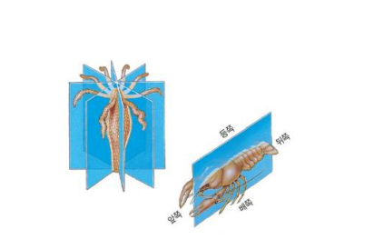
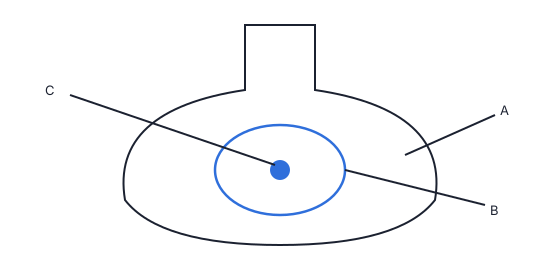
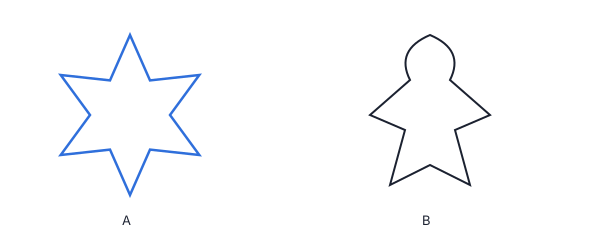

# 복습문제 30선 — 1110 수업 범위

기출 18개와 생성 변형 12개를 풀어 봐요. 변형은 기본 12개·심화 0개예요. 설계 목표는 기본 10개·심화 2개였지만 실제 최소 풀이에 맞춰 재분류했어요. 먼저 풀고 막히면 힌트를 열어 봐요.

> `복습문제_1110_Protists_Plants_Fungi_and_Animals.html`를 마크다운으로 옮겼어요. 원문, 힌트, 풀이는 접혀 있어요. 먼저 풀어 보고 펼쳐 보세요.

**목차**

- [B. 기출](#partB)
  - [P1. 균류와 가까운 계통](#p1)
  - [P2. 분류 체계의 변화](#p2)
  - [P3. 동물의 일반적 성질](#p3)
  - [P4. 속씨식물의 특징과 화석](#p4)
  - [P5. 동물매개 수분과 꽃](#p5)
  - [P6. 분자 계통수의 큰 흐름](#p6)
  - [P7. 해조류와 육상식물의 공통점](#p7)
  - [P8. 동물의 대칭 구조](#p8)
  - [P9. 분해자 생물군](#p9)
  - [P10. 오염 토양의 생물학적 처리](#p10)
  - [P11. 균류는 밖에서 분해한 뒤 흡수해요](#p11)
  - [P12. 육상 생식을 가능하게 한 양막류](#p12)
  - [P13. 척삭과 뼈의 공통 범위를 구별해요](#p13)
  - [P14. 균류와 동물의 공통 영양 방식](#p14)
  - [P15. 원생생물의 다양성과 문항의 범위](#p15)
  - [P16. 균근에서 오가는 물질의 방향](#p16)
  - [P17. 사람류를 가르는 두발 보행](#p17)
  - [P18. 겉씨식물도 꽃가루와 종자를 가져요](#p18)
- [C. 변형 연습](#partC)
  - [P19. [변형] 물을 내보내는 주머니](#p19)
  - [P20. [변형] 물색과 생물군 구별](#p20)
  - [P21. [변형] 관다발과 종자로 찾기](#p21)
  - [P22. [변형] 꽃의 부분과 발달 결과](#p22)
  - [P23. [변형] 서로에게 가해진 선택압](#p23)
  - [P24. [변형] 균류 먹이 획득 쌍둥이](#p24)
  - [P25. [변형] 표지 물질의 두 방향 이동](#p25)
  - [P26. [변형] 자르는 면의 수](#p26)
  - [P27. [변형] 육상 생식의 조건](#p27)
  - [P28. [변형] 영장류와 사람류 쌍둥이](#p28)
  - [P29. [변형] 두 종류 증거의 결론](#p29)
  - [P30. [변형] 포유류의 공통점과 예외](#p30)

## B. 기출

### P1. 균류와 가까운 계통

다음 보기들 중 균류와 가장 가까운 그룹은 어느 것인가?

- (1) 동물계
- (2) 고세균영역
- (3) 진정세균영역
- (4) 식물계
- (5) 원생생물계

원문 정보 보기

기출 9강 합본 2번 (PDF 1쪽)

힌트 보기

균류와 다른 진핵생물의 공통 조상을 비교해요. 원생생물은 하나의 단일 계통인지도 생각해요.

풀이 보기

1. (1) 맞아요. 균류와 동물은 가까운 진핵 계통인 후편모생물에 속해요.
2. (2) 틀려요. 고세균은 원핵생물 영역으로, 보기 중 균류에 가장 가까운 집단은 아니에요.
3. (3) 틀려요. 진정세균은 원핵생물 영역이에요.
4. (4) 틀려요. 식물도 진핵생물이지만 균류는 식물보다 동물과 가까워요.
5. (5) 틀려요. 원생생물계는 다양한 진핵 계통을 묶은 범주라 하나의 가까운 친척 계통으로 고르기 어려워요.
6. 수업과의 연결: 1110 수업의 원생생물 다양성과 동물·균류의 가까운 계통 관계를 연결해요.

**정답:** (1)

---

### P2. 분류 체계의 변화

생명체에 대한 분류 체계는 시간이 지남에 따라 어떻게 변화해왔는가?

- (1) 처음에 생명체는 동물 또는 식물로 분류되었다. 최근에는 5 생물계의 분류 체계가 변화되었다
- (2) 과학자들은 항상 생명체를 5 생물계로 분류해왔다. 그러나 각 계에 해당하는 종의 배치는 변화되어 왔다
- (3) 약 50년 전의 5 생물계 분류 체계는 최근에 몇 개의 영역이 서로 합쳐지며 3개의 영역으로 대체되었다
- (4) 18세기 린네에 의해 제정된 분류 체계가 최근 과학자들에 의해 새로이 도입되었다
- (5) 모든 생물계는 최근에 진핵생물로 재 분류된 원생생물을 제외하고는 모두 같다

원문 정보 보기

기출 9강 합본 5번 (PDF 1쪽)

힌트 보기

옛 5계 분류와 현대의 3영역 분류가 무엇을 기준으로 나뉘는지 살펴봐요.

풀이 보기

1. (1) 맞아요. 동물·식물의 두 계에서 다섯 계로 분류가 바뀌고 이후 계통 연구에 따라 분류 체계가 다시 달라졌다는 역사적 개괄이에요.
2. (2) 틀려요. 과학자들이 처음부터 항상 5계만 사용한 것은 아니에요.
3. (3) 틀려요. 세 영역은 기존 영역들을 합쳐 만든 체계가 아니에요. 영역은 계보다 큰 분류 단계이고, 원핵생물을 세균과 고세균의 서로 다른 영역으로 구별한 것이 핵심이에요.
4. (4) 틀려요. 린네의 분류가 18세기에 제정되었으므로 최근 새로 도입된 체계가 아니에요.
5. (5) 틀려요. 원생생물만 진핵생물로 새로 분류된 것은 아니며 분자 계통 연구는 여러 집단의 관계를 바꾸어 놓았어요.
6. 수업과의 연결: 1110 수업에서 원생생물을 획일적인 한 계통으로 보기 어렵다는 점과 지난 수업의 세 영역을 연결해요.

**정답:** (1)

인쇄 정답 오류: 합본에는 (3)이 표시되어 있지만 판정 답은 (1)이에요. 영역들이 합쳐져 세 영역이 됐다는 (3)의 문장은 사실과 맞지 않아요. (1)도 변화의 결과를 구체적으로 쓰지 않은 다소 막연한 표현이지만 역사적 개괄로 참이에요.

---

### P3. 동물의 일반적 성질

동물의 일반적인 특성으로 잘못된 것은?

- (1) 모든 동물은 종속영양생물이다
- (2) 세포에 세포벽이 없다
- (3) 모든 동물은 유성생식을 한다
- (4) 동물의 대부분은 운동성을 갖는다
- (5) 진핵생물이며 다세포성이다

원문 정보 보기

기출 9강 합본 6번 (PDF 1쪽)

힌트 보기

공통적인 동물 특징과 예외가 있는 생식 방식을 나누어 판단해요.

풀이 보기

1. (1) 맞아요. 동물은 외부 유기물에서 영양을 얻는 종속영양생물이에요.
2. (2) 맞아요. 동물 세포에는 식물·균류의 세포벽과 같은 세포벽이 없어요.
3. (3) 출제 의도로는 답이에요. 모든 번식이 유성생식만이라는 해석은 무성생식 사례와 맞지 않아요. 다만 유성생식도 가능한가라는 문장이라면 무성생식 사례만으로 거짓이라고 단정할 수 없어요.
4. (4) 맞아요. 대부분의 동물은 생애의 적어도 한 단계에서 운동성을 보여요.
5. (5) 맞아요. 동물은 진핵생물이며 다세포성이에요.
6. 수업과의 연결: 1110 수업에서 동물은 다세포 진핵생물이고 세포벽이 없다고 정리한 부분과 연결해요.

**정답:** (3)

문항 표현 주의: 유성생식만 한다는 뜻과 유성생식도 가능하다는 뜻이 구분되지 않은 발문이에요. 인쇄 답은 출제 의도로 유지하지만 엄밀한 유일 정답으로 단정하지 않아요.

---

### P4. 속씨식물의 특징과 화석

다음 속씨식물에 관한 설명 중 잘못된 설명은?

- (1) 속씨식물을 정의하는 구조는 꽃과 열매가 중요하다
- (2) 속씨식물은 동물 꽃가루받이 매개자들과 공진화했다
- (3) 밑씨는 씨방 속에 들어있고, 씨방은 과실로 발달한다
- (4) 속씨식물은 특수화된 세포인 물관요소를 가짐으로써 물을 빠르게 이동시킨다
- (5) 현화식물의 화석을 통해 다른 식물군들과 연결되는 진화의 경향을 잘 파악할 수 있다

원문 정보 보기

기출 9강 합본 7번 (PDF 1쪽)

힌트 보기

꽃·열매·밑씨의 위치와 물관의 기능을 구분하고, 초기 화석이 얼마나 충분한지 살펴봐요.

풀이 보기

1. (1) 맞아요. 꽃과 열매는 속씨식물을 정의할 때 중요한 구조예요.
2. (2) 맞아요. 여러 속씨식물과 동물 수분매개자의 상호작용은 공진화의 사례예요.
3. (3) 맞아요. 속씨식물의 밑씨는 씨방 안에 있고 씨방은 열매로 발달해요.
4. (4) 맞아요. 교재는 속씨식물의 특수한 물관요소가 물 이동을 빠르게 한다고 설명해요. 관다발 자체는 속씨식물만의 구조가 아니에요.
5. (5) 출제 의도상 틀려요. 교재에 따르면 초기 속씨식물 화석 기록이 빈약해 다른 식물군과의 초기 연결을 잘 추적하기 어려워요. 잘 파악할 수 있다는 정도가 지나쳐요.
6. 수업과의 연결: 1110 수업의 속씨식물 꽃·열매와 밑씨·씨방 구분을 바탕으로, 교재의 물관요소와 초기 화석 한계를 덧붙여 판단해요.

**정답:** (5)

인쇄된 답은 (5)이에요. 교재의 초기 속씨식물 화석 부족 설명에 비추면 (5)가 부적절하지만, 잘 파악한다는 정도 표현에 의존하는 문항이에요. 물관요소와 화석 설명은 수업 밖 교재 9장 p.193 보충이에요.

---

### P5. 동물매개 수분과 꽃

속씨식물은 _______ 의 진화로 동물 꽃가루 매개자들과 공진화 할 수 있었다.

- (1) 큐티클
- (2) 엽록체
- (3) 기공
- (4) 관다발
- (5) 꽃

원문 정보 보기

기출 9강 합본 8번 (PDF 1쪽)

힌트 보기

동물이 찾아와 꽃가루를 옮길 수 있는 속씨식물의 생식 구조를 골라요.

풀이 보기

1. (1) 틀려요. 큐티클은 육상에서 수분 손실을 줄이는 표면 구조예요.
2. (2) 틀려요. 엽록체는 광합성에 쓰이는 세포소기관이지 동물매개 수분의 생식 구조가 아니에요.
3. (3) 틀려요. 기공은 기체 교환의 통로예요.
4. (4) 틀려요. 관다발은 식물체 안에서 물질을 운반하는 조직이에요.
5. (5) 맞아요. 꽃의 색·향·형태와 동물 수분매개자의 상호작용이 공진화할 토대가 되었어요.
6. 수업과의 연결: 1110 수업에서 꽃의 특징과 벌·새 등 매개자의 감각·형태가 연결된다고 설명했어요.

**정답:** (5)

---

### P6. 분자 계통수의 큰 흐름

염기서열 연구를 기반으로 한 현대종들의 계통수를 비교한 결과는?

- (1) 버섯은 식물보다 동물과 더 가깝다
- (2) 원생생물은 분류하기 쉽지 않은 극심한 다양성을 지닌 집단이다
- (3) 원핵생물에는 크게 다른 두 영역이 있다
- (4) 모두 틀리다
- (5) 모두 옳다

원문 정보 보기

기출 9강 합본 9번 (PDF 2쪽)

힌트 보기

앞의 세 진술을 각각 판단한 다음 모두 옳다와 모두 틀리다를 비교해요.

풀이 보기

1. (1) 맞아요. 균류는 식물보다 동물과 가까운 계통이에요.
2. (2) 맞아요. 원생생물은 다양한 진핵 계통을 묶은 범주라 단일한 특징으로 분류하기 어려워요.
3. (3) 맞아요. 원핵생물에는 세균과 고세균이라는 크게 다른 두 영역이 있어요.
4. (4) 틀려요. 앞의 세 진술이 모두 맞으므로 모두 틀리다는 맞지 않아요.
5. (5) 맞아요. 앞의 세 진술이 모두 맞는다는 조합을 고르는 것이 이 문항의 답이에요.
6. 수업과의 연결: 1110 수업의 원생생물 다양성·균류 관계와 지난 수업의 고세균·진정세균을 함께 적용해요.

**정답:** (5)

---

### P7. 해조류와 육상식물의 공통점

해조류와 식물 둘 다 ( )을/를 하는 능력을 가지고 있다.

- (1) 광합성
- (2) 종자번식
- (3) 세대교번
- (4) 운동
- (5) 신경전달

원문 정보 보기

기출 9강 합본 10번 (PDF 2쪽)

힌트 보기

두 집단에 널리 나타나는 공통 능력과 일부 계통에서만 나타나는 생활사를 구별해요.

풀이 보기

1. (1) 맞아요. 해조류와 육상식물 모두 광합성을 하는 계통을 포함하며, 문항이 의도한 대표적인 공통 능력이에요.
2. (2) 틀려요. 육상 종자식물은 종자로 번식하지만 해조류 전반은 종자를 만들지 않아요.
3. (3) 출제 의도로는 답이 아니지만, 일부 해조류에도 세대교번이 있으므로 두 집단에서 모두 나타날 수 있어요. 해조류 전체가 한 가지 생활사를 가진다는 뜻은 아니에요.
4. (4) 틀려요. 운동성을 두 집단 전체의 공통 능력이라고 일반화하기 어려워요.
5. (5) 틀려요. 신경전달은 해조류와 식물의 일반적인 공통 능력이 아니에요.
6. 수업과의 연결: 1110 수업에서 조류는 육상식물과 다른 분류이지만 둘 다 광합성을 할 수 있음을 배웠어요.

**정답:** (1)

인쇄된 답은 (1)이에요. 광합성을 대표적 공통 능력으로 묻는 의도지만 일부 해조류에도 세대교번이 있어 (3)을 완전히 배제할 수 없어요. 수업에서는 세대교번을 자세히 다루지 않았어요.

---

### P8. 동물의 대칭 구조

동물 진화의 주요 혁신에 대한 설명 중, 위 그림이 나타내는 것은?

- (1) 조직과 조직층은 동물 진화 초기에 나타났다
- (2) 많은 동물은 내부 기관을 감싸는 체강을 가지고 있다
- (3) 대부분의 동물은 방사대칭이나 좌우대칭 중 하나를 나타낸다
- (4) 동물의 기원에서 발생 양식이 주된 분기를 나타낸다
- (5) 체절화는 일부 동물들의 몸을 반복적으로 나누어 준다

원문 정보 보기

기출 9강 합본 12번 (PDF 2쪽)

힌트 보기

그림에서 몸을 가르는 가상의 평면이 어느 방향으로 놓여 있는지 봐요.

풀이 보기

1. (1) 틀려요. 조직과 조직층의 출현은 그림의 절단면이 직접 보여 주는 특징이 아니에요.
2. (2) 틀려요. 체강은 내부 공간에 관한 말이고 그림의 분할 평면을 뜻하지 않아요.
3. (3) 맞아요. 왼쪽은 중심축을 지나는 여러 면, 오른쪽은 좌우를 나누는 한 면으로 대칭을 보여 줘요.
4. (4) 틀려요. 발생 양식의 분기는 몸을 가르는 평면만으로 판단할 수 없어요.
5. (5) 틀려요. 체절화는 몸의 길이 방향을 따라 반복되는 마디를 뜻해요.
6. 수업과의 연결: 1110 수업에서 방사대칭·좌우대칭을 대비하고 해면동물의 비대칭도 구별했어요.

**정답:** (3)

---

### P9. 분해자 생물군

버섯, 항생제 등을 생산하고, 육상생태계의 중요한 분해자의 역할을 하는 생물은 ( ) 이다.

- (1) 식물계
- (2) 고세균영역
- (3) 동물계
- (4) 균류
- (5) 원생생물계

원문 정보 보기

기출 9강 합본 14번 (PDF 2쪽)

힌트 보기

버섯이 속하는 생물군과 밖에서 분해한 뒤 흡수하는 영양 방식을 연결해요.

풀이 보기

1. (1) 틀려요. 버섯은 식물이 아니며 광합성 대신 외부 유기물을 이용해요.
2. (2) 틀려요. 고세균은 원핵생물 영역이고 버섯이 속하지 않아요.
3. (3) 틀려요. 버섯은 동물이 아니며 먹이를 섭취해 내부에서 소화하는 전형적인 동물 방식과 달라요.
4. (4) 맞아요. 버섯은 균류이고, 많은 균류가 유기물을 세포 밖에서 분해·흡수하는 분해자예요.
5. (5) 틀려요. 버섯은 원생생물계가 아니라 균류예요.
6. 수업과의 연결: 1110 수업에서 균류의 세포외 소화와 분해자 역할을 설명했어요.

**정답:** (4)

---

### P10. 오염 토양의 생물학적 처리

토양의 화학적인 오염으로 인해서 사람이 살기에 부적합한 지역들이 세계 곳곳에 있다. 이 독성 물질을 없애는 데 가장 유용하게 사용될 수 있는 생물체는?

- (1) 균류
- (2) 선태식물
- (3) 바이러스
- (4) 동물
- (5) 원생생물

원문 정보 보기

기출 9강 합본 15번 (PDF 2쪽)

힌트 보기

균류가 효소를 몸 밖으로 내보내 물질을 분해한다는 점을 떠올리되, 발문에 오염 물질이 특정되었는지도 확인해요.

풀이 보기

1. (1) 출제 의도상 답이에요. 일부 균류는 세포외 효소로 특정 유기 오염물을 분해하는 데 쓸 수 있어요. 모든 독성 물질을 제거한다는 뜻은 아니에요.
2. (2) 출제 의도상 답은 아니에요. 선태식물이 모든 오염물에 부적합하다는 뜻은 아니며, 물질과 처리 목표가 주어지지 않았어요.
3. (3) 출제 의도상 답은 아니에요. 바이러스는 이 문항에서 대표적인 토양 오염 분해자로 제시되지 않아요.
4. (4) 출제 의도상 답은 아니에요. 동물은 이 문항에서 세포외 효소로 오염물을 분해하는 대표 답이 아니에요.
5. (5) 출제 의도상 답은 아니에요. 원생생물이 모든 오염물에 부적합하다는 뜻은 아니며, 오염물 종류가 빠져 있어요.
6. 수업과의 연결: 1110 수업의 균류 세포외 소화·흡수와 분해자 기능을 특정 유기 오염물 정화 사례에 적용해요.

**정답:** (1)

인쇄된 답은 (1)이에요. 균류를 활용한 정화는 실제 방법이지만 어떤 독성 물질인지 없어서 언제나 가장 유용하다고 확정할 수 없어요. 예를 들어 캐나다 정부의 [백색부후균 정화 자료](https://gost.tpsgc-pwgsc.gc.ca/tfs.aspx?ID=11&lang=eng)는 일부 유기 오염물의 효소 분해를 설명하며, 금속은 분해되지 않는다고 구별해요.

---

### P11. 균류는 밖에서 분해한 뒤 흡수해요

균류의 먹이 획득 방법은?

- (1) 주변으로부터 세균을 여과한다
- (2) 포자형성
- (3) 태양 빛의 도움으로 자신의 음식을 만든다
- (4) 먹이 위에 성장하며 분해하는 화합물을 분비한다
- (5) 다른 생물을 쫓아가서 포획한다

원문 정보 보기

기출 9강 16 (PDF 2쪽)

힌트 보기

균류의 세포에는 동물의 위장 같은 소화계가 없어요. 큰 먹이 분자를 어디에서 작은 분자로 바꾸는지 생각해 보세요.

풀이 보기

1. (1) 틀려요. 세균을 걸러 삼키는 여과 섭식은 균류의 일반적인 먹이 획득 방식이 아니에요.
2. (2) 틀려요. 포자형성은 생식·확산과 관련되고 먹이를 소화하는 과정이 아니에요.
3. (3) 틀려요. 균류는 엽록소를 이용해 광합성하는 독립영양생물이 아니라 외부 유기물을 이용하는 종속영양생물이에요.
4. (4) 맞아요. 균사는 먹이 위나 속에서 자라며 효소를 밖으로 분비하고, 큰 유기물을 분해한 뒤 작은 분자를 흡수해요.
5. (5) 틀려요. 움직이는 먹이를 쫓아가 포획하는 것은 균류의 일반적인 영양 방식이 아니에요.
6. 수업과의 연결: 균류는 세포 밖에 소화효소를 내보내 분해한 뒤 흡수한다는 수업의 설명과 이어져요.

**정답:** (4)

---

### P12. 육상 생식을 가능하게 한 양막류

보기의 척추동물 군 중에서 최초로 육상에서 생식하도록 적응한 군은?

- (1) 어룡류
- (2) 양막류
- (3) 무악류
- (4) 사지류
- (5) 유악동물

원문 정보 보기

기출 9강 17 (PDF 2쪽)

힌트 보기

네 다리가 있다는 것과 알이 물 밖에서 마르지 않도록 보호된다는 것은 서로 다른 적응이에요.

풀이 보기

1. (1) 틀려요. 어룡류는 양막류 안에서 나중에 나타난 해양 파충류 집단이지 최초의 육상 생식 적응을 가리키는 큰 군이 아니에요.
2. (2) 맞아요. 양막류는 양막란의 배외막으로 배를 보호하고 육상에서 발생할 수 있게 된 척추동물 군이에요.
3. (3) 틀려요. 무악류는 턱이 없는 수생 척추동물 군이에요.
4. (4) 틀려요. 사지류에는 물에 알을 낳는 양서류도 포함돼요. 네 다리만으로 물 밖 생식이 가능해지는 것은 아니에요.
5. (5) 틀려요. 유악동물에는 물에서 번식하는 물고기 계열도 포함돼요. 턱은 육상 생식의 판별 기준이 아니에요.
6. 수업과의 연결: 수업에서는 몸의 건조 방어와 별개로, 배를 보호하는 양막란이 육상 생식의 핵심이라고 설명했어요.

**정답:** (2)

---

### P13. 척삭과 뼈의 공통 범위를 구별해요

척추동물 아문에 대한 설명으로 잘못된 것은?

- (1) 먹장어와 칠성장어 등은 무악어류로 분류된다
- (2) 척추동물 아문은 근육의 구조적 지지와 신경계 및 다른 기관들을 보호하는 내부골격이 존재한다
- (3) 사지류는 양서류와 양막류로 구분된다
- (4) 뼈는 척삭동물문 모두가 공유하는 조상형질이다.
- (5) 턱 구조가 나타나면서 유악어류는 큰 먹이를 잡거나, 방어 등에 활용하기 시작했다

원문 정보 보기

기출 9강 19 (PDF 3쪽)

힌트 보기

척삭동물 전체가 배아기에 공유하는 유연한 기둥과, 척추동물의 내부골격을 같은 것으로 보지 마세요.

풀이 보기

1. (1) 맞아요. 교재 수준의 분류에서는 먹장어와 칠성장어를 턱이 없는 무악어류에 묶어요. 먹장어의 엄밀한 계통 위치에는 분류상의 논의가 있어요.
2. (2) 맞아요. 척추동물의 내부골격은 근육을 지지하고 신경계와 다른 기관을 보호해요.
3. (3) 맞아요. 사지류는 양서류와 파충류·조류·포유류를 포함하는 양막류 쪽으로 나뉘어요.
4. (4) 틀려요. 척삭은 척삭동물의 공통 형질이지만 뼈가 모든 척삭동물의 조상형질인 것은 아니에요. 뼈가 없는 척삭동물도 있어요.
5. (5) 맞아요. 강의노트는 턱이 큰 먹이를 붙잡거나 방어하는 데 쓰일 수 있다고 설명해요.
6. 수업과의 연결: 사람을 포함한 척추동물은 척삭동물 안에 있지만, 척삭동물 모두가 척추뼈를 지닌 것은 아니라는 수업의 구분과 이어져요.

**정답:** (4)

---

### P14. 균류와 동물의 공통 영양 방식

균류와 동물의 공통점은 무엇인가?

- (1) 항생제를 생산한다.
- (2) 번식할 때 배를 만든다
- (3) 둘 다 외부에서 먹이를 섭취한다.
- (4) 털 같은 균사를 만든다.
- (5) 둘 다 다세포 구조를 지닌다.

원문 정보 보기

기출 9강 22 (PDF 3쪽)

힌트 보기

두 무리는 모두 먹이를 스스로 광합성해 만들지 않아요. 다만 먹이를 몸 안팎에서 처리하는 방식은 달라요.

풀이 보기

1. (1) 틀려요. 일부 균류가 항생제를 만들 수 있어도 동물과 균류 모두의 공통 특징은 아니에요.
2. (2) 틀려요. 동물의 배 형성을 균류 전체의 번식 과정으로 옮길 수 없어요.
3. (3) 출제 의도로는 답이에요. 둘 다 외부 유기물에 의존하는 종속영양생물이라는 넓은 뜻으로 읽으면 성립해요. 그러나 엄밀한 섭식으로 읽으면 균류에는 맞지 않으며, 균류는 밖에서 소화한 뒤 흡수하고 동물은 주로 먹이를 삼켜 몸 안에서 소화해요.
4. (4) 틀려요. 균사는 다세포 균류에서 흔한 실 모양 구조이지 동물이 함께 만드는 구조가 아니에요.
5. (5) 틀려요. 동물은 다세포이지만 효모처럼 단세포인 균류도 있어요.
6. 수업과의 연결: 교수님은 균류도 사람처럼 종속영양이지만 소화계가 없어 밖으로 효소를 내보낸다고 비교했어요.

**정답:** (3)

문항 표현 주의: 섭취를 외부 유기물 이용이라는 넓은 뜻으로 썼는지, 몸 안으로 먹이를 들이는 섭식으로 썼는지 불명확해요. 인쇄 답은 출제 의도로 유지하지만 엄밀한 유일 정답으로 단정하지 않아요.

---

### P15. 원생생물의 다양성과 문항의 범위

다음 중 원생생물의 특징은?

- (1) 펩티도글리칸 세포벽
- (2) 복잡한 소화계통
- (3) 다세포 구조
- (4) 2분법으로 분열
- (5) 지구상의 생물 가운데 가장 다양한 집단

원문 정보 보기

기출 9강 24 (PDF 3쪽)

힌트 보기

한 무리 전체를 가르는 대표 설명과 일부 구성원에게만 맞는 설명을 구분해 보세요.

풀이 보기

1. (1) 틀려요. 펩티도글리칸 벽은 진정세균의 특징이지 원생생물 전체의 공통 특징이 아니에요.
2. (2) 틀려요. 원생생물에는 복잡한 동물식 소화계통이 없는 단세포 종류도 많아요. 일부는 식포에서 먹이를 소화해요.
3. (3) 출제 의도로는 답이 아니지만, 미역·다시마 같은 다세포 해조류도 원생생물 쪽에 포함되므로 이 진술은 일부에게 참이에요. 원생생물 전체가 다세포라는 뜻으로만 읽으면 틀려요.
4. (4) 출제 의도로는 답이 아니지만, 일부 단세포 원생생물은 이분법으로 증식할 수 있어요. 다만 집단 전체를 구별하는 특징은 아니에요.
5. (5) 출제 의도상 맞아요. 전통적인 원생생물 묶음에는 생활 방식과 몸 구조가 매우 다른 진핵생물들이 함께 들어 있어요. 다만 ‘가장 다양하다’는 범위·척도가 정해지지 않은 강조 표현이에요.
6. 수업과의 연결: 교수님이 단세포와 다세포, 종속·독립·혼합영양을 한데 비교하며 원생생물의 다양성을 강조한 수업과 이어져요.

**정답:** (5)

발문이 ‘모든 원생생물의 공통 특징’이라고 한정하지 않아 (3)은 일부 원생생물에 참이고 (4)도 일부에 성립할 수 있어요. 인쇄 답 (5)를 출제 의도로 유지해요.

---

### P16. 균근에서 오가는 물질의 방향

균근은 식물과 공생하는 균류이다. 다음 중 균류와 식물의 상호작용에 가장 적합한 특징들은 무엇인가?

- (1) 균류는 토양의 세균을 제거한다. 식물은 균류에게 물을 제공한다.
- (2) 균류는 식물에 산소를 제공한다. 식물은 균류에게 탄소를 제공한다.
- (3) 균류는 식물에 이산화탄소를 제공한다. 식물은 포식자로부터 균류를 보호한다.
- (4) 균류는 식물에게 토양 영양분을 제공한다. 식물은 균류에게 먹이를 제공한다.
- (5) 균류는 식물에게 탄수화물을 제공한다. 식물은 균류에게 인을 제공한다.

원문 정보 보기

기출 9강 25 (PDF 3쪽)

힌트 보기

식물 잎이 광합성으로 만든 유기물의 이동 방향과, 뿌리 밖으로 뻗은 균사가 흡수한 무기양분의 이동 방향을 따로 그려 보세요.

풀이 보기

1. (1) 틀려요. 균근의 대표 교환은 세균 제거와 식물의 물 제공이 아니에요. 균사가 토양의 물·무기양분을 식물에 공급해요.
2. (2) 틀려요. 식물이 균류에 유기 탄소를 제공하는 부분은 맞는 방향이지만, 균류가 식물에 산소를 제공한다는 부분이 핵심 교환이 아니에요.
3. (3) 틀려요. 균류의 이산화탄소 제공과 식물의 포식자 방어는 수업에서 설명한 균근의 상호 이익이 아니에요.
4. (4) 맞아요. 균사가 토양에서 얻는 물·무기양분, 특히 인을 식물에 공급하고, 식물은 광합성으로 만든 탄수화물 같은 유기물을 균류에 줘요.
5. (5) 틀려요. 탄수화물과 인의 이동 방향이 뒤바뀌었어요. 탄수화물은 식물에서 균류로, 인은 균류를 거쳐 식물로 가요.
6. 수업과의 연결: 균류는 식물의 광합성 산물을 얻고 식물은 균사 덕분에 물·인 흡수가 쉬워진다는 수업의 교환 설명과 이어져요.

**정답:** (4)

---

### P17. 사람류를 가르는 두발 보행

사람류는 현대인과 우리의 조상을 포함한다. 사람류를 유인원과 구별 짓게 하는 주요 적응으로 옳은 것은?

- (1) 마주보는 엄지손가락
- (2) 직립자세와 두 발 걷기
- (3) 유연한 엉덩이와 어깨 관절
- (4) 뛰어난 학습능력
- (5) 무리를 지어 사회생활

원문 정보 보기

기출 9강 26 (PDF 3쪽)

힌트 보기

영장류 여러 무리가 공유하는 손·뇌·생활 방식과 초기 사람류 화석에서 먼저 확인되는 이동 방식을 구분해 보세요.

풀이 보기

1. (1) 틀려요. 마주보는 엄지는 다른 영장류에도 있는 공유 형질이라 사람류만의 판별 기준이 아니에요.
2. (2) 맞아요. 직립자세와 두 발 걷기는 다른 유인원과 사람류를 구별하는 주요 적응으로 제시돼요.
3. (3) 틀려요. 관절의 유연성만으로 사람류를 다른 유인원과 구분하지 않아요. 판별의 중심은 지속적인 직립·두발 보행이에요.
4. (4) 틀려요. 학습능력은 여러 영장류에서 나타나요. 큰 뇌가 직립보행보다 먼저 등장한 것으로 보지도 않아요.
5. (5) 틀려요. 무리를 이루는 사회생활은 많은 영장류가 공유해요.
6. 수업과의 연결: 수업은 영장류의 공통 특징을 먼저 짚고, 초기 사람류의 허벅지뼈·발자국을 통해 직립보행을 설명했어요.

**정답:** (2)

---

### P18. 겉씨식물도 꽃가루와 종자를 가져요

겉씨식물에 대한 설명으로 옳은 것은?

- (1) 겉씨식물은 독특한 생식기관인 꽃을 가진다.
- (2) 정자는 꽃가루 안에서 발생한다.
- (3) 겉씨식물은 종자를 가지지 않는다.
- (4) 겉씨식물의 포자체는 포자를 퍼트린다.
- (5) 겉씨식물의 꽃가루받이는 물 없이는 이루어질 수 없다.

원문 정보 보기

기출 9강 27 (PDF 3쪽)

힌트 보기

겉씨식물의 밑씨는 씨방 밖에 있어요. 꽃가루가 정자를 전달하고 수정 뒤 밑씨가 무엇이 되는지 떠올려 보세요.

풀이 보기

1. (1) 틀려요. 꽃은 속씨식물의 특징이에요. 겉씨식물에는 꽃이 아니라 솔방울 같은 생식 구조가 있어요.
2. (2) 맞아요. 겉씨식물에서도 정자를 만드는 수컷 배우체가 꽃가루 안에서 발달해요. 수업과 슬라이드는 이를 ‘정자는 꽃가루 안에서 발생’한다고 표현해요.
3. (3) 틀려요. 겉씨식물은 종자식물이에요. 수정 뒤 밑씨가 종자로 발달해요.
4. (4) 출제 의도로는 답이 아니에요. 겉씨식물의 포자체도 포자를 만들지만, 포자는 배우체가 발달하는 생식 구조 안에 머물러요. 따라서 포자를 외부에 독립적으로 퍼뜨린다는 (4)는 이 생산·유지 과정과 달라요. 꽃가루와 종자의 산포를 구분해요.
5. (5) 틀려요. 꽃가루받이는 바람 등을 통해 물 없이도 가능해요. 물에 의존하지 않는 생식이 종자식물의 육상 적응이에요.
6. 수업과의 연결: 수업에서 겉씨식물의 노출된 밑씨, 꽃가루 이동, 수정 뒤 종자 형성을 순서대로 설명한 부분과 이어져요.

**정답:** (2)

(4)의 ‘포자를 퍼트린다’는 표현은 포자체의 포자 생산 사실과 달라요. 포자를 전혀 만들지 않는다는 뜻으로 읽지 않아요.

---

## C. 변형 연습

### P19. [변형] 물을 내보내는 주머니

담수에 사는 단세포 진핵생물에서 물이 계속 유입된다. 먹이 소화는 유지되지만 세포 안의 물을 모아 바깥으로 내보내는 기능만 약해졌다. 직접 이상이 생긴 구조는?

- (1) 식포
- (2) 수축포
- (3) 위족
- (4) 핵막
- (5) 엽록체

원문 정보 보기

원문 기출이 아닌 생성 변형이에요. 다루는 혼동: 물을 내보내는 주머니. 근거 토픽: s0-diversity

힌트 보기

먹이 처리와 여분의 물 처리를 나누어 생각해요.

풀이 보기

1. (1) 틀려요. 식포는 먹이를 둘러싸고 소화하는 공간이에요.
2. (2) 맞아요. 수축포는 삼투로 들어오는 여분의 물을 모아 내보내요.
3. (3) 틀려요. 위족은 이동과 먹이 포획에 쓰여요.
4. (4) 틀려요. 핵막은 핵과 세포질을 구분해요. 물 배출 주머니가 아니에요.
5. (5) 틀려요. 엽록체는 광합성에 관여하며 물 배출 담당이 아니에요.
6. 수업과의 연결: 1110 수업의 [관련 개념](정리노트_1110_Protists_Plants_Fungi_and_Animals.md#s0-diversity)을 새 조건에 적용해요.

**정답:** (2)

---

### P20. [변형] 물색과 생물군 구별

물속 광합성 생물에 대한 설명으로 옳지 않은 것은?

- (1) 김은 수업의 분류에서 홍조류에 속한다.
- (2) 미역과 다시마는 갈조류에 속한다.
- (3) 산호는 동물이며 공생하는 광합성 생물과 구별된다.
- (4) 적조는 홍조류라는 분류군의 다른 이름이다.
- (5) 녹조류는 육상식물과 가까운 계통이다.

원문 정보 보기

원문 기출이 아닌 생성 변형이에요. 다루는 혼동: 물색과 생물군 구별. 근거 토픽: s0-algae

힌트 보기

현상의 이름인지 분류군의 이름인지 확인해요.

풀이 보기

1. (1) 맞는 진술이라 답이 아니에요. 김은 수업에서 홍조류의 예로 들었어요.
2. (2) 맞는 진술이라 답이 아니에요. 미역과 다시마는 갈조류의 예예요.
3. (3) 맞는 진술이라 답이 아니에요. 산호와 그 안의 공생 조류는 서로 다른 생물이에요.
4. (4) 틀린 진술이라 답이에요. 적조는 현상이고 홍조류는 생물군이에요. 와편모조류의 증식도 적조를 일으킬 수 있어요.
5. (5) 맞는 진술이라 답이 아니에요. 녹조류는 육상식물과 가까운 친척이지만 수업의 육상식물 범주와 같지는 않아요.
6. 수업과의 연결: 1110 수업의 [관련 개념](정리노트_1110_Protists_Plants_Fungi_and_Animals.md#s0-algae)을 새 조건에 적용해요.

**정답:** (4)

---

### P21. [변형] 관다발과 종자로 찾기

세 육상식물 집단을 관찰했다. 표의 조건으로 볼 때 바르게 연결한 것은?

| 집단 | 관다발 | 종자 |
|---|---|---|
| A | 없음 | 없음 |
| B | 있음 | 없음 |
| C | 있음 | 있음 |

- (1) A: 양치류, B: 선태류, C: 종자식물
- (2) A: 선태류, B: 양치류, C: 종자식물
- (3) A: 선태류, B: 종자식물, C: 양치류
- (4) A: 종자식물, B: 양치류, C: 선태류
- (5) A: 선태류, B: 해조류, C: 균류

원문 정보 보기

원문 기출이 아닌 생성 변형이에요. 다루는 혼동: 관다발과 종자로 찾기. 근거 토픽: s1-land

힌트 보기

관다발과 종자라는 두 기준을 순서대로 적용해요.

풀이 보기

1. (1) 틀려요. A는 관다발이 없으므로 양치류가 아니에요.
2. (2) 맞아요. 관다발 없음은 선태류, 관다발 있으나 종자 없음은 양치류, 둘 다 있음은 종자식물과 대응해요.
3. (3) 틀려요. B는 종자가 없고 C는 있으므로 두 연결이 뒤바뀌었어요.
4. (4) 틀려요. A에 종자가 없다는 조건과 맞지 않아요.
5. (5) 틀려요. 관다발이 있는 육상식물 B를 해조류로, 종자를 만드는 C를 균류로 볼 수 없어요.
6. 수업과의 연결: 1110 수업의 [관련 개념](정리노트_1110_Protists_Plants_Fungi_and_Animals.md#s1-land)을 새 조건에 적용해요.

**정답:** (2)

---

### P22. [변형] 꽃의 부분과 발달 결과

그림은 속씨식물 암술의 일부를 단순화한 것이다. C는 수정 직후 생긴 한 세포이며, A와 B는 선 끝에서 가리키는 전체 구조이다. 각 부분이 발달한 결과를 바르게 연결한 것은?

- (1) A: 종자, B: 열매, C: 종피
- (2) A: 열매, B: 종자, C: 배
- (3) A: 배, B: 열매, C: 종자
- (4) A: 꽃가루, B: 종피, C: 씨방
- (5) A: 열매, B: 배, C: 종자

원문 정보 보기

원문 기출이 아닌 생성 변형이에요. 다루는 혼동: 꽃의 부분과 발달 결과. 근거 토픽: s1-seed

힌트 보기

도형의 포함 관계와 각 발달 결과를 연결해요.

풀이 보기

1. (1) 틀려요. 씨방과 밑씨의 발달 결과가 뒤바뀌었고 수정란은 종피가 되지 않아요.
2. (2) 맞아요. 씨방은 열매로, 밑씨는 종자로, 수정란은 배로 발달해요.
3. (3) 틀려요. 씨방이 배가 되지 않으며 밑씨가 열매 전체가 되지도 않아요.
4. (4) 틀려요. 씨방이 꽃가루로 바뀌는 과정은 없어요.
5. (5) 틀려요. 밑씨 전체가 종자, 그 안 수정란의 발달 결과가 배예요.
6. 수업과의 연결: 1110 수업의 [관련 개념](정리노트_1110_Protists_Plants_Fungi_and_Animals.md#s1-seed)을 새 조건에 적용해요.

**정답:** (2)

---

### P23. [변형] 서로에게 가해진 선택압

한 꽃 집단의 긴 꽃통을 가진 개체는 긴 입을 가진 매개자에게 더 잘 수분되었다. 그 꽃이 늘어난 환경에서는 긴 입을 가진 매개자가 먹이를 얻는 데 유리했다. 여러 세대에 걸친 이 상호 변화에 해당하는 것은?

- (1) 휴면
- (2) 단순한 종자 산포
- (3) 공동진화
- (4) 한 개체의 의도적 구조 변경
- (5) 꽃가루와 난자의 직접 융합

원문 정보 보기

원문 기출이 아닌 생성 변형이에요. 다루는 혼동: 서로에게 가해진 선택압. 근거 토픽: s1-coevolution

힌트 보기

두 상대가 각각 다른 상대의 번식·생존 조건에 영향을 주는지 확인해요.

풀이 보기

1. (1) 틀려요. 휴면은 불리한 조건에서 생장이 억제된 상태로 이 상호 변화와 달라요.
2. (2) 틀려요. 조건은 종자가 아니라 꽃가루 매개와 매개자의 먹이 획득을 다뤄요.
3. (3) 맞아요. 공동진화는 공진화와 같은 말로, 상호작용하는 두 계통의 선택압이 서로 영향을 주는 경우예요.
4. (4) 틀려요. 여러 세대의 선택을 개체가 필요에 따라 몸을 바꾼 것으로 해석하면 안 돼요.
5. (5) 틀려요. 수정은 생식세포의 결합이고 여기서는 두 생물의 진화적 상호작용을 물어요.
6. 수업과의 연결: 1110 수업의 [관련 개념](정리노트_1110_Protists_Plants_Fungi_and_Animals.md#s1-coevolution)을 새 조건에 적용해요.

**정답:** (3)

---

### P24. [변형] 균류 먹이 획득 쌍둥이

균류의 먹이 획득 방법은?

- (1) 큰 먹이 분자를 세포 안으로 그대로 들인 후에만 자른다.
- (2) 몸 밖으로 효소를 분비해 잘게 분해한 산물을 흡수한다.
- (3) 균사의 녹색 색소로 빛을 받아 모든 영양분을 만든다.
- (4) 주변의 먹이를 쫓아가 입으로 삼킨다.
- (5) 포자를 만들면 주변 유기물을 얻을 필요가 없어진다.

원문 정보 보기

기출 9강 16번 발문에 정답을 바꾼 생성 변형이에요. 다루는 혼동: 세포외 소화와 흡수 순서. 근거 토픽: s2-feeding

힌트 보기

효소가 작용하는 장소와 작은 분자가 들어오는 순서를 나누어요.

풀이 보기

1. (1) 틀려요. 큰 분자는 그대로 흡수하기 어려워 먼저 밖에서 잘라요.
2. (2) 맞아요. 세포외 소화와 흡수를 올바른 순서로 연결했어요.
3. (3) 틀려요. 균류는 광합성으로 유기물을 만드는 독립영양생물이 아니에요.
4. (4) 틀려요. 입으로 추적·포획해 먹는 방식이 균류의 기본 영양 방식은 아니에요.
5. (5) 틀려요. 포자 형성은 생식이며 종속영양에 필요한 유기물 획득을 대체하지 않아요.
6. 원문 정답과 달라진 점: 기출 9강 16번의 정답은 (4)이고 이 변형은 새로 쓴 (2)가 정답이에요.
7. 수업과의 연결: 1110 수업의 [관련 개념](정리노트_1110_Protists_Plants_Fungi_and_Animals.md#s2-feeding)을 새 조건에 적용해요.

**정답:** (2)

---

### P25. [변형] 표지 물질의 두 방향 이동

mycorrhiza가 형성된 식물 뿌리와 균류의 실험이다. 식물 뿌리와 균류가 연결된 실험에서, 식물이 빛을 받아 만든 표지 탄소가 균류에서 검출되었다. 균류만 닿을 수 있는 흙에 넣은 표지 인은 식물에서 검출되었다. 이후 균류가 내놓은 CO₂에도 표지 탄소가 나타났다. 다른 이동 경로는 차단되었다. 세 관찰을 함께 설명한 것은?

- (1) 식물의 유기물이 균류로 이동하고, 균류가 얻은 인이 식물로 이동하며, 균류는 얻은 유기물의 탄소 일부를 CO₂로 되돌린다.
- (2) 균류가 빛으로 유기물을 합성해 식물에 주고 식물이 균류에 인을 준다.
- (3) 지의류의 두 구성원 모두 뿌리가 없으므로 물질 교환은 없다.
- (4) 균류가 인을 탄소로 바꾸어 광합성을 대신했다.
- (5) 표지 탄소의 이동만으로 균류가 식물과 아무 교환 없이 독립영양으로 산다는 것이 증명된다.

원문 정보 보기

원문 기출이 아닌 생성 변형이에요. 다루는 혼동: 표지 물질의 두 방향 이동. 근거 토픽: s2-symbiosis

힌트 보기

탄소의 출발점·인의 출발점·탄소가 되돌아간 형태를 각각 확인해요.

풀이 보기

1. (1) 맞아요. 균근의 탄수화물·무기양분 교환과 얻은 유기물의 호흡에 따른 탄소 방출을 세 관찰에 각각 연결했어요. 이 관찰만으로 죽은 유기물의 분해를 입증한 것은 아니에요.
2. (2) 틀려요. 탄소와 인의 이동 방향이 둘 다 반대이며 균류는 광합성을 하지 않아요.
3. (3) 틀려요. 실험 대상은 식물 뿌리와 균류의 균근이며 교환이 직접 관찰됐어요.
4. (4) 틀려요. 인은 탄소로 전환되는 재료가 아니에요. 다른 원소의 이동을 구분해야 해요.
5. (5) 틀려요. 식물에서 온 유기물을 얻었다는 관찰은 오히려 종속영양과 맞아요.
6. 수업과의 연결: 1110 수업의 [관련 개념](정리노트_1110_Protists_Plants_Fungi_and_Animals.md#s2-symbiosis)을 새 조건에 적용해요.

**정답:** (1)

mycorrhiza는 균근의 영어 이름이에요. 균류가 광합성으로 당을 만드는 것이 아니라 식물이 만든 유기물을 받아요.

---

### P26. [변형] 자르는 면의 수

그림은 두 동물 몸의 반복 배치만을 단순화한 모형이다. 그림의 A와 B에서 몸을 같은 두 부분으로 나눌 수 있는 면을 비교할 때 바르게 연결한 것은?

- (1) A: 비대칭, B: 방사대칭
- (2) A: 좌우대칭, B: 비대칭
- (3) A: 방사대칭, B: 좌우대칭
- (4) A: 좌우대칭, B: 방사대칭
- (5) A: 방사대칭, B: 모든 방향에서 동일한 대칭

원문 정보 보기

원문 기출이 아닌 생성 변형이에요. 다루는 혼동: 자르는 면의 수. 근거 토픽: s3-animal

힌트 보기

앞뒤와 좌우를 뒤바꾸어도 같은 모양인지 확인해요.

풀이 보기

1. (1) 틀려요. A에는 반복된 대칭이 있고 B는 여러 방향 대칭이 아니에요.
2. (2) 틀려요. A에는 중심 둘레 여러 면이 가능하며 B에도 대칭면이 있어요.
3. (3) 맞아요. A는 방사대칭, B는 좌우대칭의 모형이에요.
4. (4) 틀려요. 둘의 대칭 기준이 반대로 연결됐어요.
5. (5) 틀려요. B는 앞뒤 모양이 달라 모든 방향에서 대칭이 되지 않아요.
6. 수업과의 연결: 1110 수업의 [관련 개념](정리노트_1110_Protists_Plants_Fungi_and_Animals.md#s3-animal)을 새 조건에 적용해요.

**정답:** (3)

---

### P27. [변형] 육상 생식의 조건

새로 관찰한 척추동물 집단은 다리가 네 개 있지만, 배가 발생하는 알이 마르기 쉬워 물에 낳아야 한다. 다른 집단은 배외막으로 보호된 알을 육상에 낳는다. 두 집단의 차이를 가장 잘 가르는 것은?

- (1) 사지류인가 아닌가만으로 충분하다.
- (2) 첫 집단만 척삭동물이다.
- (3) 둘째 집단은 양막류의 육상 생식 적응을 보인다.
- (4) 첫 집단은 반드시 포유류다.
- (5) 둘째 집단만 세포벽이 있다.

원문 정보 보기

원문 기출이 아닌 생성 변형이에요. 다루는 혼동: 육상 생식의 조건. 근거 토픽: s3-amniote

힌트 보기

몸이 땅에 나오는 것과 배가 물 밖에서 발생하는 것을 구분해요.

풀이 보기

1. (1) 틀려요. 사지류에는 양서류와 양막류가 모두 포함되므로 네 다리만으로 가를 수 없어요.
2. (2) 틀려요. 척추동물인 두 집단은 모두 척삭동물에 속해요.
3. (3) 맞아요. 배를 보호하는 배외막을 갖춘 양막란은 육상 발생을 가능하게 하는 핵심 적응이에요.
4. (4) 틀려요. 포유류는 양막류이며 제시된 물 의존 알만으로 포유류라고 할 수 없어요.
5. (5) 틀려요. 동물 세포에는 세포벽이 없어요.
6. 수업과의 연결: 1110 수업의 [관련 개념](정리노트_1110_Protists_Plants_Fungi_and_Animals.md#s3-amniote)을 새 조건에 적용해요.

**정답:** (3)

---

### P28. [변형] 영장류와 사람류 쌍둥이

사람류는 현대인과 우리의 조상을 포함한다. 사람류를 유인원과 구별 짓게 하는 주요 적응으로 옳은 것은?

- (1) 다른 손가락과 마주 보며 잡는 엄지손가락
- (2) 여러 개체가 모여 사는 사회생활
- (3) 어깨를 여러 방향으로 움직일 수 있는 관절
- (4) 습관적인 직립자세와 두 발 보행
- (5) 경험을 통해 배우는 학습능력

원문 정보 보기

기출 9강 26번 발문에 정답을 바꾼 생성 변형이에요. 다루는 혼동: 영장류 공유형질과 사람류 구별형질. 근거 토픽: s4-primate

힌트 보기

그 특징을 다른 영장류도 공유하는지 먼저 확인해요.

풀이 보기

1. (1) 틀려요. 마주 보는 엄지는 넓은 영장류에서도 나타나 구별 기준이 아니에요.
2. (2) 틀려요. 사회생활도 사람류만의 특징이 아니에요.
3. (3) 틀려요. 유연한 관절 역시 다른 영장류에 있어요.
4. (4) 맞아요. 수업에서 사람류를 구별한 핵심 적응은 습관적인 두발보행이에요.
5. (5) 틀려요. 학습능력도 다른 영장류에 나타나요.
6. 원문 정답과 달라진 점: 기출 9강 26번의 정답은 (2)이고 이 변형은 새 표현의 (4)가 정답이에요.
7. 수업과의 연결: 1110 수업의 [관련 개념](정리노트_1110_Protists_Plants_Fungi_and_Animals.md#s4-primate)을 새 조건에 적용해요.

**정답:** (4)

---

### P29. [변형] 두 종류 증거의 결론

더 오래된 화석 A에서는 두발보행을 지지하는 다리뼈와 작은 두개골이 함께 관찰됐다. 더 늦은 화석 B는 큰 두개골을 가졌다. 별도 집단 비교에서는 아프리카의 오래된 화석과 큰 유전적 다양성이 보고됐다. 이 자료들에서 정당한 결론을 함께 고른 것은?

- (1) 뇌 확대가 반드시 먼저이며 다양성은 개인 능력의 순위를 뜻한다.
- (2) 두발보행이 뇌 확대보다 먼저 나타났음을 지지하며, 별도 화석·DNA 자료는 아프리카 기원설을 지지한다.
- (3) 작은 두개골만으로 네 발 보행이 확정되며, 화석 A가 모든 사람의 직접 조상임이 증명된다.
- (4) 큰 두개골이 있으면 나이·다리뼈를 확인하지 않아도 최초 사람류로 확정할 수 있다.
- (5) 자료가 다르면 같은 가설을 지지할 수 없으므로 화석과 DNA 중 하나는 버려야 한다.

원문 정보 보기

원문 기출이 아닌 생성 변형이에요. 다루는 혼동: 두 종류 증거의 결론. 근거 토픽: s4-fossil

힌트 보기

먼저 형질 출현의 순서를, 다음으로 지역 기원 가설의 근거를 따로 판단한 뒤 결합해요.

풀이 보기

1. (1) 틀려요. A의 두발보행 증거와 작은 뇌가 뇌 확대 선행을 반박하며 유전적 다양성은 개인의 우열이 아니에요.
2. (2) 맞아요. A에서 두발보행과 작은 뇌를 함께 확인해 순서를 추론하고, 독립적인 화석·분자 자료를 기원설과 연결했어요.
3. (3) 틀려요. A에는 보행을 지지하는 다리뼈도 있어요. 직접 조상이라는 결론까지는 나오지 않아요.
4. (4) 틀려요. 시기와 보행 자료를 무시한 채 큰 머리 하나로 기원을 확정할 수 없어요.
5. (5) 틀려요. 서로 다른 관찰이 같은 가설을 함께 지지할 수 있어요.
6. 수업과의 연결: 1110 수업의 [관련 개념](정리노트_1110_Protists_Plants_Fungi_and_Animals.md#s4-fossil)을 새 조건에 적용해요.

**정답:** (2)

---

### P30. [변형] 포유류의 공통점과 예외

포유류의 번식과 발생에 대한 설명으로 옳지 않은 것은?

- (1) 단공류는 알을 낳지만 새끼에게 젖을 먹인다.
- (2) 유대류는 비교적 이른 단계에 태어난 새끼가 젖을 먹으며 발생을 이어 간다.
- (3) 태반류는 자궁에서 태반을 통해 오랜 기간 영양을 공급받는다.
- (4) 포유류라는 분류는 모두 알을 낳지 않는다는 조건으로 정의된다.
- (5) 포유류는 파충류·조류와 함께 양막류에 포함된다.

원문 정보 보기

원문 기출이 아닌 생성 변형이에요. 다루는 혼동: 포유류의 공통점과 예외. 근거 토픽: s3-amniote

힌트 보기

한 분류군의 공통 특징과 그 안의 번식 방식 차이를 구분해요.

풀이 보기

1. (1) 맞는 진술이라 답이 아니에요. 단공류의 알 낳기는 포유류 안의 예외이며 젖 먹이기는 유지돼요.
2. (2) 맞는 진술이라 답이 아니에요. 유대류는 짧은 자궁 내 발생 뒤 육아낭 등에서 발생을 이어 가요.
3. (3) 맞는 진술이라 답이 아니에요. 태반류의 긴 자궁 내 발생과 태반 영양공급을 연결했어요.
4. (4) 틀린 진술이라 답이에요. 알을 낳는 단공류도 포유류예요. 공통 기준은 새끼에게 젖을 먹이는 특징이에요.
5. (5) 맞는 진술이라 답이 아니에요. 조류는 넓은 파충류 계통에 포함되며 이들과 포유류는 모두 양막류예요.
6. 수업과의 연결: 1110 수업의 [관련 개념](정리노트_1110_Protists_Plants_Fungi_and_Animals.md#s3-amniote)을 새 조건에 적용해요.

**정답:** (4)

---

출처: 2023·2024 생명과학 기출(9강 합본). 인쇄 정답과 독립 판단을 대조했어요. 변형 연습은 수업 내용으로 만든 생성 문제예요.
