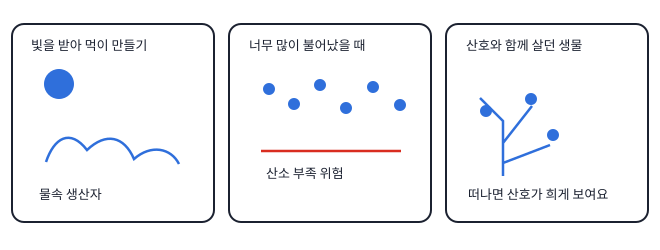
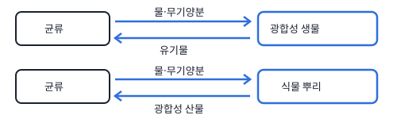
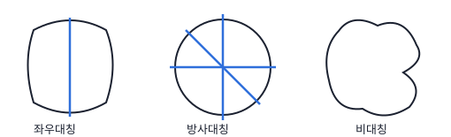
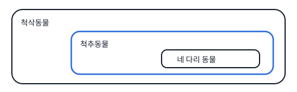
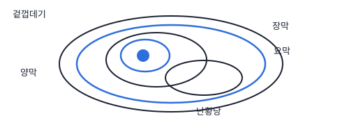
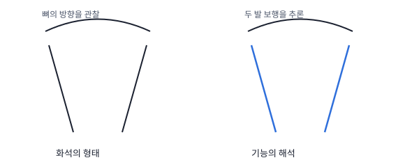

# 원생생물·식물·균류·동물 — 5살도 이해하는 정리노트

이영만 교수님 생명과학 · 1110 수업 (9장 p4–8, 일부 세부 분류 생략)

> `정리노트_1110_Protists_Plants_Fungi_and_Animals.html`를 마크다운으로 옮겼어요. 그림은 `figures_1110/` 폴더의 SVG, 위젯은 대표 설정의 정적 그림으로 바꿨어요. 수식은 `$…$` / `$$…$$`라서 GitHub, Obsidian, Typora에서 보여요.

**목차**

- [1. 다양한 원생생물](#s0)
  - [지난 수업과 이어 보기](#s0-recap)
  - [한 가지 모습으로 묶을 수 없는 원생생물](#s0-diversity)
  - [물속 생산자와 가까운 친척](#s0-algae)
- [2. 식물의 육상 적응과 번식](#s1)
  - [물 밖에서 마르지 않고 서는 법](#s1-land)
  - [꽃가루·밑씨·씨방은 서로 다른 단계](#s1-seed)
  - [꽃과 동물이 서로에게 미친 진화적 영향](#s1-coevolution)
- [3. 균류의 구조와 먹이·공생](#s2)
  - [눈에 보이는 버섯 아래의 실](#s2-structure)
  - [밖에서 잘게 자른 다음 흡수해요](#s2-feeding)
  - [지의류와 균근의 교환 상대](#s2-symbiosis)
- [4. 동물의 분류와 육상 생식](#s3)
  - [동물이라고 모두 대칭인 것은 아니에요](#s3-animal)
  - [척삭동물 안에 척추동물이 있어요](#s3-chordate)
  - [몸과 배를 건조에서 보호해요](#s3-amniote)
- [5. 사람류의 특징과 증거 읽기](#s4)
  - [마주 보는 엄지와 두 발 걷기는 다른 기준](#s4-primate)
  - [뼈·발자국에서 행동을 추론해요](#s4-fossil)
  - [현대인의 기원을 뒷받침하는 서로 다른 자료](#s4-origin)
- [6. 요약 · 예고](#s5)
  - [시험 직전 한눈에](#s5-cheatsheet)
  - [다음 시간 연결](#s5-next)
  - [함께 보면 좋은 자료](#s5-links)

## 1. 다양한 원생생물

### 지난 수업과 이어 보기

*1110 수업 · 9장 p3–4*

**정확히 말하면**

처음에는 생물을 식물·동물의 두 계로 크게 나누었어요. 이후 세균·원생생물·균류 등을 구별하는 다섯 계 분류가 쓰였어요.

앞선 분류 수업에서는 분자 서열을 비교해 세균·고세균·진핵생물의 세 영역을 구별했어요. 영역은 계보다 큰 범위이고, 이 수업의 전통적 체계에서는 진핵생물 안에 원생생물·식물·균류·동물의 네 계를 둬요.

지난 수업은 핵막으로 둘러싸인 핵이 없는 원핵생물까지 살폈어요. 원핵생물에는 서로 다른 두 영역인 진정세균과 고세균이 있어요. [지난 수업의 세균·고세균 정리](../../1105/정리노트_1105_Origin_of_Life_and_Prokaryotes.html#s2-structure)에서 경계를 확인해요.

[이전 rRNA 비교 노트의 보충](../../1103/정리노트_1103_Macroevolution_and_Taxonomy.html#s3-rrna)에는 균류가 식물보다 동물과 가깝다는 계통 관계가 있어요. 이는 오늘 수업의 직접 설명이 아니에요.

학습만화 「[지난 수업과 이어 보기](../%ED%95%99%EC%8A%B5%EB%A7%8C%ED%99%94_1110_Protists_Plants_Fungi_and_Animals.html#s0-recap)」에서 영역과 계의 포함 관계를 확인하고 분류 체계의 변화와 진화 순서를 구별해요.

**페이지 요약**

옛 두 계·다섯 계 분류를 거쳐, 수업에서는 세 영역 안에 진핵생물의 네 계를 놓고 살펴봐요.

*용어*

- **분류의 범위** — 영역은 계보다 커요. 세균·고세균·진핵생물이 세 영역이고, 수업의 진핵생물 안에는 원생생물·식물·균류·동물 네 계가 있어요.
- **원핵생물** — 핵막으로 둘러싸인 핵이 없어요. 진정세균과 고세균은 서로 다른 영역이에요.
- **이전 계통 비교 보충** — 균류는 식물보다 동물과 가까워요. 이번 수업의 직접 설명이 아닌 이전 rRNA 비교 노트의 보충이에요.

---

### 한 가지 모습으로 묶을 수 없는 원생생물

*1110 수업 · 9장 p4*

**쉽게 말하면**

작은 물웅덩이 한 곳에도 겉모습과 살아가는 법이 전혀 다른 생물이 함께 살아요.

*세 그림은 작은 생물이 살아가는 데 쓰는 몸의 서로 다른 부분이에요.*

**정확히 말하면**

**원생생물(protists)** = 전통적 수업 분류에서 동물·육상식물·균류에 넣지 않은 진핵생물의 묶음

핵이 있다는 점은 공통이지만 단일한 자연 계통군을 이루지는 않아요. 무성생식과 유성생식을 하는 종류가 있고, 주로 물이나 습한 곳에서 살지만 숙주 몸속에 사는 종류도 있어요.

**영양 방식**

- 종속영양: 짚신벌레·아메바처럼 외부 먹이 이용
- 독립영양: 해조류처럼 광합성으로 유기물 합성
- 혼합영양(mixotrophy): 유글레나처럼 조건에 따라 광합성 또는 외부 유기물 이용

**수축포(contractile vacuole)** = 담수 짚신벌레에서 삼투로 들어온 물을 모아 밖으로 내보내는 구조

**식포(food vacuole)** = 먹이를 막으로 둘러싸 만든 소화 공간

**위족(pseudopodium)** = 아메바가 몸 일부를 뻗어 이동하거나 먹이를 감싸는 구조

더 자세히

수업에서 본 기생 사례는 말라리아, 아프리카 수면병, 감자역병의 원인 생물이에요.

학습만화 「[한 가지 모습으로 묶을 수 없는 원생생물](../%ED%95%99%EC%8A%B5%EB%A7%8C%ED%99%94_1110_Protists_Plants_Fungi_and_Animals.html#s0-diversity)」에서 단세포·다세포의 다양성과 수축포·식포·위족의 역할을 구별해요.

짚신벌레가 물을 배출하는 과정과 아메바가 먹이를 감싸 소화하는 과정을 [원생생물의 물과 먹이 모형](../%EC%9D%B8%ED%84%B0%EB%A0%89%ED%8B%B0%EB%B8%8C_03_%EC%88%98%EC%B6%95%ED%8F%AC%EC%99%80_%EC%9C%84%EC%A1%B1%EC%9D%98_%EC%97%AD%ED%95%A0.html)에서 각각 재생해 수축포·위족·식포의 역할을 구별해 보세요.

**꼭 기억해요**

| 묻는 것 | 틀리기 쉬운 답 | 맞는 답 |
|---|---|---|
| 세포 수 | ~~모두 단세포이거나 모두 다세포~~ | 짚신벌레·아메바·유글레나는 단세포, 미역·다시마·김은 다세포 |
| 원생생물에서 한 종류가 가진 특징 | ~~일부에 맞으면 전체의 공통 특징~~ | 일부에만 해당하는 사례와 전체에 적용되는 특징 구별 |
| 펩티도글리칸 세포벽 | ~~원생생물 전체의 공통 특징~~ | 진정세균의 특징 |
| 수축포와 식포 | ~~수축포에서 먹이 소화, 식포로 물 배출~~ | 수축포로 물 배출, 식포에서 먹이 소화 |
| 위족 | ~~먹이를 소화하는 위장~~ | 이동·먹이 포획에 쓰는 돌기 |
| 기생 여부 | ~~모든 원생생물이 기생~~ | 일부 종류만 기생 |

교수님은 세부 분류 이름보다 원생생물의 다양성과 각 구조의 기능을 먼저 익히라고 했어요.

교수님 말씀

> “원생생물은 매우 다양합니다.”

교수님은 수축포를 물을 퍼내는 바가지에, 위족을 ‘가짜 발’에 비유했어요.

**보충 · 수업에서 다루지 않았어요**

일부 원생생물은 이분법(2분법)으로 두 딸세포를 만들어요. 이 방식이 나타날 수 있다는 진술과 원생생물 전체의 공통·고유 특징이라는 진술은 달라요. 짚신벌레의 대핵·소핵과 두 핵을 가진 다른 원생생물 사례도 있어, 두 핵이 짚신벌레만의 유일한 특징이라는 일반화는 안 돼요.

출처: [OpenStax Biology 2e 23.2 Life Cycles](https://openstax.org/books/biology-2e/pages/23-2-characteristics-of-protists); [23.3 Ciliates·Diplomonads](https://openstax.org/books/biology-2e/pages/23-3-groups-of-protists)

**페이지 요약**

원생생물은 핵이 있는 생물 가운데 동물·육상식물·균류에 넣지 않은 다양한 무리로, 몸의 크기와 먹는 방식이 하나로 정해지지 않아요.

*용어*

- **분류 경계** — 전통적인 수업 분류의 넓은 묶음이에요. 단세포·다세포가 모두 있으며 다세포 해조류도 포함돼요. 펩티도글리칸 벽은 진정세균의 특징이에요.
- **영양 방식** — 외부 먹이를 쓰는 종속영양, 광합성하는 독립영양, 조건에 따라 둘 다 쓰는 유글레나의 혼합영양이 있어요.
- **서식과 생식** — 물·습한 곳과 숙주 몸속 등에서 살고, 종류에 따라 무성 또는 유성생식을 해요.
- **수축포** — 담수 짚신벌레에서 삼투로 들어온 물을 모아 밖으로 내보내요.
- **식포와 위족** — 식포는 섭취한 먹이를 소화해요. 아메바의 위족은 몸을 뻗어 이동하거나 먹이를 감싸요.
- **기생 사례** — 말라리아·수면병과 감자역병의 원인 생물처럼 기생 종류도 있지만, 원생생물 모두가 기생하는 것은 아니에요.

- **(보충) 일부의 이분법과 두 핵** — 일부 원생생물은 이분법으로 분열하고, 두 핵도 짚신벌레만의 고유 특징은 아니에요. 일부의 성질을 전체 공통 성질로 바꾸지 않아요.

---

### 물속 생산자와 가까운 친척

*1110 수업 · 9장 p4*

**쉽게 말하면**

물 한 컵이 맑아 보여도 그 안에는 맨눈에 잘 보이지 않는 생물이 살 수 있어요.

*세 장면은 작은 물속 생물이 주변 생물에 영향을 주는 서로 다른 경우예요.*

**정확히 말하면**

광합성하는 원생생물과 해조류는 빛을 이용해 CO₂로부터 유기물을 만들어요. 교수님과 강의노트는 식물성 플랑크톤과 해조류가 지구 광합성 유기물 생산의 큰 몫을 맡는다고 설명해요.

**식물성 플랑크톤** = 광합성을 하는 생산자

**동물성 플랑크톤** = 식물성 플랑크톤 등을 먹는 종속영양 생물

**규조류(diatoms)** = 규산질 껍질을 가진 광합성 원생생물

**갈조류(brown algae)**에는 미역·다시마가, **홍조류(red algae)**에는 김이 속해요.

**일부 와편모조류(dinoflagellates)의 적조(red tide) 피해**

1. 광합성 생물의 대량 번성
2. 호흡 및 죽은 유기물의 분해
3. 용존 산소 감소
4. 물고기 생존 위협

일부 종류의 독소는 직접 해를 줄 수 있어요. 독소를 내는 것은 모든 와편모조류의 공통 성질이 아니에요.

**산호 백화**

1. 높은 수온 등으로 공생 관계에 변화
2. 광합성 공생 조류 이탈 또는 색소 감소
3. 산호가 희게 보임

백화가 오래가면 산호의 생존이 위협받아요. 산호가 만드는 서식처나 광합성 산물이 줄면 주변 생물에게도 영향이 퍼져요.

**녹조류(green algae)**는 육상식물과 가장 가까운 계통으로 소개됐어요. **깃편모충류(choanoflagellates)**는 해면동물의 깃세포와 모양이 닮은 현생 단세포 생물이고 DNA 염기서열 비교도 동물과 가까운 관계를 뒷받침해요.

더 자세히

앞서 배운 [rRNA 계통 비교](../../1103/정리노트_1103_Macroevolution_and_Taxonomy.html#s3-rrna)처럼 분자 자료와 형태를 함께 살펴요. 균류가 식물보다 동물과 가까운 관계는 그 이전 계통 비교 노트의 보충에서 확인할 수 있어요.

학습만화 「[물속 생산자와 가까운 친척](../%ED%95%99%EC%8A%B5%EB%A7%8C%ED%99%94_1110_Protists_Plants_Fungi_and_Animals.html#s0-algae)」에서 생물군 이름과 적조 현상, 산호와 공생 조류, 가까운 친척과 직접 조상을 구별해요.

**꼭 기억해요**

| 묻는 것 | 틀리기 쉬운 답 | 맞는 답 |
|---|---|---|
| 홍조류·녹조류와 적조·녹조 | ~~생물군 이름과 물빛이 바뀌는 현상이 같은 뜻~~ | 홍조류·녹조류는 생물군, 적조·녹조는 특정 미생물의 대량 번성 현상 |
| 해조류와 육상식물 | ~~광합성을 하므로 둘 다 꽃·종자를 만드는 육상식물~~ | 광합성은 공통. 수업 분류에서 미역·다시마·김은 원생생물 |
| 적조의 원인과 피해 | ~~와편모조류만 적조를 일으키며 동물성 플랑크톤의 호흡만 산소를 줄임~~ | 일부 와편모조류가 적조를 일으킴. 산소 감소에는 번성한 생물의 호흡과 사체 분해가 관여 |
| 산호(coral)와 공생 조류 | ~~산호 자체가 광합성하는 조류~~ | 산호는 동물, 광합성 공생 조류는 별개 생물 |
| 백화한 산호 | ~~즉시 사망~~ | 오래 지속되면 생존 위협 |
| 현생 녹조류·깃편모충류 | ~~육상식물·동물의 확인된 직접 조상~~ | 각각 가까운 현생 계통 |

교수님 말씀

> “광합성 조류들이 상당히 중요하죠.”

물을 붉게 만드는 현상을 설명하면서 “홍조가 아니고, 적조”로 바로잡았어요.

**보충 · 수업에서 다루지 않았어요**

일부 갈조류 등 해조류도 세대교번을 해요. 따라서 해조류와 식물의 공통 능력으로 광합성을 고르는 문항에서, 세대교번이 해조류에는 전혀 없다고 설명하면 안 돼요. 여기서는 문항의 표현 한계를 판별하는 사실만 보충하고 생활사의 상세 과정은 다루지 않아요.

출처: [OpenStax Biology 2e 23.3 Brown Algae](https://openstax.org/books/biology-2e/pages/23-3-groups-of-protists)

**페이지 요약**

물속 광합성 원생생물은 생산자이고, 해조류·육상식물의 공통 능력과 생물군의 계통 관계는 따로 구별해요.

*용어*

- **녹조류와 녹조** — 녹조류는 생물군, 녹조는 특정 미생물이 많이 늘어나는 현상이에요. 생물군과 현상을 같은 단위로 부르지 않아요.
- **광합성과 분류** — 식물성 플랑크톤·해조류는 생산자, 이를 먹는 동물성 플랑크톤은 섭식자예요. 해조류와 육상식물 모두 광합성하지만, 수업에서는 미역·다시마·김을 원생생물 쪽에 두어요. 해조류에 꽃·종자를 일반화하지 않아요.
- **조류의 예** — 규조류는 규산질 껍질, 갈조류는 미역·다시마, 홍조류는 김이에요. 녹조류는 육상식물과 가까운 계통이에요.
- **적조와 산소** — 일부 와편모조류가 적조를 일으켜요. 일부의 독소와 대량 번성 뒤 호흡·분해에 따른 산소 감소가 피해에 관여해요. 홍조류는 적조 현상과 다른 생물군이에요.
- **산호 백화** — 동물인 산호의 광합성 공생자가 이탈하거나 색소가 줄면 희게 보여요. 오래 지속되면 생존이 위험하지만 즉시 사망과 같지는 않아요. 산호 서식처 감소는 주변 생물에도 영향을 줘요.
- **가까운 현생 계통** — 깃편모충류는 해면의 깃세포와 형태가 닮고 DNA 자료에서도 동물과 가까워요. 현생 깃편모충류를 동물의 직접 조상으로 단정하지 않아요.
- **이전 계통 비교** — 균류가 식물보다 동물과 가까운 관계는 이전 rRNA 비교 노트의 보충이에요. 이번 수업의 직접 설명으로 바꾸지 않아요.

- **(보충) 해조류의 세대교번** — 일부 해조류도 세대교번을 해요. 광합성이 공통 능력이라고 해서 다른 공통 가능성을 전부 부정하지 않아요. 상세 생활사는 이번에 학습하지 않았어요.

---

## 2. 식물의 육상 적응과 번식

### 물 밖에서 마르지 않고 서는 법

*1110 수업 · 9장 p4–5*

**쉽게 말하면**

물속에서 떠 있던 몸을 물 밖에서는 스스로 세워야 해요.

*잎의 겉과 줄기 속을 함께 그렸어요.*

**정확히 말하면**

수업에서는 이끼 같은 육상식물을 식물로 다뤄요. 미역·다시마 같은 갈조류나 육상식물과 가까운 녹조류는 물속에서 광합성을 하는 조류예요.

**큐티클(cuticle)**은 몸 표면의 왁스성 층으로 수분 손실과 함께 기체의 직접 출입도 줄여요. CO₂를 들여보내려면 기체가 드나드는 길이 필요해요. **기공(stomata)**이 열리고 닫히며 기체 교환과 물 손실을 조절해요.

물에 닿는 몸 표면이 얇으면 세포가 주변과 직접 기체를 교환할 수 있어요.

**관다발(vascular tissue)** = 물관과 체관으로 이루어진 수송 조직

- **물관(xylem)**: 물과 무기 양분 운반
- **체관(phloem)**: 광합성 산물 운반
- **리그닌(lignin)**: 셀룰로오스와는 별개인 성분으로, 물관 등 조직을 단단하게 해 수직 성장 지지

| 비교 기준 | 선태류(bryophytes) | 양치류(ferns) | 겉씨식물·속씨식물 |
|---|---|---|---|
| 관다발 | 없음 | 있음 | 있음 |
| 종자 | 없음, 포자로 번식 | 없음, 포자로 번식 | 있음 |

선태류는 관다발이 없어 몸 전체로 물질을 멀리 보내기 어려워요. 대체로 몸이 작고 습한 곳에서 자라요.

학습만화 「[물 밖에서 마르지 않고 서는 법](../%ED%95%99%EC%8A%B5%EB%A7%8C%ED%99%94_1110_Protists_Plants_Fungi_and_Animals.html#s1-land)」에서 수분 보호·기체 교환·수송·지지를 나누고 관다발과 종자의 유무를 따로 비교해요.

큐티클은 그대로 둔 채 기공을 여닫으면 CO₂ 유입과 수분 손실이 어떻게 달라지는지 [큐티클과 기공의 균형 모형](../%EC%9D%B8%ED%84%B0%EB%A0%89%ED%8B%B0%EB%B8%8C_04_%ED%81%90%ED%8B%B0%ED%81%B4%EA%B3%BC_%EA%B8%B0%EA%B3%B5%EC%9D%98_%EA%B7%A0%ED%98%95.html)에서 비교해 보세요.

**꼭 기억해요**

| 묻는 것 | 틀리기 쉬운 답 | 맞는 답 |
|---|---|---|
| 녹조류와 육상식물의 관계 | ~~가까운 친척이므로 둘 다 육상식물~~ | 수업 분류에서 서로 구별 |
| 이끼의 관다발 | ~~식물이므로 관다발이 있음~~ | 이끼는 관다발이 없는 선태류 |
| 양치류의 종자 | ~~관다발이 있으므로 종자도 있음~~ | 무종자 관다발식물 |
| 모든 식물의 기공 | ~~모든 식물에 반드시 있음~~ | 육상식물에서 흔하지만 물속의 검정말처럼 기공이 없는 식물도 있음 |

교수님 말씀

교수님은 수영장 밖으로 나오면 물의 부력으로 몸을 받칠 수 없다는 비유를 들었어요. 잎의 반짝이는 왁스층을 큐티클의 예로 가리켰어요.

**페이지 요약**

육상식물은 물 손실과 기체 교환의 상충을 조절하고, 관다발과 리그닌이 있는 계통은 물질 수송과 지지를 강화해요.

*용어*

- **육상식물** — 이끼 같은 선태류부터 포함해요. 광합성은 조류도 할 수 있지만, 가까운 친척인 녹조류와 미역·다시마 같은 조류는 육상식물과 구별해요.
- **큐티클(cuticle) · 기공(stomata)** — 큐티클은 표면 수분 손실을 줄여요. 기공은 이산화탄소 유입과 기체 교환을 허용하며 열림 정도로 물 손실을 조절해요. 물속 검정말 등에는 기공이 없을 수 있어요.
- **관다발(vascular tissue) · 리그닌(lignin)** — 물관은 물과 무기 양분을, 체관은 광합성 산물을 수송해요. 리그닌은 세포벽을 단단하게 해 몸을 지지해요.
- **선태류 · 양치류** — 선태류에는 관다발과 종자가 없어요. 양치류에는 관다발이 있지만 종자는 없어요. 두 군 모두 포자로 번식해요.

---

### 꽃가루·밑씨·씨방은 서로 다른 단계

*1110 수업 · 9장 p5*

**쉽게 말하면**

씨 하나가 만들어져 새 곳에 뿌리내리기까지 여러 일이 차례로 일어나요.

*그림 속 두 갈래는 꽃가루가 도착한 뒤 씨와 열매가 자라는 부분을 나타내요.*

**정확히 말하면**

종자식물인 **겉씨식물(gymnosperms)**과 **속씨식물(angiosperms)** 모두 꽃가루(pollen)와 밑씨(ovule)를 만들어요. 정자 세포는 꽃가루 안에서, 난세포는 밑씨 안에서 발달해요.

| 비교 기준 | 겉씨식물 | 속씨식물 |
|---|---|---|
| 암·수 생식 구조의 예 | 소나무의 암·수 솔방울 | 꽃 |
| 밑씨 위치 | 씨방에 싸여 있지 않음 | 씨방(ovary) 안 |
| 수정 뒤 열매(fruit) | 없음 | 씨방이 열매로 발달 |

겉씨식물의 꽃가루는 주로 바람으로 옮겨요. 꽃가루를 옮기는 데 자유로운 물이 꼭 필요한 것은 아니에요.

1. **수분(pollination), 곧 꽃가루받이**는 꽃가루가 암쪽에 도착하는 단계예요. 속씨식물에서는 바람이나 동물이 꽃가루를 암술머리로 옮겨요.
2. **수정(fertilization)**은 꽃가루관을 따라 밑씨로 이동한 정자 세포와 난세포가 결합하는 단계예요.
3. **수정 뒤 발달** 때 수정란은 배(embryo)로, 밑씨는 배와 영양조직을 품은 종자(seed)로 자라요. 단단한 종피(seed coat)가 불리한 환경으로부터 배를 보호해요.
4. **산포와 발아** 때 열매나 종자가 바람·물·동물에 의해 퍼져요. 멀리 퍼지면 부모 식물 아래에서 빛과 물을 두고 경쟁하는 일이 줄 수 있어요. 종자는 휴면(dormancy)을 거칠 수 있으며 수분 등 조건이 맞으면 발아해요.

속씨식물의 열매는 종자를 보호하고 산포를 도와요.

더 자세히

속씨식물을 현화식물이라고도 해요.

학습만화 「[꽃가루·밑씨·씨방은 서로 다른 단계](../%ED%95%99%EC%8A%B5%EB%A7%8C%ED%99%94_1110_Protists_Plants_Fungi_and_Animals.html#s1-seed)」에서 수분·수정·산포를 나누고 밑씨·씨방·수정란이 각각 무엇으로 발달하는지 확인해요.

꽃가루의 도착부터 밑씨와 씨방의 발달까지 [수분·수정과 씨·열매 모형](../%EC%9D%B8%ED%84%B0%EB%A0%89%ED%8B%B0%EB%B8%8C_01_%EA%BD%83%EA%B0%80%EB%A3%A8%EC%97%90%EC%84%9C_%EC%94%A8%EC%99%80_%EC%97%B4%EB%A7%A4%EB%A1%9C.html)에서 단계를 재생하고 수분만 확인한 경우와 비교해 보세요.

**꼭 기억해요**

| 묻는 것 | 틀리기 쉬운 답 | 맞는 답 |
|---|---|---|
| 겉씨식물의 번식 구조 | ~~열매가 없으니 꽃가루와 종자도 없음~~ | 꽃가루와 종자는 있음. 밑씨가 씨방에 싸이지 않음 |
| 꽃가루가 암쪽에 도착함 | ~~수정~~ | 수분 |
| 꽃가루 | ~~종자 또는 수정란~~ | 수분 때 옮겨지는 운반 단위 |
| 수정란·밑씨·씨방 | ~~수정란은 씨, 씨방은 배~~ | 수정란은 배, 밑씨는 종자, 속씨식물의 씨방은 열매로 발달 |
| 수분과 산포의 시점·운반 대상 | ~~수분 때 완성된 종자가 퍼짐~~ | 수정 전에 꽃가루가 이동하는 것이 수분, 발달한 종자가 퍼지는 것이 산포 |

교수님 말씀

교수님은 소나무의 수컷 솔방울에서 나온 꽃가루가 암컷 솔방울에 도착하는 모습을 예로 들었어요. 종자를 퍼뜨리는 예로는 민들레의 바람, 코코넛의 물, 동물의 섭식·배설을 들었어요.

**보충 · 수업에서 다루지 않았어요**

교재는 속씨식물의 물관에 특수한 물관요소(vessel elements) 세포가 있어 뿌리에서 지상부로 물이 더 빠르게 이동한다고 설명해요. 이 특징은 꽃·열매처럼 속씨식물을 설명하는 데 유용하지만, 관다발 자체가 속씨식물에만 있다는 뜻은 아니에요. 또한 교재는 초기 속씨식물의 화석 기록이 빈약해 다른 식물군과의 초기 진화 연결을 자세히 추적하기 어렵다고 설명해요. 화석이 있으니 그 연결을 잘 파악할 수 있다는 식의 단정은 피해야 해요.

겉씨식물의 포자체도 감수분열로 포자를 만들지만, 포자는 배우체가 발달하는 생식 구조 안에 머물러요. 포자를 만드는 것과 포자를 외부에 독립적인 산포 단위로 퍼뜨리는 것은 달라요. 수업에서 배운 꽃가루 이동과 종자 산포를, 포자를 전혀 만들지 않는다는 뜻으로 바꾸지 않아요.

출처: 『생명과학: 기초와 응용』 2판 9장, PDF p18(인쇄 p.192–193).

**페이지 요약**

겉씨·속씨 모두 꽃가루와 종자를 가지지만, 속씨식물만 밑씨가 씨방 안에 있고 수정 뒤 열매가 발달해요.

*용어*

- **겉씨식물(gymnosperms) · 속씨식물(angiosperms)** — 겉씨식물은 밑씨가 씨방에 싸이지 않고 꽃·열매가 없어요. 속씨식물은 꽃의 씨방 안에 밑씨가 있으며 씨방이 열매로 발달해요.
- **수분(pollination) · 수정(fertilization)** — 수분은 꽃가루가 암쪽 구조로 이동하는 단계이며 자유로운 물이 꼭 필요하지 않아요. 겉씨식물에서는 주로 바람이 암쪽 솔방울로 옮기고, 속씨식물에서는 바람·동물이 암술머리로 옮겨요. 이후 정자 세포가 난세포와 결합해야 수정이에요.
- **꽃가루(pollen) · 밑씨(ovule) · 씨방(ovary)** — 정자 세포는 꽃가루 안에서 발달하고, 밑씨 안에 난세포가 형성돼요. 수정 뒤 수정란은 배로, 밑씨는 종자로 발달해요. 속씨식물의 씨방은 종자를 보호하는 열매가 돼요.
- **종피(seed coat) · 휴면(dormancy)** — 종자는 배·영양조직·종피를 포함해요. 종피가 배를 보호하며, 휴면을 거친 종자는 알맞은 수분 등 조건에서 발아할 수 있어요.
- **종자 산포** — 완성된 종자가 바람·물·동물로 퍼지는 일이에요. 꽃가루의 수분과 대상·시점이 다르며, 부모 아래의 빛·물 경쟁을 줄일 수 있어요.

- **(보충) 물관요소와 초기 화석** — 교재에 따르면 속씨식물의 특수한 물관요소는 빠른 물 수송에 기여해요. 초기 속씨식물 화석은 빈약해 다른 식물군과의 초기 진화 연결을 자세히 추적하기 어려워요. 관다발 자체는 속씨식물에만 있는 것이 아니에요. 겉씨식물도 포자를 만들지만 생식 구조 안에 머물러요. 포자 생산과 외부 산포를 구별하며 꽃가루·종자의 이동과 혼동하지 않아요.

---

### 꽃과 동물이 서로에게 미친 진화적 영향

*1110 수업 · 9장 p5*

**쉽게 말하면**

꽃이 한곳에 붙어 있어도 날아다니는 방문객에게 가루를 실어 보낼 수 있어요.

*벌과 새가 꽃을 찾을 때 알아채는 신호를 비교해 보세요.*

**정확히 말하면**

**공진화(Coevolution)** = 밀접하게 상호작용하는 두 계통에서 여러 세대에 걸쳐 서로의 진화에 영향을 주는 양상. 공동진화라고도 부름

1. 한쪽 계통에서 유전적 변화
2. 상대의 생존·번식 조건에 선택압
3. 상대의 진화적 변화가 다시 처음 계통의 선택 조건에 영향

속씨식물의 꽃은 동물이 방문해 꽃가루를 옮기는 상호작용의 토대가 됐어요. 색·향·자외선 무늬는 매개자의 감각에 따라 방문에 영향을 줘요. 방문한 동물이 꽃가루를 옮길 수 있는지는 그 몸이 꽃의 생식 구조에 닿는 방식에도 달려 있어요.

**풍매화** = 바람이 꽃가루를 옮기는 꽃

**충매화** = 곤충이 꽃가루를 옮기는 꽃

**기계적 격리(mechanical isolation)**는 생식 구조나 매개자와의 형태 대응 차이 때문에 종·계통 사이의 꽃가루 전달·수용이 물리적으로 막히는 수정 전 격리예요. 이 장벽이 유전자 흐름을 차단해요.

더 자세히

꽃가루 운반과 종자 산포는 [꽃가루·밑씨·씨방의 발달](#s1-seed)에서 비교할 수 있어요.

학습만화 「[꽃과 동물이 서로에게 미친 진화적 영향](../%ED%95%99%EC%8A%B5%EB%A7%8C%ED%99%94_1110_Protists_Plants_Fungi_and_Animals.html#s1-coevolution)」에서 방문을 끄는 신호, 물리적 꽃가루 전달, 여러 세대의 상호 선택압을 구별해요.

**꼭 기억해요**

| 묻는 것 | 틀리기 쉬운 답 | 맞는 답 |
|---|---|---|
| 동물매개 수분 | ~~모두 충매화~~ | 곤충매개 외에 박쥐·벌새 매개도 있음 |
| 꽃 신호와 방문자 | ~~모든 벌이 같은 꽃을 찾고 모든 붉은 꽃은 새가 수분~~ | 색·향·무늬를 이용하는 방식은 종류마다 다름 |
| 기계적 격리의 판정 | ~~방문 선호·활동 시간만 다르거나 한 방문자가 꽃에 맞지 않으면 성립~~ | 형태 차이가 종 사이에서 꽃가루 전달·수용을 막는지 확인 |
| 공진화에서 한쪽이 변함 | ~~상대가 의도적으로 즉시 따라 변함~~ | 여러 세대에 걸친 상호 선택압 |

교수님 말씀

교수님은 벌이 자외선 무늬로 꿀 방향을 찾고 일부 새는 눈에 띄는 붉은 꽃에 간다는 예를 들었어요. 향에 민감한 곤충은 냄새를 단서로 써요. 상대의 변화가 다음 변화의 조건을 바꾼다는 뜻은 출석 방식과 학생 행동에 빗대 설명했어요.

**페이지 요약**

꽃의 신호와 형태는 매개자의 방문·꽃가루 전달에 영향을 주고, 긴 상호작용은 양쪽 계통의 선택압이 될 수 있어요.

*용어*

- **풍매화 · 충매화** — 속씨식물의 꽃이 동물과 꽃가루받이로 상호작용할 토대가 되었어요. 풍매화는 바람이, 충매화는 곤충이 꽃가루를 옮겨요. 박쥐·벌새도 동물 매개자가 될 수 있어 동물매개와 충매화는 같은 범위가 아니에요.
- **꽃과 매개자의 대응** — 색·향·자외선 무늬는 감각에 따른 방문을 바꿀 수 있어요. 실제 수분에는 꽃가루를 전달할 수 있는 접촉도 필요해요. 모든 꽃·매개자에 단일 규칙을 적용하지 않아요.
- **공진화·공동진화(Coevolution)** — 밀접한 상호작용에서 양쪽 계통의 변화가 서로의 선택압에 영향을 주며 여러 세대에 걸쳐 진화하는 양상이에요. 즉각적·의도적 변화는 아니에요.
- **기계적 격리(mechanical isolation)** — 식물 종·계통 사이에서 형태 차이로 꽃가루 전달·수용이 막히는 수정 전 격리예요. 개별 꽃과 매개자의 불일치만으로 종 간 격리를 확정하지 않아요. 색·향에 따른 방문 선호 차이만으로 판정하지 않아요.

---

## 3. 균류의 구조와 먹이·공생

### 눈에 보이는 버섯 아래의 실

*1110 수업 · 9장 p5*

**쉽게 말하면**

지상에 나온 버섯만 보면 땅 아래까지 이어지는 몸의 크기를 놓치기 쉬워요.

*땅 표면을 경계로 위아래를 함께 보세요.*

**정확히 말하면**

**균사(hypha)** = 다세포 균류의 몸을 이루는 실 한 가닥

땅속 균사체(mycelium)가 몸의 넓은 부분을 차지할 수 있고, 눈에 보이는 버섯은 포자를 만드는 생식 구조예요. 균류의 유성·무성생식에서 포자는 중요한 번식 수단이에요.

균류 세포벽의 대표 성분은 **키틴**이에요.

더 자세히

먹는 버섯의 많은 종류는 담자균에 속해요. 버섯 갓 아래에서 포자를 만드는 예를 볼 수 있어요.

학습만화 「[눈에 보이는 버섯 아래의 실](../%ED%95%99%EC%8A%B5%EB%A7%8C%ED%99%94_1110_Protists_Plants_Fungi_and_Animals.html#s2-structure)」에서 균사 한 가닥, 균사체, 포자 형성 구조를 구별하고 단세포 균류의 예외도 확인해요.

**꼭 기억해요**

| 묻는 것 | 틀리기 쉬운 답 | 맞는 답 |
|---|---|---|
| 균사와 균사체(mycelium) | ~~균사체가 실 하나~~ | 균사는 실 하나, 균사체는 이어진 여러 균사 |
| 균류의 세포 수 | ~~버섯처럼 모두 다세포~~ | 효모는 단세포, 버섯과 많은 곰팡이는 다세포 |
| 균류의 키틴 | ~~키틴이 있으므로 곤충과 같은 분류~~ | 균류에는 세포벽, 곤충에는 외골격의 재료 |
| 푸른곰팡이의 푸른빛 | ~~엽록소가 있어 광합성한다는 증거~~ | 색만으로 엽록소나 광합성을 판정할 수 없음 |
| 균류의 포자 | ~~모든 균류의 유일한 번식 수단~~ | 중요한 번식 수단이며 포자로만 번식한다고 일반화할 수 없음 |

수업에서는 균류의 몸과 번식 구조를 중심으로 봤어요. 세부 분류군 이름을 모두 외우는 것이 초점은 아니었어요.

교수님 말씀

교수님은 버섯을 테이프로 찍어 현미경에 대면 투명한 실이 보인다는 관찰 예를 들었어요.

**보충 · 수업에서 다루지 않았어요**

일부 푸른곰팡이속(Penicillium) 종은 페니실린계 항생제의 원료가 돼요. 균류 전체가 항생제를 만든다는 뜻은 아니에요.

출처: 교재 9장 p.196

**페이지 요약**

균류에는 단세포 효모와 균사가 모인 다세포형이 있으며, 눈에 보이는 버섯은 다세포 균류의 몸 일부예요.

*용어*

- **균사(hypha)** — 다세포 균류의 실 모양 구조예요.
- **균사체(mycelium)** — 여러 균사가 이어진 덩어리로, 땅속에 넓게 퍼질 수 있어요.
- **키틴** — 균류 세포벽의 대표 성분이에요.
- **생식** — 포자는 중요한 번식 수단이며 유성·무성생식 모두 가능해요. 효모 등에서 나타나는 다른 번식 방식을 지우고 포자로만 번식한다고 일반화하지 않아요.
- **효모** — 단세포 균류예요. 모든 균류가 다세포는 아니에요.
- **담자균** — 우리가 먹는 많은 버섯이 속하는 균류 집단이에요.

- **(보충) 항생제 생산** — 교재 p.196에 따르면 일부 Penicillium 종이 페니실린계 항생제 원료예요. 균류 전체의 공통 형질은 아니에요.

---

### 밖에서 잘게 자른 다음 흡수해요

*1110 수업 · 9장 p5*

**쉽게 말하면**

먹이 덩어리가 몸의 문보다 크면 그대로는 들어가지 못해요.

*그림의 경계선은 먹이와 곰팡이 몸 안을 나눠요.*

**정확히 말하면**

**종속영양** = 다른 생물이 만든 유기물을 이용하는 영양 방식

큰 유기물 분자는 균류의 세포막을 그대로 통과하기 어려워요. 균류는 유기물을 광합성으로 만들지 않고 밖에 있는 먹이를 아래 순서로 이용해요.

1. 세포 밖에 효소 분비
2. 효소가 먹이를 작은 분자로 분해하는 세포외 소화
3. 작아진 분자 흡수

**분해자가 탄소를 순환시키는 과정**

1. 세균·균류가 죽은 물질의 유기물 분해
2. 유기물의 탄소가 이산화탄소 등으로 돌아감
3. 식물이 탄소를 다시 이용

더 자세히

포자를 통한 번식과 먹이 이용은 별개의 과정이에요. 균류의 유성·무성생식은 [균류의 몸과 생식 구조](#s2-structure)에서 확인할 수 있어요.

학습만화 「[밖에서 잘게 자른 다음 흡수해요](../%ED%95%99%EC%8A%B5%EB%A7%8C%ED%99%94_1110_Protists_Plants_Fungi_and_Animals.html#s2-feeding)」에서 세포 밖 효소 분해와 작은 분자의 흡수 순서, 기생·부생의 차이를 확인해요.

효소가 세포 밖에서 먹이를 분해한 뒤 작은 분자가 들어오는 순서를 [균류의 소화와 공생 모형](../%EC%9D%B8%ED%84%B0%EB%A0%89%ED%8B%B0%EB%B8%8C_02_%EA%B7%A0%EB%A5%98%EC%9D%98_%ED%9D%A1%EC%88%98%EC%99%80_%EA%B3%B5%EC%83%9D.html)의 소화·흡수 모드에서 재생해 보세요.

**꼭 기억해요**

| 묻는 것 | 틀리기 쉬운 답 | 맞는 답 |
|---|---|---|
| 균류와 동물의 소화 장소·순서 | ~~둘 다 먹이를 먼저 몸 안으로 들여 소화~~ | 둘 다 종속영양. 균류는 몸 밖에서 소화한 뒤 흡수, 동물은 주로 섭식 뒤 몸 안에서 소화 |
| 영양을 얻는 대상 | ~~살아 있는 숙주가 부생, 죽은 유기물이 기생~~ | 살아 있는 숙주는 기생, 죽은 유기물은 부생 |

교수님은 분해자가 없다면 죽은 생물의 탄소가 다시 순환하기 어렵다는 점을 강조했어요.

교수님 말씀

교수님은 죽은 나무에 난 버섯을 예로 들며, 녹말처럼 큰 물질을 몸 밖에서 작은 분자로 자른다고 설명했어요.

**보충 · 수업에서 다루지 않았어요**

일부 균류의 세포외 효소는 토양의 특정 유기오염물 분해에 활용될 수 있어요. 금속은 분해되지 않고 일부 경우 축적될 수 있으며, 처리 효과는 오염물질 종류와 산소·산도·수분·온도 등에 따라 달라요. 균류가 모든 독성물질에 언제나 가장 유용하다는 뜻은 아니에요.

출처: [캐나다 공공사업조달부, Mycoremediation: White Rot Fungus](https://gost.tpsgc-pwgsc.gc.ca/tfs.aspx?ID=11&lang=eng)

**페이지 요약**

균류와 동물은 모두 외부 유기물에 의존하지만, 균류는 몸 밖에서 분해한 뒤 흡수하고 동물은 주로 먹은 뒤 몸 안에서 소화해요.

*용어*

- **종속영양** — 다른 생물이 만든 유기물을 얻어 쓰는 방식이에요.
- **세포외 소화와 흡수** — 효소를 밖으로 내보내 큰 분자를 자른 다음 작은 분자를 들여요.
- **기생과 부생** — 살아 있는 숙주에서 얻으면 기생, 죽은 유기물을 분해해 얻으면 부생이에요.
- **분해자와 탄소** — 죽은 물질의 유기물을 분해해 탄소를 이산화탄소 등으로 되돌려 순환에 기여해요.

- **(보충) 균류의 오염물 처리** — 일부 균류는 특정 유기오염물을 세포외 효소로 분해할 수 있어요. 금속은 분해되지 않으며 처리 효과는 물질과 산소·산도·수분·온도에 달려 있어, 모든 독성물질에 최선이라고 할 수 없어요.

---

### 지의류와 균근의 교환 상대

*1110 수업 · 9장 p5*

**쉽게 말하면**

곰팡이가 누구와 함께 사느냐에 따라 주변에서 얻는 것이 달라져요.

*두 그림에서 곰팡이와 만나는 상대를 찾아보세요.*

**정확히 말하면**

| 비교 기준 | 지의류 | 균근 |
|---|---|---|
| 균류와 함께 사는 상대 | 남세균·녹조류 등 광합성 생물 | 식물 뿌리 |
| 균류가 얻는 것 | 광합성 생물이 만든 유기물 | 식물이 만든 탄수화물과 다른 유기물 |
| 균류가 상대를 돕는 일 | 물과 무기양분 획득 | 물과 무기이온, 특히 인 획득 |

균근의 균사는 뿌리가 닿는 범위 밖까지 뻗어요. 그래서 식물이 얻을 수 있는 물과 무기이온의 양이 늘 수 있어요.

더 자세히

지의류는 바위 같은 척박한 곳에서도 살 수 있어요. 바위를 풍화해 토양 형성에 기여할 수 있으며, 공기 오염에 민감한 종류는 대기 상태의 지표로 쓰여요.

학습만화 「[지의류와 균근의 교환 상대](../%ED%95%99%EC%8A%B5%EB%A7%8C%ED%99%94_1110_Protists_Plants_Fungi_and_Animals.html#s2-symbiosis)」에서 지의류와 균근의 상대를 구별하고 유기물·물·무기양분의 교환 방향을 확인해요.

균근과 지의류의 상대를 바꾸며 유기물과 물·무기양분의 이동 방향을 [균류의 공생 교환 모형](../%EC%9D%B8%ED%84%B0%EB%A0%89%ED%8B%B0%EB%B8%8C_02_%EA%B7%A0%EB%A5%98%EC%9D%98_%ED%9D%A1%EC%88%98%EC%99%80_%EA%B3%B5%EC%83%9D.html)의 공생 모드에서 비교해 보세요.

**꼭 기억해요**

| 묻는 것 | 틀리기 쉬운 답 | 맞는 답 |
|---|---|---|
| 광합성 생물이 균류와 연합한 경우 | ~~식물 뿌리와 만나는 균근~~ | 남세균·녹조류와 만나는 지의류 |
| 균근에서 당의 이동 | ~~균류가 당을 만들어 식물에 줌~~ | 식물이 만든 당이 균류로 이동 |

교수님 말씀

교수님은 균사가 뿌리만으로는 닿기 어려운 흙의 작은 틈까지 퍼지는 모습을 강조했어요.

**페이지 요약**

지의류는 균류와 광합성 미생물의 연합이고, 균근은 균류와 식물 뿌리의 연합이라 교환 상대부터 달라요.

*용어*

- **지의류** — 균류와 남세균·녹조류 등의 광합성 상대가 함께 살아가요. 척박한 곳의 토양 형성에 기여하고, 민감한 종류는 대기 상태의 지표가 돼요.
- **균근** — 균류가 식물 뿌리의 물·무기양분 흡수를 돕고, 식물은 광합성 산물을 균류에 줘요.
- **인** — 균사가 넓힌 흡수 범위 덕분에 식물이 더 쉽게 얻는 무기양분의 예예요.
- **탄수화물** — 식물이 광합성으로 만들고 균근의 균류에 공급하는 유기물이에요.

---

## 4. 동물의 분류와 육상 생식

### 동물이라고 모두 대칭인 것은 아니에요

*1110 수업 · 9장 p6*

**쉽게 말하면**

몸 한가운데에 거울을 놓는다고 생각해 보세요. 거울 속 모습이 반대편과 맞는 자리를 찾아요.

*세 동물의 그림에서 거울을 놓을 수 있는 자리를 비교해 보세요.*

**정확히 말하면**

동물은 다세포 진핵생물이에요. 세포벽이 없으며 다른 생물이 만든 유기물을 쓰는 종속영양 생물이에요. 대부분은 생활사의 어느 단계에서 움직여요.

| 비교 기준 | 좌우대칭 | 방사대칭 | 비대칭 |
|---|---|---|---|
| 대칭면 | 양쪽이 대응하는 한 평면 | 중심축을 지나는 여러 평면 | 일정한 대칭면 없음 |
| 동물의 예 | 사람 | 말미잘 | 일반적인 해면동물 |

대부분의 동물은 좌우대칭 또는 방사대칭이에요. 해면동물은 진정한 조직이 없고, 깃세포가 물을 흐르게 해 먹이 입자를 걸러요. 깃세포는 원생생물인 입깃편모충류와 모양이 닮았어요.

학습만화 「[동물이라고 모두 대칭인 것은 아니에요](../%ED%95%99%EC%8A%B5%EB%A7%8C%ED%99%94_1110_Protists_Plants_Fungi_and_Animals.html#s3-animal)」에서 대칭을 비교하며 동물의 공통 형질과 모든 동물에 적용되지 않는 특징을 구별해요.

**꼭 기억해요**

| 묻는 것 | 틀리기 쉬운 답 | 맞는 답 |
|---|---|---|
| 다세포성과 대칭성 | ~~둘 다 모든 동물의 공통 형질~~ | 다세포성은 공통. 대칭성이 없는 동물도 있음 |
| 말미잘의 대칭 | ~~사람과 같은 좌우대칭~~ | 중심축 기준 방사대칭 |

교수님 말씀

교수님은 바나나를 한 면으로, 둥근 수박을 여러 면으로 비슷하게 가르는 그림을 떠올리게 했어요. 실제 해면동물의 모습은 만화 속 스폰지밥과 다르다고 설명했어요.

**보충 · 수업에서 다루지 않았어요**

동물은 대개 유성생식하지만, 해면동물은 몸의 일부가 떨어져 새로운 개체가 되는 등 무성생식도 할 수 있어요. 따라서 “모든 동물의 모든 번식은 유성생식만이다”라는 일반화는 성립하지 않아요. 그러나 무성생식도 한다는 사실만으로 유성생식이 전혀 불가능하다고 판단할 수는 없어요. “유성생식만 한다”와 “유성생식도 가능하다”를 구분해야 해요.

출처: 교재 9장 p.197의 동물 생식 개관; [OpenStax Biology 2e, 28.1 해면동물](https://openstax.org/books/biology-2e/pages/28-1-phylum-porifera)의 무성생식 설명

**페이지 요약**

동물은 모두 다세포지만 몸의 대칭 방식은 달라서, 해면동물처럼 대칭면이 없는 동물도 있어요.

*용어*

- **동물의 공통 형질** — 다세포 진핵생물이고 세포벽이 없으며 종속영양을 해요. 대부분은 어느 단계에서 움직이며 방사대칭 또는 좌우대칭이에요.
- **좌우대칭** — 한 평면으로 나눌 때 양쪽이 대응해요. 사람을 생각해요.
- **방사대칭** — 중심축을 지나는 여러 평면에서 나눌 수 있어요. 말미잘을 생각해요.
- **비대칭·해면동물** — 일정한 대칭면이 없어요. 해면은 진정한 조직도 없고, 깃세포는 물 흐름을 만들어 먹이를 걸러내며 입깃편모충류와 모양이 닮았어요.

- **(보충) 동물의 무성생식** — 해면동물에도 무성생식이 있어 모든 번식이 유성생식만이라는 일반화는 안 돼요. 유성생식도 가능한지와는 다른 명제예요.

---

### 척삭동물 안에 척추동물이 있어요

*1110 수업 · 9장 p7*

**쉽게 말하면**

큰 상자 안에 작은 상자를 넣듯, 공통점이 더 많은 무리를 큰 무리 안에 넣을 수 있어요.

*안쪽 무리가 어느 바깥쪽 무리에 들어 있는지 살펴보세요.*

**정확히 말하면**

척삭동물은 생애 어느 단계에 **척삭**, 등쪽의 속 빈 신경삭, 인두열, 근육성 꼬리를 가져요.

**척추동물** 안에는 턱이 없는 계통과 턱이 있는 계통이 있어요. 다리가 나타난 **사지류**에는 양서류와 양막류가 포함돼요.

| 비교 기준 | 단계통 | 측계통 |
|---|---|---|
| 공통 조상 | 포함 | 포함 |
| 그 조상의 후손 | 모두 포함 | 일부 제외 |
| 후손을 묶는 기준의 적용 | 공통 조상에서 갈라진 모든 가지 | 사지를 가진 가지를 빼고 묶은 ‘어류’ |

일상에서는 물속의 여러 척추동물을 편의상 ‘어류’라고 불러요.

더 자세히

사람의 척삭은 배아 때 나타나요. 자라면서 대부분 줄고 척추 사이 원반에 일부가 남아요.

양서류와 양막류는 [육상 생식 적응](#s3-amniote)에서 다시 갈라요.

학습만화 「[척삭동물 안에 척추동물이 있어요](../%ED%95%99%EC%8A%B5%EB%A7%8C%ED%99%94_1110_Protists_Plants_Fungi_and_Animals.html#s3-chordate)」에서 척삭동물·척추동물·사지류의 포함 관계와 단계통·측계통의 차이를 확인해요.

**꼭 기억해요**

| 묻는 것 | 틀리기 쉬운 답 | 맞는 답 |
|---|---|---|
| 척삭과 척추 | ~~둘 다 뼈로 된 등뼈~~ | 척삭은 유연한 지지 기둥, 척추는 뼈 등으로 이루어진 등뼈 |
| 척삭동물과 척추동물의 관계 | ~~모든 척삭동물이 척추나 뼈를 가짐~~ | 척추동물은 척삭동물의 일부 |

교수님은 척추동물의 주요 분류를 알아야 한다고 강조했어요.

교수님 말씀

교수님은 일상에서 물고기라고 부르는 것과 공통 조상의 후손으로 묶는 분류의 차이를 예로 들었어요.

**보충 · 수업에서 다루지 않았어요**

교재는 먹장어와 칠성장어를 턱 없는 척추동물 계통으로 소개하고, 척추동물에서 뼈 또는 연골의 내부골격을 설명해요. 내부골격은 근육을 지지하고 신경계와 여러 기관을 보호해요. 턱 없는 무악류와 달리 턱을 가진 계통은 큰 먹이를 붙잡거나 방어하는 데 턱을 이용할 수 있어요. 따라서 “뼈는 모든 척삭동물이 공유하는 조상 형질”은 거짓이에요. 척삭만 가진 무척추 척삭동물까지 뼈가 있다는 뜻이 되기 때문이에요.

출처: 교재 9장 p.202

**페이지 요약**

척추동물은 척삭동물 안의 한 무리이고, 사지류는 그 안에서 다리를 가진 계통이라 포함 범위가 차례로 좁아져요.

*용어*

- **척삭** — 척삭동물이 생애 어느 단계에 갖는 유연한 지지 기둥이에요. 등쪽 신경삭·인두열·근육성 꼬리도 관련 형질이에요.
- **척추동물** — 척삭동물 중 척추가 있는 무리예요. 모든 척삭동물에 척추나 뼈가 있는 것은 아니에요.
- **사지류** — 척추동물 중 네 다리가 나타난 계통으로, 양서류와 양막류를 포함해요.
- **단계통·측계통** — 공통 조상과 모든 후손을 담으면 단계통이에요. 사지류를 뺀 ‘어류’처럼 후손 일부를 제외하면 측계통이에요.

- **(보충) 무악류와 내부골격** — 교재 p.202는 먹장어·칠성장어를 턱 없는 계통으로, 척추동물의 내부골격을 뼈 또는 연골로 설명해요. 뼈를 척삭동물 전체의 공통 형질로 볼 수 없어요. 내부골격은 지지·보호를 맡고, 턱 있는 계통은 턱을 먹이 포획·방어 등에 이용해요.

---

### 몸과 배를 건조에서 보호해요

*1110 수업 · 9장 p7–8*

**쉽게 말하면**

새끼가 자라는 동안에는 어미가 걸어 다니는 곳과는 다른 보호 공간이 필요해요.

*그림 속 네 막은 자라는 새끼를 둘러싼 서로 다른 자리에 있어요.*

**정확히 말하면**

육지에서는 몸과 알에서 물이 빠져나가기 쉬워요. 양막류의 물이 잘 통과하지 않는 피부는 몸이 마르는 것을 줄이고, 배외막은 물 밖에서 배가 발생할 수 있게 보호해요.

**양막란** = 발생 중인 배를 보호하고 물질 교환을 돕는 배외막을 갖춘 구조

- **양막**: 배 둘레를 감싸 보호
- **요막**: 배설물 저장과 기체 교환
- **난황낭**: 영양 저장·전달
- **장막**: 바깥쪽에서 기체 교환

**양막류**에는 파충류와 포유류가 속해요. 조류도 진화 계통상 파충류 쪽 양막류예요.

포유류의 공통 특징은 새끼에게 젖을 먹이는 것이에요.

| 비교 기준 | 단공류 | 유대류 | 태반류 |
|---|---|---|---|
| 출산과 초기 발생 | 알을 낳음 | 짧은 초기 자궁 발생 뒤 출산 | 자궁에서 더 오래 발생한 뒤 출산 |
| 새끼가 더 자라는 장소·조건 | 몸 밖의 알에서 발생 | 육아낭에서 발달을 이어감 | 자궁 안에서 태반으로 영양을 받으며 출생 전 발달을 마침 |

학습만화 「[몸과 배를 건조에서 보호해요](../%ED%95%99%EC%8A%B5%EB%A7%8C%ED%99%94_1110_Protists_Plants_Fungi_and_Animals.html#s3-amniote)」에서 몸과 발생 중인 배의 보호를 나누고 양막류·포유류의 생식 방식을 비교해요.

**꼭 기억해요**

| 묻는 것 | 틀리기 쉬운 답 | 맞는 답 |
|---|---|---|
| 사지류와 육상 생식 | ~~사지류 전체가 물에 의존하지 않고 번식~~ | 양서류는 수중 생식 의존이 흔함. 양막류는 물 밖 배 발생에 적응 |
| 처음으로 본격 적응한 육상 생식 | ~~땅을 처음 밟은 척추동물을 찾는 질문~~ | 물 밖에서 배가 발생할 구조를 갖춘 양막류를 찾는 질문 |
| 양막란이 있다는 뜻 | ~~모든 양막류가 몸 밖에 껍질 있는 알을 낳음~~ | 핵심은 배외막이며 알을 몸 밖에 낳는지는 다름 |
| 알을 낳는 단공류 | ~~알을 낳으므로 포유류에서 제외~~ | 젖으로 새끼를 키우는 포유류 |

교수님은 육지로 나올 때 건조가 큰 어려움이라고 강조했어요. 몸과 발생 중인 배가 모두 보호 대상이에요.

교수님 말씀

교수님은 몸을 마르지 않게 하는 것만으로는 부족하다고 설명했어요. 땅에서 새끼가 자라는 환경도 함께 살폈어요.

**페이지 요약**

양막류의 피부는 몸의 건조를 줄이고 배외막은 발생 중인 배를 보호하며, 포유류의 발생 방식은 단공류·유대류·태반류마다 달라요.

*용어*

- **양막류·양막란** — 척추동물의 육상 생식에 처음 본격 적응한 무리이며 양서류와 구별돼요. 처음 땅을 밟은 집단과 혼동하지 않아요. 배외막은 배 보호와 물질 교환을 도와요.
- **양막·요막·난황낭·장막** — 각각 배 보호, 배설·기체 교환, 영양 저장·전달, 바깥쪽 기체 교환에 관여해요.
- **조류** — 진화 계통상 파충류 쪽에 속하는 양막류예요.
- **포유류** — 젖으로 새끼를 키워요. 단공류는 알을 낳고, 유대류는 육아낭에서 발달을 잇고, 태반류는 자궁·태반에서 더 오래 발생해요.

---

## 5. 사람류의 특징과 증거 읽기

### 마주 보는 엄지와 두 발 걷기는 다른 기준

*1110 수업 · 9장 p8*

**쉽게 말하면**

가지를 잡는 손을 보면 어떻게 쥐는지 알 수 있고, 걷는 모습을 보면 평소에 어떻게 움직이는지 알 수 있어요.

*손 모양을 보는 질문과 걷는 습관을 보는 질문을 구별해요.*

**정확히 말하면**

**영장류(primates)** = 원숭이와 유인원(사람 포함)을 아우르는 동물 무리

**유인원(apes)** = 사람과 가까운 현생 계통들과 사람 계통을 포함하는 무리

**사람류(호미닌, hominins)** = 현생 인류와, 침팬지 계통과 갈라진 뒤의 인류 쪽 조상·친척

많은 영장류에서 마주 보는 엄지손가락은 다른 손가락과 맞물려 물건을 잡는 데 도움이 돼요. 유연한 어깨·엉덩이 관절, 큰 뇌, 학습능력, 사회생활도 많은 영장류에서 볼 수 있어요.

더 자세히

오스트랄로피테쿠스는 사람류에 포함돼요. 화석 사례인 [루시의 뼈와 발자국](#s4-fossil)에서 그 판단에 쓰는 단서를 확인할 수 있어요.

학습만화 「[마주 보는 엄지와 두 발 걷기는 다른 기준](../%ED%95%99%EC%8A%B5%EB%A7%8C%ED%99%94_1110_Protists_Plants_Fungi_and_Animals.html#s4-primate)」에서 영장류의 잡는 손과 사람류의 습관적 두발보행을 서로 다른 분류 기준으로 구별해요.

**꼭 기억해요**

| 묻는 것 | 틀리기 쉬운 답 | 맞는 답 |
|---|---|---|
| 사람류를 다른 유인원과 구별하는 주요 적응 | ~~마주 보는 엄지손가락·학습능력·사회생활 또는 잠깐 두 발로 서기~~ | 습관적인 직립보행, 곧 일상적인 두 발 걷기 |
| 영장류·유인원·사람류·호모 속 | ~~같은 범위를 뜻하는 이름~~ | 영장류 안에 유인원, 그 안에 사람류. 오스트랄로피테쿠스는 사람류이며 호모 속에는 속하지 않음. 호모 사피엔스는 호모 속의 한 종 |
| 사람의 엄지발가락 | ~~엄지손가락처럼 다른 발가락과 항상 마주 봄~~ | 엄지손가락의 맞섬을 발가락에 일반화할 수 없음 |
| 습관적 두발보행을 보여 주는 단서 | ~~엄지로 가지를 잡는 모습~~ | 일상적으로 두 발로 걷도록 적응한 몸 |

교수님 말씀

> 엄지손가락이 다른 손가락을 마주 봐야 이걸 잡을 수가 있어.

교수님은 엄지가 아파 물건을 잡기 어려웠던 경험을 들었어요.

**페이지 요약**

영장류의 잡는 손은 넓게 공유되는 특징이고, 습관적인 두 발 걷기는 사람류를 구별하는 주요 기준이에요.

*용어*

- **영장류** — 원숭이·유인원·사람을 포함해요. 마주 보는 엄지손가락과 유연한 관절, 학습·사회생활은 사람만의 특징이 아니에요.
- **사람류(호미닌)** — 현생 인류와 인류 쪽 조상·친척 계통이에요. 사람도 동물·영장류·유인원에 속하며 사람류와 호모 속은 범위가 달라요.
- **두 발 걷기** — 사람류의 주요 판별 기준은 습관적인 직립보행이에요. 다른 유인원의 일시적인 두 발 서기와 구별해요.
- **비교 단위** — 엄지의 맞섬은 넓은 영장류의 특징, 두발보행은 사람류 판별의 핵심이에요. 사람의 엄지발가락에도 똑같이 맞섬을 적용하지 않아요.

---

### 뼈·발자국에서 행동을 추론해요

*1110 수업 · 9장 p8*

**쉽게 말하면**

뼈 하나가 어떤 자세를 가능하게 했는지 다른 뼈와 맞춰 보며 찾아낼 수 있어요.

*몸의 어느 부분을 살펴 각각의 단서를 얻는지 비교해 보세요.*

**정확히 말하면**

**루시** = 오스트랄로피테쿠스 아파렌시스(Australopithecus afarensis)의 화석

교수님의 질문은 사람류에서 두발보행과 뇌 확대 중 무엇이 먼저였는가였어요. 보행과 뇌를 비교하려면 같은 화석에서 두 단서를 따로 읽어야 해요.

| 비교 기준 | 보행 | 뇌 확대 |
|---|---|---|
| 직접 본 자료 | 허벅지뼈(대퇴골)가 엉덩이에서 무릎 쪽으로 기울어진 모습과 관절 형태 | 두개골 |
| 해석 | 무릎이 몸의 중심 아래에 놓이는 형태가 두 발로 체중을 지지한 단서 | 현대인보다 작은 뇌 용적 |

두발보행 적응과 작은 뇌가 한 화석에서 함께 나타나므로, 습관적인 두발보행이 큰 뇌의 확대보다 앞섰다는 설명을 지지해요.

화산재에 남은 발자국도 별도의 보행 자료예요. 발의 모양과 배열, 하중의 흔적을 함께 읽어요.

학습만화 「[뼈·발자국에서 행동을 추론해요](../%ED%95%99%EC%8A%B5%EB%A7%8C%ED%99%94_1110_Protists_Plants_Fungi_and_Animals.html#s4-fossil)」에서 다리·발자국과 두개골의 단서를 나누어 비교하며, 두발보행과 뇌 확대의 선후 관계를 추론해요.

**꼭 기억해요**

| 묻는 것 | 틀리기 쉬운 답 | 맞는 답 |
|---|---|---|
| 작은 뇌가 있는 화석의 보행 | ~~작은 뇌만으로 네 발 보행 판정~~ | 보행은 다리뼈·골반 등의 형태로 판단하고 뇌 확대는 두개골에서 따로 확인 |
| 발자국의 뒤꿈치가 깊음 | ~~깊이 하나만으로 언제나 직립이라고 판정~~ | 형태·배열·하중 등 자료를 함께 비교 |
| 루시와 현생 인류의 관계 | ~~확인된 직접 조상 또는 최초의 인간~~ | 호모 속에 속하지 않는 초기 사람류 화석 |
| 사람류의 진화 | ~~현생 침팬지가 그대로 사람으로 변함~~ | 서로 다른 계통의 형질을 비교 |

교수님 말씀

> 그럼 직립이 먼저였을까, 머리 똑똑해진 게 먼저였을까?

교수님은 루시의 이름이 발굴 뒤 들었던 곡에서 유래했다고 소개했어요. 발자국에서는 깊이와 무게중심을 예로 들었어요.

**페이지 요약**

작은 뇌와 두발보행의 증거가 함께 나타나는 초기 사람류 화석은 뇌 확대보다 두발보행이 먼저였음을 지지해요.

*용어*

- **루시** — 오스트랄로피테쿠스 아파렌시스의 화석이에요. 사람류에 속하지만 호모 속이나 현생 인류 그 자체는 아니에요.
- **직접 관찰과 해석** — 허벅지뼈의 기울기·관절 형태를 관찰하고 체중 지지와 보행을 해석해요. 두개골로는 뇌 확대 정도를 따로 판단해요.
- **형질의 순서** — 보행 적응은 보이지만 뇌 용적은 작으므로 습관적 두발보행이 큰 뇌 확대에 앞섰다는 설명을 지지해요. 작은 뇌만 보고 보행을 판정하지 않아요.
- **발자국** — 발 모양·배열·하중 흔적은 별도의 보행 자료예요. 깊이 하나를 무조건적인 판정 공식으로 삼지 않아요.
- **추론의 한계** — 현생 침팬지가 그대로 사람으로 변했다거나 루시가 최초의 인간·확인된 직접 조상이라는 결론은 나오지 않아요. 이름 유래는 증거가 아니에요.

---

### 현대인의 기원을 뒷받침하는 서로 다른 자료

*1110 수업 · 9장 p8*

**쉽게 말하면**

여러 사람이 어느 마을에서 퍼져 나왔는지 알아낸다고 생각해 보세요. 마을마다 남은 흔적을 함께 맞춰 봐요.

*두 단서가 같은 질문을 가리키는 그림이에요.*

**정확히 말하면**

| 비교 기준 | 아프리카 기원설 | 다지역설 |
|---|---|---|
| 현대인의 주된 기원 | 아프리카 | 여러 지역의 옛 인류 집단 |
| 다른 지역과의 관계 | 아프리카에서 나온 뒤 다른 지역으로 확산 | 지역 집단들이 유전자를 교류하며 현대인으로 진화 |

수업은 아프리카 기원설의 두 근거를 중심으로 봤어요. 화석의 연대와 발견 위치, 집단별 DNA 차이를 직접 비교하는 목적은 기원과 이동의 역사를 추론하는 데 있어요.

1. **화석**의 연대와 장소를 보면 어느 시기에 어느 지역에 인류가 있었는지 가늠할 수 있어요. 교수님은 아프리카의 오래된 인류 화석을 근거로 들었어요.
2. **DNA**에서는 집단 안의 차이 크기인 유전적 다양성을 비교해요. 아프리카 집단의 큰 다양성이 화석과 함께 아프리카 기원을 지지해요.

**호모 사피엔스(Homo sapiens)**는 현생 인류이며 네안데르탈인과 한동안 공존했어요. 네안데르탈인의 고대 DNA와 현대인의 DNA를 비교하면 일부 현대인 계통에 교배로 유전자가 유입된 흔적을 볼 수 있어요.

더 자세히

수업에서 호모 에렉투스, 네안데르탈인, 호모 사피엔스를 차례로 언급했어요.

학습만화 「[현대인의 기원을 뒷받침하는 서로 다른 자료](../%ED%95%99%EC%8A%B5%EB%A7%8C%ED%99%94_1110_Protists_Plants_Fungi_and_Animals.html#s4-origin)」에서 화석과 DNA를 서로 다른 근거로 읽고 유전자 유입과 멸종 원인을 구별해요.

**꼭 기억해요**

| 묻는 것 | 틀리기 쉬운 답 | 맞는 답 |
|---|---|---|
| 유전적 다양성 | ~~개인의 우열 또는 진화 단계~~ | 집단 안의 DNA 차이 크기 |
| 집단의 DNA 차이가 크다는 관찰 | ~~자료 하나만으로 기원·연대 확정~~ | 화석·DNA 등 서로 다른 자료의 일치로 기원 가설을 평가 |
| 종의 등장 시기 | ~~나중에 나타난 종이면 언제나 유전적 다양성이 작음~~ | 종별 자료에서 다양성을 비교 |
| 인류 이름의 나열 순서 | ~~일렬로 이어지는 직계 조상 목록~~ | 각 계통의 관계와 공존을 자료로 확인 |
| 일부 DNA의 유입 | ~~네안데르탈인과 현대인은 그 일부만 닮았다는 뜻~~ | 교배로 들어온 DNA 흔적에 관한 설명 |
| 교배의 흔적 | ~~한 집단이 다른 집단을 모두 죽였다는 증거~~ | 일부 계통의 유전자 유입을 뒷받침하며 멸종 원인은 별개 |

교수님은 네안데르탈인의 멸종 원인을 확정하지 않았어요. 어떤 관찰이 어느 가설을 지지하는지 살피고, 수업에서 말한 화석 연대를 최신 연구의 확정 연대로 외우지 않아요.

교수님 말씀

> 아프리카에서 가장 오래된 화석이 발견이 됩니다.

**페이지 요약**

아프리카의 오래된 화석과 집단의 유전적 다양성은 현대인의 아프리카 기원을 지지하는 서로 다른 자료예요.

*용어*

- **아프리카 기원설** — 현대인의 주된 기원을 아프리카에서 찾고 이후 확산을 설명해요. 오래된 화석과 집단의 DNA 다양성을 함께 근거로 읽어요.
- **다지역설** — 여러 지역의 옛 인류 집단이 유전자 교류를 이어 가며 현대인으로 진화했다는 설명이에요. 수업에서는 이름과 차이를 소개했어요.
- **직접 자료와 궁극적 질문** — 화석의 연대·위치와 집단의 DNA 차이를 비교해 현대인의 기원·이동을 추론해요. 자료 하나만으로 확정하거나 최신 출현 연대를 단정하지 않아요.
- **호모 사피엔스와 네안데르탈인** — 한동안 공존했고 고대 DNA 비교는 일부 계통 간 유전자 유입을 지지해요. 이름들을 모두 일렬의 직접 조상으로 세우지 않아요.
- **해석의 한계** — 유전적 다양성은 개인의 우열·진화 단계가 아니며 등장 시기 하나로 종 간 다양성 순위가 정해지지 않아요. 교배의 증거가 멸종 원인을 확정하지 않아요.

---

## 6. 요약 · 예고

### 시험 직전 한눈에

학습만화의 [여덟 비교 장면](../%ED%95%99%EC%8A%B5%EB%A7%8C%ED%99%94_1110_Protists_Plants_Fungi_and_Animals.html#s5-cheatsheet)에서 역할·단계·포함 관계·증거를 나누어 전체 범위를 복습해요.

| 주제 | 시험 직전 한 줄 |
|---|---|
| 원생생물 | 진핵생물 가운데 동물·육상식물·균류 이외의 다양한 집단이에요. 단세포·다세포, 독립·종속·혼합영양이 모두 가능해요. |
| 세포 구조 | 수축포는 여분의 물 배출, 식포는 먹이 소화, 위족은 이동·먹이 포획이에요. |
| 광합성 조류 | 녹조류는 육상식물과 가까워요. 홍조류라는 분류군과 적조라는 현상을 구별해요. 산호는 동물이에요. |
| 육상 적응 | 큐티클은 수분 손실을 줄이고 기공은 기체 교환을 맡아요. 관다발과 리그닌은 수송·지지에 도움이 돼요. |
| 식물군 | 선태류는 관다발 없음, 양치류는 관다발 있지만 종자 없음, 겉씨·속씨식물은 종자 있음이에요. |
| 수분과 수정 | 수분은 꽃가루 이동, 수정은 정자·난자 결합이에요. 밑씨는 종자, 씨방은 열매, 수정란은 배로 발달해요. |
| 공진화 | 꽃과 매개자가 서로 선택압을 주어 여러 세대에 걸쳐 영향을 받는 것이에요. 의도적 변신이 아니에요. |
| 균류 | 키틴 세포벽, 균사와 균사체, 효모의 단세포성을 구별해요. 밖에서 분해한 뒤 흡수하는 종속영양이에요. |
| 공생 | 지의류는 균류와 광합성 상대, 균근은 균류와 식물 뿌리예요. 균근에서는 식물이 유기물, 균류가 무기양분·물을 제공해요. |
| 동물 | 다세포 진핵·종속영양이며 세포벽이 없어요. 해면동물은 진정한 조직이 없고 일반적으로 비대칭이에요. |
| 포함 관계 | 척추동물은 척삭동물의 일부예요. 사지류에는 양서류와 양막류가 있고 조류·포유류도 양막류예요. |
| 육상 생식 | 건조에 강한 피부는 몸을, 양막란의 배외막은 배의 발생을 보호해요. 네 다리와 양막란은 다른 기준이에요. |
| 포유류 | 젖으로 새끼를 키워요. 단공류는 알, 유대류는 짧은 자궁 내 발생 뒤 젖을 먹으며 성장, 태반류는 긴 자궁·태반 발생이에요. |
| 사람류 | 영장류 공유형질인 마주 보는 엄지와 사람류 구별 기준인 습관적인 두발보행을 분리해요. |
| 증거 해석 | 두발보행의 증거와 작은 뇌가 함께 있으면 뇌 확대보다 보행이 먼저였음을 지지해요. 화석·DNA는 기원 가설의 다른 근거예요. |

---

### 다음 시간 연결

- 이번에는 9장 마지막 쪽의 현대인 기원설까지 도달했어요.
- 교수님은 다음 수업에 이어서 진행한다고 했지만, 다음 항목의 이름은 지정하지 않았어요.
- 세대교번, 체강·발생 양식, 무척추동물의 세부 분류 등은 이번에 설명되지 않았어요. 생략을 시험 제외로 단정하지 않아요.

---

### 함께 보면 좋은 자료

- [1110 복습문제 30선](복습문제_1110_Protists_Plants_Fungi_and_Animals.md)
- [앞선 1105 생명의 기원·원핵생물·바이러스](../../1105/정리노트_1105_Origin_of_Life_and_Prokaryotes.html)
- [9장 범위·보류 문항 점검](장마감_1110_9장.md)

---

출처: 이영만 교수님 강의노트(9장 p4–8) · 수업 녹음 전사(1110) · 『생명과학: 기초와 응용』 2판 9장.
