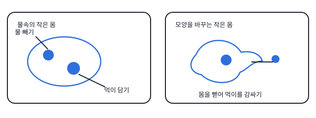
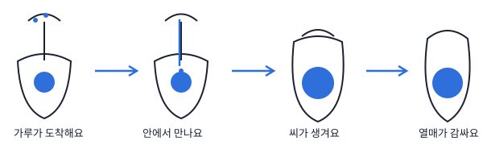
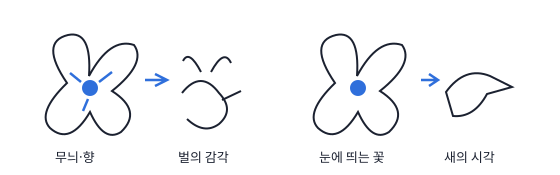
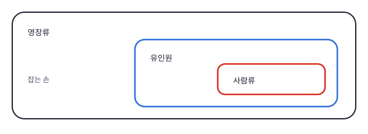

# 원생생물·식물·균류·동물 — 5살도 이해하는 정리노트

이영만 교수님 생명과학 · 1110 수업 (9장 p4–8, 일부 세부 분류 생략)

> `정리노트_1110_Protists_Plants_Fungi_and_Animals.html`를 마크다운으로 옮겼어요. 그림은 `figures_1110/` 폴더의 SVG, 위젯은 대표 설정의 정적 그림으로 바꿨어요. 수식은 `$…$` / `$$…$$`라서 GitHub, Obsidian, Typora에서 보여요.

**목차**

- [1. 다양한 원생생물](#s0)
  - [지난 수업과 이어 보기](#s0-recap)
  - [한 가지 모습으로 묶을 수 없는 원생생물](#s0-diversity)
  - [물속 생산자와 가까운 친척](#s0-algae)
- [2. 식물의 육상 적응과 번식](#s1)
  - [물 밖에서 마르지 않고 서는 법](#s1-land)
  - [꽃가루·밑씨·씨방은 서로 다른 단계](#s1-seed)
  - [꽃과 동물이 서로에게 미친 진화적 영향](#s1-coevolution)
- [3. 균류의 구조와 먹이·공생](#s2)
  - [눈에 보이는 버섯 아래의 실](#s2-structure)
  - [밖에서 잘게 자른 다음 흡수해요](#s2-feeding)
  - [지의류와 균근의 교환 상대](#s2-symbiosis)
- [4. 동물의 분류와 육상 생식](#s3)
  - [동물이라고 모두 대칭인 것은 아니에요](#s3-animal)
  - [척삭동물 안에 척추동물이 있어요](#s3-chordate)
  - [몸과 배를 건조에서 보호해요](#s3-amniote)
- [5. 사람류의 특징과 증거 읽기](#s4)
  - [마주 보는 엄지와 두 발 걷기는 다른 기준](#s4-primate)
  - [뼈·발자국에서 행동을 추론해요](#s4-fossil)
  - [현대인의 기원을 뒷받침하는 서로 다른 자료](#s4-origin)
- [6. 요약 · 예고](#s5)
  - [시험 직전 한눈에](#s5-cheatsheet)
  - [다음 시간 연결](#s5-next)
  - [함께 보면 좋은 자료](#s5-links)

## 1. 다양한 원생생물

### 지난 수업과 이어 보기

*1110 수업 · 9장 p3–4*

**정확히 말하면**

처음에는 생물을 식물·동물의 두 계로 크게 나누었어요. 이후 세균·원생생물·균류 등을 구별하는 다섯 계 분류가 쓰였어요.

앞선 분류 수업에서는 분자 서열을 비교해 세균·고세균·진핵생물의 세 영역을 구별했어요. 영역은 계보다 큰 범위이고, 이 수업의 전통적 체계에서는 진핵생물 안에 원생생물·식물·균류·동물의 네 계를 둬요.

지난 수업은 핵막으로 둘러싸인 핵이 없는 원핵생물까지 살폈어요. 원핵생물에는 서로 다른 두 영역인 진정세균과 고세균이 있어요. [지난 수업의 세균·고세균 정리](../../1105/정리노트_1105_Origin_of_Life_and_Prokaryotes.html#s2-structure)에서 경계를 확인해요.

[이전 rRNA 비교 노트의 보충](../../1103/정리노트_1103_Macroevolution_and_Taxonomy.html#s3-rrna)에는 균류가 식물보다 동물과 가깝다는 계통 관계가 있어요. 이는 오늘 수업의 직접 설명이 아니에요.

**페이지 요약**

옛 두 계·다섯 계 분류를 거쳐, 수업에서는 세 영역 안에 진핵생물의 네 계를 놓고 살펴봐요.

*용어*

- **분류의 범위** — 영역은 계보다 커요. 세균·고세균·진핵생물이 세 영역이고, 수업의 진핵생물 안에는 원생생물·식물·균류·동물 네 계가 있어요.
- **원핵생물** — 핵막으로 둘러싸인 핵이 없어요. 진정세균과 고세균은 서로 다른 영역이에요.
- **이전 계통 비교 보충** — 균류는 식물보다 동물과 가까워요. 이번 수업의 직접 설명이 아닌 이전 rRNA 비교 노트의 보충이에요.

---

### 한 가지 모습으로 묶을 수 없는 원생생물

*1110 수업 · 9장 p4*

**쉽게 말하면**

한 칸짜리 작은 몸도 있고, 여러 칸이 모인 큰 몸도 있어요. 먹이를 얻는 법도, 몸 안의 작은 주머니를 쓰는 법도 저마다 달라요.

*물을 빼는 일, 먹이를 담는 일, 몸을 뻗는 일은 서로 달라요.*

**정확히 말하면**

원생생물(protists)은 이 수업의 전통적인 분류에서 동물·육상식물·균류에 넣지 않은 다양한 진핵생물을 묶어 부르는 이름이에요. 핵이 있는 생물이라는 공통점은 있지만 한 가지 생김새나 영양 방식으로 정의할 수 있는 단일한 자연 계통군은 아니에요. 짚신벌레·아메바·유글레나처럼 단세포인 것도 있고, 미역·다시마·김처럼 큰 다세포 해조류도 있어요. 따라서 ‘원생생물은 모두 단세포’나 ‘원생생물은 모두 다세포’라는 말은 맞지 않아요.

영양 방식도 달라요. 짚신벌레·아메바처럼 외부 먹이를 이용하는 종속영양, 해조류처럼 빛으로 유기물을 만드는 독립영양, 유글레나처럼 조건에 따라 광합성과 외부 유기물 이용을 할 수 있는 혼합영양(mixotrophy)이 있어요. 무성생식하는 종류도, 유성생식하는 종류도 있어요. 보통 물이나 습한 곳에서 살지만 숙주의 몸속에서 사는 종류도 있어요.

담수의 짚신벌레는 삼투로 들어온 물을 수축포(contractile vacuole)에 모아 세포 밖으로 내보내요. 먹이를 막으로 둘러싸 만들어진 식포(food vacuole)에서는 먹이를 소화해요. 아메바의 위족(pseudopodium)은 몸 일부를 발처럼 뻗은 것으로, 이동하거나 먹이를 둘러싸 섭취하는 데 쓰여요. 이 세 구조는 같은 뜻의 ‘주머니’가 아니라 물 조절·소화·운동과 섭식이라는 서로 다른 일을 해요.

기생 원생생물 가운데 말라리아를 일으키는 종류와 아프리카 수면병을 일으키는 종류가 있어요. 감자역병의 원인 생물도 원생생물로 소개됐어요. 질병을 일으키는 일부 사례를 원생생물 전체의 성질로 옮기면 안 돼요.

**교수님 말씀**

> “원생생물은 매우 다양합니다.”

교수님은 유글레나·아메바·짚신벌레와 미역·다시마를 나란히 놓고 단세포와 다세포를 비교했어요. 수축포는 물을 퍼내는 바가지, 위족은 ‘가짜 발’에 비유했어요. 세부 분류 이름보다 이 다양성과 각 구조의 일을 먼저 알면 된다고 했어요.

**꼭 기억해요**

원생생물을 ‘한 종류의 단순한 단세포 생물’로 외우기 쉬워요. 실제로는 단세포·다세포, 종속영양·독립영양·혼합영양을 모두 포함하는 넓은 묶음이에요. ‘다세포 구조를 가진 원생생물이 있다’도 참이므로, 어떤 선택지가 원생생물의 *일반적인* 특징인지와 일부 사례에도 맞는지를 구별해야 해요. 펩티도글리칸 세포벽은 진정세균의 특징이지 원생생물 전체의 특징이 아니에요.

수축포를 소화 주머니로, 식포를 물 배출 주머니로 바꾸지 않아요. 위족은 위장과 무관하고 이동·먹이 포획에 쓰여요.

**보충 · 수업에서 다루지 않았어요**

일부 원생생물은 이분법(2분법)으로 두 딸세포를 만들어요. 이 방식이 나타날 수 있다는 진술과 원생생물 전체의 공통·고유 특징이라는 진술은 달라요. 짚신벌레의 대핵·소핵과 두 핵을 가진 다른 원생생물 사례도 있어, 두 핵이 짚신벌레만의 유일한 특징이라는 일반화는 안 돼요.

출처: [OpenStax Biology 2e 23.2 Life Cycles](https://openstax.org/books/biology-2e/pages/23-2-characteristics-of-protists); [23.3 Ciliates·Diplomonads](https://openstax.org/books/biology-2e/pages/23-3-groups-of-protists)

**페이지 요약**

원생생물은 핵이 있는 생물 가운데 동물·육상식물·균류에 넣지 않은 다양한 무리로, 몸의 크기와 먹는 방식이 하나로 정해지지 않아요.

*용어*

- **분류 경계** — 전통적인 수업 분류의 넓은 묶음이에요. 단세포·다세포가 모두 있으며 다세포 해조류도 포함돼요. 펩티도글리칸 벽은 진정세균의 특징이에요.
- **영양 방식** — 외부 먹이를 쓰는 종속영양, 광합성하는 독립영양, 조건에 따라 둘 다 쓰는 유글레나의 혼합영양이 있어요.
- **서식과 생식** — 물·습한 곳과 숙주 몸속 등에서 살고, 종류에 따라 무성 또는 유성생식을 해요.
- **수축포** — 담수 짚신벌레에서 삼투로 들어온 물을 모아 밖으로 내보내요.
- **식포와 위족** — 식포는 섭취한 먹이를 소화해요. 아메바의 위족은 몸을 뻗어 이동하거나 먹이를 감싸요.
- **기생 사례** — 말라리아·수면병과 감자역병의 원인 생물처럼 기생 종류도 있지만, 원생생물 모두가 기생하는 것은 아니에요.

- **(보충) 일부의 이분법과 두 핵** — 일부 원생생물은 이분법으로 분열하고, 두 핵도 짚신벌레만의 고유 특징은 아니에요. 일부의 성질을 전체 공통 성질로 바꾸지 않아요.

---

### 물속 생산자와 가까운 친척

*1110 수업 · 9장 p4*

**쉽게 말하면**

물속에도 빛을 받아 먹이를 만드는 생물이 많아요. 너무 많이 불어나거나 산호 곁을 떠나면, 주변 생물의 삶도 달라질 수 있어요.

*빛으로 만든 먹이는 물속 생태계에 퍼지고, 지나친 번성은 산소 부족을 부를 수 있어요.*

**정확히 말하면**

광합성하는 원생생물과 해조류는 빛을 이용해 CO₂로부터 유기물을 만드는 생산자예요. 광합성 플랑크톤을 식물성 플랑크톤, 이를 먹는 종속영양 플랑크톤을 동물성 플랑크톤이라고 불러요. 육상식물도 광합성하지만, 이 수업에서 미역·다시마·김 같은 해조류는 육상식물이 아니라 원생생물 쪽에 놓았어요. 따라서 해조류와 육상식물에 공통인 능력은 광합성이지만, 두 무리가 모두 종자·꽃을 만드는 것은 아니에요. 강의노트는 식물성 플랑크톤과 해조류가 지구 광합성 유기물 생산의 큰 몫을 맡는다고 설명해요.

규조류(diatoms)는 규산질 껍질을 가진 광합성 원생생물이에요. 미역·다시마는 갈조류(brown algae), 김은 홍조류(red algae)예요. 녹조류(green algae)는 육상식물과 가장 가까운 계통으로 소개됐어요. 이때 ‘가깝다’는 말은 녹조류가 곧 육상식물이라는 뜻이 아니에요. 수업에서는 육상으로 진출한 식물을 따로 식물로 다뤄요.

와편모조류(dinoflagellates) 가운데 일부는 적조(red tide)를 일으켜요. 물속에서 광합성 생물이 지나치게 늘어나면 일부 종류의 독소가 직접 해를 줄 수 있고, 번성한 생물의 호흡과 죽은 유기물을 분해하는 과정은 용존 산소를 낮춰 물고기를 위험하게 할 수 있어요. 모든 와편모조류가 독소를 내거나 모든 적조를 와편모조류 하나가 일으키는 것은 아니에요.

산호(coral)는 동물이고, 그 안에서 사는 광합성 공생 조류는 별개의 생물이에요. 높은 수온 등으로 공생 관계가 깨져 조류가 빠져나가거나 색소가 줄면 산호가 희게 보이는 백화가 일어나요. 오래 지속되면 산호의 생존이 위협받지만, 백화가 곧 즉각적인 죽음이라는 뜻은 아니에요. 산호가 만드는 서식처와 광합성 산물이 줄면 주변 생물에도 영향이 퍼져요.

깃편모충류(choanoflagellates)는 동물과 가까운 현생 단세포 계통이에요. 해면동물의 깃세포와 기본 모양이 닮았고, DNA 염기서열 비교도 가까운 관계를 뒷받침해요. 닮은 현생 생물을 동물의 직접 조상이라고 단정하지는 않아요. 앞서 배운 [rRNA 계통 비교](../../1103/정리노트_1103_Macroevolution_and_Taxonomy.html#s3-rrna)처럼 분자 자료와 형태를 함께 보아 관계를 추론해요.

**교수님 말씀**

> “광합성 조류들이 상당히 중요하죠.”

교수님은 광합성 생물이 CO₂를 유기물로 바꾸는 일을 강조했어요. 적조를 설명하다가 “홍조가 아니고, 적조”로 고쳐 말했어요. 산호에 사는 공생 생물이 사라지면 색이 희게 보이고, 산호가 줄면 주변 생물의 서식처도 줄어든다고 설명했어요. 깃편모충류와 해면동물 깃세포의 닮은 모양을 뒤의 동물 부분과 연결했어요.

**꼭 기억해요**

홍조류는 김이 속하는 생물 무리이고, 적조는 물이 붉게 보일 만큼 특정 미생물이 늘어나는 현상이에요. 녹조류도 생물 무리이고 녹조는 현상이에요. 원생생물로 분류된 해조류와 육상식물은 모두 광합성할 수 있지만, 해조류를 꽃·종자를 만드는 식물로 바꾸어 분류하지 않아요.

적조 피해를 ‘와편모조류는 모두 독을 낸다’ 또는 ‘동물성 플랑크톤만 산소를 써서 피해가 난다’로 단순화하지 않아요. 독성은 일부 종류에서 나타나고, 산소 감소에는 번성한 생물의 호흡과 사체의 분해가 관여할 수 있어요. 산호는 동물, 그 안의 광합성 공생자는 별개예요. 백화와 즉각적인 사망도 구별해요.

녹조류는 육상식물과 가까운 원생생물 계통이고, 깃편모충류는 동물과 가까운 현생 계통이에요. 둘 다 현재 살아 있는 생물이므로 각각을 육상식물·동물의 확정된 직접 조상으로 쓰지 않아요. 균류가 식물보다 동물과 가깝다는 관계는 위의 이전 계통 비교 보충을 참고해요.

**보충 · 수업에서 다루지 않았어요**

일부 갈조류 등 해조류도 세대교번을 해요. 따라서 해조류와 식물의 공통 능력으로 광합성을 고르는 문항에서, 세대교번이 해조류에는 전혀 없다고 설명하면 안 돼요. 여기서는 문항의 표현 한계를 판별하는 사실만 보충하고 생활사의 상세 과정은 다루지 않아요.

출처: [OpenStax Biology 2e 23.3 Brown Algae](https://openstax.org/books/biology-2e/pages/23-3-groups-of-protists)

**페이지 요약**

물속 광합성 원생생물은 생산자이고, 해조류·육상식물의 공통 능력과 생물군의 계통 관계는 따로 구별해요.

*용어*

- **녹조류와 녹조** — 녹조류는 생물군, 녹조는 특정 미생물이 많이 늘어나는 현상이에요. 생물군과 현상을 같은 단위로 부르지 않아요.
- **광합성과 분류** — 식물성 플랑크톤·해조류는 생산자, 이를 먹는 동물성 플랑크톤은 섭식자예요. 해조류와 육상식물 모두 광합성하지만, 수업에서는 미역·다시마·김을 원생생물 쪽에 두어요. 해조류에 꽃·종자를 일반화하지 않아요.
- **조류의 예** — 규조류는 규산질 껍질, 갈조류는 미역·다시마, 홍조류는 김이에요. 녹조류는 육상식물과 가까운 계통이에요.
- **적조와 산소** — 일부 와편모조류가 적조를 일으켜요. 일부의 독소와 대량 번성 뒤 호흡·분해에 따른 산소 감소가 피해에 관여해요. 홍조류는 적조 현상과 다른 생물군이에요.
- **산호 백화** — 동물인 산호의 광합성 공생자가 이탈하거나 색소가 줄면 희게 보여요. 오래 지속되면 생존이 위험하지만 즉시 사망과 같지는 않아요. 산호 서식처 감소는 주변 생물에도 영향을 줘요.
- **가까운 현생 계통** — 깃편모충류는 해면의 깃세포와 형태가 닮고 DNA 자료에서도 동물과 가까워요. 현생 깃편모충류를 동물의 직접 조상으로 단정하지 않아요.
- **이전 계통 비교** — 균류가 식물보다 동물과 가까운 관계는 이전 rRNA 비교 노트의 보충이에요. 이번 수업의 직접 설명으로 바꾸지 않아요.

- **(보충) 해조류의 세대교번** — 일부 해조류도 세대교번을 해요. 광합성이 공통 능력이라고 해서 다른 공통 가능성을 전부 부정하지 않아요. 상세 생활사는 이번에 학습하지 않았어요.

---

## 2. 식물의 육상 적응과 번식

### 물 밖에서 마르지 않고 서는 법

*1110 수업 · 9장 p4–5*

**쉽게 말하면**

물 밖에서는 몸이 마르고 쓰러지기 쉬워요.

겉을 덮어 물을 지키고, 작은 구멍으로 공기를 받으며, 몸속 길과 단단한 기둥으로 높이 자라요.

*겉을 지키는 일, 공기를 받는 일, 몸을 세우는 일이 함께 필요해요.*

**정확히 말하면**

수업에서 말하는 식물은 육상식물이에요. 선태류(이끼류)는 식물에 포함되지만, 미역·다시마 같은 갈조류와 녹조류는 식물과 구별되는 조류예요. 조류와 육상식물은 모두 광합성을 할 수 있어도 같은 식물군은 아니에요. 녹조류는 육상식물의 가까운 친척이에요.

물 밖에서는 몸 표면에서 수분이 빠져나가고 물의 부력이 사라져 몸을 지탱해야 해요. 큐티클(cuticle)은 표면의 왁스성 층으로 수분 손실을 줄여요. 그러나 덮개가 기체의 직접 출입도 제한하므로 기공(stomata)을 통한 이산화탄소 유입과 기체 교환이 필요해요. 기공은 열리고 닫히며 물 손실과 기체 교환을 조절해요.

육상식물의 공통 경향을 예외 없는 규칙으로 외우면 안 돼요. 물속에 사는 검정말처럼 기공이 없는 식물도 있어요. 얇은 몸 표면이 물과 접하면 세포가 주변과 직접 기체를 교환할 수 있어요.

선태류(bryophytes)에는 물관과 체관으로 이루어진 관다발(vascular tissue)이 없어요. 그래서 몸 전체로 물질을 멀리 보내기 어렵고 대체로 작으며 습한 곳에서 자라요. 양치류(ferns)를 포함하는 무종자 관다발식물은 관다발을 가져요. 물관(xylem)은 물과 무기 양분을, 체관(phloem)은 광합성 산물을 다른 부분으로 운반해요. 세포벽의 셀룰로오스와 구별되는 리그닌(lignin)은 물관 등 조직을 단단하게 해 수직 성장을 지지해요.

선태류와 양치류에는 종자가 없고 포자로 번식해요. 관다발 유무는 선태류와 양치류를, 종자 유무는 이 두 무종자 식물군과 겉씨·속씨식물을 가르는 기준이에요.

**교수님 말씀**

수영장 밖으로 나오면 물의 부력이 사라져 몸을 받쳐야 한다는 비유로 육상 생활의 건조와 지지 문제를 설명했어요. 잎의 반짝이는 왁스층을 큐티클의 익숙한 모습으로 가리켰어요.

**꼭 기억해요**

녹조류가 육상식물과 가깝다고 해서 수업의 육상식물에 포함되지는 않아요. 이끼는 선태류로서 식물이지만 관다발이 없어요. 양치류는 관다발이 있어도 종자는 없어요.

큐티클이 수분 손실을 줄이는 것과 기공이 기체 교환을 허용하는 것은 서로 다른 역할이에요. 거의 모든 육상식물의 경향을 모든 식물에 예외 없이 적용하지 마세요.

**페이지 요약**

육상식물은 물 손실과 기체 교환의 상충을 조절하고, 관다발과 리그닌이 있는 계통은 물질 수송과 지지를 강화해요.

*용어*

- **육상식물** — 이끼 같은 선태류부터 포함해요. 광합성은 조류도 할 수 있지만, 가까운 친척인 녹조류와 미역·다시마 같은 조류는 육상식물과 구별해요.
- **큐티클(cuticle) · 기공(stomata)** — 큐티클은 표면 수분 손실을 줄여요. 기공은 이산화탄소 유입과 기체 교환을 허용하며 열림 정도로 물 손실을 조절해요. 물속 검정말 등에는 기공이 없을 수 있어요.
- **관다발(vascular tissue) · 리그닌(lignin)** — 물관은 물과 무기 양분을, 체관은 광합성 산물을 수송해요. 리그닌은 세포벽을 단단하게 해 몸을 지지해요.
- **선태류 · 양치류** — 선태류에는 관다발과 종자가 없어요. 양치류에는 관다발이 있지만 종자는 없어요. 두 군 모두 포자로 번식해요.

---

### 꽃가루·밑씨·씨방은 서로 다른 단계

*1110 수업 · 9장 p5*

**쉽게 말하면**

가루가 암쪽에 먼저 도착한 뒤, 그 안의 생식 세포가 알과 만나 새 생명의 시작점이 생겨요.

알을 품었던 것은 씨가 되고, 꽃의 바깥 주머니는 씨를 감싸는 열매가 돼요.

*도착과 만남은 다른 일이고, 씨와 열매도 다른 부분에서 생겨요.*

**정확히 말하면**

종자식물은 겉씨식물(gymnosperms)과 속씨식물(angiosperms)로 나뉘어요. 두 군 모두 꽃가루(pollen)와 밑씨(ovule)를 만들어요. 밑씨 안에는 난세포가 형성되고, 꽃가루 안에서 정자 세포가 발달해요. 소나무 같은 겉씨식물은 암·수 생식 구조인 솔방울을 가지며 밑씨가 씨방에 싸여 있지 않아요. 속씨식물은 꽃이 있고 밑씨가 씨방(ovary) 안에 들어 있어요. 속씨식물을 현화식물이라고도 해요.

수분(pollination), 곧 꽃가루받이는 꽃가루가 암쪽 생식 구조로 옮겨지는 일이에요. 겉씨식물의 꽃가루는 주로 바람으로 암쪽 솔방울에 옮겨지고, 꽃가루의 이동에 자유로운 물이 꼭 필요한 것은 아니에요. 속씨식물에서는 바람이나 동물에 의해 꽃가루가 암술머리에 닿아요. 그 뒤 꽃가루관을 통해 정자 세포가 밑씨 쪽으로 이동해 난세포와 만나면 수정(fertilization)이에요. 따라서 수분이 일어났다는 사실만으로 수정이 끝났다고 말할 수 없어요. 꽃가루는 수분을 겪는 운반 단위이고, 수정란을 곧바로 뜻하지 않아요.

수정란은 배(embryo)로 자라며, 수정 뒤 밑씨가 발달해 종자(seed)가 돼요. 종자는 배와 영양조직, 단단한 바깥 종피(seed coat)를 포함해요. 종피는 배를 불리한 환경에서 보호하고, 종자는 휴면(dormancy) 상태를 거칠 수 있어요. 알맞은 수분 등 조건이 되면 발아해요.

속씨식물에서는 밑씨를 감싼 씨방이 열매(fruit)로 발달해 종자를 보호하고 산포를 도와요. 열매나 종자는 바람, 물, 동물에 의해 퍼질 수 있어요. 부모 식물 바로 아래에서는 빛과 물을 두고 경쟁할 수 있으므로 멀리 퍼진 종자에 이점이 생길 수 있어요. 꽃가루가 다른 꽃으로 옮겨지는 수분과 완성된 종자가 퍼지는 산포는 운반 대상과 시점이 달라요.

**교수님 말씀**

소나무의 수컷 솔방울에서 나온 꽃가루가 암컷 솔방울에 이르는 예로 겉씨식물의 수분을 설명했어요. 민들레의 바람, 코코넛의 물, 동물의 섭식·배설을 종자 산포의 예로 들었어요.

**꼭 기억해요**

겉씨식물도 꽃가루와 종자를 가지지만 속씨식물의 꽃·씨방·열매는 없어요. 밑씨의 노출 여부로 두 군을 구별해요.

꽃가루가 암쪽에 도착하는 수분과 정자·난세포가 결합하는 수정은 다른 단계예요. 수정란은 배가 되고, 밑씨는 종자가 되며, 속씨식물의 씨방은 열매가 돼요. 씨방을 씨, 꽃가루를 씨 또는 수정란으로 바꾸어 읽지 마세요.

**보충 · 수업에서 다루지 않았어요**

교재는 속씨식물의 물관에 특수한 물관요소(vessel elements) 세포가 있어 뿌리에서 지상부로 물이 더 빠르게 이동한다고 설명해요. 이 특징은 꽃·열매처럼 속씨식물을 설명하는 데 유용하지만, 관다발 자체가 속씨식물에만 있다는 뜻은 아니에요. 또한 교재는 초기 속씨식물의 화석 기록이 빈약해 다른 식물군과의 초기 진화 연결을 자세히 추적하기 어렵다고 설명해요. 화석이 있으니 그 연결을 잘 파악할 수 있다는 식의 단정은 피해야 해요.

겉씨식물의 포자체도 감수분열로 포자를 만들지만, 포자는 배우체가 발달하는 생식 구조 안에 머물러요. 포자를 만드는 것과 포자를 외부에 독립적인 산포 단위로 퍼뜨리는 것은 달라요. 수업에서 배운 꽃가루 이동과 종자 산포를, 포자를 전혀 만들지 않는다는 뜻으로 바꾸지 않아요.

출처: 『생명과학: 기초와 응용』 2판 9장, PDF p18(인쇄 p.192–193).

**페이지 요약**

겉씨·속씨 모두 꽃가루와 종자를 가지지만, 속씨식물만 밑씨가 씨방 안에 있고 수정 뒤 열매가 발달해요.

*용어*

- **겉씨식물(gymnosperms) · 속씨식물(angiosperms)** — 겉씨식물은 밑씨가 씨방에 싸이지 않고 꽃·열매가 없어요. 속씨식물은 꽃의 씨방 안에 밑씨가 있으며 씨방이 열매로 발달해요.
- **수분(pollination) · 수정(fertilization)** — 수분은 꽃가루가 암쪽 구조로 이동하는 단계이며 자유로운 물이 꼭 필요하지 않아요. 겉씨식물에서는 주로 바람이 암쪽 솔방울로 옮기고, 속씨식물에서는 바람·동물이 암술머리로 옮겨요. 이후 정자 세포가 난세포와 결합해야 수정이에요.
- **꽃가루(pollen) · 밑씨(ovule) · 씨방(ovary)** — 정자 세포는 꽃가루 안에서 발달하고, 밑씨 안에 난세포가 형성돼요. 수정 뒤 수정란은 배로, 밑씨는 종자로 발달해요. 속씨식물의 씨방은 종자를 보호하는 열매가 돼요.
- **종피(seed coat) · 휴면(dormancy)** — 종자는 배·영양조직·종피를 포함해요. 종피가 배를 보호하며, 휴면을 거친 종자는 알맞은 수분 등 조건에서 발아할 수 있어요.
- **종자 산포** — 완성된 종자가 바람·물·동물로 퍼지는 일이에요. 꽃가루의 수분과 대상·시점이 다르며, 부모 아래의 빛·물 경쟁을 줄일 수 있어요.

- **(보충) 물관요소와 초기 화석** — 교재에 따르면 속씨식물의 특수한 물관요소는 빠른 물 수송에 기여해요. 초기 속씨식물 화석은 빈약해 다른 식물군과의 초기 진화 연결을 자세히 추적하기 어려워요. 관다발 자체는 속씨식물에만 있는 것이 아니에요. 겉씨식물도 포자를 만들지만 생식 구조 안에 머물러요. 포자 생산과 외부 산포를 구별하며 꽃가루·종자의 이동과 혼동하지 않아요.

---

### 꽃과 동물이 서로에게 미친 진화적 영향

*1110 수업 · 9장 p5*

**쉽게 말하면**

어떤 꽃은 냄새나 무늬로 벌의 눈길을 끌고, 어떤 꽃은 새의 눈에 잘 보여요.

꽃을 찾아오는 동물이 가루를 옮기면 꽃이 다음 씨를 만들 기회를 얻어요.

*방문자를 끄는 신호와 꽃에 닿는 몸의 모양이 함께 작용해요.*

**정확히 말하면**

공동진화는 공진화(Coevolution)의 다른 이름이에요. 한쪽의 변화가 상대의 선택 조건을 바꾸고, 상대의 진화가 다시 한쪽에 영향을 주는 현상을 가리켜요.

속씨식물의 꽃은 동물이 찾아와 꽃가루를 옮기는 상호작용의 토대가 되었어요. 풍매화는 바람으로 꽃가루가 운반되는 꽃이고, 충매화는 곤충이 꽃가루받이를 매개하는 꽃이에요. 속씨식물에는 바람매개 꽃과 동물매개 꽃이 모두 있어요. 동물 매개자는 곤충에 한정되지 않으며 박쥐나 벌새도 포함돼요. 꽃가루 운반과 종자 산포는 서로 다른 과정이에요.

꽃의 색, 향, 자외선 무늬, 형태는 방문자의 감각과 몸 구조에 따라 방문·수분 가능성을 바꿔요. 예를 들어 벌은 자외선 무늬를 감지할 수 있어 꿀이 있는 방향을 찾는 데 도움이 되고, 일부 새는 눈에 띄는 붉은 꽃을 찾아요. 향에 민감한 곤충은 꽃 냄새를 단서로 쓸 수 있어요. 모든 벌이 같은 꽃만 찾거나 모든 붉은 꽃을 새가 수분한다는 규칙은 아니에요.

공진화(Coevolution)는 밀접하게 상호작용하는 두 계통에서 한쪽의 유전적 변화가 상대의 생존·번식에 선택압으로 작용하고, 상대의 변화도 다시 영향을 주며 여러 세대에 걸쳐 진화하는 양상이에요. 꽃이나 동물이 필요를 알아차려 의도적으로 바꾸는 과정은 아니에요. 한쪽이 변하면 상대가 반드시 즉시 변한다는 뜻도 아니에요.

꽃 색·향과 방문자의 감각 차이는 어떤 동물이 어느 꽃을 방문할지에 영향을 줘요. 기계적 격리(mechanical isolation)는 두 식물 종·계통 사이에서 생식 구조나 매개자와의 형태 대응 차이가 꽃가루 전달·수용을 물리적으로 막아 유전자 흐름을 차단하는 수정 전 격리예요. 한 꽃과 방문자의 형태가 맞지 않는다는 관찰만으로 종 사이 격리가 입증되는 것은 아니에요. 방문 선호나 활동 시간만 다른 경우를 기계적 격리라고 부르지 않아요. 특정 매개자의 몸이 꽃의 생식 구조에 맞아 꽃가루를 실어 나를 수 있는지와, 눈에 띄어 방문하는지는 구분해요.

**교수님 말씀**

교수님은 벌이 보는 자외선 무늬와 새의 시각을 예로 들어 꽃의 특징과 매개자의 감각이 연결된다고 설명했어요. 서로의 변화가 다음 변화의 조건에 영향을 준다는 뜻을 출석 방식과 학생 행동의 비유로 풀었어요.

**꼭 기억해요**

풍매화는 바람매개, 충매화는 곤충매개를 뜻해요. 동물매개 꽃가루받이를 모두 충매화라고 부르면 박쥐·새 매개 사례가 빠져요.

꽃 색과 향이 방문을 바꾸는 일과 물리적 구조가 맞지 않아 꽃가루 전달이 막히는 기계적 격리는 같은 말이 아니에요. 공진화도 두 종이 의지로 서로를 따라 변한다는 뜻이 아니라 상호 선택압이 누적될 수 있다는 뜻이에요.

**페이지 요약**

꽃의 신호와 형태는 매개자의 방문·꽃가루 전달에 영향을 주고, 긴 상호작용은 양쪽 계통의 선택압이 될 수 있어요.

*용어*

- **풍매화 · 충매화** — 속씨식물의 꽃이 동물과 꽃가루받이로 상호작용할 토대가 되었어요. 풍매화는 바람이, 충매화는 곤충이 꽃가루를 옮겨요. 박쥐·벌새도 동물 매개자가 될 수 있어 동물매개와 충매화는 같은 범위가 아니에요.
- **꽃과 매개자의 대응** — 색·향·자외선 무늬는 감각에 따른 방문을 바꿀 수 있어요. 실제 수분에는 꽃가루를 전달할 수 있는 접촉도 필요해요. 모든 꽃·매개자에 단일 규칙을 적용하지 않아요.
- **공진화·공동진화(Coevolution)** — 밀접한 상호작용에서 양쪽 계통의 변화가 서로의 선택압에 영향을 주며 여러 세대에 걸쳐 진화하는 양상이에요. 즉각적·의도적 변화는 아니에요.
- **기계적 격리(mechanical isolation)** — 식물 종·계통 사이에서 형태 차이로 꽃가루 전달·수용이 막히는 수정 전 격리예요. 개별 꽃과 매개자의 불일치만으로 종 간 격리를 확정하지 않아요. 색·향에 따른 방문 선호 차이만으로 판정하지 않아요.

---

## 3. 균류의 구조와 먹이·공생

### 눈에 보이는 버섯 아래의 실

*1110 수업 · 9장 p5*

**쉽게 말하면**

버섯 아래 땅속에는 아주 가는 실들이 넓게 퍼져 있어요.

*위의 버섯은 전체 몸의 일부이고, 실은 아래에서 이어져 있어요.*

**정확히 말하면**

다세포 균류의 몸은 실 모양의 **균사(hypha)**로 이루어져요. 여러 균사가 이어진 덩어리가 **균사체(mycelium)**예요. 눈에 보이는 버섯은 포자를 만드는 생식 구조이며, 땅속 균사체가 몸의 넓은 부분을 차지할 수 있어요.

균류 세포벽의 대표 성분은 **키틴**이에요. 곤충의 외골격에도 키틴이 있지만, 균류가 곤충이라는 뜻은 아니에요. **효모**처럼 단세포인 균류도 있어서 균류를 모두 버섯 모양의 다세포 생물로 일반화할 수 없어요.

균류에는 무성생식과 유성생식이 있고 포자가 중요한 번식 수단이에요. 먹는 버섯의 많은 종류는 **담자균**에 속해요. 버섯 갓 아래에서 포자를 만드는 예를 볼 수 있지만, 균류의 분류군을 모두 외우는 것이 이번 수업의 초점은 아니에요.

**교수님 말씀**

버섯을 테이프로 찍어 현미경에 대면 투명한 실이 보인다고 설명했어요. 땅 위 버섯만 보지 말고, 땅속에서 넓게 이어진 균사체까지 하나의 몸으로 생각해 보세요.

**꼭 기억해요**

**균사**는 실 하나, **균사체**는 실이 모인 덩어리예요. 효모는 단세포 균류이고, 버섯·많은 곰팡이는 다세포 균류예요. 푸른곰팡이의 푸른빛을 엽록소나 광합성의 증거로 해석하지 마세요.

**보충 · 수업에서 다루지 않았어요**

일부 푸른곰팡이속(Penicillium) 종은 페니실린계 항생제의 원료가 돼요. 균류 전체가 항생제를 만든다는 뜻은 아니에요.

출처: 교재 9장 p.196

**페이지 요약**

균류에는 단세포 효모와 균사가 모인 다세포형이 있으며, 눈에 보이는 버섯은 다세포 균류의 몸 일부예요.

*용어*

- **균사(hypha)** — 다세포 균류의 실 모양 구조예요.
- **균사체(mycelium)** — 여러 균사가 이어진 덩어리로, 땅속에 넓게 퍼질 수 있어요.
- **키틴** — 균류 세포벽의 대표 성분이에요.
- **생식** — 포자는 중요한 번식 수단이며 유성·무성생식 모두 가능해요. 효모 등에서 나타나는 다른 번식 방식을 지우고 포자로만 번식한다고 일반화하지 않아요.
- **효모** — 단세포 균류예요. 모든 균류가 다세포는 아니에요.
- **담자균** — 우리가 먹는 많은 버섯이 속하는 균류 집단이에요.

- **(보충) 항생제 생산** — 교재 p.196에 따르면 일부 Penicillium 종이 페니실린계 항생제 원료예요. 균류 전체의 공통 형질은 아니에요.

---

### 밖에서 잘게 자른 다음 흡수해요

*1110 수업 · 9장 p5*

**쉽게 말하면**

곰팡이는 큰 먹이를 몸 밖에서 잘게 나눈 다음 작은 조각을 빨아들여요.

*크게 남아 있는 먹이와 작아진 조각은 몸 안으로 들어가기 전에 구별돼요.*

**정확히 말하면**

균류는 스스로 유기물을 광합성해 만들지 않는 **종속영양** 생물이에요. 큰 유기물 분자는 세포막을 곧장 통과하기 어려워요. 균류는 먼저 효소를 세포 밖으로 분비해 유기물을 작게 분해하는 **세포외 소화**를 하고, 작은 분자를 **흡수**해요. 동물은 보통 몸 안으로 먹이를 들여 소화하므로 순서와 장소가 달라요.

살아 있는 숙주에서 영양을 얻으면 기생, 죽은 유기물을 분해해 얻으면 **부생** 생활이에요. 세균과 균류는 죽은 물질의 유기물을 분해하는 **분해자**예요. 유기물의 **탄소**를 이산화탄소 등으로 되돌려 식물이 다시 이용할 수 있게 하므로 탄소 순환에 기여해요.

균류는 포자를 이용해 번식하고, 수업에서는 유성·무성생식이 모두 가능하다고 설명했어요. 그래서 먹이를 얻는 방식과 번식 방식은 별개예요.

**교수님 말씀**

죽은 나무의 버섯을 예로 들며, 큰 녹말을 그대로 흡수하지 않고 밖에서 잘라 작은 분자로 만든다고 설명했어요. 분해자가 없으면 죽은 생물의 탄소가 다시 순환하기 어렵다는 점을 강조했어요.

**꼭 기억해요**

**동물은 주로 섭식 뒤 몸 안에서 소화**하고, **균류는 몸 밖에서 소화한 뒤 흡수**해요. 둘 다 외부에서 유기물을 얻지만 같은 방식으로 먹지는 않아요. **기생**은 살아 있는 숙주, **부생**은 죽은 유기물이 대상이에요.

**보충 · 수업에서 다루지 않았어요**

일부 균류의 세포외 효소는 토양의 특정 유기오염물 분해에 활용될 수 있어요. 금속은 분해되지 않고 일부 경우 축적될 수 있으며, 처리 효과는 오염물질 종류와 산소·산도·수분·온도 등에 따라 달라요. 균류가 모든 독성물질에 언제나 가장 유용하다는 뜻은 아니에요.

출처: [캐나다 공공사업조달부, Mycoremediation: White Rot Fungus](https://gost.tpsgc-pwgsc.gc.ca/tfs.aspx?ID=11&lang=eng)

**페이지 요약**

균류와 동물은 모두 외부 유기물에 의존하지만, 균류는 몸 밖에서 분해한 뒤 흡수하고 동물은 주로 먹은 뒤 몸 안에서 소화해요.

*용어*

- **종속영양** — 다른 생물이 만든 유기물을 얻어 쓰는 방식이에요.
- **세포외 소화와 흡수** — 효소를 밖으로 내보내 큰 분자를 자른 다음 작은 분자를 들여요.
- **기생과 부생** — 살아 있는 숙주에서 얻으면 기생, 죽은 유기물을 분해해 얻으면 부생이에요.
- **분해자와 탄소** — 죽은 물질의 유기물을 분해해 탄소를 이산화탄소 등으로 되돌려 순환에 기여해요.

- **(보충) 균류의 오염물 처리** — 일부 균류는 특정 유기오염물을 세포외 효소로 분해할 수 있어요. 금속은 분해되지 않으며 처리 효과는 물질과 산소·산도·수분·온도에 달려 있어, 모든 독성물질에 최선이라고 할 수 없어요.

---

### 지의류와 균근의 교환 상대

*1110 수업 · 9장 p5*

**쉽게 말하면**

곰팡이는 함께 사는 친구에게 물과 양분을 가져다주고, 그 친구가 만든 먹이를 받아요.

*두 협력에서 균류의 상대가 서로 달라요.*

**정확히 말하면**

**지의류**는 균류와 광합성 생물의 연합이에요. 광합성 상대는 **남세균**이나 **녹조류**일 수 있어요. 균류가 물과 무기양분을 얻는 데 도움을 주고, 광합성 상대는 유기물을 만들어요. 지의류는 바위 같은 척박한 곳에서 살 수 있고, 바위를 풍화해 토양 형성에 기여할 수 있어요. 공기 오염에 민감한 종류는 대기 상태의 지표로 쓰여요.

**균근**은 균류와 식물 뿌리의 공생이에요. 식물은 광합성으로 만든 **탄수화물**과 다른 유기물을 균류에 줘요. 균류는 균사를 뻗어 뿌리의 흡수 범위를 넓히고 물과 무기이온, 특히 **인**을 식물이 얻는 데 도움을 줘요.

**교수님 말씀**

지의류를 먼저 소개한 뒤, 식물 뿌리와 균사가 만난 균근을 보여 주었어요. 균사가 뿌리만으로 닿기 어려운 흙의 작은 틈까지 퍼져 물과 영양분을 얻는 모습을 강조했어요.

**꼭 기억해요**

지의류의 상대는 **남세균 또는 녹조류 같은 광합성 생물**이고, 균근의 상대는 **식물 뿌리**예요. 균근에서는 **탄수화물은 식물에서 균류로**, **물·인 같은 무기양분은 균류의 도움을 받아 식물로** 이동해요. 균류가 식물에게 당을 만들어 준다고 방향을 뒤집지 마세요.

**페이지 요약**

지의류는 균류와 광합성 미생물의 연합이고, 균근은 균류와 식물 뿌리의 연합이라 교환 상대부터 달라요.

*용어*

- **지의류** — 균류와 남세균·녹조류 등의 광합성 상대가 함께 살아가요. 척박한 곳의 토양 형성에 기여하고, 민감한 종류는 대기 상태의 지표가 돼요.
- **균근** — 균류가 식물 뿌리의 물·무기양분 흡수를 돕고, 식물은 광합성 산물을 균류에 줘요.
- **인** — 균사가 넓힌 흡수 범위 덕분에 식물이 더 쉽게 얻는 무기양분의 예예요.
- **탄수화물** — 식물이 광합성으로 만들고 균근의 균류에 공급하는 유기물이에요.

---

## 4. 동물의 분류와 육상 생식

### 동물이라고 모두 대칭인 것은 아니에요

*1110 수업 · 9장 p6*

**쉽게 말하면**

동물의 몸은 한쪽만 똑같이 나눌 수도 있고, 여러 방향으로 나눌 수도 있어요. 어느 쪽으로도 똑같이 나뉘지 않는 동물도 있어요.

*선 하나, 여러 선, 선 없음으로 몸의 좌우 같음을 비교해요.*

**정확히 말하면**

동물은 **다세포** 진핵생물이고, 세포에 **세포벽**이 없으며 다른 생물이 만든 유기물을 이용하는 종속영양 생물이에요. 대부분은 생활사의 어느 단계에서 움직여요. 동물의 대부분은 방사대칭 또는 좌우대칭이지만 모든 동물이 대칭형이라는 뜻은 아니에요.

사람처럼 한 평면으로 나누면 양쪽이 대응하는 것이 **좌우대칭**이에요. 말미잘처럼 중심축을 지나는 여러 평면으로 나눌 수 있으면 **방사대칭**이에요. 실제 **해면동물**처럼 일정한 대칭면이 없으면 **비대칭**이에요. 해면동물은 진정한 조직도 없어요. 해면의 **깃세포**는 물을 흐르게 하고 먹이 입자를 걸러내는 세포이며, 원생생물의 입깃편모충류와 모양이 닮았어요.

**교수님 말씀**

바나나는 한 면으로, 둥근 수박은 여러 면으로 비슷하게 가를 수 있다는 비유로 대칭을 설명했어요. 만화 속 스폰지밥과 달리 실제 해면동물은 비대칭이며 진정한 조직이 없다고 강조했어요. 깃세포의 모습이 입깃편모충류와 닮았다는 비교도 다시 짚었어요.

**꼭 기억해요**

**다세포성**은 동물의 공통 형질이에요. **대칭성**은 모든 동물의 공통 형질이 아니에요. 해면동물이 비대칭이라는 반례예요. 방사대칭 말미잘과 좌우대칭 사람을 뒤집어 분류하지 마세요.

**보충 · 수업에서 다루지 않았어요**

동물은 대개 유성생식하지만, 해면동물은 몸의 일부가 떨어져 새로운 개체가 되는 등 무성생식도 할 수 있어요. 따라서 “모든 동물의 모든 번식은 유성생식만이다”라는 일반화는 성립하지 않아요. 그러나 무성생식도 한다는 사실만으로 유성생식이 전혀 불가능하다고 판단할 수는 없어요. “유성생식만 한다”와 “유성생식도 가능하다”를 구분해야 해요.

출처: 교재 9장 p.197의 동물 생식 개관; [OpenStax Biology 2e, 28.1 해면동물](https://openstax.org/books/biology-2e/pages/28-1-phylum-porifera)의 무성생식 설명

**페이지 요약**

동물은 모두 다세포지만 몸의 대칭 방식은 달라서, 해면동물처럼 대칭면이 없는 동물도 있어요.

*용어*

- **동물의 공통 형질** — 다세포 진핵생물이고 세포벽이 없으며 종속영양을 해요. 대부분은 어느 단계에서 움직이며 방사대칭 또는 좌우대칭이에요.
- **좌우대칭** — 한 평면으로 나눌 때 양쪽이 대응해요. 사람을 생각해요.
- **방사대칭** — 중심축을 지나는 여러 평면에서 나눌 수 있어요. 말미잘을 생각해요.
- **비대칭·해면동물** — 일정한 대칭면이 없어요. 해면은 진정한 조직도 없고, 깃세포는 물 흐름을 만들어 먹이를 걸러내며 입깃편모충류와 모양이 닮았어요.

- **(보충) 동물의 무성생식** — 해면동물에도 무성생식이 있어 모든 번식이 유성생식만이라는 일반화는 안 돼요. 유성생식도 가능한지와는 다른 명제예요.

---

### 척삭동물 안에 척추동물이 있어요

*1110 수업 · 9장 p7*

**쉽게 말하면**

어릴 때 몸속에 부드러운 기둥을 가진 큰 무리가 있고, 그 안에서 등뼈를 가진 무리가 갈라져요.

*등뼈를 가진 무리는 부드러운 기둥을 가진 큰 무리 안에 들어가요.*

**정확히 말하면**

**척삭동물**은 생애 적어도 한 단계에서 유연한 지지 기둥인 **척삭**, **등쪽**의 속 빈 신경삭, **인두열**, 근육성 꼬리 같은 형질을 가져요. 사람도 배아 때 척삭을 가져요. 자라면서 척삭의 대부분은 줄고 척추 사이 원반에 일부가 남아요. 척추를 가진 **척추동물**은 척삭동물의 일부이지, 모든 척삭동물이 척추동물은 아니에요.

척추동물 안에서 턱이 없는 계통과 턱이 있는 계통, 다리가 생긴 **사지류**를 구분해요. 사지류에는 양서류와 양막류가 포함돼요. ‘어류’를 편의상 물속의 여러 척추동물에 붙이지만, 사지류를 뺀 어류만 묶으면 공통 조상의 모든 후손을 담지 못하는 **측계통**이에요. 공통 조상과 그 모든 후손을 포함하면 **단계통**이에요.

**교수님 말씀**

척추동물 분류 정도는 알아야 한다고 강조했어요. 일상에서 물고기는 분명히 있지만, 진화 계통을 엄밀히 묶는 분류명으로서 ‘어류’는 조상의 모든 후손을 포함하지 않는다고 설명했어요.

**꼭 기억해요**

**척삭**은 유연한 기둥, **척추**는 뼈 등으로 이루어진 등뼈예요. 척추동물은 척삭동물에 포함되지만 그 역은 아니에요. 척삭동물 모두가 뼈를 공유한다는 말도 성립하지 않아요. 사지류 안의 양서류와 양막류는 [육상 생식 적응](#s3-amniote)에서 다시 갈라요.

**보충 · 수업에서 다루지 않았어요**

교재는 먹장어와 칠성장어를 턱 없는 척추동물 계통으로 소개하고, 척추동물에서 뼈 또는 연골의 내부골격을 설명해요. 내부골격은 근육을 지지하고 신경계와 여러 기관을 보호해요. 턱 없는 무악류와 달리 턱을 가진 계통은 큰 먹이를 붙잡거나 방어하는 데 턱을 이용할 수 있어요. 따라서 “뼈는 모든 척삭동물이 공유하는 조상 형질”은 거짓이에요. 척삭만 가진 무척추 척삭동물까지 뼈가 있다는 뜻이 되기 때문이에요.

출처: 교재 9장 p.202

**페이지 요약**

척추동물은 척삭동물 안의 한 무리이고, 사지류는 그 안에서 다리를 가진 계통이라 포함 범위가 차례로 좁아져요.

*용어*

- **척삭** — 척삭동물이 생애 어느 단계에 갖는 유연한 지지 기둥이에요. 등쪽 신경삭·인두열·근육성 꼬리도 관련 형질이에요.
- **척추동물** — 척삭동물 중 척추가 있는 무리예요. 모든 척삭동물에 척추나 뼈가 있는 것은 아니에요.
- **사지류** — 척추동물 중 네 다리가 나타난 계통으로, 양서류와 양막류를 포함해요.
- **단계통·측계통** — 공통 조상과 모든 후손을 담으면 단계통이에요. 사지류를 뺀 ‘어류’처럼 후손 일부를 제외하면 측계통이에요.

- **(보충) 무악류와 내부골격** — 교재 p.202는 먹장어·칠성장어를 턱 없는 계통으로, 척추동물의 내부골격을 뼈 또는 연골로 설명해요. 뼈를 척삭동물 전체의 공통 형질로 볼 수 없어요. 내부골격은 지지·보호를 맡고, 턱 있는 계통은 턱을 먹이 포획·방어 등에 이용해요.

---

### 몸과 배를 건조에서 보호해요

*1110 수업 · 9장 p7–8*

**쉽게 말하면**

물 밖으로 나오면 몸도 마르지만 새끼가 자라는 자리도 마르기 쉬워요. 그래서 몸을 덮고 새끼를 감싸는 보호막이 중요해졌어요.

*배를 둘러싼 네 막은 서로 다른 위치에 있어요.*

**정확히 말하면**

육지에서는 몸과 알의 수분 손실이 문제예요. 파충류·조류·포유류가 속하는 **양막류**에는 물이 잘 통과하지 않는 피부와 배를 보호하는 배외막이 나타나요. 수업의 **양막란** 설명에서 네 막은 배를 감싸는 **양막**, 배설물 저장과 기체 교환에 관여하는 **요막**, 영양을 저장·전달하는 **난황낭**, 바깥쪽에서 기체 교환을 돕는 **장막**이에요. 피부의 방수와 배를 둘러싼 막은 해결하는 대상이 달라요.

양서류는 수중 환경에 의존하는 생식이 흔해요. 양막류는 배가 물 밖에서 발생할 수 있는 구조를 갖췄어요. 척추동물 가운데 육상 생식에 처음으로 본격 적응한 무리로 구별하며, 처음 땅을 밟은 척추동물과 같은 질문은 아니에요. **조류**는 진화 계통상 파충류 쪽의 양막류예요. 양막류가 모두 알을 몸 밖에 낳는 것은 아니에요. **포유류**의 공통 특징은 새끼에게 젖을 먹이는 것이며, 알을 낳는 단공류도 포유류예요.

단공류는 알을 낳아요. 유대류는 새끼가 짧은 초기 자궁 발생 뒤 육아낭으로 옮겨 가 발달을 이어가요. 태반류는 자궁 안에서 태반을 통해 더 오래 영양을 받고 발생을 마쳐요. 단공류·유대류·태반류 모두 젖으로 새끼를 키우므로, 태어나는 방식만으로 포유류 여부를 결정하지 않아요.

**교수님 말씀**

물에서 육지로 나왔을 때 가장 큰 어려움으로 건조를 꼽았어요. 몸만 마르지 않게 하는 것으로는 부족하고, 발생 중인 배도 보호해야 한다고 설명했어요. 알을 낳는 포유류가 있다는 사실로 “포유류는 모두 새끼를 낳는다”는 생각을 바로잡았어요.

**꼭 기억해요**

사지류 전체가 육지에서 완전히 생식하는 것은 아니에요. 양서류와 달리 **양막류**에는 건조한 환경에서 배를 보호하는 막이 있어요. **양막란**은 배외막이 있는 구조를 가리키며, 포유류가 모두 밖에 껍질 있는 알을 낳는다는 뜻이 아니에요.

**단공류는 알**, **유대류는 초기 자궁 발생 뒤 육아낭**, **태반류는 자궁·태반을 통한 긴 발생**으로 구분해요. 세 무리 모두 포유류이고 젖을 먹여요.

**페이지 요약**

양막류의 피부는 몸의 건조를 줄이고 배외막은 발생 중인 배를 보호하며, 포유류의 발생 방식은 단공류·유대류·태반류마다 달라요.

*용어*

- **양막류·양막란** — 척추동물의 육상 생식에 처음 본격 적응한 무리이며 양서류와 구별돼요. 처음 땅을 밟은 집단과 혼동하지 않아요. 배외막은 배 보호와 물질 교환을 도와요.
- **양막·요막·난황낭·장막** — 각각 배 보호, 배설·기체 교환, 영양 저장·전달, 바깥쪽 기체 교환에 관여해요.
- **조류** — 진화 계통상 파충류 쪽에 속하는 양막류예요.
- **포유류** — 젖으로 새끼를 키워요. 단공류는 알을 낳고, 유대류는 육아낭에서 발달을 잇고, 태반류는 자궁·태반에서 더 오래 발생해요.

---

## 5. 사람류의 특징과 증거 읽기

### 마주 보는 엄지와 두 발 걷기는 다른 기준

*1110 수업 · 9장 p8*

**쉽게 말하면**

공통으로 물건을 잘 잡는 친구들 안에서도, 두 발로 걷는 특징으로 더 작은 무리를 구별할 수 있어요.

*큰 집합의 특징과 작은 집합을 가르는 특징은 달라요.*

**정확히 말하면**

**영장류(primates)**에는 원숭이·유인원·사람이 포함돼요. 마주 보는 엄지손가락은 다른 손가락과 맞물려 물건을 잡는 데 유리해요. 많은 영장류는 유연한 어깨와 엉덩이 관절, 큰 뇌와 학습능력, 사회생활 같은 특징도 보여요. 이 특징 하나를 사람만의 특징으로 바꾸면 안 돼요.

**유인원(apes)**에는 사람과 가까운 현생 계통들과 사람 계통이 포함돼요. 그 안에서 **사람류(호미닌, hominins)**는 현생 인류와 침팬지 계통과 갈라진 뒤의 인류 쪽 조상·친척을 가리켜요. **직립보행**, 특히 습관적인 두 발 걷기가 수업에서 사람류를 다른 유인원과 구별한 주요 기준이에요. 사람이 동물이 아니라는 뜻은 아니에요.

현상에서 이름을 되짚어 볼까요? ‘엄지를 다른 손가락과 마주해 가지를 잡는다’면 넓은 영장류의 특징이고, ‘일상적으로 두 발로 걷도록 몸이 적응했다’면 사람류를 구별하는 기준이에요. 현대의 다른 유인원이 잠깐 두 발로 설 수 있다는 것과 습관적 두발보행의 진화는 구분해요.

**교수님 말씀**

> 엄지손가락이 다른 손가락을 마주 봐야 이걸 잡을 수가 있어.

교수님은 엄지가 아파 물건 잡기가 어려웠던 경험을 들었어요. 잡는 손의 기능을 이해한 뒤, 사람류를 구분하는 두 발 걷기와 따로 기억해요.

**꼭 기억해요**

**엄지·학습능력·사회생활이 곧 사람류만의 특징은 아니에요.** 다른 영장류에도 나타나요. ‘사람류를 구별하는 주요 적응’을 물으면 습관적인 직립자세와 두 발 걷기를 확인해요.

영장류 전체, 유인원, 사람류, 호모 속은 같은 크기의 분류 집합이 아니에요. 오스트랄로피테쿠스는 사람류지만 호모 속은 아니고, 호모 사피엔스는 그보다 좁은 한 종이에요. 사람의 엄지발가락까지 항상 다른 발가락과 마주 본다고 일반화하지 않아요.

**페이지 요약**

영장류의 잡는 손은 넓게 공유되는 특징이고, 습관적인 두 발 걷기는 사람류를 구별하는 주요 기준이에요.

*용어*

- **영장류** — 원숭이·유인원·사람을 포함해요. 마주 보는 엄지손가락과 유연한 관절, 학습·사회생활은 사람만의 특징이 아니에요.
- **사람류(호미닌)** — 현생 인류와 인류 쪽 조상·친척 계통이에요. 사람도 동물·영장류·유인원에 속하며 사람류와 호모 속은 범위가 달라요.
- **두 발 걷기** — 사람류의 주요 판별 기준은 습관적인 직립보행이에요. 다른 유인원의 일시적인 두 발 서기와 구별해요.
- **비교 단위** — 엄지의 맞섬은 넓은 영장류의 특징, 두발보행은 사람류 판별의 핵심이에요. 사람의 엄지발가락에도 똑같이 맞섬을 적용하지 않아요.

---

### 뼈·발자국에서 행동을 추론해요

*1110 수업 · 9장 p8*

**쉽게 말하면**

오래된 발자국과 뼈는 말하지 못하지만, 어떤 자세로 움직였는지 알려 주는 단서가 돼요.

*관찰한 형태와 그 형태에서 추론한 행동을 구별해요.*

**정확히 말하면**

교수님의 질문은 ‘사람류에서 **두발보행과 큰 뇌 가운데 무엇이 먼저 나타났을까?**’였어요. 이를 알아보려면 한 화석에서 보행과 관련된 뼈 형태와 머리뼈의 크기를 각각 확인해야 해요. 뼈를 발견했다는 절차만으로는 순서를 알 수 없어요.

**루시**는 **오스트랄로피테쿠스 아파렌시스(Australopithecus afarensis)**의 화석이에요. 수업에서는 허벅지뼈(대퇴골)가 엉덩이에서 무릎 쪽으로 기울어진 모습과 두개골을 비교했어요. 무릎이 몸의 중심 아래에 놓이는 형태는 두 발로 체중을 지지하는 보행의 단서가 돼요. 반면 두개골이 보여 주는 뇌 용적은 현대인보다 작았어요.

1. 직접 보는 자료는 뼈의 방향·관절 형태와 두개골이에요.
2. 그 뼈의 기능을 비교해 두발보행 적응을 해석하고, 두개골로 뇌 확대 정도를 따로 판단해요.
3. 두발보행의 증거가 있으면서 뇌는 아직 작았으므로, 큰 뇌의 확대보다 두발보행이 앞섰다는 순서를 지지해요.

화산재에 남은 **발자국**도 보행을 뒷받침하는 다른 자료예요. 발 모양·배열·하중이 남긴 흔적을 읽어요. 교수님은 깊이와 무게중심을 설명했지만, ‘뒤꿈치가 깊으면 언제나 직립’ 같은 한 조건만으로 모든 발자국을 판정하지는 않아요.

**교수님 말씀**

> 그럼 직립이 먼저였을까, 머리 똑똑해진 게 먼저였을까?

루시의 이름은 발굴 뒤 들었던 곡에서 유래했다고 소개했어요. 이름의 유래와 별개로 학습의 핵심은 두 종류의 형질을 같은 화석에서 비교해 순서를 추론하는 일이에요.

**꼭 기억해요**

**작은 뇌가 곧 네 발 보행의 증거는 아니에요.** 보행은 다리·골반 등의 형태로, 뇌 확대는 두개골로 각각 확인해요. 뇌가 큰 후에야 직립할 수 있다는 설명은 이 증거와 맞지 않아요.

현생 침팬지가 그대로 사람으로 바뀌었다는 줄세우기가 아니에요. 서로 다른 계통의 특징을 비교하는 것이며, 루시를 모든 인류의 확인된 직접 조상이나 ‘최초의 인간’으로 단정하지 않아요.

**페이지 요약**

작은 뇌와 두발보행의 증거가 함께 나타나는 초기 사람류 화석은 뇌 확대보다 두발보행이 먼저였음을 지지해요.

*용어*

- **루시** — 오스트랄로피테쿠스 아파렌시스의 화석이에요. 사람류에 속하지만 호모 속이나 현생 인류 그 자체는 아니에요.
- **직접 관찰과 해석** — 허벅지뼈의 기울기·관절 형태를 관찰하고 체중 지지와 보행을 해석해요. 두개골로는 뇌 확대 정도를 따로 판단해요.
- **형질의 순서** — 보행 적응은 보이지만 뇌 용적은 작으므로 습관적 두발보행이 큰 뇌 확대에 앞섰다는 설명을 지지해요. 작은 뇌만 보고 보행을 판정하지 않아요.
- **발자국** — 발 모양·배열·하중 흔적은 별도의 보행 자료예요. 깊이 하나를 무조건적인 판정 공식으로 삼지 않아요.
- **추론의 한계** — 현생 침팬지가 그대로 사람으로 변했다거나 루시가 최초의 인간·확인된 직접 조상이라는 결론은 나오지 않아요. 이름 유래는 증거가 아니에요.

---

### 현대인의 기원을 뒷받침하는 서로 다른 자료

*1110 수업 · 9장 p8*

**쉽게 말하면**

오래된 흔적이 발견된 곳과 여러 사람 사이에 남은 차이를 함께 살펴, 어디서 퍼졌는지 추적해요.

*서로 다른 자료를 함께 해석해요.*

**정확히 말하면**

수업에서는 호모 에렉투스, **네안데르탈인**, **호모 사피엔스(Homo sapiens)**를 차례로 언급했어요. 이것은 이름을 외우기 위한 일렬의 직계 조상 목록이 아니에요. 호모 사피엔스는 현생 인류이며, 네안데르탈인과 한동안 공존했어요.

**아프리카 기원설**은 현대인의 주된 기원을 아프리카에서 찾고 이후 다른 지역으로 퍼졌다고 보는 설명이에요. 교수님은 아프리카의 오래된 인류 화석과 아프리카 집단에서 크게 나타나는 **유전적 다양성**을 근거로 들었어요. 직접 비교하는 것은 화석의 연대·발견 위치와 여러 집단의 DNA 차이예요. 이를 함께 해석해 기원과 이동의 역사를 추론해요.

**다지역설**은 여러 지역의 옛 인류 집단이 유전자 교류를 이어 가며 현대인으로 진화했다는 다른 설명으로 소개됐어요. 두 이름은 현대인이 어디서 어떻게 나타났는가에 대한 가설을 가리켜요. 수업에서는 아프리카 기원설의 두 근거를 중심으로 봤어요.

네안데르탈인의 고대 DNA와 현대인의 DNA를 비교한 연구는 일부 현대인 계통과의 교배·유전자 유입을 뒷받침해요. ‘DNA를 일부 공유한다’는 수업 표현은 현대인과 네안데르탈인의 모든 DNA가 그 일부만 닮았다는 뜻이 아니에요. 네안데르탈인의 멸종 원인은 교수님도 확정하지 않았어요.

**교수님 말씀**

> 아프리카에서 가장 오래된 화석이 발견이 됩니다.

화석이라는 형태·연대 자료와 유전적 다양성이라는 분자 자료를 함께 연결했어요. 수업의 오래된 연대 숫자를 최신 연구의 확정 연대로 바꾸어 외우기보다, 어떤 관찰이 어느 설명을 지지하는지 기억해요.

**꼭 기억해요**

**유전적 다양성은 집단 안의 차이 크기이며 개인의 우열이 아니에요.** 다양성이 크다는 관찰 하나만으로 기원이나 연대를 확정하지 않아요. 화석·DNA 등 여러 증거의 일치를 봐요. 종이 늦게 등장했다는 이유만으로 모든 종 간 다양성 순위가 정해지는 것도 아니에요.

교배의 증거와 멸종 원인은 다른 질문이에요. 유전자 유입이 있었다고 해서 어느 한 집단이 다른 집단을 모두 죽였다는 결론은 나오지 않아요. 생존해 있는 사람들을 진화의 높고 낮은 단계로 나누지 않아요.

**페이지 요약**

아프리카의 오래된 화석과 집단의 유전적 다양성은 현대인의 아프리카 기원을 지지하는 서로 다른 자료예요.

*용어*

- **아프리카 기원설** — 현대인의 주된 기원을 아프리카에서 찾고 이후 확산을 설명해요. 오래된 화석과 집단의 DNA 다양성을 함께 근거로 읽어요.
- **다지역설** — 여러 지역의 옛 인류 집단이 유전자 교류를 이어 가며 현대인으로 진화했다는 설명이에요. 수업에서는 이름과 차이를 소개했어요.
- **직접 자료와 궁극적 질문** — 화석의 연대·위치와 집단의 DNA 차이를 비교해 현대인의 기원·이동을 추론해요. 자료 하나만으로 확정하거나 최신 출현 연대를 단정하지 않아요.
- **호모 사피엔스와 네안데르탈인** — 한동안 공존했고 고대 DNA 비교는 일부 계통 간 유전자 유입을 지지해요. 이름들을 모두 일렬의 직접 조상으로 세우지 않아요.
- **해석의 한계** — 유전적 다양성은 개인의 우열·진화 단계가 아니며 등장 시기 하나로 종 간 다양성 순위가 정해지지 않아요. 교배의 증거가 멸종 원인을 확정하지 않아요.

---

## 6. 요약 · 예고

### 시험 직전 한눈에

| 주제 | 시험 직전 한 줄 |
|---|---|
| 원생생물 | 진핵생물 가운데 동물·육상식물·균류 이외의 다양한 집단이에요. 단세포·다세포, 독립·종속·혼합영양이 모두 가능해요. |
| 세포 구조 | 수축포는 여분의 물 배출, 식포는 먹이 소화, 위족은 이동·먹이 포획이에요. |
| 광합성 조류 | 녹조류는 육상식물과 가까워요. 홍조류라는 분류군과 적조라는 현상을 구별해요. 산호는 동물이에요. |
| 육상 적응 | 큐티클은 수분 손실을 줄이고 기공은 기체 교환을 맡아요. 관다발과 리그닌은 수송·지지에 도움이 돼요. |
| 식물군 | 선태류는 관다발 없음, 양치류는 관다발 있지만 종자 없음, 겉씨·속씨식물은 종자 있음이에요. |
| 수분과 수정 | 수분은 꽃가루 이동, 수정은 정자·난자 결합이에요. 밑씨는 종자, 씨방은 열매, 수정란은 배로 발달해요. |
| 공진화 | 꽃과 매개자가 서로 선택압을 주어 여러 세대에 걸쳐 영향을 받는 것이에요. 의도적 변신이 아니에요. |
| 균류 | 키틴 세포벽, 균사와 균사체, 효모의 단세포성을 구별해요. 밖에서 분해한 뒤 흡수하는 종속영양이에요. |
| 공생 | 지의류는 균류와 광합성 상대, 균근은 균류와 식물 뿌리예요. 균근에서는 식물이 유기물, 균류가 무기양분·물을 제공해요. |
| 동물 | 다세포 진핵·종속영양이며 세포벽이 없어요. 해면동물은 진정한 조직이 없고 일반적으로 비대칭이에요. |
| 포함 관계 | 척추동물은 척삭동물의 일부예요. 사지류에는 양서류와 양막류가 있고 조류·포유류도 양막류예요. |
| 육상 생식 | 건조에 강한 피부는 몸을, 양막란의 배외막은 배의 발생을 보호해요. 네 다리와 양막란은 다른 기준이에요. |
| 포유류 | 젖으로 새끼를 키워요. 단공류는 알, 유대류는 짧은 자궁 내 발생 뒤 젖을 먹으며 성장, 태반류는 긴 자궁·태반 발생이에요. |
| 사람류 | 영장류 공유형질인 마주 보는 엄지와 사람류 구별 기준인 습관적인 두발보행을 분리해요. |
| 증거 해석 | 두발보행의 증거와 작은 뇌가 함께 있으면 뇌 확대보다 보행이 먼저였음을 지지해요. 화석·DNA는 기원 가설의 다른 근거예요. |

---

### 다음 시간 연결

- 이번에는 9장 마지막 쪽의 현대인 기원설까지 도달했어요.
- 교수님은 다음 수업에 이어서 진행한다고 했지만, 다음 항목의 이름은 지정하지 않았어요.
- 세대교번, 체강·발생 양식, 무척추동물의 세부 분류 등은 이번에 설명되지 않았어요. 생략을 시험 제외로 단정하지 않아요.

---

### 함께 보면 좋은 자료

- [1110 복습문제 30선](복습문제_1110_Protists_Plants_Fungi_and_Animals.md)
- [앞선 1105 생명의 기원·원핵생물·바이러스](../../1105/정리노트_1105_Origin_of_Life_and_Prokaryotes.html)
- [9장 범위·보류 문항 점검](장마감_1110_9장.md)

---

출처: 이영만 교수님 강의노트(9장 p4–8) · 수업 녹음 전사(1110) · 『생명과학: 기초와 응용』 2판 9장.
