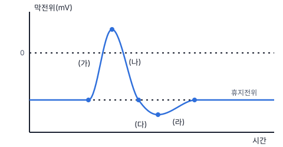
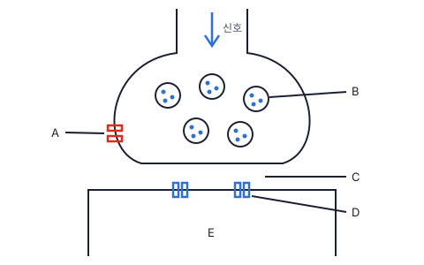

# 생명과학 복습 1112 문제설명

왼쪽 목차로 문항을 고르고, 오른쪽 문제를 보며 해설을 따라가요.

문제의 첫 줄부터 검산까지 설명해요.

**목차**

- [문항별 설명](#problems)
  - [P1. 신경아교세포의 역할](#p1)
  - [P2. 신경전달물질이 하는 일](#p2)
  - [P3. 막전위와 이온 분포](#p3)
  - [P4. 수초가 줄면 전도 속도는](#p4)
  - [P5. 코카인이 작용하는 곳](#p5)
  - [P6. 재흡수를 막는 물질](#p6)
  - [P7. 혈관을 넓히는 신경전달물질](#p7)
  - [P8. 안쪽을 음전하로 유지하는 장치](#p8)
  - [P9. 음전하가 줄어든 막](#p9)
  - [P10. 축삭을 따라 이동하는 신호](#p10)
  - [P11. Na⁺/K⁺ 펌프의 주요 역할](#p11)
  - [P12. 미엘린수초에 관한 설명](#p12)
  - [P13. 신경전달물질의 효과를 키우는 방법](#p13)
  - [P14. 화학시냅스 전달 그림에서 틀린 설명](#p14)
  - [P15. 전기신호를 받는 안테나 부위](#p15)
  - [P16. 활동전위에 대한 옳은 설명](#p16)
  - [P17. 내부를 음전하로 유지하는 것](#p17)
  - [P18. 신경신호를 가장 잘 설명하는 것](#p18)
  - [P19. 화학시냅스 전달과 가장 관계없는 것](#p19)
  - [P32. 감각에서 움직임까지 정보의 순서](#p32)
  - [P20. [변형] 휴지전위를 만드는 것](#p20)
  - [P21. [변형] 센 자극은 더 큰 활동전위일까](#p21)
  - [P22. [변형] 그래프의 네 구간과 채널](#p22)
  - [P23. [변형] 소포는 어디에서 터질까](#p23)
  - [P24. [변형] Cl⁻ 채널을 여는 물질 X](#p24)
  - [P25. [변형] 억제를 막는 독과 수용체를 막는 독](#p25)
  - [P26. [변형] afferent neuron은 어느 쪽으로 보낼까](#p26)
  - [P27. [변형] saltatory conduction이 일어나는 축삭](#p27)
  - [P28. [변형] ATP가 끊긴 뉴런](#p28)
  - [P29. [변형] 재흡수를 막으면 늘어나는 까닭](#p29)
  - [P30. [변형] 세 채널은 어떻게 열릴까](#p30)
  - [P31. [변형] 역치에 못 미친 약한 자극](#p31)

## 문항별 설명

### P1. 신경아교세포의 역할

기출 12강 3 · [원 문제 보기](../%EB%B3%B5%EC%8A%B5%EB%AC%B8%EC%A0%9C_1112_Nervous_and_Sensory_Systems.html#p1)

신경아교세포(glial cell)에 대한 진술 중 옳지 않은 것은?

- (1) 모든 보기가 옳은 설명이다
- (2) 슈반세포는 말초신경계에 존재하는 신경아교세포의 한 종류이다
- (3) 신경아교세포는 직접 전기적 메세지를 전달한다
- (4) 신경아교세포는 비신경성 세포이다
- (5) 신경아교세포는 뉴런에 영양분을 공급한다

기출 원문 보기

기출 12강 합본 3번 (PDF 1쪽)

#### 문제가 묻는 것

신경아교세포(glial cell)에 대한 다섯 진술 가운데 **내용이 옳지 않은 진술**을 골라요. (1) ‘모든 보기가 옳다’는 고를 틀린 진술이 없을 때 쓰는 보기라서, (2)~(5)를 먼저 판정한 뒤에 정해요.

#### 이 문제를 봤을 때 떠올릴 개념과 공식

‘신경아교세포’라는 이름에서 뉴런(neuron) 곁의 보조 세포를 떠올려요. 신호(전기적 메시지)를 전달하는 세포는 뉴런이고, 신경아교세포는 신호를 직접 전달하지 않는 비신경성 세포예요. 하는 일은 뉴런에 영양분 공급, 물리적 지지, 미엘린 수초(myelin sheath) 형성의 세 가지예요.

종류도 함께 떠올려요. 성상세포(astrocyte)는 뉴런을 지지하고, 희소돌기아교세포(oligodendrocyte)와 슈반세포(Schwann cell)는 수초를 만들어요. 두 수초 세포의 장소는 수업 밖 보충이에요. 교과서는 희소돌기아교세포를 중추신경계(CNS, 뇌·척수), 슈반세포를 말초신경계(PNS, 뇌·척수 바깥의 신경)에 둬요.

판단 기준은 각 진술이 **신호를 직접 전달하는지**, 그리고 위의 역할·종류·장소와 맞는지예요.

관련 정리노트: [신경아교세포와 미엘린 수초](../%EC%A0%95%EB%A6%AC%EB%85%B8%ED%8A%B8_1112_Nervous_and_Sensory_Systems.html#s0-glia), [수초 세포의 장소(보충)](../%EC%A0%95%EB%A6%AC%EB%85%B8%ED%8A%B8_1112_Nervous_and_Sensory_Systems.html#s0-glia-supp-1)

#### 왜 이렇게 푸는지 함께 따라가요

(2) 내용이 맞아요. 슈반세포는 수초를 만드는 신경아교세포의 한 종류이고, 교과서 기준으로 말초신경계에 있어요(수업 밖 보충). 옳은 진술이라 답이 아니에요.

(3) 내용이 틀려요. ‘직접 전기적 메시지를 전달한다’는 뉴런이 하는 일이에요. 신경아교세포는 영양 공급·지지·수초 형성으로 뉴런을 도울 뿐 신호를 직접 전하지 않아요. 옳지 않은 진술이므로 답으로 골라요.

(4) 내용이 맞아요. ‘비신경성’은 신호를 전하는 신경세포가 아니라는 뜻이고, 신경아교세포의 정의와 같아요.

(5) 내용이 맞아요. 영양분 공급은 신경아교세포의 세 역할 중 하나예요.

(1) 고르지 않아요. (3)이 틀린 진술로 판정되었으므로 ‘모든 보기가 옳다’는 성립하지 않아요. 이 보기는 틀린 진술이 하나도 없을 때만 답이 돼요.

따라서 답은 (3)이에요.

#### 완성 답과 검산

답 (3). 교과서와 강의노트는 신경아교세포를 ‘뉴런에 영양소를 제공하고 뉴런을 지지하는 비신경성 세포’로 정의해요. 이 정의에 (4)·(5)는 그대로 들어 있고, 신호를 직접 전달한다는 내용은 없어요. 그래서 그 자체로 틀린 진술은 (3) 하나이고, (1)은 그 결과에 따라 탈락해요.

#### 헷갈리기 쉬운 점

‘옳지 않은 것’을 묻는 문제의 ‘모든 보기가 옳다’는 문장만 떼어 보면 (3) 때문에 거짓이 돼요. 하지만 이 보기는 ‘고를 틀린 진술이 없음’을 뜻하는 자리라서, 따로 틀린 진술 (3)이 있으면 그 진술을 답으로 골라요.

**페이지 요약**

#### 판단 기준

신호를 직접 전달하는 것은 뉴런이에요. 신경아교세포는 영양 공급·지지·수초 형성만 하는 비신경성 세포예요.

#### 결론

(3)만 틀린 진술이에요. (2) 슈반세포의 말초신경계 위치는 교과서 보충 사실이에요. 답 (3).

---

### P2. 신경전달물질이 하는 일

기출 12강 4 · [원 문제 보기](../%EB%B3%B5%EC%8A%B5%EB%AC%B8%EC%A0%9C_1112_Nervous_and_Sensory_Systems.html#p2)

신경전달물질에 대한 설명으로 옳은 것은?

- (1) 신경충격의 전달이 빨라지도록 랑비에 결절을 가로질러 방출된다
- (2) 전기적 충격이 시냅스후뉴런의 축삭말단에 도달하였을 때 방출된다
- (3) 시상에서 방출되는 스테로이드 호르몬이다
- (4) 시냅스틈을 가로질러 확산하며 시냅스후뉴런의 세포막에 있는 수용체에 결합한다
- (5) 미엘린화된 축삭을 따라서 이동하여 내려가는 전하이다

기출 원문 보기

기출 12강 합본 4번 (PDF 1쪽)

#### 문제가 묻는 것

신경전달물질(neurotransmitter)에 대한 **옳은 설명** 하나를 골라요. 보기마다 신경전달물질이 무엇인지, 어디서 나오는지, 어디로 가는지를 확인해요.

#### 이 문제를 봤을 때 떠올릴 개념과 공식

‘신경전달물질’에서 화학 시냅스(chemical synapse)의 전달 순서를 떠올려요. 활동전위(action potential)가 **시냅스 전 뉴런(presynaptic neuron)의 축삭말단(axon terminal)**에 도착하면 전압개폐성 Ca²⁺ 채널이 열려 Ca²⁺가 들어오고, 신경전달물질이 든 소포가 막과 융합해 시냅스 틈(synaptic cleft)으로 내보내져요(세포외배출). 물질은 틈을 확산해 건너가 **시냅스 후 뉴런(postsynaptic neuron)** 막의 수용체에 결합해요.

판단 기준은 세 가지예요. 정체: 축삭말단에서 분비되는 화학물질이에요(전하나 축삭을 따라 이동하는 신호가 아니에요). 방출하는 쪽: 시냅스 전 뉴런의 축삭말단이에요. 가는 곳: 시냅스 틈을 건너 시냅스 후 막의 수용체예요.

관련 정리노트: [화학 시냅스의 전달 순서](../%EC%A0%95%EB%A6%AC%EB%85%B8%ED%8A%B8_1112_Nervous_and_Sensory_Systems.html#s3-release), [활동전위](../%EC%A0%95%EB%A6%AC%EB%85%B8%ED%8A%B8_1112_Nervous_and_Sensory_Systems.html#s2-action)

#### 왜 이렇게 푸는지 함께 따라가요

(1) 틀려요. 랑비에 결절(node of Ranvier)은 수초 사이에 축삭이 드러난 곳으로, 활동전위가 건너뛰며 생기는 전도 자리예요. 신경전달물질이 나오는 곳은 축삭말단의 시냅스라서 방출 장소 기준과 맞지 않아요.

(2) 틀려요. 전기적 충격(활동전위)이 축삭말단에 도착할 때 방출된다는 시점은 맞지만, 방출하는 쪽을 ‘시냅스후뉴런’이라고 했어요. 내보내는 쪽은 시냅스 전 뉴런의 축삭말단이에요.

(3) 틀려요. 신경전달물질은 뉴런의 축삭말단이 시냅스 틈으로 분비하는 물질이에요. 수업에서 본 아세틸콜린·도파민·세로토닌·GABA 가운데 ‘시상에서 방출되는 스테로이드 호르몬’에 해당하는 것은 없어요.

(4) 맞아요. 시냅스 틈을 확산해 건너가 시냅스 후 뉴런 막의 수용체에 결합한다는 것은 ‘가는 곳’ 기준과 그대로 일치해요.

(5) 틀려요. 미엘린화된 축삭을 따라 내려가는 것은 활동전위, 곧 막전위의 변화예요. 신경전달물질은 전하가 아니라 화학물질이에요.

따라서 답은 (4)예요.

#### 완성 답과 검산

답 (4). 교과서의 화학 시냅스 다섯 단계(활동전위 도착 → Ca²⁺ 유입 → 세포외배출 → 시냅스 후 수용체 결합 → 리간드개폐성 채널 열림)와 대조하면 (4)는 넷째 단계와 같고, (2)는 첫 단계의 ‘시냅스 전’을 ‘시냅스 후’로 바꾼 문장이에요. 나머지는 전도(1, 5)나 호르몬(3)의 이야기라 옳은 보기는 하나예요.

#### 헷갈리기 쉬운 점

(2)처럼 ‘전’과 ‘후’만 바꾼 보기를 조심해요. 축삭말단은 신호를 보내는 쪽에 있고, 받는 쪽은 시냅스 후 뉴런의 수상돌기나 세포체 막이에요.

**페이지 요약**

#### 판단 기준

시냅스 전 뉴런 축삭말단에서 분비 → 시냅스 틈 확산 → 시냅스 후 막 수용체 결합.

#### 결론

(2)는 전·후가 뒤바뀌었고 (1)·(5)는 전도, (3)은 호르몬 이야기예요. 답 (4).

---

### P3. 막전위와 이온 분포

기출 12강 5 · [원 문제 보기](../%EB%B3%B5%EC%8A%B5%EB%AC%B8%EC%A0%9C_1112_Nervous_and_Sensory_Systems.html#p3)

다음은 막전위에 대한 설명이다. 옳은 것은?

- (1) Na⁺/K⁺ 수송펌프는 ATP를 사용하지 않는다
- (2) 활동전위 동안에 막 전위는 양전하에서 음전하로 바뀐다
- (3) 휴지전위는 뉴런의 막이 양전하의 막전위를 유지하고 있는 휴식상태이다
- (4) Na⁺의 농도는 세포 바깥쪽이 높고, K⁺의 농도는 세포 안쪽이 높아 세포 바깥쪽이 양전하를 띤다
- (5) 막전위는 세포 안, 밖에서 Na⁺과 K⁺의 균등한 분포에 의해 생성된다

기출 원문 보기

기출 12강 합본 5번 (PDF 1쪽)

#### 문제가 묻는 것

막전위에 대한 **옳은 설명** 하나를 골라요. 보기마다 ATP 사용 여부, 막 안쪽의 부호(+/−), 바뀌는 방향, 이온 분포가 맞는지 확인해요.

#### 이 문제를 봤을 때 떠올릴 개념과 공식

막전위(membrane potential)는 세포막 안팎의 전압 차이고, Na⁺와 K⁺가 안팎에 **불균등하게** 분포해서 생겨요. 자극받지 않은 뉴런의 휴지전위(resting potential)는 안쪽이 −, 바깥이 +인 분극(polarized) 상태예요(강의노트 값 −50 ~ −60 mV).

Na⁺/K⁺ 펌프는 ATP를 써서 농도 기울기를 거슬러 Na⁺ 3개를 밖으로, K⁺ 2개를 안으로 옮기는 능동수송(active transport)이에요. 그래서 Na⁺는 바깥에, K⁺는 안쪽에 많아요. 수업에서는 여기에 K⁺ 누설 채널(leaky channel)이 더 많아 K⁺가 조금 더 새 나가고, 세포 안에 음이온이 많아 안쪽이 −가 된다고 정리했어요. 활동전위(action potential) 동안에는 Na⁺가 들어와 막전위가 음에서 양으로 바뀌어요(탈분극, depolarization).

관련 정리노트: [휴지전위가 생기는 이유](../%EC%A0%95%EB%A6%AC%EB%85%B8%ED%8A%B8_1112_Nervous_and_Sensory_Systems.html#s1-resting), [채널과 Na⁺/K⁺ 펌프](../%EC%A0%95%EB%A6%AC%EB%85%B8%ED%8A%B8_1112_Nervous_and_Sensory_Systems.html#s1-channel-pump), [활동전위의 막전위 변화](../%EC%A0%95%EB%A6%AC%EB%85%B8%ED%8A%B8_1112_Nervous_and_Sensory_Systems.html#s2-action)

#### 왜 이렇게 푸는지 함께 따라가요

(1) 틀려요. 펌프는 농도가 높은 쪽으로 이온을 밀어 올리는 능동수송이라 ATP 가수분해 에너지를 써야 해요. ‘사용하지 않는다’는 반대예요.

(2) 틀려요. 출발점인 휴지 상태에서 막 안쪽은 음(−)이에요. 활동전위가 일어나면 Na⁺ 유입으로 음에서 양으로 바뀌어요. 보기의 ‘양전하에서 음전하로’는 방향이 거꾸로예요.

(3) 틀려요. 휴지전위는 막 안쪽이 음전하인 상태예요. ‘양전하의 막전위를 유지’한다는 부호가 틀렸어요.

(4) 맞아요. 펌프가 만든 분포(Na⁺ 바깥, K⁺ 안쪽)와 결론(바깥이 +)이 모두 맞아요. 수업은 이 분포 위에 K⁺ 누설과 세포 안 음이온이 더해져 바깥이 +가 된다고 보충했지만, 보기의 내용 자체에 틀린 부분은 없어요.

(5) 틀려요. 안팎에 균등하게 퍼져 있으면 전압 차가 생기지 않아요. 막전위는 불균등한 분포 때문에 생겨요.

따라서 답은 (4)예요.

#### 완성 답과 검산

답 (4). 교과서의 막전위 설명은 펌프 교환으로 Na⁺는 바깥, K⁺는 안쪽 농도가 높아 바깥이 양전하를 띤다고 적어 (4)와 같아요. 나머지 네 보기는 각각 ATP 사용(1), 음→양 방향(2), 휴지 때 안쪽 음전하(3), 불균등 분포(5)를 뒤집은 문장이라 옳은 보기는 하나예요.

#### 헷갈리기 쉬운 점

휴지 상태를 ‘바깥 +, 안쪽 −’로 하나만 고정해 두면 (2)와 (3)이 함께 걸러져요. 활동전위는 이 −에서 출발해 +로 올라가는 변화예요.

**페이지 요약**

#### 판단 기준

펌프는 ATP 사용, 휴지 때 안쪽 −·바깥 +, 활동전위는 음→양, 막전위는 불균등 분포 때문.

#### 결론

(4)만 맞아요(Na⁺ 바깥, K⁺ 안쪽, 바깥 +). 답 (4).

---

### P4. 수초가 줄면 전도 속도는

기출 12강 8 · [원 문제 보기](../%EB%B3%B5%EC%8A%B5%EB%AC%B8%EC%A0%9C_1112_Nervous_and_Sensory_Systems.html#p4)

다발성 경화증에서 보이는 것과 같이 축삭을 싸고 있는 미엘린수초의 감소는 활동전위의 이동하는 속도를 __시킨다.

- (1) 보기 모두 정답이다
- (2) 증가
- (3) 유지
- (4) 감소
- (5) 극대화

기출 원문 보기

기출 12강 합본 8번 (PDF 1쪽)

#### 문제가 묻는 것

다발성 경화증(multiple sclerosis)처럼 축삭을 싼 미엘린 수초가 줄어들 때, 활동전위가 이동하는 속도가 **어느 방향으로 바뀌는지** 골라요.

#### 이 문제를 봤을 때 떠올릴 개념과 공식

‘미엘린수초’와 ‘속도’에서 도약전도(saltatory conduction)를 떠올려요. 수초는 지질이 많은 절연체라서, 수초가 있는 축삭은 채널이 랑비에 결절(node of Ranvier)에만 있어요. 한 결절에서 들어온 Na⁺가 새지 않고 다음 결절까지 가서, 활동전위가 결절에서 결절로 건너뛰듯 빨리 전해져요.

다발성 경화증은 면역계가 자기 수초를 공격하는 자가면역질환이에요. 수초가 벗겨지면 이동하던 Na⁺가 막 밖으로 새어 나가 다음 자리가 역치에 늦게 닿거나 닿지 못해요. 판단 기준은 **수초가 속도를 높이는 원인이므로, 원인이 줄면 속도가 어떻게 되는가**예요.

관련 정리노트: [전도 속도: 축삭의 지름과 도약전도](../%EC%A0%95%EB%A6%AC%EB%85%B8%ED%8A%B8_1112_Nervous_and_Sensory_Systems.html#s2-conduction), [미엘린 수초](../%EC%A0%95%EB%A6%AC%EB%85%B8%ED%8A%B8_1112_Nervous_and_Sensory_Systems.html#s0-glia)

#### 왜 이렇게 푸는지 함께 따라가요

(2) 틀려요. 수초는 속도를 높이는 쪽의 원인이에요. 그 원인이 줄면 빨라질 근거가 없어요.

(3) 틀려요. 수초가 벗겨진 구간에서는 Na⁺가 새어 나가 다음 결절까지 그대로 가지 못해요. 이동 조건이 바뀌었으니 속도가 그대로일 수 없어요.

(4) 맞아요. 도약전도가 끊기고 Na⁺가 새어 나가 다음 자리가 역치에 늦게 닿으므로 속도가 감소해요. 심하면 전달이 끊겨 근육이 마비돼요.

(5) 틀려요. 극대화는 증가의 극단이라 (2)와 같은 이유로 틀려요.

(1) 틀려요. 증가·유지·감소·극대화는 서로 다른 방향이라 함께 정답일 수 없고, 위 판정에서 맞는 것은 (4) 하나예요.

따라서 답은 (4), 감소예요.

#### 완성 답과 검산

답 (4). 반대 방향으로 확인해요. 강의노트와 교과서는 미엘린 수초가 없는 경우보다 수초에 의한 도약전도가 빠르다고 하고, 다발성 경화증은 활동전위의 전달을 막거나 느리게 해 마비를 일으킨다고 해요. ‘느리게’는 감소와 같은 방향이에요.

**페이지 요약**

#### 판단 기준

수초(절연체) → 랑비에 결절만 건너뛰는 도약전도 → 빠름. 수초가 줄면 Na⁺가 새어 이 효과가 사라져요.

#### 결론

전도 속도는 감소하고, 심하면 전달이 끊겨요. 답 (4).

---

### P5. 코카인이 작용하는 곳

기출 12강 11 · [원 문제 보기](../%EB%B3%B5%EC%8A%B5%EB%AC%B8%EC%A0%9C_1112_Nervous_and_Sensory_Systems.html#p5)

신경 전달 경로에서 코카인과 같은 약물들의 주요 효과가 나타내는 곳은 어디인가?

- (1) 랑비에결절
- (2) 축삭
- (3) 수상돌기
- (4) 시냅스
- (5) 미엘린수초

기출 원문 보기

기출 12강 합본 11번 (PDF 2쪽)

#### 문제가 묻는 것

코카인 같은 약물의 주요 효과가 나타나는 **장소**를 골라요. 보기는 모두 뉴런의 부위나 구조 이름이에요.

#### 이 문제를 봤을 때 떠올릴 개념과 공식

‘코카인’에서 신경전달물질의 제거를 떠올려요. 시냅스 틈에 분비된 신경전달물질은 확산, 효소 분해, 재흡수(reuptake)로 사라져야 신호가 끝나요. 재흡수는 시냅스 전 뉴런이 분비했던 물질을 운반단백질로 다시 회수하는 일이에요. 코카인은 이 도파민 재흡수를 막아 도파민이 시냅스 틈에 오래 남아 계속 작용하게 해요.

판단 기준은 약물이 바꾸는 것이 **축삭을 따라 이동하는 전도인지, 시냅스 틈의 신경전달물질 양인지**예요.

관련 정리노트: [신경전달물질의 제거와 약물](../%EC%A0%95%EB%A6%AC%EB%85%B8%ED%8A%B8_1112_Nervous_and_Sensory_Systems.html#s4-removal)

#### 왜 이렇게 푸는지 함께 따라가요

(1) 부적합해요. 랑비에 결절은 활동전위가 건너뛰며 생기는 전도 자리예요. 코카인은 전도가 아니라 시냅스 틈의 전달물질 양을 바꿔요.

(2) 부적합해요. 축삭은 활동전위를 축삭말단까지 전도하는 통로예요. 재흡수는 축삭을 따라가는 도중이 아니라 신경전달물질이 분비된 시냅스에서 일어나요.

(3) 부적합해요. 수상돌기는 신호를 받는 부분일 뿐이에요. 코카인이 막는 회수 단백질은 시냅스 전 뉴런 쪽에 있고, 효과는 두 뉴런 사이 틈의 도파민 농도로 나타나서 수상돌기 하나를 작용 장소로 꼽을 수 없어요.

(4) 적합해요. 시냅스는 분비, 시냅스 틈, 시냅스 전 뉴런의 회수, 시냅스 후 수용체 결합이 모두 일어나는 장소예요. 코카인이 재흡수를 막아 바뀌는 것이 바로 이곳의 도파민 양이에요.

(5) 부적합해요. 미엘린 수초는 축삭을 감싼 절연체로 전도 속도와 관련돼요. 신경전달물질 회수와는 관계없어요.

따라서 답은 (4), 시냅스예요.

#### 완성 답과 검산

답 (4). 효과에서 거꾸로 따라가면 ‘도파민이 오래 남는다’ → 남는 곳은 시냅스 틈 → 그 틈이 속한 장소는 시냅스예요. 교과서도 코카인의 결과를 ‘시냅스에서의 신경전달물질 농도 증가’로 설명해요. (1)·(2)·(5)는 전도 쪽 구조라 한 묶음으로 지워져요.

**페이지 요약**

#### 판단 기준

코카인은 전도가 아니라 재흡수를 막아 시냅스 틈의 신경전달물질 양을 바꿔요.

#### 결론

작용 장소는 시냅스예요. 답 (4).

---

### P6. 재흡수를 막는 물질

기출 12강 12 · [원 문제 보기](../%EB%B3%B5%EC%8A%B5%EB%AC%B8%EC%A0%9C_1112_Nervous_and_Sensory_Systems.html#p6)

노르에피네프린, 도파민, 세로토닌과 같은 특정 신경전달물질들을 시냅스 틈에서 분비되었던 뉴런에 의해 재흡수 되는 것을 막아 높은에너지, 도취감, 자신감 등을 느끼도록 하는 물질은 무엇인가?

- (1) 엔도르핀
- (2) 코카인
- (3) 아세틸콜린
- (4) 도파민
- (5) GABA

기출 원문 보기

기출 12강 합본 12번 (PDF 2쪽)

#### 문제가 묻는 것

노르에피네프린·도파민·세로토닌이 분비했던 뉴런으로 재흡수되는 것을 **막는 물질**을 골라요. 재흡수되는 쪽(신경전달물질)과 재흡수를 막는 쪽(약물)을 구별하는 문제예요.

#### 이 문제를 봤을 때 떠올릴 개념과 공식

‘재흡수를 막는다’에서 신경전달물질의 제거를 떠올려요. 재흡수(reuptake)는 시냅스 전 뉴런이 분비했던 물질을 운반단백질로 다시 회수하는 일이고, 이를 막으면 물질이 시냅스 틈에 남아 효과가 커져요. 수업에서는 세로토닌 재흡수 억제제(우울증 치료제)와 도파민 재흡수를 막는 코카인을 예로 들었어요.

수업 밖 보충: 교과서는 코카인이 운반단백질에 결합해 노르에피네프린·도파민·세로토닌 세 물질의 재흡수를 모두 막고, 그 결과 각각 높은 에너지·도취감·자신감을 느끼게 한다고 설명해요. 수업에서는 도파민만 말했어요.

판단 기준은 보기가 **재흡수를 막는 약물인지, 재흡수되거나 스스로 작용하는 신경전달물질인지**예요.

관련 정리노트: [신경전달물질의 제거와 약물](../%EC%A0%95%EB%A6%AC%EB%85%B8%ED%8A%B8_1112_Nervous_and_Sensory_Systems.html#s4-removal), [코카인과 세 물질의 재흡수(보충)](../%EC%A0%95%EB%A6%AC%EB%85%B8%ED%8A%B8_1112_Nervous_and_Sensory_Systems.html#s4-removal-supp-1), [여러 가지 신경전달물질](../%EC%A0%95%EB%A6%AC%EB%85%B8%ED%8A%B8_1112_Nervous_and_Sensory_Systems.html#s4-transmitters)

#### 왜 이렇게 푸는지 함께 따라가요

(1) 부적합해요. 엔도르핀은 극심한 고통을 줄여 주는 신경전달물질이에요. 다른 물질의 재흡수를 막는 약물로 다룬 적이 없어요.

(2) 적합해요. 코카인은 재흡수 운반단백질을 막아 세 물질을 시냅스 틈에 남게 하는 약물이고, 지문의 에너지·도취감·자신감도 교과서가 든 세 효과와 같아요.

(3) 부적합해요. 아세틸콜린은 운동뉴런이 근육에 분비하는 신경전달물질 자체예요. 재흡수를 막는 쪽이 아니에요.

(4) 부적합해요. 도파민은 지문에서 재흡수되는 대상으로 나열된 물질이에요. 막는 쪽이 아니라 막히는 쪽이에요.

(5) 부적합해요. GABA는 Cl⁻ 채널을 열어 과분극을 일으키는 억제성 신경전달물질이에요.

따라서 답은 (2), 코카인이에요.

#### 완성 답과 검산

답 (2). 범주로 다시 나누면 (1)·(3)·(4)·(5)는 모두 신경전달물질이라 ‘재흡수되거나 스스로 신호를 전하는 쪽’이에요. 신경전달물질이 아닌 약물은 (2) 하나뿐이고, 교과서의 코카인 설명이 지문의 세 물질과 세 효과를 그대로 담고 있어요.

#### 헷갈리기 쉬운 점

(4) 도파민은 지문에 나온 단어를 그대로 보기로 옮긴 함정이에요. 지문에서 도파민은 재흡수되는 물질이므로, ‘막는 물질’을 묻는 질문의 답이 될 수 없어요.

**페이지 요약**

#### 판단 기준

재흡수되는 쪽(신경전달물질)과 재흡수를 막는 쪽(약물)을 구별해요.

#### 결론

코카인이 노르에피네프린·도파민·세로토닌의 재흡수를 막아요(세 물질은 교과서 보충). 답 (2).

---

### P7. 혈관을 넓히는 신경전달물질

기출 12강 13 · [원 문제 보기](../%EB%B3%B5%EC%8A%B5%EB%AC%B8%EC%A0%9C_1112_Nervous_and_Sensory_Systems.html#p7)

다음은 무엇에 관한 설명인가? “이것은 혈관벽에 있는 민무늬근을 이완시킴으로써 혈관을 팽창시키고 혈류를 증가시킨다.”

- (1) 아세틸콜린
- (2) 니코틴
- (3) 세로토닌
- (4) 산화질소
- (5) 엔도르핀

기출 원문 보기

기출 12강 합본 13번 (PDF 2쪽)

#### 문제가 묻는 것

‘혈관벽 민무늬근을 이완시켜 혈관을 팽창시키고 혈류를 증가시킨다’는 설명에 해당하는 **물질**을 골라요.

#### 이 문제를 봤을 때 떠올릴 개념과 공식

‘혈관 팽창’에서 기체 신경전달물질을 떠올려요. 수업에서는 일산화탄소와 산화질소(nitric oxide, NO)를 기체 신경전달물질로 소개하고, 산화질소가 혈관을 팽창시킨다고 했어요.

수업 밖 보충: 교과서는 그 기전을 산화질소가 혈관벽의 민무늬근(smooth muscle)을 이완시켜 혈관을 팽창시키고 혈류를 늘린다고 설명해요. 지문 문장이 바로 이 설명이에요.

판단 기준은 각 물질이 **혈관을 넓히는 작용**으로 소개되었는지, 아니면 근육 수축·기분·통증 같은 다른 작용으로 소개되었는지예요.

관련 정리노트: [산화질소와 혈관 민무늬근 이완(보충)](../%EC%A0%95%EB%A6%AC%EB%85%B8%ED%8A%B8_1112_Nervous_and_Sensory_Systems.html#s4-removal-supp-2), [여러 가지 신경전달물질](../%EC%A0%95%EB%A6%AC%EB%85%B8%ED%8A%B8_1112_Nervous_and_Sensory_Systems.html#s4-transmitters)

#### 왜 이렇게 푸는지 함께 따라가요

(1) 부적합해요. 이 장에서 아세틸콜린은 운동뉴런이 분비해 근육의 수용체(Na⁺ 채널)를 열고 근육을 수축시키는 물질로 다뤄요. 혈관벽 민무늬근을 이완시키는 물질로 소개된 것은 아니에요.

(2) 부적합해요. 니코틴은 수업에서 다루지 않았고, 교과서에서는 아세틸콜린 수용체에 붙어 자극하는 흥분제로 소개돼요. 민무늬근 이완과는 다른 설명이에요.

(3) 부적합해요. 세로토닌은 식욕·수면·불안에 관여하고 부족하면 우울증과 이어지는 신경전달물질이에요.

(4) 적합해요. 산화질소는 기체 신경전달물질로, 혈관벽 민무늬근을 이완시켜 혈관을 팽창시키고 혈류를 늘려요.

(5) 부적합해요. 엔도르핀은 극심한 고통을 줄여 주는 신경전달물질이에요.

따라서 답은 (4), 산화질소예요.

#### 완성 답과 검산

답 (4). 교과서의 산화질소 문단은 지문과 같은 문장(민무늬근 이완 → 혈관 팽창 → 혈류 증가)을 담고 있어요. 수업 쪽에서 확인해도 혈관과 연결한 물질은 산화질소 하나뿐이고, 나머지 보기는 근육 수축(1, 2), 기분(3), 통증(5)과 연결돼요.

#### 헷갈리기 쉬운 점

‘근육을 이완시킨다’를 보고 근육과 관련된 아세틸콜린을 고르기 쉬워요. 이 장에서 아세틸콜린은 근육을 수축시키는 쪽이고, 혈관 민무늬근을 이완시키는 물질은 산화질소예요.

**페이지 요약**

#### 판단 기준

혈관 팽창과 연결된 물질은 기체 신경전달물질 산화질소예요. 민무늬근 이완 기전은 교과서 보충이에요.

#### 결론

아세틸콜린·니코틴은 근육 수축·자극, 세로토닌은 기분, 엔도르핀은 통증. 답 (4).

---

### P8. 안쪽을 음전하로 유지하는 장치

기출 12강 14 · [원 문제 보기](../%EB%B3%B5%EC%8A%B5%EB%AC%B8%EC%A0%9C_1112_Nervous_and_Sensory_Systems.html#p8)

뉴런이 외부에 비하여 내부가 상대적으로 음전하를 유지하도록 작용하는 것은?

- (1) 크레브스 회로
- (2) 전자전달계
- (3) 랑비에결절
- (4) Na⁺/K⁺ 능동수송펌프
- (5) 도파민 수용체

기출 원문 보기

기출 12강 합본 14번 (PDF 2쪽)

#### 문제가 묻는 것

뉴런 안쪽이 바깥보다 음전하를 유지하도록 **작용하는 것**을 골라요. 보기 가운데 막 안팎의 이온 분포에 직접 작용하는 장치를 찾는 문제예요.

#### 이 문제를 봤을 때 떠올릴 개념과 공식

‘내부가 음전하를 유지’에서 휴지전위(resting potential)가 생기는 이유를 떠올려요. 원인은 세 가지가 이어져요. Na⁺/K⁺ 펌프가 ATP를 써서 Na⁺ 3개를 밖으로, K⁺ 2개를 안으로 옮겨 농도 차를 만들어요. K⁺ 누설 채널(leaky channel)이 Na⁺ 누설 채널보다 많아 K⁺가 더 많이 새 나가요. 세포 안에는 DNA·단백질 같은 음이온이 많아요.

교수님은 펌프 하나만으로 안쪽이 음이 되는 것은 아니라고 강조했어요. 그래서 판단 기준은 ‘유일한 원인인가’가 아니라 **보기 가운데 위 원인에 해당하며 이온을 직접 옮기는 것이 무엇인가**예요. 크레브스 회로(Krebs cycle)와 전자전달계(electron transport chain)는 앞선 세포호흡 단원의 ATP 생산 단계예요.

관련 정리노트: [휴지전위가 생기는 이유](../%EC%A0%95%EB%A6%AC%EB%85%B8%ED%8A%B8_1112_Nervous_and_Sensory_Systems.html#s1-resting), [채널과 Na⁺/K⁺ 펌프](../%EC%A0%95%EB%A6%AC%EB%85%B8%ED%8A%B8_1112_Nervous_and_Sensory_Systems.html#s1-channel-pump)

#### 왜 이렇게 푸는지 함께 따라가요

(1) 부적합해요. 크레브스 회로는 미토콘드리아에서 일어나는 세포호흡 단계예요. 막을 건너 이온을 옮기지 않으므로 안팎의 이온 분포를 만들지 않아요.

(2) 부적합해요. 전자전달계는 ATP를 만드는 단계예요. 펌프가 쓸 ATP를 대니 간접적으로는 기여하지만, 뉴런 막 안팎의 이온 분포를 직접 만들지는 않아요.

(3) 부적합해요. 랑비에 결절은 수초 사이에 축삭이 드러난 곳으로, 활동전위가 건너뛰며 생기는 전도 자리예요. 휴지 상태의 전하 유지와는 관계없어요.

(4) 적합해요. Na⁺/K⁺ 능동수송펌프는 위 세 원인 가운데 첫째인 농도 차를 직접 만들고 유지해요. 혼자서 음전하를 만드는 것은 아니지만, 보기 가운데 막 안팎의 이온 분포에 직접 작용하는 것은 이것 하나예요.

(5) 부적합해요. 도파민 수용체는 시냅스 후 막에서 도파민을 받는 단백질이에요. 휴지 상태의 음전하를 유지하는 장치가 아니에요.

따라서 답은 (4)예요.

#### 완성 답과 검산

답 (4). 교과서의 막전위 설명도 원인으로 펌프 교환에 의한 Na⁺·K⁺ 농도 차와 세포 안 음이온을 들어요. 이 원인 목록과 보기를 맞춰 보면 겹치는 것은 펌프뿐이고, (1)·(2)는 ATP 생산, (3)은 전도, (5)는 신호 수신이라 모두 지워져요.

#### 헷갈리기 쉬운 점

‘펌프만으로 안쪽이 음전하가 된다’는 진술이 나오면 틀린 진술이에요. K⁺ 누설과 세포 안 음이온이 더해져야 해요. 이 문제는 보기 중 음전하 유지에 작용하는 것을 묻기 때문에 펌프가 답이에요. ATP를 만드는 전자전달계와 ATP를 쓰는 펌프도 구별해요.

**페이지 요약**

#### 판단 기준

휴지전위 = 펌프가 만든 농도 차 + K⁺ 누설 + 세포 안 음이온. 보기 중 이온 분포에 직접 작용하는 것을 골라요.

#### 결론

펌프는 유일한 원인은 아니지만 보기 중 유일하게 직접 작용해요. 답 (4).

---

### P9. 음전하가 줄어든 막

기출 12강 18 · [원 문제 보기](../%EB%B3%B5%EC%8A%B5%EB%AC%B8%EC%A0%9C_1112_Nervous_and_Sensory_Systems.html#p9)

활동전위에서의 막전위의 변화 중, 막전위의 음전하가 줄어들면 휴지 상태에서 분극화되어 있던 막은 어떻게 되는가?

- (1) 분극
- (2) 탈분극
- (3) 과분극
- (4) 역치
- (5) 재분극

기출 원문 보기

기출 12강 합본 18번 (PDF 2쪽)

#### 문제가 묻는 것

휴지 상태에서 분극되어 있던 막의 **음전하가 줄어들 때** 막이 어떤 상태가 되는지, 그 이름을 골라요.

#### 이 문제를 봤을 때 떠올릴 개념과 공식

‘음전하가 줄어든다’와 ‘분극화되어 있던 막’에서 활동전위의 막전위 변화를 떠올려요. 분극(polarized)은 휴지 상태 자체로 안쪽 −, 바깥 +예요. Na⁺가 들어와 안쪽의 음전하가 줄면 분극에서 벗어나는 탈분극(depolarization)이에요. 최고점 뒤 K⁺가 빠져나가 다시 음 쪽으로 내려오는 것이 재분극(repolarization), K⁺ 채널이 늦게 닫혀 휴지전위보다 더 음이 되는 것이 과분극(hyperpolarization)이에요. 역치(threshold)는 전압 개폐성 Na⁺ 채널이 열리는 기준 막전위예요.

판단 기준은 **음전하의 변화 방향**(줄어든다/커진다/돌아간다)과, 보기가 상태·과정의 이름인지 기준 값인지예요.

관련 정리노트: [활동전위: 탈분극·재분극·과분극](../%EC%A0%95%EB%A6%AC%EB%85%B8%ED%8A%B8_1112_Nervous_and_Sensory_Systems.html#s2-action)

#### 왜 이렇게 푸는지 함께 따라가요

(1) 부적합해요. 분극은 출발점인 휴지 상태 그 자체예요. 음전하가 줄어드는 변화의 이름이 아니에요.

(2) 적합해요. 안쪽 음전하가 줄어 분극 상태에서 벗어나는 것이 탈분극이에요.

(3) 부적합해요. 과분극은 휴지전위보다 더 음으로 내려간 상태라 음전하가 오히려 커져요. 방향이 반대예요.

(4) 부적합해요. 역치는 Na⁺ 채널이 열리는 기준 값이에요. 막이 어떤 상태가 되는지를 부르는 이름이 아니에요.

(5) 부적합해요. 재분극은 최고점에서 막전위가 다시 음 쪽으로 내려오는 과정이라 음전하가 다시 커지는 방향이에요.

따라서 답은 (2), 탈분극이에요.

#### 완성 답과 검산

답 (2). 활동전위 그래프 순서로 다시 세면 휴지(분극) → 음전하 감소(탈분극) → 역치 도달 → 최고점 → 재분극 → 과분극 → 휴지예요. 분극에서 처음 일어나는 변화가 탈분극이고, 교과서와 강의노트도 ‘막전위의 음전하가 줄어들면서 막은 탈분극된다’고 적어요.

**페이지 요약**

#### 판단 기준

음전하 감소 = 탈분극, 다시 음으로 = 재분극, 휴지보다 더 음 = 과분극, 역치는 기준 값.

#### 결론

분극된 막의 음전하가 줄면 탈분극이에요. 답 (2).

---

### P10. 축삭을 따라 이동하는 신호

기출 12강 27 · [원 문제 보기](../%EB%B3%B5%EC%8A%B5%EB%AC%B8%EC%A0%9C_1112_Nervous_and_Sensory_Systems.html#p10)

뉴런의 축삭을 따라 이동하는 전기적 충격을 무엇이라 하는가?

- (1) 활동전위
- (2) 시냅스
- (3) 휴지전위
- (4) 저항
- (5) 전기시냅스

기출 원문 보기

기출 12강 합본 27번 (PDF 3쪽)

#### 문제가 묻는 것

뉴런의 축삭을 따라 **이동하는 전기적 충격**의 이름을 골라요.

#### 이 문제를 봤을 때 떠올릴 개념과 공식

‘축삭을 따라 이동’에서 활동전위(action potential)와 전도를 떠올려요. 활동전위는 막 안쪽의 음(−)이 잠깐 양(+)으로 뒤집혔다 돌아오는 막전위 변화예요. 축삭둔덕에서 생겨, 들어온 Na⁺가 옆으로 퍼져 다음 채널을 여는 일이 되풀이되며 크기를 유지한 채 축삭말단까지 전해져요.

판단 기준은 보기가 **이동하는 사건(막전위 변화)인지**, 아니면 장소·구조, 변하지 않는 상태의 값, 물리량인지예요.

관련 정리노트: [활동전위](../%EC%A0%95%EB%A6%AC%EB%85%B8%ED%8A%B8_1112_Nervous_and_Sensory_Systems.html#s2-action), [활동전위의 전도](../%EC%A0%95%EB%A6%AC%EB%85%B8%ED%8A%B8_1112_Nervous_and_Sensory_Systems.html#s2-conduction)

#### 왜 이렇게 푸는지 함께 따라가요

(1) 적합해요. 활동전위는 축삭을 따라 전도되는 막전위 변화, 곧 이동하는 전기적 충격이에요.

(2) 부적합해요. 시냅스(synapse)는 한 뉴런이 다른 뉴런이나 효과기와 통신하는 장소예요. 축삭을 따라 이동하는 것이 아니에요.

(3) 부적합해요. 휴지전위는 자극받지 않은 뉴런의 변하지 않는 막전위 값이에요. 이동하지 않아요.

(4) 부적합해요. 저항은 전달을 방해하는 정도를 나타내는 물리량이에요. 수업에서는 축삭 지름이 클수록 저항이 줄어 빨라진다고 했을 뿐, 이동하는 충격의 이름이 아니에요.

(5) 부적합해요. 전기시냅스(electrical synapse)는 두 세포의 막이 직접 맞닿아 이온이 바로 건너가는 연결 구조예요. 장소이지 이동하는 충격이 아니에요.

따라서 답은 (1), 활동전위예요.

#### 완성 답과 검산

답 (1). 소거로 확인하면 (2)·(5)는 장소, (3)은 변하지 않는 상태의 값, (4)는 물리량이라 ‘이동하는 충격’ 범주에 드는 것은 (1)뿐이에요. 교과서도 뉴런이 전기충격을 전달할 때 일어나는 갑작스럽고 일시적인 막전위 변화를 활동전위라고 정의해요.

**페이지 요약**

#### 판단 기준

축삭을 따라 이동하는 것은 막전위가 잠깐 뒤집히는 사건이에요. 시냅스·전기시냅스는 장소, 휴지전위는 값, 저항은 물리량이에요.

#### 결론

답 (1), 활동전위.

---

### P11. Na⁺/K⁺ 펌프의 주요 역할

기출 12강 31 · [원 문제 보기](../%EB%B3%B5%EC%8A%B5%EB%AC%B8%EC%A0%9C_1112_Nervous_and_Sensory_Systems.html#p11)

Na⁺/K⁺ 펌프의 주요 역할은?

- (1) 휴지전위를 0까지 감소시킨다
- (2) 활동전위를 증가시켜 불응기에 들어가도록 한다
- (3) 활동전위를 급격하게 생기게 하여 막의 안쪽이 순간적으로 양전위가 되게 한다
- (4) 막을 휴지전위값 이상으로 과분극시킨다
- (5) 휴지전위를 일정한 음전하로 유지시킨다

기출 원문 보기

기출 12강 합본 31번 (PDF 3쪽)

#### 무엇을 묻는지 읽어요

Na⁺/K⁺ 펌프(sodium-potassium pump)가 **평소에 주로 하는 일**을 골라요. 보기에는 휴지전위·활동전위·과분극처럼 막전위의 여러 구간이 섞여 있어서, 각 현상을 펌프가 만드는지 채널이 만드는지 가려야 해요.

#### 이 문제를 봤을 때 떠올릴 개념과 공식

‘펌프’라는 말에서 능동수송(active transport)을 떠올려요. 펌프는 ATP를 써서 Na⁺ 3개를 밖으로, K⁺ 2개를 안으로 옮겨 Na⁺는 바깥에, K⁺는 안쪽에 많은 농도 차이를 계속 유지해요. 이 농도 차이 위에서 K⁺ 누설 채널과 세포 안 음이온이 함께 작용해 안쪽이 −인 휴지전위(resting potential)가 유지돼요. [채널과 Na⁺/K⁺ 펌프](../%EC%A0%95%EB%A6%AC%EB%85%B8%ED%8A%B8_1112_Nervous_and_Sensory_Systems.html#s1-channel-pump), [휴지전위가 생기는 이유](../%EC%A0%95%EB%A6%AC%EB%85%B8%ED%8A%B8_1112_Nervous_and_Sensory_Systems.html#s1-resting)

반면 활동전위(action potential)의 각 구간은 전압 개폐성(voltage-gated) 채널이 열리고 닫혀서 순간적으로 생겨요. 탈분극은 Na⁺ 채널이 열려 Na⁺가 들어와서, 재분극은 Na⁺ 채널이 닫히고 K⁺ 채널이 열려서, 과분극은 K⁺ 채널이 늦게 닫혀서 생겨요. [활동전위: 탈분극·재분극·과분극](../%EC%A0%95%EB%A6%AC%EB%85%B8%ED%8A%B8_1112_Nervous_and_Sensory_Systems.html#s2-action)

판단 기준은 보기의 현상이 **펌프가 늘 유지하는 농도 차이와 휴지 상태**인지, **채널이 열리고 닫혀 생기는 순간적인 변화**인지예요.

#### 왜 이렇게 푸는지 함께 따라가요

(1) 틀려요. ‘휴지전위를 0까지 감소시킨다’는 안쪽의 −를 없애는 방향이에요. 그런 변화는 Na⁺가 들어오는 탈분극 쪽이고, 펌프는 오히려 Na⁺를 밖으로 내보내 안팎 차이를 지켜요.

(2) 틀려요. 활동전위는 전압 개폐성 채널이 만드는 변화라서 펌프가 ‘증가’시키지 않아요. 실무율(all-or-nothing)에 따라 활동전위의 크기는 일정해서 커지지도 않아요. 불응기(refractory period)는 수업에서 다루지 않은 용어로, 활동전위 직후 잠깐 다음 활동전위가 잘 생기지 않는 시기를 말해요. 펌프의 역할과는 맞지 않아요.

(3) 틀려요. 막 안쪽이 순간적으로 +가 되는 것은 역치에서 전압 개폐성 Na⁺ 채널이 열려 Na⁺가 쏟아져 들어오기 때문이에요. 채널이 만드는 순간 변화이지 펌프의 일이 아니에요.

(4) 틀려요. 과분극은 K⁺ 채널이 늦게 닫혀 K⁺가 조금 더 빠져나가 생기는 순간 변화예요. 펌프가 막을 과분극시키는 것이 아니에요.

(5) 맞아요. 펌프가 Na⁺·K⁺ 농도 차이를 계속 유지해야 안쪽이 일정한 −인 휴지전위가 유지돼요. ‘늘 유지하는 휴지 상태’라는 기준에 맞는 보기는 이것뿐이에요.

따라서 답은 (5)예요.

#### 완성 답과 검산

답 (5). 소거로 보면 (1)~(4)는 모두 채널이 열리고 닫혀 생기는 순간 변화(탈분극·활동전위·과분극)라서 남는 것은 (5) 하나예요. 교과서도 펌프가 Na⁺ 3개와 K⁺ 2개를 교환해 Na⁺는 바깥, K⁺는 안쪽 농도를 높게 만든다고 설명하므로, 펌프의 역할이 휴지 상태의 농도 차이 유지라는 점과 일치해요.

#### 헷갈리기 쉬운 점

펌프가 휴지전위를 ‘유지’하는 데 작용하는 것은 맞지만, 펌프 하나만으로 안쪽이 −가 된다고 생각하면 안 돼요. 수업에서는 K⁺ 누설 채널이 더 많다는 점과 세포 안 음이온이 함께 작용한다고 했어요.

**페이지 요약**

#### 판단 기준

펌프 = ATP로 Na⁺ 3개 밖, K⁺ 2개 안 → 농도 차이와 휴지전위 유지. 탈분극·+ 역전·과분극은 채널이 만드는 순간 변화.

#### 결론

답 (5) 휴지전위를 일정한 음전하로 유지.

---

### P12. 미엘린수초에 관한 설명

기출 12강 32 · [원 문제 보기](../%EB%B3%B5%EC%8A%B5%EB%AC%B8%EC%A0%9C_1112_Nervous_and_Sensory_Systems.html#p12)

다음 중 미엘린수초에 관한 설명으로 옳은 것은?

- (1) 미엘린수초 사이의 랑비에 결절 구조를 통해 축삭을 따라 이동하는 전기적 충격의 속도를 증가시킨다
- (2) 지질의 함량이 높다
- (3) 일부 뉴런을 덮고 있는 보호층이다
- (4) 전기적 절연체로 작용한다
- (5) 보기 모두 옳다

기출 원문 보기

기출 12강 합본 32번 (PDF 3쪽)

#### 무엇을 묻는지 읽어요

미엘린수초(myelin sheath)에 대해 옳은 설명을 골라요. (5)가 ‘보기 모두 옳다’라서 (1)~(4)를 하나씩 먼저 판정한 뒤, 그 결과로 (5)를 판단해요.

#### 이 문제를 봤을 때 떠올릴 개념과 공식

‘미엘린수초’에서 세 가지를 떠올려요. 첫째, 무엇으로 되어 있나: 희소돌기아교세포나 슈반세포 같은 신경아교세포가 축삭을 여러 겹 감싼 지질 막이라 지질 함량이 높고, 그래서 전기가 새지 않는 절연체(insulator)로 작용해요. 둘째, 어디에 있나: 수초가 있는 축삭(유수신경)도 있고 없는 축삭(무수신경)도 있어요. [신경아교세포와 미엘린 수초](../%EC%A0%95%EB%A6%AC%EB%85%B8%ED%8A%B8_1112_Nervous_and_Sensory_Systems.html#s0-glia)

셋째, 무슨 효과가 있나: 수초 사이에 축삭이 드러난 랑비에 결절(node of Ranvier)에만 채널이 있어서 활동전위가 결절에서 결절로 건너뛰는 도약전도(saltatory conduction)가 일어나 전도가 빨라져요. [전도 속도: 축삭의 지름과 도약전도](../%EC%A0%95%EB%A6%AC%EB%85%B8%ED%8A%B8_1112_Nervous_and_Sensory_Systems.html#s2-conduction)

판단 기준은 각 보기가 수초의 **성분·분포·기능** 중 무엇을 말하는지, 그 내용이 위 사실과 맞는지예요.

#### 왜 이렇게 푸는지 함께 따라가요

(1) 맞아요. 기능에 관한 진술이에요. 수초 사이의 랑비에 결절에서만 활동전위가 생겨 건너뛰듯 전해지므로, 축삭을 따라 이동하는 전기적 충격의 속도가 빨라진다는 말과 일치해요.

(2) 맞아요. 성분에 관한 진술이에요. 수초는 아교세포의 막이 여러 겹 감긴 지질 막이라 지질 함량이 높아요.

(3) 맞아요. 분포에 관한 진술이에요. 유수신경과 무수신경이 함께 있으므로 수초는 ‘일부’ 뉴런의 축삭만 덮어요. ‘보호층’은 수업에서 쓴 표현은 아니지만, 축삭을 담요처럼 덮어 감싸는 층이라는 뜻으로 읽으면 사실과 어긋나지 않아요.

(4) 맞아요. 기능에 관한 진술이에요. 지질이 많은 막이라 전선 피복처럼 전기적 절연체로 작용해요.

(5) 맞아요. (1)~(4)가 모두 옳다고 판정했으므로 ‘보기 모두 옳다’가 성립해요.

따라서 답은 (5)예요.

#### 완성 답과 검산

답 (5). (1)~(4) 가운데 틀린 진술이 하나라도 있으면 (5)는 성립하지 않으므로, 네 진술을 각각 확인한 결과가 모두 ‘맞아요’인지가 핵심이에요. 교과서도 수초가 원형질막이 여러 층이라 지질 함량이 높고, 그래서 전기적 절연체이며, 랑비에 결절 구조가 전기적 충격의 속도를 빠르게 한다고 설명해 (1)·(2)·(4)와 일치해요.

**페이지 요약**

#### 판단 기준

수초 = 아교세포가 감싼 지질 막(성분) → 절연체(기능), 랑비에 결절로 도약전도(속도↑), 유수·무수신경이 있어 일부 뉴런만 덮음(분포).

#### 결론

(1)~(4) 모두 맞음 → 답 (5) 보기 모두 옳다.

---

### P13. 신경전달물질의 효과를 키우는 방법

기출 12강 33 · [원 문제 보기](../%EB%B3%B5%EC%8A%B5%EB%AC%B8%EC%A0%9C_1112_Nervous_and_Sensory_Systems.html#p13)

신경전달물질의 효과가 증가될 수 있는 가능성이 있는 방법은?

- (1) 보기 모두 가능성이 있다
- (2) 분비되었던 뉴런으로의 재흡수를 방지한다
- (3) 시냅스에서 신경전달물질의 분해에 관여하는 효소를 억제 한다
- (4) 신경전달물질의 합성에 관여하는 효소의 공급을 늘린다
- (5) 시냅스후뉴런에 수용체의 수를 증가시킨다

기출 원문 보기

기출 12강 합본 33번 (PDF 3~4쪽)

#### 무엇을 묻는지 읽어요

신경전달물질(neurotransmitter)의 효과를 키울 **가능성이 있는** 방법을 골라요. ‘반드시 커진다’가 아니라 ‘가능성’을 묻는다는 점이 중요해요. (1)이 ‘보기 모두 가능성이 있다’라서 (2)~(5)를 먼저 판정해요.

#### 이 문제를 봤을 때 떠올릴 개념과 공식

‘효과가 증가’에서 신경전달물질이 작용하는 과정을 떠올려요. 신경전달물질은 소포에 담겨 시냅스 틈으로 분비되고, 확산해 시냅스 후 뉴런 막의 수용체(receptor)에 결합해야 작용해요. [화학 시냅스의 전달 순서](../%EC%A0%95%EB%A6%AC%EB%85%B8%ED%8A%B8_1112_Nervous_and_Sensory_Systems.html#s3-release)

작용을 마친 신경전달물질은 확산·효소 분해·재흡수(reuptake)의 세 길로 사라져요. 사라지지 않으면 수용체 결합이 이어져 신호가 계속돼요. [신경전달물질의 제거와 약물](../%EC%A0%95%EB%A6%AC%EB%85%B8%ED%8A%B8_1112_Nervous_and_Sensory_Systems.html#s4-removal)

판단 기준은 그 방법이 **시냅스 틈의 신경전달물질 양이나 머무는 시간을 늘리는지**, 또는 **같은 양에 대한 수용체 쪽 반응을 늘리는지**예요. 둘 중 하나라도 해당하면 효과가 커질 가능성이 있어요.

#### 왜 이렇게 푸는지 함께 따라가요

(2) 가능성이 있어요. 분비했던 뉴런으로의 재흡수를 막으면 제거 길 하나가 막혀 이미 분비된 물질이 시냅스 틈에 오래 남아요. 수업에서 다룬 세로토닌 재흡수 억제제와 코카인이 이 방식이에요.

(3) 가능성이 있어요. 효소 분해도 제거 길 중 하나라서, 분해 효소를 억제하면 신경전달물질이 시냅스 틈에 오래 남아요.

(4) 가능성이 있어요. 수업에서 직접 다루지 않아 원리에서 추론한 판단이에요. 합성 효소가 늘면 만들어져 소포에 담기는 신경전달물질이 늘고, 분비량이 늘 수 있어요. 실제로 분비량이 반드시 늘지는 확인할 수 없지만, 문항은 가능성을 묻고 있어 해당해요.

(5) 가능성이 있어요. 이것도 수업에서 직접 말하지 않아 원리에서 추론했어요. 신경전달물질은 수용체에 결합해야 작용하므로, 수용체 수가 늘면 같은 양으로도 더 많은 결합과 반응이 일어날 수 있어요.

(1) 맞아요. (2)~(5)가 모두 효과를 키울 가능성이 있으므로 ‘보기 모두 가능성이 있다’가 성립해요.

따라서 답은 (1)이에요.

#### 완성 답과 검산

답 (1). 과정의 단계별로 다시 세어 보면 (4)는 만들기, (2)·(3)은 없애기를 막기, (5)는 받기 단계를 늘리는 쪽이라 어느 단계도 효과를 줄이는 방향이 아니에요. 교과서도 코카인이 재흡수 운반단백질에 결합해 시냅스의 신경전달물질 농도를 높이고 원래 작용을 키운다고 설명해 (2)의 원리와 일치해요.

#### 헷갈리기 쉬운 점

재흡수 억제가 신경전달물질을 ‘더 만든다’고 착각하기 쉬워요. 합성은 그대로이고, 이미 분비된 것이 시냅스 틈에 오래 남아 양이 많아진 효과를 내요. 그래서 (2)와 (4)는 서로 다른 단계를 건드리는 방법이에요.

**페이지 요약**

#### 판단 기준

시냅스 틈의 양·머무는 시간이 늘거나 수용체 쪽 반응이 늘면 효과가 커질 가능성이 있음. 제거 길: 확산·분해·재흡수.

#### 결론

(2) 재흡수 방지 · (3) 분해 억제 · (4) 합성↑ · (5) 수용체↑ 모두 가능 → 답 (1). (4)·(5)는 원리에서 추론.

---

### P14. 화학시냅스 전달 그림에서 틀린 설명

기출 12강 35 · [원 문제 보기](../%EB%B3%B5%EC%8A%B5%EB%AC%B8%EC%A0%9C_1112_Nervous_and_Sensory_Systems.html#p14)

위 그림은 화학시냅스의 작동 순서를 나타낸 것이다. 그림을 참고하여, 전형적인 시냅스를 통한 화학시냅스 전달에 대한 설명으로 틀린 것을 고르시오.

- (1) 신경전달물질 분자는 축삭말단 시냅스소포에 저장되어 있다
- (2) 신경전달물질 분자를 갖고 있는 시냅스소포는 시냅스후뉴런의 세포막으로 함입된다
- (3) 신경전달물질이 수용체에 결합한 후, 시냅스후세포막에서 리간드개폐성 이온채널이 열린다
- (4) 신경전달물질 분자는 시냅스후뉴런의 막에 있는 수용체에 결합한다
- (5) 전기적 신호는 신경전달물질 분자의 방출을 일으키는 화학적 변화를 촉발시킨다

기출 원문 보기

기출 12강 합본 35번 (PDF 4쪽)

#### 무엇을 묻는지 읽어요

그림의 화학시냅스(chemical synapse) 전달 순서와 비교해 **틀린 설명**을 골라요. 다섯 진술을 맞아요/틀려요로 판정한 뒤 틀린 하나를 답으로 써요. 진술마다 일이 **시냅스 전 뉴런 쪽**에서 일어나는지 **시냅스 후 뉴런 쪽**에서 일어나는지가 핵심이에요.

#### 이 문제를 봤을 때 떠올릴 개념과 공식

‘시냅스소포’, ‘수용체’, ‘리간드개폐성 이온채널’이라는 말에서 화학 시냅스의 전달 순서를 떠올려요. 그림의 위쪽이 시냅스 전 뉴런의 축삭말단, 아래쪽이 시냅스 후 뉴런의 수상돌기예요.

1. 활동전위가 시냅스 전 뉴런의 축삭말단에 도착해요.
2. 축삭말단 막의 전압개폐성 Ca²⁺ 채널이 열려 Ca²⁺가 들어와요.
3. Ca²⁺ 때문에 신경전달물질이 든 시냅스소포가 **시냅스 전 뉴런(축삭말단)의 세포막**과 융합해 신경전달물질을 시냅스 틈으로 내보내요(세포외배출, exocytosis).
4. 신경전달물질이 시냅스 틈을 확산해 건너가 시냅스 후 막의 수용체에 결합해요.
5. 수용체인 리간드 개폐성 이온 채널(ligand-gated ion channel)이 열려 이온이 이동해요.

판단 기준은 각 진술의 **대상(소포·분자·수용체)과 장소(시냅스 전·후)·순서**가 위 단계와 맞는지예요. 틈을 건너가는 것은 신경전달물질 분자이고, 소포는 시냅스 전 쪽에 머물러요. [화학 시냅스의 전달 순서](../%EC%A0%95%EB%A6%AC%EB%85%B8%ED%8A%B8_1112_Nervous_and_Sensory_Systems.html#s3-release)

#### 왜 이렇게 푸는지 함께 따라가요

(1) 맞아요. 그림의 축삭말단 안에 분자를 담은 시냅스소포가 여럿 있어요. 신경전달물질은 소포에 담겨 축삭말단에서 대기해요.

(2) 틀려요. 소포가 융합하는 막은 시냅스 후 뉴런의 막이 아니라 시냅스 전 뉴런 축삭말단의 세포막이에요. 그림에서도 소포는 축삭말단 아래쪽 막에 붙어 열리고, 시냅스 틈을 건너가는 것은 그 안의 신경전달물질 분자예요. 장소가 뒤바뀐 진술이에요.

(3) 맞아요. 시냅스 후 막의 수용체가 리간드 개폐성 이온 채널이라서, 신경전달물질(리간드)이 결합한 뒤에 열려요. 결합 → 열림의 순서도 맞아요.

(4) 맞아요. 확산해 건너간 신경전달물질 분자는 시냅스 후 뉴런 막의 수용체에 결합해요.

(5) 맞아요. 전기적 신호(활동전위)가 축삭말단에 닿으면 전압개폐성 Ca²⁺ 채널이 열려 Ca²⁺가 들어오는 화학적 변화가 생기고, 이것이 신경전달물질 방출을 일으켜요.

틀린 진술은 (2) 하나이므로 답은 (2)예요.

#### 완성 답과 검산

답 (2). 소거하면 (1)·(3)·(4)·(5)는 전달 단계와 맞아 틀린 것이 (2) 하나만 남아요. 교과서의 같은 그림 설명도 신경전달물질이 축삭말단에서 세포외배출로 분비되고, 시냅스 후 수용체에 결합한 뒤 리간드개폐성 이온채널이 열린다고 적어, 소포 융합이 시냅스 전 쪽에서 일어난다는 판단과 일치해요.

#### 헷갈리기 쉬운 점

‘시냅스 전’과 ‘시냅스 후’를 바꿔 쓴 보기가 자주 나와요. 소포·Ca²⁺ 채널은 보내는 쪽(시냅스 전), 수용체·리간드 개폐성 채널은 받는 쪽(시냅스 후)에 있다고 짝지어 확인해요.

**페이지 요약**

#### 판단 기준

활동전위 도착 → Ca²⁺ 유입 → 소포가 시냅스 전 막과 융합·분비 → 분자가 틈을 건너 수용체 결합 → 리간드 개폐성 채널 열림.

#### 결론

소포가 시냅스 후 막으로 간다는 (2)만 틀림 → 답 (2).

---

### P15. 전기신호를 받는 안테나 부위

기출 12강 36 · [원 문제 보기](../%EB%B3%B5%EC%8A%B5%EB%AC%B8%EC%A0%9C_1112_Nervous_and_Sensory_Systems.html#p15)

뉴런의 일부분으로, 뉴런의 세포막에 있는 통로들을 통해 흐르는 이온들에 의해 생성된 전기신호를 수용하는 안테나와 같은 역할을 하는 부위는?

- (1) 핵
- (2) 축삭말단
- (3) 수상돌기
- (4) 축삭
- (5) 세포체

기출 원문 보기

기출 12강 합본 36번 (PDF 4쪽)

#### 무엇을 묻는지 읽어요

뉴런(neuron)의 여러 부분 가운데, 이온 흐름으로 생긴 전기신호를 **받아들이는** 안테나 역할의 부위를 골라요. 신호를 받는 쪽인지 내보내는 쪽인지로 가려요.

#### 이 문제를 봤을 때 떠올릴 개념과 공식

‘수용하는 안테나’라는 표현에서 뉴런의 세 부분과 신호의 방향을 떠올려요. 신호는 수상돌기 → 세포체 → 축삭(축삭둔덕에서 활동전위 시작) → 축삭말단 순서로 가요.

- 수상돌기(dendrite, 가지돌기): 앞 뉴런의 신호를 받으면 막의 채널이 열려 Na⁺가 들어오고, 이 이온 흐름이 전기신호가 돼요. 받는 돌기예요.
- 세포체(cell body): 핵과 미토콘드리아 같은 세포소기관이 있는 부분이에요.
- 축삭(axon): 활동전위를 축삭말단까지 전하는, 신호가 나가는 긴 돌기예요. 끝부분인 축삭말단(axon terminal)에서 신경전달물질을 분비해요.

판단 기준은 그 부위가 **신호를 받아들이는 돌기**인지예요. [뉴런의 세 부분과 신호의 방향](../%EC%A0%95%EB%A6%AC%EB%85%B8%ED%8A%B8_1112_Nervous_and_Sensory_Systems.html#s0-neuron)

#### 왜 이렇게 푸는지 함께 따라가요

(1) 부적합해요. 핵은 세포체 안에 있는 세포소기관이라 뉴런 바깥의 신호를 받아들이는 돌기가 아니에요.

(2) 부적합해요. 축삭말단은 신호가 빠져나가는 끝으로, 다음 세포에 신경전달물질을 분비하는 곳이에요. 받는 쪽과 반대예요.

(3) 적합해요. 수상돌기는 앞 뉴런의 신호를 받아 채널을 열고, 들어온 이온의 흐름으로 전기신호를 만들어 세포체 쪽으로 전해요. 가지처럼 뻗어 신호를 모으는 모습이 안테나 역할과 맞아요.

(4) 부적합해요. 축삭은 축삭둔덕에서 생긴 활동전위를 축삭말단까지 내보내는 돌기예요.

(5) 부적합해요. 세포체는 소기관이 모인 몸통이고 수상돌기에서 받은 신호가 거쳐 가는 곳이에요. 교과서에는 세포체에 시냅스가 생기기도 한다는 설명이 있지만, 신호를 받으려고 가지처럼 뻗은 안테나 부위로 배운 것은 수상돌기예요.

따라서 답은 (3), 수상돌기예요.

#### 완성 답과 검산

답 (3). 신호 방향으로 다시 확인하면 (2)·(4)는 나가는 쪽, (1)은 세포체 속 소기관, (5)는 거쳐 가는 몸통이라 받는 쪽 돌기는 (3)뿐이에요. 교과서도 전기신호가 뉴런 세포막의 통로로 흐르는 이온에 의해 생성되고, 수상돌기가 신호를 수용해 세포체로 전달한다고 설명해요.

**페이지 요약**

#### 판단 기준

신호 방향: 수상돌기(받음) → 세포체 → 축삭(나감) → 축삭말단(분비). 핵은 세포체 안 소기관.

#### 결론

안테나 = 받는 돌기 → 답 (3) 수상돌기.

---

### P16. 활동전위에 대한 옳은 설명

기출 12강 37 · [원 문제 보기](../%EB%B3%B5%EC%8A%B5%EB%AC%B8%EC%A0%9C_1112_Nervous_and_Sensory_Systems.html#p16)

다음 중 활동전위에 대한 설명으로 옳은 것은?

- (1) 뉴런의 막에 일시적인 온도의 역위 현상이다
- (2) 자극에 대한 반응으로 나트륨 채널이 닫히면 시작된다
- (3) 뉴런을 따라 가면서 이동하는 탈분극의 파동으로 전파된다
- (4) 말단으로부터 세포체로 전파된다
- (5) Ca²⁺ 이온의 유출이 주된 개시신호로 작용한다

기출 원문 보기

기출 12강 합본 37번 (PDF 4쪽)

#### 무엇을 묻는지 읽어요

활동전위(action potential)에 대한 옳은 설명을 골라요. 보기마다 무엇이 바뀌는지, 무엇으로 시작하는지, 어느 방향으로 퍼지는지를 묻고 있어요.

#### 이 문제를 봤을 때 떠올릴 개념과 공식

‘활동전위’에서 세 가지를 확인해요. [활동전위: 탈분극·재분극·과분극](../%EC%A0%95%EB%A6%AC%EB%85%B8%ED%8A%B8_1112_Nervous_and_Sensory_Systems.html#s2-action)

- 무엇이 바뀌나: 막 안쪽의 −가 잠깐 +로 뒤집혔다 돌아오는 막전위(membrane potential)의 변화예요.
- 무엇으로 시작하나: 축삭둔덕의 막전위가 역치(threshold)에 이르면 전압 개폐성 Na⁺ 채널이 **열려** Na⁺가 쏟아져 들어오며 시작해요.
- 어떻게 퍼지나: 들어온 Na⁺가 옆으로 확산해 옆 자리 채널을 열고, 그 자리에서 다시 탈분극이 일어나는 일이 이어져요. 그래서 탈분극의 파동으로 축삭둔덕에서 축삭말단 쪽으로 전파돼요. [전도 속도: 축삭의 지름과 도약전도](../%EC%A0%95%EB%A6%AC%EB%85%B8%ED%8A%B8_1112_Nervous_and_Sensory_Systems.html#s2-conduction)

Ca²⁺는 활동전위가 축삭말단에 닿은 뒤 신경전달물질을 내보내는 단계에서 들어오는 이온이에요. 판단 기준은 각 보기의 **바뀌는 대상, 시작 이온과 채널의 동작, 전파 방향**이 위와 맞는지예요.

#### 왜 이렇게 푸는지 함께 따라가요

(1) 틀려요. ‘역위(뒤집힘)’라는 말은 활동전위와 비슷하게 들리지만, 보기는 뒤집히는 대상을 ‘온도’라고 적었어요. 활동전위에서 뒤집히는 것은 막 안팎의 전위이고 온도는 바뀌지 않아요.

(2) 틀려요. 활동전위는 나트륨 채널이 열리면서 시작해요. Na⁺ 채널이 닫히는 것은 막전위가 최고치에 이른 뒤 재분극으로 넘어갈 때예요. 채널의 동작이 거꾸로예요.

(3) 맞아요. 한 자리의 탈분극이 옆 자리의 채널을 열어 다시 탈분극을 일으키는 일이 이어지므로, 뉴런을 따라 이동하는 탈분극의 파동이라는 설명과 일치해요.

(4) 틀려요. 방향이 반대예요. 활동전위는 축삭둔덕에서 생겨 축삭말단 쪽으로 전파돼요. 말단에서 세포체로 가지 않아요.

(5) 틀려요. 개시 신호는 Na⁺의 유입이에요. Ca²⁺는 시작이 아니라 축삭말단에서 소포 융합을 일으킬 때 들어오는 이온이고, 방향도 ‘유출’이 아니라 유입이에요.

따라서 답은 (3)이에요.

#### 완성 답과 검산

답 (3). 소거하면 (1)은 대상, (2)는 채널 동작, (4)는 방향, (5)는 이온과 이동 방향이 틀려 (3)만 남아요. 교과서도 활동전위가 시작되면 탈분극의 자동적인 파도가 되어 자극 지점에서 멀리 이동한다고 설명해 (3)과 일치해요.

**페이지 요약**

#### 판단 기준

막전위가 잠깐 +로 역전 · 역치에서 Na⁺ 채널이 열려 Na⁺ 유입으로 시작 · 탈분극 파동으로 축삭둔덕 → 축삭말단. Ca²⁺는 말단의 분비 단계.

#### 결론

답 (3) 탈분극의 파동으로 전파.

---

### P17. 내부를 음전하로 유지하는 것

기출 12강 39 · [원 문제 보기](../%EB%B3%B5%EC%8A%B5%EB%AC%B8%EC%A0%9C_1112_Nervous_and_Sensory_Systems.html#p17)

뉴런이 외부에 비하여 내부가 상대적으로 음전하를 유지하도록 작용하는 것은?

- (1) 도파민 수용체
- (2) 크레브스 회로
- (3) 랑비에결절
- (4) Na⁺/K⁺ 능동수송펌프
- (5) 전자전달계

기출 원문 보기

기출 12강 합본 39번 (PDF 4쪽)

#### 무엇을 묻는지 읽어요

뉴런 안쪽이 바깥보다 −인 상태, 곧 휴지전위(resting potential)를 유지하는 데 작용하는 것을 골라요. 보기에는 시냅스·세포호흡·전도와 관련된 이름이 섞여 있어서, 막 안팎의 이온 분포를 직접 만드는 것인지로 가려요.

#### 이 문제를 봤을 때 떠올릴 개념과 공식

‘내부가 상대적으로 음전하를 유지’에서 휴지전위가 생기는 이유를 떠올려요. 수업에서는 세 가지가 이어진다고 했어요. [휴지전위가 생기는 이유](../%EC%A0%95%EB%A6%AC%EB%85%B8%ED%8A%B8_1112_Nervous_and_Sensory_Systems.html#s1-resting)

- Na⁺/K⁺ 펌프가 ATP를 써서 Na⁺ 3개를 밖으로, K⁺ 2개를 안으로 옮겨 농도 차이를 만들고 유지해요. [채널과 Na⁺/K⁺ 펌프](../%EC%A0%95%EB%A6%AC%EB%85%B8%ED%8A%B8_1112_Nervous_and_Sensory_Systems.html#s1-channel-pump)
- K⁺ 누설 채널이 Na⁺ 누설 채널보다 많아 나가는 K⁺가 더 많아요.
- 세포 안에 DNA·단백질 같은 음이온이 많아요.

판단 기준은 그 보기가 **세포막에서 이온 분포를 직접 만들고 유지하는 장치**인지예요. 보기에 누설 채널과 음이온은 없으므로, 이 기준에 맞는 것을 고르면 돼요.

#### 왜 이렇게 푸는지 함께 따라가요

(1) 부적합해요. 도파민 수용체는 시냅스 후 막에서 도파민을 받을 때 작용하는 단백질이에요. 자극이 없을 때 이온 분포를 유지하는 장치가 아니에요.

(2) 부적합해요. 크레브스 회로는 앞서 배운 세포호흡의 한 단계로 미토콘드리아 안에서 일어나요. 막 안팎의 Na⁺·K⁺ 분포를 직접 만들지 않아요.

(3) 부적합해요. 랑비에 결절은 수초 사이에 축삭이 드러난 틈으로, 도약전도 때 활동전위가 생기는 자리예요. 전위를 전달하는 구조이지 휴지전위를 유지하는 장치가 아니에요.

(4) 적합해요. 펌프가 ATP로 Na⁺를 내보내고 K⁺를 들여 농도 차이를 유지하므로, 막에서 이온 분포를 직접 만드는 장치라는 기준에 맞아요. 다만 펌프 하나만으로 안쪽이 −가 되는 것은 아니고, K⁺ 누설 채널과 세포 안 음이온이 함께 작용해요.

(5) 부적합해요. 전자전달계도 세포호흡 단계로 ATP를 만드는 과정이에요. 그 ATP를 펌프가 쓰기는 하지만 간접적인 연결이고, 막의 이온을 직접 옮기는 것은 펌프예요.

따라서 답은 (4), Na⁺/K⁺ 능동수송펌프예요.

#### 완성 답과 검산

답 (4). 보기를 장소로 나눠 보면 (2)·(5)는 미토콘드리아 안, (1)은 시냅스 후 막의 신호 수용, (3)은 축삭의 전도 구조라서, 휴지 상태의 막에서 이온을 옮기는 것은 (4)뿐이에요. 교과서도 펌프의 교환으로 Na⁺는 바깥, K⁺는 안쪽 농도가 높아져 바깥이 양전하를 띤다고 설명해요.

**페이지 요약**

#### 판단 기준

휴지전위 = 펌프(농도 차이 유지) + K⁺ 누설 채널 + 세포 안 음이온. 막의 이온 분포를 직접 만드는 장치를 고름.

#### 결론

답 (4) Na⁺/K⁺ 능동수송펌프. 크레브스 회로·전자전달계는 세포호흡, 랑비에 결절은 전도, 도파민 수용체는 신호 수용.

---

### P18. 신경신호를 가장 잘 설명하는 것

기출 12강 42 · [원 문제 보기](../%EB%B3%B5%EC%8A%B5%EB%AC%B8%EC%A0%9C_1112_Nervous_and_Sensory_Systems.html#p18)

다음 중 신경신호를 가장 잘 설명하는 것은 무엇인가?

- (1) 뉴런의 막을 통한 전위차의 변화
- (2) 내부가 더 음전하를 띄게 하기 위한 뉴런의 변화
- (3) 뉴런을 통한 전기의 흐름
- (4) 뉴런 내부의 작은 섬유의 움직임
- (5) 체성신경계를 통해 일어나는 반사적인 반응

기출 원문 보기

기출 12강 합본 42번 (PDF 5쪽)

#### 무엇을 묻는지 읽어요

신경신호(neural signal)를 **가장 잘** 설명하는 보기를 골라요. ‘가장 잘’이므로 부분적으로 맞는 보기가 여럿이어도 가장 정확한 하나를 골라야 해요.

**문항 결함:** 원문에 인쇄된 답이 없어 공식 답은 확인하지 못했어요(공식 답 미확인). 판단 답은 (1)이지만, (3) ‘뉴런을 통한 전기의 흐름’도 넓게 읽으면 성립할 여지가 있어요.

#### 이 문제를 봤을 때 떠올릴 개념과 공식

‘신경신호’에서 활동전위를 떠올려요. 막전위(membrane potential)는 세포막을 사이에 둔 안팎의 전압 차이, 곧 전위차예요. 활동전위는 이 막전위가 휴지전위에서 +로 솟았다가 다시 내려오는 변화이고, 그 변화가 옆 자리로 차례로 전파돼요. 정리노트도 신경신호를 가장 정확히 표현하면 막을 사이에 둔 전위차(막전위)의 변화라고 정리해요. [활동전위: 탈분극·재분극·과분극](../%EC%A0%95%EB%A6%AC%EB%85%B8%ED%8A%B8_1112_Nervous_and_Sensory_Systems.html#s2-action)

전파 방식도 함께 봐요. 이온은 막을 가로질러 드나들 뿐, 전선의 전자처럼 축삭 끝까지 흘러가지 않아요. 자리마다 채널이 열려 막전위가 새로 바뀌며 퍼지는 방식이에요. [전도 속도: 축삭의 지름과 도약전도](../%EC%A0%95%EB%A6%AC%EB%85%B8%ED%8A%B8_1112_Nervous_and_Sensory_Systems.html#s2-conduction)

판단 기준은 보기가 신호의 **정체(무엇이 바뀌는가)**를 **빠짐없이, 정확하게** 말하는지예요. 신호의 한 구간만 말하거나, 신호의 결과·운반 장치를 말하면 덜 정확해요.

#### 왜 이렇게 푸는지 함께 따라가요

(1) 가장 적합해요. ‘막을 통한 전위차의 변화’는 막전위가 바뀌는 것 자체를 말하므로 활동전위의 정의와 바로 맞아요. 탈분극·재분극·과분극을 모두 포함하는 표현이에요.

(2) 부적합해요. 안쪽이 더 −가 되는 변화는 과분극(또는 억제성 신호) 한 구간일 뿐이에요. 활동전위의 핵심은 오히려 안쪽이 +로 바뀌는 탈분극이라서 신호 전체를 설명하지 못해요.

(3) 엄밀히는 맞을 수도 있어요. 이온이 막을 드나들고 막을 따라 퍼지면 전류가 흐르므로, ‘전기의 흐름’을 이온 이동에 의한 전류로 넓게 읽으면 틀린 말이 아니에요. 다만 전선처럼 전기가 축삭 끝까지 흘러가는 것이 아니라, 자리마다 채널이 열려 막전위가 새로 바뀌며 퍼지는 것이라 (1)보다 덜 정확해요. 출제 의도상 답으로는 고르지 않는다고 판단했지만, 공식 답을 확인하지 못해 단정할 수는 없어요.

(4) 부적합해요. 뉴런 안의 작은 섬유(미세소관)는 소포를 축삭말단까지 운반하는 데 쓰여요. 신호 자체가 아니에요.

(5) 부적합해요. 반사적인 반응은 신호가 전달된 결과로 몸에서 일어나는 반응이지, 뉴런이 전달하는 신호 자체가 아니에요.

따라서 판단 답은 (1)이에요. (3)도 넓게 보면 성립할 여지가 있고, 공식 답은 확인하지 못했어요.

#### 완성 답과 검산

판단 답 (1), 공식 답 미확인(인쇄 답 없음). 소거하면 (2)는 한 구간, (4)는 운반 장치, (5)는 결과라 제외되고 (1)과 (3)이 남아요. 둘 중 신호의 정체를 정확히 말하는 것은 (1)이고, (3)은 넓게 읽으면 성립할 여지가 남아요. 교과서도 막전위를 막을 사이에 둔 전위(전압)의 차이로, 활동전위를 그 막전위의 갑작스럽고 일시적인 변화로 설명해 (1)과 맞아요.

#### 헷갈리기 쉬운 점

시험에서 이 문항을 만나면 ‘가장 잘’에 맞춰 신호의 정체를 정확히 말하는 (1)을 골라요. ‘전기의 흐름’ 같은 넓은 표현은 틀렸다기보다 덜 정확한 보기로 처리해요. 서술형으로 이유를 쓸 수 있다면 “신경신호는 막전위(막을 사이에 둔 전위차)의 변화가 전파되는 것이고, 전기가 전선처럼 흐르는 것과 다르다”라고 근거를 밝혀요.

**페이지 요약**

#### 판단 기준

신경신호 = 막전위(막을 사이에 둔 전위차)의 변화가 자리마다 새로 생기며 전파. 한 구간·운반 장치·결과는 제외.

#### 결론과 유보

판단 답 (1). (3) ‘전기의 흐름’도 넓게 읽으면 성립할 여지가 있음. 공식 답 미확인(인쇄 답 없음).

---

### P19. 화학시냅스 전달과 가장 관계없는 것

기출 12강 43 · [원 문제 보기](../%EB%B3%B5%EC%8A%B5%EB%AC%B8%EC%A0%9C_1112_Nervous_and_Sensory_Systems.html#p19)

다음 중 화학시냅스 신호전달과 직접적인 연관성이 가장 없는 것은 무엇인가?

- (1) 신경전달물질 수용체
- (2) 시냅스소포
- (3) 축삭
- (4) 전압개폐성 Ca²⁺ 채널
- (5) 리간드개폐성 이온채널

기출 원문 보기

기출 12강 합본 43번 (PDF 5쪽)

#### 무엇을 묻는지 읽어요

화학시냅스(chemical synapse) 신호전달과 **직접적인 연관성이 가장 없는 것**을 골라요. 보기마다 시냅스에서 신호를 넘기는 단계에 직접 참여하는지 판정한 뒤, 참여하지 않는 하나를 답으로 써요.

원문에 인쇄된 답이 없어 공식(인쇄) 답은 확인하지 못했어요. 아래 답은 판단 답이에요. 보기 (4)는 원문 PDF에서 Ca²⁺ 표기가 깨져 있어 ‘전압개폐성 Ca²⁺ 채널’로 읽었어요.

#### 이 문제를 봤을 때 떠올릴 개념과 공식

‘화학시냅스 신호전달’에서 전달 순서를 떠올려요. [화학 시냅스의 전달 순서](../%EC%A0%95%EB%A6%AC%EB%85%B8%ED%8A%B8_1112_Nervous_and_Sensory_Systems.html#s3-release)

1. 활동전위가 시냅스 전 뉴런의 축삭말단에 도착해요.
2. 축삭말단 막의 전압개폐성 Ca²⁺ 채널이 열려 Ca²⁺가 들어와요.
3. 시냅스소포가 축삭말단 막과 융합해 신경전달물질을 시냅스 틈으로 내보내요.
4. 신경전달물질이 시냅스 후 막의 수용체에 결합해요.
5. 수용체인 리간드개폐성 이온채널이 열려 이온이 이동해요.

축삭(axon)은 이 순서의 앞 단계에서 활동전위를 축삭말단까지 전도하는 돌기예요. [전도 속도: 축삭의 지름과 도약전도](../%EC%A0%95%EB%A6%AC%EB%85%B8%ED%8A%B8_1112_Nervous_and_Sensory_Systems.html#s2-conduction) 판단 기준은 그 보기가 **축삭말단 도착 뒤 1~5단계 안에서 직접 쓰이는 구성 요소**인지예요. 축삭말단은 축삭의 끝이지만 시냅스를 이루는 부분이라, 축삭을 따라 신호를 전하는 일과 구별해요.

#### 왜 이렇게 푸는지 함께 따라가요

(1) 직접 참여해요. 신경전달물질 수용체는 4단계에서 신경전달물질이 결합하는 자리예요. 이 결합이 있어야 신호가 다음 뉴런으로 넘어가요.

(2) 직접 참여해요. 시냅스소포는 3단계에서 축삭말단 막과 융합해 신경전달물질을 내보내요.

(3) 가장 관계가 없어요. 축삭은 활동전위를 축삭말단까지 전도하는 부분으로, 1단계보다 앞선 ‘전도’ 단계를 맡아요. 축삭이 없으면 신호가 말단에 오지 못하므로 간접적으로는 필요하지만, 시냅스에서 화학물질로 신호를 넘기는 단계의 구성 요소는 아니에요.

(4) 직접 참여해요. 전압개폐성 Ca²⁺ 채널은 2단계에서 축삭말단에 도착한 활동전위의 막전위 변화를 감지해 열리고, 들어온 Ca²⁺가 소포 융합을 일으켜요.

(5) 직접 참여해요. 리간드개폐성 이온채널은 5단계에서 신경전달물질이 결합하면 열려 시냅스 후 뉴런으로 이온을 들여보내요.

직접 참여하지 않는 것은 (3) 하나이므로 판단 답은 (3), 축삭이에요.

#### 완성 답과 검산

판단 답 (3), 공식(인쇄) 답 미확인. 장소로 다시 나눠 보면 (2)·(4)는 축삭말단, (1)·(5)는 시냅스 후 막에 있어 모두 시냅스 바로 양쪽의 구성 요소이고, (3)만 시냅스에서 떨어진 전도 구간이에요. 교과서의 화학시냅스 그림도 활동전위 도착, Ca²⁺ 유입, 세포외배출, 수용체 결합, 리간드개폐성 이온채널 열림의 다섯 단계를 축삭말단과 시냅스후세포막에서 보여 줘 이 판단과 맞아요.

#### 헷갈리기 쉬운 점

전압개폐성 Ca²⁺ 채널은 ‘전압’이라는 말 때문에 축삭의 전도 쪽으로 착각하기 쉬워요. 이 채널은 축삭말단에 있어서 시냅스 전달에 직접 참여해요. 전압개폐성(막전위 변화로 열림)과 리간드개폐성(물질 결합으로 열림)은 여는 방식이 다를 뿐, 둘 다 시냅스 전달 단계에 들어가요.

**페이지 요약**

#### 판단 기준

시냅스 전달 = 말단 도착 → 전압개폐성 Ca²⁺ 채널 → 소포 융합 → 수용체 결합 → 리간드개폐성 채널. 축삭은 그 앞의 전도 단계.

#### 결론

판단 답 (3) 축삭. 공식(인쇄) 답 미확인.

---

### P32. 감각에서 움직임까지 정보의 순서

기출 12강 26 · [원 문제 보기](../%EB%B3%B5%EC%8A%B5%EB%AC%B8%EC%A0%9C_1112_Nervous_and_Sensory_Systems.html#p32)

뜨거운 난로를 만진 후 회수반사가 일어나는 동안, 정보의 흐름의 올바른 순서는 무엇인가?

- (1) 원심성 뉴런 -&gt; 연합뉴런 -&gt; 구심성 뉴런
- (2) 원심성 뉴런 -&gt; 구심성 뉴런 -&gt; 연합뉴런
- (3) 구심성 뉴런 -&gt; 연합뉴런 -&gt; 원심성 뉴런
- (4) 연합뉴런 -&gt; 원심성 뉴런 -&gt; 구심성 뉴런
- (5) 구심성 뉴런 -&gt; 원심성 뉴런 -&gt; 연합뉴런

기출 원문 보기

기출 12강 합본 26번 (PDF 3쪽)

#### 문제가 묻는 것

뜨거운 난로를 만진 뒤 손을 떼는 동안, 신호가 세 종류의 뉴런을 **어떤 순서로** 지나가는지 고르는 문제예요. 감각(뜨거움)에서 시작해 움직임(손 떼기)으로 끝나는 흐름이에요.

#### 이 문제를 봤을 때 떠올릴 개념과 공식

‘회수반사’는 1112 수업에서 다루지 않은 용어예요. 하지만 보기가 모두 구심성·연합·원심성 뉴런의 배열이라, 세 뉴런의 기능 분류만으로 판단할 수 있어요.

- 구심성 뉴런(afferent neuron) = 감각뉴런: 감각을 받아 신호를 중심 쪽으로 들여보내요. 구심력처럼 ‘들어가는 쪽’이에요.
- 연합뉴런(interneuron): 구심성 뉴런과 원심성 뉴런 사이에서 정보를 통합해요.
- 원심성 뉴런(efferent neuron) = 운동뉴런: 근육으로 신호를 내보내요. 중심에서 ‘멀어지는 쪽’이에요.

판단 기준은 **첫 칸은 감각을 받는 뉴런, 마지막 칸은 근육으로 내보내는 뉴런, 가운데는 둘을 잇는 뉴런**인지예요. [뉴런의 세 부분과 신호의 방향](../%EC%A0%95%EB%A6%AC%EB%85%B8%ED%8A%B8_1112_Nervous_and_Sensory_Systems.html#s0-neuron)

#### 왜 이렇게 푸는지 함께 따라가요

(1) 틀려요. 원심성 → 연합 → 구심성은 기준과 완전히 거꾸로예요. 근육으로 내보내는 원심성 뉴런이 처음에 오고, 감각을 받아들이는 구심성 뉴런이 마지막에 와요.

(2) 틀려요. 첫 칸이 원심성 뉴런이라 감각 입력으로 시작하지 않고, 연합뉴런이 사이가 아니라 맨 끝에 있어요.

(3) 맞아요. 뜨거움을 받은 구심성 뉴런이 신호를 들여보내고, 연합뉴런이 그 사이를 이어, 원심성 뉴런이 근육으로 신호를 내보내 손을 떼게 해요. 세 칸 모두 기준과 일치해요.

(4) 틀려요. 연합뉴런이 처음에 와서 감각 입력 없이 시작하고, 구심성 뉴런이 마지막에 있어요. 감각 신호가 먼저 들어와야 연합뉴런이 통합할 정보가 생겨요.

(5) 틀려요. 처음은 구심성 뉴런으로 맞지만, 연합뉴런은 구심성과 원심성 사이에 있어야 해요. 근육으로 신호를 내보낸 원심성 뉴런 뒤에 연합뉴런이 올 수 없어요.

따라서 답은 (3)이에요.

#### 완성 답과 검산

답 (3). 첫 칸이 구심성인 보기는 (3)과 (5)뿐이고, 그중 연합뉴런이 가운데에 있는 것은 (3) 하나예요. 교과서도 전형적인 신경회로를 구심성(감각) 뉴런, 연합뉴런, 원심성 뉴런으로 이루어진다고 같은 순서로 소개해요.

**페이지 요약**

#### 판단 기준

감각을 받는 구심성 뉴런 → 사이를 잇는 연합뉴런 → 근육으로 내보내는 원심성 뉴런.

#### 결론

답 (3). 회수반사는 수업 밖 용어지만 세 뉴런의 역할만으로 순서가 정해져요.

---

### P20. [변형] 휴지전위를 만드는 것

생성 변형 s1-resting · [원 문제 보기](../%EB%B3%B5%EC%8A%B5%EB%AC%B8%EC%A0%9C_1112_Nervous_and_Sensory_Systems.html#p20)

다음은 막전위에 대한 설명이다. 옳은 것은?

- (1) Na⁺/K⁺ 펌프 하나만 있으면 다른 이유가 없어도 세포 안쪽이 음전하를 띤다
- (2) 휴지 상태의 뉴런에서 Na⁺는 세포 안쪽 농도가, K⁺는 세포 바깥쪽 농도가 더 높다
- (3) 세포막에는 문이 없는 K⁺ 누설 채널이 Na⁺ 누설 채널보다 많아, 새어 나가는 K⁺가 더 많다
- (4) Na⁺/K⁺ 펌프는 ATP를 써서 Na⁺ 2개를 밖으로 내보내고 K⁺ 3개를 안으로 들인다
- (5) 세포 안에 많은 DNA와 단백질은 양전하를 띠어 세포 안쪽을 더 + 로 만든다

기출 원문 보기

기출 12강 5번 발문에 정답을 바꾼 생성 변형이에요. 다루는 혼동: 휴지전위의 원인: 펌프만이 아니다. 근거 토픽: 휴지전위가 생기는 이유(s1-resting).

#### 무엇을 묻는지 읽어요

막전위(membrane potential), 특히 휴지전위가 생기는 이유에 대한 옳은 진술을 골라요. 보기마다 이온의 종류·이동 방향·개수·전하가 맞는지 하나씩 확인해요.

**문항 결함:** 수업 기준의 답은 (3)이지만, (1)은 수업 밖 지식인 펌프 자체의 전하 이동까지 따지면 엄밀히는 맞는 면이 있어 논쟁 여지가 있어요.

#### 이 문제를 봤을 때 떠올릴 개념과 공식

‘막전위’와 ‘펌프·누설 채널·DNA’라는 단서에서 휴지전위(resting potential)가 생기는 세 가지 이유를 떠올려요. 수업에서는 펌프만으로 안쪽이 −가 되는 것이 아니라 세 가지가 이어진다고 강조했어요. [휴지전위가 생기는 이유](../%EC%A0%95%EB%A6%AC%EB%85%B8%ED%8A%B8_1112_Nervous_and_Sensory_Systems.html#s1-resting)

- 농도 차이: Na⁺/K⁺ 펌프가 ATP를 써서 Na⁺ **3개를 밖으로**, K⁺ **2개를 안으로** 옮겨요. 그래서 Na⁺는 바깥, K⁺는 안쪽 농도가 높아요. [채널과 Na⁺/K⁺ 펌프](../%EC%A0%95%EB%A6%AC%EB%85%B8%ED%8A%B8_1112_Nervous_and_Sensory_Systems.html#s1-channel-pump)
- 누설: 문이 없는 누설 채널(leaky channel, non-gated channel)은 K⁺ 쪽이 Na⁺ 쪽보다 많아요. 그래서 다시 들어오는 Na⁺보다 새어 나가는 K⁺가 많아 바깥에 양전하가 조금 더 쌓여요.
- 세포 안 음이온: DNA는 인산 때문에 음전하를 띠고, 단백질도 음전하를 띤 것이 많아 안쪽을 −로 만들어요.

판단 기준은 각 진술의 **이온 종류·방향·개수·전하**가 위 세 가지와 맞는지예요.

#### 왜 이렇게 푸는지 함께 따라가요

(1) 수업 기준으로는 틀려요. 수업에서는 펌프 하나만으로 안쪽이 −가 되는 것이 아니고, K⁺ 누설 채널과 세포 안 음이온이 함께 작용한다고 했어요. 다만 엄밀히는 맞을 수도 있어요. 수업 밖 보충으로, 펌프는 한 번 돌 때 양전하를 3개 내보내고 2개 들이므로 그 자체로도 안쪽을 조금 −로 만드는 효과가 있다고 알려져 있어요. 그 효과가 작고 휴지전위의 주된 원인이 누설과 음이온이라는 점에서 수업 기준의 오답으로 판단해요.

(2) 틀려요. 방향이 거꾸로예요. 펌프가 Na⁺를 내보내고 K⁺를 들이므로 Na⁺는 바깥쪽, K⁺는 안쪽 농도가 높아요.

(3) 맞아요. 누설 채널은 K⁺ 쪽이 더 많아서, 새어 나가는 K⁺가 다시 들어오는 Na⁺보다 많다는 수업 내용과 이온 종류·방향이 모두 일치해요.

(4) 틀려요. 개수가 뒤바뀌었어요. 펌프는 Na⁺ 3개를 내보내고 K⁺ 2개를 들여요.

(5) 틀려요. 전하가 거꾸로예요. DNA는 인산 때문에 음전하를 띠고 단백질도 음전하를 띤 것이 많아, 세포 안쪽을 +가 아니라 −로 만들어요.

따라서 답은 (3)이에요. (1)은 수업 밖 기준으로 엄밀성 논쟁이 남아요.

#### 완성 답과 검산

답 (3). 소거하면 (2)는 방향, (4)는 개수, (5)는 전하가 틀려 바로 제외되고, (1)은 수업에서 직접 부정한 ‘펌프만’이라는 주장이라 수업 기준으로 제외돼요. 다만 (1)은 펌프 자체의 전하 이동까지 따지면 엄밀성 논쟁이 남아요. 교과서도 Na⁺ 3개를 밖으로, K⁺ 2개를 안으로 옮기며 Na⁺는 바깥, K⁺는 안쪽 농도가 높고, 세포 안의 단백질·핵산 같은 음이온이 안쪽을 음전하로 만든다고 설명해 (2)·(4)·(5)를 제외한 판단과 일치해요.

#### 헷갈리기 쉬운 점

시험에서는 수업 기준을 따라요. 수업에서 교수님이 펌프만으로는 안쪽이 −가 되지 않는다고 여러 번 강조했으므로, ‘펌프 하나만’ 같은 보기는 오답으로 처리하고 K⁺ 누설 채널 보기를 골라요. 숫자 3:2와 방향(Na⁺ 밖, K⁺ 안)은 “나트륨은 나간다”로 묶어 확인해요.

**페이지 요약**

#### 판단 기준

휴지전위 = 펌프(Na⁺ 3개 밖·K⁺ 2개 안, 농도 차이) + K⁺ 누설 채널이 더 많음 + 세포 안 음이온(DNA·단백질).

#### 결론과 유보

답 (3). (1)은 수업 기준 오답이지만 펌프 자체의 전하 이동(수업 밖)을 따지면 엄밀성 논쟁 여지.

---

### P21. [변형] 센 자극은 더 큰 활동전위일까

생성 변형 s2-all-or-none · [원 문제 보기](../%EB%B3%B5%EC%8A%B5%EB%AC%B8%EC%A0%9C_1112_Nervous_and_Sensory_Systems.html#p21)

다음 중 활동전위에 대한 설명으로 옳은 것은?

- (1) 자극이 셀수록 활동전위 하나의 높이(크기)가 더 커진다.
- (2) 자극이 세지면 활동전위 하나의 크기는 그대로이고, 활동전위가 생기는 빈도가 늘어난다.
- (3) 활동전위는 축삭의 처음부터 끝까지 모든 지점에서 한꺼번에 동시에 일어난다.
- (4) 축삭둔덕의 막전위가 역치에 조금 못 미치면 크기가 작은 활동전위가 생긴다.
- (5) 활동전위는 축삭을 따라 이동하면서 점점 작아진다.

기출 원문 보기

기출 12강 37번 발문에 정답을 바꾼 생성 변형이에요. 다루는 혼동: 실무율, 세기는 크기가 아니라 빈도. 근거 토픽: [실무율과 자극의 세기](../%EC%A0%95%EB%A6%AC%EB%85%B8%ED%8A%B8_1112_Nervous_and_Sensory_Systems.html#s2-all-or-none)

#### 문제를 내 말로 읽어요

활동전위(action potential)에 대한 다섯 진술 중 **옳은 것** 하나를 골라요.

보기들은 세 가지를 묻고 있어요: 자극이 세지면 무엇이 달라지는지, 역치에 못 미치면 어떻게 되는지, 축삭을 따라가며 크기와 전파 방식이 어떤지예요.

#### 이 문제를 봤을 때 떠올릴 개념과 공식

‘자극이 셀수록’, ‘역치에 조금 못 미치면’, ‘작은 활동전위’라는 표현에서 실무율(all-or-nothing principle)을 떠올려요. 막전위가 역치(threshold)에 이르면 전압 개폐성 Na⁺ 채널(voltage-gated Na⁺ channel)이 열려 활동전위가 생기고, 못 이르면 열리지 않아 활동전위가 아예 생기지 않아요. 중간 크기는 없어요.

크기가 늘 같은 이유는 전압 개폐성 Na⁺ 채널이 모두 같고 한 번 열릴 때 들어오는 Na⁺ 양도 일정하기 때문이에요. 그래서 자극의 세기는 활동전위의 **크기**가 아니라 얼마나 자주 생기는지, 곧 **빈도(frequency)**로 전해져요. 관련 정리노트: [실무율과 자극의 세기](../%EC%A0%95%EB%A6%AC%EB%85%B8%ED%8A%B8_1112_Nervous_and_Sensory_Systems.html#s2-all-or-none)

‘축삭을 따라’, ‘한꺼번에’, ‘점점 작아진다’는 전도(conduction)를 묻는 표현이에요. 들어온 Na⁺가 옆으로 퍼져 옆 자리의 채널을 역치까지 올리고, 그 자리에서 활동전위가 새로 생기는 일이 차례로 되풀이돼요. 그래서 활동전위는 탈분극의 파동으로 차례차례 전파되고, 크기는 일정하게 유지돼요. 관련 정리노트: [활동전위의 전도](../%EC%A0%95%EB%A6%AC%EB%85%B8%ED%8A%B8_1112_Nervous_and_Sensory_Systems.html#s2-conduction)

판단 기준은 두 가지예요. 활동전위 하나의 크기가 자극이나 위치에 따라 달라진다고 하면 실무율에 어긋나요. 전파가 한 지점씩 차례로 일어나지 않는다고 하면 전도 방식에 어긋나요.

#### 왜 이렇게 푸는지 함께 따라가요

(1) 틀려요. ‘자극이 셀수록 활동전위 하나의 높이가 커진다’는 크기가 자극에 따라 달라진다는 주장이에요. 채널이 열리면 들어오는 Na⁺ 양이 일정하므로 높이는 자극 세기와 관계없이 같아요.

(2) 맞아요. 크기는 그대로이고 빈도가 늘어난다는 진술이 실무율과 빈도 기준에 그대로 맞아요. 강한 자극에서는 Na⁺가 많이 들어와 축삭둔덕(axon hillock)의 채널이 닫히자마자 또 열리므로 활동전위가 더 자주 생겨요.

(3) 틀려요. ‘축삭의 모든 지점에서 한꺼번에 동시에’ 일어난다는 주장이에요. 실제로는 한 지점에서 들어온 Na⁺가 옆 자리를 역치까지 올려야 다음 자리에서 활동전위가 생기므로, 파도타기처럼 차례로 전파돼요.

(4) 틀려요. 역치에 ‘조금 못 미치면’ 작은 활동전위가 생긴다는 주장이에요. 역치에 이르지 못하면 전압 개폐성 Na⁺ 채널이 열리지 않아 활동전위가 생기지 않아요. 작은 활동전위라는 중간 단계는 실무율에 어긋나요.

(5) 틀려요. 이동하며 점점 작아진다는 주장이에요. 각 자리에서 같은 채널이 열려 활동전위가 새로 만들어지므로 축삭 끝까지 크기가 일정하게 유지돼요.

따라서 답은 (2)예요.

#### 완성 답과 검산

답 (2).

소거로 확인해요: (1)·(4)·(5)는 모두 ‘활동전위 하나의 크기가 달라질 수 있다’는 같은 오개념이고, (3)은 전파 방식을 뒤집었어요. 크기가 변하지 않으면서 세기를 전하려면 남는 방법은 개수, 곧 빈도뿐이라 (2)만 남아요.

교과서도 자극이 역치에 도달할 정도로 충분히 강할 때만 활동전위가 생기고 한 번 시작된 막전위 변화는 자극의 세기와 관계없이 일어나며, 활동전위의 크기는 축삭을 따라 이동하면서 일정하게 유지된다고 설명해요.

**페이지 요약**

#### 핵심 판단

실무율: 역치 넘으면 같은 크기, 못 넘으면 없음. 세기는 크기가 아니라 빈도로 전해요.

#### 결론

크기가 변한다는 (1)·(4)·(5), 동시에 일어난다는 (3)을 빼면 답 (2).

---

### P22. [변형] 그래프의 네 구간과 채널

생성 변형 s2-action · [원 문제 보기](../%EB%B3%B5%EC%8A%B5%EB%AC%B8%EC%A0%9C_1112_Nervous_and_Sensory_Systems.html#p22)

그림은 축삭의 한 지점에서 시간에 따라 막전위가 변하는 모습을 나타낸 것이다. 구간 (가)~(라)에 대한 설명으로 옳은 것은?

- (1) (가)에서는 K⁺가 세포 밖으로 빠져나가 막전위가 올라간다.
- (2) (나)는 Na⁺ 채널이 새로 열려 Na⁺가 들어와서 생긴다.
- (3) (가)는 막전위가 휴지전위 쪽으로 돌아가는 재분극이다.
- (4) (다)는 K⁺ 채널이 늦게 닫혀 막전위가 휴지전위보다 더 내려간 과분극이다.
- (5) (라)에서는 전압 개폐성 Na⁺ 채널이 다시 열려 막전위가 올라간다.

기출 원문 보기

원문 기출이 아닌 생성 변형이에요. 다루는 혼동: 활동전위 구간과 채널. 근거 토픽: [활동전위: 탈분극·재분극·과분극](../%EC%A0%95%EB%A6%AC%EB%85%B8%ED%8A%B8_1112_Nervous_and_Sensory_Systems.html#s2-action)

#### 문제를 내 말로 읽어요

축삭 한 지점의 시간–막전위 그래프에 구간 (가)~(라)가 표시되어 있어요. 각 보기는 한 구간의 **이름**(탈분극·재분극·과분극)이나 **원인**(어떤 채널이 열리고 닫혀 어떤 이온이 움직이는지)을 말해요.

구할 것: 구간과 설명이 옳게 연결된 보기 하나예요. 먼저 그래프 모양으로 구간을 읽고, 그다음 보기를 맞춰 봐요.

#### 이 문제를 봤을 때 떠올릴 개념과 공식

‘시간에 따른 막전위’ 그래프와 ‘K⁺’, ‘Na⁺ 채널’이 함께 나오면 활동전위의 네 단계와 각 단계의 채널을 떠올려요.

- 탈분극(depolarization): 역치에서 전압 개폐성 Na⁺ 채널이 열려 바깥의 Na⁺가 쏟아져 들어오고, 막전위가 0을 넘어 +로 솟아요.
- 재분극(repolarization): 꼭대기에서 Na⁺ 채널이 닫히고 K⁺ 채널이 열려, 안쪽의 K⁺가 빠져나가며 막전위가 휴지전위 쪽으로 내려와요.
- 과분극(hyperpolarization): K⁺ 채널이 천천히 닫혀 휴지전위를 지나서도 K⁺가 더 빠져나가, 막전위가 휴지전위보다 낮아져요.
- 회복: K⁺ 채널이 닫히면 휴지전위로 돌아와요.

판단 기준은 이온의 전하와 방향이에요. 양이온 Na⁺가 들어오면 막전위가 올라가고, 양이온 K⁺가 나가면 막전위가 내려가요. 관련 정리노트: [활동전위: 탈분극·재분극·과분극](../%EC%A0%95%EB%A6%AC%EB%85%B8%ED%8A%B8_1112_Nervous_and_Sensory_Systems.html#s2-action)

그림 판독: 두 점선 중 위쪽이 0, 아래쪽이 휴지전위예요. (가)는 휴지전위에서 0을 넘어 꼭대기까지 **솟는** 선, (나)는 꼭대기에서 휴지전위 점선까지 **내려오는** 선, (다)는 휴지전위 점선 **아래로 처진** 곳, (라)는 그 아래에서 다시 휴지전위 점선으로 **돌아오는** 선이에요. 그래서 (가) 탈분극, (나) 재분극, (다) 과분극, (라) 회복이에요.

#### 왜 이렇게 푸는지 함께 따라가요

(1) 틀려요. (가)는 막전위가 오르는 구간인데, 보기는 그 원인을 K⁺가 밖으로 나가는 것이라고 했어요. 양이온이 빠져나가면 막전위는 내려가요. (가)에서 실제로 일어나는 일은 Na⁺ 유입이에요.

(2) 틀려요. (나)는 막전위가 내려오는 구간인데, 보기는 Na⁺가 새로 들어와 생긴다고 했어요. Na⁺가 들어오면 오히려 올라가요. (나)는 Na⁺ 채널이 닫히고 K⁺ 채널이 열려 K⁺가 빠져나가는 재분극이에요.

(3) 틀려요. (가)를 재분극이라고 이름 붙였어요. 휴지전위 쪽으로 돌아가는 것은 내려오는 (나)이고, 분극 상태에서 벗어나 솟는 (가)는 탈분극이에요.

(4) 맞아요. (다)는 휴지전위 점선보다 아래로 내려간 곳이고, 원인으로 든 ‘K⁺ 채널이 늦게 닫힌다’도 맞아요. 늦게 닫히는 동안 K⁺가 더 빠져나가 휴지전위보다 낮아지는 것이 과분극이에요.

(5) 틀려요. (라)는 휴지전위로 돌아오는 구간인데, 보기는 전압 개폐성 Na⁺ 채널이 다시 열린다고 했어요. Na⁺ 채널이 다시 열리면 활동전위처럼 크게 솟아야 해요. (라)는 늦게 닫히던 K⁺ 채널이 닫혀 휴지전위로 돌아오는 구간이에요.

따라서 답은 (4)예요.

#### 완성 답과 검산

답 (4).

방향으로 다시 확인해요: 그래프가 오르는 구간에는 ‘들어오는 양이온(Na⁺)’, 내려가는 구간에는 ‘나가는 양이온(K⁺)’이 짝지어져야 해요. (1)은 오르는 구간에 나가는 K⁺를, (2)는 내려가는 구간에 들어오는 Na⁺를 붙여 방향이 맞지 않고, (3)은 이름이 맞지 않아요. 휴지전위 아래로 처진 (다)에 K⁺ 채널의 늦은 닫힘을 붙인 (4)만 방향과 이름이 모두 맞아요.

교과서의 활동전위 그래프도 탈분극 → 재분극 → 휴지전위 아래의 과분극 순서이고, K⁺ 통로는 휴지전위가 다시 형성된 뒤 닫힌다고 설명해요.

**페이지 요약**

#### 그림 판독

(가) 솟음 = 탈분극, (나) 내려옴 = 재분극, (다) 휴지전위 아래 = 과분극, (라) 돌아옴 = 회복.

#### 핵심 판단

Na⁺ 유입 → 오름, K⁺ 유출 → 내림. 과분극은 K⁺ 채널이 늦게 닫혀서예요.

#### 결론

답 (4).

---

### P23. [변형] 소포는 어디에서 터질까

생성 변형 s3-release · [원 문제 보기](../%EB%B3%B5%EC%8A%B5%EB%AC%B8%EC%A0%9C_1112_Nervous_and_Sensory_Systems.html#p23)

그림은 화학적 시냅스를 단순하게 나타낸 것이다. 위쪽은 신호가 내려오는 뉴런의 끝부분이고, A~E는 그림의 구조를 표시한 것이다. 이에 대한 설명으로 옳지 않은 것은?

- (1) A는 활동전위가 이 끝부분에 도착하면 열리고, 이때 Ca²⁺가 세포 안으로 들어온다.
- (2) Ca²⁺가 들어와야 B가 세포막과 합쳐져 안의 물질을 내보낸다.
- (3) B는 C를 건너가 E의 세포막과 융합한다.
- (4) D는 막전위 변화가 아니라 신경전달물질이 결합해야 열린다.
- (5) B에서 나온 신경전달물질은 C를 지나 D에 결합한다.

기출 원문 보기

원문 기출이 아닌 생성 변형이에요. 다루는 혼동: 시냅스에서 무엇이 어디서 열리나. 근거 토픽: [화학 시냅스의 전달 순서](../%EC%A0%95%EB%A6%AC%EB%85%B8%ED%8A%B8_1112_Nervous_and_Sensory_Systems.html#s3-release)

#### 문제를 내 말로 읽어요

화학적 시냅스(chemical synapse) 모식도에서 A~E가 무엇인지 읽고, 각 보기가 그 구조의 위치·역할을 옳게 말하는지 판단해요.

질문 방향: **옳지 않은 것**을 골라요. 다섯 보기 가운데 내용이 틀린 하나가 답이에요.

#### 이 문제를 봤을 때 떠올릴 개념과 공식

그림 판독: 위에서 ‘신호’ 화살표가 내려오는 둥글게 부푼 부분은 시냅스 전 뉴런(presynaptic neuron)의 축삭말단(axon terminal)이에요.

- A: 부푼 축삭말단의 **옆 막**에 박힌 작은 통로 → 축삭말단 막의 전압개폐성 Ca²⁺ 채널(voltage-gated Ca²⁺ channel)
- B: 축삭말단 **안**에 있는, 작은 점이 든 둥근 주머니 → 신경전달물질(neurotransmitter)이 든 시냅스 소포(synaptic vesicle)
- C: 축삭말단 아래 막과 아래 세포 막 사이의 좁은 틈 → 시냅스 틈(synaptic cleft)
- D: 아래 세포의 막에 박힌 통로 → 시냅스 후 막의 수용체, 곧 리간드 개폐성 이온 채널(ligand-gated ion channel)
- E: 아래쪽 세포 → 시냅스 후 뉴런(postsynaptic neuron)

전달 순서는 이래요. 활동전위가 축삭말단에 도착 → A가 막전위 변화로 열려 Ca²⁺ 유입 → Ca²⁺가 있어야 B가 **자기가 들어 있는 축삭말단의 세포막**과 융합 → 신경전달물질이 C로 나와 확산 → D에 결합해 채널이 열림. 관련 정리노트: [화학 시냅스의 전달 순서](../%EC%A0%95%EB%A6%AC%EB%85%B8%ED%8A%B8_1112_Nervous_and_Sensory_Systems.html#s3-release)

판단 기준은 ‘무엇이 어디에 있고, 무엇이 틈을 건너는가’예요. 소포는 축삭말단 안에 머물러 시냅스 전 막과 융합하고, 틈을 건너는 것은 밖으로 나온 신경전달물질이에요.

#### 왜 이렇게 푸는지 함께 따라가요

(1) 내용이 맞아요. A는 축삭말단 막의 전압개폐성 Ca²⁺ 채널이라, 활동전위가 도착해 막전위가 바뀌면 열리고 Ca²⁺가 안으로 들어와요.

(2) 내용이 맞아요. Ca²⁺ 유입이 소포 B가 세포막과 융합하는 조건이에요. Ca²⁺가 들어온 다음에야 신경전달물질이 밖으로 나가요.

(3) 내용이 틀려요. 보기는 소포 B가 틈 C를 건너 E의 막과 융합한다고 했어요. 소포는 틈을 건너지 않고, 자기가 들어 있는 시냅스 전 뉴런(축삭말단)의 세포막과 융합해요. 틈을 건너 E 쪽으로 가는 것은 소포에서 나온 신경전달물질이에요.

(4) 내용이 맞아요. D는 리간드 개폐성 이온 채널이라 신경전달물질(리간드)이 결합해야 열려요. 막전위 변화를 스스로 알아채 열리는 것은 A 같은 전압개폐성 채널이에요.

(5) 내용이 맞아요. 소포에서 나온 신경전달물질이 틈 C를 확산해 건너 D에 열쇠와 자물쇠처럼 결합해요.

옳지 않은 진술은 (3) 하나이므로 답은 (3)이에요.

#### 완성 답과 검산

답 (3).

소거로 확인해요: (1)·(2)·(4)·(5)는 Ca²⁺ 유입 → 소포 융합 → 틈 확산 → 수용체 결합 순서의 각 단계와 그대로 맞아 옳은 진술이 네 개이고, 틀린 진술은 (3) 하나뿐이에요.

교과서의 화학 시냅스 그림도 소포가 축삭말단의 시냅스 전 세포막과 이어져 신경전달물질이 세포외배출로 분비되고, 신경전달물질 분자가 틈을 건너 시냅스 후 수용체에 결합하는 순서로 그려져 있어요.

**페이지 요약**

#### 그림 판독

A Ca²⁺ 채널(시냅스 전 막), B 소포, C 시냅스 틈, D 수용체 채널(시냅스 후 막), E 시냅스 후 뉴런.

#### 핵심 판단

소포는 시냅스 전 막과 융합해요. 틈을 건너는 것은 신경전달물질이에요.

#### 결론

옳지 않은 것은 (3).

---

### P24. [변형] Cl⁻ 채널을 여는 물질 X

생성 변형 s3-excite-inhibit · [원 문제 보기](../%EB%B3%B5%EC%8A%B5%EB%AC%B8%EC%A0%9C_1112_Nervous_and_Sensory_Systems.html#p24)

어떤 신경전달물질 X는 시냅스 후 뉴런의 막에 있는 리간드 개폐성 Cl⁻ 채널에 결합해 이 채널을 연다. X가 결합했을 때 시냅스 후 뉴런에서 일어나는 일로 옳은 것은?

- (1) Na⁺가 세포 안으로 들어와 탈분극이 일어나고, 활동전위가 더 잘 생긴다.
- (2) Cl⁻가 세포 안으로 들어와 안쪽이 더 음전하가 되는 과분극이 일어나고, 활동전위가 덜 생긴다.
- (3) Cl⁻가 세포 밖으로 빠져나가 안쪽이 덜 음전하가 되는 탈분극이 일어난다.
- (4) 채널이 열려도 이온이 움직이지 않으므로 막전위는 변하지 않는다.
- (5) 시냅스 전 뉴런의 축삭말단에서 Ca²⁺ 유입이 막혀 신경전달물질이 나오지 않는다.

기출 원문 보기

원문 기출이 아닌 생성 변형이에요. 다루는 혼동: 같은 결합, 다른 결과(흥분과 억제). 근거 토픽: [흥분성 신호와 억제성 신호](../%EC%A0%95%EB%A6%AC%EB%85%B8%ED%8A%B8_1112_Nervous_and_Sensory_Systems.html#s3-excite-inhibit)

#### 문제를 내 말로 읽어요

주어진 것: 신경전달물질 X는 시냅스 후 뉴런 막의 리간드 개폐성 Cl⁻ 채널에 붙어 그 채널을 열어요.

구할 것: 그 결과 시냅스 후 뉴런에서 일어나는 일로 옳은 것이에요. 어느 이온이, 어느 방향으로 움직여, 막전위가 어느 쪽으로 가는지를 따라가면 돼요.

#### 이 문제를 봤을 때 떠올릴 개념과 공식

‘시냅스 후 막의 리간드 개폐성 채널을 연다’에서 흥분성 신호와 억제성 신호를 떠올려요. 신경전달물질이 결합해 채널이 열리는 것은 같아도, 그 채널이 어떤 이온을 통과시키느냐에 따라 결과가 갈려요. 한 채널은 한 종류의 이온만 통과시켜요.

- Na⁺ 채널: 양이온 Na⁺가 들어와 안쪽이 + 쪽으로 가요(탈분극, depolarization) → 흥분
- K⁺ 채널: 양이온 K⁺가 빠져나가 안쪽이 더 음전하가 돼요(과분극, hyperpolarization) → 억제
- Cl⁻ 채널: 음이온 Cl⁻가 들어와 안쪽이 더 음전하가 돼요(과분극) → 억제

과분극이 억제인 까닭은 막전위가 휴지전위보다 내려가 역치에서 더 멀어지기 때문이에요. 같은 자극이 와도 활동전위가 덜 생겨요. 관련 정리노트: [흥분성 신호와 억제성 신호](../%EC%A0%95%EB%A6%AC%EB%85%B8%ED%8A%B8_1112_Nervous_and_Sensory_Systems.html#s3-excite-inhibit)

판단 기준: 열리는 채널의 이온(Cl⁻) → 이동 방향(들어옴) → 전하(음) → 막전위 변화(더 음전하, 과분극) → 활동전위가 덜 생김. X가 작용하는 곳이 시냅스 **후** 뉴런이라는 위치도 확인해요.

#### 왜 이렇게 푸는지 함께 따라가요

(1) 틀려요. Na⁺가 들어와 탈분극이 일어난다고 했어요. X가 여는 채널은 Cl⁻ 채널이고, Cl⁻ 채널은 Na⁺를 통과시키지 않아요. Na⁺ 유입은 Na⁺ 채널이 열릴 때의 흥분성 결과예요.

(2) 맞아요. 이온(Cl⁻), 방향(안으로), 결과(안쪽이 더 음전하인 과분극), 효과(역치에서 멀어져 활동전위가 덜 생김)가 판단 기준의 순서와 모두 맞아요.

(3) 틀려요. Cl⁻가 밖으로 빠져나가 탈분극이 일어난다고 했어요. 수업에서 Cl⁻ 채널이 열릴 때 Cl⁻는 들어오는 방향이고, 그 결과는 탈분극이 아니라 과분극이에요. 방향과 결과를 모두 뒤집었어요.

(4) 틀려요. 채널이 열려도 이온이 움직이지 않는다고 했어요. 리간드 개폐성 채널이 열리면 그 이온이 막을 지나 이동하므로 막전위가 변해요. 억제는 ‘변화가 없음’이 아니라 ‘음전하 쪽으로 변함’이에요.

(5) 틀려요. 시냅스 전 뉴런 축삭말단의 Ca²⁺ 유입이 막힌다고 했어요. X는 시냅스 후 뉴런 막의 Cl⁻ 채널에 작용해요. 축삭말단의 전압개폐성 Ca²⁺ 채널은 시냅스 전 뉴런에 있어서, 문제에 주어진 X의 작용과 위치가 달라요.

따라서 답은 (2)예요.

#### 완성 답과 검산

답 (2).

전하로 다시 확인해요: 안쪽에 음전하(Cl⁻)가 더해지면 막 안쪽은 더 음(−)이 될 수밖에 없어요. 막전위를 + 쪽으로 보낸다는 (1)·(3), 변화가 없다는 (4)는 이 결과와 맞지 않고, (5)는 작용하는 뉴런 자체가 달라요.

교과서도 시냅스 후 세포막의 Cl⁻ 통로를 여는 GABA를 억제자로 설명해, Cl⁻ 채널을 여는 물질이 억제 효과를 낸다는 판단과 일치해요.

**페이지 요약**

#### 핵심 판단

Cl⁻ 채널 열림 → Cl⁻ 유입 → 안쪽 더 음전하(과분극) → 역치에서 멀어짐 → 억제.

#### 결론

답 (2).

---

### P25. [변형] 억제를 막는 독과 수용체를 막는 독

생성 변형 s4-transmitters · [원 문제 보기](../%EB%B3%B5%EC%8A%B5%EB%AC%B8%EC%A0%9C_1112_Nervous_and_Sensory_Systems.html#p25)

가상의 독 Y는 운동뉴런을 억제하던 GABA의 분비를 막는다. 쿠라레는 근육세포의 아세틸콜린 수용체에 아세틸콜린 대신 붙어 수용체가 작동하지 못하게 한다. 두 독이 근육에 미치는 결과를 그 과정과 함께 옳게 설명한 것은?

- (1) Y는 운동뉴런으로 가는 신호를 모두 끊어 근육이 수축하지 못하고, 쿠라레도 근육이 수축하지 못하게 한다.
- (2) Y는 운동뉴런에 대한 억제를 없애 근육이 지나치게 수축하고, 쿠라레는 아세틸콜린처럼 수용체를 열어 근육이 지나치게 수축한다.
- (3) Y는 GABA가 없어 운동뉴런이 활동전위를 만들지 못해 근육이 수축하지 못하고, 쿠라레는 아세틸콜린처럼 수용체를 열어 근육이 지나치게 수축한다.
- (4) Y는 운동뉴런에 대한 억제를 없애 근육이 지나치게 수축하고, 쿠라레는 아세틸콜린이 수용체에 붙지 못해 근육이 수축하지 못한다.
- (5) Y는 근육세포의 Na⁺ 채널을 직접 열어 근육이 지나치게 수축하고, 쿠라레는 아세틸콜린이 수용체에 붙지 못해 근육이 수축하지 못한다.

기출 원문 보기

원문 기출이 아닌 생성 변형이에요. 다루는 혼동: 억제를 억제하면(파상풍과 쿠라레). 근거 토픽: [여러 가지 신경전달물질](../%EC%A0%95%EB%A6%AC%EB%85%B8%ED%8A%B8_1112_Nervous_and_Sensory_Systems.html#s4-transmitters)

#### 문제를 내 말로 읽어요

주어진 것: 가상의 독 Y는 운동뉴런을 억제하던 GABA의 **분비**를 막아요. 쿠라레(curare)는 근육세포의 아세틸콜린 **수용체**에 아세틸콜린 대신 붙어 수용체가 작동하지 못하게 해요.

구할 것: 두 독 각각이 근육을 어떻게 만드는지, 그 과정까지 옳게 짝지은 보기예요. 두 독을 따로 따라간 뒤 둘 다 맞는 보기를 골라요.

#### 이 문제를 봤을 때 떠올릴 개념과 공식

‘GABA’와 ‘아세틸콜린 수용체’가 함께 나오면, 독이 **흥분 쪽**을 막는지 **억제 쪽**을 막는지를 먼저 가려요. 관련 정리노트: [여러 가지 신경전달물질](../%EC%A0%95%EB%A6%AC%EB%85%B8%ED%8A%B8_1112_Nervous_and_Sensory_Systems.html#s4-transmitters)

- 아세틸콜린(acetylcholine): 운동뉴런이 근육에 분비해요. 근육의 아세틸콜린 수용체는 리간드 개폐성 Na⁺ 채널이라, 아세틸콜린이 붙어야 열려 Na⁺가 들어가고 근육이 수축해요. 이 흥분 쪽을 막으면 수축이 안 돼요(마비).
- GABA(감마 아미노부티르산): Cl⁻ 채널을 열어 과분극을 일으키는 억제성 신경전달물질이에요. 평소 운동뉴런을 억제해 근육 수축 신호가 지나치게 나가지 않게 하는 브레이크예요. 이 억제 쪽을 막으면 브레이크가 풀려 수축이 지나쳐요(경련).

Y는 수업의 파상풍 독(tetanus toxin)과 같은 방식으로, ‘억제를 억제’하는 이중 부정이에요. 순서대로 따라가요: GABA 분비 없음 → 운동뉴런 억제 사라짐 → 운동뉴런이 근육에 신호를 계속 보냄 → 근육이 지나치게 수축. GABA의 억제 원리는 [흥분성 신호와 억제성 신호](../%EC%A0%95%EB%A6%AC%EB%85%B8%ED%8A%B8_1112_Nervous_and_Sensory_Systems.html#s3-excite-inhibit)에서 이어져요.

#### 왜 이렇게 푸는지 함께 따라가요

먼저 두 독의 결과를 정해요. Y: 억제 쪽(GABA)을 막으므로 근육이 지나치게 수축해요. 쿠라레: 흥분 쪽(아세틸콜린 수용체)을 막으므로 Na⁺가 들어가지 못해 근육이 수축하지 못해요.

(1) 틀려요. Y가 운동뉴런으로 가는 신호를 모두 끊는다고 했어요. Y가 막는 것은 억제 신호인 GABA라서 신호가 끊기는 것이 아니라 오히려 과해져요. 쿠라레 부분은 맞지만 Y가 틀렸어요.

(2) 틀려요. Y의 과정과 결과는 맞아요. 하지만 쿠라레가 아세틸콜린처럼 수용체를 연다고 했어요. 쿠라레는 수용체 자리에 대신 붙어 아세틸콜린과 경쟁하고, 수용체 작용을 막아요.

(3) 틀려요. Y는 GABA가 없어 운동뉴런이 활동전위를 만들지 못한다고 했어요. GABA는 활동전위를 덜 생기게 하는 억제성 물질이라, 없어지면 활동전위가 막히는 것이 아니라 억제가 사라져요. 쿠라레 부분도 (2)와 같은 이유로 틀려, 두 결과를 모두 뒤바꿨어요.

(4) 맞아요. Y는 운동뉴런에 대한 억제를 없애 과수축, 쿠라레는 아세틸콜린이 수용체에 붙지 못하게 해 수축 불능이에요. 두 독의 과정과 결과가 모두 기준과 맞아요.

(5) 틀려요. 쿠라레 부분은 맞아요. 하지만 Y가 근육세포의 Na⁺ 채널을 직접 연다고 했어요. 문제에서 Y는 GABA 분비를 막는 독이고, 결과(과수축)가 같아도 과정이 주어진 조건과 달라요. 이 문제는 과정까지 옳아야 해요.

따라서 답은 (4)예요.

#### 완성 답과 검산

답 (4).

두 칸 표로 다시 확인해요: Y 칸은 ‘억제 제거 → 과수축’, 쿠라레 칸은 ‘수용체 차단 → 마비’여야 해요. 두 칸이 모두 맞는 보기는 (4)뿐이에요. (1)은 Y 칸, (2)는 쿠라레 칸, (3)은 두 칸 모두, (5)는 Y 칸의 과정이 맞지 않아요.

교과서도 쿠라레는 아세틸콜린과 직접 경쟁해 근육 수축을 막고 마비를 일으키며, 파상풍 독은 근육 수축을 조절하는 시냅스에서 GABA 분비를 억제해 근육이 너무 강하게 수축한다고 설명해요.

#### 이 문항에서 하기 쉬운 실수

‘독이니까 마비’로 두 독을 같은 결과로 묶기 쉬워요. 무엇을 막는지가 결과를 정해요: 흥분 쪽을 막으면 마비, 억제 쪽을 막으면 경련이에요.

(5)처럼 결과가 맞는 보기도 과정이 문제의 조건과 다르면 답이 아니에요. 발문의 ‘그 과정과 함께’를 놓치지 않아요.

**페이지 요약**

#### 핵심 판단

흥분 쪽(아세틸콜린 수용체) 차단 → 마비. 억제 쪽(GABA 분비) 차단 → 억제가 풀려 과수축.

#### 결론

Y 과수축 + 쿠라레 마비, 과정까지 맞는 답 (4).

---

### P26. [변형] afferent neuron은 어느 쪽으로 보낼까

생성 변형 s0-neuron · [원 문제 보기](../%EB%B3%B5%EC%8A%B5%EB%AC%B8%EC%A0%9C_1112_Nervous_and_Sensory_Systems.html#p26)

afferent neuron이 하는 일로 옳은 것은?

- (1) 감각 정보를 받아들여 그 신호를 안쪽으로 들여보내는 감각뉴런이다.
- (2) 근육세포로 신호를 내보내 근육을 움직이게 하는 운동뉴런이다.
- (3) 감각을 받는 뉴런과 근육으로 신호를 보내는 뉴런 사이를 이어 주는 뉴런이다.
- (4) 축삭을 감싸는 미엘린 수초를 만드는 세포다.
- (5) 별 모양으로 뉴런을 물리적으로 받쳐 주는 세포다.

기출 원문 보기

원문 기출이 아닌 생성 변형이에요. 다루는 혼동: 구심성/원심성 이름에서 방향 떠올리기. 근거 토픽: [뉴런의 세 부분과 신호의 방향](../%EC%A0%95%EB%A6%AC%EB%85%B8%ED%8A%B8_1112_Nervous_and_Sensory_Systems.html#s0-neuron)

#### 문제를 내 말로 읽어요

발문에는 영어 이름 afferent neuron만 나와요. 이 이름이 우리말로 어떤 뉴런인지 떠올리고, 그 뉴런이 하는 일을 옳게 말한 보기를 골라요.

보기에는 감각뉴런·운동뉴런·연합뉴런과, 뉴런이 아닌 신경아교세포 두 가지가 섞여 있어요.

#### 이 문제를 봤을 때 떠올릴 개념과 공식

이름 대응부터 해요. afferent neuron = **구심성 뉴런** = 감각뉴런(sensory neuron)이에요. 반대말 efferent neuron = **원심성 뉴런** = 운동뉴런(motor neuron)이고, 둘 사이를 잇는 것은 연합뉴런(interneuron)이에요.

방향은 이름으로 읽어요. 구심력이 중심으로 들어가는 힘이듯 구심성은 **안쪽(중심)으로 들어가는 쪽**이라, 감각을 받아들여 신호를 들여보내는 뉴런이에요. 원심성은 중심에서 **멀어지는 쪽**이라 근육 같은 효과기로 신호를 내보내요. 정보는 구심성 뉴런 → 연합뉴런 → 원심성 뉴런 순서로 흘러요. 관련 정리노트: [뉴런의 세 부분과 신호의 방향](../%EC%A0%95%EB%A6%AC%EB%85%B8%ED%8A%B8_1112_Nervous_and_Sensory_Systems.html#s0-neuron)

뉴런과 신경아교세포(glial cell)도 구별해요. 신호를 전달하는 것은 뉴런이고, 신경아교세포는 뉴런을 먹이고 받치고 미엘린 수초를 만드는 보조 세포예요. 성상세포(astrocyte)는 지지, 희소돌기아교세포(oligodendrocyte)와 슈반세포(Schwann cell)는 수초 형성을 맡아요. 관련 정리노트: [신경아교세포와 미엘린 수초](../%EC%A0%95%EB%A6%AC%EB%85%B8%ED%8A%B8_1112_Nervous_and_Sensory_Systems.html#s0-glia)

판단 기준: 보기의 세포가 뉴런인지, 뉴런이라면 신호를 **들여보내는(감각)** 쪽인지예요.

#### 왜 이렇게 푸는지 함께 따라가요

(1) 맞아요. 감각 정보를 받아 신호를 안쪽으로 들여보내는 감각뉴런이라고 했어요. ‘들어가는 쪽’이라는 afferent(구심성)의 방향과 감각뉴런이라는 정체가 모두 맞아요.

(2) afferent neuron의 설명으로 부적합해요. 근육세포로 신호를 내보내는 운동뉴런은 멀어지는 쪽인 efferent neuron(원심성 뉴런)이에요. 운동뉴런 설명 자체는 맞지만 방향이 반대인 이름의 설명이에요.

(3) 부적합해요. 감각을 받는 뉴런과 근육으로 보내는 뉴런 사이를 잇는 것은 연합뉴런의 일이에요. afferent neuron은 이 연결의 입구 쪽이지 중간이 아니에요.

(4) 부적합해요. 미엘린 수초를 만드는 것은 신경아교세포인 희소돌기아교세포와 슈반세포예요. 신호를 전달하는 뉴런이 아니므로 afferent neuron이 될 수 없어요.

(5) 부적합해요. 별 모양으로 뉴런을 물리적으로 받쳐 주는 것은 신경아교세포인 성상세포예요. 역시 뉴런이 아니에요.

따라서 답은 (1)이에요.

#### 완성 답과 검산

답 (1).

소거로 확인해요: (4)·(5)는 뉴런이 아니라 신경아교세포라 먼저 빠지고, 남은 뉴런 셋 가운데 (2)는 내보내는 쪽(원심성), (3)은 중간(연합)이에요. 들여보내는 쪽은 (1) 하나뿐이에요.

교과서도 감각뉴런이라고도 하는 구심성 뉴런(afferent neuron)이 감각수용기에서 수집한 자극을 연합뉴런으로 보낸다고 설명해, 이름 대응과 방향이 일치해요.

**페이지 요약**

#### 이름 대응

afferent = 구심성 = 감각뉴런(들어감), efferent = 원심성 = 운동뉴런(나감).

#### 결론

아교세포 (4)·(5), 원심성 (2), 연합 (3)을 빼면 답 (1).

---

### P27. [변형] saltatory conduction이 일어나는 축삭

생성 변형 s2-conduction · [원 문제 보기](../%EB%B3%B5%EC%8A%B5%EB%AC%B8%EC%A0%9C_1112_Nervous_and_Sensory_Systems.html#p27)

saltatory conduction에 대한 설명으로 옳지 않은 것은?

- (1) 축삭을 감싼 미엘린 수초가 절연체 역할을 한다.
- (2) 활동전위가 수초 사이사이 드러난 랑비에 결절에서만 생긴다.
- (3) 축삭의 굵기가 같다면 수초가 없는 축삭보다 신호가 빠르게 전달된다.
- (4) 다발성 경화증처럼 수초가 상실되면 이 방식의 전도가 방해받는다.
- (5) 수초가 없고 전압 개폐성 Na⁺ 채널이 축삭 전체에 고르게 있는 축삭에서 일어난다.

기출 원문 보기

원문 기출이 아닌 생성 변형이에요. 다루는 혼동: 도약전도 이름에서 구조 떠올리기. 근거 토픽: [전도 속도: 축삭의 지름과 도약전도](../%EC%A0%95%EB%A6%AC%EB%85%B8%ED%8A%B8_1112_Nervous_and_Sensory_Systems.html#s2-conduction)

#### 문제를 내 말로 읽어요

발문에는 영어 이름 saltatory conduction만 나와요. 이 이름이 우리말로 어떤 전도 방식인지 떠올린 뒤, 그 방식이 일어나는 조건과 특징을 보기와 대조해요.

질문 방향: **옳지 않은 것**을 골라요. 내용이 틀린 진술 하나가 답이에요.

#### 이 문제를 봤을 때 떠올릴 개념과 공식

이름 대응: saltatory conduction = **도약전도**예요. 결절에서 결절로 징검다리처럼 건너뛰어(도약) 전해진다는 뜻이에요.

도약전도가 일어나는 조건과 이유는 이래요. 관련 정리노트: [전도 속도: 축삭의 지름과 도약전도](../%EC%A0%95%EB%A6%AC%EB%85%B8%ED%8A%B8_1112_Nervous_and_Sensory_Systems.html#s2-conduction)

- 축삭을 미엘린 수초(myelin sheath)가 감싸고 있어야 해요. 수초는 지질이 많은 막이라 전기가 새지 않는 절연체예요.
- 수초가 있는 축삭에서는 채널이 수초 사이에 드러난 틈인 랑비에 결절(node of Ranvier)에만 있어요. 그래서 활동전위는 결절에서만 생기고, 결절에서 결절로 건너뛰어요.
- 그래서 같은 굵기라도 채널이 하나하나 열려야 하는 수초 없는 축삭보다 빨라요.
- 다발성 경화증(multiple sclerosis)은 수초가 상실되는 자가면역질환이라, Na⁺가 새어 나가 전도가 느려지거나 끊겨요.

판단 기준: 보기의 조건에 **수초가 있고 채널이 결절에만 있는지**를 확인해요. 수초가 없고 채널이 축삭 전체에 있으면 옆 자리를 하나씩 여는 연속 전도이지, 도약전도가 아니에요.

#### 왜 이렇게 푸는지 함께 따라가요

(1) 내용이 맞아요. 미엘린 수초는 지질 막이라 전선 피복 같은 절연체로 작용해, 덮인 구간에서 이온이 새지 않게 해요.

(2) 내용이 맞아요. 수초가 있으면 채널이 랑비에 결절에만 있으므로, 수초에 덮인 구간은 건너뛰고 결절에서만 활동전위가 생겨요.

(3) 내용이 맞아요. 굵기를 같게 놓고 비교하면, 결절만 건너뛰는 축삭이 모든 자리의 채널이 차례로 열려야 하는 수초 없는 축삭보다 빨라요. 그래서 도약전도는 가는 축삭에서도 속도를 높이는 방식이에요.

(4) 내용이 맞아요. 다발성 경화증으로 수초가 상실되면 Na⁺가 새어 나가 다음 결절이 역치에 늦게 이르거나 이르지 못하므로, 도약전도가 방해받아요.

(5) 내용이 틀려요. 수초가 없고 전압 개폐성 Na⁺ 채널이 축삭 전체에 고르게 있는 조건을 들었어요. 이 조건에서는 건너뛸 결절이 없어 옆 채널이 하나씩 차례로 열리는 전도가 일어나요. 도약전도의 조건(수초 + 결절에만 있는 채널)과 정반대예요.

옳지 않은 진술은 (5) 하나이므로 답은 (5)예요.

#### 완성 답과 검산

답 (5).

소거로 확인해요: (1)~(4)는 모두 ‘수초가 있다’를 전제로 그 성질·결과·손상을 말해 옳은 진술이 네 개이고, ‘수초가 없다’를 조건으로 둔 (5)만 틀려요.

교과서도 도약전도를 랑비에 결절에서 결절로 축삭을 따라 빠르게 도약하는 것으로, 결절에 전압개폐성 Na⁺·K⁺ 통로가 밀집해 있다고 설명해 판단과 일치해요.

**페이지 요약**

#### 이름 대응

saltatory conduction = 도약전도: 수초가 있는 축삭에서 랑비에 결절만 건너뛰는 전도.

#### 결론

수초 없음·채널 전체 분포는 연속 전도 → 옳지 않은 것은 (5).

---

### P28. [변형] ATP가 끊긴 뉴런

생성 변형 s1-channel-pump · [원 문제 보기](../%EB%B3%B5%EC%8A%B5%EB%AC%B8%EC%A0%9C_1112_Nervous_and_Sensory_Systems.html#p28)

어떤 뉴런에 산소 공급이 끊겨 ATP가 더 이상 만들어지지 않는 상태가 오래 이어졌다. 이 뉴런에서 일어날 일로 가장 타당한 것은?

- (1) 채널을 통한 이온 이동도 함께 멈추므로 Na⁺와 K⁺의 농도 차이가 그대로 유지된다.
- (2) Na⁺/K⁺ 펌프가 오히려 Na⁺를 더 빨리 내보내 세포 안쪽이 더 음전하가 된다.
- (3) Na⁺/K⁺ 펌프가 멈추고 누설 채널로 이온이 계속 새어 Na⁺와 K⁺의 농도 차이가 점점 줄어, 휴지전위 유지와 활동전위 발생이 어려워진다.
- (4) 누설 채널이 모두 닫혀 K⁺가 빠져나가지 못하므로 휴지전위가 더 음전하가 된다.
- (5) Na⁺/K⁺ 펌프는 농도 기울기를 따라 이온을 옮기므로 ATP가 없어도 아무 영향이 없다.

기출 원문 보기

원문 기출이 아닌 생성 변형이에요. 다루는 혼동: 펌프는 ATP가 있어야 움직인다. 근거 토픽: [채널과 Na⁺/K⁺ 펌프](../%EC%A0%95%EB%A6%AC%EB%85%B8%ED%8A%B8_1112_Nervous_and_Sensory_Systems.html#s1-channel-pump)

#### 문제를 내 말로 읽어요

주어진 것: 산소 공급이 끊겨 뉴런에서 ATP가 더 이상 만들어지지 않는 상태가 오래 이어져요.

구할 것: 이때 이온 이동과 막전위에 일어날 일로 가장 타당한 보기예요. ATP가 없으면 막의 어떤 단백질이 멈추고 어떤 단백질은 계속 일하는지 나눠 보면 돼요.

#### 이 문제를 봤을 때 떠올릴 개념과 공식

‘ATP가 만들어지지 않는다’에서 막 단백질을 에너지 필요 여부로 나눠요. 관련 정리노트: [채널과 Na⁺/K⁺ 펌프](../%EC%A0%95%EB%A6%AC%EB%85%B8%ED%8A%B8_1112_Nervous_and_Sensory_Systems.html#s1-channel-pump)

- 채널(channel): 이온이 농도가 높은 곳에서 낮은 곳으로, 농도 기울기를 따라 지나가요. 에너지를 쓰지 않아요. 문이 없는 누설 채널(leaky channel)은 늘 열려 있어요.
- Na⁺/K⁺ 펌프(Na⁺/K⁺ pump): ATP를 써서 농도 기울기를 거슬러 Na⁺ 3개를 밖으로, K⁺ 2개를 안으로 옮기는 능동수송(active transport)이에요. 낮은 쪽에서 높은 쪽으로 옮길 때 ATP가 필요하다는 원리는 세포 단원의 [ATP를 쓰는 곳](../../0910/%EC%A0%95%EB%A6%AC%EB%85%B8%ED%8A%B8_0910_Cells_and_Cellular_Respiration.html#s2-atp-use)과 같아요.

펌프가 만든 농도 차(바깥 Na⁺, 안쪽 K⁺가 많음)가 휴지전위의 바탕이고, 활동전위 때 Na⁺가 쏟아져 들어올 수 있는 것도 바깥에 Na⁺가 많기 때문이에요. 관련 정리노트: [휴지전위가 생기는 이유](../%EC%A0%95%EB%A6%AC%EB%85%B8%ED%8A%B8_1112_Nervous_and_Sensory_Systems.html#s1-resting)

판단 기준: ATP가 없을 때 **멈추는 것은 펌프뿐**이고, 채널로 새는 흐름은 계속돼요. 그 결과 농도 차가 어떻게 되는지를 따라가요.

#### 왜 이렇게 푸는지 함께 따라가요

(1) 틀려요. 채널을 통한 이동도 함께 멈춘다고 했어요. 채널은 농도 기울기를 따라 이온을 흘려보내 에너지를 쓰지 않으므로 ATP가 없어도 이온이 계속 지나가요. 그래서 농도 차이는 유지되지 않고 줄어요.

(2) 틀려요. 펌프가 오히려 Na⁺를 더 빨리 내보낸다고 했어요. 펌프는 ATP 에너지로 움직이므로, ATP가 없으면 빨라지는 것이 아니라 멈춰요.

(3) 가장 타당해요. 펌프가 멈춰 농도 차를 다시 만들지 못하고, 누설 채널로는 이온이 계속 새요. 바깥 Na⁺·안쪽 K⁺가 많던 차이가 점점 줄어 휴지전위가 유지되지 않고, 바깥 Na⁺가 모자라 역치에서 Na⁺가 쏟아져 들어오기도 어려워 활동전위 발생도 어려워져요.

(4) 틀려요. 누설 채널이 모두 닫힌다고 했어요. 누설 채널은 문이 없는 채널이라 ATP와 관계없이 늘 열려 있어요. 닫힐 문이 없으니 K⁺ 누설도 멈추지 않아요.

(5) 틀려요. 펌프가 농도 기울기를 따라 이온을 옮긴다고 했어요. 펌프는 기울기를 거슬러 낮은 쪽에서 높은 쪽으로 옮기므로 ATP가 꼭 필요해요. 기울기를 따라 옮기는 것은 채널이에요.

따라서 답은 (3)이에요.

#### 완성 답과 검산

답 (3).

장부로 다시 확인해요: 농도 차를 ‘채우는’ 쪽은 펌프(ATP 필요), ‘흘려보내는’ 쪽은 누설 채널(에너지 불필요)이에요. ATP가 끊기면 채우는 쪽만 멈추고 흘려보내는 쪽은 계속되니, 시간이 지날수록 농도 차는 줄어들 수밖에 없어요. 농도 차가 유지되거나(1·4·5) 오히려 커진다(2)는 보기는 이 장부와 맞지 않아요.

교과서도 Na⁺/K⁺ 능동수송펌프가 ATP 가수분해 에너지를 사용해 Na⁺ 3개를 밖으로, K⁺ 2개를 안으로 옮긴다고 설명해, 펌프가 ATP에 의존한다는 판단의 바탕과 일치해요.

**페이지 요약**

#### 핵심 판단

ATP 없음 → 펌프(능동수송)만 멈춤. 누설 채널은 계속 새서 Na⁺·K⁺ 농도 차가 줄어요.

#### 결론

휴지전위 유지·활동전위 발생 모두 어려워짐 → 답 (3).

---

### P29. [변형] 재흡수를 막으면 늘어나는 까닭

생성 변형 s4-removal · [원 문제 보기](../%EB%B3%B5%EC%8A%B5%EB%AC%B8%EC%A0%9C_1112_Nervous_and_Sensory_Systems.html#p29)

신경전달물질의 제거와 이에 작용하는 약물에 대한 설명으로 옳지 않은 것은?

- (1) 분비된 신경전달물질은 확산되거나, 효소에 분해되거나, 시냅스 전 뉴런으로 재흡수되어 시냅스 틈에서 사라진다.
- (2) 세로토닌 재흡수 억제제는 세로토닌을 더 많이 합성하게 해서 시냅스 틈의 세로토닌을 늘린다.
- (3) 코카인은 도파민의 재흡수를 막아 도파민이 시냅스 틈에 오래 남게 한다.
- (4) 모르핀은 엔도르핀과 모양이 비슷해 엔도르핀 수용체에 붙어 비슷한 작용을 한다.
- (5) 신경전달물질이 시냅스 틈에서 없어지지 않으면 시냅스 후 뉴런에 신호가 계속 전달된다.

기출 원문 보기

원문 기출이 아닌 생성 변형이에요. 다루는 혼동: 재흡수 억제는 더 만드는 것이 아니다. 근거 토픽: [신경전달물질의 제거와 약물](../%EC%A0%95%EB%A6%AC%EB%85%B8%ED%8A%B8_1112_Nervous_and_Sensory_Systems.html#s4-removal)

#### 문제를 내 말로 읽어요

신경전달물질이 시냅스 틈에서 사라지는 길과, 그 과정에 작용하는 약물(세로토닌 재흡수 억제제, 코카인, 모르핀)에 대한 진술 다섯 개예요.

질문 방향: **옳지 않은 것**을 골라요. 내용이 틀린 진술 하나가 답이에요.

#### 이 문제를 봤을 때 떠올릴 개념과 공식

‘제거’, ‘재흡수’, ‘약물’이라는 단서에서 신경전달물질의 세 가지 제거 길을 떠올려요. 확산(퍼져 나감), 효소 분해(예: 아세틸콜린 분해 효소), 재흡수(reuptake: 시냅스 전 뉴런이 회수해 다시 씀)예요. 신호물질은 전달한 뒤 사라져야 하고, 남아 있으면 수용체에 계속 붙어 신호가 이어져요. 관련 정리노트: [신경전달물질의 제거와 약물](../%EC%A0%95%EB%A6%AC%EB%85%B8%ED%8A%B8_1112_Nervous_and_Sensory_Systems.html#s4-removal)

판단 기준은 약물이 **어디에 작용하느냐**예요.

- 재흡수를 막는 약물: 빠져나가는 길 하나가 막혀, 이미 분비된 물질이 시냅스 틈에 **오래 남아요**. 새로 더 만드는 것이 아니에요. 세로토닌 재흡수 억제제(SSRI)와 코카인(도파민 재흡수 억제)이 여기에 속해요.
- 수용체에 직접 붙는 약물: 모양이 비슷해 수용체에 붙어 흉내 내요. 모르핀(morphine)이 엔도르핀(endorphin) 수용체에 붙는 경우예요.

#### 왜 이렇게 푸는지 함께 따라가요

(1) 내용이 맞아요. 확산, 효소 분해, 시냅스 전 뉴런으로의 재흡수라는 세 길을 빠짐없이 들었어요.

(2) 내용이 틀려요. 세로토닌 재흡수 억제제가 세로토닌을 더 많이 **합성**하게 한다고 했어요. 이 약은 합성을 늘리지 않고 재흡수 길을 막아요. 이미 분비된 세로토닌이 회수되지 못하고 시냅스 틈에 오래 남아서, 양이 늘어난 것과 같은 효과가 나는 거예요. 결과(틈의 세로토닌 증가)는 비슷해 보여도 원인을 잘못 말했어요.

(3) 내용이 맞아요. 코카인은 도파민 재흡수를 막아 도파민이 시냅스 틈에 오래 남게 해요. 재흡수 억제 기준에 그대로 맞아요.

(4) 내용이 맞아요. 모르핀은 엔도르핀과 모양이 비슷해 엔도르핀 수용체에 붙어 비슷한 작용(진통)을 해요. 재흡수가 아니라 수용체에 직접 붙는 방식이라는 점도 맞게 말했어요.

(5) 내용이 맞아요. 시냅스 틈에서 사라지지 않은 신경전달물질은 수용체에 계속 붙어 작용하므로 신호가 이어져요. 그래서 제거 과정이 필요해요.

옳지 않은 진술은 (2) 하나이므로 답은 (2)예요.

#### 완성 답과 검산

답 (2).

양의 장부로 다시 확인해요: 시냅스 틈의 양은 ‘들어오는 양(분비)’과 ‘빠져나가는 양(제거)’으로 정해져요. 재흡수 억제제는 빠져나가는 쪽을 줄이는 약이라, 들어오는 쪽(합성·분비)을 늘린다는 (2)는 장부의 다른 칸을 건드린 진술이에요. 나머지 넷은 모두 옳은 진술이라 답은 하나로 정해져요.

교과서도 코카인이 재흡수 운반단백질에 결합해 신경전달물질이 분비되었던 뉴런으로 재흡수되는 것을 막고, 그 결과 시냅스의 신경전달물질 농도가 증가한다고 설명해요.

**페이지 요약**

#### 핵심 판단

재흡수 억제 = 이미 분비된 물질이 틈에 오래 남음. 합성 증가가 아니에요. 모르핀은 수용체에 직접 붙어요.

#### 결론

옳지 않은 것은 (2).

---

### P30. [변형] 세 채널은 어떻게 열릴까

생성 변형 s3-release · [원 문제 보기](../%EB%B3%B5%EC%8A%B5%EB%AC%B8%EC%A0%9C_1112_Nervous_and_Sensory_Systems.html#p30)

한 뉴런에서 다음 뉴런으로 신호가 전달될 때 열리는 채널에 대한 설명이다. 옳은 것만을 있는 대로 고른 것은?

- ㄱ. 축삭둔덕의 Na⁺ 채널은 막전위 변화를 스스로 인식해 열린다.
- ㄴ. 시냅스 후 뉴런 막의 수용체 채널은 신경전달물질이 결합해야 열린다.
- ㄷ. 축삭말단의 Ca²⁺ 채널은 신경전달물질이 결합해야 열린다.

- (1) ㄱ
- (2) ㄴ
- (3) ㄷ
- (4) ㄱ, ㄴ
- (5) ㄱ, ㄴ, ㄷ

기출 원문 보기

원문 기출이 아닌 생성 변형이에요. 다루는 혼동: 전압개폐성과 리간드 개폐성. 근거 토픽: [화학 시냅스의 전달 순서](../%EC%A0%95%EB%A6%AC%EB%85%B8%ED%8A%B8_1112_Nervous_and_Sensory_Systems.html#s3-release)

#### 문제를 내 말로 읽어요

한 뉴런에서 다음 뉴런으로 신호가 갈 때 열리는 세 채널(축삭둔덕의 Na⁺ 채널, 시냅스 후 막의 수용체 채널, 축삭말단의 Ca²⁺ 채널)이 **무엇에 의해 열리는지**를 말한 진술 ㄱ, ㄴ, ㄷ이에요.

구할 것: 옳은 진술만 모두 고른 조합이에요. 진술 셋을 하나씩 판정한 뒤 조합 보기를 골라요.

#### 이 문제를 봤을 때 떠올릴 개념과 공식

‘막전위 변화를 인식해 열린다’와 ‘신경전달물질이 결합해야 열린다’라는 두 표현에서 개폐성 채널의 두 종류를 떠올려요.

- 전압개폐성 채널(voltage-gated channel): 막전위 변화를 스스로 알아채 열려요. 축삭둔덕·축삭의 Na⁺ 채널(역치 도달 시), 축삭말단의 Ca²⁺ 채널(활동전위 도착 시)이 여기에 속해요.
- 리간드 개폐성 이온 채널(ligand-gated ion channel): 신경전달물질(리간드)이 카드키처럼 결합해야 열려요. 시냅스 후 막의 수용체 채널이 여기에 속해요.

순서도 함께 확인해요: 활동전위가 축삭말단에 도착 → Ca²⁺ 채널이 열려 Ca²⁺ 유입 → 소포 융합으로 신경전달물질 분비 → 시냅스 후 수용체에 결합. 관련 정리노트: [화학 시냅스의 전달 순서](../%EC%A0%95%EB%A6%AC%EB%85%B8%ED%8A%B8_1112_Nervous_and_Sensory_Systems.html#s3-release)

판단 기준: 각 진술의 **채널 위치**로 종류를 정하고, 진술이 말한 ‘여는 방식’이 그 종류와 맞는지 봐요.

#### 왜 이렇게 푸는지 함께 따라가요

ㄱ. 맞아요. 축삭둔덕의 Na⁺ 채널은 전압개폐성이라, 막전위가 역치에 이르는 변화를 스스로 알아채 열려요. 진술의 여는 방식과 채널 종류가 맞아요.

ㄴ. 맞아요. 시냅스 후 막의 수용체 채널은 리간드 개폐성 이온 채널이라 신경전달물질이 결합해야 열려요.

ㄷ. 틀려요. 축삭말단의 Ca²⁺ 채널은 전압개폐성이라 활동전위가 도착해 막전위가 바뀔 때 열려요. 게다가 이 채널이 열려 Ca²⁺가 들어와야 비로소 신경전달물질이 분비되므로, 신경전달물질이 이 채널을 연다는 것은 순서상으로도 맞지 않아요.

(1) ㄱ: 틀려요. 맞는 진술 ㄴ이 빠졌어요.

(2) ㄴ: 틀려요. 맞는 진술 ㄱ이 빠졌어요.

(3) ㄷ: 틀려요. 틀린 진술 ㄷ만 골랐어요.

(4) ㄱ, ㄴ: 맞아요. 맞는 진술 ㄱ과 ㄴ을 모두 골랐고 틀린 ㄷ은 뺐어요.

(5) ㄱ, ㄴ, ㄷ: 틀려요. 틀린 진술 ㄷ이 들어 있어요.

따라서 답은 (4) ㄱ, ㄴ이에요.

#### 완성 답과 검산

답 (4).

표로 다시 확인해요: 축삭둔덕 Na⁺ 채널 = 전압(ㄱ과 일치), 시냅스 후 수용체 채널 = 리간드(ㄴ과 일치), 축삭말단 Ca²⁺ 채널 = 전압(ㄷ은 리간드라고 해서 불일치). 일치하는 진술 둘만 담은 조합은 (4)뿐이에요.

교과서의 화학 시냅스 그림도 축삭말단의 통로를 ‘전압개폐성 Ca²⁺ 채널’, 시냅스 후 세포막의 통로를 ‘리간드개폐성 이온채널’로 구별해 표시해요.

**페이지 요약**

#### 핵심 판단

전압개폐성: 축삭둔덕 Na⁺, 축삭말단 Ca²⁺. 리간드 개폐성: 시냅스 후 수용체 채널.

#### 결론

ㄱ 맞음, ㄴ 맞음, ㄷ 틀림 → 답 (4) ㄱ, ㄴ.

---

### P31. [변형] 역치에 못 미친 약한 자극

생성 변형 s2-all-or-none · [원 문제 보기](../%EB%B3%B5%EC%8A%B5%EB%AC%B8%EC%A0%9C_1112_Nervous_and_Sensory_Systems.html#p31)

어떤 뉴런의 수상돌기에 약한 자극이 전달되어 Na⁺가 조금 유입되었다. 이 Na⁺가 확산해 축삭둔덕까지 닿았지만, 축삭둔덕의 막전위는 역치에 도달하지 못했다. 이때 이 뉴런의 축삭에서 일어나는 일로 옳은 것은?

- (1) 활동전위가 생기지 않는다.
- (2) 크기가 작은 활동전위가 생긴다.
- (3) 활동전위가 생기되 천천히 전도된다.
- (4) 활동전위의 빈도가 높아진다.
- (5) 과분극만 일어나 다음 뉴런을 억제한다.

기출 원문 보기

원문 기출이 아닌 생성 변형이에요. 다루는 혼동: 약한 자극이면 작은 활동전위가 생긴다고 여기는 것(수상돌기·세포체의 아날로그 변화와 축삭둔덕부터의 디지털 신호, 활동전위의 크기와 빈도 구별). 근거 토픽: [실무율과 자극의 세기](../%EC%A0%95%EB%A6%AC%EB%85%B8%ED%8A%B8_1112_Nervous_and_Sensory_Systems.html#s2-all-or-none)

#### 문제가 묻는 것

약한 자극으로 Na⁺가 조금 들어왔지만 **축삭둔덕의 막전위가 역치에 도달하지 못한** 상황이에요. 이때 축삭에서 무슨 일이 일어나는지, 옳은 것 하나를 골라요.

#### 이 문제를 봤을 때 떠올릴 개념과 공식

‘축삭둔덕’과 ‘역치에 도달하지 못했다’라는 표현에서 활동전위가 시작되는 조건을 떠올려요. 수상돌기로 들어온 Na⁺는 시작 신호일 뿐이고, 활동전위는 축삭둔덕에서 막전위가 역치(threshold)에 이를 때 전압 개폐성 Na⁺ 채널이 열리면서 처음 생겨요. [활동전위가 처음 생기는 곳](../%EC%A0%95%EB%A6%AC%EB%85%B8%ED%8A%B8_1112_Nervous_and_Sensory_Systems.html#s2-action)

이때 실무율(all-or-nothing)이 적용돼요. 역치에 이르면 늘 같은 크기의 활동전위가 생기고, 못 이르면 아예 생기지 않아요. 자극의 세기는 활동전위의 크기가 아니라 빈도로 전해지고, 세기에 따라 크기가 달라지는 것은 수상돌기·세포체 쪽의 아날로그 막전위 변화예요. [실무율과 자극의 세기](../%EC%A0%95%EB%A6%AC%EB%85%B8%ED%8A%B8_1112_Nervous_and_Sensory_Systems.html#s2-all-or-none)

판단 기준은 **축삭둔덕이 역치에 이르렀는가**예요. 이르지 못했다면 활동전위의 크기·속도·빈도를 따지는 선지는 모두 전제부터 성립하지 않아요.

#### 왜 이렇게 푸는지 함께 따라가요

(1) 맞아요. 지문은 축삭둔덕의 막전위가 역치에 도달하지 못했다고 했어요. 역치 미달이면 전압 개폐성 Na⁺ 채널이 열리지 않으므로 활동전위가 시작되지 않고, 축삭을 따라 전해질 신호도 없어요.

(2) 틀려요. ‘크기가 작은 활동전위’는 실무율과 맞지 않아요. 활동전위는 생기면 같은 크기이고, 역치에 못 미치면 생기지 않아요. 약한 자극일수록 작아지는 것은 수상돌기·세포체 쪽의 막전위 변화이지 활동전위가 아니에요.

(3) 틀려요. ‘활동전위가 생기되’라는 전제가 이미 지문과 어긋나요. 생기지 않은 신호는 빠르든 느리든 전도될 수 없어요. 게다가 전도 속도는 자극 세기가 아니라 축삭의 지름과 미엘린 수초(도약전도)로 정해져요.

(4) 틀려요. 빈도가 높아지는 것은 강한 자극으로 Na⁺가 많이 들어와 축삭둔덕의 채널이 닫히자마자 다시 열릴 때예요. 이 경우는 역치에 한 번도 이르지 못했으니 빈도는 0이에요.

(5) 틀려요. 들어온 것은 양이온 Na⁺라서 막전위는 + 쪽으로 조금 움직였어요(약한 탈분극). 과분극은 활동전위 뒤 K⁺ 채널이 늦게 닫힐 때나, 시냅스 후 막에서 K⁺·Cl⁻ 채널이 열리는 억제성 신호에서 생겨요. 이 상황은 둘 다 아니에요.

따라서 답은 (1)이에요.

#### 완성 답과 검산

답 (1). 소거로 보면 (2)~(4)는 모두 ‘활동전위가 생긴다’를 전제로 하는데 지문의 역치 미달 조건과 충돌하고, (5)는 Na⁺ 유입의 방향(+ 쪽)과 반대예요. 남는 것은 (1) 하나예요. 교과서도 모든 자극이 탈분극을 일으키지만 역치에 도달할 만큼 강할 때만 활동전위가 생긴다고 설명해, 같은 결론이에요.

**페이지 요약**

#### 판단 기준

축삭둔덕이 역치에 이르렀는가. 이르면 같은 크기의 활동전위, 못 이르면 활동전위 없음(실무율).

#### 결론

역치 미달이므로 활동전위가 생기지 않아요. 답 (1). 크기·속도·빈도 선지는 전제부터 틀리고, Na⁺ 유입은 과분극이 아니에요.

---

원 문제·정리노트·PDF는 보존해요.
