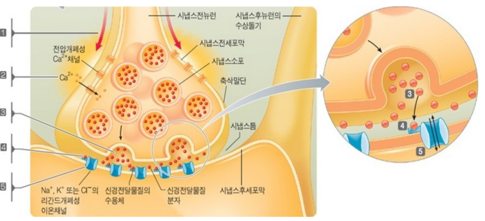
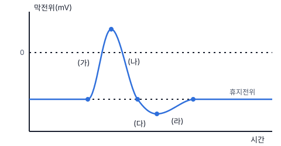
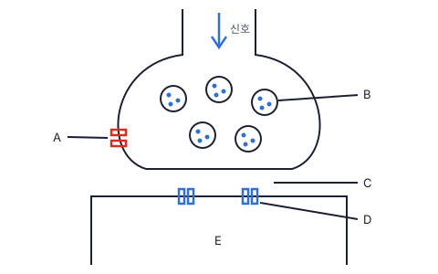

# 복습문제 32선 — 1112 수업 범위

기출 20개와 생성 변형 12개를 풀어 봐요. 변형 연습은 기본 11개·심화 1개예요. 먼저 풀어 보고, 막히면 힌트를 열어 보세요.

> `복습문제_1112_Nervous_and_Sensory_Systems.html`를 마크다운으로 옮겼어요. 원문, 힌트, 풀이는 접혀 있어요. 먼저 풀어 보고 펼쳐 보세요.

**목차**

- [B. 기출](#partB)
  - [P1. 신경아교세포의 역할](#p1)
  - [P2. 신경전달물질이 하는 일](#p2)
  - [P3. 막전위와 이온 분포](#p3)
  - [P4. 수초가 줄면 전도 속도는](#p4)
  - [P5. 코카인이 작용하는 곳](#p5)
  - [P6. 재흡수를 막는 물질](#p6)
  - [P7. 혈관을 넓히는 신경전달물질](#p7)
  - [P8. 안쪽을 음전하로 유지하는 장치](#p8)
  - [P9. 음전하가 줄어든 막](#p9)
  - [P10. 축삭을 따라 이동하는 신호](#p10)
  - [P11. Na⁺/K⁺ 펌프의 주요 역할](#p11)
  - [P12. 미엘린수초에 관한 설명](#p12)
  - [P13. 신경전달물질의 효과를 키우는 방법](#p13)
  - [P14. 화학시냅스 전달 그림에서 틀린 설명](#p14)
  - [P15. 전기신호를 받는 안테나 부위](#p15)
  - [P16. 활동전위에 대한 옳은 설명](#p16)
  - [P17. 내부를 음전하로 유지하는 것](#p17)
  - [P18. 신경신호를 가장 잘 설명하는 것](#p18)
  - [P19. 화학시냅스 전달과 가장 관계없는 것](#p19)
  - [P32. 감각에서 움직임까지 정보의 순서](#p32)
- [C. 변형 연습](#partC)
  - [P20. [변형] 휴지전위를 만드는 것](#p20)
  - [P21. [변형] 센 자극은 더 큰 활동전위일까](#p21)
  - [P22. [변형] 그래프의 네 구간과 채널](#p22)
  - [P23. [변형] 소포는 어디에서 터질까](#p23)
  - [P24. [변형] Cl⁻ 채널을 여는 물질 X](#p24)
  - [P25. [변형] 억제를 막는 독과 수용체를 막는 독](#p25)
  - [P26. [변형] afferent neuron은 어느 쪽으로 보낼까](#p26)
  - [P27. [변형] saltatory conduction이 일어나는 축삭](#p27)
  - [P28. [변형] ATP가 끊긴 뉴런](#p28)
  - [P29. [변형] 재흡수를 막으면 늘어나는 까닭](#p29)
  - [P30. [변형] 세 채널은 어떻게 열릴까](#p30)
  - [P31. [변형] 역치에 못 미친 약한 자극](#p31)

## B. 기출

### P1. 신경아교세포의 역할

신경아교세포(glial cell)에 대한 진술 중 옳지 않은 것은?

- (1) 모든 보기가 옳은 설명이다
- (2) 슈반세포는 말초신경계에 존재하는 신경아교세포의 한 종류이다
- (3) 신경아교세포는 직접 전기적 메세지를 전달한다
- (4) 신경아교세포는 비신경성 세포이다
- (5) 신경아교세포는 뉴런에 영양분을 공급한다

원문 정보 보기

기출 12강 합본 3번 (PDF 1쪽)

힌트 보기

신호를 직접 만들고 전하는 세포는 뉴런이에요. 신경아교세포는 그 뉴런을 무엇으로 돕는지 떠올려 봐요.

풀이 보기

1. (1) 틀려요. (3)이 틀린 진술이라 모든 보기가 옳다고 할 수 없어요.
2. (2) 맞아요. 슈반세포는 희소돌기아교세포처럼 미엘린 수초를 만드는 신경아교세포예요. 수업에서는 둘이 "장소만 다르고 기능은 같다"고만 했고, 슈반세포가 말초신경계에 있다는 위치는 수업 밖 교재 내용이에요.
3. (3) 틀려요. 그래서 이 보기가 옳지 않은 것의 답이에요. 신경아교세포는 자극을 직접 전달하지 않고, 영양분 공급·물리적 지지·수초 형성으로 뉴런을 보조해요.
4. (4) 맞아요. 신호를 전하는 세포는 뉴런이고, 신경아교세포는 신호를 전하지 않는 비신경성 보조 세포예요.
5. (5) 맞아요. 영양분 공급은 수업에서 든 신경아교세포의 역할 중 하나예요.
6. 수업과의 연결: 1112 수업에서 신경아교세포는 "자극은 전달하지 않고 뉴런을 돕는다"고 정리했고, 성상세포는 지지를, 희소돌기아교세포·슈반세포는 수초를 맡는다고 했어요([신경아교세포와 미엘린 수초](정리노트_1112_Nervous_and_Sensory_Systems.md#s0-glia)).

**정답:** (3)

---

### P2. 신경전달물질이 하는 일

신경전달물질에 대한 설명으로 옳은 것은?

- (1) 신경충격의 전달이 빨라지도록 랑비에 결절을 가로질러 방출된다
- (2) 전기적 충격이 시냅스후뉴런의 축삭말단에 도달하였을 때 방출된다
- (3) 시상에서 방출되는 스테로이드 호르몬이다
- (4) 시냅스틈을 가로질러 확산하며 시냅스후뉴런의 세포막에 있는 수용체에 결합한다
- (5) 미엘린화된 축삭을 따라서 이동하여 내려가는 전하이다

원문 정보 보기

기출 12강 합본 4번 (PDF 1쪽)

힌트 보기

신경전달물질은 어느 뉴런의 어디에서 나와서, 어디에 붙는지 순서대로 따라가 봐요.

풀이 보기

1. (1) 틀려요. 랑비에 결절은 수초 사이로 축삭이 드러난 곳으로, 활동전위가 건너뛰며 생기는 자리예요. 신경전달물질은 결절이 아니라 시냅스에서 방출돼요.
2. (2) 틀려요. 신경전달물질을 내보내는 쪽은 시냅스 전 뉴런의 축삭말단이에요. 활동전위가 그 말단에 닿으면 Ca²⁺가 들어오고, 소포가 세포막과 융합해 방출돼요.
3. (3) 틀려요. 신경전달물질은 뉴런의 축삭말단에서 분비되는 화학물질이에요. 수업에서 본 아세틸콜린·도파민·세로토닌·GABA는 스테로이드 호르몬이 아니고, "시상"이라는 뇌 부위는 수업에서 다루지 않았어요.
4. (4) 맞아요. 방출된 신경전달물질은 시냅스 틈을 확산해 건너가 시냅스 후 뉴런 막의 수용체에 열쇠와 자물쇠처럼 결합해요.
5. (5) 틀려요. 축삭을 따라 내려가는 것은 활동전위(막전위의 변화)예요. 신경전달물질은 전하가 아니라 화학물질이에요.
6. 수업과의 연결: 1112 수업의 화학 시냅스 전달 순서(활동전위 도착 → Ca²⁺ 유입 → 소포 융합 → 수용체 결합)와 이어져요([화학 시냅스의 전달 순서](정리노트_1112_Nervous_and_Sensory_Systems.md#s3-release)).

**정답:** (4)

---

### P3. 막전위와 이온 분포

다음은 막전위에 대한 설명이다. 옳은 것은?

- (1) Na⁺/K⁺ 수송펌프는 ATP를 사용하지 않는다
- (2) 활동전위 동안에 막 전위는 양전하에서 음전하로 바뀐다
- (3) 휴지전위는 뉴런의 막이 양전하의 막전위를 유지하고 있는 휴식상태이다
- (4) Na⁺의 농도는 세포 바깥쪽이 높고, K⁺의 농도는 세포 안쪽이 높아 세포 바깥쪽이 양전하를 띤다
- (5) 막전위는 세포 안, 밖에서 Na⁺과 K⁺의 균등한 분포에 의해 생성된다

원문 정보 보기

기출 12강 합본 5번 (PDF 1쪽)

힌트 보기

휴지 상태에서 막 안쪽은 음(−)과 양(+) 중 어느 쪽인지 먼저 정해 두고, 펌프가 Na⁺와 K⁺를 어느 방향으로 보내는지 떠올려요.

풀이 보기

1. (1) 틀려요. 펌프는 ATP 에너지를 써서 농도 기울기를 거슬러 Na⁺ 3개를 밖으로, K⁺ 2개를 안으로 보내요(능동수송).
2. (2) 틀려요. 휴지 상태에서 음(−)이던 막 안쪽이 Na⁺ 유입으로 0을 지나 양(+)이 되는 것이 활동전위의 핵심(탈분극)이에요. 재분극 때 다시 음으로 돌아오지만, 출발점이 음전하라 "양전하에서 음전하로"는 방향이 거꾸로예요.
3. (3) 틀려요. 휴지전위에서 막 안쪽은 음(−)이고 바깥이 양(+)인 분극 상태예요. 강의노트 값은 약 −50~−60 mV예요.
4. (4) 맞아요. 펌프 때문에 Na⁺는 바깥에, K⁺는 안쪽에 많아요. 여기에 K⁺ 누설 채널이 더 많아 K⁺가 조금 더 새 나가고, 세포 안에는 음이온이 많아서 바깥쪽이 양전하를 띠어요.
5. (5) 틀려요. 막전위는 Na⁺과 K⁺가 막 안팎에 불균등하게 분포해서 생겨요. 균등하면 전위차가 생기지 않아요.
6. 수업과의 연결: 1112 수업에서 휴지전위의 원인으로 펌프의 불균등한 이온 분포, K⁺ 누설 채널, 세포 안 음이온을 함께 설명한 내용과 이어져요([휴지전위가 생기는 이유](정리노트_1112_Nervous_and_Sensory_Systems.md#s1-resting)).

**정답:** (4)

---

### P4. 수초가 줄면 전도 속도는

다발성 경화증에서 보이는 것과 같이 축삭을 싸고 있는 미엘린수초의 감소는 활동전위의 이동하는 속도를 __시킨다.

- (1) 보기 모두 정답이다
- (2) 증가
- (3) 유지
- (4) 감소
- (5) 극대화

원문 정보 보기

기출 12강 합본 8번 (PDF 1쪽)

힌트 보기

수초는 전선 피복 같은 절연체예요. 피복이 벗겨지면 Na⁺가 다음 랑비에 결절까지 그대로 갈 수 있을지 생각해 봐요.

풀이 보기

1. (1) 틀려요. 증가·유지·감소·극대화는 서로 반대되는 말이라 함께 정답일 수 없어요.
2. (2) 틀려요. 수초가 있어야 도약전도로 빨라져요. 수초가 줄면 빨라질 이유가 없어요.
3. (3) 틀려요. 수초가 벗겨진 곳에서는 Na⁺가 막 밖으로 새어 나가 다음 결절까지 그대로 가지 못해요. 속도가 그대로일 수 없어요.
4. (4) 맞아요. 절연체인 수초가 사라지면 도약전도가 끊기고 Na⁺가 새어 나가요. 전도가 느려지고, 심하면 활동전위가 사라져 근육이 마비돼요.
5. (5) 틀려요. 극대화는 증가의 극단이라 (2)와 같은 이유로 틀려요.
6. 수업과의 연결: 1112 수업에서 다발성 경화증을 자가면역질환으로 수초가 공격받아 "전선 피복이 벗겨진 것처럼" 누전되는 병으로 설명한 내용과 이어져요([전도 속도: 축삭의 지름과 도약전도](정리노트_1112_Nervous_and_Sensory_Systems.md#s2-conduction)).

**정답:** (4)

---

### P5. 코카인이 작용하는 곳

신경 전달 경로에서 코카인과 같은 약물들의 주요 효과가 나타내는 곳은 어디인가?

- (1) 랑비에결절
- (2) 축삭
- (3) 수상돌기
- (4) 시냅스
- (5) 미엘린수초

원문 정보 보기

기출 12강 합본 11번 (PDF 2쪽)

힌트 보기

코카인은 분비된 신경전달물질이 회수되는 과정을 방해해요. 신경전달물질이 분비되고 회수되는 곳이 어디인지 찾아요.

풀이 보기

1. (1) 틀려요. 랑비에 결절은 활동전위가 건너뛰며 생기는 전도 자리예요. 코카인은 전도가 아니라 신경전달물질의 회수에 작용해요.
2. (2) 틀려요. 축삭은 활동전위를 축삭말단까지 전도하는 부분이에요. 코카인이 막는 회수 과정은 여기서 일어나지 않아요.
3. (3) 틀려요. 수상돌기는 신호를 받는 쪽이에요. 코카인이 막는 것은 시냅스 전 뉴런이 도파민을 다시 들여보내는 단백질이라, 수상돌기 하나를 작용 장소로 꼽을 수 없어요.
4. (4) 맞아요. 코카인은 시냅스 틈에 분비된 도파민이 시냅스 전 뉴런으로 재흡수되는 것을 막아요. 그래서 도파민이 시냅스 틈에 오래 남아 계속 작용해요.
5. (5) 틀려요. 미엘린 수초는 축삭을 감싸는 절연체로 전도 속도와 관련돼요. 신경전달물질 회수와는 관계없어요.
6. 수업과의 연결: 1112 수업에서 신경전달물질은 확산·효소 분해·재흡수로 사라지고, 코카인은 도파민 재흡수를 막아 중독을 일으킨다고 설명한 내용과 이어져요([신경전달물질의 제거와 약물](정리노트_1112_Nervous_and_Sensory_Systems.md#s4-removal)).

**정답:** (4)

---

### P6. 재흡수를 막는 물질

노르에피네프린, 도파민, 세로토닌과 같은 특정 신경전달물질들을 시냅스 틈에서 분비되었던 뉴런에 의해 재흡수 되는 것을 막아 높은에너지, 도취감, 자신감 등을 느끼도록 하는 물질은 무엇인가?

- (1) 엔도르핀
- (2) 코카인
- (3) 아세틸콜린
- (4) 도파민
- (5) GABA

원문 정보 보기

기출 12강 합본 12번 (PDF 2쪽)

힌트 보기

보기 중 신경전달물질 자신과, 신경전달물질의 회수를 방해하는 약물을 나눠 봐요.

풀이 보기

1. (1) 틀려요. 엔도르핀은 극심한 고통을 줄여 주는 신경전달물질이에요. 다른 물질의 재흡수를 막는 물질이 아니에요.
2. (2) 맞아요. 코카인은 시냅스 전 뉴런이 도파민을 다시 회수하지 못하게 막아요. 도파민이 시냅스 틈에 오래 남아 기분 좋은 느낌이 이어지고, 남용하면 중독돼요.
3. (3) 틀려요. 아세틸콜린은 운동뉴런이 근육에 분비하는 신경전달물질 자체예요. 재흡수를 막는 약물이 아니에요.
4. (4) 틀려요. 도파민은 재흡수되는 대상이에요. 재흡수를 막는 쪽이 아니에요.
5. (5) 틀려요. GABA는 Cl⁻ 채널을 열어 과분극을 일으키는 억제성 신경전달물질이에요.
6. 수업과의 연결: 1112 수업에서 재흡수를 방해하면 신경전달물질이 시냅스 틈에 남아 효과가 커진다고 설명하고, 세로토닌 재흡수 억제제와 코카인을 예로 든 내용과 이어져요. 수업에서는 코카인이 도파민 재흡수를 막는다고만 했고, 노르에피네프린·세로토닌 재흡수도 막는다는 것은 문제가 알려 주는 교재 수준 사실이에요([신경전달물질의 제거와 약물](정리노트_1112_Nervous_and_Sensory_Systems.md#s4-removal)).

**정답:** (2)

---

### P7. 혈관을 넓히는 신경전달물질

다음은 무엇에 관한 설명인가? “이것은 혈관벽에 있는 민무늬근을 이완시킴으로써 혈관을 팽창시키고 혈류를 증가시킨다.”

- (1) 아세틸콜린
- (2) 니코틴
- (3) 세로토닌
- (4) 산화질소
- (5) 엔도르핀

원문 정보 보기

기출 12강 합본 13번 (PDF 2쪽)

힌트 보기

수업에서 기체 신경전달물질 두 가지를 들었고, 그중 하나를 비아그라와 함께 설명했어요.

풀이 보기

1. (1) 틀려요. 수업에서 아세틸콜린은 운동뉴런이 분비해 근육을 수축시키는 신경전달물질로 다뤘어요. 혈관을 팽창시키는 물질로 소개한 것은 아니에요.
2. (2) 틀려요. 니코틴은 수업에서 다루지 않은 담배 성분으로, 아세틸콜린 수용체 일부에 붙어 아세틸콜린처럼 작용해요(교재 내용). 혈관을 팽창시키는 물질을 묻는 이 설명과 맞지 않아요.
3. (3) 틀려요. 세로토닌은 식욕·수면·불안과 관련되고 부족하면 우울증과 이어지는 신경전달물질이에요.
4. (4) 맞아요. 산화질소(NO)는 기체 신경전달물질로 혈관을 팽창시켜요. 비아그라는 NO 작용을 끝내는 효소를 방해해 혈관 팽창을 오래가게 해요.
5. (5) 틀려요. 엔도르핀은 극심한 고통을 줄여 주는 신경전달물질이에요. 모르핀이 그 수용체에 붙어 진통 작용을 해요.
6. 수업과의 연결: 1112 수업에서 기체 신경전달물질 일산화탄소·산화질소를 소개하고 NO가 혈관을 팽창시킨다고 설명한 내용과 이어져요. 수업은 "혈관 팽창"까지만 말했고, 혈관벽 민무늬근을 이완시킨다는 기전은 수업 밖 교재 내용이에요([신경전달물질의 제거와 약물](정리노트_1112_Nervous_and_Sensory_Systems.md#s4-removal)).

**정답:** (4)

---

### P8. 안쪽을 음전하로 유지하는 장치

뉴런이 외부에 비하여 내부가 상대적으로 음전하를 유지하도록 작용하는 것은?

- (1) 크레브스 회로
- (2) 전자전달계
- (3) 랑비에결절
- (4) Na⁺/K⁺ 능동수송펌프
- (5) 도파민 수용체

원문 정보 보기

기출 12강 합본 14번 (PDF 2쪽)

힌트 보기

막 안팎의 이온 분포를 직접 바꾸는 막 단백질을 찾아요. ATP를 만드는 과정과 ATP를 쓰는 장치를 구별해요.

풀이 보기

1. (1) 틀려요. 크레브스 회로는 미토콘드리아에서 일어나는 세포호흡 단계예요. 뉴런 막 안팎의 이온 분포를 직접 만들지 않아요.
2. (2) 틀려요. 전자전달계는 미토콘드리아 내막에서 ATP를 만드는 단계예요. 펌프가 쓸 ATP를 공급할 뿐, 막 안팎의 전하를 직접 나누지 않아요.
3. (3) 틀려요. 랑비에 결절은 수초 사이로 축삭이 드러난 곳으로, 활동전위가 건너뛰며 생기는 전도 자리예요.
4. (4) 맞아요. Na⁺/K⁺ 펌프는 ATP를 써서 Na⁺ 3개를 내보내고 K⁺ 2개를 들여요. 이 불균등한 분포가 안쪽을 음전하로 유지하는 바탕이에요.
5. (5) 틀려요. 도파민 수용체는 시냅스 후 뉴런에서 도파민을 받는 단백질이에요. 휴지 상태의 음전하를 유지하는 장치가 아니에요.
6. 수업과의 연결: 1112 수업에서 교수님은 펌프 하나만으로 안쪽이 음이 되는 것은 아니고, K⁺ 누설 채널과 세포 안 음이온도 원인이라고 강조했어요. 보기 중에서 막 안팎의 이온 분포에 직접 작용하는 것이 펌프라서 (4)를 골라요([휴지전위가 생기는 이유](정리노트_1112_Nervous_and_Sensory_Systems.md#s1-resting)). 크레브스 회로·전자전달계는 앞선 세포호흡 수업 내용이에요.

**정답:** (4)

---

### P9. 음전하가 줄어든 막

활동전위에서의 막전위의 변화 중, 막전위의 음전하가 줄어들면 휴지 상태에서 분극화되어 있던 막은 어떻게 되는가?

- (1) 분극
- (2) 탈분극
- (3) 과분극
- (4) 역치
- (5) 재분극

원문 정보 보기

기출 12강 합본 18번 (PDF 2쪽)

힌트 보기

분극은 안쪽 −, 바깥 + 상태예요. 음전하가 줄어 0 쪽으로 올라가면 그 상태에서 벗어나는 것이에요.

풀이 보기

1. (1) 틀려요. 분극은 휴지 상태 그 자체, 곧 안쪽이 −이고 바깥이 +인 상태예요. 음전하가 줄어드는 변화가 아니에요.
2. (2) 맞아요. Na⁺가 들어와 안쪽의 음전하가 줄면 막이 분극 상태에서 벗어나요. 이것이 탈분극이에요.
3. (3) 틀려요. 과분극은 K⁺ 채널이 늦게 닫혀 막전위가 휴지전위보다 더 음으로 내려간 상태예요. 음전하가 오히려 커져요.
4. (4) 틀려요. 역치는 전압 개폐성 Na⁺ 채널이 열리는 기준 막전위예요. 막의 상태 변화를 부르는 이름이 아니에요.
5. (5) 틀려요. 재분극은 최고점에서 K⁺가 빠져나가 막전위가 다시 음 쪽으로 내려오는 과정이에요.
6. 수업과의 연결: 1112 수업에서 "나트륨 채널 열리고 닫히고, 칼륨 채널은 천천히 닫힌다"며 탈분극 → 재분극 → 과분극 순서를 강조한 내용과 이어져요([활동전위: 탈분극·재분극·과분극](정리노트_1112_Nervous_and_Sensory_Systems.md#s2-action)).

**정답:** (2)

---

### P10. 축삭을 따라 이동하는 신호

뉴런의 축삭을 따라 이동하는 전기적 충격을 무엇이라 하는가?

- (1) 활동전위
- (2) 시냅스
- (3) 휴지전위
- (4) 저항
- (5) 전기시냅스

원문 정보 보기

기출 12강 합본 27번 (PDF 3쪽)

힌트 보기

축삭둔덕에서 처음 생겨 축삭말단까지 파도타기처럼 전해지는 것을 떠올려요.

풀이 보기

1. (1) 맞아요. 축삭둔덕에서 생긴 활동전위가 옆으로 확산한 Na⁺로 다음 채널을 열며 축삭말단까지 전도돼요.
2. (2) 틀려요. 시냅스는 뉴런과 뉴런이 맞붙은 장소예요. 축삭을 따라 이동하는 신호가 아니에요.
3. (3) 틀려요. 휴지전위는 자극받지 않은 막 안팎의 전압차예요. 축삭을 따라 이동하지 않아요.
4. (4) 틀려요. 저항은 전달을 방해하는 정도예요. 수업에서는 축삭 지름이 클수록 저항이 줄어 빨라진다고 했어요.
5. (5) 틀려요. 전기적 시냅스는 두 세포 사이에 터널 같은 통로가 뚫려 이온이 직접 건너가는 연결 구조예요. 축삭을 따라 이동하는 신호가 아니에요.
6. 수업과의 연결: 1112 수업에서 활동전위가 파도타기 응원처럼 자리마다 생겼다 끝나며 축삭말단까지 전해진다고 설명한 내용과 이어져요([활동전위: 탈분극·재분극·과분극](정리노트_1112_Nervous_and_Sensory_Systems.md#s2-action)).

**정답:** (1)

---

### P11. Na⁺/K⁺ 펌프의 주요 역할

Na⁺/K⁺ 펌프의 주요 역할은?

- (1) 휴지전위를 0까지 감소시킨다
- (2) 활동전위를 증가시켜 불응기에 들어가도록 한다
- (3) 활동전위를 급격하게 생기게 하여 막의 안쪽이 순간적으로 양전위가 되게 한다
- (4) 막을 휴지전위값 이상으로 과분극시킨다
- (5) 휴지전위를 일정한 음전하로 유지시킨다

원문 정보 보기

기출 12강 합본 31번 (PDF 3쪽)

힌트 보기

펌프는 자극이 없을 때도 늘 ATP를 쓰며 일해요. 자극이 왔을 때 잠깐 생기는 일과 평소 상태 중 어느 쪽을 맡는지 생각해 보세요.

풀이 보기

1. (1) 틀려요. 막전위를 0 쪽으로 끌어올리는 것은 Na⁺가 들어오는 탈분극이에요. 펌프는 오히려 Na⁺를 밖으로 퍼내 안팎 차이를 지켜요.
2. (2) 틀려요. 활동전위는 전압 개폐성 Na⁺ 채널과 K⁺ 채널이 열리고 닫히며 생기고, 실무율 때문에 크기가 커지지도 않아요. 불응기는 수업 밖 용어로, 활동전위 직후 잠깐 다음 활동전위가 잘 생기지 않는 시기예요.
3. (3) 틀려요. 안쪽이 순간적으로 + 가 되는 것은 역치에서 전압 개폐성 Na⁺ 채널이 열려 Na⁺가 쏟아져 들어오기 때문이에요. 펌프가 하는 일이 아니에요.
4. (4) 틀려요. 과분극은 K⁺ 채널이 천천히 닫혀서 K⁺가 조금 더 빠져나가 생겨요. 펌프와는 관계가 없어요.
5. (5) 맞아요. 펌프는 ATP를 써서 Na⁺ 3개를 내보내고 K⁺ 2개를 들여 농도 차이를 계속 유지해요. 이 농도 차이가 있어야 누설 채널과 세포 안 음이온과 함께 안쪽이 − 인 휴지전위가 유지돼요.
6. 수업과의 연결: 교수님은 "나트륨은 나간다"로 펌프 방향을 외우게 했고, 펌프 하나만으로 안쪽이 − 가 되는 것은 아니라고 덧붙였어요. [정리노트 「휴지전위가 생기는 이유」](정리노트_1112_Nervous_and_Sensory_Systems.md#s1-resting), [정리노트 「채널과 Na⁺/K⁺ 펌프」](정리노트_1112_Nervous_and_Sensory_Systems.md#s1-channel-pump)

**정답:** (5)

---

### P12. 미엘린수초에 관한 설명

다음 중 미엘린수초에 관한 설명으로 옳은 것은?

- (1) 미엘린수초 사이의 랑비에 결절 구조를 통해 축삭을 따라 이동하는 전기적 충격의 속도를 증가시킨다
- (2) 지질의 함량이 높다
- (3) 일부 뉴런을 덮고 있는 보호층이다
- (4) 전기적 절연체로 작용한다
- (5) 보기 모두 옳다

원문 정보 보기

기출 12강 합본 32번 (PDF 3쪽)

힌트 보기

(1)~(4)를 하나씩 판단해 보세요. 모두 맞으면 답은 따로 있어요.

풀이 보기

1. (1) 맞아요. 수초가 있으면 채널이 랑비에 결절에만 있어 활동전위가 결절에서 결절로 건너뛰는 도약전도가 일어나 빨라져요.
2. (2) 맞아요. 수초는 희소돌기아교세포나 슈반세포가 축삭을 여러 겹 감싼 지질 막이에요.
3. (3) 맞아요. 수초가 있는 축삭(유수신경)도 있고 없는 축삭(무수신경)도 있으니 '일부' 뉴런을 덮는다는 말이 맞아요. 축삭을 담요처럼 덮는 층이에요.
4. (4) 맞아요. 지질 막이라 전선 피복처럼 절연체로 작용해 Na⁺가 새어 나가지 않게 해요.
5. (5) 맞아요. (1)~(4)가 모두 옳은 진술이라 이 보기가 답이에요.
6. 수업과의 연결: 교수님은 수초를 전선 피복에, 도약전도를 징검다리 건너기와 파도타기에서 건너뛰는 학생에 빗댔어요. [정리노트 「전도 속도: 축삭의 지름과 도약전도」](정리노트_1112_Nervous_and_Sensory_Systems.md#s2-conduction)

**정답:** (5)

---

### P13. 신경전달물질의 효과를 키우는 방법

신경전달물질의 효과가 증가될 수 있는 가능성이 있는 방법은?

- (1) 보기 모두 가능성이 있다
- (2) 분비되었던 뉴런으로의 재흡수를 방지한다
- (3) 시냅스에서 신경전달물질의 분해에 관여하는 효소를 억제 한다
- (4) 신경전달물질의 합성에 관여하는 효소의 공급을 늘린다
- (5) 시냅스후뉴런에 수용체의 수를 증가시킨다

원문 정보 보기

기출 12강 합본 33번 (PDF 3~4쪽)

힌트 보기

신경전달물질의 효과는 많이 나오고, 오래 남고, 잘 받을수록 커져요. (2)~(5)가 각각 어느 쪽에 해당하는지 보세요.

풀이 보기

1. (1) 맞아요. (2)~(5)가 모두 효과를 키울 가능성이 있어서 이 보기가 답이에요.
2. (2) 맞아요. 재흡수를 막으면 신경전달물질이 시냅스 틈에 오래 남아 계속 작용해요. 세로토닌 재흡수 억제제와 코카인이 이렇게 작용해요.
3. (3) 맞아요. 분해는 확산·재흡수와 함께 신경전달물질을 없애는 경로예요. 분해 효소를 막으면 신경전달물질이 오래 남아요.
4. (4) 맞아요. 합성이 늘면 소포에 담겨 분비되는 양이 늘어날 수 있어요. 문제는 '가능성'을 묻고 있어서 이 경로도 해당해요.
5. (5) 맞아요. 신경전달물질은 수용체에 결합해야 작용하므로, 수용체가 많아지면 같은 양으로도 더 많은 채널이 열릴 수 있어요.
6. 수업과의 연결: 교수님은 신경전달물질을 택배 아저씨에 빗대 전달한 뒤 사라져야 한다고 했고, 재흡수를 막는 것은 떠나려는 택배 아저씨를 붙잡는 것이라고 설명했어요. [정리노트 「신경전달물질의 제거와 약물」](정리노트_1112_Nervous_and_Sensory_Systems.md#s4-removal)

**정답:** (1)

---

### P14. 화학시냅스 전달 그림에서 틀린 설명

위 그림은 화학시냅스의 작동 순서를 나타낸 것이다. 그림을 참고하여, 전형적인 시냅스를 통한 화학시냅스 전달에 대한 설명으로 틀린 것을 고르시오.

- (1) 신경전달물질 분자는 축삭말단 시냅스소포에 저장되어 있다
- (2) 신경전달물질 분자를 갖고 있는 시냅스소포는 시냅스후뉴런의 세포막으로 함입된다
- (3) 신경전달물질이 수용체에 결합한 후, 시냅스후세포막에서 리간드개폐성 이온채널이 열린다
- (4) 신경전달물질 분자는 시냅스후뉴런의 막에 있는 수용체에 결합한다
- (5) 전기적 신호는 신경전달물질 분자의 방출을 일으키는 화학적 변화를 촉발시킨다

원문 정보 보기

기출 12강 합본 35번 (PDF 4쪽)

힌트 보기

소포는 시냅스 틈을 건너가지 않아요. 시냅스 틈을 건너가는 것은 무엇인지 그림에서 찾아보세요.

풀이 보기

1. (1) 맞아요. 신경전달물질은 축삭말단에서 소포에 담겨 대기해요.
2. (2) 틀려요. 그래서 답이에요. 소포는 Ca²⁺가 들어오면 시냅스전 뉴런의 축삭말단 세포막(시냅스전세포막)과 융합해 신경전달물질을 시냅스 틈으로 내보내요. 시냅스 틈을 건너가는 것은 신경전달물질 분자이지 소포가 아니에요.
3. (3) 맞아요. 시냅스후세포막의 수용체가 리간드 개폐성 이온 채널이라서 신경전달물질(리간드)이 결합해야 열려요.
4. (4) 맞아요. 신경전달물질은 시냅스 틈을 확산해 건너가 시냅스후뉴런 막의 수용체에 결합해요.
5. (5) 맞아요. 활동전위(전기적 신호)가 축삭말단에 닿으면 전압개폐성 Ca²⁺ 채널이 열려 Ca²⁺가 들어오고, 이 변화가 소포 융합과 신경전달물질 방출을 일으켜요.
6. 수업과의 연결: 교수님은 Ca²⁺가 있어야 소포가 세포막과 융합한다고 했고, 소포체가 아니라 소포라고 고쳐 말했어요. 리간드 개폐성 채널은 카드키를 대면 열리는 문이라고 했어요. [정리노트 「화학 시냅스의 전달 순서」](정리노트_1112_Nervous_and_Sensory_Systems.md#s3-release)

**정답:** (2)

---

### P15. 전기신호를 받는 안테나 부위

뉴런의 일부분으로, 뉴런의 세포막에 있는 통로들을 통해 흐르는 이온들에 의해 생성된 전기신호를 수용하는 안테나와 같은 역할을 하는 부위는?

- (1) 핵
- (2) 축삭말단
- (3) 수상돌기
- (4) 축삭
- (5) 세포체

원문 정보 보기

기출 12강 합본 36번 (PDF 4쪽)

힌트 보기

뉴런의 세 부분 중 신호가 '들어오는' 돌기를 떠올려 보세요.

풀이 보기

1. (1) 틀려요. 핵은 세포체 안에 있는 세포소기관이에요. 신호를 받는 부위가 아니에요.
2. (2) 틀려요. 축삭말단은 신호가 빠져나가는 끝으로, 신경전달물질을 분비하는 곳이에요.
3. (3) 맞아요. 수상돌기(가지돌기)는 신호를 받아들이는 돌기예요. 시냅스 전 뉴런의 신경전달물질이 수상돌기의 채널을 열면 Na⁺가 들어와 전기신호가 생겨요.
4. (4) 틀려요. 축삭은 축삭둔덕에서 생긴 활동전위를 축삭말단까지 전달하는, 신호가 빠져나가는 돌기예요.
5. (5) 틀려요. 세포체는 핵과 미토콘드리아 같은 세포소기관이 있는 부분이에요. 수업에서 신호를 받아들이는 돌기로 배운 것은 수상돌기예요.
6. 수업과의 연결: 교수님은 뉴런을 수상돌기(받음) → 세포체 → 축삭(나감)의 세 부분으로 나눠 설명했어요. [정리노트 「뉴런의 세 부분과 신호의 방향」](정리노트_1112_Nervous_and_Sensory_Systems.md#s0-neuron)

**정답:** (3)

---

### P16. 활동전위에 대한 옳은 설명

다음 중 활동전위에 대한 설명으로 옳은 것은?

- (1) 뉴런의 막에 일시적인 온도의 역위 현상이다
- (2) 자극에 대한 반응으로 나트륨 채널이 닫히면 시작된다
- (3) 뉴런을 따라 가면서 이동하는 탈분극의 파동으로 전파된다
- (4) 말단으로부터 세포체로 전파된다
- (5) Ca²⁺ 이온의 유출이 주된 개시신호로 작용한다

원문 정보 보기

기출 12강 합본 37번 (PDF 4쪽)

힌트 보기

활동전위가 축삭을 따라 퍼지는 모습을 교수님이 어떤 응원에 빗댔는지 떠올려 보세요.

풀이 보기

1. (1) 틀려요. 활동전위는 막 안팎의 전위(전하)가 잠깐 뒤집히는 현상이에요. 온도가 바뀌는 것이 아니에요.
2. (2) 틀려요. 역치에서 전압 개폐성 Na⁺ 채널이 '열리면서' Na⁺가 쏟아져 들어와 시작돼요. Na⁺ 채널이 닫히는 것은 최고치에 이른 뒤예요.
3. (3) 맞아요. 한 자리에서 들어온 Na⁺가 옆으로 확산해 옆 채널을 열고, 그 자리에서 다시 탈분극이 일어나는 일이 이어져 축삭말단까지 퍼져요.
4. (4) 틀려요. 방향이 반대예요. 활동전위는 축삭둔덕에서 처음 생겨 축삭을 따라 축삭말단 쪽으로 전파돼요.
5. (5) 틀려요. 활동전위를 시작하는 것은 Na⁺의 유입이에요. Ca²⁺는 활동전위가 축삭말단에 닿은 뒤 전압개폐성 Ca²⁺ 채널로 들어와 소포 융합을 일으켜요. 나가는 것도 아니에요.
6. 수업과의 연결: 교수님은 전도를 파도타기 응원(일어섰다 앉고, 일어섰다 앉고)에 빗댔어요. [정리노트 「활동전위: 탈분극·재분극·과분극」](정리노트_1112_Nervous_and_Sensory_Systems.md#s2-action), [정리노트 「전도 속도: 축삭의 지름과 도약전도」](정리노트_1112_Nervous_and_Sensory_Systems.md#s2-conduction)

**정답:** (3)

---

### P17. 내부를 음전하로 유지하는 것

뉴런이 외부에 비하여 내부가 상대적으로 음전하를 유지하도록 작용하는 것은?

- (1) 도파민 수용체
- (2) 크레브스 회로
- (3) 랑비에결절
- (4) Na⁺/K⁺ 능동수송펌프
- (5) 전자전달계

원문 정보 보기

기출 12강 합본 39번 (PDF 4쪽)

힌트 보기

안쪽이 − 인 상태는 Na⁺와 K⁺의 안팎 농도 차이에서 시작해요. 이 차이를 ATP를 써서 만드는 것을 찾아보세요.

풀이 보기

1. (1) 틀려요. 도파민 수용체는 시냅스 후 막에서 도파민을 받는 단백질로, 신호를 받을 때 작용해요. 평소의 휴지전위를 유지하는 장치가 아니에요.
2. (2) 틀려요. 크레브스 회로는 앞서 배운 세포호흡의 한 단계로, 미토콘드리아 안에서 일어나요. 막 안팎의 이온 분포를 직접 만들지 않아요.
3. (3) 틀려요. 랑비에 결절은 수초 사이에 축삭이 드러난 부분으로, 도약전도 때 활동전위가 생기는 자리예요.
4. (4) 맞아요. ATP를 써서 Na⁺ 3개를 내보내고 K⁺ 2개를 들여 농도 차이를 유지하므로, 보기 가운데 안쪽을 − 로 유지하는 데 작용하는 것은 이 펌프예요. 다만 수업에서는 펌프 하나만이 아니라 K⁺ 누설 채널과 세포 안 음이온도 함께 작용한다고 했어요.
5. (5) 틀려요. 전자전달계도 세포호흡 단계로, ATP를 만드는 과정이에요. 그 ATP를 펌프가 쓰긴 하지만, 막 안팎의 이온 분포에 직접 작용하는 것은 펌프예요.
6. 수업과의 연결: 교수님은 휴지전위가 생기는 이유로 펌프, K⁺ 누설 채널이 더 많다는 점, 세포 안 음이온(DNA·단백질)을 들었어요. [정리노트 「휴지전위가 생기는 이유」](정리노트_1112_Nervous_and_Sensory_Systems.md#s1-resting)

**정답:** (4)

---

### P18. 신경신호를 가장 잘 설명하는 것

다음 중 신경신호를 가장 잘 설명하는 것은 무엇인가?

- (1) 뉴런의 막을 통한 전위차의 변화
- (2) 내부가 더 음전하를 띄게 하기 위한 뉴런의 변화
- (3) 뉴런을 통한 전기의 흐름
- (4) 뉴런 내부의 작은 섬유의 움직임
- (5) 체성신경계를 통해 일어나는 반사적인 반응

원문 정보 보기

기출 12강 합본 42번 (PDF 5쪽)

힌트 보기

활동전위를 그래프로 그릴 때 세로축이 무엇이었는지 떠올려 보세요.

풀이 보기

1. (1) 맞아요. 신경신호(활동전위)는 막 안팎의 전위차인 막전위가 휴지전위에서 + 쪽으로 올랐다가 내려오는 변화이고, 이 변화가 축삭을 따라 퍼져요.
2. (2) 틀려요. 안쪽이 더 − 가 되는 것은 과분극(또는 억제성 신호)으로, 신경신호의 한 부분일 뿐이에요. 활동전위의 핵심은 오히려 안쪽이 + 로 바뀌는 탈분극이에요.
3. (3) 출제 의도로는 답이 아니지만, 이온이 움직이면 전류가 흐르므로 넓게 읽으면 맞는 말일 수 있어요. 다만 전선처럼 전기가 축삭 끝까지 흘러가는 것이 아니라, 자리마다 채널이 열려 막전위가 새로 바뀌며 퍼지는 것이라 (1)이 더 정확해요.
4. (4) 틀려요. 뉴런 안의 섬유(미세소관)는 소포를 축삭말단까지 운반하는 데 쓰여요. 신호 자체가 아니에요.
5. (5) 틀려요. 반사적인 반응은 신호가 전달된 결과로 몸에서 일어나는 반응이지, 뉴런이 전달하는 신호 자체가 아니에요.
6. 수업과의 연결: 교수님은 휴지전위를 막 안팎의 전압차로 정의하고, 활동전위를 그 막전위가 탈분극·재분극·과분극을 거치는 변화로 설명했어요. [정리노트 「활동전위: 탈분극·재분극·과분극」](정리노트_1112_Nervous_and_Sensory_Systems.md#s2-action)

**정답:** (1)

인쇄된 답안지에는 이 문항의 답 표시가 없어요. 모든 보기를 따로 판단해 (1)로 정했어요.

이 문항은 단일 정답 판정에 주의해요. (3) '뉴런을 통한 전기의 흐름'을 이온 이동으로 생기는 전류로 넓게 읽으면 맞는 말에 가까워요. 하지만 강의노트와 교과서는 신경신호를 막전위(전위차)의 변화인 활동전위로 설명하므로, 가장 잘 설명하는 것은 (1)로 판단해요.

---

### P19. 화학시냅스 전달과 가장 관계없는 것

다음 중 화학시냅스 신호전달과 직접적인 연관성이 가장 없는 것은 무엇인가?

- (1) 신경전달물질 수용체
- (2) 시냅스소포
- (3) 축삭
- (4) 전압개폐성 Ca²⁺ 채널
- (5) 리간드개폐성 이온채널

원문 정보 보기

기출 12강 합본 43번 (PDF 5쪽)

힌트 보기

축삭말단에 활동전위가 도착한 다음부터 시냅스 후 뉴런의 채널이 열릴 때까지, 단계마다 무엇이 쓰이는지 순서대로 적어 보세요.

풀이 보기

1. (1) 틀려요. 시냅스 후 막의 수용체에 신경전달물질이 결합해야 신호가 다음 뉴런으로 넘어가요. 전달에 직접 참여해요.
2. (2) 틀려요. 시냅스소포는 신경전달물질을 담고 있다가 세포막과 융합해 내보내요. 전달에 직접 참여해요.
3. (3) 맞아요. 그래서 답이에요. 축삭은 활동전위를 축삭말단까지 전도하는 부분으로, 시냅스 앞 단계예요. 시냅스에서 화학물질로 신호를 넘기는 과정 자체의 구성 요소는 아니에요.
4. (4) 틀려요. 활동전위가 축삭말단에 닿으면 전압개폐성 Ca²⁺ 채널이 열려 Ca²⁺가 들어오고, 이것이 소포 융합을 일으켜요. 전달에 직접 참여해요.
5. (5) 틀려요. 시냅스 후 막의 리간드 개폐성 이온 채널은 신경전달물질이 결합하면 열려 이온을 통과시켜요. 전달의 마지막 단계예요.
6. 수업과의 연결: 교수님은 활동전위 도착 → 전압개폐성 칼슘 채널 열림 → 소포 융합 → 수용체 결합 → 리간드 개폐성 채널 열림 순서로 설명하며, 전압개폐성과 리간드 개폐성을 "좀 다르죠?"라고 대비시켰어요. [정리노트 「화학 시냅스의 전달 순서」](정리노트_1112_Nervous_and_Sensory_Systems.md#s3-release)

**정답:** (3)

인쇄된 답안지에는 이 문항의 답 표시가 없어요. 모든 보기를 따로 판단해 (3)으로 정했어요. 원문 PDF는 보기 (4)의 Ca²⁺ 글자가 깨져 있어 '전압개폐성 Ca²⁺ 채널'로 바로잡아 실었어요.

---

### P32. 감각에서 움직임까지 정보의 순서

뜨거운 난로를 만진 후 회수반사가 일어나는 동안, 정보의 흐름의 올바른 순서는 무엇인가?

- (1) 원심성 뉴런 -&gt; 연합뉴런 -&gt; 구심성 뉴런
- (2) 원심성 뉴런 -&gt; 구심성 뉴런 -&gt; 연합뉴런
- (3) 구심성 뉴런 -&gt; 연합뉴런 -&gt; 원심성 뉴런
- (4) 연합뉴런 -&gt; 원심성 뉴런 -&gt; 구심성 뉴런
- (5) 구심성 뉴런 -&gt; 원심성 뉴런 -&gt; 연합뉴런

원문 정보 보기

기출 12강 합본 26번 (PDF 3쪽)

힌트 보기

뜨거움을 느끼는 것이 먼저이고 손을 떼는 근육 움직임이 마지막이에요. 들어오는 쪽(구심)과 나가는 쪽(원심)을 구심력·원심력으로 떠올려요.

풀이 보기

1. (1) 틀려요. 근육으로 신호를 내보내는 원심성 뉴런이 처음에 올 수 없어요. 순서가 완전히 거꾸로예요.
2. (2) 틀려요. 원심성 뉴런이 처음이고, 그 사이를 잇는 연합뉴런이 마지막에 있어 두 군데가 틀렸어요.
3. (3) 맞아요. 뜨거움을 받아들인 구심성 뉴런이 신호를 들여보내고, 연합뉴런이 그 사이를 이어, 원심성 뉴런이 근육으로 신호를 내보내 손을 떼게 해요.
4. (4) 틀려요. 감각 신호가 먼저 들어와야 연합뉴런이 일을 할 수 있어요. 구심성 뉴런이 마지막에 올 수 없어요.
5. (5) 틀려요. 연합뉴런은 구심성과 원심성 뉴런 사이에 있어요. 원심성 뉴런 뒤에 오지 않아요.
6. 수업과의 연결: 1112 수업에서 감각뉴런은 들어가는 쪽이라 구심성, 근육으로 보내는 뉴런은 원심성, 그 사이가 연합뉴런이라고 구심력·원심력 비유로 정리한 내용과 이어져요. 반사(회수반사)는 이번 수업에서 다루지 않았지만, 순서 판단은 세 뉴런의 역할만으로 충분해요([뉴런의 세 부분과 신호의 방향](정리노트_1112_Nervous_and_Sensory_Systems.md#s0-neuron)).

**정답:** (3)

---

## C. 변형 연습

### P20. [변형] 휴지전위를 만드는 것

다음은 막전위에 대한 설명이다. 옳은 것은?

- (1) Na⁺/K⁺ 펌프 하나만 있으면 다른 이유가 없어도 세포 안쪽이 음전하를 띤다
- (2) 휴지 상태의 뉴런에서 Na⁺는 세포 안쪽 농도가, K⁺는 세포 바깥쪽 농도가 더 높다
- (3) 세포막에는 문이 없는 K⁺ 누설 채널이 Na⁺ 누설 채널보다 많아, 새어 나가는 K⁺가 더 많다
- (4) Na⁺/K⁺ 펌프는 ATP를 써서 Na⁺ 2개를 밖으로 내보내고 K⁺ 3개를 안으로 들인다
- (5) 세포 안에 많은 DNA와 단백질은 양전하를 띠어 세포 안쪽을 더 + 로 만든다

원문 정보 보기

기출 12강 5번 발문에 정답을 바꾼 생성 변형이에요. 다루는 혼동: 휴지전위의 원인: 펌프만이 아니다. 근거 토픽: 휴지전위가 생기는 이유(s1-resting).

힌트 보기

교수님이 휴지전위가 생기는 이유를 펌프 말고 두 가지 더 들었어요. 문 없는 채널이 어느 이온 쪽에 더 많았는지 떠올려 보세요.

풀이 보기

1. (1) 틀려요. 교수님은 펌프 하나만으로 안쪽이 − 가 되는 것은 아니라고 했어요. K⁺ 누설 채널이 더 많다는 점과 세포 안 음이온이 함께 작용해요.
2. (2) 틀려요. 방향이 거꾸로예요. 펌프가 Na⁺를 내보내고 K⁺를 들이므로 Na⁺는 바깥쪽, K⁺는 안쪽 농도가 높아요.
3. (3) 맞아요. 문 없는 채널(누설 채널)은 K⁺ 쪽이 더 많아서, 다시 들어오는 Na⁺보다 새어 나가는 K⁺가 많아 바깥이 더 + 가 돼요.
4. (4) 틀려요. 숫자가 뒤바뀌었어요. 펌프는 Na⁺ 3개를 내보내고 K⁺ 2개를 들여요.
5. (5) 틀려요. DNA는 인산 때문에 음전하를 띠고, 세포 안 단백질도 음이온으로 작용해 안쪽을 − 로 만들어요.
6. 원문 정답과 달라진 점: 원문(기출 12강 5번)의 정답은 Na⁺·K⁺ 농도 분포 진술이었는데, 이 문제에서는 그 분포를 뒤집어 (2)의 오답으로 두고 K⁺ 누설 채널 진술을 정답으로 바꿨어요.
7. 수업과의 연결: 교수님은 문을 떼어 낸 통로라서 "질질 새는" 누설 채널이 K⁺ 쪽에 더 많다는 점을 여러 번 되풀이했어요. [정리노트 「휴지전위가 생기는 이유」](정리노트_1112_Nervous_and_Sensory_Systems.md#s1-resting)

**정답:** (3)

---

### P21. [변형] 센 자극은 더 큰 활동전위일까

다음 중 활동전위에 대한 설명으로 옳은 것은?

- (1) 자극이 셀수록 활동전위 하나의 높이(크기)가 더 커진다.
- (2) 자극이 세지면 활동전위 하나의 크기는 그대로이고, 활동전위가 생기는 빈도가 늘어난다.
- (3) 활동전위는 축삭의 처음부터 끝까지 모든 지점에서 한꺼번에 동시에 일어난다.
- (4) 축삭둔덕의 막전위가 역치에 조금 못 미치면 크기가 작은 활동전위가 생긴다.
- (5) 활동전위는 축삭을 따라 이동하면서 점점 작아진다.

원문 정보 보기

기출 12강 37번 발문에 정답을 바꾼 생성 변형이에요. 다루는 혼동: 실무율, 세기는 크기가 아니라 빈도. 근거 토픽: [실무율과 자극의 세기](정리노트_1112_Nervous_and_Sensory_Systems.md#s2-all-or-none)

힌트 보기

활동전위는 디지털 신호예요. 크기가 바뀔 수 없다면 자극의 세기는 무엇으로 구별할지 생각해요.

풀이 보기

1. (1) 틀려요. 전압 개폐성 Na⁺ 채널은 모두 같고 한 번 열릴 때 들어오는 Na⁺ 양도 일정해서, 활동전위의 크기는 자극 세기와 관계없이 같아요.
2. (2) 맞아요. 실무율 때문에 크기는 그대로이고, 강한 자극에서는 채널이 닫히자마자 또 열려 활동전위가 더 자주 생겨요. 세기는 빈도로 구별해요.
3. (3) 틀려요. 한 지점에서 들어온 Na⁺가 옆으로 퍼져 옆 채널을 열고, 그 일이 되풀이되며 파도타기처럼 차례로 전파돼요. 한꺼번에 일어나지 않아요.
4. (4) 틀려요. 역치에 이르지 못하면 채널이 열리지 않아 활동전위가 아예 생기지 않아요. 작은 활동전위는 없어요.
5. (5) 틀려요. 각 지점에서 같은 채널이 열려 활동전위가 새로 만들어지므로 축삭 끝까지 크기가 일정해요.
6. 원문 정답과 달라진 점: 원문은 탈분극이 파동처럼 축삭을 따라 전파된다는 진술이 정답이었는데, 여기서는 그 개념을 뒤집은 (3)이 오답이고 빈도로 세기를 구별한다는 (2)가 정답이에요.
7. 수업과의 연결: 1112 수업에서 교수님이 "활동전위는 디지털일까, 아날로그일까?"라고 묻고, 합격·불합격 비유로 실무율과 빈도를 설명한 내용이에요([실무율과 자극의 세기](정리노트_1112_Nervous_and_Sensory_Systems.md#s2-all-or-none)).

**정답:** (2)

---

### P22. [변형] 그래프의 네 구간과 채널

그림은 축삭의 한 지점에서 시간에 따라 막전위가 변하는 모습을 나타낸 것이다. 구간 (가)~(라)에 대한 설명으로 옳은 것은?

- (1) (가)에서는 K⁺가 세포 밖으로 빠져나가 막전위가 올라간다.
- (2) (나)는 Na⁺ 채널이 새로 열려 Na⁺가 들어와서 생긴다.
- (3) (가)는 막전위가 휴지전위 쪽으로 돌아가는 재분극이다.
- (4) (다)는 K⁺ 채널이 늦게 닫혀 막전위가 휴지전위보다 더 내려간 과분극이다.
- (5) (라)에서는 전압 개폐성 Na⁺ 채널이 다시 열려 막전위가 올라간다.

원문 정보 보기

원문 기출이 아닌 생성 변형이에요. 다루는 혼동: 활동전위 구간과 채널. 근거 토픽: [활동전위: 탈분극·재분극·과분극](정리노트_1112_Nervous_and_Sensory_Systems.md#s2-action)

힌트 보기

각 구간이 올라가는지, 내려가는지, 휴지전위 점선보다 아래인지 먼저 보고, 그때 어느 이온이 어느 쪽으로 움직이는지 떠올려요.

풀이 보기

1. 그래프 읽기: (가)는 휴지전위에서 0을 넘어 솟는 탈분극, (나)는 꼭대기에서 휴지전위까지 내려오는 재분극, (다)는 휴지전위 아래로 더 내려가는 과분극, (라)는 휴지전위로 돌아오는 구간이에요.
2. (1) 틀려요. (가)에서는 역치에서 전압 개폐성 Na⁺ 채널이 열려 바깥의 Na⁺가 쏟아져 들어와요. K⁺가 빠져나가면 막전위는 내려가요.
3. (2) 틀려요. (나)는 꼭대기에서 Na⁺ 채널이 닫히고 K⁺ 채널이 열려 K⁺가 빠져나가며 내려오는 구간이에요.
4. (3) 틀려요. (가)는 분극 상태에서 벗어나는 탈분극이에요. 재분극은 내려오는 (나)예요.
5. (4) 맞아요. K⁺ 채널은 반응이 느려서 휴지전위를 지나서도 열려 있어 K⁺가 더 빠져나가고, 막전위가 휴지전위보다 낮아져요. 이것이 과분극이에요.
6. (5) 틀려요. (라)는 늦게 닫히던 K⁺ 채널이 닫히면서 휴지전위로 돌아오는 구간이에요. Na⁺ 채널이 다시 열리는 것이 아니에요.
7. 수업과의 연결: 1112 수업에서 교수님이 "나트륨 채널 열리고 닫히고, 칼륨 채널 열리고 닫히고, 닫히는데 좀 천천히 닫힌다"며 출제를 예고한 활동전위 순서예요([활동전위: 탈분극·재분극·과분극](정리노트_1112_Nervous_and_Sensory_Systems.md#s2-action)).

**정답:** (4)

---

### P23. [변형] 소포는 어디에서 터질까

그림은 화학적 시냅스를 단순하게 나타낸 것이다. 위쪽은 신호가 내려오는 뉴런의 끝부분이고, A~E는 그림의 구조를 표시한 것이다. 이에 대한 설명으로 옳지 않은 것은?

- (1) A는 활동전위가 이 끝부분에 도착하면 열리고, 이때 Ca²⁺가 세포 안으로 들어온다.
- (2) Ca²⁺가 들어와야 B가 세포막과 합쳐져 안의 물질을 내보낸다.
- (3) B는 C를 건너가 E의 세포막과 융합한다.
- (4) D는 막전위 변화가 아니라 신경전달물질이 결합해야 열린다.
- (5) B에서 나온 신경전달물질은 C를 지나 D에 결합한다.

원문 정보 보기

원문 기출이 아닌 생성 변형이에요. 다루는 혼동: 시냅스에서 무엇이 어디서 열리나. 근거 토픽: [화학 시냅스의 전달 순서](정리노트_1112_Nervous_and_Sensory_Systems.md#s3-release)

힌트 보기

B가 들어 있는 곳이 어느 뉴런인지 보고, B가 터져서 내용물을 내보내려면 어느 막과 합쳐져야 하는지 생각해요.

풀이 보기

1. 그림 읽기: A는 시냅스 전 뉴런 축삭말단 막의 전압개폐성 Ca²⁺ 채널, B는 신경전달물질이 든 소포, C는 시냅스 틈, D는 시냅스 후 막의 수용체(리간드 개폐성 이온 채널), E는 시냅스 후 뉴런이에요.
2. (1) 맞아요. 활동전위가 축삭말단에 닿으면 전압개폐성 Ca²⁺ 채널이 열려 Ca²⁺가 쏟아져 들어와요.
3. (2) 맞아요. Ca²⁺가 있어야 소포가 축삭말단의 세포막과 융합해 신경전달물질이 밖으로 나가요.
4. (3) 틀려요. 소포는 시냅스 틈을 건너가지 않아요. 자기가 들어 있는 시냅스 전 뉴런(축삭말단)의 세포막과 융합하고, 틈을 건너는 것은 밖으로 나온 신경전달물질이에요.
5. (4) 맞아요. 시냅스 후 막의 수용체는 리간드 개폐성 이온 채널이라 신경전달물질(리간드)이 카드키처럼 붙어야 열려요. 막전위 변화를 스스로 인식해 여는 것은 전압개폐성 채널이에요.
6. (5) 맞아요. 분비된 신경전달물질은 시냅스 틈을 지나 시냅스 후 뉴런의 수용체에 열쇠와 자물쇠처럼 결합해요.
7. 수업과의 연결: 1112 수업에서 Ca²⁺ 유입 → 소포 융합 → 수용체 결합 순서를 설명하며, 교수님이 세포막과 융합하는 것은 소포체가 아니라 소포라고 고쳐 말한 부분이에요([화학 시냅스의 전달 순서](정리노트_1112_Nervous_and_Sensory_Systems.md#s3-release)).

**정답:** (3)

---

### P24. [변형] Cl⁻ 채널을 여는 물질 X

어떤 신경전달물질 X는 시냅스 후 뉴런의 막에 있는 리간드 개폐성 Cl⁻ 채널에 결합해 이 채널을 연다. X가 결합했을 때 시냅스 후 뉴런에서 일어나는 일로 옳은 것은?

- (1) Na⁺가 세포 안으로 들어와 탈분극이 일어나고, 활동전위가 더 잘 생긴다.
- (2) Cl⁻가 세포 안으로 들어와 안쪽이 더 음전하가 되는 과분극이 일어나고, 활동전위가 덜 생긴다.
- (3) Cl⁻가 세포 밖으로 빠져나가 안쪽이 덜 음전하가 되는 탈분극이 일어난다.
- (4) 채널이 열려도 이온이 움직이지 않으므로 막전위는 변하지 않는다.
- (5) 시냅스 전 뉴런의 축삭말단에서 Ca²⁺ 유입이 막혀 신경전달물질이 나오지 않는다.

원문 정보 보기

원문 기출이 아닌 생성 변형이에요. 다루는 혼동: 같은 결합, 다른 결과(흥분과 억제). 근거 토픽: [흥분성 신호와 억제성 신호](정리노트_1112_Nervous_and_Sensory_Systems.md#s3-excite-inhibit)

힌트 보기

신경전달물질이 붙었다는 사실보다, 열린 채널이 어떤 이온을 통과시키는지가 결과를 정해요.

풀이 보기

1. (1) 틀려요. 이 채널은 Cl⁻만 통과시켜요. 채널은 한 종류의 이온만 통과시키므로 Na⁺가 들어오는 흥분성 신호가 아니에요.
2. (2) 맞아요. Cl⁻ 채널이 열리면 음이온인 Cl⁻가 들어와 안쪽이 더 음전하가 되는 과분극이 일어나요. 역치에서 더 멀어지니 억제성 신호예요.
3. (3) 틀려요. 수업에서 본 Cl⁻ 채널은 음이온이 들어오는 방향이고, 그 결과는 탈분극이 아니라 과분극이에요.
4. (4) 틀려요. 리간드 개폐성 채널이 열리면 그 이온이 이동해 막전위가 변해요. 변화 방향이 음전하 쪽일 뿐이에요.
5. (5) 틀려요. X는 시냅스 후 뉴런의 막에 작용해요. 축삭말단의 Ca²⁺ 채널은 시냅스 전 뉴런에 있어 X와 관계가 없어요.
6. 수업과의 연결: 1112 수업에서 리간드 개폐성 채널이 Na⁺ 채널이면 흥분, K⁺ 채널이나 Cl⁻ 채널이면 과분극으로 억제가 된다고 나눈 내용이에요([흥분성 신호와 억제성 신호](정리노트_1112_Nervous_and_Sensory_Systems.md#s3-excite-inhibit)).

**정답:** (2)

---

### P25. [변형] 억제를 막는 독과 수용체를 막는 독

가상의 독 Y는 운동뉴런을 억제하던 GABA의 분비를 막는다. 쿠라레는 근육세포의 아세틸콜린 수용체에 아세틸콜린 대신 붙어 수용체가 작동하지 못하게 한다. 두 독이 근육에 미치는 결과를 그 과정과 함께 옳게 설명한 것은?

- (1) Y는 운동뉴런으로 가는 신호를 모두 끊어 근육이 수축하지 못하고, 쿠라레도 근육이 수축하지 못하게 한다.
- (2) Y는 운동뉴런에 대한 억제를 없애 근육이 지나치게 수축하고, 쿠라레는 아세틸콜린처럼 수용체를 열어 근육이 지나치게 수축한다.
- (3) Y는 GABA가 없어 운동뉴런이 활동전위를 만들지 못해 근육이 수축하지 못하고, 쿠라레는 아세틸콜린처럼 수용체를 열어 근육이 지나치게 수축한다.
- (4) Y는 운동뉴런에 대한 억제를 없애 근육이 지나치게 수축하고, 쿠라레는 아세틸콜린이 수용체에 붙지 못해 근육이 수축하지 못한다.
- (5) Y는 근육세포의 Na⁺ 채널을 직접 열어 근육이 지나치게 수축하고, 쿠라레는 아세틸콜린이 수용체에 붙지 못해 근육이 수축하지 못한다.

원문 정보 보기

원문 기출이 아닌 생성 변형이에요. 다루는 혼동: 억제를 억제하면(파상풍과 쿠라레). 근거 토픽: [여러 가지 신경전달물질](정리노트_1112_Nervous_and_Sensory_Systems.md#s4-transmitters)

힌트 보기

두 독을 따로 풀어요. Y는 "억제를 막으면 어떻게 되나", 쿠라레는 "아세틸콜린이 못 붙으면 근육의 Na⁺ 채널이 열리나"를 따져요.

풀이 보기

1. Y 따지기: GABA는 Cl⁻ 채널을 열어 과분극을 일으키는 억제성 신경전달물질이에요. 그 분비가 막히면 운동뉴런을 누르던 억제가 사라져(억제의 억제) 운동뉴런이 지나치게 흥분하고, 근육이 지나치게 수축해요.
2. 쿠라레 따지기: 근육의 아세틸콜린 수용체는 아세틸콜린이 붙어야 열리는 Na⁺ 채널이에요. 쿠라레가 그 자리를 차지하면 Na⁺가 들어오지 못해 근육이 수축하지 못하고 마비돼요.
3. (1) 틀려요. Y가 막는 것은 억제 신호인 GABA예요. 억제가 사라지면 신호가 끊기는 것이 아니라 오히려 과해져요.
4. (2) 틀려요. Y의 결과는 맞지만, 쿠라레는 수용체를 여는 것이 아니라 아세틸콜린과 경쟁해 수용체 작용을 막아요.
5. (3) 틀려요. 두 독의 결과를 뒤바꿨어요. GABA가 없으면 억제가 사라질 뿐 운동뉴런의 활동전위가 막히지 않고, 쿠라레는 마비를 일으켜요.
6. (4) 맞아요. Y는 억제의 억제로 과수축(경련), 쿠라레는 수용체 차단으로 마비예요. 둘 다 근육에 작용하지만 결과가 반대예요.
7. (5) 틀려요. 쿠라레 설명은 맞지만, 문제에서 Y는 GABA 분비를 막는 독이에요. 근육세포의 Na⁺ 채널을 직접 여는 것이 아니에요.
8. 수업과의 연결: 1112 수업에서 독화살의 쿠라레와, "억제를 억제하니까 어떻게 된다?"라고 되물은 파상풍 독(GABA 분비 억제)을 대비한 내용이에요. Y는 파상풍 독과 같은 방식으로 작용해요([여러 가지 신경전달물질](정리노트_1112_Nervous_and_Sensory_Systems.md#s4-transmitters)).

**정답:** (4)

---

### P26. [변형] afferent neuron은 어느 쪽으로 보낼까

afferent neuron이 하는 일로 옳은 것은?

- (1) 감각 정보를 받아들여 그 신호를 안쪽으로 들여보내는 감각뉴런이다.
- (2) 근육세포로 신호를 내보내 근육을 움직이게 하는 운동뉴런이다.
- (3) 감각을 받는 뉴런과 근육으로 신호를 보내는 뉴런 사이를 이어 주는 뉴런이다.
- (4) 축삭을 감싸는 미엘린 수초를 만드는 세포다.
- (5) 별 모양으로 뉴런을 물리적으로 받쳐 주는 세포다.

원문 정보 보기

원문 기출이 아닌 생성 변형이에요. 다루는 혼동: 구심성/원심성 이름에서 방향 떠올리기. 근거 토픽: [뉴런의 세 부분과 신호의 방향](정리노트_1112_Nervous_and_Sensory_Systems.md#s0-neuron)

힌트 보기

이 영어 이름이 수업에서 배운 어떤 한국어 이름과 같은지 먼저 떠올려요. 구심력처럼 "들어가는 쪽"일까요, 원심력처럼 "멀어지는 쪽"일까요?

풀이 보기

1. 이름 맞추기: afferent neuron은 구심성 뉴런과 같은 말이에요. 구심은 들어가는 쪽이라서 감각뉴런이 구심성 뉴런이에요. 반대말 efferent neuron은 원심성 뉴런(운동뉴런)과 같은 말이에요.
2. (1) 맞아요. 구심성 뉴런은 감각을 받아 신호를 안쪽으로 들여보내는 감각뉴런이에요.
3. (2) 틀려요. 근육세포로 신호를 내보내는 것은 멀어지는 쪽인 원심성 뉴런(efferent neuron), 곧 운동뉴런이에요.
4. (3) 틀려요. 감각뉴런과 운동뉴런 사이를 잇는 것은 연합뉴런이에요.
5. (4) 틀려요. 미엘린 수초를 만드는 것은 신경아교세포인 희소돌기아교세포와 슈반세포예요. 뉴런이 아니에요.
6. (5) 틀려요. 별 모양으로 뉴런을 지지하는 것은 신경아교세포인 성상세포예요.
7. 수업과의 연결: 1112 수업에서 교수님이 구심력·원심력 비유로 "구심은 들어가는 쪽이라 감각뉴런"이라고 정리한 기능별 분류예요([뉴런의 세 부분과 신호의 방향](정리노트_1112_Nervous_and_Sensory_Systems.md#s0-neuron)).

**정답:** (1)

---

### P27. [변형] saltatory conduction이 일어나는 축삭

saltatory conduction에 대한 설명으로 옳지 않은 것은?

- (1) 축삭을 감싼 미엘린 수초가 절연체 역할을 한다.
- (2) 활동전위가 수초 사이사이 드러난 랑비에 결절에서만 생긴다.
- (3) 축삭의 굵기가 같다면 수초가 없는 축삭보다 신호가 빠르게 전달된다.
- (4) 다발성 경화증처럼 수초가 상실되면 이 방식의 전도가 방해받는다.
- (5) 수초가 없고 전압 개폐성 Na⁺ 채널이 축삭 전체에 고르게 있는 축삭에서 일어난다.

원문 정보 보기

원문 기출이 아닌 생성 변형이에요. 다루는 혼동: 도약전도 이름에서 구조 떠올리기. 근거 토픽: [전도 속도: 축삭의 지름과 도약전도](정리노트_1112_Nervous_and_Sensory_Systems.md#s2-conduction)

힌트 보기

saltatory는 "뛰어넘는"이라는 뜻이에요. 무엇을 건너뛰려면 축삭에 어떤 구조가 있어야 할지 생각해요.

풀이 보기

1. 이름 맞추기: saltatory conduction은 도약전도와 같은 말이에요. 수초가 있는 축삭(유수신경)에서 결절과 결절 사이를 징검다리처럼 건너뛰며 전도되는 방식이에요.
2. (1) 맞아요. 미엘린 수초는 지질 막이라 전선 피복 같은 절연체로 작용해 Na⁺가 새지 않게 해요.
3. (2) 맞아요. 수초가 있으면 채널이 랑비에 결절에만 있어서, 수초로 덮인 부분은 건너뛰고 결절에서만 활동전위가 생겨요.
4. (3) 맞아요. 채널이 하나하나 열렸다 닫혀야 하는 수초 없는 축삭보다 빨라요. 그래서 가는 축삭에서도 전도 속도를 높일 수 있어요.
5. (4) 맞아요. 다발성 경화증은 자가면역질환으로 수초가 상실되면 결절 사이에서 이온이 새어 나가 다음 결절이 역치에 늦게 이르거나 이르지 못하므로, 전도가 느려지거나 끊겨요.
6. (5) 틀려요. 수초가 없고 채널이 축삭 전체에 있으면 옆 채널이 차례로 하나씩 열리는 파도타기 전도가 일어나요. 건너뛰는 도약전도가 아니에요.
7. 수업과의 연결: 1112 수업에서 파도타기 응원 비유로 "수초가 없으면 모든 학생이 한 명씩, 수초가 있으면 1번 다음 바로 10번"이라고 비교한 내용이에요([전도 속도: 축삭의 지름과 도약전도](정리노트_1112_Nervous_and_Sensory_Systems.md#s2-conduction)).

**정답:** (5)

---

### P28. [변형] ATP가 끊긴 뉴런

어떤 뉴런에 산소 공급이 끊겨 ATP가 더 이상 만들어지지 않는 상태가 오래 이어졌다. 이 뉴런에서 일어날 일로 가장 타당한 것은?

- (1) 채널을 통한 이온 이동도 함께 멈추므로 Na⁺와 K⁺의 농도 차이가 그대로 유지된다.
- (2) Na⁺/K⁺ 펌프가 오히려 Na⁺를 더 빨리 내보내 세포 안쪽이 더 음전하가 된다.
- (3) Na⁺/K⁺ 펌프가 멈추고 누설 채널로 이온이 계속 새어 Na⁺와 K⁺의 농도 차이가 점점 줄어, 휴지전위 유지와 활동전위 발생이 어려워진다.
- (4) 누설 채널이 모두 닫혀 K⁺가 빠져나가지 못하므로 휴지전위가 더 음전하가 된다.
- (5) Na⁺/K⁺ 펌프는 농도 기울기를 따라 이온을 옮기므로 ATP가 없어도 아무 영향이 없다.

원문 정보 보기

원문 기출이 아닌 생성 변형이에요. 다루는 혼동: 펌프는 ATP가 있어야 움직인다. 근거 토픽: [채널과 Na⁺/K⁺ 펌프](정리노트_1112_Nervous_and_Sensory_Systems.md#s1-channel-pump)

힌트 보기

채널과 펌프 중 에너지가 필요한 쪽은 어느 것인지 먼저 정해요. 그다음 멈춘 쪽이 하던 일이 사라지면 농도 차이가 어떻게 될지 따라가요.

풀이 보기

1. 펌프와 채널 나누기: Na⁺/K⁺ 펌프는 ATP 에너지로 농도 기울기를 거슬러 Na⁺ 3개를 내보내고 K⁺ 2개를 들여보내는 능동수송이에요. 채널은 농도가 높은 곳에서 낮은 곳으로 이온을 통과시켜 에너지가 필요 없어요.
2. 결과 따라가기: ATP가 없으면 펌프만 멈추고, 누설 채널로는 이온이 계속 새어요. 바깥 Na⁺·안쪽 K⁺가 높던 차이가 점점 줄어 휴지전위가 유지되지 않고, 역치에서 Na⁺가 쏟아져 들어올 바깥 Na⁺도 모자라 활동전위가 생기기 어려워요.
3. (1) 틀려요. 채널은 에너지를 쓰지 않아 ATP가 없어도 이온이 계속 지나가요. 그래서 농도 차이는 유지되지 않고 줄어들어요.
4. (2) 틀려요. 펌프는 ATP를 써야 작동해요. ATP가 없으면 빨라지는 것이 아니라 멈춰요.
5. (3) 맞아요. 펌프가 멈춰 농도 차이를 다시 만들지 못하고 누설로 차이가 줄어, 휴지전위와 활동전위 모두에 문제가 생겨요.
6. (4) 틀려요. 누설 채널은 문이 없는 채널이라 ATP와 관계없이 열려 있어요. 닫힐 문이 없어요.
7. (5) 틀려요. 펌프는 농도 기울기를 거슬러 낮은 곳에서 높은 곳으로 옮기므로 반드시 ATP가 필요해요. 기울기를 따라 옮기는 것은 채널이에요.
8. 수업과의 연결: 1112 수업의 "펌프는 전기를 꽂아야 작동한다"는 비유와, 0910 수업에서 배운 "저농도에서 고농도로 옮기는 능동수송에는 ATP를 쓴다"가 이어지는 문제예요([채널과 Na⁺/K⁺ 펌프](정리노트_1112_Nervous_and_Sensory_Systems.md#s1-channel-pump), [0910 ATP를 쓰는 곳](../../0910/정리노트_0910_Cells_and_Cellular_Respiration.html#s2-atp-use)).

**정답:** (3)

---

### P29. [변형] 재흡수를 막으면 늘어나는 까닭

신경전달물질의 제거와 이에 작용하는 약물에 대한 설명으로 옳지 않은 것은?

- (1) 분비된 신경전달물질은 확산되거나, 효소에 분해되거나, 시냅스 전 뉴런으로 재흡수되어 시냅스 틈에서 사라진다.
- (2) 세로토닌 재흡수 억제제는 세로토닌을 더 많이 합성하게 해서 시냅스 틈의 세로토닌을 늘린다.
- (3) 코카인은 도파민의 재흡수를 막아 도파민이 시냅스 틈에 오래 남게 한다.
- (4) 모르핀은 엔도르핀과 모양이 비슷해 엔도르핀 수용체에 붙어 비슷한 작용을 한다.
- (5) 신경전달물질이 시냅스 틈에서 없어지지 않으면 시냅스 후 뉴런에 신호가 계속 전달된다.

원문 정보 보기

원문 기출이 아닌 생성 변형이에요. 다루는 혼동: 재흡수 억제는 더 만드는 것이 아니다. 근거 토픽: [신경전달물질의 제거와 약물](정리노트_1112_Nervous_and_Sensory_Systems.md#s4-removal)

힌트 보기

재흡수를 막으면 신경전달물질이 새로 생기는지, 이미 나온 것이 덜 사라지는지 구별해요.

풀이 보기

1. (1) 맞아요. 신호를 전한 신경전달물질은 확산, 효소 분해(예: 아세틸콜린 분해 효소), 시냅스 전 뉴런의 재흡수로 사라져요.
2. (2) 틀려요. 세로토닌 재흡수 억제제는 합성을 늘리지 않아요. 이미 분비된 세로토닌이 회수되지 못하고 시냅스 틈에 오래 남아서 양이 늘어난 효과가 나요.
3. (3) 맞아요. 코카인은 도파민 재흡수를 막아 기분 좋은 느낌을 오래 가게 하고, 남용하면 중독으로 이어져요.
4. (4) 맞아요. 양귀비의 모르핀은 우연히 엔도르핀과 모양이 비슷해 엔도르핀 수용체에 붙고, 그래서 진통제로 쓰여요.
5. (5) 맞아요. 시냅스 틈에 남은 신경전달물질이 수용체에 계속 붙어 작용하므로 신호가 이어져요. 그래서 신호물질은 전달 뒤 사라져야 해요.
6. 수업과의 연결: 1112 수업의 택배 비유(택배를 주고 가려는 사람을 붙잡는 것이 재흡수 방해)와, 세로토닌을 더 만들지 않아도 양이 늘어나는 효과라고 설명한 부분이에요([신경전달물질의 제거와 약물](정리노트_1112_Nervous_and_Sensory_Systems.md#s4-removal)).

**정답:** (2)

---

### P30. [변형] 세 채널은 어떻게 열릴까

한 뉴런에서 다음 뉴런으로 신호가 전달될 때 열리는 채널에 대한 설명이다. 옳은 것만을 있는 대로 고른 것은?

- ㄱ. 축삭둔덕의 Na⁺ 채널은 막전위 변화를 스스로 인식해 열린다.
- ㄴ. 시냅스 후 뉴런 막의 수용체 채널은 신경전달물질이 결합해야 열린다.
- ㄷ. 축삭말단의 Ca²⁺ 채널은 신경전달물질이 결합해야 열린다.

- (1) ㄱ
- (2) ㄴ
- (3) ㄷ
- (4) ㄱ, ㄴ
- (5) ㄱ, ㄴ, ㄷ

원문 정보 보기

원문 기출이 아닌 생성 변형이에요. 다루는 혼동: 전압개폐성과 리간드 개폐성. 근거 토픽: [화학 시냅스의 전달 순서](정리노트_1112_Nervous_and_Sensory_Systems.md#s3-release)

힌트 보기

채널마다 "벽의 전압차를 스스로 느끼는 문"인지, "카드키(리간드)를 대야 열리는 문"인지 나눠요. 축삭말단의 채널이 열리는 순간 신경전달물질은 아직 나오기 전이에요.

풀이 보기

1. ㄱ. 맞아요. 축삭둔덕의 Na⁺ 채널은 전압 개폐성이라 막전위가 역치에 이르는 변화를 스스로 인식해 열려요.
2. ㄴ. 맞아요. 시냅스 후 막의 수용체 채널은 리간드 개폐성 이온 채널이라 신경전달물질이 카드키처럼 붙어야 열려요.
3. ㄷ. 틀려요. 축삭말단의 Ca²⁺ 채널은 전압개폐성이라 활동전위가 도착할 때 열려요. 이 채널이 열려 Ca²⁺가 들어와야 비로소 신경전달물질이 분비되므로, 신경전달물질이 이 채널을 여는 순서가 될 수 없어요.
4. (1) 틀려요. ㄴ도 맞는 진술이라 빠지면 안 돼요.
5. (2) 틀려요. ㄱ도 맞는 진술이라 빠지면 안 돼요.
6. (3) 틀려요. ㄷ은 전압개폐성 채널을 리간드 개폐성으로 바꿔 쓴 틀린 진술이에요.
7. (4) 맞아요. 맞는 진술은 ㄱ과 ㄴ이에요.
8. (5) 틀려요. ㄷ이 틀린 진술이라 셋 다 고를 수 없어요.
9. 수업과의 연결: 1112 수업에서 교수님이 리간드 개폐성은 카드키를 대야 열리는 문, 전압개폐성은 전압차를 스스로 인식해 열리는 문이라며 "좀 다르죠?"라고 대비시킨 내용이에요([화학 시냅스의 전달 순서](정리노트_1112_Nervous_and_Sensory_Systems.md#s3-release)).

**정답:** (4)

---

### P31. [변형] 역치에 못 미친 약한 자극

어떤 뉴런의 수상돌기에 약한 자극이 전달되어 Na⁺가 조금 유입되었다. 이 Na⁺가 확산해 축삭둔덕까지 닿았지만, 축삭둔덕의 막전위는 역치에 도달하지 못했다. 이때 이 뉴런의 축삭에서 일어나는 일로 옳은 것은?

- (1) 활동전위가 생기지 않는다.
- (2) 크기가 작은 활동전위가 생긴다.
- (3) 활동전위가 생기되 천천히 전도된다.
- (4) 활동전위의 빈도가 높아진다.
- (5) 과분극만 일어나 다음 뉴런을 억제한다.

원문 정보 보기

원문 기출이 아닌 생성 변형이에요. 다루는 혼동: 약한 자극이면 작은 활동전위가 생긴다고 여기는 것(수상돌기·세포체의 아날로그 변화와 축삭둔덕부터의 디지털 신호, 활동전위의 크기와 빈도 구별). 근거 토픽: [실무율과 자극의 세기](정리노트_1112_Nervous_and_Sensory_Systems.md#s2-all-or-none)

힌트 보기

축삭둔덕이 합격선(역치)을 넘었는지부터 봐요. 넘지 못했다면 전압 개폐성 Na⁺ 채널은 열릴까요?

풀이 보기

1. (1) 맞아요. 축삭둔덕의 막전위가 역치에 이르지 못하면 전압 개폐성 Na⁺ 채널이 열리지 않아요. 활동전위가 시작되지 않으니 축삭을 따라 전도될 신호도 없어요.
2. (2) 틀려요. 활동전위는 실무율(all-or-nothing)을 따라요. 역치에 이르면 늘 같은 크기로 생기고, 못 이르면 아예 생기지 않아요. 자극 세기에 따라 크기가 달라지는 것은 수상돌기·세포체 쪽의 아날로그 막전위 변화예요.
3. (3) 틀려요. 활동전위가 생기지 않았으니 전도될 것이 없어요. 전도 속도는 자극 세기가 아니라 축삭 지름과 미엘린 수초(도약전도)에 따라 달라져요.
4. (4) 틀려요. 빈도가 높아지는 것은 강한 자극으로 Na⁺가 많이 들어와 채널이 닫히자마자 다시 열릴 때예요. 역치에 못 미친 이 경우에는 활동전위가 하나도 없어요.
5. (5) 틀려요. 들어온 것은 양이온인 Na⁺라서 막전위가 + 쪽으로 조금 움직였을 뿐이에요. 과분극은 활동전위 뒤 K⁺ 채널이 늦게 닫힐 때나, K⁺·Cl⁻ 채널이 열리는 억제성 신호에서 생겨요.
6. 수업과의 연결: 1112 수업에서 교수님은 활동전위를 1점 차이가 아닌 합격/불합격에 빗대며, 수상돌기·세포체는 아날로그이고 축삭둔덕부터 디지털이라고 정리한 내용이에요([실무율과 자극의 세기](정리노트_1112_Nervous_and_Sensory_Systems.md#s2-all-or-none)).

**정답:** (1)

---

출처: 2023·2024 생명과학 기출(12강 합본). 정답은 인쇄된 답안지와 독립 판단을 대조했고, 어긋나거나 답이 비어 있던 곳은 풀이에 밝혔습니다. 변형 연습은 수업 내용으로 만든 생성 문제입니다.
